```mermaid
flowchart TD
  n0["endpoint::service::NativeEndpoint::open"]
  n1["endpoint::types::validate_session_id"]
  n2["engine::admission::AdmissionPool::new"]
  n3["profile::config::ConfigRepository::open"]
  n4["profile::resources::ResourceCatalog::from_snapshot"]
  n5["profile::scope::SessionScope::locate"]
  n6["provider::secret_store::MemorySecretStore::new"]
  n7["store::folder::ThreadStore::open"]
  n8["store::folder_events::subscribe"]
  n9["store::folder_events::canonical_root"]
  n10["tekes-supervisor::catalog::Catalog::new"]
  n11["tekes-supervisor::dynamic_bindings::resolve_worker_launch_bindings"]
  n12["tekes-supervisor::host_runtime::DaemonError::invalid_config"]
  n13["tekes-supervisor::host_runtime::DaemonError::corrupt"]
  n14["tekes-supervisor::host_runtime::DaemonError::required_broker"]
  n15["tekes-supervisor::mcp_runtime::McpRuntime::new"]
  n16["tekes-supervisor::process_host::ProductionProcessHost::client_session_roots"]
  n17["tekes-supervisor::process_host::ProductionProcessHost::client_resource_catalog"]
  n18["tekes-supervisor::process_host::ProductionProcessHost::client_tool_catalog"]
  n19["tekes-supervisor::process_host::ProductionProcessHost::run_post_ready"]
  n20["tekes-supervisor::process_host::WorkerHandshakeGuard::child_mut"]
  n21["tekes-supervisor::process_host::WorkerHandshakeGuard::take_credential_broker"]
  n22["tekes-supervisor::process_host::WorkerHandshakeGuard::wait_for_exit"]
  n23["tekes-supervisor::process_host::WorkerHandshakeGuard::drop"]
  n24["tekes-supervisor::process_host::WorkerStartReservation::drop"]
  n25["tekes-supervisor::process_host::scoped_client_file_path"]
  n26["tekes-supervisor::process_host::reconcile_credential_bindings"]
  n27["tekes-supervisor::process_host::validate_worker_binary"]
  n28["tekes-supervisor::process_host::credential_control"]
  n29["tekes-supervisor::process_host::active_material"]
  n30["tekes-supervisor::process_host::retain_prior_for_unknown_credentials"]
  n31["tekes-supervisor::process_host::ProductionProcessHost::open"]
  n32["tekes-supervisor::process_host::ProductionProcessHost::open_with_secret_store"]
  n33["tekes-supervisor::process_host::ProductionProcessHost::mcp_runtime"]
  n34["tekes-supervisor::process_host::ProductionProcessHost::credential_is_ready"]
  n35["tekes-supervisor::process_host::ProductionProcessHost::client_file_changes"]
  n36["tekes-supervisor::process_host::ProductionProcessHost::client_file_page"]
  n37["tekes-supervisor::process_host::ProductionProcessHost::session_scope"]
  n38["tekes-supervisor::process_host::ProductionProcessHost::user_agent_dir"]
  n39["tekes-supervisor::thread_card::CardWriter::spawn_from_env"]
  n40["workspace-service::file_text_page"]
  n41["workspace-service::file_byte_page"]
  n16 --> n12
  n16 --> n37
  n17 --> n4
  n17 --> n12
  n17 --> n37
  n18 --> n11
  n18 --> n12
  n18 --> n14
  n18 --> n37
  n22 --> n20
  n26 --> n14
  n26 --> n28
  n26 --> n29
  n28 --> n14
  n31 --> n6
  n31 --> n32
  n32 --> n0
  n32 --> n2
  n32 --> n3
  n32 --> n7
  n32 --> n8
  n32 --> n9
  n32 --> n10
  n32 --> n12
  n32 --> n13
  n32 --> n14
  n32 --> n15
  n32 --> n27
  n32 --> n39
  n35 --> n5
  n35 --> n37
  n36 --> n12
  n36 --> n25
  n36 --> n37
  n36 --> n40
  n36 --> n41
  n37 --> n1
  n37 --> n5
  n37 --> n12
```

```mermaid
flowchart TD
  n0["provider::secret_store::resolve_config_credentials"]
  n1["store::folder::ThreadStore::open"]
  n2["store::folder_events::arm_admission"]
  n3["store::folder_events::is_admitted"]
  n4["tekes-supervisor::boot_trace::phase"]
  n5["tekes-supervisor::endpoint_host::recover_pending_management"]
  n6["tekes-supervisor::host_runtime::DaemonError::invalid_config"]
  n7["tekes-supervisor::host_runtime::DaemonError::corrupt"]
  n8["tekes-supervisor::host_runtime::DaemonError::required_broker"]
  n9["tekes-supervisor::process_host::ProductionProcessHost::post_ready_tasks"]
  n10["tekes-supervisor::process_host::ProductionProcessHost::cleanup_stale_ephemeral"]
  n11["tekes-supervisor::process_host::ProductionProcessHost::live_sessions_for_cleanup"]
  n12["tekes-supervisor::process_host::ProductionProcessHost::run_upgrade_pass"]
  n13["tekes-supervisor::process_host::ProductionProcessHost::is_stale_ephemeral"]
  n14["tekes-supervisor::process_host::ProductionProcessHost::on_folder_event"]
  n15["tekes-supervisor::process_host::ProductionProcessHost::attach_streams"]
  n16["tekes-supervisor::process_host::ProductionProcessHost::reconcile_child_line"]
  n17["tekes-supervisor::process_host::ProductionProcessHost::publish_session_status"]
  n18["tekes-supervisor::process_host::ProductionProcessHost::start_periodic_sweep"]
  n19["tekes-supervisor::process_host::ProductionProcessHost::recover_pending_management"]
  n20["tekes-supervisor::process_host::ProductionProcessHost::refresh_live_credentials"]
  n21["tekes-supervisor::process_host::ProductionProcessHost::config_mutation_succeeded"]
  n22["tekes-supervisor::process_host::ProductionProcessHost::refresh_worker_credentials"]
  n23["tekes-supervisor::process_host::ProductionProcessHost::boot_sweep"]
  n24["tekes-supervisor::process_host::ProductionProcessHost::arm_admission"]
  n25["tekes-supervisor::process_host::ProductionProcessHost::recover_client_sessions"]
  n26["tekes-supervisor::process_host::ProductionProcessHost::ensure_verified"]
  n27["tekes-supervisor::process_host::ProductionProcessHost::hydrate"]
  n28["tekes-supervisor::process_host::ProductionProcessHost::hydrate_with"]
  n29["tekes-supervisor::process_host::ProductionProcessHost::recently_failed"]
  n30["tekes-supervisor::process_host::ProductionProcessHost::hydrate_unrecorded"]
  n31["tekes-supervisor::process_host::ProductionProcessHost::sweep_once"]
  n32["tekes-supervisor::process_host::ProductionProcessHost::sweep_session"]
  n33["tekes-supervisor::process_host::web_search_scope_ready"]
  n34["tekes-supervisor::process_host::terminate_worker"]
  n35["tekes-supervisor::process_host::reconcile_credential_bindings"]
  n36["tekes-supervisor::process_host::retain_prior_for_unknown_credentials"]
  n9 --> n4
  n9 --> n10
  n9 --> n12
  n10 --> n1
  n10 --> n3
  n10 --> n11
  n12 --> n27
  n12 --> n29
  n13 --> n3
  n19 --> n5
  n20 --> n22
  n21 --> n20
  n22 --> n0
  n22 --> n8
  n22 --> n33
  n22 --> n34
  n22 --> n35
  n22 --> n36
  n23 --> n31
  n24 --> n2
  n25 --> n6
  n25 --> n26
  n25 --> n32
  n26 --> n6
  n26 --> n7
  n26 --> n27
  n27 --> n28
  n28 --> n30
```

```mermaid
flowchart TD
  n0["engine::context::plan_context_compaction"]
  n1["schema::event::Event::from_value"]
  n2["schema::ijson::IJsonValue::parse"]
  n3["store::tail::scan_valid_prefix"]
  n4["tekes-supervisor::host_runtime::DaemonError::protocol"]
  n5["tekes-supervisor::host_runtime::DaemonError::io"]
  n6["tekes-supervisor::host_runtime::DaemonError::required_broker"]
  n7["tekes-supervisor::process_host::ProductionProcessHost::publish_session_status"]
  n8["tekes-supervisor::process_host::production_sandbox_backend"]
  n9["tekes-supervisor::process_host::ProductionProcessHost::refresh_worker_credentials"]
  n10["tekes-supervisor::process_host::ProductionProcessHost::ensure_verified"]
  n11["tekes-supervisor::process_host::spill_compaction_summary"]
  n12["tekes-supervisor::process_host::ProductionProcessHost::live_worker"]
  n13["tekes-supervisor::process_host::ProductionProcessHost::spawn_worker_at"]
  n14["tekes-supervisor::process_host::deterministic_automatic_thread_title"]
  n15["tekes-supervisor::process_host::ProductionProcessHost::refresh_limits"]
  n16["tekes-supervisor::process_host::ProductionProcessHost::preflight_mandatory_authorities"]
  n17["tekes-supervisor::process_host::prompt_text"]
  n18["tekes-supervisor::process_host::ProductionProcessHost::is_mcp_only_app_sandbox_host"]
  n19["tekes-supervisor::process_host::ProductionProcessHost::freeze_tool_authority"]
  n20["tekes-supervisor::process_host::ProductionProcessHost::schedule_main"]
  n21["tekes-supervisor::process_host::ProductionProcessHost::schedule_line"]
  n22["tekes-supervisor::process_host::ProductionProcessHost::schedule_worker_at"]
  n23["tekes-supervisor::process_host::ProductionProcessHost::schedule_worker_at_with_startup"]
  n24["tekes-supervisor::process_host::automatic_title_origin"]
  n25["tekes-supervisor::process_host::ProductionProcessHost::spawn_reserved_worker"]
  n26["tekes-supervisor::process_host::ProductionProcessHost::schedule_child_from_parent"]
  n27["tekes-supervisor::process_host::ProductionProcessHost::wait_for_worker"]
  n28["tekes-supervisor::process_host::ProductionProcessHost::start_pending_workers"]
  n29["tekes-supervisor::process_host::ProductionProcessHost::has_worker_capacity"]
  n30["tekes-supervisor::process_host::ProductionProcessHost::request_provider_lease"]
  n31["tekes-supervisor::process_host::ProductionProcessHost::locked_prompt"]
  n32["tekes-supervisor::process_host::ProductionProcessHost::publish_queue_snapshot"]
  n33["tekes-supervisor::process_host::ProductionProcessHost::schedule_accepted_prompt"]
  n34["tekes-supervisor::process_host::ProductionProcessHost::locked_compact"]
  n35["tekes-supervisor::process_host::ProductionProcessHost::first_root_input"]
  n36["tekes-supervisor::process_host::ProductionProcessHost::seed_automatic_title"]
  n37["tekes-supervisor::process_host::ProductionProcessHost::try_seed_automatic_title"]
  n38["tekes-supervisor::process_host::ProductionProcessHost::spawn_automatic_title_refinement"]
  n39["tekes-supervisor::process_host::ProductionProcessHost::summary_for_manual_compaction"]
  n40["tekes-supervisor::process_host::ProductionProcessHost::publish_appended"]
  n41["tekes-supervisor::process_host::ProductionProcessHost::reset_restart_backoff"]
  n42["tekes-supervisor::process_host::ProductionProcessHost::record_spawn_failure"]
  n43["tekes-supervisor::process_host::frozen_tool_launch_policy"]
  n44["tekes-supervisor::process_host::child_dependency_admitted"]
  n45["tekes-supervisor::process_host::terminate_worker"]
  n46["tekes-supervisor::process_host::unresolved_parent_dependency"]
  n47["tekes-supervisor::process_host::line_schedule_target"]
  n48["tekes-supervisor::process_host::ledger_needs_worker"]
  n49["tekes-supervisor::process_host::internal"]
  n50["tools::runtime_backends::HelperJobLauncher::new"]
  n51["tools::runtime_backends::HelperJobLauncher::disabled"]
  n52["tools::sandbox::probe_backend"]
  n16 --> n6
  n16 --> n8
  n16 --> n18
  n16 --> n50
  n16 --> n51
  n16 --> n52
  n18 --> n5
  n18 --> n6
  n19 --> n6
  n19 --> n8
  n19 --> n18
  n19 --> n43
  n19 --> n50
  n19 --> n51
  n19 --> n52
  n20 --> n22
  n21 --> n22
  n21 --> n26
  n21 --> n46
  n21 --> n47
  n22 --> n23
  n23 --> n4
  n23 --> n6
  n23 --> n9
  n23 --> n10
  n23 --> n12
  n23 --> n15
  n23 --> n25
  n23 --> n29
  n25 --> n6
  n25 --> n7
  n25 --> n13
  n25 --> n45
  n26 --> n6
  n26 --> n9
  n26 --> n15
  n26 --> n25
  n26 --> n29
  n26 --> n44
  n27 --> n6
  n28 --> n23
  n28 --> n29
  n28 --> n48
  n31 --> n2
  n31 --> n17
  n31 --> n32
  n31 --> n33
  n31 --> n35
  n31 --> n36
  n31 --> n38
  n31 --> n41
  n33 --> n5
  n33 --> n42
  n34 --> n0
  n34 --> n1
  n34 --> n2
  n34 --> n11
  n34 --> n39
  n34 --> n40
  n34 --> n49
  n35 --> n3
  n36 --> n37
  n37 --> n14
  n37 --> n24
  n37 --> n40
```

```mermaid
flowchart TD
  n0["endpoint::journal::EndpointJournal::open"]
  n1["engine::compaction_summary::admit_summary_artifact"]
  n2["engine::compaction_summary::summary_request_bytes"]
  n3["engine::compaction_summary::CompactionSummary::from_outcome"]
  n4["engine::compaction_summary::freeze_source_bundle"]
  n5["engine::context::plan_context_compaction"]
  n6["engine::lifecycle::ensure_action_at"]
  n7["engine::lifecycle::classify"]
  n8["engine::permission_mode::read_permission_mode"]
  n9["provider::compaction_summary::prepare_summary_request"]
  n10["provider::compaction_summary::summary_completion_artifact"]
  n11["provider::http::HttpRuntime::new"]
  n12["schema::event::Event::from_value"]
  n13["schema::ijson::IJsonValue::parse"]
  n14["store::tail::LockedLedger::open"]
  n15["store::tail::scan_valid_prefix"]
  n16["store::tail::read_genesis"]
  n17["tekes-supervisor::host_runtime::DaemonError::protocol"]
  n18["tekes-supervisor::host_runtime::DaemonError::corrupt"]
  n19["tekes-supervisor::host_runtime::DaemonError::required_broker"]
  n20["tekes-supervisor::process_host::ProductionProcessHost::publish_session_status"]
  n21["tekes-supervisor::process_host::now_rfc3339"]
  n22["tekes-supervisor::process_host::session_event_time_now"]
  n23["tekes-supervisor::process_host::normalized_automatic_thread_title"]
  n24["tekes-supervisor::process_host::ProductionProcessHost::refresh_limits"]
  n25["tekes-supervisor::process_host::ProductionProcessHost::is_mcp_only_app_sandbox_host"]
  n26["tekes-supervisor::process_host::ProductionProcessHost::schedule_worker_at"]
  n27["tekes-supervisor::process_host::automatic_title_origin"]
  n28["tekes-supervisor::process_host::automatic_title_route"]
  n29["tekes-supervisor::process_host::ProductionProcessHost::schedule_child_from_parent"]
  n30["tekes-supervisor::process_host::session_model_route"]
  n31["tekes-supervisor::process_host::ProductionProcessHost::try_seed_automatic_title"]
  n32["tekes-supervisor::process_host::ProductionProcessHost::wait_and_seed_automatic_title"]
  n33["tekes-supervisor::process_host::ProductionProcessHost::spawn_automatic_title_refinement"]
  n34["tekes-supervisor::process_host::ProductionProcessHost::spawn_automatic_title_seed_and_refinement"]
  n35["tekes-supervisor::process_host::ProductionProcessHost::refine_automatic_title"]
  n36["tekes-supervisor::process_host::ProductionProcessHost::complete_automatic_text"]
  n37["tekes-supervisor::process_host::ProductionProcessHost::complete_automatic_terminal"]
  n38["tekes-supervisor::process_host::ProductionProcessHost::summary_for_manual_compaction"]
  n39["tekes-supervisor::process_host::ProductionProcessHost::generate_automatic_title"]
  n40["tekes-supervisor::process_host::ProductionProcessHost::current_tool_authority"]
  n41["tekes-supervisor::process_host::ProductionProcessHost::tool_authority_for_session"]
  n42["tekes-supervisor::process_host::ProductionProcessHost::handle_tool_control"]
  n43["tekes-supervisor::process_host::ProductionProcessHost::handle_tool_continuation"]
  n44["tekes-supervisor::process_host::ProductionProcessHost::validate_child_proof"]
  n45["tekes-supervisor::process_host::ProductionProcessHost::publish_appended"]
  n46["tekes-supervisor::process_host::ProductionProcessHost::publish_appended_with"]
  n47["tekes-supervisor::process_host::prepare_automatic_title_request"]
  n48["tekes-supervisor::process_host::ProductionProcessHost::publish_frame"]
  n49["tekes-supervisor::process_host::ProductionProcessHost::launch_child"]
  n50["tekes-supervisor::process_host::ProductionProcessHost::propagate_parent_stop"]
  n51["tekes-supervisor::process_host::ProductionProcessHost::cascade_stop_from"]
  n52["tekes-supervisor::process_host::ProductionProcessHost::reconcile_after_exit"]
  n53["tekes-supervisor::process_host::ProductionProcessHost::reset_restart_backoff"]
  n54["tekes-supervisor::process_host::ProductionProcessHost::restart_is_due"]
  n55["tekes-supervisor::process_host::ProductionProcessHost::note_restart_failure"]
  n56["tekes-supervisor::process_host::terminate_worker"]
  n57["tekes-supervisor::process_host::ledger_damage_from_scan"]
  n58["tekes-supervisor::process_host::damage_under_lock"]
  n59["tekes-supervisor::process_host::line_schedule_target"]
  n60["tekes-supervisor::process_host::goal_continuation_due"]
  n61["tekes-supervisor::process_host::probe_line_lock"]
  n62["tekes-supervisor::production_tool_control::JobBrokerSupervisorAuthority::new"]
  n63["tekes-supervisor::production_tool_control::ProductionToolControlHandler::new"]
  n64["tekes-supervisor::production_tool_control::ProductionToolControlPolicy::new"]
  n65["tekes-supervisor::thread_card::journal_input"]
  n66["tekes-supervisor::thread_card::prepare"]
  n67["tekes-supervisor::tool_control::ToolControlSession::new"]
  n68["tools::runtime_backends::HelperJobLauncher::for_execution_access"]
  n69["tools::schema_registry::fixed_schema"]
  n70["worker-control::continuation::decode_tool_continuation"]
  n71["worker-control::continuation::encode_tool_continuation_result"]
  n72["worker-control::encode_line"]
  n32 --> n31
  n35 --> n27
  n35 --> n39
  n35 --> n45
  n36 --> n37
  n37 --> n11
  n38 --> n1
  n38 --> n2
  n38 --> n3
  n38 --> n4
  n38 --> n5
  n38 --> n9
  n38 --> n10
  n38 --> n13
  n38 --> n15
  n38 --> n30
  n38 --> n37
  n38 --> n69
  n39 --> n23
  n39 --> n28
  n39 --> n36
  n39 --> n47
  n40 --> n41
  n41 --> n8
  n41 --> n19
  n41 --> n25
  n41 --> n68
  n42 --> n17
  n42 --> n19
  n42 --> n40
  n42 --> n62
  n42 --> n63
  n42 --> n64
  n42 --> n67
  n43 --> n17
  n43 --> n19
  n43 --> n40
  n43 --> n62
  n43 --> n63
  n43 --> n64
  n43 --> n70
  n43 --> n71
  n44 --> n16
  n44 --> n18
  n45 --> n46
  n46 --> n0
  n46 --> n15
  n46 --> n18
  n46 --> n20
  n46 --> n57
  n46 --> n58
  n46 --> n65
  n46 --> n66
  n48 --> n0
  n48 --> n15
  n48 --> n18
  n48 --> n22
  n49 --> n6
  n49 --> n7
  n49 --> n15
  n49 --> n17
  n49 --> n18
  n49 --> n21
  n49 --> n29
  n49 --> n50
  n49 --> n61
  n50 --> n12
  n50 --> n13
  n50 --> n14
  n50 --> n15
  n50 --> n17
  n50 --> n18
  n50 --> n72
  n51 --> n15
  n51 --> n18
  n51 --> n29
  n51 --> n50
  n51 --> n51
  n51 --> n56
  n51 --> n59
  n52 --> n6
  n52 --> n7
  n52 --> n15
  n52 --> n18
  n52 --> n21
  n52 --> n24
  n52 --> n26
  n52 --> n45
  n52 --> n53
  n52 --> n54
  n52 --> n55
  n52 --> n60
  n52 --> n61
```

```mermaid
flowchart TD
  n0["profile::resources::ResourceCatalog::skill_package_names"]
  n1["provider::request::endpoint_origin"]
  n2["store::tail::scan_valid_prefix"]
  n3["store::tail::read_genesis"]
  n4["tekes-supervisor::host_runtime::system_timestamp"]
  n5["tekes-supervisor::host_runtime::DaemonError::protocol"]
  n6["tekes-supervisor::host_runtime::DaemonError::invalid_config"]
  n7["tekes-supervisor::host_runtime::DaemonError::corrupt"]
  n8["tekes-supervisor::host_runtime::DaemonError::required_broker"]
  n9["tekes-supervisor::process_host::ProductionProcessHost::publish_appended"]
  n10["tekes-supervisor::process_host::ProductionProcessHost::reset_restart_backoff"]
  n11["tekes-supervisor::process_host::ProductionProcessHost::restart_is_due"]
  n12["tekes-supervisor::process_host::ProductionProcessHost::note_restart_failure"]
  n13["tekes-supervisor::process_host::ProductionProcessHost::record_spawn_failure"]
  n14["tekes-supervisor::process_host::ProductionProcessHost::record_session_notice"]
  n15["tekes-supervisor::process_host::genesis_preset_skills"]
  n16["tekes-supervisor::process_host::missing_preset_skill_notice"]
  n17["tekes-supervisor::process_host::frozen_tool_launch_policy"]
  n18["tekes-supervisor::process_host::validator_tool_launch_policy"]
  n19["tekes-supervisor::process_host::private_validator_launch_policy"]
  n20["tekes-supervisor::process_host::web_search_scope_ready"]
  n21["tekes-supervisor::process_host::child_dependency_admitted"]
  n22["tekes-supervisor::process_host::WorkerHandle::write"]
  n23["tekes-supervisor::process_host::WorkerHandle::receipt"]
  n24["tekes-supervisor::process_host::WorkerHandle::queue_result"]
  n25["tekes-supervisor::process_host::worker_reader"]
  n26["tekes-supervisor::process_host::terminate_worker"]
  n27["tekes-supervisor::process_host::fail_worker"]
  n28["tekes-supervisor::process_host::capture_worker_stderr"]
  n29["tekes-supervisor::process_host::preserve_first_failure"]
  n30["tekes-supervisor::process_host::internal"]
  n31["tools::preset::ResolvedPreset::from_genesis"]
  n32["tools::runtime_backends::JobLaunchPolicy::new"]
  n33["tools::sandbox::exposed_protected_roots"]
  n34["worker-control::continuation::decode_tool_continuation"]
  n35["worker-control::durable::decode_tool_control"]
  n36["worker-control::decode_worker"]
  n37["worker-control::encode_line"]
  n13 --> n14
  n14 --> n4
  n14 --> n9
  n15 --> n3
  n15 --> n31
  n16 --> n0
  n17 --> n6
  n17 --> n8
  n17 --> n32
  n17 --> n33
  n18 --> n2
  n18 --> n5
  n18 --> n7
  n18 --> n8
  n18 --> n19
  n19 --> n8
  n19 --> n32
  n20 --> n1
  n23 --> n30
  n24 --> n30
  n25 --> n5
  n25 --> n26
  n25 --> n27
  n25 --> n34
  n25 --> n35
  n25 --> n36
  n25 --> n37
  n27 --> n29
```

```mermaid
flowchart TD
  n0["endpoint::service::genesis_cwd"]
  n1["endpoint::service::genesis_preset_summary"]
  n2["endpoint::service::permission_mode_of"]
  n3["endpoint::service::last_record_updated_ms"]
  n4["store::card::valid_line_name"]
  n5["store::tail::scan_valid_prefix"]
  n6["store::tail::read_genesis"]
  n7["tekes-supervisor::endpoint_host::ProductionRouteFailure::new"]
  n8["tekes-supervisor::process_host::ProductionProcessHost::is_stale_ephemeral"]
  n9["tekes-supervisor::process_host::prompt_text"]
  n10["tekes-supervisor::process_host::terminate_worker"]
  n11["tekes-supervisor::process_host::ProductionProcessHost::workspace_metadata_changed"]
  n12["tekes-supervisor::process_host::ProductionProcessHost::session_metadata_changed"]
  n13["tekes-supervisor::process_host::ProductionProcessHost::prompt"]
  n14["tekes-supervisor::process_host::ProductionProcessHost::compact"]
  n15["tekes-supervisor::process_host::ProductionProcessHost::cancel"]
  n16["tekes-supervisor::process_host::ProductionProcessHost::rename"]
  n17["tekes-supervisor::process_host::ProductionProcessHost::deliver_if_live"]
  n18["tekes-supervisor::process_host::ProductionProcessHost::ensure_after_locked_append"]
  n19["tekes-supervisor::process_host::cancel_stage_failure"]
  n20["tekes-supervisor::process_host::child_exited_within"]
  n21["tekes-supervisor::process_host::neutral_lifecycle"]
  n22["tekes-supervisor::process_host::ledger_damage"]
  n23["tekes-supervisor::process_host::ledger_damage_from_scan"]
  n24["tekes-supervisor::process_host::damage_under_lock"]
  n25["tekes-supervisor::process_host::child_ledger_damage"]
  n26["tekes-supervisor::process_host::is_single_line_ledger"]
  n27["tekes-supervisor::process_host::ProductionProcessHost::list_wait"]
  n28["tekes-supervisor::process_host::ProductionProcessHost::is_running"]
  n29["tekes-supervisor::process_host::ProductionProcessHost::catalog_item"]
  n30["tekes-supervisor::process_host::ProductionProcessHost::verify_within"]
  n31["tekes-supervisor::process_host::next_stop_generation"]
  n32["tekes-supervisor::process_host::internal"]
  n33["worker-control::encode_line"]
  n13 --> n9
  n13 --> n20
  n13 --> n33
  n14 --> n20
  n14 --> n33
  n15 --> n10
  n15 --> n19
  n15 --> n20
  n15 --> n31
  n15 --> n32
  n15 --> n33
  n16 --> n33
  n17 --> n20
  n17 --> n33
  n19 --> n7
  n22 --> n5
  n22 --> n23
  n24 --> n22
  n25 --> n4
  n25 --> n22
  n25 --> n24
  n29 --> n0
  n29 --> n1
  n29 --> n2
  n29 --> n3
  n29 --> n6
  n29 --> n8
  n29 --> n21
  n29 --> n26
  n29 --> n28
```

# tekes-supervisor::process_host

[Package atlas](index.md) · [Source](../../src/process_host.rs)

## Declarations

Visibility is the declaration spelling; trait members and reexports require their enclosing interface. `cfg` is not evaluated.

| Symbol | Kind | Visibility | Test / cfg |
|---|---|---|---|
| [tekes-supervisor::process_host::DELIVERY_TIMEOUT](../../src/process_host.rs#L58) | const_item | `private` |  |
| [tekes-supervisor::process_host::MCP_ONLY_APP_SANDBOX_MARKER](../../src/process_host.rs#L59) | const_item | `private` |  |
| [tekes-supervisor::process_host::WORKER_HANDSHAKE_TIMEOUT](../../src/process_host.rs#L63) | const_item | `private` |  |
| [tekes-supervisor::process_host::WORKER_STARTUP_SLOW_AFTER](../../src/process_host.rs#L68) | const_item | `private` |  |
| [tekes-supervisor::process_host::WORKER_HELLO_MAX_BYTES](../../src/process_host.rs#L69) | const_item | `private` |  |
| [tekes-supervisor::process_host::MANAGEMENT_RECOVERY_SECONDS](../../src/process_host.rs#L71) | const_item | `private` |  |
| [tekes-supervisor::process_host::PERIODIC_SWEEP_INTERVAL](../../src/process_host.rs#L72) | const_item | `private` |  |
| [tekes-supervisor::process_host::SweepLedgerIdentity](../../src/process_host.rs#L77) | struct_item | `private` |  |
| [tekes-supervisor::process_host::SweepLedgerIdentity::of](../../src/process_host.rs#L84) | function_item | `private` |  |
| [tekes-supervisor::process_host::SweepLedgerScan](../../src/process_host.rs#L97) | struct_item | `private` |  |
| [tekes-supervisor::process_host::AUTOMATIC_THREAD_TITLE_MODEL_HINT](../../src/process_host.rs#L111) | const_item | `private` |  |
| [tekes-supervisor::process_host::AUTOMATIC_THREAD_TITLE_MAX_CHARS](../../src/process_host.rs#L112) | const_item | `private` |  |
| [tekes-supervisor::process_host::AUTOMATIC_THREAD_TITLE_TIMEOUT](../../src/process_host.rs#L113) | const_item | `private` |  |
| [tekes-supervisor::process_host::AUTOMATIC_THREAD_TITLE_MAX_OUTPUT_TOKENS](../../src/process_host.rs#L117) | const_item | `private` |  |
| [tekes-supervisor::process_host::COMPACTION_SUMMARY_TIMEOUT](../../src/process_host.rs#L118) | const_item | `private` |  |
| [tekes-supervisor::process_host::AUTOMATIC_THREAD_TITLE_SYSTEM](../../src/process_host.rs#L119) | const_item | `private` |  |
| [tekes-supervisor::process_host::LineLockState](../../src/process_host.rs#L122) | enum_item | `private` |  |
| [tekes-supervisor::process_host::production_sandbox_backend](../../src/process_host.rs#L127) | function_item | `private` |  |
| [tekes-supervisor::process_host::seq_ranges](../../src/process_host.rs#L138) | function_item | `private` |  |
| [tekes-supervisor::process_host::spill_compaction_summary](../../src/process_host.rs#L157) | function_item | `private` |  |
| [tekes-supervisor::process_host::now_rfc3339](../../src/process_host.rs#L174) | function_item | `private` |  |
| [tekes-supervisor::process_host::session_event_time_now](../../src/process_host.rs#L178) | function_item | `private` |  |
| [tekes-supervisor::process_host::session_event_time](../../src/process_host.rs#L182) | function_item | `private` |  |
| [tekes-supervisor::process_host::compact_title_source](../../src/process_host.rs#L192) | function_item | `private` |  |
| [tekes-supervisor::process_host::bounded_title](../../src/process_host.rs#L196) | function_item | `private` |  |
| [tekes-supervisor::process_host::deterministic_automatic_thread_title](../../src/process_host.rs#L203) | function_item | `private` |  |
| [tekes-supervisor::process_host::normalized_automatic_thread_title](../../src/process_host.rs#L207) | function_item | `private` |  |
| [tekes-supervisor::process_host::prompt_text](../../src/process_host.rs#L232) | function_item | `private` |  |
| [tekes-supervisor::process_host::automatic_title_origin](../../src/process_host.rs#L243) | function_item | `private` |  |
| [tekes-supervisor::process_host::automatic_title_route](../../src/process_host.rs#L253) | function_item | `private` |  |
| [tekes-supervisor::process_host::session_model_route](../../src/process_host.rs#L292) | function_item | `private` |  |
| [tekes-supervisor::process_host::prepare_automatic_title_request](../../src/process_host.rs#L340) | function_item | `private` |  |
| [tekes-supervisor::process_host::prepare_automatic_text_request](../../src/process_host.rs#L357) | function_item | `private` |  |
| [tekes-supervisor::process_host::accepted_stream_event](../../src/process_host.rs#L408) | function_item | `private` | test; #[cfg(test)] |
| [tekes-supervisor::process_host::ProcessToolRuntime](../../src/process_host.rs#L423) | struct_item | `private` |  |
| [tekes-supervisor::process_host::ProductionProcessHost](../../src/process_host.rs#L427) | struct_item | `pub` |  |
| [tekes-supervisor::process_host::SessionProjectionCache](../../src/process_host.rs#L489) | struct_item | `private` |  |
| [tekes-supervisor::process_host::WorkerHandle](../../src/process_host.rs#L495) | struct_item | `private` |  |
| [tekes-supervisor::process_host::WorkerHandshakeGuard](../../src/process_host.rs#L518) | struct_item | `private` |  |
| [tekes-supervisor::process_host::WorkerHandshakeGuard::child_mut](../../src/process_host.rs#L525) | function_item | `private` |  |
| [tekes-supervisor::process_host::WorkerHandshakeGuard::take_child](../../src/process_host.rs#L529) | function_item | `private` |  |
| [tekes-supervisor::process_host::WorkerHandshakeGuard::take_credential_control](../../src/process_host.rs#L533) | function_item | `private` |  |
| [tekes-supervisor::process_host::WorkerHandshakeGuard::take_credential_broker](../../src/process_host.rs#L537) | function_item | `private` |  |
| [tekes-supervisor::process_host::WorkerHandshakeGuard::wait_for_exit](../../src/process_host.rs#L541) | function_item | `private` |  |
| [tekes-supervisor::process_host::WorkerHandshakeGuard::drop](../../src/process_host.rs#L554) | function_item | `private` |  |
| [tekes-supervisor::process_host::WorkerStartReservation](../../src/process_host.rs#L568) | struct_item | `private` |  |
| [tekes-supervisor::process_host::WorkerStartReservation::drop](../../src/process_host.rs#L573) | function_item | `private` |  |
| [tekes-supervisor::process_host::PendingWorker](../../src/process_host.rs#L584) | struct_item | `private` |  |
| [tekes-supervisor::process_host::WorkerProtocolQuarantine](../../src/process_host.rs#L591) | struct_item | `private` |  |
| [tekes-supervisor::process_host::RestartBackoff](../../src/process_host.rs#L598) | struct_item | `private` |  |
| [tekes-supervisor::process_host::ScheduledWorker](../../src/process_host.rs#L605) | struct_item | `private` |  |
| [tekes-supervisor::process_host::WorkerState](../../src/process_host.rs#L611) | struct_item | `private` |  |
| [tekes-supervisor::process_host::reconcile_credential_bindings](../../src/process_host.rs#L618) | function_item | `private` |  |
| [tekes-supervisor::process_host::credential_control](../../src/process_host.rs#L722) | function_item | `private` |  |
| [tekes-supervisor::process_host::active_material](../../src/process_host.rs#L733) | function_item | `private` |  |
| [tekes-supervisor::process_host::retain_prior_for_unknown_credentials](../../src/process_host.rs#L747) | function_item | `private` |  |
| [tekes-supervisor::process_host::ProductionProcessHost::open](../../src/process_host.rs#L790) | function_item | `pub` |  |
| [tekes-supervisor::process_host::ProductionProcessHost::open_with_secret_store](../../src/process_host.rs#L805) | function_item | `pub` |  |
| [tekes-supervisor::process_host::ProductionProcessHost::mcp_runtime](../../src/process_host.rs#L907) | function_item | `pub` |  |
| [tekes-supervisor::process_host::ProductionProcessHost::credential_is_ready](../../src/process_host.rs#L914) | function_item | `pub` |  |
| [tekes-supervisor::process_host::ProductionProcessHost::client_file_changes](../../src/process_host.rs#L926) | function_item | `pub(crate)` |  |
| [tekes-supervisor::process_host::ProductionProcessHost::client_file_page](../../src/process_host.rs#L958) | function_item | `pub(crate)` |  |
| [tekes-supervisor::process_host::ProductionProcessHost::session_scope](../../src/process_host.rs#L988) | function_item | `private` |  |
| [tekes-supervisor::process_host::ProductionProcessHost::user_agent_dir](../../src/process_host.rs#L996) | function_item | `pub` |  |
| [tekes-supervisor::process_host::ProductionProcessHost::client_session_roots](../../src/process_host.rs#L1002) | function_item | `pub` |  |
| [tekes-supervisor::process_host::ProductionProcessHost::client_resource_catalog](../../src/process_host.rs#L1016) | function_item | `pub(crate)` |  |
| [tekes-supervisor::process_host::ProductionProcessHost::client_tool_catalog](../../src/process_host.rs#L1035) | function_item | `pub(crate)` |  |
| [tekes-supervisor::process_host::ProductionProcessHost::run_post_ready](../../src/process_host.rs#L1062) | function_item | `pub` |  |
| [tekes-supervisor::process_host::ProductionProcessHost::post_ready_tasks](../../src/process_host.rs#L1076) | function_item | `private` |  |
| [tekes-supervisor::process_host::ProductionProcessHost::cleanup_stale_ephemeral](../../src/process_host.rs#L1094) | function_item | `private` |  |
| [tekes-supervisor::process_host::ProductionProcessHost::live_sessions_for_cleanup](../../src/process_host.rs#L1119) | function_item | `private` |  |
| [tekes-supervisor::process_host::ProductionProcessHost::run_upgrade_pass](../../src/process_host.rs#L1132) | function_item | `private` |  |
| [tekes-supervisor::process_host::ProductionProcessHost::release_for_test](../../src/process_host.rs#L1175) | function_item | `pub(crate)` | test; #[cfg(test)] #[cfg_attr(not(target_os = "macos"), allow(dead_code))] |
| [tekes-supervisor::process_host::ProductionProcessHost::is_stale_ephemeral](../../src/process_host.rs#L1183) | function_item | `pub(crate)` |  |
| [tekes-supervisor::process_host::ProductionProcessHost::on_folder_event](../../src/process_host.rs#L1187) | function_item | `private` |  |
| [tekes-supervisor::process_host::ProductionProcessHost::attach_streams](../../src/process_host.rs#L1230) | function_item | `pub` |  |
| [tekes-supervisor::process_host::ProductionProcessHost::reconcile_child_line](../../src/process_host.rs#L1240) | function_item | `private` |  |
| [tekes-supervisor::process_host::ProductionProcessHost::publish_session_status](../../src/process_host.rs#L1258) | function_item | `private` |  |
| [tekes-supervisor::process_host::ProductionProcessHost::start_periodic_sweep](../../src/process_host.rs#L1275) | function_item | `pub` |  |
| [tekes-supervisor::process_host::ProductionProcessHost::recover_pending_management](../../src/process_host.rs#L1326) | function_item | `private` |  |
| [tekes-supervisor::process_host::ProductionProcessHost::refresh_live_credentials](../../src/process_host.rs#L1334) | function_item | `pub` |  |
| [tekes-supervisor::process_host::ProductionProcessHost::config_mutation_succeeded](../../src/process_host.rs#L1352) | function_item | `pub` |  |
| [tekes-supervisor::process_host::ProductionProcessHost::refresh_worker_credentials](../../src/process_host.rs#L1367) | function_item | `private` |  |
| [tekes-supervisor::process_host::ProductionProcessHost::boot_sweep](../../src/process_host.rs#L1406) | function_item | `pub` |  |
| [tekes-supervisor::process_host::ProductionProcessHost::arm_admission](../../src/process_host.rs#L1417) | function_item | `pub` |  |
| [tekes-supervisor::process_host::ProductionProcessHost::recover_client_sessions](../../src/process_host.rs#L1426) | function_item | `pub` |  |
| [tekes-supervisor::process_host::ProductionProcessHost::ensure_verified](../../src/process_host.rs#L1468) | function_item | `pub(crate)` |  |
| [tekes-supervisor::process_host::ProductionProcessHost::hydrate](../../src/process_host.rs#L1483) | function_item | `pub(crate)` |  |
| [tekes-supervisor::process_host::ProductionProcessHost::hydrate_with](../../src/process_host.rs#L1489) | function_item | `pub(crate)` |  |
| [tekes-supervisor::process_host::ProductionProcessHost::recently_failed](../../src/process_host.rs#L1509) | function_item | `private` |  |
| [tekes-supervisor::process_host::ProductionProcessHost::hydrate_unrecorded](../../src/process_host.rs#L1517) | function_item | `private` |  |
| [tekes-supervisor::process_host::ProductionProcessHost::repair_main_projection](../../src/process_host.rs#L1606) | function_item | `private` |  |
| [tekes-supervisor::process_host::ProductionProcessHost::periodic_sweep_once](../../src/process_host.rs#L1651) | function_item | `pub` |  |
| [tekes-supervisor::process_host::ProductionProcessHost::is_draining](../../src/process_host.rs#L1668) | function_item | `pub` |  |
| [tekes-supervisor::process_host::ProductionProcessHost::sweep_ledger_scan](../../src/process_host.rs#L1678) | function_item | `private` |  |
| [tekes-supervisor::process_host::ProductionProcessHost::sweep_once](../../src/process_host.rs#L1728) | function_item | `private` |  |
| [tekes-supervisor::process_host::ProductionProcessHost::sweep_ids](../../src/process_host.rs#L1767) | function_item | `private` |  |
| [tekes-supervisor::process_host::ProductionProcessHost::is_deferred](../../src/process_host.rs#L1796) | function_item | `private` |  |
| [tekes-supervisor::process_host::ProductionProcessHost::sweep_session](../../src/process_host.rs#L1808) | function_item | `private` |  |
| [tekes-supervisor::process_host::ProductionProcessHost::propagate_durable_stops_before_sweep](../../src/process_host.rs#L1891) | function_item | `private` |  |
| [tekes-supervisor::process_host::ProductionProcessHost::shutdown](../../src/process_host.rs#L1926) | function_item | `pub` |  |
| [tekes-supervisor::process_host::ProductionProcessHost::shutdown_with](../../src/process_host.rs#L1933) | function_item | `private` |  |
| [tekes-supervisor::process_host::ProductionProcessHost::ensure_running](../../src/process_host.rs#L1991) | function_item | `private` |  |
| [tekes-supervisor::process_host::ProductionProcessHost::live_worker](../../src/process_host.rs#L2005) | function_item | `private` |  |
| [tekes-supervisor::process_host::ProductionProcessHost::spawn_worker_at](../../src/process_host.rs#L2015) | function_item | `private` |  |
| [tekes-supervisor::process_host::ProductionProcessHost::spawn_worker_at_with_handshake_timeout](../../src/process_host.rs#L2031) | function_item | `private` |  |
| [tekes-supervisor::process_host::ProductionProcessHost::workspace_service_binary](../../src/process_host.rs#L2322) | function_item | `pub` |  |
| [tekes-supervisor::process_host::ProductionProcessHost::worker_binary_digest](../../src/process_host.rs#L2326) | function_item | `private` |  |
| [tekes-supervisor::process_host::ProductionProcessHost::refresh_limits](../../src/process_host.rs#L2331) | function_item | `private` |  |
| [tekes-supervisor::process_host::ProductionProcessHost::preflight_mandatory_authorities](../../src/process_host.rs#L2350) | function_item | `pub` |  |
| [tekes-supervisor::process_host::ProductionProcessHost::is_mcp_only_app_sandbox_host](../../src/process_host.rs#L2369) | function_item | `private` |  |
| [tekes-supervisor::process_host::ProductionProcessHost::freeze_tool_authority](../../src/process_host.rs#L2389) | function_item | `private` |  |
| [tekes-supervisor::process_host::ProductionProcessHost::schedule_main](../../src/process_host.rs#L2409) | function_item | `private` |  |
| [tekes-supervisor::process_host::ProductionProcessHost::schedule_line](../../src/process_host.rs#L2420) | function_item | `private` |  |
| [tekes-supervisor::process_host::ProductionProcessHost::schedule_worker_at](../../src/process_host.rs#L2436) | function_item | `private` |  |
| [tekes-supervisor::process_host::ProductionProcessHost::schedule_worker_at_with_startup](../../src/process_host.rs#L2447) | function_item | `private` |  |
| [tekes-supervisor::process_host::ProductionProcessHost::spawn_reserved_worker](../../src/process_host.rs#L2546) | function_item | `private` |  |
| [tekes-supervisor::process_host::ProductionProcessHost::schedule_child_from_parent](../../src/process_host.rs#L2578) | function_item | `private` |  |
| [tekes-supervisor::process_host::ProductionProcessHost::wait_for_worker](../../src/process_host.rs#L2634) | function_item | `private` |  |
| [tekes-supervisor::process_host::ProductionProcessHost::start_pending_workers](../../src/process_host.rs#L2662) | function_item | `private` |  |
| [tekes-supervisor::process_host::ProductionProcessHost::has_worker_capacity](../../src/process_host.rs#L2726) | function_item | `private` |  |
| [tekes-supervisor::process_host::ProductionProcessHost::request_provider_lease](../../src/process_host.rs#L2739) | function_item | `private` |  |
| [tekes-supervisor::process_host::ProductionProcessHost::locked_prompt](../../src/process_host.rs#L2778) | function_item | `private` |  |
| [tekes-supervisor::process_host::ProductionProcessHost::publish_queue_snapshot](../../src/process_host.rs#L2808) | function_item | `private` |  |
| [tekes-supervisor::process_host::ProductionProcessHost::schedule_accepted_prompt](../../src/process_host.rs#L2821) | function_item | `private` |  |
| [tekes-supervisor::process_host::ProductionProcessHost::locked_compact](../../src/process_host.rs#L2850) | function_item | `private` |  |
| [tekes-supervisor::process_host::ProductionProcessHost::first_root_input](../../src/process_host.rs#L2927) | function_item | `private` |  |
| [tekes-supervisor::process_host::ProductionProcessHost::seed_automatic_title](../../src/process_host.rs#L2959) | function_item | `private` |  |
| [tekes-supervisor::process_host::ProductionProcessHost::try_seed_automatic_title](../../src/process_host.rs#L2971) | function_item | `private` |  |
| [tekes-supervisor::process_host::ProductionProcessHost::wait_and_seed_automatic_title](../../src/process_host.rs#L2999) | function_item | `private` |  |
| [tekes-supervisor::process_host::ProductionProcessHost::spawn_automatic_title_refinement](../../src/process_host.rs#L3024) | function_item | `private` |  |
| [tekes-supervisor::process_host::ProductionProcessHost::spawn_automatic_title_seed_and_refinement](../../src/process_host.rs#L3038) | function_item | `private` |  |
| [tekes-supervisor::process_host::ProductionProcessHost::refine_automatic_title](../../src/process_host.rs#L3062) | function_item | `private` |  |
| [tekes-supervisor::process_host::ProductionProcessHost::complete_automatic_text](../../src/process_host.rs#L3099) | function_item | `private` |  |
| [tekes-supervisor::process_host::ProductionProcessHost::complete_automatic_terminal](../../src/process_host.rs#L3125) | function_item | `private` |  |
| [tekes-supervisor::process_host::ProductionProcessHost::summary_for_manual_compaction](../../src/process_host.rs#L3189) | function_item | `private` |  |
| [tekes-supervisor::process_host::ProductionProcessHost::generate_automatic_title](../../src/process_host.rs#L3260) | function_item | `private` |  |
| [tekes-supervisor::process_host::ProductionProcessHost::current_tool_authority](../../src/process_host.rs#L3287) | function_item | `private` |  |
| [tekes-supervisor::process_host::ProductionProcessHost::tool_authority_for_session](../../src/process_host.rs#L3299) | function_item | `private` |  |
| [tekes-supervisor::process_host::ProductionProcessHost::handle_tool_control](../../src/process_host.rs#L3326) | function_item | `private` |  |
| [tekes-supervisor::process_host::ProductionProcessHost::handle_tool_continuation](../../src/process_host.rs#L3362) | function_item | `private` |  |
| [tekes-supervisor::process_host::ProductionProcessHost::validate_child_proof](../../src/process_host.rs#L3401) | function_item | `private` |  |
| [tekes-supervisor::process_host::ProductionProcessHost::publish_appended](../../src/process_host.rs#L3418) | function_item | `private` |  |
| [tekes-supervisor::process_host::ProductionProcessHost::publish_appended_with](../../src/process_host.rs#L3424) | function_item | `private` |  |
| [tekes-supervisor::process_host::ProductionProcessHost::publish_frame](../../src/process_host.rs#L3654) | function_item | `private` |  |
| [tekes-supervisor::process_host::ProductionProcessHost::launch_child](../../src/process_host.rs#L3799) | function_item | `private` |  |
| [tekes-supervisor::process_host::ProductionProcessHost::propagate_parent_stop](../../src/process_host.rs#L3886) | function_item | `private` |  |
| [tekes-supervisor::process_host::ProductionProcessHost::cascade_stop_from](../../src/process_host.rs#L3979) | function_item | `private` |  |
| [tekes-supervisor::process_host::ProductionProcessHost::reconcile_after_exit](../../src/process_host.rs#L4065) | function_item | `private` |  |
| [tekes-supervisor::process_host::ProductionProcessHost::reset_restart_backoff](../../src/process_host.rs#L4128) | function_item | `private` |  |
| [tekes-supervisor::process_host::ProductionProcessHost::restart_is_due](../../src/process_host.rs#L4135) | function_item | `private` |  |
| [tekes-supervisor::process_host::ProductionProcessHost::note_restart_failure](../../src/process_host.rs#L4143) | function_item | `private` |  |
| [tekes-supervisor::process_host::ProductionProcessHost::record_spawn_failure](../../src/process_host.rs#L4184) | function_item | `private` |  |
| [tekes-supervisor::process_host::ProductionProcessHost::record_session_notice](../../src/process_host.rs#L4209) | function_item | `private` |  |
| [tekes-supervisor::process_host::genesis_preset_skills](../../src/process_host.rs#L4244) | function_item | `private` |  |
| [tekes-supervisor::process_host::missing_preset_skill_notice](../../src/process_host.rs#L4255) | function_item | `private` |  |
| [tekes-supervisor::process_host::frozen_tool_launch_policy](../../src/process_host.rs#L4276) | function_item | `private` |  |
| [tekes-supervisor::process_host::validator_tool_launch_policy](../../src/process_host.rs#L4306) | function_item | `private` |  |
| [tekes-supervisor::process_host::private_validator_launch_policy](../../src/process_host.rs#L4348) | function_item | `private` |  |
| [tekes-supervisor::process_host::web_search_scope_ready](../../src/process_host.rs#L4377) | function_item | `private` |  |
| [tekes-supervisor::process_host::child_dependency_admitted](../../src/process_host.rs#L4395) | function_item | `private` |  |
| [tekes-supervisor::process_host::WorkerHandle::write](../../src/process_host.rs#L4400) | function_item | `private` |  |
| [tekes-supervisor::process_host::WorkerHandle::receipt](../../src/process_host.rs#L4409) | function_item | `private` |  |
| [tekes-supervisor::process_host::WorkerHandle::queue_result](../../src/process_host.rs#L4434) | function_item | `private` |  |
| [tekes-supervisor::process_host::worker_reader](../../src/process_host.rs#L4463) | function_item | `private` |  |
| [tekes-supervisor::process_host::terminate_worker](../../src/process_host.rs#L4718) | function_item | `private` |  |
| [tekes-supervisor::process_host::fail_worker](../../src/process_host.rs#L4745) | function_item | `private` |  |
| [tekes-supervisor::process_host::capture_worker_stderr](../../src/process_host.rs#L4769) | function_item | `private` |  |
| [tekes-supervisor::process_host::capture_worker_stderr::MAX_STDERR_TAIL](../../src/process_host.rs#L4770) | const_item | `private` |  |
| [tekes-supervisor::process_host::preserve_first_failure](../../src/process_host.rs#L4788) | function_item | `private` |  |
| [tekes-supervisor::process_host::ProductionProcessHost::workspace_metadata_changed](../../src/process_host.rs#L4795) | function_item | `private` |  |
| [tekes-supervisor::process_host::ProductionProcessHost::session_metadata_changed](../../src/process_host.rs#L4810) | function_item | `private` |  |
| [tekes-supervisor::process_host::ProductionProcessHost::prompt](../../src/process_host.rs#L4814) | function_item | `private` |  |
| [tekes-supervisor::process_host::ProductionProcessHost::compact](../../src/process_host.rs#L4878) | function_item | `private` |  |
| [tekes-supervisor::process_host::ProductionProcessHost::cancel](../../src/process_host.rs#L4917) | function_item | `private` |  |
| [tekes-supervisor::process_host::ProductionProcessHost::rename](../../src/process_host.rs#L5001) | function_item | `private` |  |
| [tekes-supervisor::process_host::ProductionProcessHost::deliver_if_live](../../src/process_host.rs#L5038) | function_item | `private` |  |
| [tekes-supervisor::process_host::ProductionProcessHost::ensure_after_locked_append](../../src/process_host.rs#L5062) | function_item | `private` |  |
| [tekes-supervisor::process_host::cancel_stage_failure](../../src/process_host.rs#L5076) | function_item | `private` |  |
| [tekes-supervisor::process_host::child_exited_within](../../src/process_host.rs#L5095) | function_item | `private` |  |
| [tekes-supervisor::process_host::neutral_lifecycle](../../src/process_host.rs#L5117) | function_item | `private` |  |
| [tekes-supervisor::process_host::ledger_damage](../../src/process_host.rs#L5140) | function_item | `private` |  |
| [tekes-supervisor::process_host::ledger_damage_from_scan](../../src/process_host.rs#L5147) | function_item | `private` |  |
| [tekes-supervisor::process_host::DamageVerdict](../../src/process_host.rs#L5156) | enum_item | `private` |  |
| [tekes-supervisor::process_host::damage_under_lock](../../src/process_host.rs#L5172) | function_item | `private` |  |
| [tekes-supervisor::process_host::child_ledger_damage](../../src/process_host.rs#L5208) | function_item | `private` |  |
| [tekes-supervisor::process_host::is_single_line_ledger](../../src/process_host.rs#L5234) | function_item | `private` |  |
| [tekes-supervisor::process_host::HYDRATE_RETRY](../../src/process_host.rs#L5247) | const_item | `private` |  |
| [tekes-supervisor::process_host::DEFAULT_LIST_WAIT](../../src/process_host.rs#L5249) | const_item | `private` |  |
| [tekes-supervisor::process_host::ProductionProcessHost::list_wait](../../src/process_host.rs#L5252) | function_item | `private` |  |
| [tekes-supervisor::process_host::ProductionProcessHost::is_running](../../src/process_host.rs#L5267) | function_item | `private` |  |
| [tekes-supervisor::process_host::ProductionProcessHost::catalog_item](../../src/process_host.rs#L5277) | function_item | `private` |  |
| [tekes-supervisor::process_host::ProductionProcessHost::verify_within](../../src/process_host.rs#L5366) | function_item | `private` |  |
| [tekes-supervisor::process_host::ProductionProcessHost::build_inventory](../../src/process_host.rs#L5431) | function_item | `private` |  |
| [tekes-supervisor::process_host::ProductionProcessHost::inventory_items](../../src/process_host.rs#L5488) | function_item | `private` |  |
| [tekes-supervisor::process_host::ProductionProcessHost::ensure_verified](../../src/process_host.rs#L5498) | function_item | `private` |  |
| [tekes-supervisor::process_host::ProductionProcessHost::has_catalog](../../src/process_host.rs#L5513) | function_item | `private` |  |
| [tekes-supervisor::process_host::ProductionProcessHost::hold_catalog](../../src/process_host.rs#L5517) | function_item | `private` |  |
| [tekes-supervisor::process_host::ProductionProcessHost::inventory_item](../../src/process_host.rs#L5573) | function_item | `private` |  |
| [tekes-supervisor::process_host::ProductionProcessHost::live_sessions](../../src/process_host.rs#L5607) | function_item | `private` |  |
| [tekes-supervisor::process_host::ProductionProcessHost::reconcile_projection](../../src/process_host.rs#L5617) | function_item | `private` |  |
| [tekes-supervisor::process_host::ProductionProcessHost::execute](../../src/process_host.rs#L5627) | function_item | `private` |  |
| [tekes-supervisor::process_host::ProductionProcessHost::readiness](../../src/process_host.rs#L5688) | function_item | `private` |  |
| [tekes-supervisor::process_host::ProductionProcessHost::config_mutation_succeeded](../../src/process_host.rs#L5765) | function_item | `private` |  |
| [tekes-supervisor::process_host::ProcessToolRuntime::host](../../src/process_host.rs#L5789) | function_item | `private` |  |
| [tekes-supervisor::process_host::ProcessToolRuntime::ensure_running](../../src/process_host.rs#L5797) | function_item | `private` |  |
| [tekes-supervisor::process_host::ProcessToolRuntime::deliver_input](../../src/process_host.rs#L5808) | function_item | `private` |  |
| [tekes-supervisor::process_host::ProcessToolRuntime::archive_session](../../src/process_host.rs#L5844) | function_item | `private` |  |
| [tekes-supervisor::process_host::ProcessToolRuntime::interrupt](../../src/process_host.rs#L5870) | function_item | `private` |  |
| [tekes-supervisor::process_host::ProcessToolRuntime::ensure_child](../../src/process_host.rs#L5952) | function_item | `private` |  |
| [tekes-supervisor::process_host::ProcessToolRuntime::deliver_report](../../src/process_host.rs#L5966) | function_item | `private` |  |
| [tekes-supervisor::process_host::unresolved_parent_dependency](../../src/process_host.rs#L5988) | function_item | `private` |  |
| [tekes-supervisor::process_host::line_schedule_target](../../src/process_host.rs#L6066) | function_item | `private` |  |
| [tekes-supervisor::process_host::operation_unavailable](../../src/process_host.rs#L6102) | function_item | `private` |  |
| [tekes-supervisor::process_host::map_tool_archive_failure](../../src/process_host.rs#L6106) | function_item | `private` |  |
| [tekes-supervisor::process_host::archive_runtime_error_tests::archive_missing_or_inactive_target_is_not_a_retryable_outage](../../src/process_host.rs#L6131) | function_item | `private` | test; #[cfg(test)] |
| [tekes-supervisor::process_host::operation_value](../../src/process_host.rs#L6159) | function_item | `private` |  |
| [tekes-supervisor::process_host::workspace_quiescence_lock_path](../../src/process_host.rs#L6167) | function_item | `pub(crate)` |  |
| [tekes-supervisor::process_host::scoped_client_file_path](../../src/process_host.rs#L6172) | function_item | `private` |  |
| [tekes-supervisor::process_host::ledger_needs_worker](../../src/process_host.rs#L6215) | function_item | `private` |  |
| [tekes-supervisor::process_host::goal_continuation_due](../../src/process_host.rs#L6233) | function_item | `private` |  |
| [tekes-supervisor::process_host::probe_line_lock](../../src/process_host.rs#L6277) | function_item | `private` |  |
| [tekes-supervisor::process_host::worker_startup_phase](../../src/process_host.rs#L6313) | function_item | `private` |  |
| [tekes-supervisor::process_host::startup_log](../../src/process_host.rs#L6327) | function_item | `private` |  |
| [tekes-supervisor::process_host::read_worker_hello](../../src/process_host.rs#L6355) | function_item | `private` | test; #[cfg(test)] |
| [tekes-supervisor::process_host::read_worker_hello_with_progress](../../src/process_host.rs#L6362) | function_item | `private` |  |
| [tekes-supervisor::process_host::next_stop_generation](../../src/process_host.rs#L6454) | function_item | `private` |  |
| [tekes-supervisor::process_host::validate_worker_binary](../../src/process_host.rs#L6473) | function_item | `private` |  |
| [tekes-supervisor::process_host::failure](../../src/process_host.rs#L6485) | function_item | `private` |  |
| [tekes-supervisor::process_host::internal](../../src/process_host.rs#L6493) | function_item | `private` |  |
| [tekes-supervisor::process_host::DaemonError::from](../../src/process_host.rs#L6498) | function_item | `private` |  |
| [tekes-supervisor::process_host::tests::client_file_scope_uses_selected_directory_and_rejects_escape](../../src/process_host.rs#L6506) | function_item | `private` | test; #[cfg(test)] |
| [tekes-supervisor::process_host::tests::deepseek_title_provider](../../src/process_host.rs#L6550) | function_item | `private` | test; #[cfg(test)] |
| [tekes-supervisor::process_host::tests::serve_title_once](../../src/process_host.rs#L6573) | function_item | `private` | test; #[cfg(test)] |
| [tekes-supervisor::process_host::tests::serve_title_response](../../src/process_host.rs#L6588) | function_item | `private` | test; #[cfg(test)] |
| [tekes-supervisor::process_host::tests::automatic_title_text_normalization_matches_the_legacy_contract](../../src/process_host.rs#L6642) | function_item | `private` | test; #[cfg(test)] |
| [tekes-supervisor::process_host::tests::automatic_title_route_finds_flash_by_hint_and_falls_back_to_any_deepseek](../../src/process_host.rs#L6665) | function_item | `private` | test; #[cfg(test)] |
| [tekes-supervisor::process_host::tests::automatic_title_route_finds_flash_by_hint_and_falls_back_to_any_deepseek::providers_with](../../src/process_host.rs#L6666) | function_item | `private` | test; #[cfg(test)] |
| [tekes-supervisor::process_host::tests::automatic_title_request_uses_configured_deepseek_adapter_and_pins_flash](../../src/process_host.rs#L6709) | function_item | `private` | test; #[cfg(test)] |
| [tekes-supervisor::process_host::tests::automatic_title_uses_the_provider_runtime_and_normalizes_its_terminal](../../src/process_host.rs#L6745) | function_item | `private` | test; #[cfg(test)] |
| [tekes-supervisor::process_host::tests::automatic_title_rejects_cut_and_failed_responses](../../src/process_host.rs#L6790) | function_item | `private` | test; #[cfg(test)] |
| [tekes-supervisor::process_host::tests::automatic_title_request_fails_closed_without_a_reasoning_off_switch](../../src/process_host.rs#L6844) | function_item | `private` | test; #[cfg(test)] |
| [tekes-supervisor::process_host::tests::locked_manual_compact_covers_settled_history_and_is_keyed_by_origin](../../src/process_host.rs#L6877) | function_item | `private` | test; #[cfg(test)] |
| [tekes-supervisor::process_host::tests::full_access_job_authority_tracks_session_mode_and_preserves_private_boundaries](../../src/process_host.rs#L6976) | function_item | `private` | test; #[cfg(test)] |
| [tekes-supervisor::process_host::tests::worker_failure_preserves_first_root_cause](../../src/process_host.rs#L7055) | function_item | `private` | test; #[cfg(test)] |
| [tekes-supervisor::process_host::tests::restart_backoff_is_reason_scoped_bounded_and_user_resettable](../../src/process_host.rs#L7065) | function_item | `private` | test; #[cfg(test)] |
| [tekes-supervisor::process_host::tests::unavailable_credential_refresh_retains_last_authoritative_generation](../../src/process_host.rs#L7108) | function_item | `private` | test; #[cfg(test)] |
| [tekes-supervisor::process_host::tests::a_missing_preset_skill_is_one_warning](../../src/process_host.rs#L7146) | function_item | `private` | test; #[cfg(test)] |
| [tekes-supervisor::process_host::tests::durable_prompt_receipt_survives_spawn_failure_and_exact_retry_deduplicates](../../src/process_host.rs#L7176) | function_item | `private` | test; #[cfg(test)] #[cfg(target_os = "macos")] |
| [tekes-supervisor::process_host::tests::session_notices](../../src/process_host.rs#L7283) | function_item | `private` | test; #[cfg(test)] #[cfg(target_os = "macos")] |
| [tekes-supervisor::process_host::tests::late_provider_frame_does_not_reopen_sealed_output](../../src/process_host.rs#L7295) | function_item | `private` | test; #[cfg(test)] #[cfg(target_os = "macos")] |
| [tekes-supervisor::process_host::tests::late_provider_frame_does_not_reopen_sealed_output::SESSION](../../src/process_host.rs#L7296) | const_item | `private` | test; #[cfg(test)] #[cfg(target_os = "macos")] |
| [tekes-supervisor::process_host::tests::eager_tool_records_published_by_doorbell_do_not_drop_later_frames](../../src/process_host.rs#L7339) | function_item | `private` | test; #[cfg(test)] #[cfg(target_os = "macos")] |
| [tekes-supervisor::process_host::tests::eager_tool_records_published_by_doorbell_do_not_drop_later_frames::SESSION](../../src/process_host.rs#L7340) | const_item | `private` | test; #[cfg(test)] #[cfg(target_os = "macos")] |
| [tekes-supervisor::process_host::tests::late_stamped_frame_does_not_reopen_sealed_output](../../src/process_host.rs#L7424) | function_item | `private` | test; #[cfg(test)] #[cfg(target_os = "macos")] |
| [tekes-supervisor::process_host::tests::late_stamped_frame_does_not_reopen_sealed_output::SESSION](../../src/process_host.rs#L7425) | const_item | `private` | test; #[cfg(test)] #[cfg(target_os = "macos")] |
| [tekes-supervisor::process_host::tests::provider_frame_reaches_transient_sink_and_is_never_journaled](../../src/process_host.rs#L7462) | function_item | `private` | test; #[cfg(test)] |
| [tekes-supervisor::process_host::tests::provider_frame_reaches_transient_sink_and_is_never_journaled::SESSION](../../src/process_host.rs#L7463) | const_item | `private` | test; #[cfg(test)] |
| [tekes-supervisor::process_host::tests::block_on_ready](../../src/process_host.rs#L7549) | function_item | `private` | test; #[cfg(test)] |
| [tekes-supervisor::process_host::tests::appended_events_are_projected_before_any_endpoint_stream_is_attached](../../src/process_host.rs#L7561) | function_item | `private` | test; #[cfg(test)] #[cfg(target_os = "macos")] |
| [tekes-supervisor::process_host::tests::opening_a_thread_repairs_a_terminal_main_tail_missing_from_the_endpoint_journal](../../src/process_host.rs#L7610) | function_item | `private` | test; #[cfg(test)] #[cfg(target_os = "macos")] |
| [tekes-supervisor::process_host::tests::opening_a_thread_repairs_a_terminal_main_tail_missing_from_the_endpoint_journal::SESSION](../../src/process_host.rs#L7611) | const_item | `private` | test; #[cfg(test)] #[cfg(target_os = "macos")] |
| [tekes-supervisor::process_host::tests::attached_streams_report_inventory_running_from_the_line_lock_on_status_frames](../../src/process_host.rs#L7670) | function_item | `private` | test; #[cfg(test)] #[cfg(target_os = "macos")] |
| [tekes-supervisor::process_host::tests::periodic_sweep_repairs_a_stale_endpoint_journal_for_live_subscribers](../../src/process_host.rs#L7738) | function_item | `private` | test; #[cfg(test)] #[cfg(target_os = "macos")] |
| [tekes-supervisor::process_host::tests::periodic_sweep_repairs_a_stale_endpoint_journal_for_live_subscribers::SESSION](../../src/process_host.rs#L7739) | const_item | `private` | test; #[cfg(test)] #[cfg(target_os = "macos")] |
| [tekes-supervisor::process_host::tests::opening_a_mux_journal_reconciles_the_semantic_tail_first](../../src/process_host.rs#L7843) | function_item | `private` | test; #[cfg(test)] #[cfg(target_os = "macos")] |
| [tekes-supervisor::process_host::tests::opening_a_mux_journal_reconciles_the_semantic_tail_first::SESSION](../../src/process_host.rs#L7844) | const_item | `private` | test; #[cfg(test)] #[cfg(target_os = "macos")] |
| [tekes-supervisor::process_host::tests::wait_for_mux_frame](../../src/process_host.rs#L7896) | function_item | `private` | test; #[cfg(test)] #[cfg(target_os = "macos")] |
| [tekes-supervisor::process_host::tests::worker_exit_path_projects_the_settled_tail_and_refreshes_inventory](../../src/process_host.rs#L7928) | function_item | `private` | test; #[cfg(test)] #[cfg(target_os = "macos")] |
| [tekes-supervisor::process_host::tests::worker_exit_path_projects_the_settled_tail_and_refreshes_inventory::SESSION](../../src/process_host.rs#L7929) | const_item | `private` | test; #[cfg(test)] #[cfg(target_os = "macos")] |
| [tekes-supervisor::process_host::tests::sweep_retries_a_projection_that_failed_on_the_doorbell](../../src/process_host.rs#L8068) | function_item | `private` | test; #[cfg(test)] #[cfg(target_os = "macos")] |
| [tekes-supervisor::process_host::tests::sweep_retries_a_projection_that_failed_on_the_doorbell::SESSION](../../src/process_host.rs#L8069) | const_item | `private` | test; #[cfg(test)] #[cfg(target_os = "macos")] |
| [tekes-supervisor::process_host::tests::live_stream_time_is_integral_epoch_milliseconds](../../src/process_host.rs#L8133) | function_item | `private` | test; #[cfg(test)] |
| [tekes-supervisor::process_host::tests::terminal_attempt_pipe_tail_is_not_a_worker_failure](../../src/process_host.rs#L8140) | function_item | `private` | test; #[cfg(test)] |
| [tekes-supervisor::process_host::tests::report_wake_targets_the_exact_nested_parent_line](../../src/process_host.rs#L8156) | function_item | `private` | test; #[cfg(test)] |
| [tekes-supervisor::process_host::tests::report_wake_rejects_parent_line_aliases_and_path_escape](../../src/process_host.rs#L8166) | function_item | `private` | test; #[cfg(test)] |
| [tekes-supervisor::process_host::tests::child_dependency_overrides_only_its_live_parent_capacity_slot](../../src/process_host.rs#L8180) | function_item | `private` | test; #[cfg(test)] |
| [tekes-supervisor::process_host::tests::periodic_sweep_is_single_flight_and_stops_at_drain](../../src/process_host.rs#L8194) | function_item | `private` | test; #[cfg(test)] |
| [tekes-supervisor::process_host::tests::sweep_isolates_one_corrupt_session_and_still_recovers_the_next](../../src/process_host.rs#L8225) | function_item | `private` | test; #[cfg(test)] #[cfg(target_os = "macos")] |
| [tekes-supervisor::process_host::tests::builtin_recovery_waits_for_explicit_request_and_is_idempotent](../../src/process_host.rs#L8231) | function_item | `private` | test; #[cfg(test)] #[cfg(target_os = "macos")] |
| [tekes-supervisor::process_host::tests::check_sweep_recovery](../../src/process_host.rs#L8236) | function_item | `private` | test; #[cfg(test)] #[cfg(target_os = "macos")] |
| [tekes-supervisor::process_host::tests::sweep_scans_a_ledger_once_per_file_identity](../../src/process_host.rs#L8335) | function_item | `private` | test; #[cfg(test)] |
| [tekes-supervisor::process_host::tests::sweep_quarantines_busy_unknown_until_the_file_lock_is_free](../../src/process_host.rs#L8376) | function_item | `private` | test; #[cfg(test)] #[cfg(target_os = "macos")] |
| [tekes-supervisor::process_host::tests::ensure_existing_worker_refreshes_adjacent_secret_revocation](../../src/process_host.rs#L8443) | function_item | `private` | test; #[cfg(test)] #[cfg(target_os = "macos")] |
| [tekes-supervisor::process_host::tests::queue_recovery_is_preloaded_during_worker_negotiation](../../src/process_host.rs#L8531) | function_item | `private` | test; #[cfg(test)] #[cfg(target_os = "macos")] |
| [tekes-supervisor::process_host::tests::pending_queue_recovery_survives_an_ordinary_ensure_race](../../src/process_host.rs#L8617) | function_item | `private` | test; #[cfg(test)] #[cfg(target_os = "macos")] |
| [tekes-supervisor::process_host::tests::queue_transaction_retries_same_identity_after_confirmed_child_exit](../../src/process_host.rs#L8723) | function_item | `private` | test; #[cfg(test)] #[cfg(target_os = "macos")] |
| [tekes-supervisor::process_host::tests::queue_transaction_does_not_retry_a_live_worker_failure](../../src/process_host.rs#L8844) | function_item | `private` | test; #[cfg(test)] #[cfg(target_os = "macos")] |
| [tekes-supervisor::process_host::tests::capacity_release_starts_a_pending_queue_transaction_on_a_settled_tail](../../src/process_host.rs#L8932) | function_item | `private` | test; #[cfg(test)] #[cfg(target_os = "macos")] |
| [tekes-supervisor::process_host::tests::no_mutual_worker_protocol_is_quarantined_until_binary_bytes_change](../../src/process_host.rs#L9048) | function_item | `private` | test; #[cfg(test)] #[cfg(target_os = "macos")] |
| [tekes-supervisor::process_host::tests::shutdown_interrupts_pre_main_hello_wait](../../src/process_host.rs#L9120) | function_item | `private` | test; #[cfg(test)] |
| [tekes-supervisor::process_host::tests::cold_worker_keeps_same_pid_past_slow_threshold](../../src/process_host.rs#L9143) | function_item | `private` | test; #[cfg(test)] |
| [tekes-supervisor::process_host::tests::startup_stderr_drains_before_hello_and_logs_only_allowlisted_witnesses](../../src/process_host.rs#L9180) | function_item | `private` | test; #[cfg(test)] |
| [tekes-supervisor::process_host::tests::worker_hello_timeout_kills_waits_and_closes_the_broker](../../src/process_host.rs#L9211) | function_item | `private` | test; #[cfg(test)] #[cfg(target_os = "macos")] |
| [tekes-supervisor::process_host::tests::malformed_worker_hello_kills_waits_and_closes_the_broker](../../src/process_host.rs#L9221) | function_item | `private` | test; #[cfg(test)] #[cfg(target_os = "macos")] |
| [tekes-supervisor::process_host::tests::worker_early_eof_is_reaped_before_spawn_returns](../../src/process_host.rs#L9231) | function_item | `private` | test; #[cfg(test)] #[cfg(target_os = "macos")] |
| [tekes-supervisor::process_host::tests::worker_without_a_startup_witness_times_out_and_is_reaped](../../src/process_host.rs#L9243) | function_item | `private` | test; #[cfg(test)] #[cfg(target_os = "macos")] |
| [tekes-supervisor::process_host::tests::assert_handshake_failure_reaps_worker](../../src/process_host.rs#L9271) | function_item | `private` | test; #[cfg(test)] #[cfg(target_os = "macos")] |
| [tekes-supervisor::process_host::tests::stop_cascade_durably_gates_the_entire_unpaired_spawn_graph](../../src/process_host.rs#L9406) | function_item | `private` | test; #[cfg(test)] #[cfg(target_os = "macos")] |
| [tekes-supervisor::process_host::tests::live_root_stop_receipt_precedes_the_same_durable_cascade](../../src/process_host.rs#L9412) | function_item | `private` | test; #[cfg(test)] #[cfg(target_os = "macos")] |
| [tekes-supervisor::process_host::tests::sweep_propagates_a_durable_root_stop_before_descendant_triage](../../src/process_host.rs#L9418) | function_item | `private` | test; #[cfg(test)] #[cfg(target_os = "macos")] |
| [tekes-supervisor::process_host::tests::exercise_stop_cascade](../../src/process_host.rs#L9503) | function_item | `private` | test; #[cfg(test)] #[cfg(target_os = "macos")] |
| [tekes-supervisor::process_host::tests::max_one_worker_dependency_chain_progresses_without_admitting_unrelated_work](../../src/process_host.rs#L9630) | function_item | `private` | test; #[cfg(test)] #[cfg(target_os = "macos")] |
| [tekes-supervisor::process_host::tests::prompt_after_confirmed_worker_exit_reuses_locked_origin](../../src/process_host.rs#L9795) | function_item | `private` | test; #[cfg(test)] #[cfg(target_os = "macos")] |
| [tekes-supervisor::process_host::tests::write_test_execution_config](../../src/process_host.rs#L9867) | function_item | `private` | test; #[cfg(test)] |
| [tekes-supervisor::process_host::tests::write_canonical_test_json](../../src/process_host.rs#L9889) | function_item | `private` | test; #[cfg(test)] #[cfg_attr(not(target_os = "macos"), allow(dead_code))] |
| [tekes-supervisor::process_host::tests::real_worker_recovers_final_before_settlement_with_resume_never](../../src/process_host.rs#L9898) | function_item | `private` | test; #[cfg(test)] #[cfg(target_os = "macos")] |
| [tekes-supervisor::process_host::tests::HELD_TS](../../src/process_host.rs#L10147) | const_item | `private` | test; #[cfg(test)] |
| [tekes-supervisor::process_host::tests::held_ledger_lines](../../src/process_host.rs#L10150) | function_item | `private` | test; #[cfg(test)] |
| [tekes-supervisor::process_host::tests::held_response_line](../../src/process_host.rs#L10196) | function_item | `private` | test; #[cfg(test)] #[cfg(target_os = "macos")] |
| [tekes-supervisor::process_host::tests::held_host](../../src/process_host.rs#L10203) | function_item | `private` | test; #[cfg(test)] #[cfg_attr(not(target_os = "macos"), allow(dead_code))] |
| [tekes-supervisor::process_host::tests::publish_appended_writes_a_fresh_card_that_matches_the_inventory_scan](../../src/process_host.rs#L10237) | function_item | `private` | test; #[cfg(test)] #[cfg(target_os = "macos")] |
| [tekes-supervisor::process_host::tests::card_writer_coalesces_and_flushes_at_shutdown](../../src/process_host.rs#L10284) | function_item | `private` | test; #[cfg(test)] #[cfg(target_os = "macos")] |
| [tekes-supervisor::process_host::tests::publish_appended_fast_path_publishes_the_pending_hold_from_one_decode](../../src/process_host.rs#L10317) | function_item | `private` | test; #[cfg(test)] #[cfg(target_os = "macos")] |
| [tekes-supervisor::process_host::tests::publish_appended_with_a_grown_ledger_does_not_resurrect_a_resolved_hold](../../src/process_host.rs#L10336) | function_item | `private` | test; #[cfg(test)] #[cfg(target_os = "macos")] |
| [tekes-supervisor::process_host::tests::a_reused_session_id_does_not_inherit_the_old_actionable_high_water_mark](../../src/process_host.rs#L10370) | function_item | `private` | test; #[cfg(test)] #[cfg(target_os = "macos")] |
| [tekes-supervisor::process_host::tests::held_thread_on_disk](../../src/process_host.rs#L10414) | function_item | `private` | test; #[cfg(test)] #[cfg_attr(not(target_os = "macos"), allow(dead_code))] |
| [tekes-supervisor::process_host::tests::the_catalog_list_equals_the_scan_list_and_a_late_thread_is_a_placeholder](../../src/process_host.rs#L10431) | function_item | `private` | test; #[cfg(test)] #[cfg(target_os = "macos")] |
| [tekes-supervisor::process_host::tests::only_threads_this_process_published_or_unarchived_are_admitted](../../src/process_host.rs#L10553) | function_item | `private` | test; #[cfg(test)] #[cfg(target_os = "macos")] |
| [tekes-supervisor::process_host::tests::open_host](../../src/process_host.rs#L10582) | function_item | `private` | test; #[cfg(test)] #[cfg_attr(not(target_os = "macos"), allow(dead_code))] |
| [tekes-supervisor::process_host::tests::poll_until_ready](../../src/process_host.rs#L10605) | function_item | `private` | test; #[cfg(test)] #[cfg_attr(not(target_os = "macos"), allow(dead_code))] |
| [tekes-supervisor::process_host::tests::a_thread_published_after_the_catalog_loaded_is_listed_swept_and_blank](../../src/process_host.rs#L10624) | function_item | `private` | test; #[cfg(test)] #[cfg(target_os = "macos")] |
| [tekes-supervisor::process_host::tests::idle_rename_sweep_updates_existing_unmounted_inventory](../../src/process_host.rs#L10677) | function_item | `private` | test; #[cfg(test)] #[cfg(target_os = "macos")] |
| [tekes-supervisor::process_host::tests::idle_title_inventory_recovers_after_a_transient_line_lock](../../src/process_host.rs#L10796) | function_item | `private` | test; #[cfg(test)] #[cfg(target_os = "macos")] |
| [tekes-supervisor::process_host::tests::hydrations_run_in_parallel_and_never_hold_up_a_doorbell](../../src/process_host.rs#L11007) | function_item | `private` | test; #[cfg(test)] #[cfg(target_os = "macos")] |
| [tekes-supervisor::process_host::tests::a_complete_invalid_line_quarantines_and_is_not_rehydrated](../../src/process_host.rs#L11082) | function_item | `private` | test; #[cfg(test)] #[cfg(target_os = "macos")] |
| [tekes-supervisor::process_host::tests::damage_in_a_held_ledger_is_deferred_until_the_lock_is_free](../../src/process_host.rs#L11125) | function_item | `private` | test; #[cfg(test)] #[cfg(target_os = "macos")] |
| [tekes-supervisor::process_host::tests::a_placeholder_row_is_followed_by_the_real_row_as_an_upsert](../../src/process_host.rs#L11172) | function_item | `private` | test; #[cfg(test)] #[cfg(target_os = "macos")] |
| [tekes-supervisor::process_host::tests::a_client_unarchive_admits_the_thread_and_lists_it_again](../../src/process_host.rs#L11219) | function_item | `private` | test; #[cfg(test)] #[cfg(target_os = "macos")] |
| [tekes-supervisor::process_host::tests::shutdown_stops_workers_before_it_flushes_the_cards_of_live_threads](../../src/process_host.rs#L11251) | function_item | `private` | test; #[cfg(test)] #[cfg(target_os = "macos")] |
| [tekes-supervisor::process_host::tests::a_fold_between_card_writes_does_not_rebuild_the_card_view](../../src/process_host.rs#L11286) | function_item | `private` | test; #[cfg(test)] #[cfg(target_os = "macos")] |
| [tekes-supervisor::process_host::tests::a_complete_invalid_line_in_a_child_ledger_quarantines_the_thread](../../src/process_host.rs#L11349) | function_item | `private` | test; #[cfg(test)] #[cfg(target_os = "macos")] |
| [tekes-supervisor::process_host::tests::a_published_folder_enters_the_catalog_unread](../../src/process_host.rs#L11372) | function_item | `private` | test; #[cfg(test)] #[cfg(target_os = "macos")] |
| [tekes-supervisor::process_host::tests::the_management_recovery_tick_runs_on_an_idle_root_and_reads_no_thread](../../src/process_host.rs#L11399) | function_item | `private` | test; #[cfg(test)] #[cfg(target_os = "macos")] |
| [tekes-supervisor::process_host::tests::a_thread_that_fails_verification_is_not_retried_by_every_list](../../src/process_host.rs#L11421) | function_item | `private` | test; #[cfg(test)] #[cfg(target_os = "macos")] |
| [tekes-supervisor::process_host::tests::opening_a_thread_bypasses_the_list_backoff](../../src/process_host.rs#L11454) | function_item | `private` | test; #[cfg(test)] #[cfg(target_os = "macos")] |
| [tekes-supervisor::process_host::tests::the_list_verifies_the_newest_ledgers_first](../../src/process_host.rs#L11480) | function_item | `private` | test; #[cfg(test)] #[cfg(target_os = "macos")] |
| [tekes-supervisor::process_host::tests::the_ready_path_does_not_read_any_thread_or_archive_folder](../../src/process_host.rs#L11527) | function_item | `private` | test; #[cfg(test)] #[cfg(target_os = "macos")] |
| [tekes-supervisor::process_host::tests::the_ready_path_does_not_read_any_thread_or_archive_folder::Restore](../../src/process_host.rs#L11545) | struct_item | `private` | test; #[cfg(test)] #[cfg(target_os = "macos")] |
| [tekes-supervisor::process_host::tests::the_ready_path_does_not_read_any_thread_or_archive_folder::Restore::drop](../../src/process_host.rs#L11547) | function_item | `private` | test; #[cfg(test)] #[cfg(target_os = "macos")] |
| [tekes-supervisor::process_host::tests::a_stale_projection_cannot_overwrite_a_newer_published_actionable_set](../../src/process_host.rs#L11582) | function_item | `private` | test; #[cfg(test)] #[cfg(target_os = "macos")] |
| [tekes-supervisor::process_host::tests::publish_appended_with_a_torn_tail_keeps_the_previous_error_path](../../src/process_host.rs#L11614) | function_item | `private` | test; #[cfg(test)] #[cfg(target_os = "macos")] |
| [tekes-supervisor::process_host::tests::write_test_genesis](../../src/process_host.rs#L11629) | function_item | `private` | test; #[cfg(test)] |
| [tekes-supervisor::process_host::tests::write_test_genesis_with_identity](../../src/process_host.rs#L11634) | function_item | `private` | test; #[cfg(test)] |
| [tekes-supervisor::process_host::tests::append_test_input](../../src/process_host.rs#L11663) | function_item | `private` | test; #[cfg(test)] |
| [tekes-supervisor::process_host::tests::append_test_stop](../../src/process_host.rs#L11686) | function_item | `private` | test; #[cfg(test)] #[cfg(target_os = "macos")] |
| [tekes-supervisor::process_host::tests::write_test_spawn_line](../../src/process_host.rs#L11709) | function_item | `private` | test; #[cfg(test)] #[cfg(target_os = "macos")] |
| [tekes-supervisor::process_host::tests::write_test_child_genesis](../../src/process_host.rs#L11769) | function_item | `private` | test; #[cfg(test)] #[cfg(target_os = "macos")] |
| [tekes-supervisor::process_host::tests::write_test_events](../../src/process_host.rs#L11793) | function_item | `private` | test; #[cfg(test)] #[cfg(target_os = "macos")] |
| [tekes-supervisor::process_host::tests::CHILD_TS](../../src/process_host.rs#L11806) | const_item | `private` | test; #[cfg(test)] #[cfg_attr(not(target_os = "macos"), allow(dead_code))] |
| [tekes-supervisor::process_host::tests::write_thread_with_child](../../src/process_host.rs#L11811) | function_item | `private` | test; #[cfg(test)] #[cfg(target_os = "macos")] |
| [tekes-supervisor::process_host::tests::child_request_event](../../src/process_host.rs#L11852) | function_item | `private` | test; #[cfg(test)] #[cfg(target_os = "macos")] |
| [tekes-supervisor::process_host::tests::child_response_event](../../src/process_host.rs#L11857) | function_item | `private` | test; #[cfg(test)] #[cfg(target_os = "macos")] |
| [tekes-supervisor::process_host::tests::append_test_events](../../src/process_host.rs#L11863) | function_item | `private` | test; #[cfg(test)] #[cfg(target_os = "macos")] |
| [tekes-supervisor::process_host::tests::child_rpc_id](../../src/process_host.rs#L11876) | function_item | `private` | test; #[cfg(test)] #[cfg(target_os = "macos")] |
| [tekes-supervisor::process_host::tests::a_live_child_hold_is_in_the_baseline_of_a_verified_thread_until_it_is_answered](../../src/process_host.rs#L11891) | function_item | `private` | test; #[cfg(test)] #[cfg(target_os = "macos")] |
| [tekes-supervisor::process_host::tests::a_child_exit_announces_a_hold_no_doorbell_announced](../../src/process_host.rs#L11932) | function_item | `private` | test; #[cfg(test)] #[cfg(target_os = "macos")] |
| [tekes-supervisor::process_host::tests::a_doorbell_fold_clears_child_exactness_and_the_prefilter_finds_the_new_hold](../../src/process_host.rs#L11957) | function_item | `private` | test; #[cfg(test)] #[cfg(target_os = "macos")] |
| [tekes-supervisor::process_host::tests::actionables_recomputes_do_not_reread_unchanged_child_files](../../src/process_host.rs#L12009) | function_item | `private` | test; #[cfg(test)] #[cfg(target_os = "macos")] |
| [tekes-supervisor::process_host::tests::a_busy_stale_scratch_thread_is_removed_by_the_retry](../../src/process_host.rs#L12047) | function_item | `private` | test; #[cfg(test)] #[cfg(target_os = "macos")] |
| [tekes-supervisor::process_host::tests::hydration_removes_a_dead_processs_card_temporary](../../src/process_host.rs#L12074) | function_item | `private` | test; #[cfg(test)] #[cfg(target_os = "macos")] |
| [tekes-supervisor::process_host::tests::hold_line_lock](../../src/process_host.rs#L12092) | function_item | `private` | test; #[cfg(test)] |
| [tekes-supervisor::process_host::tests::damage_is_decided_under_the_line_lock](../../src/process_host.rs#L12106) | function_item | `private` | test; #[cfg(test)] |
| [tekes-supervisor::process_host::tests::ledger_damage_from_scan_matches_wrapper_for_ledger_shapes](../../src/process_host.rs#L12161) | function_item | `private` | test; #[cfg(test)] |
| [tekes-supervisor::process_host::tests::ledger_damage_from_scan_matches_wrapper_for_ledger_shapes::CHILD_ENV](../../src/process_host.rs#L12162) | const_item | `private` | test; #[cfg(test)] |
| [tekes-supervisor::process_host::tests::ledger_damage_from_scan_matches_wrapper_for_ledger_shapes::TEST_NAME](../../src/process_host.rs#L12163) | const_item | `private` | test; #[cfg(test)] |
| [tekes-supervisor::process_host::tests::provider_admission_waits_fairly_and_drain_denies_waiter](../../src/process_host.rs#L12242) | function_item | `private` | test; #[cfg(test)] |

## Imports / reexports

| Local name | Source path | Visibility |
|---|---|---|
| `BTreeMap` | `std::collections::BTreeMap` | `private` |
| `BTreeSet` | `std::collections::BTreeSet` | `private` |
| `HashMap` | `std::collections::HashMap` | `private` |
| `HashSet` | `std::collections::HashSet` | `private` |
| `VecDeque` | `std::collections::VecDeque` | `private` |
| `fs` | `std::fs` | `private` |
| `BufRead` | `std::io::BufRead` | `private` |
| `BufReader` | `std::io::BufReader` | `private` |
| `Read` | `std::io::Read` | `private` |
| `Write` | `std::io::Write` | `private` |
| `AsRawFd` | `std::os::fd::AsRawFd` | `private` |
| `MetadataExt` | `std::os::unix::fs::MetadataExt` | `private` |
| `OpenOptionsExt` | `std::os::unix::fs::OpenOptionsExt` | `private` |
| `Path` | `std::path::Path` | `private` |
| `PathBuf` | `std::path::PathBuf` | `private` |
| `Child` | `std::process::Child` | `private` |
| `ChildStdin` | `std::process::ChildStdin` | `private` |
| `AtomicBool` | `std::sync::atomic::AtomicBool` | `private` |
| `AtomicU64` | `std::sync::atomic::AtomicU64` | `private` |
| `Ordering` | `std::sync::atomic::Ordering` | `private` |
| `Arc` | `std::sync::Arc` | `private` |
| `Condvar` | `std::sync::Condvar` | `private` |
| `Mutex` | `std::sync::Mutex` | `private` |
| `TryLockError` | `std::sync::TryLockError` | `private` |
| `Weak` | `std::sync::Weak` | `private` |
| `Duration` | `std::time::Duration` | `private` |
| `Instant` | `std::time::Instant` | `private` |
| `UNIX_EPOCH` | `std::time::UNIX_EPOCH` | `private` |
| `Utc` | `chrono::Utc` | `private` |
| `AUTOMATIC_TITLE_REFINE_OPERATION` | `endpoint::AUTOMATIC_TITLE_REFINE_OPERATION` | `private` |
| `AUTOMATIC_TITLE_SEED_OPERATION` | `endpoint::AUTOMATIC_TITLE_SEED_OPERATION` | `private` |
| `AcceptedStreamFrame` | `endpoint::AcceptedStreamFrame` | `private` |
| `EndpointJournal` | `endpoint::EndpointJournal` | `private` |
| `MaterializedPrompt` | `endpoint::MaterializedPrompt` | `private` |
| `MutationReceipt` | `endpoint::MutationReceipt` | `private` |
| `NativeEndpoint` | `endpoint::NativeEndpoint` | `private` |
| `Projector` | `endpoint::Projector` | `private` |
| `SESSION_NOTICE_OPERATION` | `endpoint::SESSION_NOTICE_OPERATION` | `private` |
| `SessionInventoryItem` | `endpoint::SessionInventoryItem` | `private` |
| `SessionNotice` | `endpoint::SessionNotice` | `private` |
| `SessionNoticeSeverity` | `endpoint::SessionNoticeSeverity` | `private` |
| `AdmissionLease` | `engine::AdmissionLease` | `private` |
| `AdmissionPool` | `engine::AdmissionPool` | `private` |
| `EnsureAction` | `engine::EnsureAction` | `private` |
| `LockFacts` | `engine::LockFacts` | `private` |
| `classify` | `engine::classify` | `private` |
| `ensure_action_at` | `engine::ensure_action_at` | `private` |
| `ConfigRepository` | `profile::ConfigRepository` | `private` |
| `ConfigSnapshot` | `profile::ConfigSnapshot` | `private` |
| `DynamicToolCatalog` | `profile::DynamicToolCatalog` | `private` |
| `Block` | `schema::Block` | `private` |
| `Event` | `schema::Event` | `private` |
| `EventKind` | `schema::EventKind` | `private` |
| `IJsonValue` | `schema::IJsonValue` | `private` |
| `OriginTuple` | `schema::OriginTuple` | `private` |
| `Digest` | `sha2::Digest` | `private` |
| `Sha256` | `sha2::Sha256` | `private` |
| `AssetStore` | `store::AssetStore` | `private` |
| `LockedLedger` | `store::LockedLedger` | `private` |
| `ThreadStore` | `store::ThreadStore` | `private` |
| `scan_valid_prefix` | `store::scan_valid_prefix` | `private` |
| `ApprovalResponse` | `worker_control::ApprovalResponse` | `private` |
| `Frame` | `worker_control::Frame` | `private` |
| `FrameChannel` | `worker_control::FrameChannel` | `private` |
| `Input` | `worker_control::Input` | `private` |
| `LaunchChild` | `worker_control::LaunchChild` | `private` |
| `LaunchResult` | `worker_control::LaunchResult` | `private` |
| `Lease` | `worker_control::Lease` | `private` |
| `Meta` | `worker_control::Meta` | `private` |
| `Receipt` | `worker_control::Receipt` | `private` |
| `Reject` | `worker_control::Reject` | `private` |
| `Stop` | `worker_control::Stop` | `private` |
| `WorkerMessage` | `worker_control::WorkerMessage` | `private` |
| `decode_hello` | `worker_control::decode_hello` | `private` |
| `decode_worker` | `worker_control::decode_worker` | `private` |
| `encode_line` | `worker_control::encode_line` | `private` |
| `QueueTransaction` | `worker_control::QueueTransaction` | `private` |
| `QueueTransactionResult` | `worker_control::QueueTransactionResult` | `private` |
| `Selection` | `worker_control::Selection` | `private` |
| `WorkerStartup` | `worker_control::WorkerStartup` | `private` |
| `decode_tool_control` | `worker_control::decode_tool_control` | `private` |
| `encode_queue_transaction` | `worker_control::encode_queue_transaction` | `private` |
| `resolve_worker_launch_bindings` | `crate::dynamic_bindings::resolve_worker_launch_bindings` | `private` |
| `HoldCatalog` | `crate::endpoint_carrier::HoldCatalog` | `private` |
| `HoldRef` | `crate::endpoint_carrier::HoldRef` | `private` |
| `LiveRespondAuthority` | `crate::endpoint_carrier::LiveRespondAuthority` | `private` |
| `ProductionCarrierError` | `crate::endpoint_carrier::ProductionCarrierError` | `private` |
| `ProductionCarrierStreams` | `crate::endpoint_carrier::ProductionCarrierStreams` | `private` |
| `SessionGateError` | `crate::endpoint_carrier::SessionGateError` | `private` |
| `SupervisorSessionAuthority` | `crate::endpoint_carrier::SupervisorSessionAuthority` | `private` |
| `VerifiedHolds` | `crate::endpoint_carrier::VerifiedHolds` | `private` |
| `ProductionRouteFailure` | `crate::endpoint_host::ProductionRouteFailure` | `private` |
| `ProviderReadinessAuthority` | `crate::endpoint_host::ProviderReadinessAuthority` | `private` |
| `QueueTransactionAuthority` | `crate::endpoint_host::QueueTransactionAuthority` | `private` |
| `RuntimeModelReadiness` | `crate::endpoint_host::RuntimeModelReadiness` | `private` |
| `RuntimeProviderFailure` | `crate::endpoint_host::RuntimeProviderFailure` | `private` |
| `RuntimeProviderReadiness` | `crate::endpoint_host::RuntimeProviderReadiness` | `private` |
| `RuntimeProviderStatus` | `crate::endpoint_host::RuntimeProviderStatus` | `private` |
| `SessionDeliveryAuthority` | `crate::endpoint_host::SessionDeliveryAuthority` | `private` |
| `DaemonError` | `crate::host_runtime::DaemonError` | `private` |
| `McpRuntime` | `crate::mcp_runtime::McpRuntime` | `private` |
| `ChildLaunchProof` | `crate::production_tool_control::ChildLaunchProof` | `private` |
| `DeliveryRequest` | `crate::production_tool_control::DeliveryRequest` | `private` |
| `DynamicSupervisorAuthority` | `crate::production_tool_control::DynamicSupervisorAuthority` | `private` |
| `InterruptRequest` | `crate::production_tool_control::InterruptRequest` | `private` |
| `JobBrokerSupervisorAuthority` | `crate::production_tool_control::JobBrokerSupervisorAuthority` | `private` |
| `ParentReportProof` | `crate::production_tool_control::ParentReportProof` | `private` |
| `ProductionToolControlHandler` | `crate::production_tool_control::ProductionToolControlHandler` | `private` |
| `ProductionToolControlPolicy` | `crate::production_tool_control::ProductionToolControlPolicy` | `private` |
| `SupervisorOperationError` | `crate::production_tool_control::SupervisorOperationError` | `private` |
| `SupervisorRuntimeAuthority` | `crate::production_tool_control::SupervisorRuntimeAuthority` | `private` |
| `ToolControlSession` | `crate::tool_control::ToolControlSession` | `private` |
| `ProfiledWorkerLaunchSpec` | `crate::ProfiledWorkerLaunchSpec` | `private` |
| `launch_profiled_worker_with_secret_store_and_binding_resolver` | `crate::launch_profiled_worker_with_secret_store_and_binding_resolver` | `private` |
| `*` | `super::*` | `private` |
| `ProductionCarrierError` | `crate::endpoint_carrier::ProductionCarrierError` | `private` |
| `SessionOperationError` | `endpoint::SessionOperationError` | `private` |
| `Future` | `std::future::Future` | `private` |
| `_` | `std::io::Read` | `private` |
| `_` | `std::io::Write` | `private` |
| `TcpListener` | `std::net::TcpListener` | `private` |
| `PermissionsExt` | `std::os::unix::fs::PermissionsExt` | `private` |
| `mpsc` | `std::sync::mpsc` | `private` |
| `Context` | `std::task::Context` | `private` |
| `Poll` | `std::task::Poll` | `private` |
| `Waker` | `std::task::Waker` | `private` |
| `Value` | `serde_json::Value` | `private` |
| `json` | `serde_json::json` | `private` |
| `*` | `super::*` | `private` |

## Module declarations

| Module | Visibility | Attributes |
|---|---|---|
| `tekes-supervisor::process_host::archive_runtime_error_tests` | `private` | #[cfg(test)] |
| `tekes-supervisor::process_host::tests` | `private` | #[cfg(test)] |

## Function call graphs

Edges below are syntactically resolved calls only, including private functions. Graphs partition callers into groups of 20; they are not execution order. All unresolved sites are listed below and in the JSON inventory.

Functions 1–20: 12 direct edges

Functions 21–40: 39 direct edges

Functions 41–60: 28 direct edges

Functions 61–80: 67 direct edges

Functions 81–100: 65 direct edges

Functions 101–120: 93 direct edges

Functions 121–140: 28 direct edges

Functions 141–160: 30 direct edges

Functions 161–180: 29 direct edges

Functions 181–196: 26 direct edges

```mermaid
flowchart TD
  n0["engine::lifecycle::ensure_action_at"]
  n1["engine::lifecycle::classify"]
  n2["schema::ijson::IJsonValue::parse"]
  n3["schema::ijson::IJsonValue::parse_str"]
  n4["session-controls::read_goal"]
  n5["store::tail::scan_valid_prefix"]
  n6["tekes-supervisor::endpoint_host::ProductionRouteFailure::new"]
  n7["tekes-supervisor::host_runtime::DaemonError::protocol"]
  n8["tekes-supervisor::host_runtime::DaemonError::io"]
  n9["tekes-supervisor::host_runtime::DaemonError::invalid_install"]
  n10["tekes-supervisor::host_runtime::DaemonError::invalid_install_reason"]
  n11["tekes-supervisor::host_runtime::DaemonError::invalid_config"]
  n12["tekes-supervisor::host_runtime::DaemonError::corrupt"]
  n13["tekes-supervisor::process_host::now_rfc3339"]
  n14["tekes-supervisor::process_host::operation_unavailable"]
  n15["tekes-supervisor::process_host::map_tool_archive_failure"]
  n16["tekes-supervisor::process_host::operation_value"]
  n17["tekes-supervisor::process_host::workspace_quiescence_lock_path"]
  n18["tekes-supervisor::process_host::scoped_client_file_path"]
  n19["tekes-supervisor::process_host::ledger_needs_worker"]
  n20["tekes-supervisor::process_host::goal_continuation_due"]
  n21["tekes-supervisor::process_host::probe_line_lock"]
  n22["tekes-supervisor::process_host::worker_startup_phase"]
  n23["tekes-supervisor::process_host::startup_log"]
  n24["tekes-supervisor::process_host::read_worker_hello_with_progress"]
  n25["tekes-supervisor::process_host::next_stop_generation"]
  n26["tekes-supervisor::process_host::validate_worker_binary"]
  n27["tekes-supervisor::process_host::failure"]
  n28["tekes-supervisor::process_host::internal"]
  n29["tekes-supervisor::process_host::DaemonError::from"]
  n30["worker-control::decode_hello"]
  n16 --> n2
  n18 --> n11
  n19 --> n0
  n19 --> n1
  n19 --> n5
  n19 --> n12
  n19 --> n13
  n19 --> n20
  n19 --> n21
  n20 --> n4
  n20 --> n5
  n20 --> n11
  n20 --> n12
  n21 --> n8
  n21 --> n12
  n24 --> n7
  n24 --> n8
  n24 --> n30
  n25 --> n5
  n25 --> n28
  n26 --> n9
  n26 --> n10
  n27 --> n3
  n27 --> n6
  n28 --> n27
  n29 --> n7
```

## Call sites

Includes test functions (marked in declarations). Receiver-type-required sites need type analysis/manual tracing. Calls in closures are attributed to their enclosing function; their occurrence here does not mean the closure executes immediately.

| Caller | Callee expression | Source lines | Target / classification |
|---|---|---|---|
| `DELIVERY_TIMEOUT` | `Duration::from_secs` | [58](../../src/process_host.rs#L58) | external-constructor-callback-or-unresolved |
| `WORKER_HANDSHAKE_TIMEOUT` | `Duration::from_secs` | [64](../../src/process_host.rs#L64), [66](../../src/process_host.rs#L66) | external-constructor-callback-or-unresolved |
| `WORKER_STARTUP_SLOW_AFTER` | `Duration::from_secs` | [68](../../src/process_host.rs#L68) | external-constructor-callback-or-unresolved |
| `PERIODIC_SWEEP_INTERVAL` | `Duration::from_secs` | [72](../../src/process_host.rs#L72) | external-constructor-callback-or-unresolved |
| `of` | `fs::metadata(path).map_err` | [85](../../src/process_host.rs#L85) | receiver-type-required |
| `of` | `fs::metadata` | [85](../../src/process_host.rs#L85) | external-constructor-callback-or-unresolved |
| `of` | `Ok` | [86](../../src/process_host.rs#L86) | external-constructor-callback-or-unresolved |
| `of` | `metadata.ino` | [87](../../src/process_host.rs#L87) | receiver-type-required |
| `of` | `metadata.len` | [88](../../src/process_host.rs#L88) | receiver-type-required |
| `of` | `i128::from` | [89](../../src/process_host.rs#L89), [90](../../src/process_host.rs#L90) | external-constructor-callback-or-unresolved |
| `of` | `metadata.mtime` | [89](../../src/process_host.rs#L89) | receiver-type-required |
| `of` | `metadata.mtime_nsec` | [90](../../src/process_host.rs#L90) | receiver-type-required |
| `AUTOMATIC_THREAD_TITLE_TIMEOUT` | `Duration::from_secs` | [113](../../src/process_host.rs#L113) | external-constructor-callback-or-unresolved |
| `COMPACTION_SUMMARY_TIMEOUT` | `Duration::from_secs` | [118](../../src/process_host.rs#L118) | external-constructor-callback-or-unresolved |
| `seq_ranges` | `Vec::new` | [139](../../src/process_host.rs#L139) | external-constructor-callback-or-unresolved |
| `seq_ranges` | `ranges.last_mut().and_then` | [141](../../src/process_host.rs#L141) | receiver-type-required |
| `seq_ranges` | `ranges.last_mut` | [141](../../src/process_host.rs#L141) | receiver-type-required |
| `seq_ranges` | `range.get("to").and_then` | [143](../../src/process_host.rs#L143) | receiver-type-required |
| `seq_ranges` | `range.get` | [143](../../src/process_host.rs#L143) | receiver-type-required |
| `seq_ranges` | `Some` | [144](../../src/process_host.rs#L144) | external-constructor-callback-or-unresolved |
| `seq_ranges` | `seq.saturating_sub` | [144](../../src/process_host.rs#L144) | receiver-type-required |
| `seq_ranges` | `range.insert` | [146](../../src/process_host.rs#L146) | receiver-type-required |
| `seq_ranges` | `"to".to_owned` | [146](../../src/process_host.rs#L146) | receiver-type-required |
| `seq_ranges` | `serde_json::Value::from` | [146](../../src/process_host.rs#L146) | external-constructor-callback-or-unresolved |
| `seq_ranges` | `ranges.push` | [148](../../src/process_host.rs#L148) | receiver-type-required |
| `spill_compaction_summary` | `serde_json_canonicalizer::to_vec(&serde_json::Value::String(summary.to_owned()))         .map_err` | [161](../../src/process_host.rs#L161) | receiver-type-required |
| `spill_compaction_summary` | `serde_json_canonicalizer::to_vec` | [161](../../src/process_host.rs#L161) | external-constructor-callback-or-unresolved |
| `spill_compaction_summary` | `serde_json::Value::String` | [161](../../src/process_host.rs#L161), [164](../../src/process_host.rs#L164) | external-constructor-callback-or-unresolved |
| `spill_compaction_summary` | `summary.to_owned` | [161](../../src/process_host.rs#L161), [164](../../src/process_host.rs#L164) | receiver-type-required |
| `spill_compaction_summary` | `store::StoreError::Corruption` | [162](../../src/process_host.rs#L162), [169](../../src/process_host.rs#L169) | external-constructor-callback-or-unresolved |
| `spill_compaction_summary` | `error.to_string` | [162](../../src/process_host.rs#L162) | receiver-type-required |
| `spill_compaction_summary` | `encoded.len` | [163](../../src/process_host.rs#L163) | receiver-type-required |
| `spill_compaction_summary` | `Ok` | [164](../../src/process_host.rs#L164), [171](../../src/process_host.rs#L171) | external-constructor-callback-or-unresolved |
| `spill_compaction_summary` | `ledger         .path()         .parent()         .ok_or_else` | [166](../../src/process_host.rs#L166) | receiver-type-required |
| `spill_compaction_summary` | `ledger         .path()         .parent` | [166](../../src/process_host.rs#L166) | receiver-type-required |
| `spill_compaction_summary` | `ledger         .path` | [166](../../src/process_host.rs#L166) | receiver-type-required |
| `spill_compaction_summary` | `"ledger has no folder".to_owned` | [169](../../src/process_host.rs#L169) | receiver-type-required |
| `spill_compaction_summary` | `AssetStore::new(folder.join("assets"))?.publish` | [170](../../src/process_host.rs#L170) | receiver-type-required |
| `spill_compaction_summary` | `AssetStore::new` | [170](../../src/process_host.rs#L170) | [store::asset::AssetStore::new](../../../store/src/asset.rs#L27) |
| `spill_compaction_summary` | `folder.join` | [170](../../src/process_host.rs#L170) | receiver-type-required |
| `now_rfc3339` | `Utc::now().to_rfc3339_opts` | [175](../../src/process_host.rs#L175) | receiver-type-required |
| `now_rfc3339` | `Utc::now` | [175](../../src/process_host.rs#L175) | external-constructor-callback-or-unresolved |
| `session_event_time_now` | `session_event_time` | [179](../../src/process_host.rs#L179) | [tekes-supervisor::process_host::session_event_time](../../src/process_host.rs#L182) |
| `session_event_time_now` | `std::time::SystemTime::now` | [179](../../src/process_host.rs#L179) | external-constructor-callback-or-unresolved |
| `session_event_time` | `time         .duration_since(std::time::UNIX_EPOCH)         .map_err(&#124;error&#124; DaemonError::protocol(error.to_string()))?         .as_millis` | [183](../../src/process_host.rs#L183) | receiver-type-required |
| `session_event_time` | `time         .duration_since(std::time::UNIX_EPOCH)         .map_err` | [183](../../src/process_host.rs#L183) | receiver-type-required |
| `session_event_time` | `time         .duration_since` | [183](../../src/process_host.rs#L183) | receiver-type-required |
| `session_event_time` | `DaemonError::protocol` | [185](../../src/process_host.rs#L185), [188](../../src/process_host.rs#L188) | [tekes-supervisor::host_runtime::DaemonError::protocol](../../src/host_runtime.rs#L447) |
| `session_event_time` | `error.to_string` | [185](../../src/process_host.rs#L185) | receiver-type-required |
| `session_event_time` | `u64::try_from(millis)         .map_err` | [187](../../src/process_host.rs#L187) | receiver-type-required |
| `session_event_time` | `u64::try_from` | [187](../../src/process_host.rs#L187) | external-constructor-callback-or-unresolved |
| `session_event_time` | `Ok` | [189](../../src/process_host.rs#L189) | external-constructor-callback-or-unresolved |
| `compact_title_source` | `value.split_whitespace().collect::<Vec<_>>().join` | [193](../../src/process_host.rs#L193) | receiver-type-required |
| `compact_title_source` | `value.split_whitespace().collect::<Vec<_>>` | [193](../../src/process_host.rs#L193) | receiver-type-required |
| `compact_title_source` | `value.split_whitespace` | [193](../../src/process_host.rs#L193) | receiver-type-required |
| `bounded_title` | `value         .chars()         .take(AUTOMATIC_THREAD_TITLE_MAX_CHARS)         .collect` | [197](../../src/process_host.rs#L197) | receiver-type-required |
| `bounded_title` | `value         .chars()         .take` | [197](../../src/process_host.rs#L197) | receiver-type-required |
| `bounded_title` | `value         .chars` | [197](../../src/process_host.rs#L197) | receiver-type-required |
| `deterministic_automatic_thread_title` | `bounded_title` | [204](../../src/process_host.rs#L204) | [tekes-supervisor::process_host::bounded_title](../../src/process_host.rs#L196) |
| `deterministic_automatic_thread_title` | `compact_title_source` | [204](../../src/process_host.rs#L204) | [tekes-supervisor::process_host::compact_title_source](../../src/process_host.rs#L192) |
| `normalized_automatic_thread_title` | `compact_title_source` | [208](../../src/process_host.rs#L208) | [tekes-supervisor::process_host::compact_title_source](../../src/process_host.rs#L192) |
| `normalized_automatic_thread_title` | `value.trim().to_owned` | [210](../../src/process_host.rs#L210), [220](../../src/process_host.rs#L220) | receiver-type-required |
| `normalized_automatic_thread_title` | `value.trim` | [210](../../src/process_host.rs#L210), [220](../../src/process_host.rs#L220) | receiver-type-required |
| `normalized_automatic_thread_title` | `value.chars().next` | [211](../../src/process_host.rs#L211) | receiver-type-required |
| `normalized_automatic_thread_title` | `value.chars` | [211](../../src/process_host.rs#L211), [221](../../src/process_host.rs#L221) | receiver-type-required |
| `normalized_automatic_thread_title` | `"#'\"'“‘".contains` | [214](../../src/process_host.rs#L214) | receiver-type-required |
| `normalized_automatic_thread_title` | `value.drain` | [217](../../src/process_host.rs#L217) | receiver-type-required |
| `normalized_automatic_thread_title` | `first.len_utf8` | [217](../../src/process_host.rs#L217) | receiver-type-required |
| `normalized_automatic_thread_title` | `value.chars().next_back` | [221](../../src/process_host.rs#L221) | receiver-type-required |
| `normalized_automatic_thread_title` | `"'\"'”’。.!！?？:：;；".contains` | [224](../../src/process_host.rs#L224) | receiver-type-required |
| `normalized_automatic_thread_title` | `value.truncate` | [227](../../src/process_host.rs#L227) | receiver-type-required |
| `normalized_automatic_thread_title` | `value.len` | [227](../../src/process_host.rs#L227) | receiver-type-required |
| `normalized_automatic_thread_title` | `last.len_utf8` | [227](../../src/process_host.rs#L227) | receiver-type-required |
| `normalized_automatic_thread_title` | `bounded_title` | [229](../../src/process_host.rs#L229) | [tekes-supervisor::process_host::bounded_title](../../src/process_host.rs#L196) |
| `prompt_text` | `blocks         .iter()         .filter_map(&#124;block&#124; match block {             Block::Text { text } => Some(text.as_str()),             _ => None,         })         .collect::<Vec<_>>()         .join` | [233](../../src/process_host.rs#L233) | receiver-type-required |
| `prompt_text` | `blocks         .iter()         .filter_map(&#124;block&#124; match block {             Block::Text { text } => Some(text.as_str()),             _ => None,         })         .collect::<Vec<_>>` | [233](../../src/process_host.rs#L233) | receiver-type-required |
| `prompt_text` | `blocks         .iter()         .filter_map` | [233](../../src/process_host.rs#L233) | receiver-type-required |
| `prompt_text` | `blocks         .iter` | [233](../../src/process_host.rs#L233) | receiver-type-required |
| `prompt_text` | `Some` | [236](../../src/process_host.rs#L236) | external-constructor-callback-or-unresolved |
| `prompt_text` | `text.as_str` | [236](../../src/process_host.rs#L236) | receiver-type-required |
| `automatic_title_origin` | `"host".to_owned` | [245](../../src/process_host.rs#L245) | receiver-type-required |
| `automatic_title_origin` | `"tekes-supervisor".to_owned` | [246](../../src/process_host.rs#L246) | receiver-type-required |
| `automatic_title_origin` | `session_id.to_owned` | [247](../../src/process_host.rs#L247) | receiver-type-required |
| `automatic_title_origin` | `operation.to_owned` | [248](../../src/process_host.rs#L248) | receiver-type-required |
| `automatic_title_route` | `configured.models.iter().filter` | [267](../../src/process_host.rs#L267) | receiver-type-required |
| `automatic_title_route` | `configured.models.iter` | [267](../../src/process_host.rs#L267) | receiver-type-required |
| `automatic_title_route` | `provider::resolve_profile` | [268](../../src/process_host.rs#L268) | [provider::dialect::resolve_profile](../../../provider/src/dialect.rs#L692) |
| `automatic_title_route` | `configured.clone` | [277](../../src/process_host.rs#L277) | receiver-type-required |
| `automatic_title_route` | `model.clone` | [277](../../src/process_host.rs#L277) | receiver-type-required |
| `automatic_title_route` | `model.id.contains` | [278](../../src/process_host.rs#L278) | receiver-type-required |
| `automatic_title_route` | `model.profile.contains` | [279](../../src/process_host.rs#L279) | receiver-type-required |
| `automatic_title_route` | `Ok` | [281](../../src/process_host.rs#L281) | external-constructor-callback-or-unresolved |
| `automatic_title_route` | `fallback.get_or_insert` | [283](../../src/process_host.rs#L283) | receiver-type-required |
| `automatic_title_route` | `fallback.ok_or_else` | [286](../../src/process_host.rs#L286) | receiver-type-required |
| `automatic_title_route` | `"no enabled DeepSeek model is configured".to_owned` | [286](../../src/process_host.rs#L286) | receiver-type-required |
| `session_model_route` | `session.provider.clone` | [307](../../src/process_host.rs#L307) | receiver-type-required |
| `session_model_route` | `session.model.clone` | [307](../../src/process_host.rs#L307) | receiver-type-required |
| `session_model_route` | `provider_id.clone` | [308](../../src/process_host.rs#L308) | receiver-type-required |
| `session_model_route` | `model_id.clone` | [308](../../src/process_host.rs#L308) | receiver-type-required |
| `session_model_route` | `config                 .providers                 .providers                 .iter()                 .find(&#124;configured&#124; configured.models.iter().any(&#124;model&#124; model.enabled))                 .ok_or` | [310](../../src/process_host.rs#L310) | receiver-type-required |
| `session_model_route` | `config                 .providers                 .providers                 .iter()                 .find` | [310](../../src/process_host.rs#L310) | receiver-type-required |
| `session_model_route` | `config                 .providers                 .providers                 .iter` | [310](../../src/process_host.rs#L310) | receiver-type-required |
| `session_model_route` | `configured.models.iter().any` | [314](../../src/process_host.rs#L314) | receiver-type-required |
| `session_model_route` | `configured.models.iter` | [314](../../src/process_host.rs#L314) | receiver-type-required |
| `session_model_route` | `configured                 .models                 .iter()                 .find(&#124;model&#124; model.enabled)                 .expect` | [316](../../src/process_host.rs#L316) | receiver-type-required |
| `session_model_route` | `configured                 .models                 .iter()                 .find` | [316](../../src/process_host.rs#L316) | receiver-type-required |
| `session_model_route` | `configured                 .models                 .iter` | [316](../../src/process_host.rs#L316) | receiver-type-required |
| `session_model_route` | `configured.id.clone` | [321](../../src/process_host.rs#L321) | receiver-type-required |
| `session_model_route` | `model.id.clone` | [321](../../src/process_host.rs#L321) | receiver-type-required |
| `session_model_route` | `config         .providers         .providers         .iter()         .find(&#124;configured&#124; configured.id == provider_id)         .ok_or_else` | [324](../../src/process_host.rs#L324) | receiver-type-required |
| `session_model_route` | `config         .providers         .providers         .iter()         .find` | [324](../../src/process_host.rs#L324) | receiver-type-required |
| `session_model_route` | `config         .providers         .providers         .iter` | [324](../../src/process_host.rs#L324) | receiver-type-required |
| `session_model_route` | `configured         .models         .iter()         .find(&#124;model&#124; model.enabled && model.id == model_id)         .ok_or_else` | [330](../../src/process_host.rs#L330) | receiver-type-required |
| `session_model_route` | `configured         .models         .iter()         .find` | [330](../../src/process_host.rs#L330) | receiver-type-required |
| `session_model_route` | `configured         .models         .iter` | [330](../../src/process_host.rs#L330) | receiver-type-required |
| `session_model_route` | `provider::resolve_profile(configured, model)         .map_err` | [335](../../src/process_host.rs#L335) | receiver-type-required |
| `session_model_route` | `provider::resolve_profile` | [335](../../src/process_host.rs#L335) | [provider::dialect::resolve_profile](../../../provider/src/dialect.rs#L692) |
| `session_model_route` | `Ok` | [337](../../src/process_host.rs#L337) | external-constructor-callback-or-unresolved |
| `session_model_route` | `configured.clone` | [337](../../src/process_host.rs#L337) | receiver-type-required |
| `session_model_route` | `model.clone` | [337](../../src/process_host.rs#L337) | receiver-type-required |
| `prepare_automatic_title_request` | `prepare_automatic_text_request` | [346](../../src/process_host.rs#L346) | [tekes-supervisor::process_host::prepare_automatic_text_request](../../src/process_host.rs#L357) |
| `prepare_automatic_text_request` | `IJsonValue::parse(         &serde_json_canonicalizer::to_vec(&serde_json::json!({             "controls": {                 "title_max_output_tokens": AUTOMATIC_THREAD_TITLE_MAX_OUTPUT_TOKENS,                 "reasoning_disabled": true,             },             "serializer_revision": resolved.serializer_revision,             "system": system,             "target": resolved.target,         }))         .map_err(&#124;error&#124; format!("request profile: {error}"))?,     )     .map_err` | [372](../../src/process_host.rs#L372) | receiver-type-required |
| `prepare_automatic_text_request` | `IJsonValue::parse` | [372](../../src/process_host.rs#L372), [385](../../src/process_host.rs#L385), [393](../../src/process_host.rs#L393) | [schema::ijson::IJsonValue::parse](../../../schema/src/ijson.rs#L16) |
| `prepare_automatic_text_request` | `serde_json_canonicalizer::to_vec(&serde_json::json!({             "controls": {                 "title_max_output_tokens": AUTOMATIC_THREAD_TITLE_MAX_OUTPUT_TOKENS,                 "reasoning_disabled": true,             },             "serializer_revision": resolved.serializer_revision,             "system": system,             "target": resolved.target,         }))         .map_err` | [373](../../src/process_host.rs#L373) | receiver-type-required |
| `prepare_automatic_text_request` | `serde_json_canonicalizer::to_vec` | [373](../../src/process_host.rs#L373), [386](../../src/process_host.rs#L386) | external-constructor-callback-or-unresolved |
| `prepare_automatic_text_request` | `IJsonValue::parse(         &serde_json_canonicalizer::to_vec(&serde_json::json!({             "content": [{"text": source, "type": "text"}],             "role": "user",         }))         .map_err(&#124;error&#124; format!("request input: {error}"))?,     )     .map_err` | [385](../../src/process_host.rs#L385) | receiver-type-required |
| `prepare_automatic_text_request` | `serde_json_canonicalizer::to_vec(&serde_json::json!({             "content": [{"text": source, "type": "text"}],             "role": "user",         }))         .map_err` | [386](../../src/process_host.rs#L386) | receiver-type-required |
| `prepare_automatic_text_request` | `IJsonValue::parse(b"[]").map_err` | [393](../../src/process_host.rs#L393) | receiver-type-required |
| `prepare_automatic_text_request` | `provider::prepare(&provider::PrepareInput {         attempt_id,         target: resolved.target.clone(),         endpoint: configured.endpoint.clone(),         epoch_profile,         continuation_id: None,         rendered_items: vec![rendered],         tool_catalog: tools,         stream: false,     })     .map_err` | [394](../../src/process_host.rs#L394) | receiver-type-required |
| `prepare_automatic_text_request` | `provider::prepare` | [394](../../src/process_host.rs#L394) | [provider::request::prepare](../../../provider/src/request.rs#L132) |
| `prepare_automatic_text_request` | `resolved.target.clone` | [396](../../src/process_host.rs#L396) | receiver-type-required |
| `prepare_automatic_text_request` | `configured.endpoint.clone` | [397](../../src/process_host.rs#L397) | receiver-type-required |
| `accepted_stream_event` | `Ok` | [412](../../src/process_host.rs#L412), [417](../../src/process_host.rs#L417) | external-constructor-callback-or-unresolved |
| `accepted_stream_event` | `Some` | [412](../../src/process_host.rs#L412) | external-constructor-callback-or-unresolved |
| `accepted_stream_event` | `Err` | [418](../../src/process_host.rs#L418) | external-constructor-callback-or-unresolved |
| `accepted_stream_event` | `DaemonError::protocol` | [418](../../src/process_host.rs#L418) | [tekes-supervisor::host_runtime::DaemonError::protocol](../../src/host_runtime.rs#L447) |
| `accepted_stream_event` | `error.to_string` | [418](../../src/process_host.rs#L418) | receiver-type-required |
| `child_mut` | `self.child.as_mut().expect` | [526](../../src/process_host.rs#L526) | receiver-type-required |
| `child_mut` | `self.child.as_mut` | [526](../../src/process_host.rs#L526) | receiver-type-required |
| `take_child` | `self.child.take().expect` | [530](../../src/process_host.rs#L530) | receiver-type-required |
| `take_child` | `self.child.take` | [530](../../src/process_host.rs#L530) | receiver-type-required |
| `take_credential_control` | `self.credential_control.take` | [534](../../src/process_host.rs#L534) | receiver-type-required |
| `take_credential_broker` | `self.credential_broker.take` | [538](../../src/process_host.rs#L538) | receiver-type-required |
| `wait_for_exit` | `Instant::now` | [542](../../src/process_host.rs#L542), [543](../../src/process_host.rs#L543) | external-constructor-callback-or-unresolved |
| `wait_for_exit` | `self.child_mut().try_wait` | [544](../../src/process_host.rs#L544) | receiver-type-required |
| `wait_for_exit` | `self.child_mut` | [544](../../src/process_host.rs#L544) | [tekes-supervisor::process_host::WorkerHandshakeGuard::child_mut](../../src/process_host.rs#L525) |
| `wait_for_exit` | `std::thread::sleep` | [546](../../src/process_host.rs#L546) | external-constructor-callback-or-unresolved |
| `wait_for_exit` | `Duration::from_millis` | [546](../../src/process_host.rs#L546) | external-constructor-callback-or-unresolved |
| `drop` | `self.child.take` | [555](../../src/process_host.rs#L555) | receiver-type-required |
| `drop` | `child.kill` | [556](../../src/process_host.rs#L556) | receiver-type-required |
| `drop` | `child.wait` | [557](../../src/process_host.rs#L557) | receiver-type-required |
| `drop` | `drop` | [559](../../src/process_host.rs#L559) | external-constructor-callback-or-unresolved |
| `drop` | `self.credential_control.take` | [559](../../src/process_host.rs#L559) | receiver-type-required |
| `drop` | `self.credential_broker.take` | [560](../../src/process_host.rs#L560) | receiver-type-required |
| `drop` | `join.join` | [561](../../src/process_host.rs#L561) | receiver-type-required |
| `drop` | `self.host             .starting_workers             .lock()             .unwrap_or_else(std::sync::PoisonError::into_inner)             .remove` | [574](../../src/process_host.rs#L574) | receiver-type-required |
| `drop` | `self.host             .starting_workers             .lock()             .unwrap_or_else` | [574](../../src/process_host.rs#L574) | receiver-type-required |
| `drop` | `self.host             .starting_workers             .lock` | [574](../../src/process_host.rs#L574) | receiver-type-required |
| `drop` | `self.host.workers_changed.notify_all` | [579](../../src/process_host.rs#L579) | receiver-type-required |
| `reconcile_credential_bindings` | `previous         .availability         .keys()         .chain(current.availability.keys())         .cloned()         .collect::<BTreeSet<_>>` | [623](../../src/process_host.rs#L623) | receiver-type-required |
| `reconcile_credential_bindings` | `previous         .availability         .keys()         .chain(current.availability.keys())         .cloned` | [623](../../src/process_host.rs#L623) | receiver-type-required |
| `reconcile_credential_bindings` | `previous         .availability         .keys()         .chain` | [623](../../src/process_host.rs#L623) | receiver-type-required |
| `reconcile_credential_bindings` | `previous         .availability         .keys` | [623](../../src/process_host.rs#L623) | receiver-type-required |
| `reconcile_credential_bindings` | `current.availability.keys` | [626](../../src/process_host.rs#L626) | receiver-type-required |
| `reconcile_credential_bindings` | `previous.availability.get` | [630](../../src/process_host.rs#L630) | receiver-type-required |
| `reconcile_credential_bindings` | `current.availability.get` | [631](../../src/process_host.rs#L631) | receiver-type-required |
| `reconcile_credential_bindings` | `active_material` | [642](../../src/process_host.rs#L642), [643](../../src/process_host.rs#L643), [658](../../src/process_host.rs#L658), [700](../../src/process_host.rs#L700) | [tekes-supervisor::process_host::active_material](../../src/process_host.rs#L733) |
| `reconcile_credential_bindings` | `Err` | [645](../../src/process_host.rs#L645), [713](../../src/process_host.rs#L713) | external-constructor-callback-or-unresolved |
| `reconcile_credential_bindings` | `DaemonError::required_broker` | [645](../../src/process_host.rs#L645), [659](../../src/process_host.rs#L659), [667](../../src/process_host.rs#L667), [690](../../src/process_host.rs#L690), [701](../../src/process_host.rs#L701), [709](../../src/process_host.rs#L709), [713](../../src/process_host.rs#L713) | [tekes-supervisor::host_runtime::DaemonError::required_broker](../../src/host_runtime.rs#L497) |
| `reconcile_credential_bindings` | `active_material(current, &credential_id).ok_or_else` | [658](../../src/process_host.rs#L658), [700](../../src/process_host.rs#L700) | receiver-type-required |
| `reconcile_credential_bindings` | `credential_control(worker)?                     .rotate(                         credential_id.clone(),                         after_generation.to_string(),                         material.to_owned(),                     )                     .map_err` | [661](../../src/process_host.rs#L661), [703](../../src/process_host.rs#L703) | receiver-type-required |
| `reconcile_credential_bindings` | `credential_control(worker)?                     .rotate` | [661](../../src/process_host.rs#L661), [703](../../src/process_host.rs#L703) | receiver-type-required |
| `reconcile_credential_bindings` | `credential_control` | [661](../../src/process_host.rs#L661), [688](../../src/process_host.rs#L688), [703](../../src/process_host.rs#L703) | [tekes-supervisor::process_host::credential_control](../../src/process_host.rs#L722) |
| `reconcile_credential_bindings` | `credential_id.clone` | [663](../../src/process_host.rs#L663), [689](../../src/process_host.rs#L689), [705](../../src/process_host.rs#L705) | receiver-type-required |
| `reconcile_credential_bindings` | `after_generation.to_string` | [664](../../src/process_host.rs#L664), [689](../../src/process_host.rs#L689), [706](../../src/process_host.rs#L706) | receiver-type-required |
| `reconcile_credential_bindings` | `material.to_owned` | [665](../../src/process_host.rs#L665), [707](../../src/process_host.rs#L707) | receiver-type-required |
| `reconcile_credential_bindings` | `credential_control(worker)?                     .revoke(credential_id.clone(), after_generation.to_string())                     .map_err` | [688](../../src/process_host.rs#L688) | receiver-type-required |
| `reconcile_credential_bindings` | `credential_control(worker)?                     .revoke` | [688](../../src/process_host.rs#L688) | receiver-type-required |
| `reconcile_credential_bindings` | `Ok` | [719](../../src/process_host.rs#L719) | external-constructor-callback-or-unresolved |
| `credential_control` | `worker         .credential_control         .lock()         .unwrap_or_else(std::sync::PoisonError::into_inner)         .clone()         .ok_or_else` | [725](../../src/process_host.rs#L725) | receiver-type-required |
| `credential_control` | `worker         .credential_control         .lock()         .unwrap_or_else(std::sync::PoisonError::into_inner)         .clone` | [725](../../src/process_host.rs#L725) | receiver-type-required |
| `credential_control` | `worker         .credential_control         .lock()         .unwrap_or_else` | [725](../../src/process_host.rs#L725) | receiver-type-required |
| `credential_control` | `worker         .credential_control         .lock` | [725](../../src/process_host.rs#L725) | receiver-type-required |
| `credential_control` | `DaemonError::required_broker` | [730](../../src/process_host.rs#L730) | [tekes-supervisor::host_runtime::DaemonError::required_broker](../../src/host_runtime.rs#L497) |
| `active_material` | `bindings         .active         .iter()         .filter` | [737](../../src/process_host.rs#L737) | receiver-type-required |
| `active_material` | `bindings         .active         .iter` | [737](../../src/process_host.rs#L737) | receiver-type-required |
| `active_material` | `scopes.next()?.material.as_str` | [741](../../src/process_host.rs#L741) | receiver-type-required |
| `active_material` | `scopes.next` | [741](../../src/process_host.rs#L741) | receiver-type-required |
| `active_material` | `scopes         .all(&#124;scope&#124; scope.material == material)         .then_some` | [742](../../src/process_host.rs#L742) | receiver-type-required |
| `active_material` | `scopes         .all` | [742](../../src/process_host.rs#L742) | receiver-type-required |
| `retain_prior_for_unknown_credentials` | `current         .availability         .iter()         .filter_map(&#124;(credential_id, availability)&#124; {             matches!(availability, provider::CredentialAvailability::Unavailable)                 .then_some(credential_id.clone())         })         .collect::<BTreeSet<_>>` | [751](../../src/process_host.rs#L751) | receiver-type-required |
| `retain_prior_for_unknown_credentials` | `current         .availability         .iter()         .filter_map` | [751](../../src/process_host.rs#L751) | receiver-type-required |
| `retain_prior_for_unknown_credentials` | `current         .availability         .iter` | [751](../../src/process_host.rs#L751) | receiver-type-required |
| `retain_prior_for_unknown_credentials` | `matches!(availability, provider::CredentialAvailability::Unavailable)                 .then_some` | [755](../../src/process_host.rs#L755) | receiver-type-required |
| `retain_prior_for_unknown_credentials` | `credential_id.clone` | [756](../../src/process_host.rs#L756), [765](../../src/process_host.rs#L765) | receiver-type-required |
| `retain_prior_for_unknown_credentials` | `previous.availability.get` | [760](../../src/process_host.rs#L760) | receiver-type-required |
| `retain_prior_for_unknown_credentials` | `current             .availability             .insert` | [763](../../src/process_host.rs#L763) | receiver-type-required |
| `retain_prior_for_unknown_credentials` | `prior_availability.clone` | [765](../../src/process_host.rs#L765) | receiver-type-required |
| `retain_prior_for_unknown_credentials` | `current             .active             .retain` | [766](../../src/process_host.rs#L766) | receiver-type-required |
| `retain_prior_for_unknown_credentials` | `current             .revoked             .retain` | [769](../../src/process_host.rs#L769) | receiver-type-required |
| `retain_prior_for_unknown_credentials` | `current.active.extend` | [772](../../src/process_host.rs#L772) | receiver-type-required |
| `retain_prior_for_unknown_credentials` | `previous                 .active                 .iter()                 .filter(&#124;scope&#124; scope.credential_id == credential_id)                 .cloned` | [773](../../src/process_host.rs#L773) | receiver-type-required |
| `retain_prior_for_unknown_credentials` | `previous                 .active                 .iter()                 .filter` | [773](../../src/process_host.rs#L773) | receiver-type-required |
| `retain_prior_for_unknown_credentials` | `previous                 .active                 .iter` | [773](../../src/process_host.rs#L773) | receiver-type-required |
| `retain_prior_for_unknown_credentials` | `current.revoked.extend` | [779](../../src/process_host.rs#L779) | receiver-type-required |
| `retain_prior_for_unknown_credentials` | `previous                 .revoked                 .iter()                 .filter(&#124;scope&#124; scope.credential_id == credential_id)                 .cloned` | [780](../../src/process_host.rs#L780) | receiver-type-required |
| `retain_prior_for_unknown_credentials` | `previous                 .revoked                 .iter()                 .filter` | [780](../../src/process_host.rs#L780) | receiver-type-required |
| `retain_prior_for_unknown_credentials` | `previous                 .revoked                 .iter` | [780](../../src/process_host.rs#L780) | receiver-type-required |
| `open` | `Self::open_with_secret_store` | [796](../../src/process_host.rs#L796) | [tekes-supervisor::process_host::ProductionProcessHost::open_with_secret_store](../../src/process_host.rs#L805) |
| `open` | `Arc::new` | [801](../../src/process_host.rs#L801) | external-constructor-callback-or-unresolved |
| `open` | `provider::MemorySecretStore::new` | [801](../../src/process_host.rs#L801) | [provider::secret_store::MemorySecretStore::new](../../../provider/src/secret_store.rs#L179) |
| `open_with_secret_store` | `root.as_ref().to_path_buf` | [812](../../src/process_host.rs#L812) | receiver-type-required |
| `open_with_secret_store` | `root.as_ref` | [812](../../src/process_host.rs#L812) | receiver-type-required |
| `open_with_secret_store` | `worker_binary.into` | [813](../../src/process_host.rs#L813) | receiver-type-required |
| `open_with_secret_store` | `validate_worker_binary` | [814](../../src/process_host.rs#L814) | [tekes-supervisor::process_host::validate_worker_binary](../../src/process_host.rs#L6473) |
| `open_with_secret_store` | `ConfigRepository::open(&root)             .map_err` | [815](../../src/process_host.rs#L815) | receiver-type-required |
| `open_with_secret_store` | `ConfigRepository::open` | [815](../../src/process_host.rs#L815) | [profile::config::ConfigRepository::open](../../../profile/src/config.rs#L543) |
| `open_with_secret_store` | `DaemonError::invalid_config` | [816](../../src/process_host.rs#L816) | [tekes-supervisor::host_runtime::DaemonError::invalid_config](../../src/host_runtime.rs#L489) |
| `open_with_secret_store` | `error.to_string` | [816](../../src/process_host.rs#L816), [818](../../src/process_host.rs#L818), [822](../../src/process_host.rs#L822) | receiver-type-required |
| `open_with_secret_store` | `NativeEndpoint::open(&root).map_err` | [818](../../src/process_host.rs#L818) | receiver-type-required |
| `open_with_secret_store` | `NativeEndpoint::open` | [818](../../src/process_host.rs#L818) | [endpoint::service::NativeEndpoint::open](../../../endpoint/src/service.rs#L263) |
| `open_with_secret_store` | `DaemonError::corrupt` | [818](../../src/process_host.rs#L818) | [tekes-supervisor::host_runtime::DaemonError::corrupt](../../src/host_runtime.rs#L493) |
| `open_with_secret_store` | `build.into` | [819](../../src/process_host.rs#L819) | receiver-type-required |
| `open_with_secret_store` | `Arc::new` | [820](../../src/process_host.rs#L820), [840](../../src/process_host.rs#L840), [856](../../src/process_host.rs#L856), [881](../../src/process_host.rs#L881) | external-constructor-callback-or-unresolved |
| `open_with_secret_store` | `McpRuntime::new(Arc::clone(&secret_store))                 .map_err` | [821](../../src/process_host.rs#L821) | receiver-type-required |
| `open_with_secret_store` | `McpRuntime::new` | [821](../../src/process_host.rs#L821) | [tekes-supervisor::mcp_runtime::McpRuntime::new](../../src/mcp_runtime.rs#L86) |
| `open_with_secret_store` | `Arc::clone` | [821](../../src/process_host.rs#L821) | external-constructor-callback-or-unresolved |
| `open_with_secret_store` | `DaemonError::required_broker` | [822](../../src/process_host.rs#L822) | [tekes-supervisor::host_runtime::DaemonError::required_broker](../../src/host_runtime.rs#L497) |
| `open_with_secret_store` | `root.clone` | [824](../../src/process_host.rs#L824) | receiver-type-required |
| `open_with_secret_store` | `ThreadStore::open(&root_for_catalog).map_err` | [825](../../src/process_host.rs#L825) | receiver-type-required |
| `open_with_secret_store` | `ThreadStore::open` | [825](../../src/process_host.rs#L825) | [store::folder::ThreadStore::open](../../../store/src/folder.rs#L36) |
| `open_with_secret_store` | `Arc::new_cyclic` | [826](../../src/process_host.rs#L826) | external-constructor-callback-or-unresolved |
| `open_with_secret_store` | `crate::thread_card::CardWriter::spawn_from_env` | [827](../../src/process_host.rs#L827) | [tekes-supervisor::thread_card::CardWriter::spawn_from_env](../../src/thread_card.rs#L437) |
| `open_with_secret_store` | `user_agent_dir.into` | [833](../../src/process_host.rs#L833) | receiver-type-required |
| `open_with_secret_store` | `Mutex::new` | [836](../../src/process_host.rs#L836), [837](../../src/process_host.rs#L837), [838](../../src/process_host.rs#L838), [839](../../src/process_host.rs#L839), [842](../../src/process_host.rs#L842), [843](../../src/process_host.rs#L843), [850](../../src/process_host.rs#L850), [852](../../src/process_host.rs#L852), [854](../../src/process_host.rs#L854), [856](../../src/process_host.rs#L856), [857](../../src/process_host.rs#L857), [863](../../src/process_host.rs#L863), [864](../../src/process_host.rs#L864), [865](../../src/process_host.rs#L865), [866](../../src/process_host.rs#L866), [867](../../src/process_host.rs#L867), [868](../../src/process_host.rs#L868), [869](../../src/process_host.rs#L869), [870](../../src/process_host.rs#L870), [872](../../src/process_host.rs#L872), [875](../../src/process_host.rs#L875) | external-constructor-callback-or-unresolved |
| `open_with_secret_store` | `HashMap::new` | [836](../../src/process_host.rs#L836), [842](../../src/process_host.rs#L842), [843](../../src/process_host.rs#L843), [864](../../src/process_host.rs#L864), [869](../../src/process_host.rs#L869), [872](../../src/process_host.rs#L872) | external-constructor-callback-or-unresolved |
| `open_with_secret_store` | `HashSet::new` | [837](../../src/process_host.rs#L837), [838](../../src/process_host.rs#L838), [839](../../src/process_host.rs#L839), [865](../../src/process_host.rs#L865), [866](../../src/process_host.rs#L866) | external-constructor-callback-or-unresolved |
| `open_with_secret_store` | `crate::catalog::Catalog::new` | [840](../../src/process_host.rs#L840) | [tekes-supervisor::catalog::Catalog::new](../../src/catalog.rs#L105) |
| `open_with_secret_store` | `std::sync::atomic::AtomicUsize::new` | [844](../../src/process_host.rs#L844) | external-constructor-callback-or-unresolved |
| `open_with_secret_store` | `AtomicU64::new` | [846](../../src/process_host.rs#L846), [848](../../src/process_host.rs#L848), [859](../../src/process_host.rs#L859), [860](../../src/process_host.rs#L860), [861](../../src/process_host.rs#L861) | external-constructor-callback-or-unresolved |
| `open_with_secret_store` | `Vec::new` | [850](../../src/process_host.rs#L850) | external-constructor-callback-or-unresolved |
| `open_with_secret_store` | `crate::file_observation::SessionFileObservations::default` | [853](../../src/process_host.rs#L853) | external-constructor-callback-or-unresolved |
| `open_with_secret_store` | `BTreeMap::new` | [854](../../src/process_host.rs#L854) | external-constructor-callback-or-unresolved |
| `open_with_secret_store` | `Condvar::new` | [855](../../src/process_host.rs#L855), [858](../../src/process_host.rs#L858) | external-constructor-callback-or-unresolved |
| `open_with_secret_store` | `AdmissionPool::new` | [856](../../src/process_host.rs#L856) | [engine::admission::AdmissionPool::new](../../../engine/src/admission.rs#L24) |
| `open_with_secret_store` | `VecDeque::new` | [857](../../src/process_host.rs#L857) | external-constructor-callback-or-unresolved |
| `open_with_secret_store` | `weak.clone` | [862](../../src/process_host.rs#L862) | receiver-type-required |
| `open_with_secret_store` | `BTreeSet::new` | [867](../../src/process_host.rs#L867) | external-constructor-callback-or-unresolved |
| `open_with_secret_store` | `AtomicBool::new` | [871](../../src/process_host.rs#L871), [873](../../src/process_host.rs#L873) | external-constructor-callback-or-unresolved |
| `open_with_secret_store` | `Arc::downgrade` | [879](../../src/process_host.rs#L879), [890](../../src/process_host.rs#L890) | external-constructor-callback-or-unresolved |
| `open_with_secret_store` | `store::folder_events::canonical_root` | [880](../../src/process_host.rs#L880) | [store::folder_events::canonical_root](../../../store/src/folder_events.rs#L69) |
| `open_with_secret_store` | `store::folder_events::subscribe` | [881](../../src/process_host.rs#L881) | [store::folder_events::subscribe](../../../store/src/folder_events.rs#L135) |
| `open_with_secret_store` | `events_host.upgrade` | [882](../../src/process_host.rs#L882) | receiver-type-required |
| `open_with_secret_store` | `event.root` | [885](../../src/process_host.rs#L885) | receiver-type-required |
| `open_with_secret_store` | `host.on_folder_event` | [886](../../src/process_host.rs#L886) | receiver-type-required |
| `open_with_secret_store` | `std::thread::spawn` | [891](../../src/process_host.rs#L891) | external-constructor-callback-or-unresolved |
| `open_with_secret_store` | `refresh_host.upgrade` | [892](../../src/process_host.rs#L892) | receiver-type-required |
| `open_with_secret_store` | `host.draining.load` | [893](../../src/process_host.rs#L893), [897](../../src/process_host.rs#L897) | receiver-type-required |
| `open_with_secret_store` | `std::thread::sleep` | [896](../../src/process_host.rs#L896) | external-constructor-callback-or-unresolved |
| `open_with_secret_store` | `Duration::from_secs` | [896](../../src/process_host.rs#L896) | external-constructor-callback-or-unresolved |
| `open_with_secret_store` | `host.refresh_live_credentials` | [900](../../src/process_host.rs#L900) | receiver-type-required |
| `open_with_secret_store` | `Ok` | [903](../../src/process_host.rs#L903) | external-constructor-callback-or-unresolved |
| `mcp_runtime` | `Arc::clone` | [908](../../src/process_host.rs#L908) | external-constructor-callback-or-unresolved |
| `credential_is_ready` | `Ok` | [916](../../src/process_host.rs#L916), [918](../../src/process_host.rs#L918) | external-constructor-callback-or-unresolved |
| `client_file_changes` | `self.session_scope` | [933](../../src/process_host.rs#L933) | [tekes-supervisor::process_host::ProductionProcessHost::session_scope](../../src/process_host.rs#L988) |
| `client_file_changes` | `self.root.clone` | [934](../../src/process_host.rs#L934) | receiver-type-required |
| `client_file_changes` | `session_id.to_owned` | [935](../../src/process_host.rs#L935) | receiver-type-required |
| `client_file_changes` | `self.repository.clone` | [936](../../src/process_host.rs#L936) | receiver-type-required |
| `client_file_changes` | `profile::SessionScope::locate(&root, &session)                 .and_then(&#124;scope&#124; scope.config(&repository))                 .map(&#124;config&#124; config.execution)                 .map_err` | [938](../../src/process_host.rs#L938) | receiver-type-required |
| `client_file_changes` | `profile::SessionScope::locate(&root, &session)                 .and_then(&#124;scope&#124; scope.config(&repository))                 .map` | [938](../../src/process_host.rs#L938) | receiver-type-required |
| `client_file_changes` | `profile::SessionScope::locate(&root, &session)                 .and_then` | [938](../../src/process_host.rs#L938) | receiver-type-required |
| `client_file_changes` | `profile::SessionScope::locate` | [938](../../src/process_host.rs#L938) | [profile::scope::SessionScope::locate](../../../profile/src/scope.rs#L11) |
| `client_file_changes` | `scope.config` | [939](../../src/process_host.rs#L939) | receiver-type-required |
| `client_file_changes` | `error.to_string` | [941](../../src/process_host.rs#L941) | receiver-type-required |
| `client_file_changes` | `resolve().map_err` | [943](../../src/process_host.rs#L943) | receiver-type-required |
| `client_file_changes` | `resolve` | [943](../../src/process_host.rs#L943), [949](../../src/process_host.rs#L949) | external-constructor-callback-or-unresolved |
| `client_file_changes` | `self             .file_observations             .open(session_id)             .map_err` | [944](../../src/process_host.rs#L944) | receiver-type-required |
| `client_file_changes` | `self             .file_observations             .open` | [944](../../src/process_host.rs#L944) | receiver-type-required |
| `client_file_changes` | `Ok` | [948](../../src/process_host.rs#L948), [952](../../src/process_host.rs#L952) | external-constructor-callback-or-unresolved |
| `client_file_changes` | `subscription.with_authority_check` | [948](../../src/process_host.rs#L948) | receiver-type-required |
| `client_file_changes` | `Err` | [950](../../src/process_host.rs#L950) | external-constructor-callback-or-unresolved |
| `client_file_changes` | `"Session workspace authority changed".into` | [950](../../src/process_host.rs#L950) | receiver-type-required |
| `client_file_page` | `self.session_scope` | [966](../../src/process_host.rs#L966) | [tekes-supervisor::process_host::ProductionProcessHost::session_scope](../../src/process_host.rs#L988) |
| `client_file_page` | `scope             .config(&self.repository)             .map_err` | [967](../../src/process_host.rs#L967) | receiver-type-required |
| `client_file_page` | `scope             .config` | [967](../../src/process_host.rs#L967) | receiver-type-required |
| `client_file_page` | `DaemonError::invalid_config` | [969](../../src/process_host.rs#L969), [976](../../src/process_host.rs#L976), [982](../../src/process_host.rs#L982) | [tekes-supervisor::host_runtime::DaemonError::invalid_config](../../src/host_runtime.rs#L489) |
| `client_file_page` | `error.to_string` | [969](../../src/process_host.rs#L969) | receiver-type-required |
| `client_file_page` | `scoped_client_file_path` | [970](../../src/process_host.rs#L970) | [tekes-supervisor::process_host::scoped_client_file_path](../../src/process_host.rs#L6172) |
| `client_file_page` | `self.file_observations             .register(session_id, &root, &relative)             .map_err` | [971](../../src/process_host.rs#L971) | receiver-type-required |
| `client_file_page` | `self.file_observations             .register` | [971](../../src/process_host.rs#L971) | receiver-type-required |
| `client_file_page` | `usize::try_from(offset)                 .map_err` | [975](../../src/process_host.rs#L975) | receiver-type-required |
| `client_file_page` | `usize::try_from` | [975](../../src/process_host.rs#L975) | external-constructor-callback-or-unresolved |
| `client_file_page` | `workspace_service::file_text_page` | [977](../../src/process_host.rs#L977) | [workspace-service::file_text_page](../../../workspace-service/src/lib.rs#L128) |
| `client_file_page` | `workspace_service::file_byte_page` | [979](../../src/process_host.rs#L979) | [workspace-service::file_byte_page](../../../workspace-service/src/lib.rs#L199) |
| `client_file_page` | `result.map_err` | [981](../../src/process_host.rs#L981) | receiver-type-required |
| `session_scope` | `endpoint::validate_session_id(session_id)             .map_err` | [989](../../src/process_host.rs#L989) | receiver-type-required |
| `session_scope` | `endpoint::validate_session_id` | [989](../../src/process_host.rs#L989) | [endpoint::types::validate_session_id](../../../endpoint/src/types.rs#L130) |
| `session_scope` | `DaemonError::invalid_config` | [990](../../src/process_host.rs#L990), [992](../../src/process_host.rs#L992) | [tekes-supervisor::host_runtime::DaemonError::invalid_config](../../src/host_runtime.rs#L489) |
| `session_scope` | `profile::SessionScope::locate(&self.root, session_id)             .map_err` | [991](../../src/process_host.rs#L991) | receiver-type-required |
| `session_scope` | `profile::SessionScope::locate` | [991](../../src/process_host.rs#L991) | [profile::scope::SessionScope::locate](../../../profile/src/scope.rs#L11) |
| `client_session_roots` | `self             .session_scope(session_id)?             .config(&self.repository)             .map_err` | [1003](../../src/process_host.rs#L1003) | receiver-type-required |
| `client_session_roots` | `self             .session_scope(session_id)?             .config` | [1003](../../src/process_host.rs#L1003) | receiver-type-required |
| `client_session_roots` | `self             .session_scope` | [1003](../../src/process_host.rs#L1003) | [tekes-supervisor::process_host::ProductionProcessHost::session_scope](../../src/process_host.rs#L988) |
| `client_session_roots` | `DaemonError::invalid_config` | [1006](../../src/process_host.rs#L1006) | [tekes-supervisor::host_runtime::DaemonError::invalid_config](../../src/host_runtime.rs#L489) |
| `client_session_roots` | `e.to_string` | [1006](../../src/process_host.rs#L1006) | receiver-type-required |
| `client_session_roots` | `config             .execution             .cwd             .iter()             .map(&#124;root&#124; Path::new(root).canonicalize().map_err(DaemonError::io))             .collect` | [1007](../../src/process_host.rs#L1007) | receiver-type-required |
| `client_session_roots` | `config             .execution             .cwd             .iter()             .map` | [1007](../../src/process_host.rs#L1007) | receiver-type-required |
| `client_session_roots` | `config             .execution             .cwd             .iter` | [1007](../../src/process_host.rs#L1007) | receiver-type-required |
| `client_session_roots` | `Path::new(root).canonicalize().map_err` | [1011](../../src/process_host.rs#L1011) | receiver-type-required |
| `client_session_roots` | `Path::new(root).canonicalize` | [1011](../../src/process_host.rs#L1011) | receiver-type-required |
| `client_session_roots` | `Path::new` | [1011](../../src/process_host.rs#L1011) | external-constructor-callback-or-unresolved |
| `client_resource_catalog` | `self.session_scope` | [1020](../../src/process_host.rs#L1020) | [tekes-supervisor::process_host::ProductionProcessHost::session_scope](../../src/process_host.rs#L988) |
| `client_resource_catalog` | `scope             .config(&self.repository)             .map_err` | [1021](../../src/process_host.rs#L1021) | receiver-type-required |
| `client_resource_catalog` | `scope             .config` | [1021](../../src/process_host.rs#L1021) | receiver-type-required |
| `client_resource_catalog` | `DaemonError::invalid_config` | [1023](../../src/process_host.rs#L1023), [1027](../../src/process_host.rs#L1027), [1029](../../src/process_host.rs#L1029) | [tekes-supervisor::host_runtime::DaemonError::invalid_config](../../src/host_runtime.rs#L489) |
| `client_resource_catalog` | `error.to_string` | [1023](../../src/process_host.rs#L1023), [1027](../../src/process_host.rs#L1027), [1029](../../src/process_host.rs#L1029) | receiver-type-required |
| `client_resource_catalog` | `scope             .instructions(&self.repository, &self.user_agent_dir, &config)             .and_then(&#124;resolver&#124; resolver.capture())             .map_err` | [1024](../../src/process_host.rs#L1024) | receiver-type-required |
| `client_resource_catalog` | `scope             .instructions(&self.repository, &self.user_agent_dir, &config)             .and_then` | [1024](../../src/process_host.rs#L1024) | receiver-type-required |
| `client_resource_catalog` | `scope             .instructions` | [1024](../../src/process_host.rs#L1024) | receiver-type-required |
| `client_resource_catalog` | `resolver.capture` | [1026](../../src/process_host.rs#L1026) | receiver-type-required |
| `client_resource_catalog` | `profile::ResourceCatalog::from_snapshot(&snapshot)             .map_err` | [1028](../../src/process_host.rs#L1028) | receiver-type-required |
| `client_resource_catalog` | `profile::ResourceCatalog::from_snapshot` | [1028](../../src/process_host.rs#L1028) | [profile::resources::ResourceCatalog::from_snapshot](../../../profile/src/resources.rs#L99) |
| `client_tool_catalog` | `self.session_scope` | [1039](../../src/process_host.rs#L1039) | [tekes-supervisor::process_host::ProductionProcessHost::session_scope](../../src/process_host.rs#L988) |
| `client_tool_catalog` | `scope             .config(&self.repository)             .map_err` | [1040](../../src/process_host.rs#L1040) | receiver-type-required |
| `client_tool_catalog` | `scope             .config` | [1040](../../src/process_host.rs#L1040) | receiver-type-required |
| `client_tool_catalog` | `DaemonError::invalid_config` | [1042](../../src/process_host.rs#L1042), [1046](../../src/process_host.rs#L1046) | [tekes-supervisor::host_runtime::DaemonError::invalid_config](../../src/host_runtime.rs#L489) |
| `client_tool_catalog` | `e.to_string` | [1042](../../src/process_host.rs#L1042), [1046](../../src/process_host.rs#L1046), [1050](../../src/process_host.rs#L1050), [1054](../../src/process_host.rs#L1054) | receiver-type-required |
| `client_tool_catalog` | `scope             .instructions(&self.repository, &self.user_agent_dir, &config)             .and_then(&#124;r&#124; r.capture())             .map_err` | [1043](../../src/process_host.rs#L1043) | receiver-type-required |
| `client_tool_catalog` | `scope             .instructions(&self.repository, &self.user_agent_dir, &config)             .and_then` | [1043](../../src/process_host.rs#L1043) | receiver-type-required |
| `client_tool_catalog` | `scope             .instructions` | [1043](../../src/process_host.rs#L1043) | receiver-type-required |
| `client_tool_catalog` | `r.capture` | [1045](../../src/process_host.rs#L1045) | receiver-type-required |
| `client_tool_catalog` | `self             .mcp_runtime             .prepare_session(scope.session_id(), &scope.execution().mcp)             .map_err` | [1047](../../src/process_host.rs#L1047) | receiver-type-required |
| `client_tool_catalog` | `self             .mcp_runtime             .prepare_session` | [1047](../../src/process_host.rs#L1047) | receiver-type-required |
| `client_tool_catalog` | `scope.session_id` | [1049](../../src/process_host.rs#L1049) | receiver-type-required |
| `client_tool_catalog` | `scope.execution` | [1049](../../src/process_host.rs#L1049) | receiver-type-required |
| `client_tool_catalog` | `DaemonError::required_broker` | [1050](../../src/process_host.rs#L1050), [1054](../../src/process_host.rs#L1054) | [tekes-supervisor::host_runtime::DaemonError::required_broker](../../src/host_runtime.rs#L497) |
| `client_tool_catalog` | `mcp.unavailable_tools` | [1051](../../src/process_host.rs#L1051) | receiver-type-required |
| `client_tool_catalog` | `resolve_worker_launch_bindings(&config, &instruction, None, mcp.catalog.tools, unavailable)             .map(&#124;b&#124; b.dynamic_catalog)             .map_err` | [1052](../../src/process_host.rs#L1052) | receiver-type-required |
| `client_tool_catalog` | `resolve_worker_launch_bindings(&config, &instruction, None, mcp.catalog.tools, unavailable)             .map` | [1052](../../src/process_host.rs#L1052) | receiver-type-required |
| `client_tool_catalog` | `resolve_worker_launch_bindings` | [1052](../../src/process_host.rs#L1052) | [tekes-supervisor::dynamic_bindings::resolve_worker_launch_bindings](../../src/dynamic_bindings.rs#L14) |
| `run_post_ready` | `Arc::downgrade` | [1063](../../src/process_host.rs#L1063) | external-constructor-callback-or-unresolved |
| `run_post_ready` | `std::thread::Builder::new()             .name("post-ready".to_owned())             .spawn` | [1064](../../src/process_host.rs#L1064) | receiver-type-required |
| `run_post_ready` | `std::thread::Builder::new()             .name` | [1064](../../src/process_host.rs#L1064) | receiver-type-required |
| `run_post_ready` | `std::thread::Builder::new` | [1064](../../src/process_host.rs#L1064) | external-constructor-callback-or-unresolved |
| `run_post_ready` | `"post-ready".to_owned` | [1065](../../src/process_host.rs#L1065) | receiver-type-required |
| `run_post_ready` | `host.upgrade` | [1067](../../src/process_host.rs#L1067) | receiver-type-required |
| `run_post_ready` | `host.post_ready_tasks` | [1068](../../src/process_host.rs#L1068) | receiver-type-required |
| `post_ready_tasks` | `self.catalog.ensure_loaded` | [1077](../../src/process_host.rs#L1077) | receiver-type-required |
| `post_ready_tasks` | `crate::boot_trace::phase` | [1078](../../src/process_host.rs#L1078), [1086](../../src/process_host.rs#L1086) | [tekes-supervisor::boot_trace::phase](../../src/boot_trace.rs#L60) |
| `post_ready_tasks` | `self.draining.load` | [1079](../../src/process_host.rs#L1079), [1083](../../src/process_host.rs#L1083) | receiver-type-required |
| `post_ready_tasks` | `self.cleanup_stale_ephemeral` | [1082](../../src/process_host.rs#L1082) | [tekes-supervisor::process_host::ProductionProcessHost::cleanup_stale_ephemeral](../../src/process_host.rs#L1094) |
| `post_ready_tasks` | `self.run_upgrade_pass` | [1087](../../src/process_host.rs#L1087) | [tekes-supervisor::process_host::ProductionProcessHost::run_upgrade_pass](../../src/process_host.rs#L1132) |
| `cleanup_stale_ephemeral` | `store::ThreadStore::open` | [1095](../../src/process_host.rs#L1095) | [store::folder::ThreadStore::open](../../../store/src/folder.rs#L36) |
| `cleanup_stale_ephemeral` | `self.live_sessions_for_cleanup` | [1098](../../src/process_host.rs#L1098) | [tekes-supervisor::process_host::ProductionProcessHost::live_sessions_for_cleanup](../../src/process_host.rs#L1119) |
| `cleanup_stale_ephemeral` | `threads.cleanup_stale_ephemeral` | [1099](../../src/process_host.rs#L1099) | receiver-type-required |
| `cleanup_stale_ephemeral` | `store::folder_events::is_admitted` | [1100](../../src/process_host.rs#L1100) | [store::folder_events::is_admitted](../../../store/src/folder_events.rs#L148) |
| `cleanup_stale_ephemeral` | `live.contains` | [1100](../../src/process_host.rs#L1100) | receiver-type-required |
| `cleanup_stale_ephemeral` | `self.stale_ephemeral_busy                     .store` | [1104](../../src/process_host.rs#L1104) | receiver-type-required |
| `cleanup_stale_ephemeral` | `report.busy.len` | [1105](../../src/process_host.rs#L1105) | receiver-type-required |
| `cleanup_stale_ephemeral` | `report.removed.is_empty` | [1106](../../src/process_host.rs#L1106) | receiver-type-required |
| `cleanup_stale_ephemeral` | `report.busy.is_empty` | [1106](../../src/process_host.rs#L1106) | receiver-type-required |
| `live_sessions_for_cleanup` | `self.workers             .lock()             .unwrap_or_else(std::sync::PoisonError::into_inner)             .iter()             .filter(&#124;(_, worker)&#124; worker.alive.load(Ordering::Acquire))             .map(&#124;(key, _)&#124; key.split(':').next().unwrap_or(key).to_owned())             .collect` | [1120](../../src/process_host.rs#L1120) | receiver-type-required |
| `live_sessions_for_cleanup` | `self.workers             .lock()             .unwrap_or_else(std::sync::PoisonError::into_inner)             .iter()             .filter(&#124;(_, worker)&#124; worker.alive.load(Ordering::Acquire))             .map` | [1120](../../src/process_host.rs#L1120) | receiver-type-required |
| `live_sessions_for_cleanup` | `self.workers             .lock()             .unwrap_or_else(std::sync::PoisonError::into_inner)             .iter()             .filter` | [1120](../../src/process_host.rs#L1120) | receiver-type-required |
| `live_sessions_for_cleanup` | `self.workers             .lock()             .unwrap_or_else(std::sync::PoisonError::into_inner)             .iter` | [1120](../../src/process_host.rs#L1120) | receiver-type-required |
| `live_sessions_for_cleanup` | `self.workers             .lock()             .unwrap_or_else` | [1120](../../src/process_host.rs#L1120) | receiver-type-required |
| `live_sessions_for_cleanup` | `self.workers             .lock` | [1120](../../src/process_host.rs#L1120) | receiver-type-required |
| `live_sessions_for_cleanup` | `worker.alive.load` | [1124](../../src/process_host.rs#L1124) | receiver-type-required |
| `live_sessions_for_cleanup` | `key.split(':').next().unwrap_or(key).to_owned` | [1125](../../src/process_host.rs#L1125) | receiver-type-required |
| `live_sessions_for_cleanup` | `key.split(':').next().unwrap_or` | [1125](../../src/process_host.rs#L1125) | receiver-type-required |
| `live_sessions_for_cleanup` | `key.split(':').next` | [1125](../../src/process_host.rs#L1125) | receiver-type-required |
| `live_sessions_for_cleanup` | `key.split` | [1125](../../src/process_host.rs#L1125) | receiver-type-required |
| `run_upgrade_pass` | `self.catalog.unverified` | [1133](../../src/process_host.rs#L1133) | receiver-type-required |
| `run_upgrade_pass` | `work.is_empty` | [1134](../../src/process_host.rs#L1134) | receiver-type-required |
| `run_upgrade_pass` | `Instant::now` | [1137](../../src/process_host.rs#L1137), [1140](../../src/process_host.rs#L1140), [1148](../../src/process_host.rs#L1148), [1160](../../src/process_host.rs#L1160) | external-constructor-callback-or-unresolved |
| `run_upgrade_pass` | `work.len` | [1138](../../src/process_host.rs#L1138) | receiver-type-required |
| `run_upgrade_pass` | `self.draining.load` | [1142](../../src/process_host.rs#L1142) | receiver-type-required |
| `run_upgrade_pass` | `self.recently_failed` | [1145](../../src/process_host.rs#L1145) | [tekes-supervisor::process_host::ProductionProcessHost::recently_failed](../../src/process_host.rs#L1509) |
| `run_upgrade_pass` | `self.hydrate` | [1149](../../src/process_host.rs#L1149) | [tekes-supervisor::process_host::ProductionProcessHost::hydrate](../../src/process_host.rs#L1483) |
| `run_upgrade_pass` | `last_report.elapsed` | [1155](../../src/process_host.rs#L1155) | receiver-type-required |
| `run_upgrade_pass` | `Duration::from_millis` | [1155](../../src/process_host.rs#L1155), [1164](../../src/process_host.rs#L1164) | external-constructor-callback-or-unresolved |
| `run_upgrade_pass` | `std::thread::sleep` | [1164](../../src/process_host.rs#L1164) | external-constructor-callback-or-unresolved |
| `run_upgrade_pass` | `began.elapsed().min` | [1164](../../src/process_host.rs#L1164) | receiver-type-required |
| `run_upgrade_pass` | `began.elapsed` | [1164](../../src/process_host.rs#L1164) | receiver-type-required |
| `release_for_test` | `self.released             .lock()             .unwrap_or_else(std::sync::PoisonError::into_inner)             .insert` | [1176](../../src/process_host.rs#L1176) | receiver-type-required |
| `release_for_test` | `self.released             .lock()             .unwrap_or_else` | [1176](../../src/process_host.rs#L1176) | receiver-type-required |
| `release_for_test` | `self.released             .lock` | [1176](../../src/process_host.rs#L1176) | receiver-type-required |
| `release_for_test` | `session_id.to_owned` | [1179](../../src/process_host.rs#L1179) | receiver-type-required |
| `is_stale_ephemeral` | `store::folder_events::is_admitted` | [1184](../../src/process_host.rs#L1184) | [store::folder_events::is_admitted](../../../store/src/folder_events.rs#L148) |
| `on_folder_event` | `event.id` | [1189](../../src/process_host.rs#L1189) | receiver-type-required |
| `on_folder_event` | `self.catalog.forget` | [1190](../../src/process_host.rs#L1190) | receiver-type-required |
| `on_folder_event` | `self.catalog.note_present` | [1204](../../src/process_host.rs#L1204) | receiver-type-required |
| `on_folder_event` | `self.projection_cache             .lock()             .unwrap_or_else(std::sync::PoisonError::into_inner)             .remove` | [1206](../../src/process_host.rs#L1206) | receiver-type-required |
| `on_folder_event` | `self.projection_cache             .lock()             .unwrap_or_else` | [1206](../../src/process_host.rs#L1206) | receiver-type-required |
| `on_folder_event` | `self.projection_cache             .lock` | [1206](../../src/process_host.rs#L1206) | receiver-type-required |
| `on_folder_event` | `self             .streams             .lock()             .unwrap_or_else(std::sync::PoisonError::into_inner)             .clone` | [1210](../../src/process_host.rs#L1210) | receiver-type-required |
| `on_folder_event` | `self             .streams             .lock()             .unwrap_or_else` | [1210](../../src/process_host.rs#L1210) | receiver-type-required |
| `on_folder_event` | `self             .streams             .lock` | [1210](../../src/process_host.rs#L1210) | receiver-type-required |
| `on_folder_event` | `streams.forget_session` | [1216](../../src/process_host.rs#L1216) | receiver-type-required |
| `on_folder_event` | `self.inventory_line_rechecks                 .lock()                 .unwrap_or_else(std::sync::PoisonError::into_inner)                 .remove` | [1219](../../src/process_host.rs#L1219) | receiver-type-required |
| `on_folder_event` | `self.inventory_line_rechecks                 .lock()                 .unwrap_or_else` | [1219](../../src/process_host.rs#L1219) | receiver-type-required |
| `on_folder_event` | `self.inventory_line_rechecks                 .lock` | [1219](../../src/process_host.rs#L1219) | receiver-type-required |
| `on_folder_event` | `self.released                 .lock()                 .unwrap_or_else(std::sync::PoisonError::into_inner)                 .remove` | [1223](../../src/process_host.rs#L1223) | receiver-type-required |
| `on_folder_event` | `self.released                 .lock()                 .unwrap_or_else` | [1223](../../src/process_host.rs#L1223) | receiver-type-required |
| `on_folder_event` | `self.released                 .lock` | [1223](../../src/process_host.rs#L1223) | receiver-type-required |
| `attach_streams` | `streams.attach_session_authority` | [1231](../../src/process_host.rs#L1231) | receiver-type-required |
| `attach_streams` | `self.self_weak.clone` | [1231](../../src/process_host.rs#L1231) | receiver-type-required |
| `attach_streams` | `self             .streams             .lock()             .unwrap_or_else` | [1232](../../src/process_host.rs#L1232) | receiver-type-required |
| `attach_streams` | `self             .streams             .lock` | [1232](../../src/process_host.rs#L1232) | receiver-type-required |
| `attach_streams` | `Some` | [1235](../../src/process_host.rs#L1235) | external-constructor-callback-or-unresolved |
| `reconcile_child_line` | `self             .streams             .lock()             .unwrap_or_else(std::sync::PoisonError::into_inner)             .clone` | [1241](../../src/process_host.rs#L1241) | receiver-type-required |
| `reconcile_child_line` | `self             .streams             .lock()             .unwrap_or_else` | [1241](../../src/process_host.rs#L1241) | receiver-type-required |
| `reconcile_child_line` | `self             .streams             .lock` | [1241](../../src/process_host.rs#L1241) | receiver-type-required |
| `reconcile_child_line` | `ledger.file_name().and_then` | [1247](../../src/process_host.rs#L1247) | receiver-type-required |
| `reconcile_child_line` | `ledger.file_name` | [1247](../../src/process_host.rs#L1247) | receiver-type-required |
| `reconcile_child_line` | `name.to_str` | [1247](../../src/process_host.rs#L1247) | receiver-type-required |
| `reconcile_child_line` | `streams.reconcile_actionables` | [1251](../../src/process_host.rs#L1251) | receiver-type-required |
| `reconcile_child_line` | `Some` | [1251](../../src/process_host.rs#L1251) | external-constructor-callback-or-unresolved |
| `publish_session_status` | `self             .streams             .lock()             .unwrap_or_else(std::sync::PoisonError::into_inner)             .clone` | [1259](../../src/process_host.rs#L1259) | receiver-type-required |
| `publish_session_status` | `self             .streams             .lock()             .unwrap_or_else` | [1259](../../src/process_host.rs#L1259) | receiver-type-required |
| `publish_session_status` | `self             .streams             .lock` | [1259](../../src/process_host.rs#L1259) | receiver-type-required |
| `publish_session_status` | `self.live_sessions().contains` | [1267](../../src/process_host.rs#L1267) | receiver-type-required |
| `publish_session_status` | `self.live_sessions` | [1267](../../src/process_host.rs#L1267) | receiver-type-required |
| `publish_session_status` | `streams.publish_session_status` | [1268](../../src/process_host.rs#L1268) | receiver-type-required |
| `start_periodic_sweep` | `self             .periodic_sweep_started             .compare_exchange(false, true, Ordering::AcqRel, Ordering::Acquire)             .is_err` | [1276](../../src/process_host.rs#L1276) | receiver-type-required |
| `start_periodic_sweep` | `self             .periodic_sweep_started             .compare_exchange` | [1276](../../src/process_host.rs#L1276) | receiver-type-required |
| `start_periodic_sweep` | `Arc::downgrade` | [1283](../../src/process_host.rs#L1283), [1300](../../src/process_host.rs#L1300) | external-constructor-callback-or-unresolved |
| `start_periodic_sweep` | `std::thread::spawn` | [1284](../../src/process_host.rs#L1284), [1301](../../src/process_host.rs#L1301) | external-constructor-callback-or-unresolved |
| `start_periodic_sweep` | `std::thread::sleep` | [1286](../../src/process_host.rs#L1286), [1305](../../src/process_host.rs#L1305) | external-constructor-callback-or-unresolved |
| `start_periodic_sweep` | `sweep_host.upgrade` | [1287](../../src/process_host.rs#L1287) | receiver-type-required |
| `start_periodic_sweep` | `host.draining.load` | [1290](../../src/process_host.rs#L1290), [1307](../../src/process_host.rs#L1307) | receiver-type-required |
| `start_periodic_sweep` | `host.periodic_sweep_once` | [1293](../../src/process_host.rs#L1293) | receiver-type-required |
| `start_periodic_sweep` | `endpoint::CompleteOperations::default` | [1302](../../src/process_host.rs#L1302) | external-constructor-callback-or-unresolved |
| `start_periodic_sweep` | `Duration::from_secs` | [1305](../../src/process_host.rs#L1305) | external-constructor-callback-or-unresolved |
| `start_periodic_sweep` | `recovery_host.upgrade` | [1306](../../src/process_host.rs#L1306), [1311](../../src/process_host.rs#L1311) | receiver-type-required |
| `start_periodic_sweep` | `host.recover_pending_management` | [1314](../../src/process_host.rs#L1314) | receiver-type-required |
| `start_periodic_sweep` | `host.stale_ephemeral_busy.load` | [1317](../../src/process_host.rs#L1317) | receiver-type-required |
| `start_periodic_sweep` | `host.cleanup_stale_ephemeral` | [1318](../../src/process_host.rs#L1318) | receiver-type-required |
| `recover_pending_management` | `crate::endpoint_host::recover_pending_management` | [1328](../../src/process_host.rs#L1328) | [tekes-supervisor::endpoint_host::recover_pending_management](../../src/endpoint_host.rs#L190) |
| `refresh_live_credentials` | `self             .workers             .lock()             .unwrap_or_else(std::sync::PoisonError::into_inner)             .values()             .filter(&#124;worker&#124; worker.alive.load(Ordering::Acquire))             .cloned()             .collect::<Vec<_>>` | [1335](../../src/process_host.rs#L1335) | receiver-type-required |
| `refresh_live_credentials` | `self             .workers             .lock()             .unwrap_or_else(std::sync::PoisonError::into_inner)             .values()             .filter(&#124;worker&#124; worker.alive.load(Ordering::Acquire))             .cloned` | [1335](../../src/process_host.rs#L1335) | receiver-type-required |
| `refresh_live_credentials` | `self             .workers             .lock()             .unwrap_or_else(std::sync::PoisonError::into_inner)             .values()             .filter` | [1335](../../src/process_host.rs#L1335) | receiver-type-required |
| `refresh_live_credentials` | `self             .workers             .lock()             .unwrap_or_else(std::sync::PoisonError::into_inner)             .values` | [1335](../../src/process_host.rs#L1335) | receiver-type-required |
| `refresh_live_credentials` | `self             .workers             .lock()             .unwrap_or_else` | [1335](../../src/process_host.rs#L1335) | receiver-type-required |
| `refresh_live_credentials` | `self             .workers             .lock` | [1335](../../src/process_host.rs#L1335) | receiver-type-required |
| `refresh_live_credentials` | `worker.alive.load` | [1340](../../src/process_host.rs#L1340) | receiver-type-required |
| `refresh_live_credentials` | `self.refresh_worker_credentials` | [1344](../../src/process_host.rs#L1344) | [tekes-supervisor::process_host::ProductionProcessHost::refresh_worker_credentials](../../src/process_host.rs#L1367) |
| `refresh_live_credentials` | `Ok` | [1346](../../src/process_host.rs#L1346) | external-constructor-callback-or-unresolved |
| `config_mutation_succeeded` | `self.refresh_live_credentials` | [1353](../../src/process_host.rs#L1353) | [tekes-supervisor::process_host::ProductionProcessHost::refresh_live_credentials](../../src/process_host.rs#L1334) |
| `config_mutation_succeeded` | `self             .streams             .lock()             .unwrap_or_else(std::sync::PoisonError::into_inner)             .clone` | [1354](../../src/process_host.rs#L1354) | receiver-type-required |
| `config_mutation_succeeded` | `self             .streams             .lock()             .unwrap_or_else` | [1354](../../src/process_host.rs#L1354) | receiver-type-required |
| `config_mutation_succeeded` | `self             .streams             .lock` | [1354](../../src/process_host.rs#L1354) | receiver-type-required |
| `config_mutation_succeeded` | `streams                 .refresh_all_context_projections()                 .map_err` | [1360](../../src/process_host.rs#L1360) | receiver-type-required |
| `config_mutation_succeeded` | `streams                 .refresh_all_context_projections` | [1360](../../src/process_host.rs#L1360) | receiver-type-required |
| `config_mutation_succeeded` | `Ok` | [1364](../../src/process_host.rs#L1364) | external-constructor-callback-or-unresolved |
| `refresh_worker_credentials` | `provider::resolve_config_credentials(             &worker.config_snapshot,             self.secret_store.as_ref(),         )         .map_err` | [1368](../../src/process_host.rs#L1368) | receiver-type-required |
| `refresh_worker_credentials` | `provider::resolve_config_credentials` | [1368](../../src/process_host.rs#L1368) | [provider::secret_store::resolve_config_credentials](../../../provider/src/secret_store.rs#L294) |
| `refresh_worker_credentials` | `self.secret_store.as_ref` | [1370](../../src/process_host.rs#L1370) | receiver-type-required |
| `refresh_worker_credentials` | `DaemonError::required_broker` | [1372](../../src/process_host.rs#L1372), [1380](../../src/process_host.rs#L1380) | [tekes-supervisor::host_runtime::DaemonError::required_broker](../../src/host_runtime.rs#L497) |
| `refresh_worker_credentials` | `worker             .credential_bindings             .lock()             .unwrap_or_else` | [1373](../../src/process_host.rs#L1373) | receiver-type-required |
| `refresh_worker_credentials` | `worker             .credential_bindings             .lock` | [1373](../../src/process_host.rs#L1373) | receiver-type-required |
| `refresh_worker_credentials` | `prior.as_ref` | [1377](../../src/process_host.rs#L1377) | receiver-type-required |
| `refresh_worker_credentials` | `current.availability.is_empty` | [1378](../../src/process_host.rs#L1378) | receiver-type-required |
| `refresh_worker_credentials` | `terminate_worker` | [1379](../../src/process_host.rs#L1379), [1389](../../src/process_host.rs#L1389), [1396](../../src/process_host.rs#L1396) | [tekes-supervisor::process_host::terminate_worker](../../src/process_host.rs#L4718) |
| `refresh_worker_credentials` | `Err` | [1380](../../src/process_host.rs#L1380), [1390](../../src/process_host.rs#L1390) | external-constructor-callback-or-unresolved |
| `refresh_worker_credentials` | `Some` | [1384](../../src/process_host.rs#L1384), [1395](../../src/process_host.rs#L1395), [1399](../../src/process_host.rs#L1399) | external-constructor-callback-or-unresolved |
| `refresh_worker_credentials` | `Ok` | [1385](../../src/process_host.rs#L1385), [1397](../../src/process_host.rs#L1397), [1400](../../src/process_host.rs#L1400) | external-constructor-callback-or-unresolved |
| `refresh_worker_credentials` | `retain_prior_for_unknown_credentials` | [1387](../../src/process_host.rs#L1387) | [tekes-supervisor::process_host::retain_prior_for_unknown_credentials](../../src/process_host.rs#L747) |
| `refresh_worker_credentials` | `reconcile_credential_bindings` | [1388](../../src/process_host.rs#L1388) | [tekes-supervisor::process_host::reconcile_credential_bindings](../../src/process_host.rs#L618) |
| `refresh_worker_credentials` | `web_search_scope_ready` | [1392](../../src/process_host.rs#L1392), [1393](../../src/process_host.rs#L1393) | [tekes-supervisor::process_host::web_search_scope_ready](../../src/process_host.rs#L4377) |
| `boot_sweep` | `self             .sweep_lock             .lock()             .unwrap_or_else` | [1407](../../src/process_host.rs#L1407) | receiver-type-required |
| `boot_sweep` | `self             .sweep_lock             .lock` | [1407](../../src/process_host.rs#L1407) | receiver-type-required |
| `boot_sweep` | `self.sweep_once` | [1411](../../src/process_host.rs#L1411) | [tekes-supervisor::process_host::ProductionProcessHost::sweep_once](../../src/process_host.rs#L1728) |
| `arm_admission` | `store::folder_events::arm_admission` | [1418](../../src/process_host.rs#L1418) | [store::folder_events::arm_admission](../../../store/src/folder_events.rs#L141) |
| `recover_client_sessions` | `session.is_empty` | [1428](../../src/process_host.rs#L1428) | receiver-type-required |
| `recover_client_sessions` | `session.contains` | [1429](../../src/process_host.rs#L1429) | receiver-type-required |
| `recover_client_sessions` | `self                     .root                     .join("threads")                     .join(session)                     .join("main.jsonl")                     .is_file` | [1432](../../src/process_host.rs#L1432) | receiver-type-required |
| `recover_client_sessions` | `self                     .root                     .join("threads")                     .join(session)                     .join` | [1432](../../src/process_host.rs#L1432) | receiver-type-required |
| `recover_client_sessions` | `self                     .root                     .join("threads")                     .join` | [1432](../../src/process_host.rs#L1432) | receiver-type-required |
| `recover_client_sessions` | `self                     .root                     .join` | [1432](../../src/process_host.rs#L1432) | receiver-type-required |
| `recover_client_sessions` | `Err` | [1439](../../src/process_host.rs#L1439) | external-constructor-callback-or-unresolved |
| `recover_client_sessions` | `DaemonError::invalid_config` | [1439](../../src/process_host.rs#L1439) | [tekes-supervisor::host_runtime::DaemonError::invalid_config](../../src/host_runtime.rs#L489) |
| `recover_client_sessions` | `self.ensure_verified` | [1443](../../src/process_host.rs#L1443) | [tekes-supervisor::process_host::ProductionProcessHost::ensure_verified](../../src/process_host.rs#L1468) |
| `recover_client_sessions` | `self.released                 .lock()                 .unwrap_or_else(std::sync::PoisonError::into_inner)                 .insert` | [1448](../../src/process_host.rs#L1448) | receiver-type-required |
| `recover_client_sessions` | `self.released                 .lock()                 .unwrap_or_else` | [1448](../../src/process_host.rs#L1448) | receiver-type-required |
| `recover_client_sessions` | `self.released                 .lock` | [1448](../../src/process_host.rs#L1448) | receiver-type-required |
| `recover_client_sessions` | `session.clone` | [1451](../../src/process_host.rs#L1451) | receiver-type-required |
| `recover_client_sessions` | `self                 .sweep_lock                 .lock()                 .unwrap_or_else` | [1452](../../src/process_host.rs#L1452) | receiver-type-required |
| `recover_client_sessions` | `self                 .sweep_lock                 .lock` | [1452](../../src/process_host.rs#L1452) | receiver-type-required |
| `recover_client_sessions` | `self.sweep_session` | [1456](../../src/process_host.rs#L1456) | [tekes-supervisor::process_host::ProductionProcessHost::sweep_session](../../src/process_host.rs#L1808) |
| `recover_client_sessions` | `Ok` | [1460](../../src/process_host.rs#L1460) | external-constructor-callback-or-unresolved |
| `ensure_verified` | `self.catalog.get` | [1469](../../src/process_host.rs#L1469) | receiver-type-required |
| `ensure_verified` | `Err` | [1470](../../src/process_host.rs#L1470), [1475](../../src/process_host.rs#L1475) | external-constructor-callback-or-unresolved |
| `ensure_verified` | `DaemonError::invalid_config` | [1470](../../src/process_host.rs#L1470) | [tekes-supervisor::host_runtime::DaemonError::invalid_config](../../src/host_runtime.rs#L489) |
| `ensure_verified` | `Ok` | [1473](../../src/process_host.rs#L1473) | external-constructor-callback-or-unresolved |
| `ensure_verified` | `DaemonError::corrupt` | [1475](../../src/process_host.rs#L1475) | [tekes-supervisor::host_runtime::DaemonError::corrupt](../../src/host_runtime.rs#L493) |
| `ensure_verified` | `self.hydrate` | [1479](../../src/process_host.rs#L1479) | [tekes-supervisor::process_host::ProductionProcessHost::hydrate](../../src/process_host.rs#L1483) |
| `hydrate` | `self.hydrate_with` | [1484](../../src/process_host.rs#L1484) | [tekes-supervisor::process_host::ProductionProcessHost::hydrate_with](../../src/process_host.rs#L1489) |
| `hydrate_with` | `self.hydrate_unrecorded` | [1494](../../src/process_host.rs#L1494) | [tekes-supervisor::process_host::ProductionProcessHost::hydrate_unrecorded](../../src/process_host.rs#L1517) |
| `hydrate_with` | `self             .hydrate_failures             .lock()             .unwrap_or_else` | [1495](../../src/process_host.rs#L1495) | receiver-type-required |
| `hydrate_with` | `self             .hydrate_failures             .lock` | [1495](../../src/process_host.rs#L1495) | receiver-type-required |
| `hydrate_with` | `outcome.is_ok` | [1499](../../src/process_host.rs#L1499) | receiver-type-required |
| `hydrate_with` | `failures.remove` | [1500](../../src/process_host.rs#L1500) | receiver-type-required |
| `hydrate_with` | `failures.insert` | [1502](../../src/process_host.rs#L1502) | receiver-type-required |
| `hydrate_with` | `session_id.to_owned` | [1502](../../src/process_host.rs#L1502) | receiver-type-required |
| `hydrate_with` | `Instant::now` | [1502](../../src/process_host.rs#L1502) | external-constructor-callback-or-unresolved |
| `recently_failed` | `self.hydrate_failures             .lock()             .unwrap_or_else(std::sync::PoisonError::into_inner)             .get(session_id)             .is_some_and` | [1510](../../src/process_host.rs#L1510) | receiver-type-required |
| `recently_failed` | `self.hydrate_failures             .lock()             .unwrap_or_else(std::sync::PoisonError::into_inner)             .get` | [1510](../../src/process_host.rs#L1510) | receiver-type-required |
| `recently_failed` | `self.hydrate_failures             .lock()             .unwrap_or_else` | [1510](../../src/process_host.rs#L1510) | receiver-type-required |
| `recently_failed` | `self.hydrate_failures             .lock` | [1510](../../src/process_host.rs#L1510) | receiver-type-required |
| `recently_failed` | `at.elapsed` | [1514](../../src/process_host.rs#L1514) | receiver-type-required |
| `hydrate_unrecorded` | `self                 .hydrating                 .lock()                 .unwrap_or_else` | [1523](../../src/process_host.rs#L1523) | receiver-type-required |
| `hydrate_unrecorded` | `self                 .hydrating                 .lock` | [1523](../../src/process_host.rs#L1523) | receiver-type-required |
| `hydrate_unrecorded` | `Arc::clone` | [1527](../../src/process_host.rs#L1527) | external-constructor-callback-or-unresolved |
| `hydrate_unrecorded` | `gates.entry(session_id.to_owned()).or_default` | [1527](../../src/process_host.rs#L1527) | receiver-type-required |
| `hydrate_unrecorded` | `gates.entry` | [1527](../../src/process_host.rs#L1527) | receiver-type-required |
| `hydrate_unrecorded` | `session_id.to_owned` | [1527](../../src/process_host.rs#L1527) | receiver-type-required |
| `hydrate_unrecorded` | `gate             .lock()             .unwrap_or_else` | [1529](../../src/process_host.rs#L1529) | receiver-type-required |
| `hydrate_unrecorded` | `gate             .lock` | [1529](../../src/process_host.rs#L1529) | receiver-type-required |
| `hydrate_unrecorded` | `self.catalog.get` | [1533](../../src/process_host.rs#L1533) | receiver-type-required |
| `hydrate_unrecorded` | `Ok` | [1535](../../src/process_host.rs#L1535), [1597](../../src/process_host.rs#L1597) | external-constructor-callback-or-unresolved |
| `hydrate_unrecorded` | `Err` | [1537](../../src/process_host.rs#L1537), [1564](../../src/process_host.rs#L1564), [1589](../../src/process_host.rs#L1589) | external-constructor-callback-or-unresolved |
| `hydrate_unrecorded` | `DaemonError::corrupt` | [1537](../../src/process_host.rs#L1537), [1564](../../src/process_host.rs#L1564), [1589](../../src/process_host.rs#L1589) | [tekes-supervisor::host_runtime::DaemonError::corrupt](../../src/host_runtime.rs#L493) |
| `hydrate_unrecorded` | `self.root.join("threads").join` | [1542](../../src/process_host.rs#L1542) | receiver-type-required |
| `hydrate_unrecorded` | `self.root.join` | [1542](../../src/process_host.rs#L1542) | receiver-type-required |
| `hydrate_unrecorded` | `store::repair_thread_tails(&folder).map_err` | [1543](../../src/process_host.rs#L1543) | receiver-type-required |
| `hydrate_unrecorded` | `store::repair_thread_tails` | [1543](../../src/process_host.rs#L1543) | [store::tail::repair_thread_tails](../../../store/src/tail.rs#L676) |
| `hydrate_unrecorded` | `report             .corrupt             .iter()             .find` | [1547](../../src/process_host.rs#L1547) | receiver-type-required |
| `hydrate_unrecorded` | `report             .corrupt             .iter` | [1547](../../src/process_host.rs#L1547) | receiver-type-required |
| `hydrate_unrecorded` | `damage_under_lock` | [1550](../../src/process_host.rs#L1550) | [tekes-supervisor::process_host::damage_under_lock](../../src/process_host.rs#L5172) |
| `hydrate_unrecorded` | `folder.join` | [1550](../../src/process_host.rs#L1550) | receiver-type-required |
| `hydrate_unrecorded` | `self.catalog.mark_corrupt` | [1563](../../src/process_host.rs#L1563), [1588](../../src/process_host.rs#L1588) | receiver-type-required |
| `hydrate_unrecorded` | `self.card_writer.governor().charge` | [1573](../../src/process_host.rs#L1573) | receiver-type-required |
| `hydrate_unrecorded` | `self.card_writer.governor` | [1573](../../src/process_host.rs#L1573) | receiver-type-required |
| `hydrate_unrecorded` | `store::card::remove_stale_card_temps` | [1577](../../src/process_host.rs#L1577) | [store::card::remove_stale_card_temps](../../../store/src/card.rs#L722) |
| `hydrate_unrecorded` | `self.card_writer.reset_window` | [1581](../../src/process_host.rs#L1581) | receiver-type-required |
| `hydrate_unrecorded` | `self.hydrate_runs.fetch_add` | [1583](../../src/process_host.rs#L1583) | receiver-type-required |
| `hydrate_unrecorded` | `self.publish_appended_with` | [1584](../../src/process_host.rs#L1584) | [tekes-supervisor::process_host::ProductionProcessHost::publish_appended_with](../../src/process_host.rs#L3424) |
| `hydrate_unrecorded` | `child_ledger_damage` | [1586](../../src/process_host.rs#L1586) | [tekes-supervisor::process_host::child_ledger_damage](../../src/process_host.rs#L5208) |
| `hydrate_unrecorded` | `self.catalog.set_children` | [1593](../../src/process_host.rs#L1593) | receiver-type-required |
| `hydrate_unrecorded` | `crate::thread_card::fold_child_views` | [1595](../../src/process_host.rs#L1595) | [tekes-supervisor::thread_card::fold_child_views](../../src/thread_card.rs#L190) |
| `repair_main_projection` | `self             .projection_cache             .lock()             .unwrap_or_else(std::sync::PoisonError::into_inner)             .get(session_id)             .map` | [1607](../../src/process_host.rs#L1607) | receiver-type-required |
| `repair_main_projection` | `self             .projection_cache             .lock()             .unwrap_or_else(std::sync::PoisonError::into_inner)             .get` | [1607](../../src/process_host.rs#L1607) | receiver-type-required |
| `repair_main_projection` | `self             .projection_cache             .lock()             .unwrap_or_else` | [1607](../../src/process_host.rs#L1607) | receiver-type-required |
| `repair_main_projection` | `self             .projection_cache             .lock` | [1607](../../src/process_host.rs#L1607) | receiver-type-required |
| `repair_main_projection` | `cache.projector.processed_through().unwrap_or` | [1612](../../src/process_host.rs#L1612) | receiver-type-required |
| `repair_main_projection` | `cache.projector.processed_through` | [1612](../../src/process_host.rs#L1612) | receiver-type-required |
| `repair_main_projection` | `cached_through.is_some_and` | [1613](../../src/process_host.rs#L1613) | receiver-type-required |
| `repair_main_projection` | `self                 .context_projection_retries                 .lock()                 .unwrap_or_else(std::sync::PoisonError::into_inner)                 .contains` | [1614](../../src/process_host.rs#L1614) | receiver-type-required |
| `repair_main_projection` | `self                 .context_projection_retries                 .lock()                 .unwrap_or_else` | [1614](../../src/process_host.rs#L1614) | receiver-type-required |
| `repair_main_projection` | `self                 .context_projection_retries                 .lock` | [1614](../../src/process_host.rs#L1614) | receiver-type-required |
| `repair_main_projection` | `self.publish_appended` | [1622](../../src/process_host.rs#L1622) | [tekes-supervisor::process_host::ProductionProcessHost::publish_appended](../../src/process_host.rs#L3418) |
| `repair_main_projection` | `self.projection_repair_failures                     .lock()                     .unwrap_or_else(std::sync::PoisonError::into_inner)                     .remove` | [1624](../../src/process_host.rs#L1624) | receiver-type-required |
| `repair_main_projection` | `self.projection_repair_failures                     .lock()                     .unwrap_or_else` | [1624](../../src/process_host.rs#L1624) | receiver-type-required |
| `repair_main_projection` | `self.projection_repair_failures                     .lock` | [1624](../../src/process_host.rs#L1624) | receiver-type-required |
| `repair_main_projection` | `self                     .projection_repair_failures                     .lock()                     .unwrap_or_else(std::sync::PoisonError::into_inner)                     .insert` | [1632](../../src/process_host.rs#L1632) | receiver-type-required |
| `repair_main_projection` | `self                     .projection_repair_failures                     .lock()                     .unwrap_or_else` | [1632](../../src/process_host.rs#L1632) | receiver-type-required |
| `repair_main_projection` | `self                     .projection_repair_failures                     .lock` | [1632](../../src/process_host.rs#L1632) | receiver-type-required |
| `repair_main_projection` | `session_id.to_owned` | [1636](../../src/process_host.rs#L1636) | receiver-type-required |
| `periodic_sweep_once` | `self.draining.load` | [1652](../../src/process_host.rs#L1652), [1660](../../src/process_host.rs#L1660) | receiver-type-required |
| `periodic_sweep_once` | `Ok` | [1653](../../src/process_host.rs#L1653), [1657](../../src/process_host.rs#L1657), [1661](../../src/process_host.rs#L1661), [1664](../../src/process_host.rs#L1664) | external-constructor-callback-or-unresolved |
| `periodic_sweep_once` | `self.sweep_lock.try_lock` | [1655](../../src/process_host.rs#L1655) | receiver-type-required |
| `periodic_sweep_once` | `poisoned.into_inner` | [1658](../../src/process_host.rs#L1658) | receiver-type-required |
| `periodic_sweep_once` | `self.sweep_once` | [1663](../../src/process_host.rs#L1663) | [tekes-supervisor::process_host::ProductionProcessHost::sweep_once](../../src/process_host.rs#L1728) |
| `is_draining` | `self.draining.load` | [1669](../../src/process_host.rs#L1669) | receiver-type-required |
| `sweep_ledger_scan` | `SweepLedgerIdentity::of` | [1679](../../src/process_host.rs#L1679) | [tekes-supervisor::process_host::SweepLedgerIdentity::of](../../src/process_host.rs#L84) |
| `sweep_ledger_scan` | `self             .sweep_scans             .lock()             .unwrap_or_else(std::sync::PoisonError::into_inner)             .get(path)             .filter` | [1680](../../src/process_host.rs#L1680) | receiver-type-required |
| `sweep_ledger_scan` | `self             .sweep_scans             .lock()             .unwrap_or_else(std::sync::PoisonError::into_inner)             .get` | [1680](../../src/process_host.rs#L1680) | receiver-type-required |
| `sweep_ledger_scan` | `self             .sweep_scans             .lock()             .unwrap_or_else` | [1680](../../src/process_host.rs#L1680) | receiver-type-required |
| `sweep_ledger_scan` | `self             .sweep_scans             .lock` | [1680](../../src/process_host.rs#L1680) | receiver-type-required |
| `sweep_ledger_scan` | `Ok` | [1687](../../src/process_host.rs#L1687), [1725](../../src/process_host.rs#L1725) | external-constructor-callback-or-unresolved |
| `sweep_ledger_scan` | `Arc::clone` | [1687](../../src/process_host.rs#L1687), [1724](../../src/process_host.rs#L1724) | external-constructor-callback-or-unresolved |
| `sweep_ledger_scan` | `fs::read(path).map_err` | [1689](../../src/process_host.rs#L1689) | receiver-type-required |
| `sweep_ledger_scan` | `fs::read` | [1689](../../src/process_host.rs#L1689) | external-constructor-callback-or-unresolved |
| `sweep_ledger_scan` | `scan_valid_prefix` | [1692](../../src/process_host.rs#L1692) | [store::tail::scan_valid_prefix](../../../store/src/tail.rs#L37) |
| `sweep_ledger_scan` | `self.sweep_scans                 .lock()                 .unwrap_or_else(std::sync::PoisonError::into_inner)                 .remove` | [1694](../../src/process_host.rs#L1694) | receiver-type-required |
| `sweep_ledger_scan` | `self.sweep_scans                 .lock()                 .unwrap_or_else` | [1694](../../src/process_host.rs#L1694) | receiver-type-required |
| `sweep_ledger_scan` | `self.sweep_scans                 .lock` | [1694](../../src/process_host.rs#L1694) | receiver-type-required |
| `sweep_ledger_scan` | `Err` | [1698](../../src/process_host.rs#L1698) | external-constructor-callback-or-unresolved |
| `sweep_ledger_scan` | `DaemonError::corrupt` | [1698](../../src/process_host.rs#L1698), [1703](../../src/process_host.rs#L1703), [1706](../../src/process_host.rs#L1706) | [tekes-supervisor::host_runtime::DaemonError::corrupt](../../src/host_runtime.rs#L493) |
| `sweep_ledger_scan` | `projection             .events             .first()             .ok_or_else` | [1700](../../src/process_host.rs#L1700) | receiver-type-required |
| `sweep_ledger_scan` | `projection             .events             .first` | [1700](../../src/process_host.rs#L1700) | receiver-type-required |
| `sweep_ledger_scan` | `genesis             .string_field("thread")             .ok_or_else(&#124;&#124; DaemonError::corrupt("line genesis has no thread"))?             .to_owned` | [1704](../../src/process_host.rs#L1704) | receiver-type-required |
| `sweep_ledger_scan` | `genesis             .string_field("thread")             .ok_or_else` | [1704](../../src/process_host.rs#L1704) | receiver-type-required |
| `sweep_ledger_scan` | `genesis             .string_field` | [1704](../../src/process_host.rs#L1704) | receiver-type-required |
| `sweep_ledger_scan` | `serde_json::to_value(genesis.raw())             .map_err(&#124;error&#124; DaemonError::protocol(error.to_string()))?             .get("parent")             .and_then(&#124;parent&#124; parent.get("file"))             .and_then(serde_json::Value::as_str)             .map` | [1708](../../src/process_host.rs#L1708) | receiver-type-required |
| `sweep_ledger_scan` | `serde_json::to_value(genesis.raw())             .map_err(&#124;error&#124; DaemonError::protocol(error.to_string()))?             .get("parent")             .and_then(&#124;parent&#124; parent.get("file"))             .and_then` | [1708](../../src/process_host.rs#L1708) | receiver-type-required |
| `sweep_ledger_scan` | `serde_json::to_value(genesis.raw())             .map_err(&#124;error&#124; DaemonError::protocol(error.to_string()))?             .get("parent")             .and_then` | [1708](../../src/process_host.rs#L1708) | receiver-type-required |
| `sweep_ledger_scan` | `serde_json::to_value(genesis.raw())             .map_err(&#124;error&#124; DaemonError::protocol(error.to_string()))?             .get` | [1708](../../src/process_host.rs#L1708) | receiver-type-required |
| `sweep_ledger_scan` | `serde_json::to_value(genesis.raw())             .map_err` | [1708](../../src/process_host.rs#L1708) | receiver-type-required |
| `sweep_ledger_scan` | `serde_json::to_value` | [1708](../../src/process_host.rs#L1708) | external-constructor-callback-or-unresolved |
| `sweep_ledger_scan` | `genesis.raw` | [1708](../../src/process_host.rs#L1708) | receiver-type-required |
| `sweep_ledger_scan` | `DaemonError::protocol` | [1709](../../src/process_host.rs#L1709) | [tekes-supervisor::host_runtime::DaemonError::protocol](../../src/host_runtime.rs#L447) |
| `sweep_ledger_scan` | `error.to_string` | [1709](../../src/process_host.rs#L1709) | receiver-type-required |
| `sweep_ledger_scan` | `parent.get` | [1711](../../src/process_host.rs#L1711) | receiver-type-required |
| `sweep_ledger_scan` | `Arc::new` | [1714](../../src/process_host.rs#L1714) | external-constructor-callback-or-unresolved |
| `sweep_ledger_scan` | `self.sweep_scans             .lock()             .unwrap_or_else(std::sync::PoisonError::into_inner)             .insert` | [1721](../../src/process_host.rs#L1721) | receiver-type-required |
| `sweep_ledger_scan` | `self.sweep_scans             .lock()             .unwrap_or_else` | [1721](../../src/process_host.rs#L1721) | receiver-type-required |
| `sweep_ledger_scan` | `self.sweep_scans             .lock` | [1721](../../src/process_host.rs#L1721) | receiver-type-required |
| `sweep_ledger_scan` | `path.to_path_buf` | [1724](../../src/process_host.rs#L1724) | receiver-type-required |
| `sweep_once` | `self.sweep_ids` | [1729](../../src/process_host.rs#L1729) | [tekes-supervisor::process_host::ProductionProcessHost::sweep_ids](../../src/process_host.rs#L1767) |
| `sweep_once` | `Instant::now` | [1730](../../src/process_host.rs#L1730) | external-constructor-callback-or-unresolved |
| `sweep_once` | `self.sweep_session` | [1731](../../src/process_host.rs#L1731) | [tekes-supervisor::process_host::ProductionProcessHost::sweep_session](../../src/process_host.rs#L1808) |
| `sweep_once` | `crate::boot_trace::per_item_enabled` | [1736](../../src/process_host.rs#L1736) | [tekes-supervisor::boot_trace::per_item_enabled](../../src/boot_trace.rs#L93) |
| `sweep_once` | `started.elapsed().as_millis` | [1736](../../src/process_host.rs#L1736) | receiver-type-required |
| `sweep_once` | `started.elapsed` | [1736](../../src/process_host.rs#L1736) | receiver-type-required |
| `sweep_once` | `crate::boot_trace::detail` | [1737](../../src/process_host.rs#L1737) | [tekes-supervisor::boot_trace::detail](../../src/boot_trace.rs#L65) |
| `sweep_once` | `std::mem::take` | [1746](../../src/process_host.rs#L1746) | external-constructor-callback-or-unresolved |
| `sweep_once` | `self                 .inventory_line_rechecks                 .lock()                 .unwrap_or_else` | [1747](../../src/process_host.rs#L1747) | receiver-type-required |
| `sweep_once` | `self                 .inventory_line_rechecks                 .lock` | [1747](../../src/process_host.rs#L1747) | receiver-type-required |
| `sweep_once` | `self.is_running` | [1753](../../src/process_host.rs#L1753) | [tekes-supervisor::process_host::ProductionProcessHost::is_running](../../src/process_host.rs#L5267) |
| `sweep_once` | `self.live_sessions` | [1753](../../src/process_host.rs#L1753) | receiver-type-required |
| `sweep_once` | `self.inventory_line_rechecks                     .lock()                     .unwrap_or_else(std::sync::PoisonError::into_inner)                     .insert` | [1754](../../src/process_host.rs#L1754) | receiver-type-required |
| `sweep_once` | `self.inventory_line_rechecks                     .lock()                     .unwrap_or_else` | [1754](../../src/process_host.rs#L1754) | receiver-type-required |
| `sweep_once` | `self.inventory_line_rechecks                     .lock` | [1754](../../src/process_host.rs#L1754) | receiver-type-required |
| `sweep_once` | `self.publish_session_status` | [1759](../../src/process_host.rs#L1759) | [tekes-supervisor::process_host::ProductionProcessHost::publish_session_status](../../src/process_host.rs#L1258) |
| `sweep_once` | `Ok` | [1762](../../src/process_host.rs#L1762) | external-constructor-callback-or-unresolved |
| `sweep_ids` | `self.catalog.is_loaded` | [1768](../../src/process_host.rs#L1768) | receiver-type-required |
| `sweep_ids` | `self.catalog                 .entries_now()                 .into_iter()                 .map(&#124;(id, _)&#124; id)                 .collect::<Vec<_>>` | [1769](../../src/process_host.rs#L1769) | receiver-type-required |
| `sweep_ids` | `self.catalog                 .entries_now()                 .into_iter()                 .map` | [1769](../../src/process_host.rs#L1769) | receiver-type-required |
| `sweep_ids` | `self.catalog                 .entries_now()                 .into_iter` | [1769](../../src/process_host.rs#L1769) | receiver-type-required |
| `sweep_ids` | `self.catalog                 .entries_now` | [1769](../../src/process_host.rs#L1769) | receiver-type-required |
| `sweep_ids` | `Vec::new` | [1775](../../src/process_host.rs#L1775) | external-constructor-callback-or-unresolved |
| `sweep_ids` | `ids.extend` | [1779](../../src/process_host.rs#L1779), [1780](../../src/process_host.rs#L1780) | receiver-type-required |
| `sweep_ids` | `store::folder_events::admitted_ids` | [1779](../../src/process_host.rs#L1779) | [store::folder_events::admitted_ids](../../../store/src/folder_events.rs#L158) |
| `sweep_ids` | `self.released                 .lock()                 .unwrap_or_else(std::sync::PoisonError::into_inner)                 .iter()                 .cloned` | [1781](../../src/process_host.rs#L1781) | receiver-type-required |
| `sweep_ids` | `self.released                 .lock()                 .unwrap_or_else(std::sync::PoisonError::into_inner)                 .iter` | [1781](../../src/process_host.rs#L1781) | receiver-type-required |
| `sweep_ids` | `self.released                 .lock()                 .unwrap_or_else` | [1781](../../src/process_host.rs#L1781) | receiver-type-required |
| `sweep_ids` | `self.released                 .lock` | [1781](../../src/process_host.rs#L1781) | receiver-type-required |
| `sweep_ids` | `ids.sort` | [1787](../../src/process_host.rs#L1787) | receiver-type-required |
| `sweep_ids` | `ids.dedup` | [1788](../../src/process_host.rs#L1788) | receiver-type-required |
| `is_deferred` | `store::folder_events::is_admitted` | [1797](../../src/process_host.rs#L1797) | [store::folder_events::is_admitted](../../../store/src/folder_events.rs#L148) |
| `is_deferred` | `self                 .released                 .lock()                 .unwrap_or_else(std::sync::PoisonError::into_inner)                 .contains` | [1798](../../src/process_host.rs#L1798) | receiver-type-required |
| `is_deferred` | `self                 .released                 .lock()                 .unwrap_or_else` | [1798](../../src/process_host.rs#L1798) | receiver-type-required |
| `is_deferred` | `self                 .released                 .lock` | [1798](../../src/process_host.rs#L1798) | receiver-type-required |
| `sweep_session` | `self.catalog.get` | [1809](../../src/process_host.rs#L1809) | receiver-type-required |
| `sweep_session` | `Ok` | [1810](../../src/process_host.rs#L1810), [1813](../../src/process_host.rs#L1813), [1822](../../src/process_host.rs#L1822), [1845](../../src/process_host.rs#L1845), [1885](../../src/process_host.rs#L1885) | external-constructor-callback-or-unresolved |
| `sweep_session` | `self.is_deferred` | [1815](../../src/process_host.rs#L1815) | [tekes-supervisor::process_host::ProductionProcessHost::is_deferred](../../src/process_host.rs#L1796) |
| `sweep_session` | `entry                 .view                 .as_ref()                 .is_some_and` | [1817](../../src/process_host.rs#L1817) | receiver-type-required |
| `sweep_session` | `entry                 .view                 .as_ref` | [1817](../../src/process_host.rs#L1817) | receiver-type-required |
| `sweep_session` | `view.stop_active` | [1820](../../src/process_host.rs#L1820) | receiver-type-required |
| `sweep_session` | `self.root.join("threads").join` | [1824](../../src/process_host.rs#L1824) | receiver-type-required |
| `sweep_session` | `self.root.join` | [1824](../../src/process_host.rs#L1824) | receiver-type-required |
| `sweep_session` | `fs::read_dir(&session_dir)             .map_err(DaemonError::io)?             .collect::<Result<Vec<_>, _>>()             .map_err` | [1825](../../src/process_host.rs#L1825) | receiver-type-required |
| `sweep_session` | `fs::read_dir(&session_dir)             .map_err(DaemonError::io)?             .collect::<Result<Vec<_>, _>>` | [1825](../../src/process_host.rs#L1825) | receiver-type-required |
| `sweep_session` | `fs::read_dir(&session_dir)             .map_err` | [1825](../../src/process_host.rs#L1825) | receiver-type-required |
| `sweep_session` | `fs::read_dir` | [1825](../../src/process_host.rs#L1825) | external-constructor-callback-or-unresolved |
| `sweep_session` | `ledgers.retain` | [1829](../../src/process_host.rs#L1829) | receiver-type-required |
| `sweep_session` | `entry.file_type().is_ok_and` | [1830](../../src/process_host.rs#L1830) | receiver-type-required |
| `sweep_session` | `entry.file_type` | [1830](../../src/process_host.rs#L1830) | receiver-type-required |
| `sweep_session` | `kind.is_file` | [1830](../../src/process_host.rs#L1830) | receiver-type-required |
| `sweep_session` | `entry.path().extension().and_then` | [1831](../../src/process_host.rs#L1831) | receiver-type-required |
| `sweep_session` | `entry.path().extension` | [1831](../../src/process_host.rs#L1831) | receiver-type-required |
| `sweep_session` | `entry.path` | [1831](../../src/process_host.rs#L1831) | receiver-type-required |
| `sweep_session` | `value.to_str` | [1831](../../src/process_host.rs#L1831) | receiver-type-required |
| `sweep_session` | `Some` | [1831](../../src/process_host.rs#L1831), [1872](../../src/process_host.rs#L1872) | external-constructor-callback-or-unresolved |
| `sweep_session` | `entry                     .file_name()                     .to_str()                     .is_some_and` | [1832](../../src/process_host.rs#L1832) | receiver-type-required |
| `sweep_session` | `entry                     .file_name()                     .to_str` | [1832](../../src/process_host.rs#L1832) | receiver-type-required |
| `sweep_session` | `entry                     .file_name` | [1832](../../src/process_host.rs#L1832) | receiver-type-required |
| `sweep_session` | `ledgers.sort_by_key` | [1837](../../src/process_host.rs#L1837) | receiver-type-required |
| `sweep_session` | `entry.file_name` | [1839](../../src/process_host.rs#L1839), [1840](../../src/process_host.rs#L1840) | receiver-type-required |
| `sweep_session` | `std::ffi::OsStr::new` | [1839](../../src/process_host.rs#L1839), [1852](../../src/process_host.rs#L1852) | external-constructor-callback-or-unresolved |
| `sweep_session` | `self.propagate_durable_stops_before_sweep` | [1843](../../src/process_host.rs#L1843) | [tekes-supervisor::process_host::ProductionProcessHost::propagate_durable_stops_before_sweep](../../src/process_host.rs#L1891) |
| `sweep_session` | `ledger.path` | [1848](../../src/process_host.rs#L1848) | receiver-type-required |
| `sweep_session` | `self.sweep_ledger_scan` | [1849](../../src/process_host.rs#L1849) | [tekes-supervisor::process_host::ProductionProcessHost::sweep_ledger_scan](../../src/process_host.rs#L1678) |
| `sweep_session` | `ledger.file_name` | [1852](../../src/process_host.rs#L1852) | receiver-type-required |
| `sweep_session` | `session_id.to_owned` | [1853](../../src/process_host.rs#L1853) | receiver-type-required |
| `sweep_session` | `self                 .workers                 .lock()                 .unwrap_or_else(std::sync::PoisonError::into_inner)                 .get(&key)                 .is_some_and` | [1857](../../src/process_host.rs#L1857) | receiver-type-required |
| `sweep_session` | `self                 .workers                 .lock()                 .unwrap_or_else(std::sync::PoisonError::into_inner)                 .get` | [1857](../../src/process_host.rs#L1857) | receiver-type-required |
| `sweep_session` | `self                 .workers                 .lock()                 .unwrap_or_else` | [1857](../../src/process_host.rs#L1857) | receiver-type-required |
| `sweep_session` | `self                 .workers                 .lock` | [1857](../../src/process_host.rs#L1857) | receiver-type-required |
| `sweep_session` | `worker.alive.load` | [1862](../../src/process_host.rs#L1862) | receiver-type-required |
| `sweep_session` | `self.repair_main_projection` | [1864](../../src/process_host.rs#L1864) | [tekes-supervisor::process_host::ProductionProcessHost::repair_main_projection](../../src/process_host.rs#L1606) |
| `sweep_session` | `probe_line_lock` | [1866](../../src/process_host.rs#L1866) | [tekes-supervisor::process_host::probe_line_lock](../../src/process_host.rs#L6277) |
| `sweep_session` | `classify` | [1871](../../src/process_host.rs#L1871) | [engine::lifecycle::classify](../../../engine/src/lifecycle.rs#L84) |
| `sweep_session` | `ensure_action_at` | [1872](../../src/process_host.rs#L1872) | [engine::lifecycle::ensure_action_at](../../../engine/src/lifecycle.rs#L116) |
| `sweep_session` | `now_rfc3339` | [1872](../../src/process_host.rs#L1872) | [tekes-supervisor::process_host::now_rfc3339](../../src/process_host.rs#L174) |
| `sweep_session` | `goal_continuation_due` | [1873](../../src/process_host.rs#L1873) | [tekes-supervisor::process_host::goal_continuation_due](../../src/process_host.rs#L6233) |
| `sweep_session` | `self.restart_is_due` | [1877](../../src/process_host.rs#L1877) | [tekes-supervisor::process_host::ProductionProcessHost::restart_is_due](../../src/process_host.rs#L4135) |
| `sweep_session` | `self.refresh_limits` | [1880](../../src/process_host.rs#L1880) | [tekes-supervisor::process_host::ProductionProcessHost::refresh_limits](../../src/process_host.rs#L2331) |
| `sweep_session` | `self.schedule_worker_at` | [1881](../../src/process_host.rs#L1881) | [tekes-supervisor::process_host::ProductionProcessHost::schedule_worker_at](../../src/process_host.rs#L2436) |
| `sweep_session` | `self.note_restart_failure` | [1882](../../src/process_host.rs#L1882) | [tekes-supervisor::process_host::ProductionProcessHost::note_restart_failure](../../src/process_host.rs#L4143) |
| `sweep_session` | `error.bootstrap_code().as_bytes` | [1882](../../src/process_host.rs#L1882) | receiver-type-required |
| `sweep_session` | `error.bootstrap_code` | [1882](../../src/process_host.rs#L1882) | receiver-type-required |
| `propagate_durable_stops_before_sweep` | `self.root.join("threads").join` | [1896](../../src/process_host.rs#L1896) | receiver-type-required |
| `propagate_durable_stops_before_sweep` | `self.root.join` | [1896](../../src/process_host.rs#L1896) | receiver-type-required |
| `propagate_durable_stops_before_sweep` | `Vec::new` | [1897](../../src/process_host.rs#L1897) | external-constructor-callback-or-unresolved |
| `propagate_durable_stops_before_sweep` | `HashSet::new` | [1898](../../src/process_host.rs#L1898), [1921](../../src/process_host.rs#L1921) | external-constructor-callback-or-unresolved |
| `propagate_durable_stops_before_sweep` | `ledger.path` | [1900](../../src/process_host.rs#L1900) | receiver-type-required |
| `propagate_durable_stops_before_sweep` | `self.sweep_ledger_scan` | [1901](../../src/process_host.rs#L1901) | [tekes-supervisor::process_host::ProductionProcessHost::sweep_ledger_scan](../../src/process_host.rs#L1678) |
| `propagate_durable_stops_before_sweep` | `scan.parent_file.as_deref().map` | [1905](../../src/process_host.rs#L1905) | receiver-type-required |
| `propagate_durable_stops_before_sweep` | `scan.parent_file.as_deref` | [1905](../../src/process_host.rs#L1905) | receiver-type-required |
| `propagate_durable_stops_before_sweep` | `folder.join` | [1905](../../src/process_host.rs#L1905) | receiver-type-required |
| `propagate_durable_stops_before_sweep` | `active_paths.insert` | [1906](../../src/process_host.rs#L1906) | receiver-type-required |
| `propagate_durable_stops_before_sweep` | `path.clone` | [1906](../../src/process_host.rs#L1906) | receiver-type-required |
| `propagate_durable_stops_before_sweep` | `active.push` | [1907](../../src/process_host.rs#L1907) | receiver-type-required |
| `propagate_durable_stops_before_sweep` | `scan.line.clone` | [1907](../../src/process_host.rs#L1907) | receiver-type-required |
| `propagate_durable_stops_before_sweep` | `parent                 .as_ref()                 .is_some_and` | [1910](../../src/process_host.rs#L1910) | receiver-type-required |
| `propagate_durable_stops_before_sweep` | `parent                 .as_ref` | [1910](../../src/process_host.rs#L1910) | receiver-type-required |
| `propagate_durable_stops_before_sweep` | `active_paths.contains` | [1912](../../src/process_host.rs#L1912) | receiver-type-required |
| `propagate_durable_stops_before_sweep` | `path.file_name` | [1916](../../src/process_host.rs#L1916) | receiver-type-required |
| `propagate_durable_stops_before_sweep` | `Some` | [1916](../../src/process_host.rs#L1916) | external-constructor-callback-or-unresolved |
| `propagate_durable_stops_before_sweep` | `std::ffi::OsStr::new` | [1916](../../src/process_host.rs#L1916) | external-constructor-callback-or-unresolved |
| `propagate_durable_stops_before_sweep` | `session_id.to_owned` | [1917](../../src/process_host.rs#L1917) | receiver-type-required |
| `propagate_durable_stops_before_sweep` | `self.cascade_stop_from` | [1921](../../src/process_host.rs#L1921) | [tekes-supervisor::process_host::ProductionProcessHost::cascade_stop_from](../../src/process_host.rs#L3979) |
| `propagate_durable_stops_before_sweep` | `Ok` | [1923](../../src/process_host.rs#L1923) | external-constructor-callback-or-unresolved |
| `shutdown` | `self.shutdown_with` | [1927](../../src/process_host.rs#L1927) | [tekes-supervisor::process_host::ProductionProcessHost::shutdown_with](../../src/process_host.rs#L1933) |
| `shutdown` | `HashSet::new` | [1927](../../src/process_host.rs#L1927) | external-constructor-callback-or-unresolved |
| `shutdown_with` | `self.draining.store` | [1934](../../src/process_host.rs#L1934) | receiver-type-required |
| `shutdown_with` | `self.pending_workers             .lock()             .unwrap_or_else(std::sync::PoisonError::into_inner)             .clear` | [1935](../../src/process_host.rs#L1935) | receiver-type-required |
| `shutdown_with` | `self.pending_workers             .lock()             .unwrap_or_else` | [1935](../../src/process_host.rs#L1935) | receiver-type-required |
| `shutdown_with` | `self.pending_workers             .lock` | [1935](../../src/process_host.rs#L1935) | receiver-type-required |
| `shutdown_with` | `self.admission_changed.notify_all` | [1939](../../src/process_host.rs#L1939) | receiver-type-required |
| `shutdown_with` | `self.workers_changed.notify_all` | [1940](../../src/process_host.rs#L1940) | receiver-type-required |
| `shutdown_with` | `self             .workers             .lock()             .unwrap_or_else` | [1943](../../src/process_host.rs#L1943), [1962](../../src/process_host.rs#L1962) | receiver-type-required |
| `shutdown_with` | `self             .workers             .lock` | [1943](../../src/process_host.rs#L1943), [1962](../../src/process_host.rs#L1962) | receiver-type-required |
| `shutdown_with` | `self             .starting_workers             .lock()             .unwrap_or_else(std::sync::PoisonError::into_inner)             .is_empty` | [1947](../../src/process_host.rs#L1947) | receiver-type-required |
| `shutdown_with` | `self             .starting_workers             .lock()             .unwrap_or_else` | [1947](../../src/process_host.rs#L1947) | receiver-type-required |
| `shutdown_with` | `self             .starting_workers             .lock` | [1947](../../src/process_host.rs#L1947) | receiver-type-required |
| `shutdown_with` | `self                 .workers_changed                 .wait_timeout(table, Duration::from_millis(100))                 .unwrap_or_else` | [1953](../../src/process_host.rs#L1953) | receiver-type-required |
| `shutdown_with` | `self                 .workers_changed                 .wait_timeout` | [1953](../../src/process_host.rs#L1953) | receiver-type-required |
| `shutdown_with` | `Duration::from_millis` | [1955](../../src/process_host.rs#L1955) | external-constructor-callback-or-unresolved |
| `shutdown_with` | `drop` | [1959](../../src/process_host.rs#L1959) | external-constructor-callback-or-unresolved |
| `shutdown_with` | `self.live_sessions_for_cleanup` | [1960](../../src/process_host.rs#L1960) | [tekes-supervisor::process_host::ProductionProcessHost::live_sessions_for_cleanup](../../src/process_host.rs#L1119) |
| `shutdown_with` | `live_before.extend` | [1961](../../src/process_host.rs#L1961) | receiver-type-required |
| `shutdown_with` | `also_live.iter().cloned` | [1961](../../src/process_host.rs#L1961) | receiver-type-required |
| `shutdown_with` | `also_live.iter` | [1961](../../src/process_host.rs#L1961) | receiver-type-required |
| `shutdown_with` | `self             .workers             .lock()             .unwrap_or_else(std::sync::PoisonError::into_inner)             .values()             .cloned()             .collect::<Vec<_>>` | [1962](../../src/process_host.rs#L1962) | receiver-type-required |
| `shutdown_with` | `self             .workers             .lock()             .unwrap_or_else(std::sync::PoisonError::into_inner)             .values()             .cloned` | [1962](../../src/process_host.rs#L1962) | receiver-type-required |
| `shutdown_with` | `self             .workers             .lock()             .unwrap_or_else(std::sync::PoisonError::into_inner)             .values` | [1962](../../src/process_host.rs#L1962) | receiver-type-required |
| `shutdown_with` | `worker                 .child                 .lock()                 .unwrap_or_else` | [1970](../../src/process_host.rs#L1970) | receiver-type-required |
| `shutdown_with` | `worker                 .child                 .lock` | [1970](../../src/process_host.rs#L1970) | receiver-type-required |
| `shutdown_with` | `child.kill` | [1974](../../src/process_host.rs#L1974) | receiver-type-required |
| `shutdown_with` | `child.wait` | [1975](../../src/process_host.rs#L1975) | receiver-type-required |
| `shutdown_with` | `worker.alive.store` | [1976](../../src/process_host.rs#L1976) | receiver-type-required |
| `shutdown_with` | `after_workers_stopped` | [1982](../../src/process_host.rs#L1982) | external-constructor-callback-or-unresolved |
| `shutdown_with` | `self.root.join("threads").join` | [1985](../../src/process_host.rs#L1985) | receiver-type-required |
| `shutdown_with` | `self.root.join` | [1985](../../src/process_host.rs#L1985) | receiver-type-required |
| `shutdown_with` | `self.card_writer.mark_dirty` | [1986](../../src/process_host.rs#L1986) | receiver-type-required |
| `shutdown_with` | `self.card_writer.shutdown` | [1988](../../src/process_host.rs#L1988) | receiver-type-required |
| `ensure_running` | `self.reset_restart_backoff` | [1992](../../src/process_host.rs#L1992) | [tekes-supervisor::process_host::ProductionProcessHost::reset_restart_backoff](../../src/process_host.rs#L4128) |
| `ensure_running` | `self             .root             .join("threads")             .join(session_id)             .join` | [1993](../../src/process_host.rs#L1993) | receiver-type-required |
| `ensure_running` | `self             .root             .join("threads")             .join` | [1993](../../src/process_host.rs#L1993) | receiver-type-required |
| `ensure_running` | `self             .root             .join` | [1993](../../src/process_host.rs#L1993) | receiver-type-required |
| `ensure_running` | `self.refresh_limits` | [1998](../../src/process_host.rs#L1998) | [tekes-supervisor::process_host::ProductionProcessHost::refresh_limits](../../src/process_host.rs#L2331) |
| `ensure_running` | `self.schedule_worker_at` | [1999](../../src/process_host.rs#L1999) | [tekes-supervisor::process_host::ProductionProcessHost::schedule_worker_at](../../src/process_host.rs#L2436) |
| `ensure_running` | `Ok` | [2000](../../src/process_host.rs#L2000) | external-constructor-callback-or-unresolved |
| `ensure_running` | `self.wait_for_worker` | [2002](../../src/process_host.rs#L2002) | [tekes-supervisor::process_host::ProductionProcessHost::wait_for_worker](../../src/process_host.rs#L2634) |
| `live_worker` | `self             .workers             .lock()             .unwrap_or_else(std::sync::PoisonError::into_inner)             .get(session_id)             .cloned` | [2006](../../src/process_host.rs#L2006) | receiver-type-required |
| `live_worker` | `self             .workers             .lock()             .unwrap_or_else(std::sync::PoisonError::into_inner)             .get` | [2006](../../src/process_host.rs#L2006) | receiver-type-required |
| `live_worker` | `self             .workers             .lock()             .unwrap_or_else` | [2006](../../src/process_host.rs#L2006) | receiver-type-required |
| `live_worker` | `self             .workers             .lock` | [2006](../../src/process_host.rs#L2006) | receiver-type-required |
| `live_worker` | `worker.alive.load(Ordering::Acquire).then_some` | [2012](../../src/process_host.rs#L2012) | receiver-type-required |
| `live_worker` | `worker.alive.load` | [2012](../../src/process_host.rs#L2012) | receiver-type-required |
| `spawn_worker_at` | `self.spawn_worker_at_with_handshake_timeout` | [2022](../../src/process_host.rs#L2022) | [tekes-supervisor::process_host::ProductionProcessHost::spawn_worker_at_with_handshake_timeout](../../src/process_host.rs#L2031) |
| `spawn_worker_at_with_handshake_timeout` | `self.worker_binary_digest` | [2039](../../src/process_host.rs#L2039) | [tekes-supervisor::process_host::ProductionProcessHost::worker_binary_digest](../../src/process_host.rs#L2326) |
| `spawn_worker_at_with_handshake_timeout` | `self             .protocol_quarantine             .lock()             .unwrap_or_else(std::sync::PoisonError::into_inner)             .iter()             .any` | [2040](../../src/process_host.rs#L2040) | receiver-type-required |
| `spawn_worker_at_with_handshake_timeout` | `self             .protocol_quarantine             .lock()             .unwrap_or_else(std::sync::PoisonError::into_inner)             .iter` | [2040](../../src/process_host.rs#L2040) | receiver-type-required |
| `spawn_worker_at_with_handshake_timeout` | `self             .protocol_quarantine             .lock()             .unwrap_or_else` | [2040](../../src/process_host.rs#L2040) | receiver-type-required |
| `spawn_worker_at_with_handshake_timeout` | `self             .protocol_quarantine             .lock` | [2040](../../src/process_host.rs#L2040) | receiver-type-required |
| `spawn_worker_at_with_handshake_timeout` | `Err` | [2047](../../src/process_host.rs#L2047), [2238](../../src/process_host.rs#L2238), [2240](../../src/process_host.rs#L2240) | external-constructor-callback-or-unresolved |
| `spawn_worker_at_with_handshake_timeout` | `DaemonError::protocol` | [2047](../../src/process_host.rs#L2047), [2155](../../src/process_host.rs#L2155), [2160](../../src/process_host.rs#L2160), [2165](../../src/process_host.rs#L2165), [2238](../../src/process_host.rs#L2238), [2240](../../src/process_host.rs#L2240), [2255](../../src/process_host.rs#L2255), [2281](../../src/process_host.rs#L2281) | [tekes-supervisor::host_runtime::DaemonError::protocol](../../src/host_runtime.rs#L447) |
| `spawn_worker_at_with_handshake_timeout` | `store::NamedLock::shared(workspace_quiescence_lock_path(             &self.root,             &format!("session:{session_id}"),         ))         .map_err` | [2051](../../src/process_host.rs#L2051) | receiver-type-required |
| `spawn_worker_at_with_handshake_timeout` | `store::NamedLock::shared` | [2051](../../src/process_host.rs#L2051) | [store::platform::NamedLock::shared](../../../store/src/platform.rs#L99) |
| `spawn_worker_at_with_handshake_timeout` | `workspace_quiescence_lock_path` | [2051](../../src/process_host.rs#L2051) | [tekes-supervisor::process_host::workspace_quiescence_lock_path](../../src/process_host.rs#L6167) |
| `spawn_worker_at_with_handshake_timeout` | `profile::SessionScope::for_ledger(&ledger)             .map_err` | [2056](../../src/process_host.rs#L2056) | receiver-type-required |
| `spawn_worker_at_with_handshake_timeout` | `profile::SessionScope::for_ledger` | [2056](../../src/process_host.rs#L2056) | [profile::scope::SessionScope::for_ledger](../../../profile/src/scope.rs#L25) |
| `spawn_worker_at_with_handshake_timeout` | `DaemonError::invalid_config` | [2057](../../src/process_host.rs#L2057), [2066](../../src/process_host.rs#L2066) | [tekes-supervisor::host_runtime::DaemonError::invalid_config](../../src/host_runtime.rs#L489) |
| `spawn_worker_at_with_handshake_timeout` | `error.to_string` | [2057](../../src/process_host.rs#L2057), [2066](../../src/process_host.rs#L2066), [2089](../../src/process_host.rs#L2089), [2104](../../src/process_host.rs#L2104), [2114](../../src/process_host.rs#L2114), [2240](../../src/process_host.rs#L2240), [2255](../../src/process_host.rs#L2255) | receiver-type-required |
| `spawn_worker_at_with_handshake_timeout` | `Arc::new` | [2058](../../src/process_host.rs#L2058), [2070](../../src/process_host.rs#L2070), [2168](../../src/process_host.rs#L2168), [2271](../../src/process_host.rs#L2271) | external-constructor-callback-or-unresolved |
| `spawn_worker_at_with_handshake_timeout` | `Mutex::new` | [2058](../../src/process_host.rs#L2058), [2070](../../src/process_host.rs#L2070), [2168](../../src/process_host.rs#L2168), [2273](../../src/process_host.rs#L2273), [2274](../../src/process_host.rs#L2274), [2275](../../src/process_host.rs#L2275), [2286](../../src/process_host.rs#L2286), [2287](../../src/process_host.rs#L2287), [2288](../../src/process_host.rs#L2288) | external-constructor-callback-or-unresolved |
| `spawn_worker_at_with_handshake_timeout` | `Arc::clone` | [2061](../../src/process_host.rs#L2061), [2071](../../src/process_host.rs#L2071), [2169](../../src/process_host.rs#L2169), [2294](../../src/process_host.rs#L2294) | external-constructor-callback-or-unresolved |
| `spawn_worker_at_with_handshake_timeout` | `session_controls::bound_goal_id(&self.root, session_id)             .map_err` | [2065](../../src/process_host.rs#L2065) | receiver-type-required |
| `spawn_worker_at_with_handshake_timeout` | `session_controls::bound_goal_id` | [2065](../../src/process_host.rs#L2065) | [session-controls::bound_goal_id](../../../session-controls/src/lib.rs#L352) |
| `spawn_worker_at_with_handshake_timeout` | `self.next_run.fetch_add` | [2067](../../src/process_host.rs#L2067) | receiver-type-required |
| `spawn_worker_at_with_handshake_timeout` | `crate::host_runtime::system_timestamp().map_err` | [2068](../../src/process_host.rs#L2068) | receiver-type-required |
| `spawn_worker_at_with_handshake_timeout` | `crate::host_runtime::system_timestamp` | [2068](../../src/process_host.rs#L2068) | [tekes-supervisor::host_runtime::system_timestamp](../../src/host_runtime.rs#L406) |
| `spawn_worker_at_with_handshake_timeout` | `Vec::<SessionNotice>::new` | [2070](../../src/process_host.rs#L2070) | external-constructor-callback-or-unresolved |
| `spawn_worker_at_with_handshake_timeout` | `genesis_preset_skills` | [2072](../../src/process_host.rs#L2072) | [tekes-supervisor::process_host::genesis_preset_skills](../../src/process_host.rs#L4244) |
| `spawn_worker_at_with_handshake_timeout` | `detached_scope.execution().clone` | [2073](../../src/process_host.rs#L2073) | receiver-type-required |
| `spawn_worker_at_with_handshake_timeout` | `detached_scope.execution` | [2073](../../src/process_host.rs#L2073) | receiver-type-required |
| `spawn_worker_at_with_handshake_timeout` | `launch_profiled_worker_with_secret_store_and_binding_resolver(             &self.repository,             &ProfiledWorkerLaunchSpec {                 binary: self.worker_binary.clone(),                 ledger: ledger.clone(),                 timestamp,                 run_id: run_id.clone(),                 binary_attribution: self.build.clone(),                  user_agent_dir: self.user_agent_dir.clone(),             },             self.secret_store.as_ref(),             move &#124;config, instruction&#124; {                 let mcp = mcp_runtime                     .prepare_session(&config.execution.session_id, &execution.mcp)                     .map_err(&#124;error&#124; error.to_string())?;                 *launch_notices_capture                     .lock()                     .unwrap_or_else(std::sync::PoisonError::into_inner) =                     missing_preset_skill_notice(preset_skills.as_deref(), instruction)                         .into_iter()                         .collect();                 let unavailable = mcp.unavailable_tools(&config.execution.policy.allowed_tools);                 let bindings = resolve_worker_launch_bindings(                     config,                     instruction,                     goal_id.clone(),                     mcp.catalog.tools,                     unavailable,                 )                 .map_err(&#124;error&#124; error.to_string())?;                 *mcp_routes_capture                     .lock()                     .unwrap_or_else(std::sync::PoisonError::into_inner) = Some((                     bindings.dynamic_catalog.clone(),                     mcp.authority as Arc<dyn DynamicSupervisorAuthority>,                 ));                 Ok(bindings)             },         )         .map_err` | [2074](../../src/process_host.rs#L2074) | receiver-type-required |
| `spawn_worker_at_with_handshake_timeout` | `launch_profiled_worker_with_secret_store_and_binding_resolver` | [2074](../../src/process_host.rs#L2074) | [tekes-supervisor::launch_profiled_worker_with_secret_store_and_binding_resolver](../../src/lib.rs#L198) |
| `spawn_worker_at_with_handshake_timeout` | `self.worker_binary.clone` | [2077](../../src/process_host.rs#L2077) | receiver-type-required |
| `spawn_worker_at_with_handshake_timeout` | `ledger.clone` | [2078](../../src/process_host.rs#L2078), [2298](../../src/process_host.rs#L2298) | receiver-type-required |
| `spawn_worker_at_with_handshake_timeout` | `run_id.clone` | [2080](../../src/process_host.rs#L2080) | receiver-type-required |
| `spawn_worker_at_with_handshake_timeout` | `self.build.clone` | [2081](../../src/process_host.rs#L2081) | receiver-type-required |
| `spawn_worker_at_with_handshake_timeout` | `self.user_agent_dir.clone` | [2083](../../src/process_host.rs#L2083) | receiver-type-required |
| `spawn_worker_at_with_handshake_timeout` | `self.secret_store.as_ref` | [2085](../../src/process_host.rs#L2085) | receiver-type-required |
| `spawn_worker_at_with_handshake_timeout` | `mcp_runtime                     .prepare_session(&config.execution.session_id, &execution.mcp)                     .map_err` | [2087](../../src/process_host.rs#L2087) | receiver-type-required |
| `spawn_worker_at_with_handshake_timeout` | `mcp_runtime                     .prepare_session` | [2087](../../src/process_host.rs#L2087) | receiver-type-required |
| `spawn_worker_at_with_handshake_timeout` | `launch_notices_capture                     .lock()                     .unwrap_or_else` | [2090](../../src/process_host.rs#L2090) | receiver-type-required |
| `spawn_worker_at_with_handshake_timeout` | `launch_notices_capture                     .lock` | [2090](../../src/process_host.rs#L2090) | receiver-type-required |
| `spawn_worker_at_with_handshake_timeout` | `missing_preset_skill_notice(preset_skills.as_deref(), instruction)                         .into_iter()                         .collect` | [2093](../../src/process_host.rs#L2093) | receiver-type-required |
| `spawn_worker_at_with_handshake_timeout` | `missing_preset_skill_notice(preset_skills.as_deref(), instruction)                         .into_iter` | [2093](../../src/process_host.rs#L2093) | receiver-type-required |
| `spawn_worker_at_with_handshake_timeout` | `missing_preset_skill_notice` | [2093](../../src/process_host.rs#L2093) | [tekes-supervisor::process_host::missing_preset_skill_notice](../../src/process_host.rs#L4255) |
| `spawn_worker_at_with_handshake_timeout` | `preset_skills.as_deref` | [2093](../../src/process_host.rs#L2093) | receiver-type-required |
| `spawn_worker_at_with_handshake_timeout` | `mcp.unavailable_tools` | [2096](../../src/process_host.rs#L2096) | receiver-type-required |
| `spawn_worker_at_with_handshake_timeout` | `resolve_worker_launch_bindings(                     config,                     instruction,                     goal_id.clone(),                     mcp.catalog.tools,                     unavailable,                 )                 .map_err` | [2097](../../src/process_host.rs#L2097) | receiver-type-required |
| `spawn_worker_at_with_handshake_timeout` | `resolve_worker_launch_bindings` | [2097](../../src/process_host.rs#L2097) | [tekes-supervisor::dynamic_bindings::resolve_worker_launch_bindings](../../src/dynamic_bindings.rs#L14) |
| `spawn_worker_at_with_handshake_timeout` | `goal_id.clone` | [2100](../../src/process_host.rs#L2100) | receiver-type-required |
| `spawn_worker_at_with_handshake_timeout` | `mcp_routes_capture                     .lock()                     .unwrap_or_else` | [2105](../../src/process_host.rs#L2105) | receiver-type-required |
| `spawn_worker_at_with_handshake_timeout` | `mcp_routes_capture                     .lock` | [2105](../../src/process_host.rs#L2105) | receiver-type-required |
| `spawn_worker_at_with_handshake_timeout` | `Some` | [2107](../../src/process_host.rs#L2107), [2126](../../src/process_host.rs#L2126), [2186](../../src/process_host.rs#L2186), [2200](../../src/process_host.rs#L2200), [2211](../../src/process_host.rs#L2211), [2269](../../src/process_host.rs#L2269), [2316](../../src/process_host.rs#L2316) | external-constructor-callback-or-unresolved |
| `spawn_worker_at_with_handshake_timeout` | `bindings.dynamic_catalog.clone` | [2108](../../src/process_host.rs#L2108) | receiver-type-required |
| `spawn_worker_at_with_handshake_timeout` | `Ok` | [2111](../../src/process_host.rs#L2111), [2319](../../src/process_host.rs#L2319) | external-constructor-callback-or-unresolved |
| `spawn_worker_at_with_handshake_timeout` | `DaemonError::required_broker` | [2114](../../src/process_host.rs#L2114) | [tekes-supervisor::host_runtime::DaemonError::required_broker](../../src/host_runtime.rs#L497) |
| `spawn_worker_at_with_handshake_timeout` | `std::mem::take` | [2115](../../src/process_host.rs#L2115) | external-constructor-callback-or-unresolved |
| `spawn_worker_at_with_handshake_timeout` | `launch_notices                 .lock()                 .unwrap_or_else` | [2116](../../src/process_host.rs#L2116) | receiver-type-required |
| `spawn_worker_at_with_handshake_timeout` | `launch_notices                 .lock` | [2116](../../src/process_host.rs#L2116) | receiver-type-required |
| `spawn_worker_at_with_handshake_timeout` | `self.record_session_notice` | [2121](../../src/process_host.rs#L2121) | [tekes-supervisor::process_host::ProductionProcessHost::record_session_notice](../../src/process_host.rs#L4209) |
| `spawn_worker_at_with_handshake_timeout` | `Instant::now` | [2123](../../src/process_host.rs#L2123) | external-constructor-callback-or-unresolved |
| `spawn_worker_at_with_handshake_timeout` | `launch.credential_control.take` | [2127](../../src/process_host.rs#L2127) | receiver-type-required |
| `spawn_worker_at_with_handshake_timeout` | `launch.credential_broker.take` | [2128](../../src/process_host.rs#L2128) | receiver-type-required |
| `spawn_worker_at_with_handshake_timeout` | `startup_log` | [2130](../../src/process_host.rs#L2130), [2179](../../src/process_host.rs#L2179), [2193](../../src/process_host.rs#L2193), [2204](../../src/process_host.rs#L2204), [2309](../../src/process_host.rs#L2309) | [tekes-supervisor::process_host::startup_log](../../src/process_host.rs#L6327) |
| `spawn_worker_at_with_handshake_timeout` | `guard.child_mut().id` | [2133](../../src/process_host.rs#L2133), [2172](../../src/process_host.rs#L2172) | receiver-type-required |
| `spawn_worker_at_with_handshake_timeout` | `guard.child_mut` | [2133](../../src/process_host.rs#L2133), [2172](../../src/process_host.rs#L2172), [2192](../../src/process_host.rs#L2192) | receiver-type-required |
| `spawn_worker_at_with_handshake_timeout` | `self.freeze_tool_authority` | [2141](../../src/process_host.rs#L2141) | [tekes-supervisor::process_host::ProductionProcessHost::freeze_tool_authority](../../src/process_host.rs#L2389) |
| `spawn_worker_at_with_handshake_timeout` | `validator_tool_launch_policy` | [2143](../../src/process_host.rs#L2143) | [tekes-supervisor::process_host::validator_tool_launch_policy](../../src/process_host.rs#L4306) |
| `spawn_worker_at_with_handshake_timeout` | `guard             .child_mut()             .stdin             .take()             .ok_or_else` | [2151](../../src/process_host.rs#L2151) | receiver-type-required |
| `spawn_worker_at_with_handshake_timeout` | `guard             .child_mut()             .stdin             .take` | [2151](../../src/process_host.rs#L2151) | receiver-type-required |
| `spawn_worker_at_with_handshake_timeout` | `guard             .child_mut` | [2151](../../src/process_host.rs#L2151), [2156](../../src/process_host.rs#L2156), [2161](../../src/process_host.rs#L2161) | receiver-type-required |
| `spawn_worker_at_with_handshake_timeout` | `guard             .child_mut()             .stdout             .take()             .ok_or_else` | [2156](../../src/process_host.rs#L2156) | receiver-type-required |
| `spawn_worker_at_with_handshake_timeout` | `guard             .child_mut()             .stdout             .take` | [2156](../../src/process_host.rs#L2156) | receiver-type-required |
| `spawn_worker_at_with_handshake_timeout` | `guard             .child_mut()             .stderr             .take()             .ok_or_else` | [2161](../../src/process_host.rs#L2161) | receiver-type-required |
| `spawn_worker_at_with_handshake_timeout` | `guard             .child_mut()             .stderr             .take` | [2161](../../src/process_host.rs#L2161) | receiver-type-required |
| `spawn_worker_at_with_handshake_timeout` | `Vec::new` | [2168](../../src/process_host.rs#L2168) | external-constructor-callback-or-unresolved |
| `spawn_worker_at_with_handshake_timeout` | `std::thread::spawn` | [2170](../../src/process_host.rs#L2170), [2299](../../src/process_host.rs#L2299) | external-constructor-callback-or-unresolved |
| `spawn_worker_at_with_handshake_timeout` | `capture_worker_stderr` | [2170](../../src/process_host.rs#L2170) | [tekes-supervisor::process_host::capture_worker_stderr](../../src/process_host.rs#L4769) |
| `spawn_worker_at_with_handshake_timeout` | `BufReader::new` | [2170](../../src/process_host.rs#L2170), [2171](../../src/process_host.rs#L2171) | external-constructor-callback-or-unresolved |
| `spawn_worker_at_with_handshake_timeout` | `read_worker_hello_with_progress(             &mut reader,             handshake_deadline,             handshake_started + WORKER_STARTUP_SLOW_AFTER.min(handshake_timeout),             &#124;&#124; self.draining.load(Ordering::Acquire),             &#124;&#124; {                 startup_log(                     session_id,                     &run_id,                     pid,                     "waiting_for_hello",                     handshake_started,                     handshake_timeout,                     Some(&stderr_tail),                     None,                 )             },         )         .inspect_err` | [2173](../../src/process_host.rs#L2173) | receiver-type-required |
| `spawn_worker_at_with_handshake_timeout` | `read_worker_hello_with_progress` | [2173](../../src/process_host.rs#L2173) | [tekes-supervisor::process_host::read_worker_hello_with_progress](../../src/process_host.rs#L6362) |
| `spawn_worker_at_with_handshake_timeout` | `WORKER_STARTUP_SLOW_AFTER.min` | [2176](../../src/process_host.rs#L2176) | receiver-type-required |
| `spawn_worker_at_with_handshake_timeout` | `self.draining.load` | [2177](../../src/process_host.rs#L2177) | receiver-type-required |
| `spawn_worker_at_with_handshake_timeout` | `guard.child_mut().try_wait().ok().flatten` | [2192](../../src/process_host.rs#L2192) | receiver-type-required |
| `spawn_worker_at_with_handshake_timeout` | `guard.child_mut().try_wait().ok` | [2192](../../src/process_host.rs#L2192) | receiver-type-required |
| `spawn_worker_at_with_handshake_timeout` | `guard.child_mut().try_wait` | [2192](../../src/process_host.rs#L2192) | receiver-type-required |
| `spawn_worker_at_with_handshake_timeout` | `worker_control::negotiate` | [2214](../../src/process_host.rs#L2214) | [worker-control::negotiate](../../../worker-control/src/lib.rs#L276) |
| `spawn_worker_at_with_handshake_timeout` | `self.protocol_quarantine                     .lock()                     .unwrap_or_else(std::sync::PoisonError::into_inner)                     .insert` | [2221](../../src/process_host.rs#L2221) | receiver-type-required |
| `spawn_worker_at_with_handshake_timeout` | `self.protocol_quarantine                     .lock()                     .unwrap_or_else` | [2221](../../src/process_host.rs#L2221) | receiver-type-required |
| `spawn_worker_at_with_handshake_timeout` | `self.protocol_quarantine                     .lock` | [2221](../../src/process_host.rs#L2221) | receiver-type-required |
| `spawn_worker_at_with_handshake_timeout` | `encode_line` | [2229](../../src/process_host.rs#L2229), [2243](../../src/process_host.rs#L2243) | [worker-control::encode_line](../../../worker-control/src/lib.rs#L359) |
| `spawn_worker_at_with_handshake_timeout` | `"no_mutual_version".to_owned` | [2232](../../src/process_host.rs#L2232) | receiver-type-required |
| `spawn_worker_at_with_handshake_timeout` | `stdin.write_all(&reject).map_err` | [2235](../../src/process_host.rs#L2235) | receiver-type-required |
| `spawn_worker_at_with_handshake_timeout` | `stdin.write_all` | [2235](../../src/process_host.rs#L2235) | receiver-type-required |
| `spawn_worker_at_with_handshake_timeout` | `stdin.flush().map_err` | [2236](../../src/process_host.rs#L2236), [2259](../../src/process_host.rs#L2259) | receiver-type-required |
| `spawn_worker_at_with_handshake_timeout` | `stdin.flush` | [2236](../../src/process_host.rs#L2236), [2259](../../src/process_host.rs#L2259) | receiver-type-required |
| `spawn_worker_at_with_handshake_timeout` | `guard.wait_for_exit` | [2237](../../src/process_host.rs#L2237) | receiver-type-required |
| `spawn_worker_at_with_handshake_timeout` | `Duration::from_secs` | [2237](../../src/process_host.rs#L2237) | external-constructor-callback-or-unresolved |
| `spawn_worker_at_with_handshake_timeout` | `stdin             .write_all(&encode_line(                 "selected",                 &Selection {                     version: selected,                     startup: startup.map(&#124;_&#124; WorkerStartup::QueueTransaction),                 },             )?)             .map_err` | [2242](../../src/process_host.rs#L2242) | receiver-type-required |
| `spawn_worker_at_with_handshake_timeout` | `stdin             .write_all` | [2242](../../src/process_host.rs#L2242) | receiver-type-required |
| `spawn_worker_at_with_handshake_timeout` | `startup.map` | [2247](../../src/process_host.rs#L2247) | receiver-type-required |
| `spawn_worker_at_with_handshake_timeout` | `stdin                 .write_all(                     &encode_queue_transaction(transaction)                         .map_err(&#124;error&#124; DaemonError::protocol(error.to_string()))?,                 )                 .map_err` | [2252](../../src/process_host.rs#L2252) | receiver-type-required |
| `spawn_worker_at_with_handshake_timeout` | `stdin                 .write_all` | [2252](../../src/process_host.rs#L2252) | receiver-type-required |
| `spawn_worker_at_with_handshake_timeout` | `encode_queue_transaction(transaction)                         .map_err` | [2254](../../src/process_host.rs#L2254) | receiver-type-required |
| `spawn_worker_at_with_handshake_timeout` | `encode_queue_transaction` | [2254](../../src/process_host.rs#L2254) | [worker-control::durable::encode_queue_transaction](../../../worker-control/src/durable.rs#L499) |
| `spawn_worker_at_with_handshake_timeout` | `guard.take_child` | [2260](../../src/process_host.rs#L2260) | receiver-type-required |
| `spawn_worker_at_with_handshake_timeout` | `guard.take_credential_control` | [2261](../../src/process_host.rs#L2261) | receiver-type-required |
| `spawn_worker_at_with_handshake_timeout` | `guard.take_credential_broker` | [2262](../../src/process_host.rs#L2262) | receiver-type-required |
| `spawn_worker_at_with_handshake_timeout` | `mcp_routes             .lock()             .unwrap_or_else(std::sync::PoisonError::into_inner)             .take()             .map_or_else` | [2263](../../src/process_host.rs#L2263) | receiver-type-required |
| `spawn_worker_at_with_handshake_timeout` | `mcp_routes             .lock()             .unwrap_or_else(std::sync::PoisonError::into_inner)             .take` | [2263](../../src/process_host.rs#L2263) | receiver-type-required |
| `spawn_worker_at_with_handshake_timeout` | `mcp_routes             .lock()             .unwrap_or_else` | [2263](../../src/process_host.rs#L2263) | receiver-type-required |
| `spawn_worker_at_with_handshake_timeout` | `mcp_routes             .lock` | [2263](../../src/process_host.rs#L2263) | receiver-type-required |
| `spawn_worker_at_with_handshake_timeout` | `DynamicToolCatalog::default` | [2268](../../src/process_host.rs#L2268) | external-constructor-callback-or-unresolved |
| `spawn_worker_at_with_handshake_timeout` | `WorkerState::default` | [2275](../../src/process_host.rs#L2275) | external-constructor-callback-or-unresolved |
| `spawn_worker_at_with_handshake_timeout` | `Condvar::new` | [2277](../../src/process_host.rs#L2277) | external-constructor-callback-or-unresolved |
| `spawn_worker_at_with_handshake_timeout` | `AtomicBool::new` | [2278](../../src/process_host.rs#L2278) | external-constructor-callback-or-unresolved |
| `spawn_worker_at_with_handshake_timeout` | `ledger                 .parent()                 .ok_or_else(&#124;&#124; DaemonError::protocol("worker ledger has no folder"))?                 .to_path_buf` | [2279](../../src/process_host.rs#L2279) | receiver-type-required |
| `spawn_worker_at_with_handshake_timeout` | `ledger                 .parent()                 .ok_or_else` | [2279](../../src/process_host.rs#L2279) | receiver-type-required |
| `spawn_worker_at_with_handshake_timeout` | `ledger                 .parent` | [2279](../../src/process_host.rs#L2279) | receiver-type-required |
| `spawn_worker_at_with_handshake_timeout` | `launch.credential_bindings.take` | [2288](../../src/process_host.rs#L2288) | receiver-type-required |
| `spawn_worker_at_with_handshake_timeout` | `tools::CancellationToken::default` | [2292](../../src/process_host.rs#L2292) | external-constructor-callback-or-unresolved |
| `spawn_worker_at_with_handshake_timeout` | `self.self_weak.clone` | [2295](../../src/process_host.rs#L2295) | receiver-type-required |
| `spawn_worker_at_with_handshake_timeout` | `session_id.to_owned` | [2296](../../src/process_host.rs#L2296) | receiver-type-required |
| `spawn_worker_at_with_handshake_timeout` | `process_key.to_owned` | [2297](../../src/process_host.rs#L2297) | receiver-type-required |
| `spawn_worker_at_with_handshake_timeout` | `worker_reader` | [2300](../../src/process_host.rs#L2300) | [tekes-supervisor::process_host::worker_reader](../../src/process_host.rs#L4463) |
| `workspace_service_binary` | `self.worker_binary.with_file_name` | [2323](../../src/process_host.rs#L2323) | receiver-type-required |
| `worker_binary_digest` | `fs::read(&self.worker_binary).map_err` | [2327](../../src/process_host.rs#L2327) | receiver-type-required |
| `worker_binary_digest` | `fs::read` | [2327](../../src/process_host.rs#L2327) | external-constructor-callback-or-unresolved |
| `worker_binary_digest` | `Ok` | [2328](../../src/process_host.rs#L2328) | external-constructor-callback-or-unresolved |
| `worker_binary_digest` | `Sha256::digest(bytes).into` | [2328](../../src/process_host.rs#L2328) | receiver-type-required |
| `worker_binary_digest` | `Sha256::digest` | [2328](../../src/process_host.rs#L2328) | external-constructor-callback-or-unresolved |
| `refresh_limits` | `self             .repository             .settings()             .map_err` | [2332](../../src/process_host.rs#L2332) | receiver-type-required |
| `refresh_limits` | `self             .repository             .settings` | [2332](../../src/process_host.rs#L2332) | receiver-type-required |
| `refresh_limits` | `DaemonError::invalid_config` | [2335](../../src/process_host.rs#L2335) | [tekes-supervisor::host_runtime::DaemonError::invalid_config](../../src/host_runtime.rs#L489) |
| `refresh_limits` | `error.to_string` | [2335](../../src/process_host.rs#L2335) | receiver-type-required |
| `refresh_limits` | `settings.limits.as_ref` | [2336](../../src/process_host.rs#L2336) | receiver-type-required |
| `refresh_limits` | `self.max_workers.store` | [2337](../../src/process_host.rs#L2337) | receiver-type-required |
| `refresh_limits` | `limits.and_then(&#124;limits&#124; limits.max_workers).unwrap_or` | [2338](../../src/process_host.rs#L2338) | receiver-type-required |
| `refresh_limits` | `limits.and_then` | [2338](../../src/process_host.rs#L2338) | receiver-type-required |
| `refresh_limits` | `self.max_provider_leases.store` | [2341](../../src/process_host.rs#L2341) | receiver-type-required |
| `refresh_limits` | `limits                 .and_then(&#124;limits&#124; limits.max_provider_leases)                 .unwrap_or` | [2342](../../src/process_host.rs#L2342) | receiver-type-required |
| `refresh_limits` | `limits                 .and_then` | [2342](../../src/process_host.rs#L2342) | receiver-type-required |
| `refresh_limits` | `Ok` | [2347](../../src/process_host.rs#L2347) | external-constructor-callback-or-unresolved |
| `preflight_mandatory_authorities` | `self.root.join("jobs").is_dir` | [2351](../../src/process_host.rs#L2351) | receiver-type-required |
| `preflight_mandatory_authorities` | `self.root.join` | [2351](../../src/process_host.rs#L2351) | receiver-type-required |
| `preflight_mandatory_authorities` | `Err` | [2352](../../src/process_host.rs#L2352) | external-constructor-callback-or-unresolved |
| `preflight_mandatory_authorities` | `DaemonError::required_broker` | [2352](../../src/process_host.rs#L2352), [2358](../../src/process_host.rs#L2358), [2364](../../src/process_host.rs#L2364) | [tekes-supervisor::host_runtime::DaemonError::required_broker](../../src/host_runtime.rs#L497) |
| `preflight_mandatory_authorities` | `self.is_mcp_only_app_sandbox_host` | [2356](../../src/process_host.rs#L2356) | [tekes-supervisor::process_host::ProductionProcessHost::is_mcp_only_app_sandbox_host](../../src/process_host.rs#L2369) |
| `preflight_mandatory_authorities` | `tools::HelperJobLauncher::disabled(self.worker_binary.with_file_name("tekes-helper"))                 .map_err` | [2357](../../src/process_host.rs#L2357) | receiver-type-required |
| `preflight_mandatory_authorities` | `tools::HelperJobLauncher::disabled` | [2357](../../src/process_host.rs#L2357) | [tools::runtime_backends::HelperJobLauncher::disabled](../../../tools/src/runtime_backends.rs#L555) |
| `preflight_mandatory_authorities` | `self.worker_binary.with_file_name` | [2357](../../src/process_host.rs#L2357), [2361](../../src/process_host.rs#L2361) | receiver-type-required |
| `preflight_mandatory_authorities` | `error.to_string` | [2358](../../src/process_host.rs#L2358), [2364](../../src/process_host.rs#L2364) | receiver-type-required |
| `preflight_mandatory_authorities` | `tools::HelperJobLauncher::new(                 self.worker_binary.with_file_name("tekes-helper"),                 tools::probe_backend(production_sandbox_backend()),             )             .map_err` | [2360](../../src/process_host.rs#L2360) | receiver-type-required |
| `preflight_mandatory_authorities` | `tools::HelperJobLauncher::new` | [2360](../../src/process_host.rs#L2360) | [tools::runtime_backends::HelperJobLauncher::new](../../../tools/src/runtime_backends.rs#L511) |
| `preflight_mandatory_authorities` | `tools::probe_backend` | [2362](../../src/process_host.rs#L2362) | [tools::sandbox::probe_backend](../../../tools/src/sandbox.rs#L534) |
| `preflight_mandatory_authorities` | `production_sandbox_backend` | [2362](../../src/process_host.rs#L2362) | [tekes-supervisor::process_host::production_sandbox_backend](../../src/process_host.rs#L127) |
| `preflight_mandatory_authorities` | `Ok` | [2366](../../src/process_host.rs#L2366) | external-constructor-callback-or-unresolved |
| `is_mcp_only_app_sandbox_host` | `self.root.join` | [2370](../../src/process_host.rs#L2370) | receiver-type-required |
| `is_mcp_only_app_sandbox_host` | `libc::geteuid` | [2372](../../src/process_host.rs#L2372) | external-constructor-callback-or-unresolved |
| `is_mcp_only_app_sandbox_host` | `fs::symlink_metadata` | [2373](../../src/process_host.rs#L2373) | external-constructor-callback-or-unresolved |
| `is_mcp_only_app_sandbox_host` | `metadata.file_type().is_file` | [2375](../../src/process_host.rs#L2375) | receiver-type-required |
| `is_mcp_only_app_sandbox_host` | `metadata.file_type` | [2375](../../src/process_host.rs#L2375) | receiver-type-required |
| `is_mcp_only_app_sandbox_host` | `metadata.uid` | [2376](../../src/process_host.rs#L2376) | receiver-type-required |
| `is_mcp_only_app_sandbox_host` | `metadata.mode` | [2377](../../src/process_host.rs#L2377) | receiver-type-required |
| `is_mcp_only_app_sandbox_host` | `Ok` | [2379](../../src/process_host.rs#L2379), [2384](../../src/process_host.rs#L2384) | external-constructor-callback-or-unresolved |
| `is_mcp_only_app_sandbox_host` | `Err` | [2381](../../src/process_host.rs#L2381), [2385](../../src/process_host.rs#L2385) | external-constructor-callback-or-unresolved |
| `is_mcp_only_app_sandbox_host` | `DaemonError::required_broker` | [2381](../../src/process_host.rs#L2381) | [tekes-supervisor::host_runtime::DaemonError::required_broker](../../src/host_runtime.rs#L497) |
| `is_mcp_only_app_sandbox_host` | `error.kind` | [2384](../../src/process_host.rs#L2384) | receiver-type-required |
| `is_mcp_only_app_sandbox_host` | `DaemonError::io` | [2385](../../src/process_host.rs#L2385) | [tekes-supervisor::host_runtime::DaemonError::io](../../src/host_runtime.rs#L451) |
| `freeze_tool_authority` | `frozen_tool_launch_policy` | [2394](../../src/process_host.rs#L2394) | [tekes-supervisor::process_host::frozen_tool_launch_policy](../../src/process_host.rs#L4276) |
| `freeze_tool_authority` | `self.worker_binary.with_file_name` | [2395](../../src/process_host.rs#L2395) | receiver-type-required |
| `freeze_tool_authority` | `if self.is_mcp_only_app_sandbox_host()? {             tools::HelperJobLauncher::disabled(executable)         } else {             tools::HelperJobLauncher::new(                 executable,                 tools::probe_backend(production_sandbox_backend()),             )         }         .map_err` | [2396](../../src/process_host.rs#L2396) | receiver-type-required |
| `freeze_tool_authority` | `self.is_mcp_only_app_sandbox_host` | [2396](../../src/process_host.rs#L2396) | [tekes-supervisor::process_host::ProductionProcessHost::is_mcp_only_app_sandbox_host](../../src/process_host.rs#L2369) |
| `freeze_tool_authority` | `tools::HelperJobLauncher::disabled` | [2397](../../src/process_host.rs#L2397) | [tools::runtime_backends::HelperJobLauncher::disabled](../../../tools/src/runtime_backends.rs#L555) |
| `freeze_tool_authority` | `tools::HelperJobLauncher::new` | [2399](../../src/process_host.rs#L2399) | [tools::runtime_backends::HelperJobLauncher::new](../../../tools/src/runtime_backends.rs#L511) |
| `freeze_tool_authority` | `tools::probe_backend` | [2401](../../src/process_host.rs#L2401) | [tools::sandbox::probe_backend](../../../tools/src/sandbox.rs#L534) |
| `freeze_tool_authority` | `production_sandbox_backend` | [2401](../../src/process_host.rs#L2401) | [tekes-supervisor::process_host::production_sandbox_backend](../../src/process_host.rs#L127) |
| `freeze_tool_authority` | `DaemonError::required_broker` | [2404](../../src/process_host.rs#L2404) | [tekes-supervisor::host_runtime::DaemonError::required_broker](../../src/host_runtime.rs#L497) |
| `freeze_tool_authority` | `error.to_string` | [2404](../../src/process_host.rs#L2404) | receiver-type-required |
| `freeze_tool_authority` | `Arc::new` | [2405](../../src/process_host.rs#L2405) | external-constructor-callback-or-unresolved |
| `freeze_tool_authority` | `Ok` | [2406](../../src/process_host.rs#L2406) | external-constructor-callback-or-unresolved |
| `schedule_main` | `self.schedule_worker_at` | [2410](../../src/process_host.rs#L2410) | [tekes-supervisor::process_host::ProductionProcessHost::schedule_worker_at](../../src/process_host.rs#L2436) |
| `schedule_main` | `self.root                 .join("threads")                 .join(session_id)                 .join` | [2413](../../src/process_host.rs#L2413) | receiver-type-required |
| `schedule_main` | `self.root                 .join("threads")                 .join` | [2413](../../src/process_host.rs#L2413) | receiver-type-required |
| `schedule_main` | `self.root                 .join` | [2413](../../src/process_host.rs#L2413) | receiver-type-required |
| `schedule_line` | `line_schedule_target` | [2427](../../src/process_host.rs#L2427) | [tekes-supervisor::process_host::line_schedule_target](../../src/process_host.rs#L6066) |
| `schedule_line` | `unresolved_parent_dependency` | [2429](../../src/process_host.rs#L2429) | [tekes-supervisor::process_host::unresolved_parent_dependency](../../src/process_host.rs#L5988) |
| `schedule_line` | `self.schedule_child_from_parent` | [2431](../../src/process_host.rs#L2431) | [tekes-supervisor::process_host::ProductionProcessHost::schedule_child_from_parent](../../src/process_host.rs#L2578) |
| `schedule_line` | `self.schedule_worker_at` | [2433](../../src/process_host.rs#L2433) | [tekes-supervisor::process_host::ProductionProcessHost::schedule_worker_at](../../src/process_host.rs#L2436) |
| `schedule_worker_at` | `Ok` | [2442](../../src/process_host.rs#L2442) | external-constructor-callback-or-unresolved |
| `schedule_worker_at` | `self             .schedule_worker_at_with_startup` | [2442](../../src/process_host.rs#L2442) | [tekes-supervisor::process_host::ProductionProcessHost::schedule_worker_at_with_startup](../../src/process_host.rs#L2447) |
| `schedule_worker_at_with_startup` | `self.live_worker(process_key).is_none` | [2456](../../src/process_host.rs#L2456) | receiver-type-required |
| `schedule_worker_at_with_startup` | `self.live_worker` | [2456](../../src/process_host.rs#L2456) | [tekes-supervisor::process_host::ProductionProcessHost::live_worker](../../src/process_host.rs#L2005) |
| `schedule_worker_at_with_startup` | `ProductionProcessHost::ensure_verified` | [2457](../../src/process_host.rs#L2457) | [tekes-supervisor::process_host::ProductionProcessHost::ensure_verified](../../src/process_host.rs#L1468) |
| `schedule_worker_at_with_startup` | `self.refresh_limits` | [2459](../../src/process_host.rs#L2459) | [tekes-supervisor::process_host::ProductionProcessHost::refresh_limits](../../src/process_host.rs#L2331) |
| `schedule_worker_at_with_startup` | `self             .workers             .lock()             .unwrap_or_else` | [2460](../../src/process_host.rs#L2460) | receiver-type-required |
| `schedule_worker_at_with_startup` | `self             .workers             .lock` | [2460](../../src/process_host.rs#L2460) | receiver-type-required |
| `schedule_worker_at_with_startup` | `workers             .get(process_key)             .filter(&#124;worker&#124; worker.alive.load(Ordering::Acquire))             .cloned` | [2464](../../src/process_host.rs#L2464) | receiver-type-required |
| `schedule_worker_at_with_startup` | `workers             .get(process_key)             .filter` | [2464](../../src/process_host.rs#L2464) | receiver-type-required |
| `schedule_worker_at_with_startup` | `workers             .get` | [2464](../../src/process_host.rs#L2464) | receiver-type-required |
| `schedule_worker_at_with_startup` | `worker.alive.load` | [2466](../../src/process_host.rs#L2466) | receiver-type-required |
| `schedule_worker_at_with_startup` | `drop` | [2469](../../src/process_host.rs#L2469), [2537](../../src/process_host.rs#L2537) | external-constructor-callback-or-unresolved |
| `schedule_worker_at_with_startup` | `self.refresh_worker_credentials` | [2470](../../src/process_host.rs#L2470) | [tekes-supervisor::process_host::ProductionProcessHost::refresh_worker_credentials](../../src/process_host.rs#L1367) |
| `schedule_worker_at_with_startup` | `Ok` | [2471](../../src/process_host.rs#L2471), [2485](../../src/process_host.rs#L2485), [2513](../../src/process_host.rs#L2513), [2540](../../src/process_host.rs#L2540) | external-constructor-callback-or-unresolved |
| `schedule_worker_at_with_startup` | `Some` | [2472](../../src/process_host.rs#L2472), [2510](../../src/process_host.rs#L2510), [2530](../../src/process_host.rs#L2530), [2541](../../src/process_host.rs#L2541) | external-constructor-callback-or-unresolved |
| `schedule_worker_at_with_startup` | `self.draining.load` | [2476](../../src/process_host.rs#L2476) | receiver-type-required |
| `schedule_worker_at_with_startup` | `Err` | [2477](../../src/process_host.rs#L2477), [2505](../../src/process_host.rs#L2505), [2526](../../src/process_host.rs#L2526) | external-constructor-callback-or-unresolved |
| `schedule_worker_at_with_startup` | `DaemonError::required_broker` | [2477](../../src/process_host.rs#L2477) | [tekes-supervisor::host_runtime::DaemonError::required_broker](../../src/host_runtime.rs#L497) |
| `schedule_worker_at_with_startup` | `self             .starting_workers             .lock()             .unwrap_or_else(std::sync::PoisonError::into_inner)             .contains` | [2479](../../src/process_host.rs#L2479) | receiver-type-required |
| `schedule_worker_at_with_startup` | `self             .starting_workers             .lock()             .unwrap_or_else` | [2479](../../src/process_host.rs#L2479) | receiver-type-required |
| `schedule_worker_at_with_startup` | `self             .starting_workers             .lock` | [2479](../../src/process_host.rs#L2479) | receiver-type-required |
| `schedule_worker_at_with_startup` | `self.has_worker_capacity` | [2490](../../src/process_host.rs#L2490) | [tekes-supervisor::process_host::ProductionProcessHost::has_worker_capacity](../../src/process_host.rs#L2726) |
| `schedule_worker_at_with_startup` | `self                 .pending_workers                 .lock()                 .unwrap_or_else` | [2491](../../src/process_host.rs#L2491) | receiver-type-required |
| `schedule_worker_at_with_startup` | `self                 .pending_workers                 .lock` | [2491](../../src/process_host.rs#L2491) | receiver-type-required |
| `schedule_worker_at_with_startup` | `pending                 .entry(process_key.to_owned())                 .or_insert_with` | [2495](../../src/process_host.rs#L2495) | receiver-type-required |
| `schedule_worker_at_with_startup` | `pending                 .entry` | [2495](../../src/process_host.rs#L2495) | receiver-type-required |
| `schedule_worker_at_with_startup` | `process_key.to_owned` | [2496](../../src/process_host.rs#L2496), [2536](../../src/process_host.rs#L2536) | receiver-type-required |
| `schedule_worker_at_with_startup` | `session_id.to_owned` | [2498](../../src/process_host.rs#L2498) | receiver-type-required |
| `schedule_worker_at_with_startup` | `pending.startup.as_ref` | [2503](../../src/process_host.rs#L2503) | receiver-type-required |
| `schedule_worker_at_with_startup` | `DaemonError::protocol` | [2505](../../src/process_host.rs#L2505), [2526](../../src/process_host.rs#L2526) | [tekes-supervisor::host_runtime::DaemonError::protocol](../../src/host_runtime.rs#L447) |
| `schedule_worker_at_with_startup` | `startup.clone` | [2510](../../src/process_host.rs#L2510) | receiver-type-required |
| `schedule_worker_at_with_startup` | `startup.is_some` | [2515](../../src/process_host.rs#L2515) | receiver-type-required |
| `schedule_worker_at_with_startup` | `self             .pending_workers             .lock()             .unwrap_or_else(std::sync::PoisonError::into_inner)             .get(process_key)             .and_then` | [2518](../../src/process_host.rs#L2518) | receiver-type-required |
| `schedule_worker_at_with_startup` | `self             .pending_workers             .lock()             .unwrap_or_else(std::sync::PoisonError::into_inner)             .get` | [2518](../../src/process_host.rs#L2518) | receiver-type-required |
| `schedule_worker_at_with_startup` | `self             .pending_workers             .lock()             .unwrap_or_else` | [2518](../../src/process_host.rs#L2518) | receiver-type-required |
| `schedule_worker_at_with_startup` | `self             .pending_workers             .lock` | [2518](../../src/process_host.rs#L2518) | receiver-type-required |
| `schedule_worker_at_with_startup` | `pending.startup.clone` | [2523](../../src/process_host.rs#L2523) | receiver-type-required |
| `schedule_worker_at_with_startup` | `pending_startup.as_ref` | [2524](../../src/process_host.rs#L2524) | receiver-type-required |
| `schedule_worker_at_with_startup` | `self.starting_workers             .lock()             .unwrap_or_else(std::sync::PoisonError::into_inner)             .insert` | [2533](../../src/process_host.rs#L2533) | receiver-type-required |
| `schedule_worker_at_with_startup` | `self.starting_workers             .lock()             .unwrap_or_else` | [2533](../../src/process_host.rs#L2533) | receiver-type-required |
| `schedule_worker_at_with_startup` | `self.starting_workers             .lock` | [2533](../../src/process_host.rs#L2533) | receiver-type-required |
| `schedule_worker_at_with_startup` | `self.spawn_reserved_worker` | [2539](../../src/process_host.rs#L2539) | [tekes-supervisor::process_host::ProductionProcessHost::spawn_reserved_worker](../../src/process_host.rs#L2546) |
| `schedule_worker_at_with_startup` | `effective_startup.is_some` | [2542](../../src/process_host.rs#L2542) | receiver-type-required |
| `spawn_reserved_worker` | `self.spawn_worker_at` | [2554](../../src/process_host.rs#L2554) | [tekes-supervisor::process_host::ProductionProcessHost::spawn_worker_at](../../src/process_host.rs#L2015) |
| `spawn_reserved_worker` | `self             .workers             .lock()             .unwrap_or_else` | [2555](../../src/process_host.rs#L2555) | receiver-type-required |
| `spawn_reserved_worker` | `self             .workers             .lock` | [2555](../../src/process_host.rs#L2555) | receiver-type-required |
| `spawn_reserved_worker` | `self.draining.load` | [2559](../../src/process_host.rs#L2559) | receiver-type-required |
| `spawn_reserved_worker` | `drop` | [2560](../../src/process_host.rs#L2560), [2571](../../src/process_host.rs#L2571), [2572](../../src/process_host.rs#L2572) | external-constructor-callback-or-unresolved |
| `spawn_reserved_worker` | `terminate_worker` | [2561](../../src/process_host.rs#L2561) | [tekes-supervisor::process_host::terminate_worker](../../src/process_host.rs#L4718) |
| `spawn_reserved_worker` | `Err` | [2562](../../src/process_host.rs#L2562) | external-constructor-callback-or-unresolved |
| `spawn_reserved_worker` | `DaemonError::required_broker` | [2562](../../src/process_host.rs#L2562) | [tekes-supervisor::host_runtime::DaemonError::required_broker](../../src/host_runtime.rs#L497) |
| `spawn_reserved_worker` | `workers.insert` | [2564](../../src/process_host.rs#L2564) | receiver-type-required |
| `spawn_reserved_worker` | `key.to_owned` | [2564](../../src/process_host.rs#L2564) | receiver-type-required |
| `spawn_reserved_worker` | `Arc::clone` | [2564](../../src/process_host.rs#L2564) | external-constructor-callback-or-unresolved |
| `spawn_reserved_worker` | `self.pending_workers             .lock()             .unwrap_or_else(std::sync::PoisonError::into_inner)             .remove` | [2565](../../src/process_host.rs#L2565) | receiver-type-required |
| `spawn_reserved_worker` | `self.pending_workers             .lock()             .unwrap_or_else` | [2565](../../src/process_host.rs#L2565) | receiver-type-required |
| `spawn_reserved_worker` | `self.pending_workers             .lock` | [2565](../../src/process_host.rs#L2565) | receiver-type-required |
| `spawn_reserved_worker` | `self.workers_changed.notify_all` | [2573](../../src/process_host.rs#L2573) | receiver-type-required |
| `spawn_reserved_worker` | `self.publish_session_status` | [2574](../../src/process_host.rs#L2574) | [tekes-supervisor::process_host::ProductionProcessHost::publish_session_status](../../src/process_host.rs#L1258) |
| `spawn_reserved_worker` | `Ok` | [2575](../../src/process_host.rs#L2575) | external-constructor-callback-or-unresolved |
| `schedule_child_from_parent` | `self.refresh_limits` | [2585](../../src/process_host.rs#L2585) | [tekes-supervisor::process_host::ProductionProcessHost::refresh_limits](../../src/process_host.rs#L2331) |
| `schedule_child_from_parent` | `self             .workers             .lock()             .unwrap_or_else` | [2586](../../src/process_host.rs#L2586) | receiver-type-required |
| `schedule_child_from_parent` | `self             .workers             .lock` | [2586](../../src/process_host.rs#L2586) | receiver-type-required |
| `schedule_child_from_parent` | `workers             .get(child_process_key)             .filter(&#124;worker&#124; worker.alive.load(Ordering::Acquire))             .cloned` | [2590](../../src/process_host.rs#L2590) | receiver-type-required |
| `schedule_child_from_parent` | `workers             .get(child_process_key)             .filter` | [2590](../../src/process_host.rs#L2590) | receiver-type-required |
| `schedule_child_from_parent` | `workers             .get` | [2590](../../src/process_host.rs#L2590), [2610](../../src/process_host.rs#L2610) | receiver-type-required |
| `schedule_child_from_parent` | `worker.alive.load` | [2592](../../src/process_host.rs#L2592), [2612](../../src/process_host.rs#L2612) | receiver-type-required |
| `schedule_child_from_parent` | `drop` | [2595](../../src/process_host.rs#L2595), [2629](../../src/process_host.rs#L2629) | external-constructor-callback-or-unresolved |
| `schedule_child_from_parent` | `self.refresh_worker_credentials` | [2596](../../src/process_host.rs#L2596) | [tekes-supervisor::process_host::ProductionProcessHost::refresh_worker_credentials](../../src/process_host.rs#L1367) |
| `schedule_child_from_parent` | `Ok` | [2597](../../src/process_host.rs#L2597), [2608](../../src/process_host.rs#L2608), [2623](../../src/process_host.rs#L2623) | external-constructor-callback-or-unresolved |
| `schedule_child_from_parent` | `Some` | [2597](../../src/process_host.rs#L2597) | external-constructor-callback-or-unresolved |
| `schedule_child_from_parent` | `self.draining.load` | [2599](../../src/process_host.rs#L2599) | receiver-type-required |
| `schedule_child_from_parent` | `Err` | [2600](../../src/process_host.rs#L2600) | external-constructor-callback-or-unresolved |
| `schedule_child_from_parent` | `DaemonError::required_broker` | [2600](../../src/process_host.rs#L2600) | [tekes-supervisor::host_runtime::DaemonError::required_broker](../../src/host_runtime.rs#L497) |
| `schedule_child_from_parent` | `self             .starting_workers             .lock()             .unwrap_or_else(std::sync::PoisonError::into_inner)             .contains` | [2602](../../src/process_host.rs#L2602) | receiver-type-required |
| `schedule_child_from_parent` | `self             .starting_workers             .lock()             .unwrap_or_else` | [2602](../../src/process_host.rs#L2602) | receiver-type-required |
| `schedule_child_from_parent` | `self             .starting_workers             .lock` | [2602](../../src/process_host.rs#L2602) | receiver-type-required |
| `schedule_child_from_parent` | `workers             .get(parent_process_key)             .is_some_and` | [2610](../../src/process_host.rs#L2610) | receiver-type-required |
| `schedule_child_from_parent` | `child_dependency_admitted` | [2613](../../src/process_host.rs#L2613) | [tekes-supervisor::process_host::child_dependency_admitted](../../src/process_host.rs#L4395) |
| `schedule_child_from_parent` | `self.has_worker_capacity` | [2613](../../src/process_host.rs#L2613) | [tekes-supervisor::process_host::ProductionProcessHost::has_worker_capacity](../../src/process_host.rs#L2726) |
| `schedule_child_from_parent` | `self.pending_workers                 .lock()                 .unwrap_or_else(std::sync::PoisonError::into_inner)                 .entry(child_process_key.to_owned())                 .or_insert_with` | [2614](../../src/process_host.rs#L2614) | receiver-type-required |
| `schedule_child_from_parent` | `self.pending_workers                 .lock()                 .unwrap_or_else(std::sync::PoisonError::into_inner)                 .entry` | [2614](../../src/process_host.rs#L2614) | receiver-type-required |
| `schedule_child_from_parent` | `self.pending_workers                 .lock()                 .unwrap_or_else` | [2614](../../src/process_host.rs#L2614) | receiver-type-required |
| `schedule_child_from_parent` | `self.pending_workers                 .lock` | [2614](../../src/process_host.rs#L2614) | receiver-type-required |
| `schedule_child_from_parent` | `child_process_key.to_owned` | [2617](../../src/process_host.rs#L2617), [2628](../../src/process_host.rs#L2628) | receiver-type-required |
| `schedule_child_from_parent` | `session_id.to_owned` | [2619](../../src/process_host.rs#L2619) | receiver-type-required |
| `schedule_child_from_parent` | `self.starting_workers             .lock()             .unwrap_or_else(std::sync::PoisonError::into_inner)             .insert` | [2625](../../src/process_host.rs#L2625) | receiver-type-required |
| `schedule_child_from_parent` | `self.starting_workers             .lock()             .unwrap_or_else` | [2625](../../src/process_host.rs#L2625) | receiver-type-required |
| `schedule_child_from_parent` | `self.starting_workers             .lock` | [2625](../../src/process_host.rs#L2625) | receiver-type-required |
| `schedule_child_from_parent` | `self.spawn_reserved_worker(child_process_key, session_id, ledger, None)             .map` | [2630](../../src/process_host.rs#L2630) | receiver-type-required |
| `schedule_child_from_parent` | `self.spawn_reserved_worker` | [2630](../../src/process_host.rs#L2630) | [tekes-supervisor::process_host::ProductionProcessHost::spawn_reserved_worker](../../src/process_host.rs#L2546) |
| `wait_for_worker` | `Instant::now` | [2635](../../src/process_host.rs#L2635), [2650](../../src/process_host.rs#L2650) | external-constructor-callback-or-unresolved |
| `wait_for_worker` | `self             .workers             .lock()             .unwrap_or_else` | [2636](../../src/process_host.rs#L2636) | receiver-type-required |
| `wait_for_worker` | `self             .workers             .lock` | [2636](../../src/process_host.rs#L2636) | receiver-type-required |
| `wait_for_worker` | `workers                 .get(process_key)                 .filter` | [2641](../../src/process_host.rs#L2641) | receiver-type-required |
| `wait_for_worker` | `workers                 .get` | [2641](../../src/process_host.rs#L2641) | receiver-type-required |
| `wait_for_worker` | `worker.alive.load` | [2643](../../src/process_host.rs#L2643) | receiver-type-required |
| `wait_for_worker` | `Ok` | [2645](../../src/process_host.rs#L2645) | external-constructor-callback-or-unresolved |
| `wait_for_worker` | `Arc::clone` | [2645](../../src/process_host.rs#L2645) | external-constructor-callback-or-unresolved |
| `wait_for_worker` | `self.draining.load` | [2647](../../src/process_host.rs#L2647) | receiver-type-required |
| `wait_for_worker` | `Err` | [2648](../../src/process_host.rs#L2648), [2652](../../src/process_host.rs#L2652) | external-constructor-callback-or-unresolved |
| `wait_for_worker` | `DaemonError::required_broker` | [2648](../../src/process_host.rs#L2648), [2652](../../src/process_host.rs#L2652) | [tekes-supervisor::host_runtime::DaemonError::required_broker](../../src/host_runtime.rs#L497) |
| `wait_for_worker` | `self                 .workers_changed                 .wait_timeout(workers, deadline - now)                 .unwrap_or_else` | [2654](../../src/process_host.rs#L2654) | receiver-type-required |
| `wait_for_worker` | `self                 .workers_changed                 .wait_timeout` | [2654](../../src/process_host.rs#L2654) | receiver-type-required |
| `start_pending_workers` | `self.draining.load` | [2664](../../src/process_host.rs#L2664) | receiver-type-required |
| `start_pending_workers` | `self                 .workers                 .lock()                 .unwrap_or_else` | [2667](../../src/process_host.rs#L2667) | receiver-type-required |
| `start_pending_workers` | `self                 .workers                 .lock` | [2667](../../src/process_host.rs#L2667) | receiver-type-required |
| `start_pending_workers` | `self.has_worker_capacity` | [2671](../../src/process_host.rs#L2671) | [tekes-supervisor::process_host::ProductionProcessHost::has_worker_capacity](../../src/process_host.rs#L2726) |
| `start_pending_workers` | `self                     .pending_workers                     .lock()                     .unwrap_or_else` | [2675](../../src/process_host.rs#L2675) | receiver-type-required |
| `start_pending_workers` | `self                     .pending_workers                     .lock` | [2675](../../src/process_host.rs#L2675) | receiver-type-required |
| `start_pending_workers` | `self                     .starting_workers                     .lock()                     .unwrap_or_else` | [2679](../../src/process_host.rs#L2679) | receiver-type-required |
| `start_pending_workers` | `self                     .starting_workers                     .lock` | [2679](../../src/process_host.rs#L2679) | receiver-type-required |
| `start_pending_workers` | `pending.keys().find(&#124;key&#124; !starting.contains(*key)).cloned` | [2683](../../src/process_host.rs#L2683) | receiver-type-required |
| `start_pending_workers` | `pending.keys().find` | [2683](../../src/process_host.rs#L2683) | receiver-type-required |
| `start_pending_workers` | `pending.keys` | [2683](../../src/process_host.rs#L2683) | receiver-type-required |
| `start_pending_workers` | `starting.contains` | [2683](../../src/process_host.rs#L2683) | receiver-type-required |
| `start_pending_workers` | `pending.get(&key).cloned().map` | [2686](../../src/process_host.rs#L2686) | receiver-type-required |
| `start_pending_workers` | `pending.get(&key).cloned` | [2686](../../src/process_host.rs#L2686) | receiver-type-required |
| `start_pending_workers` | `pending.get` | [2686](../../src/process_host.rs#L2686) | receiver-type-required |
| `start_pending_workers` | `drop` | [2691](../../src/process_host.rs#L2691) | external-constructor-callback-or-unresolved |
| `start_pending_workers` | `pending.startup.is_some` | [2692](../../src/process_host.rs#L2692) | receiver-type-required |
| `start_pending_workers` | `ledger_needs_worker` | [2695](../../src/process_host.rs#L2695) | [tekes-supervisor::process_host::ledger_needs_worker](../../src/process_host.rs#L6215) |
| `start_pending_workers` | `self.pending_workers                     .lock()                     .unwrap_or_else(std::sync::PoisonError::into_inner)                     .remove` | [2704](../../src/process_host.rs#L2704) | receiver-type-required |
| `start_pending_workers` | `self.pending_workers                     .lock()                     .unwrap_or_else` | [2704](../../src/process_host.rs#L2704) | receiver-type-required |
| `start_pending_workers` | `self.pending_workers                     .lock` | [2704](../../src/process_host.rs#L2704) | receiver-type-required |
| `start_pending_workers` | `self.schedule_worker_at_with_startup` | [2710](../../src/process_host.rs#L2710) | [tekes-supervisor::process_host::ProductionProcessHost::schedule_worker_at_with_startup](../../src/process_host.rs#L2447) |
| `start_pending_workers` | `pending.ledger.clone` | [2713](../../src/process_host.rs#L2713) | receiver-type-required |
| `start_pending_workers` | `pending.startup.as_ref` | [2714](../../src/process_host.rs#L2714) | receiver-type-required |
| `start_pending_workers` | `scheduled.worker.is_some` | [2716](../../src/process_host.rs#L2716) | receiver-type-required |
| `has_worker_capacity` | `workers             .values()             .filter(&#124;worker&#124; worker.alive.load(Ordering::Acquire))             .count` | [2727](../../src/process_host.rs#L2727) | receiver-type-required |
| `has_worker_capacity` | `workers             .values()             .filter` | [2727](../../src/process_host.rs#L2727) | receiver-type-required |
| `has_worker_capacity` | `workers             .values` | [2727](../../src/process_host.rs#L2727) | receiver-type-required |
| `has_worker_capacity` | `worker.alive.load` | [2729](../../src/process_host.rs#L2729) | receiver-type-required |
| `has_worker_capacity` | `self             .starting_workers             .lock()             .unwrap_or_else(std::sync::PoisonError::into_inner)             .len` | [2731](../../src/process_host.rs#L2731) | receiver-type-required |
| `has_worker_capacity` | `self             .starting_workers             .lock()             .unwrap_or_else` | [2731](../../src/process_host.rs#L2731) | receiver-type-required |
| `has_worker_capacity` | `self             .starting_workers             .lock` | [2731](../../src/process_host.rs#L2731) | receiver-type-required |
| `has_worker_capacity` | `self.max_workers.load` | [2736](../../src/process_host.rs#L2736) | receiver-type-required |
| `request_provider_lease` | `lease.attempt.clone` | [2740](../../src/process_host.rs#L2740) | receiver-type-required |
| `request_provider_lease` | `self             .admission_waiters             .lock()             .unwrap_or_else` | [2741](../../src/process_host.rs#L2741) | receiver-type-required |
| `request_provider_lease` | `self             .admission_waiters             .lock` | [2741](../../src/process_host.rs#L2741) | receiver-type-required |
| `request_provider_lease` | `waiters.contains` | [2745](../../src/process_host.rs#L2745) | receiver-type-required |
| `request_provider_lease` | `waiters.push_back` | [2746](../../src/process_host.rs#L2746) | receiver-type-required |
| `request_provider_lease` | `attempt.clone` | [2746](../../src/process_host.rs#L2746) | receiver-type-required |
| `request_provider_lease` | `self.draining.load` | [2749](../../src/process_host.rs#L2749) | receiver-type-required |
| `request_provider_lease` | `waiters.retain` | [2750](../../src/process_host.rs#L2750) | receiver-type-required |
| `request_provider_lease` | `self.admission_changed.notify_all` | [2751](../../src/process_host.rs#L2751), [2767](../../src/process_host.rs#L2767) | receiver-type-required |
| `request_provider_lease` | `waiters.front` | [2754](../../src/process_host.rs#L2754) | receiver-type-required |
| `request_provider_lease` | `Some` | [2754](../../src/process_host.rs#L2754) | external-constructor-callback-or-unresolved |
| `request_provider_lease` | `self                     .admission                     .lock()                     .unwrap_or_else` | [2756](../../src/process_host.rs#L2756) | receiver-type-required |
| `request_provider_lease` | `self                     .admission                     .lock` | [2756](../../src/process_host.rs#L2756) | receiver-type-required |
| `request_provider_lease` | `admission.is_held` | [2760](../../src/process_host.rs#L2760) | receiver-type-required |
| `request_provider_lease` | `admission.held_count` | [2761](../../src/process_host.rs#L2761) | receiver-type-required |
| `request_provider_lease` | `self.max_provider_leases.load` | [2762](../../src/process_host.rs#L2762) | receiver-type-required |
| `request_provider_lease` | `admission.request` | [2763](../../src/process_host.rs#L2763) | receiver-type-required |
| `request_provider_lease` | `lease.clone` | [2763](../../src/process_host.rs#L2763) | receiver-type-required |
| `request_provider_lease` | `waiters.pop_front` | [2765](../../src/process_host.rs#L2765) | receiver-type-required |
| `request_provider_lease` | `drop` | [2766](../../src/process_host.rs#L2766) | external-constructor-callback-or-unresolved |
| `request_provider_lease` | `self                 .admission_changed                 .wait(waiters)                 .unwrap_or_else` | [2771](../../src/process_host.rs#L2771) | receiver-type-required |
| `request_provider_lease` | `self                 .admission_changed                 .wait` | [2771](../../src/process_host.rs#L2771) | receiver-type-required |
| `locked_prompt` | `IJsonValue::parse(&serde_json::to_vec(&prompt.blocks).map_err(internal)?)             .map_err` | [2786](../../src/process_host.rs#L2786) | receiver-type-required |
| `locked_prompt` | `IJsonValue::parse` | [2786](../../src/process_host.rs#L2786) | [schema::ijson::IJsonValue::parse](../../../schema/src/ijson.rs#L16) |
| `locked_prompt` | `serde_json::to_vec(&prompt.blocks).map_err` | [2786](../../src/process_host.rs#L2786) | receiver-type-required |
| `locked_prompt` | `serde_json::to_vec` | [2786](../../src/process_host.rs#L2786) | external-constructor-callback-or-unresolved |
| `locked_prompt` | `self             .endpoint             .prompt_for_endpoint(session_id, timestamp, origin, content, steer)             .map_err` | [2788](../../src/process_host.rs#L2788) | receiver-type-required |
| `locked_prompt` | `self             .endpoint             .prompt_for_endpoint` | [2788](../../src/process_host.rs#L2788) | receiver-type-required |
| `locked_prompt` | `self             .first_root_input(session_id)             .unwrap_or_else` | [2792](../../src/process_host.rs#L2792) | receiver-type-required |
| `locked_prompt` | `self             .first_root_input` | [2792](../../src/process_host.rs#L2792) | [tekes-supervisor::process_host::ProductionProcessHost::first_root_input](../../src/process_host.rs#L2927) |
| `locked_prompt` | `prompt_text` | [2794](../../src/process_host.rs#L2794) | [tekes-supervisor::process_host::prompt_text](../../src/process_host.rs#L232) |
| `locked_prompt` | `self.seed_automatic_title` | [2795](../../src/process_host.rs#L2795) | [tekes-supervisor::process_host::ProductionProcessHost::seed_automatic_title](../../src/process_host.rs#L2959) |
| `locked_prompt` | `self.reset_restart_backoff` | [2796](../../src/process_host.rs#L2796) | [tekes-supervisor::process_host::ProductionProcessHost::reset_restart_backoff](../../src/process_host.rs#L4128) |
| `locked_prompt` | `self.publish_queue_snapshot` | [2799](../../src/process_host.rs#L2799) | [tekes-supervisor::process_host::ProductionProcessHost::publish_queue_snapshot](../../src/process_host.rs#L2808) |
| `locked_prompt` | `self.schedule_accepted_prompt` | [2800](../../src/process_host.rs#L2800) | [tekes-supervisor::process_host::ProductionProcessHost::schedule_accepted_prompt](../../src/process_host.rs#L2821) |
| `locked_prompt` | `self.spawn_automatic_title_refinement` | [2803](../../src/process_host.rs#L2803) | [tekes-supervisor::process_host::ProductionProcessHost::spawn_automatic_title_refinement](../../src/process_host.rs#L3024) |
| `locked_prompt` | `session_id.to_owned` | [2803](../../src/process_host.rs#L2803) | receiver-type-required |
| `locked_prompt` | `Ok` | [2805](../../src/process_host.rs#L2805) | external-constructor-callback-or-unresolved |
| `publish_queue_snapshot` | `self             .streams             .lock()             .unwrap_or_else(std::sync::PoisonError::into_inner)             .clone` | [2809](../../src/process_host.rs#L2809) | receiver-type-required |
| `publish_queue_snapshot` | `self             .streams             .lock()             .unwrap_or_else` | [2809](../../src/process_host.rs#L2809) | receiver-type-required |
| `publish_queue_snapshot` | `self             .streams             .lock` | [2809](../../src/process_host.rs#L2809) | receiver-type-required |
| `publish_queue_snapshot` | `streams.publish_queue_snapshot` | [2815](../../src/process_host.rs#L2815) | receiver-type-required |
| `schedule_accepted_prompt` | `self.self_weak.clone` | [2822](../../src/process_host.rs#L2822) | receiver-type-required |
| `schedule_accepted_prompt` | `session_id.to_owned` | [2823](../../src/process_host.rs#L2823) | receiver-type-required |
| `schedule_accepted_prompt` | `std::thread::Builder::new()             .name("worker-start".into())             .spawn` | [2826](../../src/process_host.rs#L2826) | receiver-type-required |
| `schedule_accepted_prompt` | `std::thread::Builder::new()             .name` | [2826](../../src/process_host.rs#L2826) | receiver-type-required |
| `schedule_accepted_prompt` | `std::thread::Builder::new` | [2826](../../src/process_host.rs#L2826) | external-constructor-callback-or-unresolved |
| `schedule_accepted_prompt` | `"worker-start".into` | [2827](../../src/process_host.rs#L2827) | receiver-type-required |
| `schedule_accepted_prompt` | `owner.upgrade` | [2829](../../src/process_host.rs#L2829) | receiver-type-required |
| `schedule_accepted_prompt` | `owner.draining.load` | [2832](../../src/process_host.rs#L2832) | receiver-type-required |
| `schedule_accepted_prompt` | `owner.schedule_main` | [2835](../../src/process_host.rs#L2835) | receiver-type-required |
| `schedule_accepted_prompt` | `owner.record_spawn_failure` | [2836](../../src/process_host.rs#L2836) | receiver-type-required |
| `schedule_accepted_prompt` | `self.record_spawn_failure` | [2840](../../src/process_host.rs#L2840) | [tekes-supervisor::process_host::ProductionProcessHost::record_spawn_failure](../../src/process_host.rs#L4184) |
| `schedule_accepted_prompt` | `DaemonError::io` | [2840](../../src/process_host.rs#L2840) | [tekes-supervisor::host_runtime::DaemonError::io](../../src/host_runtime.rs#L451) |
| `locked_compact` | `std::thread::scope` | [2861](../../src/process_host.rs#L2861) | external-constructor-callback-or-unresolved |
| `locked_compact` | `scope                 .spawn(&#124;&#124; self.summary_for_manual_compaction(session_id))                 .join()                 .unwrap_or_else` | [2862](../../src/process_host.rs#L2862) | receiver-type-required |
| `locked_compact` | `scope                 .spawn(&#124;&#124; self.summary_for_manual_compaction(session_id))                 .join` | [2862](../../src/process_host.rs#L2862) | receiver-type-required |
| `locked_compact` | `scope                 .spawn` | [2862](../../src/process_host.rs#L2862) | receiver-type-required |
| `locked_compact` | `self.summary_for_manual_compaction` | [2863](../../src/process_host.rs#L2863) | [tekes-supervisor::process_host::ProductionProcessHost::summary_for_manual_compaction](../../src/process_host.rs#L3189) |
| `locked_compact` | `Err` | [2865](../../src/process_host.rs#L2865) | external-constructor-callback-or-unresolved |
| `locked_compact` | `"summary request thread panicked".to_owned` | [2865](../../src/process_host.rs#L2865) | receiver-type-required |
| `locked_compact` | `self             .endpoint             .author_keyed_with_ledger(session_id, origin, &#124;ledger&#124; {                 let (turn, plan) = {                     let projection = ledger.projection().ok_or_else(&#124;&#124; {                         store::StoreError::Corruption("empty thread ledger".to_owned())                     })?;                     let turn = projection                         .latest_turn                         .unwrap_or(0)                         .saturating_add(u64::from(                             projection.terminal_tail &#124;&#124; projection.latest_turn.is_none(),                         ));                     let plan = engine::plan_context_compaction(&projection.events, turn).map_err(                         &#124;error&#124; store::StoreError::Corruption(format!("compaction plan: {error}")),                     )?;                     (turn, plan)                 };                 let _ = turn;                 let (summary_record, summary_text) = match summary.as_ref() {                     Some(model_summary) => {                         let (record, text) =                             model_summary.apply(&plan.covers, plan.summary.clone());                         (Some(record), text)                     }                     None => (None, plan.summary.clone()),                 };                 ledger.create_checkpoint(timestamp, "manual compaction boundary")?;                 let summary = spill_compaction_summary(ledger, &summary_text)?;                 let mut value = serde_json::json!({                     "v": 1, "seq": ledger.next_seq(), "kind": "compact", "ts": timestamp,                     "covers": seq_ranges(&plan.covers), "summary": summary,                     "origin_key": origin.key, "origin_tuple": origin,                 });                 if let Some(record) = summary_record {                     value["summary_request"] = record;                 }                 let bytes = serde_json::to_vec(&value)                     .map_err(&#124;error&#124; store::StoreError::Corruption(error.to_string()))?;                 let parsed = IJsonValue::parse(&bytes)                     .map_err(&#124;error&#124; store::StoreError::Corruption(error.to_string()))?;                 Ok(Some(schema::Event::from_value(parsed)?))             })             .map_err` | [2876](../../src/process_host.rs#L2876) | receiver-type-required |
| `locked_compact` | `self             .endpoint             .author_keyed_with_ledger` | [2876](../../src/process_host.rs#L2876) | receiver-type-required |
| `locked_compact` | `ledger.projection().ok_or_else` | [2880](../../src/process_host.rs#L2880) | receiver-type-required |
| `locked_compact` | `ledger.projection` | [2880](../../src/process_host.rs#L2880) | receiver-type-required |
| `locked_compact` | `store::StoreError::Corruption` | [2881](../../src/process_host.rs#L2881), [2890](../../src/process_host.rs#L2890), [2914](../../src/process_host.rs#L2914), [2916](../../src/process_host.rs#L2916) | external-constructor-callback-or-unresolved |
| `locked_compact` | `"empty thread ledger".to_owned` | [2881](../../src/process_host.rs#L2881) | receiver-type-required |
| `locked_compact` | `projection                         .latest_turn                         .unwrap_or(0)                         .saturating_add` | [2883](../../src/process_host.rs#L2883) | receiver-type-required |
| `locked_compact` | `projection                         .latest_turn                         .unwrap_or` | [2883](../../src/process_host.rs#L2883) | receiver-type-required |
| `locked_compact` | `u64::from` | [2886](../../src/process_host.rs#L2886) | external-constructor-callback-or-unresolved |
| `locked_compact` | `projection.latest_turn.is_none` | [2887](../../src/process_host.rs#L2887) | receiver-type-required |
| `locked_compact` | `engine::plan_context_compaction(&projection.events, turn).map_err` | [2889](../../src/process_host.rs#L2889) | receiver-type-required |
| `locked_compact` | `engine::plan_context_compaction` | [2889](../../src/process_host.rs#L2889) | [engine::context::plan_context_compaction](../../../engine/src/context.rs#L106) |
| `locked_compact` | `summary.as_ref` | [2895](../../src/process_host.rs#L2895) | receiver-type-required |
| `locked_compact` | `model_summary.apply` | [2898](../../src/process_host.rs#L2898) | receiver-type-required |
| `locked_compact` | `plan.summary.clone` | [2898](../../src/process_host.rs#L2898), [2901](../../src/process_host.rs#L2901) | receiver-type-required |
| `locked_compact` | `Some` | [2899](../../src/process_host.rs#L2899), [2917](../../src/process_host.rs#L2917) | external-constructor-callback-or-unresolved |
| `locked_compact` | `ledger.create_checkpoint` | [2903](../../src/process_host.rs#L2903) | receiver-type-required |
| `locked_compact` | `spill_compaction_summary` | [2904](../../src/process_host.rs#L2904) | [tekes-supervisor::process_host::spill_compaction_summary](../../src/process_host.rs#L157) |
| `locked_compact` | `serde_json::to_vec(&value)                     .map_err` | [2913](../../src/process_host.rs#L2913) | receiver-type-required |
| `locked_compact` | `serde_json::to_vec` | [2913](../../src/process_host.rs#L2913) | external-constructor-callback-or-unresolved |
| `locked_compact` | `error.to_string` | [2914](../../src/process_host.rs#L2914), [2916](../../src/process_host.rs#L2916) | receiver-type-required |
| `locked_compact` | `IJsonValue::parse(&bytes)                     .map_err` | [2915](../../src/process_host.rs#L2915) | receiver-type-required |
| `locked_compact` | `IJsonValue::parse` | [2915](../../src/process_host.rs#L2915) | [schema::ijson::IJsonValue::parse](../../../schema/src/ijson.rs#L16) |
| `locked_compact` | `Ok` | [2917](../../src/process_host.rs#L2917), [2924](../../src/process_host.rs#L2924) | external-constructor-callback-or-unresolved |
| `locked_compact` | `schema::Event::from_value` | [2917](../../src/process_host.rs#L2917) | [schema::event::Event::from_value](../../../schema/src/event.rs#L182) |
| `locked_compact` | `appended.ok_or_else` | [2920](../../src/process_host.rs#L2920) | receiver-type-required |
| `locked_compact` | `internal` | [2920](../../src/process_host.rs#L2920) | [tekes-supervisor::process_host::internal](../../src/process_host.rs#L6493) |
| `locked_compact` | `self.publish_appended(session_id).map_err` | [2922](../../src/process_host.rs#L2922) | receiver-type-required |
| `locked_compact` | `self.publish_appended` | [2922](../../src/process_host.rs#L2922) | [tekes-supervisor::process_host::ProductionProcessHost::publish_appended](../../src/process_host.rs#L3418) |
| `first_root_input` | `self.root.join("threads").join` | [2928](../../src/process_host.rs#L2928) | receiver-type-required |
| `first_root_input` | `self.root.join` | [2928](../../src/process_host.rs#L2928) | receiver-type-required |
| `first_root_input` | `fs::read(folder.join("main.jsonl")).ok` | [2929](../../src/process_host.rs#L2929) | receiver-type-required |
| `first_root_input` | `fs::read` | [2929](../../src/process_host.rs#L2929) | external-constructor-callback-or-unresolved |
| `first_root_input` | `folder.join` | [2929](../../src/process_host.rs#L2929) | receiver-type-required |
| `first_root_input` | `scan_valid_prefix` | [2930](../../src/process_host.rs#L2930) | [store::tail::scan_valid_prefix](../../../store/src/tail.rs#L37) |
| `first_root_input` | `projection             .events             .iter()             .find(&#124;event&#124; *event.kind() == EventKind::Input)             .and_then(&#124;event&#124; serde_json::to_value(event.raw()).ok())             .and_then(&#124;event&#124; {                 event                     .get("content")                     .and_then(serde_json::Value::as_array)                     .cloned()             })             .map(&#124;blocks&#124; {                 blocks                     .iter()                     .filter_map(&#124;block&#124; {                         (block.get("type").and_then(serde_json::Value::as_str) == Some("text"))                             .then(&#124;&#124; block.get("text").and_then(serde_json::Value::as_str))                             .flatten()                     })                     .collect::<Vec<_>>()                     .join("\n")             })             .filter` | [2931](../../src/process_host.rs#L2931) | receiver-type-required |
| `first_root_input` | `projection             .events             .iter()             .find(&#124;event&#124; *event.kind() == EventKind::Input)             .and_then(&#124;event&#124; serde_json::to_value(event.raw()).ok())             .and_then(&#124;event&#124; {                 event                     .get("content")                     .and_then(serde_json::Value::as_array)                     .cloned()             })             .map` | [2931](../../src/process_host.rs#L2931) | receiver-type-required |
| `first_root_input` | `projection             .events             .iter()             .find(&#124;event&#124; *event.kind() == EventKind::Input)             .and_then(&#124;event&#124; serde_json::to_value(event.raw()).ok())             .and_then` | [2931](../../src/process_host.rs#L2931) | receiver-type-required |
| `first_root_input` | `projection             .events             .iter()             .find(&#124;event&#124; *event.kind() == EventKind::Input)             .and_then` | [2931](../../src/process_host.rs#L2931) | receiver-type-required |
| `first_root_input` | `projection             .events             .iter()             .find` | [2931](../../src/process_host.rs#L2931) | receiver-type-required |
| `first_root_input` | `projection             .events             .iter` | [2931](../../src/process_host.rs#L2931) | receiver-type-required |
| `first_root_input` | `event.kind` | [2934](../../src/process_host.rs#L2934) | receiver-type-required |
| `first_root_input` | `serde_json::to_value(event.raw()).ok` | [2935](../../src/process_host.rs#L2935) | receiver-type-required |
| `first_root_input` | `serde_json::to_value` | [2935](../../src/process_host.rs#L2935) | external-constructor-callback-or-unresolved |
| `first_root_input` | `event.raw` | [2935](../../src/process_host.rs#L2935) | receiver-type-required |
| `first_root_input` | `event                     .get("content")                     .and_then(serde_json::Value::as_array)                     .cloned` | [2937](../../src/process_host.rs#L2937) | receiver-type-required |
| `first_root_input` | `event                     .get("content")                     .and_then` | [2937](../../src/process_host.rs#L2937) | receiver-type-required |
| `first_root_input` | `event                     .get` | [2937](../../src/process_host.rs#L2937) | receiver-type-required |
| `first_root_input` | `blocks                     .iter()                     .filter_map(&#124;block&#124; {                         (block.get("type").and_then(serde_json::Value::as_str) == Some("text"))                             .then(&#124;&#124; block.get("text").and_then(serde_json::Value::as_str))                             .flatten()                     })                     .collect::<Vec<_>>()                     .join` | [2943](../../src/process_host.rs#L2943) | receiver-type-required |
| `first_root_input` | `blocks                     .iter()                     .filter_map(&#124;block&#124; {                         (block.get("type").and_then(serde_json::Value::as_str) == Some("text"))                             .then(&#124;&#124; block.get("text").and_then(serde_json::Value::as_str))                             .flatten()                     })                     .collect::<Vec<_>>` | [2943](../../src/process_host.rs#L2943) | receiver-type-required |
| `first_root_input` | `blocks                     .iter()                     .filter_map` | [2943](../../src/process_host.rs#L2943) | receiver-type-required |
| `first_root_input` | `blocks                     .iter` | [2943](../../src/process_host.rs#L2943) | receiver-type-required |
| `first_root_input` | `(block.get("type").and_then(serde_json::Value::as_str) == Some("text"))                             .then(&#124;&#124; block.get("text").and_then(serde_json::Value::as_str))                             .flatten` | [2946](../../src/process_host.rs#L2946) | receiver-type-required |
| `first_root_input` | `(block.get("type").and_then(serde_json::Value::as_str) == Some("text"))                             .then` | [2946](../../src/process_host.rs#L2946) | receiver-type-required |
| `first_root_input` | `block.get("type").and_then` | [2946](../../src/process_host.rs#L2946) | receiver-type-required |
| `first_root_input` | `block.get` | [2946](../../src/process_host.rs#L2946), [2947](../../src/process_host.rs#L2947) | receiver-type-required |
| `first_root_input` | `Some` | [2946](../../src/process_host.rs#L2946) | external-constructor-callback-or-unresolved |
| `first_root_input` | `block.get("text").and_then` | [2947](../../src/process_host.rs#L2947) | receiver-type-required |
| `first_root_input` | `value.trim().is_empty` | [2953](../../src/process_host.rs#L2953) | receiver-type-required |
| `first_root_input` | `value.trim` | [2953](../../src/process_host.rs#L2953) | receiver-type-required |
| `seed_automatic_title` | `self.try_seed_automatic_title` | [2960](../../src/process_host.rs#L2960) | [tekes-supervisor::process_host::ProductionProcessHost::try_seed_automatic_title](../../src/process_host.rs#L2971) |
| `try_seed_automatic_title` | `deterministic_automatic_thread_title` | [2977](../../src/process_host.rs#L2977) | [tekes-supervisor::process_host::deterministic_automatic_thread_title](../../src/process_host.rs#L203) |
| `try_seed_automatic_title` | `fallback.is_empty` | [2978](../../src/process_host.rs#L2978) | receiver-type-required |
| `try_seed_automatic_title` | `Ok` | [2979](../../src/process_host.rs#L2979), [2992](../../src/process_host.rs#L2992), [2994](../../src/process_host.rs#L2994) | external-constructor-callback-or-unresolved |
| `try_seed_automatic_title` | `automatic_title_origin` | [2981](../../src/process_host.rs#L2981) | [tekes-supervisor::process_host::automatic_title_origin](../../src/process_host.rs#L243) |
| `try_seed_automatic_title` | `self             .endpoint             .seed_automatic_title_if_missing` | [2982](../../src/process_host.rs#L2982) | receiver-type-required |
| `try_seed_automatic_title` | `self.publish_appended` | [2987](../../src/process_host.rs#L2987) | [tekes-supervisor::process_host::ProductionProcessHost::publish_appended](../../src/process_host.rs#L3418) |
| `try_seed_automatic_title` | `Err` | [2995](../../src/process_host.rs#L2995) | external-constructor-callback-or-unresolved |
| `wait_and_seed_automatic_title` | `self.draining.load` | [3006](../../src/process_host.rs#L3006) | receiver-type-required |
| `wait_and_seed_automatic_title` | `self.try_seed_automatic_title` | [3009](../../src/process_host.rs#L3009) | [tekes-supervisor::process_host::ProductionProcessHost::try_seed_automatic_title](../../src/process_host.rs#L2971) |
| `wait_and_seed_automatic_title` | `std::thread::sleep` | [3012](../../src/process_host.rs#L3012) | external-constructor-callback-or-unresolved |
| `wait_and_seed_automatic_title` | `Duration::from_millis` | [3012](../../src/process_host.rs#L3012) | external-constructor-callback-or-unresolved |
| `spawn_automatic_title_refinement` | `self.self_weak.clone` | [3025](../../src/process_host.rs#L3025) | receiver-type-required |
| `spawn_automatic_title_refinement` | `std::thread::spawn` | [3026](../../src/process_host.rs#L3026) | external-constructor-callback-or-unresolved |
| `spawn_automatic_title_refinement` | `owner.upgrade` | [3027](../../src/process_host.rs#L3027) | receiver-type-required |
| `spawn_automatic_title_refinement` | `owner.refine_automatic_title` | [3030](../../src/process_host.rs#L3030) | receiver-type-required |
| `spawn_automatic_title_seed_and_refinement` | `self.self_weak.clone` | [3044](../../src/process_host.rs#L3044) | receiver-type-required |
| `spawn_automatic_title_seed_and_refinement` | `std::thread::spawn` | [3045](../../src/process_host.rs#L3045) | external-constructor-callback-or-unresolved |
| `spawn_automatic_title_seed_and_refinement` | `owner.upgrade` | [3046](../../src/process_host.rs#L3046) | receiver-type-required |
| `spawn_automatic_title_seed_and_refinement` | `owner                 .first_root_input(&session_id)                 .unwrap_or` | [3049](../../src/process_host.rs#L3049) | receiver-type-required |
| `spawn_automatic_title_seed_and_refinement` | `owner                 .first_root_input` | [3049](../../src/process_host.rs#L3049) | receiver-type-required |
| `spawn_automatic_title_seed_and_refinement` | `owner.wait_and_seed_automatic_title` | [3052](../../src/process_host.rs#L3052) | receiver-type-required |
| `spawn_automatic_title_seed_and_refinement` | `owner.refine_automatic_title` | [3053](../../src/process_host.rs#L3053) | receiver-type-required |
| `refine_automatic_title` | `self.draining.load` | [3063](../../src/process_host.rs#L3063), [3074](../../src/process_host.rs#L3074) | receiver-type-required |
| `refine_automatic_title` | `Ok` | [3064](../../src/process_host.rs#L3064), [3075](../../src/process_host.rs#L3075), [3095](../../src/process_host.rs#L3095) | external-constructor-callback-or-unresolved |
| `refine_automatic_title` | `self             .endpoint             .session_config_snapshot(session_id)             .map_err` | [3066](../../src/process_host.rs#L3066) | receiver-type-required |
| `refine_automatic_title` | `self             .endpoint             .session_config_snapshot` | [3066](../../src/process_host.rs#L3066) | receiver-type-required |
| `refine_automatic_title` | `self.generate_automatic_title` | [3070](../../src/process_host.rs#L3070) | [tekes-supervisor::process_host::ProductionProcessHost::generate_automatic_title](../../src/process_host.rs#L3260) |
| `refine_automatic_title` | `automatic_title_origin` | [3071](../../src/process_host.rs#L3071) | [tekes-supervisor::process_host::automatic_title_origin](../../src/process_host.rs#L243) |
| `refine_automatic_title` | `Utc::now().to_rfc3339_opts` | [3072](../../src/process_host.rs#L3072) | receiver-type-required |
| `refine_automatic_title` | `Utc::now` | [3072](../../src/process_host.rs#L3072) | external-constructor-callback-or-unresolved |
| `refine_automatic_title` | `self                 .endpoint                 .refine_automatic_title` | [3077](../../src/process_host.rs#L3077) | receiver-type-required |
| `refine_automatic_title` | `std::thread::sleep` | [3086](../../src/process_host.rs#L3086) | external-constructor-callback-or-unresolved |
| `refine_automatic_title` | `Duration::from_millis` | [3086](../../src/process_host.rs#L3086) | external-constructor-callback-or-unresolved |
| `refine_automatic_title` | `Err` | [3088](../../src/process_host.rs#L3088) | external-constructor-callback-or-unresolved |
| `refine_automatic_title` | `receipt.is_some_and` | [3091](../../src/process_host.rs#L3091) | receiver-type-required |
| `refine_automatic_title` | `self.publish_appended(session_id)                 .map_err` | [3092](../../src/process_host.rs#L3092) | receiver-type-required |
| `refine_automatic_title` | `self.publish_appended` | [3092](../../src/process_host.rs#L3092) | [tekes-supervisor::process_host::ProductionProcessHost::publish_appended](../../src/process_host.rs#L3418) |
| `complete_automatic_text` | `self.complete_automatic_terminal` | [3106](../../src/process_host.rs#L3106) | [tekes-supervisor::process_host::ProductionProcessHost::complete_automatic_terminal](../../src/process_host.rs#L3125) |
| `complete_automatic_text` | `terminal.tool_calls.is_empty` | [3108](../../src/process_host.rs#L3108) | receiver-type-required |
| `complete_automatic_text` | `Err` | [3110](../../src/process_host.rs#L3110) | external-constructor-callback-or-unresolved |
| `complete_automatic_text` | `terminal             .content             .iter()             .filter_map(&#124;block&#124; match block {                 provider::ContentBlock::Text(text) => Some(text.as_str()),                 provider::ContentBlock::Reasoning(_) => None,             })             .collect::<Vec<_>>()             .join` | [3112](../../src/process_host.rs#L3112) | receiver-type-required |
| `complete_automatic_text` | `terminal             .content             .iter()             .filter_map(&#124;block&#124; match block {                 provider::ContentBlock::Text(text) => Some(text.as_str()),                 provider::ContentBlock::Reasoning(_) => None,             })             .collect::<Vec<_>>` | [3112](../../src/process_host.rs#L3112) | receiver-type-required |
| `complete_automatic_text` | `terminal             .content             .iter()             .filter_map` | [3112](../../src/process_host.rs#L3112) | receiver-type-required |
| `complete_automatic_text` | `terminal             .content             .iter` | [3112](../../src/process_host.rs#L3112) | receiver-type-required |
| `complete_automatic_text` | `Some` | [3116](../../src/process_host.rs#L3116) | external-constructor-callback-or-unresolved |
| `complete_automatic_text` | `text.as_str` | [3116](../../src/process_host.rs#L3116) | receiver-type-required |
| `complete_automatic_text` | `Ok` | [3121](../../src/process_host.rs#L3121) | external-constructor-callback-or-unresolved |
| `complete_automatic_terminal` | `configured             .credential_key             .as_deref()             .map(&#124;key&#124; self.secret_store.resolve(key))             .transpose()             .map_err` | [3132](../../src/process_host.rs#L3132) | receiver-type-required |
| `complete_automatic_terminal` | `configured             .credential_key             .as_deref()             .map(&#124;key&#124; self.secret_store.resolve(key))             .transpose` | [3132](../../src/process_host.rs#L3132) | receiver-type-required |
| `complete_automatic_terminal` | `configured             .credential_key             .as_deref()             .map` | [3132](../../src/process_host.rs#L3132) | receiver-type-required |
| `complete_automatic_terminal` | `configured             .credential_key             .as_deref` | [3132](../../src/process_host.rs#L3132) | receiver-type-required |
| `complete_automatic_terminal` | `self.secret_store.resolve` | [3135](../../src/process_host.rs#L3135) | receiver-type-required |
| `complete_automatic_terminal` | `credential.as_ref` | [3138](../../src/process_host.rs#L3138) | receiver-type-required |
| `complete_automatic_terminal` | `material.as_str` | [3142](../../src/process_host.rs#L3142) | receiver-type-required |
| `complete_automatic_terminal` | `Err` | [3147](../../src/process_host.rs#L3147), [3150](../../src/process_host.rs#L3150), [3178](../../src/process_host.rs#L3178) | external-constructor-callback-or-unresolved |
| `complete_automatic_terminal` | `"credential is revoked".to_owned` | [3147](../../src/process_host.rs#L3147) | receiver-type-required |
| `complete_automatic_terminal` | `"credential is missing".to_owned` | [3150](../../src/process_host.rs#L3150) | receiver-type-required |
| `complete_automatic_terminal` | `provider::HttpRuntime::new().map_err` | [3154](../../src/process_host.rs#L3154) | receiver-type-required |
| `complete_automatic_terminal` | `provider::HttpRuntime::new` | [3154](../../src/process_host.rs#L3154) | [provider::http::HttpRuntime::new](../../../provider/src/http.rs#L62) |
| `complete_automatic_terminal` | `error.to_string` | [3154](../../src/process_host.rs#L3154), [3174](../../src/process_host.rs#L3174) | receiver-type-required |
| `complete_automatic_terminal` | `Arc::new` | [3155](../../src/process_host.rs#L3155) | external-constructor-callback-or-unresolved |
| `complete_automatic_terminal` | `AtomicBool::new` | [3155](../../src/process_host.rs#L3155) | external-constructor-callback-or-unresolved |
| `complete_automatic_terminal` | `self             .automatic_title_test_redirect             .lock()             .unwrap_or_else(std::sync::PoisonError::into_inner)             .clone` | [3157](../../src/process_host.rs#L3157) | receiver-type-required |
| `complete_automatic_terminal` | `self             .automatic_title_test_redirect             .lock()             .unwrap_or_else` | [3157](../../src/process_host.rs#L3157) | receiver-type-required |
| `complete_automatic_terminal` | `self             .automatic_title_test_redirect             .lock` | [3157](../../src/process_host.rs#L3157) | receiver-type-required |
| `complete_automatic_terminal` | `runtime             .send_dialect_with_frames_and_wall_transport(                 resolved.dialect,                 prepared,                 transport_endpoint.as_deref(),                 material,                 &cancelled,                 Some(timeout),                 &#124;_&#124; Ok(()),             )             .map_err` | [3164](../../src/process_host.rs#L3164) | receiver-type-required |
| `complete_automatic_terminal` | `runtime             .send_dialect_with_frames_and_wall_transport` | [3164](../../src/process_host.rs#L3164) | receiver-type-required |
| `complete_automatic_terminal` | `transport_endpoint.as_deref` | [3168](../../src/process_host.rs#L3168) | receiver-type-required |
| `complete_automatic_terminal` | `Some` | [3171](../../src/process_host.rs#L3171) | external-constructor-callback-or-unresolved |
| `complete_automatic_terminal` | `Ok` | [3172](../../src/process_host.rs#L3172), [3176](../../src/process_host.rs#L3176) | external-constructor-callback-or-unresolved |
| `summary_for_manual_compaction` | `self             .endpoint             .session_config_snapshot(session_id)             .map_err` | [3193](../../src/process_host.rs#L3193) | receiver-type-required |
| `summary_for_manual_compaction` | `self             .endpoint             .session_config_snapshot` | [3193](../../src/process_host.rs#L3193) | receiver-type-required |
| `summary_for_manual_compaction` | `self.root.join("threads").join` | [3197](../../src/process_host.rs#L3197) | receiver-type-required |
| `summary_for_manual_compaction` | `self.root.join` | [3197](../../src/process_host.rs#L3197) | receiver-type-required |
| `summary_for_manual_compaction` | `fs::read(folder.join("main.jsonl")).map_err` | [3198](../../src/process_host.rs#L3198) | receiver-type-required |
| `summary_for_manual_compaction` | `fs::read` | [3198](../../src/process_host.rs#L3198) | external-constructor-callback-or-unresolved |
| `summary_for_manual_compaction` | `folder.join` | [3198](../../src/process_host.rs#L3198) | receiver-type-required |
| `summary_for_manual_compaction` | `error.to_string` | [3198](../../src/process_host.rs#L3198), [3209](../../src/process_host.rs#L3209), [3224](../../src/process_host.rs#L3224), [3226](../../src/process_host.rs#L3226) | receiver-type-required |
| `summary_for_manual_compaction` | `scan_valid_prefix(&bytes, schema::READER_VERSION)             .projection             .ok_or` | [3199](../../src/process_host.rs#L3199) | receiver-type-required |
| `summary_for_manual_compaction` | `scan_valid_prefix` | [3199](../../src/process_host.rs#L3199) | [store::tail::scan_valid_prefix](../../../store/src/tail.rs#L37) |
| `summary_for_manual_compaction` | `projection             .latest_turn             .unwrap_or(0)             .saturating_add` | [3202](../../src/process_host.rs#L3202) | receiver-type-required |
| `summary_for_manual_compaction` | `projection             .latest_turn             .unwrap_or` | [3202](../../src/process_host.rs#L3202) | receiver-type-required |
| `summary_for_manual_compaction` | `u64::from` | [3205](../../src/process_host.rs#L3205) | external-constructor-callback-or-unresolved |
| `summary_for_manual_compaction` | `projection.latest_turn.is_none` | [3206](../../src/process_host.rs#L3206) | receiver-type-required |
| `summary_for_manual_compaction` | `engine::plan_context_compaction(&projection.events, turn)             .map_err` | [3208](../../src/process_host.rs#L3208) | receiver-type-required |
| `summary_for_manual_compaction` | `engine::plan_context_compaction` | [3208](../../src/process_host.rs#L3208) | [engine::context::plan_context_compaction](../../../engine/src/context.rs#L106) |
| `summary_for_manual_compaction` | `plan.covers.is_empty` | [3210](../../src/process_host.rs#L3210) | receiver-type-required |
| `summary_for_manual_compaction` | `Ok` | [3211](../../src/process_host.rs#L3211), [3244](../../src/process_host.rs#L3244), [3255](../../src/process_host.rs#L3255) | external-constructor-callback-or-unresolved |
| `summary_for_manual_compaction` | `session_model_route` | [3213](../../src/process_host.rs#L3213) | [tekes-supervisor::process_host::session_model_route](../../src/process_host.rs#L292) |
| `summary_for_manual_compaction` | `engine::freeze_source_bundle` | [3214](../../src/process_host.rs#L3214) | [engine::compaction_summary::freeze_source_bundle](../../../engine/src/compaction_summary.rs#L39) |
| `summary_for_manual_compaction` | `engine::summary_request_bytes` | [3217](../../src/process_host.rs#L3217) | [engine::compaction_summary::summary_request_bytes](../../../engine/src/compaction_summary.rs#L18) |
| `summary_for_manual_compaction` | `(&#124;&#124; -> Result<_, String> {             let schema =                 tools::fixed_schema("summary_artifact").ok_or("summary_artifact schema missing")?;             let catalog = IJsonValue::parse(                 &serde_json::to_vec(&serde_json::json!([schema.model_schema()]))                     .map_err(&#124;error&#124; error.to_string())?,             )             .map_err(&#124;error&#124; error.to_string())?;             let prepared = provider::prepare_summary_request(                 &configured.endpoint,                 &resolved,                 engine::SUMMARY_SYSTEM,                 &bundle.rendered,                 catalog,                 format!("compaction-summary-{}", uuid::Uuid::new_v4()),             )?;             self.complete_automatic_terminal(                 &configured,                 &resolved,                 &prepared,                 COMPACTION_SUMMARY_TIMEOUT,             )         })` | [3219](../../src/process_host.rs#L3219) | external-constructor-callback-or-unresolved |
| `summary_for_manual_compaction` | `tools::fixed_schema("summary_artifact").ok_or` | [3221](../../src/process_host.rs#L3221) | receiver-type-required |
| `summary_for_manual_compaction` | `tools::fixed_schema` | [3221](../../src/process_host.rs#L3221) | [tools::schema_registry::fixed_schema](../../../tools/src/schema_registry.rs#L1222) |
| `summary_for_manual_compaction` | `IJsonValue::parse(                 &serde_json::to_vec(&serde_json::json!([schema.model_schema()]))                     .map_err(&#124;error&#124; error.to_string())?,             )             .map_err` | [3222](../../src/process_host.rs#L3222) | receiver-type-required |
| `summary_for_manual_compaction` | `IJsonValue::parse` | [3222](../../src/process_host.rs#L3222) | [schema::ijson::IJsonValue::parse](../../../schema/src/ijson.rs#L16) |
| `summary_for_manual_compaction` | `serde_json::to_vec(&serde_json::json!([schema.model_schema()]))                     .map_err` | [3223](../../src/process_host.rs#L3223) | receiver-type-required |
| `summary_for_manual_compaction` | `serde_json::to_vec` | [3223](../../src/process_host.rs#L3223) | external-constructor-callback-or-unresolved |
| `summary_for_manual_compaction` | `provider::prepare_summary_request` | [3227](../../src/process_host.rs#L3227) | [provider::compaction_summary::prepare_summary_request](../../../provider/src/compaction_summary.rs#L14) |
| `summary_for_manual_compaction` | `self.complete_automatic_terminal` | [3235](../../src/process_host.rs#L3235) | [tekes-supervisor::process_host::ProductionProcessHost::complete_automatic_terminal](../../src/process_host.rs#L3125) |
| `summary_for_manual_compaction` | `provider::summary_completion_artifact` | [3244](../../src/process_host.rs#L3244) | [provider::compaction_summary::summary_completion_artifact](../../../provider/src/compaction_summary.rs#L62) |
| `summary_for_manual_compaction` | `provider::ProviderCompletion::Terminal` | [3245](../../src/process_host.rs#L3245) | external-constructor-callback-or-unresolved |
| `summary_for_manual_compaction` | `artifact                         .and_then` | [3248](../../src/process_host.rs#L3248) | receiver-type-required |
| `summary_for_manual_compaction` | `engine::admit_summary_artifact` | [3249](../../src/process_host.rs#L3249) | [engine::compaction_summary::admit_summary_artifact](../../../engine/src/compaction_summary.rs#L103) |
| `summary_for_manual_compaction` | `Err` | [3253](../../src/process_host.rs#L3253) | external-constructor-callback-or-unresolved |
| `summary_for_manual_compaction` | `Some` | [3255](../../src/process_host.rs#L3255) | external-constructor-callback-or-unresolved |
| `summary_for_manual_compaction` | `engine::CompactionSummary::from_outcome` | [3255](../../src/process_host.rs#L3255) | [engine::compaction_summary::CompactionSummary::from_outcome](../../../engine/src/compaction_summary.rs#L192) |
| `generate_automatic_title` | `automatic_title_route` | [3265](../../src/process_host.rs#L3265) | [tekes-supervisor::process_host::automatic_title_route](../../src/process_host.rs#L253) |
| `generate_automatic_title` | `prepare_automatic_title_request` | [3266](../../src/process_host.rs#L3266) | [tekes-supervisor::process_host::prepare_automatic_title_request](../../src/process_host.rs#L340) |
| `generate_automatic_title` | `self.complete_automatic_text` | [3272](../../src/process_host.rs#L3272) | [tekes-supervisor::process_host::ProductionProcessHost::complete_automatic_text](../../src/process_host.rs#L3099) |
| `generate_automatic_title` | `normalized_automatic_thread_title` | [3278](../../src/process_host.rs#L3278) | [tekes-supervisor::process_host::normalized_automatic_thread_title](../../src/process_host.rs#L207) |
| `generate_automatic_title` | `title.is_empty` | [3279](../../src/process_host.rs#L3279) | receiver-type-required |
| `generate_automatic_title` | `Err` | [3280](../../src/process_host.rs#L3280) | external-constructor-callback-or-unresolved |
| `generate_automatic_title` | `"provider returned an empty title".to_owned` | [3280](../../src/process_host.rs#L3280) | receiver-type-required |
| `generate_automatic_title` | `Ok` | [3282](../../src/process_host.rs#L3282) | external-constructor-callback-or-unresolved |
| `current_tool_authority` | `self.tool_authority_for_session` | [3291](../../src/process_host.rs#L3291) | [tekes-supervisor::process_host::ProductionProcessHost::tool_authority_for_session](../../src/process_host.rs#L3299) |
| `tool_authority_for_session` | `engine::read_permission_mode` | [3306](../../src/process_host.rs#L3306) | [engine::permission_mode::read_permission_mode](../../../engine/src/permission_mode.rs#L94) |
| `tool_authority_for_session` | `mode.mode.execution_access` | [3308](../../src/process_host.rs#L3308) | receiver-type-required |
| `tool_authority_for_session` | `self.is_mcp_only_app_sandbox_host` | [3309](../../src/process_host.rs#L3309) | [tekes-supervisor::process_host::ProductionProcessHost::is_mcp_only_app_sandbox_host](../../src/process_host.rs#L2369) |
| `tool_authority_for_session` | `Ok` | [3311](../../src/process_host.rs#L3311), [3323](../../src/process_host.rs#L3323) | external-constructor-callback-or-unresolved |
| `tool_authority_for_session` | `restricted_policy.clone` | [3311](../../src/process_host.rs#L3311), [3313](../../src/process_host.rs#L3313) | receiver-type-required |
| `tool_authority_for_session` | `Arc::clone` | [3311](../../src/process_host.rs#L3311) | external-constructor-callback-or-unresolved |
| `tool_authority_for_session` | `restricted_policy.clone().full_access` | [3313](../../src/process_host.rs#L3313) | receiver-type-required |
| `tool_authority_for_session` | `tools::HelperJobLauncher::for_execution_access(             self.worker_binary.with_file_name("tekes-helper"),             tools::ProbeStatus::Unavailable {                 class: tools::ProbeFailure::Rejected,                 detail: "full access uses host execution".to_owned(),             },             tools::ExecutionAccess::FullAccess,         )         .map_err` | [3314](../../src/process_host.rs#L3314) | receiver-type-required |
| `tool_authority_for_session` | `tools::HelperJobLauncher::for_execution_access` | [3314](../../src/process_host.rs#L3314) | [tools::runtime_backends::HelperJobLauncher::for_execution_access](../../../tools/src/runtime_backends.rs#L531) |
| `tool_authority_for_session` | `self.worker_binary.with_file_name` | [3315](../../src/process_host.rs#L3315) | receiver-type-required |
| `tool_authority_for_session` | `"full access uses host execution".to_owned` | [3318](../../src/process_host.rs#L3318) | receiver-type-required |
| `tool_authority_for_session` | `DaemonError::required_broker` | [3322](../../src/process_host.rs#L3322) | [tekes-supervisor::host_runtime::DaemonError::required_broker](../../src/host_runtime.rs#L497) |
| `tool_authority_for_session` | `error.to_string` | [3322](../../src/process_host.rs#L3322) | receiver-type-required |
| `tool_authority_for_session` | `Arc::new` | [3323](../../src/process_host.rs#L3323) | external-constructor-callback-or-unresolved |
| `handle_tool_control` | `self.current_tool_authority` | [3331](../../src/process_host.rs#L3331) | [tekes-supervisor::process_host::ProductionProcessHost::current_tool_authority](../../src/process_host.rs#L3287) |
| `handle_tool_control` | `JobBrokerSupervisorAuthority::new(             self.root.join("jobs"),             64 * 1024,             launch_policy,             launcher,             handle.tool_cancellation.clone(),         )         .map_err` | [3332](../../src/process_host.rs#L3332) | receiver-type-required |
| `handle_tool_control` | `JobBrokerSupervisorAuthority::new` | [3332](../../src/process_host.rs#L3332) | [tekes-supervisor::production_tool_control::JobBrokerSupervisorAuthority::new](../../src/production_tool_control.rs#L201) |
| `handle_tool_control` | `self.root.join` | [3333](../../src/process_host.rs#L3333) | receiver-type-required |
| `handle_tool_control` | `handle.tool_cancellation.clone` | [3337](../../src/process_host.rs#L3337) | receiver-type-required |
| `handle_tool_control` | `DaemonError::required_broker` | [3339](../../src/process_host.rs#L3339) | [tekes-supervisor::host_runtime::DaemonError::required_broker](../../src/host_runtime.rs#L497) |
| `handle_tool_control` | `error.to_string` | [3339](../../src/process_host.rs#L3339), [3356](../../src/process_host.rs#L3356) | receiver-type-required |
| `handle_tool_control` | `self.self_weak.clone` | [3341](../../src/process_host.rs#L3341) | receiver-type-required |
| `handle_tool_control` | `ProductionToolControlHandler::new` | [3343](../../src/process_host.rs#L3343) | [tekes-supervisor::production_tool_control::ProductionToolControlHandler::new](../../src/production_tool_control.rs#L286) |
| `handle_tool_control` | `self.root.clone` | [3343](../../src/process_host.rs#L3343), [3349](../../src/process_host.rs#L3349) | receiver-type-required |
| `handle_tool_control` | `handle.dynamic_authority.as_ref` | [3344](../../src/process_host.rs#L3344) | receiver-type-required |
| `handle_tool_control` | `handler.with_dynamic_routes` | [3346](../../src/process_host.rs#L3346) | receiver-type-required |
| `handle_tool_control` | `handle.dynamic_catalog.clone` | [3346](../../src/process_host.rs#L3346) | receiver-type-required |
| `handle_tool_control` | `Arc::clone` | [3346](../../src/process_host.rs#L3346) | external-constructor-callback-or-unresolved |
| `handle_tool_control` | `ToolControlSession::new` | [3348](../../src/process_host.rs#L3348) | [tekes-supervisor::tool_control::ToolControlSession::new](../../src/tool_control.rs#L125) |
| `handle_tool_control` | `ProductionToolControlPolicy::new` | [3352](../../src/process_host.rs#L3352) | [tekes-supervisor::production_tool_control::ProductionToolControlPolicy::new](../../src/production_tool_control.rs#L870) |
| `handle_tool_control` | `tools::SecretScanner::default` | [3352](../../src/process_host.rs#L3352) | external-constructor-callback-or-unresolved |
| `handle_tool_control` | `session             .handle_line(line)             .map_err` | [3354](../../src/process_host.rs#L3354) | receiver-type-required |
| `handle_tool_control` | `session             .handle_line` | [3354](../../src/process_host.rs#L3354) | receiver-type-required |
| `handle_tool_control` | `DaemonError::protocol` | [3356](../../src/process_host.rs#L3356) | [tekes-supervisor::host_runtime::DaemonError::protocol](../../src/host_runtime.rs#L447) |
| `handle_tool_continuation` | `worker_control::continuation::decode_tool_continuation(line)             .map_err` | [3367](../../src/process_host.rs#L3367) | receiver-type-required |
| `handle_tool_continuation` | `worker_control::continuation::decode_tool_continuation` | [3367](../../src/process_host.rs#L3367) | [worker-control::continuation::decode_tool_continuation](../../../worker-control/src/continuation.rs#L277) |
| `handle_tool_continuation` | `DaemonError::protocol` | [3368](../../src/process_host.rs#L3368), [3371](../../src/process_host.rs#L3371), [3373](../../src/process_host.rs#L3373), [3398](../../src/process_host.rs#L3398) | [tekes-supervisor::host_runtime::DaemonError::protocol](../../src/host_runtime.rs#L447) |
| `handle_tool_continuation` | `error.to_string` | [3368](../../src/process_host.rs#L3368), [3385](../../src/process_host.rs#L3385), [3398](../../src/process_host.rs#L3398) | receiver-type-required |
| `handle_tool_continuation` | `self.root.join("threads").join` | [3369](../../src/process_host.rs#L3369) | receiver-type-required |
| `handle_tool_continuation` | `self.root.join` | [3369](../../src/process_host.rs#L3369), [3379](../../src/process_host.rs#L3379) | receiver-type-required |
| `handle_tool_continuation` | `fs::symlink_metadata(&thread_folder)             .map_err` | [3370](../../src/process_host.rs#L3370) | receiver-type-required |
| `handle_tool_continuation` | `fs::symlink_metadata` | [3370](../../src/process_host.rs#L3370) | external-constructor-callback-or-unresolved |
| `handle_tool_continuation` | `metadata.is_dir` | [3372](../../src/process_host.rs#L3372) | receiver-type-required |
| `handle_tool_continuation` | `metadata.file_type().is_symlink` | [3372](../../src/process_host.rs#L3372) | receiver-type-required |
| `handle_tool_continuation` | `metadata.file_type` | [3372](../../src/process_host.rs#L3372) | receiver-type-required |
| `handle_tool_continuation` | `Err` | [3373](../../src/process_host.rs#L3373) | external-constructor-callback-or-unresolved |
| `handle_tool_continuation` | `self.current_tool_authority` | [3377](../../src/process_host.rs#L3377) | [tekes-supervisor::process_host::ProductionProcessHost::current_tool_authority](../../src/process_host.rs#L3287) |
| `handle_tool_continuation` | `JobBrokerSupervisorAuthority::new(             self.root.join("jobs"),             64 * 1024,             launch_policy,             launcher,             handle.tool_cancellation.clone(),         )         .map_err` | [3378](../../src/process_host.rs#L3378) | receiver-type-required |
| `handle_tool_continuation` | `JobBrokerSupervisorAuthority::new` | [3378](../../src/process_host.rs#L3378) | [tekes-supervisor::production_tool_control::JobBrokerSupervisorAuthority::new](../../src/production_tool_control.rs#L201) |
| `handle_tool_continuation` | `handle.tool_cancellation.clone` | [3383](../../src/process_host.rs#L3383) | receiver-type-required |
| `handle_tool_continuation` | `DaemonError::required_broker` | [3385](../../src/process_host.rs#L3385) | [tekes-supervisor::host_runtime::DaemonError::required_broker](../../src/host_runtime.rs#L497) |
| `handle_tool_continuation` | `self.self_weak.clone` | [3387](../../src/process_host.rs#L3387) | receiver-type-required |
| `handle_tool_continuation` | `ProductionToolControlHandler::new` | [3389](../../src/process_host.rs#L3389) | [tekes-supervisor::production_tool_control::ProductionToolControlHandler::new](../../src/production_tool_control.rs#L286) |
| `handle_tool_continuation` | `self.root.clone` | [3389](../../src/process_host.rs#L3389) | receiver-type-required |
| `handle_tool_continuation` | `handle.dynamic_authority.as_ref` | [3390](../../src/process_host.rs#L3390) | receiver-type-required |
| `handle_tool_continuation` | `handler.with_dynamic_routes` | [3392](../../src/process_host.rs#L3392) | receiver-type-required |
| `handle_tool_continuation` | `handle.dynamic_catalog.clone` | [3392](../../src/process_host.rs#L3392) | receiver-type-required |
| `handle_tool_continuation` | `Arc::clone` | [3392](../../src/process_host.rs#L3392) | external-constructor-callback-or-unresolved |
| `handle_tool_continuation` | `handler.continue_task` | [3394](../../src/process_host.rs#L3394) | receiver-type-required |
| `handle_tool_continuation` | `ProductionToolControlPolicy::new(tools::SecretScanner::default())             .apply_continuation` | [3395](../../src/process_host.rs#L3395) | receiver-type-required |
| `handle_tool_continuation` | `ProductionToolControlPolicy::new` | [3395](../../src/process_host.rs#L3395) | [tekes-supervisor::production_tool_control::ProductionToolControlPolicy::new](../../src/production_tool_control.rs#L870) |
| `handle_tool_continuation` | `tools::SecretScanner::default` | [3395](../../src/process_host.rs#L3395) | external-constructor-callback-or-unresolved |
| `handle_tool_continuation` | `worker_control::continuation::encode_tool_continuation_result(&response)             .map_err` | [3397](../../src/process_host.rs#L3397) | receiver-type-required |
| `handle_tool_continuation` | `worker_control::continuation::encode_tool_continuation_result` | [3397](../../src/process_host.rs#L3397) | [worker-control::continuation::encode_tool_continuation_result](../../../worker-control/src/continuation.rs#L287) |
| `validate_child_proof` | `self             .root             .join("threads")             .join(&proof.session)             .join` | [3402](../../src/process_host.rs#L3402) | receiver-type-required |
| `validate_child_proof` | `self             .root             .join("threads")             .join` | [3402](../../src/process_host.rs#L3402) | receiver-type-required |
| `validate_child_proof` | `self             .root             .join` | [3402](../../src/process_host.rs#L3402) | receiver-type-required |
| `validate_child_proof` | `store::read_genesis(&ledger)             .map_err(DaemonError::store)?             .ok_or_else` | [3407](../../src/process_host.rs#L3407) | receiver-type-required |
| `validate_child_proof` | `store::read_genesis(&ledger)             .map_err` | [3407](../../src/process_host.rs#L3407) | receiver-type-required |
| `validate_child_proof` | `store::read_genesis` | [3407](../../src/process_host.rs#L3407) | [store::tail::read_genesis](../../../store/src/tail.rs#L86) |
| `validate_child_proof` | `DaemonError::corrupt` | [3409](../../src/process_host.rs#L3409), [3411](../../src/process_host.rs#L3411) | [tekes-supervisor::host_runtime::DaemonError::corrupt](../../src/host_runtime.rs#L493) |
| `validate_child_proof` | `genesis.string_field` | [3410](../../src/process_host.rs#L3410) | receiver-type-required |
| `validate_child_proof` | `Some` | [3410](../../src/process_host.rs#L3410) | external-constructor-callback-or-unresolved |
| `validate_child_proof` | `proof.child_line.as_str` | [3410](../../src/process_host.rs#L3410) | receiver-type-required |
| `validate_child_proof` | `Err` | [3411](../../src/process_host.rs#L3411) | external-constructor-callback-or-unresolved |
| `validate_child_proof` | `Ok` | [3415](../../src/process_host.rs#L3415) | external-constructor-callback-or-unresolved |
| `publish_appended` | `self.publish_appended_with` | [3419](../../src/process_host.rs#L3419) | [tekes-supervisor::process_host::ProductionProcessHost::publish_appended_with](../../src/process_host.rs#L3424) |
| `publish_appended_with` | `self             .streams             .lock()             .unwrap_or_else(std::sync::PoisonError::into_inner)             .clone` | [3429](../../src/process_host.rs#L3429) | receiver-type-required |
| `publish_appended_with` | `self             .streams             .lock()             .unwrap_or_else` | [3429](../../src/process_host.rs#L3429) | receiver-type-required |
| `publish_appended_with` | `self             .streams             .lock` | [3429](../../src/process_host.rs#L3429) | receiver-type-required |
| `publish_appended_with` | `self.root.join("threads").join` | [3434](../../src/process_host.rs#L3434) | receiver-type-required |
| `publish_appended_with` | `self.root.join` | [3434](../../src/process_host.rs#L3434) | receiver-type-required |
| `publish_appended_with` | `folder.join` | [3435](../../src/process_host.rs#L3435) | receiver-type-required |
| `publish_appended_with` | `fs::read(&ledger_path).map_err` | [3439](../../src/process_host.rs#L3439), [3457](../../src/process_host.rs#L3457) | receiver-type-required |
| `publish_appended_with` | `fs::read` | [3439](../../src/process_host.rs#L3439), [3457](../../src/process_host.rs#L3457) | external-constructor-callback-or-unresolved |
| `publish_appended_with` | `scan_valid_prefix` | [3440](../../src/process_host.rs#L3440), [3458](../../src/process_host.rs#L3458) | [store::tail::scan_valid_prefix](../../../store/src/tail.rs#L37) |
| `publish_appended_with` | `ledger_damage_from_scan(&bytes, &scan).is_some` | [3447](../../src/process_host.rs#L3447) | receiver-type-required |
| `publish_appended_with` | `ledger_damage_from_scan` | [3447](../../src/process_host.rs#L3447) | [tekes-supervisor::process_host::ledger_damage_from_scan](../../src/process_host.rs#L5147) |
| `publish_appended_with` | `damage_under_lock` | [3448](../../src/process_host.rs#L3448) | [tekes-supervisor::process_host::damage_under_lock](../../src/process_host.rs#L5172) |
| `publish_appended_with` | `self.catalog.mark_corrupt` | [3452](../../src/process_host.rs#L3452) | receiver-type-required |
| `publish_appended_with` | `Err` | [3453](../../src/process_host.rs#L3453), [3530](../../src/process_host.rs#L3530), [3560](../../src/process_host.rs#L3560) | external-constructor-callback-or-unresolved |
| `publish_appended_with` | `DaemonError::corrupt` | [3453](../../src/process_host.rs#L3453), [3470](../../src/process_host.rs#L3470), [3504](../../src/process_host.rs#L3504), [3508](../../src/process_host.rs#L3508) | [tekes-supervisor::host_runtime::DaemonError::corrupt](../../src/host_runtime.rs#L493) |
| `publish_appended_with` | `bytes.len` | [3462](../../src/process_host.rs#L3462) | receiver-type-required |
| `publish_appended_with` | `usize::try_from(scan.valid_bytes).unwrap_or` | [3463](../../src/process_host.rs#L3463) | receiver-type-required |
| `publish_appended_with` | `usize::try_from` | [3463](../../src/process_host.rs#L3463) | external-constructor-callback-or-unresolved |
| `publish_appended_with` | `scan.needs_repair` | [3467](../../src/process_host.rs#L3467) | receiver-type-required |
| `publish_appended_with` | `scan             .projection             .ok_or_else` | [3468](../../src/process_host.rs#L3468) | receiver-type-required |
| `publish_appended_with` | `self.card_writer.is_due` | [3471](../../src/process_host.rs#L3471) | receiver-type-required |
| `publish_appended_with` | `self.catalog.refresh_light` | [3475](../../src/process_host.rs#L3475) | receiver-type-required |
| `publish_appended_with` | `self.card_builds.fetch_add` | [3478](../../src/process_host.rs#L3478) | receiver-type-required |
| `publish_appended_with` | `crate::thread_card::prepare` | [3481](../../src/process_host.rs#L3481) | [tekes-supervisor::thread_card::prepare](../../src/thread_card.rs#L155) |
| `publish_appended_with` | `folder.clone` | [3483](../../src/process_host.rs#L3483), [3593](../../src/process_host.rs#L3593), [3614](../../src/process_host.rs#L3614), [3625](../../src/process_host.rs#L3625) | receiver-type-required |
| `publish_appended_with` | `after_decode` | [3493](../../src/process_host.rs#L3493) | external-constructor-callback-or-unresolved |
| `publish_appended_with` | `self             .projection_lock             .lock()             .unwrap_or_else` | [3499](../../src/process_host.rs#L3499) | receiver-type-required |
| `publish_appended_with` | `self             .projection_lock             .lock` | [3499](../../src/process_host.rs#L3499) | receiver-type-required |
| `publish_appended_with` | `EndpointJournal::open(&folder)             .map_err` | [3503](../../src/process_host.rs#L3503) | receiver-type-required |
| `publish_appended_with` | `EndpointJournal::open` | [3503](../../src/process_host.rs#L3503) | [endpoint::journal::EndpointJournal::open](../../../endpoint/src/journal.rs#L165) |
| `publish_appended_with` | `error.to_string` | [3504](../../src/process_host.rs#L3504), [3508](../../src/process_host.rs#L3508) | receiver-type-required |
| `publish_appended_with` | `Projector::default` | [3505](../../src/process_host.rs#L3505) | external-constructor-callback-or-unresolved |
| `publish_appended_with` | `projector             .reconcile(&projection.events, &journal)             .map_err` | [3506](../../src/process_host.rs#L3506) | receiver-type-required |
| `publish_appended_with` | `projector             .reconcile` | [3506](../../src/process_host.rs#L3506) | receiver-type-required |
| `publish_appended_with` | `fs::metadata(&ledger_path).is_ok_and` | [3514](../../src/process_host.rs#L3514) | receiver-type-required |
| `publish_appended_with` | `fs::metadata` | [3514](../../src/process_host.rs#L3514) | external-constructor-callback-or-unresolved |
| `publish_appended_with` | `metadata.len` | [3514](../../src/process_host.rs#L3514) | receiver-type-required |
| `publish_appended_with` | `ledger_unchanged` | [3517](../../src/process_host.rs#L3517), [3541](../../src/process_host.rs#L3541), [3562](../../src/process_host.rs#L3562) | external-constructor-callback-or-unresolved |
| `publish_appended_with` | `streams.reconcile_actionables_main` | [3518](../../src/process_host.rs#L3518) | receiver-type-required |
| `publish_appended_with` | `streams.reconcile_actionables` | [3520](../../src/process_host.rs#L3520) | receiver-type-required |
| `publish_appended_with` | `DaemonError::from` | [3530](../../src/process_host.rs#L3530), [3560](../../src/process_host.rs#L3560) | external-constructor-callback-or-unresolved |
| `publish_appended_with` | `streams                     .publish_durable_session_event_from_journal(session_id, &journal, event, None)                     .map_err` | [3535](../../src/process_host.rs#L3535) | receiver-type-required |
| `publish_appended_with` | `streams                     .publish_durable_session_event_from_journal` | [3535](../../src/process_host.rs#L3535) | receiver-type-required |
| `publish_appended_with` | `streams.publish_queue_projection_for_delivery` | [3542](../../src/process_host.rs#L3542) | receiver-type-required |
| `publish_appended_with` | `streams.publish_queue_snapshot` | [3549](../../src/process_host.rs#L3549) | receiver-type-required |
| `publish_appended_with` | `streams.refresh_context_projection_shared` | [3563](../../src/process_host.rs#L3563) | receiver-type-required |
| `publish_appended_with` | `streams.refresh_context_projection` | [3565](../../src/process_host.rs#L3565) | receiver-type-required |
| `publish_appended_with` | `self.context_projection_retries                         .lock()                         .unwrap_or_else(std::sync::PoisonError::into_inner)                         .remove` | [3569](../../src/process_host.rs#L3569) | receiver-type-required |
| `publish_appended_with` | `self.context_projection_retries                         .lock()                         .unwrap_or_else` | [3569](../../src/process_host.rs#L3569), [3575](../../src/process_host.rs#L3575) | receiver-type-required |
| `publish_appended_with` | `self.context_projection_retries                         .lock` | [3569](../../src/process_host.rs#L3569), [3575](../../src/process_host.rs#L3575) | receiver-type-required |
| `publish_appended_with` | `self.context_projection_retries                         .lock()                         .unwrap_or_else(std::sync::PoisonError::into_inner)                         .insert` | [3575](../../src/process_host.rs#L3575) | receiver-type-required |
| `publish_appended_with` | `session_id.to_owned` | [3578](../../src/process_host.rs#L3578), [3637](../../src/process_host.rs#L3637), [3641](../../src/process_host.rs#L3641) | receiver-type-required |
| `publish_appended_with` | `self.card_writer.mark_dirty` | [3591](../../src/process_host.rs#L3591), [3612](../../src/process_host.rs#L3612) | receiver-type-required |
| `publish_appended_with` | `crate::thread_card::journal_input` | [3594](../../src/process_host.rs#L3594), [3597](../../src/process_host.rs#L3597) | [tekes-supervisor::thread_card::journal_input](../../src/thread_card.rs#L117) |
| `publish_appended_with` | `card.with_journal` | [3600](../../src/process_host.rs#L3600) | receiver-type-required |
| `publish_appended_with` | `card.view` | [3601](../../src/process_host.rs#L3601) | receiver-type-required |
| `publish_appended_with` | `self                         .catalog                         .get(session_id)                         .and_then(&#124;entry&#124; entry.view)                         .and_then` | [3602](../../src/process_host.rs#L3602) | receiver-type-required |
| `publish_appended_with` | `self                         .catalog                         .get(session_id)                         .and_then` | [3602](../../src/process_host.rs#L3602) | receiver-type-required |
| `publish_appended_with` | `self                         .catalog                         .get` | [3602](../../src/process_host.rs#L3602) | receiver-type-required |
| `publish_appended_with` | `view.summary.title.clone` | [3606](../../src/process_host.rs#L3606) | receiver-type-required |
| `publish_appended_with` | `self.catalog.set_fresh_main` | [3608](../../src/process_host.rs#L3608) | receiver-type-required |
| `publish_appended_with` | `self.card_writer.submit` | [3610](../../src/process_host.rs#L3610) | receiver-type-required |
| `publish_appended_with` | `self.publish_session_status` | [3619](../../src/process_host.rs#L3619) | [tekes-supervisor::process_host::ProductionProcessHost::publish_session_status](../../src/process_host.rs#L1258) |
| `publish_appended_with` | `self.card_writer                         .mark_dirty` | [3624](../../src/process_host.rs#L3624) | receiver-type-required |
| `publish_appended_with` | `self             .projection_cache             .lock()             .unwrap_or_else` | [3630](../../src/process_host.rs#L3630) | receiver-type-required |
| `publish_appended_with` | `self             .projection_cache             .lock` | [3630](../../src/process_host.rs#L3630) | receiver-type-required |
| `publish_appended_with` | `projection_cache.remove` | [3634](../../src/process_host.rs#L3634) | receiver-type-required |
| `publish_appended_with` | `projection_cache.insert` | [3637](../../src/process_host.rs#L3637), [3640](../../src/process_host.rs#L3640) | receiver-type-required |
| `publish_appended_with` | `previous.map(&#124;cache&#124; cache.next_frames).unwrap_or_default` | [3645](../../src/process_host.rs#L3645) | receiver-type-required |
| `publish_appended_with` | `previous.map` | [3645](../../src/process_host.rs#L3645) | receiver-type-required |
| `publish_appended_with` | `drop` | [3650](../../src/process_host.rs#L3650) | external-constructor-callback-or-unresolved |
| `publish_appended_with` | `Ok` | [3651](../../src/process_host.rs#L3651) | external-constructor-callback-or-unresolved |
| `publish_frame` | `self             .projection_lock             .lock()             .unwrap_or_else` | [3655](../../src/process_host.rs#L3655) | receiver-type-required |
| `publish_frame` | `self             .projection_lock             .lock` | [3655](../../src/process_host.rs#L3655) | receiver-type-required |
| `publish_frame` | `self             .streams             .lock()             .unwrap_or_else(std::sync::PoisonError::into_inner)             .clone` | [3659](../../src/process_host.rs#L3659) | receiver-type-required |
| `publish_frame` | `self             .streams             .lock()             .unwrap_or_else` | [3659](../../src/process_host.rs#L3659) | receiver-type-required |
| `publish_frame` | `self             .streams             .lock` | [3659](../../src/process_host.rs#L3659) | receiver-type-required |
| `publish_frame` | `self.root.join("threads").join` | [3664](../../src/process_host.rs#L3664) | receiver-type-required |
| `publish_frame` | `self.root.join` | [3664](../../src/process_host.rs#L3664) | receiver-type-required |
| `publish_frame` | `folder.join` | [3665](../../src/process_host.rs#L3665) | receiver-type-required |
| `publish_frame` | `fs::metadata(&ledger_path).map_err(DaemonError::io)?.len` | [3666](../../src/process_host.rs#L3666) | receiver-type-required |
| `publish_frame` | `fs::metadata(&ledger_path).map_err` | [3666](../../src/process_host.rs#L3666) | receiver-type-required |
| `publish_frame` | `fs::metadata` | [3666](../../src/process_host.rs#L3666) | external-constructor-callback-or-unresolved |
| `publish_frame` | `self             .projection_cache             .lock()             .unwrap_or_else` | [3667](../../src/process_host.rs#L3667) | receiver-type-required |
| `publish_frame` | `self             .projection_cache             .lock` | [3667](../../src/process_host.rs#L3667) | receiver-type-required |
| `publish_frame` | `projection_cache.get(session_id).is_some_and` | [3671](../../src/process_host.rs#L3671) | receiver-type-required |
| `publish_frame` | `projection_cache.get` | [3671](../../src/process_host.rs#L3671) | receiver-type-required |
| `publish_frame` | `cache.next_frames.contains_key` | [3673](../../src/process_host.rs#L3673) | receiver-type-required |
| `publish_frame` | `fs::read(&ledger_path).map_err` | [3676](../../src/process_host.rs#L3676) | receiver-type-required |
| `publish_frame` | `fs::read` | [3676](../../src/process_host.rs#L3676) | external-constructor-callback-or-unresolved |
| `publish_frame` | `scan_valid_prefix(&bytes, schema::READER_VERSION)                 .projection                 .ok_or_else` | [3677](../../src/process_host.rs#L3677) | receiver-type-required |
| `publish_frame` | `scan_valid_prefix` | [3677](../../src/process_host.rs#L3677) | [store::tail::scan_valid_prefix](../../../store/src/tail.rs#L37) |
| `publish_frame` | `DaemonError::corrupt` | [3679](../../src/process_host.rs#L3679), [3681](../../src/process_host.rs#L3681), [3687](../../src/process_host.rs#L3687), [3728](../../src/process_host.rs#L3728), [3783](../../src/process_host.rs#L3783) | [tekes-supervisor::host_runtime::DaemonError::corrupt](../../src/host_runtime.rs#L493) |
| `publish_frame` | `EndpointJournal::open(&folder)                 .map_err` | [3680](../../src/process_host.rs#L3680) | receiver-type-required |
| `publish_frame` | `EndpointJournal::open` | [3680](../../src/process_host.rs#L3680) | [endpoint::journal::EndpointJournal::open](../../../endpoint/src/journal.rs#L165) |
| `publish_frame` | `error.to_string` | [3681](../../src/process_host.rs#L3681), [3687](../../src/process_host.rs#L3687), [3728](../../src/process_host.rs#L3728), [3783](../../src/process_host.rs#L3783) | receiver-type-required |
| `publish_frame` | `journal                 .records()                 .map_err(&#124;error&#124; DaemonError::corrupt(error.to_string()))?                 .iter()                 .flat_map(&#124;record&#124; record.kernel_seqs.iter().copied())                 .max()                 .unwrap_or` | [3685](../../src/process_host.rs#L3685) | receiver-type-required |
| `publish_frame` | `journal                 .records()                 .map_err(&#124;error&#124; DaemonError::corrupt(error.to_string()))?                 .iter()                 .flat_map(&#124;record&#124; record.kernel_seqs.iter().copied())                 .max` | [3685](../../src/process_host.rs#L3685) | receiver-type-required |
| `publish_frame` | `journal                 .records()                 .map_err(&#124;error&#124; DaemonError::corrupt(error.to_string()))?                 .iter()                 .flat_map` | [3685](../../src/process_host.rs#L3685) | receiver-type-required |
| `publish_frame` | `journal                 .records()                 .map_err(&#124;error&#124; DaemonError::corrupt(error.to_string()))?                 .iter` | [3685](../../src/process_host.rs#L3685) | receiver-type-required |
| `publish_frame` | `journal                 .records()                 .map_err` | [3685](../../src/process_host.rs#L3685) | receiver-type-required |
| `publish_frame` | `journal                 .records` | [3685](../../src/process_host.rs#L3685) | receiver-type-required |
| `publish_frame` | `record.kernel_seqs.iter().copied` | [3689](../../src/process_host.rs#L3689) | receiver-type-required |
| `publish_frame` | `record.kernel_seqs.iter` | [3689](../../src/process_host.rs#L3689) | receiver-type-required |
| `publish_frame` | `ledger_seq.max` | [3700](../../src/process_host.rs#L3700) | receiver-type-required |
| `publish_frame` | `projection                     .events                     .partition_point` | [3701](../../src/process_host.rs#L3701) | receiver-type-required |
| `publish_frame` | `event.seq` | [3703](../../src/process_host.rs#L3703) | receiver-type-required |
| `publish_frame` | `projection                     .events                     .iter()                     .position(&#124;event&#124; {                         event.string_field("attempt") == Some(frame.attempt.as_str())                             && matches!(                                 event.kind(),                                 EventKind::ToolCall &#124; EventKind::Output &#124; EventKind::Error                             )                     })                     .unwrap_or` | [3705](../../src/process_host.rs#L3705) | receiver-type-required |
| `publish_frame` | `projection                     .events                     .iter()                     .position` | [3705](../../src/process_host.rs#L3705) | receiver-type-required |
| `publish_frame` | `projection                     .events                     .iter` | [3705](../../src/process_host.rs#L3705) | receiver-type-required |
| `publish_frame` | `event.string_field` | [3709](../../src/process_host.rs#L3709) | receiver-type-required |
| `publish_frame` | `Some` | [3709](../../src/process_host.rs#L3709) | external-constructor-callback-or-unresolved |
| `publish_frame` | `frame.attempt.as_str` | [3709](../../src/process_host.rs#L3709) | receiver-type-required |
| `publish_frame` | `projection.events.len` | [3715](../../src/process_host.rs#L3715) | receiver-type-required |
| `publish_frame` | `prefix.last().map_or` | [3717](../../src/process_host.rs#L3717) | receiver-type-required |
| `publish_frame` | `prefix.last` | [3717](../../src/process_host.rs#L3717) | receiver-type-required |
| `publish_frame` | `Ok` | [3721](../../src/process_host.rs#L3721), [3782](../../src/process_host.rs#L3782), [3796](../../src/process_host.rs#L3796) | external-constructor-callback-or-unresolved |
| `publish_frame` | `Projector::default` | [3725](../../src/process_host.rs#L3725) | external-constructor-callback-or-unresolved |
| `publish_frame` | `projector                 .reconcile(prefix, &journal)                 .map_err` | [3726](../../src/process_host.rs#L3726) | receiver-type-required |
| `publish_frame` | `projector                 .reconcile` | [3726](../../src/process_host.rs#L3726) | receiver-type-required |
| `publish_frame` | `streams                         .publish_durable_session_event_from_journal(                             session_id, &journal, event, None,                         )                         .map_err` | [3731](../../src/process_host.rs#L3731) | receiver-type-required |
| `publish_frame` | `streams                         .publish_durable_session_event_from_journal` | [3731](../../src/process_host.rs#L3731) | receiver-type-required |
| `publish_frame` | `projection_cache                 .remove(session_id)                 .map(&#124;previous&#124; previous.next_frames)                 .unwrap_or_default` | [3738](../../src/process_host.rs#L3738) | receiver-type-required |
| `publish_frame` | `projection_cache                 .remove(session_id)                 .map` | [3738](../../src/process_host.rs#L3738) | receiver-type-required |
| `publish_frame` | `projection_cache                 .remove` | [3738](../../src/process_host.rs#L3738) | receiver-type-required |
| `publish_frame` | `projection_cache.insert` | [3742](../../src/process_host.rs#L3742) | receiver-type-required |
| `publish_frame` | `session_id.to_owned` | [3743](../../src/process_host.rs#L3743), [3790](../../src/process_host.rs#L3790) | receiver-type-required |
| `publish_frame` | `projection_cache             .get_mut(session_id)             .expect` | [3751](../../src/process_host.rs#L3751) | receiver-type-required |
| `publish_frame` | `projection_cache             .get_mut` | [3751](../../src/process_host.rs#L3751) | receiver-type-required |
| `publish_frame` | `cache.next_frames.get(&frame.attempt).copied().unwrap_or` | [3756](../../src/process_host.rs#L3756) | receiver-type-required |
| `publish_frame` | `cache.next_frames.get(&frame.attempt).copied` | [3756](../../src/process_host.rs#L3756) | receiver-type-required |
| `publish_frame` | `cache.next_frames.get` | [3756](../../src/process_host.rs#L3756) | receiver-type-required |
| `publish_frame` | `cache             .next_frames             .insert` | [3757](../../src/process_host.rs#L3757) | receiver-type-required |
| `publish_frame` | `frame.attempt.clone` | [3759](../../src/process_host.rs#L3759) | receiver-type-required |
| `publish_frame` | `next_frame.saturating_add` | [3759](../../src/process_host.rs#L3759) | receiver-type-required |
| `publish_frame` | `session_event_time_now` | [3760](../../src/process_host.rs#L3760) | [tekes-supervisor::process_host::session_event_time_now](../../src/process_host.rs#L178) |
| `publish_frame` | `match frame.channel {                 FrameChannel::Text => "text",                 FrameChannel::Reasoning => "reasoning",                 FrameChannel::Tool => "tool",                 FrameChannel::Usage => "usage",             }             .to_owned` | [3765](../../src/process_host.rs#L3765) | receiver-type-required |
| `publish_frame` | `cache.projector.stream_event` | [3778](../../src/process_host.rs#L3778) | receiver-type-required |
| `publish_frame` | `Err` | [3783](../../src/process_host.rs#L3783) | external-constructor-callback-or-unresolved |
| `publish_frame` | `streams                 .publish_session_frame(                     session_id,                     endpoint::MuxFrame::Transient {                         session_id: session_id.to_owned(),                         event: transient.clone(),                     },                 )                 .map_err` | [3786](../../src/process_host.rs#L3786) | receiver-type-required |
| `publish_frame` | `streams                 .publish_session_frame` | [3786](../../src/process_host.rs#L3786) | receiver-type-required |
| `publish_frame` | `transient.clone` | [3791](../../src/process_host.rs#L3791) | receiver-type-required |
| `launch_child` | `self.root.join("threads").join` | [3806](../../src/process_host.rs#L3806) | receiver-type-required |
| `launch_child` | `self.root.join` | [3806](../../src/process_host.rs#L3806) | receiver-type-required |
| `launch_child` | `fs::read_dir(&folder)             .map_err(DaemonError::io)?             .collect::<Result<Vec<_>, _>>()             .map_err` | [3807](../../src/process_host.rs#L3807) | receiver-type-required |
| `launch_child` | `fs::read_dir(&folder)             .map_err(DaemonError::io)?             .collect::<Result<Vec<_>, _>>` | [3807](../../src/process_host.rs#L3807) | receiver-type-required |
| `launch_child` | `fs::read_dir(&folder)             .map_err` | [3807](../../src/process_host.rs#L3807) | receiver-type-required |
| `launch_child` | `fs::read_dir` | [3807](../../src/process_host.rs#L3807) | external-constructor-callback-or-unresolved |
| `launch_child` | `ledgers.sort_by_key` | [3811](../../src/process_host.rs#L3811) | receiver-type-required |
| `launch_child` | `ledger.path` | [3813](../../src/process_host.rs#L3813) | receiver-type-required |
| `launch_child` | `ledger.file_type().map_err(DaemonError::io)?.is_file` | [3814](../../src/process_host.rs#L3814) | receiver-type-required |
| `launch_child` | `ledger.file_type().map_err` | [3814](../../src/process_host.rs#L3814) | receiver-type-required |
| `launch_child` | `ledger.file_type` | [3814](../../src/process_host.rs#L3814) | receiver-type-required |
| `launch_child` | `path.extension().and_then` | [3815](../../src/process_host.rs#L3815) | receiver-type-required |
| `launch_child` | `path.extension` | [3815](../../src/process_host.rs#L3815) | receiver-type-required |
| `launch_child` | `value.to_str` | [3815](../../src/process_host.rs#L3815), [3818](../../src/process_host.rs#L3818) | receiver-type-required |
| `launch_child` | `Some` | [3815](../../src/process_host.rs#L3815), [3830](../../src/process_host.rs#L3830), [3839](../../src/process_host.rs#L3839), [3845](../../src/process_host.rs#L3845), [3866](../../src/process_host.rs#L3866), [3882](../../src/process_host.rs#L3882) | external-constructor-callback-or-unresolved |
| `launch_child` | `path                     .file_name()                     .and_then(&#124;value&#124; value.to_str())                     .is_some_and` | [3816](../../src/process_host.rs#L3816) | receiver-type-required |
| `launch_child` | `path                     .file_name()                     .and_then` | [3816](../../src/process_host.rs#L3816) | receiver-type-required |
| `launch_child` | `path                     .file_name` | [3816](../../src/process_host.rs#L3816) | receiver-type-required |
| `launch_child` | `fs::read(&path).map_err` | [3823](../../src/process_host.rs#L3823), [3850](../../src/process_host.rs#L3850) | receiver-type-required |
| `launch_child` | `fs::read` | [3823](../../src/process_host.rs#L3823), [3850](../../src/process_host.rs#L3850) | external-constructor-callback-or-unresolved |
| `launch_child` | `scan_valid_prefix(&bytes, schema::READER_VERSION)                 .projection                 .ok_or_else` | [3824](../../src/process_host.rs#L3824), [3851](../../src/process_host.rs#L3851) | receiver-type-required |
| `launch_child` | `scan_valid_prefix` | [3824](../../src/process_host.rs#L3824), [3851](../../src/process_host.rs#L3851) | [store::tail::scan_valid_prefix](../../../store/src/tail.rs#L37) |
| `launch_child` | `DaemonError::corrupt` | [3826](../../src/process_host.rs#L3826), [3853](../../src/process_host.rs#L3853) | [tekes-supervisor::host_runtime::DaemonError::corrupt](../../src/host_runtime.rs#L493) |
| `launch_child` | `projection.events.first` | [3827](../../src/process_host.rs#L3827) | receiver-type-required |
| `launch_child` | `genesis.string_field` | [3830](../../src/process_host.rs#L3830) | receiver-type-required |
| `launch_child` | `request.child.as_str` | [3830](../../src/process_host.rs#L3830) | receiver-type-required |
| `launch_child` | `serde_json::to_value(genesis.raw())                 .map_err` | [3833](../../src/process_host.rs#L3833) | receiver-type-required |
| `launch_child` | `serde_json::to_value` | [3833](../../src/process_host.rs#L3833) | external-constructor-callback-or-unresolved |
| `launch_child` | `genesis.raw` | [3833](../../src/process_host.rs#L3833) | receiver-type-required |
| `launch_child` | `DaemonError::protocol` | [3834](../../src/process_host.rs#L3834) | [tekes-supervisor::host_runtime::DaemonError::protocol](../../src/host_runtime.rs#L447) |
| `launch_child` | `error.to_string` | [3834](../../src/process_host.rs#L3834) | receiver-type-required |
| `launch_child` | `genesis_value                 .get("parent")                 .and_then(&#124;parent&#124; parent.get("spawn_id"))                 .and_then` | [3835](../../src/process_host.rs#L3835) | receiver-type-required |
| `launch_child` | `genesis_value                 .get("parent")                 .and_then` | [3835](../../src/process_host.rs#L3835) | receiver-type-required |
| `launch_child` | `genesis_value                 .get` | [3835](../../src/process_host.rs#L3835) | receiver-type-required |
| `launch_child` | `parent.get` | [3837](../../src/process_host.rs#L3837) | receiver-type-required |
| `launch_child` | `request.spawn_id.as_str` | [3839](../../src/process_host.rs#L3839) | receiver-type-required |
| `launch_child` | `Ok` | [3841](../../src/process_host.rs#L3841), [3871](../../src/process_host.rs#L3871), [3878](../../src/process_host.rs#L3878) | external-constructor-callback-or-unresolved |
| `launch_child` | `request.child.clone` | [3842](../../src/process_host.rs#L3842), [3872](../../src/process_host.rs#L3872), [3879](../../src/process_host.rs#L3879) | receiver-type-required |
| `launch_child` | `request.spawn_id.clone` | [3843](../../src/process_host.rs#L3843), [3873](../../src/process_host.rs#L3873), [3880](../../src/process_host.rs#L3880) | receiver-type-required |
| `launch_child` | `"spawn_mismatch".to_owned` | [3845](../../src/process_host.rs#L3845) | receiver-type-required |
| `launch_child` | `self.propagate_parent_stop` | [3849](../../src/process_host.rs#L3849) | [tekes-supervisor::process_host::ProductionProcessHost::propagate_parent_stop](../../src/process_host.rs#L3886) |
| `launch_child` | `self                 .workers                 .lock()                 .unwrap_or_else(std::sync::PoisonError::into_inner)                 .get(&key)                 .is_some_and` | [3855](../../src/process_host.rs#L3855) | receiver-type-required |
| `launch_child` | `self                 .workers                 .lock()                 .unwrap_or_else(std::sync::PoisonError::into_inner)                 .get` | [3855](../../src/process_host.rs#L3855) | receiver-type-required |
| `launch_child` | `self                 .workers                 .lock()                 .unwrap_or_else` | [3855](../../src/process_host.rs#L3855) | receiver-type-required |
| `launch_child` | `self                 .workers                 .lock` | [3855](../../src/process_host.rs#L3855) | receiver-type-required |
| `launch_child` | `worker.alive.load` | [3860](../../src/process_host.rs#L3860) | receiver-type-required |
| `launch_child` | `probe_line_lock` | [3861](../../src/process_host.rs#L3861) | [tekes-supervisor::process_host::probe_line_lock](../../src/process_host.rs#L6277) |
| `launch_child` | `ensure_action_at` | [3866](../../src/process_host.rs#L3866) | [engine::lifecycle::ensure_action_at](../../../engine/src/lifecycle.rs#L116) |
| `launch_child` | `classify` | [3866](../../src/process_host.rs#L3866) | [engine::lifecycle::classify](../../../engine/src/lifecycle.rs#L84) |
| `launch_child` | `now_rfc3339` | [3866](../../src/process_host.rs#L3866) | [tekes-supervisor::process_host::now_rfc3339](../../src/process_host.rs#L174) |
| `launch_child` | `self.schedule_child_from_parent` | [3869](../../src/process_host.rs#L3869) | [tekes-supervisor::process_host::ProductionProcessHost::schedule_child_from_parent](../../src/process_host.rs#L2578) |
| `launch_child` | `"missing".to_owned` | [3882](../../src/process_host.rs#L3882) | receiver-type-required |
| `propagate_parent_stop` | `fs::read(parent_ledger).map_err` | [3893](../../src/process_host.rs#L3893) | receiver-type-required |
| `propagate_parent_stop` | `fs::read` | [3893](../../src/process_host.rs#L3893), [3919](../../src/process_host.rs#L3919) | external-constructor-callback-or-unresolved |
| `propagate_parent_stop` | `scan_valid_prefix(&parent_bytes, schema::READER_VERSION)             .projection             .ok_or_else` | [3894](../../src/process_host.rs#L3894) | receiver-type-required |
| `propagate_parent_stop` | `scan_valid_prefix` | [3894](../../src/process_host.rs#L3894), [3920](../../src/process_host.rs#L3920) | [store::tail::scan_valid_prefix](../../../store/src/tail.rs#L37) |
| `propagate_parent_stop` | `DaemonError::corrupt` | [3896](../../src/process_host.rs#L3896), [3905](../../src/process_host.rs#L3905), [3908](../../src/process_host.rs#L3908), [3915](../../src/process_host.rs#L3915), [3922](../../src/process_host.rs#L3922) | [tekes-supervisor::host_runtime::DaemonError::corrupt](../../src/host_runtime.rs#L493) |
| `propagate_parent_stop` | `Ok` | [3898](../../src/process_host.rs#L3898), [3934](../../src/process_host.rs#L3934), [3956](../../src/process_host.rs#L3956) | external-constructor-callback-or-unresolved |
| `propagate_parent_stop` | `parent             .events             .iter()             .rev()             .find(&#124;event&#124; event.kind() == &schema::EventKind::StopRequested)             .ok_or_else` | [3900](../../src/process_host.rs#L3900) | receiver-type-required |
| `propagate_parent_stop` | `parent             .events             .iter()             .rev()             .find` | [3900](../../src/process_host.rs#L3900) | receiver-type-required |
| `propagate_parent_stop` | `parent             .events             .iter()             .rev` | [3900](../../src/process_host.rs#L3900) | receiver-type-required |
| `propagate_parent_stop` | `parent             .events             .iter` | [3900](../../src/process_host.rs#L3900) | receiver-type-required |
| `propagate_parent_stop` | `event.kind` | [3904](../../src/process_host.rs#L3904), [3927](../../src/process_host.rs#L3927) | receiver-type-required |
| `propagate_parent_stop` | `stop             .integer_field("generation")             .ok_or_else` | [3906](../../src/process_host.rs#L3906) | receiver-type-required |
| `propagate_parent_stop` | `stop             .integer_field` | [3906](../../src/process_host.rs#L3906) | receiver-type-required |
| `propagate_parent_stop` | `serde_json::to_value(stop.raw())             .map_err` | [3909](../../src/process_host.rs#L3909) | receiver-type-required |
| `propagate_parent_stop` | `serde_json::to_value` | [3909](../../src/process_host.rs#L3909) | external-constructor-callback-or-unresolved |
| `propagate_parent_stop` | `stop.raw` | [3909](../../src/process_host.rs#L3909) | receiver-type-required |
| `propagate_parent_stop` | `DaemonError::protocol` | [3910](../../src/process_host.rs#L3910), [3917](../../src/process_host.rs#L3917), [3955](../../src/process_host.rs#L3955), [3971](../../src/process_host.rs#L3971), [3973](../../src/process_host.rs#L3973), [3975](../../src/process_host.rs#L3975) | [tekes-supervisor::host_runtime::DaemonError::protocol](../../src/host_runtime.rs#L447) |
| `propagate_parent_stop` | `error.to_string` | [3910](../../src/process_host.rs#L3910), [3917](../../src/process_host.rs#L3917), [3971](../../src/process_host.rs#L3971), [3973](../../src/process_host.rs#L3973), [3975](../../src/process_host.rs#L3975) | receiver-type-required |
| `propagate_parent_stop` | `serde_json::from_value(             value                 .get("origin_tuple")                 .cloned()                 .ok_or_else(&#124;&#124; DaemonError::corrupt("parent stop has no origin tuple"))?,         )         .map_err` | [3911](../../src/process_host.rs#L3911) | receiver-type-required |
| `propagate_parent_stop` | `serde_json::from_value` | [3911](../../src/process_host.rs#L3911) | external-constructor-callback-or-unresolved |
| `propagate_parent_stop` | `value                 .get("origin_tuple")                 .cloned()                 .ok_or_else` | [3912](../../src/process_host.rs#L3912) | receiver-type-required |
| `propagate_parent_stop` | `value                 .get("origin_tuple")                 .cloned` | [3912](../../src/process_host.rs#L3912) | receiver-type-required |
| `propagate_parent_stop` | `value                 .get` | [3912](../../src/process_host.rs#L3912) | receiver-type-required |
| `propagate_parent_stop` | `fs::read(child_ledger).map_err` | [3919](../../src/process_host.rs#L3919) | receiver-type-required |
| `propagate_parent_stop` | `scan_valid_prefix(&child_bytes, schema::READER_VERSION)             .projection             .ok_or_else` | [3920](../../src/process_host.rs#L3920) | receiver-type-required |
| `propagate_parent_stop` | `child             .events             .iter()             .filter_map(&#124;event&#124; {                 (event.kind() == &schema::EventKind::StopRequested)                     .then(&#124;&#124; event.integer_field("generation"))                     .flatten()             })             .max()             .unwrap_or` | [3923](../../src/process_host.rs#L3923) | receiver-type-required |
| `propagate_parent_stop` | `child             .events             .iter()             .filter_map(&#124;event&#124; {                 (event.kind() == &schema::EventKind::StopRequested)                     .then(&#124;&#124; event.integer_field("generation"))                     .flatten()             })             .max` | [3923](../../src/process_host.rs#L3923) | receiver-type-required |
| `propagate_parent_stop` | `child             .events             .iter()             .filter_map` | [3923](../../src/process_host.rs#L3923) | receiver-type-required |
| `propagate_parent_stop` | `child             .events             .iter` | [3923](../../src/process_host.rs#L3923) | receiver-type-required |
| `propagate_parent_stop` | `(event.kind() == &schema::EventKind::StopRequested)                     .then(&#124;&#124; event.integer_field("generation"))                     .flatten` | [3927](../../src/process_host.rs#L3927) | receiver-type-required |
| `propagate_parent_stop` | `(event.kind() == &schema::EventKind::StopRequested)                     .then` | [3927](../../src/process_host.rs#L3927) | receiver-type-required |
| `propagate_parent_stop` | `event.integer_field` | [3928](../../src/process_host.rs#L3928) | receiver-type-required |
| `propagate_parent_stop` | `self             .workers             .lock()             .unwrap_or_else(std::sync::PoisonError::into_inner)             .get(child_key)             .filter(&#124;worker&#124; worker.alive.load(Ordering::Acquire))             .cloned` | [3936](../../src/process_host.rs#L3936) | receiver-type-required |
| `propagate_parent_stop` | `self             .workers             .lock()             .unwrap_or_else(std::sync::PoisonError::into_inner)             .get(child_key)             .filter` | [3936](../../src/process_host.rs#L3936) | receiver-type-required |
| `propagate_parent_stop` | `self             .workers             .lock()             .unwrap_or_else(std::sync::PoisonError::into_inner)             .get` | [3936](../../src/process_host.rs#L3936) | receiver-type-required |
| `propagate_parent_stop` | `self             .workers             .lock()             .unwrap_or_else` | [3936](../../src/process_host.rs#L3936) | receiver-type-required |
| `propagate_parent_stop` | `self             .workers             .lock` | [3936](../../src/process_host.rs#L3936) | receiver-type-required |
| `propagate_parent_stop` | `worker.alive.load` | [3941](../../src/process_host.rs#L3941) | receiver-type-required |
| `propagate_parent_stop` | `worker.write` | [3945](../../src/process_host.rs#L3945) | receiver-type-required |
| `propagate_parent_stop` | `encode_line` | [3945](../../src/process_host.rs#L3945) | [worker-control::encode_line](../../../worker-control/src/lib.rs#L359) |
| `propagate_parent_stop` | `delivery.clone` | [3948](../../src/process_host.rs#L3948) | receiver-type-required |
| `propagate_parent_stop` | `worker                 .receipt(&delivery)                 .map_err` | [3953](../../src/process_host.rs#L3953) | receiver-type-required |
| `propagate_parent_stop` | `worker                 .receipt` | [3953](../../src/process_host.rs#L3953) | receiver-type-required |
| `propagate_parent_stop` | `LockedLedger::open(child_ledger, schema::READER_VERSION).map_err` | [3959](../../src/process_host.rs#L3959) | receiver-type-required |
| `propagate_parent_stop` | `LockedLedger::open` | [3959](../../src/process_host.rs#L3959) | [store::tail::LockedLedger::open](../../../store/src/tail.rs#L186) |
| `propagate_parent_stop` | `schema::Event::from_value(             IJsonValue::parse(                 &serde_json::to_vec(&serde_json::json!({                     "v":1,                     "seq":ledger.next_seq(),                     "ts":crate::host_runtime::system_timestamp().map_err(DaemonError::protocol)?,                     "kind":"stop_requested",                     "generation":generation,                     "origin_key":origin.key,                     "origin_tuple":origin,                 }))                 .map_err(&#124;error&#124; DaemonError::protocol(error.to_string()))?,             )             .map_err(&#124;error&#124; DaemonError::protocol(error.to_string()))?,         )         .map_err` | [3960](../../src/process_host.rs#L3960) | receiver-type-required |
| `propagate_parent_stop` | `schema::Event::from_value` | [3960](../../src/process_host.rs#L3960) | [schema::event::Event::from_value](../../../schema/src/event.rs#L182) |
| `propagate_parent_stop` | `IJsonValue::parse(                 &serde_json::to_vec(&serde_json::json!({                     "v":1,                     "seq":ledger.next_seq(),                     "ts":crate::host_runtime::system_timestamp().map_err(DaemonError::protocol)?,                     "kind":"stop_requested",                     "generation":generation,                     "origin_key":origin.key,                     "origin_tuple":origin,                 }))                 .map_err(&#124;error&#124; DaemonError::protocol(error.to_string()))?,             )             .map_err` | [3961](../../src/process_host.rs#L3961) | receiver-type-required |
| `propagate_parent_stop` | `IJsonValue::parse` | [3961](../../src/process_host.rs#L3961) | [schema::ijson::IJsonValue::parse](../../../schema/src/ijson.rs#L16) |
| `propagate_parent_stop` | `serde_json::to_vec(&serde_json::json!({                     "v":1,                     "seq":ledger.next_seq(),                     "ts":crate::host_runtime::system_timestamp().map_err(DaemonError::protocol)?,                     "kind":"stop_requested",                     "generation":generation,                     "origin_key":origin.key,                     "origin_tuple":origin,                 }))                 .map_err` | [3962](../../src/process_host.rs#L3962) | receiver-type-required |
| `propagate_parent_stop` | `serde_json::to_vec` | [3962](../../src/process_host.rs#L3962) | external-constructor-callback-or-unresolved |
| `propagate_parent_stop` | `ledger.append(event, true).map_err` | [3976](../../src/process_host.rs#L3976) | receiver-type-required |
| `propagate_parent_stop` | `ledger.append` | [3976](../../src/process_host.rs#L3976) | receiver-type-required |
| `cascade_stop_from` | `parent_ledger.canonicalize().map_err` | [3986](../../src/process_host.rs#L3986) | receiver-type-required |
| `cascade_stop_from` | `parent_ledger.canonicalize` | [3986](../../src/process_host.rs#L3986) | receiver-type-required |
| `cascade_stop_from` | `visited.insert` | [3987](../../src/process_host.rs#L3987) | receiver-type-required |
| `cascade_stop_from` | `Err` | [3988](../../src/process_host.rs#L3988), [4021](../../src/process_host.rs#L4021), [4035](../../src/process_host.rs#L4035) | external-constructor-callback-or-unresolved |
| `cascade_stop_from` | `DaemonError::corrupt` | [3988](../../src/process_host.rs#L3988), [3992](../../src/process_host.rs#L3992), [3996](../../src/process_host.rs#L3996), [4021](../../src/process_host.rs#L4021), [4026](../../src/process_host.rs#L4026), [4031](../../src/process_host.rs#L4031), [4035](../../src/process_host.rs#L4035) | [tekes-supervisor::host_runtime::DaemonError::corrupt](../../src/host_runtime.rs#L493) |
| `cascade_stop_from` | `parent_ledger             .parent()             .ok_or_else` | [3990](../../src/process_host.rs#L3990) | receiver-type-required |
| `cascade_stop_from` | `parent_ledger             .parent` | [3990](../../src/process_host.rs#L3990) | receiver-type-required |
| `cascade_stop_from` | `fs::read(parent_ledger).map_err` | [3993](../../src/process_host.rs#L3993) | receiver-type-required |
| `cascade_stop_from` | `fs::read` | [3993](../../src/process_host.rs#L3993), [4023](../../src/process_host.rs#L4023) | external-constructor-callback-or-unresolved |
| `cascade_stop_from` | `scan_valid_prefix(&bytes, schema::READER_VERSION)             .projection             .ok_or_else` | [3994](../../src/process_host.rs#L3994) | receiver-type-required |
| `cascade_stop_from` | `scan_valid_prefix` | [3994](../../src/process_host.rs#L3994), [4024](../../src/process_host.rs#L4024) | [store::tail::scan_valid_prefix](../../../store/src/tail.rs#L37) |
| `cascade_stop_from` | `projection             .events             .iter()             .filter(&#124;event&#124; event.kind() == &EventKind::ChildResult)             .filter_map(&#124;event&#124; event.string_field("call"))             .collect::<HashSet<_>>` | [3997](../../src/process_host.rs#L3997) | receiver-type-required |
| `cascade_stop_from` | `projection             .events             .iter()             .filter(&#124;event&#124; event.kind() == &EventKind::ChildResult)             .filter_map` | [3997](../../src/process_host.rs#L3997) | receiver-type-required |
| `cascade_stop_from` | `projection             .events             .iter()             .filter` | [3997](../../src/process_host.rs#L3997), [4003](../../src/process_host.rs#L4003) | receiver-type-required |
| `cascade_stop_from` | `projection             .events             .iter` | [3997](../../src/process_host.rs#L3997), [4003](../../src/process_host.rs#L4003) | receiver-type-required |
| `cascade_stop_from` | `event.kind` | [4000](../../src/process_host.rs#L4000), [4006](../../src/process_host.rs#L4006) | receiver-type-required |
| `cascade_stop_from` | `event.string_field` | [4001](../../src/process_host.rs#L4001), [4008](../../src/process_host.rs#L4008), [4010](../../src/process_host.rs#L4010), [4030](../../src/process_host.rs#L4030) | receiver-type-required |
| `cascade_stop_from` | `projection             .events             .iter()             .filter(&#124;event&#124; event.kind() == &EventKind::Spawn)             .filter_map(&#124;event&#124; {                 let call = event.string_field("call")?;                 (!completed_calls.contains(call))                     .then(&#124;&#124; event.string_field("child").map(str::to_owned))                     .flatten()             })             .collect::<Vec<_>>` | [4003](../../src/process_host.rs#L4003) | receiver-type-required |
| `cascade_stop_from` | `projection             .events             .iter()             .filter(&#124;event&#124; event.kind() == &EventKind::Spawn)             .filter_map` | [4003](../../src/process_host.rs#L4003) | receiver-type-required |
| `cascade_stop_from` | `(!completed_calls.contains(call))                     .then(&#124;&#124; event.string_field("child").map(str::to_owned))                     .flatten` | [4009](../../src/process_host.rs#L4009) | receiver-type-required |
| `cascade_stop_from` | `(!completed_calls.contains(call))                     .then` | [4009](../../src/process_host.rs#L4009) | receiver-type-required |
| `cascade_stop_from` | `completed_calls.contains` | [4009](../../src/process_host.rs#L4009) | receiver-type-required |
| `cascade_stop_from` | `event.string_field("child").map` | [4010](../../src/process_host.rs#L4010) | receiver-type-required |
| `cascade_stop_from` | `children.sort_by` | [4014](../../src/process_host.rs#L4014) | receiver-type-required |
| `cascade_stop_from` | `left.as_bytes().cmp` | [4014](../../src/process_host.rs#L4014) | receiver-type-required |
| `cascade_stop_from` | `left.as_bytes` | [4014](../../src/process_host.rs#L4014) | receiver-type-required |
| `cascade_stop_from` | `right.as_bytes` | [4014](../../src/process_host.rs#L4014) | receiver-type-required |
| `cascade_stop_from` | `children.dedup` | [4015](../../src/process_host.rs#L4015) | receiver-type-required |
| `cascade_stop_from` | `folder.join` | [4017](../../src/process_host.rs#L4017) | receiver-type-required |
| `cascade_stop_from` | `child_ledger.parent` | [4018](../../src/process_host.rs#L4018) | receiver-type-required |
| `cascade_stop_from` | `Some` | [4018](../../src/process_host.rs#L4018), [4019](../../src/process_host.rs#L4019) | external-constructor-callback-or-unresolved |
| `cascade_stop_from` | `child_ledger.extension().and_then` | [4019](../../src/process_host.rs#L4019) | receiver-type-required |
| `cascade_stop_from` | `child_ledger.extension` | [4019](../../src/process_host.rs#L4019) | receiver-type-required |
| `cascade_stop_from` | `v.to_str` | [4019](../../src/process_host.rs#L4019) | receiver-type-required |
| `cascade_stop_from` | `fs::read(&child_ledger).map_err` | [4023](../../src/process_host.rs#L4023) | receiver-type-required |
| `cascade_stop_from` | `scan_valid_prefix(&child_bytes, schema::READER_VERSION)                 .projection                 .ok_or_else` | [4024](../../src/process_host.rs#L4024) | receiver-type-required |
| `cascade_stop_from` | `child_projection                 .events                 .first()                 .and_then(&#124;event&#124; event.string_field("thread"))                 .ok_or_else` | [4027](../../src/process_host.rs#L4027) | receiver-type-required |
| `cascade_stop_from` | `child_projection                 .events                 .first()                 .and_then` | [4027](../../src/process_host.rs#L4027) | receiver-type-required |
| `cascade_stop_from` | `child_projection                 .events                 .first` | [4027](../../src/process_host.rs#L4027) | receiver-type-required |
| `cascade_stop_from` | `line_schedule_target` | [4033](../../src/process_host.rs#L4033) | [tekes-supervisor::process_host::line_schedule_target](../../src/process_host.rs#L6066) |
| `cascade_stop_from` | `self.propagate_parent_stop` | [4039](../../src/process_host.rs#L4039) | [tekes-supervisor::process_host::ProductionProcessHost::propagate_parent_stop](../../src/process_host.rs#L3886) |
| `cascade_stop_from` | `self.cascade_stop_from` | [4040](../../src/process_host.rs#L4040) | [tekes-supervisor::process_host::ProductionProcessHost::cascade_stop_from](../../src/process_host.rs#L3979) |
| `cascade_stop_from` | `self                 .workers                 .lock()                 .unwrap_or_else(std::sync::PoisonError::into_inner)                 .get(&child_key)                 .cloned` | [4041](../../src/process_host.rs#L4041) | receiver-type-required |
| `cascade_stop_from` | `self                 .workers                 .lock()                 .unwrap_or_else(std::sync::PoisonError::into_inner)                 .get` | [4041](../../src/process_host.rs#L4041) | receiver-type-required |
| `cascade_stop_from` | `self                 .workers                 .lock()                 .unwrap_or_else` | [4041](../../src/process_host.rs#L4041) | receiver-type-required |
| `cascade_stop_from` | `self                 .workers                 .lock` | [4041](../../src/process_host.rs#L4041) | receiver-type-required |
| `cascade_stop_from` | `terminate_worker` | [4048](../../src/process_host.rs#L4048) | [tekes-supervisor::process_host::terminate_worker](../../src/process_host.rs#L4718) |
| `cascade_stop_from` | `self.schedule_child_from_parent` | [4050](../../src/process_host.rs#L4050) | [tekes-supervisor::process_host::ProductionProcessHost::schedule_child_from_parent](../../src/process_host.rs#L2578) |
| `cascade_stop_from` | `Ok` | [4058](../../src/process_host.rs#L4058) | external-constructor-callback-or-unresolved |
| `reconcile_after_exit` | `self.draining.load` | [4072](../../src/process_host.rs#L4072) | receiver-type-required |
| `reconcile_after_exit` | `(&#124;&#124; {             if process_key == session_id {                 self.publish_appended(session_id)?;             }             self.refresh_limits(ledger)?;             let bytes = fs::read(ledger).map_err(DaemonError::io)?;             let facts = scan_valid_prefix(&bytes, schema::READER_VERSION)                 .projection                 .ok_or_else(&#124;&#124; DaemonError::corrupt("worker ledger has no projection"))?                 .lifecycle;             let lock_facts = if probe_line_lock(ledger)? == LineLockState::Busy {                 LockFacts::OTHER             } else {                 LockFacts::FREE             };             let state = classify(&facts, lock_facts);             if ensure_action_at(state, &facts, Some(&now_rfc3339())) == EnsureAction::None                 && !(process_key == session_id && goal_continuation_due(ledger)?)             {                 self.reset_restart_backoff(process_key);                 return Ok(());             }             match failure {                 Some(failure) => {                     let Some(delay) = self.note_restart_failure(process_key, session_id, failure)                     else {                         return Ok(());                     };                     std::thread::sleep(delay);                     if !self.restart_is_due(process_key) {                         return Ok(());                     }                 }                 None => self.reset_restart_backoff(process_key),             }             match self.schedule_worker_at(process_key, session_id, ledger.to_owned()) {                 Ok(Some(_)) => {}                 Ok(None) => {}                 Err(error) => {                     self.note_restart_failure(                         process_key,                         session_id,                         error.bootstrap_code().as_bytes(),                     );                 }             }             Ok::<_, DaemonError>(())         })` | [4075](../../src/process_host.rs#L4075) | external-constructor-callback-or-unresolved |
| `reconcile_after_exit` | `self.publish_appended` | [4077](../../src/process_host.rs#L4077) | [tekes-supervisor::process_host::ProductionProcessHost::publish_appended](../../src/process_host.rs#L3418) |
| `reconcile_after_exit` | `self.refresh_limits` | [4079](../../src/process_host.rs#L4079) | [tekes-supervisor::process_host::ProductionProcessHost::refresh_limits](../../src/process_host.rs#L2331) |
| `reconcile_after_exit` | `fs::read(ledger).map_err` | [4080](../../src/process_host.rs#L4080) | receiver-type-required |
| `reconcile_after_exit` | `fs::read` | [4080](../../src/process_host.rs#L4080) | external-constructor-callback-or-unresolved |
| `reconcile_after_exit` | `scan_valid_prefix(&bytes, schema::READER_VERSION)                 .projection                 .ok_or_else` | [4081](../../src/process_host.rs#L4081) | receiver-type-required |
| `reconcile_after_exit` | `scan_valid_prefix` | [4081](../../src/process_host.rs#L4081) | [store::tail::scan_valid_prefix](../../../store/src/tail.rs#L37) |
| `reconcile_after_exit` | `DaemonError::corrupt` | [4083](../../src/process_host.rs#L4083) | [tekes-supervisor::host_runtime::DaemonError::corrupt](../../src/host_runtime.rs#L493) |
| `reconcile_after_exit` | `probe_line_lock` | [4085](../../src/process_host.rs#L4085) | [tekes-supervisor::process_host::probe_line_lock](../../src/process_host.rs#L6277) |
| `reconcile_after_exit` | `classify` | [4090](../../src/process_host.rs#L4090) | [engine::lifecycle::classify](../../../engine/src/lifecycle.rs#L84) |
| `reconcile_after_exit` | `ensure_action_at` | [4091](../../src/process_host.rs#L4091) | [engine::lifecycle::ensure_action_at](../../../engine/src/lifecycle.rs#L116) |
| `reconcile_after_exit` | `Some` | [4091](../../src/process_host.rs#L4091) | external-constructor-callback-or-unresolved |
| `reconcile_after_exit` | `now_rfc3339` | [4091](../../src/process_host.rs#L4091) | [tekes-supervisor::process_host::now_rfc3339](../../src/process_host.rs#L174) |
| `reconcile_after_exit` | `goal_continuation_due` | [4092](../../src/process_host.rs#L4092) | [tekes-supervisor::process_host::goal_continuation_due](../../src/process_host.rs#L6233) |
| `reconcile_after_exit` | `self.reset_restart_backoff` | [4094](../../src/process_host.rs#L4094), [4108](../../src/process_host.rs#L4108) | [tekes-supervisor::process_host::ProductionProcessHost::reset_restart_backoff](../../src/process_host.rs#L4128) |
| `reconcile_after_exit` | `Ok` | [4095](../../src/process_host.rs#L4095), [4101](../../src/process_host.rs#L4101), [4105](../../src/process_host.rs#L4105) | external-constructor-callback-or-unresolved |
| `reconcile_after_exit` | `self.note_restart_failure` | [4099](../../src/process_host.rs#L4099), [4114](../../src/process_host.rs#L4114) | [tekes-supervisor::process_host::ProductionProcessHost::note_restart_failure](../../src/process_host.rs#L4143) |
| `reconcile_after_exit` | `std::thread::sleep` | [4103](../../src/process_host.rs#L4103) | external-constructor-callback-or-unresolved |
| `reconcile_after_exit` | `self.restart_is_due` | [4104](../../src/process_host.rs#L4104) | [tekes-supervisor::process_host::ProductionProcessHost::restart_is_due](../../src/process_host.rs#L4135) |
| `reconcile_after_exit` | `self.schedule_worker_at` | [4110](../../src/process_host.rs#L4110) | [tekes-supervisor::process_host::ProductionProcessHost::schedule_worker_at](../../src/process_host.rs#L2436) |
| `reconcile_after_exit` | `ledger.to_owned` | [4110](../../src/process_host.rs#L4110) | receiver-type-required |
| `reconcile_after_exit` | `error.bootstrap_code().as_bytes` | [4117](../../src/process_host.rs#L4117) | receiver-type-required |
| `reconcile_after_exit` | `error.bootstrap_code` | [4117](../../src/process_host.rs#L4117) | receiver-type-required |
| `reconcile_after_exit` | `Ok::<_, DaemonError>` | [4121](../../src/process_host.rs#L4121) | external-constructor-callback-or-unresolved |
| `reset_restart_backoff` | `self.restart_failures             .lock()             .unwrap_or_else(std::sync::PoisonError::into_inner)             .remove` | [4129](../../src/process_host.rs#L4129) | receiver-type-required |
| `reset_restart_backoff` | `self.restart_failures             .lock()             .unwrap_or_else` | [4129](../../src/process_host.rs#L4129) | receiver-type-required |
| `reset_restart_backoff` | `self.restart_failures             .lock` | [4129](../../src/process_host.rs#L4129) | receiver-type-required |
| `restart_is_due` | `self.restart_failures             .lock()             .unwrap_or_else(std::sync::PoisonError::into_inner)             .get(process_key)             .is_none_or` | [4136](../../src/process_host.rs#L4136) | receiver-type-required |
| `restart_is_due` | `self.restart_failures             .lock()             .unwrap_or_else(std::sync::PoisonError::into_inner)             .get` | [4136](../../src/process_host.rs#L4136) | receiver-type-required |
| `restart_is_due` | `self.restart_failures             .lock()             .unwrap_or_else` | [4136](../../src/process_host.rs#L4136) | receiver-type-required |
| `restart_is_due` | `self.restart_failures             .lock` | [4136](../../src/process_host.rs#L4136) | receiver-type-required |
| `restart_is_due` | `Instant::now` | [4140](../../src/process_host.rs#L4140) | external-constructor-callback-or-unresolved |
| `note_restart_failure` | `Sha256::digest(reason).into` | [4149](../../src/process_host.rs#L4149) | receiver-type-required |
| `note_restart_failure` | `Sha256::digest` | [4149](../../src/process_host.rs#L4149) | external-constructor-callback-or-unresolved |
| `note_restart_failure` | `self             .restart_failures             .lock()             .unwrap_or_else` | [4150](../../src/process_host.rs#L4150) | receiver-type-required |
| `note_restart_failure` | `self             .restart_failures             .lock` | [4150](../../src/process_host.rs#L4150) | receiver-type-required |
| `note_restart_failure` | `Instant::now` | [4154](../../src/process_host.rs#L4154) | external-constructor-callback-or-unresolved |
| `note_restart_failure` | `failures             .entry(process_key.to_owned())             .or_insert` | [4155](../../src/process_host.rs#L4155) | receiver-type-required |
| `note_restart_failure` | `failures             .entry` | [4155](../../src/process_host.rs#L4155) | receiver-type-required |
| `note_restart_failure` | `process_key.to_owned` | [4156](../../src/process_host.rs#L4156) | receiver-type-required |
| `note_restart_failure` | `backoff.failures.saturating_add` | [4168](../../src/process_host.rs#L4168) | receiver-type-required |
| `note_restart_failure` | `(1_u64 << backoff.failures.saturating_sub(1).min(4)).min` | [4174](../../src/process_host.rs#L4174) | receiver-type-required |
| `note_restart_failure` | `backoff.failures.saturating_sub(1).min` | [4174](../../src/process_host.rs#L4174) | receiver-type-required |
| `note_restart_failure` | `backoff.failures.saturating_sub` | [4174](../../src/process_host.rs#L4174) | receiver-type-required |
| `note_restart_failure` | `Duration::from_secs` | [4175](../../src/process_host.rs#L4175) | external-constructor-callback-or-unresolved |
| `note_restart_failure` | `Some` | [4177](../../src/process_host.rs#L4177) | external-constructor-callback-or-unresolved |
| `record_spawn_failure` | `self.record_session_notice` | [4194](../../src/process_host.rs#L4194) | [tekes-supervisor::process_host::ProductionProcessHost::record_session_notice](../../src/process_host.rs#L4209) |
| `record_spawn_failure` | `"worker_launch".to_owned` | [4199](../../src/process_host.rs#L4199) | receiver-type-required |
| `record_spawn_failure` | `operation.to_owned` | [4200](../../src/process_host.rs#L4200) | receiver-type-required |
| `record_session_notice` | `crate::host_runtime::system_timestamp` | [4210](../../src/process_host.rs#L4210) | [tekes-supervisor::host_runtime::system_timestamp](../../src/host_runtime.rs#L406) |
| `record_session_notice` | `"host".to_owned` | [4218](../../src/process_host.rs#L4218) | receiver-type-required |
| `record_session_notice` | `"tekes-supervisor".to_owned` | [4219](../../src/process_host.rs#L4219) | receiver-type-required |
| `record_session_notice` | `session_id.to_owned` | [4220](../../src/process_host.rs#L4220) | receiver-type-required |
| `record_session_notice` | `SESSION_NOTICE_OPERATION.to_owned` | [4221](../../src/process_host.rs#L4221) | receiver-type-required |
| `record_session_notice` | `self             .endpoint             .record_session_notice` | [4224](../../src/process_host.rs#L4224) | receiver-type-required |
| `record_session_notice` | `self.publish_appended` | [4229](../../src/process_host.rs#L4229) | [tekes-supervisor::process_host::ProductionProcessHost::publish_appended](../../src/process_host.rs#L3418) |
| `genesis_preset_skills` | `store::read_genesis(ledger).ok` | [4245](../../src/process_host.rs#L4245) | receiver-type-required |
| `genesis_preset_skills` | `store::read_genesis` | [4245](../../src/process_host.rs#L4245) | [store::tail::read_genesis](../../../store/src/tail.rs#L86) |
| `genesis_preset_skills` | `serde_json::to_value(genesis.raw()).ok` | [4246](../../src/process_host.rs#L4246) | receiver-type-required |
| `genesis_preset_skills` | `serde_json::to_value` | [4246](../../src/process_host.rs#L4246) | external-constructor-callback-or-unresolved |
| `genesis_preset_skills` | `genesis.raw` | [4246](../../src/process_host.rs#L4246) | receiver-type-required |
| `genesis_preset_skills` | `tools::ResolvedPreset::from_genesis(raw.get("preset")?)         .ok` | [4247](../../src/process_host.rs#L4247) | receiver-type-required |
| `genesis_preset_skills` | `tools::ResolvedPreset::from_genesis` | [4247](../../src/process_host.rs#L4247) | [tools::preset::ResolvedPreset::from_genesis](../../../tools/src/preset.rs#L855) |
| `genesis_preset_skills` | `raw.get` | [4247](../../src/process_host.rs#L4247) | receiver-type-required |
| `missing_preset_skill_notice` | `profile::ResourceCatalog::skill_package_names` | [4259](../../src/process_host.rs#L4259) | [profile::resources::ResourceCatalog::skill_package_names](../../../profile/src/resources.rs#L114) |
| `missing_preset_skill_notice` | `selected?         .iter()         .filter(&#124;name&#124; !packages.contains(name.as_str()))         .map(String::as_str)         .collect::<Vec<_>>` | [4260](../../src/process_host.rs#L4260) | receiver-type-required |
| `missing_preset_skill_notice` | `selected?         .iter()         .filter(&#124;name&#124; !packages.contains(name.as_str()))         .map` | [4260](../../src/process_host.rs#L4260) | receiver-type-required |
| `missing_preset_skill_notice` | `selected?         .iter()         .filter` | [4260](../../src/process_host.rs#L4260) | receiver-type-required |
| `missing_preset_skill_notice` | `selected?         .iter` | [4260](../../src/process_host.rs#L4260) | receiver-type-required |
| `missing_preset_skill_notice` | `packages.contains` | [4262](../../src/process_host.rs#L4262) | receiver-type-required |
| `missing_preset_skill_notice` | `name.as_str` | [4262](../../src/process_host.rs#L4262) | receiver-type-required |
| `missing_preset_skill_notice` | `(!missing.is_empty()).then` | [4265](../../src/process_host.rs#L4265) | receiver-type-required |
| `missing_preset_skill_notice` | `missing.is_empty` | [4265](../../src/process_host.rs#L4265) | receiver-type-required |
| `missing_preset_skill_notice` | `"preset_skill".to_owned` | [4267](../../src/process_host.rs#L4267) | receiver-type-required |
| `missing_preset_skill_notice` | `"worker-launch".to_owned` | [4268](../../src/process_host.rs#L4268) | receiver-type-required |
| `frozen_tool_launch_policy` | `instruction.meet_workspace_policy` | [4281](../../src/process_host.rs#L4281) | receiver-type-required |
| `frozen_tool_launch_policy` | `config         .execution_cwd()         .map(str::to_owned)         .ok_or_else` | [4282](../../src/process_host.rs#L4282) | receiver-type-required |
| `frozen_tool_launch_policy` | `config         .execution_cwd()         .map` | [4282](../../src/process_host.rs#L4282) | receiver-type-required |
| `frozen_tool_launch_policy` | `config         .execution_cwd` | [4282](../../src/process_host.rs#L4282) | receiver-type-required |
| `frozen_tool_launch_policy` | `DaemonError::invalid_config` | [4285](../../src/process_host.rs#L4285) | [tekes-supervisor::host_runtime::DaemonError::invalid_config](../../src/host_runtime.rs#L489) |
| `frozen_tool_launch_policy` | `config.execution.cwd.clone` | [4288](../../src/process_host.rs#L4288) | receiver-type-required |
| `frozen_tool_launch_policy` | `Vec::new` | [4289](../../src/process_host.rs#L4289) | external-constructor-callback-or-unresolved |
| `frozen_tool_launch_policy` | `tools::exposed_protected_roots` | [4297](../../src/process_host.rs#L4297) | [tools::sandbox::exposed_protected_roots](../../../tools/src/sandbox.rs#L215) |
| `frozen_tool_launch_policy` | `config.protected_roots` | [4298](../../src/process_host.rs#L4298) | receiver-type-required |
| `frozen_tool_launch_policy` | `tools::JobLaunchPolicy::new(execution_cwd, sandbox, effective.writable_roots)         .map_err` | [4302](../../src/process_host.rs#L4302) | receiver-type-required |
| `frozen_tool_launch_policy` | `tools::JobLaunchPolicy::new` | [4302](../../src/process_host.rs#L4302) | [tools::runtime_backends::JobLaunchPolicy::new](../../../tools/src/runtime_backends.rs#L320) |
| `frozen_tool_launch_policy` | `DaemonError::required_broker` | [4303](../../src/process_host.rs#L4303) | [tekes-supervisor::host_runtime::DaemonError::required_broker](../../src/host_runtime.rs#L497) |
| `frozen_tool_launch_policy` | `error.to_string` | [4303](../../src/process_host.rs#L4303) | receiver-type-required |
| `validator_tool_launch_policy` | `fs::read(ledger).map_err` | [4311](../../src/process_host.rs#L4311) | receiver-type-required |
| `validator_tool_launch_policy` | `fs::read` | [4311](../../src/process_host.rs#L4311) | external-constructor-callback-or-unresolved |
| `validator_tool_launch_policy` | `scan_valid_prefix(&bytes, schema::READER_VERSION)         .projection         .ok_or_else` | [4312](../../src/process_host.rs#L4312) | receiver-type-required |
| `validator_tool_launch_policy` | `scan_valid_prefix` | [4312](../../src/process_host.rs#L4312) | [store::tail::scan_valid_prefix](../../../store/src/tail.rs#L37) |
| `validator_tool_launch_policy` | `DaemonError::corrupt` | [4314](../../src/process_host.rs#L4314) | [tekes-supervisor::host_runtime::DaemonError::corrupt](../../src/host_runtime.rs#L493) |
| `validator_tool_launch_policy` | `projection         .events         .first()         .is_some_and` | [4315](../../src/process_host.rs#L4315) | receiver-type-required |
| `validator_tool_launch_policy` | `projection         .events         .first` | [4315](../../src/process_host.rs#L4315) | receiver-type-required |
| `validator_tool_launch_policy` | `genesis.has_field` | [4318](../../src/process_host.rs#L4318) | receiver-type-required |
| `validator_tool_launch_policy` | `Ok` | [4320](../../src/process_host.rs#L4320) | external-constructor-callback-or-unresolved |
| `validator_tool_launch_policy` | `ledger         .parent()         .ok_or_else(&#124;&#124; DaemonError::protocol("validator ledger has no folder"))?         .canonicalize()         .map_err` | [4322](../../src/process_host.rs#L4322) | receiver-type-required |
| `validator_tool_launch_policy` | `ledger         .parent()         .ok_or_else(&#124;&#124; DaemonError::protocol("validator ledger has no folder"))?         .canonicalize` | [4322](../../src/process_host.rs#L4322) | receiver-type-required |
| `validator_tool_launch_policy` | `ledger         .parent()         .ok_or_else` | [4322](../../src/process_host.rs#L4322) | receiver-type-required |
| `validator_tool_launch_policy` | `ledger         .parent` | [4322](../../src/process_host.rs#L4322) | receiver-type-required |
| `validator_tool_launch_policy` | `DaemonError::protocol` | [4324](../../src/process_host.rs#L4324), [4330](../../src/process_host.rs#L4330) | [tekes-supervisor::host_runtime::DaemonError::protocol](../../src/host_runtime.rs#L447) |
| `validator_tool_launch_policy` | `ledger         .file_stem()         .and_then(&#124;value&#124; value.to_str())         .ok_or_else` | [4327](../../src/process_host.rs#L4327) | receiver-type-required |
| `validator_tool_launch_policy` | `ledger         .file_stem()         .and_then` | [4327](../../src/process_host.rs#L4327) | receiver-type-required |
| `validator_tool_launch_policy` | `ledger         .file_stem` | [4327](../../src/process_host.rs#L4327) | receiver-type-required |
| `validator_tool_launch_policy` | `value.to_str` | [4329](../../src/process_host.rs#L4329) | receiver-type-required |
| `validator_tool_launch_policy` | `folder.join("validator-workspaces").join` | [4331](../../src/process_host.rs#L4331) | receiver-type-required |
| `validator_tool_launch_policy` | `folder.join` | [4331](../../src/process_host.rs#L4331) | receiver-type-required |
| `validator_tool_launch_policy` | `private         .join("scratch")         .canonicalize()         .map_err` | [4332](../../src/process_host.rs#L4332) | receiver-type-required |
| `validator_tool_launch_policy` | `private         .join("scratch")         .canonicalize` | [4332](../../src/process_host.rs#L4332) | receiver-type-required |
| `validator_tool_launch_policy` | `private         .join` | [4332](../../src/process_host.rs#L4332), [4336](../../src/process_host.rs#L4336) | receiver-type-required |
| `validator_tool_launch_policy` | `private         .join("snapshot")         .canonicalize()         .map_err` | [4336](../../src/process_host.rs#L4336) | receiver-type-required |
| `validator_tool_launch_policy` | `private         .join("snapshot")         .canonicalize` | [4336](../../src/process_host.rs#L4336) | receiver-type-required |
| `validator_tool_launch_policy` | `private.join` | [4340](../../src/process_host.rs#L4340) | receiver-type-required |
| `validator_tool_launch_policy` | `Err` | [4341](../../src/process_host.rs#L4341) | external-constructor-callback-or-unresolved |
| `validator_tool_launch_policy` | `DaemonError::required_broker` | [4341](../../src/process_host.rs#L4341) | [tekes-supervisor::host_runtime::DaemonError::required_broker](../../src/host_runtime.rs#L497) |
| `validator_tool_launch_policy` | `private_validator_launch_policy(&scratch, &snapshot, config, instruction).map` | [4345](../../src/process_host.rs#L4345) | receiver-type-required |
| `validator_tool_launch_policy` | `private_validator_launch_policy` | [4345](../../src/process_host.rs#L4345) | [tekes-supervisor::process_host::private_validator_launch_policy](../../src/process_host.rs#L4348) |
| `private_validator_launch_policy` | `scratch.to_string_lossy().into_owned` | [4354](../../src/process_host.rs#L4354) | receiver-type-required |
| `private_validator_launch_policy` | `scratch.to_string_lossy` | [4354](../../src/process_host.rs#L4354) | receiver-type-required |
| `private_validator_launch_policy` | `read_roots.extend` | [4356](../../src/process_host.rs#L4356) | receiver-type-required |
| `private_validator_launch_policy` | `config.execution.cwd.iter().cloned` | [4356](../../src/process_host.rs#L4356) | receiver-type-required |
| `private_validator_launch_policy` | `config.execution.cwd.iter` | [4356](../../src/process_host.rs#L4356) | receiver-type-required |
| `private_validator_launch_policy` | `read_roots.sort` | [4357](../../src/process_host.rs#L4357) | receiver-type-required |
| `private_validator_launch_policy` | `read_roots.dedup` | [4358](../../src/process_host.rs#L4358) | receiver-type-required |
| `private_validator_launch_policy` | `instruction.meet_workspace_policy` | [4359](../../src/process_host.rs#L4359) | receiver-type-required |
| `private_validator_launch_policy` | `Vec::new` | [4363](../../src/process_host.rs#L4363), [4371](../../src/process_host.rs#L4371) | external-constructor-callback-or-unresolved |
| `private_validator_launch_policy` | `tools::JobLaunchPolicy::new(scratch.clone(), sandbox, vec![scratch])         .map_err` | [4373](../../src/process_host.rs#L4373) | receiver-type-required |
| `private_validator_launch_policy` | `tools::JobLaunchPolicy::new` | [4373](../../src/process_host.rs#L4373) | [tools::runtime_backends::JobLaunchPolicy::new](../../../tools/src/runtime_backends.rs#L320) |
| `private_validator_launch_policy` | `scratch.clone` | [4373](../../src/process_host.rs#L4373) | receiver-type-required |
| `private_validator_launch_policy` | `DaemonError::required_broker` | [4374](../../src/process_host.rs#L4374) | [tekes-supervisor::host_runtime::DaemonError::required_broker](../../src/host_runtime.rs#L497) |
| `private_validator_launch_policy` | `error.to_string` | [4374](../../src/process_host.rs#L4374) | receiver-type-required |
| `web_search_scope_ready` | `provider::endpoint_origin` | [4384](../../src/process_host.rs#L4384) | [provider::request::endpoint_origin](../../../provider/src/request.rs#L113) |
| `web_search_scope_ready` | `bindings.active.iter().any` | [4387](../../src/process_host.rs#L4387) | receiver-type-required |
| `web_search_scope_ready` | `bindings.active.iter` | [4387](../../src/process_host.rs#L4387) | receiver-type-required |
| `write` | `self             .stdin             .lock()             .unwrap_or_else` | [4401](../../src/process_host.rs#L4401) | receiver-type-required |
| `write` | `self             .stdin             .lock` | [4401](../../src/process_host.rs#L4401) | receiver-type-required |
| `write` | `stdin.write_all(bytes).map_err` | [4405](../../src/process_host.rs#L4405) | receiver-type-required |
| `write` | `stdin.write_all` | [4405](../../src/process_host.rs#L4405) | receiver-type-required |
| `write` | `stdin.flush().map_err` | [4406](../../src/process_host.rs#L4406) | receiver-type-required |
| `write` | `stdin.flush` | [4406](../../src/process_host.rs#L4406) | receiver-type-required |
| `receipt` | `Instant::now` | [4410](../../src/process_host.rs#L4410), [4422](../../src/process_host.rs#L4422) | external-constructor-callback-or-unresolved |
| `receipt` | `self             .state             .lock()             .unwrap_or_else` | [4411](../../src/process_host.rs#L4411) | receiver-type-required |
| `receipt` | `self             .state             .lock` | [4411](../../src/process_host.rs#L4411) | receiver-type-required |
| `receipt` | `state.receipts.remove` | [4416](../../src/process_host.rs#L4416) | receiver-type-required |
| `receipt` | `Ok` | [4417](../../src/process_host.rs#L4417) | external-constructor-callback-or-unresolved |
| `receipt` | `state.failure.as_ref` | [4419](../../src/process_host.rs#L4419) | receiver-type-required |
| `receipt` | `Err` | [4420](../../src/process_host.rs#L4420), [4424](../../src/process_host.rs#L4424) | external-constructor-callback-or-unresolved |
| `receipt` | `internal` | [4420](../../src/process_host.rs#L4420), [4424](../../src/process_host.rs#L4424) | [tekes-supervisor::process_host::internal](../../src/process_host.rs#L6493) |
| `receipt` | `self                 .changed                 .wait_timeout(state, deadline - now)                 .unwrap_or_else` | [4426](../../src/process_host.rs#L4426) | receiver-type-required |
| `receipt` | `self                 .changed                 .wait_timeout` | [4426](../../src/process_host.rs#L4426) | receiver-type-required |
| `queue_result` | `Instant::now` | [4438](../../src/process_host.rs#L4438), [4450](../../src/process_host.rs#L4450) | external-constructor-callback-or-unresolved |
| `queue_result` | `self             .state             .lock()             .unwrap_or_else` | [4439](../../src/process_host.rs#L4439) | receiver-type-required |
| `queue_result` | `self             .state             .lock` | [4439](../../src/process_host.rs#L4439) | receiver-type-required |
| `queue_result` | `state.queue_results.remove` | [4444](../../src/process_host.rs#L4444) | receiver-type-required |
| `queue_result` | `Ok` | [4445](../../src/process_host.rs#L4445) | external-constructor-callback-or-unresolved |
| `queue_result` | `state.failure.as_ref` | [4447](../../src/process_host.rs#L4447) | receiver-type-required |
| `queue_result` | `Err` | [4448](../../src/process_host.rs#L4448), [4452](../../src/process_host.rs#L4452) | external-constructor-callback-or-unresolved |
| `queue_result` | `internal` | [4448](../../src/process_host.rs#L4448), [4452](../../src/process_host.rs#L4452) | [tekes-supervisor::process_host::internal](../../src/process_host.rs#L6493) |
| `queue_result` | `self                 .changed                 .wait_timeout(state, deadline - now)                 .unwrap_or_else` | [4454](../../src/process_host.rs#L4454) | receiver-type-required |
| `queue_result` | `self                 .changed                 .wait_timeout` | [4454](../../src/process_host.rs#L4454) | receiver-type-required |
| `worker_reader` | `String::new` | [4471](../../src/process_host.rs#L4471) | external-constructor-callback-or-unresolved |
| `worker_reader` | `line.clear` | [4474](../../src/process_host.rs#L4474) | receiver-type-required |
| `worker_reader` | `reader.read_line` | [4475](../../src/process_host.rs#L4475) | receiver-type-required |
| `worker_reader` | `fail_worker` | [4479](../../src/process_host.rs#L4479), [4589](../../src/process_host.rs#L4589), [4614](../../src/process_host.rs#L4614), [4623](../../src/process_host.rs#L4623), [4630](../../src/process_host.rs#L4630) | [tekes-supervisor::process_host::fail_worker](../../src/process_host.rs#L4745) |
| `worker_reader` | `error.to_string` | [4479](../../src/process_host.rs#L4479), [4584](../../src/process_host.rs#L4584), [4589](../../src/process_host.rs#L4589), [4614](../../src/process_host.rs#L4614), [4623](../../src/process_host.rs#L4623) | receiver-type-required |
| `worker_reader` | `decode_worker` | [4484](../../src/process_host.rs#L4484) | [worker-control::decode_worker](../../../worker-control/src/lib.rs#L330) |
| `worker_reader` | `line.as_bytes` | [4484](../../src/process_host.rs#L4484), [4596](../../src/process_host.rs#L4596), [4598](../../src/process_host.rs#L4598), [4606](../../src/process_host.rs#L4606), [4608](../../src/process_host.rs#L4608) | receiver-type-required |
| `worker_reader` | `handle                     .state                     .lock()                     .unwrap_or_else(std::sync::PoisonError::into_inner)                     .receipts                     .insert` | [4486](../../src/process_host.rs#L4486) | receiver-type-required |
| `worker_reader` | `handle                     .state                     .lock()                     .unwrap_or_else` | [4486](../../src/process_host.rs#L4486), [4495](../../src/process_host.rs#L4495) | receiver-type-required |
| `worker_reader` | `handle                     .state                     .lock` | [4486](../../src/process_host.rs#L4486), [4495](../../src/process_host.rs#L4495) | receiver-type-required |
| `worker_reader` | `receipt.delivery.clone` | [4491](../../src/process_host.rs#L4491) | receiver-type-required |
| `worker_reader` | `handle.changed.notify_all` | [4492](../../src/process_host.rs#L4492), [4501](../../src/process_host.rs#L4501) | receiver-type-required |
| `worker_reader` | `handle                     .state                     .lock()                     .unwrap_or_else(std::sync::PoisonError::into_inner)                     .queue_results                     .insert` | [4495](../../src/process_host.rs#L4495) | receiver-type-required |
| `worker_reader` | `result.delivery.clone` | [4500](../../src/process_host.rs#L4500) | receiver-type-required |
| `worker_reader` | `owner.upgrade().is_some_and` | [4504](../../src/process_host.rs#L4504) | receiver-type-required |
| `worker_reader` | `owner.upgrade` | [4504](../../src/process_host.rs#L4504), [4530](../../src/process_host.rs#L4530), [4547](../../src/process_host.rs#L4547), [4552](../../src/process_host.rs#L4552), [4560](../../src/process_host.rs#L4560), [4661](../../src/process_host.rs#L4661) | receiver-type-required |
| `worker_reader` | `owner.request_provider_lease` | [4505](../../src/process_host.rs#L4505) | receiver-type-required |
| `worker_reader` | `request.attempt.clone` | [4506](../../src/process_host.rs#L4506), [4516](../../src/process_host.rs#L4516) | receiver-type-required |
| `worker_reader` | `handle                         .state                         .lock()                         .unwrap_or_else(std::sync::PoisonError::into_inner)                         .held_attempts                         .insert` | [4511](../../src/process_host.rs#L4511) | receiver-type-required |
| `worker_reader` | `handle                         .state                         .lock()                         .unwrap_or_else` | [4511](../../src/process_host.rs#L4511), [4531](../../src/process_host.rs#L4531), [4699](../../src/process_host.rs#L4699) | receiver-type-required |
| `worker_reader` | `handle                         .state                         .lock` | [4511](../../src/process_host.rs#L4511), [4531](../../src/process_host.rs#L4531), [4699](../../src/process_host.rs#L4699) | receiver-type-required |
| `worker_reader` | `handle.write` | [4518](../../src/process_host.rs#L4518), [4583](../../src/process_host.rs#L4583), [4611](../../src/process_host.rs#L4611) | receiver-type-required |
| `worker_reader` | `encode_line(                         "lease",                         &Lease {                             attempt: request.attempt,                             granted,                         },                     )                     .unwrap_or_default` | [4519](../../src/process_host.rs#L4519) | receiver-type-required |
| `worker_reader` | `encode_line` | [4519](../../src/process_host.rs#L4519), [4582](../../src/process_host.rs#L4582) | [worker-control::encode_line](../../../worker-control/src/lib.rs#L359) |
| `worker_reader` | `handle                         .state                         .lock()                         .unwrap_or_else(std::sync::PoisonError::into_inner)                         .held_attempts                         .remove` | [4531](../../src/process_host.rs#L4531) | receiver-type-required |
| `worker_reader` | `owner                         .admission                         .lock()                         .unwrap_or_else(std::sync::PoisonError::into_inner)                         .settle` | [4537](../../src/process_host.rs#L4537) | receiver-type-required |
| `worker_reader` | `owner                         .admission                         .lock()                         .unwrap_or_else` | [4537](../../src/process_host.rs#L4537) | receiver-type-required |
| `worker_reader` | `owner                         .admission                         .lock` | [4537](../../src/process_host.rs#L4537) | receiver-type-required |
| `worker_reader` | `owner.admission_changed.notify_all` | [4542](../../src/process_host.rs#L4542), [4674](../../src/process_host.rs#L4674) | receiver-type-required |
| `worker_reader` | `owner.reconcile_child_line` | [4549](../../src/process_host.rs#L4549), [4691](../../src/process_host.rs#L4691) | receiver-type-required |
| `worker_reader` | `owner.publish_appended` | [4553](../../src/process_host.rs#L4553) | receiver-type-required |
| `worker_reader` | `owner.publish_frame` | [4561](../../src/process_host.rs#L4561) | receiver-type-required |
| `worker_reader` | `owner                     .upgrade()                     .ok_or_else(&#124;&#124; DaemonError::protocol("process host was dropped"))                     .and_then` | [4567](../../src/process_host.rs#L4567) | receiver-type-required |
| `worker_reader` | `owner                     .upgrade()                     .ok_or_else` | [4567](../../src/process_host.rs#L4567) | receiver-type-required |
| `worker_reader` | `owner                     .upgrade` | [4567](../../src/process_host.rs#L4567) | receiver-type-required |
| `worker_reader` | `DaemonError::protocol` | [4569](../../src/process_host.rs#L4569), [4603](../../src/process_host.rs#L4603) | [tekes-supervisor::host_runtime::DaemonError::protocol](../../src/host_runtime.rs#L447) |
| `worker_reader` | `owner.launch_child` | [4571](../../src/process_host.rs#L4571) | receiver-type-required |
| `worker_reader` | `Some` | [4579](../../src/process_host.rs#L4579), [4698](../../src/process_host.rs#L4698) | external-constructor-callback-or-unresolved |
| `worker_reader` | `error.bootstrap_code().to_owned` | [4579](../../src/process_host.rs#L4579) | receiver-type-required |
| `worker_reader` | `error.bootstrap_code` | [4579](../../src/process_host.rs#L4579) | receiver-type-required |
| `worker_reader` | `encode_line("launch_result", &result).and_then` | [4582](../../src/process_host.rs#L4582) | receiver-type-required |
| `worker_reader` | `handle.write(&bytes).map_err` | [4583](../../src/process_host.rs#L4583) | receiver-type-required |
| `worker_reader` | `worker_control::ProtocolError::InvalidDurableControl` | [4584](../../src/process_host.rs#L4584) | external-constructor-callback-or-unresolved |
| `worker_reader` | `decode_tool_control(line.as_bytes()).is_ok` | [4596](../../src/process_host.rs#L4596) | receiver-type-required |
| `worker_reader` | `decode_tool_control` | [4596](../../src/process_host.rs#L4596) | [worker-control::durable::decode_tool_control](../../../worker-control/src/durable.rs#L474) |
| `worker_reader` | `worker_control::continuation::decode_tool_continuation(line.as_bytes())                         .is_ok` | [4598](../../src/process_host.rs#L4598) | receiver-type-required |
| `worker_reader` | `worker_control::continuation::decode_tool_continuation` | [4598](../../src/process_host.rs#L4598) | [worker-control::continuation::decode_tool_continuation](../../../worker-control/src/continuation.rs#L277) |
| `worker_reader` | `owner                         .upgrade()                         .ok_or_else(&#124;&#124; DaemonError::protocol("process host was dropped"))                         .and_then` | [4601](../../src/process_host.rs#L4601) | receiver-type-required |
| `worker_reader` | `owner                         .upgrade()                         .ok_or_else` | [4601](../../src/process_host.rs#L4601) | receiver-type-required |
| `worker_reader` | `owner                         .upgrade` | [4601](../../src/process_host.rs#L4601) | receiver-type-required |
| `worker_reader` | `owner.handle_tool_control` | [4606](../../src/process_host.rs#L4606) | receiver-type-required |
| `worker_reader` | `owner.handle_tool_continuation` | [4608](../../src/process_host.rs#L4608) | receiver-type-required |
| `worker_reader` | `result.and_then` | [4611](../../src/process_host.rs#L4611) | receiver-type-required |
| `worker_reader` | `handle.alive.store` | [4629](../../src/process_host.rs#L4629) | receiver-type-required |
| `worker_reader` | `"worker exited".to_owned` | [4630](../../src/process_host.rs#L4630) | receiver-type-required |
| `worker_reader` | `terminate_worker` | [4632](../../src/process_host.rs#L4632) | [tekes-supervisor::process_host::terminate_worker](../../src/process_host.rs#L4718) |
| `worker_reader` | `handle         .child         .lock()         .unwrap_or_else(std::sync::PoisonError::into_inner)         .wait` | [4634](../../src/process_host.rs#L4634) | receiver-type-required |
| `worker_reader` | `handle         .child         .lock()         .unwrap_or_else` | [4634](../../src/process_host.rs#L4634) | receiver-type-required |
| `worker_reader` | `handle         .child         .lock` | [4634](../../src/process_host.rs#L4634) | receiver-type-required |
| `worker_reader` | `exit_status             .as_ref()             .is_ok_and` | [4643](../../src/process_host.rs#L4643) | receiver-type-required |
| `worker_reader` | `exit_status             .as_ref` | [4643](../../src/process_host.rs#L4643) | receiver-type-required |
| `worker_reader` | `drop` | [4646](../../src/process_host.rs#L4646), [4685](../../src/process_host.rs#L4685) | external-constructor-callback-or-unresolved |
| `worker_reader` | `handle             .credential_control             .lock()             .unwrap_or_else(std::sync::PoisonError::into_inner)             .take` | [4647](../../src/process_host.rs#L4647) | receiver-type-required |
| `worker_reader` | `handle             .credential_control             .lock()             .unwrap_or_else` | [4647](../../src/process_host.rs#L4647) | receiver-type-required |
| `worker_reader` | `handle             .credential_control             .lock` | [4647](../../src/process_host.rs#L4647) | receiver-type-required |
| `worker_reader` | `handle         .credential_broker         .lock()         .unwrap_or_else(std::sync::PoisonError::into_inner)         .take` | [4653](../../src/process_host.rs#L4653) | receiver-type-required |
| `worker_reader` | `handle         .credential_broker         .lock()         .unwrap_or_else` | [4653](../../src/process_host.rs#L4653) | receiver-type-required |
| `worker_reader` | `handle         .credential_broker         .lock` | [4653](../../src/process_host.rs#L4653) | receiver-type-required |
| `worker_reader` | `join.join` | [4659](../../src/process_host.rs#L4659) | receiver-type-required |
| `worker_reader` | `std::mem::take` | [4662](../../src/process_host.rs#L4662) | external-constructor-callback-or-unresolved |
| `worker_reader` | `handle                 .state                 .lock()                 .unwrap_or_else` | [4663](../../src/process_host.rs#L4663) | receiver-type-required |
| `worker_reader` | `handle                 .state                 .lock` | [4663](../../src/process_host.rs#L4663) | receiver-type-required |
| `worker_reader` | `owner             .admission             .lock()             .unwrap_or_else(std::sync::PoisonError::into_inner)             .reap` | [4669](../../src/process_host.rs#L4669) | receiver-type-required |
| `worker_reader` | `owner             .admission             .lock()             .unwrap_or_else` | [4669](../../src/process_host.rs#L4669) | receiver-type-required |
| `worker_reader` | `owner             .admission             .lock` | [4669](../../src/process_host.rs#L4669) | receiver-type-required |
| `worker_reader` | `owner             .workers             .lock()             .unwrap_or_else` | [4675](../../src/process_host.rs#L4675) | receiver-type-required |
| `worker_reader` | `owner             .workers             .lock` | [4675](../../src/process_host.rs#L4675) | receiver-type-required |
| `worker_reader` | `workers             .get(&process_key)             .is_some_and` | [4679](../../src/process_host.rs#L4679) | receiver-type-required |
| `worker_reader` | `workers             .get` | [4679](../../src/process_host.rs#L4679) | receiver-type-required |
| `worker_reader` | `Arc::ptr_eq` | [4681](../../src/process_host.rs#L4681) | external-constructor-callback-or-unresolved |
| `worker_reader` | `workers.remove` | [4683](../../src/process_host.rs#L4683) | receiver-type-required |
| `worker_reader` | `owner.workers_changed.notify_all` | [4686](../../src/process_host.rs#L4686) | receiver-type-required |
| `worker_reader` | `owner.publish_session_status` | [4687](../../src/process_host.rs#L4687) | receiver-type-required |
| `worker_reader` | `owner.start_pending_workers` | [4693](../../src/process_host.rs#L4693) | receiver-type-required |
| `worker_reader` | `owner.draining.load` | [4694](../../src/process_host.rs#L4694) | receiver-type-required |
| `worker_reader` | `handle                         .state                         .lock()                         .unwrap_or_else(std::sync::PoisonError::into_inner)                         .failure                         .clone()                         .unwrap_or_else` | [4699](../../src/process_host.rs#L4699) | receiver-type-required |
| `worker_reader` | `handle                         .state                         .lock()                         .unwrap_or_else(std::sync::PoisonError::into_inner)                         .failure                         .clone` | [4699](../../src/process_host.rs#L4699) | receiver-type-required |
| `worker_reader` | `"worker-exit".to_owned` | [4705](../../src/process_host.rs#L4705) | receiver-type-required |
| `worker_reader` | `owner.reconcile_after_exit` | [4708](../../src/process_host.rs#L4708) | receiver-type-required |
| `worker_reader` | `failure.as_deref().map` | [4712](../../src/process_host.rs#L4712) | receiver-type-required |
| `worker_reader` | `failure.as_deref` | [4712](../../src/process_host.rs#L4712) | receiver-type-required |
| `terminate_worker` | `handle.tool_cancellation.cancel` | [4719](../../src/process_host.rs#L4719) | receiver-type-required |
| `terminate_worker` | `handle.dynamic_authority.as_ref` | [4720](../../src/process_host.rs#L4720) | receiver-type-required |
| `terminate_worker` | `authority.cancel_inflight` | [4721](../../src/process_host.rs#L4721) | receiver-type-required |
| `terminate_worker` | `handle         .child         .lock()         .unwrap_or_else` | [4723](../../src/process_host.rs#L4723) | receiver-type-required |
| `terminate_worker` | `handle         .child         .lock` | [4723](../../src/process_host.rs#L4723) | receiver-type-required |
| `terminate_worker` | `child.id` | [4727](../../src/process_host.rs#L4727) | receiver-type-required |
| `terminate_worker` | `libc::kill` | [4729](../../src/process_host.rs#L4729) | external-constructor-callback-or-unresolved |
| `terminate_worker` | `Instant::now` | [4730](../../src/process_host.rs#L4730), [4734](../../src/process_host.rs#L4734) | external-constructor-callback-or-unresolved |
| `terminate_worker` | `Duration::from_secs` | [4730](../../src/process_host.rs#L4730) | external-constructor-callback-or-unresolved |
| `terminate_worker` | `child.try_wait` | [4732](../../src/process_host.rs#L4732) | receiver-type-required |
| `terminate_worker` | `std::thread::sleep` | [4735](../../src/process_host.rs#L4735) | external-constructor-callback-or-unresolved |
| `terminate_worker` | `Duration::from_millis` | [4735](../../src/process_host.rs#L4735) | external-constructor-callback-or-unresolved |
| `terminate_worker` | `child.kill` | [4738](../../src/process_host.rs#L4738) | receiver-type-required |
| `fail_worker` | `handle.tool_cancellation.cancel` | [4746](../../src/process_host.rs#L4746) | receiver-type-required |
| `fail_worker` | `handle.dynamic_authority.as_ref` | [4747](../../src/process_host.rs#L4747) | receiver-type-required |
| `fail_worker` | `authority.cancel_inflight` | [4748](../../src/process_host.rs#L4748) | receiver-type-required |
| `fail_worker` | `handle.alive.store` | [4750](../../src/process_host.rs#L4750) | receiver-type-required |
| `fail_worker` | `handle         .state         .lock()         .unwrap_or_else` | [4751](../../src/process_host.rs#L4751) | receiver-type-required |
| `fail_worker` | `handle         .state         .lock` | [4751](../../src/process_host.rs#L4751) | receiver-type-required |
| `fail_worker` | `handle         .stderr_tail         .lock()         .unwrap_or_else` | [4755](../../src/process_host.rs#L4755) | receiver-type-required |
| `fail_worker` | `handle         .stderr_tail         .lock` | [4755](../../src/process_host.rs#L4755) | receiver-type-required |
| `fail_worker` | `stderr.is_empty` | [4759](../../src/process_host.rs#L4759) | receiver-type-required |
| `fail_worker` | `preserve_first_failure` | [4764](../../src/process_host.rs#L4764) | [tekes-supervisor::process_host::preserve_first_failure](../../src/process_host.rs#L4788) |
| `fail_worker` | `drop` | [4765](../../src/process_host.rs#L4765) | external-constructor-callback-or-unresolved |
| `fail_worker` | `handle.changed.notify_all` | [4766](../../src/process_host.rs#L4766) | receiver-type-required |
| `capture_worker_stderr` | `reader.read` | [4773](../../src/process_host.rs#L4773) | receiver-type-required |
| `capture_worker_stderr` | `tail             .lock()             .unwrap_or_else` | [4777](../../src/process_host.rs#L4777) | receiver-type-required |
| `capture_worker_stderr` | `tail             .lock` | [4777](../../src/process_host.rs#L4777) | receiver-type-required |
| `capture_worker_stderr` | `tail.extend_from_slice` | [4780](../../src/process_host.rs#L4780) | receiver-type-required |
| `capture_worker_stderr` | `tail.len` | [4781](../../src/process_host.rs#L4781), [4782](../../src/process_host.rs#L4782) | receiver-type-required |
| `capture_worker_stderr` | `tail.drain` | [4783](../../src/process_host.rs#L4783) | receiver-type-required |
| `preserve_first_failure` | `failure.is_none` | [4789](../../src/process_host.rs#L4789) | receiver-type-required |
| `preserve_first_failure` | `Some` | [4790](../../src/process_host.rs#L4790) | external-constructor-callback-or-unresolved |
| `workspace_metadata_changed` | `self             .streams             .lock()             .unwrap_or_else(std::sync::PoisonError::into_inner)             .clone` | [4796](../../src/process_host.rs#L4796) | receiver-type-required |
| `workspace_metadata_changed` | `self             .streams             .lock()             .unwrap_or_else` | [4796](../../src/process_host.rs#L4796) | receiver-type-required |
| `workspace_metadata_changed` | `self             .streams             .lock` | [4796](../../src/process_host.rs#L4796) | receiver-type-required |
| `workspace_metadata_changed` | `streams.publish_workspace_changed` | [4802](../../src/process_host.rs#L4802) | receiver-type-required |
| `session_metadata_changed` | `self.publish_session_status` | [4811](../../src/process_host.rs#L4811) | receiver-type-required |
| `prompt` | `self.reset_restart_backoff` | [4822](../../src/process_host.rs#L4822) | receiver-type-required |
| `prompt` | `self.live_worker` | [4823](../../src/process_host.rs#L4823) | receiver-type-required |
| `prompt` | `origin.key.clone` | [4824](../../src/process_host.rs#L4824) | receiver-type-required |
| `prompt` | `worker                 .write(                     &encode_line(                         "input",                         &Input {                             delivery: delivery.clone(),                             origin: origin.clone(),                             content: prompt.blocks.clone(),                             submission: Some(                                 self.endpoint                                     .submission_snapshot(session_id)                                     .map_err(internal)?,                             ),                             steer: Some(steer),                             assets: (!prompt.attachments.is_empty()).then(&#124;&#124; {                                 prompt                                     .attachments                                     .iter()                                     .map(&#124;attachment&#124; worker_control::AssetRef {                                         asset: attachment.attachment_id.clone(),                                         mime: attachment.media_type.as_str().to_owned(),                                     })                                     .collect()                             }),                         },                     )                     .map_err(internal)?,                 )                 .map_err(internal)                 .and_then` | [4825](../../src/process_host.rs#L4825) | receiver-type-required |
| `prompt` | `worker                 .write(                     &encode_line(                         "input",                         &Input {                             delivery: delivery.clone(),                             origin: origin.clone(),                             content: prompt.blocks.clone(),                             submission: Some(                                 self.endpoint                                     .submission_snapshot(session_id)                                     .map_err(internal)?,                             ),                             steer: Some(steer),                             assets: (!prompt.attachments.is_empty()).then(&#124;&#124; {                                 prompt                                     .attachments                                     .iter()                                     .map(&#124;attachment&#124; worker_control::AssetRef {                                         asset: attachment.attachment_id.clone(),                                         mime: attachment.media_type.as_str().to_owned(),                                     })                                     .collect()                             }),                         },                     )                     .map_err(internal)?,                 )                 .map_err` | [4825](../../src/process_host.rs#L4825) | receiver-type-required |
| `prompt` | `worker                 .write` | [4825](../../src/process_host.rs#L4825) | receiver-type-required |
| `prompt` | `encode_line(                         "input",                         &Input {                             delivery: delivery.clone(),                             origin: origin.clone(),                             content: prompt.blocks.clone(),                             submission: Some(                                 self.endpoint                                     .submission_snapshot(session_id)                                     .map_err(internal)?,                             ),                             steer: Some(steer),                             assets: (!prompt.attachments.is_empty()).then(&#124;&#124; {                                 prompt                                     .attachments                                     .iter()                                     .map(&#124;attachment&#124; worker_control::AssetRef {                                         asset: attachment.attachment_id.clone(),                                         mime: attachment.media_type.as_str().to_owned(),                                     })                                     .collect()                             }),                         },                     )                     .map_err` | [4827](../../src/process_host.rs#L4827) | receiver-type-required |
| `prompt` | `encode_line` | [4827](../../src/process_host.rs#L4827) | [worker-control::encode_line](../../../worker-control/src/lib.rs#L359) |
| `prompt` | `delivery.clone` | [4830](../../src/process_host.rs#L4830) | receiver-type-required |
| `prompt` | `origin.clone` | [4831](../../src/process_host.rs#L4831) | receiver-type-required |
| `prompt` | `prompt.blocks.clone` | [4832](../../src/process_host.rs#L4832) | receiver-type-required |
| `prompt` | `Some` | [4833](../../src/process_host.rs#L4833), [4838](../../src/process_host.rs#L4838) | external-constructor-callback-or-unresolved |
| `prompt` | `self.endpoint                                     .submission_snapshot(session_id)                                     .map_err` | [4834](../../src/process_host.rs#L4834) | receiver-type-required |
| `prompt` | `self.endpoint                                     .submission_snapshot` | [4834](../../src/process_host.rs#L4834) | receiver-type-required |
| `prompt` | `(!prompt.attachments.is_empty()).then` | [4839](../../src/process_host.rs#L4839) | receiver-type-required |
| `prompt` | `prompt.attachments.is_empty` | [4839](../../src/process_host.rs#L4839) | receiver-type-required |
| `prompt` | `prompt                                     .attachments                                     .iter()                                     .map(&#124;attachment&#124; worker_control::AssetRef {                                         asset: attachment.attachment_id.clone(),                                         mime: attachment.media_type.as_str().to_owned(),                                     })                                     .collect` | [4840](../../src/process_host.rs#L4840) | receiver-type-required |
| `prompt` | `prompt                                     .attachments                                     .iter()                                     .map` | [4840](../../src/process_host.rs#L4840) | receiver-type-required |
| `prompt` | `prompt                                     .attachments                                     .iter` | [4840](../../src/process_host.rs#L4840) | receiver-type-required |
| `prompt` | `attachment.attachment_id.clone` | [4844](../../src/process_host.rs#L4844) | receiver-type-required |
| `prompt` | `attachment.media_type.as_str().to_owned` | [4845](../../src/process_host.rs#L4845) | receiver-type-required |
| `prompt` | `attachment.media_type.as_str` | [4845](../../src/process_host.rs#L4845) | receiver-type-required |
| `prompt` | `worker.receipt` | [4854](../../src/process_host.rs#L4854) | receiver-type-required |
| `prompt` | `self.publish_queue_snapshot` | [4856](../../src/process_host.rs#L4856) | receiver-type-required |
| `prompt` | `self.spawn_automatic_title_seed_and_refinement` | [4857](../../src/process_host.rs#L4857) | receiver-type-required |
| `prompt` | `session_id.to_owned` | [4858](../../src/process_host.rs#L4858) | receiver-type-required |
| `prompt` | `timestamp.to_owned` | [4859](../../src/process_host.rs#L4859) | receiver-type-required |
| `prompt` | `prompt_text` | [4860](../../src/process_host.rs#L4860) | [tekes-supervisor::process_host::prompt_text](../../src/process_host.rs#L232) |
| `prompt` | `Ok` | [4862](../../src/process_host.rs#L4862) | external-constructor-callback-or-unresolved |
| `prompt` | `child_exited_within` | [4870](../../src/process_host.rs#L4870) | [tekes-supervisor::process_host::child_exited_within](../../src/process_host.rs#L5095) |
| `prompt` | `Duration::from_secs` | [4870](../../src/process_host.rs#L4870) | external-constructor-callback-or-unresolved |
| `prompt` | `Err` | [4871](../../src/process_host.rs#L4871) | external-constructor-callback-or-unresolved |
| `prompt` | `delivered.unwrap_err` | [4871](../../src/process_host.rs#L4871) | receiver-type-required |
| `prompt` | `worker.alive.store` | [4873](../../src/process_host.rs#L4873) | receiver-type-required |
| `prompt` | `self.locked_prompt` | [4875](../../src/process_host.rs#L4875) | receiver-type-required |
| `compact` | `self.reset_restart_backoff` | [4884](../../src/process_host.rs#L4884) | receiver-type-required |
| `compact` | `self.live_worker` | [4885](../../src/process_host.rs#L4885) | receiver-type-required |
| `compact` | `origin.key.clone` | [4886](../../src/process_host.rs#L4886) | receiver-type-required |
| `compact` | `worker                 .write(                     &encode_line(                         "compact",                         &worker_control::Compact {                             delivery: delivery.clone(),                             origin: origin.clone(),                         },                     )                     .map_err(internal)?,                 )                 .map_err(internal)                 .and_then` | [4887](../../src/process_host.rs#L4887) | receiver-type-required |
| `compact` | `worker                 .write(                     &encode_line(                         "compact",                         &worker_control::Compact {                             delivery: delivery.clone(),                             origin: origin.clone(),                         },                     )                     .map_err(internal)?,                 )                 .map_err` | [4887](../../src/process_host.rs#L4887) | receiver-type-required |
| `compact` | `worker                 .write` | [4887](../../src/process_host.rs#L4887) | receiver-type-required |
| `compact` | `encode_line(                         "compact",                         &worker_control::Compact {                             delivery: delivery.clone(),                             origin: origin.clone(),                         },                     )                     .map_err` | [4889](../../src/process_host.rs#L4889) | receiver-type-required |
| `compact` | `encode_line` | [4889](../../src/process_host.rs#L4889) | [worker-control::encode_line](../../../worker-control/src/lib.rs#L359) |
| `compact` | `delivery.clone` | [4892](../../src/process_host.rs#L4892) | receiver-type-required |
| `compact` | `origin.clone` | [4893](../../src/process_host.rs#L4893) | receiver-type-required |
| `compact` | `worker.receipt` | [4899](../../src/process_host.rs#L4899) | receiver-type-required |
| `compact` | `Ok` | [4901](../../src/process_host.rs#L4901) | external-constructor-callback-or-unresolved |
| `compact` | `child_exited_within` | [4909](../../src/process_host.rs#L4909) | [tekes-supervisor::process_host::child_exited_within](../../src/process_host.rs#L5095) |
| `compact` | `Duration::from_secs` | [4909](../../src/process_host.rs#L4909) | external-constructor-callback-or-unresolved |
| `compact` | `Err` | [4910](../../src/process_host.rs#L4910) | external-constructor-callback-or-unresolved |
| `compact` | `delivered.unwrap_err` | [4910](../../src/process_host.rs#L4910) | receiver-type-required |
| `compact` | `worker.alive.store` | [4912](../../src/process_host.rs#L4912) | receiver-type-required |
| `compact` | `self.locked_compact` | [4914](../../src/process_host.rs#L4914) | receiver-type-required |
| `cancel` | `self.reset_restart_backoff` | [4923](../../src/process_host.rs#L4923) | receiver-type-required |
| `cancel` | `Instant::now` | [4924](../../src/process_host.rs#L4924) | external-constructor-callback-or-unresolved |
| `cancel` | `self.live_worker` | [4925](../../src/process_host.rs#L4925) | receiver-type-required |
| `cancel` | `worker.tool_cancellation.cancel` | [4926](../../src/process_host.rs#L4926) | receiver-type-required |
| `cancel` | `worker.dynamic_authority.as_ref` | [4927](../../src/process_host.rs#L4927) | receiver-type-required |
| `cancel` | `authority.cancel_inflight` | [4928](../../src/process_host.rs#L4928) | receiver-type-required |
| `cancel` | `origin.key.clone` | [4930](../../src/process_host.rs#L4930) | receiver-type-required |
| `cancel` | `next_stop_generation` | [4931](../../src/process_host.rs#L4931) | [tekes-supervisor::process_host::next_stop_generation](../../src/process_host.rs#L6454) |
| `cancel` | `encode_line(                 "stop",                 &Stop {                     delivery: delivery.clone(),                     origin: origin.clone(),                     generation,                 },             )             .map_err` | [4932](../../src/process_host.rs#L4932) | receiver-type-required |
| `cancel` | `encode_line` | [4932](../../src/process_host.rs#L4932) | [worker-control::encode_line](../../../worker-control/src/lib.rs#L359) |
| `cancel` | `delivery.clone` | [4935](../../src/process_host.rs#L4935) | receiver-type-required |
| `cancel` | `origin.clone` | [4936](../../src/process_host.rs#L4936) | receiver-type-required |
| `cancel` | `worker                 .write(&stop)                 .map_err(&#124;error&#124; ("stop-write", internal(error)))                 .and_then` | [4941](../../src/process_host.rs#L4941) | receiver-type-required |
| `cancel` | `worker                 .write(&stop)                 .map_err` | [4941](../../src/process_host.rs#L4941) | receiver-type-required |
| `cancel` | `worker                 .write` | [4941](../../src/process_host.rs#L4941) | receiver-type-required |
| `cancel` | `internal` | [4943](../../src/process_host.rs#L4943), [4958](../../src/process_host.rs#L4958) | [tekes-supervisor::process_host::internal](../../src/process_host.rs#L6493) |
| `cancel` | `worker                         .receipt(&delivery)                         .map_err` | [4945](../../src/process_host.rs#L4945) | receiver-type-required |
| `cancel` | `worker                         .receipt` | [4945](../../src/process_host.rs#L4945) | receiver-type-required |
| `cancel` | `self                         .root                         .join("threads")                         .join(session_id)                         .join` | [4951](../../src/process_host.rs#L4951) | receiver-type-required |
| `cancel` | `self                         .root                         .join("threads")                         .join` | [4951](../../src/process_host.rs#L4951) | receiver-type-required |
| `cancel` | `self                         .root                         .join` | [4951](../../src/process_host.rs#L4951) | receiver-type-required |
| `cancel` | `self.cascade_stop_from(session_id, session_id, &ledger, &mut HashSet::new())                         .map_err` | [4956](../../src/process_host.rs#L4956) | receiver-type-required |
| `cancel` | `self.cascade_stop_from` | [4956](../../src/process_host.rs#L4956), [4993](../../src/process_host.rs#L4993) | receiver-type-required |
| `cancel` | `HashSet::new` | [4956](../../src/process_host.rs#L4956), [4993](../../src/process_host.rs#L4993) | external-constructor-callback-or-unresolved |
| `cancel` | `cancel_stage_failure` | [4958](../../src/process_host.rs#L4958), [4974](../../src/process_host.rs#L4974) | [tekes-supervisor::process_host::cancel_stage_failure](../../src/process_host.rs#L5076) |
| `cancel` | `terminate_worker` | [4960](../../src/process_host.rs#L4960) | [tekes-supervisor::process_host::terminate_worker](../../src/process_host.rs#L4718) |
| `cancel` | `Ok` | [4961](../../src/process_host.rs#L4961), [4998](../../src/process_host.rs#L4998) | external-constructor-callback-or-unresolved |
| `cancel` | `child_exited_within` | [4973](../../src/process_host.rs#L4973) | [tekes-supervisor::process_host::child_exited_within](../../src/process_host.rs#L5095) |
| `cancel` | `Duration::from_secs` | [4973](../../src/process_host.rs#L4973) | external-constructor-callback-or-unresolved |
| `cancel` | `Err` | [4974](../../src/process_host.rs#L4974) | external-constructor-callback-or-unresolved |
| `cancel` | `worker.alive.store` | [4976](../../src/process_host.rs#L4976) | receiver-type-required |
| `cancel` | `self             .endpoint             .cancel_for_endpoint(session_id, timestamp, origin)             .map_err` | [4984](../../src/process_host.rs#L4984) | receiver-type-required |
| `cancel` | `self             .endpoint             .cancel_for_endpoint` | [4984](../../src/process_host.rs#L4984) | receiver-type-required |
| `cancel` | `self             .root             .join("threads")             .join(session_id)             .join` | [4988](../../src/process_host.rs#L4988) | receiver-type-required |
| `cancel` | `self             .root             .join("threads")             .join` | [4988](../../src/process_host.rs#L4988) | receiver-type-required |
| `cancel` | `self             .root             .join` | [4988](../../src/process_host.rs#L4988) | receiver-type-required |
| `cancel` | `self.cascade_stop_from(session_id, session_id, &ledger, &mut HashSet::new())             .map_err` | [4993](../../src/process_host.rs#L4993) | receiver-type-required |
| `cancel` | `self.schedule_main` | [4995](../../src/process_host.rs#L4995) | receiver-type-required |
| `cancel` | `self.record_spawn_failure` | [4996](../../src/process_host.rs#L4996) | receiver-type-required |
| `rename` | `self.reset_restart_backoff` | [5008](../../src/process_host.rs#L5008) | receiver-type-required |
| `rename` | `self.live_worker` | [5009](../../src/process_host.rs#L5009) | receiver-type-required |
| `rename` | `origin.key.clone` | [5010](../../src/process_host.rs#L5010) | receiver-type-required |
| `rename` | `worker                 .write(                     &encode_line(                         "meta",                         &Meta {                             delivery: delivery.clone(),                             origin: origin.clone(),                             title: Some(title.to_owned()),                             labels: None,                         },                     )                     .map_err(internal)?,                 )                 .map_err` | [5011](../../src/process_host.rs#L5011) | receiver-type-required |
| `rename` | `worker                 .write` | [5011](../../src/process_host.rs#L5011) | receiver-type-required |
| `rename` | `encode_line(                         "meta",                         &Meta {                             delivery: delivery.clone(),                             origin: origin.clone(),                             title: Some(title.to_owned()),                             labels: None,                         },                     )                     .map_err` | [5013](../../src/process_host.rs#L5013) | receiver-type-required |
| `rename` | `encode_line` | [5013](../../src/process_host.rs#L5013) | [worker-control::encode_line](../../../worker-control/src/lib.rs#L359) |
| `rename` | `delivery.clone` | [5016](../../src/process_host.rs#L5016) | receiver-type-required |
| `rename` | `origin.clone` | [5017](../../src/process_host.rs#L5017) | receiver-type-required |
| `rename` | `Some` | [5018](../../src/process_host.rs#L5018) | external-constructor-callback-or-unresolved |
| `rename` | `title.to_owned` | [5018](../../src/process_host.rs#L5018) | receiver-type-required |
| `rename` | `worker.receipt` | [5025](../../src/process_host.rs#L5025) | receiver-type-required |
| `rename` | `Ok` | [5026](../../src/process_host.rs#L5026) | external-constructor-callback-or-unresolved |
| `rename` | `self.endpoint             .rename_session_for_endpoint(session_id, timestamp, origin, title)             .map_err` | [5031](../../src/process_host.rs#L5031) | receiver-type-required |
| `rename` | `self.endpoint             .rename_session_for_endpoint` | [5031](../../src/process_host.rs#L5031) | receiver-type-required |
| `deliver_if_live` | `self.live_worker` | [5043](../../src/process_host.rs#L5043) | receiver-type-required |
| `deliver_if_live` | `Ok` | [5044](../../src/process_host.rs#L5044), [5057](../../src/process_host.rs#L5057) | external-constructor-callback-or-unresolved |
| `deliver_if_live` | `encode_line("approval_response", response).map_err` | [5046](../../src/process_host.rs#L5046) | receiver-type-required |
| `deliver_if_live` | `encode_line` | [5046](../../src/process_host.rs#L5046) | [worker-control::encode_line](../../../worker-control/src/lib.rs#L359) |
| `deliver_if_live` | `worker             .write(&bytes)             .map_err(internal)             .and_then(&#124;()&#124; worker.receipt(&response.delivery))             .map` | [5047](../../src/process_host.rs#L5047) | receiver-type-required |
| `deliver_if_live` | `worker             .write(&bytes)             .map_err(internal)             .and_then` | [5047](../../src/process_host.rs#L5047) | receiver-type-required |
| `deliver_if_live` | `worker             .write(&bytes)             .map_err` | [5047](../../src/process_host.rs#L5047) | receiver-type-required |
| `deliver_if_live` | `worker             .write` | [5047](../../src/process_host.rs#L5047) | receiver-type-required |
| `deliver_if_live` | `worker.receipt` | [5050](../../src/process_host.rs#L5050) | receiver-type-required |
| `deliver_if_live` | `result.is_err` | [5052](../../src/process_host.rs#L5052) | receiver-type-required |
| `deliver_if_live` | `child_exited_within` | [5052](../../src/process_host.rs#L5052) | [tekes-supervisor::process_host::child_exited_within](../../src/process_host.rs#L5095) |
| `deliver_if_live` | `Duration::from_secs` | [5052](../../src/process_host.rs#L5052) | external-constructor-callback-or-unresolved |
| `ensure_after_locked_append` | `session_id.split_once` | [5063](../../src/process_host.rs#L5063) | receiver-type-required |
| `ensure_after_locked_append` | `self.schedule_line(session, child, &format!("{child}.jsonl"))                 .map(&#124;_&#124; ())                 .map_err` | [5064](../../src/process_host.rs#L5064) | receiver-type-required |
| `ensure_after_locked_append` | `self.schedule_line(session, child, &format!("{child}.jsonl"))                 .map` | [5064](../../src/process_host.rs#L5064) | receiver-type-required |
| `ensure_after_locked_append` | `self.schedule_line` | [5064](../../src/process_host.rs#L5064) | receiver-type-required |
| `ensure_after_locked_append` | `self.schedule_main(session_id).map(&#124;_&#124; ()).map_err` | [5068](../../src/process_host.rs#L5068) | receiver-type-required |
| `ensure_after_locked_append` | `self.schedule_main(session_id).map` | [5068](../../src/process_host.rs#L5068) | receiver-type-required |
| `ensure_after_locked_append` | `self.schedule_main` | [5068](../../src/process_host.rs#L5068) | receiver-type-required |
| `cancel_stage_failure` | `ProductionRouteFailure::new` | [5084](../../src/process_host.rs#L5084) | [tekes-supervisor::endpoint_host::ProductionRouteFailure::new](../../src/endpoint_host.rs#L499) |
| `child_exited_within` | `Instant::now` | [5096](../../src/process_host.rs#L5096), [5107](../../src/process_host.rs#L5107) | external-constructor-callback-or-unresolved |
| `child_exited_within` | `child.try_lock` | [5098](../../src/process_host.rs#L5098) | receiver-type-required |
| `child_exited_within` | `child.try_wait` | [5099](../../src/process_host.rs#L5099) | receiver-type-required |
| `child_exited_within` | `std::thread::sleep` | [5110](../../src/process_host.rs#L5110) | external-constructor-callback-or-unresolved |
| `child_exited_within` | `Duration::from_millis` | [5110](../../src/process_host.rs#L5110) | external-constructor-callback-or-unresolved |
| `neutral_lifecycle` | `Vec::new` | [5125](../../src/process_host.rs#L5125), [5126](../../src/process_host.rs#L5126), [5127](../../src/process_host.rs#L5127) | external-constructor-callback-or-unresolved |
| `ledger_damage` | `scan_valid_prefix` | [5141](../../src/process_host.rs#L5141) | [store::tail::scan_valid_prefix](../../../store/src/tail.rs#L37) |
| `ledger_damage` | `ledger_damage_from_scan` | [5142](../../src/process_host.rs#L5142) | [tekes-supervisor::process_host::ledger_damage_from_scan](../../src/process_host.rs#L5147) |
| `ledger_damage_from_scan` | `usize::try_from(scan.valid_bytes).unwrap_or` | [5148](../../src/process_host.rs#L5148) | receiver-type-required |
| `ledger_damage_from_scan` | `usize::try_from` | [5148](../../src/process_host.rs#L5148) | external-constructor-callback-or-unresolved |
| `ledger_damage_from_scan` | `(scan.projection.is_none()         &#124;&#124; (scan.needs_repair() && bytes.get(valid..).is_some_and(&#124;tail&#124; tail.contains(&b'\n'))))     .then` | [5149](../../src/process_host.rs#L5149) | receiver-type-required |
| `ledger_damage_from_scan` | `scan.projection.is_none` | [5149](../../src/process_host.rs#L5149) | receiver-type-required |
| `ledger_damage_from_scan` | `scan.needs_repair` | [5150](../../src/process_host.rs#L5150) | receiver-type-required |
| `ledger_damage_from_scan` | `bytes.get(valid..).is_some_and` | [5150](../../src/process_host.rs#L5150) | receiver-type-required |
| `ledger_damage_from_scan` | `bytes.get` | [5150](../../src/process_host.rs#L5150) | receiver-type-required |
| `ledger_damage_from_scan` | `tail.contains` | [5150](../../src/process_host.rs#L5150) | receiver-type-required |
| `ledger_damage_from_scan` | `scan.first_invalid_offset.unwrap_or` | [5151](../../src/process_host.rs#L5151) | receiver-type-required |
| `damage_under_lock` | `fs::OpenOptions::new()         .read(true)         .append(true)         .custom_flags(libc::O_CLOEXEC &#124; libc::O_NOFOLLOW)         .open` | [5173](../../src/process_host.rs#L5173) | receiver-type-required |
| `damage_under_lock` | `fs::OpenOptions::new()         .read(true)         .append(true)         .custom_flags` | [5173](../../src/process_host.rs#L5173) | receiver-type-required |
| `damage_under_lock` | `fs::OpenOptions::new()         .read(true)         .append` | [5173](../../src/process_host.rs#L5173) | receiver-type-required |
| `damage_under_lock` | `fs::OpenOptions::new()         .read` | [5173](../../src/process_host.rs#L5173) | receiver-type-required |
| `damage_under_lock` | `fs::OpenOptions::new` | [5173](../../src/process_host.rs#L5173) | external-constructor-callback-or-unresolved |
| `damage_under_lock` | `libc::flock` | [5183](../../src/process_host.rs#L5183) | external-constructor-callback-or-unresolved |
| `damage_under_lock` | `file.as_raw_fd` | [5183](../../src/process_host.rs#L5183) | receiver-type-required |
| `damage_under_lock` | `std::io::Error::last_os_error().kind` | [5186](../../src/process_host.rs#L5186) | receiver-type-required |
| `damage_under_lock` | `std::io::Error::last_os_error` | [5186](../../src/process_host.rs#L5186) | external-constructor-callback-or-unresolved |
| `damage_under_lock` | `file.metadata` | [5192](../../src/process_host.rs#L5192) | receiver-type-required |
| `damage_under_lock` | `fs::metadata` | [5192](../../src/process_host.rs#L5192) | external-constructor-callback-or-unresolved |
| `damage_under_lock` | `descriptor.dev` | [5195](../../src/process_host.rs#L5195) | receiver-type-required |
| `damage_under_lock` | `pathname.dev` | [5195](../../src/process_host.rs#L5195) | receiver-type-required |
| `damage_under_lock` | `descriptor.ino` | [5195](../../src/process_host.rs#L5195) | receiver-type-required |
| `damage_under_lock` | `pathname.ino` | [5195](../../src/process_host.rs#L5195) | receiver-type-required |
| `damage_under_lock` | `fs::read` | [5198](../../src/process_host.rs#L5198) | external-constructor-callback-or-unresolved |
| `damage_under_lock` | `ledger_damage(&bytes).map_or` | [5199](../../src/process_host.rs#L5199) | receiver-type-required |
| `damage_under_lock` | `ledger_damage` | [5199](../../src/process_host.rs#L5199) | [tekes-supervisor::process_host::ledger_damage](../../src/process_host.rs#L5140) |
| `child_ledger_damage` | `fs::read_dir(folder).ok` | [5209](../../src/process_host.rs#L5209) | receiver-type-required |
| `child_ledger_damage` | `fs::read_dir` | [5209](../../src/process_host.rs#L5209) | external-constructor-callback-or-unresolved |
| `child_ledger_damage` | `entries.flatten` | [5210](../../src/process_host.rs#L5210) | receiver-type-required |
| `child_ledger_damage` | `entry.file_name().to_string_lossy().into_owned` | [5211](../../src/process_host.rs#L5211) | receiver-type-required |
| `child_ledger_damage` | `entry.file_name().to_string_lossy` | [5211](../../src/process_host.rs#L5211) | receiver-type-required |
| `child_ledger_damage` | `entry.file_name` | [5211](../../src/process_host.rs#L5211) | receiver-type-required |
| `child_ledger_damage` | `store::card::valid_line_name` | [5213](../../src/process_host.rs#L5213) | [store::card::valid_line_name](../../../store/src/card.rs#L256) |
| `child_ledger_damage` | `entry.file_type().is_ok_and` | [5214](../../src/process_host.rs#L5214) | receiver-type-required |
| `child_ledger_damage` | `entry.file_type` | [5214](../../src/process_host.rs#L5214) | receiver-type-required |
| `child_ledger_damage` | `kind.is_file` | [5214](../../src/process_host.rs#L5214) | receiver-type-required |
| `child_ledger_damage` | `fs::read` | [5218](../../src/process_host.rs#L5218) | external-constructor-callback-or-unresolved |
| `child_ledger_damage` | `entry.path` | [5218](../../src/process_host.rs#L5218), [5225](../../src/process_host.rs#L5225) | receiver-type-required |
| `child_ledger_damage` | `bytes.is_empty` | [5221](../../src/process_host.rs#L5221) | receiver-type-required |
| `child_ledger_damage` | `ledger_damage(&bytes).is_some` | [5224](../../src/process_host.rs#L5224) | receiver-type-required |
| `child_ledger_damage` | `ledger_damage` | [5224](../../src/process_host.rs#L5224) | [tekes-supervisor::process_host::ledger_damage](../../src/process_host.rs#L5140) |
| `child_ledger_damage` | `damage_under_lock` | [5225](../../src/process_host.rs#L5225) | [tekes-supervisor::process_host::damage_under_lock](../../src/process_host.rs#L5172) |
| `child_ledger_damage` | `Some` | [5227](../../src/process_host.rs#L5227) | external-constructor-callback-or-unresolved |
| `is_single_line_ledger` | `fs::File::open` | [5235](../../src/process_host.rs#L5235) | external-constructor-callback-or-unresolved |
| `is_single_line_ledger` | `BufReader::new` | [5238](../../src/process_host.rs#L5238) | external-constructor-callback-or-unresolved |
| `is_single_line_ledger` | `Vec::new` | [5239](../../src/process_host.rs#L5239) | external-constructor-callback-or-unresolved |
| `is_single_line_ledger` | `reader.read_until(b'\n', &mut first).is_err` | [5240](../../src/process_host.rs#L5240) | receiver-type-required |
| `is_single_line_ledger` | `reader.read_until` | [5240](../../src/process_host.rs#L5240) | receiver-type-required |
| `is_single_line_ledger` | `first.last` | [5240](../../src/process_host.rs#L5240) | receiver-type-required |
| `is_single_line_ledger` | `Some` | [5240](../../src/process_host.rs#L5240) | external-constructor-callback-or-unresolved |
| `is_single_line_ledger` | `reader.fill_buf().is_ok_and` | [5243](../../src/process_host.rs#L5243) | receiver-type-required |
| `is_single_line_ledger` | `reader.fill_buf` | [5243](../../src/process_host.rs#L5243) | receiver-type-required |
| `HYDRATE_RETRY` | `Duration::from_secs` | [5247](../../src/process_host.rs#L5247) | external-constructor-callback-or-unresolved |
| `DEFAULT_LIST_WAIT` | `Duration::from_millis` | [5249](../../src/process_host.rs#L5249) | external-constructor-callback-or-unresolved |
| `list_wait` | `self             .list_wait_override             .lock()             .unwrap_or_else` | [5254](../../src/process_host.rs#L5254) | receiver-type-required |
| `list_wait` | `self             .list_wait_override             .lock` | [5254](../../src/process_host.rs#L5254) | receiver-type-required |
| `list_wait` | `std::env::var("TEKES_KERNEL_LIST_COLD_WAIT_MS")             .ok()             .and_then(&#124;value&#124; value.parse::<u64>().ok())             .map_or` | [5261](../../src/process_host.rs#L5261) | receiver-type-required |
| `list_wait` | `std::env::var("TEKES_KERNEL_LIST_COLD_WAIT_MS")             .ok()             .and_then` | [5261](../../src/process_host.rs#L5261) | receiver-type-required |
| `list_wait` | `std::env::var("TEKES_KERNEL_LIST_COLD_WAIT_MS")             .ok` | [5261](../../src/process_host.rs#L5261) | receiver-type-required |
| `list_wait` | `std::env::var` | [5261](../../src/process_host.rs#L5261) | external-constructor-callback-or-unresolved |
| `list_wait` | `value.parse::<u64>().ok` | [5263](../../src/process_host.rs#L5263) | receiver-type-required |
| `list_wait` | `value.parse::<u64>` | [5263](../../src/process_host.rs#L5263) | receiver-type-required |
| `is_running` | `live.contains` | [5268](../../src/process_host.rs#L5268) | receiver-type-required |
| `is_running` | `self                 .threads                 .session_has_live_line_holder(session_id)                 .unwrap_or` | [5269](../../src/process_host.rs#L5269) | receiver-type-required |
| `is_running` | `self                 .threads                 .session_has_live_line_holder` | [5269](../../src/process_host.rs#L5269) | receiver-type-required |
| `catalog_item` | `self.root.join("threads").join` | [5283](../../src/process_host.rs#L5283) | receiver-type-required |
| `catalog_item` | `self.root.join` | [5283](../../src/process_host.rs#L5283) | receiver-type-required |
| `catalog_item` | `self.is_running` | [5284](../../src/process_host.rs#L5284) | [tekes-supervisor::process_host::ProductionProcessHost::is_running](../../src/process_host.rs#L5267) |
| `catalog_item` | `entry             .view             .as_ref()             .filter` | [5285](../../src/process_host.rs#L5285) | receiver-type-required |
| `catalog_item` | `entry             .view             .as_ref` | [5285](../../src/process_host.rs#L5285) | receiver-type-required |
| `catalog_item` | `view.main` | [5290](../../src/process_host.rs#L5290) | receiver-type-required |
| `catalog_item` | `self.is_stale_ephemeral` | [5291](../../src/process_host.rs#L5291), [5326](../../src/process_host.rs#L5326) | [tekes-supervisor::process_host::ProductionProcessHost::is_stale_ephemeral](../../src/process_host.rs#L1183) |
| `catalog_item` | `Some` | [5294](../../src/process_host.rs#L5294), [5340](../../src/process_host.rs#L5340), [5355](../../src/process_host.rs#L5355), [5356](../../src/process_host.rs#L5356) | external-constructor-callback-or-unresolved |
| `catalog_item` | `session_id.to_owned` | [5295](../../src/process_host.rs#L5295), [5341](../../src/process_host.rs#L5341) | receiver-type-required |
| `catalog_item` | `view                     .summary                     .cwd                     .clone()                     .or_else(&#124;&#124; {                         store::read_genesis(folder.join("main.jsonl"))                             .ok()                             .flatten()                             .map(&#124;g&#124; endpoint::genesis_cwd(&folder, &g))                     })                     .unwrap_or_default` | [5297](../../src/process_host.rs#L5297) | receiver-type-required |
| `catalog_item` | `view                     .summary                     .cwd                     .clone()                     .or_else` | [5297](../../src/process_host.rs#L5297) | receiver-type-required |
| `catalog_item` | `view                     .summary                     .cwd                     .clone` | [5297](../../src/process_host.rs#L5297) | receiver-type-required |
| `catalog_item` | `store::read_genesis(folder.join("main.jsonl"))                             .ok()                             .flatten()                             .map` | [5302](../../src/process_host.rs#L5302) | receiver-type-required |
| `catalog_item` | `store::read_genesis(folder.join("main.jsonl"))                             .ok()                             .flatten` | [5302](../../src/process_host.rs#L5302) | receiver-type-required |
| `catalog_item` | `store::read_genesis(folder.join("main.jsonl"))                             .ok` | [5302](../../src/process_host.rs#L5302) | receiver-type-required |
| `catalog_item` | `store::read_genesis` | [5302](../../src/process_host.rs#L5302), [5324](../../src/process_host.rs#L5324) | [store::tail::read_genesis](../../../store/src/tail.rs#L86) |
| `catalog_item` | `folder.join` | [5302](../../src/process_host.rs#L5302), [5324](../../src/process_host.rs#L5324), [5330](../../src/process_host.rs#L5330), [5332](../../src/process_host.rs#L5332), [5348](../../src/process_host.rs#L5348) | receiver-type-required |
| `catalog_item` | `endpoint::genesis_cwd` | [5305](../../src/process_host.rs#L5305), [5343](../../src/process_host.rs#L5343) | [endpoint::service::genesis_cwd](../../../endpoint/src/service.rs#L101) |
| `catalog_item` | `view.summary.title.clone` | [5309](../../src/process_host.rs#L5309) | receiver-type-required |
| `catalog_item` | `main.facts.clone` | [5315](../../src/process_host.rs#L5315) | receiver-type-required |
| `catalog_item` | `endpoint::permission_mode_of` | [5316](../../src/process_host.rs#L5316), [5351](../../src/process_host.rs#L5351) | [endpoint::service::permission_mode_of](../../../endpoint/src/service.rs#L116) |
| `catalog_item` | `view.summary.identity_profile.clone` | [5317](../../src/process_host.rs#L5317) | receiver-type-required |
| `catalog_item` | `view.summary.preset.clone` | [5318](../../src/process_host.rs#L5318) | receiver-type-required |
| `catalog_item` | `store::read_genesis(folder.join("main.jsonl")).ok` | [5324](../../src/process_host.rs#L5324) | receiver-type-required |
| `catalog_item` | `genesis.is_ephemeral_genesis` | [5325](../../src/process_host.rs#L5325) | receiver-type-required |
| `catalog_item` | `endpoint::last_record_updated_ms(&folder.join("main.jsonl"))             .unwrap_or_else` | [5330](../../src/process_host.rs#L5330) | receiver-type-required |
| `catalog_item` | `endpoint::last_record_updated_ms` | [5330](../../src/process_host.rs#L5330) | [endpoint::service::last_record_updated_ms](../../../endpoint/src/service.rs#L187) |
| `catalog_item` | `fs::metadata(folder.join("main.jsonl"))                     .and_then(&#124;metadata&#124; metadata.modified())                     .ok()                     .and_then(&#124;time&#124; time.duration_since(UNIX_EPOCH).ok())                     .map_or` | [5332](../../src/process_host.rs#L5332) | receiver-type-required |
| `catalog_item` | `fs::metadata(folder.join("main.jsonl"))                     .and_then(&#124;metadata&#124; metadata.modified())                     .ok()                     .and_then` | [5332](../../src/process_host.rs#L5332) | receiver-type-required |
| `catalog_item` | `fs::metadata(folder.join("main.jsonl"))                     .and_then(&#124;metadata&#124; metadata.modified())                     .ok` | [5332](../../src/process_host.rs#L5332) | receiver-type-required |
| `catalog_item` | `fs::metadata(folder.join("main.jsonl"))                     .and_then` | [5332](../../src/process_host.rs#L5332) | receiver-type-required |
| `catalog_item` | `fs::metadata` | [5332](../../src/process_host.rs#L5332) | external-constructor-callback-or-unresolved |
| `catalog_item` | `metadata.modified` | [5333](../../src/process_host.rs#L5333) | receiver-type-required |
| `catalog_item` | `time.duration_since(UNIX_EPOCH).ok` | [5335](../../src/process_host.rs#L5335) | receiver-type-required |
| `catalog_item` | `time.duration_since` | [5335](../../src/process_host.rs#L5335) | receiver-type-required |
| `catalog_item` | `u64::try_from(duration.as_millis()).unwrap_or` | [5337](../../src/process_host.rs#L5337) | receiver-type-required |
| `catalog_item` | `u64::try_from` | [5337](../../src/process_host.rs#L5337) | external-constructor-callback-or-unresolved |
| `catalog_item` | `duration.as_millis` | [5337](../../src/process_host.rs#L5337) | receiver-type-required |
| `catalog_item` | `is_single_line_ledger` | [5348](../../src/process_host.rs#L5348) | [tekes-supervisor::process_host::is_single_line_ledger](../../src/process_host.rs#L5234) |
| `catalog_item` | `neutral_lifecycle` | [5350](../../src/process_host.rs#L5350) | [tekes-supervisor::process_host::neutral_lifecycle](../../src/process_host.rs#L5117) |
| `catalog_item` | `endpoint::genesis_preset_summary` | [5352](../../src/process_host.rs#L5352), [5354](../../src/process_host.rs#L5354) | [endpoint::service::genesis_preset_summary](../../../endpoint/src/service.rs#L110) |
| `catalog_item` | `genesis.string_field` | [5353](../../src/process_host.rs#L5353) | receiver-type-required |
| `catalog_item` | `endpoint::genesis_preset_summary(&genesis).is_some` | [5354](../../src/process_host.rs#L5354) | receiver-type-required |
| `catalog_item` | `"coding".to_owned` | [5355](../../src/process_host.rs#L5355) | receiver-type-required |
| `catalog_item` | `profile.to_owned` | [5356](../../src/process_host.rs#L5356) | receiver-type-required |
| `verify_within` | `ids.is_empty` | [5367](../../src/process_host.rs#L5367) | receiver-type-required |
| `verify_within` | `self.self_weak.upgrade` | [5370](../../src/process_host.rs#L5370) | receiver-type-required |
| `verify_within` | `ids.len` | [5373](../../src/process_host.rs#L5373) | receiver-type-required |
| `verify_within` | `Arc::new` | [5374](../../src/process_host.rs#L5374), [5375](../../src/process_host.rs#L5375) | external-constructor-callback-or-unresolved |
| `verify_within` | `Mutex::new` | [5374](../../src/process_host.rs#L5374), [5375](../../src/process_host.rs#L5375) | external-constructor-callback-or-unresolved |
| `verify_within` | `ids.into_iter().collect::<VecDeque<_>>` | [5374](../../src/process_host.rs#L5374) | receiver-type-required |
| `verify_within` | `ids.into_iter` | [5374](../../src/process_host.rs#L5374) | receiver-type-required |
| `verify_within` | `Condvar::new` | [5375](../../src/process_host.rs#L5375) | external-constructor-callback-or-unresolved |
| `verify_within` | `std::thread::available_parallelism()             .map_or(2, std::num::NonZeroUsize::get)             .min(8)             .min` | [5376](../../src/process_host.rs#L5376) | receiver-type-required |
| `verify_within` | `std::thread::available_parallelism()             .map_or(2, std::num::NonZeroUsize::get)             .min` | [5376](../../src/process_host.rs#L5376) | receiver-type-required |
| `verify_within` | `std::thread::available_parallelism()             .map_or` | [5376](../../src/process_host.rs#L5376) | receiver-type-required |
| `verify_within` | `std::thread::available_parallelism` | [5376](../../src/process_host.rs#L5376) | external-constructor-callback-or-unresolved |
| `verify_within` | `Arc::clone` | [5382](../../src/process_host.rs#L5382) | external-constructor-callback-or-unresolved |
| `verify_within` | `std::thread::spawn` | [5383](../../src/process_host.rs#L5383) | external-constructor-callback-or-unresolved |
| `verify_within` | `queue                             .lock()                             .unwrap_or_else` | [5386](../../src/process_host.rs#L5386) | receiver-type-required |
| `verify_within` | `queue                             .lock` | [5386](../../src/process_host.rs#L5386) | receiver-type-required |
| `verify_within` | `queue.pop_front` | [5389](../../src/process_host.rs#L5389) | receiver-type-required |
| `verify_within` | `host.verify_order                                 .lock()                                 .unwrap_or_else(std::sync::PoisonError::into_inner)                                 .push` | [5393](../../src/process_host.rs#L5393) | receiver-type-required |
| `verify_within` | `host.verify_order                                 .lock()                                 .unwrap_or_else` | [5393](../../src/process_host.rs#L5393) | receiver-type-required |
| `verify_within` | `host.verify_order                                 .lock` | [5393](../../src/process_host.rs#L5393) | receiver-type-required |
| `verify_within` | `id.clone` | [5396](../../src/process_host.rs#L5396) | receiver-type-required |
| `verify_within` | `host.hydrate` | [5403](../../src/process_host.rs#L5403) | receiver-type-required |
| `verify_within` | `host.publish_session_status` | [5406](../../src/process_host.rs#L5406) | receiver-type-required |
| `verify_within` | `count                         .lock()                         .unwrap_or_else` | [5408](../../src/process_host.rs#L5408) | receiver-type-required |
| `verify_within` | `count                         .lock` | [5408](../../src/process_host.rs#L5408) | receiver-type-required |
| `verify_within` | `changed.notify_all` | [5411](../../src/process_host.rs#L5411) | receiver-type-required |
| `verify_within` | `Instant::now` | [5416](../../src/process_host.rs#L5416), [5421](../../src/process_host.rs#L5421) | external-constructor-callback-or-unresolved |
| `verify_within` | `count             .lock()             .unwrap_or_else` | [5417](../../src/process_host.rs#L5417) | receiver-type-required |
| `verify_within` | `count             .lock` | [5417](../../src/process_host.rs#L5417) | receiver-type-required |
| `verify_within` | `deadline.checked_duration_since` | [5421](../../src/process_host.rs#L5421) | receiver-type-required |
| `verify_within` | `changed                 .wait_timeout(done, remaining)                 .unwrap_or_else` | [5424](../../src/process_host.rs#L5424) | receiver-type-required |
| `verify_within` | `changed                 .wait_timeout` | [5424](../../src/process_host.rs#L5424) | receiver-type-required |
| `build_inventory` | `self.live_sessions` | [5436](../../src/process_host.rs#L5436) | receiver-type-required |
| `build_inventory` | `self.catalog.ensure_loaded` | [5437](../../src/process_host.rs#L5437) | receiver-type-required |
| `build_inventory` | `store::folder_events::admitted_ids` | [5438](../../src/process_host.rs#L5438) | [store::folder_events::admitted_ids](../../../store/src/folder_events.rs#L158) |
| `build_inventory` | `self.catalog.get` | [5439](../../src/process_host.rs#L5439) | receiver-type-required |
| `build_inventory` | `self             .catalog             .unverified()             .into_iter()             .filter(&#124;id&#124; !self.recently_failed(id))             .collect::<Vec<_>>` | [5442](../../src/process_host.rs#L5442) | receiver-type-required |
| `build_inventory` | `self             .catalog             .unverified()             .into_iter()             .filter` | [5442](../../src/process_host.rs#L5442) | receiver-type-required |
| `build_inventory` | `self             .catalog             .unverified()             .into_iter` | [5442](../../src/process_host.rs#L5442) | receiver-type-required |
| `build_inventory` | `self             .catalog             .unverified` | [5442](../../src/process_host.rs#L5442) | receiver-type-required |
| `build_inventory` | `self.recently_failed` | [5446](../../src/process_host.rs#L5446) | [tekes-supervisor::process_host::ProductionProcessHost::recently_failed](../../src/process_host.rs#L1509) |
| `build_inventory` | `self.verify_within` | [5448](../../src/process_host.rs#L5448) | [tekes-supervisor::process_host::ProductionProcessHost::verify_within](../../src/process_host.rs#L5366) |
| `build_inventory` | `self             .catalog             .entries_now()             .into_iter()             .filter_map(&#124;(id, entry)&#124; self.catalog_item(&id, &entry, &live))             .collect::<Vec<_>>` | [5449](../../src/process_host.rs#L5449) | receiver-type-required |
| `build_inventory` | `self             .catalog             .entries_now()             .into_iter()             .filter_map` | [5449](../../src/process_host.rs#L5449) | receiver-type-required |
| `build_inventory` | `self             .catalog             .entries_now()             .into_iter` | [5449](../../src/process_host.rs#L5449) | receiver-type-required |
| `build_inventory` | `self             .catalog             .entries_now` | [5449](../../src/process_host.rs#L5449) | receiver-type-required |
| `build_inventory` | `self.catalog_item` | [5453](../../src/process_host.rs#L5453) | [tekes-supervisor::process_host::ProductionProcessHost::catalog_item](../../src/process_host.rs#L5277) |
| `build_inventory` | `fs::read_dir(self.root.join("archive")).map_err` | [5456](../../src/process_host.rs#L5456) | receiver-type-required |
| `build_inventory` | `fs::read_dir` | [5456](../../src/process_host.rs#L5456) | external-constructor-callback-or-unresolved |
| `build_inventory` | `self.root.join` | [5456](../../src/process_host.rs#L5456) | receiver-type-required |
| `build_inventory` | `entry.map_err` | [5457](../../src/process_host.rs#L5457) | receiver-type-required |
| `build_inventory` | `entry.file_name().to_string_lossy().into_owned` | [5458](../../src/process_host.rs#L5458) | receiver-type-required |
| `build_inventory` | `entry.file_name().to_string_lossy` | [5458](../../src/process_host.rs#L5458) | receiver-type-required |
| `build_inventory` | `entry.file_name` | [5458](../../src/process_host.rs#L5458) | receiver-type-required |
| `build_inventory` | `entry.file_type().map_err(DaemonError::io)?.is_dir` | [5459](../../src/process_host.rs#L5459) | receiver-type-required |
| `build_inventory` | `entry.file_type().map_err` | [5459](../../src/process_host.rs#L5459) | receiver-type-required |
| `build_inventory` | `entry.file_type` | [5459](../../src/process_host.rs#L5459) | receiver-type-required |
| `build_inventory` | `endpoint::validate_session_id(&id).is_ok` | [5460](../../src/process_host.rs#L5460) | receiver-type-required |
| `build_inventory` | `endpoint::validate_session_id` | [5460](../../src/process_host.rs#L5460) | [endpoint::types::validate_session_id](../../../endpoint/src/types.rs#L130) |
| `build_inventory` | `items.push` | [5462](../../src/process_host.rs#L5462) | receiver-type-required |
| `build_inventory` | `String::new` | [5465](../../src/process_host.rs#L5465), [5474](../../src/process_host.rs#L5474) | external-constructor-callback-or-unresolved |
| `build_inventory` | `neutral_lifecycle` | [5473](../../src/process_host.rs#L5473) | [tekes-supervisor::process_host::neutral_lifecycle](../../src/process_host.rs#L5117) |
| `build_inventory` | `items.sort_by` | [5482](../../src/process_host.rs#L5482) | receiver-type-required |
| `build_inventory` | `left.session_id.as_bytes().cmp` | [5482](../../src/process_host.rs#L5482) | receiver-type-required |
| `build_inventory` | `left.session_id.as_bytes` | [5482](../../src/process_host.rs#L5482) | receiver-type-required |
| `build_inventory` | `right.session_id.as_bytes` | [5482](../../src/process_host.rs#L5482) | receiver-type-required |
| `build_inventory` | `Ok` | [5483](../../src/process_host.rs#L5483) | external-constructor-callback-or-unresolved |
| `inventory_items` | `Some` | [5492](../../src/process_host.rs#L5492) | external-constructor-callback-or-unresolved |
| `inventory_items` | `self.build_inventory(include_archived, self.list_wait())                 .map_err` | [5493](../../src/process_host.rs#L5493) | receiver-type-required |
| `inventory_items` | `self.build_inventory` | [5493](../../src/process_host.rs#L5493) | receiver-type-required |
| `inventory_items` | `self.list_wait` | [5493](../../src/process_host.rs#L5493) | receiver-type-required |
| `inventory_items` | `error.to_string` | [5494](../../src/process_host.rs#L5494) | receiver-type-required |
| `ensure_verified` | `self.live_worker(session_id).is_some` | [5500](../../src/process_host.rs#L5500) | receiver-type-required |
| `ensure_verified` | `self.live_worker` | [5500](../../src/process_host.rs#L5500) | receiver-type-required |
| `ensure_verified` | `Ok` | [5501](../../src/process_host.rs#L5501) | external-constructor-callback-or-unresolved |
| `ensure_verified` | `ProductionProcessHost::ensure_verified(self, session_id).map_err` | [5503](../../src/process_host.rs#L5503) | receiver-type-required |
| `ensure_verified` | `ProductionProcessHost::ensure_verified` | [5503](../../src/process_host.rs#L5503) | [tekes-supervisor::process_host::ProductionProcessHost::ensure_verified](../../src/process_host.rs#L1468) |
| `ensure_verified` | `error.to_string` | [5504](../../src/process_host.rs#L5504) | receiver-type-required |
| `ensure_verified` | `message.contains` | [5505](../../src/process_host.rs#L5505) | receiver-type-required |
| `ensure_verified` | `SessionGateError::Quarantined` | [5506](../../src/process_host.rs#L5506) | external-constructor-callback-or-unresolved |
| `ensure_verified` | `SessionGateError::Failed` | [5508](../../src/process_host.rs#L5508) | external-constructor-callback-or-unresolved |
| `hold_catalog` | `self.catalog.ensure_loaded` | [5519](../../src/process_host.rs#L5519) | receiver-type-required |
| `hold_catalog` | `HoldCatalog::default` | [5520](../../src/process_host.rs#L5520) | external-constructor-callback-or-unresolved |
| `hold_catalog` | `self.catalog.entries_now` | [5521](../../src/process_host.rs#L5521) | receiver-type-required |
| `hold_catalog` | `entry                 .view                 .as_ref()                 .map(&#124;view&#124; {                     view.lines                         .iter()                         .flat_map(&#124;line&#124; {                             line.holds.iter().map(&#124;hold&#124; HoldRef {                                 line: (line.file != "main.jsonl").then(&#124;&#124; line.file.clone()),                                 hold_seq: hold.hold_seq,                                 kind: if hold.kind == "question" {                                     endpoint::RequestFrameType::Question                                 } else {                                     endpoint::RequestFrameType::Approval                                 },                                 resolved: hold.resolved.is_some(),                             })                         })                         .collect::<Vec<_>>()                 })                 .unwrap_or_default` | [5522](../../src/process_host.rs#L5522) | receiver-type-required |
| `hold_catalog` | `entry                 .view                 .as_ref()                 .map` | [5522](../../src/process_host.rs#L5522) | receiver-type-required |
| `hold_catalog` | `entry                 .view                 .as_ref` | [5522](../../src/process_host.rs#L5522) | receiver-type-required |
| `hold_catalog` | `view.lines                         .iter()                         .flat_map(&#124;line&#124; {                             line.holds.iter().map(&#124;hold&#124; HoldRef {                                 line: (line.file != "main.jsonl").then(&#124;&#124; line.file.clone()),                                 hold_seq: hold.hold_seq,                                 kind: if hold.kind == "question" {                                     endpoint::RequestFrameType::Question                                 } else {                                     endpoint::RequestFrameType::Approval                                 },                                 resolved: hold.resolved.is_some(),                             })                         })                         .collect::<Vec<_>>` | [5526](../../src/process_host.rs#L5526) | receiver-type-required |
| `hold_catalog` | `view.lines                         .iter()                         .flat_map` | [5526](../../src/process_host.rs#L5526) | receiver-type-required |
| `hold_catalog` | `view.lines                         .iter` | [5526](../../src/process_host.rs#L5526) | receiver-type-required |
| `hold_catalog` | `line.holds.iter().map` | [5529](../../src/process_host.rs#L5529) | receiver-type-required |
| `hold_catalog` | `line.holds.iter` | [5529](../../src/process_host.rs#L5529) | receiver-type-required |
| `hold_catalog` | `(line.file != "main.jsonl").then` | [5530](../../src/process_host.rs#L5530) | receiver-type-required |
| `hold_catalog` | `line.file.clone` | [5530](../../src/process_host.rs#L5530) | receiver-type-required |
| `hold_catalog` | `hold.resolved.is_some` | [5537](../../src/process_host.rs#L5537) | receiver-type-required |
| `hold_catalog` | `entry.view.as_ref().is_some_and` | [5545](../../src/process_host.rs#L5545) | receiver-type-required |
| `hold_catalog` | `entry.view.as_ref` | [5545](../../src/process_host.rs#L5545) | receiver-type-required |
| `hold_catalog` | `result.children_unverified.push` | [5546](../../src/process_host.rs#L5546) | receiver-type-required |
| `hold_catalog` | `session.clone` | [5546](../../src/process_host.rs#L5546), [5561](../../src/process_host.rs#L5561) | receiver-type-required |
| `hold_catalog` | `result.verified.push` | [5548](../../src/process_host.rs#L5548), [5554](../../src/process_host.rs#L5554), [5560](../../src/process_host.rs#L5560) | receiver-type-required |
| `hold_catalog` | `result.unverified.push` | [5565](../../src/process_host.rs#L5565), [5567](../../src/process_host.rs#L5567) | receiver-type-required |
| `hold_catalog` | `Some` | [5570](../../src/process_host.rs#L5570) | external-constructor-callback-or-unresolved |
| `inventory_item` | `self.live_sessions` | [5577](../../src/process_host.rs#L5577) | receiver-type-required |
| `inventory_item` | `self.catalog.get` | [5578](../../src/process_host.rs#L5578), [5595](../../src/process_host.rs#L5595) | receiver-type-required |
| `inventory_item` | `entry.as_ref().is_some_and` | [5583](../../src/process_host.rs#L5583) | receiver-type-required |
| `inventory_item` | `entry.as_ref` | [5583](../../src/process_host.rs#L5583) | receiver-type-required |
| `inventory_item` | `self.live_worker(session_id).is_none` | [5588](../../src/process_host.rs#L5588) | receiver-type-required |
| `inventory_item` | `self.live_worker` | [5588](../../src/process_host.rs#L5588) | receiver-type-required |
| `inventory_item` | `self.hydrate` | [5590](../../src/process_host.rs#L5590) | receiver-type-required |
| `inventory_item` | `entry.and_then` | [5597](../../src/process_host.rs#L5597) | receiver-type-required |
| `inventory_item` | `self.catalog_item` | [5597](../../src/process_host.rs#L5597) | receiver-type-required |
| `inventory_item` | `item.as_ref().is_some_and` | [5598](../../src/process_host.rs#L5598) | receiver-type-required |
| `inventory_item` | `item.as_ref` | [5598](../../src/process_host.rs#L5598) | receiver-type-required |
| `inventory_item` | `live.contains` | [5598](../../src/process_host.rs#L5598) | receiver-type-required |
| `inventory_item` | `self.inventory_line_rechecks                 .lock()                 .unwrap_or_else(std::sync::PoisonError::into_inner)                 .insert` | [5599](../../src/process_host.rs#L5599) | receiver-type-required |
| `inventory_item` | `self.inventory_line_rechecks                 .lock()                 .unwrap_or_else` | [5599](../../src/process_host.rs#L5599) | receiver-type-required |
| `inventory_item` | `self.inventory_line_rechecks                 .lock` | [5599](../../src/process_host.rs#L5599) | receiver-type-required |
| `inventory_item` | `session_id.to_owned` | [5602](../../src/process_host.rs#L5602) | receiver-type-required |
| `inventory_item` | `Some` | [5604](../../src/process_host.rs#L5604) | external-constructor-callback-or-unresolved |
| `inventory_item` | `Ok` | [5604](../../src/process_host.rs#L5604) | external-constructor-callback-or-unresolved |
| `live_sessions` | `self.workers             .lock()             .unwrap_or_else(std::sync::PoisonError::into_inner)             .iter()             .filter(&#124;(_, worker)&#124; worker.alive.load(Ordering::Acquire))             .map(&#124;(key, _)&#124; key.split(':').next().unwrap_or(key).to_owned())             .collect` | [5608](../../src/process_host.rs#L5608) | receiver-type-required |
| `live_sessions` | `self.workers             .lock()             .unwrap_or_else(std::sync::PoisonError::into_inner)             .iter()             .filter(&#124;(_, worker)&#124; worker.alive.load(Ordering::Acquire))             .map` | [5608](../../src/process_host.rs#L5608) | receiver-type-required |
| `live_sessions` | `self.workers             .lock()             .unwrap_or_else(std::sync::PoisonError::into_inner)             .iter()             .filter` | [5608](../../src/process_host.rs#L5608) | receiver-type-required |
| `live_sessions` | `self.workers             .lock()             .unwrap_or_else(std::sync::PoisonError::into_inner)             .iter` | [5608](../../src/process_host.rs#L5608) | receiver-type-required |
| `live_sessions` | `self.workers             .lock()             .unwrap_or_else` | [5608](../../src/process_host.rs#L5608) | receiver-type-required |
| `live_sessions` | `self.workers             .lock` | [5608](../../src/process_host.rs#L5608) | receiver-type-required |
| `live_sessions` | `worker.alive.load` | [5612](../../src/process_host.rs#L5612) | receiver-type-required |
| `live_sessions` | `key.split(':').next().unwrap_or(key).to_owned` | [5613](../../src/process_host.rs#L5613) | receiver-type-required |
| `live_sessions` | `key.split(':').next().unwrap_or` | [5613](../../src/process_host.rs#L5613) | receiver-type-required |
| `live_sessions` | `key.split(':').next` | [5613](../../src/process_host.rs#L5613) | receiver-type-required |
| `live_sessions` | `key.split` | [5613](../../src/process_host.rs#L5613) | receiver-type-required |
| `reconcile_projection` | `self.live_worker(session_id).is_some` | [5618](../../src/process_host.rs#L5618) | receiver-type-required |
| `reconcile_projection` | `self.live_worker` | [5618](../../src/process_host.rs#L5618) | receiver-type-required |
| `reconcile_projection` | `Ok` | [5619](../../src/process_host.rs#L5619) | external-constructor-callback-or-unresolved |
| `reconcile_projection` | `self.publish_appended(session_id)             .map_err` | [5621](../../src/process_host.rs#L5621) | receiver-type-required |
| `reconcile_projection` | `self.publish_appended` | [5621](../../src/process_host.rs#L5621) | receiver-type-required |
| `reconcile_projection` | `error.to_string` | [5622](../../src/process_host.rs#L5622) | receiver-type-required |
| `execute` | `self.reset_restart_backoff` | [5632](../../src/process_host.rs#L5632) | receiver-type-required |
| `execute` | `self             .root             .join("threads")             .join(session_id)             .join` | [5633](../../src/process_host.rs#L5633) | receiver-type-required |
| `execute` | `self             .root             .join("threads")             .join` | [5633](../../src/process_host.rs#L5633) | receiver-type-required |
| `execute` | `self             .root             .join` | [5633](../../src/process_host.rs#L5633) | receiver-type-required |
| `execute` | `encode_queue_transaction(transaction).map_err` | [5638](../../src/process_host.rs#L5638) | receiver-type-required |
| `execute` | `encode_queue_transaction` | [5638](../../src/process_host.rs#L5638) | [worker-control::durable::encode_queue_transaction](../../../worker-control/src/durable.rs#L499) |
| `execute` | `self             .schedule_worker_at_with_startup(                 session_id,                 session_id,                 ledger.clone(),                 Some(transaction),             )             .map_err` | [5639](../../src/process_host.rs#L5639) | receiver-type-required |
| `execute` | `self             .schedule_worker_at_with_startup` | [5639](../../src/process_host.rs#L5639) | receiver-type-required |
| `execute` | `ledger.clone` | [5643](../../src/process_host.rs#L5643) | receiver-type-required |
| `execute` | `Some` | [5644](../../src/process_host.rs#L5644), [5671](../../src/process_host.rs#L5671) | external-constructor-callback-or-unresolved |
| `execute` | `self.wait_for_worker(session_id).map_err` | [5649](../../src/process_host.rs#L5649), [5676](../../src/process_host.rs#L5676) | receiver-type-required |
| `execute` | `self.wait_for_worker` | [5649](../../src/process_host.rs#L5649), [5676](../../src/process_host.rs#L5676) | receiver-type-required |
| `execute` | `Ok` | [5652](../../src/process_host.rs#L5652), [5657](../../src/process_host.rs#L5657) | external-constructor-callback-or-unresolved |
| `execute` | `worker.write(&bytes).map_err` | [5654](../../src/process_host.rs#L5654) | receiver-type-required |
| `execute` | `worker.write` | [5654](../../src/process_host.rs#L5654) | receiver-type-required |
| `execute` | `delivered.and_then` | [5656](../../src/process_host.rs#L5656) | receiver-type-required |
| `execute` | `worker.queue_result` | [5656](../../src/process_host.rs#L5656) | receiver-type-required |
| `execute` | `child_exited_within` | [5662](../../src/process_host.rs#L5662) | [tekes-supervisor::process_host::child_exited_within](../../src/process_host.rs#L5095) |
| `execute` | `Duration::from_secs` | [5662](../../src/process_host.rs#L5662) | external-constructor-callback-or-unresolved |
| `execute` | `Err` | [5663](../../src/process_host.rs#L5663) | external-constructor-callback-or-unresolved |
| `execute` | `worker.alive.store` | [5665](../../src/process_host.rs#L5665) | receiver-type-required |
| `execute` | `self                     .schedule_worker_at_with_startup(                         session_id,                         session_id,                         ledger,                         Some(transaction),                     )                     .map_err` | [5666](../../src/process_host.rs#L5666) | receiver-type-required |
| `execute` | `self                     .schedule_worker_at_with_startup` | [5666](../../src/process_host.rs#L5666) | receiver-type-required |
| `execute` | `recovery_worker.write(&bytes).map_err` | [5679](../../src/process_host.rs#L5679) | receiver-type-required |
| `execute` | `recovery_worker.write` | [5679](../../src/process_host.rs#L5679) | receiver-type-required |
| `execute` | `recovery_worker.queue_result` | [5681](../../src/process_host.rs#L5681) | receiver-type-required |
| `readiness` | `provider::resolve_config_credentials(config, self.secret_store.as_ref())             .map_err` | [5693](../../src/process_host.rs#L5693) | receiver-type-required |
| `readiness` | `provider::resolve_config_credentials` | [5693](../../src/process_host.rs#L5693) | [provider::secret_store::resolve_config_credentials](../../../provider/src/secret_store.rs#L294) |
| `readiness` | `self.secret_store.as_ref` | [5693](../../src/process_host.rs#L5693) | receiver-type-required |
| `readiness` | `Ok` | [5695](../../src/process_host.rs#L5695) | external-constructor-callback-or-unresolved |
| `readiness` | `config             .providers             .providers             .iter()             .map(&#124;configured&#124; {                 let route_misconfigured = provider::validate_provider(configured).is_err();                 let resolved_models = configured                     .models                     .iter()                     .filter(&#124;model&#124; model.enabled)                     .filter_map(&#124;model&#124; {                         provider::resolve_profile(configured, model)                             .ok()                             .map(&#124;profile&#124; (model, profile))                     })                     .collect::<Vec<_>>();                 let status = if route_misconfigured                     &#124;&#124; provider::endpoint_origin(&configured.endpoint).is_err()                     &#124;&#124; resolved_models.is_empty()                 {                     RuntimeProviderStatus::Failed {                         failure: RuntimeProviderFailure::Misconfigured,                     }                 } else if let Some(credential_id) = &configured.credential_key {                     match credentials.availability.get(credential_id) {                         Some(provider::CredentialAvailability::Active { .. }) => {                             RuntimeProviderStatus::Ready                         }                         Some(provider::CredentialAvailability::Unavailable) => {                             RuntimeProviderStatus::Failed {                                 failure: RuntimeProviderFailure::Unavailable,                             }                         }                         Some(                             provider::CredentialAvailability::Revoked { .. }                             &#124; provider::CredentialAvailability::NotFound,                         )                         &#124; None => RuntimeProviderStatus::Failed {                             failure: RuntimeProviderFailure::InvalidCredential,                         },                     }                 } else {                     RuntimeProviderStatus::Ready                 };                 RuntimeProviderReadiness {                     provider: configured.id.clone(),                     models: if status == RuntimeProviderStatus::Ready {                         resolved_models                             .into_iter()                             .map(&#124;(model, profile)&#124; RuntimeModelReadiness {                                 id: model.id.clone(),                                 efforts: profile                                     .reasoning_efforts()                                     .iter()                                     .map(&#124;value&#124; (*value).to_owned())                                     .collect(),                                 default_effort: profile                                     .default_reasoning_effort()                                     .map(str::to_owned),                             })                             .collect()                     } else {                         Vec::new()                     },                     status,                 }             })             .collect` | [5695](../../src/process_host.rs#L5695) | receiver-type-required |
| `readiness` | `config             .providers             .providers             .iter()             .map` | [5695](../../src/process_host.rs#L5695) | receiver-type-required |
| `readiness` | `config             .providers             .providers             .iter` | [5695](../../src/process_host.rs#L5695) | receiver-type-required |
| `readiness` | `provider::validate_provider(configured).is_err` | [5700](../../src/process_host.rs#L5700) | receiver-type-required |
| `readiness` | `provider::validate_provider` | [5700](../../src/process_host.rs#L5700) | [provider::dialect::validate_provider](../../../provider/src/dialect.rs#L683) |
| `readiness` | `configured                     .models                     .iter()                     .filter(&#124;model&#124; model.enabled)                     .filter_map(&#124;model&#124; {                         provider::resolve_profile(configured, model)                             .ok()                             .map(&#124;profile&#124; (model, profile))                     })                     .collect::<Vec<_>>` | [5701](../../src/process_host.rs#L5701) | receiver-type-required |
| `readiness` | `configured                     .models                     .iter()                     .filter(&#124;model&#124; model.enabled)                     .filter_map` | [5701](../../src/process_host.rs#L5701) | receiver-type-required |
| `readiness` | `configured                     .models                     .iter()                     .filter` | [5701](../../src/process_host.rs#L5701) | receiver-type-required |
| `readiness` | `configured                     .models                     .iter` | [5701](../../src/process_host.rs#L5701) | receiver-type-required |
| `readiness` | `provider::resolve_profile(configured, model)                             .ok()                             .map` | [5706](../../src/process_host.rs#L5706) | receiver-type-required |
| `readiness` | `provider::resolve_profile(configured, model)                             .ok` | [5706](../../src/process_host.rs#L5706) | receiver-type-required |
| `readiness` | `provider::resolve_profile` | [5706](../../src/process_host.rs#L5706) | [provider::dialect::resolve_profile](../../../provider/src/dialect.rs#L692) |
| `readiness` | `provider::endpoint_origin(&configured.endpoint).is_err` | [5712](../../src/process_host.rs#L5712) | receiver-type-required |
| `readiness` | `provider::endpoint_origin` | [5712](../../src/process_host.rs#L5712) | [provider::request::endpoint_origin](../../../provider/src/request.rs#L113) |
| `readiness` | `resolved_models.is_empty` | [5713](../../src/process_host.rs#L5713) | receiver-type-required |
| `readiness` | `credentials.availability.get` | [5719](../../src/process_host.rs#L5719) | receiver-type-required |
| `readiness` | `configured.id.clone` | [5740](../../src/process_host.rs#L5740) | receiver-type-required |
| `readiness` | `resolved_models                             .into_iter()                             .map(&#124;(model, profile)&#124; RuntimeModelReadiness {                                 id: model.id.clone(),                                 efforts: profile                                     .reasoning_efforts()                                     .iter()                                     .map(&#124;value&#124; (*value).to_owned())                                     .collect(),                                 default_effort: profile                                     .default_reasoning_effort()                                     .map(str::to_owned),                             })                             .collect` | [5742](../../src/process_host.rs#L5742) | receiver-type-required |
| `readiness` | `resolved_models                             .into_iter()                             .map` | [5742](../../src/process_host.rs#L5742) | receiver-type-required |
| `readiness` | `resolved_models                             .into_iter` | [5742](../../src/process_host.rs#L5742) | receiver-type-required |
| `readiness` | `model.id.clone` | [5745](../../src/process_host.rs#L5745) | receiver-type-required |
| `readiness` | `profile                                     .reasoning_efforts()                                     .iter()                                     .map(&#124;value&#124; (*value).to_owned())                                     .collect` | [5746](../../src/process_host.rs#L5746) | receiver-type-required |
| `readiness` | `profile                                     .reasoning_efforts()                                     .iter()                                     .map` | [5746](../../src/process_host.rs#L5746) | receiver-type-required |
| `readiness` | `profile                                     .reasoning_efforts()                                     .iter` | [5746](../../src/process_host.rs#L5746) | receiver-type-required |
| `readiness` | `profile                                     .reasoning_efforts` | [5746](../../src/process_host.rs#L5746) | receiver-type-required |
| `readiness` | `(*value).to_owned` | [5749](../../src/process_host.rs#L5749) | receiver-type-required |
| `readiness` | `profile                                     .default_reasoning_effort()                                     .map` | [5751](../../src/process_host.rs#L5751) | receiver-type-required |
| `readiness` | `profile                                     .default_reasoning_effort` | [5751](../../src/process_host.rs#L5751) | receiver-type-required |
| `readiness` | `Vec::new` | [5757](../../src/process_host.rs#L5757) | external-constructor-callback-or-unresolved |
| `config_mutation_succeeded` | `self.refresh_live_credentials().map_err` | [5766](../../src/process_host.rs#L5766) | receiver-type-required |
| `config_mutation_succeeded` | `self.refresh_live_credentials` | [5766](../../src/process_host.rs#L5766) | receiver-type-required |
| `config_mutation_succeeded` | `self             .streams             .lock()             .unwrap_or_else(std::sync::PoisonError::into_inner)             .clone` | [5767](../../src/process_host.rs#L5767) | receiver-type-required |
| `config_mutation_succeeded` | `self             .streams             .lock()             .unwrap_or_else` | [5767](../../src/process_host.rs#L5767) | receiver-type-required |
| `config_mutation_succeeded` | `self             .streams             .lock` | [5767](../../src/process_host.rs#L5767) | receiver-type-required |
| `config_mutation_succeeded` | `session_id.is_empty` | [5773](../../src/process_host.rs#L5773) | receiver-type-required |
| `config_mutation_succeeded` | `streams.refresh_all_context_projections` | [5774](../../src/process_host.rs#L5774) | receiver-type-required |
| `config_mutation_succeeded` | `streams.refresh_context_projection` | [5776](../../src/process_host.rs#L5776) | receiver-type-required |
| `config_mutation_succeeded` | `Ok` | [5784](../../src/process_host.rs#L5784) | external-constructor-callback-or-unresolved |
| `host` | `self.host.upgrade().ok_or_else` | [5790](../../src/process_host.rs#L5790) | receiver-type-required |
| `host` | `self.host.upgrade` | [5790](../../src/process_host.rs#L5790) | receiver-type-required |
| `host` | `SupervisorOperationError::Unavailable` | [5791](../../src/process_host.rs#L5791) | external-constructor-callback-or-unresolved |
| `host` | `"production process host was dropped".into` | [5791](../../src/process_host.rs#L5791) | receiver-type-required |
| `ensure_running` | `self.host()?             .ensure_running(session)             .map_err` | [5802](../../src/process_host.rs#L5802) | receiver-type-required |
| `ensure_running` | `self.host()?             .ensure_running` | [5802](../../src/process_host.rs#L5802) | receiver-type-required |
| `ensure_running` | `self.host` | [5802](../../src/process_host.rs#L5802) | receiver-type-required |
| `ensure_running` | `operation_value` | [5805](../../src/process_host.rs#L5805) | [tekes-supervisor::process_host::operation_value](../../src/process_host.rs#L6159) |
| `deliver_input` | `self.host` | [5812](../../src/process_host.rs#L5812) | receiver-type-required |
| `deliver_input` | `crate::host_runtime::system_timestamp().map_err` | [5814](../../src/process_host.rs#L5814) | receiver-type-required |
| `deliver_input` | `crate::host_runtime::system_timestamp` | [5814](../../src/process_host.rs#L5814) | [tekes-supervisor::host_runtime::system_timestamp](../../src/host_runtime.rs#L406) |
| `deliver_input` | `"kernel-worker".into` | [5816](../../src/process_host.rs#L5816) | receiver-type-required |
| `deliver_input` | `"context".into` | [5817](../../src/process_host.rs#L5817) | receiver-type-required |
| `deliver_input` | `request.target_session.clone` | [5818](../../src/process_host.rs#L5818) | receiver-type-required |
| `deliver_input` | `"session.prompt".into` | [5819](../../src/process_host.rs#L5819) | receiver-type-required |
| `deliver_input` | `request.request_id.clone` | [5820](../../src/process_host.rs#L5820) | receiver-type-required |
| `deliver_input` | `host             .prompt(                 &request.target_session,                 &timestamp,                 &origin,                 &MaterializedPrompt {                     blocks: vec![Block::Text {                         text: request.message.clone(),                     }],                     attachments: Vec::new(),                     files: Vec::new(),                 },                 false,             )             .map_err` | [5822](../../src/process_host.rs#L5822) | receiver-type-required |
| `deliver_input` | `host             .prompt` | [5822](../../src/process_host.rs#L5822) | receiver-type-required |
| `deliver_input` | `Vec::new` | [5831](../../src/process_host.rs#L5831), [5832](../../src/process_host.rs#L5832) | external-constructor-callback-or-unresolved |
| `deliver_input` | `SupervisorOperationError::Unavailable` | [5836](../../src/process_host.rs#L5836) | external-constructor-callback-or-unresolved |
| `deliver_input` | `operation_value` | [5837](../../src/process_host.rs#L5837) | [tekes-supervisor::process_host::operation_value](../../src/process_host.rs#L6159) |
| `archive_session` | `endpoint::validate_session_id(session)             .map_err` | [5851](../../src/process_host.rs#L5851) | receiver-type-required |
| `archive_session` | `endpoint::validate_session_id` | [5851](../../src/process_host.rs#L5851) | [endpoint::types::validate_session_id](../../../endpoint/src/types.rs#L130) |
| `archive_session` | `SupervisorOperationError::Invalid` | [5852](../../src/process_host.rs#L5852) | external-constructor-callback-or-unresolved |
| `archive_session` | `error.to_string` | [5852](../../src/process_host.rs#L5852) | receiver-type-required |
| `archive_session` | `self.host` | [5853](../../src/process_host.rs#L5853) | receiver-type-required |
| `archive_session` | `host             .streams             .lock()             .unwrap_or_else(std::sync::PoisonError::into_inner)             .clone()             .ok_or_else` | [5854](../../src/process_host.rs#L5854) | receiver-type-required |
| `archive_session` | `host             .streams             .lock()             .unwrap_or_else(std::sync::PoisonError::into_inner)             .clone` | [5854](../../src/process_host.rs#L5854) | receiver-type-required |
| `archive_session` | `host             .streams             .lock()             .unwrap_or_else` | [5854](../../src/process_host.rs#L5854) | receiver-type-required |
| `archive_session` | `host             .streams             .lock` | [5854](../../src/process_host.rs#L5854) | receiver-type-required |
| `archive_session` | `SupervisorOperationError::Unavailable` | [5860](../../src/process_host.rs#L5860) | external-constructor-callback-or-unresolved |
| `archive_session` | `"session archive carrier is not attached".to_owned` | [5861](../../src/process_host.rs#L5861) | receiver-type-required |
| `archive_session` | `streams             .archive_session(request_id, request_sha256, session, started_at)             .map_err` | [5864](../../src/process_host.rs#L5864) | receiver-type-required |
| `archive_session` | `streams             .archive_session` | [5864](../../src/process_host.rs#L5864) | receiver-type-required |
| `archive_session` | `operation_value` | [5867](../../src/process_host.rs#L5867) | [tekes-supervisor::process_host::operation_value](../../src/process_host.rs#L6159) |
| `interrupt` | `self.host` | [5874](../../src/process_host.rs#L5874) | receiver-type-required |
| `interrupt` | `host             .session_scope(&request.target_session)             .map_err` | [5879](../../src/process_host.rs#L5879) | receiver-type-required |
| `interrupt` | `host             .session_scope` | [5879](../../src/process_host.rs#L5879) | receiver-type-required |
| `interrupt` | `scope.session_folder` | [5882](../../src/process_host.rs#L5882) | receiver-type-required |
| `interrupt` | `fs::symlink_metadata(folder)             .map_err` | [5883](../../src/process_host.rs#L5883) | receiver-type-required |
| `interrupt` | `fs::symlink_metadata` | [5883](../../src/process_host.rs#L5883) | external-constructor-callback-or-unresolved |
| `interrupt` | `operation_unavailable` | [5884](../../src/process_host.rs#L5884), [5895](../../src/process_host.rs#L5895) | [tekes-supervisor::process_host::operation_unavailable](../../src/process_host.rs#L6102) |
| `interrupt` | `DaemonError::io` | [5884](../../src/process_host.rs#L5884), [5895](../../src/process_host.rs#L5895) | [tekes-supervisor::host_runtime::DaemonError::io](../../src/host_runtime.rs#L451) |
| `interrupt` | `metadata.is_dir` | [5885](../../src/process_host.rs#L5885) | receiver-type-required |
| `interrupt` | `metadata.file_type().is_symlink` | [5886](../../src/process_host.rs#L5886) | receiver-type-required |
| `interrupt` | `metadata.file_type` | [5886](../../src/process_host.rs#L5886) | receiver-type-required |
| `interrupt` | `folder.file_name().and_then` | [5887](../../src/process_host.rs#L5887) | receiver-type-required |
| `interrupt` | `folder.file_name` | [5887](../../src/process_host.rs#L5887) | receiver-type-required |
| `interrupt` | `name.to_str` | [5887](../../src/process_host.rs#L5887) | receiver-type-required |
| `interrupt` | `Some` | [5888](../../src/process_host.rs#L5888), [5905](../../src/process_host.rs#L5905), [5924](../../src/process_host.rs#L5924) | external-constructor-callback-or-unresolved |
| `interrupt` | `request.target_session.as_str` | [5888](../../src/process_host.rs#L5888), [5905](../../src/process_host.rs#L5905) | receiver-type-required |
| `interrupt` | `Err` | [5890](../../src/process_host.rs#L5890), [5907](../../src/process_host.rs#L5907) | external-constructor-callback-or-unresolved |
| `interrupt` | `SupervisorOperationError::Corruption` | [5890](../../src/process_host.rs#L5890), [5899](../../src/process_host.rs#L5899), [5907](../../src/process_host.rs#L5907), [5922](../../src/process_host.rs#L5922) | external-constructor-callback-or-unresolved |
| `interrupt` | `"interrupt target folder identity mismatch".into` | [5891](../../src/process_host.rs#L5891) | receiver-type-required |
| `interrupt` | `fs::read(folder.join("main.jsonl"))             .map_err` | [5894](../../src/process_host.rs#L5894) | receiver-type-required |
| `interrupt` | `fs::read` | [5894](../../src/process_host.rs#L5894) | external-constructor-callback-or-unresolved |
| `interrupt` | `folder.join` | [5894](../../src/process_host.rs#L5894) | receiver-type-required |
| `interrupt` | `scan_valid_prefix(&bytes, schema::READER_VERSION)             .projection             .ok_or_else` | [5896](../../src/process_host.rs#L5896) | receiver-type-required |
| `interrupt` | `scan_valid_prefix` | [5896](../../src/process_host.rs#L5896) | [store::tail::scan_valid_prefix](../../../store/src/tail.rs#L37) |
| `interrupt` | `"interrupt target has no valid prefix".into` | [5899](../../src/process_host.rs#L5899) | receiver-type-required |
| `interrupt` | `projection             .events             .first()             .and_then` | [5901](../../src/process_host.rs#L5901) | receiver-type-required |
| `interrupt` | `projection             .events             .first` | [5901](../../src/process_host.rs#L5901) | receiver-type-required |
| `interrupt` | `event.string_field` | [5904](../../src/process_host.rs#L5904) | receiver-type-required |
| `interrupt` | `"interrupt target genesis identity mismatch".into` | [5908](../../src/process_host.rs#L5908) | receiver-type-required |
| `interrupt` | `"kernel-worker".into` | [5912](../../src/process_host.rs#L5912), [5936](../../src/process_host.rs#L5936) | receiver-type-required |
| `interrupt` | `"context".into` | [5913](../../src/process_host.rs#L5913), [5937](../../src/process_host.rs#L5937) | receiver-type-required |
| `interrupt` | `request.target_session.clone` | [5914](../../src/process_host.rs#L5914), [5938](../../src/process_host.rs#L5938) | receiver-type-required |
| `interrupt` | `"cancel".into` | [5915](../../src/process_host.rs#L5915) | receiver-type-required |
| `interrupt` | `request.request_id.clone` | [5916](../../src/process_host.rs#L5916), [5940](../../src/process_host.rs#L5940) | receiver-type-required |
| `interrupt` | `event.kind` | [5919](../../src/process_host.rs#L5919) | receiver-type-required |
| `interrupt` | `event                     .origin_tuple()                     .map_err(&#124;error&#124; SupervisorOperationError::Corruption(error.to_string()))?                     .as_ref` | [5920](../../src/process_host.rs#L5920) | receiver-type-required |
| `interrupt` | `event                     .origin_tuple()                     .map_err` | [5920](../../src/process_host.rs#L5920) | receiver-type-required |
| `interrupt` | `event                     .origin_tuple` | [5920](../../src/process_host.rs#L5920) | receiver-type-required |
| `interrupt` | `error.to_string` | [5922](../../src/process_host.rs#L5922) | receiver-type-required |
| `interrupt` | `operation_value` | [5926](../../src/process_host.rs#L5926), [5945](../../src/process_host.rs#L5945) | [tekes-supervisor::process_host::operation_value](../../src/process_host.rs#L6159) |
| `interrupt` | `crate::host_runtime::system_timestamp().map_err` | [5934](../../src/process_host.rs#L5934) | receiver-type-required |
| `interrupt` | `crate::host_runtime::system_timestamp` | [5934](../../src/process_host.rs#L5934) | [tekes-supervisor::host_runtime::system_timestamp](../../src/host_runtime.rs#L406) |
| `interrupt` | `"session.cancel".into` | [5939](../../src/process_host.rs#L5939) | receiver-type-required |
| `interrupt` | `host             .cancel(&request.target_session, &timestamp, &origin)             .map_err` | [5942](../../src/process_host.rs#L5942) | receiver-type-required |
| `interrupt` | `host             .cancel` | [5942](../../src/process_host.rs#L5942) | receiver-type-required |
| `interrupt` | `SupervisorOperationError::Unavailable` | [5944](../../src/process_host.rs#L5944) | external-constructor-callback-or-unresolved |
| `ensure_child` | `self.host()?             .validate_child_proof(proof)             .map_err` | [5956](../../src/process_host.rs#L5956) | receiver-type-required |
| `ensure_child` | `self.host()?             .validate_child_proof` | [5956](../../src/process_host.rs#L5956) | receiver-type-required |
| `ensure_child` | `self.host` | [5956](../../src/process_host.rs#L5956) | receiver-type-required |
| `ensure_child` | `operation_value` | [5959](../../src/process_host.rs#L5959) | [tekes-supervisor::process_host::operation_value](../../src/process_host.rs#L6159) |
| `deliver_report` | `self.host()?             .schedule_line(&proof.session, &proof.parent_line, &proof.parent_file)             .map_err` | [5974](../../src/process_host.rs#L5974) | receiver-type-required |
| `deliver_report` | `self.host()?             .schedule_line` | [5974](../../src/process_host.rs#L5974) | receiver-type-required |
| `deliver_report` | `self.host` | [5974](../../src/process_host.rs#L5974) | receiver-type-required |
| `deliver_report` | `operation_value` | [5977](../../src/process_host.rs#L5977) | [tekes-supervisor::process_host::operation_value](../../src/process_host.rs#L6159) |
| `unresolved_parent_dependency` | `scan_valid_prefix(             &fs::read(path).map_err(DaemonError::io)?,             schema::READER_VERSION,         )         .projection         .ok_or_else` | [5995](../../src/process_host.rs#L5995) | receiver-type-required |
| `unresolved_parent_dependency` | `scan_valid_prefix` | [5995](../../src/process_host.rs#L5995) | [store::tail::scan_valid_prefix](../../../store/src/tail.rs#L37) |
| `unresolved_parent_dependency` | `fs::read(path).map_err` | [5996](../../src/process_host.rs#L5996) | receiver-type-required |
| `unresolved_parent_dependency` | `fs::read` | [5996](../../src/process_host.rs#L5996) | external-constructor-callback-or-unresolved |
| `unresolved_parent_dependency` | `DaemonError::corrupt` | [6000](../../src/process_host.rs#L6000), [6006](../../src/process_host.rs#L6006), [6008](../../src/process_host.rs#L6008), [6011](../../src/process_host.rs#L6011), [6017](../../src/process_host.rs#L6017), [6022](../../src/process_host.rs#L6022), [6026](../../src/process_host.rs#L6026), [6035](../../src/process_host.rs#L6035), [6039](../../src/process_host.rs#L6039), [6042](../../src/process_host.rs#L6042), [6047](../../src/process_host.rs#L6047), [6051](../../src/process_host.rs#L6051) | [tekes-supervisor::host_runtime::DaemonError::corrupt](../../src/host_runtime.rs#L493) |
| `unresolved_parent_dependency` | `read` | [6002](../../src/process_host.rs#L6002), [6028](../../src/process_host.rs#L6028) | external-constructor-callback-or-unresolved |
| `unresolved_parent_dependency` | `child         .events         .first()         .ok_or_else` | [6003](../../src/process_host.rs#L6003) | receiver-type-required |
| `unresolved_parent_dependency` | `child         .events         .first` | [6003](../../src/process_host.rs#L6003) | receiver-type-required |
| `unresolved_parent_dependency` | `genesis.string_field` | [6007](../../src/process_host.rs#L6007) | receiver-type-required |
| `unresolved_parent_dependency` | `Some` | [6007](../../src/process_host.rs#L6007), [6033](../../src/process_host.rs#L6033), [6049](../../src/process_host.rs#L6049), [6057](../../src/process_host.rs#L6057), [6063](../../src/process_host.rs#L6063) | external-constructor-callback-or-unresolved |
| `unresolved_parent_dependency` | `Err` | [6008](../../src/process_host.rs#L6008), [6026](../../src/process_host.rs#L6026), [6035](../../src/process_host.rs#L6035), [6051](../../src/process_host.rs#L6051) | external-constructor-callback-or-unresolved |
| `unresolved_parent_dependency` | `serde_json::to_value(genesis.raw()).map_err` | [6011](../../src/process_host.rs#L6011) | receiver-type-required |
| `unresolved_parent_dependency` | `serde_json::to_value` | [6011](../../src/process_host.rs#L6011) | external-constructor-callback-or-unresolved |
| `unresolved_parent_dependency` | `genesis.raw` | [6011](../../src/process_host.rs#L6011) | receiver-type-required |
| `unresolved_parent_dependency` | `e.to_string` | [6011](../../src/process_host.rs#L6011) | receiver-type-required |
| `unresolved_parent_dependency` | `raw.get` | [6012](../../src/process_host.rs#L6012) | receiver-type-required |
| `unresolved_parent_dependency` | `Ok` | [6013](../../src/process_host.rs#L6013), [6061](../../src/process_host.rs#L6061), [6063](../../src/process_host.rs#L6063) | external-constructor-callback-or-unresolved |
| `unresolved_parent_dependency` | `parent["file"]         .as_str()         .ok_or_else` | [6015](../../src/process_host.rs#L6015) | receiver-type-required |
| `unresolved_parent_dependency` | `parent["file"]         .as_str` | [6015](../../src/process_host.rs#L6015) | receiver-type-required |
| `unresolved_parent_dependency` | `file.strip_suffix(".jsonl")             .ok_or_else` | [6021](../../src/process_host.rs#L6021) | receiver-type-required |
| `unresolved_parent_dependency` | `file.strip_suffix` | [6021](../../src/process_host.rs#L6021) | receiver-type-required |
| `unresolved_parent_dependency` | `line_schedule_target` | [6024](../../src/process_host.rs#L6024) | [tekes-supervisor::process_host::line_schedule_target](../../src/process_host.rs#L6066) |
| `unresolved_parent_dependency` | `projection         .events         .first()         .and_then` | [6029](../../src/process_host.rs#L6029) | receiver-type-required |
| `unresolved_parent_dependency` | `projection         .events         .first` | [6029](../../src/process_host.rs#L6029) | receiver-type-required |
| `unresolved_parent_dependency` | `e.string_field` | [6032](../../src/process_host.rs#L6032), [6057](../../src/process_host.rs#L6057) | receiver-type-required |
| `unresolved_parent_dependency` | `parent["seq"]         .as_u64()         .ok_or_else` | [6037](../../src/process_host.rs#L6037) | receiver-type-required |
| `unresolved_parent_dependency` | `parent["seq"]         .as_u64` | [6037](../../src/process_host.rs#L6037) | receiver-type-required |
| `unresolved_parent_dependency` | `parent["spawn_id"]         .as_str()         .ok_or_else` | [6040](../../src/process_host.rs#L6040) | receiver-type-required |
| `unresolved_parent_dependency` | `parent["spawn_id"]         .as_str` | [6040](../../src/process_host.rs#L6040) | receiver-type-required |
| `unresolved_parent_dependency` | `projection         .events         .iter()         .find(&#124;e&#124; e.seq() == seq && e.kind() == &EventKind::Spawn)         .ok_or_else` | [6043](../../src/process_host.rs#L6043) | receiver-type-required |
| `unresolved_parent_dependency` | `projection         .events         .iter()         .find` | [6043](../../src/process_host.rs#L6043) | receiver-type-required |
| `unresolved_parent_dependency` | `projection         .events         .iter` | [6043](../../src/process_host.rs#L6043) | receiver-type-required |
| `unresolved_parent_dependency` | `e.seq` | [6046](../../src/process_host.rs#L6046), [6055](../../src/process_host.rs#L6055) | receiver-type-required |
| `unresolved_parent_dependency` | `e.kind` | [6046](../../src/process_host.rs#L6046), [6056](../../src/process_host.rs#L6056), [6058](../../src/process_host.rs#L6058) | receiver-type-required |
| `unresolved_parent_dependency` | `spawn.string_field` | [6048](../../src/process_host.rs#L6048), [6049](../../src/process_host.rs#L6049) | receiver-type-required |
| `unresolved_parent_dependency` | `child_path.file_name().and_then` | [6048](../../src/process_host.rs#L6048) | receiver-type-required |
| `unresolved_parent_dependency` | `child_path.file_name` | [6048](../../src/process_host.rs#L6048) | receiver-type-required |
| `unresolved_parent_dependency` | `n.to_str` | [6048](../../src/process_host.rs#L6048) | receiver-type-required |
| `unresolved_parent_dependency` | `spawn.turn` | [6053](../../src/process_host.rs#L6053), [6058](../../src/process_host.rs#L6058) | receiver-type-required |
| `unresolved_parent_dependency` | `projection.events.iter().any` | [6054](../../src/process_host.rs#L6054) | receiver-type-required |
| `unresolved_parent_dependency` | `projection.events.iter` | [6054](../../src/process_host.rs#L6054) | receiver-type-required |
| `unresolved_parent_dependency` | `e.turn` | [6058](../../src/process_host.rs#L6058) | receiver-type-required |
| `line_schedule_target` | `Path::new` | [6072](../../src/process_host.rs#L6072) | external-constructor-callback-or-unresolved |
| `line_schedule_target` | `file_path.file_name().and_then` | [6073](../../src/process_host.rs#L6073) | receiver-type-required |
| `line_schedule_target` | `file_path.file_name` | [6073](../../src/process_host.rs#L6073) | receiver-type-required |
| `line_schedule_target` | `name.to_str` | [6073](../../src/process_host.rs#L6073) | receiver-type-required |
| `line_schedule_target` | `Some` | [6073](../../src/process_host.rs#L6073), [6077](../../src/process_host.rs#L6077) | external-constructor-callback-or-unresolved |
| `line_schedule_target` | `file_path             .extension()             .and_then` | [6074](../../src/process_host.rs#L6074) | receiver-type-required |
| `line_schedule_target` | `file_path             .extension` | [6074](../../src/process_host.rs#L6074) | receiver-type-required |
| `line_schedule_target` | `extension.to_str` | [6076](../../src/process_host.rs#L6076) | receiver-type-required |
| `line_schedule_target` | `Err` | [6079](../../src/process_host.rs#L6079), [6083](../../src/process_host.rs#L6083), [6090](../../src/process_host.rs#L6090) | external-constructor-callback-or-unresolved |
| `line_schedule_target` | `DaemonError::corrupt` | [6079](../../src/process_host.rs#L6079), [6083](../../src/process_host.rs#L6083), [6090](../../src/process_host.rs#L6090) | [tekes-supervisor::host_runtime::DaemonError::corrupt](../../src/host_runtime.rs#L493) |
| `line_schedule_target` | `session_id.to_owned` | [6087](../../src/process_host.rs#L6087) | receiver-type-required |
| `line_schedule_target` | `Ok` | [6096](../../src/process_host.rs#L6096) | external-constructor-callback-or-unresolved |
| `line_schedule_target` | `root.join("threads").join(session_id).join` | [6098](../../src/process_host.rs#L6098) | receiver-type-required |
| `line_schedule_target` | `root.join("threads").join` | [6098](../../src/process_host.rs#L6098) | receiver-type-required |
| `line_schedule_target` | `root.join` | [6098](../../src/process_host.rs#L6098) | receiver-type-required |
| `operation_unavailable` | `SupervisorOperationError::Unavailable` | [6103](../../src/process_host.rs#L6103) | external-constructor-callback-or-unresolved |
| `operation_unavailable` | `error.to_string` | [6103](../../src/process_host.rs#L6103) | receiver-type-required |
| `map_tool_archive_failure` | `SupervisorOperationError::NotFound` | [6114](../../src/process_host.rs#L6114) | external-constructor-callback-or-unresolved |
| `map_tool_archive_failure` | `"active thread not found".to_owned` | [6114](../../src/process_host.rs#L6114) | receiver-type-required |
| `map_tool_archive_failure` | `SupervisorOperationError::Conflict` | [6119](../../src/process_host.rs#L6119) | external-constructor-callback-or-unresolved |
| `map_tool_archive_failure` | `error.to_string` | [6119](../../src/process_host.rs#L6119) | receiver-type-required |
| `map_tool_archive_failure` | `SupervisorOperationError::Unavailable` | [6120](../../src/process_host.rs#L6120) | external-constructor-callback-or-unresolved |
| `map_tool_archive_failure` | `other.to_string` | [6120](../../src/process_host.rs#L6120) | receiver-type-required |
| `archive_missing_or_inactive_target_is_not_a_retryable_outage` | `SessionOperationError::SessionNotFound` | [6133](../../src/process_host.rs#L6133) | external-constructor-callback-or-unresolved |
| `archive_missing_or_inactive_target_is_not_a_retryable_outage` | `"missing".into` | [6133](../../src/process_host.rs#L6133) | receiver-type-required |
| `archive_missing_or_inactive_target_is_not_a_retryable_outage` | `SessionOperationError::SessionArchived` | [6134](../../src/process_host.rs#L6134) | external-constructor-callback-or-unresolved |
| `archive_missing_or_inactive_target_is_not_a_retryable_outage` | `"archived".into` | [6134](../../src/process_host.rs#L6134) | receiver-type-required |
| `operation_value` | `IJsonValue::parse(         &serde_json::to_vec(&value)             .map_err(&#124;error&#124; SupervisorOperationError::Protocol(error.to_string()))?,     )     .map_err` | [6160](../../src/process_host.rs#L6160) | receiver-type-required |
| `operation_value` | `IJsonValue::parse` | [6160](../../src/process_host.rs#L6160) | [schema::ijson::IJsonValue::parse](../../../schema/src/ijson.rs#L16) |
| `operation_value` | `serde_json::to_vec(&value)             .map_err` | [6161](../../src/process_host.rs#L6161) | receiver-type-required |
| `operation_value` | `serde_json::to_vec` | [6161](../../src/process_host.rs#L6161) | external-constructor-callback-or-unresolved |
| `operation_value` | `SupervisorOperationError::Protocol` | [6162](../../src/process_host.rs#L6162), [6164](../../src/process_host.rs#L6164) | external-constructor-callback-or-unresolved |
| `operation_value` | `error.to_string` | [6162](../../src/process_host.rs#L6162), [6164](../../src/process_host.rs#L6164) | receiver-type-required |
| `workspace_quiescence_lock_path` | `Sha256::digest` | [6168](../../src/process_host.rs#L6168) | external-constructor-callback-or-unresolved |
| `workspace_quiescence_lock_path` | `workspace_id.as_bytes` | [6168](../../src/process_host.rs#L6168) | receiver-type-required |
| `workspace_quiescence_lock_path` | `root.join` | [6169](../../src/process_host.rs#L6169) | receiver-type-required |
| `scoped_client_file_path` | `Path::new` | [6176](../../src/process_host.rs#L6176), [6188](../../src/process_host.rs#L6188), [6198](../../src/process_host.rs#L6198) | external-constructor-callback-or-unresolved |
| `scoped_client_file_path` | `path.is_empty` | [6177](../../src/process_host.rs#L6177) | receiver-type-required |
| `scoped_client_file_path` | `path.contains` | [6178](../../src/process_host.rs#L6178) | receiver-type-required |
| `scoped_client_file_path` | `requested             .components()             .any` | [6179](../../src/process_host.rs#L6179) | receiver-type-required |
| `scoped_client_file_path` | `requested             .components` | [6179](../../src/process_host.rs#L6179) | receiver-type-required |
| `scoped_client_file_path` | `Err` | [6183](../../src/process_host.rs#L6183) | external-constructor-callback-or-unresolved |
| `scoped_client_file_path` | `DaemonError::invalid_config` | [6183](../../src/process_host.rs#L6183), [6197](../../src/process_host.rs#L6197), [6205](../../src/process_host.rs#L6205), [6210](../../src/process_host.rs#L6210) | [tekes-supervisor::host_runtime::DaemonError::invalid_config](../../src/host_runtime.rs#L489) |
| `scoped_client_file_path` | `workspace         .cwd         .iter()         .map(&#124;root&#124; Path::new(root).canonicalize().map_err(DaemonError::io))         .collect::<Result<Vec<_>, _>>` | [6185](../../src/process_host.rs#L6185) | receiver-type-required |
| `scoped_client_file_path` | `workspace         .cwd         .iter()         .map` | [6185](../../src/process_host.rs#L6185) | receiver-type-required |
| `scoped_client_file_path` | `workspace         .cwd         .iter` | [6185](../../src/process_host.rs#L6185) | receiver-type-required |
| `scoped_client_file_path` | `Path::new(root).canonicalize().map_err` | [6188](../../src/process_host.rs#L6188) | receiver-type-required |
| `scoped_client_file_path` | `Path::new(root).canonicalize` | [6188](../../src/process_host.rs#L6188) | receiver-type-required |
| `scoped_client_file_path` | `if requested.is_absolute() {         requested.to_owned()     } else {         let selected = workspace             .cwd             .first()             .map(String::as_str)             .ok_or_else(&#124;&#124; DaemonError::invalid_config("session has no directory"))?;         Path::new(selected).join(requested)     }     .canonicalize()     .map_err` | [6190](../../src/process_host.rs#L6190) | receiver-type-required |
| `scoped_client_file_path` | `if requested.is_absolute() {         requested.to_owned()     } else {         let selected = workspace             .cwd             .first()             .map(String::as_str)             .ok_or_else(&#124;&#124; DaemonError::invalid_config("session has no directory"))?;         Path::new(selected).join(requested)     }     .canonicalize` | [6190](../../src/process_host.rs#L6190) | receiver-type-required |
| `scoped_client_file_path` | `requested.is_absolute` | [6190](../../src/process_host.rs#L6190) | receiver-type-required |
| `scoped_client_file_path` | `requested.to_owned` | [6191](../../src/process_host.rs#L6191) | receiver-type-required |
| `scoped_client_file_path` | `workspace             .cwd             .first()             .map(String::as_str)             .ok_or_else` | [6193](../../src/process_host.rs#L6193) | receiver-type-required |
| `scoped_client_file_path` | `workspace             .cwd             .first()             .map` | [6193](../../src/process_host.rs#L6193) | receiver-type-required |
| `scoped_client_file_path` | `workspace             .cwd             .first` | [6193](../../src/process_host.rs#L6193) | receiver-type-required |
| `scoped_client_file_path` | `Path::new(selected).join` | [6198](../../src/process_host.rs#L6198) | receiver-type-required |
| `scoped_client_file_path` | `roots         .into_iter()         .find(&#124;root&#124; target.starts_with(root))         .ok_or_else` | [6202](../../src/process_host.rs#L6202) | receiver-type-required |
| `scoped_client_file_path` | `roots         .into_iter()         .find` | [6202](../../src/process_host.rs#L6202) | receiver-type-required |
| `scoped_client_file_path` | `roots         .into_iter` | [6202](../../src/process_host.rs#L6202) | receiver-type-required |
| `scoped_client_file_path` | `target.starts_with` | [6204](../../src/process_host.rs#L6204) | receiver-type-required |
| `scoped_client_file_path` | `target         .strip_prefix(&root)         .unwrap()         .to_str()         .ok_or_else(&#124;&#124; DaemonError::invalid_config("file path is not UTF-8"))?         .to_owned` | [6206](../../src/process_host.rs#L6206) | receiver-type-required |
| `scoped_client_file_path` | `target         .strip_prefix(&root)         .unwrap()         .to_str()         .ok_or_else` | [6206](../../src/process_host.rs#L6206) | receiver-type-required |
| `scoped_client_file_path` | `target         .strip_prefix(&root)         .unwrap()         .to_str` | [6206](../../src/process_host.rs#L6206) | receiver-type-required |
| `scoped_client_file_path` | `target         .strip_prefix(&root)         .unwrap` | [6206](../../src/process_host.rs#L6206) | receiver-type-required |
| `scoped_client_file_path` | `target         .strip_prefix` | [6206](../../src/process_host.rs#L6206) | receiver-type-required |
| `scoped_client_file_path` | `Ok` | [6212](../../src/process_host.rs#L6212) | external-constructor-callback-or-unresolved |
| `ledger_needs_worker` | `fs::read(ledger).map_err` | [6216](../../src/process_host.rs#L6216) | receiver-type-required |
| `ledger_needs_worker` | `fs::read` | [6216](../../src/process_host.rs#L6216) | external-constructor-callback-or-unresolved |
| `ledger_needs_worker` | `scan_valid_prefix(&bytes, schema::READER_VERSION)         .projection         .ok_or_else` | [6217](../../src/process_host.rs#L6217) | receiver-type-required |
| `ledger_needs_worker` | `scan_valid_prefix` | [6217](../../src/process_host.rs#L6217) | [store::tail::scan_valid_prefix](../../../store/src/tail.rs#L37) |
| `ledger_needs_worker` | `DaemonError::corrupt` | [6219](../../src/process_host.rs#L6219) | [tekes-supervisor::host_runtime::DaemonError::corrupt](../../src/host_runtime.rs#L493) |
| `ledger_needs_worker` | `probe_line_lock` | [6221](../../src/process_host.rs#L6221) | [tekes-supervisor::process_host::probe_line_lock](../../src/process_host.rs#L6277) |
| `ledger_needs_worker` | `Ok` | [6226](../../src/process_host.rs#L6226) | external-constructor-callback-or-unresolved |
| `ledger_needs_worker` | `ensure_action_at` | [6227](../../src/process_host.rs#L6227) | [engine::lifecycle::ensure_action_at](../../../engine/src/lifecycle.rs#L116) |
| `ledger_needs_worker` | `classify` | [6227](../../src/process_host.rs#L6227) | [engine::lifecycle::classify](../../../engine/src/lifecycle.rs#L84) |
| `ledger_needs_worker` | `Some` | [6227](../../src/process_host.rs#L6227) | external-constructor-callback-or-unresolved |
| `ledger_needs_worker` | `now_rfc3339` | [6227](../../src/process_host.rs#L6227) | [tekes-supervisor::process_host::now_rfc3339](../../src/process_host.rs#L174) |
| `ledger_needs_worker` | `goal_continuation_due` | [6229](../../src/process_host.rs#L6229) | [tekes-supervisor::process_host::goal_continuation_due](../../src/process_host.rs#L6233) |
| `goal_continuation_due` | `ledger.file_name` | [6234](../../src/process_host.rs#L6234) | receiver-type-required |
| `goal_continuation_due` | `Some` | [6234](../../src/process_host.rs#L6234), [6273](../../src/process_host.rs#L6273) | external-constructor-callback-or-unresolved |
| `goal_continuation_due` | `std::ffi::OsStr::new` | [6234](../../src/process_host.rs#L6234) | external-constructor-callback-or-unresolved |
| `goal_continuation_due` | `Ok` | [6235](../../src/process_host.rs#L6235), [6251](../../src/process_host.rs#L6251), [6254](../../src/process_host.rs#L6254), [6262](../../src/process_host.rs#L6262), [6265](../../src/process_host.rs#L6265), [6267](../../src/process_host.rs#L6267) | external-constructor-callback-or-unresolved |
| `goal_continuation_due` | `ledger         .parent()         .ok_or_else` | [6237](../../src/process_host.rs#L6237) | receiver-type-required |
| `goal_continuation_due` | `ledger         .parent` | [6237](../../src/process_host.rs#L6237) | receiver-type-required |
| `goal_continuation_due` | `DaemonError::corrupt` | [6239](../../src/process_host.rs#L6239), [6243](../../src/process_host.rs#L6243), [6247](../../src/process_host.rs#L6247), [6259](../../src/process_host.rs#L6259) | [tekes-supervisor::host_runtime::DaemonError::corrupt](../../src/host_runtime.rs#L493) |
| `goal_continuation_due` | `folder         .file_name()         .and_then(&#124;name&#124; name.to_str())         .ok_or_else` | [6240](../../src/process_host.rs#L6240) | receiver-type-required |
| `goal_continuation_due` | `folder         .file_name()         .and_then` | [6240](../../src/process_host.rs#L6240) | receiver-type-required |
| `goal_continuation_due` | `folder         .file_name` | [6240](../../src/process_host.rs#L6240) | receiver-type-required |
| `goal_continuation_due` | `name.to_str` | [6242](../../src/process_host.rs#L6242) | receiver-type-required |
| `goal_continuation_due` | `folder         .parent()         .and_then(Path::parent)         .ok_or_else` | [6244](../../src/process_host.rs#L6244) | receiver-type-required |
| `goal_continuation_due` | `folder         .parent()         .and_then` | [6244](../../src/process_host.rs#L6244) | receiver-type-required |
| `goal_continuation_due` | `folder         .parent` | [6244](../../src/process_host.rs#L6244) | receiver-type-required |
| `goal_continuation_due` | `session_controls::read_goal(root, session)         .map_err` | [6248](../../src/process_host.rs#L6248) | receiver-type-required |
| `goal_continuation_due` | `session_controls::read_goal` | [6248](../../src/process_host.rs#L6248) | [session-controls::read_goal](../../../session-controls/src/lib.rs#L366) |
| `goal_continuation_due` | `DaemonError::invalid_config` | [6249](../../src/process_host.rs#L6249) | [tekes-supervisor::host_runtime::DaemonError::invalid_config](../../src/host_runtime.rs#L489) |
| `goal_continuation_due` | `error.to_string` | [6249](../../src/process_host.rs#L6249) | receiver-type-required |
| `goal_continuation_due` | `fs::read(ledger).map_err` | [6256](../../src/process_host.rs#L6256) | receiver-type-required |
| `goal_continuation_due` | `fs::read` | [6256](../../src/process_host.rs#L6256) | external-constructor-callback-or-unresolved |
| `goal_continuation_due` | `scan_valid_prefix(&bytes, schema::READER_VERSION)         .projection         .ok_or_else` | [6257](../../src/process_host.rs#L6257) | receiver-type-required |
| `goal_continuation_due` | `scan_valid_prefix` | [6257](../../src/process_host.rs#L6257) | [store::tail::scan_valid_prefix](../../../store/src/tail.rs#L37) |
| `goal_continuation_due` | `facts.turn_open_inputs.is_empty` | [6261](../../src/process_host.rs#L6261) | receiver-type-required |
| `goal_continuation_due` | `projection         .events         .iter()         .rev()         .find(&#124;event&#124; event.kind() == &schema::EventKind::Settle)         .is_some_and` | [6267](../../src/process_host.rs#L6267) | receiver-type-required |
| `goal_continuation_due` | `projection         .events         .iter()         .rev()         .find` | [6267](../../src/process_host.rs#L6267) | receiver-type-required |
| `goal_continuation_due` | `projection         .events         .iter()         .rev` | [6267](../../src/process_host.rs#L6267) | receiver-type-required |
| `goal_continuation_due` | `projection         .events         .iter` | [6267](../../src/process_host.rs#L6267) | receiver-type-required |
| `goal_continuation_due` | `event.kind` | [6271](../../src/process_host.rs#L6271) | receiver-type-required |
| `goal_continuation_due` | `event.turn` | [6273](../../src/process_host.rs#L6273) | receiver-type-required |
| `goal_continuation_due` | `event.string_field` | [6273](../../src/process_host.rs#L6273) | receiver-type-required |
| `probe_line_lock` | `fs::OpenOptions::new()         .read(true)         .append(true)         .custom_flags(libc::O_CLOEXEC &#124; libc::O_NOFOLLOW)         .open(path)         .map_err` | [6278](../../src/process_host.rs#L6278) | receiver-type-required |
| `probe_line_lock` | `fs::OpenOptions::new()         .read(true)         .append(true)         .custom_flags(libc::O_CLOEXEC &#124; libc::O_NOFOLLOW)         .open` | [6278](../../src/process_host.rs#L6278) | receiver-type-required |
| `probe_line_lock` | `fs::OpenOptions::new()         .read(true)         .append(true)         .custom_flags` | [6278](../../src/process_host.rs#L6278) | receiver-type-required |
| `probe_line_lock` | `fs::OpenOptions::new()         .read(true)         .append` | [6278](../../src/process_host.rs#L6278) | receiver-type-required |
| `probe_line_lock` | `fs::OpenOptions::new()         .read` | [6278](../../src/process_host.rs#L6278) | receiver-type-required |
| `probe_line_lock` | `fs::OpenOptions::new` | [6278](../../src/process_host.rs#L6278) | external-constructor-callback-or-unresolved |
| `probe_line_lock` | `libc::flock` | [6286](../../src/process_host.rs#L6286), [6295](../../src/process_host.rs#L6295) | external-constructor-callback-or-unresolved |
| `probe_line_lock` | `file.as_raw_fd` | [6286](../../src/process_host.rs#L6286), [6295](../../src/process_host.rs#L6295) | receiver-type-required |
| `probe_line_lock` | `file.metadata().map_err` | [6287](../../src/process_host.rs#L6287) | receiver-type-required |
| `probe_line_lock` | `file.metadata` | [6287](../../src/process_host.rs#L6287) | receiver-type-required |
| `probe_line_lock` | `fs::metadata(path).map_err` | [6288](../../src/process_host.rs#L6288) | receiver-type-required |
| `probe_line_lock` | `fs::metadata` | [6288](../../src/process_host.rs#L6288) | external-constructor-callback-or-unresolved |
| `probe_line_lock` | `descriptor.dev` | [6289](../../src/process_host.rs#L6289) | receiver-type-required |
| `probe_line_lock` | `pathname.dev` | [6289](../../src/process_host.rs#L6289) | receiver-type-required |
| `probe_line_lock` | `descriptor.ino` | [6289](../../src/process_host.rs#L6289) | receiver-type-required |
| `probe_line_lock` | `pathname.ino` | [6289](../../src/process_host.rs#L6289) | receiver-type-required |
| `probe_line_lock` | `Err` | [6290](../../src/process_host.rs#L6290), [6296](../../src/process_host.rs#L6296), [6306](../../src/process_host.rs#L6306) | external-constructor-callback-or-unresolved |
| `probe_line_lock` | `DaemonError::corrupt` | [6290](../../src/process_host.rs#L6290) | [tekes-supervisor::host_runtime::DaemonError::corrupt](../../src/host_runtime.rs#L493) |
| `probe_line_lock` | `DaemonError::io` | [6296](../../src/process_host.rs#L6296), [6306](../../src/process_host.rs#L6306) | [tekes-supervisor::host_runtime::DaemonError::io](../../src/host_runtime.rs#L451) |
| `probe_line_lock` | `std::io::Error::last_os_error` | [6296](../../src/process_host.rs#L6296), [6300](../../src/process_host.rs#L6300) | external-constructor-callback-or-unresolved |
| `probe_line_lock` | `Ok` | [6298](../../src/process_host.rs#L6298), [6303](../../src/process_host.rs#L6303) | external-constructor-callback-or-unresolved |
| `probe_line_lock` | `error.raw_os_error` | [6301](../../src/process_host.rs#L6301) | receiver-type-required |
| `probe_line_lock` | `error.kind` | [6305](../../src/process_host.rs#L6305) | receiver-type-required |
| `worker_startup_phase` | `String::from_utf8_lossy` | [6314](../../src/process_host.rs#L6314) | external-constructor-callback-or-unresolved |
| `worker_startup_phase` | `text.lines().any` | [6319](../../src/process_host.rs#L6319) | receiver-type-required |
| `worker_startup_phase` | `text.lines` | [6319](../../src/process_host.rs#L6319) | receiver-type-required |
| `startup_log` | `tail.map` | [6337](../../src/process_host.rs#L6337) | receiver-type-required |
| `startup_log` | `tail.lock()             .unwrap_or_else` | [6338](../../src/process_host.rs#L6338) | receiver-type-required |
| `startup_log` | `tail.lock` | [6338](../../src/process_host.rs#L6338) | receiver-type-required |
| `startup_log` | `tail.as_deref().map_or` | [6341](../../src/process_host.rs#L6341) | receiver-type-required |
| `startup_log` | `tail.as_deref` | [6341](../../src/process_host.rs#L6341) | receiver-type-required |
| `startup_log` | `value.as_slice` | [6341](../../src/process_host.rs#L6341) | receiver-type-required |
| `read_worker_hello` | `read_worker_hello_with_progress` | [6359](../../src/process_host.rs#L6359) | [tekes-supervisor::process_host::read_worker_hello_with_progress](../../src/process_host.rs#L6362) |
| `read_worker_hello_with_progress` | `Vec::new` | [6369](../../src/process_host.rs#L6369) | external-constructor-callback-or-unresolved |
| `read_worker_hello_with_progress` | `cancelled` | [6372](../../src/process_host.rs#L6372) | external-constructor-callback-or-unresolved |
| `read_worker_hello_with_progress` | `Err` | [6373](../../src/process_host.rs#L6373), [6413](../../src/process_host.rs#L6413), [6420](../../src/process_host.rs#L6420), [6423](../../src/process_host.rs#L6423), [6430](../../src/process_host.rs#L6430), [6435](../../src/process_host.rs#L6435), [6441](../../src/process_host.rs#L6441) | external-constructor-callback-or-unresolved |
| `read_worker_hello_with_progress` | `DaemonError::protocol` | [6373](../../src/process_host.rs#L6373), [6413](../../src/process_host.rs#L6413), [6423](../../src/process_host.rs#L6423), [6430](../../src/process_host.rs#L6430), [6435](../../src/process_host.rs#L6435), [6441](../../src/process_host.rs#L6441), [6449](../../src/process_host.rs#L6449) | [tekes-supervisor::host_runtime::DaemonError::protocol](../../src/host_runtime.rs#L447) |
| `read_worker_hello_with_progress` | `Instant::now` | [6375](../../src/process_host.rs#L6375), [6410](../../src/process_host.rs#L6410) | external-constructor-callback-or-unresolved |
| `read_worker_hello_with_progress` | `slow` | [6377](../../src/process_host.rs#L6377) | external-constructor-callback-or-unresolved |
| `read_worker_hello_with_progress` | `if slow_reported {             deadline         } else {             slow_at.min(deadline)         }         .min` | [6380](../../src/process_host.rs#L6380) | receiver-type-required |
| `read_worker_hello_with_progress` | `slow_at.min` | [6383](../../src/process_host.rs#L6383) | receiver-type-required |
| `read_worker_hello_with_progress` | `Duration::from_millis` | [6385](../../src/process_host.rs#L6385) | external-constructor-callback-or-unresolved |
| `read_worker_hello_with_progress` | `remaining                 .as_millis()                 .saturating_add(u128::from(                     !remaining.subsec_nanos().is_multiple_of(1_000_000),                 ))                 .clamp` | [6395](../../src/process_host.rs#L6395) | receiver-type-required |
| `read_worker_hello_with_progress` | `remaining                 .as_millis()                 .saturating_add` | [6395](../../src/process_host.rs#L6395) | receiver-type-required |
| `read_worker_hello_with_progress` | `remaining                 .as_millis` | [6395](../../src/process_host.rs#L6395) | receiver-type-required |
| `read_worker_hello_with_progress` | `u128::from` | [6397](../../src/process_host.rs#L6397) | external-constructor-callback-or-unresolved |
| `read_worker_hello_with_progress` | `remaining.subsec_nanos().is_multiple_of` | [6398](../../src/process_host.rs#L6398) | receiver-type-required |
| `read_worker_hello_with_progress` | `remaining.subsec_nanos` | [6398](../../src/process_host.rs#L6398) | receiver-type-required |
| `read_worker_hello_with_progress` | `reader.get_ref().as_raw_fd` | [6403](../../src/process_host.rs#L6403) | receiver-type-required |
| `read_worker_hello_with_progress` | `reader.get_ref` | [6403](../../src/process_host.rs#L6403) | receiver-type-required |
| `read_worker_hello_with_progress` | `libc::poll` | [6408](../../src/process_host.rs#L6408) | external-constructor-callback-or-unresolved |
| `read_worker_hello_with_progress` | `std::io::Error::last_os_error` | [6416](../../src/process_host.rs#L6416) | external-constructor-callback-or-unresolved |
| `read_worker_hello_with_progress` | `error.kind` | [6417](../../src/process_host.rs#L6417) | receiver-type-required |
| `read_worker_hello_with_progress` | `DaemonError::io` | [6420](../../src/process_host.rs#L6420) | [tekes-supervisor::host_runtime::DaemonError::io](../../src/host_runtime.rs#L451) |
| `read_worker_hello_with_progress` | `reader.fill_buf().map_err` | [6428](../../src/process_host.rs#L6428) | receiver-type-required |
| `read_worker_hello_with_progress` | `reader.fill_buf` | [6428](../../src/process_host.rs#L6428) | receiver-type-required |
| `read_worker_hello_with_progress` | `available.is_empty` | [6429](../../src/process_host.rs#L6429) | receiver-type-required |
| `read_worker_hello_with_progress` | `available.iter().position` | [6432](../../src/process_host.rs#L6432) | receiver-type-required |
| `read_worker_hello_with_progress` | `available.iter` | [6432](../../src/process_host.rs#L6432) | receiver-type-required |
| `read_worker_hello_with_progress` | `line.len().saturating_add` | [6434](../../src/process_host.rs#L6434), [6440](../../src/process_host.rs#L6440) | receiver-type-required |
| `read_worker_hello_with_progress` | `line.len` | [6434](../../src/process_host.rs#L6434), [6440](../../src/process_host.rs#L6440) | receiver-type-required |
| `read_worker_hello_with_progress` | `line.extend_from_slice` | [6437](../../src/process_host.rs#L6437), [6443](../../src/process_host.rs#L6443) | receiver-type-required |
| `read_worker_hello_with_progress` | `available.len` | [6440](../../src/process_host.rs#L6440), [6444](../../src/process_host.rs#L6444) | receiver-type-required |
| `read_worker_hello_with_progress` | `reader.consume` | [6447](../../src/process_host.rs#L6447) | receiver-type-required |
| `read_worker_hello_with_progress` | `decode_hello(&line).map_err` | [6449](../../src/process_host.rs#L6449) | receiver-type-required |
| `read_worker_hello_with_progress` | `decode_hello` | [6449](../../src/process_host.rs#L6449) | [worker-control::decode_hello](../../../worker-control/src/lib.rs#L292) |
| `read_worker_hello_with_progress` | `error.to_string` | [6449](../../src/process_host.rs#L6449) | receiver-type-required |
| `next_stop_generation` | `root.join("threads").join(session_id).join` | [6455](../../src/process_host.rs#L6455) | receiver-type-required |
| `next_stop_generation` | `root.join("threads").join` | [6455](../../src/process_host.rs#L6455) | receiver-type-required |
| `next_stop_generation` | `root.join` | [6455](../../src/process_host.rs#L6455) | receiver-type-required |
| `next_stop_generation` | `fs::read(&ledger).map_err` | [6456](../../src/process_host.rs#L6456) | receiver-type-required |
| `next_stop_generation` | `fs::read` | [6456](../../src/process_host.rs#L6456) | external-constructor-callback-or-unresolved |
| `next_stop_generation` | `scan_valid_prefix(&bytes, schema::READER_VERSION)         .projection         .ok_or_else` | [6457](../../src/process_host.rs#L6457) | receiver-type-required |
| `next_stop_generation` | `scan_valid_prefix` | [6457](../../src/process_host.rs#L6457) | [store::tail::scan_valid_prefix](../../../store/src/tail.rs#L37) |
| `next_stop_generation` | `internal` | [6459](../../src/process_host.rs#L6459) | [tekes-supervisor::process_host::internal](../../src/process_host.rs#L6493) |
| `next_stop_generation` | `Ok` | [6460](../../src/process_host.rs#L6460) | external-constructor-callback-or-unresolved |
| `next_stop_generation` | `projection         .events         .iter()         .filter_map(&#124;event&#124; {             (event.kind() == &schema::EventKind::StopRequested)                 .then(&#124;&#124; event.integer_field("generation"))                 .flatten()         })         .max()         .unwrap_or(0)         .saturating_add` | [6460](../../src/process_host.rs#L6460) | receiver-type-required |
| `next_stop_generation` | `projection         .events         .iter()         .filter_map(&#124;event&#124; {             (event.kind() == &schema::EventKind::StopRequested)                 .then(&#124;&#124; event.integer_field("generation"))                 .flatten()         })         .max()         .unwrap_or` | [6460](../../src/process_host.rs#L6460) | receiver-type-required |
| `next_stop_generation` | `projection         .events         .iter()         .filter_map(&#124;event&#124; {             (event.kind() == &schema::EventKind::StopRequested)                 .then(&#124;&#124; event.integer_field("generation"))                 .flatten()         })         .max` | [6460](../../src/process_host.rs#L6460) | receiver-type-required |
| `next_stop_generation` | `projection         .events         .iter()         .filter_map` | [6460](../../src/process_host.rs#L6460) | receiver-type-required |
| `next_stop_generation` | `projection         .events         .iter` | [6460](../../src/process_host.rs#L6460) | receiver-type-required |
| `next_stop_generation` | `(event.kind() == &schema::EventKind::StopRequested)                 .then(&#124;&#124; event.integer_field("generation"))                 .flatten` | [6464](../../src/process_host.rs#L6464) | receiver-type-required |
| `next_stop_generation` | `(event.kind() == &schema::EventKind::StopRequested)                 .then` | [6464](../../src/process_host.rs#L6464) | receiver-type-required |
| `next_stop_generation` | `event.kind` | [6464](../../src/process_host.rs#L6464) | receiver-type-required |
| `next_stop_generation` | `event.integer_field` | [6465](../../src/process_host.rs#L6465) | receiver-type-required |
| `validate_worker_binary` | `fs::symlink_metadata(path)         .map_err` | [6474](../../src/process_host.rs#L6474) | receiver-type-required |
| `validate_worker_binary` | `fs::symlink_metadata` | [6474](../../src/process_host.rs#L6474) | external-constructor-callback-or-unresolved |
| `validate_worker_binary` | `DaemonError::invalid_install` | [6475](../../src/process_host.rs#L6475) | [tekes-supervisor::host_runtime::DaemonError::invalid_install](../../src/host_runtime.rs#L481) |
| `validate_worker_binary` | `path.to_path_buf` | [6475](../../src/process_host.rs#L6475) | receiver-type-required |
| `validate_worker_binary` | `metadata.file_type().is_symlink` | [6476](../../src/process_host.rs#L6476) | receiver-type-required |
| `validate_worker_binary` | `metadata.file_type` | [6476](../../src/process_host.rs#L6476) | receiver-type-required |
| `validate_worker_binary` | `metadata.file_type().is_file` | [6476](../../src/process_host.rs#L6476) | receiver-type-required |
| `validate_worker_binary` | `Err` | [6477](../../src/process_host.rs#L6477) | external-constructor-callback-or-unresolved |
| `validate_worker_binary` | `DaemonError::invalid_install_reason` | [6477](../../src/process_host.rs#L6477) | [tekes-supervisor::host_runtime::DaemonError::invalid_install_reason](../../src/host_runtime.rs#L485) |
| `validate_worker_binary` | `Ok` | [6482](../../src/process_host.rs#L6482) | external-constructor-callback-or-unresolved |
| `failure` | `ProductionRouteFailure::new` | [6486](../../src/process_host.rs#L6486) | [tekes-supervisor::endpoint_host::ProductionRouteFailure::new](../../src/endpoint_host.rs#L499) |
| `failure` | `IJsonValue::parse_str("{}").expect` | [6489](../../src/process_host.rs#L6489) | receiver-type-required |
| `failure` | `IJsonValue::parse_str` | [6489](../../src/process_host.rs#L6489) | [schema::ijson::IJsonValue::parse_str](../../../schema/src/ijson.rs#L23) |
| `internal` | `failure` | [6494](../../src/process_host.rs#L6494) | [tekes-supervisor::process_host::failure](../../src/process_host.rs#L6485) |
| `internal` | `error.to_string` | [6494](../../src/process_host.rs#L6494) | receiver-type-required |
| `from` | `DaemonError::protocol` | [6499](../../src/process_host.rs#L6499) | [tekes-supervisor::host_runtime::DaemonError::protocol](../../src/host_runtime.rs#L447) |
| `from` | `error.to_string` | [6499](../../src/process_host.rs#L6499) | receiver-type-required |
| `client_file_scope_uses_selected_directory_and_rejects_escape` | `tempfile::tempdir().unwrap` | [6507](../../src/process_host.rs#L6507), [6508](../../src/process_host.rs#L6508), [6509](../../src/process_host.rs#L6509) | receiver-type-required |
| `client_file_scope_uses_selected_directory_and_rejects_escape` | `tempfile::tempdir` | [6507](../../src/process_host.rs#L6507), [6508](../../src/process_host.rs#L6508), [6509](../../src/process_host.rs#L6509) | external-constructor-callback-or-unresolved |
| `client_file_scope_uses_selected_directory_and_rejects_escape` | `first.path` | [6510](../../src/process_host.rs#L6510) | receiver-type-required |
| `client_file_scope_uses_selected_directory_and_rejects_escape` | `selected.path` | [6510](../../src/process_host.rs#L6510), [6533](../../src/process_host.rs#L6533) | receiver-type-required |
| `client_file_scope_uses_selected_directory_and_rejects_escape` | `outside.path` | [6510](../../src/process_host.rs#L6510), [6533](../../src/process_host.rs#L6533) | receiver-type-required |
| `client_file_scope_uses_selected_directory_and_rejects_escape` | `std::fs::write(directory.join("file"), "fixture").unwrap` | [6511](../../src/process_host.rs#L6511) | receiver-type-required |
| `client_file_scope_uses_selected_directory_and_rejects_escape` | `std::fs::write` | [6511](../../src/process_host.rs#L6511) | external-constructor-callback-or-unresolved |
| `client_file_scope_uses_selected_directory_and_rejects_escape` | `directory.join` | [6511](../../src/process_host.rs#L6511) | receiver-type-required |
| `client_file_scope_uses_selected_directory_and_rejects_escape` | `serde_json::from_value(serde_json::json!({             "session_id":"s",             "cwd":[selected.path(),first.path()],"policy":{}         }))         .unwrap` | [6513](../../src/process_host.rs#L6513) | receiver-type-required |
| `client_file_scope_uses_selected_directory_and_rejects_escape` | `serde_json::from_value` | [6513](../../src/process_host.rs#L6513) | external-constructor-callback-or-unresolved |
| `client_file_scope_uses_selected_directory_and_rejects_escape` | `super::scoped_client_file_path(&execution, "file").unwrap` | [6518](../../src/process_host.rs#L6518) | receiver-type-required |
| `client_file_scope_uses_selected_directory_and_rejects_escape` | `super::scoped_client_file_path` | [6518](../../src/process_host.rs#L6518) | [tekes-supervisor::process_host::scoped_client_file_path](../../src/process_host.rs#L6172) |
| `client_file_scope_uses_selected_directory_and_rejects_escape` | `std::os::unix::fs::symlink(outside.path().join("file"), selected.path().join("escape"))             .unwrap` | [6533](../../src/process_host.rs#L6533) | receiver-type-required |
| `client_file_scope_uses_selected_directory_and_rejects_escape` | `std::os::unix::fs::symlink` | [6533](../../src/process_host.rs#L6533) | external-constructor-callback-or-unresolved |
| `client_file_scope_uses_selected_directory_and_rejects_escape` | `outside.path().join` | [6533](../../src/process_host.rs#L6533) | receiver-type-required |
| `client_file_scope_uses_selected_directory_and_rejects_escape` | `selected.path().join` | [6533](../../src/process_host.rs#L6533) | receiver-type-required |
| `deepseek_title_provider` | `"deepseek-responses".to_owned` | [6552](../../src/process_host.rs#L6552) | receiver-type-required |
| `deepseek_title_provider` | `Some` | [6553](../../src/process_host.rs#L6553), [6561](../../src/process_host.rs#L6561) | external-constructor-callback-or-unresolved |
| `deepseek_title_provider` | `"DeepSeek".to_owned` | [6553](../../src/process_host.rs#L6553) | receiver-type-required |
| `deepseek_title_provider` | `"responses".to_owned` | [6554](../../src/process_host.rs#L6554) | receiver-type-required |
| `deepseek_title_provider` | `"deepseek_responses_v1".to_owned` | [6555](../../src/process_host.rs#L6555) | receiver-type-required |
| `deepseek_title_provider` | `"deepseek".to_owned` | [6556](../../src/process_host.rs#L6556) | receiver-type-required |
| `deepseek_title_provider` | `"direct".to_owned` | [6557](../../src/process_host.rs#L6557) | receiver-type-required |
| `deepseek_title_provider` | `"deepseek-direct-responses-v4-2026-07-31+function-json-schema-strict-v1".to_owned` | [6559](../../src/process_host.rs#L6559) | receiver-type-required |
| `deepseek_title_provider` | `"https://api.deepseek.com".to_owned` | [6560](../../src/process_host.rs#L6560) | receiver-type-required |
| `deepseek_title_provider` | `"deepseek-key".to_owned` | [6561](../../src/process_host.rs#L6561) | receiver-type-required |
| `serve_title_once` | `serve_title_response` | [6574](../../src/process_host.rs#L6574) | [tekes-supervisor::process_host::tests::serve_title_response](../../src/process_host.rs#L6588) |
| `serve_title_response` | `TcpListener::bind("127.0.0.1:0").expect` | [6592](../../src/process_host.rs#L6592) | receiver-type-required |
| `serve_title_response` | `TcpListener::bind` | [6592](../../src/process_host.rs#L6592) | external-constructor-callback-or-unresolved |
| `serve_title_response` | `listener.local_addr().expect` | [6593](../../src/process_host.rs#L6593) | receiver-type-required |
| `serve_title_response` | `listener.local_addr` | [6593](../../src/process_host.rs#L6593) | receiver-type-required |
| `serve_title_response` | `serde_json::to_vec(response).expect` | [6594](../../src/process_host.rs#L6594) | receiver-type-required |
| `serve_title_response` | `serde_json::to_vec` | [6594](../../src/process_host.rs#L6594) | external-constructor-callback-or-unresolved |
| `serve_title_response` | `std::thread::spawn` | [6595](../../src/process_host.rs#L6595) | external-constructor-callback-or-unresolved |
| `serve_title_response` | `listener.accept().expect` | [6596](../../src/process_host.rs#L6596) | receiver-type-required |
| `serve_title_response` | `listener.accept` | [6596](../../src/process_host.rs#L6596) | receiver-type-required |
| `serve_title_response` | `stream                 .set_read_timeout(Some(Duration::from_secs(2)))                 .expect` | [6597](../../src/process_host.rs#L6597) | receiver-type-required |
| `serve_title_response` | `stream                 .set_read_timeout` | [6597](../../src/process_host.rs#L6597) | receiver-type-required |
| `serve_title_response` | `Some` | [6598](../../src/process_host.rs#L6598), [6621](../../src/process_host.rs#L6621) | external-constructor-callback-or-unresolved |
| `serve_title_response` | `Duration::from_secs` | [6598](../../src/process_host.rs#L6598) | external-constructor-callback-or-unresolved |
| `serve_title_response` | `Vec::new` | [6600](../../src/process_host.rs#L6600) | external-constructor-callback-or-unresolved |
| `serve_title_response` | `stream.read(&mut chunk).expect` | [6604](../../src/process_host.rs#L6604) | receiver-type-required |
| `serve_title_response` | `stream.read` | [6604](../../src/process_host.rs#L6604) | receiver-type-required |
| `serve_title_response` | `request.extend_from_slice` | [6608](../../src/process_host.rs#L6608) | receiver-type-required |
| `serve_title_response` | `expected.is_none` | [6609](../../src/process_host.rs#L6609) | receiver-type-required |
| `serve_title_response` | `request.windows(4).position` | [6610](../../src/process_host.rs#L6610) | receiver-type-required |
| `serve_title_response` | `request.windows` | [6610](../../src/process_host.rs#L6610) | receiver-type-required |
| `serve_title_response` | `String::from_utf8_lossy` | [6612](../../src/process_host.rs#L6612) | external-constructor-callback-or-unresolved |
| `serve_title_response` | `headers                         .lines()                         .find_map(&#124;line&#124; {                             line.strip_prefix("content-length: ")                                 .or_else(&#124;&#124; line.strip_prefix("Content-Length: "))                         })                         .and_then(&#124;value&#124; value.parse::<usize>().ok())                         .unwrap_or` | [6613](../../src/process_host.rs#L6613) | receiver-type-required |
| `serve_title_response` | `headers                         .lines()                         .find_map(&#124;line&#124; {                             line.strip_prefix("content-length: ")                                 .or_else(&#124;&#124; line.strip_prefix("Content-Length: "))                         })                         .and_then` | [6613](../../src/process_host.rs#L6613) | receiver-type-required |
| `serve_title_response` | `headers                         .lines()                         .find_map` | [6613](../../src/process_host.rs#L6613) | receiver-type-required |
| `serve_title_response` | `headers                         .lines` | [6613](../../src/process_host.rs#L6613) | receiver-type-required |
| `serve_title_response` | `line.strip_prefix("content-length: ")                                 .or_else` | [6616](../../src/process_host.rs#L6616) | receiver-type-required |
| `serve_title_response` | `line.strip_prefix` | [6616](../../src/process_host.rs#L6616), [6617](../../src/process_host.rs#L6617) | receiver-type-required |
| `serve_title_response` | `value.parse::<usize>().ok` | [6619](../../src/process_host.rs#L6619) | receiver-type-required |
| `serve_title_response` | `value.parse::<usize>` | [6619](../../src/process_host.rs#L6619) | receiver-type-required |
| `serve_title_response` | `expected.is_some_and` | [6623](../../src/process_host.rs#L6623) | receiver-type-required |
| `serve_title_response` | `request.len` | [6623](../../src/process_host.rs#L6623) | receiver-type-required |
| `serve_title_response` | `stream                 .write_all(header.as_bytes())                 .expect` | [6631](../../src/process_host.rs#L6631) | receiver-type-required |
| `serve_title_response` | `stream                 .write_all` | [6631](../../src/process_host.rs#L6631) | receiver-type-required |
| `serve_title_response` | `header.as_bytes` | [6632](../../src/process_host.rs#L6632) | receiver-type-required |
| `serve_title_response` | `stream.write_all(&body).expect` | [6634](../../src/process_host.rs#L6634) | receiver-type-required |
| `serve_title_response` | `stream.write_all` | [6634](../../src/process_host.rs#L6634) | receiver-type-required |
| `serve_title_response` | `stream.flush().expect` | [6635](../../src/process_host.rs#L6635) | receiver-type-required |
| `serve_title_response` | `stream.flush` | [6635](../../src/process_host.rs#L6635) | receiver-type-required |
| `automatic_title_route_finds_flash_by_hint_and_falls_back_to_any_deepseek` | `providers_with` | [6687](../../src/process_host.rs#L6687), [6695](../../src/process_host.rs#L6695), [6700](../../src/process_host.rs#L6700) | external-constructor-callback-or-unresolved |
| `automatic_title_route_finds_flash_by_hint_and_falls_back_to_any_deepseek` | `automatic_title_route(&production).expect` | [6691](../../src/process_host.rs#L6691) | receiver-type-required |
| `automatic_title_route_finds_flash_by_hint_and_falls_back_to_any_deepseek` | `automatic_title_route` | [6691](../../src/process_host.rs#L6691), [6696](../../src/process_host.rs#L6696), [6704](../../src/process_host.rs#L6704) | external-constructor-callback-or-unresolved |
| `automatic_title_route_finds_flash_by_hint_and_falls_back_to_any_deepseek` | `automatic_title_route(&renamed).expect` | [6696](../../src/process_host.rs#L6696) | receiver-type-required |
| `automatic_title_route_finds_flash_by_hint_and_falls_back_to_any_deepseek` | `automatic_title_route(&pro_only).expect` | [6704](../../src/process_host.rs#L6704) | receiver-type-required |
| `providers_with` | `deepseek_title_provider` | [6667](../../src/process_host.rs#L6667) | external-constructor-callback-or-unresolved |
| `providers_with` | `models                 .into_iter()                 .map(&#124;(id, profile_id)&#124; profile::Model {                     id: id.to_owned(),                     profile: profile_id.to_owned(),                     enabled: true,                     context_window_tokens: 200_000,                     compact_trigger_tokens: 180_000,                 })                 .collect` | [6668](../../src/process_host.rs#L6668) | receiver-type-required |
| `providers_with` | `models                 .into_iter()                 .map` | [6668](../../src/process_host.rs#L6668) | receiver-type-required |
| `providers_with` | `models                 .into_iter` | [6668](../../src/process_host.rs#L6668) | receiver-type-required |
| `providers_with` | `id.to_owned` | [6671](../../src/process_host.rs#L6671) | receiver-type-required |
| `providers_with` | `profile_id.to_owned` | [6672](../../src/process_host.rs#L6672) | receiver-type-required |
| `automatic_title_request_uses_configured_deepseek_adapter_and_pins_flash` | `automatic_title_route(&providers).expect` | [6717](../../src/process_host.rs#L6717) | receiver-type-required |
| `automatic_title_request_uses_configured_deepseek_adapter_and_pins_flash` | `automatic_title_route` | [6717](../../src/process_host.rs#L6717) | external-constructor-callback-or-unresolved |
| `automatic_title_request_uses_configured_deepseek_adapter_and_pins_flash` | `prepare_automatic_title_request(             &configured,             &resolved,             "请修复登录问题",             "automatic-title-test".to_owned(),         )         .expect` | [6720](../../src/process_host.rs#L6720) | receiver-type-required |
| `automatic_title_request_uses_configured_deepseek_adapter_and_pins_flash` | `prepare_automatic_title_request` | [6720](../../src/process_host.rs#L6720) | external-constructor-callback-or-unresolved |
| `automatic_title_request_uses_configured_deepseek_adapter_and_pins_flash` | `"automatic-title-test".to_owned` | [6724](../../src/process_host.rs#L6724) | receiver-type-required |
| `automatic_title_request_uses_configured_deepseek_adapter_and_pins_flash` | `serde_json::from_slice(&prepared.body).expect` | [6728](../../src/process_host.rs#L6728) | receiver-type-required |
| `automatic_title_request_uses_configured_deepseek_adapter_and_pins_flash` | `serde_json::from_slice` | [6728](../../src/process_host.rs#L6728) | external-constructor-callback-or-unresolved |
| `automatic_title_uses_the_provider_runtime_and_normalizes_its_terminal` | `tempfile::tempdir().expect` | [6746](../../src/process_host.rs#L6746) | receiver-type-required |
| `automatic_title_uses_the_provider_runtime_and_normalizes_its_terminal` | `tempfile::tempdir` | [6746](../../src/process_host.rs#L6746) | external-constructor-callback-or-unresolved |
| `automatic_title_uses_the_provider_runtime_and_normalizes_its_terminal` | `Arc::new` | [6747](../../src/process_host.rs#L6747) | external-constructor-callback-or-unresolved |
| `automatic_title_uses_the_provider_runtime_and_normalizes_its_terminal` | `provider::MemorySecretStore::new` | [6747](../../src/process_host.rs#L6747) | [provider::secret_store::MemorySecretStore::new](../../../provider/src/secret_store.rs#L179) |
| `automatic_title_uses_the_provider_runtime_and_normalizes_its_terminal` | `secrets             .publish(                 "deepseek-key",                 provider::SecretRecord::Active {                     generation: 1,                     material: "fixture-title-secret".to_owned(),                 },             )             .expect` | [6748](../../src/process_host.rs#L6748) | receiver-type-required |
| `automatic_title_uses_the_provider_runtime_and_normalizes_its_terminal` | `secrets             .publish` | [6748](../../src/process_host.rs#L6748) | receiver-type-required |
| `automatic_title_uses_the_provider_runtime_and_normalizes_its_terminal` | `"fixture-title-secret".to_owned` | [6753](../../src/process_host.rs#L6753) | receiver-type-required |
| `automatic_title_uses_the_provider_runtime_and_normalizes_its_terminal` | `ProductionProcessHost::open_with_secret_store(             root.path(),             std::env::current_exe().expect("test executable"),             "test-build",             root.path().join("missing-agent-home"),             secrets,         )         .expect` | [6757](../../src/process_host.rs#L6757) | receiver-type-required |
| `automatic_title_uses_the_provider_runtime_and_normalizes_its_terminal` | `ProductionProcessHost::open_with_secret_store` | [6757](../../src/process_host.rs#L6757) | external-constructor-callback-or-unresolved |
| `automatic_title_uses_the_provider_runtime_and_normalizes_its_terminal` | `root.path` | [6758](../../src/process_host.rs#L6758), [6761](../../src/process_host.rs#L6761) | receiver-type-required |
| `automatic_title_uses_the_provider_runtime_and_normalizes_its_terminal` | `std::env::current_exe().expect` | [6759](../../src/process_host.rs#L6759) | receiver-type-required |
| `automatic_title_uses_the_provider_runtime_and_normalizes_its_terminal` | `std::env::current_exe` | [6759](../../src/process_host.rs#L6759) | external-constructor-callback-or-unresolved |
| `automatic_title_uses_the_provider_runtime_and_normalizes_its_terminal` | `root.path().join` | [6761](../../src/process_host.rs#L6761) | receiver-type-required |
| `automatic_title_uses_the_provider_runtime_and_normalizes_its_terminal` | `serve_title_once` | [6765](../../src/process_host.rs#L6765) | [tekes-supervisor::process_host::tests::serve_title_once](../../src/process_host.rs#L6573) |
| `automatic_title_uses_the_provider_runtime_and_normalizes_its_terminal` | `host             .automatic_title_test_redirect             .lock()             .unwrap_or_else` | [6766](../../src/process_host.rs#L6766) | receiver-type-required |
| `automatic_title_uses_the_provider_runtime_and_normalizes_its_terminal` | `host             .automatic_title_test_redirect             .lock` | [6766](../../src/process_host.rs#L6766) | receiver-type-required |
| `automatic_title_uses_the_provider_runtime_and_normalizes_its_terminal` | `Some` | [6769](../../src/process_host.rs#L6769) | external-constructor-callback-or-unresolved |
| `automatic_title_uses_the_provider_runtime_and_normalizes_its_terminal` | `String::from_utf8(request.join().expect("title server")).expect` | [6781](../../src/process_host.rs#L6781) | receiver-type-required |
| `automatic_title_uses_the_provider_runtime_and_normalizes_its_terminal` | `String::from_utf8` | [6781](../../src/process_host.rs#L6781) | external-constructor-callback-or-unresolved |
| `automatic_title_uses_the_provider_runtime_and_normalizes_its_terminal` | `request.join().expect` | [6781](../../src/process_host.rs#L6781) | receiver-type-required |
| `automatic_title_uses_the_provider_runtime_and_normalizes_its_terminal` | `request.join` | [6781](../../src/process_host.rs#L6781) | receiver-type-required |
| `automatic_title_uses_the_provider_runtime_and_normalizes_its_terminal` | `host.shutdown` | [6784](../../src/process_host.rs#L6784) | receiver-type-required |
| `automatic_title_rejects_cut_and_failed_responses` | `tempfile::tempdir().expect` | [6791](../../src/process_host.rs#L6791) | receiver-type-required |
| `automatic_title_rejects_cut_and_failed_responses` | `tempfile::tempdir` | [6791](../../src/process_host.rs#L6791) | external-constructor-callback-or-unresolved |
| `automatic_title_rejects_cut_and_failed_responses` | `Arc::new` | [6792](../../src/process_host.rs#L6792) | external-constructor-callback-or-unresolved |
| `automatic_title_rejects_cut_and_failed_responses` | `provider::MemorySecretStore::new` | [6792](../../src/process_host.rs#L6792) | [provider::secret_store::MemorySecretStore::new](../../../provider/src/secret_store.rs#L179) |
| `automatic_title_rejects_cut_and_failed_responses` | `secrets             .publish(                 "deepseek-key",                 provider::SecretRecord::Active {                     generation: 1,                     material: "fixture-title-secret".to_owned(),                 },             )             .expect` | [6793](../../src/process_host.rs#L6793) | receiver-type-required |
| `automatic_title_rejects_cut_and_failed_responses` | `secrets             .publish` | [6793](../../src/process_host.rs#L6793) | receiver-type-required |
| `automatic_title_rejects_cut_and_failed_responses` | `"fixture-title-secret".to_owned` | [6798](../../src/process_host.rs#L6798) | receiver-type-required |
| `automatic_title_rejects_cut_and_failed_responses` | `ProductionProcessHost::open_with_secret_store(             root.path(),             std::env::current_exe().expect("test executable"),             "test-build",             root.path().join("missing-agent-home"),             secrets,         )         .expect` | [6802](../../src/process_host.rs#L6802) | receiver-type-required |
| `automatic_title_rejects_cut_and_failed_responses` | `ProductionProcessHost::open_with_secret_store` | [6802](../../src/process_host.rs#L6802) | external-constructor-callback-or-unresolved |
| `automatic_title_rejects_cut_and_failed_responses` | `root.path` | [6803](../../src/process_host.rs#L6803), [6806](../../src/process_host.rs#L6806) | receiver-type-required |
| `automatic_title_rejects_cut_and_failed_responses` | `std::env::current_exe().expect` | [6804](../../src/process_host.rs#L6804) | receiver-type-required |
| `automatic_title_rejects_cut_and_failed_responses` | `std::env::current_exe` | [6804](../../src/process_host.rs#L6804) | external-constructor-callback-or-unresolved |
| `automatic_title_rejects_cut_and_failed_responses` | `root.path().join` | [6806](../../src/process_host.rs#L6806) | receiver-type-required |
| `automatic_title_rejects_cut_and_failed_responses` | `serve_title_response` | [6828](../../src/process_host.rs#L6828) | [tekes-supervisor::process_host::tests::serve_title_response](../../src/process_host.rs#L6588) |
| `automatic_title_rejects_cut_and_failed_responses` | `host                 .automatic_title_test_redirect                 .lock()                 .unwrap_or_else` | [6829](../../src/process_host.rs#L6829) | receiver-type-required |
| `automatic_title_rejects_cut_and_failed_responses` | `host                 .automatic_title_test_redirect                 .lock` | [6829](../../src/process_host.rs#L6829) | receiver-type-required |
| `automatic_title_rejects_cut_and_failed_responses` | `Some` | [6832](../../src/process_host.rs#L6832) | external-constructor-callback-or-unresolved |
| `automatic_title_rejects_cut_and_failed_responses` | `request.join().expect` | [6838](../../src/process_host.rs#L6838) | receiver-type-required |
| `automatic_title_rejects_cut_and_failed_responses` | `request.join` | [6838](../../src/process_host.rs#L6838) | receiver-type-required |
| `automatic_title_rejects_cut_and_failed_responses` | `host.shutdown` | [6840](../../src/process_host.rs#L6840) | receiver-type-required |
| `automatic_title_request_fails_closed_without_a_reasoning_off_switch` | `"openai".to_owned` | [6846](../../src/process_host.rs#L6846), [6850](../../src/process_host.rs#L6850) | receiver-type-required |
| `automatic_title_request_fails_closed_without_a_reasoning_off_switch` | `"responses".to_owned` | [6848](../../src/process_host.rs#L6848) | receiver-type-required |
| `automatic_title_request_fails_closed_without_a_reasoning_off_switch` | `"openai_responses_v1".to_owned` | [6849](../../src/process_host.rs#L6849) | receiver-type-required |
| `automatic_title_request_fails_closed_without_a_reasoning_off_switch` | `"direct".to_owned` | [6851](../../src/process_host.rs#L6851) | receiver-type-required |
| `automatic_title_request_fails_closed_without_a_reasoning_off_switch` | `"openai-2026-08-01".to_owned` | [6852](../../src/process_host.rs#L6852) | receiver-type-required |
| `automatic_title_request_fails_closed_without_a_reasoning_off_switch` | `"https://api.openai.com/v1".to_owned` | [6853](../../src/process_host.rs#L6853) | receiver-type-required |
| `automatic_title_request_fails_closed_without_a_reasoning_off_switch` | `provider::resolve_profile(&configured, &configured.models[0]).expect` | [6864](../../src/process_host.rs#L6864) | receiver-type-required |
| `automatic_title_request_fails_closed_without_a_reasoning_off_switch` | `provider::resolve_profile` | [6864](../../src/process_host.rs#L6864) | [provider::dialect::resolve_profile](../../../provider/src/dialect.rs#L692) |
| `locked_manual_compact_covers_settled_history_and_is_keyed_by_origin` | `tempfile::tempdir().expect` | [6878](../../src/process_host.rs#L6878) | receiver-type-required |
| `locked_manual_compact_covers_settled_history_and_is_keyed_by_origin` | `tempfile::tempdir` | [6878](../../src/process_host.rs#L6878) | external-constructor-callback-or-unresolved |
| `locked_manual_compact_covers_settled_history_and_is_keyed_by_origin` | `ProductionProcessHost::open(             root.path(),             std::env::current_exe().expect("test executable"),             "test-build",             root.path().join("missing-agent-home"),         )         .expect` | [6879](../../src/process_host.rs#L6879) | receiver-type-required |
| `locked_manual_compact_covers_settled_history_and_is_keyed_by_origin` | `ProductionProcessHost::open` | [6879](../../src/process_host.rs#L6879) | external-constructor-callback-or-unresolved |
| `locked_manual_compact_covers_settled_history_and_is_keyed_by_origin` | `root.path` | [6880](../../src/process_host.rs#L6880), [6883](../../src/process_host.rs#L6883), [6887](../../src/process_host.rs#L6887) | receiver-type-required |
| `locked_manual_compact_covers_settled_history_and_is_keyed_by_origin` | `std::env::current_exe().expect` | [6881](../../src/process_host.rs#L6881) | receiver-type-required |
| `locked_manual_compact_covers_settled_history_and_is_keyed_by_origin` | `std::env::current_exe` | [6881](../../src/process_host.rs#L6881) | external-constructor-callback-or-unresolved |
| `locked_manual_compact_covers_settled_history_and_is_keyed_by_origin` | `root.path().join` | [6883](../../src/process_host.rs#L6883), [6887](../../src/process_host.rs#L6887) | receiver-type-required |
| `locked_manual_compact_covers_settled_history_and_is_keyed_by_origin` | `root.path().join("threads").join` | [6887](../../src/process_host.rs#L6887) | receiver-type-required |
| `locked_manual_compact_covers_settled_history_and_is_keyed_by_origin` | `fs::create_dir_all(folder.join("assets")).expect` | [6888](../../src/process_host.rs#L6888) | receiver-type-required |
| `locked_manual_compact_covers_settled_history_and_is_keyed_by_origin` | `fs::create_dir_all` | [6888](../../src/process_host.rs#L6888) | external-constructor-callback-or-unresolved |
| `locked_manual_compact_covers_settled_history_and_is_keyed_by_origin` | `folder.join` | [6888](../../src/process_host.rs#L6888), [6889](../../src/process_host.rs#L6889), [6890](../../src/process_host.rs#L6890), [6896](../../src/process_host.rs#L6896), [6928](../../src/process_host.rs#L6928) | receiver-type-required |
| `locked_manual_compact_covers_settled_history_and_is_keyed_by_origin` | `write_test_genesis` | [6889](../../src/process_host.rs#L6889) | [tekes-supervisor::process_host::tests::write_test_genesis](../../src/process_host.rs#L11629) |
| `locked_manual_compact_covers_settled_history_and_is_keyed_by_origin` | `AssetStore::new(folder.join("assets"))             .expect("assets")             .publish(b"system")             .expect` | [6890](../../src/process_host.rs#L6890) | receiver-type-required |
| `locked_manual_compact_covers_settled_history_and_is_keyed_by_origin` | `AssetStore::new(folder.join("assets"))             .expect("assets")             .publish` | [6890](../../src/process_host.rs#L6890) | receiver-type-required |
| `locked_manual_compact_covers_settled_history_and_is_keyed_by_origin` | `AssetStore::new(folder.join("assets"))             .expect` | [6890](../../src/process_host.rs#L6890) | receiver-type-required |
| `locked_manual_compact_covers_settled_history_and_is_keyed_by_origin` | `AssetStore::new` | [6890](../../src/process_host.rs#L6890) | external-constructor-callback-or-unresolved |
| `locked_manual_compact_covers_settled_history_and_is_keyed_by_origin` | `store::LockedLedger::open(folder.join("main.jsonl"), schema::READER_VERSION)                     .expect` | [6896](../../src/process_host.rs#L6896) | receiver-type-required |
| `locked_manual_compact_covers_settled_history_and_is_keyed_by_origin` | `store::LockedLedger::open` | [6896](../../src/process_host.rs#L6896) | [store::tail::LockedLedger::open](../../../store/src/tail.rs#L186) |
| `locked_manual_compact_covers_settled_history_and_is_keyed_by_origin` | `schema::Event::decode(&serde_json::to_vec(&value).expect("event JSON"))                     .expect` | [6910](../../src/process_host.rs#L6910) | receiver-type-required |
| `locked_manual_compact_covers_settled_history_and_is_keyed_by_origin` | `schema::Event::decode` | [6910](../../src/process_host.rs#L6910) | [schema::event::Event::decode](../../../schema/src/event.rs#L166) |
| `locked_manual_compact_covers_settled_history_and_is_keyed_by_origin` | `serde_json::to_vec(&value).expect` | [6910](../../src/process_host.rs#L6910) | receiver-type-required |
| `locked_manual_compact_covers_settled_history_and_is_keyed_by_origin` | `serde_json::to_vec` | [6910](../../src/process_host.rs#L6910) | external-constructor-callback-or-unresolved |
| `locked_manual_compact_covers_settled_history_and_is_keyed_by_origin` | `ledger                     .append_contract(event, store::BarrierContext::default())                     .expect` | [6912](../../src/process_host.rs#L6912) | receiver-type-required |
| `locked_manual_compact_covers_settled_history_and_is_keyed_by_origin` | `ledger                     .append_contract` | [6912](../../src/process_host.rs#L6912) | receiver-type-required |
| `locked_manual_compact_covers_settled_history_and_is_keyed_by_origin` | `store::BarrierContext::default` | [6913](../../src/process_host.rs#L6913) | external-constructor-callback-or-unresolved |
| `locked_manual_compact_covers_settled_history_and_is_keyed_by_origin` | `"uid:501".to_owned` | [6918](../../src/process_host.rs#L6918) | receiver-type-required |
| `locked_manual_compact_covers_settled_history_and_is_keyed_by_origin` | `"tekes-client-resource".to_owned` | [6919](../../src/process_host.rs#L6919) | receiver-type-required |
| `locked_manual_compact_covers_settled_history_and_is_keyed_by_origin` | `session.to_owned` | [6920](../../src/process_host.rs#L6920) | receiver-type-required |
| `locked_manual_compact_covers_settled_history_and_is_keyed_by_origin` | `"commands/run".to_owned` | [6921](../../src/process_host.rs#L6921) | receiver-type-required |
| `locked_manual_compact_covers_settled_history_and_is_keyed_by_origin` | `"compact-1".to_owned` | [6922](../../src/process_host.rs#L6922) | receiver-type-required |
| `locked_manual_compact_covers_settled_history_and_is_keyed_by_origin` | `host             .locked_compact(session, "2026-09-05T00:00:03.000Z", &origin)             .expect` | [6924](../../src/process_host.rs#L6924) | receiver-type-required |
| `locked_manual_compact_covers_settled_history_and_is_keyed_by_origin` | `host             .locked_compact` | [6924](../../src/process_host.rs#L6924), [6953](../../src/process_host.rs#L6953) | receiver-type-required |
| `locked_manual_compact_covers_settled_history_and_is_keyed_by_origin` | `fs::read_to_string(folder.join("main.jsonl")).expect` | [6928](../../src/process_host.rs#L6928) | receiver-type-required |
| `locked_manual_compact_covers_settled_history_and_is_keyed_by_origin` | `fs::read_to_string` | [6928](../../src/process_host.rs#L6928) | external-constructor-callback-or-unresolved |
| `locked_manual_compact_covers_settled_history_and_is_keyed_by_origin` | `ledger             .lines()             .map(&#124;line&#124; serde_json::from_str(line).expect("event"))             .collect` | [6929](../../src/process_host.rs#L6929) | receiver-type-required |
| `locked_manual_compact_covers_settled_history_and_is_keyed_by_origin` | `ledger             .lines()             .map` | [6929](../../src/process_host.rs#L6929) | receiver-type-required |
| `locked_manual_compact_covers_settled_history_and_is_keyed_by_origin` | `ledger             .lines` | [6929](../../src/process_host.rs#L6929) | receiver-type-required |
| `locked_manual_compact_covers_settled_history_and_is_keyed_by_origin` | `serde_json::from_str(line).expect` | [6931](../../src/process_host.rs#L6931) | receiver-type-required |
| `locked_manual_compact_covers_settled_history_and_is_keyed_by_origin` | `serde_json::from_str` | [6931](../../src/process_host.rs#L6931) | external-constructor-callback-or-unresolved |
| `locked_manual_compact_covers_settled_history_and_is_keyed_by_origin` | `events             .iter()             .find(&#124;event&#124; event["kind"] == "compact")             .expect` | [6933](../../src/process_host.rs#L6933) | receiver-type-required |
| `locked_manual_compact_covers_settled_history_and_is_keyed_by_origin` | `events             .iter()             .find` | [6933](../../src/process_host.rs#L6933) | receiver-type-required |
| `locked_manual_compact_covers_settled_history_and_is_keyed_by_origin` | `events             .iter` | [6933](../../src/process_host.rs#L6933) | receiver-type-required |
| `locked_manual_compact_covers_settled_history_and_is_keyed_by_origin` | `host             .locked_compact(session, "2026-09-05T00:00:04.000Z", &origin)             .expect` | [6953](../../src/process_host.rs#L6953) | receiver-type-required |
| `locked_manual_compact_covers_settled_history_and_is_keyed_by_origin` | `schema::validate_ledger(ledger.as_bytes(), schema::READER_VERSION)             .expect` | [6964](../../src/process_host.rs#L6964) | receiver-type-required |
| `locked_manual_compact_covers_settled_history_and_is_keyed_by_origin` | `schema::validate_ledger` | [6964](../../src/process_host.rs#L6964) | [schema::fold::validate_ledger](../../../schema/src/fold.rs#L1092) |
| `locked_manual_compact_covers_settled_history_and_is_keyed_by_origin` | `ledger.as_bytes` | [6964](../../src/process_host.rs#L6964) | receiver-type-required |
| `locked_manual_compact_covers_settled_history_and_is_keyed_by_origin` | `host.shutdown` | [6972](../../src/process_host.rs#L6972) | receiver-type-required |
| `full_access_job_authority_tracks_session_mode_and_preserves_private_boundaries` | `tempfile::tempdir().unwrap` | [6978](../../src/process_host.rs#L6978), [6979](../../src/process_host.rs#L6979) | receiver-type-required |
| `full_access_job_authority_tracks_session_mode_and_preserves_private_boundaries` | `tempfile::tempdir` | [6978](../../src/process_host.rs#L6978), [6979](../../src/process_host.rs#L6979) | external-constructor-callback-or-unresolved |
| `full_access_job_authority_tracks_session_mode_and_preserves_private_boundaries` | `workspace             .path()             .canonicalize()             .unwrap()             .to_string_lossy()             .into_owned` | [6980](../../src/process_host.rs#L6980) | receiver-type-required |
| `full_access_job_authority_tracks_session_mode_and_preserves_private_boundaries` | `workspace             .path()             .canonicalize()             .unwrap()             .to_string_lossy` | [6980](../../src/process_host.rs#L6980) | receiver-type-required |
| `full_access_job_authority_tracks_session_mode_and_preserves_private_boundaries` | `workspace             .path()             .canonicalize()             .unwrap` | [6980](../../src/process_host.rs#L6980) | receiver-type-required |
| `full_access_job_authority_tracks_session_mode_and_preserves_private_boundaries` | `workspace             .path()             .canonicalize` | [6980](../../src/process_host.rs#L6980) | receiver-type-required |
| `full_access_job_authority_tracks_session_mode_and_preserves_private_boundaries` | `workspace             .path` | [6980](../../src/process_host.rs#L6980) | receiver-type-required |
| `full_access_job_authority_tracks_session_mode_and_preserves_private_boundaries` | `root.path().join` | [6986](../../src/process_host.rs#L6986), [6988](../../src/process_host.rs#L6988), [6995](../../src/process_host.rs#L6995), [7013](../../src/process_host.rs#L7013), [7043](../../src/process_host.rs#L7043) | receiver-type-required |
| `full_access_job_authority_tracks_session_mode_and_preserves_private_boundaries` | `root.path` | [6986](../../src/process_host.rs#L6986), [6988](../../src/process_host.rs#L6988), [6992](../../src/process_host.rs#L6992), [6995](../../src/process_host.rs#L6995), [7013](../../src/process_host.rs#L7013), [7043](../../src/process_host.rs#L7043) | receiver-type-required |
| `full_access_job_authority_tracks_session_mode_and_preserves_private_boundaries` | `fs::write(&helper, b"fixture").unwrap` | [6987](../../src/process_host.rs#L6987) | receiver-type-required |
| `full_access_job_authority_tracks_session_mode_and_preserves_private_boundaries` | `fs::write` | [6987](../../src/process_host.rs#L6987), [6989](../../src/process_host.rs#L6989), [7040](../../src/process_host.rs#L7040), [7044](../../src/process_host.rs#L7044) | external-constructor-callback-or-unresolved |
| `full_access_job_authority_tracks_session_mode_and_preserves_private_boundaries` | `fs::write(&worker, b"#!/bin/sh\nexit 0\n").unwrap` | [6989](../../src/process_host.rs#L6989) | receiver-type-required |
| `full_access_job_authority_tracks_session_mode_and_preserves_private_boundaries` | `fs::set_permissions(&worker, fs::Permissions::from_mode(0o700)).unwrap` | [6990](../../src/process_host.rs#L6990) | receiver-type-required |
| `full_access_job_authority_tracks_session_mode_and_preserves_private_boundaries` | `fs::set_permissions` | [6990](../../src/process_host.rs#L6990), [7045](../../src/process_host.rs#L7045) | external-constructor-callback-or-unresolved |
| `full_access_job_authority_tracks_session_mode_and_preserves_private_boundaries` | `fs::Permissions::from_mode` | [6990](../../src/process_host.rs#L6990), [7045](../../src/process_host.rs#L7045) | external-constructor-callback-or-unresolved |
| `full_access_job_authority_tracks_session_mode_and_preserves_private_boundaries` | `ProductionProcessHost::open(             root.path(),             worker,             "test-build",             root.path().join("missing-agent-home"),         )         .unwrap` | [6991](../../src/process_host.rs#L6991) | receiver-type-required |
| `full_access_job_authority_tracks_session_mode_and_preserves_private_boundaries` | `ProductionProcessHost::open` | [6991](../../src/process_host.rs#L6991) | external-constructor-callback-or-unresolved |
| `full_access_job_authority_tracks_session_mode_and_preserves_private_boundaries` | `tools::JobLaunchPolicy::new(             cwd.clone(),             tools::SandboxPolicy {                 format: 1,                 read_roots: vec![cwd.clone()],                 write_roots: Vec::new(),                 network: tools::NetworkPolicy::Deny,                 allow_process: true,                 scratch: None,                 protected_roots: Vec::new(),             },             vec![cwd],         )         .unwrap` | [6998](../../src/process_host.rs#L6998) | receiver-type-required |
| `full_access_job_authority_tracks_session_mode_and_preserves_private_boundaries` | `tools::JobLaunchPolicy::new` | [6998](../../src/process_host.rs#L6998) | [tools::runtime_backends::JobLaunchPolicy::new](../../../tools/src/runtime_backends.rs#L320) |
| `full_access_job_authority_tracks_session_mode_and_preserves_private_boundaries` | `cwd.clone` | [6999](../../src/process_host.rs#L6999) | receiver-type-required |
| `full_access_job_authority_tracks_session_mode_and_preserves_private_boundaries` | `Vec::new` | [7003](../../src/process_host.rs#L7003), [7007](../../src/process_host.rs#L7007) | external-constructor-callback-or-unresolved |
| `full_access_job_authority_tracks_session_mode_and_preserves_private_boundaries` | `Arc::new` | [7012](../../src/process_host.rs#L7012) | external-constructor-callback-or-unresolved |
| `full_access_job_authority_tracks_session_mode_and_preserves_private_boundaries` | `tools::HelperJobLauncher::disabled(helper).unwrap` | [7012](../../src/process_host.rs#L7012) | receiver-type-required |
| `full_access_job_authority_tracks_session_mode_and_preserves_private_boundaries` | `tools::HelperJobLauncher::disabled` | [7012](../../src/process_host.rs#L7012) | [tools::runtime_backends::HelperJobLauncher::disabled](../../../tools/src/runtime_backends.rs#L555) |
| `full_access_job_authority_tracks_session_mode_and_preserves_private_boundaries` | `fs::create_dir_all(&folder).unwrap` | [7014](../../src/process_host.rs#L7014) | receiver-type-required |
| `full_access_job_authority_tracks_session_mode_and_preserves_private_boundaries` | `fs::create_dir_all` | [7014](../../src/process_host.rs#L7014) | external-constructor-callback-or-unresolved |
| `full_access_job_authority_tracks_session_mode_and_preserves_private_boundaries` | `host.tool_authority_for_session(&folder, private, &restricted, &launcher)                 .unwrap` | [7016](../../src/process_host.rs#L7016) | receiver-type-required |
| `full_access_job_authority_tracks_session_mode_and_preserves_private_boundaries` | `host.tool_authority_for_session` | [7016](../../src/process_host.rs#L7016) | receiver-type-required |
| `full_access_job_authority_tracks_session_mode_and_preserves_private_boundaries` | `engine::write_permission_mode(&folder, engine::PermissionMode::DangerFullAccess).unwrap` | [7020](../../src/process_host.rs#L7020), [7042](../../src/process_host.rs#L7042) | receiver-type-required |
| `full_access_job_authority_tracks_session_mode_and_preserves_private_boundaries` | `engine::write_permission_mode` | [7020](../../src/process_host.rs#L7020), [7033](../../src/process_host.rs#L7033), [7042](../../src/process_host.rs#L7042) | [engine::permission_mode::write_permission_mode](../../../engine/src/permission_mode.rs#L126) |
| `full_access_job_authority_tracks_session_mode_and_preserves_private_boundaries` | `current` | [7021](../../src/process_host.rs#L7021), [7034](../../src/process_host.rs#L7034) | external-constructor-callback-or-unresolved |
| `full_access_job_authority_tracks_session_mode_and_preserves_private_boundaries` | `engine::write_permission_mode(&folder, engine::PermissionMode::WorkspaceWrite).unwrap` | [7033](../../src/process_host.rs#L7033) | receiver-type-required |
| `full_access_job_authority_tracks_session_mode_and_preserves_private_boundaries` | `fs::write(engine::permission_mode_path(&folder), b"{").unwrap` | [7040](../../src/process_host.rs#L7040) | receiver-type-required |
| `full_access_job_authority_tracks_session_mode_and_preserves_private_boundaries` | `engine::permission_mode_path` | [7040](../../src/process_host.rs#L7040) | [engine::permission_mode::permission_mode_path](../../../engine/src/permission_mode.rs#L88) |
| `full_access_job_authority_tracks_session_mode_and_preserves_private_boundaries` | `fs::write(&marker, b"").unwrap` | [7044](../../src/process_host.rs#L7044) | receiver-type-required |
| `full_access_job_authority_tracks_session_mode_and_preserves_private_boundaries` | `fs::set_permissions(marker, fs::Permissions::from_mode(0o600)).unwrap` | [7045](../../src/process_host.rs#L7045) | receiver-type-required |
| `full_access_job_authority_tracks_session_mode_and_preserves_private_boundaries` | `host.shutdown` | [7051](../../src/process_host.rs#L7051) | receiver-type-required |
| `worker_failure_preserves_first_root_cause` | `preserve_first_failure` | [7058](../../src/process_host.rs#L7058), [7059](../../src/process_host.rs#L7059) | external-constructor-callback-or-unresolved |
| `worker_failure_preserves_first_root_cause` | `"publish frame failed".to_owned` | [7058](../../src/process_host.rs#L7058) | receiver-type-required |
| `worker_failure_preserves_first_root_cause` | `"worker exited".to_owned` | [7059](../../src/process_host.rs#L7059) | receiver-type-required |
| `restart_backoff_is_reason_scoped_bounded_and_user_resettable` | `tempfile::tempdir().expect` | [7066](../../src/process_host.rs#L7066) | receiver-type-required |
| `restart_backoff_is_reason_scoped_bounded_and_user_resettable` | `tempfile::tempdir` | [7066](../../src/process_host.rs#L7066) | external-constructor-callback-or-unresolved |
| `restart_backoff_is_reason_scoped_bounded_and_user_resettable` | `ProductionProcessHost::open(             root.path(),             std::env::current_exe().expect("test executable"),             "test-build",             root.path().join("missing-agent-home"),         )         .expect` | [7067](../../src/process_host.rs#L7067) | receiver-type-required |
| `restart_backoff_is_reason_scoped_bounded_and_user_resettable` | `ProductionProcessHost::open` | [7067](../../src/process_host.rs#L7067) | external-constructor-callback-or-unresolved |
| `restart_backoff_is_reason_scoped_bounded_and_user_resettable` | `root.path` | [7068](../../src/process_host.rs#L7068), [7071](../../src/process_host.rs#L7071) | receiver-type-required |
| `restart_backoff_is_reason_scoped_bounded_and_user_resettable` | `std::env::current_exe().expect` | [7069](../../src/process_host.rs#L7069) | receiver-type-required |
| `restart_backoff_is_reason_scoped_bounded_and_user_resettable` | `std::env::current_exe` | [7069](../../src/process_host.rs#L7069) | external-constructor-callback-or-unresolved |
| `restart_backoff_is_reason_scoped_bounded_and_user_resettable` | `root.path().join` | [7071](../../src/process_host.rs#L7071) | receiver-type-required |
| `restart_backoff_is_reason_scoped_bounded_and_user_resettable` | `host.reset_restart_backoff` | [7102](../../src/process_host.rs#L7102) | receiver-type-required |
| `restart_backoff_is_reason_scoped_bounded_and_user_resettable` | `host.shutdown` | [7104](../../src/process_host.rs#L7104) | receiver-type-required |
| `unavailable_credential_refresh_retains_last_authoritative_generation` | `"provider-key".to_owned` | [7110](../../src/process_host.rs#L7110), [7121](../../src/process_host.rs#L7121), [7131](../../src/process_host.rs#L7131) | receiver-type-required |
| `unavailable_credential_refresh_retains_last_authoritative_generation` | `"responses".to_owned` | [7111](../../src/process_host.rs#L7111) | receiver-type-required |
| `unavailable_credential_refresh_retains_last_authoritative_generation` | `"https://api.example.test".to_owned` | [7112](../../src/process_host.rs#L7112) | receiver-type-required |
| `unavailable_credential_refresh_retains_last_authoritative_generation` | `"provider".to_owned` | [7113](../../src/process_host.rs#L7113) | receiver-type-required |
| `unavailable_credential_refresh_retains_last_authoritative_generation` | `"7".to_owned` | [7114](../../src/process_host.rs#L7114) | receiver-type-required |
| `unavailable_credential_refresh_retains_last_authoritative_generation` | `"fixture-secret-never-log".to_owned` | [7115](../../src/process_host.rs#L7115) | receiver-type-required |
| `unavailable_credential_refresh_retains_last_authoritative_generation` | `Vec::new` | [7119](../../src/process_host.rs#L7119), [7128](../../src/process_host.rs#L7128), [7129](../../src/process_host.rs#L7129) | external-constructor-callback-or-unresolved |
| `unavailable_credential_refresh_retains_last_authoritative_generation` | `[(                 "provider-key".to_owned(),                 provider::CredentialAvailability::Active { generation: 7 },             )]             .into_iter()             .collect` | [7120](../../src/process_host.rs#L7120) | receiver-type-required |
| `unavailable_credential_refresh_retains_last_authoritative_generation` | `[(                 "provider-key".to_owned(),                 provider::CredentialAvailability::Active { generation: 7 },             )]             .into_iter` | [7120](../../src/process_host.rs#L7120) | receiver-type-required |
| `unavailable_credential_refresh_retains_last_authoritative_generation` | `[(                 "provider-key".to_owned(),                 provider::CredentialAvailability::Unavailable,             )]             .into_iter()             .collect` | [7130](../../src/process_host.rs#L7130) | receiver-type-required |
| `unavailable_credential_refresh_retains_last_authoritative_generation` | `[(                 "provider-key".to_owned(),                 provider::CredentialAvailability::Unavailable,             )]             .into_iter` | [7130](../../src/process_host.rs#L7130) | receiver-type-required |
| `unavailable_credential_refresh_retains_last_authoritative_generation` | `retain_prior_for_unknown_credentials` | [7138](../../src/process_host.rs#L7138) | external-constructor-callback-or-unresolved |
| `a_missing_preset_skill_is_one_warning` | `profile::EffectiveInstructions::default` | [7157](../../src/process_host.rs#L7157) | external-constructor-callback-or-unresolved |
| `a_missing_preset_skill_is_one_warning` | `missing_preset_skill_notice(Some(&selected), &instruction).expect` | [7160](../../src/process_host.rs#L7160) | receiver-type-required |
| `a_missing_preset_skill_is_one_warning` | `missing_preset_skill_notice` | [7160](../../src/process_host.rs#L7160) | external-constructor-callback-or-unresolved |
| `a_missing_preset_skill_is_one_warning` | `Some` | [7160](../../src/process_host.rs#L7160) | external-constructor-callback-or-unresolved |
| `durable_prompt_receipt_survives_spawn_failure_and_exact_retry_deduplicates` | `tempfile::tempdir().expect` | [7177](../../src/process_host.rs#L7177) | receiver-type-required |
| `durable_prompt_receipt_survives_spawn_failure_and_exact_retry_deduplicates` | `tempfile::tempdir` | [7177](../../src/process_host.rs#L7177), [7178](../../src/process_host.rs#L7178) | external-constructor-callback-or-unresolved |
| `durable_prompt_receipt_survives_spawn_failure_and_exact_retry_deduplicates` | `tempfile::tempdir().unwrap` | [7178](../../src/process_host.rs#L7178) | receiver-type-required |
| `durable_prompt_receipt_survives_spawn_failure_and_exact_retry_deduplicates` | `project_root.path().to_path_buf` | [7179](../../src/process_host.rs#L7179) | receiver-type-required |
| `durable_prompt_receipt_survives_spawn_failure_and_exact_retry_deduplicates` | `project_root.path` | [7179](../../src/process_host.rs#L7179) | receiver-type-required |
| `durable_prompt_receipt_survives_spawn_failure_and_exact_retry_deduplicates` | `fs::create_dir_all(&workspace).expect` | [7180](../../src/process_host.rs#L7180) | receiver-type-required |
| `durable_prompt_receipt_survives_spawn_failure_and_exact_retry_deduplicates` | `fs::create_dir_all` | [7180](../../src/process_host.rs#L7180), [7189](../../src/process_host.rs#L7189) | external-constructor-callback-or-unresolved |
| `durable_prompt_receipt_survives_spawn_failure_and_exact_retry_deduplicates` | `write_test_execution_config` | [7181](../../src/process_host.rs#L7181) | [tekes-supervisor::process_host::tests::write_test_execution_config](../../src/process_host.rs#L9867) |
| `durable_prompt_receipt_survives_spawn_failure_and_exact_retry_deduplicates` | `root.path` | [7182](../../src/process_host.rs#L7182), [7188](../../src/process_host.rs#L7188), [7192](../../src/process_host.rs#L7192), [7195](../../src/process_host.rs#L7195), [7199](../../src/process_host.rs#L7199), [7202](../../src/process_host.rs#L7202) | receiver-type-required |
| `durable_prompt_receipt_survives_spawn_failure_and_exact_retry_deduplicates` | `root.path().join("threads").join` | [7188](../../src/process_host.rs#L7188) | receiver-type-required |
| `durable_prompt_receipt_survives_spawn_failure_and_exact_retry_deduplicates` | `root.path().join` | [7188](../../src/process_host.rs#L7188), [7192](../../src/process_host.rs#L7192), [7195](../../src/process_host.rs#L7195), [7202](../../src/process_host.rs#L7202) | receiver-type-required |
| `durable_prompt_receipt_survives_spawn_failure_and_exact_retry_deduplicates` | `fs::create_dir_all(folder.join("assets")).expect` | [7189](../../src/process_host.rs#L7189) | receiver-type-required |
| `durable_prompt_receipt_survives_spawn_failure_and_exact_retry_deduplicates` | `folder.join` | [7189](../../src/process_host.rs#L7189), [7190](../../src/process_host.rs#L7190) | receiver-type-required |
| `durable_prompt_receipt_survives_spawn_failure_and_exact_retry_deduplicates` | `write_test_genesis` | [7191](../../src/process_host.rs#L7191) | [tekes-supervisor::process_host::tests::write_test_genesis](../../src/process_host.rs#L11629) |
| `durable_prompt_receipt_survives_spawn_failure_and_exact_retry_deduplicates` | `fs::write(&worker, b"#!/bin/sh\n/bin/sleep 1\nexit 1\n").expect` | [7193](../../src/process_host.rs#L7193) | receiver-type-required |
| `durable_prompt_receipt_survives_spawn_failure_and_exact_retry_deduplicates` | `fs::write` | [7193](../../src/process_host.rs#L7193), [7196](../../src/process_host.rs#L7196) | external-constructor-callback-or-unresolved |
| `durable_prompt_receipt_survives_spawn_failure_and_exact_retry_deduplicates` | `fs::set_permissions(&worker, fs::Permissions::from_mode(0o700)).expect` | [7194](../../src/process_host.rs#L7194) | receiver-type-required |
| `durable_prompt_receipt_survives_spawn_failure_and_exact_retry_deduplicates` | `fs::set_permissions` | [7194](../../src/process_host.rs#L7194), [7197](../../src/process_host.rs#L7197) | external-constructor-callback-or-unresolved |
| `durable_prompt_receipt_survives_spawn_failure_and_exact_retry_deduplicates` | `fs::Permissions::from_mode` | [7194](../../src/process_host.rs#L7194), [7197](../../src/process_host.rs#L7197) | external-constructor-callback-or-unresolved |
| `durable_prompt_receipt_survives_spawn_failure_and_exact_retry_deduplicates` | `fs::write(&helper, b"#!/bin/sh\nexit 0\n").expect` | [7196](../../src/process_host.rs#L7196) | receiver-type-required |
| `durable_prompt_receipt_survives_spawn_failure_and_exact_retry_deduplicates` | `fs::set_permissions(&helper, fs::Permissions::from_mode(0o700)).expect` | [7197](../../src/process_host.rs#L7197) | receiver-type-required |
| `durable_prompt_receipt_survives_spawn_failure_and_exact_retry_deduplicates` | `ProductionProcessHost::open(             root.path(),             worker,             "test-build",             root.path().join("missing-agent-home"),         )         .expect` | [7198](../../src/process_host.rs#L7198) | receiver-type-required |
| `durable_prompt_receipt_survives_spawn_failure_and_exact_retry_deduplicates` | `ProductionProcessHost::open` | [7198](../../src/process_host.rs#L7198) | external-constructor-callback-or-unresolved |
| `durable_prompt_receipt_survives_spawn_failure_and_exact_retry_deduplicates` | `"test".to_owned` | [7206](../../src/process_host.rs#L7206), [7207](../../src/process_host.rs#L7207) | receiver-type-required |
| `durable_prompt_receipt_survives_spawn_failure_and_exact_retry_deduplicates` | `session.to_owned` | [7208](../../src/process_host.rs#L7208) | receiver-type-required |
| `durable_prompt_receipt_survives_spawn_failure_and_exact_retry_deduplicates` | `"session.prompt".to_owned` | [7209](../../src/process_host.rs#L7209) | receiver-type-required |
| `durable_prompt_receipt_survives_spawn_failure_and_exact_retry_deduplicates` | `"rpc-durable-spawn-failure".to_owned` | [7210](../../src/process_host.rs#L7210) | receiver-type-required |
| `durable_prompt_receipt_survives_spawn_failure_and_exact_retry_deduplicates` | `Vec::new` | [7216](../../src/process_host.rs#L7216), [7217](../../src/process_host.rs#L7217) | external-constructor-callback-or-unresolved |
| `durable_prompt_receipt_survives_spawn_failure_and_exact_retry_deduplicates` | `Instant::now` | [7220](../../src/process_host.rs#L7220), [7232](../../src/process_host.rs#L7232), [7237](../../src/process_host.rs#L7237), [7246](../../src/process_host.rs#L7246) | external-constructor-callback-or-unresolved |
| `durable_prompt_receipt_survives_spawn_failure_and_exact_retry_deduplicates` | `host             .locked_prompt(session, "2026-08-28T00:00:01.000Z", &origin, &prompt, false)             .expect` | [7221](../../src/process_host.rs#L7221), [7224](../../src/process_host.rs#L7224) | receiver-type-required |
| `durable_prompt_receipt_survives_spawn_failure_and_exact_retry_deduplicates` | `host             .locked_prompt` | [7221](../../src/process_host.rs#L7221), [7224](../../src/process_host.rs#L7224) | receiver-type-required |
| `durable_prompt_receipt_survives_spawn_failure_and_exact_retry_deduplicates` | `Duration::from_secs` | [7232](../../src/process_host.rs#L7232), [7246](../../src/process_host.rs#L7246) | external-constructor-callback-or-unresolved |
| `durable_prompt_receipt_survives_spawn_failure_and_exact_retry_deduplicates` | `host.starting_workers.lock().unwrap().is_empty` | [7233](../../src/process_host.rs#L7233) | receiver-type-required |
| `durable_prompt_receipt_survives_spawn_failure_and_exact_retry_deduplicates` | `host.starting_workers.lock().unwrap` | [7233](../../src/process_host.rs#L7233) | receiver-type-required |
| `durable_prompt_receipt_survives_spawn_failure_and_exact_retry_deduplicates` | `host.starting_workers.lock` | [7233](../../src/process_host.rs#L7233) | receiver-type-required |
| `durable_prompt_receipt_survives_spawn_failure_and_exact_retry_deduplicates` | `std::thread::sleep` | [7235](../../src/process_host.rs#L7235), [7256](../../src/process_host.rs#L7256) | external-constructor-callback-or-unresolved |
| `durable_prompt_receipt_survives_spawn_failure_and_exact_retry_deduplicates` | `Duration::from_millis` | [7235](../../src/process_host.rs#L7235), [7256](../../src/process_host.rs#L7256) | external-constructor-callback-or-unresolved |
| `durable_prompt_receipt_survives_spawn_failure_and_exact_retry_deduplicates` | `fs::read(&ledger).expect` | [7248](../../src/process_host.rs#L7248) | receiver-type-required |
| `durable_prompt_receipt_survives_spawn_failure_and_exact_retry_deduplicates` | `fs::read` | [7248](../../src/process_host.rs#L7248) | external-constructor-callback-or-unresolved |
| `durable_prompt_receipt_survives_spawn_failure_and_exact_retry_deduplicates` | `session_notices(&bytes).is_empty` | [7249](../../src/process_host.rs#L7249) | receiver-type-required |
| `durable_prompt_receipt_survives_spawn_failure_and_exact_retry_deduplicates` | `session_notices` | [7249](../../src/process_host.rs#L7249), [7267](../../src/process_host.rs#L7267) | [tekes-supervisor::process_host::tests::session_notices](../../src/process_host.rs#L7283) |
| `durable_prompt_receipt_survives_spawn_failure_and_exact_retry_deduplicates` | `host.shutdown` | [7279](../../src/process_host.rs#L7279) | receiver-type-required |
| `session_notices` | `ledger             .split(&#124;byte&#124; *byte == b'\n')             .filter(&#124;line&#124; !line.is_empty())             .filter_map(&#124;line&#124; serde_json::from_slice::<serde_json::Value>(line).ok())             .filter(&#124;event&#124; event["kind"] == "meta")             .filter_map(&#124;event&#124; event.get("notice").cloned())             .collect` | [7284](../../src/process_host.rs#L7284) | receiver-type-required |
| `session_notices` | `ledger             .split(&#124;byte&#124; *byte == b'\n')             .filter(&#124;line&#124; !line.is_empty())             .filter_map(&#124;line&#124; serde_json::from_slice::<serde_json::Value>(line).ok())             .filter(&#124;event&#124; event["kind"] == "meta")             .filter_map` | [7284](../../src/process_host.rs#L7284) | receiver-type-required |
| `session_notices` | `ledger             .split(&#124;byte&#124; *byte == b'\n')             .filter(&#124;line&#124; !line.is_empty())             .filter_map(&#124;line&#124; serde_json::from_slice::<serde_json::Value>(line).ok())             .filter` | [7284](../../src/process_host.rs#L7284) | receiver-type-required |
| `session_notices` | `ledger             .split(&#124;byte&#124; *byte == b'\n')             .filter(&#124;line&#124; !line.is_empty())             .filter_map` | [7284](../../src/process_host.rs#L7284) | receiver-type-required |
| `session_notices` | `ledger             .split(&#124;byte&#124; *byte == b'\n')             .filter` | [7284](../../src/process_host.rs#L7284) | receiver-type-required |
| `session_notices` | `ledger             .split` | [7284](../../src/process_host.rs#L7284) | receiver-type-required |
| `session_notices` | `line.is_empty` | [7286](../../src/process_host.rs#L7286) | receiver-type-required |
| `session_notices` | `serde_json::from_slice::<serde_json::Value>(line).ok` | [7287](../../src/process_host.rs#L7287) | receiver-type-required |
| `session_notices` | `serde_json::from_slice::<serde_json::Value>` | [7287](../../src/process_host.rs#L7287) | external-constructor-callback-or-unresolved |
| `session_notices` | `event.get("notice").cloned` | [7289](../../src/process_host.rs#L7289) | receiver-type-required |
| `session_notices` | `event.get` | [7289](../../src/process_host.rs#L7289) | receiver-type-required |
| `late_provider_frame_does_not_reopen_sealed_output` | `tempfile::tempdir().unwrap` | [7297](../../src/process_host.rs#L7297) | receiver-type-required |
| `late_provider_frame_does_not_reopen_sealed_output` | `tempfile::tempdir` | [7297](../../src/process_host.rs#L7297) | external-constructor-callback-or-unresolved |
| `late_provider_frame_does_not_reopen_sealed_output` | `root.path().join("threads").join` | [7298](../../src/process_host.rs#L7298) | receiver-type-required |
| `late_provider_frame_does_not_reopen_sealed_output` | `root.path().join` | [7298](../../src/process_host.rs#L7298), [7309](../../src/process_host.rs#L7309) | receiver-type-required |
| `late_provider_frame_does_not_reopen_sealed_output` | `root.path` | [7298](../../src/process_host.rs#L7298), [7306](../../src/process_host.rs#L7306), [7309](../../src/process_host.rs#L7309) | receiver-type-required |
| `late_provider_frame_does_not_reopen_sealed_output` | `fs::create_dir_all(folder.join("assets")).unwrap` | [7299](../../src/process_host.rs#L7299) | receiver-type-required |
| `late_provider_frame_does_not_reopen_sealed_output` | `fs::create_dir_all` | [7299](../../src/process_host.rs#L7299) | external-constructor-callback-or-unresolved |
| `late_provider_frame_does_not_reopen_sealed_output` | `folder.join` | [7299](../../src/process_host.rs#L7299), [7301](../../src/process_host.rs#L7301), [7313](../../src/process_host.rs#L7313) | receiver-type-required |
| `late_provider_frame_does_not_reopen_sealed_output` | `fs::write(             folder.join("main.jsonl"),             include_str!("../../../fixtures/endpoint/projection-source.jsonl"),         )         .unwrap` | [7300](../../src/process_host.rs#L7300) | receiver-type-required |
| `late_provider_frame_does_not_reopen_sealed_output` | `fs::write` | [7300](../../src/process_host.rs#L7300) | external-constructor-callback-or-unresolved |
| `late_provider_frame_does_not_reopen_sealed_output` | `ProductionProcessHost::open(             root.path(),             std::env::current_exe().unwrap(),             "test-build",             root.path().join("missing-agent-home"),         )         .unwrap` | [7305](../../src/process_host.rs#L7305) | receiver-type-required |
| `late_provider_frame_does_not_reopen_sealed_output` | `ProductionProcessHost::open` | [7305](../../src/process_host.rs#L7305) | external-constructor-callback-or-unresolved |
| `late_provider_frame_does_not_reopen_sealed_output` | `std::env::current_exe().unwrap` | [7307](../../src/process_host.rs#L7307) | receiver-type-required |
| `late_provider_frame_does_not_reopen_sealed_output` | `std::env::current_exe` | [7307](../../src/process_host.rs#L7307) | external-constructor-callback-or-unresolved |
| `late_provider_frame_does_not_reopen_sealed_output` | `host.publish_appended(SESSION).unwrap` | [7312](../../src/process_host.rs#L7312), [7328](../../src/process_host.rs#L7328) | receiver-type-required |
| `late_provider_frame_does_not_reopen_sealed_output` | `host.publish_appended` | [7312](../../src/process_host.rs#L7312), [7328](../../src/process_host.rs#L7328) | receiver-type-required |
| `late_provider_frame_does_not_reopen_sealed_output` | `fs::read(folder.join("endpoint.jsonl")).unwrap` | [7313](../../src/process_host.rs#L7313) | receiver-type-required |
| `late_provider_frame_does_not_reopen_sealed_output` | `fs::read` | [7313](../../src/process_host.rs#L7313) | external-constructor-callback-or-unresolved |
| `late_provider_frame_does_not_reopen_sealed_output` | `host.publish_frame(             SESSION,             Frame {                 arguments_complete: None,                 ledger_seq: None,                 attempt: "a1".into(),                 channel: FrameChannel::Text,                 block: 0,                 delta: "late text".into(),                 call_id: None,                 name: None,             },         )         .unwrap` | [7314](../../src/process_host.rs#L7314) | receiver-type-required |
| `late_provider_frame_does_not_reopen_sealed_output` | `host.publish_frame` | [7314](../../src/process_host.rs#L7314) | receiver-type-required |
| `late_provider_frame_does_not_reopen_sealed_output` | `"a1".into` | [7319](../../src/process_host.rs#L7319) | receiver-type-required |
| `late_provider_frame_does_not_reopen_sealed_output` | `"late text".into` | [7322](../../src/process_host.rs#L7322) | receiver-type-required |
| `eager_tool_records_published_by_doorbell_do_not_drop_later_frames` | `tempfile::tempdir().unwrap` | [7341](../../src/process_host.rs#L7341) | receiver-type-required |
| `eager_tool_records_published_by_doorbell_do_not_drop_later_frames` | `tempfile::tempdir` | [7341](../../src/process_host.rs#L7341) | external-constructor-callback-or-unresolved |
| `eager_tool_records_published_by_doorbell_do_not_drop_later_frames` | `root.path().join("threads").join` | [7342](../../src/process_host.rs#L7342) | receiver-type-required |
| `eager_tool_records_published_by_doorbell_do_not_drop_later_frames` | `root.path().join` | [7342](../../src/process_host.rs#L7342), [7355](../../src/process_host.rs#L7355) | receiver-type-required |
| `eager_tool_records_published_by_doorbell_do_not_drop_later_frames` | `root.path` | [7342](../../src/process_host.rs#L7342), [7352](../../src/process_host.rs#L7352), [7355](../../src/process_host.rs#L7355) | receiver-type-required |
| `eager_tool_records_published_by_doorbell_do_not_drop_later_frames` | `fs::create_dir_all(folder.join("assets")).unwrap` | [7343](../../src/process_host.rs#L7343) | receiver-type-required |
| `eager_tool_records_published_by_doorbell_do_not_drop_later_frames` | `fs::create_dir_all` | [7343](../../src/process_host.rs#L7343) | external-constructor-callback-or-unresolved |
| `eager_tool_records_published_by_doorbell_do_not_drop_later_frames` | `folder.join` | [7343](../../src/process_host.rs#L7343), [7350](../../src/process_host.rs#L7350) | receiver-type-required |
| `eager_tool_records_published_by_doorbell_do_not_drop_later_frames` | `source.lines().take(6).collect::<Vec<_>>().join` | [7345](../../src/process_host.rs#L7345) | receiver-type-required |
| `eager_tool_records_published_by_doorbell_do_not_drop_later_frames` | `source.lines().take(6).collect::<Vec<_>>` | [7345](../../src/process_host.rs#L7345) | receiver-type-required |
| `eager_tool_records_published_by_doorbell_do_not_drop_later_frames` | `source.lines().take` | [7345](../../src/process_host.rs#L7345) | receiver-type-required |
| `eager_tool_records_published_by_doorbell_do_not_drop_later_frames` | `source.lines` | [7345](../../src/process_host.rs#L7345) | receiver-type-required |
| `eager_tool_records_published_by_doorbell_do_not_drop_later_frames` | `ledger.push_str` | [7346](../../src/process_host.rs#L7346), [7348](../../src/process_host.rs#L7348) | receiver-type-required |
| `eager_tool_records_published_by_doorbell_do_not_drop_later_frames` | `ledger.push` | [7347](../../src/process_host.rs#L7347), [7349](../../src/process_host.rs#L7349) | receiver-type-required |
| `eager_tool_records_published_by_doorbell_do_not_drop_later_frames` | `fs::write(folder.join("main.jsonl"), ledger).unwrap` | [7350](../../src/process_host.rs#L7350) | receiver-type-required |
| `eager_tool_records_published_by_doorbell_do_not_drop_later_frames` | `fs::write` | [7350](../../src/process_host.rs#L7350) | external-constructor-callback-or-unresolved |
| `eager_tool_records_published_by_doorbell_do_not_drop_later_frames` | `ProductionProcessHost::open(             root.path(),             std::env::current_exe().unwrap(),             "test-build",             root.path().join("missing-agent-home"),         )         .unwrap` | [7351](../../src/process_host.rs#L7351) | receiver-type-required |
| `eager_tool_records_published_by_doorbell_do_not_drop_later_frames` | `ProductionProcessHost::open` | [7351](../../src/process_host.rs#L7351) | external-constructor-callback-or-unresolved |
| `eager_tool_records_published_by_doorbell_do_not_drop_later_frames` | `std::env::current_exe().unwrap` | [7353](../../src/process_host.rs#L7353) | receiver-type-required |
| `eager_tool_records_published_by_doorbell_do_not_drop_later_frames` | `std::env::current_exe` | [7353](../../src/process_host.rs#L7353) | external-constructor-callback-or-unresolved |
| `eager_tool_records_published_by_doorbell_do_not_drop_later_frames` | `host.publish_appended(SESSION).unwrap` | [7358](../../src/process_host.rs#L7358) | receiver-type-required |
| `eager_tool_records_published_by_doorbell_do_not_drop_later_frames` | `host.publish_appended` | [7358](../../src/process_host.rs#L7358) | receiver-type-required |
| `eager_tool_records_published_by_doorbell_do_not_drop_later_frames` | `EndpointJournal::open(&folder).unwrap` | [7359](../../src/process_host.rs#L7359) | receiver-type-required |
| `eager_tool_records_published_by_doorbell_do_not_drop_later_frames` | `EndpointJournal::open` | [7359](../../src/process_host.rs#L7359) | external-constructor-callback-or-unresolved |
| `eager_tool_records_published_by_doorbell_do_not_drop_later_frames` | `host.publish_frame(             SESSION,             Frame {                 arguments_complete: None,                 ledger_seq: Some(8),                 attempt: "a1".into(),                 channel: FrameChannel::Text,                 block: 0,                 delta: "after the tool".into(),                 call_id: None,                 name: None,             },         )         .unwrap` | [7369](../../src/process_host.rs#L7369) | receiver-type-required |
| `eager_tool_records_published_by_doorbell_do_not_drop_later_frames` | `host.publish_frame` | [7369](../../src/process_host.rs#L7369), [7395](../../src/process_host.rs#L7395) | receiver-type-required |
| `eager_tool_records_published_by_doorbell_do_not_drop_later_frames` | `Some` | [7373](../../src/process_host.rs#L7373), [7399](../../src/process_host.rs#L7399) | external-constructor-callback-or-unresolved |
| `eager_tool_records_published_by_doorbell_do_not_drop_later_frames` | `"a1".into` | [7374](../../src/process_host.rs#L7374), [7400](../../src/process_host.rs#L7400) | receiver-type-required |
| `eager_tool_records_published_by_doorbell_do_not_drop_later_frames` | `"after the tool".into` | [7377](../../src/process_host.rs#L7377) | receiver-type-required |
| `eager_tool_records_published_by_doorbell_do_not_drop_later_frames` | `host.publish_frame(             SESSION,             Frame {                 arguments_complete: None,                 ledger_seq: Some(6),                 attempt: "a1".into(),                 channel: FrameChannel::Text,                 block: 1,                 delta: "stale stamp".into(),                 call_id: None,                 name: None,             },         )         .unwrap` | [7395](../../src/process_host.rs#L7395) | receiver-type-required |
| `eager_tool_records_published_by_doorbell_do_not_drop_later_frames` | `"stale stamp".into` | [7403](../../src/process_host.rs#L7403) | receiver-type-required |
| `late_stamped_frame_does_not_reopen_sealed_output` | `tempfile::tempdir().unwrap` | [7426](../../src/process_host.rs#L7426) | receiver-type-required |
| `late_stamped_frame_does_not_reopen_sealed_output` | `tempfile::tempdir` | [7426](../../src/process_host.rs#L7426) | external-constructor-callback-or-unresolved |
| `late_stamped_frame_does_not_reopen_sealed_output` | `root.path().join("threads").join` | [7427](../../src/process_host.rs#L7427) | receiver-type-required |
| `late_stamped_frame_does_not_reopen_sealed_output` | `root.path().join` | [7427](../../src/process_host.rs#L7427), [7438](../../src/process_host.rs#L7438) | receiver-type-required |
| `late_stamped_frame_does_not_reopen_sealed_output` | `root.path` | [7427](../../src/process_host.rs#L7427), [7435](../../src/process_host.rs#L7435), [7438](../../src/process_host.rs#L7438) | receiver-type-required |
| `late_stamped_frame_does_not_reopen_sealed_output` | `fs::create_dir_all(folder.join("assets")).unwrap` | [7428](../../src/process_host.rs#L7428) | receiver-type-required |
| `late_stamped_frame_does_not_reopen_sealed_output` | `fs::create_dir_all` | [7428](../../src/process_host.rs#L7428) | external-constructor-callback-or-unresolved |
| `late_stamped_frame_does_not_reopen_sealed_output` | `folder.join` | [7428](../../src/process_host.rs#L7428), [7430](../../src/process_host.rs#L7430), [7442](../../src/process_host.rs#L7442) | receiver-type-required |
| `late_stamped_frame_does_not_reopen_sealed_output` | `fs::write(             folder.join("main.jsonl"),             include_str!("../../../fixtures/endpoint/projection-source.jsonl"),         )         .unwrap` | [7429](../../src/process_host.rs#L7429) | receiver-type-required |
| `late_stamped_frame_does_not_reopen_sealed_output` | `fs::write` | [7429](../../src/process_host.rs#L7429) | external-constructor-callback-or-unresolved |
| `late_stamped_frame_does_not_reopen_sealed_output` | `ProductionProcessHost::open(             root.path(),             std::env::current_exe().unwrap(),             "test-build",             root.path().join("missing-agent-home"),         )         .unwrap` | [7434](../../src/process_host.rs#L7434) | receiver-type-required |
| `late_stamped_frame_does_not_reopen_sealed_output` | `ProductionProcessHost::open` | [7434](../../src/process_host.rs#L7434) | external-constructor-callback-or-unresolved |
| `late_stamped_frame_does_not_reopen_sealed_output` | `std::env::current_exe().unwrap` | [7436](../../src/process_host.rs#L7436) | receiver-type-required |
| `late_stamped_frame_does_not_reopen_sealed_output` | `std::env::current_exe` | [7436](../../src/process_host.rs#L7436) | external-constructor-callback-or-unresolved |
| `late_stamped_frame_does_not_reopen_sealed_output` | `host.publish_appended(SESSION).unwrap` | [7441](../../src/process_host.rs#L7441), [7457](../../src/process_host.rs#L7457) | receiver-type-required |
| `late_stamped_frame_does_not_reopen_sealed_output` | `host.publish_appended` | [7441](../../src/process_host.rs#L7441), [7457](../../src/process_host.rs#L7457) | receiver-type-required |
| `late_stamped_frame_does_not_reopen_sealed_output` | `fs::read(folder.join("endpoint.jsonl")).unwrap` | [7442](../../src/process_host.rs#L7442) | receiver-type-required |
| `late_stamped_frame_does_not_reopen_sealed_output` | `fs::read` | [7442](../../src/process_host.rs#L7442) | external-constructor-callback-or-unresolved |
| `late_stamped_frame_does_not_reopen_sealed_output` | `host.publish_frame(             SESSION,             Frame {                 arguments_complete: None,                 ledger_seq: Some(6),                 attempt: "a1".into(),                 channel: FrameChannel::Text,                 block: 0,                 delta: "late text".into(),                 call_id: None,                 name: None,             },         )         .unwrap` | [7443](../../src/process_host.rs#L7443) | receiver-type-required |
| `late_stamped_frame_does_not_reopen_sealed_output` | `host.publish_frame` | [7443](../../src/process_host.rs#L7443) | receiver-type-required |
| `late_stamped_frame_does_not_reopen_sealed_output` | `Some` | [7447](../../src/process_host.rs#L7447) | external-constructor-callback-or-unresolved |
| `late_stamped_frame_does_not_reopen_sealed_output` | `"a1".into` | [7448](../../src/process_host.rs#L7448) | receiver-type-required |
| `late_stamped_frame_does_not_reopen_sealed_output` | `"late text".into` | [7451](../../src/process_host.rs#L7451) | receiver-type-required |
| `provider_frame_reaches_transient_sink_and_is_never_journaled` | `tempfile::tempdir().expect` | [7464](../../src/process_host.rs#L7464) | receiver-type-required |
| `provider_frame_reaches_transient_sink_and_is_never_journaled` | `tempfile::tempdir` | [7464](../../src/process_host.rs#L7464) | external-constructor-callback-or-unresolved |
| `provider_frame_reaches_transient_sink_and_is_never_journaled` | `root.path().join("threads").join` | [7465](../../src/process_host.rs#L7465) | receiver-type-required |
| `provider_frame_reaches_transient_sink_and_is_never_journaled` | `root.path().join` | [7465](../../src/process_host.rs#L7465), [7475](../../src/process_host.rs#L7475) | receiver-type-required |
| `provider_frame_reaches_transient_sink_and_is_never_journaled` | `root.path` | [7465](../../src/process_host.rs#L7465), [7472](../../src/process_host.rs#L7472), [7475](../../src/process_host.rs#L7475), [7481](../../src/process_host.rs#L7481) | receiver-type-required |
| `provider_frame_reaches_transient_sink_and_is_never_journaled` | `fs::create_dir_all(folder.join("assets")).expect` | [7466](../../src/process_host.rs#L7466) | receiver-type-required |
| `provider_frame_reaches_transient_sink_and_is_never_journaled` | `fs::create_dir_all` | [7466](../../src/process_host.rs#L7466) | external-constructor-callback-or-unresolved |
| `provider_frame_reaches_transient_sink_and_is_never_journaled` | `folder.join` | [7466](../../src/process_host.rs#L7466), [7469](../../src/process_host.rs#L7469), [7498](../../src/process_host.rs#L7498) | receiver-type-required |
| `provider_frame_reaches_transient_sink_and_is_never_journaled` | `source.lines().take(6).collect::<Vec<_>>().join` | [7468](../../src/process_host.rs#L7468) | receiver-type-required |
| `provider_frame_reaches_transient_sink_and_is_never_journaled` | `source.lines().take(6).collect::<Vec<_>>` | [7468](../../src/process_host.rs#L7468) | receiver-type-required |
| `provider_frame_reaches_transient_sink_and_is_never_journaled` | `source.lines().take` | [7468](../../src/process_host.rs#L7468) | receiver-type-required |
| `provider_frame_reaches_transient_sink_and_is_never_journaled` | `source.lines` | [7468](../../src/process_host.rs#L7468) | receiver-type-required |
| `provider_frame_reaches_transient_sink_and_is_never_journaled` | `fs::write(folder.join("main.jsonl"), active_attempt).expect` | [7469](../../src/process_host.rs#L7469) | receiver-type-required |
| `provider_frame_reaches_transient_sink_and_is_never_journaled` | `fs::write` | [7469](../../src/process_host.rs#L7469), [7498](../../src/process_host.rs#L7498) | external-constructor-callback-or-unresolved |
| `provider_frame_reaches_transient_sink_and_is_never_journaled` | `ProductionProcessHost::open(             root.path(),             std::env::current_exe().expect("test executable"),             "test-build",             root.path().join("missing-agent-home"),         )         .expect` | [7471](../../src/process_host.rs#L7471) | receiver-type-required |
| `provider_frame_reaches_transient_sink_and_is_never_journaled` | `ProductionProcessHost::open` | [7471](../../src/process_host.rs#L7471) | external-constructor-callback-or-unresolved |
| `provider_frame_reaches_transient_sink_and_is_never_journaled` | `std::env::current_exe().expect` | [7473](../../src/process_host.rs#L7473) | receiver-type-required |
| `provider_frame_reaches_transient_sink_and_is_never_journaled` | `std::env::current_exe` | [7473](../../src/process_host.rs#L7473) | external-constructor-callback-or-unresolved |
| `provider_frame_reaches_transient_sink_and_is_never_journaled` | `host.publish_appended(SESSION)             .expect` | [7478](../../src/process_host.rs#L7478) | receiver-type-required |
| `provider_frame_reaches_transient_sink_and_is_never_journaled` | `host.publish_appended` | [7478](../../src/process_host.rs#L7478), [7534](../../src/process_host.rs#L7534) | receiver-type-required |
| `provider_frame_reaches_transient_sink_and_is_never_journaled` | `ProductionCarrierStreams::new` | [7481](../../src/process_host.rs#L7481) | external-constructor-callback-or-unresolved |
| `provider_frame_reaches_transient_sink_and_is_never_journaled` | `block_on_ready(endpoint::CarrierStreamHandler::open_stream(             &streams,             endpoint::StreamChannel::Mux,         ))         .expect` | [7482](../../src/process_host.rs#L7482) | receiver-type-required |
| `provider_frame_reaches_transient_sink_and_is_never_journaled` | `block_on_ready` | [7482](../../src/process_host.rs#L7482), [7491](../../src/process_host.rs#L7491), [7515](../../src/process_host.rs#L7515) | [tekes-supervisor::process_host::tests::block_on_ready](../../src/process_host.rs#L7549) |
| `provider_frame_reaches_transient_sink_and_is_never_journaled` | `endpoint::CarrierStreamHandler::open_stream` | [7482](../../src/process_host.rs#L7482) | external-constructor-callback-or-unresolved |
| `provider_frame_reaches_transient_sink_and_is_never_journaled` | `host.attach_streams` | [7487](../../src/process_host.rs#L7487) | receiver-type-required |
| `provider_frame_reaches_transient_sink_and_is_never_journaled` | `streams.clone` | [7487](../../src/process_host.rs#L7487) | receiver-type-required |
| `provider_frame_reaches_transient_sink_and_is_never_journaled` | `streams.attach_session(SESSION).expect` | [7490](../../src/process_host.rs#L7490) | receiver-type-required |
| `provider_frame_reaches_transient_sink_and_is_never_journaled` | `streams.attach_session` | [7490](../../src/process_host.rs#L7490) | receiver-type-required |
| `provider_frame_reaches_transient_sink_and_is_never_journaled` | `block_on_ready(mux.recv())             .expect("baseline item")             .expect` | [7491](../../src/process_host.rs#L7491) | receiver-type-required |
| `provider_frame_reaches_transient_sink_and_is_never_journaled` | `block_on_ready(mux.recv())             .expect` | [7491](../../src/process_host.rs#L7491), [7515](../../src/process_host.rs#L7515) | receiver-type-required |
| `provider_frame_reaches_transient_sink_and_is_never_journaled` | `mux.recv` | [7491](../../src/process_host.rs#L7491), [7515](../../src/process_host.rs#L7515) | receiver-type-required |
| `provider_frame_reaches_transient_sink_and_is_never_journaled` | `fs::write(folder.join("main.jsonl"), source).unwrap` | [7498](../../src/process_host.rs#L7498) | receiver-type-required |
| `provider_frame_reaches_transient_sink_and_is_never_journaled` | `host.publish_frame(             SESSION,             Frame {                 arguments_complete: None,                 ledger_seq: None,                 attempt: "a1".to_owned(),                 channel: FrameChannel::Reasoning,                 block: 0,                 delta: "live reasoning".to_owned(),                 call_id: None,                 name: None,             },         )         .expect` | [7500](../../src/process_host.rs#L7500) | receiver-type-required |
| `provider_frame_reaches_transient_sink_and_is_never_journaled` | `host.publish_frame` | [7500](../../src/process_host.rs#L7500) | receiver-type-required |
| `provider_frame_reaches_transient_sink_and_is_never_journaled` | `"a1".to_owned` | [7505](../../src/process_host.rs#L7505) | receiver-type-required |
| `provider_frame_reaches_transient_sink_and_is_never_journaled` | `"live reasoning".to_owned` | [7508](../../src/process_host.rs#L7508) | receiver-type-required |
| `provider_frame_reaches_transient_sink_and_is_never_journaled` | `block_on_ready(mux.recv())             .expect("transient item")             .expect` | [7515](../../src/process_host.rs#L7515) | receiver-type-required |
| `provider_frame_reaches_transient_sink_and_is_never_journaled` | `serde_json::from_slice(             &transient                 .payload                 .canonical_bytes()                 .expect("transient payload"),         )         .expect` | [7519](../../src/process_host.rs#L7519) | receiver-type-required |
| `provider_frame_reaches_transient_sink_and_is_never_journaled` | `serde_json::from_slice` | [7519](../../src/process_host.rs#L7519) | external-constructor-callback-or-unresolved |
| `provider_frame_reaches_transient_sink_and_is_never_journaled` | `transient                 .payload                 .canonical_bytes()                 .expect` | [7520](../../src/process_host.rs#L7520) | receiver-type-required |
| `provider_frame_reaches_transient_sink_and_is_never_journaled` | `transient                 .payload                 .canonical_bytes` | [7520](../../src/process_host.rs#L7520) | receiver-type-required |
| `provider_frame_reaches_transient_sink_and_is_never_journaled` | `host.publish_appended(SESSION).unwrap` | [7534](../../src/process_host.rs#L7534) | receiver-type-required |
| `provider_frame_reaches_transient_sink_and_is_never_journaled` | `EndpointJournal::open(&folder).expect` | [7535](../../src/process_host.rs#L7535) | receiver-type-required |
| `provider_frame_reaches_transient_sink_and_is_never_journaled` | `EndpointJournal::open` | [7535](../../src/process_host.rs#L7535) | external-constructor-callback-or-unresolved |
| `provider_frame_reaches_transient_sink_and_is_never_journaled` | `journal.records().unwrap` | [7536](../../src/process_host.rs#L7536) | receiver-type-required |
| `provider_frame_reaches_transient_sink_and_is_never_journaled` | `journal.records` | [7536](../../src/process_host.rs#L7536) | receiver-type-required |
| `provider_frame_reaches_transient_sink_and_is_never_journaled` | `host.shutdown` | [7546](../../src/process_host.rs#L7546) | receiver-type-required |
| `block_on_ready` | `Waker::noop` | [7550](../../src/process_host.rs#L7550) | external-constructor-callback-or-unresolved |
| `block_on_ready` | `Context::from_waker` | [7551](../../src/process_host.rs#L7551) | external-constructor-callback-or-unresolved |
| `block_on_ready` | `future.as_mut().poll` | [7553](../../src/process_host.rs#L7553) | receiver-type-required |
| `block_on_ready` | `future.as_mut` | [7553](../../src/process_host.rs#L7553) | receiver-type-required |
| `appended_events_are_projected_before_any_endpoint_stream_is_attached` | `tempfile::tempdir().expect` | [7562](../../src/process_host.rs#L7562) | receiver-type-required |
| `appended_events_are_projected_before_any_endpoint_stream_is_attached` | `tempfile::tempdir` | [7562](../../src/process_host.rs#L7562) | external-constructor-callback-or-unresolved |
| `appended_events_are_projected_before_any_endpoint_stream_is_attached` | `root.path().join("threads").join` | [7564](../../src/process_host.rs#L7564) | receiver-type-required |
| `appended_events_are_projected_before_any_endpoint_stream_is_attached` | `root.path().join` | [7564](../../src/process_host.rs#L7564), [7594](../../src/process_host.rs#L7594) | receiver-type-required |
| `appended_events_are_projected_before_any_endpoint_stream_is_attached` | `root.path` | [7564](../../src/process_host.rs#L7564), [7591](../../src/process_host.rs#L7591), [7594](../../src/process_host.rs#L7594) | receiver-type-required |
| `appended_events_are_projected_before_any_endpoint_stream_is_attached` | `fs::create_dir_all(folder.join("assets")).expect` | [7565](../../src/process_host.rs#L7565) | receiver-type-required |
| `appended_events_are_projected_before_any_endpoint_stream_is_attached` | `fs::create_dir_all` | [7565](../../src/process_host.rs#L7565) | external-constructor-callback-or-unresolved |
| `appended_events_are_projected_before_any_endpoint_stream_is_attached` | `folder.join` | [7565](../../src/process_host.rs#L7565), [7566](../../src/process_host.rs#L7566), [7567](../../src/process_host.rs#L7567), [7585](../../src/process_host.rs#L7585) | receiver-type-required |
| `appended_events_are_projected_before_any_endpoint_stream_is_attached` | `write_test_genesis` | [7566](../../src/process_host.rs#L7566) | [tekes-supervisor::process_host::tests::write_test_genesis](../../src/process_host.rs#L11629) |
| `appended_events_are_projected_before_any_endpoint_stream_is_attached` | `append_test_input` | [7567](../../src/process_host.rs#L7567) | [tekes-supervisor::process_host::tests::append_test_input](../../src/process_host.rs#L11663) |
| `appended_events_are_projected_before_any_endpoint_stream_is_attached` | `schema::Event::decode(&serde_json::to_vec(&value).expect("event JSON"))                 .expect` | [7579](../../src/process_host.rs#L7579) | receiver-type-required |
| `appended_events_are_projected_before_any_endpoint_stream_is_attached` | `schema::Event::decode` | [7579](../../src/process_host.rs#L7579) | [schema::event::Event::decode](../../../schema/src/event.rs#L166) |
| `appended_events_are_projected_before_any_endpoint_stream_is_attached` | `serde_json::to_vec(&value).expect` | [7579](../../src/process_host.rs#L7579) | receiver-type-required |
| `appended_events_are_projected_before_any_endpoint_stream_is_attached` | `serde_json::to_vec` | [7579](../../src/process_host.rs#L7579) | external-constructor-callback-or-unresolved |
| `appended_events_are_projected_before_any_endpoint_stream_is_attached` | `event.canonical_bytes().expect` | [7581](../../src/process_host.rs#L7581) | receiver-type-required |
| `appended_events_are_projected_before_any_endpoint_stream_is_attached` | `event.canonical_bytes` | [7581](../../src/process_host.rs#L7581) | receiver-type-required |
| `appended_events_are_projected_before_any_endpoint_stream_is_attached` | `bytes.push` | [7582](../../src/process_host.rs#L7582) | receiver-type-required |
| `appended_events_are_projected_before_any_endpoint_stream_is_attached` | `fs::OpenOptions::new()                 .append(true)                 .open(folder.join("main.jsonl"))                 .expect("open ledger")                 .write_all(&bytes)                 .expect` | [7583](../../src/process_host.rs#L7583) | receiver-type-required |
| `appended_events_are_projected_before_any_endpoint_stream_is_attached` | `fs::OpenOptions::new()                 .append(true)                 .open(folder.join("main.jsonl"))                 .expect("open ledger")                 .write_all` | [7583](../../src/process_host.rs#L7583) | receiver-type-required |
| `appended_events_are_projected_before_any_endpoint_stream_is_attached` | `fs::OpenOptions::new()                 .append(true)                 .open(folder.join("main.jsonl"))                 .expect` | [7583](../../src/process_host.rs#L7583) | receiver-type-required |
| `appended_events_are_projected_before_any_endpoint_stream_is_attached` | `fs::OpenOptions::new()                 .append(true)                 .open` | [7583](../../src/process_host.rs#L7583) | receiver-type-required |
| `appended_events_are_projected_before_any_endpoint_stream_is_attached` | `fs::OpenOptions::new()                 .append` | [7583](../../src/process_host.rs#L7583) | receiver-type-required |
| `appended_events_are_projected_before_any_endpoint_stream_is_attached` | `fs::OpenOptions::new` | [7583](../../src/process_host.rs#L7583) | external-constructor-callback-or-unresolved |
| `appended_events_are_projected_before_any_endpoint_stream_is_attached` | `ProductionProcessHost::open(             root.path(),             std::env::current_exe().expect("test executable"),             "test-build",             root.path().join("missing-agent-home"),         )         .expect` | [7590](../../src/process_host.rs#L7590) | receiver-type-required |
| `appended_events_are_projected_before_any_endpoint_stream_is_attached` | `ProductionProcessHost::open` | [7590](../../src/process_host.rs#L7590) | external-constructor-callback-or-unresolved |
| `appended_events_are_projected_before_any_endpoint_stream_is_attached` | `std::env::current_exe().expect` | [7592](../../src/process_host.rs#L7592) | receiver-type-required |
| `appended_events_are_projected_before_any_endpoint_stream_is_attached` | `std::env::current_exe` | [7592](../../src/process_host.rs#L7592) | external-constructor-callback-or-unresolved |
| `appended_events_are_projected_before_any_endpoint_stream_is_attached` | `host.publish_appended(session)             .expect` | [7598](../../src/process_host.rs#L7598) | receiver-type-required |
| `appended_events_are_projected_before_any_endpoint_stream_is_attached` | `host.publish_appended` | [7598](../../src/process_host.rs#L7598) | receiver-type-required |
| `appended_events_are_projected_before_any_endpoint_stream_is_attached` | `EndpointJournal::open(&folder).expect` | [7601](../../src/process_host.rs#L7601) | receiver-type-required |
| `appended_events_are_projected_before_any_endpoint_stream_is_attached` | `EndpointJournal::open` | [7601](../../src/process_host.rs#L7601) | external-constructor-callback-or-unresolved |
| `opening_a_thread_repairs_a_terminal_main_tail_missing_from_the_endpoint_journal` | `tempfile::tempdir().expect` | [7612](../../src/process_host.rs#L7612) | receiver-type-required |
| `opening_a_thread_repairs_a_terminal_main_tail_missing_from_the_endpoint_journal` | `tempfile::tempdir` | [7612](../../src/process_host.rs#L7612) | external-constructor-callback-or-unresolved |
| `opening_a_thread_repairs_a_terminal_main_tail_missing_from_the_endpoint_journal` | `root.path().join("threads").join` | [7613](../../src/process_host.rs#L7613) | receiver-type-required |
| `opening_a_thread_repairs_a_terminal_main_tail_missing_from_the_endpoint_journal` | `root.path().join` | [7613](../../src/process_host.rs#L7613), [7623](../../src/process_host.rs#L7623) | receiver-type-required |
| `opening_a_thread_repairs_a_terminal_main_tail_missing_from_the_endpoint_journal` | `root.path` | [7613](../../src/process_host.rs#L7613), [7620](../../src/process_host.rs#L7620), [7623](../../src/process_host.rs#L7623) | receiver-type-required |
| `opening_a_thread_repairs_a_terminal_main_tail_missing_from_the_endpoint_journal` | `fs::create_dir_all(folder.join("assets")).expect` | [7614](../../src/process_host.rs#L7614) | receiver-type-required |
| `opening_a_thread_repairs_a_terminal_main_tail_missing_from_the_endpoint_journal` | `fs::create_dir_all` | [7614](../../src/process_host.rs#L7614) | external-constructor-callback-or-unresolved |
| `opening_a_thread_repairs_a_terminal_main_tail_missing_from_the_endpoint_journal` | `folder.join` | [7614](../../src/process_host.rs#L7614), [7617](../../src/process_host.rs#L7617), [7642](../../src/process_host.rs#L7642) | receiver-type-required |
| `opening_a_thread_repairs_a_terminal_main_tail_missing_from_the_endpoint_journal` | `source.lines().collect::<Vec<_>>` | [7616](../../src/process_host.rs#L7616) | receiver-type-required |
| `opening_a_thread_repairs_a_terminal_main_tail_missing_from_the_endpoint_journal` | `source.lines` | [7616](../../src/process_host.rs#L7616) | receiver-type-required |
| `opening_a_thread_repairs_a_terminal_main_tail_missing_from_the_endpoint_journal` | `fs::write(folder.join("main.jsonl"), lines[..6].join("\n") + "\n")             .expect` | [7617](../../src/process_host.rs#L7617) | receiver-type-required |
| `opening_a_thread_repairs_a_terminal_main_tail_missing_from_the_endpoint_journal` | `fs::write` | [7617](../../src/process_host.rs#L7617), [7642](../../src/process_host.rs#L7642) | external-constructor-callback-or-unresolved |
| `opening_a_thread_repairs_a_terminal_main_tail_missing_from_the_endpoint_journal` | `lines[..6].join` | [7617](../../src/process_host.rs#L7617) | receiver-type-required |
| `opening_a_thread_repairs_a_terminal_main_tail_missing_from_the_endpoint_journal` | `ProductionProcessHost::open(             root.path(),             std::env::current_exe().expect("test executable"),             "test-build",             root.path().join("missing-agent-home"),         )         .expect` | [7619](../../src/process_host.rs#L7619) | receiver-type-required |
| `opening_a_thread_repairs_a_terminal_main_tail_missing_from_the_endpoint_journal` | `ProductionProcessHost::open` | [7619](../../src/process_host.rs#L7619) | external-constructor-callback-or-unresolved |
| `opening_a_thread_repairs_a_terminal_main_tail_missing_from_the_endpoint_journal` | `std::env::current_exe().expect` | [7621](../../src/process_host.rs#L7621) | receiver-type-required |
| `opening_a_thread_repairs_a_terminal_main_tail_missing_from_the_endpoint_journal` | `std::env::current_exe` | [7621](../../src/process_host.rs#L7621) | external-constructor-callback-or-unresolved |
| `opening_a_thread_repairs_a_terminal_main_tail_missing_from_the_endpoint_journal` | `host.publish_appended(SESSION)             .expect` | [7626](../../src/process_host.rs#L7626) | receiver-type-required |
| `opening_a_thread_repairs_a_terminal_main_tail_missing_from_the_endpoint_journal` | `host.publish_appended` | [7626](../../src/process_host.rs#L7626) | receiver-type-required |
| `opening_a_thread_repairs_a_terminal_main_tail_missing_from_the_endpoint_journal` | `host.publish_frame(             SESSION,             Frame {                 arguments_complete: None,                 ledger_seq: None,                 attempt: "a1".to_owned(),                 channel: FrameChannel::Text,                 block: 0,                 delta: "done".to_owned(),                 call_id: None,                 name: None,             },         )         .expect` | [7628](../../src/process_host.rs#L7628) | receiver-type-required |
| `opening_a_thread_repairs_a_terminal_main_tail_missing_from_the_endpoint_journal` | `host.publish_frame` | [7628](../../src/process_host.rs#L7628) | receiver-type-required |
| `opening_a_thread_repairs_a_terminal_main_tail_missing_from_the_endpoint_journal` | `"a1".to_owned` | [7633](../../src/process_host.rs#L7633) | receiver-type-required |
| `opening_a_thread_repairs_a_terminal_main_tail_missing_from_the_endpoint_journal` | `"done".to_owned` | [7636](../../src/process_host.rs#L7636) | receiver-type-required |
| `opening_a_thread_repairs_a_terminal_main_tail_missing_from_the_endpoint_journal` | `fs::write(folder.join("main.jsonl"), source).expect` | [7642](../../src/process_host.rs#L7642) | receiver-type-required |
| `opening_a_thread_repairs_a_terminal_main_tail_missing_from_the_endpoint_journal` | `SupervisorSessionAuthority::reconcile_projection(&*host, SESSION)             .expect` | [7646](../../src/process_host.rs#L7646) | receiver-type-required |
| `opening_a_thread_repairs_a_terminal_main_tail_missing_from_the_endpoint_journal` | `SupervisorSessionAuthority::reconcile_projection` | [7646](../../src/process_host.rs#L7646) | external-constructor-callback-or-unresolved |
| `opening_a_thread_repairs_a_terminal_main_tail_missing_from_the_endpoint_journal` | `EndpointJournal::open(&folder).expect` | [7649](../../src/process_host.rs#L7649) | receiver-type-required |
| `opening_a_thread_repairs_a_terminal_main_tail_missing_from_the_endpoint_journal` | `EndpointJournal::open` | [7649](../../src/process_host.rs#L7649) | external-constructor-callback-or-unresolved |
| `opening_a_thread_repairs_a_terminal_main_tail_missing_from_the_endpoint_journal` | `endpoint             .records()             .expect("endpoint records")             .into_iter()             .map(&#124;record&#124; record.event.event_type)             .collect::<Vec<_>>` | [7650](../../src/process_host.rs#L7650) | receiver-type-required |
| `opening_a_thread_repairs_a_terminal_main_tail_missing_from_the_endpoint_journal` | `endpoint             .records()             .expect("endpoint records")             .into_iter()             .map` | [7650](../../src/process_host.rs#L7650) | receiver-type-required |
| `opening_a_thread_repairs_a_terminal_main_tail_missing_from_the_endpoint_journal` | `endpoint             .records()             .expect("endpoint records")             .into_iter` | [7650](../../src/process_host.rs#L7650) | receiver-type-required |
| `opening_a_thread_repairs_a_terminal_main_tail_missing_from_the_endpoint_journal` | `endpoint             .records()             .expect` | [7650](../../src/process_host.rs#L7650) | receiver-type-required |
| `opening_a_thread_repairs_a_terminal_main_tail_missing_from_the_endpoint_journal` | `endpoint             .records` | [7650](../../src/process_host.rs#L7650) | receiver-type-required |
| `opening_a_thread_repairs_a_terminal_main_tail_missing_from_the_endpoint_journal` | `host.shutdown` | [7665](../../src/process_host.rs#L7665) | receiver-type-required |
| `attached_streams_report_inventory_running_from_the_line_lock_on_status_frames` | `tempfile::tempdir().expect` | [7671](../../src/process_host.rs#L7671) | receiver-type-required |
| `attached_streams_report_inventory_running_from_the_line_lock_on_status_frames` | `tempfile::tempdir` | [7671](../../src/process_host.rs#L7671) | external-constructor-callback-or-unresolved |
| `attached_streams_report_inventory_running_from_the_line_lock_on_status_frames` | `root.path().join("threads").join` | [7673](../../src/process_host.rs#L7673) | receiver-type-required |
| `attached_streams_report_inventory_running_from_the_line_lock_on_status_frames` | `root.path().join` | [7673](../../src/process_host.rs#L7673), [7675](../../src/process_host.rs#L7675), [7689](../../src/process_host.rs#L7689) | receiver-type-required |
| `attached_streams_report_inventory_running_from_the_line_lock_on_status_frames` | `root.path` | [7673](../../src/process_host.rs#L7673), [7675](../../src/process_host.rs#L7675), [7677](../../src/process_host.rs#L7677), [7686](../../src/process_host.rs#L7686), [7689](../../src/process_host.rs#L7689), [7692](../../src/process_host.rs#L7692) | receiver-type-required |
| `attached_streams_report_inventory_running_from_the_line_lock_on_status_frames` | `fs::create_dir_all(folder.join("assets")).expect` | [7674](../../src/process_host.rs#L7674) | receiver-type-required |
| `attached_streams_report_inventory_running_from_the_line_lock_on_status_frames` | `fs::create_dir_all` | [7674](../../src/process_host.rs#L7674), [7675](../../src/process_host.rs#L7675) | external-constructor-callback-or-unresolved |
| `attached_streams_report_inventory_running_from_the_line_lock_on_status_frames` | `folder.join` | [7674](../../src/process_host.rs#L7674), [7684](../../src/process_host.rs#L7684), [7708](../../src/process_host.rs#L7708) | receiver-type-required |
| `attached_streams_report_inventory_running_from_the_line_lock_on_status_frames` | `fs::create_dir_all(root.path().join("workspaces/ws")).expect` | [7675](../../src/process_host.rs#L7675) | receiver-type-required |
| `attached_streams_report_inventory_running_from_the_line_lock_on_status_frames` | `write_test_execution_config` | [7676](../../src/process_host.rs#L7676) | [tekes-supervisor::process_host::tests::write_test_execution_config](../../src/process_host.rs#L9867) |
| `attached_streams_report_inventory_running_from_the_line_lock_on_status_frames` | `write_test_genesis` | [7684](../../src/process_host.rs#L7684) | [tekes-supervisor::process_host::tests::write_test_genesis](../../src/process_host.rs#L11629) |
| `attached_streams_report_inventory_running_from_the_line_lock_on_status_frames` | `ProductionProcessHost::open(             root.path(),             std::env::current_exe().expect("test executable"),             "test-build",             root.path().join("missing-agent-home"),         )         .expect` | [7685](../../src/process_host.rs#L7685) | receiver-type-required |
| `attached_streams_report_inventory_running_from_the_line_lock_on_status_frames` | `ProductionProcessHost::open` | [7685](../../src/process_host.rs#L7685) | external-constructor-callback-or-unresolved |
| `attached_streams_report_inventory_running_from_the_line_lock_on_status_frames` | `std::env::current_exe().expect` | [7687](../../src/process_host.rs#L7687) | receiver-type-required |
| `attached_streams_report_inventory_running_from_the_line_lock_on_status_frames` | `std::env::current_exe` | [7687](../../src/process_host.rs#L7687) | external-constructor-callback-or-unresolved |
| `attached_streams_report_inventory_running_from_the_line_lock_on_status_frames` | `ProductionCarrierStreams::new` | [7692](../../src/process_host.rs#L7692) | external-constructor-callback-or-unresolved |
| `attached_streams_report_inventory_running_from_the_line_lock_on_status_frames` | `host.attach_streams` | [7693](../../src/process_host.rs#L7693) | receiver-type-required |
| `attached_streams_report_inventory_running_from_the_line_lock_on_status_frames` | `streams.clone` | [7693](../../src/process_host.rs#L7693) | receiver-type-required |
| `attached_streams_report_inventory_running_from_the_line_lock_on_status_frames` | `streams             .open_mux(1, endpoint::SessionStreamTarget::SessionInventory)             .expect` | [7694](../../src/process_host.rs#L7694) | receiver-type-required |
| `attached_streams_report_inventory_running_from_the_line_lock_on_status_frames` | `streams             .open_mux` | [7694](../../src/process_host.rs#L7694) | receiver-type-required |
| `attached_streams_report_inventory_running_from_the_line_lock_on_status_frames` | `block_on_ready(inventory.recv())                 .expect("baseline item")                 .expect` | [7698](../../src/process_host.rs#L7698) | receiver-type-required |
| `attached_streams_report_inventory_running_from_the_line_lock_on_status_frames` | `block_on_ready(inventory.recv())                 .expect` | [7698](../../src/process_host.rs#L7698) | receiver-type-required |
| `attached_streams_report_inventory_running_from_the_line_lock_on_status_frames` | `block_on_ready` | [7698](../../src/process_host.rs#L7698), [7713](../../src/process_host.rs#L7713), [7726](../../src/process_host.rs#L7726) | [tekes-supervisor::process_host::tests::block_on_ready](../../src/process_host.rs#L7549) |
| `attached_streams_report_inventory_running_from_the_line_lock_on_status_frames` | `inventory.recv` | [7698](../../src/process_host.rs#L7698), [7713](../../src/process_host.rs#L7713), [7726](../../src/process_host.rs#L7726) | receiver-type-required |
| `attached_streams_report_inventory_running_from_the_line_lock_on_status_frames` | `LockedLedger::open(folder.join("main.jsonl"), schema::READER_VERSION)             .expect` | [7708](../../src/process_host.rs#L7708) | receiver-type-required |
| `attached_streams_report_inventory_running_from_the_line_lock_on_status_frames` | `LockedLedger::open` | [7708](../../src/process_host.rs#L7708) | external-constructor-callback-or-unresolved |
| `attached_streams_report_inventory_running_from_the_line_lock_on_status_frames` | `host.publish_session_status` | [7710](../../src/process_host.rs#L7710), [7723](../../src/process_host.rs#L7723) | receiver-type-required |
| `attached_streams_report_inventory_running_from_the_line_lock_on_status_frames` | `block_on_ready(inventory.recv())             .expect("running upsert item")             .expect` | [7713](../../src/process_host.rs#L7713) | receiver-type-required |
| `attached_streams_report_inventory_running_from_the_line_lock_on_status_frames` | `block_on_ready(inventory.recv())             .expect` | [7713](../../src/process_host.rs#L7713), [7726](../../src/process_host.rs#L7726) | receiver-type-required |
| `attached_streams_report_inventory_running_from_the_line_lock_on_status_frames` | `drop` | [7722](../../src/process_host.rs#L7722) | external-constructor-callback-or-unresolved |
| `attached_streams_report_inventory_running_from_the_line_lock_on_status_frames` | `block_on_ready(inventory.recv())             .expect("idle upsert item")             .expect` | [7726](../../src/process_host.rs#L7726) | receiver-type-required |
| `attached_streams_report_inventory_running_from_the_line_lock_on_status_frames` | `host.shutdown` | [7733](../../src/process_host.rs#L7733) | receiver-type-required |
| `periodic_sweep_repairs_a_stale_endpoint_journal_for_live_subscribers` | `tempfile::tempdir().expect` | [7740](../../src/process_host.rs#L7740) | receiver-type-required |
| `periodic_sweep_repairs_a_stale_endpoint_journal_for_live_subscribers` | `tempfile::tempdir` | [7740](../../src/process_host.rs#L7740) | external-constructor-callback-or-unresolved |
| `periodic_sweep_repairs_a_stale_endpoint_journal_for_live_subscribers` | `root.path().join("threads").join` | [7741](../../src/process_host.rs#L7741) | receiver-type-required |
| `periodic_sweep_repairs_a_stale_endpoint_journal_for_live_subscribers` | `root.path().join` | [7741](../../src/process_host.rs#L7741), [7752](../../src/process_host.rs#L7752) | receiver-type-required |
| `periodic_sweep_repairs_a_stale_endpoint_journal_for_live_subscribers` | `root.path` | [7741](../../src/process_host.rs#L7741), [7749](../../src/process_host.rs#L7749), [7752](../../src/process_host.rs#L7752), [7756](../../src/process_host.rs#L7756) | receiver-type-required |
| `periodic_sweep_repairs_a_stale_endpoint_journal_for_live_subscribers` | `fs::create_dir_all(folder.join("assets")).expect` | [7742](../../src/process_host.rs#L7742) | receiver-type-required |
| `periodic_sweep_repairs_a_stale_endpoint_journal_for_live_subscribers` | `fs::create_dir_all` | [7742](../../src/process_host.rs#L7742) | external-constructor-callback-or-unresolved |
| `periodic_sweep_repairs_a_stale_endpoint_journal_for_live_subscribers` | `folder.join` | [7742](../../src/process_host.rs#L7742), [7746](../../src/process_host.rs#L7746), [7801](../../src/process_host.rs#L7801) | receiver-type-required |
| `periodic_sweep_repairs_a_stale_endpoint_journal_for_live_subscribers` | `include_str!("../../../fixtures/endpoint/projection-source.jsonl")             .replace` | [7743](../../src/process_host.rs#L7743) | receiver-type-required |
| `periodic_sweep_repairs_a_stale_endpoint_journal_for_live_subscribers` | `source.lines().collect::<Vec<_>>` | [7745](../../src/process_host.rs#L7745) | receiver-type-required |
| `periodic_sweep_repairs_a_stale_endpoint_journal_for_live_subscribers` | `source.lines` | [7745](../../src/process_host.rs#L7745) | receiver-type-required |
| `periodic_sweep_repairs_a_stale_endpoint_journal_for_live_subscribers` | `fs::write(folder.join("main.jsonl"), lines[..6].join("\n") + "\n")             .expect` | [7746](../../src/process_host.rs#L7746) | receiver-type-required |
| `periodic_sweep_repairs_a_stale_endpoint_journal_for_live_subscribers` | `fs::write` | [7746](../../src/process_host.rs#L7746), [7801](../../src/process_host.rs#L7801) | external-constructor-callback-or-unresolved |
| `periodic_sweep_repairs_a_stale_endpoint_journal_for_live_subscribers` | `lines[..6].join` | [7746](../../src/process_host.rs#L7746) | receiver-type-required |
| `periodic_sweep_repairs_a_stale_endpoint_journal_for_live_subscribers` | `ProductionProcessHost::open(             root.path(),             std::env::current_exe().expect("test executable"),             "test-build",             root.path().join("missing-agent-home"),         )         .expect` | [7748](../../src/process_host.rs#L7748) | receiver-type-required |
| `periodic_sweep_repairs_a_stale_endpoint_journal_for_live_subscribers` | `ProductionProcessHost::open` | [7748](../../src/process_host.rs#L7748) | external-constructor-callback-or-unresolved |
| `periodic_sweep_repairs_a_stale_endpoint_journal_for_live_subscribers` | `std::env::current_exe().expect` | [7750](../../src/process_host.rs#L7750) | receiver-type-required |
| `periodic_sweep_repairs_a_stale_endpoint_journal_for_live_subscribers` | `std::env::current_exe` | [7750](../../src/process_host.rs#L7750) | external-constructor-callback-or-unresolved |
| `periodic_sweep_repairs_a_stale_endpoint_journal_for_live_subscribers` | `host.release_for_test` | [7755](../../src/process_host.rs#L7755) | receiver-type-required |
| `periodic_sweep_repairs_a_stale_endpoint_journal_for_live_subscribers` | `ProductionCarrierStreams::new` | [7756](../../src/process_host.rs#L7756) | external-constructor-callback-or-unresolved |
| `periodic_sweep_repairs_a_stale_endpoint_journal_for_live_subscribers` | `host.attach_streams` | [7757](../../src/process_host.rs#L7757) | receiver-type-required |
| `periodic_sweep_repairs_a_stale_endpoint_journal_for_live_subscribers` | `streams.clone` | [7757](../../src/process_host.rs#L7757) | receiver-type-required |
| `periodic_sweep_repairs_a_stale_endpoint_journal_for_live_subscribers` | `host.publish_appended(SESSION)             .expect` | [7758](../../src/process_host.rs#L7758) | receiver-type-required |
| `periodic_sweep_repairs_a_stale_endpoint_journal_for_live_subscribers` | `host.publish_appended` | [7758](../../src/process_host.rs#L7758) | receiver-type-required |
| `periodic_sweep_repairs_a_stale_endpoint_journal_for_live_subscribers` | `host.publish_frame(             SESSION,             Frame {                 arguments_complete: None,                 ledger_seq: None,                 attempt: "a1".to_owned(),                 channel: FrameChannel::Text,                 block: 0,                 delta: "done".to_owned(),                 call_id: None,                 name: None,             },         )         .expect` | [7760](../../src/process_host.rs#L7760) | receiver-type-required |
| `periodic_sweep_repairs_a_stale_endpoint_journal_for_live_subscribers` | `host.publish_frame` | [7760](../../src/process_host.rs#L7760) | receiver-type-required |
| `periodic_sweep_repairs_a_stale_endpoint_journal_for_live_subscribers` | `"a1".to_owned` | [7765](../../src/process_host.rs#L7765) | receiver-type-required |
| `periodic_sweep_repairs_a_stale_endpoint_journal_for_live_subscribers` | `"done".to_owned` | [7768](../../src/process_host.rs#L7768) | receiver-type-required |
| `periodic_sweep_repairs_a_stale_endpoint_journal_for_live_subscribers` | `streams             .open_mux(                 1,                 endpoint::SessionStreamTarget::SessionJournal {                     address: endpoint::SessionAddress {                         session_id: SESSION.to_owned(),                     },                     max_messages: 50,                 },             )             .expect` | [7774](../../src/process_host.rs#L7774) | receiver-type-required |
| `periodic_sweep_repairs_a_stale_endpoint_journal_for_live_subscribers` | `streams             .open_mux` | [7774](../../src/process_host.rs#L7774) | receiver-type-required |
| `periodic_sweep_repairs_a_stale_endpoint_journal_for_live_subscribers` | `SESSION.to_owned` | [7779](../../src/process_host.rs#L7779) | receiver-type-required |
| `periodic_sweep_repairs_a_stale_endpoint_journal_for_live_subscribers` | `block_on_ready(journal.recv())                 .expect("snapshot item")                 .expect` | [7786](../../src/process_host.rs#L7786) | receiver-type-required |
| `periodic_sweep_repairs_a_stale_endpoint_journal_for_live_subscribers` | `block_on_ready(journal.recv())                 .expect` | [7786](../../src/process_host.rs#L7786), [7808](../../src/process_host.rs#L7808) | receiver-type-required |
| `periodic_sweep_repairs_a_stale_endpoint_journal_for_live_subscribers` | `block_on_ready` | [7786](../../src/process_host.rs#L7786), [7808](../../src/process_host.rs#L7808) | [tekes-supervisor::process_host::tests::block_on_ready](../../src/process_host.rs#L7549) |
| `periodic_sweep_repairs_a_stale_endpoint_journal_for_live_subscribers` | `journal.recv` | [7786](../../src/process_host.rs#L7786), [7808](../../src/process_host.rs#L7808) | receiver-type-required |
| `periodic_sweep_repairs_a_stale_endpoint_journal_for_live_subscribers` | `fs::write(folder.join("main.jsonl"), source).expect` | [7801](../../src/process_host.rs#L7801) | receiver-type-required |
| `periodic_sweep_repairs_a_stale_endpoint_journal_for_live_subscribers` | `Vec::new` | [7805](../../src/process_host.rs#L7805), [7806](../../src/process_host.rs#L7806) | external-constructor-callback-or-unresolved |
| `periodic_sweep_repairs_a_stale_endpoint_journal_for_live_subscribers` | `delivered.len` | [7807](../../src/process_host.rs#L7807) | receiver-type-required |
| `periodic_sweep_repairs_a_stale_endpoint_journal_for_live_subscribers` | `block_on_ready(journal.recv())                 .expect("live repair item")                 .expect` | [7808](../../src/process_host.rs#L7808) | receiver-type-required |
| `periodic_sweep_repairs_a_stale_endpoint_journal_for_live_subscribers` | `replayed.push` | [7814](../../src/process_host.rs#L7814) | receiver-type-required |
| `periodic_sweep_repairs_a_stale_endpoint_journal_for_live_subscribers` | `delivered.push` | [7816](../../src/process_host.rs#L7816) | receiver-type-required |
| `periodic_sweep_repairs_a_stale_endpoint_journal_for_live_subscribers` | `EndpointJournal::open(&folder)             .expect("endpoint journal")             .records()             .expect` | [7828](../../src/process_host.rs#L7828) | receiver-type-required |
| `periodic_sweep_repairs_a_stale_endpoint_journal_for_live_subscribers` | `EndpointJournal::open(&folder)             .expect("endpoint journal")             .records` | [7828](../../src/process_host.rs#L7828) | receiver-type-required |
| `periodic_sweep_repairs_a_stale_endpoint_journal_for_live_subscribers` | `EndpointJournal::open(&folder)             .expect` | [7828](../../src/process_host.rs#L7828) | receiver-type-required |
| `periodic_sweep_repairs_a_stale_endpoint_journal_for_live_subscribers` | `EndpointJournal::open` | [7828](../../src/process_host.rs#L7828) | external-constructor-callback-or-unresolved |
| `periodic_sweep_repairs_a_stale_endpoint_journal_for_live_subscribers` | `host.shutdown` | [7838](../../src/process_host.rs#L7838) | receiver-type-required |
| `opening_a_mux_journal_reconciles_the_semantic_tail_first` | `tempfile::tempdir().expect` | [7845](../../src/process_host.rs#L7845) | receiver-type-required |
| `opening_a_mux_journal_reconciles_the_semantic_tail_first` | `tempfile::tempdir` | [7845](../../src/process_host.rs#L7845) | external-constructor-callback-or-unresolved |
| `opening_a_mux_journal_reconciles_the_semantic_tail_first` | `root.path().join("threads").join` | [7846](../../src/process_host.rs#L7846) | receiver-type-required |
| `opening_a_mux_journal_reconciles_the_semantic_tail_first` | `root.path().join` | [7846](../../src/process_host.rs#L7846), [7855](../../src/process_host.rs#L7855) | receiver-type-required |
| `opening_a_mux_journal_reconciles_the_semantic_tail_first` | `root.path` | [7846](../../src/process_host.rs#L7846), [7852](../../src/process_host.rs#L7852), [7855](../../src/process_host.rs#L7855), [7858](../../src/process_host.rs#L7858) | receiver-type-required |
| `opening_a_mux_journal_reconciles_the_semantic_tail_first` | `fs::create_dir_all(folder.join("assets")).expect` | [7847](../../src/process_host.rs#L7847) | receiver-type-required |
| `opening_a_mux_journal_reconciles_the_semantic_tail_first` | `fs::create_dir_all` | [7847](../../src/process_host.rs#L7847) | external-constructor-callback-or-unresolved |
| `opening_a_mux_journal_reconciles_the_semantic_tail_first` | `folder.join` | [7847](../../src/process_host.rs#L7847), [7850](../../src/process_host.rs#L7850) | receiver-type-required |
| `opening_a_mux_journal_reconciles_the_semantic_tail_first` | `include_str!("../../../fixtures/endpoint/projection-source.jsonl")             .replace` | [7848](../../src/process_host.rs#L7848) | receiver-type-required |
| `opening_a_mux_journal_reconciles_the_semantic_tail_first` | `fs::write(folder.join("main.jsonl"), source).expect` | [7850](../../src/process_host.rs#L7850) | receiver-type-required |
| `opening_a_mux_journal_reconciles_the_semantic_tail_first` | `fs::write` | [7850](../../src/process_host.rs#L7850) | external-constructor-callback-or-unresolved |
| `opening_a_mux_journal_reconciles_the_semantic_tail_first` | `ProductionProcessHost::open(             root.path(),             std::env::current_exe().expect("test executable"),             "test-build",             root.path().join("missing-agent-home"),         )         .expect` | [7851](../../src/process_host.rs#L7851) | receiver-type-required |
| `opening_a_mux_journal_reconciles_the_semantic_tail_first` | `ProductionProcessHost::open` | [7851](../../src/process_host.rs#L7851) | external-constructor-callback-or-unresolved |
| `opening_a_mux_journal_reconciles_the_semantic_tail_first` | `std::env::current_exe().expect` | [7853](../../src/process_host.rs#L7853) | receiver-type-required |
| `opening_a_mux_journal_reconciles_the_semantic_tail_first` | `std::env::current_exe` | [7853](../../src/process_host.rs#L7853) | external-constructor-callback-or-unresolved |
| `opening_a_mux_journal_reconciles_the_semantic_tail_first` | `ProductionCarrierStreams::new` | [7858](../../src/process_host.rs#L7858) | external-constructor-callback-or-unresolved |
| `opening_a_mux_journal_reconciles_the_semantic_tail_first` | `host.attach_streams` | [7859](../../src/process_host.rs#L7859) | receiver-type-required |
| `opening_a_mux_journal_reconciles_the_semantic_tail_first` | `streams.clone` | [7859](../../src/process_host.rs#L7859) | receiver-type-required |
| `opening_a_mux_journal_reconciles_the_semantic_tail_first` | `streams             .open_mux(                 1,                 endpoint::SessionStreamTarget::SessionJournal {                     address: endpoint::SessionAddress {                         session_id: SESSION.to_owned(),                     },                     max_messages: 50,                 },             )             .expect` | [7860](../../src/process_host.rs#L7860) | receiver-type-required |
| `opening_a_mux_journal_reconciles_the_semantic_tail_first` | `streams             .open_mux` | [7860](../../src/process_host.rs#L7860) | receiver-type-required |
| `opening_a_mux_journal_reconciles_the_semantic_tail_first` | `SESSION.to_owned` | [7865](../../src/process_host.rs#L7865) | receiver-type-required |
| `opening_a_mux_journal_reconciles_the_semantic_tail_first` | `block_on_ready(journal.recv())                 .expect("snapshot item")                 .expect` | [7872](../../src/process_host.rs#L7872) | receiver-type-required |
| `opening_a_mux_journal_reconciles_the_semantic_tail_first` | `block_on_ready(journal.recv())                 .expect` | [7872](../../src/process_host.rs#L7872) | receiver-type-required |
| `opening_a_mux_journal_reconciles_the_semantic_tail_first` | `block_on_ready` | [7872](../../src/process_host.rs#L7872) | [tekes-supervisor::process_host::tests::block_on_ready](../../src/process_host.rs#L7549) |
| `opening_a_mux_journal_reconciles_the_semantic_tail_first` | `journal.recv` | [7872](../../src/process_host.rs#L7872) | receiver-type-required |
| `opening_a_mux_journal_reconciles_the_semantic_tail_first` | `host.shutdown` | [7890](../../src/process_host.rs#L7890) | receiver-type-required |
| `wait_for_mux_frame` | `Instant::now` | [7900](../../src/process_host.rs#L7900), [7916](../../src/process_host.rs#L7916) | external-constructor-callback-or-unresolved |
| `wait_for_mux_frame` | `Waker::noop` | [7902](../../src/process_host.rs#L7902) | external-constructor-callback-or-unresolved |
| `wait_for_mux_frame` | `Context::from_waker` | [7903](../../src/process_host.rs#L7903) | external-constructor-callback-or-unresolved |
| `wait_for_mux_frame` | `future.as_mut().poll` | [7906](../../src/process_host.rs#L7906) | receiver-type-required |
| `wait_for_mux_frame` | `future.as_mut` | [7906](../../src/process_host.rs#L7906) | receiver-type-required |
| `wait_for_mux_frame` | `Some` | [7907](../../src/process_host.rs#L7907), [7909](../../src/process_host.rs#L7909) | external-constructor-callback-or-unresolved |
| `wait_for_mux_frame` | `std::thread::sleep` | [7919](../../src/process_host.rs#L7919) | external-constructor-callback-or-unresolved |
| `wait_for_mux_frame` | `Duration::from_millis` | [7919](../../src/process_host.rs#L7919) | external-constructor-callback-or-unresolved |
| `worker_exit_path_projects_the_settled_tail_and_refreshes_inventory` | `tempfile::tempdir().expect` | [7930](../../src/process_host.rs#L7930) | receiver-type-required |
| `worker_exit_path_projects_the_settled_tail_and_refreshes_inventory` | `tempfile::tempdir` | [7930](../../src/process_host.rs#L7930), [7931](../../src/process_host.rs#L7931) | external-constructor-callback-or-unresolved |
| `worker_exit_path_projects_the_settled_tail_and_refreshes_inventory` | `tempfile::tempdir().unwrap` | [7931](../../src/process_host.rs#L7931) | receiver-type-required |
| `worker_exit_path_projects_the_settled_tail_and_refreshes_inventory` | `project_root.path().to_path_buf` | [7932](../../src/process_host.rs#L7932) | receiver-type-required |
| `worker_exit_path_projects_the_settled_tail_and_refreshes_inventory` | `project_root.path` | [7932](../../src/process_host.rs#L7932) | receiver-type-required |
| `worker_exit_path_projects_the_settled_tail_and_refreshes_inventory` | `fs::create_dir_all(&workspace).expect` | [7933](../../src/process_host.rs#L7933) | receiver-type-required |
| `worker_exit_path_projects_the_settled_tail_and_refreshes_inventory` | `fs::create_dir_all` | [7933](../../src/process_host.rs#L7933), [7934](../../src/process_host.rs#L7934), [7935](../../src/process_host.rs#L7935), [7936](../../src/process_host.rs#L7936), [7971](../../src/process_host.rs#L7971) | external-constructor-callback-or-unresolved |
| `worker_exit_path_projects_the_settled_tail_and_refreshes_inventory` | `fs::create_dir_all(root.path().join("config")).expect` | [7934](../../src/process_host.rs#L7934) | receiver-type-required |
| `worker_exit_path_projects_the_settled_tail_and_refreshes_inventory` | `root.path().join` | [7934](../../src/process_host.rs#L7934), [7935](../../src/process_host.rs#L7935), [7936](../../src/process_host.rs#L7936), [7949](../../src/process_host.rs#L7949), [7957](../../src/process_host.rs#L7957), [7966](../../src/process_host.rs#L7966), [7970](../../src/process_host.rs#L7970), [7978](../../src/process_host.rs#L7978) | receiver-type-required |
| `worker_exit_path_projects_the_settled_tail_and_refreshes_inventory` | `root.path` | [7934](../../src/process_host.rs#L7934), [7935](../../src/process_host.rs#L7935), [7936](../../src/process_host.rs#L7936), [7938](../../src/process_host.rs#L7938), [7949](../../src/process_host.rs#L7949), [7952](../../src/process_host.rs#L7952), [7957](../../src/process_host.rs#L7957), [7966](../../src/process_host.rs#L7966), [7970](../../src/process_host.rs#L7970), [7978](../../src/process_host.rs#L7978), [7981](../../src/process_host.rs#L7981) | receiver-type-required |
| `worker_exit_path_projects_the_settled_tail_and_refreshes_inventory` | `fs::create_dir_all(root.path().join("workspaces/ws")).expect` | [7935](../../src/process_host.rs#L7935) | receiver-type-required |
| `worker_exit_path_projects_the_settled_tail_and_refreshes_inventory` | `fs::create_dir_all(root.path().join("threads")).expect` | [7936](../../src/process_host.rs#L7936) | receiver-type-required |
| `worker_exit_path_projects_the_settled_tail_and_refreshes_inventory` | `write_test_execution_config` | [7937](../../src/process_host.rs#L7937) | [tekes-supervisor::process_host::tests::write_test_execution_config](../../src/process_host.rs#L9867) |
| `worker_exit_path_projects_the_settled_tail_and_refreshes_inventory` | `fs::copy(fixture, &staged_fixture).unwrap` | [7950](../../src/process_host.rs#L7950) | receiver-type-required |
| `worker_exit_path_projects_the_settled_tail_and_refreshes_inventory` | `fs::copy` | [7950](../../src/process_host.rs#L7950) | external-constructor-callback-or-unresolved |
| `worker_exit_path_projects_the_settled_tail_and_refreshes_inventory` | `test_support::bind_execution_fixture` | [7951](../../src/process_host.rs#L7951) | [test-support::bind_execution_fixture](../../../test-support/src/lib.rs#L240) |
| `worker_exit_path_projects_the_settled_tail_and_refreshes_inventory` | `ConfigRepository::open(root.path()).unwrap` | [7952](../../src/process_host.rs#L7952) | receiver-type-required |
| `worker_exit_path_projects_the_settled_tail_and_refreshes_inventory` | `ConfigRepository::open` | [7952](../../src/process_host.rs#L7952) | external-constructor-callback-or-unresolved |
| `worker_exit_path_projects_the_settled_tail_and_refreshes_inventory` | `staged_fixture.to_str().unwrap` | [7955](../../src/process_host.rs#L7955) | receiver-type-required |
| `worker_exit_path_projects_the_settled_tail_and_refreshes_inventory` | `staged_fixture.to_str` | [7955](../../src/process_host.rs#L7955) | receiver-type-required |
| `worker_exit_path_projects_the_settled_tail_and_refreshes_inventory` | `fs::write(             &bin,             format!(                 "#!/bin/sh\nLEDGER=\"$1\"\nprintf '%s\\n' '{{\"hello\":{{\"max\":2,\"min\":2,\"proto\":\"tekes-worker\"}}}}'\nIFS= read -r selected\nsleep 0.5\ncp '{fixture}' \"$LEDGER\"\nexit 0\n"             ),         )         .expect` | [7958](../../src/process_host.rs#L7958) | receiver-type-required |
| `worker_exit_path_projects_the_settled_tail_and_refreshes_inventory` | `fs::write` | [7958](../../src/process_host.rs#L7958), [7967](../../src/process_host.rs#L7967), [7974](../../src/process_host.rs#L7974) | external-constructor-callback-or-unresolved |
| `worker_exit_path_projects_the_settled_tail_and_refreshes_inventory` | `fs::set_permissions(&bin, fs::Permissions::from_mode(0o700)).expect` | [7965](../../src/process_host.rs#L7965) | receiver-type-required |
| `worker_exit_path_projects_the_settled_tail_and_refreshes_inventory` | `fs::set_permissions` | [7965](../../src/process_host.rs#L7965), [7968](../../src/process_host.rs#L7968) | external-constructor-callback-or-unresolved |
| `worker_exit_path_projects_the_settled_tail_and_refreshes_inventory` | `fs::Permissions::from_mode` | [7965](../../src/process_host.rs#L7965), [7968](../../src/process_host.rs#L7968) | external-constructor-callback-or-unresolved |
| `worker_exit_path_projects_the_settled_tail_and_refreshes_inventory` | `fs::write(&helper, b"#!/bin/sh\nexit 0\n").expect` | [7967](../../src/process_host.rs#L7967) | receiver-type-required |
| `worker_exit_path_projects_the_settled_tail_and_refreshes_inventory` | `fs::set_permissions(&helper, fs::Permissions::from_mode(0o700)).expect` | [7968](../../src/process_host.rs#L7968) | receiver-type-required |
| `worker_exit_path_projects_the_settled_tail_and_refreshes_inventory` | `root.path().join("threads").join` | [7970](../../src/process_host.rs#L7970) | receiver-type-required |
| `worker_exit_path_projects_the_settled_tail_and_refreshes_inventory` | `fs::create_dir_all(folder.join("assets")).expect` | [7971](../../src/process_host.rs#L7971) | receiver-type-required |
| `worker_exit_path_projects_the_settled_tail_and_refreshes_inventory` | `folder.join` | [7971](../../src/process_host.rs#L7971), [7974](../../src/process_host.rs#L7974) | receiver-type-required |
| `worker_exit_path_projects_the_settled_tail_and_refreshes_inventory` | `fs::read_to_string(fixture).expect` | [7972](../../src/process_host.rs#L7972) | receiver-type-required |
| `worker_exit_path_projects_the_settled_tail_and_refreshes_inventory` | `fs::read_to_string` | [7972](../../src/process_host.rs#L7972) | external-constructor-callback-or-unresolved |
| `worker_exit_path_projects_the_settled_tail_and_refreshes_inventory` | `source.lines().collect::<Vec<_>>` | [7973](../../src/process_host.rs#L7973) | receiver-type-required |
| `worker_exit_path_projects_the_settled_tail_and_refreshes_inventory` | `source.lines` | [7973](../../src/process_host.rs#L7973) | receiver-type-required |
| `worker_exit_path_projects_the_settled_tail_and_refreshes_inventory` | `fs::write(folder.join("main.jsonl"), lines[..2].join("\n") + "\n")             .expect` | [7974](../../src/process_host.rs#L7974) | receiver-type-required |
| `worker_exit_path_projects_the_settled_tail_and_refreshes_inventory` | `lines[..2].join` | [7974](../../src/process_host.rs#L7974) | receiver-type-required |
| `worker_exit_path_projects_the_settled_tail_and_refreshes_inventory` | `ProductionProcessHost::open(root.path(), &bin, "test", root.path().join(".agent"))                 .expect` | [7978](../../src/process_host.rs#L7978) | receiver-type-required |
| `worker_exit_path_projects_the_settled_tail_and_refreshes_inventory` | `ProductionProcessHost::open` | [7978](../../src/process_host.rs#L7978) | external-constructor-callback-or-unresolved |
| `worker_exit_path_projects_the_settled_tail_and_refreshes_inventory` | `host.release_for_test` | [7980](../../src/process_host.rs#L7980) | receiver-type-required |
| `worker_exit_path_projects_the_settled_tail_and_refreshes_inventory` | `ProductionCarrierStreams::new` | [7981](../../src/process_host.rs#L7981) | external-constructor-callback-or-unresolved |
| `worker_exit_path_projects_the_settled_tail_and_refreshes_inventory` | `host.attach_streams` | [7982](../../src/process_host.rs#L7982) | receiver-type-required |
| `worker_exit_path_projects_the_settled_tail_and_refreshes_inventory` | `streams.clone` | [7982](../../src/process_host.rs#L7982) | receiver-type-required |
| `worker_exit_path_projects_the_settled_tail_and_refreshes_inventory` | `streams             .open_mux(1, endpoint::SessionStreamTarget::SessionInventory)             .expect` | [7983](../../src/process_host.rs#L7983) | receiver-type-required |
| `worker_exit_path_projects_the_settled_tail_and_refreshes_inventory` | `streams             .open_mux` | [7983](../../src/process_host.rs#L7983), [7994](../../src/process_host.rs#L7994) | receiver-type-required |
| `worker_exit_path_projects_the_settled_tail_and_refreshes_inventory` | `block_on_ready(inventory.recv())                 .expect("baseline item")                 .expect` | [7987](../../src/process_host.rs#L7987) | receiver-type-required |
| `worker_exit_path_projects_the_settled_tail_and_refreshes_inventory` | `block_on_ready(inventory.recv())                 .expect` | [7987](../../src/process_host.rs#L7987) | receiver-type-required |
| `worker_exit_path_projects_the_settled_tail_and_refreshes_inventory` | `block_on_ready` | [7987](../../src/process_host.rs#L7987) | [tekes-supervisor::process_host::tests::block_on_ready](../../src/process_host.rs#L7549) |
| `worker_exit_path_projects_the_settled_tail_and_refreshes_inventory` | `inventory.recv` | [7987](../../src/process_host.rs#L7987) | receiver-type-required |
| `worker_exit_path_projects_the_settled_tail_and_refreshes_inventory` | `streams             .open_mux(                 1,                 endpoint::SessionStreamTarget::SessionJournal {                     address: endpoint::SessionAddress {                         session_id: SESSION.to_owned(),                     },                     max_messages: 50,                 },             )             .expect` | [7994](../../src/process_host.rs#L7994) | receiver-type-required |
| `worker_exit_path_projects_the_settled_tail_and_refreshes_inventory` | `SESSION.to_owned` | [7999](../../src/process_host.rs#L7999) | receiver-type-required |
| `worker_exit_path_projects_the_settled_tail_and_refreshes_inventory` | `wait_for_mux_frame` | [8016](../../src/process_host.rs#L8016), [8029](../../src/process_host.rs#L8029), [8046](../../src/process_host.rs#L8046) | [tekes-supervisor::process_host::tests::wait_for_mux_frame](../../src/process_host.rs#L7896) |
| `worker_exit_path_projects_the_settled_tail_and_refreshes_inventory` | `Duration::from_secs` | [8016](../../src/process_host.rs#L8016), [8023](../../src/process_host.rs#L8023), [8029](../../src/process_host.rs#L8029), [8040](../../src/process_host.rs#L8040) | external-constructor-callback-or-unresolved |
| `worker_exit_path_projects_the_settled_tail_and_refreshes_inventory` | `Vec::new` | [8022](../../src/process_host.rs#L8022) | external-constructor-callback-or-unresolved |
| `worker_exit_path_projects_the_settled_tail_and_refreshes_inventory` | `Instant::now` | [8023](../../src/process_host.rs#L8023), [8040](../../src/process_host.rs#L8040), [8048](../../src/process_host.rs#L8048) | external-constructor-callback-or-unresolved |
| `worker_exit_path_projects_the_settled_tail_and_refreshes_inventory` | `delivered.contains` | [8024](../../src/process_host.rs#L8024) | receiver-type-required |
| `worker_exit_path_projects_the_settled_tail_and_refreshes_inventory` | `"turn/end".to_owned` | [8024](../../src/process_host.rs#L8024) | receiver-type-required |
| `worker_exit_path_projects_the_settled_tail_and_refreshes_inventory` | `delivered.push` | [8031](../../src/process_host.rs#L8031) | receiver-type-required |
| `worker_exit_path_projects_the_settled_tail_and_refreshes_inventory` | `deadline.saturating_duration_since` | [8048](../../src/process_host.rs#L8048) | receiver-type-required |
| `worker_exit_path_projects_the_settled_tail_and_refreshes_inventory` | `host.shutdown` | [8061](../../src/process_host.rs#L8061) | receiver-type-required |
| `sweep_retries_a_projection_that_failed_on_the_doorbell` | `tempfile::tempdir().expect` | [8070](../../src/process_host.rs#L8070) | receiver-type-required |
| `sweep_retries_a_projection_that_failed_on_the_doorbell` | `tempfile::tempdir` | [8070](../../src/process_host.rs#L8070) | external-constructor-callback-or-unresolved |
| `sweep_retries_a_projection_that_failed_on_the_doorbell` | `root.path().join("threads").join` | [8071](../../src/process_host.rs#L8071) | receiver-type-required |
| `sweep_retries_a_projection_that_failed_on_the_doorbell` | `root.path().join` | [8071](../../src/process_host.rs#L8071), [8081](../../src/process_host.rs#L8081) | receiver-type-required |
| `sweep_retries_a_projection_that_failed_on_the_doorbell` | `root.path` | [8071](../../src/process_host.rs#L8071), [8078](../../src/process_host.rs#L8078), [8081](../../src/process_host.rs#L8081) | receiver-type-required |
| `sweep_retries_a_projection_that_failed_on_the_doorbell` | `fs::create_dir_all(folder.join("assets")).expect` | [8072](../../src/process_host.rs#L8072) | receiver-type-required |
| `sweep_retries_a_projection_that_failed_on_the_doorbell` | `fs::create_dir_all` | [8072](../../src/process_host.rs#L8072) | external-constructor-callback-or-unresolved |
| `sweep_retries_a_projection_that_failed_on_the_doorbell` | `folder.join` | [8072](../../src/process_host.rs#L8072), [8075](../../src/process_host.rs#L8075), [8087](../../src/process_host.rs#L8087), [8089](../../src/process_host.rs#L8089) | receiver-type-required |
| `sweep_retries_a_projection_that_failed_on_the_doorbell` | `source.lines().collect::<Vec<_>>` | [8074](../../src/process_host.rs#L8074) | receiver-type-required |
| `sweep_retries_a_projection_that_failed_on_the_doorbell` | `source.lines` | [8074](../../src/process_host.rs#L8074) | receiver-type-required |
| `sweep_retries_a_projection_that_failed_on_the_doorbell` | `fs::write(folder.join("main.jsonl"), lines[..6].join("\n") + "\n")             .expect` | [8075](../../src/process_host.rs#L8075) | receiver-type-required |
| `sweep_retries_a_projection_that_failed_on_the_doorbell` | `fs::write` | [8075](../../src/process_host.rs#L8075), [8087](../../src/process_host.rs#L8087) | external-constructor-callback-or-unresolved |
| `sweep_retries_a_projection_that_failed_on_the_doorbell` | `lines[..6].join` | [8075](../../src/process_host.rs#L8075) | receiver-type-required |
| `sweep_retries_a_projection_that_failed_on_the_doorbell` | `ProductionProcessHost::open(             root.path(),             std::env::current_exe().expect("test executable"),             "test-build",             root.path().join("missing-agent-home"),         )         .expect` | [8077](../../src/process_host.rs#L8077) | receiver-type-required |
| `sweep_retries_a_projection_that_failed_on_the_doorbell` | `ProductionProcessHost::open` | [8077](../../src/process_host.rs#L8077) | external-constructor-callback-or-unresolved |
| `sweep_retries_a_projection_that_failed_on_the_doorbell` | `std::env::current_exe().expect` | [8079](../../src/process_host.rs#L8079) | receiver-type-required |
| `sweep_retries_a_projection_that_failed_on_the_doorbell` | `std::env::current_exe` | [8079](../../src/process_host.rs#L8079) | external-constructor-callback-or-unresolved |
| `sweep_retries_a_projection_that_failed_on_the_doorbell` | `host.release_for_test` | [8084](../../src/process_host.rs#L8084) | receiver-type-required |
| `sweep_retries_a_projection_that_failed_on_the_doorbell` | `host.publish_appended(SESSION)             .expect` | [8085](../../src/process_host.rs#L8085) | receiver-type-required |
| `sweep_retries_a_projection_that_failed_on_the_doorbell` | `host.publish_appended` | [8085](../../src/process_host.rs#L8085) | receiver-type-required |
| `sweep_retries_a_projection_that_failed_on_the_doorbell` | `fs::write(folder.join("main.jsonl"), source).expect` | [8087](../../src/process_host.rs#L8087) | receiver-type-required |
| `sweep_retries_a_projection_that_failed_on_the_doorbell` | `fs::set_permissions(&journal_path, fs::Permissions::from_mode(0o400))             .expect` | [8090](../../src/process_host.rs#L8090) | receiver-type-required |
| `sweep_retries_a_projection_that_failed_on_the_doorbell` | `fs::set_permissions` | [8090](../../src/process_host.rs#L8090), [8110](../../src/process_host.rs#L8110) | external-constructor-callback-or-unresolved |
| `sweep_retries_a_projection_that_failed_on_the_doorbell` | `fs::Permissions::from_mode` | [8090](../../src/process_host.rs#L8090), [8110](../../src/process_host.rs#L8110) | external-constructor-callback-or-unresolved |
| `sweep_retries_a_projection_that_failed_on_the_doorbell` | `fs::read_to_string(&journal_path).expect` | [8104](../../src/process_host.rs#L8104) | receiver-type-required |
| `sweep_retries_a_projection_that_failed_on_the_doorbell` | `fs::read_to_string` | [8104](../../src/process_host.rs#L8104) | external-constructor-callback-or-unresolved |
| `sweep_retries_a_projection_that_failed_on_the_doorbell` | `fs::set_permissions(&journal_path, fs::Permissions::from_mode(0o644))             .expect` | [8110](../../src/process_host.rs#L8110) | receiver-type-required |
| `sweep_retries_a_projection_that_failed_on_the_doorbell` | `EndpointJournal::open(&folder)             .expect("endpoint journal")             .records()             .expect` | [8113](../../src/process_host.rs#L8113) | receiver-type-required |
| `sweep_retries_a_projection_that_failed_on_the_doorbell` | `EndpointJournal::open(&folder)             .expect("endpoint journal")             .records` | [8113](../../src/process_host.rs#L8113) | receiver-type-required |
| `sweep_retries_a_projection_that_failed_on_the_doorbell` | `EndpointJournal::open(&folder)             .expect` | [8113](../../src/process_host.rs#L8113) | receiver-type-required |
| `sweep_retries_a_projection_that_failed_on_the_doorbell` | `EndpointJournal::open` | [8113](../../src/process_host.rs#L8113) | external-constructor-callback-or-unresolved |
| `sweep_retries_a_projection_that_failed_on_the_doorbell` | `host.shutdown` | [8129](../../src/process_host.rs#L8129) | receiver-type-required |
| `live_stream_time_is_integral_epoch_milliseconds` | `Duration::from_micros` | [8134](../../src/process_host.rs#L8134) | external-constructor-callback-or-unresolved |
| `terminal_attempt_pipe_tail_is_not_a_worker_failure` | `accepted_stream_event(Err(endpoint::ProjectionError::TerminalAttempt(             "attempt-1".to_owned(),         )))         .expect` | [8141](../../src/process_host.rs#L8141) | receiver-type-required |
| `terminal_attempt_pipe_tail_is_not_a_worker_failure` | `accepted_stream_event` | [8141](../../src/process_host.rs#L8141) | external-constructor-callback-or-unresolved |
| `terminal_attempt_pipe_tail_is_not_a_worker_failure` | `Err` | [8141](../../src/process_host.rs#L8141) | external-constructor-callback-or-unresolved |
| `terminal_attempt_pipe_tail_is_not_a_worker_failure` | `endpoint::ProjectionError::TerminalAttempt` | [8141](../../src/process_host.rs#L8141) | external-constructor-callback-or-unresolved |
| `terminal_attempt_pipe_tail_is_not_a_worker_failure` | `"attempt-1".to_owned` | [8142](../../src/process_host.rs#L8142) | receiver-type-required |
| `report_wake_targets_the_exact_nested_parent_line` | `Path::new` | [8157](../../src/process_host.rs#L8157) | external-constructor-callback-or-unresolved |
| `report_wake_targets_the_exact_nested_parent_line` | `line_schedule_target(root, "session-1", "parent-child", "parent-child.jsonl")                 .expect` | [8159](../../src/process_host.rs#L8159) | receiver-type-required |
| `report_wake_targets_the_exact_nested_parent_line` | `line_schedule_target` | [8159](../../src/process_host.rs#L8159) | external-constructor-callback-or-unresolved |
| `report_wake_rejects_parent_line_aliases_and_path_escape` | `Path::new` | [8167](../../src/process_host.rs#L8167) | external-constructor-callback-or-unresolved |
| `periodic_sweep_is_single_flight_and_stops_at_drain` | `tempfile::tempdir().expect` | [8195](../../src/process_host.rs#L8195) | receiver-type-required |
| `periodic_sweep_is_single_flight_and_stops_at_drain` | `tempfile::tempdir` | [8195](../../src/process_host.rs#L8195) | external-constructor-callback-or-unresolved |
| `periodic_sweep_is_single_flight_and_stops_at_drain` | `fs::create_dir_all(root.path().join("threads")).expect` | [8196](../../src/process_host.rs#L8196) | receiver-type-required |
| `periodic_sweep_is_single_flight_and_stops_at_drain` | `fs::create_dir_all` | [8196](../../src/process_host.rs#L8196) | external-constructor-callback-or-unresolved |
| `periodic_sweep_is_single_flight_and_stops_at_drain` | `root.path().join` | [8196](../../src/process_host.rs#L8196), [8201](../../src/process_host.rs#L8201) | receiver-type-required |
| `periodic_sweep_is_single_flight_and_stops_at_drain` | `root.path` | [8196](../../src/process_host.rs#L8196), [8198](../../src/process_host.rs#L8198), [8201](../../src/process_host.rs#L8201) | receiver-type-required |
| `periodic_sweep_is_single_flight_and_stops_at_drain` | `ProductionProcessHost::open(             root.path(),             std::env::current_exe().expect("test executable"),             "test-build",             root.path().join("missing-agent-home"),         )         .expect` | [8197](../../src/process_host.rs#L8197) | receiver-type-required |
| `periodic_sweep_is_single_flight_and_stops_at_drain` | `ProductionProcessHost::open` | [8197](../../src/process_host.rs#L8197) | external-constructor-callback-or-unresolved |
| `periodic_sweep_is_single_flight_and_stops_at_drain` | `std::env::current_exe().expect` | [8199](../../src/process_host.rs#L8199) | receiver-type-required |
| `periodic_sweep_is_single_flight_and_stops_at_drain` | `std::env::current_exe` | [8199](../../src/process_host.rs#L8199) | external-constructor-callback-or-unresolved |
| `periodic_sweep_is_single_flight_and_stops_at_drain` | `host             .sweep_lock             .lock()             .unwrap_or_else` | [8205](../../src/process_host.rs#L8205) | receiver-type-required |
| `periodic_sweep_is_single_flight_and_stops_at_drain` | `host             .sweep_lock             .lock` | [8205](../../src/process_host.rs#L8205) | receiver-type-required |
| `periodic_sweep_is_single_flight_and_stops_at_drain` | `drop` | [8213](../../src/process_host.rs#L8213) | external-constructor-callback-or-unresolved |
| `periodic_sweep_is_single_flight_and_stops_at_drain` | `host.shutdown` | [8216](../../src/process_host.rs#L8216) | receiver-type-required |
| `sweep_isolates_one_corrupt_session_and_still_recovers_the_next` | `check_sweep_recovery` | [8226](../../src/process_host.rs#L8226) | [tekes-supervisor::process_host::tests::check_sweep_recovery](../../src/process_host.rs#L8236) |
| `builtin_recovery_waits_for_explicit_request_and_is_idempotent` | `check_sweep_recovery` | [8232](../../src/process_host.rs#L8232) | [tekes-supervisor::process_host::tests::check_sweep_recovery](../../src/process_host.rs#L8236) |
| `check_sweep_recovery` | `tempfile::tempdir().expect` | [8237](../../src/process_host.rs#L8237) | receiver-type-required |
| `check_sweep_recovery` | `tempfile::tempdir` | [8237](../../src/process_host.rs#L8237), [8238](../../src/process_host.rs#L8238) | external-constructor-callback-or-unresolved |
| `check_sweep_recovery` | `tempfile::tempdir().unwrap` | [8238](../../src/process_host.rs#L8238) | receiver-type-required |
| `check_sweep_recovery` | `project_root.path().to_path_buf` | [8239](../../src/process_host.rs#L8239) | receiver-type-required |
| `check_sweep_recovery` | `project_root.path` | [8239](../../src/process_host.rs#L8239) | receiver-type-required |
| `check_sweep_recovery` | `fs::create_dir_all(&workspace).expect` | [8240](../../src/process_host.rs#L8240) | receiver-type-required |
| `check_sweep_recovery` | `fs::create_dir_all` | [8240](../../src/process_host.rs#L8240), [8241](../../src/process_host.rs#L8241), [8242](../../src/process_host.rs#L8242), [8243](../../src/process_host.rs#L8243), [8268](../../src/process_host.rs#L8268), [8272](../../src/process_host.rs#L8272) | external-constructor-callback-or-unresolved |
| `check_sweep_recovery` | `fs::create_dir_all(root.path().join("config")).expect` | [8241](../../src/process_host.rs#L8241) | receiver-type-required |
| `check_sweep_recovery` | `root.path().join` | [8241](../../src/process_host.rs#L8241), [8242](../../src/process_host.rs#L8242), [8243](../../src/process_host.rs#L8243), [8252](../../src/process_host.rs#L8252), [8259](../../src/process_host.rs#L8259), [8264](../../src/process_host.rs#L8264), [8267](../../src/process_host.rs#L8267), [8271](../../src/process_host.rs#L8271) | receiver-type-required |
| `check_sweep_recovery` | `root.path` | [8241](../../src/process_host.rs#L8241), [8242](../../src/process_host.rs#L8242), [8243](../../src/process_host.rs#L8243), [8245](../../src/process_host.rs#L8245), [8252](../../src/process_host.rs#L8252), [8259](../../src/process_host.rs#L8259), [8264](../../src/process_host.rs#L8264), [8267](../../src/process_host.rs#L8267), [8271](../../src/process_host.rs#L8271) | receiver-type-required |
| `check_sweep_recovery` | `fs::create_dir_all(root.path().join("workspaces/ws")).expect` | [8242](../../src/process_host.rs#L8242) | receiver-type-required |
| `check_sweep_recovery` | `fs::create_dir_all(root.path().join("threads")).expect` | [8243](../../src/process_host.rs#L8243) | receiver-type-required |
| `check_sweep_recovery` | `write_test_execution_config` | [8244](../../src/process_host.rs#L8244) | [tekes-supervisor::process_host::tests::write_test_execution_config](../../src/process_host.rs#L9867) |
| `check_sweep_recovery` | `fs::write(             &bin,             b"#!/bin/sh\nprintf '%s\\n' '{\"hello\":{\"max\":2,\"min\":2,\"proto\":\"tekes-worker\"}}'\nIFS= read -r selected\nwhile IFS= read -r line; do :; done\n",         )         .expect` | [8253](../../src/process_host.rs#L8253) | receiver-type-required |
| `check_sweep_recovery` | `fs::write` | [8253](../../src/process_host.rs#L8253), [8260](../../src/process_host.rs#L8260), [8269](../../src/process_host.rs#L8269) | external-constructor-callback-or-unresolved |
| `check_sweep_recovery` | `fs::set_permissions(&bin, fs::Permissions::from_mode(0o700)).expect` | [8258](../../src/process_host.rs#L8258) | receiver-type-required |
| `check_sweep_recovery` | `fs::set_permissions` | [8258](../../src/process_host.rs#L8258), [8261](../../src/process_host.rs#L8261) | external-constructor-callback-or-unresolved |
| `check_sweep_recovery` | `fs::Permissions::from_mode` | [8258](../../src/process_host.rs#L8258), [8261](../../src/process_host.rs#L8261) | external-constructor-callback-or-unresolved |
| `check_sweep_recovery` | `fs::write(&helper, b"#!/bin/sh\nexit 0\n").expect` | [8260](../../src/process_host.rs#L8260) | receiver-type-required |
| `check_sweep_recovery` | `fs::set_permissions(&helper, fs::Permissions::from_mode(0o700)).expect` | [8261](../../src/process_host.rs#L8261) | receiver-type-required |
| `check_sweep_recovery` | `ProductionProcessHost::open(root.path(), &bin, "test", root.path().join(".agent"))                 .expect` | [8264](../../src/process_host.rs#L8264) | receiver-type-required |
| `check_sweep_recovery` | `ProductionProcessHost::open` | [8264](../../src/process_host.rs#L8264) | external-constructor-callback-or-unresolved |
| `check_sweep_recovery` | `root.path().join("threads").join` | [8267](../../src/process_host.rs#L8267), [8271](../../src/process_host.rs#L8271) | receiver-type-required |
| `check_sweep_recovery` | `fs::create_dir_all(corrupt_folder.join("assets")).expect` | [8268](../../src/process_host.rs#L8268) | receiver-type-required |
| `check_sweep_recovery` | `corrupt_folder.join` | [8268](../../src/process_host.rs#L8268), [8269](../../src/process_host.rs#L8269) | receiver-type-required |
| `check_sweep_recovery` | `fs::write(corrupt_folder.join("main.jsonl"), b"corrupt\n").expect` | [8269](../../src/process_host.rs#L8269) | receiver-type-required |
| `check_sweep_recovery` | `fs::create_dir_all(folder.join("assets")).expect` | [8272](../../src/process_host.rs#L8272) | receiver-type-required |
| `check_sweep_recovery` | `folder.join` | [8272](../../src/process_host.rs#L8272), [8273](../../src/process_host.rs#L8273), [8274](../../src/process_host.rs#L8274) | receiver-type-required |
| `check_sweep_recovery` | `write_test_genesis` | [8273](../../src/process_host.rs#L8273) | [tekes-supervisor::process_host::tests::write_test_genesis](../../src/process_host.rs#L11629) |
| `check_sweep_recovery` | `append_test_input` | [8274](../../src/process_host.rs#L8274) | [tekes-supervisor::process_host::tests::append_test_input](../../src/process_host.rs#L11663) |
| `check_sweep_recovery` | `host.boot_sweep().expect` | [8278](../../src/process_host.rs#L8278) | receiver-type-required |
| `check_sweep_recovery` | `host.boot_sweep` | [8278](../../src/process_host.rs#L8278) | receiver-type-required |
| `check_sweep_recovery` | `host.recover_client_sessions(&[session.to_owned()])                 .expect` | [8284](../../src/process_host.rs#L8284), [8293](../../src/process_host.rs#L8293) | receiver-type-required |
| `check_sweep_recovery` | `host.recover_client_sessions` | [8284](../../src/process_host.rs#L8284), [8293](../../src/process_host.rs#L8293) | receiver-type-required |
| `check_sweep_recovery` | `session.to_owned` | [8284](../../src/process_host.rs#L8284), [8293](../../src/process_host.rs#L8293), [8312](../../src/process_host.rs#L8312) | receiver-type-required |
| `check_sweep_recovery` | `host                 .workers                 .lock()                 .unwrap()                 .get(session)                 .cloned()                 .expect` | [8286](../../src/process_host.rs#L8286), [8295](../../src/process_host.rs#L8295) | receiver-type-required |
| `check_sweep_recovery` | `host                 .workers                 .lock()                 .unwrap()                 .get(session)                 .cloned` | [8286](../../src/process_host.rs#L8286), [8295](../../src/process_host.rs#L8295) | receiver-type-required |
| `check_sweep_recovery` | `host                 .workers                 .lock()                 .unwrap()                 .get` | [8286](../../src/process_host.rs#L8286), [8295](../../src/process_host.rs#L8295) | receiver-type-required |
| `check_sweep_recovery` | `host                 .workers                 .lock()                 .unwrap` | [8286](../../src/process_host.rs#L8286), [8295](../../src/process_host.rs#L8295) | receiver-type-required |
| `check_sweep_recovery` | `host                 .workers                 .lock` | [8286](../../src/process_host.rs#L8286), [8295](../../src/process_host.rs#L8295), [8317](../../src/process_host.rs#L8317) | receiver-type-required |
| `check_sweep_recovery` | `host.released                 .lock()                 .unwrap()                 .extend` | [8309](../../src/process_host.rs#L8309) | receiver-type-required |
| `check_sweep_recovery` | `host.released                 .lock()                 .unwrap` | [8309](../../src/process_host.rs#L8309) | receiver-type-required |
| `check_sweep_recovery` | `host.released                 .lock` | [8309](../../src/process_host.rs#L8309) | receiver-type-required |
| `check_sweep_recovery` | `corrupt.to_owned` | [8312](../../src/process_host.rs#L8312) | receiver-type-required |
| `check_sweep_recovery` | `host                 .workers                 .lock()                 .unwrap_or_else(std::sync::PoisonError::into_inner)                 .get(session)                 .is_some_and` | [8317](../../src/process_host.rs#L8317) | receiver-type-required |
| `check_sweep_recovery` | `host                 .workers                 .lock()                 .unwrap_or_else(std::sync::PoisonError::into_inner)                 .get` | [8317](../../src/process_host.rs#L8317) | receiver-type-required |
| `check_sweep_recovery` | `host                 .workers                 .lock()                 .unwrap_or_else` | [8317](../../src/process_host.rs#L8317) | receiver-type-required |
| `check_sweep_recovery` | `worker.alive.load` | [8322](../../src/process_host.rs#L8322) | receiver-type-required |
| `check_sweep_recovery` | `host.shutdown` | [8324](../../src/process_host.rs#L8324), [8329](../../src/process_host.rs#L8329) | receiver-type-required |
| `check_sweep_recovery` | `std::thread::sleep` | [8327](../../src/process_host.rs#L8327) | external-constructor-callback-or-unresolved |
| `check_sweep_recovery` | `Duration::from_millis` | [8327](../../src/process_host.rs#L8327) | external-constructor-callback-or-unresolved |
| `sweep_scans_a_ledger_once_per_file_identity` | `tempfile::tempdir().expect` | [8336](../../src/process_host.rs#L8336) | receiver-type-required |
| `sweep_scans_a_ledger_once_per_file_identity` | `tempfile::tempdir` | [8336](../../src/process_host.rs#L8336) | external-constructor-callback-or-unresolved |
| `sweep_scans_a_ledger_once_per_file_identity` | `fs::create_dir_all(root.path().join("config")).expect` | [8337](../../src/process_host.rs#L8337) | receiver-type-required |
| `sweep_scans_a_ledger_once_per_file_identity` | `fs::create_dir_all` | [8337](../../src/process_host.rs#L8337), [8338](../../src/process_host.rs#L8338), [8347](../../src/process_host.rs#L8347) | external-constructor-callback-or-unresolved |
| `sweep_scans_a_ledger_once_per_file_identity` | `root.path().join` | [8337](../../src/process_host.rs#L8337), [8338](../../src/process_host.rs#L8338), [8339](../../src/process_host.rs#L8339), [8343](../../src/process_host.rs#L8343), [8346](../../src/process_host.rs#L8346) | receiver-type-required |
| `sweep_scans_a_ledger_once_per_file_identity` | `root.path` | [8337](../../src/process_host.rs#L8337), [8338](../../src/process_host.rs#L8338), [8339](../../src/process_host.rs#L8339), [8343](../../src/process_host.rs#L8343), [8346](../../src/process_host.rs#L8346) | receiver-type-required |
| `sweep_scans_a_ledger_once_per_file_identity` | `fs::create_dir_all(root.path().join("threads")).expect` | [8338](../../src/process_host.rs#L8338) | receiver-type-required |
| `sweep_scans_a_ledger_once_per_file_identity` | `fs::write(&bin, b"#!/bin/sh\nexit 0\n").expect` | [8340](../../src/process_host.rs#L8340) | receiver-type-required |
| `sweep_scans_a_ledger_once_per_file_identity` | `fs::write` | [8340](../../src/process_host.rs#L8340), [8365](../../src/process_host.rs#L8365) | external-constructor-callback-or-unresolved |
| `sweep_scans_a_ledger_once_per_file_identity` | `fs::set_permissions(&bin, fs::Permissions::from_mode(0o700)).expect` | [8341](../../src/process_host.rs#L8341) | receiver-type-required |
| `sweep_scans_a_ledger_once_per_file_identity` | `fs::set_permissions` | [8341](../../src/process_host.rs#L8341) | external-constructor-callback-or-unresolved |
| `sweep_scans_a_ledger_once_per_file_identity` | `fs::Permissions::from_mode` | [8341](../../src/process_host.rs#L8341) | external-constructor-callback-or-unresolved |
| `sweep_scans_a_ledger_once_per_file_identity` | `ProductionProcessHost::open(root.path(), &bin, "test", root.path().join(".agent"))                 .expect` | [8343](../../src/process_host.rs#L8343) | receiver-type-required |
| `sweep_scans_a_ledger_once_per_file_identity` | `ProductionProcessHost::open` | [8343](../../src/process_host.rs#L8343) | external-constructor-callback-or-unresolved |
| `sweep_scans_a_ledger_once_per_file_identity` | `root.path().join("threads").join` | [8346](../../src/process_host.rs#L8346) | receiver-type-required |
| `sweep_scans_a_ledger_once_per_file_identity` | `fs::create_dir_all(&folder).expect` | [8347](../../src/process_host.rs#L8347) | receiver-type-required |
| `sweep_scans_a_ledger_once_per_file_identity` | `folder.join` | [8348](../../src/process_host.rs#L8348) | receiver-type-required |
| `sweep_scans_a_ledger_once_per_file_identity` | `write_test_genesis` | [8349](../../src/process_host.rs#L8349) | [tekes-supervisor::process_host::tests::write_test_genesis](../../src/process_host.rs#L11629) |
| `sweep_scans_a_ledger_once_per_file_identity` | `host.sweep_ledger_scan(&ledger).expect` | [8351](../../src/process_host.rs#L8351), [8352](../../src/process_host.rs#L8352), [8358](../../src/process_host.rs#L8358) | receiver-type-required |
| `sweep_scans_a_ledger_once_per_file_identity` | `host.sweep_ledger_scan` | [8351](../../src/process_host.rs#L8351), [8352](../../src/process_host.rs#L8352), [8358](../../src/process_host.rs#L8358) | receiver-type-required |
| `sweep_scans_a_ledger_once_per_file_identity` | `append_test_input` | [8357](../../src/process_host.rs#L8357) | [tekes-supervisor::process_host::tests::append_test_input](../../src/process_host.rs#L11663) |
| `sweep_scans_a_ledger_once_per_file_identity` | `fs::write(&ledger, b"corrupt\n").expect` | [8365](../../src/process_host.rs#L8365) | receiver-type-required |
| `sweep_scans_a_ledger_once_per_file_identity` | `host.shutdown` | [8371](../../src/process_host.rs#L8371) | receiver-type-required |
| `sweep_quarantines_busy_unknown_until_the_file_lock_is_free` | `tempfile::tempdir().expect` | [8377](../../src/process_host.rs#L8377) | receiver-type-required |
| `sweep_quarantines_busy_unknown_until_the_file_lock_is_free` | `tempfile::tempdir` | [8377](../../src/process_host.rs#L8377), [8378](../../src/process_host.rs#L8378) | external-constructor-callback-or-unresolved |
| `sweep_quarantines_busy_unknown_until_the_file_lock_is_free` | `tempfile::tempdir().unwrap` | [8378](../../src/process_host.rs#L8378) | receiver-type-required |
| `sweep_quarantines_busy_unknown_until_the_file_lock_is_free` | `project_root.path().to_path_buf` | [8379](../../src/process_host.rs#L8379) | receiver-type-required |
| `sweep_quarantines_busy_unknown_until_the_file_lock_is_free` | `project_root.path` | [8379](../../src/process_host.rs#L8379) | receiver-type-required |
| `sweep_quarantines_busy_unknown_until_the_file_lock_is_free` | `fs::create_dir_all(&workspace).expect` | [8380](../../src/process_host.rs#L8380) | receiver-type-required |
| `sweep_quarantines_busy_unknown_until_the_file_lock_is_free` | `fs::create_dir_all` | [8380](../../src/process_host.rs#L8380), [8381](../../src/process_host.rs#L8381), [8382](../../src/process_host.rs#L8382), [8383](../../src/process_host.rs#L8383), [8405](../../src/process_host.rs#L8405) | external-constructor-callback-or-unresolved |
| `sweep_quarantines_busy_unknown_until_the_file_lock_is_free` | `fs::create_dir_all(root.path().join("config")).expect` | [8381](../../src/process_host.rs#L8381) | receiver-type-required |
| `sweep_quarantines_busy_unknown_until_the_file_lock_is_free` | `root.path().join` | [8381](../../src/process_host.rs#L8381), [8382](../../src/process_host.rs#L8382), [8383](../../src/process_host.rs#L8383), [8392](../../src/process_host.rs#L8392), [8399](../../src/process_host.rs#L8399), [8404](../../src/process_host.rs#L8404), [8415](../../src/process_host.rs#L8415) | receiver-type-required |
| `sweep_quarantines_busy_unknown_until_the_file_lock_is_free` | `root.path` | [8381](../../src/process_host.rs#L8381), [8382](../../src/process_host.rs#L8382), [8383](../../src/process_host.rs#L8383), [8385](../../src/process_host.rs#L8385), [8392](../../src/process_host.rs#L8392), [8399](../../src/process_host.rs#L8399), [8404](../../src/process_host.rs#L8404), [8412](../../src/process_host.rs#L8412), [8415](../../src/process_host.rs#L8415) | receiver-type-required |
| `sweep_quarantines_busy_unknown_until_the_file_lock_is_free` | `fs::create_dir_all(root.path().join("workspaces/ws")).expect` | [8382](../../src/process_host.rs#L8382) | receiver-type-required |
| `sweep_quarantines_busy_unknown_until_the_file_lock_is_free` | `fs::create_dir_all(root.path().join("threads")).expect` | [8383](../../src/process_host.rs#L8383) | receiver-type-required |
| `sweep_quarantines_busy_unknown_until_the_file_lock_is_free` | `write_test_execution_config` | [8384](../../src/process_host.rs#L8384) | [tekes-supervisor::process_host::tests::write_test_execution_config](../../src/process_host.rs#L9867) |
| `sweep_quarantines_busy_unknown_until_the_file_lock_is_free` | `fs::write(             &bin,             b"#!/bin/sh\nprintf '%s\n' '{\"hello\":{\"max\":2,\"min\":2,\"proto\":\"tekes-worker\"}}'\nIFS= read -r selected\nwhile IFS= read -r line; do :; done\n",         )         .expect` | [8393](../../src/process_host.rs#L8393) | receiver-type-required |
| `sweep_quarantines_busy_unknown_until_the_file_lock_is_free` | `fs::write` | [8393](../../src/process_host.rs#L8393), [8400](../../src/process_host.rs#L8400) | external-constructor-callback-or-unresolved |
| `sweep_quarantines_busy_unknown_until_the_file_lock_is_free` | `fs::set_permissions(&bin, fs::Permissions::from_mode(0o700)).expect` | [8398](../../src/process_host.rs#L8398) | receiver-type-required |
| `sweep_quarantines_busy_unknown_until_the_file_lock_is_free` | `fs::set_permissions` | [8398](../../src/process_host.rs#L8398), [8401](../../src/process_host.rs#L8401) | external-constructor-callback-or-unresolved |
| `sweep_quarantines_busy_unknown_until_the_file_lock_is_free` | `fs::Permissions::from_mode` | [8398](../../src/process_host.rs#L8398), [8401](../../src/process_host.rs#L8401) | external-constructor-callback-or-unresolved |
| `sweep_quarantines_busy_unknown_until_the_file_lock_is_free` | `fs::write(&helper, b"#!/bin/sh\nexit 0\n").expect` | [8400](../../src/process_host.rs#L8400) | receiver-type-required |
| `sweep_quarantines_busy_unknown_until_the_file_lock_is_free` | `fs::set_permissions(&helper, fs::Permissions::from_mode(0o700)).expect` | [8401](../../src/process_host.rs#L8401) | receiver-type-required |
| `sweep_quarantines_busy_unknown_until_the_file_lock_is_free` | `root.path().join("threads").join` | [8404](../../src/process_host.rs#L8404) | receiver-type-required |
| `sweep_quarantines_busy_unknown_until_the_file_lock_is_free` | `fs::create_dir_all(folder.join("assets")).expect` | [8405](../../src/process_host.rs#L8405) | receiver-type-required |
| `sweep_quarantines_busy_unknown_until_the_file_lock_is_free` | `folder.join` | [8405](../../src/process_host.rs#L8405), [8406](../../src/process_host.rs#L8406) | receiver-type-required |
| `sweep_quarantines_busy_unknown_until_the_file_lock_is_free` | `write_test_genesis` | [8407](../../src/process_host.rs#L8407) | [tekes-supervisor::process_host::tests::write_test_genesis](../../src/process_host.rs#L11629) |
| `sweep_quarantines_busy_unknown_until_the_file_lock_is_free` | `append_test_input` | [8408](../../src/process_host.rs#L8408) | [tekes-supervisor::process_host::tests::append_test_input](../../src/process_host.rs#L11663) |
| `sweep_quarantines_busy_unknown_until_the_file_lock_is_free` | `LockedLedger::open(&ledger, schema::READER_VERSION).expect` | [8410](../../src/process_host.rs#L8410) | receiver-type-required |
| `sweep_quarantines_busy_unknown_until_the_file_lock_is_free` | `LockedLedger::open` | [8410](../../src/process_host.rs#L8410) | external-constructor-callback-or-unresolved |
| `sweep_quarantines_busy_unknown_until_the_file_lock_is_free` | `ProductionProcessHost::open(             root.path(),             &bin,             "test",             root.path().join("missing-agent-home"),         )         .expect` | [8411](../../src/process_host.rs#L8411) | receiver-type-required |
| `sweep_quarantines_busy_unknown_until_the_file_lock_is_free` | `ProductionProcessHost::open` | [8411](../../src/process_host.rs#L8411) | external-constructor-callback-or-unresolved |
| `sweep_quarantines_busy_unknown_until_the_file_lock_is_free` | `host.release_for_test` | [8418](../../src/process_host.rs#L8418) | receiver-type-required |
| `sweep_quarantines_busy_unknown_until_the_file_lock_is_free` | `drop` | [8428](../../src/process_host.rs#L8428) | external-constructor-callback-or-unresolved |
| `sweep_quarantines_busy_unknown_until_the_file_lock_is_free` | `host.shutdown` | [8438](../../src/process_host.rs#L8438) | receiver-type-required |
| `ensure_existing_worker_refreshes_adjacent_secret_revocation` | `tempfile::tempdir().expect` | [8444](../../src/process_host.rs#L8444) | receiver-type-required |
| `ensure_existing_worker_refreshes_adjacent_secret_revocation` | `tempfile::tempdir` | [8444](../../src/process_host.rs#L8444), [8445](../../src/process_host.rs#L8445) | external-constructor-callback-or-unresolved |
| `ensure_existing_worker_refreshes_adjacent_secret_revocation` | `tempfile::tempdir().unwrap` | [8445](../../src/process_host.rs#L8445) | receiver-type-required |
| `ensure_existing_worker_refreshes_adjacent_secret_revocation` | `project_root.path().to_path_buf` | [8446](../../src/process_host.rs#L8446) | receiver-type-required |
| `ensure_existing_worker_refreshes_adjacent_secret_revocation` | `project_root.path` | [8446](../../src/process_host.rs#L8446) | receiver-type-required |
| `ensure_existing_worker_refreshes_adjacent_secret_revocation` | `fs::create_dir_all(&workspace).expect` | [8447](../../src/process_host.rs#L8447) | receiver-type-required |
| `ensure_existing_worker_refreshes_adjacent_secret_revocation` | `fs::create_dir_all` | [8447](../../src/process_host.rs#L8447), [8448](../../src/process_host.rs#L8448), [8449](../../src/process_host.rs#L8449), [8484](../../src/process_host.rs#L8484) | external-constructor-callback-or-unresolved |
| `ensure_existing_worker_refreshes_adjacent_secret_revocation` | `fs::create_dir_all(root.path().join("config")).expect` | [8448](../../src/process_host.rs#L8448) | receiver-type-required |
| `ensure_existing_worker_refreshes_adjacent_secret_revocation` | `root.path().join` | [8448](../../src/process_host.rs#L8448), [8449](../../src/process_host.rs#L8449), [8459](../../src/process_host.rs#L8459), [8471](../../src/process_host.rs#L8471), [8478](../../src/process_host.rs#L8478), [8483](../../src/process_host.rs#L8483), [8500](../../src/process_host.rs#L8500) | receiver-type-required |
| `ensure_existing_worker_refreshes_adjacent_secret_revocation` | `root.path` | [8448](../../src/process_host.rs#L8448), [8449](../../src/process_host.rs#L8449), [8451](../../src/process_host.rs#L8451), [8459](../../src/process_host.rs#L8459), [8471](../../src/process_host.rs#L8471), [8478](../../src/process_host.rs#L8478), [8483](../../src/process_host.rs#L8483), [8497](../../src/process_host.rs#L8497), [8500](../../src/process_host.rs#L8500) | receiver-type-required |
| `ensure_existing_worker_refreshes_adjacent_secret_revocation` | `fs::create_dir_all(root.path().join("workspaces/ws")).expect` | [8449](../../src/process_host.rs#L8449) | receiver-type-required |
| `ensure_existing_worker_refreshes_adjacent_secret_revocation` | `write_test_execution_config` | [8450](../../src/process_host.rs#L8450) | [tekes-supervisor::process_host::tests::write_test_execution_config](../../src/process_host.rs#L9867) |
| `ensure_existing_worker_refreshes_adjacent_secret_revocation` | `write_canonical_test_json` | [8458](../../src/process_host.rs#L8458) | [tekes-supervisor::process_host::tests::write_canonical_test_json](../../src/process_host.rs#L9889) |
| `ensure_existing_worker_refreshes_adjacent_secret_revocation` | `fs::write(             &bin,             b"#!/bin/sh\nprintf '%s\\n' '{\"hello\":{\"max\":2,\"min\":2,\"proto\":\"tekes-worker\"}}'\nIFS= read -r selected\nwhile IFS= read -r line; do :; done\n",         )         .expect` | [8472](../../src/process_host.rs#L8472) | receiver-type-required |
| `ensure_existing_worker_refreshes_adjacent_secret_revocation` | `fs::write` | [8472](../../src/process_host.rs#L8472), [8479](../../src/process_host.rs#L8479) | external-constructor-callback-or-unresolved |
| `ensure_existing_worker_refreshes_adjacent_secret_revocation` | `fs::set_permissions(&bin, fs::Permissions::from_mode(0o700)).expect` | [8477](../../src/process_host.rs#L8477) | receiver-type-required |
| `ensure_existing_worker_refreshes_adjacent_secret_revocation` | `fs::set_permissions` | [8477](../../src/process_host.rs#L8477), [8480](../../src/process_host.rs#L8480) | external-constructor-callback-or-unresolved |
| `ensure_existing_worker_refreshes_adjacent_secret_revocation` | `fs::Permissions::from_mode` | [8477](../../src/process_host.rs#L8477), [8480](../../src/process_host.rs#L8480) | external-constructor-callback-or-unresolved |
| `ensure_existing_worker_refreshes_adjacent_secret_revocation` | `fs::write(&helper, b"#!/bin/sh\nexit 0\n").expect` | [8479](../../src/process_host.rs#L8479) | receiver-type-required |
| `ensure_existing_worker_refreshes_adjacent_secret_revocation` | `fs::set_permissions(&helper, fs::Permissions::from_mode(0o700)).expect` | [8480](../../src/process_host.rs#L8480) | receiver-type-required |
| `ensure_existing_worker_refreshes_adjacent_secret_revocation` | `root.path().join("threads").join` | [8483](../../src/process_host.rs#L8483) | receiver-type-required |
| `ensure_existing_worker_refreshes_adjacent_secret_revocation` | `fs::create_dir_all(folder.join("assets")).expect` | [8484](../../src/process_host.rs#L8484) | receiver-type-required |
| `ensure_existing_worker_refreshes_adjacent_secret_revocation` | `folder.join` | [8484](../../src/process_host.rs#L8484), [8485](../../src/process_host.rs#L8485), [8505](../../src/process_host.rs#L8505), [8513](../../src/process_host.rs#L8513) | receiver-type-required |
| `ensure_existing_worker_refreshes_adjacent_secret_revocation` | `write_test_genesis` | [8485](../../src/process_host.rs#L8485) | [tekes-supervisor::process_host::tests::write_test_genesis](../../src/process_host.rs#L11629) |
| `ensure_existing_worker_refreshes_adjacent_secret_revocation` | `Arc::new` | [8486](../../src/process_host.rs#L8486) | external-constructor-callback-or-unresolved |
| `ensure_existing_worker_refreshes_adjacent_secret_revocation` | `provider::MemorySecretStore::new` | [8486](../../src/process_host.rs#L8486) | [provider::secret_store::MemorySecretStore::new](../../../provider/src/secret_store.rs#L179) |
| `ensure_existing_worker_refreshes_adjacent_secret_revocation` | `store             .publish(                 "shared",                 provider::SecretRecord::Active {                     generation: 1,                     material: "fixture-secret-never-log".to_owned(),                 },             )             .expect` | [8487](../../src/process_host.rs#L8487) | receiver-type-required |
| `ensure_existing_worker_refreshes_adjacent_secret_revocation` | `store             .publish` | [8487](../../src/process_host.rs#L8487), [8509](../../src/process_host.rs#L8509) | receiver-type-required |
| `ensure_existing_worker_refreshes_adjacent_secret_revocation` | `"fixture-secret-never-log".to_owned` | [8492](../../src/process_host.rs#L8492) | receiver-type-required |
| `ensure_existing_worker_refreshes_adjacent_secret_revocation` | `ProductionProcessHost::open_with_secret_store(             root.path(),             &bin,             "test",             root.path().join(".agent"),             Arc::clone(&store) as Arc<dyn provider::SecretStore>,         )         .expect` | [8496](../../src/process_host.rs#L8496) | receiver-type-required |
| `ensure_existing_worker_refreshes_adjacent_secret_revocation` | `ProductionProcessHost::open_with_secret_store` | [8496](../../src/process_host.rs#L8496) | external-constructor-callback-or-unresolved |
| `ensure_existing_worker_refreshes_adjacent_secret_revocation` | `Arc::clone` | [8501](../../src/process_host.rs#L8501) | external-constructor-callback-or-unresolved |
| `ensure_existing_worker_refreshes_adjacent_secret_revocation` | `host             .schedule_worker_at(session, session, folder.join("main.jsonl"))             .expect("first ensure")             .expect` | [8504](../../src/process_host.rs#L8504) | receiver-type-required |
| `ensure_existing_worker_refreshes_adjacent_secret_revocation` | `host             .schedule_worker_at(session, session, folder.join("main.jsonl"))             .expect` | [8504](../../src/process_host.rs#L8504), [8512](../../src/process_host.rs#L8512) | receiver-type-required |
| `ensure_existing_worker_refreshes_adjacent_secret_revocation` | `host             .schedule_worker_at` | [8504](../../src/process_host.rs#L8504), [8512](../../src/process_host.rs#L8512) | receiver-type-required |
| `ensure_existing_worker_refreshes_adjacent_secret_revocation` | `store             .publish("shared", provider::SecretRecord::Revoked { generation: 2 })             .expect` | [8509](../../src/process_host.rs#L8509) | receiver-type-required |
| `ensure_existing_worker_refreshes_adjacent_secret_revocation` | `host             .schedule_worker_at(session, session, folder.join("main.jsonl"))             .expect("second ensure")             .expect` | [8512](../../src/process_host.rs#L8512) | receiver-type-required |
| `ensure_existing_worker_refreshes_adjacent_secret_revocation` | `host.shutdown` | [8526](../../src/process_host.rs#L8526) | receiver-type-required |
| `queue_recovery_is_preloaded_during_worker_negotiation` | `tempfile::tempdir().expect` | [8532](../../src/process_host.rs#L8532) | receiver-type-required |
| `queue_recovery_is_preloaded_during_worker_negotiation` | `tempfile::tempdir` | [8532](../../src/process_host.rs#L8532), [8533](../../src/process_host.rs#L8533) | external-constructor-callback-or-unresolved |
| `queue_recovery_is_preloaded_during_worker_negotiation` | `tempfile::tempdir().unwrap` | [8533](../../src/process_host.rs#L8533) | receiver-type-required |
| `queue_recovery_is_preloaded_during_worker_negotiation` | `project_root.path().to_path_buf` | [8534](../../src/process_host.rs#L8534) | receiver-type-required |
| `queue_recovery_is_preloaded_during_worker_negotiation` | `project_root.path` | [8534](../../src/process_host.rs#L8534) | receiver-type-required |
| `queue_recovery_is_preloaded_during_worker_negotiation` | `fs::create_dir_all(&workspace).expect` | [8535](../../src/process_host.rs#L8535) | receiver-type-required |
| `queue_recovery_is_preloaded_during_worker_negotiation` | `fs::create_dir_all` | [8535](../../src/process_host.rs#L8535), [8536](../../src/process_host.rs#L8536), [8537](../../src/process_host.rs#L8537), [8576](../../src/process_host.rs#L8576) | external-constructor-callback-or-unresolved |
| `queue_recovery_is_preloaded_during_worker_negotiation` | `fs::create_dir_all(root.path().join("config")).expect` | [8536](../../src/process_host.rs#L8536) | receiver-type-required |
| `queue_recovery_is_preloaded_during_worker_negotiation` | `root.path().join` | [8536](../../src/process_host.rs#L8536), [8537](../../src/process_host.rs#L8537), [8546](../../src/process_host.rs#L8546), [8559](../../src/process_host.rs#L8559), [8570](../../src/process_host.rs#L8570), [8575](../../src/process_host.rs#L8575), [8595](../../src/process_host.rs#L8595) | receiver-type-required |
| `queue_recovery_is_preloaded_during_worker_negotiation` | `root.path` | [8536](../../src/process_host.rs#L8536), [8537](../../src/process_host.rs#L8537), [8539](../../src/process_host.rs#L8539), [8546](../../src/process_host.rs#L8546), [8559](../../src/process_host.rs#L8559), [8570](../../src/process_host.rs#L8570), [8575](../../src/process_host.rs#L8575), [8592](../../src/process_host.rs#L8592), [8595](../../src/process_host.rs#L8595) | receiver-type-required |
| `queue_recovery_is_preloaded_during_worker_negotiation` | `fs::create_dir_all(root.path().join("workspaces/ws")).expect` | [8537](../../src/process_host.rs#L8537) | receiver-type-required |
| `queue_recovery_is_preloaded_during_worker_negotiation` | `write_test_execution_config` | [8538](../../src/process_host.rs#L8538) | [tekes-supervisor::process_host::tests::write_test_execution_config](../../src/process_host.rs#L9867) |
| `queue_recovery_is_preloaded_during_worker_negotiation` | `"rpc-queue".to_owned` | [8548](../../src/process_host.rs#L8548), [8579](../../src/process_host.rs#L8579), [8580](../../src/process_host.rs#L8580) | receiver-type-required |
| `queue_recovery_is_preloaded_during_worker_negotiation` | `String::from_utf8(             worker_control::encode_queue_transaction_result(&result).expect("queue result line"),         )         .expect` | [8555](../../src/process_host.rs#L8555) | receiver-type-required |
| `queue_recovery_is_preloaded_during_worker_negotiation` | `String::from_utf8` | [8555](../../src/process_host.rs#L8555) | external-constructor-callback-or-unresolved |
| `queue_recovery_is_preloaded_during_worker_negotiation` | `worker_control::encode_queue_transaction_result(&result).expect` | [8556](../../src/process_host.rs#L8556) | receiver-type-required |
| `queue_recovery_is_preloaded_during_worker_negotiation` | `worker_control::encode_queue_transaction_result` | [8556](../../src/process_host.rs#L8556) | [worker-control::durable::encode_queue_transaction_result](../../../worker-control/src/durable.rs#L512) |
| `queue_recovery_is_preloaded_during_worker_negotiation` | `fs::write(             &bin,             format!(                 "#!/bin/sh\nprintf '%s\\n' '{{\"hello\":{{\"max\":2,\"min\":2,\"proto\":\"tekes-worker\"}}}}'\nIFS= read -r selected\nIFS= read -r startup\nprintf '%s\\n%s\\n' \"$selected\" \"$startup\" > '{}'\nprintf '%s\\n' '{}'\nwhile IFS= read -r line; do :; done\n",                 capture.display(),                 result_line.trim_end()             ),         )         .expect` | [8560](../../src/process_host.rs#L8560) | receiver-type-required |
| `queue_recovery_is_preloaded_during_worker_negotiation` | `fs::write` | [8560](../../src/process_host.rs#L8560), [8571](../../src/process_host.rs#L8571) | external-constructor-callback-or-unresolved |
| `queue_recovery_is_preloaded_during_worker_negotiation` | `fs::set_permissions(&bin, fs::Permissions::from_mode(0o700)).expect` | [8569](../../src/process_host.rs#L8569) | receiver-type-required |
| `queue_recovery_is_preloaded_during_worker_negotiation` | `fs::set_permissions` | [8569](../../src/process_host.rs#L8569), [8572](../../src/process_host.rs#L8572) | external-constructor-callback-or-unresolved |
| `queue_recovery_is_preloaded_during_worker_negotiation` | `fs::Permissions::from_mode` | [8569](../../src/process_host.rs#L8569), [8572](../../src/process_host.rs#L8572) | external-constructor-callback-or-unresolved |
| `queue_recovery_is_preloaded_during_worker_negotiation` | `fs::write(&helper, b"#!/bin/sh\nexit 0\n").expect` | [8571](../../src/process_host.rs#L8571) | receiver-type-required |
| `queue_recovery_is_preloaded_during_worker_negotiation` | `fs::set_permissions(&helper, fs::Permissions::from_mode(0o700)).expect` | [8572](../../src/process_host.rs#L8572) | receiver-type-required |
| `queue_recovery_is_preloaded_during_worker_negotiation` | `root.path().join("threads").join` | [8575](../../src/process_host.rs#L8575) | receiver-type-required |
| `queue_recovery_is_preloaded_during_worker_negotiation` | `fs::create_dir_all(folder.join("assets")).expect` | [8576](../../src/process_host.rs#L8576) | receiver-type-required |
| `queue_recovery_is_preloaded_during_worker_negotiation` | `folder.join` | [8576](../../src/process_host.rs#L8576), [8577](../../src/process_host.rs#L8577) | receiver-type-required |
| `queue_recovery_is_preloaded_during_worker_negotiation` | `write_test_genesis` | [8577](../../src/process_host.rs#L8577) | [tekes-supervisor::process_host::tests::write_test_genesis](../../src/process_host.rs#L11629) |
| `queue_recovery_is_preloaded_during_worker_negotiation` | `"client".to_owned` | [8583](../../src/process_host.rs#L8583) | receiver-type-required |
| `queue_recovery_is_preloaded_during_worker_negotiation` | `"principal".to_owned` | [8584](../../src/process_host.rs#L8584) | receiver-type-required |
| `queue_recovery_is_preloaded_during_worker_negotiation` | `"session.updateQueue".to_owned` | [8585](../../src/process_host.rs#L8585) | receiver-type-required |
| `queue_recovery_is_preloaded_during_worker_negotiation` | `session.to_owned` | [8586](../../src/process_host.rs#L8586) | receiver-type-required |
| `queue_recovery_is_preloaded_during_worker_negotiation` | `"rpc-queue/retract".to_owned` | [8587](../../src/process_host.rs#L8587) | receiver-type-required |
| `queue_recovery_is_preloaded_during_worker_negotiation` | `ProductionProcessHost::open(             root.path(),             &bin,             "test",             root.path().join("missing-agent-home"),         )         .expect` | [8591](../../src/process_host.rs#L8591) | receiver-type-required |
| `queue_recovery_is_preloaded_during_worker_negotiation` | `ProductionProcessHost::open` | [8591](../../src/process_host.rs#L8591) | external-constructor-callback-or-unresolved |
| `queue_recovery_is_preloaded_during_worker_negotiation` | `QueueTransactionAuthority::execute(&*host, session, &transaction)             .expect` | [8598](../../src/process_host.rs#L8598) | receiver-type-required |
| `queue_recovery_is_preloaded_during_worker_negotiation` | `QueueTransactionAuthority::execute` | [8598](../../src/process_host.rs#L8598) | external-constructor-callback-or-unresolved |
| `queue_recovery_is_preloaded_during_worker_negotiation` | `fs::read(&capture).expect` | [8601](../../src/process_host.rs#L8601) | receiver-type-required |
| `queue_recovery_is_preloaded_during_worker_negotiation` | `fs::read` | [8601](../../src/process_host.rs#L8601) | external-constructor-callback-or-unresolved |
| `queue_recovery_is_preloaded_during_worker_negotiation` | `lines.split_inclusive` | [8602](../../src/process_host.rs#L8602) | receiver-type-required |
| `queue_recovery_is_preloaded_during_worker_negotiation` | `worker_control::decode_selection(lines.next().expect("selection line"))             .expect` | [8603](../../src/process_host.rs#L8603) | receiver-type-required |
| `queue_recovery_is_preloaded_during_worker_negotiation` | `worker_control::decode_selection` | [8603](../../src/process_host.rs#L8603) | [worker-control::durable::decode_selection](../../../worker-control/src/durable.rs#L493) |
| `queue_recovery_is_preloaded_during_worker_negotiation` | `lines.next().expect` | [8603](../../src/process_host.rs#L8603) | receiver-type-required |
| `queue_recovery_is_preloaded_during_worker_negotiation` | `lines.next` | [8603](../../src/process_host.rs#L8603) | receiver-type-required |
| `queue_recovery_is_preloaded_during_worker_negotiation` | `host.shutdown` | [8612](../../src/process_host.rs#L8612) | receiver-type-required |
| `pending_queue_recovery_survives_an_ordinary_ensure_race` | `tempfile::tempdir().expect` | [8618](../../src/process_host.rs#L8618) | receiver-type-required |
| `pending_queue_recovery_survives_an_ordinary_ensure_race` | `tempfile::tempdir` | [8618](../../src/process_host.rs#L8618), [8619](../../src/process_host.rs#L8619) | external-constructor-callback-or-unresolved |
| `pending_queue_recovery_survives_an_ordinary_ensure_race` | `tempfile::tempdir().unwrap` | [8619](../../src/process_host.rs#L8619) | receiver-type-required |
| `pending_queue_recovery_survives_an_ordinary_ensure_race` | `project_root.path().to_path_buf` | [8620](../../src/process_host.rs#L8620) | receiver-type-required |
| `pending_queue_recovery_survives_an_ordinary_ensure_race` | `project_root.path` | [8620](../../src/process_host.rs#L8620) | receiver-type-required |
| `pending_queue_recovery_survives_an_ordinary_ensure_race` | `fs::create_dir_all(&workspace).expect` | [8621](../../src/process_host.rs#L8621) | receiver-type-required |
| `pending_queue_recovery_survives_an_ordinary_ensure_race` | `fs::create_dir_all` | [8621](../../src/process_host.rs#L8621), [8622](../../src/process_host.rs#L8622), [8623](../../src/process_host.rs#L8623), [8624](../../src/process_host.rs#L8624), [8663](../../src/process_host.rs#L8663) | external-constructor-callback-or-unresolved |
| `pending_queue_recovery_survives_an_ordinary_ensure_race` | `fs::create_dir_all(root.path().join("config")).expect` | [8622](../../src/process_host.rs#L8622) | receiver-type-required |
| `pending_queue_recovery_survives_an_ordinary_ensure_race` | `root.path().join` | [8622](../../src/process_host.rs#L8622), [8623](../../src/process_host.rs#L8623), [8624](../../src/process_host.rs#L8624), [8633](../../src/process_host.rs#L8633), [8646](../../src/process_host.rs#L8646), [8657](../../src/process_host.rs#L8657), [8662](../../src/process_host.rs#L8662), [8683](../../src/process_host.rs#L8683) | receiver-type-required |
| `pending_queue_recovery_survives_an_ordinary_ensure_race` | `root.path` | [8622](../../src/process_host.rs#L8622), [8623](../../src/process_host.rs#L8623), [8624](../../src/process_host.rs#L8624), [8626](../../src/process_host.rs#L8626), [8633](../../src/process_host.rs#L8633), [8646](../../src/process_host.rs#L8646), [8657](../../src/process_host.rs#L8657), [8662](../../src/process_host.rs#L8662), [8680](../../src/process_host.rs#L8680), [8683](../../src/process_host.rs#L8683) | receiver-type-required |
| `pending_queue_recovery_survives_an_ordinary_ensure_race` | `fs::create_dir_all(root.path().join("workspaces/ws")).expect` | [8623](../../src/process_host.rs#L8623) | receiver-type-required |
| `pending_queue_recovery_survives_an_ordinary_ensure_race` | `fs::create_dir_all(root.path().join("threads")).expect` | [8624](../../src/process_host.rs#L8624) | receiver-type-required |
| `pending_queue_recovery_survives_an_ordinary_ensure_race` | `write_test_execution_config` | [8625](../../src/process_host.rs#L8625) | [tekes-supervisor::process_host::tests::write_test_execution_config](../../src/process_host.rs#L9867) |
| `pending_queue_recovery_survives_an_ordinary_ensure_race` | `"rpc-pending".to_owned` | [8635](../../src/process_host.rs#L8635), [8667](../../src/process_host.rs#L8667), [8668](../../src/process_host.rs#L8668) | receiver-type-required |
| `pending_queue_recovery_survives_an_ordinary_ensure_race` | `String::from_utf8(             worker_control::encode_queue_transaction_result(&result).expect("queue result line"),         )         .expect` | [8642](../../src/process_host.rs#L8642) | receiver-type-required |
| `pending_queue_recovery_survives_an_ordinary_ensure_race` | `String::from_utf8` | [8642](../../src/process_host.rs#L8642) | external-constructor-callback-or-unresolved |
| `pending_queue_recovery_survives_an_ordinary_ensure_race` | `worker_control::encode_queue_transaction_result(&result).expect` | [8643](../../src/process_host.rs#L8643) | receiver-type-required |
| `pending_queue_recovery_survives_an_ordinary_ensure_race` | `worker_control::encode_queue_transaction_result` | [8643](../../src/process_host.rs#L8643) | [worker-control::durable::encode_queue_transaction_result](../../../worker-control/src/durable.rs#L512) |
| `pending_queue_recovery_survives_an_ordinary_ensure_race` | `fs::write(             &bin,             format!(                 "#!/bin/sh\nprintf '%s\\n' '{{\"hello\":{{\"max\":2,\"min\":2,\"proto\":\"tekes-worker\"}}}}'\nIFS= read -r selected\nIFS= read -r startup\nprintf '%s\\n%s\\n' \"$selected\" \"$startup\" > '{}'\nprintf '%s\\n' '{}'\nwhile IFS= read -r line; do :; done\n",                 capture.display(),                 result_line.trim_end()             ),         )         .expect` | [8647](../../src/process_host.rs#L8647) | receiver-type-required |
| `pending_queue_recovery_survives_an_ordinary_ensure_race` | `fs::write` | [8647](../../src/process_host.rs#L8647), [8658](../../src/process_host.rs#L8658) | external-constructor-callback-or-unresolved |
| `pending_queue_recovery_survives_an_ordinary_ensure_race` | `fs::set_permissions(&bin, fs::Permissions::from_mode(0o700)).expect` | [8656](../../src/process_host.rs#L8656) | receiver-type-required |
| `pending_queue_recovery_survives_an_ordinary_ensure_race` | `fs::set_permissions` | [8656](../../src/process_host.rs#L8656), [8659](../../src/process_host.rs#L8659) | external-constructor-callback-or-unresolved |
| `pending_queue_recovery_survives_an_ordinary_ensure_race` | `fs::Permissions::from_mode` | [8656](../../src/process_host.rs#L8656), [8659](../../src/process_host.rs#L8659) | external-constructor-callback-or-unresolved |
| `pending_queue_recovery_survives_an_ordinary_ensure_race` | `fs::write(&helper, b"#!/bin/sh\nexit 0\n").expect` | [8658](../../src/process_host.rs#L8658) | receiver-type-required |
| `pending_queue_recovery_survives_an_ordinary_ensure_race` | `fs::set_permissions(&helper, fs::Permissions::from_mode(0o700)).expect` | [8659](../../src/process_host.rs#L8659) | receiver-type-required |
| `pending_queue_recovery_survives_an_ordinary_ensure_race` | `root.path().join("threads").join` | [8662](../../src/process_host.rs#L8662) | receiver-type-required |
| `pending_queue_recovery_survives_an_ordinary_ensure_race` | `fs::create_dir_all(folder.join("assets")).expect` | [8663](../../src/process_host.rs#L8663) | receiver-type-required |
| `pending_queue_recovery_survives_an_ordinary_ensure_race` | `folder.join` | [8663](../../src/process_host.rs#L8663), [8664](../../src/process_host.rs#L8664) | receiver-type-required |
| `pending_queue_recovery_survives_an_ordinary_ensure_race` | `write_test_genesis` | [8665](../../src/process_host.rs#L8665) | [tekes-supervisor::process_host::tests::write_test_genesis](../../src/process_host.rs#L11629) |
| `pending_queue_recovery_survives_an_ordinary_ensure_race` | `"client".to_owned` | [8671](../../src/process_host.rs#L8671) | receiver-type-required |
| `pending_queue_recovery_survives_an_ordinary_ensure_race` | `"principal".to_owned` | [8672](../../src/process_host.rs#L8672) | receiver-type-required |
| `pending_queue_recovery_survives_an_ordinary_ensure_race` | `"session.updateQueue".to_owned` | [8673](../../src/process_host.rs#L8673) | receiver-type-required |
| `pending_queue_recovery_survives_an_ordinary_ensure_race` | `session.to_owned` | [8674](../../src/process_host.rs#L8674), [8690](../../src/process_host.rs#L8690), [8692](../../src/process_host.rs#L8692) | receiver-type-required |
| `pending_queue_recovery_survives_an_ordinary_ensure_race` | `"rpc-pending/retract".to_owned` | [8675](../../src/process_host.rs#L8675) | receiver-type-required |
| `pending_queue_recovery_survives_an_ordinary_ensure_race` | `ProductionProcessHost::open(             root.path(),             &bin,             "test",             root.path().join("missing-agent-home"),         )         .expect` | [8679](../../src/process_host.rs#L8679) | receiver-type-required |
| `pending_queue_recovery_survives_an_ordinary_ensure_race` | `ProductionProcessHost::open` | [8679](../../src/process_host.rs#L8679) | external-constructor-callback-or-unresolved |
| `pending_queue_recovery_survives_an_ordinary_ensure_race` | `host.pending_workers             .lock()             .unwrap_or_else(std::sync::PoisonError::into_inner)             .insert` | [8686](../../src/process_host.rs#L8686) | receiver-type-required |
| `pending_queue_recovery_survives_an_ordinary_ensure_race` | `host.pending_workers             .lock()             .unwrap_or_else` | [8686](../../src/process_host.rs#L8686) | receiver-type-required |
| `pending_queue_recovery_survives_an_ordinary_ensure_race` | `host.pending_workers             .lock` | [8686](../../src/process_host.rs#L8686) | receiver-type-required |
| `pending_queue_recovery_survives_an_ordinary_ensure_race` | `ledger.clone` | [8693](../../src/process_host.rs#L8693) | receiver-type-required |
| `pending_queue_recovery_survives_an_ordinary_ensure_race` | `Some` | [8694](../../src/process_host.rs#L8694) | external-constructor-callback-or-unresolved |
| `pending_queue_recovery_survives_an_ordinary_ensure_race` | `transaction.clone` | [8694](../../src/process_host.rs#L8694) | receiver-type-required |
| `pending_queue_recovery_survives_an_ordinary_ensure_race` | `host             .schedule_worker_at(session, session, ledger)             .expect("ordinary ensure")             .expect` | [8697](../../src/process_host.rs#L8697) | receiver-type-required |
| `pending_queue_recovery_survives_an_ordinary_ensure_race` | `host             .schedule_worker_at(session, session, ledger)             .expect` | [8697](../../src/process_host.rs#L8697) | receiver-type-required |
| `pending_queue_recovery_survives_an_ordinary_ensure_race` | `host             .schedule_worker_at` | [8697](../../src/process_host.rs#L8697) | receiver-type-required |
| `pending_queue_recovery_survives_an_ordinary_ensure_race` | `fs::read(&capture).expect` | [8707](../../src/process_host.rs#L8707) | receiver-type-required |
| `pending_queue_recovery_survives_an_ordinary_ensure_race` | `fs::read` | [8707](../../src/process_host.rs#L8707) | external-constructor-callback-or-unresolved |
| `pending_queue_recovery_survives_an_ordinary_ensure_race` | `lines.split_inclusive` | [8708](../../src/process_host.rs#L8708) | receiver-type-required |
| `pending_queue_recovery_survives_an_ordinary_ensure_race` | `worker_control::decode_selection(lines.next().expect("selection line"))             .expect` | [8709](../../src/process_host.rs#L8709) | receiver-type-required |
| `pending_queue_recovery_survives_an_ordinary_ensure_race` | `worker_control::decode_selection` | [8709](../../src/process_host.rs#L8709) | [worker-control::durable::decode_selection](../../../worker-control/src/durable.rs#L493) |
| `pending_queue_recovery_survives_an_ordinary_ensure_race` | `lines.next().expect` | [8709](../../src/process_host.rs#L8709) | receiver-type-required |
| `pending_queue_recovery_survives_an_ordinary_ensure_race` | `lines.next` | [8709](../../src/process_host.rs#L8709) | receiver-type-required |
| `pending_queue_recovery_survives_an_ordinary_ensure_race` | `host.shutdown` | [8718](../../src/process_host.rs#L8718) | receiver-type-required |
| `queue_transaction_retries_same_identity_after_confirmed_child_exit` | `tempfile::tempdir().expect` | [8724](../../src/process_host.rs#L8724) | receiver-type-required |
| `queue_transaction_retries_same_identity_after_confirmed_child_exit` | `tempfile::tempdir` | [8724](../../src/process_host.rs#L8724), [8725](../../src/process_host.rs#L8725) | external-constructor-callback-or-unresolved |
| `queue_transaction_retries_same_identity_after_confirmed_child_exit` | `tempfile::tempdir().unwrap` | [8725](../../src/process_host.rs#L8725) | receiver-type-required |
| `queue_transaction_retries_same_identity_after_confirmed_child_exit` | `project_root.path().to_path_buf` | [8726](../../src/process_host.rs#L8726) | receiver-type-required |
| `queue_transaction_retries_same_identity_after_confirmed_child_exit` | `project_root.path` | [8726](../../src/process_host.rs#L8726) | receiver-type-required |
| `queue_transaction_retries_same_identity_after_confirmed_child_exit` | `fs::create_dir_all(&workspace).expect` | [8727](../../src/process_host.rs#L8727) | receiver-type-required |
| `queue_transaction_retries_same_identity_after_confirmed_child_exit` | `fs::create_dir_all` | [8727](../../src/process_host.rs#L8727), [8728](../../src/process_host.rs#L8728), [8729](../../src/process_host.rs#L8729), [8768](../../src/process_host.rs#L8768) | external-constructor-callback-or-unresolved |
| `queue_transaction_retries_same_identity_after_confirmed_child_exit` | `fs::create_dir_all(root.path().join("config")).expect` | [8728](../../src/process_host.rs#L8728) | receiver-type-required |
| `queue_transaction_retries_same_identity_after_confirmed_child_exit` | `root.path().join` | [8728](../../src/process_host.rs#L8728), [8729](../../src/process_host.rs#L8729), [8738](../../src/process_host.rs#L8738), [8751](../../src/process_host.rs#L8751), [8762](../../src/process_host.rs#L8762), [8767](../../src/process_host.rs#L8767), [8788](../../src/process_host.rs#L8788) | receiver-type-required |
| `queue_transaction_retries_same_identity_after_confirmed_child_exit` | `root.path` | [8728](../../src/process_host.rs#L8728), [8729](../../src/process_host.rs#L8729), [8731](../../src/process_host.rs#L8731), [8738](../../src/process_host.rs#L8738), [8751](../../src/process_host.rs#L8751), [8762](../../src/process_host.rs#L8762), [8767](../../src/process_host.rs#L8767), [8785](../../src/process_host.rs#L8785), [8788](../../src/process_host.rs#L8788) | receiver-type-required |
| `queue_transaction_retries_same_identity_after_confirmed_child_exit` | `fs::create_dir_all(root.path().join("workspaces/ws")).expect` | [8729](../../src/process_host.rs#L8729) | receiver-type-required |
| `queue_transaction_retries_same_identity_after_confirmed_child_exit` | `write_test_execution_config` | [8730](../../src/process_host.rs#L8730) | [tekes-supervisor::process_host::tests::write_test_execution_config](../../src/process_host.rs#L9867) |
| `queue_transaction_retries_same_identity_after_confirmed_child_exit` | `"rpc-retirement".to_owned` | [8740](../../src/process_host.rs#L8740), [8772](../../src/process_host.rs#L8772), [8773](../../src/process_host.rs#L8773) | receiver-type-required |
| `queue_transaction_retries_same_identity_after_confirmed_child_exit` | `String::from_utf8(             worker_control::encode_queue_transaction_result(&result).expect("queue result line"),         )         .expect` | [8747](../../src/process_host.rs#L8747) | receiver-type-required |
| `queue_transaction_retries_same_identity_after_confirmed_child_exit` | `String::from_utf8` | [8747](../../src/process_host.rs#L8747) | external-constructor-callback-or-unresolved |
| `queue_transaction_retries_same_identity_after_confirmed_child_exit` | `worker_control::encode_queue_transaction_result(&result).expect` | [8748](../../src/process_host.rs#L8748) | receiver-type-required |
| `queue_transaction_retries_same_identity_after_confirmed_child_exit` | `worker_control::encode_queue_transaction_result` | [8748](../../src/process_host.rs#L8748) | [worker-control::durable::encode_queue_transaction_result](../../../worker-control/src/durable.rs#L512) |
| `queue_transaction_retries_same_identity_after_confirmed_child_exit` | `fs::write(             &bin,             format!(                 "#!/bin/sh\nprintf '%s\\n' '{{\"hello\":{{\"max\":2,\"min\":2,\"proto\":\"tekes-worker\"}}}}'\nIFS= read -r selected\ncase \"$selected\" in\n  *queue-transaction*) IFS= read -r startup; printf '%s\\n' \"$startup\" > '{}'; printf '%s\\n' '{}'; while IFS= read -r line; do :; done ;;\n  *) while IFS= read -r line; do :; done ;;\nesac\n",                 captured_startup.display(),                 result_line.trim_end()             ),         )         .expect` | [8752](../../src/process_host.rs#L8752) | receiver-type-required |
| `queue_transaction_retries_same_identity_after_confirmed_child_exit` | `fs::write` | [8752](../../src/process_host.rs#L8752), [8763](../../src/process_host.rs#L8763) | external-constructor-callback-or-unresolved |
| `queue_transaction_retries_same_identity_after_confirmed_child_exit` | `fs::set_permissions(&bin, fs::Permissions::from_mode(0o700)).expect` | [8761](../../src/process_host.rs#L8761) | receiver-type-required |
| `queue_transaction_retries_same_identity_after_confirmed_child_exit` | `fs::set_permissions` | [8761](../../src/process_host.rs#L8761), [8764](../../src/process_host.rs#L8764) | external-constructor-callback-or-unresolved |
| `queue_transaction_retries_same_identity_after_confirmed_child_exit` | `fs::Permissions::from_mode` | [8761](../../src/process_host.rs#L8761), [8764](../../src/process_host.rs#L8764) | external-constructor-callback-or-unresolved |
| `queue_transaction_retries_same_identity_after_confirmed_child_exit` | `fs::write(&helper, b"#!/bin/sh\nexit 0\n").expect` | [8763](../../src/process_host.rs#L8763) | receiver-type-required |
| `queue_transaction_retries_same_identity_after_confirmed_child_exit` | `fs::set_permissions(&helper, fs::Permissions::from_mode(0o700)).expect` | [8764](../../src/process_host.rs#L8764) | receiver-type-required |
| `queue_transaction_retries_same_identity_after_confirmed_child_exit` | `root.path().join("threads").join` | [8767](../../src/process_host.rs#L8767) | receiver-type-required |
| `queue_transaction_retries_same_identity_after_confirmed_child_exit` | `fs::create_dir_all(folder.join("assets")).expect` | [8768](../../src/process_host.rs#L8768) | receiver-type-required |
| `queue_transaction_retries_same_identity_after_confirmed_child_exit` | `folder.join` | [8768](../../src/process_host.rs#L8768), [8769](../../src/process_host.rs#L8769) | receiver-type-required |
| `queue_transaction_retries_same_identity_after_confirmed_child_exit` | `write_test_genesis` | [8770](../../src/process_host.rs#L8770) | [tekes-supervisor::process_host::tests::write_test_genesis](../../src/process_host.rs#L11629) |
| `queue_transaction_retries_same_identity_after_confirmed_child_exit` | `"client".to_owned` | [8776](../../src/process_host.rs#L8776) | receiver-type-required |
| `queue_transaction_retries_same_identity_after_confirmed_child_exit` | `"principal".to_owned` | [8777](../../src/process_host.rs#L8777) | receiver-type-required |
| `queue_transaction_retries_same_identity_after_confirmed_child_exit` | `"session.updateQueue".to_owned` | [8778](../../src/process_host.rs#L8778) | receiver-type-required |
| `queue_transaction_retries_same_identity_after_confirmed_child_exit` | `session.to_owned` | [8779](../../src/process_host.rs#L8779), [8821](../../src/process_host.rs#L8821) | receiver-type-required |
| `queue_transaction_retries_same_identity_after_confirmed_child_exit` | `"rpc-retirement/retract".to_owned` | [8780](../../src/process_host.rs#L8780) | receiver-type-required |
| `queue_transaction_retries_same_identity_after_confirmed_child_exit` | `ProductionProcessHost::open(             root.path(),             &bin,             "test",             root.path().join("missing-agent-home"),         )         .expect` | [8784](../../src/process_host.rs#L8784) | receiver-type-required |
| `queue_transaction_retries_same_identity_after_confirmed_child_exit` | `ProductionProcessHost::open` | [8784](../../src/process_host.rs#L8784) | external-constructor-callback-or-unresolved |
| `queue_transaction_retries_same_identity_after_confirmed_child_exit` | `host             .schedule_worker_at(session, session, ledger)             .expect("initial worker start")             .expect` | [8791](../../src/process_host.rs#L8791) | receiver-type-required |
| `queue_transaction_retries_same_identity_after_confirmed_child_exit` | `host             .schedule_worker_at(session, session, ledger)             .expect` | [8791](../../src/process_host.rs#L8791) | receiver-type-required |
| `queue_transaction_retries_same_identity_after_confirmed_child_exit` | `host             .schedule_worker_at` | [8791](../../src/process_host.rs#L8791) | receiver-type-required |
| `queue_transaction_retries_same_identity_after_confirmed_child_exit` | `stale                 .child                 .lock()                 .unwrap_or_else` | [8796](../../src/process_host.rs#L8796) | receiver-type-required |
| `queue_transaction_retries_same_identity_after_confirmed_child_exit` | `stale                 .child                 .lock` | [8796](../../src/process_host.rs#L8796) | receiver-type-required |
| `queue_transaction_retries_same_identity_after_confirmed_child_exit` | `child.kill().expect` | [8800](../../src/process_host.rs#L8800) | receiver-type-required |
| `queue_transaction_retries_same_identity_after_confirmed_child_exit` | `child.kill` | [8800](../../src/process_host.rs#L8800) | receiver-type-required |
| `queue_transaction_retries_same_identity_after_confirmed_child_exit` | `child.wait().expect` | [8801](../../src/process_host.rs#L8801) | receiver-type-required |
| `queue_transaction_retries_same_identity_after_confirmed_child_exit` | `child.wait` | [8801](../../src/process_host.rs#L8801) | receiver-type-required |
| `queue_transaction_retries_same_identity_after_confirmed_child_exit` | `host                 .workers                 .lock()                 .unwrap_or_else` | [8807](../../src/process_host.rs#L8807) | receiver-type-required |
| `queue_transaction_retries_same_identity_after_confirmed_child_exit` | `host                 .workers                 .lock` | [8807](../../src/process_host.rs#L8807) | receiver-type-required |
| `queue_transaction_retries_same_identity_after_confirmed_child_exit` | `workers.get(session).is_some_and` | [8811](../../src/process_host.rs#L8811) | receiver-type-required |
| `queue_transaction_retries_same_identity_after_confirmed_child_exit` | `workers.get` | [8811](../../src/process_host.rs#L8811) | receiver-type-required |
| `queue_transaction_retries_same_identity_after_confirmed_child_exit` | `Arc::ptr_eq` | [8811](../../src/process_host.rs#L8811) | external-constructor-callback-or-unresolved |
| `queue_transaction_retries_same_identity_after_confirmed_child_exit` | `host                     .workers_changed                     .wait_timeout(workers, Duration::from_secs(2))                     .unwrap_or_else` | [8812](../../src/process_host.rs#L8812) | receiver-type-required |
| `queue_transaction_retries_same_identity_after_confirmed_child_exit` | `host                     .workers_changed                     .wait_timeout` | [8812](../../src/process_host.rs#L8812) | receiver-type-required |
| `queue_transaction_retries_same_identity_after_confirmed_child_exit` | `Duration::from_secs` | [8814](../../src/process_host.rs#L8814) | external-constructor-callback-or-unresolved |
| `queue_transaction_retries_same_identity_after_confirmed_child_exit` | `stale.alive.store` | [8820](../../src/process_host.rs#L8820) | receiver-type-required |
| `queue_transaction_retries_same_identity_after_confirmed_child_exit` | `workers.insert` | [8821](../../src/process_host.rs#L8821) | receiver-type-required |
| `queue_transaction_retries_same_identity_after_confirmed_child_exit` | `stale.clone` | [8821](../../src/process_host.rs#L8821) | receiver-type-required |
| `queue_transaction_retries_same_identity_after_confirmed_child_exit` | `QueueTransactionAuthority::execute(&*host, session, &transaction)             .expect` | [8824](../../src/process_host.rs#L8824) | receiver-type-required |
| `queue_transaction_retries_same_identity_after_confirmed_child_exit` | `QueueTransactionAuthority::execute` | [8824](../../src/process_host.rs#L8824) | external-constructor-callback-or-unresolved |
| `queue_transaction_retries_same_identity_after_confirmed_child_exit` | `fs::read(&captured_startup).expect` | [8827](../../src/process_host.rs#L8827) | receiver-type-required |
| `queue_transaction_retries_same_identity_after_confirmed_child_exit` | `fs::read` | [8827](../../src/process_host.rs#L8827) | external-constructor-callback-or-unresolved |
| `queue_transaction_retries_same_identity_after_confirmed_child_exit` | `worker_control::decode_queue_transaction(&captured)             .expect` | [8828](../../src/process_host.rs#L8828) | receiver-type-required |
| `queue_transaction_retries_same_identity_after_confirmed_child_exit` | `worker_control::decode_queue_transaction` | [8828](../../src/process_host.rs#L8828) | [worker-control::durable::decode_queue_transaction](../../../worker-control/src/durable.rs#L506) |
| `queue_transaction_retries_same_identity_after_confirmed_child_exit` | `host             .workers             .lock()             .unwrap_or_else(std::sync::PoisonError::into_inner)             .get(session)             .cloned()             .expect` | [8831](../../src/process_host.rs#L8831) | receiver-type-required |
| `queue_transaction_retries_same_identity_after_confirmed_child_exit` | `host             .workers             .lock()             .unwrap_or_else(std::sync::PoisonError::into_inner)             .get(session)             .cloned` | [8831](../../src/process_host.rs#L8831) | receiver-type-required |
| `queue_transaction_retries_same_identity_after_confirmed_child_exit` | `host             .workers             .lock()             .unwrap_or_else(std::sync::PoisonError::into_inner)             .get` | [8831](../../src/process_host.rs#L8831) | receiver-type-required |
| `queue_transaction_retries_same_identity_after_confirmed_child_exit` | `host             .workers             .lock()             .unwrap_or_else` | [8831](../../src/process_host.rs#L8831) | receiver-type-required |
| `queue_transaction_retries_same_identity_after_confirmed_child_exit` | `host             .workers             .lock` | [8831](../../src/process_host.rs#L8831) | receiver-type-required |
| `queue_transaction_retries_same_identity_after_confirmed_child_exit` | `host.shutdown` | [8839](../../src/process_host.rs#L8839) | receiver-type-required |
| `queue_transaction_does_not_retry_a_live_worker_failure` | `tempfile::tempdir().expect` | [8845](../../src/process_host.rs#L8845) | receiver-type-required |
| `queue_transaction_does_not_retry_a_live_worker_failure` | `tempfile::tempdir` | [8845](../../src/process_host.rs#L8845), [8846](../../src/process_host.rs#L8846) | external-constructor-callback-or-unresolved |
| `queue_transaction_does_not_retry_a_live_worker_failure` | `tempfile::tempdir().unwrap` | [8846](../../src/process_host.rs#L8846) | receiver-type-required |
| `queue_transaction_does_not_retry_a_live_worker_failure` | `project_root.path().to_path_buf` | [8847](../../src/process_host.rs#L8847) | receiver-type-required |
| `queue_transaction_does_not_retry_a_live_worker_failure` | `project_root.path` | [8847](../../src/process_host.rs#L8847) | receiver-type-required |
| `queue_transaction_does_not_retry_a_live_worker_failure` | `fs::create_dir_all(&workspace).expect` | [8848](../../src/process_host.rs#L8848) | receiver-type-required |
| `queue_transaction_does_not_retry_a_live_worker_failure` | `fs::create_dir_all` | [8848](../../src/process_host.rs#L8848), [8849](../../src/process_host.rs#L8849), [8850](../../src/process_host.rs#L8850), [8872](../../src/process_host.rs#L8872) | external-constructor-callback-or-unresolved |
| `queue_transaction_does_not_retry_a_live_worker_failure` | `fs::create_dir_all(root.path().join("config")).expect` | [8849](../../src/process_host.rs#L8849) | receiver-type-required |
| `queue_transaction_does_not_retry_a_live_worker_failure` | `root.path().join` | [8849](../../src/process_host.rs#L8849), [8850](../../src/process_host.rs#L8850), [8859](../../src/process_host.rs#L8859), [8866](../../src/process_host.rs#L8866), [8871](../../src/process_host.rs#L8871), [8892](../../src/process_host.rs#L8892) | receiver-type-required |
| `queue_transaction_does_not_retry_a_live_worker_failure` | `root.path` | [8849](../../src/process_host.rs#L8849), [8850](../../src/process_host.rs#L8850), [8852](../../src/process_host.rs#L8852), [8859](../../src/process_host.rs#L8859), [8866](../../src/process_host.rs#L8866), [8871](../../src/process_host.rs#L8871), [8889](../../src/process_host.rs#L8889), [8892](../../src/process_host.rs#L8892) | receiver-type-required |
| `queue_transaction_does_not_retry_a_live_worker_failure` | `fs::create_dir_all(root.path().join("workspaces/ws")).expect` | [8850](../../src/process_host.rs#L8850) | receiver-type-required |
| `queue_transaction_does_not_retry_a_live_worker_failure` | `write_test_execution_config` | [8851](../../src/process_host.rs#L8851) | [tekes-supervisor::process_host::tests::write_test_execution_config](../../src/process_host.rs#L9867) |
| `queue_transaction_does_not_retry_a_live_worker_failure` | `fs::write(             &bin,             b"#!/bin/sh\nprintf '%s\\n' '{\"hello\":{\"max\":2,\"min\":2,\"proto\":\"tekes-worker\"}}'\nIFS= read -r selected\nwhile IFS= read -r line; do :; done\n",         )         .expect` | [8860](../../src/process_host.rs#L8860) | receiver-type-required |
| `queue_transaction_does_not_retry_a_live_worker_failure` | `fs::write` | [8860](../../src/process_host.rs#L8860), [8867](../../src/process_host.rs#L8867) | external-constructor-callback-or-unresolved |
| `queue_transaction_does_not_retry_a_live_worker_failure` | `fs::set_permissions(&bin, fs::Permissions::from_mode(0o700)).expect` | [8865](../../src/process_host.rs#L8865) | receiver-type-required |
| `queue_transaction_does_not_retry_a_live_worker_failure` | `fs::set_permissions` | [8865](../../src/process_host.rs#L8865), [8868](../../src/process_host.rs#L8868) | external-constructor-callback-or-unresolved |
| `queue_transaction_does_not_retry_a_live_worker_failure` | `fs::Permissions::from_mode` | [8865](../../src/process_host.rs#L8865), [8868](../../src/process_host.rs#L8868) | external-constructor-callback-or-unresolved |
| `queue_transaction_does_not_retry_a_live_worker_failure` | `fs::write(&helper, b"#!/bin/sh\nexit 0\n").expect` | [8867](../../src/process_host.rs#L8867) | receiver-type-required |
| `queue_transaction_does_not_retry_a_live_worker_failure` | `fs::set_permissions(&helper, fs::Permissions::from_mode(0o700)).expect` | [8868](../../src/process_host.rs#L8868) | receiver-type-required |
| `queue_transaction_does_not_retry_a_live_worker_failure` | `root.path().join("threads").join` | [8871](../../src/process_host.rs#L8871) | receiver-type-required |
| `queue_transaction_does_not_retry_a_live_worker_failure` | `fs::create_dir_all(folder.join("assets")).expect` | [8872](../../src/process_host.rs#L8872) | receiver-type-required |
| `queue_transaction_does_not_retry_a_live_worker_failure` | `folder.join` | [8872](../../src/process_host.rs#L8872), [8873](../../src/process_host.rs#L8873) | receiver-type-required |
| `queue_transaction_does_not_retry_a_live_worker_failure` | `write_test_genesis` | [8874](../../src/process_host.rs#L8874) | [tekes-supervisor::process_host::tests::write_test_genesis](../../src/process_host.rs#L11629) |
| `queue_transaction_does_not_retry_a_live_worker_failure` | `"rpc-live-failure".to_owned` | [8876](../../src/process_host.rs#L8876), [8877](../../src/process_host.rs#L8877) | receiver-type-required |
| `queue_transaction_does_not_retry_a_live_worker_failure` | `"client".to_owned` | [8880](../../src/process_host.rs#L8880) | receiver-type-required |
| `queue_transaction_does_not_retry_a_live_worker_failure` | `"principal".to_owned` | [8881](../../src/process_host.rs#L8881) | receiver-type-required |
| `queue_transaction_does_not_retry_a_live_worker_failure` | `"session.updateQueue".to_owned` | [8882](../../src/process_host.rs#L8882) | receiver-type-required |
| `queue_transaction_does_not_retry_a_live_worker_failure` | `session.to_owned` | [8883](../../src/process_host.rs#L8883) | receiver-type-required |
| `queue_transaction_does_not_retry_a_live_worker_failure` | `"rpc-live-failure/retract".to_owned` | [8884](../../src/process_host.rs#L8884) | receiver-type-required |
| `queue_transaction_does_not_retry_a_live_worker_failure` | `ProductionProcessHost::open(             root.path(),             &bin,             "test",             root.path().join("missing-agent-home"),         )         .expect` | [8888](../../src/process_host.rs#L8888) | receiver-type-required |
| `queue_transaction_does_not_retry_a_live_worker_failure` | `ProductionProcessHost::open` | [8888](../../src/process_host.rs#L8888) | external-constructor-callback-or-unresolved |
| `queue_transaction_does_not_retry_a_live_worker_failure` | `host             .schedule_worker_at(session, session, ledger)             .expect("initial worker start")             .expect` | [8895](../../src/process_host.rs#L8895) | receiver-type-required |
| `queue_transaction_does_not_retry_a_live_worker_failure` | `host             .schedule_worker_at(session, session, ledger)             .expect` | [8895](../../src/process_host.rs#L8895) | receiver-type-required |
| `queue_transaction_does_not_retry_a_live_worker_failure` | `host             .schedule_worker_at` | [8895](../../src/process_host.rs#L8895) | receiver-type-required |
| `queue_transaction_does_not_retry_a_live_worker_failure` | `worker             .state             .lock()             .unwrap_or_else` | [8899](../../src/process_host.rs#L8899) | receiver-type-required |
| `queue_transaction_does_not_retry_a_live_worker_failure` | `worker             .state             .lock` | [8899](../../src/process_host.rs#L8899) | receiver-type-required |
| `queue_transaction_does_not_retry_a_live_worker_failure` | `Some` | [8903](../../src/process_host.rs#L8903) | external-constructor-callback-or-unresolved |
| `queue_transaction_does_not_retry_a_live_worker_failure` | `"controlled live worker failure".to_owned` | [8903](../../src/process_host.rs#L8903) | receiver-type-required |
| `queue_transaction_does_not_retry_a_live_worker_failure` | `QueueTransactionAuthority::execute(&*host, session, &transaction)             .expect_err` | [8905](../../src/process_host.rs#L8905) | receiver-type-required |
| `queue_transaction_does_not_retry_a_live_worker_failure` | `QueueTransactionAuthority::execute` | [8905](../../src/process_host.rs#L8905) | external-constructor-callback-or-unresolved |
| `queue_transaction_does_not_retry_a_live_worker_failure` | `host             .workers             .lock()             .unwrap_or_else(std::sync::PoisonError::into_inner)             .get(session)             .cloned()             .expect` | [8908](../../src/process_host.rs#L8908) | receiver-type-required |
| `queue_transaction_does_not_retry_a_live_worker_failure` | `host             .workers             .lock()             .unwrap_or_else(std::sync::PoisonError::into_inner)             .get(session)             .cloned` | [8908](../../src/process_host.rs#L8908) | receiver-type-required |
| `queue_transaction_does_not_retry_a_live_worker_failure` | `host             .workers             .lock()             .unwrap_or_else(std::sync::PoisonError::into_inner)             .get` | [8908](../../src/process_host.rs#L8908) | receiver-type-required |
| `queue_transaction_does_not_retry_a_live_worker_failure` | `host             .workers             .lock()             .unwrap_or_else` | [8908](../../src/process_host.rs#L8908) | receiver-type-required |
| `queue_transaction_does_not_retry_a_live_worker_failure` | `host             .workers             .lock` | [8908](../../src/process_host.rs#L8908) | receiver-type-required |
| `queue_transaction_does_not_retry_a_live_worker_failure` | `host.shutdown` | [8927](../../src/process_host.rs#L8927) | receiver-type-required |
| `capacity_release_starts_a_pending_queue_transaction_on_a_settled_tail` | `tempfile::tempdir().expect` | [8933](../../src/process_host.rs#L8933) | receiver-type-required |
| `capacity_release_starts_a_pending_queue_transaction_on_a_settled_tail` | `tempfile::tempdir` | [8933](../../src/process_host.rs#L8933), [8934](../../src/process_host.rs#L8934) | external-constructor-callback-or-unresolved |
| `capacity_release_starts_a_pending_queue_transaction_on_a_settled_tail` | `tempfile::tempdir().unwrap` | [8934](../../src/process_host.rs#L8934) | receiver-type-required |
| `capacity_release_starts_a_pending_queue_transaction_on_a_settled_tail` | `project_root.path().to_path_buf` | [8935](../../src/process_host.rs#L8935) | receiver-type-required |
| `capacity_release_starts_a_pending_queue_transaction_on_a_settled_tail` | `project_root.path` | [8935](../../src/process_host.rs#L8935) | receiver-type-required |
| `capacity_release_starts_a_pending_queue_transaction_on_a_settled_tail` | `fs::create_dir_all(&workspace).expect` | [8936](../../src/process_host.rs#L8936) | receiver-type-required |
| `capacity_release_starts_a_pending_queue_transaction_on_a_settled_tail` | `fs::create_dir_all` | [8936](../../src/process_host.rs#L8936), [8937](../../src/process_host.rs#L8937), [8938](../../src/process_host.rs#L8938), [8939](../../src/process_host.rs#L8939), [8984](../../src/process_host.rs#L8984) | external-constructor-callback-or-unresolved |
| `capacity_release_starts_a_pending_queue_transaction_on_a_settled_tail` | `fs::create_dir_all(root.path().join("config")).expect` | [8937](../../src/process_host.rs#L8937) | receiver-type-required |
| `capacity_release_starts_a_pending_queue_transaction_on_a_settled_tail` | `root.path().join` | [8937](../../src/process_host.rs#L8937), [8938](../../src/process_host.rs#L8938), [8939](../../src/process_host.rs#L8939), [8949](../../src/process_host.rs#L8949), [8964](../../src/process_host.rs#L8964), [8976](../../src/process_host.rs#L8976), [8983](../../src/process_host.rs#L8983), [9004](../../src/process_host.rs#L9004), [9015](../../src/process_host.rs#L9015) | receiver-type-required |
| `capacity_release_starts_a_pending_queue_transaction_on_a_settled_tail` | `root.path` | [8937](../../src/process_host.rs#L8937), [8938](../../src/process_host.rs#L8938), [8939](../../src/process_host.rs#L8939), [8941](../../src/process_host.rs#L8941), [8949](../../src/process_host.rs#L8949), [8964](../../src/process_host.rs#L8964), [8976](../../src/process_host.rs#L8976), [8983](../../src/process_host.rs#L8983), [9001](../../src/process_host.rs#L9001), [9004](../../src/process_host.rs#L9004), [9015](../../src/process_host.rs#L9015) | receiver-type-required |
| `capacity_release_starts_a_pending_queue_transaction_on_a_settled_tail` | `fs::create_dir_all(root.path().join("workspaces/ws")).expect` | [8938](../../src/process_host.rs#L8938) | receiver-type-required |
| `capacity_release_starts_a_pending_queue_transaction_on_a_settled_tail` | `fs::create_dir_all(root.path().join("threads")).expect` | [8939](../../src/process_host.rs#L8939) | receiver-type-required |
| `capacity_release_starts_a_pending_queue_transaction_on_a_settled_tail` | `write_test_execution_config` | [8940](../../src/process_host.rs#L8940) | [tekes-supervisor::process_host::tests::write_test_execution_config](../../src/process_host.rs#L9867) |
| `capacity_release_starts_a_pending_queue_transaction_on_a_settled_tail` | `write_canonical_test_json` | [8948](../../src/process_host.rs#L8948) | [tekes-supervisor::process_host::tests::write_canonical_test_json](../../src/process_host.rs#L9889) |
| `capacity_release_starts_a_pending_queue_transaction_on_a_settled_tail` | `"rpc-capacity".to_owned` | [8953](../../src/process_host.rs#L8953), [8988](../../src/process_host.rs#L8988), [8989](../../src/process_host.rs#L8989) | receiver-type-required |
| `capacity_release_starts_a_pending_queue_transaction_on_a_settled_tail` | `String::from_utf8(             worker_control::encode_queue_transaction_result(&result).expect("queue result line"),         )         .expect` | [8960](../../src/process_host.rs#L8960) | receiver-type-required |
| `capacity_release_starts_a_pending_queue_transaction_on_a_settled_tail` | `String::from_utf8` | [8960](../../src/process_host.rs#L8960) | external-constructor-callback-or-unresolved |
| `capacity_release_starts_a_pending_queue_transaction_on_a_settled_tail` | `worker_control::encode_queue_transaction_result(&result).expect` | [8961](../../src/process_host.rs#L8961) | receiver-type-required |
| `capacity_release_starts_a_pending_queue_transaction_on_a_settled_tail` | `worker_control::encode_queue_transaction_result` | [8961](../../src/process_host.rs#L8961) | [worker-control::durable::encode_queue_transaction_result](../../../worker-control/src/durable.rs#L512) |
| `capacity_release_starts_a_pending_queue_transaction_on_a_settled_tail` | `fs::write(             &bin,             format!(                 "#!/bin/sh\nprintf '%s\\n' '{{\"hello\":{{\"max\":2,\"min\":2,\"proto\":\"tekes-worker\"}}}}'\nIFS= read -r selected\ncase \"$selected\" in\n  *queue-transaction*) IFS= read -r startup; printf '%s\\n' '{}'; while IFS= read -r line; do :; done ;;\n  *) while IFS= read -r line; do :; done ;;\nesac\n",                 result_line.trim_end()             ),         )         .expect` | [8967](../../src/process_host.rs#L8967) | receiver-type-required |
| `capacity_release_starts_a_pending_queue_transaction_on_a_settled_tail` | `fs::write` | [8967](../../src/process_host.rs#L8967), [8977](../../src/process_host.rs#L8977) | external-constructor-callback-or-unresolved |
| `capacity_release_starts_a_pending_queue_transaction_on_a_settled_tail` | `fs::set_permissions(&bin, fs::Permissions::from_mode(0o700)).expect` | [8975](../../src/process_host.rs#L8975) | receiver-type-required |
| `capacity_release_starts_a_pending_queue_transaction_on_a_settled_tail` | `fs::set_permissions` | [8975](../../src/process_host.rs#L8975), [8978](../../src/process_host.rs#L8978) | external-constructor-callback-or-unresolved |
| `capacity_release_starts_a_pending_queue_transaction_on_a_settled_tail` | `fs::Permissions::from_mode` | [8975](../../src/process_host.rs#L8975), [8978](../../src/process_host.rs#L8978) | external-constructor-callback-or-unresolved |
| `capacity_release_starts_a_pending_queue_transaction_on_a_settled_tail` | `fs::write(&helper, b"#!/bin/sh\nexit 0\n").expect` | [8977](../../src/process_host.rs#L8977) | receiver-type-required |
| `capacity_release_starts_a_pending_queue_transaction_on_a_settled_tail` | `fs::set_permissions(&helper, fs::Permissions::from_mode(0o700)).expect` | [8978](../../src/process_host.rs#L8978) | receiver-type-required |
| `capacity_release_starts_a_pending_queue_transaction_on_a_settled_tail` | `root.path().join("threads").join` | [8983](../../src/process_host.rs#L8983), [9015](../../src/process_host.rs#L9015) | receiver-type-required |
| `capacity_release_starts_a_pending_queue_transaction_on_a_settled_tail` | `fs::create_dir_all(folder.join("assets")).expect` | [8984](../../src/process_host.rs#L8984) | receiver-type-required |
| `capacity_release_starts_a_pending_queue_transaction_on_a_settled_tail` | `folder.join` | [8984](../../src/process_host.rs#L8984), [8985](../../src/process_host.rs#L8985) | receiver-type-required |
| `capacity_release_starts_a_pending_queue_transaction_on_a_settled_tail` | `write_test_genesis` | [8985](../../src/process_host.rs#L8985) | [tekes-supervisor::process_host::tests::write_test_genesis](../../src/process_host.rs#L11629) |
| `capacity_release_starts_a_pending_queue_transaction_on_a_settled_tail` | `"client".to_owned` | [8992](../../src/process_host.rs#L8992) | receiver-type-required |
| `capacity_release_starts_a_pending_queue_transaction_on_a_settled_tail` | `"principal".to_owned` | [8993](../../src/process_host.rs#L8993) | receiver-type-required |
| `capacity_release_starts_a_pending_queue_transaction_on_a_settled_tail` | `"session.updateQueue".to_owned` | [8994](../../src/process_host.rs#L8994) | receiver-type-required |
| `capacity_release_starts_a_pending_queue_transaction_on_a_settled_tail` | `target.to_owned` | [8995](../../src/process_host.rs#L8995) | receiver-type-required |
| `capacity_release_starts_a_pending_queue_transaction_on_a_settled_tail` | `"rpc-capacity/retract".to_owned` | [8996](../../src/process_host.rs#L8996) | receiver-type-required |
| `capacity_release_starts_a_pending_queue_transaction_on_a_settled_tail` | `ProductionProcessHost::open(             root.path(),             &bin,             "test",             root.path().join("missing-agent-home"),         )         .expect` | [9000](../../src/process_host.rs#L9000) | receiver-type-required |
| `capacity_release_starts_a_pending_queue_transaction_on_a_settled_tail` | `ProductionProcessHost::open` | [9000](../../src/process_host.rs#L9000) | external-constructor-callback-or-unresolved |
| `capacity_release_starts_a_pending_queue_transaction_on_a_settled_tail` | `host             .schedule_main(blocker)             .expect("blocker schedule")             .expect` | [9007](../../src/process_host.rs#L9007) | receiver-type-required |
| `capacity_release_starts_a_pending_queue_transaction_on_a_settled_tail` | `host             .schedule_main(blocker)             .expect` | [9007](../../src/process_host.rs#L9007) | receiver-type-required |
| `capacity_release_starts_a_pending_queue_transaction_on_a_settled_tail` | `host             .schedule_main` | [9007](../../src/process_host.rs#L9007) | receiver-type-required |
| `capacity_release_starts_a_pending_queue_transaction_on_a_settled_tail` | `host             .schedule_worker_at_with_startup(                 target,                 target,                 root.path().join("threads").join(target).join("main.jsonl"),                 Some(&transaction),             )             .expect` | [9011](../../src/process_host.rs#L9011) | receiver-type-required |
| `capacity_release_starts_a_pending_queue_transaction_on_a_settled_tail` | `host             .schedule_worker_at_with_startup` | [9011](../../src/process_host.rs#L9011) | receiver-type-required |
| `capacity_release_starts_a_pending_queue_transaction_on_a_settled_tail` | `root.path().join("threads").join(target).join` | [9015](../../src/process_host.rs#L9015) | receiver-type-required |
| `capacity_release_starts_a_pending_queue_transaction_on_a_settled_tail` | `Some` | [9016](../../src/process_host.rs#L9016) | external-constructor-callback-or-unresolved |
| `capacity_release_starts_a_pending_queue_transaction_on_a_settled_tail` | `blocker_worker             .child             .lock()             .unwrap_or_else(std::sync::PoisonError::into_inner)             .kill()             .expect` | [9022](../../src/process_host.rs#L9022) | receiver-type-required |
| `capacity_release_starts_a_pending_queue_transaction_on_a_settled_tail` | `blocker_worker             .child             .lock()             .unwrap_or_else(std::sync::PoisonError::into_inner)             .kill` | [9022](../../src/process_host.rs#L9022) | receiver-type-required |
| `capacity_release_starts_a_pending_queue_transaction_on_a_settled_tail` | `blocker_worker             .child             .lock()             .unwrap_or_else` | [9022](../../src/process_host.rs#L9022) | receiver-type-required |
| `capacity_release_starts_a_pending_queue_transaction_on_a_settled_tail` | `blocker_worker             .child             .lock` | [9022](../../src/process_host.rs#L9022) | receiver-type-required |
| `capacity_release_starts_a_pending_queue_transaction_on_a_settled_tail` | `host.wait_for_worker(target).expect` | [9028](../../src/process_host.rs#L9028) | receiver-type-required |
| `capacity_release_starts_a_pending_queue_transaction_on_a_settled_tail` | `host.wait_for_worker` | [9028](../../src/process_host.rs#L9028) | receiver-type-required |
| `capacity_release_starts_a_pending_queue_transaction_on_a_settled_tail` | `host.shutdown` | [9043](../../src/process_host.rs#L9043) | receiver-type-required |
| `no_mutual_worker_protocol_is_quarantined_until_binary_bytes_change` | `tempfile::tempdir().expect` | [9049](../../src/process_host.rs#L9049) | receiver-type-required |
| `no_mutual_worker_protocol_is_quarantined_until_binary_bytes_change` | `tempfile::tempdir` | [9049](../../src/process_host.rs#L9049), [9050](../../src/process_host.rs#L9050) | external-constructor-callback-or-unresolved |
| `no_mutual_worker_protocol_is_quarantined_until_binary_bytes_change` | `tempfile::tempdir().unwrap` | [9050](../../src/process_host.rs#L9050) | receiver-type-required |
| `no_mutual_worker_protocol_is_quarantined_until_binary_bytes_change` | `project_root.path().to_path_buf` | [9051](../../src/process_host.rs#L9051) | receiver-type-required |
| `no_mutual_worker_protocol_is_quarantined_until_binary_bytes_change` | `project_root.path` | [9051](../../src/process_host.rs#L9051) | receiver-type-required |
| `no_mutual_worker_protocol_is_quarantined_until_binary_bytes_change` | `fs::create_dir_all(&workspace).expect` | [9052](../../src/process_host.rs#L9052) | receiver-type-required |
| `no_mutual_worker_protocol_is_quarantined_until_binary_bytes_change` | `fs::create_dir_all` | [9052](../../src/process_host.rs#L9052), [9053](../../src/process_host.rs#L9053), [9054](../../src/process_host.rs#L9054), [9055](../../src/process_host.rs#L9055), [9082](../../src/process_host.rs#L9082) | external-constructor-callback-or-unresolved |
| `no_mutual_worker_protocol_is_quarantined_until_binary_bytes_change` | `fs::create_dir_all(root.path().join("config")).expect` | [9053](../../src/process_host.rs#L9053) | receiver-type-required |
| `no_mutual_worker_protocol_is_quarantined_until_binary_bytes_change` | `root.path().join` | [9053](../../src/process_host.rs#L9053), [9054](../../src/process_host.rs#L9054), [9055](../../src/process_host.rs#L9055), [9066](../../src/process_host.rs#L9066), [9077](../../src/process_host.rs#L9077), [9081](../../src/process_host.rs#L9081), [9089](../../src/process_host.rs#L9089) | receiver-type-required |
| `no_mutual_worker_protocol_is_quarantined_until_binary_bytes_change` | `root.path` | [9053](../../src/process_host.rs#L9053), [9054](../../src/process_host.rs#L9054), [9055](../../src/process_host.rs#L9055), [9057](../../src/process_host.rs#L9057), [9066](../../src/process_host.rs#L9066), [9077](../../src/process_host.rs#L9077), [9081](../../src/process_host.rs#L9081), [9086](../../src/process_host.rs#L9086), [9089](../../src/process_host.rs#L9089) | receiver-type-required |
| `no_mutual_worker_protocol_is_quarantined_until_binary_bytes_change` | `fs::create_dir_all(root.path().join("workspaces/ws")).expect` | [9054](../../src/process_host.rs#L9054) | receiver-type-required |
| `no_mutual_worker_protocol_is_quarantined_until_binary_bytes_change` | `fs::create_dir_all(root.path().join("threads")).expect` | [9055](../../src/process_host.rs#L9055) | receiver-type-required |
| `no_mutual_worker_protocol_is_quarantined_until_binary_bytes_change` | `write_test_execution_config` | [9056](../../src/process_host.rs#L9056) | [tekes-supervisor::process_host::tests::write_test_execution_config](../../src/process_host.rs#L9867) |
| `no_mutual_worker_protocol_is_quarantined_until_binary_bytes_change` | `workspace.join` | [9064](../../src/process_host.rs#L9064), [9065](../../src/process_host.rs#L9065) | receiver-type-required |
| `no_mutual_worker_protocol_is_quarantined_until_binary_bytes_change` | `fs::write(             &bin,             format!(                 "#!/bin/sh\nprintf x >> '{}'\nprintf '%s\\n' '{{\"hello\":{{\"max\":4,\"min\":3,\"proto\":\"tekes-worker\"}}}}'\nIFS= read -r line\nprintf '%s\\n' \"$line\" > '{}'\nexit 76\n",                 launches.display(),                 reject.display(),             ),         )         .expect` | [9067](../../src/process_host.rs#L9067) | receiver-type-required |
| `no_mutual_worker_protocol_is_quarantined_until_binary_bytes_change` | `fs::write` | [9067](../../src/process_host.rs#L9067), [9078](../../src/process_host.rs#L9078) | external-constructor-callback-or-unresolved |
| `no_mutual_worker_protocol_is_quarantined_until_binary_bytes_change` | `fs::set_permissions(&bin, fs::Permissions::from_mode(0o700)).expect` | [9076](../../src/process_host.rs#L9076) | receiver-type-required |
| `no_mutual_worker_protocol_is_quarantined_until_binary_bytes_change` | `fs::set_permissions` | [9076](../../src/process_host.rs#L9076), [9079](../../src/process_host.rs#L9079) | external-constructor-callback-or-unresolved |
| `no_mutual_worker_protocol_is_quarantined_until_binary_bytes_change` | `fs::Permissions::from_mode` | [9076](../../src/process_host.rs#L9076), [9079](../../src/process_host.rs#L9079) | external-constructor-callback-or-unresolved |
| `no_mutual_worker_protocol_is_quarantined_until_binary_bytes_change` | `fs::write(&helper, b"#!/bin/sh\nexit 0\n").expect` | [9078](../../src/process_host.rs#L9078) | receiver-type-required |
| `no_mutual_worker_protocol_is_quarantined_until_binary_bytes_change` | `fs::set_permissions(&helper, fs::Permissions::from_mode(0o700)).expect` | [9079](../../src/process_host.rs#L9079) | receiver-type-required |
| `no_mutual_worker_protocol_is_quarantined_until_binary_bytes_change` | `root.path().join("threads").join` | [9081](../../src/process_host.rs#L9081) | receiver-type-required |
| `no_mutual_worker_protocol_is_quarantined_until_binary_bytes_change` | `fs::create_dir_all(folder.join("assets")).expect` | [9082](../../src/process_host.rs#L9082) | receiver-type-required |
| `no_mutual_worker_protocol_is_quarantined_until_binary_bytes_change` | `folder.join` | [9082](../../src/process_host.rs#L9082), [9083](../../src/process_host.rs#L9083) | receiver-type-required |
| `no_mutual_worker_protocol_is_quarantined_until_binary_bytes_change` | `write_test_genesis` | [9084](../../src/process_host.rs#L9084) | [tekes-supervisor::process_host::tests::write_test_genesis](../../src/process_host.rs#L11629) |
| `no_mutual_worker_protocol_is_quarantined_until_binary_bytes_change` | `ProductionProcessHost::open(             root.path(),             &bin,             "test",             root.path().join("missing-agent-home"),         )         .expect` | [9085](../../src/process_host.rs#L9085) | receiver-type-required |
| `no_mutual_worker_protocol_is_quarantined_until_binary_bytes_change` | `ProductionProcessHost::open` | [9085](../../src/process_host.rs#L9085) | external-constructor-callback-or-unresolved |
| `no_mutual_worker_protocol_is_quarantined_until_binary_bytes_change` | `host.schedule_worker_at` | [9093](../../src/process_host.rs#L9093), [9098](../../src/process_host.rs#L9098) | receiver-type-required |
| `no_mutual_worker_protocol_is_quarantined_until_binary_bytes_change` | `ledger.clone` | [9093](../../src/process_host.rs#L9093) | receiver-type-required |
| `no_mutual_worker_protocol_is_quarantined_until_binary_bytes_change` | `host.shutdown` | [9116](../../src/process_host.rs#L9116) | receiver-type-required |
| `shutdown_interrupts_pre_main_hello_wait` | `std::process::Command::new("/bin/sleep")             .arg("30")             .stdout(std::process::Stdio::piped())             .spawn()             .unwrap` | [9121](../../src/process_host.rs#L9121) | receiver-type-required |
| `shutdown_interrupts_pre_main_hello_wait` | `std::process::Command::new("/bin/sleep")             .arg("30")             .stdout(std::process::Stdio::piped())             .spawn` | [9121](../../src/process_host.rs#L9121) | receiver-type-required |
| `shutdown_interrupts_pre_main_hello_wait` | `std::process::Command::new("/bin/sleep")             .arg("30")             .stdout` | [9121](../../src/process_host.rs#L9121) | receiver-type-required |
| `shutdown_interrupts_pre_main_hello_wait` | `std::process::Command::new("/bin/sleep")             .arg` | [9121](../../src/process_host.rs#L9121) | receiver-type-required |
| `shutdown_interrupts_pre_main_hello_wait` | `std::process::Command::new` | [9121](../../src/process_host.rs#L9121) | external-constructor-callback-or-unresolved |
| `shutdown_interrupts_pre_main_hello_wait` | `std::process::Stdio::piped` | [9123](../../src/process_host.rs#L9123) | external-constructor-callback-or-unresolved |
| `shutdown_interrupts_pre_main_hello_wait` | `BufReader::new` | [9126](../../src/process_host.rs#L9126) | external-constructor-callback-or-unresolved |
| `shutdown_interrupts_pre_main_hello_wait` | `child.stdout.take().unwrap` | [9126](../../src/process_host.rs#L9126) | receiver-type-required |
| `shutdown_interrupts_pre_main_hello_wait` | `child.stdout.take` | [9126](../../src/process_host.rs#L9126) | receiver-type-required |
| `shutdown_interrupts_pre_main_hello_wait` | `Instant::now` | [9127](../../src/process_host.rs#L9127) | external-constructor-callback-or-unresolved |
| `shutdown_interrupts_pre_main_hello_wait` | `read_worker_hello_with_progress(             &mut reader,             start + WORKER_HANDSHAKE_TIMEOUT,             start + WORKER_STARTUP_SLOW_AFTER,             &#124;&#124; start.elapsed() >= Duration::from_millis(20),             &#124;&#124; {},         )         .unwrap_err` | [9128](../../src/process_host.rs#L9128) | receiver-type-required |
| `shutdown_interrupts_pre_main_hello_wait` | `read_worker_hello_with_progress` | [9128](../../src/process_host.rs#L9128) | external-constructor-callback-or-unresolved |
| `shutdown_interrupts_pre_main_hello_wait` | `start.elapsed` | [9132](../../src/process_host.rs#L9132) | receiver-type-required |
| `shutdown_interrupts_pre_main_hello_wait` | `Duration::from_millis` | [9132](../../src/process_host.rs#L9132) | external-constructor-callback-or-unresolved |
| `shutdown_interrupts_pre_main_hello_wait` | `child.kill().unwrap` | [9136](../../src/process_host.rs#L9136) | receiver-type-required |
| `shutdown_interrupts_pre_main_hello_wait` | `child.kill` | [9136](../../src/process_host.rs#L9136) | receiver-type-required |
| `shutdown_interrupts_pre_main_hello_wait` | `child.wait().unwrap` | [9137](../../src/process_host.rs#L9137) | receiver-type-required |
| `shutdown_interrupts_pre_main_hello_wait` | `child.wait` | [9137](../../src/process_host.rs#L9137) | receiver-type-required |
| `cold_worker_keeps_same_pid_past_slow_threshold` | `String::from_utf8(encode_line("hello", &worker_control::Hello::default()).unwrap())                 .unwrap` | [9146](../../src/process_host.rs#L9146) | receiver-type-required |
| `cold_worker_keeps_same_pid_past_slow_threshold` | `String::from_utf8` | [9146](../../src/process_host.rs#L9146) | external-constructor-callback-or-unresolved |
| `cold_worker_keeps_same_pid_past_slow_threshold` | `encode_line("hello", &worker_control::Hello::default()).unwrap` | [9146](../../src/process_host.rs#L9146) | receiver-type-required |
| `cold_worker_keeps_same_pid_past_slow_threshold` | `encode_line` | [9146](../../src/process_host.rs#L9146) | external-constructor-callback-or-unresolved |
| `cold_worker_keeps_same_pid_past_slow_threshold` | `worker_control::Hello::default` | [9146](../../src/process_host.rs#L9146) | external-constructor-callback-or-unresolved |
| `cold_worker_keeps_same_pid_past_slow_threshold` | `std::process::Command::new("/bin/sh")             .args([                 "-c",                 "sleep 0.15; printf '%s' \"$1\"; read ignored",                 "probe",                 &hello,             ])             .stdin(Stdio::piped())             .stdout(Stdio::piped())             .stderr(Stdio::null())             .spawn()             .unwrap` | [9148](../../src/process_host.rs#L9148) | receiver-type-required |
| `cold_worker_keeps_same_pid_past_slow_threshold` | `std::process::Command::new("/bin/sh")             .args([                 "-c",                 "sleep 0.15; printf '%s' \"$1\"; read ignored",                 "probe",                 &hello,             ])             .stdin(Stdio::piped())             .stdout(Stdio::piped())             .stderr(Stdio::null())             .spawn` | [9148](../../src/process_host.rs#L9148) | receiver-type-required |
| `cold_worker_keeps_same_pid_past_slow_threshold` | `std::process::Command::new("/bin/sh")             .args([                 "-c",                 "sleep 0.15; printf '%s' \"$1\"; read ignored",                 "probe",                 &hello,             ])             .stdin(Stdio::piped())             .stdout(Stdio::piped())             .stderr` | [9148](../../src/process_host.rs#L9148) | receiver-type-required |
| `cold_worker_keeps_same_pid_past_slow_threshold` | `std::process::Command::new("/bin/sh")             .args([                 "-c",                 "sleep 0.15; printf '%s' \"$1\"; read ignored",                 "probe",                 &hello,             ])             .stdin(Stdio::piped())             .stdout` | [9148](../../src/process_host.rs#L9148) | receiver-type-required |
| `cold_worker_keeps_same_pid_past_slow_threshold` | `std::process::Command::new("/bin/sh")             .args([                 "-c",                 "sleep 0.15; printf '%s' \"$1\"; read ignored",                 "probe",                 &hello,             ])             .stdin` | [9148](../../src/process_host.rs#L9148) | receiver-type-required |
| `cold_worker_keeps_same_pid_past_slow_threshold` | `std::process::Command::new("/bin/sh")             .args` | [9148](../../src/process_host.rs#L9148) | receiver-type-required |
| `cold_worker_keeps_same_pid_past_slow_threshold` | `std::process::Command::new` | [9148](../../src/process_host.rs#L9148) | external-constructor-callback-or-unresolved |
| `cold_worker_keeps_same_pid_past_slow_threshold` | `Stdio::piped` | [9155](../../src/process_host.rs#L9155), [9156](../../src/process_host.rs#L9156) | external-constructor-callback-or-unresolved |
| `cold_worker_keeps_same_pid_past_slow_threshold` | `Stdio::null` | [9157](../../src/process_host.rs#L9157) | external-constructor-callback-or-unresolved |
| `cold_worker_keeps_same_pid_past_slow_threshold` | `child.id` | [9160](../../src/process_host.rs#L9160) | receiver-type-required |
| `cold_worker_keeps_same_pid_past_slow_threshold` | `BufReader::new` | [9161](../../src/process_host.rs#L9161) | external-constructor-callback-or-unresolved |
| `cold_worker_keeps_same_pid_past_slow_threshold` | `child.stdout.take().unwrap` | [9161](../../src/process_host.rs#L9161) | receiver-type-required |
| `cold_worker_keeps_same_pid_past_slow_threshold` | `child.stdout.take` | [9161](../../src/process_host.rs#L9161) | receiver-type-required |
| `cold_worker_keeps_same_pid_past_slow_threshold` | `Instant::now` | [9162](../../src/process_host.rs#L9162) | external-constructor-callback-or-unresolved |
| `cold_worker_keeps_same_pid_past_slow_threshold` | `read_worker_hello_with_progress` | [9164](../../src/process_host.rs#L9164) | external-constructor-callback-or-unresolved |
| `cold_worker_keeps_same_pid_past_slow_threshold` | `Duration::from_secs` | [9166](../../src/process_host.rs#L9166) | external-constructor-callback-or-unresolved |
| `cold_worker_keeps_same_pid_past_slow_threshold` | `Duration::from_millis` | [9167](../../src/process_host.rs#L9167) | external-constructor-callback-or-unresolved |
| `cold_worker_keeps_same_pid_past_slow_threshold` | `child.kill` | [9171](../../src/process_host.rs#L9171) | receiver-type-required |
| `cold_worker_keeps_same_pid_past_slow_threshold` | `child.wait` | [9172](../../src/process_host.rs#L9172) | receiver-type-required |
| `startup_stderr_drains_before_hello_and_logs_only_allowlisted_witnesses` | `String::from_utf8(encode_line("hello", &worker_control::Hello::default()).unwrap())                 .unwrap` | [9183](../../src/process_host.rs#L9183) | receiver-type-required |
| `startup_stderr_drains_before_hello_and_logs_only_allowlisted_witnesses` | `String::from_utf8` | [9183](../../src/process_host.rs#L9183) | external-constructor-callback-or-unresolved |
| `startup_stderr_drains_before_hello_and_logs_only_allowlisted_witnesses` | `encode_line("hello", &worker_control::Hello::default()).unwrap` | [9183](../../src/process_host.rs#L9183) | receiver-type-required |
| `startup_stderr_drains_before_hello_and_logs_only_allowlisted_witnesses` | `encode_line` | [9183](../../src/process_host.rs#L9183) | external-constructor-callback-or-unresolved |
| `startup_stderr_drains_before_hello_and_logs_only_allowlisted_witnesses` | `worker_control::Hello::default` | [9183](../../src/process_host.rs#L9183) | external-constructor-callback-or-unresolved |
| `startup_stderr_drains_before_hello_and_logs_only_allowlisted_witnesses` | `std::process::Command::new("/bin/sh")             .args(["-c", "i=0; while [ $i -lt 5000 ]; do echo PRIVATE_CREDENTIAL_SENTINEL >&2; i=$((i+1)); done; echo 'tekes-worker-startup: phase=main_entered' >&2; printf '%s' \"$1\"", "probe", &hello])             .stdin(Stdio::null()).stdout(Stdio::piped()).stderr(Stdio::piped())             .spawn().unwrap` | [9185](../../src/process_host.rs#L9185) | receiver-type-required |
| `startup_stderr_drains_before_hello_and_logs_only_allowlisted_witnesses` | `std::process::Command::new("/bin/sh")             .args(["-c", "i=0; while [ $i -lt 5000 ]; do echo PRIVATE_CREDENTIAL_SENTINEL >&2; i=$((i+1)); done; echo 'tekes-worker-startup: phase=main_entered' >&2; printf '%s' \"$1\"", "probe", &hello])             .stdin(Stdio::null()).stdout(Stdio::piped()).stderr(Stdio::piped())             .spawn` | [9185](../../src/process_host.rs#L9185) | receiver-type-required |
| `startup_stderr_drains_before_hello_and_logs_only_allowlisted_witnesses` | `std::process::Command::new("/bin/sh")             .args(["-c", "i=0; while [ $i -lt 5000 ]; do echo PRIVATE_CREDENTIAL_SENTINEL >&2; i=$((i+1)); done; echo 'tekes-worker-startup: phase=main_entered' >&2; printf '%s' \"$1\"", "probe", &hello])             .stdin(Stdio::null()).stdout(Stdio::piped()).stderr` | [9185](../../src/process_host.rs#L9185) | receiver-type-required |
| `startup_stderr_drains_before_hello_and_logs_only_allowlisted_witnesses` | `std::process::Command::new("/bin/sh")             .args(["-c", "i=0; while [ $i -lt 5000 ]; do echo PRIVATE_CREDENTIAL_SENTINEL >&2; i=$((i+1)); done; echo 'tekes-worker-startup: phase=main_entered' >&2; printf '%s' \"$1\"", "probe", &hello])             .stdin(Stdio::null()).stdout` | [9185](../../src/process_host.rs#L9185) | receiver-type-required |
| `startup_stderr_drains_before_hello_and_logs_only_allowlisted_witnesses` | `std::process::Command::new("/bin/sh")             .args(["-c", "i=0; while [ $i -lt 5000 ]; do echo PRIVATE_CREDENTIAL_SENTINEL >&2; i=$((i+1)); done; echo 'tekes-worker-startup: phase=main_entered' >&2; printf '%s' \"$1\"", "probe", &hello])             .stdin` | [9185](../../src/process_host.rs#L9185) | receiver-type-required |
| `startup_stderr_drains_before_hello_and_logs_only_allowlisted_witnesses` | `std::process::Command::new("/bin/sh")             .args` | [9185](../../src/process_host.rs#L9185) | receiver-type-required |
| `startup_stderr_drains_before_hello_and_logs_only_allowlisted_witnesses` | `std::process::Command::new` | [9185](../../src/process_host.rs#L9185) | external-constructor-callback-or-unresolved |
| `startup_stderr_drains_before_hello_and_logs_only_allowlisted_witnesses` | `Stdio::null` | [9187](../../src/process_host.rs#L9187) | external-constructor-callback-or-unresolved |
| `startup_stderr_drains_before_hello_and_logs_only_allowlisted_witnesses` | `Stdio::piped` | [9187](../../src/process_host.rs#L9187) | external-constructor-callback-or-unresolved |
| `startup_stderr_drains_before_hello_and_logs_only_allowlisted_witnesses` | `Arc::new` | [9189](../../src/process_host.rs#L9189) | external-constructor-callback-or-unresolved |
| `startup_stderr_drains_before_hello_and_logs_only_allowlisted_witnesses` | `Mutex::new` | [9189](../../src/process_host.rs#L9189) | external-constructor-callback-or-unresolved |
| `startup_stderr_drains_before_hello_and_logs_only_allowlisted_witnesses` | `Vec::new` | [9189](../../src/process_host.rs#L9189) | external-constructor-callback-or-unresolved |
| `startup_stderr_drains_before_hello_and_logs_only_allowlisted_witnesses` | `Arc::clone` | [9190](../../src/process_host.rs#L9190) | external-constructor-callback-or-unresolved |
| `startup_stderr_drains_before_hello_and_logs_only_allowlisted_witnesses` | `child.stderr.take().unwrap` | [9191](../../src/process_host.rs#L9191) | receiver-type-required |
| `startup_stderr_drains_before_hello_and_logs_only_allowlisted_witnesses` | `child.stderr.take` | [9191](../../src/process_host.rs#L9191) | receiver-type-required |
| `startup_stderr_drains_before_hello_and_logs_only_allowlisted_witnesses` | `std::thread::spawn` | [9193](../../src/process_host.rs#L9193) | external-constructor-callback-or-unresolved |
| `startup_stderr_drains_before_hello_and_logs_only_allowlisted_witnesses` | `capture_worker_stderr` | [9193](../../src/process_host.rs#L9193) | external-constructor-callback-or-unresolved |
| `startup_stderr_drains_before_hello_and_logs_only_allowlisted_witnesses` | `BufReader::new` | [9193](../../src/process_host.rs#L9193), [9194](../../src/process_host.rs#L9194) | external-constructor-callback-or-unresolved |
| `startup_stderr_drains_before_hello_and_logs_only_allowlisted_witnesses` | `child.stdout.take().unwrap` | [9194](../../src/process_host.rs#L9194) | receiver-type-required |
| `startup_stderr_drains_before_hello_and_logs_only_allowlisted_witnesses` | `child.stdout.take` | [9194](../../src/process_host.rs#L9194) | receiver-type-required |
| `startup_stderr_drains_before_hello_and_logs_only_allowlisted_witnesses` | `read_worker_hello` | [9195](../../src/process_host.rs#L9195) | external-constructor-callback-or-unresolved |
| `startup_stderr_drains_before_hello_and_logs_only_allowlisted_witnesses` | `Instant::now` | [9195](../../src/process_host.rs#L9195) | external-constructor-callback-or-unresolved |
| `startup_stderr_drains_before_hello_and_logs_only_allowlisted_witnesses` | `Duration::from_secs` | [9195](../../src/process_host.rs#L9195) | external-constructor-callback-or-unresolved |
| `startup_stderr_drains_before_hello_and_logs_only_allowlisted_witnesses` | `child.kill` | [9196](../../src/process_host.rs#L9196) | receiver-type-required |
| `startup_stderr_drains_before_hello_and_logs_only_allowlisted_witnesses` | `child.wait` | [9197](../../src/process_host.rs#L9197) | receiver-type-required |
| `startup_stderr_drains_before_hello_and_logs_only_allowlisted_witnesses` | `drain.join().unwrap` | [9198](../../src/process_host.rs#L9198) | receiver-type-required |
| `startup_stderr_drains_before_hello_and_logs_only_allowlisted_witnesses` | `drain.join` | [9198](../../src/process_host.rs#L9198) | receiver-type-required |
| `startup_stderr_drains_before_hello_and_logs_only_allowlisted_witnesses` | `tail.lock().unwrap` | [9200](../../src/process_host.rs#L9200) | receiver-type-required |
| `startup_stderr_drains_before_hello_and_logs_only_allowlisted_witnesses` | `tail.lock` | [9200](../../src/process_host.rs#L9200) | receiver-type-required |
| `worker_hello_timeout_kills_waits_and_closes_the_broker` | `assert_handshake_failure_reaps_worker` | [9212](../../src/process_host.rs#L9212) | [tekes-supervisor::process_host::tests::assert_handshake_failure_reaps_worker](../../src/process_host.rs#L9271) |
| `worker_hello_timeout_kills_waits_and_closes_the_broker` | `Duration::from_secs` | [9214](../../src/process_host.rs#L9214) | external-constructor-callback-or-unresolved |
| `malformed_worker_hello_kills_waits_and_closes_the_broker` | `assert_handshake_failure_reaps_worker` | [9222](../../src/process_host.rs#L9222) | [tekes-supervisor::process_host::tests::assert_handshake_failure_reaps_worker](../../src/process_host.rs#L9271) |
| `malformed_worker_hello_kills_waits_and_closes_the_broker` | `Duration::from_secs` | [9224](../../src/process_host.rs#L9224) | external-constructor-callback-or-unresolved |
| `worker_early_eof_is_reaped_before_spawn_returns` | `assert_handshake_failure_reaps_worker` | [9232](../../src/process_host.rs#L9232) | [tekes-supervisor::process_host::tests::assert_handshake_failure_reaps_worker](../../src/process_host.rs#L9271) |
| `worker_early_eof_is_reaped_before_spawn_returns` | `Duration::from_secs` | [9234](../../src/process_host.rs#L9234) | external-constructor-callback-or-unresolved |
| `worker_without_a_startup_witness_times_out_and_is_reaped` | `std::process::Command::new("/bin/sleep")             .arg("30")             .stdin(std::process::Stdio::null())             .stdout(std::process::Stdio::piped())             .stderr(std::process::Stdio::null())             .spawn()             .expect` | [9244](../../src/process_host.rs#L9244) | receiver-type-required |
| `worker_without_a_startup_witness_times_out_and_is_reaped` | `std::process::Command::new("/bin/sleep")             .arg("30")             .stdin(std::process::Stdio::null())             .stdout(std::process::Stdio::piped())             .stderr(std::process::Stdio::null())             .spawn` | [9244](../../src/process_host.rs#L9244) | receiver-type-required |
| `worker_without_a_startup_witness_times_out_and_is_reaped` | `std::process::Command::new("/bin/sleep")             .arg("30")             .stdin(std::process::Stdio::null())             .stdout(std::process::Stdio::piped())             .stderr` | [9244](../../src/process_host.rs#L9244) | receiver-type-required |
| `worker_without_a_startup_witness_times_out_and_is_reaped` | `std::process::Command::new("/bin/sleep")             .arg("30")             .stdin(std::process::Stdio::null())             .stdout` | [9244](../../src/process_host.rs#L9244) | receiver-type-required |
| `worker_without_a_startup_witness_times_out_and_is_reaped` | `std::process::Command::new("/bin/sleep")             .arg("30")             .stdin` | [9244](../../src/process_host.rs#L9244) | receiver-type-required |
| `worker_without_a_startup_witness_times_out_and_is_reaped` | `std::process::Command::new("/bin/sleep")             .arg` | [9244](../../src/process_host.rs#L9244) | receiver-type-required |
| `worker_without_a_startup_witness_times_out_and_is_reaped` | `std::process::Command::new` | [9244](../../src/process_host.rs#L9244) | external-constructor-callback-or-unresolved |
| `worker_without_a_startup_witness_times_out_and_is_reaped` | `std::process::Stdio::null` | [9246](../../src/process_host.rs#L9246), [9248](../../src/process_host.rs#L9248) | external-constructor-callback-or-unresolved |
| `worker_without_a_startup_witness_times_out_and_is_reaped` | `std::process::Stdio::piped` | [9247](../../src/process_host.rs#L9247) | external-constructor-callback-or-unresolved |
| `worker_without_a_startup_witness_times_out_and_is_reaped` | `child.id` | [9251](../../src/process_host.rs#L9251) | receiver-type-required |
| `worker_without_a_startup_witness_times_out_and_is_reaped` | `Some` | [9253](../../src/process_host.rs#L9253) | external-constructor-callback-or-unresolved |
| `worker_without_a_startup_witness_times_out_and_is_reaped` | `BufReader::new` | [9257](../../src/process_host.rs#L9257) | external-constructor-callback-or-unresolved |
| `worker_without_a_startup_witness_times_out_and_is_reaped` | `guard.child_mut().stdout.take().unwrap` | [9257](../../src/process_host.rs#L9257) | receiver-type-required |
| `worker_without_a_startup_witness_times_out_and_is_reaped` | `guard.child_mut().stdout.take` | [9257](../../src/process_host.rs#L9257) | receiver-type-required |
| `worker_without_a_startup_witness_times_out_and_is_reaped` | `guard.child_mut` | [9257](../../src/process_host.rs#L9257) | receiver-type-required |
| `worker_without_a_startup_witness_times_out_and_is_reaped` | `read_worker_hello(&mut reader, Instant::now() + Duration::from_millis(20))             .expect_err` | [9258](../../src/process_host.rs#L9258) | receiver-type-required |
| `worker_without_a_startup_witness_times_out_and_is_reaped` | `read_worker_hello` | [9258](../../src/process_host.rs#L9258) | external-constructor-callback-or-unresolved |
| `worker_without_a_startup_witness_times_out_and_is_reaped` | `Instant::now` | [9258](../../src/process_host.rs#L9258) | external-constructor-callback-or-unresolved |
| `worker_without_a_startup_witness_times_out_and_is_reaped` | `Duration::from_millis` | [9258](../../src/process_host.rs#L9258) | external-constructor-callback-or-unresolved |
| `worker_without_a_startup_witness_times_out_and_is_reaped` | `drop` | [9261](../../src/process_host.rs#L9261) | external-constructor-callback-or-unresolved |
| `assert_handshake_failure_reaps_worker` | `tempfile::tempdir().expect` | [9276](../../src/process_host.rs#L9276) | receiver-type-required |
| `assert_handshake_failure_reaps_worker` | `tempfile::tempdir` | [9276](../../src/process_host.rs#L9276), [9277](../../src/process_host.rs#L9277) | external-constructor-callback-or-unresolved |
| `assert_handshake_failure_reaps_worker` | `tempfile::tempdir().unwrap` | [9277](../../src/process_host.rs#L9277) | receiver-type-required |
| `assert_handshake_failure_reaps_worker` | `project_root.path().to_path_buf` | [9278](../../src/process_host.rs#L9278) | receiver-type-required |
| `assert_handshake_failure_reaps_worker` | `project_root.path` | [9278](../../src/process_host.rs#L9278) | receiver-type-required |
| `assert_handshake_failure_reaps_worker` | `fs::create_dir_all(&workspace).expect` | [9279](../../src/process_host.rs#L9279) | receiver-type-required |
| `assert_handshake_failure_reaps_worker` | `fs::create_dir_all` | [9279](../../src/process_host.rs#L9279), [9280](../../src/process_host.rs#L9280), [9281](../../src/process_host.rs#L9281), [9282](../../src/process_host.rs#L9282), [9357](../../src/process_host.rs#L9357) | external-constructor-callback-or-unresolved |
| `assert_handshake_failure_reaps_worker` | `fs::create_dir_all(root.path().join("config")).expect` | [9280](../../src/process_host.rs#L9280) | receiver-type-required |
| `assert_handshake_failure_reaps_worker` | `root.path().join` | [9280](../../src/process_host.rs#L9280), [9281](../../src/process_host.rs#L9281), [9282](../../src/process_host.rs#L9282), [9293](../../src/process_host.rs#L9293), [9306](../../src/process_host.rs#L9306), [9351](../../src/process_host.rs#L9351), [9356](../../src/process_host.rs#L9356), [9374](../../src/process_host.rs#L9374) | receiver-type-required |
| `assert_handshake_failure_reaps_worker` | `root.path` | [9280](../../src/process_host.rs#L9280), [9281](../../src/process_host.rs#L9281), [9282](../../src/process_host.rs#L9282), [9284](../../src/process_host.rs#L9284), [9293](../../src/process_host.rs#L9293), [9306](../../src/process_host.rs#L9306), [9351](../../src/process_host.rs#L9351), [9356](../../src/process_host.rs#L9356), [9371](../../src/process_host.rs#L9371), [9374](../../src/process_host.rs#L9374) | receiver-type-required |
| `assert_handshake_failure_reaps_worker` | `fs::create_dir_all(root.path().join("workspaces/ws")).expect` | [9281](../../src/process_host.rs#L9281) | receiver-type-required |
| `assert_handshake_failure_reaps_worker` | `fs::create_dir_all(root.path().join("threads")).expect` | [9282](../../src/process_host.rs#L9282) | receiver-type-required |
| `assert_handshake_failure_reaps_worker` | `write_test_execution_config` | [9283](../../src/process_host.rs#L9283) | [tekes-supervisor::process_host::tests::write_test_execution_config](../../src/process_host.rs#L9867) |
| `assert_handshake_failure_reaps_worker` | `write_canonical_test_json` | [9292](../../src/process_host.rs#L9292) | [tekes-supervisor::process_host::tests::write_canonical_test_json](../../src/process_host.rs#L9889) |
| `assert_handshake_failure_reaps_worker` | `workspace.join` | [9305](../../src/process_host.rs#L9305) | receiver-type-required |
| `assert_handshake_failure_reaps_worker` | `fs::write(             &bin,             format!(                 "#!/bin/sh\nif [ \"$1\" = --fixture-preflight ]; then exit 0; fi\nprintf '%s\\n' \"$$\" > '{}'\n{behavior}\n",                 pid_file.display()             ),         )         .expect` | [9307](../../src/process_host.rs#L9307) | receiver-type-required |
| `assert_handshake_failure_reaps_worker` | `fs::write` | [9307](../../src/process_host.rs#L9307), [9352](../../src/process_host.rs#L9352) | external-constructor-callback-or-unresolved |
| `assert_handshake_failure_reaps_worker` | `fs::set_permissions(&bin, fs::Permissions::from_mode(0o700)).expect` | [9315](../../src/process_host.rs#L9315) | receiver-type-required |
| `assert_handshake_failure_reaps_worker` | `fs::set_permissions` | [9315](../../src/process_host.rs#L9315), [9353](../../src/process_host.rs#L9353) | external-constructor-callback-or-unresolved |
| `assert_handshake_failure_reaps_worker` | `fs::Permissions::from_mode` | [9315](../../src/process_host.rs#L9315), [9353](../../src/process_host.rs#L9353) | external-constructor-callback-or-unresolved |
| `assert_handshake_failure_reaps_worker` | `std::process::Command::new(&bin)             .arg("--fixture-preflight")             .env_clear()             .stdin(std::process::Stdio::null())             .stdout(std::process::Stdio::null())             .stderr(std::process::Stdio::null())             .spawn()             .expect` | [9322](../../src/process_host.rs#L9322) | receiver-type-required |
| `assert_handshake_failure_reaps_worker` | `std::process::Command::new(&bin)             .arg("--fixture-preflight")             .env_clear()             .stdin(std::process::Stdio::null())             .stdout(std::process::Stdio::null())             .stderr(std::process::Stdio::null())             .spawn` | [9322](../../src/process_host.rs#L9322) | receiver-type-required |
| `assert_handshake_failure_reaps_worker` | `std::process::Command::new(&bin)             .arg("--fixture-preflight")             .env_clear()             .stdin(std::process::Stdio::null())             .stdout(std::process::Stdio::null())             .stderr` | [9322](../../src/process_host.rs#L9322) | receiver-type-required |
| `assert_handshake_failure_reaps_worker` | `std::process::Command::new(&bin)             .arg("--fixture-preflight")             .env_clear()             .stdin(std::process::Stdio::null())             .stdout` | [9322](../../src/process_host.rs#L9322) | receiver-type-required |
| `assert_handshake_failure_reaps_worker` | `std::process::Command::new(&bin)             .arg("--fixture-preflight")             .env_clear()             .stdin` | [9322](../../src/process_host.rs#L9322) | receiver-type-required |
| `assert_handshake_failure_reaps_worker` | `std::process::Command::new(&bin)             .arg("--fixture-preflight")             .env_clear` | [9322](../../src/process_host.rs#L9322) | receiver-type-required |
| `assert_handshake_failure_reaps_worker` | `std::process::Command::new(&bin)             .arg` | [9322](../../src/process_host.rs#L9322) | receiver-type-required |
| `assert_handshake_failure_reaps_worker` | `std::process::Command::new` | [9322](../../src/process_host.rs#L9322) | external-constructor-callback-or-unresolved |
| `assert_handshake_failure_reaps_worker` | `std::process::Stdio::null` | [9325](../../src/process_host.rs#L9325), [9326](../../src/process_host.rs#L9326), [9327](../../src/process_host.rs#L9327) | external-constructor-callback-or-unresolved |
| `assert_handshake_failure_reaps_worker` | `Instant::now` | [9330](../../src/process_host.rs#L9330), [9337](../../src/process_host.rs#L9337) | external-constructor-callback-or-unresolved |
| `assert_handshake_failure_reaps_worker` | `Duration::from_secs` | [9330](../../src/process_host.rs#L9330) | external-constructor-callback-or-unresolved |
| `assert_handshake_failure_reaps_worker` | `preflight.try_wait` | [9332](../../src/process_host.rs#L9332) | receiver-type-required |
| `assert_handshake_failure_reaps_worker` | `std::thread::sleep` | [9338](../../src/process_host.rs#L9338) | external-constructor-callback-or-unresolved |
| `assert_handshake_failure_reaps_worker` | `Duration::from_millis` | [9338](../../src/process_host.rs#L9338) | external-constructor-callback-or-unresolved |
| `assert_handshake_failure_reaps_worker` | `preflight.kill` | [9341](../../src/process_host.rs#L9341) | receiver-type-required |
| `assert_handshake_failure_reaps_worker` | `preflight.wait` | [9342](../../src/process_host.rs#L9342) | receiver-type-required |
| `assert_handshake_failure_reaps_worker` | `fs::write(&helper, b"#!/bin/sh\nexit 0\n").expect` | [9352](../../src/process_host.rs#L9352) | receiver-type-required |
| `assert_handshake_failure_reaps_worker` | `fs::set_permissions(&helper, fs::Permissions::from_mode(0o700)).expect` | [9353](../../src/process_host.rs#L9353) | receiver-type-required |
| `assert_handshake_failure_reaps_worker` | `root.path().join("threads").join` | [9356](../../src/process_host.rs#L9356) | receiver-type-required |
| `assert_handshake_failure_reaps_worker` | `fs::create_dir_all(folder.join("assets")).expect` | [9357](../../src/process_host.rs#L9357) | receiver-type-required |
| `assert_handshake_failure_reaps_worker` | `folder.join` | [9357](../../src/process_host.rs#L9357), [9358](../../src/process_host.rs#L9358) | receiver-type-required |
| `assert_handshake_failure_reaps_worker` | `write_test_genesis` | [9359](../../src/process_host.rs#L9359) | [tekes-supervisor::process_host::tests::write_test_genesis](../../src/process_host.rs#L11629) |
| `assert_handshake_failure_reaps_worker` | `Arc::new` | [9360](../../src/process_host.rs#L9360) | external-constructor-callback-or-unresolved |
| `assert_handshake_failure_reaps_worker` | `provider::MemorySecretStore::new` | [9360](../../src/process_host.rs#L9360) | [provider::secret_store::MemorySecretStore::new](../../../provider/src/secret_store.rs#L179) |
| `assert_handshake_failure_reaps_worker` | `store             .publish(                 "shared",                 provider::SecretRecord::Active {                     generation: 1,                     material: "fixture-secret-never-log".to_owned(),                 },             )             .expect` | [9361](../../src/process_host.rs#L9361) | receiver-type-required |
| `assert_handshake_failure_reaps_worker` | `store             .publish` | [9361](../../src/process_host.rs#L9361) | receiver-type-required |
| `assert_handshake_failure_reaps_worker` | `"fixture-secret-never-log".to_owned` | [9366](../../src/process_host.rs#L9366) | receiver-type-required |
| `assert_handshake_failure_reaps_worker` | `ProductionProcessHost::open_with_secret_store(             root.path(),             &bin,             "test",             root.path().join("missing-agent-home"),             store as Arc<dyn provider::SecretStore>,         )         .expect` | [9370](../../src/process_host.rs#L9370) | receiver-type-required |
| `assert_handshake_failure_reaps_worker` | `ProductionProcessHost::open_with_secret_store` | [9370](../../src/process_host.rs#L9370) | external-constructor-callback-or-unresolved |
| `assert_handshake_failure_reaps_worker` | `host             .spawn_worker_at_with_handshake_timeout` | [9378](../../src/process_host.rs#L9378) | receiver-type-required |
| `assert_handshake_failure_reaps_worker` | `fs::read_to_string(&pid_file)             .expect("worker pid witness")             .trim()             .parse::<libc::pid_t>()             .expect` | [9389](../../src/process_host.rs#L9389) | receiver-type-required |
| `assert_handshake_failure_reaps_worker` | `fs::read_to_string(&pid_file)             .expect("worker pid witness")             .trim()             .parse::<libc::pid_t>` | [9389](../../src/process_host.rs#L9389) | receiver-type-required |
| `assert_handshake_failure_reaps_worker` | `fs::read_to_string(&pid_file)             .expect("worker pid witness")             .trim` | [9389](../../src/process_host.rs#L9389) | receiver-type-required |
| `assert_handshake_failure_reaps_worker` | `fs::read_to_string(&pid_file)             .expect` | [9389](../../src/process_host.rs#L9389) | receiver-type-required |
| `assert_handshake_failure_reaps_worker` | `fs::read_to_string` | [9389](../../src/process_host.rs#L9389) | external-constructor-callback-or-unresolved |
| `assert_handshake_failure_reaps_worker` | `host.shutdown` | [9401](../../src/process_host.rs#L9401) | receiver-type-required |
| `stop_cascade_durably_gates_the_entire_unpaired_spawn_graph` | `exercise_stop_cascade` | [9407](../../src/process_host.rs#L9407) | [tekes-supervisor::process_host::tests::exercise_stop_cascade](../../src/process_host.rs#L9503) |
| `live_root_stop_receipt_precedes_the_same_durable_cascade` | `exercise_stop_cascade` | [9413](../../src/process_host.rs#L9413) | [tekes-supervisor::process_host::tests::exercise_stop_cascade](../../src/process_host.rs#L9503) |
| `sweep_propagates_a_durable_root_stop_before_descendant_triage` | `tempfile::tempdir().expect` | [9419](../../src/process_host.rs#L9419) | receiver-type-required |
| `sweep_propagates_a_durable_root_stop_before_descendant_triage` | `tempfile::tempdir` | [9419](../../src/process_host.rs#L9419), [9420](../../src/process_host.rs#L9420) | external-constructor-callback-or-unresolved |
| `sweep_propagates_a_durable_root_stop_before_descendant_triage` | `tempfile::tempdir().unwrap` | [9420](../../src/process_host.rs#L9420) | receiver-type-required |
| `sweep_propagates_a_durable_root_stop_before_descendant_triage` | `project_root.path().to_path_buf` | [9421](../../src/process_host.rs#L9421) | receiver-type-required |
| `sweep_propagates_a_durable_root_stop_before_descendant_triage` | `project_root.path` | [9421](../../src/process_host.rs#L9421) | receiver-type-required |
| `sweep_propagates_a_durable_root_stop_before_descendant_triage` | `fs::create_dir_all(&workspace).expect` | [9422](../../src/process_host.rs#L9422) | receiver-type-required |
| `sweep_propagates_a_durable_root_stop_before_descendant_triage` | `fs::create_dir_all` | [9422](../../src/process_host.rs#L9422), [9423](../../src/process_host.rs#L9423), [9424](../../src/process_host.rs#L9424), [9425](../../src/process_host.rs#L9425), [9453](../../src/process_host.rs#L9453) | external-constructor-callback-or-unresolved |
| `sweep_propagates_a_durable_root_stop_before_descendant_triage` | `fs::create_dir_all(root.path().join("config")).expect` | [9423](../../src/process_host.rs#L9423) | receiver-type-required |
| `sweep_propagates_a_durable_root_stop_before_descendant_triage` | `root.path().join` | [9423](../../src/process_host.rs#L9423), [9424](../../src/process_host.rs#L9424), [9425](../../src/process_host.rs#L9425), [9435](../../src/process_host.rs#L9435), [9438](../../src/process_host.rs#L9438), [9445](../../src/process_host.rs#L9445), [9452](../../src/process_host.rs#L9452), [9480](../../src/process_host.rs#L9480) | receiver-type-required |
| `sweep_propagates_a_durable_root_stop_before_descendant_triage` | `root.path` | [9423](../../src/process_host.rs#L9423), [9424](../../src/process_host.rs#L9424), [9425](../../src/process_host.rs#L9425), [9427](../../src/process_host.rs#L9427), [9435](../../src/process_host.rs#L9435), [9438](../../src/process_host.rs#L9438), [9445](../../src/process_host.rs#L9445), [9452](../../src/process_host.rs#L9452), [9477](../../src/process_host.rs#L9477), [9480](../../src/process_host.rs#L9480) | receiver-type-required |
| `sweep_propagates_a_durable_root_stop_before_descendant_triage` | `fs::create_dir_all(root.path().join("workspaces/ws")).expect` | [9424](../../src/process_host.rs#L9424) | receiver-type-required |
| `sweep_propagates_a_durable_root_stop_before_descendant_triage` | `fs::create_dir_all(root.path().join("threads")).expect` | [9425](../../src/process_host.rs#L9425) | receiver-type-required |
| `sweep_propagates_a_durable_root_stop_before_descendant_triage` | `write_test_execution_config` | [9426](../../src/process_host.rs#L9426) | [tekes-supervisor::process_host::tests::write_test_execution_config](../../src/process_host.rs#L9867) |
| `sweep_propagates_a_durable_root_stop_before_descendant_triage` | `write_canonical_test_json` | [9434](../../src/process_host.rs#L9434) | [tekes-supervisor::process_host::tests::write_canonical_test_json](../../src/process_host.rs#L9889) |
| `sweep_propagates_a_durable_root_stop_before_descendant_triage` | `fs::write(             &bin,             b"#!/bin/sh\nprintf '%s\n' '{\"hello\":{\"max\":2,\"min\":2,\"proto\":\"tekes-worker\"}}'\nIFS= read -r selected\nwhile IFS= read -r line; do :; done\n",         )         .expect` | [9439](../../src/process_host.rs#L9439) | receiver-type-required |
| `sweep_propagates_a_durable_root_stop_before_descendant_triage` | `fs::write` | [9439](../../src/process_host.rs#L9439), [9446](../../src/process_host.rs#L9446) | external-constructor-callback-or-unresolved |
| `sweep_propagates_a_durable_root_stop_before_descendant_triage` | `fs::set_permissions(&bin, fs::Permissions::from_mode(0o700)).expect` | [9444](../../src/process_host.rs#L9444) | receiver-type-required |
| `sweep_propagates_a_durable_root_stop_before_descendant_triage` | `fs::set_permissions` | [9444](../../src/process_host.rs#L9444), [9447](../../src/process_host.rs#L9447) | external-constructor-callback-or-unresolved |
| `sweep_propagates_a_durable_root_stop_before_descendant_triage` | `fs::Permissions::from_mode` | [9444](../../src/process_host.rs#L9444), [9447](../../src/process_host.rs#L9447) | external-constructor-callback-or-unresolved |
| `sweep_propagates_a_durable_root_stop_before_descendant_triage` | `fs::write(&helper, b"#!/bin/sh\nexit 0\n").expect` | [9446](../../src/process_host.rs#L9446) | receiver-type-required |
| `sweep_propagates_a_durable_root_stop_before_descendant_triage` | `fs::set_permissions(&helper, fs::Permissions::from_mode(0o700)).expect` | [9447](../../src/process_host.rs#L9447) | receiver-type-required |
| `sweep_propagates_a_durable_root_stop_before_descendant_triage` | `root.path().join("threads").join` | [9452](../../src/process_host.rs#L9452) | receiver-type-required |
| `sweep_propagates_a_durable_root_stop_before_descendant_triage` | `fs::create_dir_all(folder.join("assets")).expect` | [9453](../../src/process_host.rs#L9453) | receiver-type-required |
| `sweep_propagates_a_durable_root_stop_before_descendant_triage` | `folder.join` | [9453](../../src/process_host.rs#L9453), [9454](../../src/process_host.rs#L9454), [9455](../../src/process_host.rs#L9455), [9456](../../src/process_host.rs#L9456) | receiver-type-required |
| `sweep_propagates_a_durable_root_stop_before_descendant_triage` | `write_test_spawn_line` | [9457](../../src/process_host.rs#L9457), [9458](../../src/process_host.rs#L9458) | [tekes-supervisor::process_host::tests::write_test_spawn_line](../../src/process_host.rs#L11709) |
| `sweep_propagates_a_durable_root_stop_before_descendant_triage` | `Some` | [9463](../../src/process_host.rs#L9463) | external-constructor-callback-or-unresolved |
| `sweep_propagates_a_durable_root_stop_before_descendant_triage` | `write_test_child_genesis` | [9467](../../src/process_host.rs#L9467) | [tekes-supervisor::process_host::tests::write_test_child_genesis](../../src/process_host.rs#L11769) |
| `sweep_propagates_a_durable_root_stop_before_descendant_triage` | `append_test_stop` | [9474](../../src/process_host.rs#L9474) | [tekes-supervisor::process_host::tests::append_test_stop](../../src/process_host.rs#L11686) |
| `sweep_propagates_a_durable_root_stop_before_descendant_triage` | `ProductionProcessHost::open(             root.path(),             &bin,             "test",             root.path().join("missing-agent-home"),         )         .expect` | [9476](../../src/process_host.rs#L9476) | receiver-type-required |
| `sweep_propagates_a_durable_root_stop_before_descendant_triage` | `ProductionProcessHost::open` | [9476](../../src/process_host.rs#L9476) | external-constructor-callback-or-unresolved |
| `sweep_propagates_a_durable_root_stop_before_descendant_triage` | `host.release_for_test` | [9483](../../src/process_host.rs#L9483) | receiver-type-required |
| `sweep_propagates_a_durable_root_stop_before_descendant_triage` | `host.boot_sweep().expect` | [9484](../../src/process_host.rs#L9484) | receiver-type-required |
| `sweep_propagates_a_durable_root_stop_before_descendant_triage` | `host.boot_sweep` | [9484](../../src/process_host.rs#L9484) | receiver-type-required |
| `sweep_propagates_a_durable_root_stop_before_descendant_triage` | `fs::read(ledger).expect` | [9487](../../src/process_host.rs#L9487) | receiver-type-required |
| `sweep_propagates_a_durable_root_stop_before_descendant_triage` | `fs::read` | [9487](../../src/process_host.rs#L9487) | external-constructor-callback-or-unresolved |
| `sweep_propagates_a_durable_root_stop_before_descendant_triage` | `scan_valid_prefix(&bytes, schema::READER_VERSION)                 .projection                 .expect` | [9488](../../src/process_host.rs#L9488) | receiver-type-required |
| `sweep_propagates_a_durable_root_stop_before_descendant_triage` | `scan_valid_prefix` | [9488](../../src/process_host.rs#L9488) | external-constructor-callback-or-unresolved |
| `sweep_propagates_a_durable_root_stop_before_descendant_triage` | `host.shutdown` | [9499](../../src/process_host.rs#L9499) | receiver-type-required |
| `exercise_stop_cascade` | `tempfile::tempdir().expect` | [9504](../../src/process_host.rs#L9504) | receiver-type-required |
| `exercise_stop_cascade` | `tempfile::tempdir` | [9504](../../src/process_host.rs#L9504), [9505](../../src/process_host.rs#L9505) | external-constructor-callback-or-unresolved |
| `exercise_stop_cascade` | `tempfile::tempdir().unwrap` | [9505](../../src/process_host.rs#L9505) | receiver-type-required |
| `exercise_stop_cascade` | `project_root.path().to_path_buf` | [9506](../../src/process_host.rs#L9506) | receiver-type-required |
| `exercise_stop_cascade` | `project_root.path` | [9506](../../src/process_host.rs#L9506) | receiver-type-required |
| `exercise_stop_cascade` | `fs::create_dir_all(&workspace).expect` | [9507](../../src/process_host.rs#L9507) | receiver-type-required |
| `exercise_stop_cascade` | `fs::create_dir_all` | [9507](../../src/process_host.rs#L9507), [9508](../../src/process_host.rs#L9508), [9509](../../src/process_host.rs#L9509), [9510](../../src/process_host.rs#L9510), [9538](../../src/process_host.rs#L9538) | external-constructor-callback-or-unresolved |
| `exercise_stop_cascade` | `fs::create_dir_all(root.path().join("config")).expect` | [9508](../../src/process_host.rs#L9508) | receiver-type-required |
| `exercise_stop_cascade` | `root.path().join` | [9508](../../src/process_host.rs#L9508), [9509](../../src/process_host.rs#L9509), [9510](../../src/process_host.rs#L9510), [9520](../../src/process_host.rs#L9520), [9523](../../src/process_host.rs#L9523), [9530](../../src/process_host.rs#L9530), [9537](../../src/process_host.rs#L9537), [9564](../../src/process_host.rs#L9564) | receiver-type-required |
| `exercise_stop_cascade` | `root.path` | [9508](../../src/process_host.rs#L9508), [9509](../../src/process_host.rs#L9509), [9510](../../src/process_host.rs#L9510), [9512](../../src/process_host.rs#L9512), [9520](../../src/process_host.rs#L9520), [9523](../../src/process_host.rs#L9523), [9530](../../src/process_host.rs#L9530), [9537](../../src/process_host.rs#L9537), [9561](../../src/process_host.rs#L9561), [9564](../../src/process_host.rs#L9564) | receiver-type-required |
| `exercise_stop_cascade` | `fs::create_dir_all(root.path().join("workspaces/ws")).expect` | [9509](../../src/process_host.rs#L9509) | receiver-type-required |
| `exercise_stop_cascade` | `fs::create_dir_all(root.path().join("threads")).expect` | [9510](../../src/process_host.rs#L9510) | receiver-type-required |
| `exercise_stop_cascade` | `write_test_execution_config` | [9511](../../src/process_host.rs#L9511) | [tekes-supervisor::process_host::tests::write_test_execution_config](../../src/process_host.rs#L9867) |
| `exercise_stop_cascade` | `write_canonical_test_json` | [9519](../../src/process_host.rs#L9519) | [tekes-supervisor::process_host::tests::write_canonical_test_json](../../src/process_host.rs#L9889) |
| `exercise_stop_cascade` | `fs::write(             &bin,             b"#!/bin/sh\nprintf '%s\\n' '{\"hello\":{\"max\":2,\"min\":2,\"proto\":\"tekes-worker\"}}'\nIFS= read -r selected\nwhile IFS= read -r line; do\n  case \"$line\" in\n    *'\"stop\"'*)\n      printf '%s\\n' '{\"generation\":1,\"kind\":\"stop_requested\",\"origin_key\":\"root-stop\",\"origin_tuple\":{\"client\":\"test\",\"key\":\"root-stop\",\"op\":\"session.cancel\",\"principal\":\"test\",\"target\":\"018f0000-0000-7000-8000-000000000109\"},\"seq\":6,\"ts\":\"2026-08-28T00:00:05.000Z\",\"v\":1}' >> \"$1\"\n      sync\n      printf '%s\\n' '{\"receipt\":{\"deduplicated\":false,\"delivery\":\"root-stop\",\"seq\":6}}'\n      ;;\n  esac\ndone\n",         )         .expect` | [9524](../../src/process_host.rs#L9524) | receiver-type-required |
| `exercise_stop_cascade` | `fs::write` | [9524](../../src/process_host.rs#L9524), [9531](../../src/process_host.rs#L9531) | external-constructor-callback-or-unresolved |
| `exercise_stop_cascade` | `fs::set_permissions(&bin, fs::Permissions::from_mode(0o700)).expect` | [9529](../../src/process_host.rs#L9529) | receiver-type-required |
| `exercise_stop_cascade` | `fs::set_permissions` | [9529](../../src/process_host.rs#L9529), [9532](../../src/process_host.rs#L9532) | external-constructor-callback-or-unresolved |
| `exercise_stop_cascade` | `fs::Permissions::from_mode` | [9529](../../src/process_host.rs#L9529), [9532](../../src/process_host.rs#L9532) | external-constructor-callback-or-unresolved |
| `exercise_stop_cascade` | `fs::write(&helper, b"#!/bin/sh\nexit 0\n").expect` | [9531](../../src/process_host.rs#L9531) | receiver-type-required |
| `exercise_stop_cascade` | `fs::set_permissions(&helper, fs::Permissions::from_mode(0o700)).expect` | [9532](../../src/process_host.rs#L9532) | receiver-type-required |
| `exercise_stop_cascade` | `root.path().join("threads").join` | [9537](../../src/process_host.rs#L9537) | receiver-type-required |
| `exercise_stop_cascade` | `fs::create_dir_all(folder.join("assets")).expect` | [9538](../../src/process_host.rs#L9538) | receiver-type-required |
| `exercise_stop_cascade` | `folder.join` | [9538](../../src/process_host.rs#L9538), [9539](../../src/process_host.rs#L9539), [9540](../../src/process_host.rs#L9540), [9541](../../src/process_host.rs#L9541) | receiver-type-required |
| `exercise_stop_cascade` | `write_test_spawn_line` | [9542](../../src/process_host.rs#L9542), [9543](../../src/process_host.rs#L9543) | [tekes-supervisor::process_host::tests::write_test_spawn_line](../../src/process_host.rs#L11709) |
| `exercise_stop_cascade` | `Some` | [9548](../../src/process_host.rs#L9548), [9568](../../src/process_host.rs#L9568) | external-constructor-callback-or-unresolved |
| `exercise_stop_cascade` | `write_test_child_genesis` | [9552](../../src/process_host.rs#L9552) | [tekes-supervisor::process_host::tests::write_test_child_genesis](../../src/process_host.rs#L11769) |
| `exercise_stop_cascade` | `ProductionProcessHost::open(             root.path(),             &bin,             "test",             root.path().join("missing-agent-home"),         )         .expect` | [9560](../../src/process_host.rs#L9560) | receiver-type-required |
| `exercise_stop_cascade` | `ProductionProcessHost::open` | [9560](../../src/process_host.rs#L9560) | external-constructor-callback-or-unresolved |
| `exercise_stop_cascade` | `host.schedule_worker_at(session, session, main.clone())                     .expect("schedule root")                     .expect` | [9569](../../src/process_host.rs#L9569) | receiver-type-required |
| `exercise_stop_cascade` | `host.schedule_worker_at(session, session, main.clone())                     .expect` | [9569](../../src/process_host.rs#L9569) | receiver-type-required |
| `exercise_stop_cascade` | `host.schedule_worker_at` | [9569](../../src/process_host.rs#L9569) | receiver-type-required |
| `exercise_stop_cascade` | `main.clone` | [9569](../../src/process_host.rs#L9569) | receiver-type-required |
| `exercise_stop_cascade` | `host             .cancel(                 session,                 "2026-08-28T00:00:05.000Z",                 &OriginTuple {                     principal: "test".to_owned(),                     client: "test".to_owned(),                     target: session.to_owned(),                     op: "session.cancel".to_owned(),                     key: "root-stop".to_owned(),                 },             )             .expect` | [9576](../../src/process_host.rs#L9576) | receiver-type-required |
| `exercise_stop_cascade` | `host             .cancel` | [9576](../../src/process_host.rs#L9576) | receiver-type-required |
| `exercise_stop_cascade` | `"test".to_owned` | [9581](../../src/process_host.rs#L9581), [9582](../../src/process_host.rs#L9582) | receiver-type-required |
| `exercise_stop_cascade` | `session.to_owned` | [9583](../../src/process_host.rs#L9583) | receiver-type-required |
| `exercise_stop_cascade` | `"session.cancel".to_owned` | [9584](../../src/process_host.rs#L9584) | receiver-type-required |
| `exercise_stop_cascade` | `"root-stop".to_owned` | [9585](../../src/process_host.rs#L9585) | receiver-type-required |
| `exercise_stop_cascade` | `fs::read(ledger).expect` | [9592](../../src/process_host.rs#L9592) | receiver-type-required |
| `exercise_stop_cascade` | `fs::read` | [9592](../../src/process_host.rs#L9592) | external-constructor-callback-or-unresolved |
| `exercise_stop_cascade` | `scan_valid_prefix(&bytes, schema::READER_VERSION)                 .projection                 .expect` | [9593](../../src/process_host.rs#L9593) | receiver-type-required |
| `exercise_stop_cascade` | `scan_valid_prefix` | [9593](../../src/process_host.rs#L9593) | external-constructor-callback-or-unresolved |
| `exercise_stop_cascade` | `host                     .workers                     .lock()                     .unwrap_or_else(std::sync::PoisonError::into_inner)                     .get(session)                     .filter(&#124;worker&#124; worker.alive.load(Ordering::Acquire))                     .is_some_and` | [9609](../../src/process_host.rs#L9609) | receiver-type-required |
| `exercise_stop_cascade` | `host                     .workers                     .lock()                     .unwrap_or_else(std::sync::PoisonError::into_inner)                     .get(session)                     .filter` | [9609](../../src/process_host.rs#L9609) | receiver-type-required |
| `exercise_stop_cascade` | `host                     .workers                     .lock()                     .unwrap_or_else(std::sync::PoisonError::into_inner)                     .get` | [9609](../../src/process_host.rs#L9609) | receiver-type-required |
| `exercise_stop_cascade` | `host                     .workers                     .lock()                     .unwrap_or_else` | [9609](../../src/process_host.rs#L9609) | receiver-type-required |
| `exercise_stop_cascade` | `host                     .workers                     .lock` | [9609](../../src/process_host.rs#L9609) | receiver-type-required |
| `exercise_stop_cascade` | `worker.alive.load` | [9614](../../src/process_host.rs#L9614) | receiver-type-required |
| `exercise_stop_cascade` | `Arc::ptr_eq` | [9615](../../src/process_host.rs#L9615) | external-constructor-callback-or-unresolved |
| `exercise_stop_cascade` | `host.shutdown` | [9617](../../src/process_host.rs#L9617), [9622](../../src/process_host.rs#L9622), [9625](../../src/process_host.rs#L9625) | receiver-type-required |
| `exercise_stop_cascade` | `std::thread::sleep` | [9620](../../src/process_host.rs#L9620) | external-constructor-callback-or-unresolved |
| `exercise_stop_cascade` | `Duration::from_millis` | [9620](../../src/process_host.rs#L9620) | external-constructor-callback-or-unresolved |
| `max_one_worker_dependency_chain_progresses_without_admitting_unrelated_work` | `tempfile::tempdir().expect` | [9631](../../src/process_host.rs#L9631) | receiver-type-required |
| `max_one_worker_dependency_chain_progresses_without_admitting_unrelated_work` | `tempfile::tempdir` | [9631](../../src/process_host.rs#L9631), [9632](../../src/process_host.rs#L9632) | external-constructor-callback-or-unresolved |
| `max_one_worker_dependency_chain_progresses_without_admitting_unrelated_work` | `tempfile::tempdir().unwrap` | [9632](../../src/process_host.rs#L9632) | receiver-type-required |
| `max_one_worker_dependency_chain_progresses_without_admitting_unrelated_work` | `project_root.path().to_path_buf` | [9633](../../src/process_host.rs#L9633) | receiver-type-required |
| `max_one_worker_dependency_chain_progresses_without_admitting_unrelated_work` | `project_root.path` | [9633](../../src/process_host.rs#L9633) | receiver-type-required |
| `max_one_worker_dependency_chain_progresses_without_admitting_unrelated_work` | `fs::create_dir_all(&workspace).expect` | [9634](../../src/process_host.rs#L9634) | receiver-type-required |
| `max_one_worker_dependency_chain_progresses_without_admitting_unrelated_work` | `fs::create_dir_all` | [9634](../../src/process_host.rs#L9634), [9635](../../src/process_host.rs#L9635), [9636](../../src/process_host.rs#L9636), [9665](../../src/process_host.rs#L9665) | external-constructor-callback-or-unresolved |
| `max_one_worker_dependency_chain_progresses_without_admitting_unrelated_work` | `fs::create_dir_all(root.path().join("config")).expect` | [9635](../../src/process_host.rs#L9635) | receiver-type-required |
| `max_one_worker_dependency_chain_progresses_without_admitting_unrelated_work` | `root.path().join` | [9635](../../src/process_host.rs#L9635), [9636](../../src/process_host.rs#L9636), [9646](../../src/process_host.rs#L9646), [9649](../../src/process_host.rs#L9649), [9656](../../src/process_host.rs#L9656), [9664](../../src/process_host.rs#L9664), [9672](../../src/process_host.rs#L9672) | receiver-type-required |
| `max_one_worker_dependency_chain_progresses_without_admitting_unrelated_work` | `root.path` | [9635](../../src/process_host.rs#L9635), [9636](../../src/process_host.rs#L9636), [9638](../../src/process_host.rs#L9638), [9646](../../src/process_host.rs#L9646), [9649](../../src/process_host.rs#L9649), [9656](../../src/process_host.rs#L9656), [9664](../../src/process_host.rs#L9664), [9672](../../src/process_host.rs#L9672) | receiver-type-required |
| `max_one_worker_dependency_chain_progresses_without_admitting_unrelated_work` | `fs::create_dir_all(root.path().join("workspaces/ws")).expect` | [9636](../../src/process_host.rs#L9636) | receiver-type-required |
| `max_one_worker_dependency_chain_progresses_without_admitting_unrelated_work` | `write_test_execution_config` | [9637](../../src/process_host.rs#L9637) | [tekes-supervisor::process_host::tests::write_test_execution_config](../../src/process_host.rs#L9867) |
| `max_one_worker_dependency_chain_progresses_without_admitting_unrelated_work` | `write_canonical_test_json` | [9645](../../src/process_host.rs#L9645) | [tekes-supervisor::process_host::tests::write_canonical_test_json](../../src/process_host.rs#L9889) |
| `max_one_worker_dependency_chain_progresses_without_admitting_unrelated_work` | `fs::write(             &bin,             b"#!/bin/sh\nprintf '%s\\n' '{\"hello\":{\"max\":2,\"min\":2,\"proto\":\"tekes-worker\"}}'\nIFS= read -r selected\nwhile IFS= read -r line; do :; done\n",         )         .expect` | [9650](../../src/process_host.rs#L9650) | receiver-type-required |
| `max_one_worker_dependency_chain_progresses_without_admitting_unrelated_work` | `fs::write` | [9650](../../src/process_host.rs#L9650), [9657](../../src/process_host.rs#L9657), [9704](../../src/process_host.rs#L9704), [9712](../../src/process_host.rs#L9712), [9725](../../src/process_host.rs#L9725) | external-constructor-callback-or-unresolved |
| `max_one_worker_dependency_chain_progresses_without_admitting_unrelated_work` | `fs::set_permissions(&bin, fs::Permissions::from_mode(0o700)).expect` | [9655](../../src/process_host.rs#L9655) | receiver-type-required |
| `max_one_worker_dependency_chain_progresses_without_admitting_unrelated_work` | `fs::set_permissions` | [9655](../../src/process_host.rs#L9655), [9658](../../src/process_host.rs#L9658) | external-constructor-callback-or-unresolved |
| `max_one_worker_dependency_chain_progresses_without_admitting_unrelated_work` | `fs::Permissions::from_mode` | [9655](../../src/process_host.rs#L9655), [9658](../../src/process_host.rs#L9658) | external-constructor-callback-or-unresolved |
| `max_one_worker_dependency_chain_progresses_without_admitting_unrelated_work` | `fs::write(&helper, b"#!/bin/sh\nexit 0\n").expect` | [9657](../../src/process_host.rs#L9657) | receiver-type-required |
| `max_one_worker_dependency_chain_progresses_without_admitting_unrelated_work` | `fs::set_permissions(&helper, fs::Permissions::from_mode(0o700)).expect` | [9658](../../src/process_host.rs#L9658) | receiver-type-required |
| `max_one_worker_dependency_chain_progresses_without_admitting_unrelated_work` | `root.path().join("threads").join` | [9664](../../src/process_host.rs#L9664) | receiver-type-required |
| `max_one_worker_dependency_chain_progresses_without_admitting_unrelated_work` | `fs::create_dir_all(folder.join("assets")).expect` | [9665](../../src/process_host.rs#L9665) | receiver-type-required |
| `max_one_worker_dependency_chain_progresses_without_admitting_unrelated_work` | `folder.join` | [9665](../../src/process_host.rs#L9665), [9666](../../src/process_host.rs#L9666), [9667](../../src/process_host.rs#L9667), [9668](../../src/process_host.rs#L9668), [9669](../../src/process_host.rs#L9669), [9674](../../src/process_host.rs#L9674), [9692](../../src/process_host.rs#L9692), [9693](../../src/process_host.rs#L9693), [9732](../../src/process_host.rs#L9732) | receiver-type-required |
| `max_one_worker_dependency_chain_progresses_without_admitting_unrelated_work` | `write_test_genesis` | [9666](../../src/process_host.rs#L9666), [9667](../../src/process_host.rs#L9667), [9668](../../src/process_host.rs#L9668), [9669](../../src/process_host.rs#L9669) | [tekes-supervisor::process_host::tests::write_test_genesis](../../src/process_host.rs#L11629) |
| `max_one_worker_dependency_chain_progresses_without_admitting_unrelated_work` | `ProductionProcessHost::open(root.path(), &bin, "test", root.path().join(".agent"))                 .expect` | [9672](../../src/process_host.rs#L9672) | receiver-type-required |
| `max_one_worker_dependency_chain_progresses_without_admitting_unrelated_work` | `ProductionProcessHost::open` | [9672](../../src/process_host.rs#L9672) | external-constructor-callback-or-unresolved |
| `max_one_worker_dependency_chain_progresses_without_admitting_unrelated_work` | `host.schedule_worker_at(session, session, folder.join("main.jsonl"))             .expect("parent schedule")             .expect` | [9674](../../src/process_host.rs#L9674) | receiver-type-required |
| `max_one_worker_dependency_chain_progresses_without_admitting_unrelated_work` | `host.schedule_worker_at(session, session, folder.join("main.jsonl"))             .expect` | [9674](../../src/process_host.rs#L9674) | receiver-type-required |
| `max_one_worker_dependency_chain_progresses_without_admitting_unrelated_work` | `host.schedule_worker_at` | [9674](../../src/process_host.rs#L9674) | receiver-type-required |
| `max_one_worker_dependency_chain_progresses_without_admitting_unrelated_work` | `append_test_input` | [9694](../../src/process_host.rs#L9694) | [tekes-supervisor::process_host::tests::append_test_input](../../src/process_host.rs#L11663) |
| `max_one_worker_dependency_chain_progresses_without_admitting_unrelated_work` | `fs::read(&parent_path).unwrap` | [9695](../../src/process_host.rs#L9695) | receiver-type-required |
| `max_one_worker_dependency_chain_progresses_without_admitting_unrelated_work` | `fs::read` | [9695](../../src/process_host.rs#L9695), [9706](../../src/process_host.rs#L9706) | external-constructor-callback-or-unresolved |
| `max_one_worker_dependency_chain_progresses_without_admitting_unrelated_work` | `Event::decode(&serde_json::to_vec(&value).unwrap()).unwrap` | [9700](../../src/process_host.rs#L9700) | receiver-type-required |
| `max_one_worker_dependency_chain_progresses_without_admitting_unrelated_work` | `Event::decode` | [9700](../../src/process_host.rs#L9700), [9709](../../src/process_host.rs#L9709), [9722](../../src/process_host.rs#L9722) | external-constructor-callback-or-unresolved |
| `max_one_worker_dependency_chain_progresses_without_admitting_unrelated_work` | `serde_json::to_vec(&value).unwrap` | [9700](../../src/process_host.rs#L9700) | receiver-type-required |
| `max_one_worker_dependency_chain_progresses_without_admitting_unrelated_work` | `serde_json::to_vec` | [9700](../../src/process_host.rs#L9700), [9709](../../src/process_host.rs#L9709), [9722](../../src/process_host.rs#L9722) | external-constructor-callback-or-unresolved |
| `max_one_worker_dependency_chain_progresses_without_admitting_unrelated_work` | `parent_bytes.extend` | [9701](../../src/process_host.rs#L9701) | receiver-type-required |
| `max_one_worker_dependency_chain_progresses_without_admitting_unrelated_work` | `event.canonical_bytes().unwrap` | [9701](../../src/process_host.rs#L9701), [9710](../../src/process_host.rs#L9710), [9723](../../src/process_host.rs#L9723) | receiver-type-required |
| `max_one_worker_dependency_chain_progresses_without_admitting_unrelated_work` | `event.canonical_bytes` | [9701](../../src/process_host.rs#L9701), [9710](../../src/process_host.rs#L9710), [9723](../../src/process_host.rs#L9723) | receiver-type-required |
| `max_one_worker_dependency_chain_progresses_without_admitting_unrelated_work` | `parent_bytes.push` | [9702](../../src/process_host.rs#L9702) | receiver-type-required |
| `max_one_worker_dependency_chain_progresses_without_admitting_unrelated_work` | `fs::write(&parent_path, &parent_bytes).unwrap` | [9704](../../src/process_host.rs#L9704) | receiver-type-required |
| `max_one_worker_dependency_chain_progresses_without_admitting_unrelated_work` | `serde_json::from_slice(&fs::read(&child_path).unwrap()).unwrap` | [9706](../../src/process_host.rs#L9706) | receiver-type-required |
| `max_one_worker_dependency_chain_progresses_without_admitting_unrelated_work` | `serde_json::from_slice` | [9706](../../src/process_host.rs#L9706) | external-constructor-callback-or-unresolved |
| `max_one_worker_dependency_chain_progresses_without_admitting_unrelated_work` | `fs::read(&child_path).unwrap` | [9706](../../src/process_host.rs#L9706) | receiver-type-required |
| `max_one_worker_dependency_chain_progresses_without_admitting_unrelated_work` | `Event::decode(&serde_json::to_vec(&child_genesis).unwrap()).unwrap` | [9709](../../src/process_host.rs#L9709), [9722](../../src/process_host.rs#L9722) | receiver-type-required |
| `max_one_worker_dependency_chain_progresses_without_admitting_unrelated_work` | `serde_json::to_vec(&child_genesis).unwrap` | [9709](../../src/process_host.rs#L9709), [9722](../../src/process_host.rs#L9722) | receiver-type-required |
| `max_one_worker_dependency_chain_progresses_without_admitting_unrelated_work` | `bytes.push` | [9711](../../src/process_host.rs#L9711), [9724](../../src/process_host.rs#L9724) | receiver-type-required |
| `max_one_worker_dependency_chain_progresses_without_admitting_unrelated_work` | `fs::write(&child_path, bytes).unwrap` | [9712](../../src/process_host.rs#L9712), [9725](../../src/process_host.rs#L9725) | receiver-type-required |
| `max_one_worker_dependency_chain_progresses_without_admitting_unrelated_work` | `host.ensure_after_locked_append(&child_key)             .expect` | [9717](../../src/process_host.rs#L9717) | receiver-type-required |
| `max_one_worker_dependency_chain_progresses_without_admitting_unrelated_work` | `host.ensure_after_locked_append` | [9717](../../src/process_host.rs#L9717) | receiver-type-required |
| `max_one_worker_dependency_chain_progresses_without_admitting_unrelated_work` | `host.schedule_child_from_parent(             &child_key,             &grandchild_key,             session,             folder.join(format!("{grandchild}.jsonl")),         )         .expect("grandchild dependency schedule")         .expect` | [9728](../../src/process_host.rs#L9728) | receiver-type-required |
| `max_one_worker_dependency_chain_progresses_without_admitting_unrelated_work` | `host.schedule_child_from_parent(             &child_key,             &grandchild_key,             session,             folder.join(format!("{grandchild}.jsonl")),         )         .expect` | [9728](../../src/process_host.rs#L9728) | receiver-type-required |
| `max_one_worker_dependency_chain_progresses_without_admitting_unrelated_work` | `host.schedule_child_from_parent` | [9728](../../src/process_host.rs#L9728) | receiver-type-required |
| `max_one_worker_dependency_chain_progresses_without_admitting_unrelated_work` | `host             .workers             .lock()             .unwrap_or_else(std::sync::PoisonError::into_inner)             .get(&grandchild_key)             .cloned()             .expect` | [9763](../../src/process_host.rs#L9763) | receiver-type-required |
| `max_one_worker_dependency_chain_progresses_without_admitting_unrelated_work` | `host             .workers             .lock()             .unwrap_or_else(std::sync::PoisonError::into_inner)             .get(&grandchild_key)             .cloned` | [9763](../../src/process_host.rs#L9763) | receiver-type-required |
| `max_one_worker_dependency_chain_progresses_without_admitting_unrelated_work` | `host             .workers             .lock()             .unwrap_or_else(std::sync::PoisonError::into_inner)             .get` | [9763](../../src/process_host.rs#L9763) | receiver-type-required |
| `max_one_worker_dependency_chain_progresses_without_admitting_unrelated_work` | `host             .workers             .lock()             .unwrap_or_else` | [9763](../../src/process_host.rs#L9763) | receiver-type-required |
| `max_one_worker_dependency_chain_progresses_without_admitting_unrelated_work` | `host             .workers             .lock` | [9763](../../src/process_host.rs#L9763) | receiver-type-required |
| `max_one_worker_dependency_chain_progresses_without_admitting_unrelated_work` | `grandchild_worker             .child             .lock()             .unwrap_or_else(std::sync::PoisonError::into_inner)             .kill()             .expect` | [9770](../../src/process_host.rs#L9770) | receiver-type-required |
| `max_one_worker_dependency_chain_progresses_without_admitting_unrelated_work` | `grandchild_worker             .child             .lock()             .unwrap_or_else(std::sync::PoisonError::into_inner)             .kill` | [9770](../../src/process_host.rs#L9770) | receiver-type-required |
| `max_one_worker_dependency_chain_progresses_without_admitting_unrelated_work` | `grandchild_worker             .child             .lock()             .unwrap_or_else` | [9770](../../src/process_host.rs#L9770) | receiver-type-required |
| `max_one_worker_dependency_chain_progresses_without_admitting_unrelated_work` | `grandchild_worker             .child             .lock` | [9770](../../src/process_host.rs#L9770) | receiver-type-required |
| `max_one_worker_dependency_chain_progresses_without_admitting_unrelated_work` | `grandchild_worker.alive.load` | [9777](../../src/process_host.rs#L9777) | receiver-type-required |
| `max_one_worker_dependency_chain_progresses_without_admitting_unrelated_work` | `std::thread::sleep` | [9780](../../src/process_host.rs#L9780) | external-constructor-callback-or-unresolved |
| `max_one_worker_dependency_chain_progresses_without_admitting_unrelated_work` | `Duration::from_millis` | [9780](../../src/process_host.rs#L9780) | external-constructor-callback-or-unresolved |
| `max_one_worker_dependency_chain_progresses_without_admitting_unrelated_work` | `host.shutdown` | [9790](../../src/process_host.rs#L9790) | receiver-type-required |
| `prompt_after_confirmed_worker_exit_reuses_locked_origin` | `tempfile::tempdir().unwrap` | [9796](../../src/process_host.rs#L9796), [9797](../../src/process_host.rs#L9797) | receiver-type-required |
| `prompt_after_confirmed_worker_exit_reuses_locked_origin` | `tempfile::tempdir` | [9796](../../src/process_host.rs#L9796), [9797](../../src/process_host.rs#L9797) | external-constructor-callback-or-unresolved |
| `prompt_after_confirmed_worker_exit_reuses_locked_origin` | `project_root.path().to_path_buf` | [9798](../../src/process_host.rs#L9798) | receiver-type-required |
| `prompt_after_confirmed_worker_exit_reuses_locked_origin` | `project_root.path` | [9798](../../src/process_host.rs#L9798) | receiver-type-required |
| `prompt_after_confirmed_worker_exit_reuses_locked_origin` | `fs::create_dir_all(&workspace).unwrap` | [9799](../../src/process_host.rs#L9799) | receiver-type-required |
| `prompt_after_confirmed_worker_exit_reuses_locked_origin` | `fs::create_dir_all` | [9799](../../src/process_host.rs#L9799), [9813](../../src/process_host.rs#L9813) | external-constructor-callback-or-unresolved |
| `prompt_after_confirmed_worker_exit_reuses_locked_origin` | `write_test_execution_config` | [9800](../../src/process_host.rs#L9800) | [tekes-supervisor::process_host::tests::write_test_execution_config](../../src/process_host.rs#L9867) |
| `prompt_after_confirmed_worker_exit_reuses_locked_origin` | `root.path` | [9801](../../src/process_host.rs#L9801), [9805](../../src/process_host.rs#L9805), [9808](../../src/process_host.rs#L9808), [9812](../../src/process_host.rs#L9812), [9817](../../src/process_host.rs#L9817) | receiver-type-required |
| `prompt_after_confirmed_worker_exit_reuses_locked_origin` | `root.path().join` | [9805](../../src/process_host.rs#L9805), [9808](../../src/process_host.rs#L9808), [9812](../../src/process_host.rs#L9812), [9817](../../src/process_host.rs#L9817) | receiver-type-required |
| `prompt_after_confirmed_worker_exit_reuses_locked_origin` | `fs::write(&bin,b"#!/bin/sh\nprintf '%s\\n' '{\"hello\":{\"max\":2,\"min\":2,\"proto\":\"tekes-worker\"}}'\nIFS= read -r selected\nexit 0\n").unwrap` | [9806](../../src/process_host.rs#L9806) | receiver-type-required |
| `prompt_after_confirmed_worker_exit_reuses_locked_origin` | `fs::write` | [9806](../../src/process_host.rs#L9806), [9809](../../src/process_host.rs#L9809) | external-constructor-callback-or-unresolved |
| `prompt_after_confirmed_worker_exit_reuses_locked_origin` | `fs::set_permissions(&bin, fs::Permissions::from_mode(0o700)).unwrap` | [9807](../../src/process_host.rs#L9807) | receiver-type-required |
| `prompt_after_confirmed_worker_exit_reuses_locked_origin` | `fs::set_permissions` | [9807](../../src/process_host.rs#L9807), [9810](../../src/process_host.rs#L9810) | external-constructor-callback-or-unresolved |
| `prompt_after_confirmed_worker_exit_reuses_locked_origin` | `fs::Permissions::from_mode` | [9807](../../src/process_host.rs#L9807), [9810](../../src/process_host.rs#L9810) | external-constructor-callback-or-unresolved |
| `prompt_after_confirmed_worker_exit_reuses_locked_origin` | `fs::write(&helper, b"#!/bin/sh\nexit 0\n").unwrap` | [9809](../../src/process_host.rs#L9809) | receiver-type-required |
| `prompt_after_confirmed_worker_exit_reuses_locked_origin` | `fs::set_permissions(&helper, fs::Permissions::from_mode(0o700)).unwrap` | [9810](../../src/process_host.rs#L9810) | receiver-type-required |
| `prompt_after_confirmed_worker_exit_reuses_locked_origin` | `root.path().join("threads").join` | [9812](../../src/process_host.rs#L9812) | receiver-type-required |
| `prompt_after_confirmed_worker_exit_reuses_locked_origin` | `fs::create_dir_all(folder.join("assets")).unwrap` | [9813](../../src/process_host.rs#L9813) | receiver-type-required |
| `prompt_after_confirmed_worker_exit_reuses_locked_origin` | `folder.join` | [9813](../../src/process_host.rs#L9813), [9814](../../src/process_host.rs#L9814) | receiver-type-required |
| `prompt_after_confirmed_worker_exit_reuses_locked_origin` | `write_test_genesis` | [9815](../../src/process_host.rs#L9815) | [tekes-supervisor::process_host::tests::write_test_genesis](../../src/process_host.rs#L11629) |
| `prompt_after_confirmed_worker_exit_reuses_locked_origin` | `ProductionProcessHost::open(root.path(), &bin, "test", root.path().join(".agent"))                 .unwrap` | [9817](../../src/process_host.rs#L9817) | receiver-type-required |
| `prompt_after_confirmed_worker_exit_reuses_locked_origin` | `ProductionProcessHost::open` | [9817](../../src/process_host.rs#L9817) | external-constructor-callback-or-unresolved |
| `prompt_after_confirmed_worker_exit_reuses_locked_origin` | `host             .spawn_worker_at(session, session, path.clone(), None)             .unwrap` | [9819](../../src/process_host.rs#L9819) | receiver-type-required |
| `prompt_after_confirmed_worker_exit_reuses_locked_origin` | `host             .spawn_worker_at` | [9819](../../src/process_host.rs#L9819) | receiver-type-required |
| `prompt_after_confirmed_worker_exit_reuses_locked_origin` | `path.clone` | [9820](../../src/process_host.rs#L9820) | receiver-type-required |
| `prompt_after_confirmed_worker_exit_reuses_locked_origin` | `worker.alive.store` | [9825](../../src/process_host.rs#L9825) | receiver-type-required |
| `prompt_after_confirmed_worker_exit_reuses_locked_origin` | `host.workers.lock().unwrap().insert` | [9826](../../src/process_host.rs#L9826) | receiver-type-required |
| `prompt_after_confirmed_worker_exit_reuses_locked_origin` | `host.workers.lock().unwrap` | [9826](../../src/process_host.rs#L9826) | receiver-type-required |
| `prompt_after_confirmed_worker_exit_reuses_locked_origin` | `host.workers.lock` | [9826](../../src/process_host.rs#L9826) | receiver-type-required |
| `prompt_after_confirmed_worker_exit_reuses_locked_origin` | `session.into` | [9826](../../src/process_host.rs#L9826), [9830](../../src/process_host.rs#L9830) | receiver-type-required |
| `prompt_after_confirmed_worker_exit_reuses_locked_origin` | `"test".into` | [9828](../../src/process_host.rs#L9828), [9829](../../src/process_host.rs#L9829) | receiver-type-required |
| `prompt_after_confirmed_worker_exit_reuses_locked_origin` | `"session.prompt".into` | [9831](../../src/process_host.rs#L9831) | receiver-type-required |
| `prompt_after_confirmed_worker_exit_reuses_locked_origin` | `"exit-input".into` | [9832](../../src/process_host.rs#L9832) | receiver-type-required |
| `prompt_after_confirmed_worker_exit_reuses_locked_origin` | `Vec::new` | [9839](../../src/process_host.rs#L9839) | external-constructor-callback-or-unresolved |
| `prompt_after_confirmed_worker_exit_reuses_locked_origin` | `SessionDeliveryAuthority::prompt(             &*host,             session,             "2026-09-04T00:00:00.000Z",             &origin,             &prompt,             false,         )         .unwrap` | [9841](../../src/process_host.rs#L9841) | receiver-type-required |
| `prompt_after_confirmed_worker_exit_reuses_locked_origin` | `SessionDeliveryAuthority::prompt` | [9841](../../src/process_host.rs#L9841) | external-constructor-callback-or-unresolved |
| `prompt_after_confirmed_worker_exit_reuses_locked_origin` | `host.shutdown` | [9850](../../src/process_host.rs#L9850) | receiver-type-required |
| `prompt_after_confirmed_worker_exit_reuses_locked_origin` | `LockedLedger::open(&path, schema::READER_VERSION).unwrap` | [9851](../../src/process_host.rs#L9851) | receiver-type-required |
| `prompt_after_confirmed_worker_exit_reuses_locked_origin` | `LockedLedger::open` | [9851](../../src/process_host.rs#L9851) | external-constructor-callback-or-unresolved |
| `prompt_after_confirmed_worker_exit_reuses_locked_origin` | `ledger.projection().unwrap` | [9852](../../src/process_host.rs#L9852) | receiver-type-required |
| `prompt_after_confirmed_worker_exit_reuses_locked_origin` | `ledger.projection` | [9852](../../src/process_host.rs#L9852) | receiver-type-required |
| `write_test_execution_config` | `scenario["policy"].clone` | [9868](../../src/process_host.rs#L9868) | receiver-type-required |
| `write_test_execution_config` | `policy             .as_object_mut()             .unwrap()             .remove("provider")             .and_then` | [9869](../../src/process_host.rs#L9869) | receiver-type-required |
| `write_test_execution_config` | `policy             .as_object_mut()             .unwrap()             .remove` | [9869](../../src/process_host.rs#L9869), [9874](../../src/process_host.rs#L9874) | receiver-type-required |
| `write_test_execution_config` | `policy             .as_object_mut()             .unwrap` | [9869](../../src/process_host.rs#L9869), [9874](../../src/process_host.rs#L9874) | receiver-type-required |
| `write_test_execution_config` | `policy             .as_object_mut` | [9869](../../src/process_host.rs#L9869), [9874](../../src/process_host.rs#L9874) | receiver-type-required |
| `write_test_execution_config` | `v.as_str().map` | [9873](../../src/process_host.rs#L9873), [9878](../../src/process_host.rs#L9878) | receiver-type-required |
| `write_test_execution_config` | `v.as_str` | [9873](../../src/process_host.rs#L9873), [9878](../../src/process_host.rs#L9878) | receiver-type-required |
| `write_test_execution_config` | `policy             .as_object_mut()             .unwrap()             .remove("model")             .and_then` | [9874](../../src/process_host.rs#L9874) | receiver-type-required |
| `write_test_execution_config` | `test_support::freeze_execution_fixture(             &ConfigRepository::open(root).unwrap(),             serde_json::from_value(scenario["cwd"].clone()).unwrap(),             Some(serde_json::from_value(policy).unwrap()),             [provider, model],         )         .unwrap` | [9879](../../src/process_host.rs#L9879) | receiver-type-required |
| `write_test_execution_config` | `test_support::freeze_execution_fixture` | [9879](../../src/process_host.rs#L9879) | [test-support::freeze_execution_fixture](../../../test-support/src/lib.rs#L197) |
| `write_test_execution_config` | `ConfigRepository::open(root).unwrap` | [9880](../../src/process_host.rs#L9880) | receiver-type-required |
| `write_test_execution_config` | `ConfigRepository::open` | [9880](../../src/process_host.rs#L9880) | external-constructor-callback-or-unresolved |
| `write_test_execution_config` | `serde_json::from_value(scenario["cwd"].clone()).unwrap` | [9881](../../src/process_host.rs#L9881) | receiver-type-required |
| `write_test_execution_config` | `serde_json::from_value` | [9881](../../src/process_host.rs#L9881), [9882](../../src/process_host.rs#L9882) | external-constructor-callback-or-unresolved |
| `write_test_execution_config` | `scenario["cwd"].clone` | [9881](../../src/process_host.rs#L9881) | receiver-type-required |
| `write_test_execution_config` | `Some` | [9882](../../src/process_host.rs#L9882) | external-constructor-callback-or-unresolved |
| `write_test_execution_config` | `serde_json::from_value(policy).unwrap` | [9882](../../src/process_host.rs#L9882) | receiver-type-required |
| `write_canonical_test_json` | `serde_json_canonicalizer::to_vec(&value).expect` | [9890](../../src/process_host.rs#L9890) | receiver-type-required |
| `write_canonical_test_json` | `serde_json_canonicalizer::to_vec` | [9890](../../src/process_host.rs#L9890) | external-constructor-callback-or-unresolved |
| `write_canonical_test_json` | `bytes.push` | [9891](../../src/process_host.rs#L9891) | receiver-type-required |
| `write_canonical_test_json` | `fs::write(path, bytes).expect` | [9892](../../src/process_host.rs#L9892) | receiver-type-required |
| `write_canonical_test_json` | `fs::write` | [9892](../../src/process_host.rs#L9892) | external-constructor-callback-or-unresolved |
| `real_worker_recovers_final_before_settlement_with_resume_never` | `boundary.contains` | [9906](../../src/process_host.rs#L9906) | receiver-type-required |
| `real_worker_recovers_final_before_settlement_with_resume_never` | `PathBuf::from` | [9909](../../src/process_host.rs#L9909) | external-constructor-callback-or-unresolved |
| `real_worker_recovers_final_before_settlement_with_resume_never` | `std::env::var("TEKES_TEST_REAL_WORKER").expect` | [9909](../../src/process_host.rs#L9909) | receiver-type-required |
| `real_worker_recovers_final_before_settlement_with_resume_never` | `std::env::var` | [9909](../../src/process_host.rs#L9909) | external-constructor-callback-or-unresolved |
| `real_worker_recovers_final_before_settlement_with_resume_never` | `tempfile::tempdir().unwrap` | [9910](../../src/process_host.rs#L9910), [9911](../../src/process_host.rs#L9911) | receiver-type-required |
| `real_worker_recovers_final_before_settlement_with_resume_never` | `tempfile::tempdir` | [9910](../../src/process_host.rs#L9910), [9911](../../src/process_host.rs#L9911) | external-constructor-callback-or-unresolved |
| `real_worker_recovers_final_before_settlement_with_resume_never` | `project_root.path().to_path_buf` | [9912](../../src/process_host.rs#L9912) | receiver-type-required |
| `real_worker_recovers_final_before_settlement_with_resume_never` | `project_root.path` | [9912](../../src/process_host.rs#L9912) | receiver-type-required |
| `real_worker_recovers_final_before_settlement_with_resume_never` | `fs::create_dir_all(&workspace).unwrap` | [9913](../../src/process_host.rs#L9913) | receiver-type-required |
| `real_worker_recovers_final_before_settlement_with_resume_never` | `fs::create_dir_all` | [9913](../../src/process_host.rs#L9913), [9921](../../src/process_host.rs#L9921) | external-constructor-callback-or-unresolved |
| `real_worker_recovers_final_before_settlement_with_resume_never` | `write_test_execution_config` | [9914](../../src/process_host.rs#L9914) | [tekes-supervisor::process_host::tests::write_test_execution_config](../../src/process_host.rs#L9867) |
| `real_worker_recovers_final_before_settlement_with_resume_never` | `root.path` | [9915](../../src/process_host.rs#L9915), [9920](../../src/process_host.rs#L9920), [9997](../../src/process_host.rs#L9997), [10000](../../src/process_host.rs#L10000) | receiver-type-required |
| `real_worker_recovers_final_before_settlement_with_resume_never` | `root.path().join("threads").join` | [9920](../../src/process_host.rs#L9920) | receiver-type-required |
| `real_worker_recovers_final_before_settlement_with_resume_never` | `root.path().join` | [9920](../../src/process_host.rs#L9920), [10000](../../src/process_host.rs#L10000) | receiver-type-required |
| `real_worker_recovers_final_before_settlement_with_resume_never` | `fs::create_dir_all(folder.join("assets")).unwrap` | [9921](../../src/process_host.rs#L9921) | receiver-type-required |
| `real_worker_recovers_final_before_settlement_with_resume_never` | `folder.join` | [9921](../../src/process_host.rs#L9921), [9922](../../src/process_host.rs#L9922), [9925](../../src/process_host.rs#L9925), [10122](../../src/process_host.rs#L10122) | receiver-type-required |
| `real_worker_recovers_final_before_settlement_with_resume_never` | `write_test_genesis` | [9923](../../src/process_host.rs#L9923) | [tekes-supervisor::process_host::tests::write_test_genesis](../../src/process_host.rs#L11629) |
| `real_worker_recovers_final_before_settlement_with_resume_never` | `append_test_input` | [9924](../../src/process_host.rs#L9924) | [tekes-supervisor::process_host::tests::append_test_input](../../src/process_host.rs#L11663) |
| `real_worker_recovers_final_before_settlement_with_resume_never` | `AssetStore::new(folder.join("assets"))                 .unwrap()                 .publish(b"{}")                 .unwrap` | [9925](../../src/process_host.rs#L9925) | receiver-type-required |
| `real_worker_recovers_final_before_settlement_with_resume_never` | `AssetStore::new(folder.join("assets"))                 .unwrap()                 .publish` | [9925](../../src/process_host.rs#L9925) | receiver-type-required |
| `real_worker_recovers_final_before_settlement_with_resume_never` | `AssetStore::new(folder.join("assets"))                 .unwrap` | [9925](../../src/process_host.rs#L9925) | receiver-type-required |
| `real_worker_recovers_final_before_settlement_with_resume_never` | `AssetStore::new` | [9925](../../src/process_host.rs#L9925) | external-constructor-callback-or-unresolved |
| `real_worker_recovers_final_before_settlement_with_resume_never` | `fs::read(&path).unwrap` | [9929](../../src/process_host.rs#L9929), [9994](../../src/process_host.rs#L9994) | receiver-type-required |
| `real_worker_recovers_final_before_settlement_with_resume_never` | `fs::read` | [9929](../../src/process_host.rs#L9929), [9994](../../src/process_host.rs#L9994) | external-constructor-callback-or-unresolved |
| `real_worker_recovers_final_before_settlement_with_resume_never` | `records                 .iter()                 .position(&#124;record&#124; record["kind"] == "output")                 .unwrap` | [9937](../../src/process_host.rs#L9937) | receiver-type-required |
| `real_worker_recovers_final_before_settlement_with_resume_never` | `records                 .iter()                 .position` | [9937](../../src/process_host.rs#L9937) | receiver-type-required |
| `real_worker_recovers_final_before_settlement_with_resume_never` | `records                 .iter` | [9937](../../src/process_host.rs#L9937) | receiver-type-required |
| `real_worker_recovers_final_before_settlement_with_resume_never` | `records.into_iter().enumerate` | [9942](../../src/process_host.rs#L9942) | receiver-type-required |
| `real_worker_recovers_final_before_settlement_with_resume_never` | `records.into_iter` | [9942](../../src/process_host.rs#L9942) | receiver-type-required |
| `real_worker_recovers_final_before_settlement_with_resume_never` | `schema::Event::decode(&serde_json::to_vec(&raw).unwrap()).unwrap` | [9946](../../src/process_host.rs#L9946), [9989](../../src/process_host.rs#L9989) | receiver-type-required |
| `real_worker_recovers_final_before_settlement_with_resume_never` | `schema::Event::decode` | [9946](../../src/process_host.rs#L9946), [9989](../../src/process_host.rs#L9989) | [schema::event::Event::decode](../../../schema/src/event.rs#L166) |
| `real_worker_recovers_final_before_settlement_with_resume_never` | `serde_json::to_vec(&raw).unwrap` | [9946](../../src/process_host.rs#L9946), [9989](../../src/process_host.rs#L9989) | receiver-type-required |
| `real_worker_recovers_final_before_settlement_with_resume_never` | `serde_json::to_vec` | [9946](../../src/process_host.rs#L9946), [9989](../../src/process_host.rs#L9989) | external-constructor-callback-or-unresolved |
| `real_worker_recovers_final_before_settlement_with_resume_never` | `bytes.extend` | [9947](../../src/process_host.rs#L9947) | receiver-type-required |
| `real_worker_recovers_final_before_settlement_with_resume_never` | `event.canonical_bytes().unwrap` | [9947](../../src/process_host.rs#L9947) | receiver-type-required |
| `real_worker_recovers_final_before_settlement_with_resume_never` | `event.canonical_bytes` | [9947](../../src/process_host.rs#L9947) | receiver-type-required |
| `real_worker_recovers_final_before_settlement_with_resume_never` | `bytes.push` | [9948](../../src/process_host.rs#L9948) | receiver-type-required |
| `real_worker_recovers_final_before_settlement_with_resume_never` | `fs::write(&path, bytes).unwrap` | [9950](../../src/process_host.rs#L9950) | receiver-type-required |
| `real_worker_recovers_final_before_settlement_with_resume_never` | `fs::write` | [9950](../../src/process_host.rs#L9950), [9963](../../src/process_host.rs#L9963) | external-constructor-callback-or-unresolved |
| `real_worker_recovers_final_before_settlement_with_resume_never` | `store::LockedLedger::open(&path, schema::READER_VERSION).unwrap` | [9952](../../src/process_host.rs#L9952), [9983](../../src/process_host.rs#L9983) | receiver-type-required |
| `real_worker_recovers_final_before_settlement_with_resume_never` | `store::LockedLedger::open` | [9952](../../src/process_host.rs#L9952), [9983](../../src/process_host.rs#L9983) | [store::tail::LockedLedger::open](../../../store/src/tail.rs#L186) |
| `real_worker_recovers_final_before_settlement_with_resume_never` | `session.into` | [9954](../../src/process_host.rs#L9954), [9955](../../src/process_host.rs#L9955) | receiver-type-required |
| `real_worker_recovers_final_before_settlement_with_resume_never` | `Default::default` | [9958](../../src/process_host.rs#L9958) | external-constructor-callback-or-unresolved |
| `real_worker_recovers_final_before_settlement_with_resume_never` | `workspace.join` | [9962](../../src/process_host.rs#L9962) | receiver-type-required |
| `real_worker_recovers_final_before_settlement_with_resume_never` | `fs::write(&artifact, b"frozen draft").unwrap` | [9963](../../src/process_host.rs#L9963) | receiver-type-required |
| `real_worker_recovers_final_before_settlement_with_resume_never` | `binding.snapshot.insert` | [9964](../../src/process_host.rs#L9964) | receiver-type-required |
| `real_worker_recovers_final_before_settlement_with_resume_never` | `artifact.to_string_lossy().into_owned` | [9965](../../src/process_host.rs#L9965) | receiver-type-required |
| `real_worker_recovers_final_before_settlement_with_resume_never` | `artifact.to_string_lossy` | [9965](../../src/process_host.rs#L9965) | receiver-type-required |
| `real_worker_recovers_final_before_settlement_with_resume_never` | `engine::begin_validation(&mut ledger, "2026-08-28T00:00:03.000Z", &binding)                         .unwrap` | [9970](../../src/process_host.rs#L9970) | receiver-type-required |
| `real_worker_recovers_final_before_settlement_with_resume_never` | `engine::begin_validation` | [9970](../../src/process_host.rs#L9970) | [engine::validation_writer::begin_validation](../../../engine/src/validation_writer.rs#L25) |
| `real_worker_recovers_final_before_settlement_with_resume_never` | `engine::commit_validation_decision(                         &mut ledger,                         "2026-08-28T00:00:04.000Z",                         candidate,                         candidate,                     )                     .unwrap` | [9973](../../src/process_host.rs#L9973) | receiver-type-required |
| `real_worker_recovers_final_before_settlement_with_resume_never` | `engine::commit_validation_decision` | [9973](../../src/process_host.rs#L9973) | [engine::validation_writer::commit_validation_decision](../../../engine/src/validation_writer.rs#L92) |
| `real_worker_recovers_final_before_settlement_with_resume_never` | `ledger                     .append(                         schema::Event::decode(&serde_json::to_vec(&raw).unwrap()).unwrap(),                         true,                     )                     .unwrap` | [9987](../../src/process_host.rs#L9987) | receiver-type-required |
| `real_worker_recovers_final_before_settlement_with_resume_never` | `ledger                     .append` | [9987](../../src/process_host.rs#L9987) | receiver-type-required |
| `real_worker_recovers_final_before_settlement_with_resume_never` | `ProductionProcessHost::open(                 root.path(),                 worker,                 "test",                 root.path().join(".agent"),             )             .unwrap` | [9996](../../src/process_host.rs#L9996) | receiver-type-required |
| `real_worker_recovers_final_before_settlement_with_resume_never` | `ProductionProcessHost::open` | [9996](../../src/process_host.rs#L9996) | external-constructor-callback-or-unresolved |
| `real_worker_recovers_final_before_settlement_with_resume_never` | `std::panic::catch_unwind` | [10003](../../src/process_host.rs#L10003) | external-constructor-callback-or-unresolved |
| `real_worker_recovers_final_before_settlement_with_resume_never` | `std::panic::AssertUnwindSafe` | [10003](../../src/process_host.rs#L10003) | external-constructor-callback-or-unresolved |
| `real_worker_recovers_final_before_settlement_with_resume_never` | `host.schedule_main(session)                     .unwrap()                     .expect` | [10004](../../src/process_host.rs#L10004) | receiver-type-required |
| `real_worker_recovers_final_before_settlement_with_resume_never` | `host.schedule_main(session)                     .unwrap` | [10004](../../src/process_host.rs#L10004) | receiver-type-required |
| `real_worker_recovers_final_before_settlement_with_resume_never` | `host.schedule_main` | [10004](../../src/process_host.rs#L10004) | receiver-type-required |
| `real_worker_recovers_final_before_settlement_with_resume_never` | `Instant::now` | [10007](../../src/process_host.rs#L10007) | external-constructor-callback-or-unresolved |
| `real_worker_recovers_final_before_settlement_with_resume_never` | `Duration::from_secs` | [10007](../../src/process_host.rs#L10007) | external-constructor-callback-or-unresolved |
| `real_worker_recovers_final_before_settlement_with_resume_never` | `fs::read_to_string(&path).unwrap` | [10009](../../src/process_host.rs#L10009) | receiver-type-required |
| `real_worker_recovers_final_before_settlement_with_resume_never` | `fs::read_to_string` | [10009](../../src/process_host.rs#L10009), [10091](../../src/process_host.rs#L10091), [10122](../../src/process_host.rs#L10122) | external-constructor-callback-or-unresolved |
| `real_worker_recovers_final_before_settlement_with_resume_never` | `text                         .lines()                         .map(&#124;line&#124; serde_json::from_str::<Value>(line).unwrap())                         .collect::<Vec<_>>` | [10010](../../src/process_host.rs#L10010) | receiver-type-required |
| `real_worker_recovers_final_before_settlement_with_resume_never` | `text                         .lines()                         .map` | [10010](../../src/process_host.rs#L10010) | receiver-type-required |
| `real_worker_recovers_final_before_settlement_with_resume_never` | `text                         .lines` | [10010](../../src/process_host.rs#L10010) | receiver-type-required |
| `real_worker_recovers_final_before_settlement_with_resume_never` | `serde_json::from_str::<Value>(line).unwrap` | [10012](../../src/process_host.rs#L10012), [10094](../../src/process_host.rs#L10094), [10125](../../src/process_host.rs#L10125) | receiver-type-required |
| `real_worker_recovers_final_before_settlement_with_resume_never` | `serde_json::from_str::<Value>` | [10012](../../src/process_host.rs#L10012), [10094](../../src/process_host.rs#L10094), [10125](../../src/process_host.rs#L10125) | external-constructor-callback-or-unresolved |
| `real_worker_recovers_final_before_settlement_with_resume_never` | `events.iter().find` | [10014](../../src/process_host.rs#L10014) | receiver-type-required |
| `real_worker_recovers_final_before_settlement_with_resume_never` | `events.iter` | [10014](../../src/process_host.rs#L10014) | receiver-type-required |
| `real_worker_recovers_final_before_settlement_with_resume_never` | `events                                 .iter()                                 .find` | [10038](../../src/process_host.rs#L10038) | receiver-type-required |
| `real_worker_recovers_final_before_settlement_with_resume_never` | `events                                 .iter` | [10038](../../src/process_host.rs#L10038) | receiver-type-required |
| `real_worker_recovers_final_before_settlement_with_resume_never` | `events                                     .iter()                                     .find(&#124;e&#124; e["kind"] == "turn_open" && e["turn"] == 2)                                     .unwrap` | [10042](../../src/process_host.rs#L10042) | receiver-type-required |
| `real_worker_recovers_final_before_settlement_with_resume_never` | `events                                     .iter()                                     .find` | [10042](../../src/process_host.rs#L10042), [10051](../../src/process_host.rs#L10051) | receiver-type-required |
| `real_worker_recovers_final_before_settlement_with_resume_never` | `events                                     .iter` | [10042](../../src/process_host.rs#L10042), [10051](../../src/process_host.rs#L10051) | receiver-type-required |
| `real_worker_recovers_final_before_settlement_with_resume_never` | `events                                     .iter()                                     .find(&#124;event&#124; {                                         event["kind"] == "input"                                             && event["origin_key"] == "queued-second"                                     })                                     .unwrap` | [10051](../../src/process_host.rs#L10051) | receiver-type-required |
| `real_worker_recovers_final_before_settlement_with_resume_never` | `std::thread::sleep` | [10077](../../src/process_host.rs#L10077) | external-constructor-callback-or-unresolved |
| `real_worker_recovers_final_before_settlement_with_resume_never` | `Duration::from_millis` | [10077](../../src/process_host.rs#L10077) | external-constructor-callback-or-unresolved |
| `real_worker_recovers_final_before_settlement_with_resume_never` | `host.shutdown` | [10080](../../src/process_host.rs#L10080) | receiver-type-required |
| `real_worker_recovers_final_before_settlement_with_resume_never` | `std::panic::resume_unwind` | [10082](../../src/process_host.rs#L10082) | external-constructor-callback-or-unresolved |
| `real_worker_recovers_final_before_settlement_with_resume_never` | `fs::read_to_string(&path)                 .unwrap()                 .lines()                 .map(&#124;line&#124; serde_json::from_str::<Value>(line).unwrap())                 .collect::<Vec<_>>` | [10091](../../src/process_host.rs#L10091) | receiver-type-required |
| `real_worker_recovers_final_before_settlement_with_resume_never` | `fs::read_to_string(&path)                 .unwrap()                 .lines()                 .map` | [10091](../../src/process_host.rs#L10091) | receiver-type-required |
| `real_worker_recovers_final_before_settlement_with_resume_never` | `fs::read_to_string(&path)                 .unwrap()                 .lines` | [10091](../../src/process_host.rs#L10091) | receiver-type-required |
| `real_worker_recovers_final_before_settlement_with_resume_never` | `fs::read_to_string(&path)                 .unwrap` | [10091](../../src/process_host.rs#L10091) | receiver-type-required |
| `real_worker_recovers_final_before_settlement_with_resume_never` | `records                     .iter()                     .find(&#124;e&#124; e["kind"] == "spawn")                     .expect` | [10117](../../src/process_host.rs#L10117) | receiver-type-required |
| `real_worker_recovers_final_before_settlement_with_resume_never` | `records                     .iter()                     .find` | [10117](../../src/process_host.rs#L10117) | receiver-type-required |
| `real_worker_recovers_final_before_settlement_with_resume_never` | `records                     .iter` | [10117](../../src/process_host.rs#L10117) | receiver-type-required |
| `real_worker_recovers_final_before_settlement_with_resume_never` | `fs::read_to_string(folder.join(spawn["child"].as_str().unwrap())).unwrap` | [10122](../../src/process_host.rs#L10122) | receiver-type-required |
| `real_worker_recovers_final_before_settlement_with_resume_never` | `spawn["child"].as_str().unwrap` | [10122](../../src/process_host.rs#L10122) | receiver-type-required |
| `real_worker_recovers_final_before_settlement_with_resume_never` | `spawn["child"].as_str` | [10122](../../src/process_host.rs#L10122) | receiver-type-required |
| `real_worker_recovers_final_before_settlement_with_resume_never` | `child                     .lines()                     .map(&#124;line&#124; serde_json::from_str::<Value>(line).unwrap())                     .collect::<Vec<_>>` | [10123](../../src/process_host.rs#L10123) | receiver-type-required |
| `real_worker_recovers_final_before_settlement_with_resume_never` | `child                     .lines()                     .map` | [10123](../../src/process_host.rs#L10123) | receiver-type-required |
| `real_worker_recovers_final_before_settlement_with_resume_never` | `child                     .lines` | [10123](../../src/process_host.rs#L10123) | receiver-type-required |
| `held_ledger_lines` | `serde_json::from_str(&lines[0]).unwrap` | [10180](../../src/process_host.rs#L10180) | receiver-type-required |
| `held_ledger_lines` | `serde_json::from_str` | [10180](../../src/process_host.rs#L10180) | external-constructor-callback-or-unresolved |
| `held_ledger_lines` | `genesis.as_object_mut().unwrap().remove` | [10181](../../src/process_host.rs#L10181) | receiver-type-required |
| `held_ledger_lines` | `genesis.as_object_mut().unwrap` | [10181](../../src/process_host.rs#L10181) | receiver-type-required |
| `held_ledger_lines` | `genesis.as_object_mut` | [10181](../../src/process_host.rs#L10181) | receiver-type-required |
| `held_ledger_lines` | `serde_json::to_value(test_support::execution_fixture()).unwrap` | [10182](../../src/process_host.rs#L10182) | receiver-type-required |
| `held_ledger_lines` | `serde_json::to_value` | [10182](../../src/process_host.rs#L10182) | external-constructor-callback-or-unresolved |
| `held_ledger_lines` | `test_support::execution_fixture` | [10182](../../src/process_host.rs#L10182) | [test-support::execution_fixture](../../../test-support/src/lib.rs#L188) |
| `held_ledger_lines` | `genesis["execution"]["cwd"].clone` | [10183](../../src/process_host.rs#L10183) | receiver-type-required |
| `held_ledger_lines` | `String::from_utf8(             schema::Event::decode(&serde_json::to_vec(&genesis).unwrap())                 .unwrap()                 .canonical_bytes()                 .unwrap(),         )         .unwrap` | [10185](../../src/process_host.rs#L10185) | receiver-type-required |
| `held_ledger_lines` | `String::from_utf8` | [10185](../../src/process_host.rs#L10185) | external-constructor-callback-or-unresolved |
| `held_ledger_lines` | `schema::Event::decode(&serde_json::to_vec(&genesis).unwrap())                 .unwrap()                 .canonical_bytes()                 .unwrap` | [10186](../../src/process_host.rs#L10186) | receiver-type-required |
| `held_ledger_lines` | `schema::Event::decode(&serde_json::to_vec(&genesis).unwrap())                 .unwrap()                 .canonical_bytes` | [10186](../../src/process_host.rs#L10186) | receiver-type-required |
| `held_ledger_lines` | `schema::Event::decode(&serde_json::to_vec(&genesis).unwrap())                 .unwrap` | [10186](../../src/process_host.rs#L10186) | receiver-type-required |
| `held_ledger_lines` | `schema::Event::decode` | [10186](../../src/process_host.rs#L10186) | [schema::event::Event::decode](../../../schema/src/event.rs#L166) |
| `held_ledger_lines` | `serde_json::to_vec(&genesis).unwrap` | [10186](../../src/process_host.rs#L10186) | receiver-type-required |
| `held_ledger_lines` | `serde_json::to_vec` | [10186](../../src/process_host.rs#L10186) | external-constructor-callback-or-unresolved |
| `held_host` | `root.join("threads").join` | [10212](../../src/process_host.rs#L10212) | receiver-type-required |
| `held_host` | `root.join` | [10212](../../src/process_host.rs#L10212), [10224](../../src/process_host.rs#L10224) | receiver-type-required |
| `held_host` | `fs::create_dir_all(folder.join("assets")).expect` | [10213](../../src/process_host.rs#L10213) | receiver-type-required |
| `held_host` | `fs::create_dir_all` | [10213](../../src/process_host.rs#L10213) | external-constructor-callback-or-unresolved |
| `held_host` | `folder.join` | [10213](../../src/process_host.rs#L10213), [10214](../../src/process_host.rs#L10214) | receiver-type-required |
| `held_host` | `fs::write(             &ledger,             held_ledger_lines(session).join("\n") + "\n" + extra,         )         .expect` | [10215](../../src/process_host.rs#L10215) | receiver-type-required |
| `held_host` | `fs::write` | [10215](../../src/process_host.rs#L10215) | external-constructor-callback-or-unresolved |
| `held_host` | `held_ledger_lines(session).join` | [10217](../../src/process_host.rs#L10217) | receiver-type-required |
| `held_host` | `held_ledger_lines` | [10217](../../src/process_host.rs#L10217) | [tekes-supervisor::process_host::tests::held_ledger_lines](../../src/process_host.rs#L10150) |
| `held_host` | `ProductionProcessHost::open(             root,             std::env::current_exe().expect("test executable"),             "test-build",             root.join("missing-agent-home"),         )         .expect` | [10220](../../src/process_host.rs#L10220) | receiver-type-required |
| `held_host` | `ProductionProcessHost::open` | [10220](../../src/process_host.rs#L10220) | external-constructor-callback-or-unresolved |
| `held_host` | `std::env::current_exe().expect` | [10222](../../src/process_host.rs#L10222) | receiver-type-required |
| `held_host` | `std::env::current_exe` | [10222](../../src/process_host.rs#L10222) | external-constructor-callback-or-unresolved |
| `held_host` | `ProductionCarrierStreams::new` | [10227](../../src/process_host.rs#L10227) | external-constructor-callback-or-unresolved |
| `held_host` | `host.attach_streams` | [10228](../../src/process_host.rs#L10228) | receiver-type-required |
| `held_host` | `streams.clone` | [10228](../../src/process_host.rs#L10228) | receiver-type-required |
| `publish_appended_writes_a_fresh_card_that_matches_the_inventory_scan` | `tempfile::tempdir().expect` | [10238](../../src/process_host.rs#L10238) | receiver-type-required |
| `publish_appended_writes_a_fresh_card_that_matches_the_inventory_scan` | `tempfile::tempdir` | [10238](../../src/process_host.rs#L10238) | external-constructor-callback-or-unresolved |
| `publish_appended_writes_a_fresh_card_that_matches_the_inventory_scan` | `held_host` | [10240](../../src/process_host.rs#L10240) | [tekes-supervisor::process_host::tests::held_host](../../src/process_host.rs#L10203) |
| `publish_appended_writes_a_fresh_card_that_matches_the_inventory_scan` | `root.path` | [10240](../../src/process_host.rs#L10240), [10243](../../src/process_host.rs#L10243), [10252](../../src/process_host.rs#L10252) | receiver-type-required |
| `publish_appended_writes_a_fresh_card_that_matches_the_inventory_scan` | `host.publish_appended(session).expect` | [10241](../../src/process_host.rs#L10241) | receiver-type-required |
| `publish_appended_writes_a_fresh_card_that_matches_the_inventory_scan` | `host.publish_appended` | [10241](../../src/process_host.rs#L10241) | receiver-type-required |
| `publish_appended_writes_a_fresh_card_that_matches_the_inventory_scan` | `host.card_writer.shutdown` | [10242](../../src/process_host.rs#L10242) | receiver-type-required |
| `publish_appended_writes_a_fresh_card_that_matches_the_inventory_scan` | `root.path().join("threads").join` | [10243](../../src/process_host.rs#L10243) | receiver-type-required |
| `publish_appended_writes_a_fresh_card_that_matches_the_inventory_scan` | `root.path().join` | [10243](../../src/process_host.rs#L10243) | receiver-type-required |
| `publish_appended_writes_a_fresh_card_that_matches_the_inventory_scan` | `store::card::read_card(&folder).expect` | [10244](../../src/process_host.rs#L10244) | receiver-type-required |
| `publish_appended_writes_a_fresh_card_that_matches_the_inventory_scan` | `store::card::read_card` | [10244](../../src/process_host.rs#L10244) | [store::card::read_card](../../../store/src/card.rs#L176) |
| `publish_appended_writes_a_fresh_card_that_matches_the_inventory_scan` | `store::card::classify(&folder, &card).expect` | [10245](../../src/process_host.rs#L10245), [10277](../../src/process_host.rs#L10277) | receiver-type-required |
| `publish_appended_writes_a_fresh_card_that_matches_the_inventory_scan` | `store::card::classify` | [10245](../../src/process_host.rs#L10245), [10277](../../src/process_host.rs#L10277) | [store::card::classify](../../../store/src/card.rs#L395) |
| `publish_appended_writes_a_fresh_card_that_matches_the_inventory_scan` | `NativeEndpoint::open(root.path())             .expect("endpoint")             .list_sessions(&HashSet::new())             .expect("scan")             .into_iter()             .find(&#124;item&#124; item.session_id == session)             .expect` | [10252](../../src/process_host.rs#L10252) | receiver-type-required |
| `publish_appended_writes_a_fresh_card_that_matches_the_inventory_scan` | `NativeEndpoint::open(root.path())             .expect("endpoint")             .list_sessions(&HashSet::new())             .expect("scan")             .into_iter()             .find` | [10252](../../src/process_host.rs#L10252) | receiver-type-required |
| `publish_appended_writes_a_fresh_card_that_matches_the_inventory_scan` | `NativeEndpoint::open(root.path())             .expect("endpoint")             .list_sessions(&HashSet::new())             .expect("scan")             .into_iter` | [10252](../../src/process_host.rs#L10252) | receiver-type-required |
| `publish_appended_writes_a_fresh_card_that_matches_the_inventory_scan` | `NativeEndpoint::open(root.path())             .expect("endpoint")             .list_sessions(&HashSet::new())             .expect` | [10252](../../src/process_host.rs#L10252) | receiver-type-required |
| `publish_appended_writes_a_fresh_card_that_matches_the_inventory_scan` | `NativeEndpoint::open(root.path())             .expect("endpoint")             .list_sessions` | [10252](../../src/process_host.rs#L10252) | receiver-type-required |
| `publish_appended_writes_a_fresh_card_that_matches_the_inventory_scan` | `NativeEndpoint::open(root.path())             .expect` | [10252](../../src/process_host.rs#L10252) | receiver-type-required |
| `publish_appended_writes_a_fresh_card_that_matches_the_inventory_scan` | `NativeEndpoint::open` | [10252](../../src/process_host.rs#L10252) | external-constructor-callback-or-unresolved |
| `publish_appended_writes_a_fresh_card_that_matches_the_inventory_scan` | `HashSet::new` | [10254](../../src/process_host.rs#L10254) | external-constructor-callback-or-unresolved |
| `publish_appended_writes_a_fresh_card_that_matches_the_inventory_scan` | `fs::OpenOptions::new()                 .append(true)                 .open(&ledger)                 .expect` | [10270](../../src/process_host.rs#L10270) | receiver-type-required |
| `publish_appended_writes_a_fresh_card_that_matches_the_inventory_scan` | `fs::OpenOptions::new()                 .append(true)                 .open` | [10270](../../src/process_host.rs#L10270) | receiver-type-required |
| `publish_appended_writes_a_fresh_card_that_matches_the_inventory_scan` | `fs::OpenOptions::new()                 .append` | [10270](../../src/process_host.rs#L10270) | receiver-type-required |
| `publish_appended_writes_a_fresh_card_that_matches_the_inventory_scan` | `fs::OpenOptions::new` | [10270](../../src/process_host.rs#L10270) | external-constructor-callback-or-unresolved |
| `publish_appended_writes_a_fresh_card_that_matches_the_inventory_scan` | `file.write_all((held_response_line(session) + "\n").as_bytes())                 .expect` | [10274](../../src/process_host.rs#L10274) | receiver-type-required |
| `publish_appended_writes_a_fresh_card_that_matches_the_inventory_scan` | `file.write_all` | [10274](../../src/process_host.rs#L10274) | receiver-type-required |
| `publish_appended_writes_a_fresh_card_that_matches_the_inventory_scan` | `(held_response_line(session) + "\n").as_bytes` | [10274](../../src/process_host.rs#L10274) | receiver-type-required |
| `publish_appended_writes_a_fresh_card_that_matches_the_inventory_scan` | `held_response_line` | [10274](../../src/process_host.rs#L10274) | [tekes-supervisor::process_host::tests::held_response_line](../../src/process_host.rs#L10196) |
| `publish_appended_writes_a_fresh_card_that_matches_the_inventory_scan` | `host.shutdown` | [10279](../../src/process_host.rs#L10279) | receiver-type-required |
| `card_writer_coalesces_and_flushes_at_shutdown` | `tempfile::tempdir().expect` | [10285](../../src/process_host.rs#L10285) | receiver-type-required |
| `card_writer_coalesces_and_flushes_at_shutdown` | `tempfile::tempdir` | [10285](../../src/process_host.rs#L10285) | external-constructor-callback-or-unresolved |
| `card_writer_coalesces_and_flushes_at_shutdown` | `held_host` | [10287](../../src/process_host.rs#L10287) | [tekes-supervisor::process_host::tests::held_host](../../src/process_host.rs#L10203) |
| `card_writer_coalesces_and_flushes_at_shutdown` | `root.path` | [10287](../../src/process_host.rs#L10287), [10300](../../src/process_host.rs#L10300) | receiver-type-required |
| `card_writer_coalesces_and_flushes_at_shutdown` | `host.publish_appended(session).expect` | [10288](../../src/process_host.rs#L10288), [10298](../../src/process_host.rs#L10298) | receiver-type-required |
| `card_writer_coalesces_and_flushes_at_shutdown` | `host.publish_appended` | [10288](../../src/process_host.rs#L10288), [10298](../../src/process_host.rs#L10298) | receiver-type-required |
| `card_writer_coalesces_and_flushes_at_shutdown` | `fs::OpenOptions::new()                 .append(true)                 .open(&ledger)                 .expect` | [10291](../../src/process_host.rs#L10291) | receiver-type-required |
| `card_writer_coalesces_and_flushes_at_shutdown` | `fs::OpenOptions::new()                 .append(true)                 .open` | [10291](../../src/process_host.rs#L10291) | receiver-type-required |
| `card_writer_coalesces_and_flushes_at_shutdown` | `fs::OpenOptions::new()                 .append` | [10291](../../src/process_host.rs#L10291) | receiver-type-required |
| `card_writer_coalesces_and_flushes_at_shutdown` | `fs::OpenOptions::new` | [10291](../../src/process_host.rs#L10291) | external-constructor-callback-or-unresolved |
| `card_writer_coalesces_and_flushes_at_shutdown` | `file.write_all((held_response_line(session) + "\n").as_bytes())                 .expect` | [10295](../../src/process_host.rs#L10295) | receiver-type-required |
| `card_writer_coalesces_and_flushes_at_shutdown` | `file.write_all` | [10295](../../src/process_host.rs#L10295) | receiver-type-required |
| `card_writer_coalesces_and_flushes_at_shutdown` | `(held_response_line(session) + "\n").as_bytes` | [10295](../../src/process_host.rs#L10295) | receiver-type-required |
| `card_writer_coalesces_and_flushes_at_shutdown` | `held_response_line` | [10295](../../src/process_host.rs#L10295) | [tekes-supervisor::process_host::tests::held_response_line](../../src/process_host.rs#L10196) |
| `card_writer_coalesces_and_flushes_at_shutdown` | `host.shutdown` | [10299](../../src/process_host.rs#L10299) | receiver-type-required |
| `card_writer_coalesces_and_flushes_at_shutdown` | `root.path().join("threads").join` | [10300](../../src/process_host.rs#L10300) | receiver-type-required |
| `card_writer_coalesces_and_flushes_at_shutdown` | `root.path().join` | [10300](../../src/process_host.rs#L10300) | receiver-type-required |
| `card_writer_coalesces_and_flushes_at_shutdown` | `store::card::read_card(&folder).expect` | [10301](../../src/process_host.rs#L10301) | receiver-type-required |
| `card_writer_coalesces_and_flushes_at_shutdown` | `store::card::read_card` | [10301](../../src/process_host.rs#L10301) | [store::card::read_card](../../../store/src/card.rs#L176) |
| `publish_appended_fast_path_publishes_the_pending_hold_from_one_decode` | `tempfile::tempdir().expect` | [10318](../../src/process_host.rs#L10318) | receiver-type-required |
| `publish_appended_fast_path_publishes_the_pending_hold_from_one_decode` | `tempfile::tempdir` | [10318](../../src/process_host.rs#L10318) | external-constructor-callback-or-unresolved |
| `publish_appended_fast_path_publishes_the_pending_hold_from_one_decode` | `held_host` | [10320](../../src/process_host.rs#L10320) | [tekes-supervisor::process_host::tests::held_host](../../src/process_host.rs#L10203) |
| `publish_appended_fast_path_publishes_the_pending_hold_from_one_decode` | `root.path` | [10320](../../src/process_host.rs#L10320) | receiver-type-required |
| `publish_appended_fast_path_publishes_the_pending_hold_from_one_decode` | `host.publish_appended(session).expect` | [10321](../../src/process_host.rs#L10321) | receiver-type-required |
| `publish_appended_fast_path_publishes_the_pending_hold_from_one_decode` | `host.publish_appended` | [10321](../../src/process_host.rs#L10321) | receiver-type-required |
| `publish_appended_fast_path_publishes_the_pending_hold_from_one_decode` | `host.shutdown` | [10327](../../src/process_host.rs#L10327) | receiver-type-required |
| `publish_appended_with_a_grown_ledger_does_not_resurrect_a_resolved_hold` | `tempfile::tempdir().expect` | [10337](../../src/process_host.rs#L10337) | receiver-type-required |
| `publish_appended_with_a_grown_ledger_does_not_resurrect_a_resolved_hold` | `tempfile::tempdir` | [10337](../../src/process_host.rs#L10337) | external-constructor-callback-or-unresolved |
| `publish_appended_with_a_grown_ledger_does_not_resurrect_a_resolved_hold` | `held_host` | [10339](../../src/process_host.rs#L10339) | [tekes-supervisor::process_host::tests::held_host](../../src/process_host.rs#L10203) |
| `publish_appended_with_a_grown_ledger_does_not_resurrect_a_resolved_hold` | `root.path` | [10339](../../src/process_host.rs#L10339) | receiver-type-required |
| `publish_appended_with_a_grown_ledger_does_not_resurrect_a_resolved_hold` | `host.publish_appended(session).expect` | [10341](../../src/process_host.rs#L10341) | receiver-type-required |
| `publish_appended_with_a_grown_ledger_does_not_resurrect_a_resolved_hold` | `host.publish_appended` | [10341](../../src/process_host.rs#L10341) | receiver-type-required |
| `publish_appended_with_a_grown_ledger_does_not_resurrect_a_resolved_hold` | `fs::OpenOptions::new()                 .append(true)                 .open(&ledger)                 .expect` | [10344](../../src/process_host.rs#L10344) | receiver-type-required |
| `publish_appended_with_a_grown_ledger_does_not_resurrect_a_resolved_hold` | `fs::OpenOptions::new()                 .append(true)                 .open` | [10344](../../src/process_host.rs#L10344) | receiver-type-required |
| `publish_appended_with_a_grown_ledger_does_not_resurrect_a_resolved_hold` | `fs::OpenOptions::new()                 .append` | [10344](../../src/process_host.rs#L10344) | receiver-type-required |
| `publish_appended_with_a_grown_ledger_does_not_resurrect_a_resolved_hold` | `fs::OpenOptions::new` | [10344](../../src/process_host.rs#L10344) | external-constructor-callback-or-unresolved |
| `publish_appended_with_a_grown_ledger_does_not_resurrect_a_resolved_hold` | `file.write_all((held_response_line(session) + "\n").as_bytes())                 .expect` | [10348](../../src/process_host.rs#L10348) | receiver-type-required |
| `publish_appended_with_a_grown_ledger_does_not_resurrect_a_resolved_hold` | `file.write_all` | [10348](../../src/process_host.rs#L10348) | receiver-type-required |
| `publish_appended_with_a_grown_ledger_does_not_resurrect_a_resolved_hold` | `(held_response_line(session) + "\n").as_bytes` | [10348](../../src/process_host.rs#L10348) | receiver-type-required |
| `publish_appended_with_a_grown_ledger_does_not_resurrect_a_resolved_hold` | `held_response_line` | [10348](../../src/process_host.rs#L10348) | [tekes-supervisor::process_host::tests::held_response_line](../../src/process_host.rs#L10196) |
| `publish_appended_with_a_grown_ledger_does_not_resurrect_a_resolved_hold` | `drop` | [10350](../../src/process_host.rs#L10350) | external-constructor-callback-or-unresolved |
| `publish_appended_with_a_grown_ledger_does_not_resurrect_a_resolved_hold` | `streams                 .reconcile_actionables(session, None)                 .expect` | [10351](../../src/process_host.rs#L10351) | receiver-type-required |
| `publish_appended_with_a_grown_ledger_does_not_resurrect_a_resolved_hold` | `streams                 .reconcile_actionables` | [10351](../../src/process_host.rs#L10351) | receiver-type-required |
| `publish_appended_with_a_grown_ledger_does_not_resurrect_a_resolved_hold` | `host.publish_appended_with(session, Some(&respond))             .expect` | [10355](../../src/process_host.rs#L10355) | receiver-type-required |
| `publish_appended_with_a_grown_ledger_does_not_resurrect_a_resolved_hold` | `host.publish_appended_with` | [10355](../../src/process_host.rs#L10355) | receiver-type-required |
| `publish_appended_with_a_grown_ledger_does_not_resurrect_a_resolved_hold` | `Some` | [10355](../../src/process_host.rs#L10355) | external-constructor-callback-or-unresolved |
| `publish_appended_with_a_grown_ledger_does_not_resurrect_a_resolved_hold` | `host.shutdown` | [10361](../../src/process_host.rs#L10361) | receiver-type-required |
| `a_reused_session_id_does_not_inherit_the_old_actionable_high_water_mark` | `tempfile::tempdir().expect` | [10371](../../src/process_host.rs#L10371) | receiver-type-required |
| `a_reused_session_id_does_not_inherit_the_old_actionable_high_water_mark` | `tempfile::tempdir` | [10371](../../src/process_host.rs#L10371) | external-constructor-callback-or-unresolved |
| `a_reused_session_id_does_not_inherit_the_old_actionable_high_water_mark` | `held_host` | [10373](../../src/process_host.rs#L10373) | [tekes-supervisor::process_host::tests::held_host](../../src/process_host.rs#L10203) |
| `a_reused_session_id_does_not_inherit_the_old_actionable_high_water_mark` | `root.path` | [10373](../../src/process_host.rs#L10373), [10393](../../src/process_host.rs#L10393), [10397](../../src/process_host.rs#L10397) | receiver-type-required |
| `a_reused_session_id_does_not_inherit_the_old_actionable_high_water_mark` | `fs::read_to_string(&ledger).expect` | [10375](../../src/process_host.rs#L10375) | receiver-type-required |
| `a_reused_session_id_does_not_inherit_the_old_actionable_high_water_mark` | `fs::read_to_string` | [10375](../../src/process_host.rs#L10375) | external-constructor-callback-or-unresolved |
| `a_reused_session_id_does_not_inherit_the_old_actionable_high_water_mark` | `text.replacen` | [10377](../../src/process_host.rs#L10377) | receiver-type-required |
| `a_reused_session_id_does_not_inherit_the_old_actionable_high_water_mark` | `fs::write(&ledger, &ephemeral).expect` | [10379](../../src/process_host.rs#L10379) | receiver-type-required |
| `a_reused_session_id_does_not_inherit_the_old_actionable_high_water_mark` | `fs::write` | [10379](../../src/process_host.rs#L10379), [10399](../../src/process_host.rs#L10399) | external-constructor-callback-or-unresolved |
| `a_reused_session_id_does_not_inherit_the_old_actionable_high_water_mark` | `fs::OpenOptions::new()                 .append(true)                 .open(&ledger)                 .expect` | [10382](../../src/process_host.rs#L10382) | receiver-type-required |
| `a_reused_session_id_does_not_inherit_the_old_actionable_high_water_mark` | `fs::OpenOptions::new()                 .append(true)                 .open` | [10382](../../src/process_host.rs#L10382) | receiver-type-required |
| `a_reused_session_id_does_not_inherit_the_old_actionable_high_water_mark` | `fs::OpenOptions::new()                 .append` | [10382](../../src/process_host.rs#L10382) | receiver-type-required |
| `a_reused_session_id_does_not_inherit_the_old_actionable_high_water_mark` | `fs::OpenOptions::new` | [10382](../../src/process_host.rs#L10382) | external-constructor-callback-or-unresolved |
| `a_reused_session_id_does_not_inherit_the_old_actionable_high_water_mark` | `file.write_all((held_response_line(session) + "\n").as_bytes())                 .expect` | [10386](../../src/process_host.rs#L10386) | receiver-type-required |
| `a_reused_session_id_does_not_inherit_the_old_actionable_high_water_mark` | `file.write_all` | [10386](../../src/process_host.rs#L10386) | receiver-type-required |
| `a_reused_session_id_does_not_inherit_the_old_actionable_high_water_mark` | `(held_response_line(session) + "\n").as_bytes` | [10386](../../src/process_host.rs#L10386) | receiver-type-required |
| `a_reused_session_id_does_not_inherit_the_old_actionable_high_water_mark` | `held_response_line` | [10386](../../src/process_host.rs#L10386) | [tekes-supervisor::process_host::tests::held_response_line](../../src/process_host.rs#L10196) |
| `a_reused_session_id_does_not_inherit_the_old_actionable_high_water_mark` | `host.publish_appended(session).expect` | [10389](../../src/process_host.rs#L10389), [10404](../../src/process_host.rs#L10404) | receiver-type-required |
| `a_reused_session_id_does_not_inherit_the_old_actionable_high_water_mark` | `host.publish_appended` | [10389](../../src/process_host.rs#L10389), [10404](../../src/process_host.rs#L10404) | receiver-type-required |
| `a_reused_session_id_does_not_inherit_the_old_actionable_high_water_mark` | `store::ThreadStore::open(root.path())             .expect("store")             .discard_ephemeral(session)             .expect` | [10393](../../src/process_host.rs#L10393) | receiver-type-required |
| `a_reused_session_id_does_not_inherit_the_old_actionable_high_water_mark` | `store::ThreadStore::open(root.path())             .expect("store")             .discard_ephemeral` | [10393](../../src/process_host.rs#L10393) | receiver-type-required |
| `a_reused_session_id_does_not_inherit_the_old_actionable_high_water_mark` | `store::ThreadStore::open(root.path())             .expect` | [10393](../../src/process_host.rs#L10393) | receiver-type-required |
| `a_reused_session_id_does_not_inherit_the_old_actionable_high_water_mark` | `store::ThreadStore::open` | [10393](../../src/process_host.rs#L10393) | [store::folder::ThreadStore::open](../../../store/src/folder.rs#L36) |
| `a_reused_session_id_does_not_inherit_the_old_actionable_high_water_mark` | `root.path().join("threads").join` | [10397](../../src/process_host.rs#L10397) | receiver-type-required |
| `a_reused_session_id_does_not_inherit_the_old_actionable_high_water_mark` | `root.path().join` | [10397](../../src/process_host.rs#L10397) | receiver-type-required |
| `a_reused_session_id_does_not_inherit_the_old_actionable_high_water_mark` | `fs::create_dir_all(folder.join("assets")).expect` | [10398](../../src/process_host.rs#L10398) | receiver-type-required |
| `a_reused_session_id_does_not_inherit_the_old_actionable_high_water_mark` | `fs::create_dir_all` | [10398](../../src/process_host.rs#L10398) | external-constructor-callback-or-unresolved |
| `a_reused_session_id_does_not_inherit_the_old_actionable_high_water_mark` | `folder.join` | [10398](../../src/process_host.rs#L10398), [10400](../../src/process_host.rs#L10400) | receiver-type-required |
| `a_reused_session_id_does_not_inherit_the_old_actionable_high_water_mark` | `fs::write(             folder.join("main.jsonl"),             held_ledger_lines(session).join("\n") + "\n",         )         .expect` | [10399](../../src/process_host.rs#L10399) | receiver-type-required |
| `a_reused_session_id_does_not_inherit_the_old_actionable_high_water_mark` | `held_ledger_lines(session).join` | [10401](../../src/process_host.rs#L10401) | receiver-type-required |
| `a_reused_session_id_does_not_inherit_the_old_actionable_high_water_mark` | `held_ledger_lines` | [10401](../../src/process_host.rs#L10401) | [tekes-supervisor::process_host::tests::held_ledger_lines](../../src/process_host.rs#L10150) |
| `a_reused_session_id_does_not_inherit_the_old_actionable_high_water_mark` | `host.shutdown` | [10410](../../src/process_host.rs#L10410) | receiver-type-required |
| `held_thread_on_disk` | `root.join("threads").join` | [10415](../../src/process_host.rs#L10415) | receiver-type-required |
| `held_thread_on_disk` | `root.join` | [10415](../../src/process_host.rs#L10415) | receiver-type-required |
| `held_thread_on_disk` | `fs::create_dir_all(folder.join("assets")).expect` | [10416](../../src/process_host.rs#L10416) | receiver-type-required |
| `held_thread_on_disk` | `fs::create_dir_all` | [10416](../../src/process_host.rs#L10416) | external-constructor-callback-or-unresolved |
| `held_thread_on_disk` | `folder.join` | [10416](../../src/process_host.rs#L10416), [10418](../../src/process_host.rs#L10418) | receiver-type-required |
| `held_thread_on_disk` | `fs::write(             folder.join("main.jsonl"),             held_ledger_lines(session).join("\n") + "\n",         )         .expect` | [10417](../../src/process_host.rs#L10417) | receiver-type-required |
| `held_thread_on_disk` | `fs::write` | [10417](../../src/process_host.rs#L10417) | external-constructor-callback-or-unresolved |
| `held_thread_on_disk` | `held_ledger_lines(session).join` | [10419](../../src/process_host.rs#L10419) | receiver-type-required |
| `held_thread_on_disk` | `held_ledger_lines` | [10419](../../src/process_host.rs#L10419) | [tekes-supervisor::process_host::tests::held_ledger_lines](../../src/process_host.rs#L10150) |
| `the_catalog_list_equals_the_scan_list_and_a_late_thread_is_a_placeholder` | `tempfile::tempdir().expect` | [10432](../../src/process_host.rs#L10432) | receiver-type-required |
| `the_catalog_list_equals_the_scan_list_and_a_late_thread_is_a_placeholder` | `tempfile::tempdir` | [10432](../../src/process_host.rs#L10432) | external-constructor-callback-or-unresolved |
| `the_catalog_list_equals_the_scan_list_and_a_late_thread_is_a_placeholder` | `(0..14)             .map(&#124;n&#124; format!("018f0000-0000-7000-8000-0000000000b{n:x}"))             .collect::<Vec<_>>` | [10433](../../src/process_host.rs#L10433) | receiver-type-required |
| `the_catalog_list_equals_the_scan_list_and_a_late_thread_is_a_placeholder` | `(0..14)             .map` | [10433](../../src/process_host.rs#L10433) | receiver-type-required |
| `the_catalog_list_equals_the_scan_list_and_a_late_thread_is_a_placeholder` | `ids.iter().enumerate` | [10436](../../src/process_host.rs#L10436) | receiver-type-required |
| `the_catalog_list_equals_the_scan_list_and_a_late_thread_is_a_placeholder` | `ids.iter` | [10436](../../src/process_host.rs#L10436) | receiver-type-required |
| `the_catalog_list_equals_the_scan_list_and_a_late_thread_is_a_placeholder` | `held_thread_on_disk` | [10440](../../src/process_host.rs#L10440), [10457](../../src/process_host.rs#L10457), [10477](../../src/process_host.rs#L10477) | [tekes-supervisor::process_host::tests::held_thread_on_disk](../../src/process_host.rs#L10414) |
| `the_catalog_list_equals_the_scan_list_and_a_late_thread_is_a_placeholder` | `root.path` | [10440](../../src/process_host.rs#L10440), [10444](../../src/process_host.rs#L10444), [10450](../../src/process_host.rs#L10450), [10457](../../src/process_host.rs#L10457), [10467](../../src/process_host.rs#L10467), [10477](../../src/process_host.rs#L10477), [10478](../../src/process_host.rs#L10478), [10481](../../src/process_host.rs#L10481), [10484](../../src/process_host.rs#L10484), [10487](../../src/process_host.rs#L10487), [10498](../../src/process_host.rs#L10498) | receiver-type-required |
| `the_catalog_list_equals_the_scan_list_and_a_late_thread_is_a_placeholder` | `root.path().join("threads").join` | [10444](../../src/process_host.rs#L10444), [10450](../../src/process_host.rs#L10450), [10467](../../src/process_host.rs#L10467) | receiver-type-required |
| `the_catalog_list_equals_the_scan_list_and_a_late_thread_is_a_placeholder` | `root.path().join` | [10444](../../src/process_host.rs#L10444), [10450](../../src/process_host.rs#L10450), [10467](../../src/process_host.rs#L10467), [10478](../../src/process_host.rs#L10478), [10481](../../src/process_host.rs#L10481) | receiver-type-required |
| `the_catalog_list_equals_the_scan_list_and_a_late_thread_is_a_placeholder` | `fs::create_dir_all(folder.join("assets")).expect` | [10445](../../src/process_host.rs#L10445), [10451](../../src/process_host.rs#L10451), [10468](../../src/process_host.rs#L10468) | receiver-type-required |
| `the_catalog_list_equals_the_scan_list_and_a_late_thread_is_a_placeholder` | `fs::create_dir_all` | [10445](../../src/process_host.rs#L10445), [10451](../../src/process_host.rs#L10451), [10468](../../src/process_host.rs#L10468), [10478](../../src/process_host.rs#L10478) | external-constructor-callback-or-unresolved |
| `the_catalog_list_equals_the_scan_list_and_a_late_thread_is_a_placeholder` | `folder.join` | [10445](../../src/process_host.rs#L10445), [10446](../../src/process_host.rs#L10446), [10451](../../src/process_host.rs#L10451), [10452](../../src/process_host.rs#L10452), [10453](../../src/process_host.rs#L10453), [10458](../../src/process_host.rs#L10458), [10460](../../src/process_host.rs#L10460), [10468](../../src/process_host.rs#L10468), [10469](../../src/process_host.rs#L10469), [10470](../../src/process_host.rs#L10470), [10471](../../src/process_host.rs#L10471) | receiver-type-required |
| `the_catalog_list_equals_the_scan_list_and_a_late_thread_is_a_placeholder` | `write_test_genesis` | [10446](../../src/process_host.rs#L10446), [10452](../../src/process_host.rs#L10452), [10469](../../src/process_host.rs#L10469) | [tekes-supervisor::process_host::tests::write_test_genesis](../../src/process_host.rs#L11629) |
| `the_catalog_list_equals_the_scan_list_and_a_late_thread_is_a_placeholder` | `append_test_input` | [10453](../../src/process_host.rs#L10453), [10470](../../src/process_host.rs#L10470) | [tekes-supervisor::process_host::tests::append_test_input](../../src/process_host.rs#L11663) |
| `the_catalog_list_equals_the_scan_list_and_a_late_thread_is_a_placeholder` | `fs::read_to_string(folder.join("main.jsonl")).expect` | [10458](../../src/process_host.rs#L10458) | receiver-type-required |
| `the_catalog_list_equals_the_scan_list_and_a_late_thread_is_a_placeholder` | `fs::read_to_string` | [10458](../../src/process_host.rs#L10458) | external-constructor-callback-or-unresolved |
| `the_catalog_list_equals_the_scan_list_and_a_late_thread_is_a_placeholder` | `fs::write(                         folder.join("main.jsonl"),                         text.replacen(r#""execution":"#, r#""ephemeral":true,"execution":"#, 1),                     )                     .expect` | [10459](../../src/process_host.rs#L10459) | receiver-type-required |
| `the_catalog_list_equals_the_scan_list_and_a_late_thread_is_a_placeholder` | `fs::write` | [10459](../../src/process_host.rs#L10459) | external-constructor-callback-or-unresolved |
| `the_catalog_list_equals_the_scan_list_and_a_late_thread_is_a_placeholder` | `text.replacen` | [10461](../../src/process_host.rs#L10461) | receiver-type-required |
| `the_catalog_list_equals_the_scan_list_and_a_late_thread_is_a_placeholder` | `append_test_stop` | [10471](../../src/process_host.rs#L10471) | [tekes-supervisor::process_host::tests::append_test_stop](../../src/process_host.rs#L11686) |
| `the_catalog_list_equals_the_scan_list_and_a_late_thread_is_a_placeholder` | `fs::create_dir_all(root.path().join("archive")).expect` | [10478](../../src/process_host.rs#L10478) | receiver-type-required |
| `the_catalog_list_equals_the_scan_list_and_a_late_thread_is_a_placeholder` | `store::move_thread_folder(             &archived_folder,             &root.path().join("archive").join(archived),         )         .expect` | [10479](../../src/process_host.rs#L10479) | receiver-type-required |
| `the_catalog_list_equals_the_scan_list_and_a_late_thread_is_a_placeholder` | `store::move_thread_folder` | [10479](../../src/process_host.rs#L10479) | [store::folder::move_thread_folder](../../../store/src/folder.rs#L986) |
| `the_catalog_list_equals_the_scan_list_and_a_late_thread_is_a_placeholder` | `root.path().join("archive").join` | [10481](../../src/process_host.rs#L10481) | receiver-type-required |
| `the_catalog_list_equals_the_scan_list_and_a_late_thread_is_a_placeholder` | `open_host` | [10484](../../src/process_host.rs#L10484) | [tekes-supervisor::process_host::tests::open_host](../../src/process_host.rs#L10582) |
| `the_catalog_list_equals_the_scan_list_and_a_late_thread_is_a_placeholder` | `host.arm_admission` | [10486](../../src/process_host.rs#L10486) | receiver-type-required |
| `the_catalog_list_equals_the_scan_list_and_a_late_thread_is_a_placeholder` | `store::folder_events::arm_admission` | [10487](../../src/process_host.rs#L10487) | [store::folder_events::arm_admission](../../../store/src/folder_events.rs#L141) |
| `the_catalog_list_equals_the_scan_list_and_a_late_thread_is_a_placeholder` | `host             .build_inventory(false, Duration::ZERO)             .expect` | [10490](../../src/process_host.rs#L10490) | receiver-type-required |
| `the_catalog_list_equals_the_scan_list_and_a_late_thread_is_a_placeholder` | `host             .build_inventory` | [10490](../../src/process_host.rs#L10490), [10495](../../src/process_host.rs#L10495) | receiver-type-required |
| `the_catalog_list_equals_the_scan_list_and_a_late_thread_is_a_placeholder` | `host             .build_inventory(true, Duration::from_secs(120))             .expect` | [10495](../../src/process_host.rs#L10495) | receiver-type-required |
| `the_catalog_list_equals_the_scan_list_and_a_late_thread_is_a_placeholder` | `Duration::from_secs` | [10496](../../src/process_host.rs#L10496) | external-constructor-callback-or-unresolved |
| `the_catalog_list_equals_the_scan_list_and_a_late_thread_is_a_placeholder` | `NativeEndpoint::open(root.path())             .expect("endpoint")             .list_sessions(&HashSet::new())             .expect` | [10498](../../src/process_host.rs#L10498) | receiver-type-required |
| `the_catalog_list_equals_the_scan_list_and_a_late_thread_is_a_placeholder` | `NativeEndpoint::open(root.path())             .expect("endpoint")             .list_sessions` | [10498](../../src/process_host.rs#L10498) | receiver-type-required |
| `the_catalog_list_equals_the_scan_list_and_a_late_thread_is_a_placeholder` | `NativeEndpoint::open(root.path())             .expect` | [10498](../../src/process_host.rs#L10498) | receiver-type-required |
| `the_catalog_list_equals_the_scan_list_and_a_late_thread_is_a_placeholder` | `NativeEndpoint::open` | [10498](../../src/process_host.rs#L10498) | external-constructor-callback-or-unresolved |
| `the_catalog_list_equals_the_scan_list_and_a_late_thread_is_a_placeholder` | `HashSet::new` | [10500](../../src/process_host.rs#L10500) | external-constructor-callback-or-unresolved |
| `the_catalog_list_equals_the_scan_list_and_a_late_thread_is_a_placeholder` | `items                 .iter()                 .filter(&#124;item&#124; !item.archived)                 .cloned()                 .collect::<Vec<_>>` | [10503](../../src/process_host.rs#L10503) | receiver-type-required |
| `the_catalog_list_equals_the_scan_list_and_a_late_thread_is_a_placeholder` | `items                 .iter()                 .filter(&#124;item&#124; !item.archived)                 .cloned` | [10503](../../src/process_host.rs#L10503) | receiver-type-required |
| `the_catalog_list_equals_the_scan_list_and_a_late_thread_is_a_placeholder` | `items                 .iter()                 .filter` | [10503](../../src/process_host.rs#L10503) | receiver-type-required |
| `the_catalog_list_equals_the_scan_list_and_a_late_thread_is_a_placeholder` | `items                 .iter` | [10503](../../src/process_host.rs#L10503) | receiver-type-required |
| `the_catalog_list_equals_the_scan_list_and_a_late_thread_is_a_placeholder` | `active` | [10509](../../src/process_host.rs#L10509) | external-constructor-callback-or-unresolved |
| `the_catalog_list_equals_the_scan_list_and_a_late_thread_is_a_placeholder` | `right             .into_iter()             .filter(&#124;item&#124; !item.ephemeral)             .collect::<Vec<_>>` | [10512](../../src/process_host.rs#L10512) | receiver-type-required |
| `the_catalog_list_equals_the_scan_list_and_a_late_thread_is_a_placeholder` | `right             .into_iter()             .filter` | [10512](../../src/process_host.rs#L10512) | receiver-type-required |
| `the_catalog_list_equals_the_scan_list_and_a_late_thread_is_a_placeholder` | `right             .into_iter` | [10512](../../src/process_host.rs#L10512) | receiver-type-required |
| `the_catalog_list_equals_the_scan_list_and_a_late_thread_is_a_placeholder` | `rows.iter()                 .map(&#124;row&#124; row.session_id.clone())                 .collect::<Vec<_>>` | [10517](../../src/process_host.rs#L10517) | receiver-type-required |
| `the_catalog_list_equals_the_scan_list_and_a_late_thread_is_a_placeholder` | `rows.iter()                 .map` | [10517](../../src/process_host.rs#L10517) | receiver-type-required |
| `the_catalog_list_equals_the_scan_list_and_a_late_thread_is_a_placeholder` | `rows.iter` | [10517](../../src/process_host.rs#L10517) | receiver-type-required |
| `the_catalog_list_equals_the_scan_list_and_a_late_thread_is_a_placeholder` | `row.session_id.clone` | [10518](../../src/process_host.rs#L10518) | receiver-type-required |
| `the_catalog_list_equals_the_scan_list_and_a_late_thread_is_a_placeholder` | `left.iter().zip` | [10522](../../src/process_host.rs#L10522) | receiver-type-required |
| `the_catalog_list_equals_the_scan_list_and_a_late_thread_is_a_placeholder` | `left.iter` | [10522](../../src/process_host.rs#L10522) | receiver-type-required |
| `the_catalog_list_equals_the_scan_list_and_a_late_thread_is_a_placeholder` | `patient             .iter()             .filter(&#124;item&#124; item.archived)             .map(&#124;item&#124; item.session_id.as_str())             .collect::<Vec<_>>` | [10525](../../src/process_host.rs#L10525) | receiver-type-required |
| `the_catalog_list_equals_the_scan_list_and_a_late_thread_is_a_placeholder` | `patient             .iter()             .filter(&#124;item&#124; item.archived)             .map` | [10525](../../src/process_host.rs#L10525) | receiver-type-required |
| `the_catalog_list_equals_the_scan_list_and_a_late_thread_is_a_placeholder` | `patient             .iter()             .filter` | [10525](../../src/process_host.rs#L10525) | receiver-type-required |
| `the_catalog_list_equals_the_scan_list_and_a_late_thread_is_a_placeholder` | `patient             .iter` | [10525](../../src/process_host.rs#L10525) | receiver-type-required |
| `the_catalog_list_equals_the_scan_list_and_a_late_thread_is_a_placeholder` | `item.session_id.as_str` | [10528](../../src/process_host.rs#L10528) | receiver-type-required |
| `the_catalog_list_equals_the_scan_list_and_a_late_thread_is_a_placeholder` | `host             .inventory_item(&ids[1])             .expect("catalog backed")             .expect("ok")             .expect` | [10532](../../src/process_host.rs#L10532) | receiver-type-required |
| `the_catalog_list_equals_the_scan_list_and_a_late_thread_is_a_placeholder` | `host             .inventory_item(&ids[1])             .expect("catalog backed")             .expect` | [10532](../../src/process_host.rs#L10532) | receiver-type-required |
| `the_catalog_list_equals_the_scan_list_and_a_late_thread_is_a_placeholder` | `host             .inventory_item(&ids[1])             .expect` | [10532](../../src/process_host.rs#L10532) | receiver-type-required |
| `the_catalog_list_equals_the_scan_list_and_a_late_thread_is_a_placeholder` | `host             .inventory_item` | [10532](../../src/process_host.rs#L10532) | receiver-type-required |
| `the_catalog_list_equals_the_scan_list_and_a_late_thread_is_a_placeholder` | `host.shutdown` | [10545](../../src/process_host.rs#L10545) | receiver-type-required |
| `only_threads_this_process_published_or_unarchived_are_admitted` | `tempfile::tempdir().expect` | [10554](../../src/process_host.rs#L10554) | receiver-type-required |
| `only_threads_this_process_published_or_unarchived_are_admitted` | `tempfile::tempdir` | [10554](../../src/process_host.rs#L10554) | external-constructor-callback-or-unresolved |
| `only_threads_this_process_published_or_unarchived_are_admitted` | `held_thread_on_disk` | [10557](../../src/process_host.rs#L10557), [10558](../../src/process_host.rs#L10558) | [tekes-supervisor::process_host::tests::held_thread_on_disk](../../src/process_host.rs#L10414) |
| `only_threads_this_process_published_or_unarchived_are_admitted` | `root.path` | [10557](../../src/process_host.rs#L10557), [10558](../../src/process_host.rs#L10558), [10559](../../src/process_host.rs#L10559), [10560](../../src/process_host.rs#L10560), [10563](../../src/process_host.rs#L10563), [10566](../../src/process_host.rs#L10566), [10572](../../src/process_host.rs#L10572) | receiver-type-required |
| `only_threads_this_process_published_or_unarchived_are_admitted` | `fs::create_dir_all(root.path().join("archive")).expect` | [10559](../../src/process_host.rs#L10559) | receiver-type-required |
| `only_threads_this_process_published_or_unarchived_are_admitted` | `fs::create_dir_all` | [10559](../../src/process_host.rs#L10559) | external-constructor-callback-or-unresolved |
| `only_threads_this_process_published_or_unarchived_are_admitted` | `root.path().join` | [10559](../../src/process_host.rs#L10559), [10560](../../src/process_host.rs#L10560), [10566](../../src/process_host.rs#L10566), [10572](../../src/process_host.rs#L10572) | receiver-type-required |
| `only_threads_this_process_published_or_unarchived_are_admitted` | `root.path().join("archive").join` | [10560](../../src/process_host.rs#L10560) | receiver-type-required |
| `only_threads_this_process_published_or_unarchived_are_admitted` | `store::move_thread_folder(&archived_folder, &in_archive).expect` | [10561](../../src/process_host.rs#L10561) | receiver-type-required |
| `only_threads_this_process_published_or_unarchived_are_admitted` | `store::move_thread_folder` | [10561](../../src/process_host.rs#L10561), [10572](../../src/process_host.rs#L10572) | [store::folder::move_thread_folder](../../../store/src/folder.rs#L986) |
| `only_threads_this_process_published_or_unarchived_are_admitted` | `ProductionProcessHost::open(             root.path(),             std::env::current_exe().expect("test executable"),             "test-build",             root.path().join("missing-agent-home"),         )         .expect` | [10562](../../src/process_host.rs#L10562) | receiver-type-required |
| `only_threads_this_process_published_or_unarchived_are_admitted` | `ProductionProcessHost::open` | [10562](../../src/process_host.rs#L10562) | external-constructor-callback-or-unresolved |
| `only_threads_this_process_published_or_unarchived_are_admitted` | `std::env::current_exe().expect` | [10564](../../src/process_host.rs#L10564) | receiver-type-required |
| `only_threads_this_process_published_or_unarchived_are_admitted` | `std::env::current_exe` | [10564](../../src/process_host.rs#L10564) | external-constructor-callback-or-unresolved |
| `only_threads_this_process_published_or_unarchived_are_admitted` | `host.arm_admission` | [10569](../../src/process_host.rs#L10569) | receiver-type-required |
| `only_threads_this_process_published_or_unarchived_are_admitted` | `store::move_thread_folder(&in_archive, &root.path().join("threads").join(archived))             .expect` | [10572](../../src/process_host.rs#L10572) | receiver-type-required |
| `only_threads_this_process_published_or_unarchived_are_admitted` | `root.path().join("threads").join` | [10572](../../src/process_host.rs#L10572) | receiver-type-required |
| `only_threads_this_process_published_or_unarchived_are_admitted` | `host.release_for_test` | [10576](../../src/process_host.rs#L10576) | receiver-type-required |
| `only_threads_this_process_published_or_unarchived_are_admitted` | `host.shutdown` | [10578](../../src/process_host.rs#L10578) | receiver-type-required |
| `open_host` | `fs::create_dir_all(root.join("workspaces/ws")).expect` | [10583](../../src/process_host.rs#L10583) | receiver-type-required |
| `open_host` | `fs::create_dir_all` | [10583](../../src/process_host.rs#L10583) | external-constructor-callback-or-unresolved |
| `open_host` | `root.join` | [10583](../../src/process_host.rs#L10583), [10596](../../src/process_host.rs#L10596) | receiver-type-required |
| `open_host` | `write_test_execution_config` | [10584](../../src/process_host.rs#L10584) | [tekes-supervisor::process_host::tests::write_test_execution_config](../../src/process_host.rs#L9867) |
| `open_host` | `ProductionProcessHost::open(             root,             std::env::current_exe().expect("test executable"),             "test-build",             root.join("missing-agent-home"),         )         .expect` | [10592](../../src/process_host.rs#L10592) | receiver-type-required |
| `open_host` | `ProductionProcessHost::open` | [10592](../../src/process_host.rs#L10592) | external-constructor-callback-or-unresolved |
| `open_host` | `std::env::current_exe().expect` | [10594](../../src/process_host.rs#L10594) | receiver-type-required |
| `open_host` | `std::env::current_exe` | [10594](../../src/process_host.rs#L10594) | external-constructor-callback-or-unresolved |
| `open_host` | `ProductionCarrierStreams::new` | [10599](../../src/process_host.rs#L10599) | external-constructor-callback-or-unresolved |
| `open_host` | `host.attach_streams` | [10600](../../src/process_host.rs#L10600) | receiver-type-required |
| `open_host` | `streams.clone` | [10600](../../src/process_host.rs#L10600) | receiver-type-required |
| `poll_until_ready` | `Waker::noop` | [10606](../../src/process_host.rs#L10606) | external-constructor-callback-or-unresolved |
| `poll_until_ready` | `Context::from_waker` | [10607](../../src/process_host.rs#L10607) | external-constructor-callback-or-unresolved |
| `poll_until_ready` | `Instant::now` | [10609](../../src/process_host.rs#L10609) | external-constructor-callback-or-unresolved |
| `poll_until_ready` | `Duration::from_secs` | [10609](../../src/process_host.rs#L10609) | external-constructor-callback-or-unresolved |
| `poll_until_ready` | `future.as_mut().poll` | [10611](../../src/process_host.rs#L10611) | receiver-type-required |
| `poll_until_ready` | `future.as_mut` | [10611](../../src/process_host.rs#L10611) | receiver-type-required |
| `poll_until_ready` | `std::thread::sleep` | [10615](../../src/process_host.rs#L10615) | external-constructor-callback-or-unresolved |
| `poll_until_ready` | `Duration::from_millis` | [10615](../../src/process_host.rs#L10615) | external-constructor-callback-or-unresolved |
| `a_thread_published_after_the_catalog_loaded_is_listed_swept_and_blank` | `tempfile::tempdir().expect` | [10625](../../src/process_host.rs#L10625) | receiver-type-required |
| `a_thread_published_after_the_catalog_loaded_is_listed_swept_and_blank` | `tempfile::tempdir` | [10625](../../src/process_host.rs#L10625) | external-constructor-callback-or-unresolved |
| `a_thread_published_after_the_catalog_loaded_is_listed_swept_and_blank` | `held_thread_on_disk` | [10628](../../src/process_host.rs#L10628) | [tekes-supervisor::process_host::tests::held_thread_on_disk](../../src/process_host.rs#L10414) |
| `a_thread_published_after_the_catalog_loaded_is_listed_swept_and_blank` | `root.path` | [10628](../../src/process_host.rs#L10628), [10629](../../src/process_host.rs#L10629), [10635](../../src/process_host.rs#L10635) | receiver-type-required |
| `a_thread_published_after_the_catalog_loaded_is_listed_swept_and_blank` | `open_host` | [10629](../../src/process_host.rs#L10629) | [tekes-supervisor::process_host::tests::open_host](../../src/process_host.rs#L10582) |
| `a_thread_published_after_the_catalog_loaded_is_listed_swept_and_blank` | `host.arm_admission` | [10630](../../src/process_host.rs#L10630) | receiver-type-required |
| `a_thread_published_after_the_catalog_loaded_is_listed_swept_and_blank` | `host.catalog.ensure_loaded` | [10631](../../src/process_host.rs#L10631) | receiver-type-required |
| `a_thread_published_after_the_catalog_loaded_is_listed_swept_and_blank` | `schema::Event::decode_canonical(held_ledger_lines(fresh)[0].as_bytes())             .expect` | [10633](../../src/process_host.rs#L10633) | receiver-type-required |
| `a_thread_published_after_the_catalog_loaded_is_listed_swept_and_blank` | `schema::Event::decode_canonical` | [10633](../../src/process_host.rs#L10633) | [schema::event::Event::decode_canonical](../../../schema/src/event.rs#L171) |
| `a_thread_published_after_the_catalog_loaded_is_listed_swept_and_blank` | `held_ledger_lines(fresh)[0].as_bytes` | [10633](../../src/process_host.rs#L10633) | receiver-type-required |
| `a_thread_published_after_the_catalog_loaded_is_listed_swept_and_blank` | `held_ledger_lines` | [10633](../../src/process_host.rs#L10633) | [tekes-supervisor::process_host::tests::held_ledger_lines](../../src/process_host.rs#L10150) |
| `a_thread_published_after_the_catalog_loaded_is_listed_swept_and_blank` | `store::ThreadStore::open(root.path())             .expect("store")             .create_thread(fresh, genesis)             .expect` | [10635](../../src/process_host.rs#L10635) | receiver-type-required |
| `a_thread_published_after_the_catalog_loaded_is_listed_swept_and_blank` | `store::ThreadStore::open(root.path())             .expect("store")             .create_thread` | [10635](../../src/process_host.rs#L10635) | receiver-type-required |
| `a_thread_published_after_the_catalog_loaded_is_listed_swept_and_blank` | `store::ThreadStore::open(root.path())             .expect` | [10635](../../src/process_host.rs#L10635) | receiver-type-required |
| `a_thread_published_after_the_catalog_loaded_is_listed_swept_and_blank` | `store::ThreadStore::open` | [10635](../../src/process_host.rs#L10635) | [store::folder::ThreadStore::open](../../../store/src/folder.rs#L36) |
| `a_thread_published_after_the_catalog_loaded_is_listed_swept_and_blank` | `host             .build_inventory(false, Duration::from_secs(60))             .expect` | [10643](../../src/process_host.rs#L10643) | receiver-type-required |
| `a_thread_published_after_the_catalog_loaded_is_listed_swept_and_blank` | `host             .build_inventory` | [10643](../../src/process_host.rs#L10643) | receiver-type-required |
| `a_thread_published_after_the_catalog_loaded_is_listed_swept_and_blank` | `Duration::from_secs` | [10644](../../src/process_host.rs#L10644) | external-constructor-callback-or-unresolved |
| `a_thread_published_after_the_catalog_loaded_is_listed_swept_and_blank` | `list             .iter()             .find(&#124;item&#124; item.session_id == fresh)             .expect` | [10646](../../src/process_host.rs#L10646) | receiver-type-required |
| `a_thread_published_after_the_catalog_loaded_is_listed_swept_and_blank` | `list             .iter()             .find` | [10646](../../src/process_host.rs#L10646) | receiver-type-required |
| `a_thread_published_after_the_catalog_loaded_is_listed_swept_and_blank` | `list             .iter` | [10646](../../src/process_host.rs#L10646) | receiver-type-required |
| `a_thread_published_after_the_catalog_loaded_is_listed_swept_and_blank` | `host             .inventory_item(fresh)             .expect("catalog backed")             .expect("ok")             .expect` | [10652](../../src/process_host.rs#L10652) | receiver-type-required |
| `a_thread_published_after_the_catalog_loaded_is_listed_swept_and_blank` | `host             .inventory_item(fresh)             .expect("catalog backed")             .expect` | [10652](../../src/process_host.rs#L10652) | receiver-type-required |
| `a_thread_published_after_the_catalog_loaded_is_listed_swept_and_blank` | `host             .inventory_item(fresh)             .expect` | [10652](../../src/process_host.rs#L10652) | receiver-type-required |
| `a_thread_published_after_the_catalog_loaded_is_listed_swept_and_blank` | `host             .inventory_item` | [10652](../../src/process_host.rs#L10652) | receiver-type-required |
| `a_thread_published_after_the_catalog_loaded_is_listed_swept_and_blank` | `streams             .open_mux(7, endpoint::SessionStreamTarget::SessionInventory)             .expect` | [10659](../../src/process_host.rs#L10659) | receiver-type-required |
| `a_thread_published_after_the_catalog_loaded_is_listed_swept_and_blank` | `streams             .open_mux` | [10659](../../src/process_host.rs#L10659) | receiver-type-required |
| `a_thread_published_after_the_catalog_loaded_is_listed_swept_and_blank` | `poll_until_ready(inventory.recv())                 .expect("baseline item")                 .expect` | [10663](../../src/process_host.rs#L10663) | receiver-type-required |
| `a_thread_published_after_the_catalog_loaded_is_listed_swept_and_blank` | `poll_until_ready(inventory.recv())                 .expect` | [10663](../../src/process_host.rs#L10663) | receiver-type-required |
| `a_thread_published_after_the_catalog_loaded_is_listed_swept_and_blank` | `poll_until_ready` | [10663](../../src/process_host.rs#L10663) | [tekes-supervisor::process_host::tests::poll_until_ready](../../src/process_host.rs#L10605) |
| `a_thread_published_after_the_catalog_loaded_is_listed_swept_and_blank` | `inventory.recv` | [10663](../../src/process_host.rs#L10663) | receiver-type-required |
| `a_thread_published_after_the_catalog_loaded_is_listed_swept_and_blank` | `host.shutdown` | [10670](../../src/process_host.rs#L10670) | receiver-type-required |
| `idle_rename_sweep_updates_existing_unmounted_inventory` | `tempfile::tempdir().expect` | [10678](../../src/process_host.rs#L10678) | receiver-type-required |
| `idle_rename_sweep_updates_existing_unmounted_inventory` | `tempfile::tempdir` | [10678](../../src/process_host.rs#L10678) | external-constructor-callback-or-unresolved |
| `idle_rename_sweep_updates_existing_unmounted_inventory` | `open_host` | [10680](../../src/process_host.rs#L10680) | [tekes-supervisor::process_host::tests::open_host](../../src/process_host.rs#L10582) |
| `idle_rename_sweep_updates_existing_unmounted_inventory` | `root.path` | [10680](../../src/process_host.rs#L10680), [10692](../../src/process_host.rs#L10692) | receiver-type-required |
| `idle_rename_sweep_updates_existing_unmounted_inventory` | `host.arm_admission` | [10681](../../src/process_host.rs#L10681) | receiver-type-required |
| `idle_rename_sweep_updates_existing_unmounted_inventory` | `streams             .open_mux(1, endpoint::SessionStreamTarget::SessionInventory)             .expect` | [10682](../../src/process_host.rs#L10682) | receiver-type-required |
| `idle_rename_sweep_updates_existing_unmounted_inventory` | `streams             .open_mux` | [10682](../../src/process_host.rs#L10682) | receiver-type-required |
| `idle_rename_sweep_updates_existing_unmounted_inventory` | `schema::Event::decode_canonical(held_ledger_lines(session)[0].as_bytes())             .expect` | [10690](../../src/process_host.rs#L10690) | receiver-type-required |
| `idle_rename_sweep_updates_existing_unmounted_inventory` | `schema::Event::decode_canonical` | [10690](../../src/process_host.rs#L10690) | [schema::event::Event::decode_canonical](../../../schema/src/event.rs#L171) |
| `idle_rename_sweep_updates_existing_unmounted_inventory` | `held_ledger_lines(session)[0].as_bytes` | [10690](../../src/process_host.rs#L10690) | receiver-type-required |
| `idle_rename_sweep_updates_existing_unmounted_inventory` | `held_ledger_lines` | [10690](../../src/process_host.rs#L10690) | [tekes-supervisor::process_host::tests::held_ledger_lines](../../src/process_host.rs#L10150) |
| `idle_rename_sweep_updates_existing_unmounted_inventory` | `store::ThreadStore::open(root.path())             .expect("store")             .create_thread(session, genesis)             .expect` | [10692](../../src/process_host.rs#L10692) | receiver-type-required |
| `idle_rename_sweep_updates_existing_unmounted_inventory` | `store::ThreadStore::open(root.path())             .expect("store")             .create_thread` | [10692](../../src/process_host.rs#L10692) | receiver-type-required |
| `idle_rename_sweep_updates_existing_unmounted_inventory` | `store::ThreadStore::open(root.path())             .expect` | [10692](../../src/process_host.rs#L10692) | receiver-type-required |
| `idle_rename_sweep_updates_existing_unmounted_inventory` | `store::ThreadStore::open` | [10692](../../src/process_host.rs#L10692) | [store::folder::ThreadStore::open](../../../store/src/folder.rs#L36) |
| `idle_rename_sweep_updates_existing_unmounted_inventory` | `host.hydrate(session).expect` | [10696](../../src/process_host.rs#L10696) | receiver-type-required |
| `idle_rename_sweep_updates_existing_unmounted_inventory` | `host.hydrate` | [10696](../../src/process_host.rs#L10696) | receiver-type-required |
| `idle_rename_sweep_updates_existing_unmounted_inventory` | `streams.attach_session(session).expect` | [10697](../../src/process_host.rs#L10697) | receiver-type-required |
| `idle_rename_sweep_updates_existing_unmounted_inventory` | `streams.attach_session` | [10697](../../src/process_host.rs#L10697) | receiver-type-required |
| `idle_rename_sweep_updates_existing_unmounted_inventory` | `["First title", "Second title"].into_iter().enumerate` | [10704](../../src/process_host.rs#L10704) | receiver-type-required |
| `idle_rename_sweep_updates_existing_unmounted_inventory` | `["First title", "Second title"].into_iter` | [10704](../../src/process_host.rs#L10704) | receiver-type-required |
| `idle_rename_sweep_updates_existing_unmounted_inventory` | `"test".into` | [10706](../../src/process_host.rs#L10706) | receiver-type-required |
| `idle_rename_sweep_updates_existing_unmounted_inventory` | `"session-endpoint".into` | [10707](../../src/process_host.rs#L10707) | receiver-type-required |
| `idle_rename_sweep_updates_existing_unmounted_inventory` | `session.into` | [10708](../../src/process_host.rs#L10708) | receiver-type-required |
| `idle_rename_sweep_updates_existing_unmounted_inventory` | `"session.rename".into` | [10709](../../src/process_host.rs#L10709) | receiver-type-required |
| `idle_rename_sweep_updates_existing_unmounted_inventory` | `host                 .rename(session, HELD_TS, &origin, title)                 .expect` | [10712](../../src/process_host.rs#L10712), [10716](../../src/process_host.rs#L10716) | receiver-type-required |
| `idle_rename_sweep_updates_existing_unmounted_inventory` | `host                 .rename` | [10712](../../src/process_host.rs#L10712), [10716](../../src/process_host.rs#L10716) | receiver-type-required |
| `idle_rename_sweep_updates_existing_unmounted_inventory` | `host.sweep_once().expect` | [10721](../../src/process_host.rs#L10721), [10783](../../src/process_host.rs#L10783) | receiver-type-required |
| `idle_rename_sweep_updates_existing_unmounted_inventory` | `host.sweep_once` | [10721](../../src/process_host.rs#L10721), [10783](../../src/process_host.rs#L10783) | receiver-type-required |
| `idle_rename_sweep_updates_existing_unmounted_inventory` | `streams                 .open_mux(                     2 + index as u64,                     endpoint::SessionStreamTarget::SessionInventory,                 )                 .expect` | [10736](../../src/process_host.rs#L10736) | receiver-type-required |
| `idle_rename_sweep_updates_existing_unmounted_inventory` | `streams                 .open_mux` | [10736](../../src/process_host.rs#L10736) | receiver-type-required |
| `idle_rename_sweep_updates_existing_unmounted_inventory` | `block_on_ready` | [10743](../../src/process_host.rs#L10743) | [tekes-supervisor::process_host::tests::block_on_ready](../../src/process_host.rs#L7549) |
| `idle_rename_sweep_updates_existing_unmounted_inventory` | `fresh.recv` | [10743](../../src/process_host.rs#L10743) | receiver-type-required |
| `idle_rename_sweep_updates_existing_unmounted_inventory` | `items                 .into_iter()                 .find(&#124;row&#124; row.session_id == session)                 .unwrap` | [10747](../../src/process_host.rs#L10747) | receiver-type-required |
| `idle_rename_sweep_updates_existing_unmounted_inventory` | `items                 .into_iter()                 .find` | [10747](../../src/process_host.rs#L10747) | receiver-type-required |
| `idle_rename_sweep_updates_existing_unmounted_inventory` | `items                 .into_iter` | [10747](../../src/process_host.rs#L10747) | receiver-type-required |
| `idle_rename_sweep_updates_existing_unmounted_inventory` | `serde_json::from_slice(                 &expected                     .projections                     .as_ref()                     .unwrap()                     .canonical_bytes()                     .unwrap(),             )             .unwrap` | [10751](../../src/process_host.rs#L10751) | receiver-type-required |
| `idle_rename_sweep_updates_existing_unmounted_inventory` | `serde_json::from_slice` | [10751](../../src/process_host.rs#L10751) | external-constructor-callback-or-unresolved |
| `idle_rename_sweep_updates_existing_unmounted_inventory` | `expected                     .projections                     .as_ref()                     .unwrap()                     .canonical_bytes()                     .unwrap` | [10752](../../src/process_host.rs#L10752) | receiver-type-required |
| `idle_rename_sweep_updates_existing_unmounted_inventory` | `expected                     .projections                     .as_ref()                     .unwrap()                     .canonical_bytes` | [10752](../../src/process_host.rs#L10752) | receiver-type-required |
| `idle_rename_sweep_updates_existing_unmounted_inventory` | `expected                     .projections                     .as_ref()                     .unwrap` | [10752](../../src/process_host.rs#L10752) | receiver-type-required |
| `idle_rename_sweep_updates_existing_unmounted_inventory` | `expected                     .projections                     .as_ref` | [10752](../../src/process_host.rs#L10752) | receiver-type-required |
| `idle_rename_sweep_updates_existing_unmounted_inventory` | `Waker::noop` | [10763](../../src/process_host.rs#L10763), [10784](../../src/process_host.rs#L10784) | external-constructor-callback-or-unresolved |
| `idle_rename_sweep_updates_existing_unmounted_inventory` | `Context::from_waker` | [10764](../../src/process_host.rs#L10764), [10785](../../src/process_host.rs#L10785) | external-constructor-callback-or-unresolved |
| `idle_rename_sweep_updates_existing_unmounted_inventory` | `next.as_mut().poll` | [10767](../../src/process_host.rs#L10767) | receiver-type-required |
| `idle_rename_sweep_updates_existing_unmounted_inventory` | `next.as_mut` | [10767](../../src/process_host.rs#L10767) | receiver-type-required |
| `idle_rename_sweep_updates_existing_unmounted_inventory` | `host.shutdown` | [10789](../../src/process_host.rs#L10789) | receiver-type-required |
| `idle_title_inventory_recovers_after_a_transient_line_lock` | `tempfile::tempdir().expect` | [10797](../../src/process_host.rs#L10797) | receiver-type-required |
| `idle_title_inventory_recovers_after_a_transient_line_lock` | `tempfile::tempdir` | [10797](../../src/process_host.rs#L10797) | external-constructor-callback-or-unresolved |
| `idle_title_inventory_recovers_after_a_transient_line_lock` | `open_host` | [10799](../../src/process_host.rs#L10799) | [tekes-supervisor::process_host::tests::open_host](../../src/process_host.rs#L10582) |
| `idle_title_inventory_recovers_after_a_transient_line_lock` | `root.path` | [10799](../../src/process_host.rs#L10799), [10811](../../src/process_host.rs#L10811), [10835](../../src/process_host.rs#L10835), [10905](../../src/process_host.rs#L10905), [10994](../../src/process_host.rs#L10994) | receiver-type-required |
| `idle_title_inventory_recovers_after_a_transient_line_lock` | `host.arm_admission` | [10800](../../src/process_host.rs#L10800) | receiver-type-required |
| `idle_title_inventory_recovers_after_a_transient_line_lock` | `streams             .open_mux(1, endpoint::SessionStreamTarget::SessionInventory)             .expect` | [10801](../../src/process_host.rs#L10801) | receiver-type-required |
| `idle_title_inventory_recovers_after_a_transient_line_lock` | `streams             .open_mux` | [10801](../../src/process_host.rs#L10801), [10864](../../src/process_host.rs#L10864) | receiver-type-required |
| `idle_title_inventory_recovers_after_a_transient_line_lock` | `schema::Event::decode_canonical(held_ledger_lines(session)[0].as_bytes())             .expect` | [10809](../../src/process_host.rs#L10809) | receiver-type-required |
| `idle_title_inventory_recovers_after_a_transient_line_lock` | `schema::Event::decode_canonical` | [10809](../../src/process_host.rs#L10809) | [schema::event::Event::decode_canonical](../../../schema/src/event.rs#L171) |
| `idle_title_inventory_recovers_after_a_transient_line_lock` | `held_ledger_lines(session)[0].as_bytes` | [10809](../../src/process_host.rs#L10809) | receiver-type-required |
| `idle_title_inventory_recovers_after_a_transient_line_lock` | `held_ledger_lines` | [10809](../../src/process_host.rs#L10809) | [tekes-supervisor::process_host::tests::held_ledger_lines](../../src/process_host.rs#L10150) |
| `idle_title_inventory_recovers_after_a_transient_line_lock` | `store::ThreadStore::open(root.path())             .expect("store")             .create_thread(session, genesis)             .expect` | [10811](../../src/process_host.rs#L10811) | receiver-type-required |
| `idle_title_inventory_recovers_after_a_transient_line_lock` | `store::ThreadStore::open(root.path())             .expect("store")             .create_thread` | [10811](../../src/process_host.rs#L10811) | receiver-type-required |
| `idle_title_inventory_recovers_after_a_transient_line_lock` | `store::ThreadStore::open(root.path())             .expect` | [10811](../../src/process_host.rs#L10811) | receiver-type-required |
| `idle_title_inventory_recovers_after_a_transient_line_lock` | `store::ThreadStore::open` | [10811](../../src/process_host.rs#L10811) | [store::folder::ThreadStore::open](../../../store/src/folder.rs#L36) |
| `idle_title_inventory_recovers_after_a_transient_line_lock` | `host.hydrate(session).expect` | [10815](../../src/process_host.rs#L10815) | receiver-type-required |
| `idle_title_inventory_recovers_after_a_transient_line_lock` | `host.hydrate` | [10815](../../src/process_host.rs#L10815) | receiver-type-required |
| `idle_title_inventory_recovers_after_a_transient_line_lock` | `streams.attach_session(session).expect` | [10816](../../src/process_host.rs#L10816) | receiver-type-required |
| `idle_title_inventory_recovers_after_a_transient_line_lock` | `streams.attach_session` | [10816](../../src/process_host.rs#L10816) | receiver-type-required |
| `idle_title_inventory_recovers_after_a_transient_line_lock` | `"test".into` | [10823](../../src/process_host.rs#L10823) | receiver-type-required |
| `idle_title_inventory_recovers_after_a_transient_line_lock` | `"session-endpoint".into` | [10824](../../src/process_host.rs#L10824) | receiver-type-required |
| `idle_title_inventory_recovers_after_a_transient_line_lock` | `session.into` | [10825](../../src/process_host.rs#L10825) | receiver-type-required |
| `idle_title_inventory_recovers_after_a_transient_line_lock` | `"session.rename".into` | [10826](../../src/process_host.rs#L10826) | receiver-type-required |
| `idle_title_inventory_recovers_after_a_transient_line_lock` | `"rename-before-transient-lock".into` | [10827](../../src/process_host.rs#L10827) | receiver-type-required |
| `idle_title_inventory_recovers_after_a_transient_line_lock` | `host.rename(session, HELD_TS, &origin, "Native topic")             .expect` | [10829](../../src/process_host.rs#L10829) | receiver-type-required |
| `idle_title_inventory_recovers_after_a_transient_line_lock` | `host.rename` | [10829](../../src/process_host.rs#L10829) | receiver-type-required |
| `idle_title_inventory_recovers_after_a_transient_line_lock` | `host.sweep_once().expect` | [10831](../../src/process_host.rs#L10831), [10848](../../src/process_host.rs#L10848), [10863](../../src/process_host.rs#L10863), [10914](../../src/process_host.rs#L10914), [10929](../../src/process_host.rs#L10929), [10963](../../src/process_host.rs#L10963), [10970](../../src/process_host.rs#L10970) | receiver-type-required |
| `idle_title_inventory_recovers_after_a_transient_line_lock` | `host.sweep_once` | [10831](../../src/process_host.rs#L10831), [10848](../../src/process_host.rs#L10848), [10863](../../src/process_host.rs#L10863), [10914](../../src/process_host.rs#L10914), [10929](../../src/process_host.rs#L10929), [10948](../../src/process_host.rs#L10948), [10963](../../src/process_host.rs#L10963), [10970](../../src/process_host.rs#L10970) | receiver-type-required |
| `idle_title_inventory_recovers_after_a_transient_line_lock` | `LockedLedger::open(             root.path().join("threads").join(session).join("main.jsonl"),             schema::READER_VERSION,         )         .expect` | [10834](../../src/process_host.rs#L10834) | receiver-type-required |
| `idle_title_inventory_recovers_after_a_transient_line_lock` | `LockedLedger::open` | [10834](../../src/process_host.rs#L10834), [10906](../../src/process_host.rs#L10906), [10915](../../src/process_host.rs#L10915), [10941](../../src/process_host.rs#L10941), [10978](../../src/process_host.rs#L10978) | external-constructor-callback-or-unresolved |
| `idle_title_inventory_recovers_after_a_transient_line_lock` | `root.path().join("threads").join(session).join` | [10835](../../src/process_host.rs#L10835), [10905](../../src/process_host.rs#L10905) | receiver-type-required |
| `idle_title_inventory_recovers_after_a_transient_line_lock` | `root.path().join("threads").join` | [10835](../../src/process_host.rs#L10835), [10905](../../src/process_host.rs#L10905) | receiver-type-required |
| `idle_title_inventory_recovers_after_a_transient_line_lock` | `root.path().join` | [10835](../../src/process_host.rs#L10835), [10905](../../src/process_host.rs#L10905) | receiver-type-required |
| `idle_title_inventory_recovers_after_a_transient_line_lock` | `block_on_ready` | [10840](../../src/process_host.rs#L10840), [10868](../../src/process_host.rs#L10868) | [tekes-supervisor::process_host::tests::block_on_ready](../../src/process_host.rs#L7549) |
| `idle_title_inventory_recovers_after_a_transient_line_lock` | `inventory.recv` | [10840](../../src/process_host.rs#L10840) | receiver-type-required |
| `idle_title_inventory_recovers_after_a_transient_line_lock` | `Waker::noop` | [10856](../../src/process_host.rs#L10856), [10884](../../src/process_host.rs#L10884), [10917](../../src/process_host.rs#L10917), [10957](../../src/process_host.rs#L10957), [10972](../../src/process_host.rs#L10972) | external-constructor-callback-or-unresolved |
| `idle_title_inventory_recovers_after_a_transient_line_lock` | `Context::from_waker` | [10857](../../src/process_host.rs#L10857), [10885](../../src/process_host.rs#L10885), [10918](../../src/process_host.rs#L10918), [10958](../../src/process_host.rs#L10958), [10973](../../src/process_host.rs#L10973) | external-constructor-callback-or-unresolved |
| `idle_title_inventory_recovers_after_a_transient_line_lock` | `drop` | [10861](../../src/process_host.rs#L10861), [10913](../../src/process_host.rs#L10913), [10928](../../src/process_host.rs#L10928), [10962](../../src/process_host.rs#L10962), [10991](../../src/process_host.rs#L10991) | external-constructor-callback-or-unresolved |
| `idle_title_inventory_recovers_after_a_transient_line_lock` | `streams             .open_mux(2, endpoint::SessionStreamTarget::SessionInventory)             .expect` | [10864](../../src/process_host.rs#L10864) | receiver-type-required |
| `idle_title_inventory_recovers_after_a_transient_line_lock` | `fresh.recv` | [10868](../../src/process_host.rs#L10868) | receiver-type-required |
| `idle_title_inventory_recovers_after_a_transient_line_lock` | `items             .into_iter()             .find(&#124;row&#124; row.session_id == session)             .unwrap` | [10872](../../src/process_host.rs#L10872) | receiver-type-required |
| `idle_title_inventory_recovers_after_a_transient_line_lock` | `items             .into_iter()             .find` | [10872](../../src/process_host.rs#L10872) | receiver-type-required |
| `idle_title_inventory_recovers_after_a_transient_line_lock` | `items             .into_iter` | [10872](../../src/process_host.rs#L10872) | receiver-type-required |
| `idle_title_inventory_recovers_after_a_transient_line_lock` | `next.as_mut().poll` | [10888](../../src/process_host.rs#L10888) | receiver-type-required |
| `idle_title_inventory_recovers_after_a_transient_line_lock` | `next.as_mut` | [10888](../../src/process_host.rs#L10888) | receiver-type-required |
| `idle_title_inventory_recovers_after_a_transient_line_lock` | `LockedLedger::open(&path, schema::READER_VERSION).unwrap` | [10906](../../src/process_host.rs#L10906), [10915](../../src/process_host.rs#L10915), [10978](../../src/process_host.rs#L10978) | receiver-type-required |
| `idle_title_inventory_recovers_after_a_transient_line_lock` | `host.publish_session_status` | [10907](../../src/process_host.rs#L10907), [10942](../../src/process_host.rs#L10942), [10979](../../src/process_host.rs#L10979) | receiver-type-required |
| `idle_title_inventory_recovers_after_a_transient_line_lock` | `path.parent().unwrap().join` | [10939](../../src/process_host.rs#L10939) | receiver-type-required |
| `idle_title_inventory_recovers_after_a_transient_line_lock` | `path.parent().unwrap` | [10939](../../src/process_host.rs#L10939), [10992](../../src/process_host.rs#L10992) | receiver-type-required |
| `idle_title_inventory_recovers_after_a_transient_line_lock` | `path.parent` | [10939](../../src/process_host.rs#L10939), [10992](../../src/process_host.rs#L10992) | receiver-type-required |
| `idle_title_inventory_recovers_after_a_transient_line_lock` | `fs::write(&child_path, format!("{}\n", held_ledger_lines(child)[0])).unwrap` | [10940](../../src/process_host.rs#L10940) | receiver-type-required |
| `idle_title_inventory_recovers_after_a_transient_line_lock` | `fs::write` | [10940](../../src/process_host.rs#L10940) | external-constructor-callback-or-unresolved |
| `idle_title_inventory_recovers_after_a_transient_line_lock` | `LockedLedger::open(&child_path, schema::READER_VERSION).unwrap` | [10941](../../src/process_host.rs#L10941) | receiver-type-required |
| `idle_title_inventory_recovers_after_a_transient_line_lock` | `host.sweep_once()             .expect` | [10948](../../src/process_host.rs#L10948) | receiver-type-required |
| `idle_title_inventory_recovers_after_a_transient_line_lock` | `fs::remove_dir_all(path.parent().unwrap()).expect` | [10992](../../src/process_host.rs#L10992) | receiver-type-required |
| `idle_title_inventory_recovers_after_a_transient_line_lock` | `fs::remove_dir_all` | [10992](../../src/process_host.rs#L10992) | external-constructor-callback-or-unresolved |
| `idle_title_inventory_recovers_after_a_transient_line_lock` | `host.on_folder_event` | [10993](../../src/process_host.rs#L10993) | receiver-type-required |
| `idle_title_inventory_recovers_after_a_transient_line_lock` | `root.path().to_path_buf` | [10994](../../src/process_host.rs#L10994) | receiver-type-required |
| `idle_title_inventory_recovers_after_a_transient_line_lock` | `session.to_owned` | [10995](../../src/process_host.rs#L10995) | receiver-type-required |
| `idle_title_inventory_recovers_after_a_transient_line_lock` | `host.shutdown` | [10999](../../src/process_host.rs#L10999) | receiver-type-required |
| `hydrations_run_in_parallel_and_never_hold_up_a_doorbell` | `tempfile::tempdir().expect` | [11008](../../src/process_host.rs#L11008) | receiver-type-required |
| `hydrations_run_in_parallel_and_never_hold_up_a_doorbell` | `tempfile::tempdir` | [11008](../../src/process_host.rs#L11008) | external-constructor-callback-or-unresolved |
| `hydrations_run_in_parallel_and_never_hold_up_a_doorbell` | `(0..8)             .map(&#124;n&#124; format!("018f0000-0000-7000-8000-0000000000f{n}"))             .collect::<Vec<_>>` | [11009](../../src/process_host.rs#L11009) | receiver-type-required |
| `hydrations_run_in_parallel_and_never_hold_up_a_doorbell` | `(0..8)             .map` | [11009](../../src/process_host.rs#L11009) | receiver-type-required |
| `hydrations_run_in_parallel_and_never_hold_up_a_doorbell` | `held_thread_on_disk` | [11013](../../src/process_host.rs#L11013), [11046](../../src/process_host.rs#L11046), [11047](../../src/process_host.rs#L11047) | [tekes-supervisor::process_host::tests::held_thread_on_disk](../../src/process_host.rs#L10414) |
| `hydrations_run_in_parallel_and_never_hold_up_a_doorbell` | `root.path` | [11013](../../src/process_host.rs#L11013), [11015](../../src/process_host.rs#L11015), [11046](../../src/process_host.rs#L11046), [11047](../../src/process_host.rs#L11047) | receiver-type-required |
| `hydrations_run_in_parallel_and_never_hold_up_a_doorbell` | `open_host` | [11015](../../src/process_host.rs#L11015) | [tekes-supervisor::process_host::tests::open_host](../../src/process_host.rs#L10582) |
| `hydrations_run_in_parallel_and_never_hold_up_a_doorbell` | `std::sync::atomic::AtomicUsize::new` | [11016](../../src/process_host.rs#L11016) | external-constructor-callback-or-unresolved |
| `hydrations_run_in_parallel_and_never_hold_up_a_doorbell` | `std::thread::scope` | [11017](../../src/process_host.rs#L11017), [11050](../../src/process_host.rs#L11050) | external-constructor-callback-or-unresolved |
| `hydrations_run_in_parallel_and_never_hold_up_a_doorbell` | `scope.spawn` | [11020](../../src/process_host.rs#L11020), [11052](../../src/process_host.rs#L11052) | receiver-type-required |
| `hydrations_run_in_parallel_and_never_hold_up_a_doorbell` | `arrived.fetch_add` | [11022](../../src/process_host.rs#L11022) | receiver-type-required |
| `hydrations_run_in_parallel_and_never_hold_up_a_doorbell` | `Instant::now` | [11023](../../src/process_host.rs#L11023), [11055](../../src/process_host.rs#L11055), [11065](../../src/process_host.rs#L11065) | external-constructor-callback-or-unresolved |
| `hydrations_run_in_parallel_and_never_hold_up_a_doorbell` | `Duration::from_secs` | [11023](../../src/process_host.rs#L11023), [11055](../../src/process_host.rs#L11055), [11065](../../src/process_host.rs#L11065) | external-constructor-callback-or-unresolved |
| `hydrations_run_in_parallel_and_never_hold_up_a_doorbell` | `arrived.load` | [11024](../../src/process_host.rs#L11024) | receiver-type-required |
| `hydrations_run_in_parallel_and_never_hold_up_a_doorbell` | `std::thread::sleep` | [11030](../../src/process_host.rs#L11030), [11058](../../src/process_host.rs#L11058), [11068](../../src/process_host.rs#L11068) | external-constructor-callback-or-unresolved |
| `hydrations_run_in_parallel_and_never_hold_up_a_doorbell` | `Duration::from_millis` | [11030](../../src/process_host.rs#L11030), [11058](../../src/process_host.rs#L11058), [11068](../../src/process_host.rs#L11068) | external-constructor-callback-or-unresolved |
| `hydrations_run_in_parallel_and_never_hold_up_a_doorbell` | `host.hydrate_with(id, Some(&rendezvous)).expect` | [11033](../../src/process_host.rs#L11033) | receiver-type-required |
| `hydrations_run_in_parallel_and_never_hold_up_a_doorbell` | `host.hydrate_with` | [11033](../../src/process_host.rs#L11033) | receiver-type-required |
| `hydrations_run_in_parallel_and_never_hold_up_a_doorbell` | `Some` | [11033](../../src/process_host.rs#L11033), [11062](../../src/process_host.rs#L11062) | external-constructor-callback-or-unresolved |
| `hydrations_run_in_parallel_and_never_hold_up_a_doorbell` | `std::sync::atomic::AtomicBool::new` | [11048](../../src/process_host.rs#L11048), [11049](../../src/process_host.rs#L11049) | external-constructor-callback-or-unresolved |
| `hydrations_run_in_parallel_and_never_hold_up_a_doorbell` | `holding.store` | [11054](../../src/process_host.rs#L11054) | receiver-type-required |
| `hydrations_run_in_parallel_and_never_hold_up_a_doorbell` | `release.load` | [11056](../../src/process_host.rs#L11056) | receiver-type-required |
| `hydrations_run_in_parallel_and_never_hold_up_a_doorbell` | `host_ref                     .hydrate_with(cold, Some(&hold))                     .expect` | [11061](../../src/process_host.rs#L11061) | receiver-type-required |
| `hydrations_run_in_parallel_and_never_hold_up_a_doorbell` | `host_ref                     .hydrate_with` | [11061](../../src/process_host.rs#L11061) | receiver-type-required |
| `hydrations_run_in_parallel_and_never_hold_up_a_doorbell` | `holding.load` | [11066](../../src/process_host.rs#L11066) | receiver-type-required |
| `hydrations_run_in_parallel_and_never_hold_up_a_doorbell` | `host.publish_appended(live)                 .expect` | [11070](../../src/process_host.rs#L11070) | receiver-type-required |
| `hydrations_run_in_parallel_and_never_hold_up_a_doorbell` | `host.publish_appended` | [11070](../../src/process_host.rs#L11070) | receiver-type-required |
| `hydrations_run_in_parallel_and_never_hold_up_a_doorbell` | `release.store` | [11072](../../src/process_host.rs#L11072) | receiver-type-required |
| `hydrations_run_in_parallel_and_never_hold_up_a_doorbell` | `slow.join().expect` | [11073](../../src/process_host.rs#L11073) | receiver-type-required |
| `hydrations_run_in_parallel_and_never_hold_up_a_doorbell` | `slow.join` | [11073](../../src/process_host.rs#L11073) | receiver-type-required |
| `hydrations_run_in_parallel_and_never_hold_up_a_doorbell` | `host.shutdown` | [11075](../../src/process_host.rs#L11075) | receiver-type-required |
| `a_complete_invalid_line_quarantines_and_is_not_rehydrated` | `tempfile::tempdir().expect` | [11083](../../src/process_host.rs#L11083) | receiver-type-required |
| `a_complete_invalid_line_quarantines_and_is_not_rehydrated` | `tempfile::tempdir` | [11083](../../src/process_host.rs#L11083) | external-constructor-callback-or-unresolved |
| `a_complete_invalid_line_quarantines_and_is_not_rehydrated` | `held_thread_on_disk` | [11086](../../src/process_host.rs#L11086), [11087](../../src/process_host.rs#L11087) | [tekes-supervisor::process_host::tests::held_thread_on_disk](../../src/process_host.rs#L10414) |
| `a_complete_invalid_line_quarantines_and_is_not_rehydrated` | `root.path` | [11086](../../src/process_host.rs#L11086), [11087](../../src/process_host.rs#L11087), [11098](../../src/process_host.rs#L11098) | receiver-type-required |
| `a_complete_invalid_line_quarantines_and_is_not_rehydrated` | `fs::OpenOptions::new()                 .append(true)                 .open(folder.join("main.jsonl"))                 .expect` | [11089](../../src/process_host.rs#L11089) | receiver-type-required |
| `a_complete_invalid_line_quarantines_and_is_not_rehydrated` | `fs::OpenOptions::new()                 .append(true)                 .open` | [11089](../../src/process_host.rs#L11089) | receiver-type-required |
| `a_complete_invalid_line_quarantines_and_is_not_rehydrated` | `fs::OpenOptions::new()                 .append` | [11089](../../src/process_host.rs#L11089) | receiver-type-required |
| `a_complete_invalid_line_quarantines_and_is_not_rehydrated` | `fs::OpenOptions::new` | [11089](../../src/process_host.rs#L11089) | external-constructor-callback-or-unresolved |
| `a_complete_invalid_line_quarantines_and_is_not_rehydrated` | `folder.join` | [11091](../../src/process_host.rs#L11091) | receiver-type-required |
| `a_complete_invalid_line_quarantines_and_is_not_rehydrated` | `ledger                 .write_all(b"{\"not\":\"an event\"}\n")                 .expect` | [11094](../../src/process_host.rs#L11094) | receiver-type-required |
| `a_complete_invalid_line_quarantines_and_is_not_rehydrated` | `ledger                 .write_all` | [11094](../../src/process_host.rs#L11094) | receiver-type-required |
| `a_complete_invalid_line_quarantines_and_is_not_rehydrated` | `open_host` | [11098](../../src/process_host.rs#L11098) | [tekes-supervisor::process_host::tests::open_host](../../src/process_host.rs#L10582) |
| `a_complete_invalid_line_quarantines_and_is_not_rehydrated` | `host.hydrate(bad).expect_err` | [11099](../../src/process_host.rs#L11099) | receiver-type-required |
| `a_complete_invalid_line_quarantines_and_is_not_rehydrated` | `host.hydrate` | [11099](../../src/process_host.rs#L11099) | receiver-type-required |
| `a_complete_invalid_line_quarantines_and_is_not_rehydrated` | `host.hydrate_runs.load` | [11105](../../src/process_host.rs#L11105) | receiver-type-required |
| `a_complete_invalid_line_quarantines_and_is_not_rehydrated` | `host                 .build_inventory(false, Duration::from_secs(60))                 .expect` | [11107](../../src/process_host.rs#L11107) | receiver-type-required |
| `a_complete_invalid_line_quarantines_and_is_not_rehydrated` | `host                 .build_inventory` | [11107](../../src/process_host.rs#L11107) | receiver-type-required |
| `a_complete_invalid_line_quarantines_and_is_not_rehydrated` | `Duration::from_secs` | [11108](../../src/process_host.rs#L11108) | external-constructor-callback-or-unresolved |
| `a_complete_invalid_line_quarantines_and_is_not_rehydrated` | `host.ensure_verified(bad).expect_err` | [11115](../../src/process_host.rs#L11115) | receiver-type-required |
| `a_complete_invalid_line_quarantines_and_is_not_rehydrated` | `host.ensure_verified` | [11115](../../src/process_host.rs#L11115) | receiver-type-required |
| `a_complete_invalid_line_quarantines_and_is_not_rehydrated` | `host.shutdown` | [11117](../../src/process_host.rs#L11117) | receiver-type-required |
| `damage_in_a_held_ledger_is_deferred_until_the_lock_is_free` | `tempfile::tempdir().expect` | [11126](../../src/process_host.rs#L11126) | receiver-type-required |
| `damage_in_a_held_ledger_is_deferred_until_the_lock_is_free` | `tempfile::tempdir` | [11126](../../src/process_host.rs#L11126) | external-constructor-callback-or-unresolved |
| `damage_in_a_held_ledger_is_deferred_until_the_lock_is_free` | `held_thread_on_disk` | [11128](../../src/process_host.rs#L11128) | [tekes-supervisor::process_host::tests::held_thread_on_disk](../../src/process_host.rs#L10414) |
| `damage_in_a_held_ledger_is_deferred_until_the_lock_is_free` | `root.path` | [11128](../../src/process_host.rs#L11128), [11135](../../src/process_host.rs#L11135), [11156](../../src/process_host.rs#L11156) | receiver-type-required |
| `damage_in_a_held_ledger_is_deferred_until_the_lock_is_free` | `fs::OpenOptions::new()             .append(true)             .open(folder.join("main.jsonl"))             .expect("ledger")             .write_all(b"{\"not\":\"an event\"}\n")             .expect` | [11129](../../src/process_host.rs#L11129) | receiver-type-required |
| `damage_in_a_held_ledger_is_deferred_until_the_lock_is_free` | `fs::OpenOptions::new()             .append(true)             .open(folder.join("main.jsonl"))             .expect("ledger")             .write_all` | [11129](../../src/process_host.rs#L11129) | receiver-type-required |
| `damage_in_a_held_ledger_is_deferred_until_the_lock_is_free` | `fs::OpenOptions::new()             .append(true)             .open(folder.join("main.jsonl"))             .expect` | [11129](../../src/process_host.rs#L11129) | receiver-type-required |
| `damage_in_a_held_ledger_is_deferred_until_the_lock_is_free` | `fs::OpenOptions::new()             .append(true)             .open` | [11129](../../src/process_host.rs#L11129) | receiver-type-required |
| `damage_in_a_held_ledger_is_deferred_until_the_lock_is_free` | `fs::OpenOptions::new()             .append` | [11129](../../src/process_host.rs#L11129) | receiver-type-required |
| `damage_in_a_held_ledger_is_deferred_until_the_lock_is_free` | `fs::OpenOptions::new` | [11129](../../src/process_host.rs#L11129), [11136](../../src/process_host.rs#L11136) | external-constructor-callback-or-unresolved |
| `damage_in_a_held_ledger_is_deferred_until_the_lock_is_free` | `folder.join` | [11131](../../src/process_host.rs#L11131), [11139](../../src/process_host.rs#L11139) | receiver-type-required |
| `damage_in_a_held_ledger_is_deferred_until_the_lock_is_free` | `open_host` | [11135](../../src/process_host.rs#L11135), [11156](../../src/process_host.rs#L11156) | [tekes-supervisor::process_host::tests::open_host](../../src/process_host.rs#L10582) |
| `damage_in_a_held_ledger_is_deferred_until_the_lock_is_free` | `fs::OpenOptions::new()             .read(true)             .append(true)             .open(folder.join("main.jsonl"))             .expect` | [11136](../../src/process_host.rs#L11136) | receiver-type-required |
| `damage_in_a_held_ledger_is_deferred_until_the_lock_is_free` | `fs::OpenOptions::new()             .read(true)             .append(true)             .open` | [11136](../../src/process_host.rs#L11136) | receiver-type-required |
| `damage_in_a_held_ledger_is_deferred_until_the_lock_is_free` | `fs::OpenOptions::new()             .read(true)             .append` | [11136](../../src/process_host.rs#L11136) | receiver-type-required |
| `damage_in_a_held_ledger_is_deferred_until_the_lock_is_free` | `fs::OpenOptions::new()             .read` | [11136](../../src/process_host.rs#L11136) | receiver-type-required |
| `damage_in_a_held_ledger_is_deferred_until_the_lock_is_free` | `hold_line_lock` | [11141](../../src/process_host.rs#L11141) | [tekes-supervisor::process_host::tests::hold_line_lock](../../src/process_host.rs#L12092) |
| `damage_in_a_held_ledger_is_deferred_until_the_lock_is_free` | `host.hydrate` | [11142](../../src/process_host.rs#L11142), [11157](../../src/process_host.rs#L11157) | receiver-type-required |
| `damage_in_a_held_ledger_is_deferred_until_the_lock_is_free` | `drop` | [11150](../../src/process_host.rs#L11150) | external-constructor-callback-or-unresolved |
| `damage_in_a_held_ledger_is_deferred_until_the_lock_is_free` | `host.shutdown` | [11151](../../src/process_host.rs#L11151), [11158](../../src/process_host.rs#L11158) | receiver-type-required |
| `damage_in_a_held_ledger_is_deferred_until_the_lock_is_free` | `outcome.is_err_and` | [11159](../../src/process_host.rs#L11159) | receiver-type-required |
| `damage_in_a_held_ledger_is_deferred_until_the_lock_is_free` | `error.to_string().contains` | [11159](../../src/process_host.rs#L11159) | receiver-type-required |
| `damage_in_a_held_ledger_is_deferred_until_the_lock_is_free` | `error.to_string` | [11159](../../src/process_host.rs#L11159) | receiver-type-required |
| `damage_in_a_held_ledger_is_deferred_until_the_lock_is_free` | `std::thread::sleep` | [11163](../../src/process_host.rs#L11163) | external-constructor-callback-or-unresolved |
| `damage_in_a_held_ledger_is_deferred_until_the_lock_is_free` | `Duration::from_millis` | [11163](../../src/process_host.rs#L11163) | external-constructor-callback-or-unresolved |
| `a_placeholder_row_is_followed_by_the_real_row_as_an_upsert` | `tempfile::tempdir().expect` | [11173](../../src/process_host.rs#L11173) | receiver-type-required |
| `a_placeholder_row_is_followed_by_the_real_row_as_an_upsert` | `tempfile::tempdir` | [11173](../../src/process_host.rs#L11173) | external-constructor-callback-or-unresolved |
| `a_placeholder_row_is_followed_by_the_real_row_as_an_upsert` | `held_thread_on_disk` | [11175](../../src/process_host.rs#L11175) | [tekes-supervisor::process_host::tests::held_thread_on_disk](../../src/process_host.rs#L10414) |
| `a_placeholder_row_is_followed_by_the_real_row_as_an_upsert` | `root.path` | [11175](../../src/process_host.rs#L11175), [11176](../../src/process_host.rs#L11176) | receiver-type-required |
| `a_placeholder_row_is_followed_by_the_real_row_as_an_upsert` | `open_host` | [11176](../../src/process_host.rs#L11176) | [tekes-supervisor::process_host::tests::open_host](../../src/process_host.rs#L10582) |
| `a_placeholder_row_is_followed_by_the_real_row_as_an_upsert` | `host             .list_wait_override             .lock()             .unwrap_or_else` | [11177](../../src/process_host.rs#L11177) | receiver-type-required |
| `a_placeholder_row_is_followed_by_the_real_row_as_an_upsert` | `host             .list_wait_override             .lock` | [11177](../../src/process_host.rs#L11177) | receiver-type-required |
| `a_placeholder_row_is_followed_by_the_real_row_as_an_upsert` | `Some` | [11180](../../src/process_host.rs#L11180) | external-constructor-callback-or-unresolved |
| `a_placeholder_row_is_followed_by_the_real_row_as_an_upsert` | `streams             .open_mux(3, endpoint::SessionStreamTarget::SessionInventory)             .expect` | [11181](../../src/process_host.rs#L11181) | receiver-type-required |
| `a_placeholder_row_is_followed_by_the_real_row_as_an_upsert` | `streams             .open_mux` | [11181](../../src/process_host.rs#L11181) | receiver-type-required |
| `a_placeholder_row_is_followed_by_the_real_row_as_an_upsert` | `poll_until_ready(inventory.recv())                 .expect("baseline item")                 .expect` | [11185](../../src/process_host.rs#L11185) | receiver-type-required |
| `a_placeholder_row_is_followed_by_the_real_row_as_an_upsert` | `poll_until_ready(inventory.recv())                 .expect` | [11185](../../src/process_host.rs#L11185), [11200](../../src/process_host.rs#L11200) | receiver-type-required |
| `a_placeholder_row_is_followed_by_the_real_row_as_an_upsert` | `poll_until_ready` | [11185](../../src/process_host.rs#L11185), [11200](../../src/process_host.rs#L11200) | [tekes-supervisor::process_host::tests::poll_until_ready](../../src/process_host.rs#L10605) |
| `a_placeholder_row_is_followed_by_the_real_row_as_an_upsert` | `inventory.recv` | [11185](../../src/process_host.rs#L11185), [11200](../../src/process_host.rs#L11200) | receiver-type-required |
| `a_placeholder_row_is_followed_by_the_real_row_as_an_upsert` | `poll_until_ready(inventory.recv())                 .expect("upsert item")                 .expect` | [11200](../../src/process_host.rs#L11200) | receiver-type-required |
| `a_placeholder_row_is_followed_by_the_real_row_as_an_upsert` | `host.shutdown` | [11212](../../src/process_host.rs#L11212) | receiver-type-required |
| `a_client_unarchive_admits_the_thread_and_lists_it_again` | `tempfile::tempdir().expect` | [11220](../../src/process_host.rs#L11220) | receiver-type-required |
| `a_client_unarchive_admits_the_thread_and_lists_it_again` | `tempfile::tempdir` | [11220](../../src/process_host.rs#L11220) | external-constructor-callback-or-unresolved |
| `a_client_unarchive_admits_the_thread_and_lists_it_again` | `held_thread_on_disk` | [11222](../../src/process_host.rs#L11222) | [tekes-supervisor::process_host::tests::held_thread_on_disk](../../src/process_host.rs#L10414) |
| `a_client_unarchive_admits_the_thread_and_lists_it_again` | `root.path` | [11222](../../src/process_host.rs#L11222), [11223](../../src/process_host.rs#L11223), [11228](../../src/process_host.rs#L11228) | receiver-type-required |
| `a_client_unarchive_admits_the_thread_and_lists_it_again` | `open_host` | [11223](../../src/process_host.rs#L11223) | [tekes-supervisor::process_host::tests::open_host](../../src/process_host.rs#L10582) |
| `a_client_unarchive_admits_the_thread_and_lists_it_again` | `host.arm_admission` | [11224](../../src/process_host.rs#L11224) | receiver-type-required |
| `a_client_unarchive_admits_the_thread_and_lists_it_again` | `host.catalog.ensure_loaded` | [11225](../../src/process_host.rs#L11225) | receiver-type-required |
| `a_client_unarchive_admits_the_thread_and_lists_it_again` | `endpoint::SessionOperations::open_sessions(root.path()).expect` | [11228](../../src/process_host.rs#L11228) | receiver-type-required |
| `a_client_unarchive_admits_the_thread_and_lists_it_again` | `endpoint::SessionOperations::open_sessions` | [11228](../../src/process_host.rs#L11228) | [endpoint::session_operations::SessionOperations::open_sessions](../../../endpoint/src/session_operations.rs#L364) |
| `a_client_unarchive_admits_the_thread_and_lists_it_again` | `"a".repeat` | [11229](../../src/process_host.rs#L11229) | receiver-type-required |
| `a_client_unarchive_admits_the_thread_and_lists_it_again` | `management             .archive_session("rpc-archive-1", &sha, session, "2026-10-12T00:00:00.000Z")             .expect` | [11230](../../src/process_host.rs#L11230) | receiver-type-required |
| `a_client_unarchive_admits_the_thread_and_lists_it_again` | `management             .archive_session` | [11230](../../src/process_host.rs#L11230) | receiver-type-required |
| `a_client_unarchive_admits_the_thread_and_lists_it_again` | `management             .unarchive_session("rpc-unarchive-1", &sha, session, "2026-10-12T00:00:00.000Z")             .expect` | [11234](../../src/process_host.rs#L11234) | receiver-type-required |
| `a_client_unarchive_admits_the_thread_and_lists_it_again` | `management             .unarchive_session` | [11234](../../src/process_host.rs#L11234) | receiver-type-required |
| `a_client_unarchive_admits_the_thread_and_lists_it_again` | `host.shutdown` | [11244](../../src/process_host.rs#L11244) | receiver-type-required |
| `shutdown_stops_workers_before_it_flushes_the_cards_of_live_threads` | `tempfile::tempdir().expect` | [11252](../../src/process_host.rs#L11252) | receiver-type-required |
| `shutdown_stops_workers_before_it_flushes_the_cards_of_live_threads` | `tempfile::tempdir` | [11252](../../src/process_host.rs#L11252) | external-constructor-callback-or-unresolved |
| `shutdown_stops_workers_before_it_flushes_the_cards_of_live_threads` | `held_host` | [11254](../../src/process_host.rs#L11254) | [tekes-supervisor::process_host::tests::held_host](../../src/process_host.rs#L10203) |
| `shutdown_stops_workers_before_it_flushes_the_cards_of_live_threads` | `root.path` | [11254](../../src/process_host.rs#L11254), [11256](../../src/process_host.rs#L11256) | receiver-type-required |
| `shutdown_stops_workers_before_it_flushes_the_cards_of_live_threads` | `host.publish_appended(session).expect` | [11255](../../src/process_host.rs#L11255) | receiver-type-required |
| `shutdown_stops_workers_before_it_flushes_the_cards_of_live_threads` | `host.publish_appended` | [11255](../../src/process_host.rs#L11255) | receiver-type-required |
| `shutdown_stops_workers_before_it_flushes_the_cards_of_live_threads` | `root.path().join("threads").join` | [11256](../../src/process_host.rs#L11256) | receiver-type-required |
| `shutdown_stops_workers_before_it_flushes_the_cards_of_live_threads` | `root.path().join` | [11256](../../src/process_host.rs#L11256) | receiver-type-required |
| `shutdown_stops_workers_before_it_flushes_the_cards_of_live_threads` | `fs::OpenOptions::new()                 .append(true)                 .open(&ledger)                 .expect` | [11258](../../src/process_host.rs#L11258) | receiver-type-required |
| `shutdown_stops_workers_before_it_flushes_the_cards_of_live_threads` | `fs::OpenOptions::new()                 .append(true)                 .open` | [11258](../../src/process_host.rs#L11258) | receiver-type-required |
| `shutdown_stops_workers_before_it_flushes_the_cards_of_live_threads` | `fs::OpenOptions::new()                 .append` | [11258](../../src/process_host.rs#L11258) | receiver-type-required |
| `shutdown_stops_workers_before_it_flushes_the_cards_of_live_threads` | `fs::OpenOptions::new` | [11258](../../src/process_host.rs#L11258) | external-constructor-callback-or-unresolved |
| `shutdown_stops_workers_before_it_flushes_the_cards_of_live_threads` | `file.write_all((held_response_line(session) + "\n").as_bytes())                 .expect` | [11262](../../src/process_host.rs#L11262) | receiver-type-required |
| `shutdown_stops_workers_before_it_flushes_the_cards_of_live_threads` | `file.write_all` | [11262](../../src/process_host.rs#L11262) | receiver-type-required |
| `shutdown_stops_workers_before_it_flushes_the_cards_of_live_threads` | `(held_response_line(session) + "\n").as_bytes` | [11262](../../src/process_host.rs#L11262) | receiver-type-required |
| `shutdown_stops_workers_before_it_flushes_the_cards_of_live_threads` | `held_response_line` | [11262](../../src/process_host.rs#L11262) | [tekes-supervisor::process_host::tests::held_response_line](../../src/process_host.rs#L10196) |
| `shutdown_stops_workers_before_it_flushes_the_cards_of_live_threads` | `host.shutdown_with` | [11265](../../src/process_host.rs#L11265) | receiver-type-required |
| `shutdown_stops_workers_before_it_flushes_the_cards_of_live_threads` | `Some` | [11266](../../src/process_host.rs#L11266) | external-constructor-callback-or-unresolved |
| `shutdown_stops_workers_before_it_flushes_the_cards_of_live_threads` | `HashSet::from` | [11267](../../src/process_host.rs#L11267) | external-constructor-callback-or-unresolved |
| `shutdown_stops_workers_before_it_flushes_the_cards_of_live_threads` | `session.to_owned` | [11267](../../src/process_host.rs#L11267) | receiver-type-required |
| `shutdown_stops_workers_before_it_flushes_the_cards_of_live_threads` | `store::card::read_card(&folder).expect` | [11269](../../src/process_host.rs#L11269) | receiver-type-required |
| `shutdown_stops_workers_before_it_flushes_the_cards_of_live_threads` | `store::card::read_card` | [11269](../../src/process_host.rs#L11269) | [store::card::read_card](../../../store/src/card.rs#L176) |
| `a_fold_between_card_writes_does_not_rebuild_the_card_view` | `tempfile::tempdir().expect` | [11287](../../src/process_host.rs#L11287) | receiver-type-required |
| `a_fold_between_card_writes_does_not_rebuild_the_card_view` | `tempfile::tempdir` | [11287](../../src/process_host.rs#L11287) | external-constructor-callback-or-unresolved |
| `a_fold_between_card_writes_does_not_rebuild_the_card_view` | `root.path().join("threads").join` | [11289](../../src/process_host.rs#L11289) | receiver-type-required |
| `a_fold_between_card_writes_does_not_rebuild_the_card_view` | `root.path().join` | [11289](../../src/process_host.rs#L11289) | receiver-type-required |
| `a_fold_between_card_writes_does_not_rebuild_the_card_view` | `root.path` | [11289](../../src/process_host.rs#L11289), [11292](../../src/process_host.rs#L11292), [11312](../../src/process_host.rs#L11312) | receiver-type-required |
| `a_fold_between_card_writes_does_not_rebuild_the_card_view` | `fs::create_dir_all(folder.join("assets")).expect` | [11290](../../src/process_host.rs#L11290) | receiver-type-required |
| `a_fold_between_card_writes_does_not_rebuild_the_card_view` | `fs::create_dir_all` | [11290](../../src/process_host.rs#L11290) | external-constructor-callback-or-unresolved |
| `a_fold_between_card_writes_does_not_rebuild_the_card_view` | `folder.join` | [11290](../../src/process_host.rs#L11290), [11291](../../src/process_host.rs#L11291), [11297](../../src/process_host.rs#L11297), [11326](../../src/process_host.rs#L11326) | receiver-type-required |
| `a_fold_between_card_writes_does_not_rebuild_the_card_view` | `write_test_genesis` | [11291](../../src/process_host.rs#L11291) | [tekes-supervisor::process_host::tests::write_test_genesis](../../src/process_host.rs#L11629) |
| `a_fold_between_card_writes_does_not_rebuild_the_card_view` | `open_host` | [11292](../../src/process_host.rs#L11292) | [tekes-supervisor::process_host::tests::open_host](../../src/process_host.rs#L10582) |
| `a_fold_between_card_writes_does_not_rebuild_the_card_view` | `host.publish_appended(session).expect` | [11293](../../src/process_host.rs#L11293), [11298](../../src/process_host.rs#L11298), [11336](../../src/process_host.rs#L11336) | receiver-type-required |
| `a_fold_between_card_writes_does_not_rebuild_the_card_view` | `host.publish_appended` | [11293](../../src/process_host.rs#L11293), [11298](../../src/process_host.rs#L11298), [11336](../../src/process_host.rs#L11336) | receiver-type-required |
| `a_fold_between_card_writes_does_not_rebuild_the_card_view` | `append_test_input` | [11297](../../src/process_host.rs#L11297) | [tekes-supervisor::process_host::tests::append_test_input](../../src/process_host.rs#L11663) |
| `a_fold_between_card_writes_does_not_rebuild_the_card_view` | `host.catalog.get(session).expect` | [11304](../../src/process_host.rs#L11304), [11338](../../src/process_host.rs#L11338) | receiver-type-required |
| `a_fold_between_card_writes_does_not_rebuild_the_card_view` | `host.catalog.get` | [11304](../../src/process_host.rs#L11304), [11338](../../src/process_host.rs#L11338) | receiver-type-required |
| `a_fold_between_card_writes_does_not_rebuild_the_card_view` | `entry             .view             .as_ref()             .and_then(&#124;view&#124; view.main())             .expect` | [11305](../../src/process_host.rs#L11305) | receiver-type-required |
| `a_fold_between_card_writes_does_not_rebuild_the_card_view` | `entry             .view             .as_ref()             .and_then` | [11305](../../src/process_host.rs#L11305) | receiver-type-required |
| `a_fold_between_card_writes_does_not_rebuild_the_card_view` | `entry             .view             .as_ref` | [11305](../../src/process_host.rs#L11305) | receiver-type-required |
| `a_fold_between_card_writes_does_not_rebuild_the_card_view` | `view.main` | [11308](../../src/process_host.rs#L11308) | receiver-type-required |
| `a_fold_between_card_writes_does_not_rebuild_the_card_view` | `NativeEndpoint::open(root.path())             .expect("endpoint")             .list_sessions(&HashSet::new())             .expect("scan")             .into_iter()             .find(&#124;item&#124; item.session_id == session)             .expect` | [11312](../../src/process_host.rs#L11312) | receiver-type-required |
| `a_fold_between_card_writes_does_not_rebuild_the_card_view` | `NativeEndpoint::open(root.path())             .expect("endpoint")             .list_sessions(&HashSet::new())             .expect("scan")             .into_iter()             .find` | [11312](../../src/process_host.rs#L11312) | receiver-type-required |
| `a_fold_between_card_writes_does_not_rebuild_the_card_view` | `NativeEndpoint::open(root.path())             .expect("endpoint")             .list_sessions(&HashSet::new())             .expect("scan")             .into_iter` | [11312](../../src/process_host.rs#L11312) | receiver-type-required |
| `a_fold_between_card_writes_does_not_rebuild_the_card_view` | `NativeEndpoint::open(root.path())             .expect("endpoint")             .list_sessions(&HashSet::new())             .expect` | [11312](../../src/process_host.rs#L11312) | receiver-type-required |
| `a_fold_between_card_writes_does_not_rebuild_the_card_view` | `NativeEndpoint::open(root.path())             .expect("endpoint")             .list_sessions` | [11312](../../src/process_host.rs#L11312) | receiver-type-required |
| `a_fold_between_card_writes_does_not_rebuild_the_card_view` | `NativeEndpoint::open(root.path())             .expect` | [11312](../../src/process_host.rs#L11312) | receiver-type-required |
| `a_fold_between_card_writes_does_not_rebuild_the_card_view` | `NativeEndpoint::open` | [11312](../../src/process_host.rs#L11312) | external-constructor-callback-or-unresolved |
| `a_fold_between_card_writes_does_not_rebuild_the_card_view` | `HashSet::new` | [11314](../../src/process_host.rs#L11314), [11319](../../src/process_host.rs#L11319) | external-constructor-callback-or-unresolved |
| `a_fold_between_card_writes_does_not_rebuild_the_card_view` | `host.catalog_item(session, &entry, &live).expect` | [11320](../../src/process_host.rs#L11320) | receiver-type-required |
| `a_fold_between_card_writes_does_not_rebuild_the_card_view` | `host.catalog_item` | [11320](../../src/process_host.rs#L11320) | receiver-type-required |
| `a_fold_between_card_writes_does_not_rebuild_the_card_view` | `fs::OpenOptions::new()                 .append(true)                 .open(folder.join("main.jsonl"))                 .expect` | [11324](../../src/process_host.rs#L11324) | receiver-type-required |
| `a_fold_between_card_writes_does_not_rebuild_the_card_view` | `fs::OpenOptions::new()                 .append(true)                 .open` | [11324](../../src/process_host.rs#L11324) | receiver-type-required |
| `a_fold_between_card_writes_does_not_rebuild_the_card_view` | `fs::OpenOptions::new()                 .append` | [11324](../../src/process_host.rs#L11324) | receiver-type-required |
| `a_fold_between_card_writes_does_not_rebuild_the_card_view` | `fs::OpenOptions::new` | [11324](../../src/process_host.rs#L11324) | external-constructor-callback-or-unresolved |
| `a_fold_between_card_writes_does_not_rebuild_the_card_view` | `ledger                 .write_all(                     (r#"{"kind":"meta","seq":3,"title":"A title","ts":"2026-08-28T00:00:02.000Z","v":1}"#.to_owned()                         + "\n")                         .as_bytes(),                 )                 .expect` | [11328](../../src/process_host.rs#L11328) | receiver-type-required |
| `a_fold_between_card_writes_does_not_rebuild_the_card_view` | `ledger                 .write_all` | [11328](../../src/process_host.rs#L11328) | receiver-type-required |
| `a_fold_between_card_writes_does_not_rebuild_the_card_view` | `(r#"{"kind":"meta","seq":3,"title":"A title","ts":"2026-08-28T00:00:02.000Z","v":1}"#.to_owned()                         + "\n")                         .as_bytes` | [11330](../../src/process_host.rs#L11330) | receiver-type-required |
| `a_fold_between_card_writes_does_not_rebuild_the_card_view` | `r#"{"kind":"meta","seq":3,"title":"A title","ts":"2026-08-28T00:00:02.000Z","v":1}"#.to_owned` | [11330](../../src/process_host.rs#L11330) | receiver-type-required |
| `a_fold_between_card_writes_does_not_rebuild_the_card_view` | `host.shutdown` | [11343](../../src/process_host.rs#L11343) | receiver-type-required |
| `a_complete_invalid_line_in_a_child_ledger_quarantines_the_thread` | `tempfile::tempdir().expect` | [11350](../../src/process_host.rs#L11350) | receiver-type-required |
| `a_complete_invalid_line_in_a_child_ledger_quarantines_the_thread` | `tempfile::tempdir` | [11350](../../src/process_host.rs#L11350) | external-constructor-callback-or-unresolved |
| `a_complete_invalid_line_in_a_child_ledger_quarantines_the_thread` | `held_thread_on_disk` | [11352](../../src/process_host.rs#L11352) | [tekes-supervisor::process_host::tests::held_thread_on_disk](../../src/process_host.rs#L10414) |
| `a_complete_invalid_line_in_a_child_ledger_quarantines_the_thread` | `root.path` | [11352](../../src/process_host.rs#L11352), [11358](../../src/process_host.rs#L11358) | receiver-type-required |
| `a_complete_invalid_line_in_a_child_ledger_quarantines_the_thread` | `fs::write(             folder.join("018f0000-0000-7000-8000-0000000000c0.jsonl"),             b"{\"not\":\"a record\"}\n",         )         .expect` | [11353](../../src/process_host.rs#L11353) | receiver-type-required |
| `a_complete_invalid_line_in_a_child_ledger_quarantines_the_thread` | `fs::write` | [11353](../../src/process_host.rs#L11353) | external-constructor-callback-or-unresolved |
| `a_complete_invalid_line_in_a_child_ledger_quarantines_the_thread` | `folder.join` | [11354](../../src/process_host.rs#L11354) | receiver-type-required |
| `a_complete_invalid_line_in_a_child_ledger_quarantines_the_thread` | `open_host` | [11358](../../src/process_host.rs#L11358) | [tekes-supervisor::process_host::tests::open_host](../../src/process_host.rs#L10582) |
| `a_complete_invalid_line_in_a_child_ledger_quarantines_the_thread` | `host.hydrate(session).expect_err` | [11359](../../src/process_host.rs#L11359) | receiver-type-required |
| `a_complete_invalid_line_in_a_child_ledger_quarantines_the_thread` | `host.hydrate` | [11359](../../src/process_host.rs#L11359) | receiver-type-required |
| `a_complete_invalid_line_in_a_child_ledger_quarantines_the_thread` | `host.shutdown` | [11365](../../src/process_host.rs#L11365) | receiver-type-required |
| `a_published_folder_enters_the_catalog_unread` | `tempfile::tempdir().expect` | [11373](../../src/process_host.rs#L11373) | receiver-type-required |
| `a_published_folder_enters_the_catalog_unread` | `tempfile::tempdir` | [11373](../../src/process_host.rs#L11373) | external-constructor-callback-or-unresolved |
| `a_published_folder_enters_the_catalog_unread` | `open_host` | [11375](../../src/process_host.rs#L11375) | [tekes-supervisor::process_host::tests::open_host](../../src/process_host.rs#L10582) |
| `a_published_folder_enters_the_catalog_unread` | `root.path` | [11375](../../src/process_host.rs#L11375), [11379](../../src/process_host.rs#L11379) | receiver-type-required |
| `a_published_folder_enters_the_catalog_unread` | `host.arm_admission` | [11376](../../src/process_host.rs#L11376) | receiver-type-required |
| `a_published_folder_enters_the_catalog_unread` | `schema::Event::decode_canonical(held_ledger_lines(session)[0].as_bytes())             .expect` | [11377](../../src/process_host.rs#L11377) | receiver-type-required |
| `a_published_folder_enters_the_catalog_unread` | `schema::Event::decode_canonical` | [11377](../../src/process_host.rs#L11377) | [schema::event::Event::decode_canonical](../../../schema/src/event.rs#L171) |
| `a_published_folder_enters_the_catalog_unread` | `held_ledger_lines(session)[0].as_bytes` | [11377](../../src/process_host.rs#L11377) | receiver-type-required |
| `a_published_folder_enters_the_catalog_unread` | `held_ledger_lines` | [11377](../../src/process_host.rs#L11377) | [tekes-supervisor::process_host::tests::held_ledger_lines](../../src/process_host.rs#L10150) |
| `a_published_folder_enters_the_catalog_unread` | `store::ThreadStore::open(root.path())             .expect("store")             .create_thread(session, genesis)             .expect` | [11379](../../src/process_host.rs#L11379) | receiver-type-required |
| `a_published_folder_enters_the_catalog_unread` | `store::ThreadStore::open(root.path())             .expect("store")             .create_thread` | [11379](../../src/process_host.rs#L11379) | receiver-type-required |
| `a_published_folder_enters_the_catalog_unread` | `store::ThreadStore::open(root.path())             .expect` | [11379](../../src/process_host.rs#L11379) | receiver-type-required |
| `a_published_folder_enters_the_catalog_unread` | `store::ThreadStore::open` | [11379](../../src/process_host.rs#L11379) | [store::folder::ThreadStore::open](../../../store/src/folder.rs#L36) |
| `a_published_folder_enters_the_catalog_unread` | `host.catalog.entries_now` | [11383](../../src/process_host.rs#L11383) | receiver-type-required |
| `a_published_folder_enters_the_catalog_unread` | `listed             .iter()             .find(&#124;(id, _)&#124; id == session)             .expect` | [11384](../../src/process_host.rs#L11384) | receiver-type-required |
| `a_published_folder_enters_the_catalog_unread` | `listed             .iter()             .find` | [11384](../../src/process_host.rs#L11384) | receiver-type-required |
| `a_published_folder_enters_the_catalog_unread` | `listed             .iter` | [11384](../../src/process_host.rs#L11384) | receiver-type-required |
| `a_published_folder_enters_the_catalog_unread` | `host.catalog.get(session).expect` | [11390](../../src/process_host.rs#L11390) | receiver-type-required |
| `a_published_folder_enters_the_catalog_unread` | `host.catalog.get` | [11390](../../src/process_host.rs#L11390) | receiver-type-required |
| `a_published_folder_enters_the_catalog_unread` | `host.shutdown` | [11392](../../src/process_host.rs#L11392) | receiver-type-required |
| `the_management_recovery_tick_runs_on_an_idle_root_and_reads_no_thread` | `tempfile::tempdir().expect` | [11401](../../src/process_host.rs#L11401) | receiver-type-required |
| `the_management_recovery_tick_runs_on_an_idle_root_and_reads_no_thread` | `tempfile::tempdir` | [11401](../../src/process_host.rs#L11401) | external-constructor-callback-or-unresolved |
| `the_management_recovery_tick_runs_on_an_idle_root_and_reads_no_thread` | `held_thread_on_disk` | [11403](../../src/process_host.rs#L11403) | [tekes-supervisor::process_host::tests::held_thread_on_disk](../../src/process_host.rs#L10414) |
| `the_management_recovery_tick_runs_on_an_idle_root_and_reads_no_thread` | `root.path` | [11403](../../src/process_host.rs#L11403), [11404](../../src/process_host.rs#L11404), [11407](../../src/process_host.rs#L11407), [11411](../../src/process_host.rs#L11411) | receiver-type-required |
| `the_management_recovery_tick_runs_on_an_idle_root_and_reads_no_thread` | `open_host` | [11404](../../src/process_host.rs#L11404) | [tekes-supervisor::process_host::tests::open_host](../../src/process_host.rs#L10582) |
| `the_management_recovery_tick_runs_on_an_idle_root_and_reads_no_thread` | `endpoint::CompleteOperations::default` | [11406](../../src/process_host.rs#L11406) | external-constructor-callback-or-unresolved |
| `the_management_recovery_tick_runs_on_an_idle_root_and_reads_no_thread` | `crate::endpoint_host::recover_pending_management(root.path(), &*host, &mut validated)             .expect` | [11407](../../src/process_host.rs#L11407) | receiver-type-required |
| `the_management_recovery_tick_runs_on_an_idle_root_and_reads_no_thread` | `crate::endpoint_host::recover_pending_management` | [11407](../../src/process_host.rs#L11407), [11411](../../src/process_host.rs#L11411) | [tekes-supervisor::endpoint_host::recover_pending_management](../../src/endpoint_host.rs#L190) |
| `the_management_recovery_tick_runs_on_an_idle_root_and_reads_no_thread` | `fs::set_permissions(&folder, fs::Permissions::from_mode(0o000)).expect` | [11409](../../src/process_host.rs#L11409) | receiver-type-required |
| `the_management_recovery_tick_runs_on_an_idle_root_and_reads_no_thread` | `fs::set_permissions` | [11409](../../src/process_host.rs#L11409), [11412](../../src/process_host.rs#L11412) | external-constructor-callback-or-unresolved |
| `the_management_recovery_tick_runs_on_an_idle_root_and_reads_no_thread` | `fs::Permissions::from_mode` | [11409](../../src/process_host.rs#L11409), [11412](../../src/process_host.rs#L11412) | external-constructor-callback-or-unresolved |
| `the_management_recovery_tick_runs_on_an_idle_root_and_reads_no_thread` | `fs::set_permissions(&folder, fs::Permissions::from_mode(0o700)).expect` | [11412](../../src/process_host.rs#L11412) | receiver-type-required |
| `the_management_recovery_tick_runs_on_an_idle_root_and_reads_no_thread` | `outcome.expect` | [11413](../../src/process_host.rs#L11413) | receiver-type-required |
| `the_management_recovery_tick_runs_on_an_idle_root_and_reads_no_thread` | `host.shutdown` | [11414](../../src/process_host.rs#L11414) | receiver-type-required |
| `a_thread_that_fails_verification_is_not_retried_by_every_list` | `tempfile::tempdir().expect` | [11422](../../src/process_host.rs#L11422) | receiver-type-required |
| `a_thread_that_fails_verification_is_not_retried_by_every_list` | `tempfile::tempdir` | [11422](../../src/process_host.rs#L11422) | external-constructor-callback-or-unresolved |
| `a_thread_that_fails_verification_is_not_retried_by_every_list` | `held_thread_on_disk` | [11424](../../src/process_host.rs#L11424) | [tekes-supervisor::process_host::tests::held_thread_on_disk](../../src/process_host.rs#L10414) |
| `a_thread_that_fails_verification_is_not_retried_by_every_list` | `root.path` | [11424](../../src/process_host.rs#L11424), [11426](../../src/process_host.rs#L11426) | receiver-type-required |
| `a_thread_that_fails_verification_is_not_retried_by_every_list` | `fs::create_dir(folder.join("endpoint.jsonl")).expect` | [11425](../../src/process_host.rs#L11425) | receiver-type-required |
| `a_thread_that_fails_verification_is_not_retried_by_every_list` | `fs::create_dir` | [11425](../../src/process_host.rs#L11425) | external-constructor-callback-or-unresolved |
| `a_thread_that_fails_verification_is_not_retried_by_every_list` | `folder.join` | [11425](../../src/process_host.rs#L11425) | receiver-type-required |
| `a_thread_that_fails_verification_is_not_retried_by_every_list` | `open_host` | [11426](../../src/process_host.rs#L11426) | [tekes-supervisor::process_host::tests::open_host](../../src/process_host.rs#L10582) |
| `a_thread_that_fails_verification_is_not_retried_by_every_list` | `host             .build_inventory(false, Duration::from_secs(30))             .expect` | [11427](../../src/process_host.rs#L11427) | receiver-type-required |
| `a_thread_that_fails_verification_is_not_retried_by_every_list` | `host             .build_inventory` | [11427](../../src/process_host.rs#L11427) | receiver-type-required |
| `a_thread_that_fails_verification_is_not_retried_by_every_list` | `Duration::from_secs` | [11428](../../src/process_host.rs#L11428), [11439](../../src/process_host.rs#L11439) | external-constructor-callback-or-unresolved |
| `a_thread_that_fails_verification_is_not_retried_by_every_list` | `host.hydrate_runs.load` | [11431](../../src/process_host.rs#L11431) | receiver-type-required |
| `a_thread_that_fails_verification_is_not_retried_by_every_list` | `host.build_inventory(false, Duration::from_secs(30))                 .expect` | [11439](../../src/process_host.rs#L11439) | receiver-type-required |
| `a_thread_that_fails_verification_is_not_retried_by_every_list` | `host.build_inventory` | [11439](../../src/process_host.rs#L11439) | receiver-type-required |
| `a_thread_that_fails_verification_is_not_retried_by_every_list` | `host.shutdown` | [11447](../../src/process_host.rs#L11447) | receiver-type-required |
| `opening_a_thread_bypasses_the_list_backoff` | `tempfile::tempdir().expect` | [11455](../../src/process_host.rs#L11455) | receiver-type-required |
| `opening_a_thread_bypasses_the_list_backoff` | `tempfile::tempdir` | [11455](../../src/process_host.rs#L11455) | external-constructor-callback-or-unresolved |
| `opening_a_thread_bypasses_the_list_backoff` | `held_thread_on_disk` | [11457](../../src/process_host.rs#L11457) | [tekes-supervisor::process_host::tests::held_thread_on_disk](../../src/process_host.rs#L10414) |
| `opening_a_thread_bypasses_the_list_backoff` | `root.path` | [11457](../../src/process_host.rs#L11457), [11459](../../src/process_host.rs#L11459) | receiver-type-required |
| `opening_a_thread_bypasses_the_list_backoff` | `fs::create_dir(folder.join("endpoint.jsonl")).expect` | [11458](../../src/process_host.rs#L11458) | receiver-type-required |
| `opening_a_thread_bypasses_the_list_backoff` | `fs::create_dir` | [11458](../../src/process_host.rs#L11458) | external-constructor-callback-or-unresolved |
| `opening_a_thread_bypasses_the_list_backoff` | `folder.join` | [11458](../../src/process_host.rs#L11458), [11465](../../src/process_host.rs#L11465) | receiver-type-required |
| `opening_a_thread_bypasses_the_list_backoff` | `open_host` | [11459](../../src/process_host.rs#L11459) | [tekes-supervisor::process_host::tests::open_host](../../src/process_host.rs#L10582) |
| `opening_a_thread_bypasses_the_list_backoff` | `host.build_inventory(false, Duration::from_secs(30))             .expect` | [11460](../../src/process_host.rs#L11460), [11466](../../src/process_host.rs#L11466) | receiver-type-required |
| `opening_a_thread_bypasses_the_list_backoff` | `host.build_inventory` | [11460](../../src/process_host.rs#L11460), [11466](../../src/process_host.rs#L11466) | receiver-type-required |
| `opening_a_thread_bypasses_the_list_backoff` | `Duration::from_secs` | [11460](../../src/process_host.rs#L11460), [11466](../../src/process_host.rs#L11466) | external-constructor-callback-or-unresolved |
| `opening_a_thread_bypasses_the_list_backoff` | `host.hydrate_runs.load` | [11462](../../src/process_host.rs#L11462) | receiver-type-required |
| `opening_a_thread_bypasses_the_list_backoff` | `fs::remove_dir(folder.join("endpoint.jsonl")).expect` | [11465](../../src/process_host.rs#L11465) | receiver-type-required |
| `opening_a_thread_bypasses_the_list_backoff` | `fs::remove_dir` | [11465](../../src/process_host.rs#L11465) | external-constructor-callback-or-unresolved |
| `opening_a_thread_bypasses_the_list_backoff` | `host.ensure_verified(broken)             .expect` | [11469](../../src/process_host.rs#L11469) | receiver-type-required |
| `opening_a_thread_bypasses_the_list_backoff` | `host.ensure_verified` | [11469](../../src/process_host.rs#L11469) | receiver-type-required |
| `opening_a_thread_bypasses_the_list_backoff` | `host.shutdown` | [11473](../../src/process_host.rs#L11473) | receiver-type-required |
| `the_list_verifies_the_newest_ledgers_first` | `tempfile::tempdir().expect` | [11481](../../src/process_host.rs#L11481) | receiver-type-required |
| `the_list_verifies_the_newest_ledgers_first` | `tempfile::tempdir` | [11481](../../src/process_host.rs#L11481) | external-constructor-callback-or-unresolved |
| `the_list_verifies_the_newest_ledgers_first` | `std::time::SystemTime::now` | [11490](../../src/process_host.rs#L11490) | external-constructor-callback-or-unresolved |
| `the_list_verifies_the_newest_ledgers_first` | `Duration::from_secs` | [11490](../../src/process_host.rs#L11490), [11497](../../src/process_host.rs#L11497), [11508](../../src/process_host.rs#L11508) | external-constructor-callback-or-unresolved |
| `the_list_verifies_the_newest_ledgers_first` | `ids.iter().enumerate` | [11491](../../src/process_host.rs#L11491) | receiver-type-required |
| `the_list_verifies_the_newest_ledgers_first` | `ids.iter` | [11491](../../src/process_host.rs#L11491) | receiver-type-required |
| `the_list_verifies_the_newest_ledgers_first` | `held_thread_on_disk` | [11492](../../src/process_host.rs#L11492) | [tekes-supervisor::process_host::tests::held_thread_on_disk](../../src/process_host.rs#L10414) |
| `the_list_verifies_the_newest_ledgers_first` | `root.path` | [11492](../../src/process_host.rs#L11492), [11500](../../src/process_host.rs#L11500) | receiver-type-required |
| `the_list_verifies_the_newest_ledgers_first` | `fs::OpenOptions::new()                 .write(true)                 .open(folder.join("main.jsonl"))                 .expect` | [11493](../../src/process_host.rs#L11493) | receiver-type-required |
| `the_list_verifies_the_newest_ledgers_first` | `fs::OpenOptions::new()                 .write(true)                 .open` | [11493](../../src/process_host.rs#L11493) | receiver-type-required |
| `the_list_verifies_the_newest_ledgers_first` | `fs::OpenOptions::new()                 .write` | [11493](../../src/process_host.rs#L11493) | receiver-type-required |
| `the_list_verifies_the_newest_ledgers_first` | `fs::OpenOptions::new` | [11493](../../src/process_host.rs#L11493) | external-constructor-callback-or-unresolved |
| `the_list_verifies_the_newest_ledgers_first` | `folder.join` | [11495](../../src/process_host.rs#L11495) | receiver-type-required |
| `the_list_verifies_the_newest_ledgers_first` | `file.set_modified(base + Duration::from_secs(1_000 * (n as u64 + 1)))                 .expect` | [11497](../../src/process_host.rs#L11497) | receiver-type-required |
| `the_list_verifies_the_newest_ledgers_first` | `file.set_modified` | [11497](../../src/process_host.rs#L11497) | receiver-type-required |
| `the_list_verifies_the_newest_ledgers_first` | `open_host` | [11500](../../src/process_host.rs#L11500) | [tekes-supervisor::process_host::tests::open_host](../../src/process_host.rs#L10582) |
| `the_list_verifies_the_newest_ledgers_first` | `host.catalog.ensure_loaded` | [11501](../../src/process_host.rs#L11501) | receiver-type-required |
| `the_list_verifies_the_newest_ledgers_first` | `ids             .iter()             .rev()             .map(ToString::to_string)             .collect::<Vec<_>>` | [11502](../../src/process_host.rs#L11502) | receiver-type-required |
| `the_list_verifies_the_newest_ledgers_first` | `ids             .iter()             .rev()             .map` | [11502](../../src/process_host.rs#L11502) | receiver-type-required |
| `the_list_verifies_the_newest_ledgers_first` | `ids             .iter()             .rev` | [11502](../../src/process_host.rs#L11502) | receiver-type-required |
| `the_list_verifies_the_newest_ledgers_first` | `ids             .iter` | [11502](../../src/process_host.rs#L11502) | receiver-type-required |
| `the_list_verifies_the_newest_ledgers_first` | `host.build_inventory(false, Duration::from_secs(30))             .expect` | [11508](../../src/process_host.rs#L11508) | receiver-type-required |
| `the_list_verifies_the_newest_ledgers_first` | `host.build_inventory` | [11508](../../src/process_host.rs#L11508) | receiver-type-required |
| `the_list_verifies_the_newest_ledgers_first` | `host.shutdown` | [11518](../../src/process_host.rs#L11518) | receiver-type-required |
| `the_ready_path_does_not_read_any_thread_or_archive_folder` | `tempfile::tempdir().expect` | [11529](../../src/process_host.rs#L11529) | receiver-type-required |
| `the_ready_path_does_not_read_any_thread_or_archive_folder` | `tempfile::tempdir` | [11529](../../src/process_host.rs#L11529) | external-constructor-callback-or-unresolved |
| `the_ready_path_does_not_read_any_thread_or_archive_folder` | `fs::canonicalize(root_dir.path()).expect` | [11530](../../src/process_host.rs#L11530) | receiver-type-required |
| `the_ready_path_does_not_read_any_thread_or_archive_folder` | `fs::canonicalize` | [11530](../../src/process_host.rs#L11530) | external-constructor-callback-or-unresolved |
| `the_ready_path_does_not_read_any_thread_or_archive_folder` | `root_dir.path` | [11530](../../src/process_host.rs#L11530) | receiver-type-required |
| `the_ready_path_does_not_read_any_thread_or_archive_folder` | `Vec::new` | [11531](../../src/process_host.rs#L11531) | external-constructor-callback-or-unresolved |
| `the_ready_path_does_not_read_any_thread_or_archive_folder` | `["threads", "archive"].into_iter().enumerate` | [11532](../../src/process_host.rs#L11532) | receiver-type-required |
| `the_ready_path_does_not_read_any_thread_or_archive_folder` | `["threads", "archive"].into_iter` | [11532](../../src/process_host.rs#L11532) | receiver-type-required |
| `the_ready_path_does_not_read_any_thread_or_archive_folder` | `root_path.join(area).join` | [11535](../../src/process_host.rs#L11535) | receiver-type-required |
| `the_ready_path_does_not_read_any_thread_or_archive_folder` | `root_path.join` | [11535](../../src/process_host.rs#L11535), [11558](../../src/process_host.rs#L11558), [11561](../../src/process_host.rs#L11561), [11567](../../src/process_host.rs#L11567) | receiver-type-required |
| `the_ready_path_does_not_read_any_thread_or_archive_folder` | `fs::create_dir_all(folder.join("assets")).expect` | [11536](../../src/process_host.rs#L11536) | receiver-type-required |
| `the_ready_path_does_not_read_any_thread_or_archive_folder` | `fs::create_dir_all` | [11536](../../src/process_host.rs#L11536) | external-constructor-callback-or-unresolved |
| `the_ready_path_does_not_read_any_thread_or_archive_folder` | `folder.join` | [11536](../../src/process_host.rs#L11536), [11538](../../src/process_host.rs#L11538) | receiver-type-required |
| `the_ready_path_does_not_read_any_thread_or_archive_folder` | `fs::write(                     folder.join("main.jsonl"),                     held_ledger_lines(&id).join("\n") + "\n",                 )                 .expect` | [11537](../../src/process_host.rs#L11537) | receiver-type-required |
| `the_ready_path_does_not_read_any_thread_or_archive_folder` | `fs::write` | [11537](../../src/process_host.rs#L11537) | external-constructor-callback-or-unresolved |
| `the_ready_path_does_not_read_any_thread_or_archive_folder` | `held_ledger_lines(&id).join` | [11539](../../src/process_host.rs#L11539) | receiver-type-required |
| `the_ready_path_does_not_read_any_thread_or_archive_folder` | `held_ledger_lines` | [11539](../../src/process_host.rs#L11539) | [tekes-supervisor::process_host::tests::held_ledger_lines](../../src/process_host.rs#L10150) |
| `the_ready_path_does_not_read_any_thread_or_archive_folder` | `locked.push` | [11542](../../src/process_host.rs#L11542) | receiver-type-required |
| `the_ready_path_does_not_read_any_thread_or_archive_folder` | `Restore` | [11553](../../src/process_host.rs#L11553) | external-constructor-callback-or-unresolved |
| `the_ready_path_does_not_read_any_thread_or_archive_folder` | `locked.clone` | [11553](../../src/process_host.rs#L11553) | receiver-type-required |
| `the_ready_path_does_not_read_any_thread_or_archive_folder` | `fs::set_permissions(folder, fs::Permissions::from_mode(0o000)).expect` | [11555](../../src/process_host.rs#L11555) | receiver-type-required |
| `the_ready_path_does_not_read_any_thread_or_archive_folder` | `fs::set_permissions` | [11555](../../src/process_host.rs#L11555), [11558](../../src/process_host.rs#L11558) | external-constructor-callback-or-unresolved |
| `the_ready_path_does_not_read_any_thread_or_archive_folder` | `fs::Permissions::from_mode` | [11555](../../src/process_host.rs#L11555), [11558](../../src/process_host.rs#L11558) | external-constructor-callback-or-unresolved |
| `the_ready_path_does_not_read_any_thread_or_archive_folder` | `fs::set_permissions(root_path.join(area), fs::Permissions::from_mode(0o700))                 .expect` | [11558](../../src/process_host.rs#L11558) | receiver-type-required |
| `the_ready_path_does_not_read_any_thread_or_archive_folder` | `crate::host_runtime::prepare_storage(&root_path.join("threads"))             .expect` | [11561](../../src/process_host.rs#L11561) | receiver-type-required |
| `the_ready_path_does_not_read_any_thread_or_archive_folder` | `crate::host_runtime::prepare_storage` | [11561](../../src/process_host.rs#L11561) | [tekes-supervisor::host_runtime::prepare_storage](../../src/host_runtime.rs#L160) |
| `the_ready_path_does_not_read_any_thread_or_archive_folder` | `ProductionProcessHost::open(             &root_path,             std::env::current_exe().expect("test executable"),             "test-build",             root_path.join("missing-agent-home"),         )         .expect` | [11563](../../src/process_host.rs#L11563) | receiver-type-required |
| `the_ready_path_does_not_read_any_thread_or_archive_folder` | `ProductionProcessHost::open` | [11563](../../src/process_host.rs#L11563) | external-constructor-callback-or-unresolved |
| `the_ready_path_does_not_read_any_thread_or_archive_folder` | `std::env::current_exe().expect` | [11565](../../src/process_host.rs#L11565) | receiver-type-required |
| `the_ready_path_does_not_read_any_thread_or_archive_folder` | `std::env::current_exe` | [11565](../../src/process_host.rs#L11565) | external-constructor-callback-or-unresolved |
| `the_ready_path_does_not_read_any_thread_or_archive_folder` | `host.arm_admission` | [11570](../../src/process_host.rs#L11570) | receiver-type-required |
| `the_ready_path_does_not_read_any_thread_or_archive_folder` | `host.shutdown` | [11575](../../src/process_host.rs#L11575) | receiver-type-required |
| `drop` | `fs::set_permissions` | [11549](../../src/process_host.rs#L11549) | external-constructor-callback-or-unresolved |
| `drop` | `fs::Permissions::from_mode` | [11549](../../src/process_host.rs#L11549) | external-constructor-callback-or-unresolved |
| `a_stale_projection_cannot_overwrite_a_newer_published_actionable_set` | `tempfile::tempdir().expect` | [11583](../../src/process_host.rs#L11583) | receiver-type-required |
| `a_stale_projection_cannot_overwrite_a_newer_published_actionable_set` | `tempfile::tempdir` | [11583](../../src/process_host.rs#L11583) | external-constructor-callback-or-unresolved |
| `a_stale_projection_cannot_overwrite_a_newer_published_actionable_set` | `held_host` | [11585](../../src/process_host.rs#L11585) | [tekes-supervisor::process_host::tests::held_host](../../src/process_host.rs#L10203) |
| `a_stale_projection_cannot_overwrite_a_newer_published_actionable_set` | `root.path` | [11585](../../src/process_host.rs#L11585) | receiver-type-required |
| `a_stale_projection_cannot_overwrite_a_newer_published_actionable_set` | `scan_valid_prefix(&fs::read(&ledger).expect("ledger"), schema::READER_VERSION)             .projection             .expect` | [11586](../../src/process_host.rs#L11586) | receiver-type-required |
| `a_stale_projection_cannot_overwrite_a_newer_published_actionable_set` | `scan_valid_prefix` | [11586](../../src/process_host.rs#L11586) | external-constructor-callback-or-unresolved |
| `a_stale_projection_cannot_overwrite_a_newer_published_actionable_set` | `fs::read(&ledger).expect` | [11586](../../src/process_host.rs#L11586) | receiver-type-required |
| `a_stale_projection_cannot_overwrite_a_newer_published_actionable_set` | `fs::read` | [11586](../../src/process_host.rs#L11586) | external-constructor-callback-or-unresolved |
| `a_stale_projection_cannot_overwrite_a_newer_published_actionable_set` | `fs::OpenOptions::new()                 .append(true)                 .open(&ledger)                 .expect` | [11591](../../src/process_host.rs#L11591) | receiver-type-required |
| `a_stale_projection_cannot_overwrite_a_newer_published_actionable_set` | `fs::OpenOptions::new()                 .append(true)                 .open` | [11591](../../src/process_host.rs#L11591) | receiver-type-required |
| `a_stale_projection_cannot_overwrite_a_newer_published_actionable_set` | `fs::OpenOptions::new()                 .append` | [11591](../../src/process_host.rs#L11591) | receiver-type-required |
| `a_stale_projection_cannot_overwrite_a_newer_published_actionable_set` | `fs::OpenOptions::new` | [11591](../../src/process_host.rs#L11591) | external-constructor-callback-or-unresolved |
| `a_stale_projection_cannot_overwrite_a_newer_published_actionable_set` | `file.write_all((held_response_line(session) + "\n").as_bytes())                 .expect` | [11595](../../src/process_host.rs#L11595) | receiver-type-required |
| `a_stale_projection_cannot_overwrite_a_newer_published_actionable_set` | `file.write_all` | [11595](../../src/process_host.rs#L11595) | receiver-type-required |
| `a_stale_projection_cannot_overwrite_a_newer_published_actionable_set` | `(held_response_line(session) + "\n").as_bytes` | [11595](../../src/process_host.rs#L11595) | receiver-type-required |
| `a_stale_projection_cannot_overwrite_a_newer_published_actionable_set` | `held_response_line` | [11595](../../src/process_host.rs#L11595) | [tekes-supervisor::process_host::tests::held_response_line](../../src/process_host.rs#L10196) |
| `a_stale_projection_cannot_overwrite_a_newer_published_actionable_set` | `host.publish_appended(session)             .expect` | [11598](../../src/process_host.rs#L11598) | receiver-type-required |
| `a_stale_projection_cannot_overwrite_a_newer_published_actionable_set` | `host.publish_appended` | [11598](../../src/process_host.rs#L11598) | receiver-type-required |
| `a_stale_projection_cannot_overwrite_a_newer_published_actionable_set` | `streams             .reconcile_actionables_main(session, &stale)             .expect` | [11602](../../src/process_host.rs#L11602) | receiver-type-required |
| `a_stale_projection_cannot_overwrite_a_newer_published_actionable_set` | `streams             .reconcile_actionables_main` | [11602](../../src/process_host.rs#L11602) | receiver-type-required |
| `a_stale_projection_cannot_overwrite_a_newer_published_actionable_set` | `host.shutdown` | [11609](../../src/process_host.rs#L11609) | receiver-type-required |
| `publish_appended_with_a_torn_tail_keeps_the_previous_error_path` | `tempfile::tempdir().expect` | [11615](../../src/process_host.rs#L11615) | receiver-type-required |
| `publish_appended_with_a_torn_tail_keeps_the_previous_error_path` | `tempfile::tempdir` | [11615](../../src/process_host.rs#L11615) | external-constructor-callback-or-unresolved |
| `publish_appended_with_a_torn_tail_keeps_the_previous_error_path` | `held_host` | [11617](../../src/process_host.rs#L11617) | [tekes-supervisor::process_host::tests::held_host](../../src/process_host.rs#L10203) |
| `publish_appended_with_a_torn_tail_keeps_the_previous_error_path` | `root.path` | [11617](../../src/process_host.rs#L11617) | receiver-type-required |
| `publish_appended_with_a_torn_tail_keeps_the_previous_error_path` | `host             .publish_appended(session)             .expect_err` | [11618](../../src/process_host.rs#L11618) | receiver-type-required |
| `publish_appended_with_a_torn_tail_keeps_the_previous_error_path` | `host             .publish_appended` | [11618](../../src/process_host.rs#L11618) | receiver-type-required |
| `publish_appended_with_a_torn_tail_keeps_the_previous_error_path` | `host.shutdown` | [11626](../../src/process_host.rs#L11626) | receiver-type-required |
| `write_test_genesis` | `write_test_genesis_with_identity` | [11630](../../src/process_host.rs#L11630) | [tekes-supervisor::process_host::tests::write_test_genesis_with_identity](../../src/process_host.rs#L11634) |
| `write_test_genesis_with_identity` | `path.parent().unwrap().parent().unwrap().parent().unwrap` | [11643](../../src/process_host.rs#L11643) | receiver-type-required |
| `write_test_genesis_with_identity` | `path.parent().unwrap().parent().unwrap().parent` | [11643](../../src/process_host.rs#L11643) | receiver-type-required |
| `write_test_genesis_with_identity` | `path.parent().unwrap().parent().unwrap` | [11643](../../src/process_host.rs#L11643) | receiver-type-required |
| `write_test_genesis_with_identity` | `path.parent().unwrap().parent` | [11643](../../src/process_host.rs#L11643) | receiver-type-required |
| `write_test_genesis_with_identity` | `path.parent().unwrap` | [11643](../../src/process_host.rs#L11643) | receiver-type-required |
| `write_test_genesis_with_identity` | `path.parent` | [11643](../../src/process_host.rs#L11643) | receiver-type-required |
| `write_test_genesis_with_identity` | `fs::read` | [11644](../../src/process_host.rs#L11644), [11647](../../src/process_host.rs#L11647) | external-constructor-callback-or-unresolved |
| `write_test_genesis_with_identity` | `root.join` | [11644](../../src/process_host.rs#L11644), [11647](../../src/process_host.rs#L11647) | receiver-type-required |
| `write_test_genesis_with_identity` | `serde_json::from_slice::<Value>(&bytes).unwrap` | [11645](../../src/process_host.rs#L11645) | receiver-type-required |
| `write_test_genesis_with_identity` | `serde_json::from_slice::<Value>` | [11645](../../src/process_host.rs#L11645) | external-constructor-callback-or-unresolved |
| `write_test_genesis_with_identity` | `serde_json::from_slice(&bytes).unwrap` | [11648](../../src/process_host.rs#L11648) | receiver-type-required |
| `write_test_genesis_with_identity` | `serde_json::from_slice` | [11648](../../src/process_host.rs#L11648) | external-constructor-callback-or-unresolved |
| `write_test_genesis_with_identity` | `genesis["execution"]["cwd"].clone` | [11652](../../src/process_host.rs#L11652) | receiver-type-required |
| `write_test_genesis_with_identity` | `schema::Event::decode(&serde_json::to_vec(&genesis).expect("genesis JSON"))             .expect` | [11656](../../src/process_host.rs#L11656) | receiver-type-required |
| `write_test_genesis_with_identity` | `schema::Event::decode` | [11656](../../src/process_host.rs#L11656) | [schema::event::Event::decode](../../../schema/src/event.rs#L166) |
| `write_test_genesis_with_identity` | `serde_json::to_vec(&genesis).expect` | [11656](../../src/process_host.rs#L11656) | receiver-type-required |
| `write_test_genesis_with_identity` | `serde_json::to_vec` | [11656](../../src/process_host.rs#L11656) | external-constructor-callback-or-unresolved |
| `write_test_genesis_with_identity` | `event.canonical_bytes().expect` | [11658](../../src/process_host.rs#L11658) | receiver-type-required |
| `write_test_genesis_with_identity` | `event.canonical_bytes` | [11658](../../src/process_host.rs#L11658) | receiver-type-required |
| `write_test_genesis_with_identity` | `bytes.push` | [11659](../../src/process_host.rs#L11659) | receiver-type-required |
| `write_test_genesis_with_identity` | `fs::write(path, bytes).expect` | [11660](../../src/process_host.rs#L11660) | receiver-type-required |
| `write_test_genesis_with_identity` | `fs::write` | [11660](../../src/process_host.rs#L11660) | external-constructor-callback-or-unresolved |
| `append_test_input` | `schema::Event::decode(             &serde_json::to_vec(&json!({                 "v":1,"seq":2,"kind":"input","ts":"2026-08-28T00:00:01.000Z",                 "content":[{"type":"text","text":"recover"}],                 "origin_key":"periodic-input",                 "origin_tuple":{"principal":"test","client":"test","target":thread,                     "op":"submit","key":"periodic-input"}             }))             .expect("input JSON"),         )         .expect` | [11664](../../src/process_host.rs#L11664) | receiver-type-required |
| `append_test_input` | `schema::Event::decode` | [11664](../../src/process_host.rs#L11664) | [schema::event::Event::decode](../../../schema/src/event.rs#L166) |
| `append_test_input` | `serde_json::to_vec(&json!({                 "v":1,"seq":2,"kind":"input","ts":"2026-08-28T00:00:01.000Z",                 "content":[{"type":"text","text":"recover"}],                 "origin_key":"periodic-input",                 "origin_tuple":{"principal":"test","client":"test","target":thread,                     "op":"submit","key":"periodic-input"}             }))             .expect` | [11665](../../src/process_host.rs#L11665) | receiver-type-required |
| `append_test_input` | `serde_json::to_vec` | [11665](../../src/process_host.rs#L11665) | external-constructor-callback-or-unresolved |
| `append_test_input` | `event.canonical_bytes().expect` | [11675](../../src/process_host.rs#L11675) | receiver-type-required |
| `append_test_input` | `event.canonical_bytes` | [11675](../../src/process_host.rs#L11675) | receiver-type-required |
| `append_test_input` | `bytes.push` | [11676](../../src/process_host.rs#L11676) | receiver-type-required |
| `append_test_input` | `fs::OpenOptions::new()             .append(true)             .open(path)             .expect("open ledger")             .write_all(&bytes)             .expect` | [11677](../../src/process_host.rs#L11677) | receiver-type-required |
| `append_test_input` | `fs::OpenOptions::new()             .append(true)             .open(path)             .expect("open ledger")             .write_all` | [11677](../../src/process_host.rs#L11677) | receiver-type-required |
| `append_test_input` | `fs::OpenOptions::new()             .append(true)             .open(path)             .expect` | [11677](../../src/process_host.rs#L11677) | receiver-type-required |
| `append_test_input` | `fs::OpenOptions::new()             .append(true)             .open` | [11677](../../src/process_host.rs#L11677) | receiver-type-required |
| `append_test_input` | `fs::OpenOptions::new()             .append` | [11677](../../src/process_host.rs#L11677) | receiver-type-required |
| `append_test_input` | `fs::OpenOptions::new` | [11677](../../src/process_host.rs#L11677) | external-constructor-callback-or-unresolved |
| `append_test_stop` | `schema::Event::decode(             &serde_json::to_vec(&json!({                 "v":1,"seq":seq,"kind":"stop_requested",                 "ts":"2026-08-28T00:00:05.000Z","generation":generation,                 "origin_key":"root-stop",                 "origin_tuple":{"principal":"test","client":"test","target":thread,                     "op":"session.cancel","key":"root-stop"}             }))             .expect("stop JSON"),         )         .expect` | [11687](../../src/process_host.rs#L11687) | receiver-type-required |
| `append_test_stop` | `schema::Event::decode` | [11687](../../src/process_host.rs#L11687) | [schema::event::Event::decode](../../../schema/src/event.rs#L166) |
| `append_test_stop` | `serde_json::to_vec(&json!({                 "v":1,"seq":seq,"kind":"stop_requested",                 "ts":"2026-08-28T00:00:05.000Z","generation":generation,                 "origin_key":"root-stop",                 "origin_tuple":{"principal":"test","client":"test","target":thread,                     "op":"session.cancel","key":"root-stop"}             }))             .expect` | [11688](../../src/process_host.rs#L11688) | receiver-type-required |
| `append_test_stop` | `serde_json::to_vec` | [11688](../../src/process_host.rs#L11688) | external-constructor-callback-or-unresolved |
| `append_test_stop` | `event.canonical_bytes().expect` | [11698](../../src/process_host.rs#L11698) | receiver-type-required |
| `append_test_stop` | `event.canonical_bytes` | [11698](../../src/process_host.rs#L11698) | receiver-type-required |
| `append_test_stop` | `bytes.push` | [11699](../../src/process_host.rs#L11699) | receiver-type-required |
| `append_test_stop` | `fs::OpenOptions::new()             .append(true)             .open(path)             .expect("open ledger")             .write_all(&bytes)             .expect` | [11700](../../src/process_host.rs#L11700) | receiver-type-required |
| `append_test_stop` | `fs::OpenOptions::new()             .append(true)             .open(path)             .expect("open ledger")             .write_all` | [11700](../../src/process_host.rs#L11700) | receiver-type-required |
| `append_test_stop` | `fs::OpenOptions::new()             .append(true)             .open(path)             .expect` | [11700](../../src/process_host.rs#L11700) | receiver-type-required |
| `append_test_stop` | `fs::OpenOptions::new()             .append(true)             .open` | [11700](../../src/process_host.rs#L11700) | receiver-type-required |
| `append_test_stop` | `fs::OpenOptions::new()             .append` | [11700](../../src/process_host.rs#L11700) | receiver-type-required |
| `append_test_stop` | `fs::OpenOptions::new` | [11700](../../src/process_host.rs#L11700) | external-constructor-callback-or-unresolved |
| `write_test_spawn_line` | `parent.is_none` | [11736](../../src/process_host.rs#L11736) | receiver-type-required |
| `write_test_spawn_line` | `events.extend` | [11737](../../src/process_host.rs#L11737) | receiver-type-required |
| `write_test_spawn_line` | `events.push` | [11755](../../src/process_host.rs#L11755), [11760](../../src/process_host.rs#L11760) | receiver-type-required |
| `write_test_spawn_line` | `write_test_events` | [11765](../../src/process_host.rs#L11765) | [tekes-supervisor::process_host::tests::write_test_events](../../src/process_host.rs#L11793) |
| `write_test_child_genesis` | `write_test_events` | [11776](../../src/process_host.rs#L11776) | [tekes-supervisor::process_host::tests::write_test_events](../../src/process_host.rs#L11793) |
| `write_test_events` | `Vec::new` | [11794](../../src/process_host.rs#L11794) | external-constructor-callback-or-unresolved |
| `write_test_events` | `schema::Event::decode(&serde_json::to_vec(&value).expect("event JSON"))                 .expect` | [11796](../../src/process_host.rs#L11796) | receiver-type-required |
| `write_test_events` | `schema::Event::decode` | [11796](../../src/process_host.rs#L11796) | [schema::event::Event::decode](../../../schema/src/event.rs#L166) |
| `write_test_events` | `serde_json::to_vec(&value).expect` | [11796](../../src/process_host.rs#L11796) | receiver-type-required |
| `write_test_events` | `serde_json::to_vec` | [11796](../../src/process_host.rs#L11796) | external-constructor-callback-or-unresolved |
| `write_test_events` | `bytes.extend_from_slice` | [11798](../../src/process_host.rs#L11798) | receiver-type-required |
| `write_test_events` | `event.canonical_bytes().expect` | [11798](../../src/process_host.rs#L11798) | receiver-type-required |
| `write_test_events` | `event.canonical_bytes` | [11798](../../src/process_host.rs#L11798) | receiver-type-required |
| `write_test_events` | `bytes.push` | [11799](../../src/process_host.rs#L11799) | receiver-type-required |
| `write_test_events` | `schema::validate_ledger(&bytes, schema::READER_VERSION).expect` | [11801](../../src/process_host.rs#L11801) | receiver-type-required |
| `write_test_events` | `schema::validate_ledger` | [11801](../../src/process_host.rs#L11801) | [schema::fold::validate_ledger](../../../schema/src/fold.rs#L1092) |
| `write_test_events` | `fs::write(path, bytes).expect` | [11802](../../src/process_host.rs#L11802) | receiver-type-required |
| `write_test_events` | `fs::write` | [11802](../../src/process_host.rs#L11802) | external-constructor-callback-or-unresolved |
| `write_thread_with_child` | `root.join("threads").join` | [11812](../../src/process_host.rs#L11812) | receiver-type-required |
| `write_thread_with_child` | `root.join` | [11812](../../src/process_host.rs#L11812) | receiver-type-required |
| `write_thread_with_child` | `fs::create_dir_all(folder.join("assets")).expect` | [11813](../../src/process_host.rs#L11813) | receiver-type-required |
| `write_thread_with_child` | `fs::create_dir_all` | [11813](../../src/process_host.rs#L11813) | external-constructor-callback-or-unresolved |
| `write_thread_with_child` | `folder.join` | [11813](../../src/process_host.rs#L11813), [11815](../../src/process_host.rs#L11815), [11846](../../src/process_host.rs#L11846) | receiver-type-required |
| `write_thread_with_child` | `write_test_spawn_line` | [11814](../../src/process_host.rs#L11814) | [tekes-supervisor::process_host::tests::write_test_spawn_line](../../src/process_host.rs#L11709) |
| `write_thread_with_child` | `events.push` | [11844](../../src/process_host.rs#L11844) | receiver-type-required |
| `write_thread_with_child` | `child_request_event` | [11844](../../src/process_host.rs#L11844) | [tekes-supervisor::process_host::tests::child_request_event](../../src/process_host.rs#L11852) |
| `write_thread_with_child` | `write_test_events` | [11847](../../src/process_host.rs#L11847) | [tekes-supervisor::process_host::tests::write_test_events](../../src/process_host.rs#L11793) |
| `append_test_events` | `fs::read(path).expect` | [11864](../../src/process_host.rs#L11864) | receiver-type-required |
| `append_test_events` | `fs::read` | [11864](../../src/process_host.rs#L11864) | external-constructor-callback-or-unresolved |
| `append_test_events` | `schema::Event::decode(&serde_json::to_vec(&value).expect("event JSON"))                 .expect` | [11866](../../src/process_host.rs#L11866) | receiver-type-required |
| `append_test_events` | `schema::Event::decode` | [11866](../../src/process_host.rs#L11866) | [schema::event::Event::decode](../../../schema/src/event.rs#L166) |
| `append_test_events` | `serde_json::to_vec(&value).expect` | [11866](../../src/process_host.rs#L11866) | receiver-type-required |
| `append_test_events` | `serde_json::to_vec` | [11866](../../src/process_host.rs#L11866) | external-constructor-callback-or-unresolved |
| `append_test_events` | `bytes.extend_from_slice` | [11868](../../src/process_host.rs#L11868) | receiver-type-required |
| `append_test_events` | `event.canonical_bytes().expect` | [11868](../../src/process_host.rs#L11868) | receiver-type-required |
| `append_test_events` | `event.canonical_bytes` | [11868](../../src/process_host.rs#L11868) | receiver-type-required |
| `append_test_events` | `bytes.push` | [11869](../../src/process_host.rs#L11869) | receiver-type-required |
| `append_test_events` | `schema::validate_ledger(&bytes, schema::READER_VERSION).expect` | [11871](../../src/process_host.rs#L11871) | receiver-type-required |
| `append_test_events` | `schema::validate_ledger` | [11871](../../src/process_host.rs#L11871) | [schema::fold::validate_ledger](../../../schema/src/fold.rs#L1092) |
| `append_test_events` | `fs::write(path, bytes).expect` | [11872](../../src/process_host.rs#L11872) | receiver-type-required |
| `append_test_events` | `fs::write` | [11872](../../src/process_host.rs#L11872) | external-constructor-callback-or-unresolved |
| `child_rpc_id` | `endpoint::derive_line_request_rpc_id` | [11877](../../src/process_host.rs#L11877) | [endpoint::requests::derive_line_request_rpc_id](../../../endpoint/src/requests.rs#L128) |
| `child_rpc_id` | `Some` | [11879](../../src/process_host.rs#L11879) | external-constructor-callback-or-unresolved |
| `a_live_child_hold_is_in_the_baseline_of_a_verified_thread_until_it_is_answered` | `tempfile::tempdir().expect` | [11892](../../src/process_host.rs#L11892) | receiver-type-required |
| `a_live_child_hold_is_in_the_baseline_of_a_verified_thread_until_it_is_answered` | `tempfile::tempdir` | [11892](../../src/process_host.rs#L11892) | external-constructor-callback-or-unresolved |
| `a_live_child_hold_is_in_the_baseline_of_a_verified_thread_until_it_is_answered` | `write_thread_with_child` | [11895](../../src/process_host.rs#L11895) | [tekes-supervisor::process_host::tests::write_thread_with_child](../../src/process_host.rs#L11811) |
| `a_live_child_hold_is_in_the_baseline_of_a_verified_thread_until_it_is_answered` | `root.path` | [11895](../../src/process_host.rs#L11895), [11896](../../src/process_host.rs#L11896) | receiver-type-required |
| `a_live_child_hold_is_in_the_baseline_of_a_verified_thread_until_it_is_answered` | `open_host` | [11896](../../src/process_host.rs#L11896) | [tekes-supervisor::process_host::tests::open_host](../../src/process_host.rs#L10582) |
| `a_live_child_hold_is_in_the_baseline_of_a_verified_thread_until_it_is_answered` | `host.hydrate(session).expect` | [11897](../../src/process_host.rs#L11897) | receiver-type-required |
| `a_live_child_hold_is_in_the_baseline_of_a_verified_thread_until_it_is_answered` | `host.hydrate` | [11897](../../src/process_host.rs#L11897) | receiver-type-required |
| `a_live_child_hold_is_in_the_baseline_of_a_verified_thread_until_it_is_answered` | `host             .catalog             .get(session)             .and_then(&#124;entry&#124; entry.view)             .expect` | [11898](../../src/process_host.rs#L11898) | receiver-type-required |
| `a_live_child_hold_is_in_the_baseline_of_a_verified_thread_until_it_is_answered` | `host             .catalog             .get(session)             .and_then` | [11898](../../src/process_host.rs#L11898) | receiver-type-required |
| `a_live_child_hold_is_in_the_baseline_of_a_verified_thread_until_it_is_answered` | `host             .catalog             .get` | [11898](../../src/process_host.rs#L11898) | receiver-type-required |
| `a_live_child_hold_is_in_the_baseline_of_a_verified_thread_until_it_is_answered` | `append_test_events` | [11907](../../src/process_host.rs#L11907), [11917](../../src/process_host.rs#L11917) | [tekes-supervisor::process_host::tests::append_test_events](../../src/process_host.rs#L11863) |
| `a_live_child_hold_is_in_the_baseline_of_a_verified_thread_until_it_is_answered` | `streams             .reconcile_actionables(session, Some(&line))             .expect` | [11909](../../src/process_host.rs#L11909), [11918](../../src/process_host.rs#L11918) | receiver-type-required |
| `a_live_child_hold_is_in_the_baseline_of_a_verified_thread_until_it_is_answered` | `streams             .reconcile_actionables` | [11909](../../src/process_host.rs#L11909), [11918](../../src/process_host.rs#L11918) | receiver-type-required |
| `a_live_child_hold_is_in_the_baseline_of_a_verified_thread_until_it_is_answered` | `Some` | [11910](../../src/process_host.rs#L11910), [11919](../../src/process_host.rs#L11919) | external-constructor-callback-or-unresolved |
| `a_live_child_hold_is_in_the_baseline_of_a_verified_thread_until_it_is_answered` | `host.shutdown` | [11925](../../src/process_host.rs#L11925) | receiver-type-required |
| `a_child_exit_announces_a_hold_no_doorbell_announced` | `tempfile::tempdir().expect` | [11933](../../src/process_host.rs#L11933) | receiver-type-required |
| `a_child_exit_announces_a_hold_no_doorbell_announced` | `tempfile::tempdir` | [11933](../../src/process_host.rs#L11933) | external-constructor-callback-or-unresolved |
| `a_child_exit_announces_a_hold_no_doorbell_announced` | `write_thread_with_child` | [11936](../../src/process_host.rs#L11936) | [tekes-supervisor::process_host::tests::write_thread_with_child](../../src/process_host.rs#L11811) |
| `a_child_exit_announces_a_hold_no_doorbell_announced` | `root.path` | [11936](../../src/process_host.rs#L11936), [11937](../../src/process_host.rs#L11937) | receiver-type-required |
| `a_child_exit_announces_a_hold_no_doorbell_announced` | `open_host` | [11937](../../src/process_host.rs#L11937) | [tekes-supervisor::process_host::tests::open_host](../../src/process_host.rs#L10582) |
| `a_child_exit_announces_a_hold_no_doorbell_announced` | `host.hydrate(session).expect` | [11938](../../src/process_host.rs#L11938) | receiver-type-required |
| `a_child_exit_announces_a_hold_no_doorbell_announced` | `host.hydrate` | [11938](../../src/process_host.rs#L11938) | receiver-type-required |
| `a_child_exit_announces_a_hold_no_doorbell_announced` | `append_test_events` | [11939](../../src/process_host.rs#L11939) | [tekes-supervisor::process_host::tests::append_test_events](../../src/process_host.rs#L11863) |
| `a_child_exit_announces_a_hold_no_doorbell_announced` | `host.reconcile_child_line` | [11944](../../src/process_host.rs#L11944) | receiver-type-required |
| `a_child_exit_announces_a_hold_no_doorbell_announced` | `host.shutdown` | [11949](../../src/process_host.rs#L11949) | receiver-type-required |
| `a_doorbell_fold_clears_child_exactness_and_the_prefilter_finds_the_new_hold` | `tempfile::tempdir().expect` | [11958](../../src/process_host.rs#L11958) | receiver-type-required |
| `a_doorbell_fold_clears_child_exactness_and_the_prefilter_finds_the_new_hold` | `tempfile::tempdir` | [11958](../../src/process_host.rs#L11958) | external-constructor-callback-or-unresolved |
| `a_doorbell_fold_clears_child_exactness_and_the_prefilter_finds_the_new_hold` | `write_thread_with_child` | [11961](../../src/process_host.rs#L11961) | [tekes-supervisor::process_host::tests::write_thread_with_child](../../src/process_host.rs#L11811) |
| `a_doorbell_fold_clears_child_exactness_and_the_prefilter_finds_the_new_hold` | `root.path` | [11961](../../src/process_host.rs#L11961), [11962](../../src/process_host.rs#L11962) | receiver-type-required |
| `a_doorbell_fold_clears_child_exactness_and_the_prefilter_finds_the_new_hold` | `open_host` | [11962](../../src/process_host.rs#L11962) | [tekes-supervisor::process_host::tests::open_host](../../src/process_host.rs#L10582) |
| `a_doorbell_fold_clears_child_exactness_and_the_prefilter_finds_the_new_hold` | `host.hydrate(session).expect` | [11963](../../src/process_host.rs#L11963) | receiver-type-required |
| `a_doorbell_fold_clears_child_exactness_and_the_prefilter_finds_the_new_hold` | `host.hydrate` | [11963](../../src/process_host.rs#L11963) | receiver-type-required |
| `a_doorbell_fold_clears_child_exactness_and_the_prefilter_finds_the_new_hold` | `append_test_events` | [11979](../../src/process_host.rs#L11979) | [tekes-supervisor::process_host::tests::append_test_events](../../src/process_host.rs#L11863) |
| `a_doorbell_fold_clears_child_exactness_and_the_prefilter_finds_the_new_hold` | `host.publish_appended(session).expect` | [11980](../../src/process_host.rs#L11980) | receiver-type-required |
| `a_doorbell_fold_clears_child_exactness_and_the_prefilter_finds_the_new_hold` | `host.publish_appended` | [11980](../../src/process_host.rs#L11980) | receiver-type-required |
| `a_doorbell_fold_clears_child_exactness_and_the_prefilter_finds_the_new_hold` | `host.shutdown` | [12001](../../src/process_host.rs#L12001) | receiver-type-required |
| `actionables_recomputes_do_not_reread_unchanged_child_files` | `tempfile::tempdir().expect` | [12010](../../src/process_host.rs#L12010) | receiver-type-required |
| `actionables_recomputes_do_not_reread_unchanged_child_files` | `tempfile::tempdir` | [12010](../../src/process_host.rs#L12010) | external-constructor-callback-or-unresolved |
| `actionables_recomputes_do_not_reread_unchanged_child_files` | `write_thread_with_child` | [12013](../../src/process_host.rs#L12013) | [tekes-supervisor::process_host::tests::write_thread_with_child](../../src/process_host.rs#L11811) |
| `actionables_recomputes_do_not_reread_unchanged_child_files` | `root.path` | [12013](../../src/process_host.rs#L12013), [12014](../../src/process_host.rs#L12014) | receiver-type-required |
| `actionables_recomputes_do_not_reread_unchanged_child_files` | `open_host` | [12014](../../src/process_host.rs#L12014) | [tekes-supervisor::process_host::tests::open_host](../../src/process_host.rs#L10582) |
| `actionables_recomputes_do_not_reread_unchanged_child_files` | `host.hydrate(session).expect` | [12015](../../src/process_host.rs#L12015) | receiver-type-required |
| `actionables_recomputes_do_not_reread_unchanged_child_files` | `host.hydrate` | [12015](../../src/process_host.rs#L12015) | receiver-type-required |
| `actionables_recomputes_do_not_reread_unchanged_child_files` | `host.publish_appended(session).expect` | [12016](../../src/process_host.rs#L12016) | receiver-type-required |
| `actionables_recomputes_do_not_reread_unchanged_child_files` | `host.publish_appended` | [12016](../../src/process_host.rs#L12016) | receiver-type-required |
| `actionables_recomputes_do_not_reread_unchanged_child_files` | `append_test_events` | [12032](../../src/process_host.rs#L12032) | [tekes-supervisor::process_host::tests::append_test_events](../../src/process_host.rs#L11863) |
| `actionables_recomputes_do_not_reread_unchanged_child_files` | `host.shutdown` | [12039](../../src/process_host.rs#L12039) | receiver-type-required |
| `a_busy_stale_scratch_thread_is_removed_by_the_retry` | `tempfile::tempdir().expect` | [12048](../../src/process_host.rs#L12048) | receiver-type-required |
| `a_busy_stale_scratch_thread_is_removed_by_the_retry` | `tempfile::tempdir` | [12048](../../src/process_host.rs#L12048) | external-constructor-callback-or-unresolved |
| `a_busy_stale_scratch_thread_is_removed_by_the_retry` | `held_thread_on_disk` | [12050](../../src/process_host.rs#L12050) | [tekes-supervisor::process_host::tests::held_thread_on_disk](../../src/process_host.rs#L10414) |
| `a_busy_stale_scratch_thread_is_removed_by_the_retry` | `root.path` | [12050](../../src/process_host.rs#L12050), [12058](../../src/process_host.rs#L12058) | receiver-type-required |
| `a_busy_stale_scratch_thread_is_removed_by_the_retry` | `folder.join` | [12051](../../src/process_host.rs#L12051) | receiver-type-required |
| `a_busy_stale_scratch_thread_is_removed_by_the_retry` | `fs::read_to_string(&ledger).expect` | [12052](../../src/process_host.rs#L12052) | receiver-type-required |
| `a_busy_stale_scratch_thread_is_removed_by_the_retry` | `fs::read_to_string` | [12052](../../src/process_host.rs#L12052) | external-constructor-callback-or-unresolved |
| `a_busy_stale_scratch_thread_is_removed_by_the_retry` | `fs::write(             &ledger,             text.replacen(r#""execution":"#, r#""ephemeral":true,"execution":"#, 1),         )         .expect` | [12053](../../src/process_host.rs#L12053) | receiver-type-required |
| `a_busy_stale_scratch_thread_is_removed_by_the_retry` | `fs::write` | [12053](../../src/process_host.rs#L12053) | external-constructor-callback-or-unresolved |
| `a_busy_stale_scratch_thread_is_removed_by_the_retry` | `text.replacen` | [12055](../../src/process_host.rs#L12055) | receiver-type-required |
| `a_busy_stale_scratch_thread_is_removed_by_the_retry` | `open_host` | [12058](../../src/process_host.rs#L12058) | [tekes-supervisor::process_host::tests::open_host](../../src/process_host.rs#L10582) |
| `a_busy_stale_scratch_thread_is_removed_by_the_retry` | `store::LockedLedger::open(ledger.clone(), schema::READER_VERSION)             .expect` | [12059](../../src/process_host.rs#L12059) | receiver-type-required |
| `a_busy_stale_scratch_thread_is_removed_by_the_retry` | `store::LockedLedger::open` | [12059](../../src/process_host.rs#L12059) | [store::tail::LockedLedger::open](../../../store/src/tail.rs#L186) |
| `a_busy_stale_scratch_thread_is_removed_by_the_retry` | `ledger.clone` | [12059](../../src/process_host.rs#L12059) | receiver-type-required |
| `a_busy_stale_scratch_thread_is_removed_by_the_retry` | `host.cleanup_stale_ephemeral` | [12061](../../src/process_host.rs#L12061), [12065](../../src/process_host.rs#L12065) | receiver-type-required |
| `a_busy_stale_scratch_thread_is_removed_by_the_retry` | `drop` | [12064](../../src/process_host.rs#L12064) | external-constructor-callback-or-unresolved |
| `a_busy_stale_scratch_thread_is_removed_by_the_retry` | `host.shutdown` | [12068](../../src/process_host.rs#L12068) | receiver-type-required |
| `hydration_removes_a_dead_processs_card_temporary` | `tempfile::tempdir().expect` | [12075](../../src/process_host.rs#L12075) | receiver-type-required |
| `hydration_removes_a_dead_processs_card_temporary` | `tempfile::tempdir` | [12075](../../src/process_host.rs#L12075) | external-constructor-callback-or-unresolved |
| `hydration_removes_a_dead_processs_card_temporary` | `held_thread_on_disk` | [12077](../../src/process_host.rs#L12077) | [tekes-supervisor::process_host::tests::held_thread_on_disk](../../src/process_host.rs#L10414) |
| `hydration_removes_a_dead_processs_card_temporary` | `root.path` | [12077](../../src/process_host.rs#L12077), [12083](../../src/process_host.rs#L12083) | receiver-type-required |
| `hydration_removes_a_dead_processs_card_temporary` | `std::process::Command::new("true").spawn().expect` | [12078](../../src/process_host.rs#L12078) | receiver-type-required |
| `hydration_removes_a_dead_processs_card_temporary` | `std::process::Command::new("true").spawn` | [12078](../../src/process_host.rs#L12078) | receiver-type-required |
| `hydration_removes_a_dead_processs_card_temporary` | `std::process::Command::new` | [12078](../../src/process_host.rs#L12078) | external-constructor-callback-or-unresolved |
| `hydration_removes_a_dead_processs_card_temporary` | `gone.id` | [12079](../../src/process_host.rs#L12079) | receiver-type-required |
| `hydration_removes_a_dead_processs_card_temporary` | `gone.wait().expect` | [12080](../../src/process_host.rs#L12080) | receiver-type-required |
| `hydration_removes_a_dead_processs_card_temporary` | `gone.wait` | [12080](../../src/process_host.rs#L12080) | receiver-type-required |
| `hydration_removes_a_dead_processs_card_temporary` | `folder.join` | [12081](../../src/process_host.rs#L12081) | receiver-type-required |
| `hydration_removes_a_dead_processs_card_temporary` | `fs::write(&stale, b"half a card").expect` | [12082](../../src/process_host.rs#L12082) | receiver-type-required |
| `hydration_removes_a_dead_processs_card_temporary` | `fs::write` | [12082](../../src/process_host.rs#L12082) | external-constructor-callback-or-unresolved |
| `hydration_removes_a_dead_processs_card_temporary` | `open_host` | [12083](../../src/process_host.rs#L12083) | [tekes-supervisor::process_host::tests::open_host](../../src/process_host.rs#L10582) |
| `hydration_removes_a_dead_processs_card_temporary` | `host.hydrate(session).expect` | [12084](../../src/process_host.rs#L12084) | receiver-type-required |
| `hydration_removes_a_dead_processs_card_temporary` | `host.hydrate` | [12084](../../src/process_host.rs#L12084) | receiver-type-required |
| `hydration_removes_a_dead_processs_card_temporary` | `host.shutdown` | [12086](../../src/process_host.rs#L12086) | receiver-type-required |
| `hold_line_lock` | `libc::flock` | [12095](../../src/process_host.rs#L12095) | external-constructor-callback-or-unresolved |
| `hold_line_lock` | `holder.as_raw_fd` | [12095](../../src/process_host.rs#L12095) | receiver-type-required |
| `hold_line_lock` | `std::thread::sleep` | [12098](../../src/process_host.rs#L12098) | external-constructor-callback-or-unresolved |
| `hold_line_lock` | `Duration::from_millis` | [12098](../../src/process_host.rs#L12098) | external-constructor-callback-or-unresolved |
| `damage_is_decided_under_the_line_lock` | `damage_under_lock` | [12111](../../src/process_host.rs#L12111) | external-constructor-callback-or-unresolved |
| `damage_is_decided_under_the_line_lock` | `std::thread::sleep` | [12115](../../src/process_host.rs#L12115) | external-constructor-callback-or-unresolved |
| `damage_is_decided_under_the_line_lock` | `Duration::from_millis` | [12115](../../src/process_host.rs#L12115) | external-constructor-callback-or-unresolved |
| `damage_is_decided_under_the_line_lock` | `tempfile::tempdir().expect` | [12119](../../src/process_host.rs#L12119) | receiver-type-required |
| `damage_is_decided_under_the_line_lock` | `tempfile::tempdir` | [12119](../../src/process_host.rs#L12119) | external-constructor-callback-or-unresolved |
| `damage_is_decided_under_the_line_lock` | `dir.path().join` | [12120](../../src/process_host.rs#L12120) | receiver-type-required |
| `damage_is_decided_under_the_line_lock` | `dir.path` | [12120](../../src/process_host.rs#L12120) | receiver-type-required |
| `damage_is_decided_under_the_line_lock` | `fs::write(&path, &good).expect` | [12125](../../src/process_host.rs#L12125) | receiver-type-required |
| `damage_is_decided_under_the_line_lock` | `fs::write` | [12125](../../src/process_host.rs#L12125), [12133](../../src/process_host.rs#L12133) | external-constructor-callback-or-unresolved |
| `damage_is_decided_under_the_line_lock` | `fs::write(&path, &damaged).expect` | [12133](../../src/process_host.rs#L12133) | receiver-type-required |
| `damage_is_decided_under_the_line_lock` | `ledger_damage(damaged.as_bytes()).expect` | [12134](../../src/process_host.rs#L12134) | receiver-type-required |
| `damage_is_decided_under_the_line_lock` | `ledger_damage` | [12134](../../src/process_host.rs#L12134) | external-constructor-callback-or-unresolved |
| `damage_is_decided_under_the_line_lock` | `damaged.as_bytes` | [12134](../../src/process_host.rs#L12134) | receiver-type-required |
| `damage_is_decided_under_the_line_lock` | `fs::OpenOptions::new()             .read(true)             .append(true)             .open(&path)             .expect` | [12141](../../src/process_host.rs#L12141) | receiver-type-required |
| `damage_is_decided_under_the_line_lock` | `fs::OpenOptions::new()             .read(true)             .append(true)             .open` | [12141](../../src/process_host.rs#L12141) | receiver-type-required |
| `damage_is_decided_under_the_line_lock` | `fs::OpenOptions::new()             .read(true)             .append` | [12141](../../src/process_host.rs#L12141) | receiver-type-required |
| `damage_is_decided_under_the_line_lock` | `fs::OpenOptions::new()             .read` | [12141](../../src/process_host.rs#L12141) | receiver-type-required |
| `damage_is_decided_under_the_line_lock` | `fs::OpenOptions::new` | [12141](../../src/process_host.rs#L12141) | external-constructor-callback-or-unresolved |
| `damage_is_decided_under_the_line_lock` | `hold_line_lock` | [12146](../../src/process_host.rs#L12146) | [tekes-supervisor::process_host::tests::hold_line_lock](../../src/process_host.rs#L12092) |
| `damage_is_decided_under_the_line_lock` | `drop` | [12148](../../src/process_host.rs#L12148) | external-constructor-callback-or-unresolved |
| `ledger_damage_from_scan_matches_wrapper_for_ledger_shapes` | `std::env::var_os(CHILD_ENV).is_none` | [12166](../../src/process_host.rs#L12166) | receiver-type-required |
| `ledger_damage_from_scan_matches_wrapper_for_ledger_shapes` | `std::env::var_os` | [12166](../../src/process_host.rs#L12166) | external-constructor-callback-or-unresolved |
| `ledger_damage_from_scan_matches_wrapper_for_ledger_shapes` | `std::process::Command::new(std::env::current_exe().expect("test executable"))                     .args(["--exact", TEST_NAME, "--nocapture"])                     .env(CHILD_ENV, "1")                     .output()                     .expect` | [12168](../../src/process_host.rs#L12168) | receiver-type-required |
| `ledger_damage_from_scan_matches_wrapper_for_ledger_shapes` | `std::process::Command::new(std::env::current_exe().expect("test executable"))                     .args(["--exact", TEST_NAME, "--nocapture"])                     .env(CHILD_ENV, "1")                     .output` | [12168](../../src/process_host.rs#L12168) | receiver-type-required |
| `ledger_damage_from_scan_matches_wrapper_for_ledger_shapes` | `std::process::Command::new(std::env::current_exe().expect("test executable"))                     .args(["--exact", TEST_NAME, "--nocapture"])                     .env` | [12168](../../src/process_host.rs#L12168) | receiver-type-required |
| `ledger_damage_from_scan_matches_wrapper_for_ledger_shapes` | `std::process::Command::new(std::env::current_exe().expect("test executable"))                     .args` | [12168](../../src/process_host.rs#L12168) | receiver-type-required |
| `ledger_damage_from_scan_matches_wrapper_for_ledger_shapes` | `std::process::Command::new` | [12168](../../src/process_host.rs#L12168) | external-constructor-callback-or-unresolved |
| `ledger_damage_from_scan_matches_wrapper_for_ledger_shapes` | `std::env::current_exe().expect` | [12168](../../src/process_host.rs#L12168) | receiver-type-required |
| `ledger_damage_from_scan_matches_wrapper_for_ledger_shapes` | `std::env::current_exe` | [12168](../../src/process_host.rs#L12168) | external-constructor-callback-or-unresolved |
| `ledger_damage_from_scan_matches_wrapper_for_ledger_shapes` | `scan_valid_prefix` | [12193](../../src/process_host.rs#L12193), [12230](../../src/process_host.rs#L12230) | external-constructor-callback-or-unresolved |
| `ledger_damage_from_scan_matches_wrapper_for_ledger_shapes` | `valid.as_bytes` | [12193](../../src/process_host.rs#L12193) | receiver-type-required |
| `ledger_damage_from_scan_matches_wrapper_for_ledger_shapes` | `schema::metrics::snapshot` | [12194](../../src/process_host.rs#L12194), [12204](../../src/process_host.rs#L12204) | [schema::metrics::snapshot](../../../schema/src/metrics.rs#L41) |
| `ledger_damage_from_scan_matches_wrapper_for_ledger_shapes` | `valid.as_str` | [12219](../../src/process_host.rs#L12219) | receiver-type-required |
| `ledger_damage_from_scan_matches_wrapper_for_ledger_shapes` | `Some` | [12220](../../src/process_host.rs#L12220), [12224](../../src/process_host.rs#L12224) | external-constructor-callback-or-unresolved |
| `ledger_damage_from_scan_matches_wrapper_for_ledger_shapes` | `complete_invalid.as_str` | [12223](../../src/process_host.rs#L12223) | receiver-type-required |
| `ledger_damage_from_scan_matches_wrapper_for_ledger_shapes` | `valid.len` | [12224](../../src/process_host.rs#L12224) | receiver-type-required |
| `ledger_damage_from_scan_matches_wrapper_for_ledger_shapes` | `torn_tail.as_str` | [12226](../../src/process_host.rs#L12226) | receiver-type-required |
| `ledger_damage_from_scan_matches_wrapper_for_ledger_shapes` | `bytes.as_bytes` | [12230](../../src/process_host.rs#L12230), [12231](../../src/process_host.rs#L12231) | receiver-type-required |
| `ledger_damage_from_scan_matches_wrapper_for_ledger_shapes` | `ledger_damage_from_scan` | [12231](../../src/process_host.rs#L12231) | external-constructor-callback-or-unresolved |
| `provider_admission_waits_fairly_and_drain_denies_waiter` | `tempfile::tempdir().expect` | [12243](../../src/process_host.rs#L12243) | receiver-type-required |
| `provider_admission_waits_fairly_and_drain_denies_waiter` | `tempfile::tempdir` | [12243](../../src/process_host.rs#L12243) | external-constructor-callback-or-unresolved |
| `provider_admission_waits_fairly_and_drain_denies_waiter` | `ProductionProcessHost::open(             root.path(),             std::env::current_exe().expect("test executable"),             "test-build",             root.path().join("missing-agent-home"),         )         .expect` | [12244](../../src/process_host.rs#L12244) | receiver-type-required |
| `provider_admission_waits_fairly_and_drain_denies_waiter` | `ProductionProcessHost::open` | [12244](../../src/process_host.rs#L12244) | external-constructor-callback-or-unresolved |
| `provider_admission_waits_fairly_and_drain_denies_waiter` | `root.path` | [12245](../../src/process_host.rs#L12245), [12248](../../src/process_host.rs#L12248) | receiver-type-required |
| `provider_admission_waits_fairly_and_drain_denies_waiter` | `std::env::current_exe().expect` | [12246](../../src/process_host.rs#L12246) | receiver-type-required |
| `provider_admission_waits_fairly_and_drain_denies_waiter` | `std::env::current_exe` | [12246](../../src/process_host.rs#L12246) | external-constructor-callback-or-unresolved |
| `provider_admission_waits_fairly_and_drain_denies_waiter` | `root.path().join` | [12248](../../src/process_host.rs#L12248) | receiver-type-required |
| `provider_admission_waits_fairly_and_drain_denies_waiter` | `host.max_provider_leases.store` | [12251](../../src/process_host.rs#L12251) | receiver-type-required |
| `provider_admission_waits_fairly_and_drain_denies_waiter` | `mpsc::channel` | [12257](../../src/process_host.rs#L12257), [12282](../../src/process_host.rs#L12282) | external-constructor-callback-or-unresolved |
| `provider_admission_waits_fairly_and_drain_denies_waiter` | `Arc::clone` | [12258](../../src/process_host.rs#L12258), [12283](../../src/process_host.rs#L12283) | external-constructor-callback-or-unresolved |
| `provider_admission_waits_fairly_and_drain_denies_waiter` | `std::thread::spawn` | [12259](../../src/process_host.rs#L12259), [12284](../../src/process_host.rs#L12284) | external-constructor-callback-or-unresolved |
| `provider_admission_waits_fairly_and_drain_denies_waiter` | `sent.send(waiter.request_provider_lease(AdmissionLease {                 attempt: "attempt-b".to_owned(),                 class: "provider".to_owned(),             }))             .expect` | [12260](../../src/process_host.rs#L12260) | receiver-type-required |
| `provider_admission_waits_fairly_and_drain_denies_waiter` | `sent.send` | [12260](../../src/process_host.rs#L12260), [12285](../../src/process_host.rs#L12285) | receiver-type-required |
| `provider_admission_waits_fairly_and_drain_denies_waiter` | `waiter.request_provider_lease` | [12260](../../src/process_host.rs#L12260), [12285](../../src/process_host.rs#L12285) | receiver-type-required |
| `provider_admission_waits_fairly_and_drain_denies_waiter` | `"attempt-b".to_owned` | [12261](../../src/process_host.rs#L12261) | receiver-type-required |
| `provider_admission_waits_fairly_and_drain_denies_waiter` | `"provider".to_owned` | [12262](../../src/process_host.rs#L12262), [12287](../../src/process_host.rs#L12287) | receiver-type-required |
| `provider_admission_waits_fairly_and_drain_denies_waiter` | `host.admission             .lock()             .unwrap_or_else(std::sync::PoisonError::into_inner)             .settle` | [12270](../../src/process_host.rs#L12270) | receiver-type-required |
| `provider_admission_waits_fairly_and_drain_denies_waiter` | `host.admission             .lock()             .unwrap_or_else` | [12270](../../src/process_host.rs#L12270) | receiver-type-required |
| `provider_admission_waits_fairly_and_drain_denies_waiter` | `host.admission             .lock` | [12270](../../src/process_host.rs#L12270) | receiver-type-required |
| `provider_admission_waits_fairly_and_drain_denies_waiter` | `host.admission_changed.notify_all` | [12274](../../src/process_host.rs#L12274), [12293](../../src/process_host.rs#L12293) | receiver-type-required |
| `provider_admission_waits_fairly_and_drain_denies_waiter` | `join.join().expect` | [12280](../../src/process_host.rs#L12280), [12299](../../src/process_host.rs#L12299) | receiver-type-required |
| `provider_admission_waits_fairly_and_drain_denies_waiter` | `join.join` | [12280](../../src/process_host.rs#L12280), [12299](../../src/process_host.rs#L12299) | receiver-type-required |
| `provider_admission_waits_fairly_and_drain_denies_waiter` | `sent.send(waiter.request_provider_lease(AdmissionLease {                 attempt: "attempt-c".to_owned(),                 class: "provider".to_owned(),             }))             .expect` | [12285](../../src/process_host.rs#L12285) | receiver-type-required |
| `provider_admission_waits_fairly_and_drain_denies_waiter` | `"attempt-c".to_owned` | [12286](../../src/process_host.rs#L12286) | receiver-type-required |
| `provider_admission_waits_fairly_and_drain_denies_waiter` | `host.draining.store` | [12292](../../src/process_host.rs#L12292) | receiver-type-required |
