```mermaid
flowchart TD
  n0["endpoint::service::NativeEndpoint::open"]
  n1["endpoint::types::validate_session_id"]
  n2["engine::admission::AdmissionPool::new"]
  n3["profile::config::ConfigRepository::open"]
  n4["profile::instruction::InstructionResolver::new_scoped"]
  n5["provider::secret_store::MemorySecretStore::new"]
  n6["schedule::ScheduleAuthority::open"]
  n7["store::folder::ThreadStore::open"]
  n8["store::folder_events::subscribe"]
  n9["store::folder_events::canonical_root"]
  n10["tekes-supervisor::catalog::Catalog::new"]
  n11["tekes-supervisor::dynamic_bindings::resolve_worker_launch_bindings"]
  n12["tekes-supervisor::host_runtime::DaemonError::invalid_config"]
  n13["tekes-supervisor::host_runtime::DaemonError::corrupt"]
  n14["tekes-supervisor::host_runtime::DaemonError::required_broker"]
  n15["tekes-supervisor::mcp_runtime::McpRuntime::open_production_authorities_with_mutation"]
  n16["tekes-supervisor::process_host::ProductionProcessHost::workspace_policy_published"]
  n17["tekes-supervisor::process_host::ProductionProcessHost::workspace_policy_recovered"]
  n18["tekes-supervisor::process_host::ProductionProcessHost::plugin_store"]
  n19["tekes-supervisor::process_host::ProductionProcessHost::client_file_changes"]
  n20["tekes-supervisor::process_host::ProductionProcessHost::client_file_page"]
  n21["tekes-supervisor::process_host::ProductionProcessHost::user_agent_dir"]
  n22["tekes-supervisor::process_host::ProductionProcessHost::client_session_roots"]
  n23["tekes-supervisor::process_host::mcp_failure_is_required"]
  n24["tekes-supervisor::process_host::terminate_worker"]
  n25["tekes-supervisor::process_host::WorkerHandshakeGuard::child_mut"]
  n26["tekes-supervisor::process_host::WorkerHandshakeGuard::take_credential_broker"]
  n27["tekes-supervisor::process_host::WorkerHandshakeGuard::wait_for_exit"]
  n28["tekes-supervisor::process_host::WorkerHandshakeGuard::drop"]
  n29["tekes-supervisor::process_host::reconcile_credential_bindings"]
  n30["tekes-supervisor::process_host::scoped_client_file_path"]
  n31["tekes-supervisor::process_host::session_workspace_binding"]
  n32["tekes-supervisor::process_host::validate_worker_binary"]
  n33["tekes-supervisor::process_host::credential_control"]
  n34["tekes-supervisor::process_host::active_material"]
  n35["tekes-supervisor::process_host::retain_prior_for_unknown_credentials"]
  n36["tekes-supervisor::process_host::ProductionProcessHost::open"]
  n37["tekes-supervisor::process_host::ProductionProcessHost::open_with_secret_store"]
  n38["tekes-supervisor::process_host::ProductionProcessHost::open_with_secret_authorities"]
  n39["tekes-supervisor::process_host::ProductionProcessHost::mcp_runtime"]
  n40["tekes-supervisor::process_host::ProductionProcessHost::credential_is_ready"]
  n41["tekes-supervisor::process_host::ProductionProcessHost::validate_workspace_policy_candidate"]
  n42["tekes-supervisor::thread_card::CardWriter::spawn_from_env"]
  n43["tools::builtin::BuiltinManifest::compiled"]
  n44["workspace-service::file_text_page"]
  n45["workspace-service::file_byte_page"]
  n16 --> n12
  n16 --> n24
  n17 --> n24
  n19 --> n1
  n19 --> n12
  n19 --> n31
  n20 --> n1
  n20 --> n12
  n20 --> n30
  n20 --> n31
  n20 --> n44
  n20 --> n45
  n22 --> n1
  n22 --> n12
  n22 --> n31
  n27 --> n25
  n29 --> n14
  n29 --> n33
  n29 --> n34
  n33 --> n14
  n36 --> n5
  n36 --> n37
  n37 --> n38
  n38 --> n0
  n38 --> n2
  n38 --> n3
  n38 --> n6
  n38 --> n7
  n38 --> n8
  n38 --> n9
  n38 --> n10
  n38 --> n12
  n38 --> n13
  n38 --> n14
  n38 --> n15
  n38 --> n32
  n38 --> n42
  n41 --> n4
  n41 --> n11
  n41 --> n12
  n41 --> n14
  n41 --> n23
  n41 --> n43
```

```mermaid
flowchart TD
  n0["endpoint::management::ManagementStore::open_light_at"]
  n1["engine::lifecycle::classify"]
  n2["profile::instruction::InstructionResolver::new_scoped"]
  n3["profile::resources::ResourceCatalog::from_snapshot"]
  n4["store::folder::ThreadStore::open"]
  n5["store::folder_events::is_admitted"]
  n6["store::tail::scan_valid_prefix"]
  n7["tekes-supervisor::boot_trace::phase"]
  n8["tekes-supervisor::dynamic_bindings::resolve_worker_launch_bindings"]
  n9["tekes-supervisor::endpoint_host::recover_pending_management"]
  n10["tekes-supervisor::host_runtime::DaemonError::protocol"]
  n11["tekes-supervisor::host_runtime::DaemonError::invalid_config"]
  n12["tekes-supervisor::host_runtime::DaemonError::corrupt"]
  n13["tekes-supervisor::host_runtime::DaemonError::required_broker"]
  n14["tekes-supervisor::process_host::ProductionProcessHost::client_resource_catalog"]
  n15["tekes-supervisor::process_host::ProductionProcessHost::client_tool_catalog"]
  n16["tekes-supervisor::process_host::ProductionProcessHost::schedule_authority"]
  n17["tekes-supervisor::process_host::ProductionProcessHost::start_schedule_timer"]
  n18["tekes-supervisor::process_host::ProductionProcessHost::schedule_failure"]
  n19["tekes-supervisor::process_host::ProductionProcessHost::schedule_has_work"]
  n20["tekes-supervisor::process_host::ProductionProcessHost::drive_schedule"]
  n21["tekes-supervisor::process_host::ProductionProcessHost::execute_schedule_claim"]
  n22["tekes-supervisor::process_host::ProductionProcessHost::reconcile_schedule_statuses"]
  n23["tekes-supervisor::process_host::ProductionProcessHost::run_post_ready"]
  n24["tekes-supervisor::process_host::ProductionProcessHost::post_ready_tasks"]
  n25["tekes-supervisor::process_host::ProductionProcessHost::cleanup_stale_ephemeral"]
  n26["tekes-supervisor::process_host::ProductionProcessHost::live_sessions_for_cleanup"]
  n27["tekes-supervisor::process_host::ProductionProcessHost::run_upgrade_pass"]
  n28["tekes-supervisor::process_host::ProductionProcessHost::is_stale_ephemeral"]
  n29["tekes-supervisor::process_host::ProductionProcessHost::on_folder_event"]
  n30["tekes-supervisor::process_host::ProductionProcessHost::attach_streams"]
  n31["tekes-supervisor::process_host::ProductionProcessHost::publish_session_status"]
  n32["tekes-supervisor::process_host::ProductionProcessHost::start_periodic_sweep"]
  n33["tekes-supervisor::process_host::ProductionProcessHost::recover_pending_management"]
  n34["tekes-supervisor::process_host::ProductionProcessHost::hydrate"]
  n35["tekes-supervisor::process_host::ProductionProcessHost::recently_failed"]
  n36["tekes-supervisor::process_host::ProductionProcessHost::live_worker"]
  n37["tekes-supervisor::process_host::mcp_failure_is_required"]
  n38["tekes-supervisor::process_host::session_workspace_binding"]
  n39["tekes-supervisor::process_host::probe_line_lock"]
  n14 --> n2
  n14 --> n3
  n14 --> n11
  n14 --> n38
  n15 --> n2
  n15 --> n8
  n15 --> n11
  n15 --> n13
  n15 --> n37
  n15 --> n38
  n17 --> n19
  n17 --> n20
  n19 --> n12
  n20 --> n12
  n20 --> n21
  n20 --> n22
  n21 --> n0
  n21 --> n10
  n21 --> n12
  n22 --> n1
  n22 --> n6
  n22 --> n12
  n22 --> n36
  n22 --> n39
  n24 --> n7
  n24 --> n17
  n24 --> n25
  n24 --> n27
  n25 --> n4
  n25 --> n5
  n25 --> n26
  n27 --> n34
  n27 --> n35
  n28 --> n5
  n33 --> n9
```

```mermaid
flowchart TD
  n0["engine::lifecycle::ensure_action_at"]
  n1["engine::lifecycle::classify"]
  n2["provider::secret_store::resolve_config_credentials"]
  n3["store::folder_events::arm_admission"]
  n4["store::folder_events::is_admitted"]
  n5["store::folder_events::admitted_ids"]
  n6["store::tail::scan_valid_prefix"]
  n7["store::tail::repair_thread_tails"]
  n8["tekes-supervisor::boot_trace::detail"]
  n9["tekes-supervisor::boot_trace::per_item_enabled"]
  n10["tekes-supervisor::host_runtime::DaemonError::protocol"]
  n11["tekes-supervisor::host_runtime::DaemonError::invalid_config"]
  n12["tekes-supervisor::host_runtime::DaemonError::corrupt"]
  n13["tekes-supervisor::host_runtime::DaemonError::required_broker"]
  n14["tekes-supervisor::process_host::now_rfc3339"]
  n15["tekes-supervisor::process_host::ProductionProcessHost::refresh_live_credentials"]
  n16["tekes-supervisor::process_host::ProductionProcessHost::config_mutation_succeeded"]
  n17["tekes-supervisor::process_host::ProductionProcessHost::refresh_worker_credentials"]
  n18["tekes-supervisor::process_host::ProductionProcessHost::boot_sweep"]
  n19["tekes-supervisor::process_host::ProductionProcessHost::arm_admission"]
  n20["tekes-supervisor::process_host::ProductionProcessHost::recover_client_sessions"]
  n21["tekes-supervisor::process_host::ProductionProcessHost::ensure_verified"]
  n22["tekes-supervisor::process_host::ProductionProcessHost::hydrate"]
  n23["tekes-supervisor::process_host::ProductionProcessHost::hydrate_with"]
  n24["tekes-supervisor::process_host::ProductionProcessHost::recently_failed"]
  n25["tekes-supervisor::process_host::ProductionProcessHost::hydrate_unrecorded"]
  n26["tekes-supervisor::process_host::ProductionProcessHost::repair_main_projection"]
  n27["tekes-supervisor::process_host::ProductionProcessHost::periodic_sweep_once"]
  n28["tekes-supervisor::process_host::ProductionProcessHost::is_draining"]
  n29["tekes-supervisor::process_host::ProductionProcessHost::sweep_ledger_scan"]
  n30["tekes-supervisor::process_host::ProductionProcessHost::sweep_once"]
  n31["tekes-supervisor::process_host::ProductionProcessHost::sweep_ids"]
  n32["tekes-supervisor::process_host::ProductionProcessHost::is_deferred"]
  n33["tekes-supervisor::process_host::ProductionProcessHost::sweep_session"]
  n34["tekes-supervisor::process_host::ProductionProcessHost::propagate_durable_stops_before_sweep"]
  n35["tekes-supervisor::process_host::ProductionProcessHost::refresh_limits"]
  n36["tekes-supervisor::process_host::ProductionProcessHost::schedule_worker_at"]
  n37["tekes-supervisor::process_host::ProductionProcessHost::publish_appended"]
  n38["tekes-supervisor::process_host::ProductionProcessHost::publish_appended_with"]
  n39["tekes-supervisor::process_host::ProductionProcessHost::cascade_stop_from"]
  n40["tekes-supervisor::process_host::ProductionProcessHost::restart_is_due"]
  n41["tekes-supervisor::process_host::ProductionProcessHost::note_restart_failure"]
  n42["tekes-supervisor::process_host::web_search_scope_ready"]
  n43["tekes-supervisor::process_host::terminate_worker"]
  n44["tekes-supervisor::process_host::child_ledger_damage"]
  n45["tekes-supervisor::process_host::reconcile_credential_bindings"]
  n46["tekes-supervisor::process_host::goal_continuation_due"]
  n47["tekes-supervisor::process_host::probe_line_lock"]
  n48["tekes-supervisor::process_host::retain_prior_for_unknown_credentials"]
  n49["tekes-supervisor::process_host::SweepLedgerIdentity::of"]
  n15 --> n17
  n16 --> n15
  n17 --> n2
  n17 --> n13
  n17 --> n42
  n17 --> n43
  n17 --> n45
  n17 --> n48
  n18 --> n30
  n19 --> n3
  n20 --> n11
  n20 --> n21
  n20 --> n33
  n21 --> n11
  n21 --> n12
  n21 --> n22
  n22 --> n23
  n23 --> n25
  n25 --> n7
  n25 --> n12
  n25 --> n38
  n25 --> n44
  n26 --> n37
  n27 --> n30
  n29 --> n6
  n29 --> n10
  n29 --> n12
  n29 --> n49
  n30 --> n8
  n30 --> n9
  n30 --> n31
  n30 --> n33
  n31 --> n5
  n32 --> n4
  n33 --> n0
  n33 --> n1
  n33 --> n14
  n33 --> n26
  n33 --> n29
  n33 --> n32
  n33 --> n34
  n33 --> n35
  n33 --> n36
  n33 --> n40
  n33 --> n41
  n33 --> n46
  n33 --> n47
  n34 --> n29
  n34 --> n39
```

```mermaid
flowchart TD
  n0["session-controls::bound_goal_id"]
  n1["store::platform::NamedLock::shared"]
  n2["tekes-supervisor::dynamic_bindings::resolve_worker_launch_bindings"]
  n3["tekes-supervisor::host_runtime::system_timestamp"]
  n4["tekes-supervisor::host_runtime::DaemonError::protocol"]
  n5["tekes-supervisor::host_runtime::DaemonError::io"]
  n6["tekes-supervisor::host_runtime::DaemonError::invalid_config"]
  n7["tekes-supervisor::host_runtime::DaemonError::required_broker"]
  n8["tekes-supervisor::launch_profiled_worker_with_secret_store_and_binding_resolver"]
  n9["tekes-supervisor::process_host::production_sandbox_backend"]
  n10["tekes-supervisor::process_host::ProductionProcessHost::live_sessions_for_cleanup"]
  n11["tekes-supervisor::process_host::ProductionProcessHost::publish_session_status"]
  n12["tekes-supervisor::process_host::ProductionProcessHost::refresh_worker_credentials"]
  n13["tekes-supervisor::process_host::ProductionProcessHost::ensure_verified"]
  n14["tekes-supervisor::process_host::ProductionProcessHost::shutdown"]
  n15["tekes-supervisor::process_host::ProductionProcessHost::shutdown_with"]
  n16["tekes-supervisor::process_host::ProductionProcessHost::ensure_running"]
  n17["tekes-supervisor::process_host::ProductionProcessHost::live_worker"]
  n18["tekes-supervisor::process_host::ProductionProcessHost::spawn_worker_at"]
  n19["tekes-supervisor::process_host::ProductionProcessHost::spawn_worker_at_with_handshake_timeout"]
  n20["tekes-supervisor::process_host::ProductionProcessHost::workspace_service_binary"]
  n21["tekes-supervisor::process_host::ProductionProcessHost::worker_binary_digest"]
  n22["tekes-supervisor::process_host::ProductionProcessHost::refresh_limits"]
  n23["tekes-supervisor::process_host::ProductionProcessHost::preflight_mandatory_authorities"]
  n24["tekes-supervisor::process_host::ProductionProcessHost::is_mcp_only_app_sandbox_host"]
  n25["tekes-supervisor::process_host::ProductionProcessHost::freeze_tool_authority"]
  n26["tekes-supervisor::process_host::ProductionProcessHost::schedule_main"]
  n27["tekes-supervisor::process_host::ProductionProcessHost::schedule_line"]
  n28["tekes-supervisor::process_host::ProductionProcessHost::schedule_worker_at"]
  n29["tekes-supervisor::process_host::ProductionProcessHost::schedule_worker_at_with_startup"]
  n30["tekes-supervisor::process_host::ProductionProcessHost::schedule_child_from_parent"]
  n31["tekes-supervisor::process_host::ProductionProcessHost::wait_for_worker"]
  n32["tekes-supervisor::process_host::ProductionProcessHost::start_pending_workers"]
  n33["tekes-supervisor::process_host::ProductionProcessHost::has_worker_capacity"]
  n34["tekes-supervisor::process_host::ProductionProcessHost::reset_restart_backoff"]
  n35["tekes-supervisor::process_host::ProductionProcessHost::record_session_notice"]
  n36["tekes-supervisor::process_host::mcp_launch_notices"]
  n37["tekes-supervisor::process_host::frozen_tool_launch_policy"]
  n38["tekes-supervisor::process_host::validator_tool_launch_policy"]
  n39["tekes-supervisor::process_host::mcp_failure_is_required"]
  n40["tekes-supervisor::process_host::child_dependency_admitted"]
  n41["tekes-supervisor::process_host::worker_reader"]
  n42["tekes-supervisor::process_host::worker_stderr_reader"]
  n43["tekes-supervisor::process_host::unresolved_parent_dependency"]
  n44["tekes-supervisor::process_host::line_schedule_target"]
  n45["tekes-supervisor::process_host::workspace_quiescence_lock_path"]
  n46["tekes-supervisor::process_host::workspace_id"]
  n47["tekes-supervisor::process_host::session_workspace_binding"]
  n48["tekes-supervisor::process_host::ledger_needs_worker"]
  n49["tekes-supervisor::process_host::read_worker_hello"]
  n50["tools::runtime_backends::HelperJobLauncher::new"]
  n51["tools::runtime_backends::HelperJobLauncher::disabled"]
  n52["tools::sandbox::probe_backend"]
  n53["worker-control::durable::encode_queue_transaction"]
  n54["worker-control::negotiate"]
  n55["worker-control::encode_line"]
  n14 --> n15
  n15 --> n10
  n16 --> n22
  n16 --> n28
  n16 --> n31
  n16 --> n34
  n18 --> n19
  n19 --> n0
  n19 --> n1
  n19 --> n2
  n19 --> n3
  n19 --> n4
  n19 --> n6
  n19 --> n7
  n19 --> n8
  n19 --> n21
  n19 --> n25
  n19 --> n35
  n19 --> n36
  n19 --> n38
  n19 --> n39
  n19 --> n41
  n19 --> n42
  n19 --> n45
  n19 --> n47
  n19 --> n49
  n19 --> n53
  n19 --> n54
  n19 --> n55
  n22 --> n6
  n22 --> n46
  n23 --> n7
  n23 --> n9
  n23 --> n24
  n23 --> n50
  n23 --> n51
  n23 --> n52
  n24 --> n5
  n24 --> n7
  n25 --> n7
  n25 --> n9
  n25 --> n24
  n25 --> n37
  n25 --> n50
  n25 --> n51
  n25 --> n52
  n26 --> n28
  n27 --> n28
  n27 --> n30
  n27 --> n43
  n27 --> n44
  n28 --> n29
  n29 --> n4
  n29 --> n11
  n29 --> n12
  n29 --> n13
  n29 --> n17
  n29 --> n18
  n29 --> n22
  n29 --> n33
  n30 --> n11
  n30 --> n12
  n30 --> n18
  n30 --> n22
  n30 --> n33
  n30 --> n40
  n31 --> n7
  n32 --> n11
  n32 --> n18
  n32 --> n33
  n32 --> n48
```

```mermaid
flowchart TD
  n0["endpoint::journal::EndpointJournal::open"]
  n1["engine::compaction_summary::admit_summary_artifact"]
  n2["engine::compaction_summary::summary_request_bytes"]
  n3["engine::compaction_summary::CompactionSummary::from_outcome"]
  n4["engine::compaction_summary::freeze_source_bundle"]
  n5["engine::context::plan_context_compaction"]
  n6["provider::compaction_summary::prepare_summary_request"]
  n7["provider::compaction_summary::summary_completion_artifact"]
  n8["provider::http::HttpRuntime::new"]
  n9["schema::event::Event::from_value"]
  n10["schema::ijson::IJsonValue::parse"]
  n11["store::tail::scan_valid_prefix"]
  n12["store::tail::read_genesis"]
  n13["tekes-supervisor::host_runtime::DaemonError::protocol"]
  n14["tekes-supervisor::host_runtime::DaemonError::corrupt"]
  n15["tekes-supervisor::host_runtime::DaemonError::required_broker"]
  n16["tekes-supervisor::process_host::spill_compaction_summary"]
  n17["tekes-supervisor::process_host::session_event_time_now"]
  n18["tekes-supervisor::process_host::deterministic_automatic_thread_title"]
  n19["tekes-supervisor::process_host::normalized_automatic_thread_title"]
  n20["tekes-supervisor::process_host::prompt_text"]
  n21["tekes-supervisor::process_host::automatic_title_origin"]
  n22["tekes-supervisor::process_host::automatic_title_route"]
  n23["tekes-supervisor::process_host::ProductionProcessHost::schedule_main"]
  n24["tekes-supervisor::process_host::session_model_route"]
  n25["tekes-supervisor::process_host::ProductionProcessHost::request_provider_lease"]
  n26["tekes-supervisor::process_host::ProductionProcessHost::locked_prompt"]
  n27["tekes-supervisor::process_host::ProductionProcessHost::locked_compact"]
  n28["tekes-supervisor::process_host::ProductionProcessHost::first_root_input"]
  n29["tekes-supervisor::process_host::ProductionProcessHost::seed_automatic_title"]
  n30["tekes-supervisor::process_host::ProductionProcessHost::try_seed_automatic_title"]
  n31["tekes-supervisor::process_host::ProductionProcessHost::wait_and_seed_automatic_title"]
  n32["tekes-supervisor::process_host::ProductionProcessHost::spawn_automatic_title_refinement"]
  n33["tekes-supervisor::process_host::ProductionProcessHost::spawn_automatic_title_seed_and_refinement"]
  n34["tekes-supervisor::process_host::ProductionProcessHost::refine_automatic_title"]
  n35["tekes-supervisor::process_host::ProductionProcessHost::complete_automatic_text"]
  n36["tekes-supervisor::process_host::ProductionProcessHost::complete_automatic_terminal"]
  n37["tekes-supervisor::process_host::prepare_automatic_title_request"]
  n38["tekes-supervisor::process_host::ProductionProcessHost::summary_for_manual_compaction"]
  n39["tekes-supervisor::process_host::ProductionProcessHost::generate_automatic_title"]
  n40["tekes-supervisor::process_host::ProductionProcessHost::handle_tool_control"]
  n41["tekes-supervisor::process_host::ProductionProcessHost::handle_tool_continuation"]
  n42["tekes-supervisor::process_host::ProductionProcessHost::validate_child_proof"]
  n43["tekes-supervisor::process_host::ProductionProcessHost::publish_appended"]
  n44["tekes-supervisor::process_host::ProductionProcessHost::publish_appended_with"]
  n45["tekes-supervisor::process_host::ProductionProcessHost::publish_frame"]
  n46["tekes-supervisor::process_host::ProductionProcessHost::reset_restart_backoff"]
  n47["tekes-supervisor::process_host::ProductionProcessHost::record_spawn_failure"]
  n48["tekes-supervisor::process_host::internal"]
  n49["tekes-supervisor::production_tool_control::JobBrokerSupervisorAuthority::new"]
  n50["tekes-supervisor::production_tool_control::ProductionToolControlHandler::new"]
  n51["tekes-supervisor::production_tool_control::ProductionToolControlPolicy::new"]
  n52["tekes-supervisor::thread_card::journal_input"]
  n53["tekes-supervisor::thread_card::prepare"]
  n54["tekes-supervisor::tool_control::ToolControlSession::new"]
  n55["tools::schema_registry::fixed_schema"]
  n56["worker-control::continuation::decode_tool_continuation"]
  n57["worker-control::continuation::encode_tool_continuation_result"]
  n26 --> n10
  n26 --> n20
  n26 --> n23
  n26 --> n28
  n26 --> n29
  n26 --> n32
  n26 --> n46
  n26 --> n47
  n27 --> n5
  n27 --> n9
  n27 --> n10
  n27 --> n16
  n27 --> n38
  n27 --> n43
  n27 --> n48
  n28 --> n11
  n29 --> n30
  n30 --> n18
  n30 --> n21
  n30 --> n43
  n31 --> n30
  n34 --> n21
  n34 --> n39
  n34 --> n43
  n35 --> n36
  n36 --> n8
  n38 --> n1
  n38 --> n2
  n38 --> n3
  n38 --> n4
  n38 --> n5
  n38 --> n6
  n38 --> n7
  n38 --> n10
  n38 --> n11
  n38 --> n24
  n38 --> n36
  n38 --> n55
  n39 --> n19
  n39 --> n22
  n39 --> n35
  n39 --> n37
  n40 --> n13
  n40 --> n15
  n40 --> n49
  n40 --> n50
  n40 --> n51
  n40 --> n54
  n41 --> n13
  n41 --> n15
  n41 --> n49
  n41 --> n50
  n41 --> n51
  n41 --> n56
  n41 --> n57
  n42 --> n12
  n42 --> n14
  n43 --> n44
  n44 --> n0
  n44 --> n11
  n44 --> n14
  n44 --> n52
  n44 --> n53
  n45 --> n0
  n45 --> n11
  n45 --> n14
  n45 --> n17
```

```mermaid
flowchart TD
  n0["engine::lifecycle::ensure_action_at"]
  n1["engine::lifecycle::classify"]
  n2["mcp::projection::project_name"]
  n3["provider::request::endpoint_origin"]
  n4["schema::event::Event::from_value"]
  n5["schema::ijson::IJsonValue::parse"]
  n6["store::tail::LockedLedger::open"]
  n7["store::tail::scan_valid_prefix"]
  n8["tekes-supervisor::host_runtime::system_timestamp"]
  n9["tekes-supervisor::host_runtime::DaemonError::protocol"]
  n10["tekes-supervisor::host_runtime::DaemonError::invalid_config"]
  n11["tekes-supervisor::host_runtime::DaemonError::corrupt"]
  n12["tekes-supervisor::host_runtime::DaemonError::required_broker"]
  n13["tekes-supervisor::process_host::now_rfc3339"]
  n14["tekes-supervisor::process_host::ProductionProcessHost::refresh_limits"]
  n15["tekes-supervisor::process_host::ProductionProcessHost::schedule_worker_at"]
  n16["tekes-supervisor::process_host::ProductionProcessHost::schedule_child_from_parent"]
  n17["tekes-supervisor::process_host::ProductionProcessHost::publish_appended"]
  n18["tekes-supervisor::process_host::ProductionProcessHost::launch_child"]
  n19["tekes-supervisor::process_host::ProductionProcessHost::propagate_parent_stop"]
  n20["tekes-supervisor::process_host::ProductionProcessHost::cascade_stop_from"]
  n21["tekes-supervisor::process_host::ProductionProcessHost::reconcile_after_exit"]
  n22["tekes-supervisor::process_host::ProductionProcessHost::reset_restart_backoff"]
  n23["tekes-supervisor::process_host::ProductionProcessHost::restart_is_due"]
  n24["tekes-supervisor::process_host::ProductionProcessHost::note_restart_failure"]
  n25["tekes-supervisor::process_host::ProductionProcessHost::record_spawn_failure"]
  n26["tekes-supervisor::process_host::ProductionProcessHost::record_session_notice"]
  n27["tekes-supervisor::process_host::mcp_launch_notices"]
  n28["tekes-supervisor::process_host::frozen_tool_launch_policy"]
  n29["tekes-supervisor::process_host::validator_tool_launch_policy"]
  n30["tekes-supervisor::process_host::private_validator_launch_policy"]
  n31["tekes-supervisor::process_host::web_search_scope_ready"]
  n32["tekes-supervisor::process_host::mcp_failure_is_required"]
  n33["tekes-supervisor::process_host::child_dependency_admitted"]
  n34["tekes-supervisor::process_host::WorkerHandle::write"]
  n35["tekes-supervisor::process_host::WorkerHandle::receipt"]
  n36["tekes-supervisor::process_host::WorkerHandle::queue_result"]
  n37["tekes-supervisor::process_host::worker_reader"]
  n38["tekes-supervisor::process_host::terminate_worker"]
  n39["tekes-supervisor::process_host::fail_worker"]
  n40["tekes-supervisor::process_host::line_schedule_target"]
  n41["tekes-supervisor::process_host::goal_continuation_due"]
  n42["tekes-supervisor::process_host::probe_line_lock"]
  n43["tekes-supervisor::process_host::internal"]
  n44["tools::runtime_backends::JobLaunchPolicy::new"]
  n45["worker-control::continuation::decode_tool_continuation"]
  n46["worker-control::durable::decode_tool_control"]
  n47["worker-control::decode_worker"]
  n48["worker-control::encode_line"]
  n18 --> n0
  n18 --> n1
  n18 --> n7
  n18 --> n9
  n18 --> n11
  n18 --> n13
  n18 --> n16
  n18 --> n19
  n18 --> n42
  n19 --> n4
  n19 --> n5
  n19 --> n6
  n19 --> n7
  n19 --> n9
  n19 --> n11
  n19 --> n48
  n20 --> n7
  n20 --> n11
  n20 --> n16
  n20 --> n19
  n20 --> n20
  n20 --> n38
  n20 --> n40
  n21 --> n0
  n21 --> n1
  n21 --> n7
  n21 --> n11
  n21 --> n13
  n21 --> n14
  n21 --> n15
  n21 --> n17
  n21 --> n22
  n21 --> n23
  n21 --> n24
  n21 --> n41
  n21 --> n42
  n25 --> n26
  n26 --> n8
  n26 --> n17
  n28 --> n10
  n28 --> n12
  n28 --> n44
  n29 --> n7
  n29 --> n9
  n29 --> n11
  n29 --> n12
  n29 --> n30
  n30 --> n12
  n30 --> n44
  n31 --> n3
  n32 --> n2
  n35 --> n43
  n36 --> n43
  n37 --> n9
  n37 --> n38
  n37 --> n39
  n37 --> n45
  n37 --> n46
  n37 --> n47
  n37 --> n48
```

```mermaid
flowchart TD
  n0["endpoint::service::permission_mode_of"]
  n1["endpoint::types::validate_session_id"]
  n2["store::card::valid_line_name"]
  n3["store::folder_events::admitted_ids"]
  n4["store::tail::scan_valid_prefix"]
  n5["store::tail::read_genesis"]
  n6["tekes-supervisor::process_host::ProductionProcessHost::is_stale_ephemeral"]
  n7["tekes-supervisor::process_host::ProductionProcessHost::recently_failed"]
  n8["tekes-supervisor::process_host::prompt_text"]
  n9["tekes-supervisor::process_host::terminate_worker"]
  n10["tekes-supervisor::process_host::fail_worker"]
  n11["tekes-supervisor::process_host::worker_stderr_reader"]
  n12["tekes-supervisor::process_host::preserve_first_failure"]
  n13["tekes-supervisor::process_host::ProductionProcessHost::session_metadata_changed"]
  n14["tekes-supervisor::process_host::ProductionProcessHost::prompt"]
  n15["tekes-supervisor::process_host::ProductionProcessHost::compact"]
  n16["tekes-supervisor::process_host::ProductionProcessHost::cancel"]
  n17["tekes-supervisor::process_host::ProductionProcessHost::rename"]
  n18["tekes-supervisor::process_host::ProductionProcessHost::deliver_if_live"]
  n19["tekes-supervisor::process_host::ProductionProcessHost::ensure_after_locked_append"]
  n20["tekes-supervisor::process_host::child_exited_within"]
  n21["tekes-supervisor::process_host::neutral_lifecycle"]
  n22["tekes-supervisor::process_host::child_ledger_damage"]
  n23["tekes-supervisor::process_host::is_single_line_ledger"]
  n24["tekes-supervisor::process_host::ProductionProcessHost::list_wait"]
  n25["tekes-supervisor::process_host::ProductionProcessHost::is_running"]
  n26["tekes-supervisor::process_host::ProductionProcessHost::catalog_item"]
  n27["tekes-supervisor::process_host::ProductionProcessHost::verify_within"]
  n28["tekes-supervisor::process_host::ProductionProcessHost::build_inventory"]
  n29["tekes-supervisor::process_host::next_stop_generation"]
  n30["worker-control::encode_line"]
  n10 --> n12
  n14 --> n8
  n14 --> n20
  n14 --> n30
  n15 --> n20
  n15 --> n30
  n16 --> n9
  n16 --> n29
  n16 --> n30
  n17 --> n30
  n18 --> n20
  n18 --> n30
  n22 --> n2
  n22 --> n4
  n26 --> n0
  n26 --> n5
  n26 --> n6
  n26 --> n21
  n26 --> n23
  n26 --> n25
  n28 --> n1
  n28 --> n3
  n28 --> n7
  n28 --> n21
  n28 --> n26
  n28 --> n27
```

# tekes-supervisor::process_host

[Package atlas](index.md) · [Source](../../src/process_host.rs)

## Declarations

Visibility is the declaration spelling; trait members and reexports require their enclosing interface. `cfg` is not evaluated.

| Symbol | Kind | Visibility | Test / cfg |
|---|---|---|---|
| [tekes-supervisor::process_host::DELIVERY_TIMEOUT](../../src/process_host.rs#L62) | const_item | `private` |  |
| [tekes-supervisor::process_host::MCP_ONLY_APP_SANDBOX_MARKER](../../src/process_host.rs#L63) | const_item | `private` |  |
| [tekes-supervisor::process_host::WORKER_HANDSHAKE_TIMEOUT](../../src/process_host.rs#L64) | const_item | `private` |  |
| [tekes-supervisor::process_host::WORKER_HELLO_MAX_BYTES](../../src/process_host.rs#L65) | const_item | `private` |  |
| [tekes-supervisor::process_host::MANAGEMENT_RECOVERY_SECONDS](../../src/process_host.rs#L67) | const_item | `private` |  |
| [tekes-supervisor::process_host::PERIODIC_SWEEP_INTERVAL](../../src/process_host.rs#L68) | const_item | `private` |  |
| [tekes-supervisor::process_host::SweepLedgerIdentity](../../src/process_host.rs#L73) | struct_item | `private` |  |
| [tekes-supervisor::process_host::SweepLedgerIdentity::of](../../src/process_host.rs#L80) | function_item | `private` |  |
| [tekes-supervisor::process_host::SweepLedgerScan](../../src/process_host.rs#L93) | struct_item | `private` |  |
| [tekes-supervisor::process_host::AUTOMATIC_THREAD_TITLE_MODEL_HINT](../../src/process_host.rs#L107) | const_item | `private` |  |
| [tekes-supervisor::process_host::AUTOMATIC_THREAD_TITLE_MAX_CHARS](../../src/process_host.rs#L108) | const_item | `private` |  |
| [tekes-supervisor::process_host::AUTOMATIC_THREAD_TITLE_TIMEOUT](../../src/process_host.rs#L109) | const_item | `private` |  |
| [tekes-supervisor::process_host::AUTOMATIC_THREAD_TITLE_MAX_OUTPUT_TOKENS](../../src/process_host.rs#L113) | const_item | `private` |  |
| [tekes-supervisor::process_host::COMPACTION_SUMMARY_TIMEOUT](../../src/process_host.rs#L114) | const_item | `private` |  |
| [tekes-supervisor::process_host::AUTOMATIC_THREAD_TITLE_SYSTEM](../../src/process_host.rs#L115) | const_item | `private` |  |
| [tekes-supervisor::process_host::LineLockState](../../src/process_host.rs#L118) | enum_item | `private` |  |
| [tekes-supervisor::process_host::production_sandbox_backend](../../src/process_host.rs#L123) | function_item | `private` |  |
| [tekes-supervisor::process_host::seq_ranges](../../src/process_host.rs#L134) | function_item | `private` |  |
| [tekes-supervisor::process_host::spill_compaction_summary](../../src/process_host.rs#L153) | function_item | `private` |  |
| [tekes-supervisor::process_host::now_rfc3339](../../src/process_host.rs#L170) | function_item | `private` |  |
| [tekes-supervisor::process_host::session_event_time_now](../../src/process_host.rs#L174) | function_item | `private` |  |
| [tekes-supervisor::process_host::session_event_time](../../src/process_host.rs#L178) | function_item | `private` |  |
| [tekes-supervisor::process_host::compact_title_source](../../src/process_host.rs#L188) | function_item | `private` |  |
| [tekes-supervisor::process_host::bounded_title](../../src/process_host.rs#L192) | function_item | `private` |  |
| [tekes-supervisor::process_host::deterministic_automatic_thread_title](../../src/process_host.rs#L199) | function_item | `private` |  |
| [tekes-supervisor::process_host::normalized_automatic_thread_title](../../src/process_host.rs#L203) | function_item | `private` |  |
| [tekes-supervisor::process_host::prompt_text](../../src/process_host.rs#L228) | function_item | `private` |  |
| [tekes-supervisor::process_host::automatic_title_origin](../../src/process_host.rs#L239) | function_item | `private` |  |
| [tekes-supervisor::process_host::automatic_title_route](../../src/process_host.rs#L249) | function_item | `private` |  |
| [tekes-supervisor::process_host::session_model_route](../../src/process_host.rs#L288) | function_item | `private` |  |
| [tekes-supervisor::process_host::prepare_automatic_title_request](../../src/process_host.rs#L336) | function_item | `private` |  |
| [tekes-supervisor::process_host::prepare_automatic_text_request](../../src/process_host.rs#L353) | function_item | `private` |  |
| [tekes-supervisor::process_host::accepted_stream_event](../../src/process_host.rs#L404) | function_item | `private` | test; #[cfg(test)] |
| [tekes-supervisor::process_host::ProcessToolRuntime](../../src/process_host.rs#L419) | struct_item | `private` |  |
| [tekes-supervisor::process_host::ProductionProcessHost](../../src/process_host.rs#L423) | struct_item | `pub` |  |
| [tekes-supervisor::process_host::SessionProjectionCache](../../src/process_host.rs#L483) | struct_item | `private` |  |
| [tekes-supervisor::process_host::WorkerHandle](../../src/process_host.rs#L489) | struct_item | `private` |  |
| [tekes-supervisor::process_host::WorkerHandshakeGuard](../../src/process_host.rs#L510) | struct_item | `private` |  |
| [tekes-supervisor::process_host::WorkerHandshakeGuard::child_mut](../../src/process_host.rs#L517) | function_item | `private` |  |
| [tekes-supervisor::process_host::WorkerHandshakeGuard::take_child](../../src/process_host.rs#L521) | function_item | `private` |  |
| [tekes-supervisor::process_host::WorkerHandshakeGuard::take_credential_control](../../src/process_host.rs#L525) | function_item | `private` |  |
| [tekes-supervisor::process_host::WorkerHandshakeGuard::take_credential_broker](../../src/process_host.rs#L529) | function_item | `private` |  |
| [tekes-supervisor::process_host::WorkerHandshakeGuard::wait_for_exit](../../src/process_host.rs#L533) | function_item | `private` |  |
| [tekes-supervisor::process_host::WorkerHandshakeGuard::drop](../../src/process_host.rs#L546) | function_item | `private` |  |
| [tekes-supervisor::process_host::PendingWorker](../../src/process_host.rs#L559) | struct_item | `private` |  |
| [tekes-supervisor::process_host::WorkerProtocolQuarantine](../../src/process_host.rs#L566) | struct_item | `private` |  |
| [tekes-supervisor::process_host::RestartBackoff](../../src/process_host.rs#L573) | struct_item | `private` |  |
| [tekes-supervisor::process_host::ScheduledWorker](../../src/process_host.rs#L580) | struct_item | `private` |  |
| [tekes-supervisor::process_host::WorkerState](../../src/process_host.rs#L586) | struct_item | `private` |  |
| [tekes-supervisor::process_host::reconcile_credential_bindings](../../src/process_host.rs#L593) | function_item | `private` |  |
| [tekes-supervisor::process_host::credential_control](../../src/process_host.rs#L697) | function_item | `private` |  |
| [tekes-supervisor::process_host::active_material](../../src/process_host.rs#L708) | function_item | `private` |  |
| [tekes-supervisor::process_host::retain_prior_for_unknown_credentials](../../src/process_host.rs#L722) | function_item | `private` |  |
| [tekes-supervisor::process_host::ProductionProcessHost::open](../../src/process_host.rs#L765) | function_item | `pub` |  |
| [tekes-supervisor::process_host::ProductionProcessHost::open_with_secret_store](../../src/process_host.rs#L780) | function_item | `pub` |  |
| [tekes-supervisor::process_host::ProductionProcessHost::open_with_secret_authorities](../../src/process_host.rs#L800) | function_item | `pub` |  |
| [tekes-supervisor::process_host::ProductionProcessHost::mcp_runtime](../../src/process_host.rs#L911) | function_item | `pub` |  |
| [tekes-supervisor::process_host::ProductionProcessHost::credential_is_ready](../../src/process_host.rs#L918) | function_item | `pub` |  |
| [tekes-supervisor::process_host::ProductionProcessHost::validate_workspace_policy_candidate](../../src/process_host.rs#L933) | function_item | `pub` |  |
| [tekes-supervisor::process_host::ProductionProcessHost::workspace_policy_published](../../src/process_host.rs#L1007) | function_item | `pub` |  |
| [tekes-supervisor::process_host::ProductionProcessHost::workspace_policy_recovered](../../src/process_host.rs#L1036) | function_item | `pub` |  |
| [tekes-supervisor::process_host::ProductionProcessHost::plugin_store](../../src/process_host.rs#L1051) | function_item | `pub(crate)` |  |
| [tekes-supervisor::process_host::ProductionProcessHost::client_file_changes](../../src/process_host.rs#L1057) | function_item | `pub(crate)` |  |
| [tekes-supervisor::process_host::ProductionProcessHost::client_file_page](../../src/process_host.rs#L1095) | function_item | `pub(crate)` |  |
| [tekes-supervisor::process_host::ProductionProcessHost::user_agent_dir](../../src/process_host.rs#L1135) | function_item | `pub` |  |
| [tekes-supervisor::process_host::ProductionProcessHost::client_session_roots](../../src/process_host.rs#L1141) | function_item | `pub` |  |
| [tekes-supervisor::process_host::ProductionProcessHost::client_resource_catalog](../../src/process_host.rs#L1173) | function_item | `pub(crate)` |  |
| [tekes-supervisor::process_host::ProductionProcessHost::client_tool_catalog](../../src/process_host.rs#L1211) | function_item | `pub(crate)` |  |
| [tekes-supervisor::process_host::ProductionProcessHost::schedule_authority](../../src/process_host.rs#L1269) | function_item | `pub` |  |
| [tekes-supervisor::process_host::ProductionProcessHost::start_schedule_timer](../../src/process_host.rs#L1276) | function_item | `pub` |  |
| [tekes-supervisor::process_host::ProductionProcessHost::schedule_failure](../../src/process_host.rs#L1373) | function_item | `pub` |  |
| [tekes-supervisor::process_host::ProductionProcessHost::schedule_has_work](../../src/process_host.rs#L1380) | function_item | `private` |  |
| [tekes-supervisor::process_host::ProductionProcessHost::drive_schedule](../../src/process_host.rs#L1391) | function_item | `private` |  |
| [tekes-supervisor::process_host::ProductionProcessHost::execute_schedule_claim](../../src/process_host.rs#L1405) | function_item | `private` |  |
| [tekes-supervisor::process_host::ProductionProcessHost::reconcile_schedule_statuses](../../src/process_host.rs#L1475) | function_item | `private` |  |
| [tekes-supervisor::process_host::ProductionProcessHost::run_post_ready](../../src/process_host.rs#L1552) | function_item | `pub` |  |
| [tekes-supervisor::process_host::ProductionProcessHost::post_ready_tasks](../../src/process_host.rs#L1566) | function_item | `private` |  |
| [tekes-supervisor::process_host::ProductionProcessHost::cleanup_stale_ephemeral](../../src/process_host.rs#L1587) | function_item | `private` |  |
| [tekes-supervisor::process_host::ProductionProcessHost::live_sessions_for_cleanup](../../src/process_host.rs#L1610) | function_item | `private` |  |
| [tekes-supervisor::process_host::ProductionProcessHost::run_upgrade_pass](../../src/process_host.rs#L1623) | function_item | `private` |  |
| [tekes-supervisor::process_host::ProductionProcessHost::release_for_test](../../src/process_host.rs#L1665) | function_item | `pub(crate)` | test; #[cfg(test)] |
| [tekes-supervisor::process_host::ProductionProcessHost::is_stale_ephemeral](../../src/process_host.rs#L1673) | function_item | `pub(crate)` |  |
| [tekes-supervisor::process_host::ProductionProcessHost::on_folder_event](../../src/process_host.rs#L1677) | function_item | `private` |  |
| [tekes-supervisor::process_host::ProductionProcessHost::attach_streams](../../src/process_host.rs#L1716) | function_item | `pub` |  |
| [tekes-supervisor::process_host::ProductionProcessHost::publish_session_status](../../src/process_host.rs#L1727) | function_item | `private` |  |
| [tekes-supervisor::process_host::ProductionProcessHost::start_periodic_sweep](../../src/process_host.rs#L1744) | function_item | `pub` |  |
| [tekes-supervisor::process_host::ProductionProcessHost::recover_pending_management](../../src/process_host.rs#L1790) | function_item | `private` |  |
| [tekes-supervisor::process_host::ProductionProcessHost::refresh_live_credentials](../../src/process_host.rs#L1798) | function_item | `pub` |  |
| [tekes-supervisor::process_host::ProductionProcessHost::config_mutation_succeeded](../../src/process_host.rs#L1816) | function_item | `pub` |  |
| [tekes-supervisor::process_host::ProductionProcessHost::refresh_worker_credentials](../../src/process_host.rs#L1831) | function_item | `private` |  |
| [tekes-supervisor::process_host::ProductionProcessHost::boot_sweep](../../src/process_host.rs#L1870) | function_item | `pub` |  |
| [tekes-supervisor::process_host::ProductionProcessHost::arm_admission](../../src/process_host.rs#L1881) | function_item | `pub` |  |
| [tekes-supervisor::process_host::ProductionProcessHost::recover_client_sessions](../../src/process_host.rs#L1890) | function_item | `pub` |  |
| [tekes-supervisor::process_host::ProductionProcessHost::ensure_verified](../../src/process_host.rs#L1932) | function_item | `pub(crate)` |  |
| [tekes-supervisor::process_host::ProductionProcessHost::hydrate](../../src/process_host.rs#L1947) | function_item | `pub(crate)` |  |
| [tekes-supervisor::process_host::ProductionProcessHost::hydrate_with](../../src/process_host.rs#L1953) | function_item | `pub(crate)` |  |
| [tekes-supervisor::process_host::ProductionProcessHost::recently_failed](../../src/process_host.rs#L1973) | function_item | `private` |  |
| [tekes-supervisor::process_host::ProductionProcessHost::hydrate_unrecorded](../../src/process_host.rs#L1981) | function_item | `private` |  |
| [tekes-supervisor::process_host::ProductionProcessHost::repair_main_projection](../../src/process_host.rs#L2042) | function_item | `private` |  |
| [tekes-supervisor::process_host::ProductionProcessHost::periodic_sweep_once](../../src/process_host.rs#L2087) | function_item | `pub` |  |
| [tekes-supervisor::process_host::ProductionProcessHost::is_draining](../../src/process_host.rs#L2104) | function_item | `pub` |  |
| [tekes-supervisor::process_host::ProductionProcessHost::sweep_ledger_scan](../../src/process_host.rs#L2114) | function_item | `private` |  |
| [tekes-supervisor::process_host::ProductionProcessHost::sweep_once](../../src/process_host.rs#L2164) | function_item | `private` |  |
| [tekes-supervisor::process_host::ProductionProcessHost::sweep_ids](../../src/process_host.rs#L2184) | function_item | `private` |  |
| [tekes-supervisor::process_host::ProductionProcessHost::is_deferred](../../src/process_host.rs#L2213) | function_item | `private` |  |
| [tekes-supervisor::process_host::ProductionProcessHost::sweep_session](../../src/process_host.rs#L2225) | function_item | `private` |  |
| [tekes-supervisor::process_host::ProductionProcessHost::propagate_durable_stops_before_sweep](../../src/process_host.rs#L2303) | function_item | `private` |  |
| [tekes-supervisor::process_host::ProductionProcessHost::shutdown](../../src/process_host.rs#L2338) | function_item | `pub` |  |
| [tekes-supervisor::process_host::ProductionProcessHost::shutdown_with](../../src/process_host.rs#L2345) | function_item | `private` |  |
| [tekes-supervisor::process_host::ProductionProcessHost::ensure_running](../../src/process_host.rs#L2384) | function_item | `private` |  |
| [tekes-supervisor::process_host::ProductionProcessHost::live_worker](../../src/process_host.rs#L2398) | function_item | `private` |  |
| [tekes-supervisor::process_host::ProductionProcessHost::spawn_worker_at](../../src/process_host.rs#L2408) | function_item | `private` |  |
| [tekes-supervisor::process_host::ProductionProcessHost::spawn_worker_at_with_handshake_timeout](../../src/process_host.rs#L2424) | function_item | `private` |  |
| [tekes-supervisor::process_host::ProductionProcessHost::workspace_service_binary](../../src/process_host.rs#L2644) | function_item | `pub` |  |
| [tekes-supervisor::process_host::ProductionProcessHost::worker_binary_digest](../../src/process_host.rs#L2648) | function_item | `private` |  |
| [tekes-supervisor::process_host::ProductionProcessHost::refresh_limits](../../src/process_host.rs#L2653) | function_item | `private` |  |
| [tekes-supervisor::process_host::ProductionProcessHost::preflight_mandatory_authorities](../../src/process_host.rs#L2673) | function_item | `pub` |  |
| [tekes-supervisor::process_host::ProductionProcessHost::is_mcp_only_app_sandbox_host](../../src/process_host.rs#L2692) | function_item | `private` |  |
| [tekes-supervisor::process_host::ProductionProcessHost::freeze_tool_authority](../../src/process_host.rs#L2712) | function_item | `private` |  |
| [tekes-supervisor::process_host::ProductionProcessHost::schedule_main](../../src/process_host.rs#L2732) | function_item | `private` |  |
| [tekes-supervisor::process_host::ProductionProcessHost::schedule_line](../../src/process_host.rs#L2743) | function_item | `private` |  |
| [tekes-supervisor::process_host::ProductionProcessHost::schedule_worker_at](../../src/process_host.rs#L2759) | function_item | `private` |  |
| [tekes-supervisor::process_host::ProductionProcessHost::schedule_worker_at_with_startup](../../src/process_host.rs#L2770) | function_item | `private` |  |
| [tekes-supervisor::process_host::ProductionProcessHost::schedule_child_from_parent](../../src/process_host.rs#L2857) | function_item | `private` |  |
| [tekes-supervisor::process_host::ProductionProcessHost::wait_for_worker](../../src/process_host.rs#L2905) | function_item | `private` |  |
| [tekes-supervisor::process_host::ProductionProcessHost::start_pending_workers](../../src/process_host.rs#L2933) | function_item | `private` |  |
| [tekes-supervisor::process_host::ProductionProcessHost::has_worker_capacity](../../src/process_host.rs#L3000) | function_item | `private` |  |
| [tekes-supervisor::process_host::ProductionProcessHost::request_provider_lease](../../src/process_host.rs#L3008) | function_item | `private` |  |
| [tekes-supervisor::process_host::ProductionProcessHost::locked_prompt](../../src/process_host.rs#L3047) | function_item | `private` |  |
| [tekes-supervisor::process_host::ProductionProcessHost::locked_compact](../../src/process_host.rs#L3081) | function_item | `private` |  |
| [tekes-supervisor::process_host::ProductionProcessHost::first_root_input](../../src/process_host.rs#L3158) | function_item | `private` |  |
| [tekes-supervisor::process_host::ProductionProcessHost::seed_automatic_title](../../src/process_host.rs#L3190) | function_item | `private` |  |
| [tekes-supervisor::process_host::ProductionProcessHost::try_seed_automatic_title](../../src/process_host.rs#L3202) | function_item | `private` |  |
| [tekes-supervisor::process_host::ProductionProcessHost::wait_and_seed_automatic_title](../../src/process_host.rs#L3230) | function_item | `private` |  |
| [tekes-supervisor::process_host::ProductionProcessHost::spawn_automatic_title_refinement](../../src/process_host.rs#L3255) | function_item | `private` |  |
| [tekes-supervisor::process_host::ProductionProcessHost::spawn_automatic_title_seed_and_refinement](../../src/process_host.rs#L3269) | function_item | `private` |  |
| [tekes-supervisor::process_host::ProductionProcessHost::refine_automatic_title](../../src/process_host.rs#L3293) | function_item | `private` |  |
| [tekes-supervisor::process_host::ProductionProcessHost::complete_automatic_text](../../src/process_host.rs#L3330) | function_item | `private` |  |
| [tekes-supervisor::process_host::ProductionProcessHost::complete_automatic_terminal](../../src/process_host.rs#L3356) | function_item | `private` |  |
| [tekes-supervisor::process_host::ProductionProcessHost::summary_for_manual_compaction](../../src/process_host.rs#L3420) | function_item | `private` |  |
| [tekes-supervisor::process_host::ProductionProcessHost::generate_automatic_title](../../src/process_host.rs#L3491) | function_item | `private` |  |
| [tekes-supervisor::process_host::ProductionProcessHost::handle_tool_control](../../src/process_host.rs#L3516) | function_item | `private` |  |
| [tekes-supervisor::process_host::ProductionProcessHost::handle_tool_continuation](../../src/process_host.rs#L3551) | function_item | `private` |  |
| [tekes-supervisor::process_host::ProductionProcessHost::validate_child_proof](../../src/process_host.rs#L3589) | function_item | `private` |  |
| [tekes-supervisor::process_host::ProductionProcessHost::publish_appended](../../src/process_host.rs#L3606) | function_item | `private` |  |
| [tekes-supervisor::process_host::ProductionProcessHost::publish_appended_with](../../src/process_host.rs#L3612) | function_item | `private` |  |
| [tekes-supervisor::process_host::ProductionProcessHost::publish_frame](../../src/process_host.rs#L3798) | function_item | `private` |  |
| [tekes-supervisor::process_host::ProductionProcessHost::launch_child](../../src/process_host.rs#L3943) | function_item | `private` |  |
| [tekes-supervisor::process_host::ProductionProcessHost::propagate_parent_stop](../../src/process_host.rs#L4030) | function_item | `private` |  |
| [tekes-supervisor::process_host::ProductionProcessHost::cascade_stop_from](../../src/process_host.rs#L4122) | function_item | `private` |  |
| [tekes-supervisor::process_host::ProductionProcessHost::reconcile_after_exit](../../src/process_host.rs#L4208) | function_item | `private` |  |
| [tekes-supervisor::process_host::ProductionProcessHost::reset_restart_backoff](../../src/process_host.rs#L4271) | function_item | `private` |  |
| [tekes-supervisor::process_host::ProductionProcessHost::restart_is_due](../../src/process_host.rs#L4278) | function_item | `private` |  |
| [tekes-supervisor::process_host::ProductionProcessHost::note_restart_failure](../../src/process_host.rs#L4286) | function_item | `private` |  |
| [tekes-supervisor::process_host::ProductionProcessHost::record_spawn_failure](../../src/process_host.rs#L4327) | function_item | `private` |  |
| [tekes-supervisor::process_host::ProductionProcessHost::record_session_notice](../../src/process_host.rs#L4352) | function_item | `private` |  |
| [tekes-supervisor::process_host::mcp_launch_notices](../../src/process_host.rs#L4389) | function_item | `private` |  |
| [tekes-supervisor::process_host::frozen_tool_launch_policy](../../src/process_host.rs#L4417) | function_item | `private` |  |
| [tekes-supervisor::process_host::validator_tool_launch_policy](../../src/process_host.rs#L4442) | function_item | `private` |  |
| [tekes-supervisor::process_host::private_validator_launch_policy](../../src/process_host.rs#L4484) | function_item | `private` |  |
| [tekes-supervisor::process_host::web_search_scope_ready](../../src/process_host.rs#L4512) | function_item | `private` |  |
| [tekes-supervisor::process_host::mcp_failure_is_required](../../src/process_host.rs#L4530) | function_item | `private` |  |
| [tekes-supervisor::process_host::child_dependency_admitted](../../src/process_host.rs#L4544) | function_item | `private` |  |
| [tekes-supervisor::process_host::WorkerHandle::write](../../src/process_host.rs#L4549) | function_item | `private` |  |
| [tekes-supervisor::process_host::WorkerHandle::receipt](../../src/process_host.rs#L4558) | function_item | `private` |  |
| [tekes-supervisor::process_host::WorkerHandle::queue_result](../../src/process_host.rs#L4583) | function_item | `private` |  |
| [tekes-supervisor::process_host::worker_reader](../../src/process_host.rs#L4612) | function_item | `private` |  |
| [tekes-supervisor::process_host::terminate_worker](../../src/process_host.rs#L4879) | function_item | `private` |  |
| [tekes-supervisor::process_host::fail_worker](../../src/process_host.rs#L4906) | function_item | `private` |  |
| [tekes-supervisor::process_host::worker_stderr_reader](../../src/process_host.rs#L4930) | function_item | `private` |  |
| [tekes-supervisor::process_host::worker_stderr_reader::MAX_STDERR_TAIL](../../src/process_host.rs#L4931) | const_item | `private` |  |
| [tekes-supervisor::process_host::preserve_first_failure](../../src/process_host.rs#L4950) | function_item | `private` |  |
| [tekes-supervisor::process_host::ProductionProcessHost::session_metadata_changed](../../src/process_host.rs#L4957) | function_item | `private` |  |
| [tekes-supervisor::process_host::ProductionProcessHost::prompt](../../src/process_host.rs#L4961) | function_item | `private` |  |
| [tekes-supervisor::process_host::ProductionProcessHost::compact](../../src/process_host.rs#L5024) | function_item | `private` |  |
| [tekes-supervisor::process_host::ProductionProcessHost::cancel](../../src/process_host.rs#L5063) | function_item | `private` |  |
| [tekes-supervisor::process_host::ProductionProcessHost::rename](../../src/process_host.rs#L5121) | function_item | `private` |  |
| [tekes-supervisor::process_host::ProductionProcessHost::deliver_if_live](../../src/process_host.rs#L5158) | function_item | `private` |  |
| [tekes-supervisor::process_host::ProductionProcessHost::ensure_after_locked_append](../../src/process_host.rs#L5182) | function_item | `private` |  |
| [tekes-supervisor::process_host::child_exited_within](../../src/process_host.rs#L5193) | function_item | `private` |  |
| [tekes-supervisor::process_host::neutral_lifecycle](../../src/process_host.rs#L5215) | function_item | `private` |  |
| [tekes-supervisor::process_host::child_ledger_damage](../../src/process_host.rs#L5237) | function_item | `private` |  |
| [tekes-supervisor::process_host::is_single_line_ledger](../../src/process_host.rs#L5269) | function_item | `private` |  |
| [tekes-supervisor::process_host::HYDRATE_RETRY](../../src/process_host.rs#L5282) | const_item | `private` |  |
| [tekes-supervisor::process_host::DEFAULT_LIST_WAIT](../../src/process_host.rs#L5284) | const_item | `private` |  |
| [tekes-supervisor::process_host::ProductionProcessHost::list_wait](../../src/process_host.rs#L5287) | function_item | `private` |  |
| [tekes-supervisor::process_host::ProductionProcessHost::is_running](../../src/process_host.rs#L5302) | function_item | `private` |  |
| [tekes-supervisor::process_host::ProductionProcessHost::catalog_item](../../src/process_host.rs#L5312) | function_item | `private` |  |
| [tekes-supervisor::process_host::ProductionProcessHost::verify_within](../../src/process_host.rs#L5381) | function_item | `private` |  |
| [tekes-supervisor::process_host::ProductionProcessHost::build_inventory](../../src/process_host.rs#L5446) | function_item | `private` |  |
| [tekes-supervisor::process_host::ProductionProcessHost::inventory_items](../../src/process_host.rs#L5500) | function_item | `private` |  |
| [tekes-supervisor::process_host::ProductionProcessHost::ensure_verified](../../src/process_host.rs#L5510) | function_item | `private` |  |
| [tekes-supervisor::process_host::ProductionProcessHost::has_catalog](../../src/process_host.rs#L5525) | function_item | `private` |  |
| [tekes-supervisor::process_host::ProductionProcessHost::hold_catalog](../../src/process_host.rs#L5529) | function_item | `private` |  |
| [tekes-supervisor::process_host::ProductionProcessHost::inventory_item](../../src/process_host.rs#L5580) | function_item | `private` |  |
| [tekes-supervisor::process_host::ProductionProcessHost::live_sessions](../../src/process_host.rs#L5609) | function_item | `private` |  |
| [tekes-supervisor::process_host::ProductionProcessHost::reconcile_projection](../../src/process_host.rs#L5619) | function_item | `private` |  |
| [tekes-supervisor::process_host::ProductionProcessHost::execute](../../src/process_host.rs#L5629) | function_item | `private` |  |
| [tekes-supervisor::process_host::ProductionProcessHost::readiness](../../src/process_host.rs#L5657) | function_item | `private` |  |
| [tekes-supervisor::process_host::ProductionProcessHost::config_mutation_succeeded](../../src/process_host.rs#L5734) | function_item | `private` |  |
| [tekes-supervisor::process_host::ProcessToolRuntime::host](../../src/process_host.rs#L5758) | function_item | `private` |  |
| [tekes-supervisor::process_host::ProcessToolRuntime::ensure_running](../../src/process_host.rs#L5766) | function_item | `private` |  |
| [tekes-supervisor::process_host::ProcessToolRuntime::deliver_input](../../src/process_host.rs#L5777) | function_item | `private` |  |
| [tekes-supervisor::process_host::ProcessToolRuntime::interrupt](../../src/process_host.rs#L5813) | function_item | `private` |  |
| [tekes-supervisor::process_host::ProcessToolRuntime::ensure_child](../../src/process_host.rs#L5837) | function_item | `private` |  |
| [tekes-supervisor::process_host::ProcessToolRuntime::deliver_report](../../src/process_host.rs#L5851) | function_item | `private` |  |
| [tekes-supervisor::process_host::unresolved_parent_dependency](../../src/process_host.rs#L5873) | function_item | `private` |  |
| [tekes-supervisor::process_host::line_schedule_target](../../src/process_host.rs#L5948) | function_item | `private` |  |
| [tekes-supervisor::process_host::operation_unavailable](../../src/process_host.rs#L5984) | function_item | `private` |  |
| [tekes-supervisor::process_host::operation_value](../../src/process_host.rs#L5988) | function_item | `private` |  |
| [tekes-supervisor::process_host::workspace_quiescence_lock_path](../../src/process_host.rs#L5996) | function_item | `pub(crate)` |  |
| [tekes-supervisor::process_host::workspace_id](../../src/process_host.rs#L6001) | function_item | `private` |  |
| [tekes-supervisor::process_host::scoped_client_file_path](../../src/process_host.rs#L6005) | function_item | `private` |  |
| [tekes-supervisor::process_host::session_workspace_binding](../../src/process_host.rs#L6048) | function_item | `private` |  |
| [tekes-supervisor::process_host::ledger_needs_worker](../../src/process_host.rs#L6062) | function_item | `private` |  |
| [tekes-supervisor::process_host::goal_continuation_due](../../src/process_host.rs#L6080) | function_item | `private` |  |
| [tekes-supervisor::process_host::probe_line_lock](../../src/process_host.rs#L6124) | function_item | `private` |  |
| [tekes-supervisor::process_host::read_worker_hello](../../src/process_host.rs#L6158) | function_item | `private` |  |
| [tekes-supervisor::process_host::next_stop_generation](../../src/process_host.rs#L6228) | function_item | `private` |  |
| [tekes-supervisor::process_host::validate_worker_binary](../../src/process_host.rs#L6247) | function_item | `private` |  |
| [tekes-supervisor::process_host::failure](../../src/process_host.rs#L6259) | function_item | `private` |  |
| [tekes-supervisor::process_host::internal](../../src/process_host.rs#L6267) | function_item | `private` |  |
| [tekes-supervisor::process_host::DaemonError::from](../../src/process_host.rs#L6272) | function_item | `private` |  |
| [tekes-supervisor::process_host::tests::client_file_scope_uses_selected_directory_and_rejects_escape](../../src/process_host.rs#L6280) | function_item | `private` | test; #[cfg(test)] |
| [tekes-supervisor::process_host::tests::deepseek_title_provider](../../src/process_host.rs#L6323) | function_item | `private` | test; #[cfg(test)] |
| [tekes-supervisor::process_host::tests::serve_title_once](../../src/process_host.rs#L6346) | function_item | `private` | test; #[cfg(test)] |
| [tekes-supervisor::process_host::tests::serve_title_response](../../src/process_host.rs#L6361) | function_item | `private` | test; #[cfg(test)] |
| [tekes-supervisor::process_host::tests::automatic_title_text_normalization_matches_the_legacy_contract](../../src/process_host.rs#L6415) | function_item | `private` | test; #[cfg(test)] |
| [tekes-supervisor::process_host::tests::automatic_title_route_finds_flash_by_hint_and_falls_back_to_any_deepseek](../../src/process_host.rs#L6438) | function_item | `private` | test; #[cfg(test)] |
| [tekes-supervisor::process_host::tests::automatic_title_route_finds_flash_by_hint_and_falls_back_to_any_deepseek::providers_with](../../src/process_host.rs#L6439) | function_item | `private` | test; #[cfg(test)] |
| [tekes-supervisor::process_host::tests::automatic_title_request_uses_configured_deepseek_adapter_and_pins_flash](../../src/process_host.rs#L6482) | function_item | `private` | test; #[cfg(test)] |
| [tekes-supervisor::process_host::tests::automatic_title_uses_the_provider_runtime_and_normalizes_its_terminal](../../src/process_host.rs#L6518) | function_item | `private` | test; #[cfg(test)] |
| [tekes-supervisor::process_host::tests::automatic_title_rejects_cut_and_failed_responses](../../src/process_host.rs#L6563) | function_item | `private` | test; #[cfg(test)] |
| [tekes-supervisor::process_host::tests::automatic_title_request_fails_closed_without_a_reasoning_off_switch](../../src/process_host.rs#L6617) | function_item | `private` | test; #[cfg(test)] |
| [tekes-supervisor::process_host::tests::locked_manual_compact_covers_settled_history_and_is_keyed_by_origin](../../src/process_host.rs#L6650) | function_item | `private` | test; #[cfg(test)] |
| [tekes-supervisor::process_host::tests::worker_failure_preserves_first_root_cause](../../src/process_host.rs#L6747) | function_item | `private` | test; #[cfg(test)] |
| [tekes-supervisor::process_host::tests::restart_backoff_is_reason_scoped_bounded_and_user_resettable](../../src/process_host.rs#L6757) | function_item | `private` | test; #[cfg(test)] |
| [tekes-supervisor::process_host::tests::unavailable_credential_refresh_retains_last_authoritative_generation](../../src/process_host.rs#L6800) | function_item | `private` | test; #[cfg(test)] |
| [tekes-supervisor::process_host::tests::mcp_launch_notices_name_the_skipped_server_and_its_reason](../../src/process_host.rs#L6838) | function_item | `private` | test; #[cfg(test)] |
| [tekes-supervisor::process_host::tests::unavailable_mcp_server_fails_launch_only_when_policy_names_its_tools](../../src/process_host.rs#L6878) | function_item | `private` | test; #[cfg(test)] |
| [tekes-supervisor::process_host::tests::durable_prompt_receipt_survives_spawn_failure_and_exact_retry_deduplicates](../../src/process_host.rs#L6901) | function_item | `private` | test; #[cfg(test)] #[cfg(target_os = "macos")] |
| [tekes-supervisor::process_host::tests::broken_mcp_registry_degrades_the_launch_and_warns_in_the_session](../../src/process_host.rs#L6986) | function_item | `private` | test; #[cfg(test)] #[cfg(target_os = "macos")] |
| [tekes-supervisor::process_host::tests::session_notices](../../src/process_host.rs#L7053) | function_item | `private` | test; #[cfg(test)] #[cfg(target_os = "macos")] |
| [tekes-supervisor::process_host::tests::late_provider_frame_does_not_reopen_sealed_output](../../src/process_host.rs#L7065) | function_item | `private` | test; #[cfg(test)] #[cfg(target_os = "macos")] |
| [tekes-supervisor::process_host::tests::late_provider_frame_does_not_reopen_sealed_output::SESSION](../../src/process_host.rs#L7066) | const_item | `private` | test; #[cfg(test)] #[cfg(target_os = "macos")] |
| [tekes-supervisor::process_host::tests::eager_tool_records_published_by_doorbell_do_not_drop_later_frames](../../src/process_host.rs#L7109) | function_item | `private` | test; #[cfg(test)] #[cfg(target_os = "macos")] |
| [tekes-supervisor::process_host::tests::eager_tool_records_published_by_doorbell_do_not_drop_later_frames::SESSION](../../src/process_host.rs#L7110) | const_item | `private` | test; #[cfg(test)] #[cfg(target_os = "macos")] |
| [tekes-supervisor::process_host::tests::late_stamped_frame_does_not_reopen_sealed_output](../../src/process_host.rs#L7194) | function_item | `private` | test; #[cfg(test)] #[cfg(target_os = "macos")] |
| [tekes-supervisor::process_host::tests::late_stamped_frame_does_not_reopen_sealed_output::SESSION](../../src/process_host.rs#L7195) | const_item | `private` | test; #[cfg(test)] #[cfg(target_os = "macos")] |
| [tekes-supervisor::process_host::tests::provider_frame_reaches_transient_sink_and_is_never_journaled](../../src/process_host.rs#L7232) | function_item | `private` | test; #[cfg(test)] |
| [tekes-supervisor::process_host::tests::provider_frame_reaches_transient_sink_and_is_never_journaled::SESSION](../../src/process_host.rs#L7233) | const_item | `private` | test; #[cfg(test)] |
| [tekes-supervisor::process_host::tests::block_on_ready](../../src/process_host.rs#L7319) | function_item | `private` | test; #[cfg(test)] |
| [tekes-supervisor::process_host::tests::appended_events_are_projected_before_any_endpoint_stream_is_attached](../../src/process_host.rs#L7331) | function_item | `private` | test; #[cfg(test)] #[cfg(target_os = "macos")] |
| [tekes-supervisor::process_host::tests::opening_a_thread_repairs_a_terminal_main_tail_missing_from_the_endpoint_journal](../../src/process_host.rs#L7380) | function_item | `private` | test; #[cfg(test)] #[cfg(target_os = "macos")] |
| [tekes-supervisor::process_host::tests::opening_a_thread_repairs_a_terminal_main_tail_missing_from_the_endpoint_journal::SESSION](../../src/process_host.rs#L7381) | const_item | `private` | test; #[cfg(test)] #[cfg(target_os = "macos")] |
| [tekes-supervisor::process_host::tests::attached_streams_report_inventory_running_from_the_line_lock_on_status_frames](../../src/process_host.rs#L7440) | function_item | `private` | test; #[cfg(test)] #[cfg(target_os = "macos")] |
| [tekes-supervisor::process_host::tests::periodic_sweep_repairs_a_stale_endpoint_journal_for_live_subscribers](../../src/process_host.rs#L7507) | function_item | `private` | test; #[cfg(test)] #[cfg(target_os = "macos")] |
| [tekes-supervisor::process_host::tests::periodic_sweep_repairs_a_stale_endpoint_journal_for_live_subscribers::SESSION](../../src/process_host.rs#L7508) | const_item | `private` | test; #[cfg(test)] #[cfg(target_os = "macos")] |
| [tekes-supervisor::process_host::tests::opening_a_mux_journal_reconciles_the_semantic_tail_first](../../src/process_host.rs#L7601) | function_item | `private` | test; #[cfg(test)] #[cfg(target_os = "macos")] |
| [tekes-supervisor::process_host::tests::opening_a_mux_journal_reconciles_the_semantic_tail_first::SESSION](../../src/process_host.rs#L7602) | const_item | `private` | test; #[cfg(test)] #[cfg(target_os = "macos")] |
| [tekes-supervisor::process_host::tests::wait_for_mux_frame](../../src/process_host.rs#L7654) | function_item | `private` | test; #[cfg(test)] #[cfg(target_os = "macos")] |
| [tekes-supervisor::process_host::tests::worker_exit_path_projects_the_settled_tail_and_refreshes_inventory](../../src/process_host.rs#L7686) | function_item | `private` | test; #[cfg(test)] #[cfg(target_os = "macos")] |
| [tekes-supervisor::process_host::tests::worker_exit_path_projects_the_settled_tail_and_refreshes_inventory::SESSION](../../src/process_host.rs#L7687) | const_item | `private` | test; #[cfg(test)] #[cfg(target_os = "macos")] |
| [tekes-supervisor::process_host::tests::sweep_retries_a_projection_that_failed_on_the_doorbell](../../src/process_host.rs#L7818) | function_item | `private` | test; #[cfg(test)] #[cfg(target_os = "macos")] |
| [tekes-supervisor::process_host::tests::sweep_retries_a_projection_that_failed_on_the_doorbell::SESSION](../../src/process_host.rs#L7819) | const_item | `private` | test; #[cfg(test)] #[cfg(target_os = "macos")] |
| [tekes-supervisor::process_host::tests::live_stream_time_is_integral_epoch_milliseconds](../../src/process_host.rs#L7883) | function_item | `private` | test; #[cfg(test)] |
| [tekes-supervisor::process_host::tests::terminal_attempt_pipe_tail_is_not_a_worker_failure](../../src/process_host.rs#L7890) | function_item | `private` | test; #[cfg(test)] |
| [tekes-supervisor::process_host::tests::tool_launch_policy_uses_selected_folder_without_dropping_other_roots](../../src/process_host.rs#L7906) | function_item | `private` | test; #[cfg(test)] |
| [tekes-supervisor::process_host::tests::report_wake_targets_the_exact_nested_parent_line](../../src/process_host.rs#L7997) | function_item | `private` | test; #[cfg(test)] |
| [tekes-supervisor::process_host::tests::report_wake_rejects_parent_line_aliases_and_path_escape](../../src/process_host.rs#L8007) | function_item | `private` | test; #[cfg(test)] |
| [tekes-supervisor::process_host::tests::child_dependency_overrides_only_its_live_parent_capacity_slot](../../src/process_host.rs#L8021) | function_item | `private` | test; #[cfg(test)] |
| [tekes-supervisor::process_host::tests::slice14c_gate_103_production_claim_uses_management_and_delivery_authorities](../../src/process_host.rs#L8036) | function_item | `private` | test; #[cfg(test)] #[cfg(target_os = "macos")] |
| [tekes-supervisor::process_host::tests::periodic_sweep_is_single_flight_and_stops_at_drain](../../src/process_host.rs#L8144) | function_item | `private` | test; #[cfg(test)] |
| [tekes-supervisor::process_host::tests::sweep_isolates_one_corrupt_session_and_still_recovers_the_next](../../src/process_host.rs#L8175) | function_item | `private` | test; #[cfg(test)] #[cfg(target_os = "macos")] |
| [tekes-supervisor::process_host::tests::builtin_recovery_waits_for_explicit_request_and_is_idempotent](../../src/process_host.rs#L8181) | function_item | `private` | test; #[cfg(test)] #[cfg(target_os = "macos")] |
| [tekes-supervisor::process_host::tests::check_sweep_recovery](../../src/process_host.rs#L8186) | function_item | `private` | test; #[cfg(test)] #[cfg(target_os = "macos")] |
| [tekes-supervisor::process_host::tests::sweep_scans_a_ledger_once_per_file_identity](../../src/process_host.rs#L8284) | function_item | `private` | test; #[cfg(test)] |
| [tekes-supervisor::process_host::tests::sweep_quarantines_busy_unknown_until_the_file_lock_is_free](../../src/process_host.rs#L8325) | function_item | `private` | test; #[cfg(test)] #[cfg(target_os = "macos")] |
| [tekes-supervisor::process_host::tests::ensure_existing_worker_refreshes_adjacent_secret_revocation](../../src/process_host.rs#L8390) | function_item | `private` | test; #[cfg(test)] #[cfg(target_os = "macos")] |
| [tekes-supervisor::process_host::tests::queue_recovery_is_preloaded_during_worker_negotiation](../../src/process_host.rs#L8477) | function_item | `private` | test; #[cfg(test)] #[cfg(target_os = "macos")] |
| [tekes-supervisor::process_host::tests::pending_queue_recovery_survives_an_ordinary_ensure_race](../../src/process_host.rs#L8562) | function_item | `private` | test; #[cfg(test)] #[cfg(target_os = "macos")] |
| [tekes-supervisor::process_host::tests::capacity_release_starts_a_pending_queue_transaction_on_a_settled_tail](../../src/process_host.rs#L8667) | function_item | `private` | test; #[cfg(test)] #[cfg(target_os = "macos")] |
| [tekes-supervisor::process_host::tests::no_mutual_worker_protocol_is_quarantined_until_binary_bytes_change](../../src/process_host.rs#L8782) | function_item | `private` | test; #[cfg(test)] #[cfg(target_os = "macos")] |
| [tekes-supervisor::process_host::tests::worker_hello_timeout_kills_waits_and_closes_the_broker](../../src/process_host.rs#L8854) | function_item | `private` | test; #[cfg(test)] #[cfg(target_os = "macos")] |
| [tekes-supervisor::process_host::tests::malformed_worker_hello_kills_waits_and_closes_the_broker](../../src/process_host.rs#L8864) | function_item | `private` | test; #[cfg(test)] #[cfg(target_os = "macos")] |
| [tekes-supervisor::process_host::tests::worker_early_eof_is_reaped_before_spawn_returns](../../src/process_host.rs#L8874) | function_item | `private` | test; #[cfg(test)] #[cfg(target_os = "macos")] |
| [tekes-supervisor::process_host::tests::assert_handshake_failure_reaps_worker](../../src/process_host.rs#L8883) | function_item | `private` | test; #[cfg(test)] #[cfg(target_os = "macos")] |
| [tekes-supervisor::process_host::tests::stop_cascade_durably_gates_the_entire_unpaired_spawn_graph](../../src/process_host.rs#L8984) | function_item | `private` | test; #[cfg(test)] #[cfg(target_os = "macos")] |
| [tekes-supervisor::process_host::tests::live_root_stop_receipt_precedes_the_same_durable_cascade](../../src/process_host.rs#L8990) | function_item | `private` | test; #[cfg(test)] #[cfg(target_os = "macos")] |
| [tekes-supervisor::process_host::tests::sweep_propagates_a_durable_root_stop_before_descendant_triage](../../src/process_host.rs#L8996) | function_item | `private` | test; #[cfg(test)] #[cfg(target_os = "macos")] |
| [tekes-supervisor::process_host::tests::exercise_stop_cascade](../../src/process_host.rs#L9080) | function_item | `private` | test; #[cfg(test)] #[cfg(target_os = "macos")] |
| [tekes-supervisor::process_host::tests::max_one_worker_dependency_chain_progresses_without_admitting_unrelated_work](../../src/process_host.rs#L9206) | function_item | `private` | test; #[cfg(test)] #[cfg(target_os = "macos")] |
| [tekes-supervisor::process_host::tests::prompt_after_confirmed_worker_exit_reuses_locked_origin](../../src/process_host.rs#L9370) | function_item | `private` | test; #[cfg(test)] #[cfg(target_os = "macos")] |
| [tekes-supervisor::process_host::tests::write_canonical_test_json](../../src/process_host.rs#L9441) | function_item | `private` | test; #[cfg(test)] #[cfg(target_os = "macos")] |
| [tekes-supervisor::process_host::tests::real_worker_recovers_final_before_settlement_with_resume_never](../../src/process_host.rs#L9450) | function_item | `private` | test; #[cfg(test)] #[cfg(target_os = "macos")] |
| [tekes-supervisor::process_host::tests::HELD_TS](../../src/process_host.rs#L9699) | const_item | `private` | test; #[cfg(test)] |
| [tekes-supervisor::process_host::tests::held_ledger_lines](../../src/process_host.rs#L9702) | function_item | `private` | test; #[cfg(test)] |
| [tekes-supervisor::process_host::tests::held_response_line](../../src/process_host.rs#L9734) | function_item | `private` | test; #[cfg(test)] |
| [tekes-supervisor::process_host::tests::held_host](../../src/process_host.rs#L9740) | function_item | `private` | test; #[cfg(test)] |
| [tekes-supervisor::process_host::tests::publish_appended_writes_a_fresh_card_that_matches_the_inventory_scan](../../src/process_host.rs#L9774) | function_item | `private` | test; #[cfg(test)] #[cfg(target_os = "macos")] |
| [tekes-supervisor::process_host::tests::card_writer_coalesces_and_flushes_at_shutdown](../../src/process_host.rs#L9822) | function_item | `private` | test; #[cfg(test)] #[cfg(target_os = "macos")] |
| [tekes-supervisor::process_host::tests::publish_appended_fast_path_publishes_the_pending_hold_from_one_decode](../../src/process_host.rs#L9855) | function_item | `private` | test; #[cfg(test)] #[cfg(target_os = "macos")] |
| [tekes-supervisor::process_host::tests::publish_appended_with_a_grown_ledger_does_not_resurrect_a_resolved_hold](../../src/process_host.rs#L9874) | function_item | `private` | test; #[cfg(test)] #[cfg(target_os = "macos")] |
| [tekes-supervisor::process_host::tests::a_reused_session_id_does_not_inherit_the_old_actionable_high_water_mark](../../src/process_host.rs#L9908) | function_item | `private` | test; #[cfg(test)] #[cfg(target_os = "macos")] |
| [tekes-supervisor::process_host::tests::held_thread_on_disk](../../src/process_host.rs#L9951) | function_item | `private` | test; #[cfg(test)] |
| [tekes-supervisor::process_host::tests::the_catalog_list_equals_the_scan_list_and_a_late_thread_is_a_placeholder](../../src/process_host.rs#L9968) | function_item | `private` | test; #[cfg(test)] #[cfg(target_os = "macos")] |
| [tekes-supervisor::process_host::tests::only_threads_this_process_published_or_unarchived_are_admitted](../../src/process_host.rs#L10090) | function_item | `private` | test; #[cfg(test)] #[cfg(target_os = "macos")] |
| [tekes-supervisor::process_host::tests::open_host](../../src/process_host.rs#L10118) | function_item | `private` | test; #[cfg(test)] |
| [tekes-supervisor::process_host::tests::poll_until_ready](../../src/process_host.rs#L10140) | function_item | `private` | test; #[cfg(test)] |
| [tekes-supervisor::process_host::tests::a_thread_published_after_the_catalog_loaded_is_listed_swept_and_blank](../../src/process_host.rs#L10159) | function_item | `private` | test; #[cfg(test)] #[cfg(target_os = "macos")] |
| [tekes-supervisor::process_host::tests::hydrations_run_in_parallel_and_never_hold_up_a_doorbell](../../src/process_host.rs#L10214) | function_item | `private` | test; #[cfg(test)] #[cfg(target_os = "macos")] |
| [tekes-supervisor::process_host::tests::a_complete_invalid_line_quarantines_and_is_not_rehydrated](../../src/process_host.rs#L10289) | function_item | `private` | test; #[cfg(test)] #[cfg(target_os = "macos")] |
| [tekes-supervisor::process_host::tests::a_placeholder_row_is_followed_by_the_real_row_as_an_upsert](../../src/process_host.rs#L10331) | function_item | `private` | test; #[cfg(test)] #[cfg(target_os = "macos")] |
| [tekes-supervisor::process_host::tests::a_client_unarchive_admits_the_thread_and_lists_it_again](../../src/process_host.rs#L10375) | function_item | `private` | test; #[cfg(test)] #[cfg(target_os = "macos")] |
| [tekes-supervisor::process_host::tests::shutdown_stops_workers_before_it_flushes_the_cards_of_live_threads](../../src/process_host.rs#L10406) | function_item | `private` | test; #[cfg(test)] #[cfg(target_os = "macos")] |
| [tekes-supervisor::process_host::tests::a_fold_between_card_writes_does_not_rebuild_the_card_view](../../src/process_host.rs#L10441) | function_item | `private` | test; #[cfg(test)] #[cfg(target_os = "macos")] |
| [tekes-supervisor::process_host::tests::a_complete_invalid_line_in_a_child_ledger_quarantines_the_thread](../../src/process_host.rs#L10504) | function_item | `private` | test; #[cfg(test)] #[cfg(target_os = "macos")] |
| [tekes-supervisor::process_host::tests::a_published_folder_enters_the_catalog_unread](../../src/process_host.rs#L10527) | function_item | `private` | test; #[cfg(test)] #[cfg(target_os = "macos")] |
| [tekes-supervisor::process_host::tests::the_management_recovery_tick_runs_on_an_idle_root_and_reads_no_thread](../../src/process_host.rs#L10554) | function_item | `private` | test; #[cfg(test)] #[cfg(target_os = "macos")] |
| [tekes-supervisor::process_host::tests::a_thread_that_fails_verification_is_not_retried_by_every_list](../../src/process_host.rs#L10576) | function_item | `private` | test; #[cfg(test)] #[cfg(target_os = "macos")] |
| [tekes-supervisor::process_host::tests::opening_a_thread_bypasses_the_list_backoff](../../src/process_host.rs#L10609) | function_item | `private` | test; #[cfg(test)] #[cfg(target_os = "macos")] |
| [tekes-supervisor::process_host::tests::the_list_verifies_the_newest_ledgers_first](../../src/process_host.rs#L10635) | function_item | `private` | test; #[cfg(test)] #[cfg(target_os = "macos")] |
| [tekes-supervisor::process_host::tests::the_ready_path_does_not_read_any_thread_or_archive_folder](../../src/process_host.rs#L10680) | function_item | `private` | test; #[cfg(test)] #[cfg(target_os = "macos")] |
| [tekes-supervisor::process_host::tests::the_ready_path_does_not_read_any_thread_or_archive_folder::Restore](../../src/process_host.rs#L10698) | struct_item | `private` | test; #[cfg(test)] #[cfg(target_os = "macos")] |
| [tekes-supervisor::process_host::tests::the_ready_path_does_not_read_any_thread_or_archive_folder::Restore::drop](../../src/process_host.rs#L10700) | function_item | `private` | test; #[cfg(test)] #[cfg(target_os = "macos")] |
| [tekes-supervisor::process_host::tests::a_stale_projection_cannot_overwrite_a_newer_published_actionable_set](../../src/process_host.rs#L10735) | function_item | `private` | test; #[cfg(test)] #[cfg(target_os = "macos")] |
| [tekes-supervisor::process_host::tests::publish_appended_with_a_torn_tail_keeps_the_previous_error_path](../../src/process_host.rs#L10767) | function_item | `private` | test; #[cfg(test)] #[cfg(target_os = "macos")] |
| [tekes-supervisor::process_host::tests::write_test_genesis](../../src/process_host.rs#L10782) | function_item | `private` | test; #[cfg(test)] |
| [tekes-supervisor::process_host::tests::append_test_input](../../src/process_host.rs#L10799) | function_item | `private` | test; #[cfg(test)] |
| [tekes-supervisor::process_host::tests::append_test_stop](../../src/process_host.rs#L10822) | function_item | `private` | test; #[cfg(test)] #[cfg(target_os = "macos")] |
| [tekes-supervisor::process_host::tests::write_test_spawn_line](../../src/process_host.rs#L10845) | function_item | `private` | test; #[cfg(test)] #[cfg(target_os = "macos")] |
| [tekes-supervisor::process_host::tests::write_test_child_genesis](../../src/process_host.rs#L10904) | function_item | `private` | test; #[cfg(test)] #[cfg(target_os = "macos")] |
| [tekes-supervisor::process_host::tests::write_test_events](../../src/process_host.rs#L10927) | function_item | `private` | test; #[cfg(test)] #[cfg(target_os = "macos")] |
| [tekes-supervisor::process_host::tests::provider_admission_waits_fairly_and_drain_denies_waiter](../../src/process_host.rs#L10940) | function_item | `private` | test; #[cfg(test)] |

## Imports / reexports

| Local name | Source path | Visibility |
|---|---|---|
| `BTreeMap` | `std::collections::BTreeMap` | `private` |
| `BTreeSet` | `std::collections::BTreeSet` | `private` |
| `HashMap` | `std::collections::HashMap` | `private` |
| `HashSet` | `std::collections::HashSet` | `private` |
| `VecDeque` | `std::collections::VecDeque` | `private` |
| `_` | `std::fmt::Write` | `private` |
| `fs` | `std::fs` | `private` |
| `BufRead` | `std::io::BufRead` | `private` |
| `BufReader` | `std::io::BufReader` | `private` |
| `Read` | `std::io::Read` | `private` |
| `Write` | `std::io::Write` | `private` |
| `AsRawFd` | `std::os::fd::AsRawFd` | `private` |
| `MetadataExt` | `std::os::unix::fs::MetadataExt` | `private` |
| `OpenOptionsExt` | `std::os::unix::fs::OpenOptionsExt` | `private` |
| `Path` | `std::path::Path` | `private` |
| `PathBuf` | `std::path::PathBuf` | `private` |
| `Child` | `std::process::Child` | `private` |
| `ChildStdin` | `std::process::ChildStdin` | `private` |
| `AtomicBool` | `std::sync::atomic::AtomicBool` | `private` |
| `AtomicU64` | `std::sync::atomic::AtomicU64` | `private` |
| `Ordering` | `std::sync::atomic::Ordering` | `private` |
| `Arc` | `std::sync::Arc` | `private` |
| `Condvar` | `std::sync::Condvar` | `private` |
| `Mutex` | `std::sync::Mutex` | `private` |
| `TryLockError` | `std::sync::TryLockError` | `private` |
| `Weak` | `std::sync::Weak` | `private` |
| `Duration` | `std::time::Duration` | `private` |
| `Instant` | `std::time::Instant` | `private` |
| `UNIX_EPOCH` | `std::time::UNIX_EPOCH` | `private` |
| `DateTime` | `chrono::DateTime` | `private` |
| `Utc` | `chrono::Utc` | `private` |
| `AUTOMATIC_TITLE_REFINE_OPERATION` | `endpoint::AUTOMATIC_TITLE_REFINE_OPERATION` | `private` |
| `AUTOMATIC_TITLE_SEED_OPERATION` | `endpoint::AUTOMATIC_TITLE_SEED_OPERATION` | `private` |
| `AcceptedStreamFrame` | `endpoint::AcceptedStreamFrame` | `private` |
| `EndpointJournal` | `endpoint::EndpointJournal` | `private` |
| `ManagementStore` | `endpoint::ManagementStore` | `private` |
| `MaterializedPrompt` | `endpoint::MaterializedPrompt` | `private` |
| `MutationReceipt` | `endpoint::MutationReceipt` | `private` |
| `NativeEndpoint` | `endpoint::NativeEndpoint` | `private` |
| `Projector` | `endpoint::Projector` | `private` |
| `SESSION_NOTICE_OPERATION` | `endpoint::SESSION_NOTICE_OPERATION` | `private` |
| `SessionCreateOperation` | `endpoint::SessionCreateOperation` | `private` |
| `SessionInventoryItem` | `endpoint::SessionInventoryItem` | `private` |
| `SessionNotice` | `endpoint::SessionNotice` | `private` |
| `SessionNoticeSeverity` | `endpoint::SessionNoticeSeverity` | `private` |
| `AdmissionLease` | `engine::AdmissionLease` | `private` |
| `AdmissionPool` | `engine::AdmissionPool` | `private` |
| `EnsureAction` | `engine::EnsureAction` | `private` |
| `LockFacts` | `engine::LockFacts` | `private` |
| `TailState` | `engine::TailState` | `private` |
| `classify` | `engine::classify` | `private` |
| `ensure_action_at` | `engine::ensure_action_at` | `private` |
| `MacOsNativeHelperVerifier` | `plugins::MacOsNativeHelperVerifier` | `private` |
| `PluginStore` | `plugins::PluginStore` | `private` |
| `ConfigRepository` | `profile::ConfigRepository` | `private` |
| `ConfigSnapshot` | `profile::ConfigSnapshot` | `private` |
| `DynamicToolCatalog` | `profile::DynamicToolCatalog` | `private` |
| `Block` | `schema::Block` | `private` |
| `Event` | `schema::Event` | `private` |
| `EventKind` | `schema::EventKind` | `private` |
| `IJsonValue` | `schema::IJsonValue` | `private` |
| `OriginTuple` | `schema::OriginTuple` | `private` |
| `Digest` | `sha2::Digest` | `private` |
| `Sha256` | `sha2::Sha256` | `private` |
| `AssetStore` | `store::AssetStore` | `private` |
| `LockedLedger` | `store::LockedLedger` | `private` |
| `ThreadStore` | `store::ThreadStore` | `private` |
| `scan_valid_prefix` | `store::scan_valid_prefix` | `private` |
| `ApprovalResponse` | `worker_control::ApprovalResponse` | `private` |
| `Frame` | `worker_control::Frame` | `private` |
| `FrameChannel` | `worker_control::FrameChannel` | `private` |
| `Input` | `worker_control::Input` | `private` |
| `LaunchChild` | `worker_control::LaunchChild` | `private` |
| `LaunchResult` | `worker_control::LaunchResult` | `private` |
| `Lease` | `worker_control::Lease` | `private` |
| `Meta` | `worker_control::Meta` | `private` |
| `Receipt` | `worker_control::Receipt` | `private` |
| `Reject` | `worker_control::Reject` | `private` |
| `Stop` | `worker_control::Stop` | `private` |
| `WorkerMessage` | `worker_control::WorkerMessage` | `private` |
| `decode_hello` | `worker_control::decode_hello` | `private` |
| `decode_worker` | `worker_control::decode_worker` | `private` |
| `encode_line` | `worker_control::encode_line` | `private` |
| `QueueTransaction` | `worker_control::QueueTransaction` | `private` |
| `QueueTransactionResult` | `worker_control::QueueTransactionResult` | `private` |
| `Selection` | `worker_control::Selection` | `private` |
| `WorkerStartup` | `worker_control::WorkerStartup` | `private` |
| `decode_tool_control` | `worker_control::decode_tool_control` | `private` |
| `encode_queue_transaction` | `worker_control::encode_queue_transaction` | `private` |
| `resolve_worker_launch_bindings` | `crate::dynamic_bindings::resolve_worker_launch_bindings` | `private` |
| `HoldCatalog` | `crate::endpoint_carrier::HoldCatalog` | `private` |
| `HoldRef` | `crate::endpoint_carrier::HoldRef` | `private` |
| `LiveRespondAuthority` | `crate::endpoint_carrier::LiveRespondAuthority` | `private` |
| `ProductionCarrierStreams` | `crate::endpoint_carrier::ProductionCarrierStreams` | `private` |
| `SessionGateError` | `crate::endpoint_carrier::SessionGateError` | `private` |
| `SupervisorSessionAuthority` | `crate::endpoint_carrier::SupervisorSessionAuthority` | `private` |
| `VerifiedHolds` | `crate::endpoint_carrier::VerifiedHolds` | `private` |
| `ProductionRouteFailure` | `crate::endpoint_host::ProductionRouteFailure` | `private` |
| `ProviderReadinessAuthority` | `crate::endpoint_host::ProviderReadinessAuthority` | `private` |
| `QueueTransactionAuthority` | `crate::endpoint_host::QueueTransactionAuthority` | `private` |
| `RuntimeModelReadiness` | `crate::endpoint_host::RuntimeModelReadiness` | `private` |
| `RuntimeProviderFailure` | `crate::endpoint_host::RuntimeProviderFailure` | `private` |
| `RuntimeProviderReadiness` | `crate::endpoint_host::RuntimeProviderReadiness` | `private` |
| `RuntimeProviderStatus` | `crate::endpoint_host::RuntimeProviderStatus` | `private` |
| `SessionDeliveryAuthority` | `crate::endpoint_host::SessionDeliveryAuthority` | `private` |
| `DaemonError` | `crate::host_runtime::DaemonError` | `private` |
| `McpRuntime` | `crate::mcp_runtime::McpRuntime` | `private` |
| `ChildLaunchProof` | `crate::production_tool_control::ChildLaunchProof` | `private` |
| `DeliveryRequest` | `crate::production_tool_control::DeliveryRequest` | `private` |
| `DynamicSupervisorAuthority` | `crate::production_tool_control::DynamicSupervisorAuthority` | `private` |
| `InterruptRequest` | `crate::production_tool_control::InterruptRequest` | `private` |
| `JobBrokerSupervisorAuthority` | `crate::production_tool_control::JobBrokerSupervisorAuthority` | `private` |
| `ParentReportProof` | `crate::production_tool_control::ParentReportProof` | `private` |
| `ProductionToolControlHandler` | `crate::production_tool_control::ProductionToolControlHandler` | `private` |
| `ProductionToolControlPolicy` | `crate::production_tool_control::ProductionToolControlPolicy` | `private` |
| `SupervisorOperationError` | `crate::production_tool_control::SupervisorOperationError` | `private` |
| `SupervisorRuntimeAuthority` | `crate::production_tool_control::SupervisorRuntimeAuthority` | `private` |
| `ToolControlSession` | `crate::tool_control::ToolControlSession` | `private` |
| `ProfiledWorkerLaunchSpec` | `crate::ProfiledWorkerLaunchSpec` | `private` |
| `launch_profiled_worker_with_secret_store_and_binding_resolver` | `crate::launch_profiled_worker_with_secret_store_and_binding_resolver` | `private` |
| `Future` | `std::future::Future` | `private` |
| `_` | `std::io::Read` | `private` |
| `_` | `std::io::Write` | `private` |
| `TcpListener` | `std::net::TcpListener` | `private` |
| `PermissionsExt` | `std::os::unix::fs::PermissionsExt` | `private` |
| `mpsc` | `std::sync::mpsc` | `private` |
| `Context` | `std::task::Context` | `private` |
| `Poll` | `std::task::Poll` | `private` |
| `Waker` | `std::task::Waker` | `private` |
| `Value` | `serde_json::Value` | `private` |
| `json` | `serde_json::json` | `private` |
| `*` | `super::*` | `private` |

## Module declarations

| Module | Visibility | Attributes |
|---|---|---|
| `tekes-supervisor::process_host::tests` | `private` | #[cfg(test)] |

## Function call graphs

Edges below are syntactically resolved calls only, including private functions. Graphs partition callers into groups of 20; they are not execution order. All unresolved sites are listed below and in the JSON inventory.

Functions 1–20: 12 direct edges

Functions 21–40: 43 direct edges

Functions 41–60: 35 direct edges

Functions 61–80: 49 direct edges

Functions 81–100: 71 direct edges

Functions 101–120: 67 direct edges

Functions 121–140: 60 direct edges

Functions 141–160: 26 direct edges

Functions 161–180: 18 direct edges

Functions 181–193: 28 direct edges

```mermaid
flowchart TD
  n0["engine::lifecycle::ensure_action_at"]
  n1["engine::lifecycle::classify"]
  n2["schema::ijson::IJsonValue::parse_str"]
  n3["session-controls::read_goal"]
  n4["store::tail::scan_valid_prefix"]
  n5["store::tail::read_genesis"]
  n6["tekes-supervisor::endpoint_host::ProductionRouteFailure::new"]
  n7["tekes-supervisor::host_runtime::DaemonError::protocol"]
  n8["tekes-supervisor::host_runtime::DaemonError::io"]
  n9["tekes-supervisor::host_runtime::DaemonError::invalid_install"]
  n10["tekes-supervisor::host_runtime::DaemonError::invalid_install_reason"]
  n11["tekes-supervisor::host_runtime::DaemonError::invalid_config"]
  n12["tekes-supervisor::host_runtime::DaemonError::corrupt"]
  n13["tekes-supervisor::process_host::now_rfc3339"]
  n14["tekes-supervisor::process_host::workspace_quiescence_lock_path"]
  n15["tekes-supervisor::process_host::workspace_id"]
  n16["tekes-supervisor::process_host::scoped_client_file_path"]
  n17["tekes-supervisor::process_host::session_workspace_binding"]
  n18["tekes-supervisor::process_host::ledger_needs_worker"]
  n19["tekes-supervisor::process_host::goal_continuation_due"]
  n20["tekes-supervisor::process_host::probe_line_lock"]
  n21["tekes-supervisor::process_host::read_worker_hello"]
  n22["tekes-supervisor::process_host::next_stop_generation"]
  n23["tekes-supervisor::process_host::validate_worker_binary"]
  n24["tekes-supervisor::process_host::failure"]
  n25["tekes-supervisor::process_host::internal"]
  n26["tekes-supervisor::process_host::DaemonError::from"]
  n27["worker-control::decode_hello"]
  n15 --> n17
  n16 --> n11
  n17 --> n5
  n17 --> n12
  n18 --> n0
  n18 --> n1
  n18 --> n4
  n18 --> n12
  n18 --> n13
  n18 --> n19
  n18 --> n20
  n19 --> n3
  n19 --> n4
  n19 --> n11
  n19 --> n12
  n20 --> n8
  n20 --> n12
  n21 --> n7
  n21 --> n8
  n21 --> n27
  n22 --> n4
  n22 --> n25
  n23 --> n9
  n23 --> n10
  n24 --> n2
  n24 --> n6
  n25 --> n24
  n26 --> n7
```

## Call sites

Includes test functions (marked in declarations). Receiver-type-required sites need type analysis/manual tracing. Calls in closures are attributed to their enclosing function; their occurrence here does not mean the closure executes immediately.

| Caller | Callee expression | Source lines | Target / classification |
|---|---|---|---|
| `DELIVERY_TIMEOUT` | `Duration::from_secs` | [62](../../src/process_host.rs#L62) | external-constructor-callback-or-unresolved |
| `WORKER_HANDSHAKE_TIMEOUT` | `Duration::from_secs` | [64](../../src/process_host.rs#L64) | external-constructor-callback-or-unresolved |
| `PERIODIC_SWEEP_INTERVAL` | `Duration::from_secs` | [68](../../src/process_host.rs#L68) | external-constructor-callback-or-unresolved |
| `of` | `fs::metadata(path).map_err` | [81](../../src/process_host.rs#L81) | receiver-type-required |
| `of` | `fs::metadata` | [81](../../src/process_host.rs#L81) | external-constructor-callback-or-unresolved |
| `of` | `Ok` | [82](../../src/process_host.rs#L82) | external-constructor-callback-or-unresolved |
| `of` | `metadata.ino` | [83](../../src/process_host.rs#L83) | receiver-type-required |
| `of` | `metadata.len` | [84](../../src/process_host.rs#L84) | receiver-type-required |
| `of` | `i128::from` | [85](../../src/process_host.rs#L85), [86](../../src/process_host.rs#L86) | external-constructor-callback-or-unresolved |
| `of` | `metadata.mtime` | [85](../../src/process_host.rs#L85) | receiver-type-required |
| `of` | `metadata.mtime_nsec` | [86](../../src/process_host.rs#L86) | receiver-type-required |
| `AUTOMATIC_THREAD_TITLE_TIMEOUT` | `Duration::from_secs` | [109](../../src/process_host.rs#L109) | external-constructor-callback-or-unresolved |
| `COMPACTION_SUMMARY_TIMEOUT` | `Duration::from_secs` | [114](../../src/process_host.rs#L114) | external-constructor-callback-or-unresolved |
| `seq_ranges` | `Vec::new` | [135](../../src/process_host.rs#L135) | external-constructor-callback-or-unresolved |
| `seq_ranges` | `ranges.last_mut().and_then` | [137](../../src/process_host.rs#L137) | receiver-type-required |
| `seq_ranges` | `ranges.last_mut` | [137](../../src/process_host.rs#L137) | receiver-type-required |
| `seq_ranges` | `range.get("to").and_then` | [139](../../src/process_host.rs#L139) | receiver-type-required |
| `seq_ranges` | `range.get` | [139](../../src/process_host.rs#L139) | receiver-type-required |
| `seq_ranges` | `Some` | [140](../../src/process_host.rs#L140) | external-constructor-callback-or-unresolved |
| `seq_ranges` | `seq.saturating_sub` | [140](../../src/process_host.rs#L140) | receiver-type-required |
| `seq_ranges` | `range.insert` | [142](../../src/process_host.rs#L142) | receiver-type-required |
| `seq_ranges` | `"to".to_owned` | [142](../../src/process_host.rs#L142) | receiver-type-required |
| `seq_ranges` | `serde_json::Value::from` | [142](../../src/process_host.rs#L142) | external-constructor-callback-or-unresolved |
| `seq_ranges` | `ranges.push` | [144](../../src/process_host.rs#L144) | receiver-type-required |
| `spill_compaction_summary` | `serde_json_canonicalizer::to_vec(&serde_json::Value::String(summary.to_owned()))         .map_err` | [157](../../src/process_host.rs#L157) | receiver-type-required |
| `spill_compaction_summary` | `serde_json_canonicalizer::to_vec` | [157](../../src/process_host.rs#L157) | external-constructor-callback-or-unresolved |
| `spill_compaction_summary` | `serde_json::Value::String` | [157](../../src/process_host.rs#L157), [160](../../src/process_host.rs#L160) | external-constructor-callback-or-unresolved |
| `spill_compaction_summary` | `summary.to_owned` | [157](../../src/process_host.rs#L157), [160](../../src/process_host.rs#L160) | receiver-type-required |
| `spill_compaction_summary` | `store::StoreError::Corruption` | [158](../../src/process_host.rs#L158), [165](../../src/process_host.rs#L165) | external-constructor-callback-or-unresolved |
| `spill_compaction_summary` | `error.to_string` | [158](../../src/process_host.rs#L158) | receiver-type-required |
| `spill_compaction_summary` | `encoded.len` | [159](../../src/process_host.rs#L159) | receiver-type-required |
| `spill_compaction_summary` | `Ok` | [160](../../src/process_host.rs#L160), [167](../../src/process_host.rs#L167) | external-constructor-callback-or-unresolved |
| `spill_compaction_summary` | `ledger         .path()         .parent()         .ok_or_else` | [162](../../src/process_host.rs#L162) | receiver-type-required |
| `spill_compaction_summary` | `ledger         .path()         .parent` | [162](../../src/process_host.rs#L162) | receiver-type-required |
| `spill_compaction_summary` | `ledger         .path` | [162](../../src/process_host.rs#L162) | receiver-type-required |
| `spill_compaction_summary` | `"ledger has no folder".to_owned` | [165](../../src/process_host.rs#L165) | receiver-type-required |
| `spill_compaction_summary` | `AssetStore::new(folder.join("assets"))?.publish` | [166](../../src/process_host.rs#L166) | receiver-type-required |
| `spill_compaction_summary` | `AssetStore::new` | [166](../../src/process_host.rs#L166) | [store::asset::AssetStore::new](../../../store/src/asset.rs#L27) |
| `spill_compaction_summary` | `folder.join` | [166](../../src/process_host.rs#L166) | receiver-type-required |
| `now_rfc3339` | `Utc::now().to_rfc3339_opts` | [171](../../src/process_host.rs#L171) | receiver-type-required |
| `now_rfc3339` | `Utc::now` | [171](../../src/process_host.rs#L171) | external-constructor-callback-or-unresolved |
| `session_event_time_now` | `session_event_time` | [175](../../src/process_host.rs#L175) | [tekes-supervisor::process_host::session_event_time](../../src/process_host.rs#L178) |
| `session_event_time_now` | `std::time::SystemTime::now` | [175](../../src/process_host.rs#L175) | external-constructor-callback-or-unresolved |
| `session_event_time` | `time         .duration_since(std::time::UNIX_EPOCH)         .map_err(&#124;error&#124; DaemonError::protocol(error.to_string()))?         .as_millis` | [179](../../src/process_host.rs#L179) | receiver-type-required |
| `session_event_time` | `time         .duration_since(std::time::UNIX_EPOCH)         .map_err` | [179](../../src/process_host.rs#L179) | receiver-type-required |
| `session_event_time` | `time         .duration_since` | [179](../../src/process_host.rs#L179) | receiver-type-required |
| `session_event_time` | `DaemonError::protocol` | [181](../../src/process_host.rs#L181), [184](../../src/process_host.rs#L184) | [tekes-supervisor::host_runtime::DaemonError::protocol](../../src/host_runtime.rs#L536) |
| `session_event_time` | `error.to_string` | [181](../../src/process_host.rs#L181) | receiver-type-required |
| `session_event_time` | `u64::try_from(millis)         .map_err` | [183](../../src/process_host.rs#L183) | receiver-type-required |
| `session_event_time` | `u64::try_from` | [183](../../src/process_host.rs#L183) | external-constructor-callback-or-unresolved |
| `session_event_time` | `Ok` | [185](../../src/process_host.rs#L185) | external-constructor-callback-or-unresolved |
| `compact_title_source` | `value.split_whitespace().collect::<Vec<_>>().join` | [189](../../src/process_host.rs#L189) | receiver-type-required |
| `compact_title_source` | `value.split_whitespace().collect::<Vec<_>>` | [189](../../src/process_host.rs#L189) | receiver-type-required |
| `compact_title_source` | `value.split_whitespace` | [189](../../src/process_host.rs#L189) | receiver-type-required |
| `bounded_title` | `value         .chars()         .take(AUTOMATIC_THREAD_TITLE_MAX_CHARS)         .collect` | [193](../../src/process_host.rs#L193) | receiver-type-required |
| `bounded_title` | `value         .chars()         .take` | [193](../../src/process_host.rs#L193) | receiver-type-required |
| `bounded_title` | `value         .chars` | [193](../../src/process_host.rs#L193) | receiver-type-required |
| `deterministic_automatic_thread_title` | `bounded_title` | [200](../../src/process_host.rs#L200) | [tekes-supervisor::process_host::bounded_title](../../src/process_host.rs#L192) |
| `deterministic_automatic_thread_title` | `compact_title_source` | [200](../../src/process_host.rs#L200) | [tekes-supervisor::process_host::compact_title_source](../../src/process_host.rs#L188) |
| `normalized_automatic_thread_title` | `compact_title_source` | [204](../../src/process_host.rs#L204) | [tekes-supervisor::process_host::compact_title_source](../../src/process_host.rs#L188) |
| `normalized_automatic_thread_title` | `value.trim().to_owned` | [206](../../src/process_host.rs#L206), [216](../../src/process_host.rs#L216) | receiver-type-required |
| `normalized_automatic_thread_title` | `value.trim` | [206](../../src/process_host.rs#L206), [216](../../src/process_host.rs#L216) | receiver-type-required |
| `normalized_automatic_thread_title` | `value.chars().next` | [207](../../src/process_host.rs#L207) | receiver-type-required |
| `normalized_automatic_thread_title` | `value.chars` | [207](../../src/process_host.rs#L207), [217](../../src/process_host.rs#L217) | receiver-type-required |
| `normalized_automatic_thread_title` | `"#'\"'“‘".contains` | [210](../../src/process_host.rs#L210) | receiver-type-required |
| `normalized_automatic_thread_title` | `value.drain` | [213](../../src/process_host.rs#L213) | receiver-type-required |
| `normalized_automatic_thread_title` | `first.len_utf8` | [213](../../src/process_host.rs#L213) | receiver-type-required |
| `normalized_automatic_thread_title` | `value.chars().next_back` | [217](../../src/process_host.rs#L217) | receiver-type-required |
| `normalized_automatic_thread_title` | `"'\"'”’。.!！?？:：;；".contains` | [220](../../src/process_host.rs#L220) | receiver-type-required |
| `normalized_automatic_thread_title` | `value.truncate` | [223](../../src/process_host.rs#L223) | receiver-type-required |
| `normalized_automatic_thread_title` | `value.len` | [223](../../src/process_host.rs#L223) | receiver-type-required |
| `normalized_automatic_thread_title` | `last.len_utf8` | [223](../../src/process_host.rs#L223) | receiver-type-required |
| `normalized_automatic_thread_title` | `bounded_title` | [225](../../src/process_host.rs#L225) | [tekes-supervisor::process_host::bounded_title](../../src/process_host.rs#L192) |
| `prompt_text` | `blocks         .iter()         .filter_map(&#124;block&#124; match block {             Block::Text { text } => Some(text.as_str()),             _ => None,         })         .collect::<Vec<_>>()         .join` | [229](../../src/process_host.rs#L229) | receiver-type-required |
| `prompt_text` | `blocks         .iter()         .filter_map(&#124;block&#124; match block {             Block::Text { text } => Some(text.as_str()),             _ => None,         })         .collect::<Vec<_>>` | [229](../../src/process_host.rs#L229) | receiver-type-required |
| `prompt_text` | `blocks         .iter()         .filter_map` | [229](../../src/process_host.rs#L229) | receiver-type-required |
| `prompt_text` | `blocks         .iter` | [229](../../src/process_host.rs#L229) | receiver-type-required |
| `prompt_text` | `Some` | [232](../../src/process_host.rs#L232) | external-constructor-callback-or-unresolved |
| `prompt_text` | `text.as_str` | [232](../../src/process_host.rs#L232) | receiver-type-required |
| `automatic_title_origin` | `"host".to_owned` | [241](../../src/process_host.rs#L241) | receiver-type-required |
| `automatic_title_origin` | `"tekes-supervisor".to_owned` | [242](../../src/process_host.rs#L242) | receiver-type-required |
| `automatic_title_origin` | `session_id.to_owned` | [243](../../src/process_host.rs#L243) | receiver-type-required |
| `automatic_title_origin` | `operation.to_owned` | [244](../../src/process_host.rs#L244) | receiver-type-required |
| `automatic_title_route` | `configured.models.iter().filter` | [263](../../src/process_host.rs#L263) | receiver-type-required |
| `automatic_title_route` | `configured.models.iter` | [263](../../src/process_host.rs#L263) | receiver-type-required |
| `automatic_title_route` | `provider::resolve_profile` | [264](../../src/process_host.rs#L264) | [provider::dialect::resolve_profile](../../../provider/src/dialect.rs#L691) |
| `automatic_title_route` | `configured.clone` | [273](../../src/process_host.rs#L273) | receiver-type-required |
| `automatic_title_route` | `model.clone` | [273](../../src/process_host.rs#L273) | receiver-type-required |
| `automatic_title_route` | `model.id.contains` | [274](../../src/process_host.rs#L274) | receiver-type-required |
| `automatic_title_route` | `model.profile.contains` | [275](../../src/process_host.rs#L275) | receiver-type-required |
| `automatic_title_route` | `Ok` | [277](../../src/process_host.rs#L277) | external-constructor-callback-or-unresolved |
| `automatic_title_route` | `fallback.get_or_insert` | [279](../../src/process_host.rs#L279) | receiver-type-required |
| `automatic_title_route` | `fallback.ok_or_else` | [282](../../src/process_host.rs#L282) | receiver-type-required |
| `automatic_title_route` | `"no enabled DeepSeek model is configured".to_owned` | [282](../../src/process_host.rs#L282) | receiver-type-required |
| `session_model_route` | `session.provider.clone` | [303](../../src/process_host.rs#L303) | receiver-type-required |
| `session_model_route` | `session.model.clone` | [303](../../src/process_host.rs#L303) | receiver-type-required |
| `session_model_route` | `provider_id.clone` | [304](../../src/process_host.rs#L304) | receiver-type-required |
| `session_model_route` | `model_id.clone` | [304](../../src/process_host.rs#L304) | receiver-type-required |
| `session_model_route` | `config                 .providers                 .providers                 .iter()                 .find(&#124;configured&#124; configured.models.iter().any(&#124;model&#124; model.enabled))                 .ok_or` | [306](../../src/process_host.rs#L306) | receiver-type-required |
| `session_model_route` | `config                 .providers                 .providers                 .iter()                 .find` | [306](../../src/process_host.rs#L306) | receiver-type-required |
| `session_model_route` | `config                 .providers                 .providers                 .iter` | [306](../../src/process_host.rs#L306) | receiver-type-required |
| `session_model_route` | `configured.models.iter().any` | [310](../../src/process_host.rs#L310) | receiver-type-required |
| `session_model_route` | `configured.models.iter` | [310](../../src/process_host.rs#L310) | receiver-type-required |
| `session_model_route` | `configured                 .models                 .iter()                 .find(&#124;model&#124; model.enabled)                 .expect` | [312](../../src/process_host.rs#L312) | receiver-type-required |
| `session_model_route` | `configured                 .models                 .iter()                 .find` | [312](../../src/process_host.rs#L312) | receiver-type-required |
| `session_model_route` | `configured                 .models                 .iter` | [312](../../src/process_host.rs#L312) | receiver-type-required |
| `session_model_route` | `configured.id.clone` | [317](../../src/process_host.rs#L317) | receiver-type-required |
| `session_model_route` | `model.id.clone` | [317](../../src/process_host.rs#L317) | receiver-type-required |
| `session_model_route` | `config         .providers         .providers         .iter()         .find(&#124;configured&#124; configured.id == provider_id)         .ok_or_else` | [320](../../src/process_host.rs#L320) | receiver-type-required |
| `session_model_route` | `config         .providers         .providers         .iter()         .find` | [320](../../src/process_host.rs#L320) | receiver-type-required |
| `session_model_route` | `config         .providers         .providers         .iter` | [320](../../src/process_host.rs#L320) | receiver-type-required |
| `session_model_route` | `configured         .models         .iter()         .find(&#124;model&#124; model.enabled && model.id == model_id)         .ok_or_else` | [326](../../src/process_host.rs#L326) | receiver-type-required |
| `session_model_route` | `configured         .models         .iter()         .find` | [326](../../src/process_host.rs#L326) | receiver-type-required |
| `session_model_route` | `configured         .models         .iter` | [326](../../src/process_host.rs#L326) | receiver-type-required |
| `session_model_route` | `provider::resolve_profile(configured, model)         .map_err` | [331](../../src/process_host.rs#L331) | receiver-type-required |
| `session_model_route` | `provider::resolve_profile` | [331](../../src/process_host.rs#L331) | [provider::dialect::resolve_profile](../../../provider/src/dialect.rs#L691) |
| `session_model_route` | `Ok` | [333](../../src/process_host.rs#L333) | external-constructor-callback-or-unresolved |
| `session_model_route` | `configured.clone` | [333](../../src/process_host.rs#L333) | receiver-type-required |
| `session_model_route` | `model.clone` | [333](../../src/process_host.rs#L333) | receiver-type-required |
| `prepare_automatic_title_request` | `prepare_automatic_text_request` | [342](../../src/process_host.rs#L342) | [tekes-supervisor::process_host::prepare_automatic_text_request](../../src/process_host.rs#L353) |
| `prepare_automatic_text_request` | `IJsonValue::parse(         &serde_json_canonicalizer::to_vec(&serde_json::json!({             "controls": {                 "title_max_output_tokens": AUTOMATIC_THREAD_TITLE_MAX_OUTPUT_TOKENS,                 "reasoning_disabled": true,             },             "serializer_revision": resolved.serializer_revision,             "system": system,             "target": resolved.target,         }))         .map_err(&#124;error&#124; format!("request profile: {error}"))?,     )     .map_err` | [368](../../src/process_host.rs#L368) | receiver-type-required |
| `prepare_automatic_text_request` | `IJsonValue::parse` | [368](../../src/process_host.rs#L368), [381](../../src/process_host.rs#L381), [389](../../src/process_host.rs#L389) | [schema::ijson::IJsonValue::parse](../../../schema/src/ijson.rs#L16) |
| `prepare_automatic_text_request` | `serde_json_canonicalizer::to_vec(&serde_json::json!({             "controls": {                 "title_max_output_tokens": AUTOMATIC_THREAD_TITLE_MAX_OUTPUT_TOKENS,                 "reasoning_disabled": true,             },             "serializer_revision": resolved.serializer_revision,             "system": system,             "target": resolved.target,         }))         .map_err` | [369](../../src/process_host.rs#L369) | receiver-type-required |
| `prepare_automatic_text_request` | `serde_json_canonicalizer::to_vec` | [369](../../src/process_host.rs#L369), [382](../../src/process_host.rs#L382) | external-constructor-callback-or-unresolved |
| `prepare_automatic_text_request` | `IJsonValue::parse(         &serde_json_canonicalizer::to_vec(&serde_json::json!({             "content": [{"text": source, "type": "text"}],             "role": "user",         }))         .map_err(&#124;error&#124; format!("request input: {error}"))?,     )     .map_err` | [381](../../src/process_host.rs#L381) | receiver-type-required |
| `prepare_automatic_text_request` | `serde_json_canonicalizer::to_vec(&serde_json::json!({             "content": [{"text": source, "type": "text"}],             "role": "user",         }))         .map_err` | [382](../../src/process_host.rs#L382) | receiver-type-required |
| `prepare_automatic_text_request` | `IJsonValue::parse(b"[]").map_err` | [389](../../src/process_host.rs#L389) | receiver-type-required |
| `prepare_automatic_text_request` | `provider::prepare(&provider::PrepareInput {         attempt_id,         target: resolved.target.clone(),         endpoint: configured.endpoint.clone(),         epoch_profile,         continuation_id: None,         rendered_items: vec![rendered],         tool_catalog: tools,         stream: false,     })     .map_err` | [390](../../src/process_host.rs#L390) | receiver-type-required |
| `prepare_automatic_text_request` | `provider::prepare` | [390](../../src/process_host.rs#L390) | [provider::request::prepare](../../../provider/src/request.rs#L132) |
| `prepare_automatic_text_request` | `resolved.target.clone` | [392](../../src/process_host.rs#L392) | receiver-type-required |
| `prepare_automatic_text_request` | `configured.endpoint.clone` | [393](../../src/process_host.rs#L393) | receiver-type-required |
| `accepted_stream_event` | `Ok` | [408](../../src/process_host.rs#L408), [413](../../src/process_host.rs#L413) | external-constructor-callback-or-unresolved |
| `accepted_stream_event` | `Some` | [408](../../src/process_host.rs#L408) | external-constructor-callback-or-unresolved |
| `accepted_stream_event` | `Err` | [414](../../src/process_host.rs#L414) | external-constructor-callback-or-unresolved |
| `accepted_stream_event` | `DaemonError::protocol` | [414](../../src/process_host.rs#L414) | [tekes-supervisor::host_runtime::DaemonError::protocol](../../src/host_runtime.rs#L536) |
| `accepted_stream_event` | `error.to_string` | [414](../../src/process_host.rs#L414) | receiver-type-required |
| `child_mut` | `self.child.as_mut().expect` | [518](../../src/process_host.rs#L518) | receiver-type-required |
| `child_mut` | `self.child.as_mut` | [518](../../src/process_host.rs#L518) | receiver-type-required |
| `take_child` | `self.child.take().expect` | [522](../../src/process_host.rs#L522) | receiver-type-required |
| `take_child` | `self.child.take` | [522](../../src/process_host.rs#L522) | receiver-type-required |
| `take_credential_control` | `self.credential_control.take` | [526](../../src/process_host.rs#L526) | receiver-type-required |
| `take_credential_broker` | `self.credential_broker.take` | [530](../../src/process_host.rs#L530) | receiver-type-required |
| `wait_for_exit` | `Instant::now` | [534](../../src/process_host.rs#L534), [535](../../src/process_host.rs#L535) | external-constructor-callback-or-unresolved |
| `wait_for_exit` | `self.child_mut().try_wait` | [536](../../src/process_host.rs#L536) | receiver-type-required |
| `wait_for_exit` | `self.child_mut` | [536](../../src/process_host.rs#L536) | [tekes-supervisor::process_host::WorkerHandshakeGuard::child_mut](../../src/process_host.rs#L517) |
| `wait_for_exit` | `std::thread::sleep` | [538](../../src/process_host.rs#L538) | external-constructor-callback-or-unresolved |
| `wait_for_exit` | `Duration::from_millis` | [538](../../src/process_host.rs#L538) | external-constructor-callback-or-unresolved |
| `drop` | `self.child.take` | [547](../../src/process_host.rs#L547) | receiver-type-required |
| `drop` | `child.kill` | [548](../../src/process_host.rs#L548) | receiver-type-required |
| `drop` | `child.wait` | [549](../../src/process_host.rs#L549) | receiver-type-required |
| `drop` | `drop` | [551](../../src/process_host.rs#L551) | external-constructor-callback-or-unresolved |
| `drop` | `self.credential_control.take` | [551](../../src/process_host.rs#L551) | receiver-type-required |
| `drop` | `self.credential_broker.take` | [552](../../src/process_host.rs#L552) | receiver-type-required |
| `drop` | `join.join` | [553](../../src/process_host.rs#L553) | receiver-type-required |
| `reconcile_credential_bindings` | `previous         .availability         .keys()         .chain(current.availability.keys())         .cloned()         .collect::<BTreeSet<_>>` | [598](../../src/process_host.rs#L598) | receiver-type-required |
| `reconcile_credential_bindings` | `previous         .availability         .keys()         .chain(current.availability.keys())         .cloned` | [598](../../src/process_host.rs#L598) | receiver-type-required |
| `reconcile_credential_bindings` | `previous         .availability         .keys()         .chain` | [598](../../src/process_host.rs#L598) | receiver-type-required |
| `reconcile_credential_bindings` | `previous         .availability         .keys` | [598](../../src/process_host.rs#L598) | receiver-type-required |
| `reconcile_credential_bindings` | `current.availability.keys` | [601](../../src/process_host.rs#L601) | receiver-type-required |
| `reconcile_credential_bindings` | `previous.availability.get` | [605](../../src/process_host.rs#L605) | receiver-type-required |
| `reconcile_credential_bindings` | `current.availability.get` | [606](../../src/process_host.rs#L606) | receiver-type-required |
| `reconcile_credential_bindings` | `active_material` | [617](../../src/process_host.rs#L617), [618](../../src/process_host.rs#L618), [633](../../src/process_host.rs#L633), [675](../../src/process_host.rs#L675) | [tekes-supervisor::process_host::active_material](../../src/process_host.rs#L708) |
| `reconcile_credential_bindings` | `Err` | [620](../../src/process_host.rs#L620), [688](../../src/process_host.rs#L688) | external-constructor-callback-or-unresolved |
| `reconcile_credential_bindings` | `DaemonError::required_broker` | [620](../../src/process_host.rs#L620), [634](../../src/process_host.rs#L634), [642](../../src/process_host.rs#L642), [665](../../src/process_host.rs#L665), [676](../../src/process_host.rs#L676), [684](../../src/process_host.rs#L684), [688](../../src/process_host.rs#L688) | [tekes-supervisor::host_runtime::DaemonError::required_broker](../../src/host_runtime.rs#L586) |
| `reconcile_credential_bindings` | `active_material(current, &credential_id).ok_or_else` | [633](../../src/process_host.rs#L633), [675](../../src/process_host.rs#L675) | receiver-type-required |
| `reconcile_credential_bindings` | `credential_control(worker)?                     .rotate(                         credential_id.clone(),                         after_generation.to_string(),                         material.to_owned(),                     )                     .map_err` | [636](../../src/process_host.rs#L636), [678](../../src/process_host.rs#L678) | receiver-type-required |
| `reconcile_credential_bindings` | `credential_control(worker)?                     .rotate` | [636](../../src/process_host.rs#L636), [678](../../src/process_host.rs#L678) | receiver-type-required |
| `reconcile_credential_bindings` | `credential_control` | [636](../../src/process_host.rs#L636), [663](../../src/process_host.rs#L663), [678](../../src/process_host.rs#L678) | [tekes-supervisor::process_host::credential_control](../../src/process_host.rs#L697) |
| `reconcile_credential_bindings` | `credential_id.clone` | [638](../../src/process_host.rs#L638), [664](../../src/process_host.rs#L664), [680](../../src/process_host.rs#L680) | receiver-type-required |
| `reconcile_credential_bindings` | `after_generation.to_string` | [639](../../src/process_host.rs#L639), [664](../../src/process_host.rs#L664), [681](../../src/process_host.rs#L681) | receiver-type-required |
| `reconcile_credential_bindings` | `material.to_owned` | [640](../../src/process_host.rs#L640), [682](../../src/process_host.rs#L682) | receiver-type-required |
| `reconcile_credential_bindings` | `credential_control(worker)?                     .revoke(credential_id.clone(), after_generation.to_string())                     .map_err` | [663](../../src/process_host.rs#L663) | receiver-type-required |
| `reconcile_credential_bindings` | `credential_control(worker)?                     .revoke` | [663](../../src/process_host.rs#L663) | receiver-type-required |
| `reconcile_credential_bindings` | `Ok` | [694](../../src/process_host.rs#L694) | external-constructor-callback-or-unresolved |
| `credential_control` | `worker         .credential_control         .lock()         .unwrap_or_else(std::sync::PoisonError::into_inner)         .clone()         .ok_or_else` | [700](../../src/process_host.rs#L700) | receiver-type-required |
| `credential_control` | `worker         .credential_control         .lock()         .unwrap_or_else(std::sync::PoisonError::into_inner)         .clone` | [700](../../src/process_host.rs#L700) | receiver-type-required |
| `credential_control` | `worker         .credential_control         .lock()         .unwrap_or_else` | [700](../../src/process_host.rs#L700) | receiver-type-required |
| `credential_control` | `worker         .credential_control         .lock` | [700](../../src/process_host.rs#L700) | receiver-type-required |
| `credential_control` | `DaemonError::required_broker` | [705](../../src/process_host.rs#L705) | [tekes-supervisor::host_runtime::DaemonError::required_broker](../../src/host_runtime.rs#L586) |
| `active_material` | `bindings         .active         .iter()         .filter` | [712](../../src/process_host.rs#L712) | receiver-type-required |
| `active_material` | `bindings         .active         .iter` | [712](../../src/process_host.rs#L712) | receiver-type-required |
| `active_material` | `scopes.next()?.material.as_str` | [716](../../src/process_host.rs#L716) | receiver-type-required |
| `active_material` | `scopes.next` | [716](../../src/process_host.rs#L716) | receiver-type-required |
| `active_material` | `scopes         .all(&#124;scope&#124; scope.material == material)         .then_some` | [717](../../src/process_host.rs#L717) | receiver-type-required |
| `active_material` | `scopes         .all` | [717](../../src/process_host.rs#L717) | receiver-type-required |
| `retain_prior_for_unknown_credentials` | `current         .availability         .iter()         .filter_map(&#124;(credential_id, availability)&#124; {             matches!(availability, provider::CredentialAvailability::Unavailable)                 .then_some(credential_id.clone())         })         .collect::<BTreeSet<_>>` | [726](../../src/process_host.rs#L726) | receiver-type-required |
| `retain_prior_for_unknown_credentials` | `current         .availability         .iter()         .filter_map` | [726](../../src/process_host.rs#L726) | receiver-type-required |
| `retain_prior_for_unknown_credentials` | `current         .availability         .iter` | [726](../../src/process_host.rs#L726) | receiver-type-required |
| `retain_prior_for_unknown_credentials` | `matches!(availability, provider::CredentialAvailability::Unavailable)                 .then_some` | [730](../../src/process_host.rs#L730) | receiver-type-required |
| `retain_prior_for_unknown_credentials` | `credential_id.clone` | [731](../../src/process_host.rs#L731), [740](../../src/process_host.rs#L740) | receiver-type-required |
| `retain_prior_for_unknown_credentials` | `previous.availability.get` | [735](../../src/process_host.rs#L735) | receiver-type-required |
| `retain_prior_for_unknown_credentials` | `current             .availability             .insert` | [738](../../src/process_host.rs#L738) | receiver-type-required |
| `retain_prior_for_unknown_credentials` | `prior_availability.clone` | [740](../../src/process_host.rs#L740) | receiver-type-required |
| `retain_prior_for_unknown_credentials` | `current             .active             .retain` | [741](../../src/process_host.rs#L741) | receiver-type-required |
| `retain_prior_for_unknown_credentials` | `current             .revoked             .retain` | [744](../../src/process_host.rs#L744) | receiver-type-required |
| `retain_prior_for_unknown_credentials` | `current.active.extend` | [747](../../src/process_host.rs#L747) | receiver-type-required |
| `retain_prior_for_unknown_credentials` | `previous                 .active                 .iter()                 .filter(&#124;scope&#124; scope.credential_id == credential_id)                 .cloned` | [748](../../src/process_host.rs#L748) | receiver-type-required |
| `retain_prior_for_unknown_credentials` | `previous                 .active                 .iter()                 .filter` | [748](../../src/process_host.rs#L748) | receiver-type-required |
| `retain_prior_for_unknown_credentials` | `previous                 .active                 .iter` | [748](../../src/process_host.rs#L748) | receiver-type-required |
| `retain_prior_for_unknown_credentials` | `current.revoked.extend` | [754](../../src/process_host.rs#L754) | receiver-type-required |
| `retain_prior_for_unknown_credentials` | `previous                 .revoked                 .iter()                 .filter(&#124;scope&#124; scope.credential_id == credential_id)                 .cloned` | [755](../../src/process_host.rs#L755) | receiver-type-required |
| `retain_prior_for_unknown_credentials` | `previous                 .revoked                 .iter()                 .filter` | [755](../../src/process_host.rs#L755) | receiver-type-required |
| `retain_prior_for_unknown_credentials` | `previous                 .revoked                 .iter` | [755](../../src/process_host.rs#L755) | receiver-type-required |
| `open` | `Self::open_with_secret_store` | [771](../../src/process_host.rs#L771) | [tekes-supervisor::process_host::ProductionProcessHost::open_with_secret_store](../../src/process_host.rs#L780) |
| `open` | `Arc::new` | [776](../../src/process_host.rs#L776) | external-constructor-callback-or-unresolved |
| `open` | `provider::MemorySecretStore::new` | [776](../../src/process_host.rs#L776) | [provider::secret_store::MemorySecretStore::new](../../../provider/src/secret_store.rs#L179) |
| `open_with_secret_store` | `Self::open_with_secret_authorities` | [787](../../src/process_host.rs#L787) | [tekes-supervisor::process_host::ProductionProcessHost::open_with_secret_authorities](../../src/process_host.rs#L800) |
| `open_with_secret_authorities` | `root.as_ref().to_path_buf` | [808](../../src/process_host.rs#L808) | receiver-type-required |
| `open_with_secret_authorities` | `root.as_ref` | [808](../../src/process_host.rs#L808) | receiver-type-required |
| `open_with_secret_authorities` | `worker_binary.into` | [809](../../src/process_host.rs#L809) | receiver-type-required |
| `open_with_secret_authorities` | `validate_worker_binary` | [810](../../src/process_host.rs#L810) | [tekes-supervisor::process_host::validate_worker_binary](../../src/process_host.rs#L6247) |
| `open_with_secret_authorities` | `ConfigRepository::open(&root)             .map_err` | [811](../../src/process_host.rs#L811) | receiver-type-required |
| `open_with_secret_authorities` | `ConfigRepository::open` | [811](../../src/process_host.rs#L811) | [profile::config::ConfigRepository::open](../../../profile/src/config.rs#L684) |
| `open_with_secret_authorities` | `DaemonError::invalid_config` | [812](../../src/process_host.rs#L812) | [tekes-supervisor::host_runtime::DaemonError::invalid_config](../../src/host_runtime.rs#L578) |
| `open_with_secret_authorities` | `error.to_string` | [812](../../src/process_host.rs#L812), [814](../../src/process_host.rs#L814), [816](../../src/process_host.rs#L816), [825](../../src/process_host.rs#L825) | receiver-type-required |
| `open_with_secret_authorities` | `NativeEndpoint::open(&root).map_err` | [814](../../src/process_host.rs#L814) | receiver-type-required |
| `open_with_secret_authorities` | `NativeEndpoint::open` | [814](../../src/process_host.rs#L814) | [endpoint::service::NativeEndpoint::open](../../../endpoint/src/service.rs#L222) |
| `open_with_secret_authorities` | `DaemonError::corrupt` | [814](../../src/process_host.rs#L814), [816](../../src/process_host.rs#L816) | [tekes-supervisor::host_runtime::DaemonError::corrupt](../../src/host_runtime.rs#L582) |
| `open_with_secret_authorities` | `schedule::ScheduleAuthority::open(&root)             .map_err` | [815](../../src/process_host.rs#L815) | receiver-type-required |
| `open_with_secret_authorities` | `schedule::ScheduleAuthority::open` | [815](../../src/process_host.rs#L815) | [schedule::ScheduleAuthority::open](../../../schedule/src/lib.rs#L216) |
| `open_with_secret_authorities` | `build.into` | [817](../../src/process_host.rs#L817) | receiver-type-required |
| `open_with_secret_authorities` | `McpRuntime::open_production_authorities_with_mutation(             root.join("config"),             root.join("plugins"),             &build,             Arc::clone(&secret_store),             secret_mutation,         )         .map_err` | [818](../../src/process_host.rs#L818) | receiver-type-required |
| `open_with_secret_authorities` | `McpRuntime::open_production_authorities_with_mutation` | [818](../../src/process_host.rs#L818) | [tekes-supervisor::mcp_runtime::McpRuntime::open_production_authorities_with_mutation](../../src/mcp_runtime.rs#L236) |
| `open_with_secret_authorities` | `root.join` | [819](../../src/process_host.rs#L819), [820](../../src/process_host.rs#L820) | receiver-type-required |
| `open_with_secret_authorities` | `Arc::clone` | [822](../../src/process_host.rs#L822) | external-constructor-callback-or-unresolved |
| `open_with_secret_authorities` | `DaemonError::required_broker` | [825](../../src/process_host.rs#L825) | [tekes-supervisor::host_runtime::DaemonError::required_broker](../../src/host_runtime.rs#L586) |
| `open_with_secret_authorities` | `Arc::new` | [826](../../src/process_host.rs#L826), [843](../../src/process_host.rs#L843), [858](../../src/process_host.rs#L858), [885](../../src/process_host.rs#L885) | external-constructor-callback-or-unresolved |
| `open_with_secret_authorities` | `root.clone` | [827](../../src/process_host.rs#L827) | receiver-type-required |
| `open_with_secret_authorities` | `ThreadStore::open(&root_for_catalog).map_err` | [828](../../src/process_host.rs#L828) | receiver-type-required |
| `open_with_secret_authorities` | `ThreadStore::open` | [828](../../src/process_host.rs#L828) | [store::folder::ThreadStore::open](../../../store/src/folder.rs#L36) |
| `open_with_secret_authorities` | `Arc::new_cyclic` | [829](../../src/process_host.rs#L829) | external-constructor-callback-or-unresolved |
| `open_with_secret_authorities` | `crate::thread_card::CardWriter::spawn_from_env` | [830](../../src/process_host.rs#L830) | [tekes-supervisor::thread_card::CardWriter::spawn_from_env](../../src/thread_card.rs#L406) |
| `open_with_secret_authorities` | `user_agent_dir.into` | [836](../../src/process_host.rs#L836) | receiver-type-required |
| `open_with_secret_authorities` | `Mutex::new` | [841](../../src/process_host.rs#L841), [842](../../src/process_host.rs#L842), [845](../../src/process_host.rs#L845), [846](../../src/process_host.rs#L846), [852](../../src/process_host.rs#L852), [854](../../src/process_host.rs#L854), [856](../../src/process_host.rs#L856), [858](../../src/process_host.rs#L858), [859](../../src/process_host.rs#L859), [865](../../src/process_host.rs#L865), [866](../../src/process_host.rs#L866), [867](../../src/process_host.rs#L867), [868](../../src/process_host.rs#L868), [869](../../src/process_host.rs#L869), [870](../../src/process_host.rs#L870), [871](../../src/process_host.rs#L871), [872](../../src/process_host.rs#L872), [875](../../src/process_host.rs#L875), [876](../../src/process_host.rs#L876), [879](../../src/process_host.rs#L879) | external-constructor-callback-or-unresolved |
| `open_with_secret_authorities` | `HashMap::new` | [841](../../src/process_host.rs#L841), [845](../../src/process_host.rs#L845), [846](../../src/process_host.rs#L846), [866](../../src/process_host.rs#L866), [871](../../src/process_host.rs#L871), [876](../../src/process_host.rs#L876) | external-constructor-callback-or-unresolved |
| `open_with_secret_authorities` | `HashSet::new` | [842](../../src/process_host.rs#L842), [867](../../src/process_host.rs#L867), [868](../../src/process_host.rs#L868) | external-constructor-callback-or-unresolved |
| `open_with_secret_authorities` | `crate::catalog::Catalog::new` | [843](../../src/process_host.rs#L843) | [tekes-supervisor::catalog::Catalog::new](../../src/catalog.rs#L101) |
| `open_with_secret_authorities` | `AtomicU64::new` | [848](../../src/process_host.rs#L848), [850](../../src/process_host.rs#L850), [861](../../src/process_host.rs#L861), [862](../../src/process_host.rs#L862), [863](../../src/process_host.rs#L863) | external-constructor-callback-or-unresolved |
| `open_with_secret_authorities` | `Vec::new` | [852](../../src/process_host.rs#L852) | external-constructor-callback-or-unresolved |
| `open_with_secret_authorities` | `crate::file_observation::SessionFileObservations::default` | [855](../../src/process_host.rs#L855) | external-constructor-callback-or-unresolved |
| `open_with_secret_authorities` | `BTreeMap::new` | [856](../../src/process_host.rs#L856) | external-constructor-callback-or-unresolved |
| `open_with_secret_authorities` | `Condvar::new` | [857](../../src/process_host.rs#L857), [860](../../src/process_host.rs#L860) | external-constructor-callback-or-unresolved |
| `open_with_secret_authorities` | `AdmissionPool::new` | [858](../../src/process_host.rs#L858) | [engine::admission::AdmissionPool::new](../../../engine/src/admission.rs#L24) |
| `open_with_secret_authorities` | `VecDeque::new` | [859](../../src/process_host.rs#L859) | external-constructor-callback-or-unresolved |
| `open_with_secret_authorities` | `weak.clone` | [864](../../src/process_host.rs#L864) | receiver-type-required |
| `open_with_secret_authorities` | `BTreeSet::new` | [869](../../src/process_host.rs#L869) | external-constructor-callback-or-unresolved |
| `open_with_secret_authorities` | `AtomicBool::new` | [873](../../src/process_host.rs#L873), [874](../../src/process_host.rs#L874), [877](../../src/process_host.rs#L877) | external-constructor-callback-or-unresolved |
| `open_with_secret_authorities` | `Arc::downgrade` | [883](../../src/process_host.rs#L883), [894](../../src/process_host.rs#L894) | external-constructor-callback-or-unresolved |
| `open_with_secret_authorities` | `store::folder_events::canonical_root` | [884](../../src/process_host.rs#L884) | [store::folder_events::canonical_root](../../../store/src/folder_events.rs#L71) |
| `open_with_secret_authorities` | `store::folder_events::subscribe` | [885](../../src/process_host.rs#L885) | [store::folder_events::subscribe](../../../store/src/folder_events.rs#L137) |
| `open_with_secret_authorities` | `events_host.upgrade` | [886](../../src/process_host.rs#L886) | receiver-type-required |
| `open_with_secret_authorities` | `event.root` | [889](../../src/process_host.rs#L889) | receiver-type-required |
| `open_with_secret_authorities` | `host.on_folder_event` | [890](../../src/process_host.rs#L890) | receiver-type-required |
| `open_with_secret_authorities` | `std::thread::spawn` | [895](../../src/process_host.rs#L895) | external-constructor-callback-or-unresolved |
| `open_with_secret_authorities` | `refresh_host.upgrade` | [896](../../src/process_host.rs#L896) | receiver-type-required |
| `open_with_secret_authorities` | `host.draining.load` | [897](../../src/process_host.rs#L897), [901](../../src/process_host.rs#L901) | receiver-type-required |
| `open_with_secret_authorities` | `std::thread::sleep` | [900](../../src/process_host.rs#L900) | external-constructor-callback-or-unresolved |
| `open_with_secret_authorities` | `Duration::from_secs` | [900](../../src/process_host.rs#L900) | external-constructor-callback-or-unresolved |
| `open_with_secret_authorities` | `host.refresh_live_credentials` | [904](../../src/process_host.rs#L904) | receiver-type-required |
| `open_with_secret_authorities` | `Ok` | [907](../../src/process_host.rs#L907) | external-constructor-callback-or-unresolved |
| `mcp_runtime` | `Arc::clone` | [912](../../src/process_host.rs#L912) | external-constructor-callback-or-unresolved |
| `credential_is_ready` | `Ok` | [920](../../src/process_host.rs#L920), [922](../../src/process_host.rs#L922) | external-constructor-callback-or-unresolved |
| `validate_workspace_policy_candidate` | `self             .repository             .resolve(workspace_id)             .map_err` | [938](../../src/process_host.rs#L938) | receiver-type-required |
| `validate_workspace_policy_candidate` | `self             .repository             .resolve` | [938](../../src/process_host.rs#L938) | receiver-type-required |
| `validate_workspace_policy_candidate` | `DaemonError::invalid_config` | [941](../../src/process_host.rs#L941), [949](../../src/process_host.rs#L949) | [tekes-supervisor::host_runtime::DaemonError::invalid_config](../../src/host_runtime.rs#L578) |
| `validate_workspace_policy_candidate` | `error.to_string` | [941](../../src/process_host.rs#L941), [949](../../src/process_host.rs#L949), [977](../../src/process_host.rs#L977), [988](../../src/process_host.rs#L988) | receiver-type-required |
| `validate_workspace_policy_candidate` | `policy.clone` | [942](../../src/process_host.rs#L942) | receiver-type-required |
| `validate_workspace_policy_candidate` | `profile::InstructionResolver::new_scoped(             &self.user_agent_dir,             self.root.join("workspaces").join(workspace_id),             config.workspace.cwd.iter().map(PathBuf::from),         )         .capture()         .map_err` | [943](../../src/process_host.rs#L943) | receiver-type-required |
| `validate_workspace_policy_candidate` | `profile::InstructionResolver::new_scoped(             &self.user_agent_dir,             self.root.join("workspaces").join(workspace_id),             config.workspace.cwd.iter().map(PathBuf::from),         )         .capture` | [943](../../src/process_host.rs#L943) | receiver-type-required |
| `validate_workspace_policy_candidate` | `profile::InstructionResolver::new_scoped` | [943](../../src/process_host.rs#L943) | [profile::instruction::InstructionResolver::new_scoped](../../../profile/src/instruction.rs#L300) |
| `validate_workspace_policy_candidate` | `self.root.join("workspaces").join` | [945](../../src/process_host.rs#L945) | receiver-type-required |
| `validate_workspace_policy_candidate` | `self.root.join` | [945](../../src/process_host.rs#L945) | receiver-type-required |
| `validate_workspace_policy_candidate` | `config.workspace.cwd.iter().map` | [946](../../src/process_host.rs#L946) | receiver-type-required |
| `validate_workspace_policy_candidate` | `config.workspace.cwd.iter` | [946](../../src/process_host.rs#L946) | receiver-type-required |
| `validate_workspace_policy_candidate` | `instruction.meet_workspace_policy` | [950](../../src/process_host.rs#L950) | receiver-type-required |
| `validate_workspace_policy_candidate` | `effective.allowed_tools.iter().collect::<BTreeSet<_>>` | [952](../../src/process_host.rs#L952) | receiver-type-required |
| `validate_workspace_policy_candidate` | `effective.allowed_tools.iter` | [952](../../src/process_host.rs#L952) | receiver-type-required |
| `validate_workspace_policy_candidate` | `policy.allowed_tools.iter().collect::<BTreeSet<_>>` | [953](../../src/process_host.rs#L953) | receiver-type-required |
| `validate_workspace_policy_candidate` | `policy.allowed_tools.iter` | [953](../../src/process_host.rs#L953) | receiver-type-required |
| `validate_workspace_policy_candidate` | `effective.writable_roots.iter().collect::<BTreeSet<_>>` | [954](../../src/process_host.rs#L954) | receiver-type-required |
| `validate_workspace_policy_candidate` | `effective.writable_roots.iter` | [954](../../src/process_host.rs#L954) | receiver-type-required |
| `validate_workspace_policy_candidate` | `policy.writable_roots.iter().collect::<BTreeSet<_>>` | [955](../../src/process_host.rs#L955) | receiver-type-required |
| `validate_workspace_policy_candidate` | `policy.writable_roots.iter` | [955](../../src/process_host.rs#L955) | receiver-type-required |
| `validate_workspace_policy_candidate` | `Err` | [958](../../src/process_host.rs#L958), [990](../../src/process_host.rs#L990), [996](../../src/process_host.rs#L996) | external-constructor-callback-or-unresolved |
| `validate_workspace_policy_candidate` | `DaemonError::required_broker` | [958](../../src/process_host.rs#L958), [977](../../src/process_host.rs#L977), [988](../../src/process_host.rs#L988), [990](../../src/process_host.rs#L990), [996](../../src/process_host.rs#L996) | [tekes-supervisor::host_runtime::DaemonError::required_broker](../../src/host_runtime.rs#L586) |
| `validate_workspace_policy_candidate` | `policy             .allowed_tools             .iter()             .cloned()             .collect::<BTreeSet<_>>` | [963](../../src/process_host.rs#L963) | receiver-type-required |
| `validate_workspace_policy_candidate` | `policy             .allowed_tools             .iter()             .cloned` | [963](../../src/process_host.rs#L963) | receiver-type-required |
| `validate_workspace_policy_candidate` | `policy             .allowed_tools             .iter` | [963](../../src/process_host.rs#L963) | receiver-type-required |
| `validate_workspace_policy_candidate` | `tools::BuiltinManifest::compiled()             .tools             .into_iter()             .map(&#124;tool&#124; tool.name)             .collect::<BTreeSet<_>>` | [968](../../src/process_host.rs#L968) | receiver-type-required |
| `validate_workspace_policy_candidate` | `tools::BuiltinManifest::compiled()             .tools             .into_iter()             .map` | [968](../../src/process_host.rs#L968) | receiver-type-required |
| `validate_workspace_policy_candidate` | `tools::BuiltinManifest::compiled()             .tools             .into_iter` | [968](../../src/process_host.rs#L968) | receiver-type-required |
| `validate_workspace_policy_candidate` | `tools::BuiltinManifest::compiled` | [968](../../src/process_host.rs#L968) | [tools::builtin::BuiltinManifest::compiled](../../../tools/src/builtin.rs#L315) |
| `validate_workspace_policy_candidate` | `config.clone` | [973](../../src/process_host.rs#L973) | receiver-type-required |
| `validate_workspace_policy_candidate` | `discovery_config.workspace.policy.allowed_tools.clear` | [974](../../src/process_host.rs#L974) | receiver-type-required |
| `validate_workspace_policy_candidate` | `resolve_worker_launch_bindings(&discovery_config, &instruction, None, Vec::new())                 .map_err` | [976](../../src/process_host.rs#L976) | receiver-type-required |
| `validate_workspace_policy_candidate` | `resolve_worker_launch_bindings` | [976](../../src/process_host.rs#L976) | [tekes-supervisor::dynamic_bindings::resolve_worker_launch_bindings](../../src/dynamic_bindings.rs#L14) |
| `validate_workspace_policy_candidate` | `Vec::new` | [976](../../src/process_host.rs#L976) | external-constructor-callback-or-unresolved |
| `validate_workspace_policy_candidate` | `available.extend` | [978](../../src/process_host.rs#L978), [994](../../src/process_host.rs#L994) | receiver-type-required |
| `validate_workspace_policy_candidate` | `bindings                 .dynamic_catalog                 .tools                 .into_iter()                 .map` | [979](../../src/process_host.rs#L979) | receiver-type-required |
| `validate_workspace_policy_candidate` | `bindings                 .dynamic_catalog                 .tools                 .into_iter` | [979](../../src/process_host.rs#L979) | receiver-type-required |
| `validate_workspace_policy_candidate` | `self             .mcp_runtime             .prepare_workspace(workspace_id)             .map_err` | [985](../../src/process_host.rs#L985) | receiver-type-required |
| `validate_workspace_policy_candidate` | `self             .mcp_runtime             .prepare_workspace` | [985](../../src/process_host.rs#L985) | receiver-type-required |
| `validate_workspace_policy_candidate` | `mcp_failure_is_required` | [989](../../src/process_host.rs#L989) | [tekes-supervisor::process_host::mcp_failure_is_required](../../src/process_host.rs#L4530) |
| `validate_workspace_policy_candidate` | `mcp.catalog.tools.into_iter().map` | [994](../../src/process_host.rs#L994) | receiver-type-required |
| `validate_workspace_policy_candidate` | `mcp.catalog.tools.into_iter` | [994](../../src/process_host.rs#L994) | receiver-type-required |
| `validate_workspace_policy_candidate` | `requested.is_subset` | [995](../../src/process_host.rs#L995) | receiver-type-required |
| `validate_workspace_policy_candidate` | `Ok` | [1000](../../src/process_host.rs#L1000) | external-constructor-callback-or-unresolved |
| `workspace_policy_published` | `self             .repository             .resolve(workspace_id)             .map_err` | [1012](../../src/process_host.rs#L1012) | receiver-type-required |
| `workspace_policy_published` | `self             .repository             .resolve` | [1012](../../src/process_host.rs#L1012) | receiver-type-required |
| `workspace_policy_published` | `DaemonError::invalid_config` | [1015](../../src/process_host.rs#L1015) | [tekes-supervisor::host_runtime::DaemonError::invalid_config](../../src/host_runtime.rs#L578) |
| `workspace_policy_published` | `error.to_string` | [1015](../../src/process_host.rs#L1015) | receiver-type-required |
| `workspace_policy_published` | `current.requires_respawn_from` | [1016](../../src/process_host.rs#L1016) | receiver-type-required |
| `workspace_policy_published` | `self                 .workers                 .lock()                 .unwrap_or_else(std::sync::PoisonError::into_inner)                 .values()                 .filter(&#124;worker&#124; worker.config_snapshot.workspace.id == workspace_id)                 .cloned()                 .collect::<Vec<_>>` | [1017](../../src/process_host.rs#L1017) | receiver-type-required |
| `workspace_policy_published` | `self                 .workers                 .lock()                 .unwrap_or_else(std::sync::PoisonError::into_inner)                 .values()                 .filter(&#124;worker&#124; worker.config_snapshot.workspace.id == workspace_id)                 .cloned` | [1017](../../src/process_host.rs#L1017) | receiver-type-required |
| `workspace_policy_published` | `self                 .workers                 .lock()                 .unwrap_or_else(std::sync::PoisonError::into_inner)                 .values()                 .filter` | [1017](../../src/process_host.rs#L1017) | receiver-type-required |
| `workspace_policy_published` | `self                 .workers                 .lock()                 .unwrap_or_else(std::sync::PoisonError::into_inner)                 .values` | [1017](../../src/process_host.rs#L1017) | receiver-type-required |
| `workspace_policy_published` | `self                 .workers                 .lock()                 .unwrap_or_else` | [1017](../../src/process_host.rs#L1017) | receiver-type-required |
| `workspace_policy_published` | `self                 .workers                 .lock` | [1017](../../src/process_host.rs#L1017) | receiver-type-required |
| `workspace_policy_published` | `terminate_worker` | [1026](../../src/process_host.rs#L1026) | [tekes-supervisor::process_host::terminate_worker](../../src/process_host.rs#L4879) |
| `workspace_policy_published` | `Ok` | [1029](../../src/process_host.rs#L1029) | external-constructor-callback-or-unresolved |
| `workspace_policy_recovered` | `self             .workers             .lock()             .unwrap_or_else(std::sync::PoisonError::into_inner)             .values()             .filter(&#124;worker&#124; worker.config_snapshot.workspace.id == workspace_id)             .cloned()             .collect::<Vec<_>>` | [1037](../../src/process_host.rs#L1037) | receiver-type-required |
| `workspace_policy_recovered` | `self             .workers             .lock()             .unwrap_or_else(std::sync::PoisonError::into_inner)             .values()             .filter(&#124;worker&#124; worker.config_snapshot.workspace.id == workspace_id)             .cloned` | [1037](../../src/process_host.rs#L1037) | receiver-type-required |
| `workspace_policy_recovered` | `self             .workers             .lock()             .unwrap_or_else(std::sync::PoisonError::into_inner)             .values()             .filter` | [1037](../../src/process_host.rs#L1037) | receiver-type-required |
| `workspace_policy_recovered` | `self             .workers             .lock()             .unwrap_or_else(std::sync::PoisonError::into_inner)             .values` | [1037](../../src/process_host.rs#L1037) | receiver-type-required |
| `workspace_policy_recovered` | `self             .workers             .lock()             .unwrap_or_else` | [1037](../../src/process_host.rs#L1037) | receiver-type-required |
| `workspace_policy_recovered` | `self             .workers             .lock` | [1037](../../src/process_host.rs#L1037) | receiver-type-required |
| `workspace_policy_recovered` | `terminate_worker` | [1046](../../src/process_host.rs#L1046) | [tekes-supervisor::process_host::terminate_worker](../../src/process_host.rs#L4879) |
| `plugin_store` | `self.plugin_store.clone` | [1054](../../src/process_host.rs#L1054) | receiver-type-required |
| `client_file_changes` | `endpoint::validate_session_id(session_id)             .map_err` | [1061](../../src/process_host.rs#L1061) | receiver-type-required |
| `client_file_changes` | `endpoint::validate_session_id` | [1061](../../src/process_host.rs#L1061) | [endpoint::types::validate_session_id](../../../endpoint/src/types.rs#L130) |
| `client_file_changes` | `DaemonError::invalid_config` | [1062](../../src/process_host.rs#L1062), [1067](../../src/process_host.rs#L1067) | [tekes-supervisor::host_runtime::DaemonError::invalid_config](../../src/host_runtime.rs#L578) |
| `client_file_changes` | `["threads", "archive"]             .into_iter()             .map(&#124;area&#124; self.root.join(area).join(session_id))             .find(&#124;path&#124; path.is_dir())             .ok_or_else` | [1063](../../src/process_host.rs#L1063) | receiver-type-required |
| `client_file_changes` | `["threads", "archive"]             .into_iter()             .map(&#124;area&#124; self.root.join(area).join(session_id))             .find` | [1063](../../src/process_host.rs#L1063) | receiver-type-required |
| `client_file_changes` | `["threads", "archive"]             .into_iter()             .map` | [1063](../../src/process_host.rs#L1063) | receiver-type-required |
| `client_file_changes` | `["threads", "archive"]             .into_iter` | [1063](../../src/process_host.rs#L1063) | receiver-type-required |
| `client_file_changes` | `self.root.join(area).join` | [1065](../../src/process_host.rs#L1065) | receiver-type-required |
| `client_file_changes` | `self.root.join` | [1065](../../src/process_host.rs#L1065) | receiver-type-required |
| `client_file_changes` | `path.is_dir` | [1066](../../src/process_host.rs#L1066) | receiver-type-required |
| `client_file_changes` | `session_workspace_binding` | [1068](../../src/process_host.rs#L1068) | [tekes-supervisor::process_host::session_workspace_binding](../../src/process_host.rs#L6048) |
| `client_file_changes` | `folder.join` | [1068](../../src/process_host.rs#L1068) | receiver-type-required |
| `client_file_changes` | `self.repository.clone` | [1069](../../src/process_host.rs#L1069) | receiver-type-required |
| `client_file_changes` | `match &binding {                 Some(binding) => {                     repository.resolve_for_session_binding(&workspace, &folder, binding)                 }                 None => repository.resolve_for_session(&workspace, &folder),             }             .map(&#124;config&#124; config.workspace)             .map_err` | [1071](../../src/process_host.rs#L1071) | receiver-type-required |
| `client_file_changes` | `match &binding {                 Some(binding) => {                     repository.resolve_for_session_binding(&workspace, &folder, binding)                 }                 None => repository.resolve_for_session(&workspace, &folder),             }             .map` | [1071](../../src/process_host.rs#L1071) | receiver-type-required |
| `client_file_changes` | `repository.resolve_for_session_binding` | [1073](../../src/process_host.rs#L1073) | receiver-type-required |
| `client_file_changes` | `repository.resolve_for_session` | [1075](../../src/process_host.rs#L1075) | receiver-type-required |
| `client_file_changes` | `error.to_string` | [1078](../../src/process_host.rs#L1078) | receiver-type-required |
| `client_file_changes` | `resolve().map_err` | [1080](../../src/process_host.rs#L1080) | receiver-type-required |
| `client_file_changes` | `resolve` | [1080](../../src/process_host.rs#L1080), [1086](../../src/process_host.rs#L1086) | external-constructor-callback-or-unresolved |
| `client_file_changes` | `self             .file_observations             .open(session_id)             .map_err` | [1081](../../src/process_host.rs#L1081) | receiver-type-required |
| `client_file_changes` | `self             .file_observations             .open` | [1081](../../src/process_host.rs#L1081) | receiver-type-required |
| `client_file_changes` | `Ok` | [1085](../../src/process_host.rs#L1085), [1089](../../src/process_host.rs#L1089) | external-constructor-callback-or-unresolved |
| `client_file_changes` | `subscription.with_authority_check` | [1085](../../src/process_host.rs#L1085) | receiver-type-required |
| `client_file_changes` | `Err` | [1087](../../src/process_host.rs#L1087) | external-constructor-callback-or-unresolved |
| `client_file_changes` | `"Session workspace authority changed".into` | [1087](../../src/process_host.rs#L1087) | receiver-type-required |
| `client_file_page` | `endpoint::validate_session_id(session_id)             .map_err` | [1103](../../src/process_host.rs#L1103) | receiver-type-required |
| `client_file_page` | `endpoint::validate_session_id` | [1103](../../src/process_host.rs#L1103) | [endpoint::types::validate_session_id](../../../endpoint/src/types.rs#L130) |
| `client_file_page` | `DaemonError::invalid_config` | [1104](../../src/process_host.rs#L1104), [1109](../../src/process_host.rs#L1109), [1117](../../src/process_host.rs#L1117), [1124](../../src/process_host.rs#L1124), [1130](../../src/process_host.rs#L1130) | [tekes-supervisor::host_runtime::DaemonError::invalid_config](../../src/host_runtime.rs#L578) |
| `client_file_page` | `["threads", "archive"]             .into_iter()             .map(&#124;area&#124; self.root.join(area).join(session_id))             .find(&#124;path&#124; path.is_dir())             .ok_or_else` | [1105](../../src/process_host.rs#L1105) | receiver-type-required |
| `client_file_page` | `["threads", "archive"]             .into_iter()             .map(&#124;area&#124; self.root.join(area).join(session_id))             .find` | [1105](../../src/process_host.rs#L1105) | receiver-type-required |
| `client_file_page` | `["threads", "archive"]             .into_iter()             .map` | [1105](../../src/process_host.rs#L1105) | receiver-type-required |
| `client_file_page` | `["threads", "archive"]             .into_iter` | [1105](../../src/process_host.rs#L1105) | receiver-type-required |
| `client_file_page` | `self.root.join(area).join` | [1107](../../src/process_host.rs#L1107) | receiver-type-required |
| `client_file_page` | `self.root.join` | [1107](../../src/process_host.rs#L1107) | receiver-type-required |
| `client_file_page` | `path.is_dir` | [1108](../../src/process_host.rs#L1108) | receiver-type-required |
| `client_file_page` | `session_workspace_binding` | [1110](../../src/process_host.rs#L1110) | [tekes-supervisor::process_host::session_workspace_binding](../../src/process_host.rs#L6048) |
| `client_file_page` | `folder.join` | [1110](../../src/process_host.rs#L1110) | receiver-type-required |
| `client_file_page` | `match binding {             Some(binding) => self                 .repository                 .resolve_for_session_binding(&workspace, &folder, &binding),             None => self.repository.resolve_for_session(&workspace, &folder),         }         .map_err` | [1111](../../src/process_host.rs#L1111) | receiver-type-required |
| `client_file_page` | `self                 .repository                 .resolve_for_session_binding` | [1112](../../src/process_host.rs#L1112) | receiver-type-required |
| `client_file_page` | `self.repository.resolve_for_session` | [1115](../../src/process_host.rs#L1115) | receiver-type-required |
| `client_file_page` | `error.to_string` | [1117](../../src/process_host.rs#L1117) | receiver-type-required |
| `client_file_page` | `scoped_client_file_path` | [1118](../../src/process_host.rs#L1118) | [tekes-supervisor::process_host::scoped_client_file_path](../../src/process_host.rs#L6005) |
| `client_file_page` | `self.file_observations             .register(session_id, &root, &relative)             .map_err` | [1119](../../src/process_host.rs#L1119) | receiver-type-required |
| `client_file_page` | `self.file_observations             .register` | [1119](../../src/process_host.rs#L1119) | receiver-type-required |
| `client_file_page` | `usize::try_from(offset)                 .map_err` | [1123](../../src/process_host.rs#L1123) | receiver-type-required |
| `client_file_page` | `usize::try_from` | [1123](../../src/process_host.rs#L1123) | external-constructor-callback-or-unresolved |
| `client_file_page` | `workspace_service::file_text_page` | [1125](../../src/process_host.rs#L1125) | [workspace-service::file_text_page](../../../workspace-service/src/lib.rs#L128) |
| `client_file_page` | `workspace_service::file_byte_page` | [1127](../../src/process_host.rs#L1127) | [workspace-service::file_byte_page](../../../workspace-service/src/lib.rs#L199) |
| `client_file_page` | `result.map_err` | [1129](../../src/process_host.rs#L1129) | receiver-type-required |
| `client_session_roots` | `endpoint::validate_session_id(session_id)             .map_err` | [1142](../../src/process_host.rs#L1142) | receiver-type-required |
| `client_session_roots` | `endpoint::validate_session_id` | [1142](../../src/process_host.rs#L1142) | [endpoint::types::validate_session_id](../../../endpoint/src/types.rs#L130) |
| `client_session_roots` | `DaemonError::invalid_config` | [1143](../../src/process_host.rs#L1143), [1148](../../src/process_host.rs#L1148), [1156](../../src/process_host.rs#L1156) | [tekes-supervisor::host_runtime::DaemonError::invalid_config](../../src/host_runtime.rs#L578) |
| `client_session_roots` | `["threads", "archive"]             .into_iter()             .map(&#124;area&#124; self.root.join(area).join(session_id))             .find(&#124;path&#124; path.is_dir())             .ok_or_else` | [1144](../../src/process_host.rs#L1144) | receiver-type-required |
| `client_session_roots` | `["threads", "archive"]             .into_iter()             .map(&#124;area&#124; self.root.join(area).join(session_id))             .find` | [1144](../../src/process_host.rs#L1144) | receiver-type-required |
| `client_session_roots` | `["threads", "archive"]             .into_iter()             .map` | [1144](../../src/process_host.rs#L1144) | receiver-type-required |
| `client_session_roots` | `["threads", "archive"]             .into_iter` | [1144](../../src/process_host.rs#L1144) | receiver-type-required |
| `client_session_roots` | `self.root.join(area).join` | [1146](../../src/process_host.rs#L1146) | receiver-type-required |
| `client_session_roots` | `self.root.join` | [1146](../../src/process_host.rs#L1146) | receiver-type-required |
| `client_session_roots` | `path.is_dir` | [1147](../../src/process_host.rs#L1147) | receiver-type-required |
| `client_session_roots` | `session_workspace_binding` | [1149](../../src/process_host.rs#L1149) | [tekes-supervisor::process_host::session_workspace_binding](../../src/process_host.rs#L6048) |
| `client_session_roots` | `folder.join` | [1149](../../src/process_host.rs#L1149) | receiver-type-required |
| `client_session_roots` | `match binding {             Some(binding) => self                 .repository                 .resolve_for_session_binding(&workspace, &folder, &binding),             None => self.repository.resolve_for_session(&workspace, &folder),         }         .map_err` | [1150](../../src/process_host.rs#L1150) | receiver-type-required |
| `client_session_roots` | `self                 .repository                 .resolve_for_session_binding` | [1151](../../src/process_host.rs#L1151) | receiver-type-required |
| `client_session_roots` | `self.repository.resolve_for_session` | [1154](../../src/process_host.rs#L1154) | receiver-type-required |
| `client_session_roots` | `error.to_string` | [1156](../../src/process_host.rs#L1156) | receiver-type-required |
| `client_session_roots` | `workspace.selected_cwd.as_deref` | [1158](../../src/process_host.rs#L1158) | receiver-type-required |
| `client_session_roots` | `selected             .into_iter()             .chain(                 workspace                     .cwd                     .iter()                     .map(String::as_str)                     .filter(&#124;root&#124; Some(*root) != selected),             )             .map(&#124;root&#124; Path::new(root).canonicalize().map_err(DaemonError::io))             .collect` | [1159](../../src/process_host.rs#L1159) | receiver-type-required |
| `client_session_roots` | `selected             .into_iter()             .chain(                 workspace                     .cwd                     .iter()                     .map(String::as_str)                     .filter(&#124;root&#124; Some(*root) != selected),             )             .map` | [1159](../../src/process_host.rs#L1159) | receiver-type-required |
| `client_session_roots` | `selected             .into_iter()             .chain` | [1159](../../src/process_host.rs#L1159) | receiver-type-required |
| `client_session_roots` | `selected             .into_iter` | [1159](../../src/process_host.rs#L1159) | receiver-type-required |
| `client_session_roots` | `workspace                     .cwd                     .iter()                     .map(String::as_str)                     .filter` | [1162](../../src/process_host.rs#L1162) | receiver-type-required |
| `client_session_roots` | `workspace                     .cwd                     .iter()                     .map` | [1162](../../src/process_host.rs#L1162) | receiver-type-required |
| `client_session_roots` | `workspace                     .cwd                     .iter` | [1162](../../src/process_host.rs#L1162) | receiver-type-required |
| `client_session_roots` | `Some` | [1166](../../src/process_host.rs#L1166) | external-constructor-callback-or-unresolved |
| `client_session_roots` | `Path::new(root).canonicalize().map_err` | [1168](../../src/process_host.rs#L1168) | receiver-type-required |
| `client_session_roots` | `Path::new(root).canonicalize` | [1168](../../src/process_host.rs#L1168) | receiver-type-required |
| `client_session_roots` | `Path::new` | [1168](../../src/process_host.rs#L1168) | external-constructor-callback-or-unresolved |
| `client_resource_catalog` | `session_id.is_empty` | [1177](../../src/process_host.rs#L1177) | receiver-type-required |
| `client_resource_catalog` | `session_id.contains` | [1178](../../src/process_host.rs#L1178) | receiver-type-required |
| `client_resource_catalog` | `Err` | [1182](../../src/process_host.rs#L1182) | external-constructor-callback-or-unresolved |
| `client_resource_catalog` | `DaemonError::invalid_config` | [1182](../../src/process_host.rs#L1182), [1188](../../src/process_host.rs#L1188), [1196](../../src/process_host.rs#L1196), [1203](../../src/process_host.rs#L1203), [1205](../../src/process_host.rs#L1205) | [tekes-supervisor::host_runtime::DaemonError::invalid_config](../../src/host_runtime.rs#L578) |
| `client_resource_catalog` | `["threads", "archive"]             .into_iter()             .map(&#124;area&#124; self.root.join(area).join(session_id))             .find(&#124;path&#124; path.is_dir())             .ok_or_else` | [1184](../../src/process_host.rs#L1184) | receiver-type-required |
| `client_resource_catalog` | `["threads", "archive"]             .into_iter()             .map(&#124;area&#124; self.root.join(area).join(session_id))             .find` | [1184](../../src/process_host.rs#L1184) | receiver-type-required |
| `client_resource_catalog` | `["threads", "archive"]             .into_iter()             .map` | [1184](../../src/process_host.rs#L1184) | receiver-type-required |
| `client_resource_catalog` | `["threads", "archive"]             .into_iter` | [1184](../../src/process_host.rs#L1184) | receiver-type-required |
| `client_resource_catalog` | `self.root.join(area).join` | [1186](../../src/process_host.rs#L1186) | receiver-type-required |
| `client_resource_catalog` | `self.root.join` | [1186](../../src/process_host.rs#L1186), [1199](../../src/process_host.rs#L1199) | receiver-type-required |
| `client_resource_catalog` | `path.is_dir` | [1187](../../src/process_host.rs#L1187) | receiver-type-required |
| `client_resource_catalog` | `session_workspace_binding` | [1189](../../src/process_host.rs#L1189) | [tekes-supervisor::process_host::session_workspace_binding](../../src/process_host.rs#L6048) |
| `client_resource_catalog` | `folder.join` | [1189](../../src/process_host.rs#L1189) | receiver-type-required |
| `client_resource_catalog` | `match binding {             Some(binding) => self                 .repository                 .resolve_for_session_binding(&workspace, &folder, &binding),             None => self.repository.resolve_for_session(&workspace, &folder),         }         .map_err` | [1190](../../src/process_host.rs#L1190) | receiver-type-required |
| `client_resource_catalog` | `self                 .repository                 .resolve_for_session_binding` | [1191](../../src/process_host.rs#L1191) | receiver-type-required |
| `client_resource_catalog` | `self.repository.resolve_for_session` | [1194](../../src/process_host.rs#L1194) | receiver-type-required |
| `client_resource_catalog` | `error.to_string` | [1196](../../src/process_host.rs#L1196), [1203](../../src/process_host.rs#L1203), [1205](../../src/process_host.rs#L1205) | receiver-type-required |
| `client_resource_catalog` | `profile::InstructionResolver::new_scoped(             &self.user_agent_dir,             self.root.join("workspaces").join(&workspace),             &config.workspace.cwd,         )         .capture()         .map_err` | [1197](../../src/process_host.rs#L1197) | receiver-type-required |
| `client_resource_catalog` | `profile::InstructionResolver::new_scoped(             &self.user_agent_dir,             self.root.join("workspaces").join(&workspace),             &config.workspace.cwd,         )         .capture` | [1197](../../src/process_host.rs#L1197) | receiver-type-required |
| `client_resource_catalog` | `profile::InstructionResolver::new_scoped` | [1197](../../src/process_host.rs#L1197) | [profile::instruction::InstructionResolver::new_scoped](../../../profile/src/instruction.rs#L300) |
| `client_resource_catalog` | `self.root.join("workspaces").join` | [1199](../../src/process_host.rs#L1199) | receiver-type-required |
| `client_resource_catalog` | `profile::ResourceCatalog::from_snapshot(&snapshot)             .map_err` | [1204](../../src/process_host.rs#L1204) | receiver-type-required |
| `client_resource_catalog` | `profile::ResourceCatalog::from_snapshot` | [1204](../../src/process_host.rs#L1204) | [profile::resources::ResourceCatalog::from_snapshot](../../../profile/src/resources.rs#L98) |
| `client_tool_catalog` | `session_id             .map_or_else(                 &#124;&#124; self.repository.resolve(workspace_id),                 &#124;session_id&#124; {                     let folder = ["threads", "archive"]                         .into_iter()                         .map(&#124;area&#124; self.root.join(area).join(session_id))                         .find(&#124;path&#124; path.is_dir())                         .ok_or_else(&#124;&#124; profile::ProfileError::InvalidPath {                             path: self.root.join("threads").join(session_id),                             reason: "session folder does not exist".to_owned(),                         })?;                     let (_, binding) = session_workspace_binding(&folder.join("main.jsonl"))                         .map_err(&#124;error&#124; profile::ProfileError::InvalidPath {                             path: folder.join("main.jsonl"),                             reason: error.to_string(),                         })?;                     match binding {                         Some(binding) => self.repository.resolve_for_session_binding(                             workspace_id,                             folder,                             &binding,                         ),                         None => self.repository.resolve_for_session(workspace_id, folder),                     }                 },             )             .map_err` | [1216](../../src/process_host.rs#L1216) | receiver-type-required |
| `client_tool_catalog` | `session_id             .map_or_else` | [1216](../../src/process_host.rs#L1216) | receiver-type-required |
| `client_tool_catalog` | `self.repository.resolve` | [1218](../../src/process_host.rs#L1218) | receiver-type-required |
| `client_tool_catalog` | `["threads", "archive"]                         .into_iter()                         .map(&#124;area&#124; self.root.join(area).join(session_id))                         .find(&#124;path&#124; path.is_dir())                         .ok_or_else` | [1220](../../src/process_host.rs#L1220) | receiver-type-required |
| `client_tool_catalog` | `["threads", "archive"]                         .into_iter()                         .map(&#124;area&#124; self.root.join(area).join(session_id))                         .find` | [1220](../../src/process_host.rs#L1220) | receiver-type-required |
| `client_tool_catalog` | `["threads", "archive"]                         .into_iter()                         .map` | [1220](../../src/process_host.rs#L1220) | receiver-type-required |
| `client_tool_catalog` | `["threads", "archive"]                         .into_iter` | [1220](../../src/process_host.rs#L1220) | receiver-type-required |
| `client_tool_catalog` | `self.root.join(area).join` | [1222](../../src/process_host.rs#L1222) | receiver-type-required |
| `client_tool_catalog` | `self.root.join` | [1222](../../src/process_host.rs#L1222), [1225](../../src/process_host.rs#L1225), [1246](../../src/process_host.rs#L1246) | receiver-type-required |
| `client_tool_catalog` | `path.is_dir` | [1223](../../src/process_host.rs#L1223) | receiver-type-required |
| `client_tool_catalog` | `self.root.join("threads").join` | [1225](../../src/process_host.rs#L1225) | receiver-type-required |
| `client_tool_catalog` | `"session folder does not exist".to_owned` | [1226](../../src/process_host.rs#L1226) | receiver-type-required |
| `client_tool_catalog` | `session_workspace_binding(&folder.join("main.jsonl"))                         .map_err` | [1228](../../src/process_host.rs#L1228) | receiver-type-required |
| `client_tool_catalog` | `session_workspace_binding` | [1228](../../src/process_host.rs#L1228) | [tekes-supervisor::process_host::session_workspace_binding](../../src/process_host.rs#L6048) |
| `client_tool_catalog` | `folder.join` | [1228](../../src/process_host.rs#L1228), [1230](../../src/process_host.rs#L1230) | receiver-type-required |
| `client_tool_catalog` | `error.to_string` | [1231](../../src/process_host.rs#L1231), [1243](../../src/process_host.rs#L1243), [1250](../../src/process_host.rs#L1250), [1254](../../src/process_host.rs#L1254), [1262](../../src/process_host.rs#L1262) | receiver-type-required |
| `client_tool_catalog` | `self.repository.resolve_for_session_binding` | [1234](../../src/process_host.rs#L1234) | receiver-type-required |
| `client_tool_catalog` | `self.repository.resolve_for_session` | [1239](../../src/process_host.rs#L1239) | receiver-type-required |
| `client_tool_catalog` | `DaemonError::invalid_config` | [1243](../../src/process_host.rs#L1243), [1250](../../src/process_host.rs#L1250) | [tekes-supervisor::host_runtime::DaemonError::invalid_config](../../src/host_runtime.rs#L578) |
| `client_tool_catalog` | `profile::InstructionResolver::new_scoped(             &self.user_agent_dir,             self.root.join("workspaces").join(workspace_id),             config.workspace.cwd.iter().map(PathBuf::from),         )         .capture()         .map_err` | [1244](../../src/process_host.rs#L1244) | receiver-type-required |
| `client_tool_catalog` | `profile::InstructionResolver::new_scoped(             &self.user_agent_dir,             self.root.join("workspaces").join(workspace_id),             config.workspace.cwd.iter().map(PathBuf::from),         )         .capture` | [1244](../../src/process_host.rs#L1244) | receiver-type-required |
| `client_tool_catalog` | `profile::InstructionResolver::new_scoped` | [1244](../../src/process_host.rs#L1244) | [profile::instruction::InstructionResolver::new_scoped](../../../profile/src/instruction.rs#L300) |
| `client_tool_catalog` | `self.root.join("workspaces").join` | [1246](../../src/process_host.rs#L1246) | receiver-type-required |
| `client_tool_catalog` | `config.workspace.cwd.iter().map` | [1247](../../src/process_host.rs#L1247) | receiver-type-required |
| `client_tool_catalog` | `config.workspace.cwd.iter` | [1247](../../src/process_host.rs#L1247) | receiver-type-required |
| `client_tool_catalog` | `self             .mcp_runtime             .prepare_workspace(workspace_id)             .map_err` | [1251](../../src/process_host.rs#L1251) | receiver-type-required |
| `client_tool_catalog` | `self             .mcp_runtime             .prepare_workspace` | [1251](../../src/process_host.rs#L1251) | receiver-type-required |
| `client_tool_catalog` | `DaemonError::required_broker` | [1254](../../src/process_host.rs#L1254), [1256](../../src/process_host.rs#L1256), [1262](../../src/process_host.rs#L1262) | [tekes-supervisor::host_runtime::DaemonError::required_broker](../../src/host_runtime.rs#L586) |
| `client_tool_catalog` | `mcp_failure_is_required` | [1255](../../src/process_host.rs#L1255) | [tekes-supervisor::process_host::mcp_failure_is_required](../../src/process_host.rs#L4530) |
| `client_tool_catalog` | `Err` | [1256](../../src/process_host.rs#L1256) | external-constructor-callback-or-unresolved |
| `client_tool_catalog` | `resolve_worker_launch_bindings(&config, &instruction, None, mcp.catalog.tools)                 .map_err` | [1261](../../src/process_host.rs#L1261) | receiver-type-required |
| `client_tool_catalog` | `resolve_worker_launch_bindings` | [1261](../../src/process_host.rs#L1261) | [tekes-supervisor::dynamic_bindings::resolve_worker_launch_bindings](../../src/dynamic_bindings.rs#L14) |
| `client_tool_catalog` | `Ok` | [1263](../../src/process_host.rs#L1263) | external-constructor-callback-or-unresolved |
| `start_schedule_timer` | `self.schedule_timer_started.swap` | [1277](../../src/process_host.rs#L1277) | receiver-type-required |
| `start_schedule_timer` | `Ok` | [1278](../../src/process_host.rs#L1278), [1290](../../src/process_host.rs#L1290), [1369](../../src/process_host.rs#L1369) | external-constructor-callback-or-unresolved |
| `start_schedule_timer` | `self             .schedule_failure             .lock()             .unwrap_or_else` | [1280](../../src/process_host.rs#L1280) | receiver-type-required |
| `start_schedule_timer` | `self             .schedule_failure             .lock` | [1280](../../src/process_host.rs#L1280) | receiver-type-required |
| `start_schedule_timer` | `self.drive_schedule` | [1284](../../src/process_host.rs#L1284) | [tekes-supervisor::process_host::ProductionProcessHost::drive_schedule](../../src/process_host.rs#L1391) |
| `start_schedule_timer` | `Utc::now` | [1284](../../src/process_host.rs#L1284), [1304](../../src/process_host.rs#L1304) | external-constructor-callback-or-unresolved |
| `start_schedule_timer` | `self.schedule_timer_started.store` | [1285](../../src/process_host.rs#L1285), [1289](../../src/process_host.rs#L1289) | receiver-type-required |
| `start_schedule_timer` | `Err` | [1286](../../src/process_host.rs#L1286) | external-constructor-callback-or-unresolved |
| `start_schedule_timer` | `self.schedule_has_work` | [1288](../../src/process_host.rs#L1288) | [tekes-supervisor::process_host::ProductionProcessHost::schedule_has_work](../../src/process_host.rs#L1380) |
| `start_schedule_timer` | `self.self_weak.clone` | [1292](../../src/process_host.rs#L1292) | receiver-type-required |
| `start_schedule_timer` | `std::thread::spawn` | [1293](../../src/process_host.rs#L1293) | external-constructor-callback-or-unresolved |
| `start_schedule_timer` | `host.upgrade` | [1294](../../src/process_host.rs#L1294) | receiver-type-required |
| `start_schedule_timer` | `host.draining.load` | [1295](../../src/process_host.rs#L1295), [1300](../../src/process_host.rs#L1300) | receiver-type-required |
| `start_schedule_timer` | `host.schedule_timer_started.store` | [1296](../../src/process_host.rs#L1296), [1301](../../src/process_host.rs#L1301), [1327](../../src/process_host.rs#L1327), [1363](../../src/process_host.rs#L1363) | receiver-type-required |
| `start_schedule_timer` | `std::thread::sleep` | [1299](../../src/process_host.rs#L1299) | external-constructor-callback-or-unresolved |
| `start_schedule_timer` | `Duration::from_secs` | [1299](../../src/process_host.rs#L1299) | external-constructor-callback-or-unresolved |
| `start_schedule_timer` | `host.drive_schedule` | [1304](../../src/process_host.rs#L1304) | receiver-type-required |
| `start_schedule_timer` | `host                             .schedule_failure                             .lock()                             .unwrap_or_else` | [1306](../../src/process_host.rs#L1306), [1316](../../src/process_host.rs#L1316), [1358](../../src/process_host.rs#L1358) | receiver-type-required |
| `start_schedule_timer` | `host                             .schedule_failure                             .lock` | [1306](../../src/process_host.rs#L1306), [1316](../../src/process_host.rs#L1316), [1358](../../src/process_host.rs#L1358) | receiver-type-required |
| `start_schedule_timer` | `Some` | [1320](../../src/process_host.rs#L1320), [1352](../../src/process_host.rs#L1352), [1362](../../src/process_host.rs#L1362) | external-constructor-callback-or-unresolved |
| `start_schedule_timer` | `error.to_string` | [1320](../../src/process_host.rs#L1320), [1352](../../src/process_host.rs#L1352), [1362](../../src/process_host.rs#L1362) | receiver-type-required |
| `start_schedule_timer` | `host.schedule_has_work` | [1324](../../src/process_host.rs#L1324), [1332](../../src/process_host.rs#L1332) | receiver-type-required |
| `start_schedule_timer` | `host                                     .schedule_timer_started                                     .compare_exchange(                                         false,                                         true,                                         Ordering::AcqRel,                                         Ordering::Acquire,                                     )                                     .is_ok` | [1334](../../src/process_host.rs#L1334) | receiver-type-required |
| `start_schedule_timer` | `host                                     .schedule_timer_started                                     .compare_exchange` | [1334](../../src/process_host.rs#L1334) | receiver-type-required |
| `start_schedule_timer` | `host                                     .schedule_failure                                     .lock()                                     .unwrap_or_else` | [1348](../../src/process_host.rs#L1348) | receiver-type-required |
| `start_schedule_timer` | `host                                     .schedule_failure                                     .lock` | [1348](../../src/process_host.rs#L1348) | receiver-type-required |
| `schedule_failure` | `self.schedule_failure             .lock()             .unwrap_or_else(std::sync::PoisonError::into_inner)             .clone` | [1374](../../src/process_host.rs#L1374) | receiver-type-required |
| `schedule_failure` | `self.schedule_failure             .lock()             .unwrap_or_else` | [1374](../../src/process_host.rs#L1374) | receiver-type-required |
| `schedule_failure` | `self.schedule_failure             .lock` | [1374](../../src/process_host.rs#L1374) | receiver-type-required |
| `schedule_has_work` | `self.schedule             .list(None)             .map(&#124;tasks&#124; {                 tasks                     .into_iter()                     .any(&#124;task&#124; task.definition.enabled &#124;&#124; task.last_status.is_active())             })             .map_err` | [1381](../../src/process_host.rs#L1381) | receiver-type-required |
| `schedule_has_work` | `self.schedule             .list(None)             .map` | [1381](../../src/process_host.rs#L1381) | receiver-type-required |
| `schedule_has_work` | `self.schedule             .list` | [1381](../../src/process_host.rs#L1381) | receiver-type-required |
| `schedule_has_work` | `tasks                     .into_iter()                     .any` | [1384](../../src/process_host.rs#L1384) | receiver-type-required |
| `schedule_has_work` | `tasks                     .into_iter` | [1384](../../src/process_host.rs#L1384) | receiver-type-required |
| `schedule_has_work` | `task.last_status.is_active` | [1386](../../src/process_host.rs#L1386) | receiver-type-required |
| `schedule_has_work` | `DaemonError::corrupt` | [1388](../../src/process_host.rs#L1388) | [tekes-supervisor::host_runtime::DaemonError::corrupt](../../src/host_runtime.rs#L582) |
| `schedule_has_work` | `error.to_string` | [1388](../../src/process_host.rs#L1388) | receiver-type-required |
| `drive_schedule` | `self.reconcile_schedule_statuses` | [1392](../../src/process_host.rs#L1392) | [tekes-supervisor::process_host::ProductionProcessHost::reconcile_schedule_statuses](../../src/process_host.rs#L1475) |
| `drive_schedule` | `if startup {             self.schedule.recover(now)         } else {             self.schedule.poll_due(now)         }         .map_err` | [1393](../../src/process_host.rs#L1393) | receiver-type-required |
| `drive_schedule` | `self.schedule.recover` | [1394](../../src/process_host.rs#L1394) | receiver-type-required |
| `drive_schedule` | `self.schedule.poll_due` | [1396](../../src/process_host.rs#L1396) | receiver-type-required |
| `drive_schedule` | `DaemonError::corrupt` | [1398](../../src/process_host.rs#L1398) | [tekes-supervisor::host_runtime::DaemonError::corrupt](../../src/host_runtime.rs#L582) |
| `drive_schedule` | `error.to_string` | [1398](../../src/process_host.rs#L1398) | receiver-type-required |
| `drive_schedule` | `self.execute_schedule_claim` | [1400](../../src/process_host.rs#L1400) | [tekes-supervisor::process_host::ProductionProcessHost::execute_schedule_claim](../../src/process_host.rs#L1405) |
| `drive_schedule` | `Ok` | [1402](../../src/process_host.rs#L1402) | external-constructor-callback-or-unresolved |
| `execute_schedule_claim` | `DateTime::parse_from_rfc3339(&claim.scheduled_for)             .map_err(&#124;error&#124; DaemonError::corrupt(error.to_string()))?             .with_timezone(&Utc)             .to_rfc3339_opts` | [1413](../../src/process_host.rs#L1413) | receiver-type-required |
| `execute_schedule_claim` | `DateTime::parse_from_rfc3339(&claim.scheduled_for)             .map_err(&#124;error&#124; DaemonError::corrupt(error.to_string()))?             .with_timezone` | [1413](../../src/process_host.rs#L1413) | receiver-type-required |
| `execute_schedule_claim` | `DateTime::parse_from_rfc3339(&claim.scheduled_for)             .map_err` | [1413](../../src/process_host.rs#L1413) | receiver-type-required |
| `execute_schedule_claim` | `DateTime::parse_from_rfc3339` | [1413](../../src/process_host.rs#L1413) | external-constructor-callback-or-unresolved |
| `execute_schedule_claim` | `DaemonError::corrupt` | [1414](../../src/process_host.rs#L1414), [1427](../../src/process_host.rs#L1427), [1440](../../src/process_host.rs#L1440), [1471](../../src/process_host.rs#L1471) | [tekes-supervisor::host_runtime::DaemonError::corrupt](../../src/host_runtime.rs#L582) |
| `execute_schedule_claim` | `error.to_string` | [1414](../../src/process_host.rs#L1414), [1418](../../src/process_host.rs#L1418), [1427](../../src/process_host.rs#L1427), [1440](../../src/process_host.rs#L1440), [1471](../../src/process_host.rs#L1471) | receiver-type-required |
| `execute_schedule_claim` | `serde_json_canonicalizer::to_vec(claim)             .map_err` | [1417](../../src/process_host.rs#L1417) | receiver-type-required |
| `execute_schedule_claim` | `serde_json_canonicalizer::to_vec` | [1417](../../src/process_host.rs#L1417) | external-constructor-callback-or-unresolved |
| `execute_schedule_claim` | `DaemonError::protocol` | [1418](../../src/process_host.rs#L1418), [1462](../../src/process_host.rs#L1462) | [tekes-supervisor::host_runtime::DaemonError::protocol](../../src/host_runtime.rs#L536) |
| `execute_schedule_claim` | `Sha256::digest(&request_bytes).iter().fold` | [1419](../../src/process_host.rs#L1419) | receiver-type-required |
| `execute_schedule_claim` | `Sha256::digest(&request_bytes).iter` | [1419](../../src/process_host.rs#L1419) | receiver-type-required |
| `execute_schedule_claim` | `Sha256::digest` | [1419](../../src/process_host.rs#L1419) | external-constructor-callback-or-unresolved |
| `execute_schedule_claim` | `String::with_capacity` | [1420](../../src/process_host.rs#L1420) | external-constructor-callback-or-unresolved |
| `execute_schedule_claim` | `write!(output, "{byte:02x}").expect` | [1422](../../src/process_host.rs#L1422) | receiver-type-required |
| `execute_schedule_claim` | `ManagementStore::open_light_at(&self.root, &timestamp)             .map_err` | [1426](../../src/process_host.rs#L1426) | receiver-type-required |
| `execute_schedule_claim` | `ManagementStore::open_light_at` | [1426](../../src/process_host.rs#L1426) | [endpoint::management::ManagementStore::open_light_at](../../../endpoint/src/management.rs#L426) |
| `execute_schedule_claim` | `management             .create_session(SessionCreateOperation {                 rpc_id: &claim.claim_id,                 request_sha256: &request_sha256,                 requested_session_id: None,                 workspace_id: Some(&claim.definition.workspace_id),                 cwd: None,                 identity_profile: None,                 user_agent_dir: &self.user_agent_dir,                 started_at: &timestamp,                 principal: "schedule",             })             .map_err` | [1428](../../src/process_host.rs#L1428) | receiver-type-required |
| `execute_schedule_claim` | `management             .create_session` | [1428](../../src/process_host.rs#L1428) | receiver-type-required |
| `execute_schedule_claim` | `Some` | [1433](../../src/process_host.rs#L1433) | external-constructor-callback-or-unresolved |
| `execute_schedule_claim` | `"schedule".to_owned` | [1442](../../src/process_host.rs#L1442), [1443](../../src/process_host.rs#L1443) | receiver-type-required |
| `execute_schedule_claim` | `session_id.clone` | [1444](../../src/process_host.rs#L1444) | receiver-type-required |
| `execute_schedule_claim` | `"session.prompt".to_owned` | [1445](../../src/process_host.rs#L1445) | receiver-type-required |
| `execute_schedule_claim` | `claim.claim_id.clone` | [1446](../../src/process_host.rs#L1446) | receiver-type-required |
| `execute_schedule_claim` | `SessionDeliveryAuthority::prompt(             self,             &session_id,             &timestamp,             &origin,             &MaterializedPrompt {                 blocks: vec![Block::Text {                     text: claim.definition.prompt.clone(),                 }],                 attachments: Vec::new(),                 files: Vec::new(),             },             false,         )         .map_err` | [1448](../../src/process_host.rs#L1448) | receiver-type-required |
| `execute_schedule_claim` | `SessionDeliveryAuthority::prompt` | [1448](../../src/process_host.rs#L1448) | external-constructor-callback-or-unresolved |
| `execute_schedule_claim` | `Vec::new` | [1457](../../src/process_host.rs#L1457), [1458](../../src/process_host.rs#L1458) | external-constructor-callback-or-unresolved |
| `execute_schedule_claim` | `self.schedule             .bind_launch(                 &claim.task_id,                 &claim.claim_id,                 &session_id,                 receipt.seq,                 now,             )             .map_err` | [1463](../../src/process_host.rs#L1463) | receiver-type-required |
| `execute_schedule_claim` | `self.schedule             .bind_launch` | [1463](../../src/process_host.rs#L1463) | receiver-type-required |
| `execute_schedule_claim` | `Ok` | [1472](../../src/process_host.rs#L1472) | external-constructor-callback-or-unresolved |
| `reconcile_schedule_statuses` | `self             .schedule             .list(None)             .map_err` | [1476](../../src/process_host.rs#L1476) | receiver-type-required |
| `reconcile_schedule_statuses` | `self             .schedule             .list` | [1476](../../src/process_host.rs#L1476) | receiver-type-required |
| `reconcile_schedule_statuses` | `DaemonError::corrupt` | [1479](../../src/process_host.rs#L1479), [1490](../../src/process_host.rs#L1490), [1502](../../src/process_host.rs#L1502), [1520](../../src/process_host.rs#L1520), [1530](../../src/process_host.rs#L1530), [1541](../../src/process_host.rs#L1541) | [tekes-supervisor::host_runtime::DaemonError::corrupt](../../src/host_runtime.rs#L582) |
| `reconcile_schedule_statuses` | `error.to_string` | [1479](../../src/process_host.rs#L1479), [1541](../../src/process_host.rs#L1541) | receiver-type-required |
| `reconcile_schedule_statuses` | `tasks.into_iter().filter` | [1480](../../src/process_host.rs#L1480) | receiver-type-required |
| `reconcile_schedule_statuses` | `tasks.into_iter` | [1480](../../src/process_host.rs#L1480) | receiver-type-required |
| `reconcile_schedule_statuses` | `task.active_claim_id.as_deref` | [1487](../../src/process_host.rs#L1487) | receiver-type-required |
| `reconcile_schedule_statuses` | `task.last_session_id.as_deref` | [1488](../../src/process_host.rs#L1488) | receiver-type-required |
| `reconcile_schedule_statuses` | `Err` | [1490](../../src/process_host.rs#L1490), [1530](../../src/process_host.rs#L1530) | external-constructor-callback-or-unresolved |
| `reconcile_schedule_statuses` | `self.root.join("threads").join` | [1494](../../src/process_host.rs#L1494) | receiver-type-required |
| `reconcile_schedule_statuses` | `self.root.join` | [1494](../../src/process_host.rs#L1494), [1495](../../src/process_host.rs#L1495) | receiver-type-required |
| `reconcile_schedule_statuses` | `self.root.join("archive").join` | [1495](../../src/process_host.rs#L1495) | receiver-type-required |
| `reconcile_schedule_statuses` | `active.is_dir` | [1496](../../src/process_host.rs#L1496) | receiver-type-required |
| `reconcile_schedule_statuses` | `folder.join` | [1497](../../src/process_host.rs#L1497) | receiver-type-required |
| `reconcile_schedule_statuses` | `fs::read(&ledger).map_err` | [1498](../../src/process_host.rs#L1498) | receiver-type-required |
| `reconcile_schedule_statuses` | `fs::read` | [1498](../../src/process_host.rs#L1498) | external-constructor-callback-or-unresolved |
| `reconcile_schedule_statuses` | `scan_valid_prefix` | [1499](../../src/process_host.rs#L1499) | [store::tail::scan_valid_prefix](../../../store/src/tail.rs#L37) |
| `reconcile_schedule_statuses` | `scan                 .projection                 .ok_or_else` | [1500](../../src/process_host.rs#L1500) | receiver-type-required |
| `reconcile_schedule_statuses` | `self.live_worker(session_id).is_some` | [1503](../../src/process_host.rs#L1503) | receiver-type-required |
| `reconcile_schedule_statuses` | `self.live_worker` | [1503](../../src/process_host.rs#L1503) | [tekes-supervisor::process_host::ProductionProcessHost::live_worker](../../src/process_host.rs#L2398) |
| `reconcile_schedule_statuses` | `probe_line_lock` | [1504](../../src/process_host.rs#L1504) | [tekes-supervisor::process_host::probe_line_lock](../../src/process_host.rs#L6124) |
| `reconcile_schedule_statuses` | `classify` | [1510](../../src/process_host.rs#L1510) | [engine::lifecycle::classify](../../../engine/src/lifecycle.rs#L84) |
| `reconcile_schedule_statuses` | `projection                         .events                         .iter()                         .rev()                         .find(&#124;event&#124; matches!(event.kind(), EventKind::Settle))                         .ok_or_else` | [1514](../../src/process_host.rs#L1514) | receiver-type-required |
| `reconcile_schedule_statuses` | `projection                         .events                         .iter()                         .rev()                         .find` | [1514](../../src/process_host.rs#L1514) | receiver-type-required |
| `reconcile_schedule_statuses` | `projection                         .events                         .iter()                         .rev` | [1514](../../src/process_host.rs#L1514) | receiver-type-required |
| `reconcile_schedule_statuses` | `projection                         .events                         .iter` | [1514](../../src/process_host.rs#L1514) | receiver-type-required |
| `reconcile_schedule_statuses` | `settle.string_field` | [1522](../../src/process_host.rs#L1522), [1527](../../src/process_host.rs#L1527) | receiver-type-required |
| `reconcile_schedule_statuses` | `settle.string_field("reason").map` | [1527](../../src/process_host.rs#L1527) | receiver-type-required |
| `reconcile_schedule_statuses` | `self.schedule                     .record_status(&task.definition.id, claim_id, status, error, now)                     .map_err` | [1539](../../src/process_host.rs#L1539) | receiver-type-required |
| `reconcile_schedule_statuses` | `self.schedule                     .record_status` | [1539](../../src/process_host.rs#L1539) | receiver-type-required |
| `reconcile_schedule_statuses` | `Ok` | [1544](../../src/process_host.rs#L1544) | external-constructor-callback-or-unresolved |
| `run_post_ready` | `Arc::downgrade` | [1553](../../src/process_host.rs#L1553) | external-constructor-callback-or-unresolved |
| `run_post_ready` | `std::thread::Builder::new()             .name("post-ready".to_owned())             .spawn` | [1554](../../src/process_host.rs#L1554) | receiver-type-required |
| `run_post_ready` | `std::thread::Builder::new()             .name` | [1554](../../src/process_host.rs#L1554) | receiver-type-required |
| `run_post_ready` | `std::thread::Builder::new` | [1554](../../src/process_host.rs#L1554) | external-constructor-callback-or-unresolved |
| `run_post_ready` | `"post-ready".to_owned` | [1555](../../src/process_host.rs#L1555) | receiver-type-required |
| `run_post_ready` | `host.upgrade` | [1557](../../src/process_host.rs#L1557) | receiver-type-required |
| `run_post_ready` | `host.post_ready_tasks` | [1558](../../src/process_host.rs#L1558) | receiver-type-required |
| `post_ready_tasks` | `self.catalog.ensure_loaded` | [1567](../../src/process_host.rs#L1567) | receiver-type-required |
| `post_ready_tasks` | `crate::boot_trace::phase` | [1568](../../src/process_host.rs#L1568), [1579](../../src/process_host.rs#L1579) | [tekes-supervisor::boot_trace::phase](../../src/boot_trace.rs#L60) |
| `post_ready_tasks` | `self.draining.load` | [1569](../../src/process_host.rs#L1569), [1573](../../src/process_host.rs#L1573) | receiver-type-required |
| `post_ready_tasks` | `self.cleanup_stale_ephemeral` | [1572](../../src/process_host.rs#L1572) | [tekes-supervisor::process_host::ProductionProcessHost::cleanup_stale_ephemeral](../../src/process_host.rs#L1587) |
| `post_ready_tasks` | `self.start_schedule_timer` | [1576](../../src/process_host.rs#L1576) | [tekes-supervisor::process_host::ProductionProcessHost::start_schedule_timer](../../src/process_host.rs#L1276) |
| `post_ready_tasks` | `self.run_upgrade_pass` | [1580](../../src/process_host.rs#L1580) | [tekes-supervisor::process_host::ProductionProcessHost::run_upgrade_pass](../../src/process_host.rs#L1623) |
| `cleanup_stale_ephemeral` | `store::ThreadStore::open` | [1588](../../src/process_host.rs#L1588) | [store::folder::ThreadStore::open](../../../store/src/folder.rs#L36) |
| `cleanup_stale_ephemeral` | `self.live_sessions_for_cleanup` | [1591](../../src/process_host.rs#L1591) | [tekes-supervisor::process_host::ProductionProcessHost::live_sessions_for_cleanup](../../src/process_host.rs#L1610) |
| `cleanup_stale_ephemeral` | `threads.cleanup_stale_ephemeral` | [1592](../../src/process_host.rs#L1592) | receiver-type-required |
| `cleanup_stale_ephemeral` | `store::folder_events::is_admitted` | [1593](../../src/process_host.rs#L1593) | [store::folder_events::is_admitted](../../../store/src/folder_events.rs#L150) |
| `cleanup_stale_ephemeral` | `live.contains` | [1593](../../src/process_host.rs#L1593) | receiver-type-required |
| `cleanup_stale_ephemeral` | `report.removed.is_empty` | [1597](../../src/process_host.rs#L1597) | receiver-type-required |
| `cleanup_stale_ephemeral` | `report.busy.is_empty` | [1597](../../src/process_host.rs#L1597) | receiver-type-required |
| `live_sessions_for_cleanup` | `self.workers             .lock()             .unwrap_or_else(std::sync::PoisonError::into_inner)             .iter()             .filter(&#124;(_, worker)&#124; worker.alive.load(Ordering::Acquire))             .map(&#124;(key, _)&#124; key.split(':').next().unwrap_or(key).to_owned())             .collect` | [1611](../../src/process_host.rs#L1611) | receiver-type-required |
| `live_sessions_for_cleanup` | `self.workers             .lock()             .unwrap_or_else(std::sync::PoisonError::into_inner)             .iter()             .filter(&#124;(_, worker)&#124; worker.alive.load(Ordering::Acquire))             .map` | [1611](../../src/process_host.rs#L1611) | receiver-type-required |
| `live_sessions_for_cleanup` | `self.workers             .lock()             .unwrap_or_else(std::sync::PoisonError::into_inner)             .iter()             .filter` | [1611](../../src/process_host.rs#L1611) | receiver-type-required |
| `live_sessions_for_cleanup` | `self.workers             .lock()             .unwrap_or_else(std::sync::PoisonError::into_inner)             .iter` | [1611](../../src/process_host.rs#L1611) | receiver-type-required |
| `live_sessions_for_cleanup` | `self.workers             .lock()             .unwrap_or_else` | [1611](../../src/process_host.rs#L1611) | receiver-type-required |
| `live_sessions_for_cleanup` | `self.workers             .lock` | [1611](../../src/process_host.rs#L1611) | receiver-type-required |
| `live_sessions_for_cleanup` | `worker.alive.load` | [1615](../../src/process_host.rs#L1615) | receiver-type-required |
| `live_sessions_for_cleanup` | `key.split(':').next().unwrap_or(key).to_owned` | [1616](../../src/process_host.rs#L1616) | receiver-type-required |
| `live_sessions_for_cleanup` | `key.split(':').next().unwrap_or` | [1616](../../src/process_host.rs#L1616) | receiver-type-required |
| `live_sessions_for_cleanup` | `key.split(':').next` | [1616](../../src/process_host.rs#L1616) | receiver-type-required |
| `live_sessions_for_cleanup` | `key.split` | [1616](../../src/process_host.rs#L1616) | receiver-type-required |
| `run_upgrade_pass` | `self.catalog.unverified` | [1624](../../src/process_host.rs#L1624) | receiver-type-required |
| `run_upgrade_pass` | `work.is_empty` | [1625](../../src/process_host.rs#L1625) | receiver-type-required |
| `run_upgrade_pass` | `Instant::now` | [1628](../../src/process_host.rs#L1628), [1631](../../src/process_host.rs#L1631), [1639](../../src/process_host.rs#L1639), [1651](../../src/process_host.rs#L1651) | external-constructor-callback-or-unresolved |
| `run_upgrade_pass` | `work.len` | [1629](../../src/process_host.rs#L1629) | receiver-type-required |
| `run_upgrade_pass` | `self.draining.load` | [1633](../../src/process_host.rs#L1633) | receiver-type-required |
| `run_upgrade_pass` | `self.recently_failed` | [1636](../../src/process_host.rs#L1636) | [tekes-supervisor::process_host::ProductionProcessHost::recently_failed](../../src/process_host.rs#L1973) |
| `run_upgrade_pass` | `self.hydrate` | [1640](../../src/process_host.rs#L1640) | [tekes-supervisor::process_host::ProductionProcessHost::hydrate](../../src/process_host.rs#L1947) |
| `run_upgrade_pass` | `last_report.elapsed` | [1646](../../src/process_host.rs#L1646) | receiver-type-required |
| `run_upgrade_pass` | `Duration::from_millis` | [1646](../../src/process_host.rs#L1646), [1655](../../src/process_host.rs#L1655) | external-constructor-callback-or-unresolved |
| `run_upgrade_pass` | `std::thread::sleep` | [1655](../../src/process_host.rs#L1655) | external-constructor-callback-or-unresolved |
| `run_upgrade_pass` | `began.elapsed().min` | [1655](../../src/process_host.rs#L1655) | receiver-type-required |
| `run_upgrade_pass` | `began.elapsed` | [1655](../../src/process_host.rs#L1655) | receiver-type-required |
| `release_for_test` | `self.released             .lock()             .unwrap_or_else(std::sync::PoisonError::into_inner)             .insert` | [1666](../../src/process_host.rs#L1666) | receiver-type-required |
| `release_for_test` | `self.released             .lock()             .unwrap_or_else` | [1666](../../src/process_host.rs#L1666) | receiver-type-required |
| `release_for_test` | `self.released             .lock` | [1666](../../src/process_host.rs#L1666) | receiver-type-required |
| `release_for_test` | `session_id.to_owned` | [1669](../../src/process_host.rs#L1669) | receiver-type-required |
| `is_stale_ephemeral` | `store::folder_events::is_admitted` | [1674](../../src/process_host.rs#L1674) | [store::folder_events::is_admitted](../../../store/src/folder_events.rs#L150) |
| `on_folder_event` | `event.id` | [1679](../../src/process_host.rs#L1679) | receiver-type-required |
| `on_folder_event` | `self.catalog.forget` | [1680](../../src/process_host.rs#L1680) | receiver-type-required |
| `on_folder_event` | `self.catalog.note_present` | [1694](../../src/process_host.rs#L1694) | receiver-type-required |
| `on_folder_event` | `self.projection_cache             .lock()             .unwrap_or_else(std::sync::PoisonError::into_inner)             .remove` | [1696](../../src/process_host.rs#L1696) | receiver-type-required |
| `on_folder_event` | `self.projection_cache             .lock()             .unwrap_or_else` | [1696](../../src/process_host.rs#L1696) | receiver-type-required |
| `on_folder_event` | `self.projection_cache             .lock` | [1696](../../src/process_host.rs#L1696) | receiver-type-required |
| `on_folder_event` | `self             .streams             .lock()             .unwrap_or_else(std::sync::PoisonError::into_inner)             .clone` | [1700](../../src/process_host.rs#L1700) | receiver-type-required |
| `on_folder_event` | `self             .streams             .lock()             .unwrap_or_else` | [1700](../../src/process_host.rs#L1700) | receiver-type-required |
| `on_folder_event` | `self             .streams             .lock` | [1700](../../src/process_host.rs#L1700) | receiver-type-required |
| `on_folder_event` | `streams.forget_session` | [1706](../../src/process_host.rs#L1706) | receiver-type-required |
| `on_folder_event` | `self.released                 .lock()                 .unwrap_or_else(std::sync::PoisonError::into_inner)                 .remove` | [1709](../../src/process_host.rs#L1709) | receiver-type-required |
| `on_folder_event` | `self.released                 .lock()                 .unwrap_or_else` | [1709](../../src/process_host.rs#L1709) | receiver-type-required |
| `on_folder_event` | `self.released                 .lock` | [1709](../../src/process_host.rs#L1709) | receiver-type-required |
| `attach_streams` | `streams.attach_session_authority` | [1717](../../src/process_host.rs#L1717) | receiver-type-required |
| `attach_streams` | `self.self_weak.clone` | [1717](../../src/process_host.rs#L1717) | receiver-type-required |
| `attach_streams` | `self             .streams             .lock()             .unwrap_or_else` | [1718](../../src/process_host.rs#L1718) | receiver-type-required |
| `attach_streams` | `self             .streams             .lock` | [1718](../../src/process_host.rs#L1718) | receiver-type-required |
| `attach_streams` | `Some` | [1721](../../src/process_host.rs#L1721) | external-constructor-callback-or-unresolved |
| `publish_session_status` | `self             .streams             .lock()             .unwrap_or_else(std::sync::PoisonError::into_inner)             .clone` | [1728](../../src/process_host.rs#L1728) | receiver-type-required |
| `publish_session_status` | `self             .streams             .lock()             .unwrap_or_else` | [1728](../../src/process_host.rs#L1728) | receiver-type-required |
| `publish_session_status` | `self             .streams             .lock` | [1728](../../src/process_host.rs#L1728) | receiver-type-required |
| `publish_session_status` | `self.live_sessions().contains` | [1736](../../src/process_host.rs#L1736) | receiver-type-required |
| `publish_session_status` | `self.live_sessions` | [1736](../../src/process_host.rs#L1736) | receiver-type-required |
| `publish_session_status` | `streams.publish_session_status` | [1737](../../src/process_host.rs#L1737) | receiver-type-required |
| `start_periodic_sweep` | `self             .periodic_sweep_started             .compare_exchange(false, true, Ordering::AcqRel, Ordering::Acquire)             .is_err` | [1745](../../src/process_host.rs#L1745) | receiver-type-required |
| `start_periodic_sweep` | `self             .periodic_sweep_started             .compare_exchange` | [1745](../../src/process_host.rs#L1745) | receiver-type-required |
| `start_periodic_sweep` | `Arc::downgrade` | [1752](../../src/process_host.rs#L1752), [1769](../../src/process_host.rs#L1769) | external-constructor-callback-or-unresolved |
| `start_periodic_sweep` | `std::thread::spawn` | [1753](../../src/process_host.rs#L1753), [1770](../../src/process_host.rs#L1770) | external-constructor-callback-or-unresolved |
| `start_periodic_sweep` | `std::thread::sleep` | [1755](../../src/process_host.rs#L1755), [1774](../../src/process_host.rs#L1774) | external-constructor-callback-or-unresolved |
| `start_periodic_sweep` | `sweep_host.upgrade` | [1756](../../src/process_host.rs#L1756) | receiver-type-required |
| `start_periodic_sweep` | `host.draining.load` | [1759](../../src/process_host.rs#L1759), [1776](../../src/process_host.rs#L1776) | receiver-type-required |
| `start_periodic_sweep` | `host.periodic_sweep_once` | [1762](../../src/process_host.rs#L1762) | receiver-type-required |
| `start_periodic_sweep` | `endpoint::CompleteOperations::default` | [1771](../../src/process_host.rs#L1771) | external-constructor-callback-or-unresolved |
| `start_periodic_sweep` | `Duration::from_secs` | [1774](../../src/process_host.rs#L1774) | external-constructor-callback-or-unresolved |
| `start_periodic_sweep` | `recovery_host.upgrade` | [1775](../../src/process_host.rs#L1775), [1780](../../src/process_host.rs#L1780) | receiver-type-required |
| `start_periodic_sweep` | `host.recover_pending_management` | [1783](../../src/process_host.rs#L1783) | receiver-type-required |
| `recover_pending_management` | `crate::endpoint_host::recover_pending_management` | [1792](../../src/process_host.rs#L1792) | [tekes-supervisor::endpoint_host::recover_pending_management](../../src/endpoint_host.rs#L197) |
| `refresh_live_credentials` | `self             .workers             .lock()             .unwrap_or_else(std::sync::PoisonError::into_inner)             .values()             .filter(&#124;worker&#124; worker.alive.load(Ordering::Acquire))             .cloned()             .collect::<Vec<_>>` | [1799](../../src/process_host.rs#L1799) | receiver-type-required |
| `refresh_live_credentials` | `self             .workers             .lock()             .unwrap_or_else(std::sync::PoisonError::into_inner)             .values()             .filter(&#124;worker&#124; worker.alive.load(Ordering::Acquire))             .cloned` | [1799](../../src/process_host.rs#L1799) | receiver-type-required |
| `refresh_live_credentials` | `self             .workers             .lock()             .unwrap_or_else(std::sync::PoisonError::into_inner)             .values()             .filter` | [1799](../../src/process_host.rs#L1799) | receiver-type-required |
| `refresh_live_credentials` | `self             .workers             .lock()             .unwrap_or_else(std::sync::PoisonError::into_inner)             .values` | [1799](../../src/process_host.rs#L1799) | receiver-type-required |
| `refresh_live_credentials` | `self             .workers             .lock()             .unwrap_or_else` | [1799](../../src/process_host.rs#L1799) | receiver-type-required |
| `refresh_live_credentials` | `self             .workers             .lock` | [1799](../../src/process_host.rs#L1799) | receiver-type-required |
| `refresh_live_credentials` | `worker.alive.load` | [1804](../../src/process_host.rs#L1804) | receiver-type-required |
| `refresh_live_credentials` | `self.refresh_worker_credentials` | [1808](../../src/process_host.rs#L1808) | [tekes-supervisor::process_host::ProductionProcessHost::refresh_worker_credentials](../../src/process_host.rs#L1831) |
| `refresh_live_credentials` | `Ok` | [1810](../../src/process_host.rs#L1810) | external-constructor-callback-or-unresolved |
| `config_mutation_succeeded` | `self.refresh_live_credentials` | [1817](../../src/process_host.rs#L1817) | [tekes-supervisor::process_host::ProductionProcessHost::refresh_live_credentials](../../src/process_host.rs#L1798) |
| `config_mutation_succeeded` | `self             .streams             .lock()             .unwrap_or_else(std::sync::PoisonError::into_inner)             .clone` | [1818](../../src/process_host.rs#L1818) | receiver-type-required |
| `config_mutation_succeeded` | `self             .streams             .lock()             .unwrap_or_else` | [1818](../../src/process_host.rs#L1818) | receiver-type-required |
| `config_mutation_succeeded` | `self             .streams             .lock` | [1818](../../src/process_host.rs#L1818) | receiver-type-required |
| `config_mutation_succeeded` | `streams                 .refresh_all_context_projections()                 .map_err` | [1824](../../src/process_host.rs#L1824) | receiver-type-required |
| `config_mutation_succeeded` | `streams                 .refresh_all_context_projections` | [1824](../../src/process_host.rs#L1824) | receiver-type-required |
| `config_mutation_succeeded` | `Ok` | [1828](../../src/process_host.rs#L1828) | external-constructor-callback-or-unresolved |
| `refresh_worker_credentials` | `provider::resolve_config_credentials(             &worker.config_snapshot,             self.secret_store.as_ref(),         )         .map_err` | [1832](../../src/process_host.rs#L1832) | receiver-type-required |
| `refresh_worker_credentials` | `provider::resolve_config_credentials` | [1832](../../src/process_host.rs#L1832) | [provider::secret_store::resolve_config_credentials](../../../provider/src/secret_store.rs#L294) |
| `refresh_worker_credentials` | `self.secret_store.as_ref` | [1834](../../src/process_host.rs#L1834) | receiver-type-required |
| `refresh_worker_credentials` | `DaemonError::required_broker` | [1836](../../src/process_host.rs#L1836), [1844](../../src/process_host.rs#L1844) | [tekes-supervisor::host_runtime::DaemonError::required_broker](../../src/host_runtime.rs#L586) |
| `refresh_worker_credentials` | `worker             .credential_bindings             .lock()             .unwrap_or_else` | [1837](../../src/process_host.rs#L1837) | receiver-type-required |
| `refresh_worker_credentials` | `worker             .credential_bindings             .lock` | [1837](../../src/process_host.rs#L1837) | receiver-type-required |
| `refresh_worker_credentials` | `prior.as_ref` | [1841](../../src/process_host.rs#L1841) | receiver-type-required |
| `refresh_worker_credentials` | `current.availability.is_empty` | [1842](../../src/process_host.rs#L1842) | receiver-type-required |
| `refresh_worker_credentials` | `terminate_worker` | [1843](../../src/process_host.rs#L1843), [1853](../../src/process_host.rs#L1853), [1860](../../src/process_host.rs#L1860) | [tekes-supervisor::process_host::terminate_worker](../../src/process_host.rs#L4879) |
| `refresh_worker_credentials` | `Err` | [1844](../../src/process_host.rs#L1844), [1854](../../src/process_host.rs#L1854) | external-constructor-callback-or-unresolved |
| `refresh_worker_credentials` | `Some` | [1848](../../src/process_host.rs#L1848), [1859](../../src/process_host.rs#L1859), [1863](../../src/process_host.rs#L1863) | external-constructor-callback-or-unresolved |
| `refresh_worker_credentials` | `Ok` | [1849](../../src/process_host.rs#L1849), [1861](../../src/process_host.rs#L1861), [1864](../../src/process_host.rs#L1864) | external-constructor-callback-or-unresolved |
| `refresh_worker_credentials` | `retain_prior_for_unknown_credentials` | [1851](../../src/process_host.rs#L1851) | [tekes-supervisor::process_host::retain_prior_for_unknown_credentials](../../src/process_host.rs#L722) |
| `refresh_worker_credentials` | `reconcile_credential_bindings` | [1852](../../src/process_host.rs#L1852) | [tekes-supervisor::process_host::reconcile_credential_bindings](../../src/process_host.rs#L593) |
| `refresh_worker_credentials` | `web_search_scope_ready` | [1856](../../src/process_host.rs#L1856), [1857](../../src/process_host.rs#L1857) | [tekes-supervisor::process_host::web_search_scope_ready](../../src/process_host.rs#L4512) |
| `boot_sweep` | `self             .sweep_lock             .lock()             .unwrap_or_else` | [1871](../../src/process_host.rs#L1871) | receiver-type-required |
| `boot_sweep` | `self             .sweep_lock             .lock` | [1871](../../src/process_host.rs#L1871) | receiver-type-required |
| `boot_sweep` | `self.sweep_once` | [1875](../../src/process_host.rs#L1875) | [tekes-supervisor::process_host::ProductionProcessHost::sweep_once](../../src/process_host.rs#L2164) |
| `arm_admission` | `store::folder_events::arm_admission` | [1882](../../src/process_host.rs#L1882) | [store::folder_events::arm_admission](../../../store/src/folder_events.rs#L143) |
| `recover_client_sessions` | `session.is_empty` | [1892](../../src/process_host.rs#L1892) | receiver-type-required |
| `recover_client_sessions` | `session.contains` | [1893](../../src/process_host.rs#L1893) | receiver-type-required |
| `recover_client_sessions` | `self                     .root                     .join("threads")                     .join(session)                     .join("main.jsonl")                     .is_file` | [1896](../../src/process_host.rs#L1896) | receiver-type-required |
| `recover_client_sessions` | `self                     .root                     .join("threads")                     .join(session)                     .join` | [1896](../../src/process_host.rs#L1896) | receiver-type-required |
| `recover_client_sessions` | `self                     .root                     .join("threads")                     .join` | [1896](../../src/process_host.rs#L1896) | receiver-type-required |
| `recover_client_sessions` | `self                     .root                     .join` | [1896](../../src/process_host.rs#L1896) | receiver-type-required |
| `recover_client_sessions` | `Err` | [1903](../../src/process_host.rs#L1903) | external-constructor-callback-or-unresolved |
| `recover_client_sessions` | `DaemonError::invalid_config` | [1903](../../src/process_host.rs#L1903) | [tekes-supervisor::host_runtime::DaemonError::invalid_config](../../src/host_runtime.rs#L578) |
| `recover_client_sessions` | `self.ensure_verified` | [1907](../../src/process_host.rs#L1907) | [tekes-supervisor::process_host::ProductionProcessHost::ensure_verified](../../src/process_host.rs#L1932) |
| `recover_client_sessions` | `self.released                 .lock()                 .unwrap_or_else(std::sync::PoisonError::into_inner)                 .insert` | [1912](../../src/process_host.rs#L1912) | receiver-type-required |
| `recover_client_sessions` | `self.released                 .lock()                 .unwrap_or_else` | [1912](../../src/process_host.rs#L1912) | receiver-type-required |
| `recover_client_sessions` | `self.released                 .lock` | [1912](../../src/process_host.rs#L1912) | receiver-type-required |
| `recover_client_sessions` | `session.clone` | [1915](../../src/process_host.rs#L1915) | receiver-type-required |
| `recover_client_sessions` | `self                 .sweep_lock                 .lock()                 .unwrap_or_else` | [1916](../../src/process_host.rs#L1916) | receiver-type-required |
| `recover_client_sessions` | `self                 .sweep_lock                 .lock` | [1916](../../src/process_host.rs#L1916) | receiver-type-required |
| `recover_client_sessions` | `self.sweep_session` | [1920](../../src/process_host.rs#L1920) | [tekes-supervisor::process_host::ProductionProcessHost::sweep_session](../../src/process_host.rs#L2225) |
| `recover_client_sessions` | `Ok` | [1924](../../src/process_host.rs#L1924) | external-constructor-callback-or-unresolved |
| `ensure_verified` | `self.catalog.get` | [1933](../../src/process_host.rs#L1933) | receiver-type-required |
| `ensure_verified` | `Err` | [1934](../../src/process_host.rs#L1934), [1939](../../src/process_host.rs#L1939) | external-constructor-callback-or-unresolved |
| `ensure_verified` | `DaemonError::invalid_config` | [1934](../../src/process_host.rs#L1934) | [tekes-supervisor::host_runtime::DaemonError::invalid_config](../../src/host_runtime.rs#L578) |
| `ensure_verified` | `Ok` | [1937](../../src/process_host.rs#L1937) | external-constructor-callback-or-unresolved |
| `ensure_verified` | `DaemonError::corrupt` | [1939](../../src/process_host.rs#L1939) | [tekes-supervisor::host_runtime::DaemonError::corrupt](../../src/host_runtime.rs#L582) |
| `ensure_verified` | `self.hydrate` | [1943](../../src/process_host.rs#L1943) | [tekes-supervisor::process_host::ProductionProcessHost::hydrate](../../src/process_host.rs#L1947) |
| `hydrate` | `self.hydrate_with` | [1948](../../src/process_host.rs#L1948) | [tekes-supervisor::process_host::ProductionProcessHost::hydrate_with](../../src/process_host.rs#L1953) |
| `hydrate_with` | `self.hydrate_unrecorded` | [1958](../../src/process_host.rs#L1958) | [tekes-supervisor::process_host::ProductionProcessHost::hydrate_unrecorded](../../src/process_host.rs#L1981) |
| `hydrate_with` | `self             .hydrate_failures             .lock()             .unwrap_or_else` | [1959](../../src/process_host.rs#L1959) | receiver-type-required |
| `hydrate_with` | `self             .hydrate_failures             .lock` | [1959](../../src/process_host.rs#L1959) | receiver-type-required |
| `hydrate_with` | `outcome.is_ok` | [1963](../../src/process_host.rs#L1963) | receiver-type-required |
| `hydrate_with` | `failures.remove` | [1964](../../src/process_host.rs#L1964) | receiver-type-required |
| `hydrate_with` | `failures.insert` | [1966](../../src/process_host.rs#L1966) | receiver-type-required |
| `hydrate_with` | `session_id.to_owned` | [1966](../../src/process_host.rs#L1966) | receiver-type-required |
| `hydrate_with` | `Instant::now` | [1966](../../src/process_host.rs#L1966) | external-constructor-callback-or-unresolved |
| `recently_failed` | `self.hydrate_failures             .lock()             .unwrap_or_else(std::sync::PoisonError::into_inner)             .get(session_id)             .is_some_and` | [1974](../../src/process_host.rs#L1974) | receiver-type-required |
| `recently_failed` | `self.hydrate_failures             .lock()             .unwrap_or_else(std::sync::PoisonError::into_inner)             .get` | [1974](../../src/process_host.rs#L1974) | receiver-type-required |
| `recently_failed` | `self.hydrate_failures             .lock()             .unwrap_or_else` | [1974](../../src/process_host.rs#L1974) | receiver-type-required |
| `recently_failed` | `self.hydrate_failures             .lock` | [1974](../../src/process_host.rs#L1974) | receiver-type-required |
| `recently_failed` | `at.elapsed` | [1978](../../src/process_host.rs#L1978) | receiver-type-required |
| `hydrate_unrecorded` | `self                 .hydrating                 .lock()                 .unwrap_or_else` | [1987](../../src/process_host.rs#L1987) | receiver-type-required |
| `hydrate_unrecorded` | `self                 .hydrating                 .lock` | [1987](../../src/process_host.rs#L1987) | receiver-type-required |
| `hydrate_unrecorded` | `Arc::clone` | [1991](../../src/process_host.rs#L1991) | external-constructor-callback-or-unresolved |
| `hydrate_unrecorded` | `gates.entry(session_id.to_owned()).or_default` | [1991](../../src/process_host.rs#L1991) | receiver-type-required |
| `hydrate_unrecorded` | `gates.entry` | [1991](../../src/process_host.rs#L1991) | receiver-type-required |
| `hydrate_unrecorded` | `session_id.to_owned` | [1991](../../src/process_host.rs#L1991) | receiver-type-required |
| `hydrate_unrecorded` | `gate             .lock()             .unwrap_or_else` | [1993](../../src/process_host.rs#L1993) | receiver-type-required |
| `hydrate_unrecorded` | `gate             .lock` | [1993](../../src/process_host.rs#L1993) | receiver-type-required |
| `hydrate_unrecorded` | `self.catalog.get` | [1997](../../src/process_host.rs#L1997) | receiver-type-required |
| `hydrate_unrecorded` | `Ok` | [1999](../../src/process_host.rs#L1999), [2033](../../src/process_host.rs#L2033) | external-constructor-callback-or-unresolved |
| `hydrate_unrecorded` | `Err` | [2001](../../src/process_host.rs#L2001), [2012](../../src/process_host.rs#L2012), [2031](../../src/process_host.rs#L2031) | external-constructor-callback-or-unresolved |
| `hydrate_unrecorded` | `DaemonError::corrupt` | [2001](../../src/process_host.rs#L2001), [2012](../../src/process_host.rs#L2012), [2031](../../src/process_host.rs#L2031) | [tekes-supervisor::host_runtime::DaemonError::corrupt](../../src/host_runtime.rs#L582) |
| `hydrate_unrecorded` | `self.root.join("threads").join` | [2006](../../src/process_host.rs#L2006) | receiver-type-required |
| `hydrate_unrecorded` | `self.root.join` | [2006](../../src/process_host.rs#L2006) | receiver-type-required |
| `hydrate_unrecorded` | `store::repair_thread_tails(&folder).map_err` | [2007](../../src/process_host.rs#L2007) | receiver-type-required |
| `hydrate_unrecorded` | `store::repair_thread_tails` | [2007](../../src/process_host.rs#L2007) | [store::tail::repair_thread_tails](../../../store/src/tail.rs#L676) |
| `hydrate_unrecorded` | `report.corrupt.first` | [2008](../../src/process_host.rs#L2008) | receiver-type-required |
| `hydrate_unrecorded` | `self.catalog.mark_corrupt` | [2011](../../src/process_host.rs#L2011), [2030](../../src/process_host.rs#L2030) | receiver-type-required |
| `hydrate_unrecorded` | `self.card_writer.governor().charge` | [2021](../../src/process_host.rs#L2021) | receiver-type-required |
| `hydrate_unrecorded` | `self.card_writer.governor` | [2021](../../src/process_host.rs#L2021) | receiver-type-required |
| `hydrate_unrecorded` | `self.card_writer.reset_window` | [2023](../../src/process_host.rs#L2023) | receiver-type-required |
| `hydrate_unrecorded` | `self.hydrate_runs.fetch_add` | [2025](../../src/process_host.rs#L2025) | receiver-type-required |
| `hydrate_unrecorded` | `self.publish_appended_with` | [2026](../../src/process_host.rs#L2026) | [tekes-supervisor::process_host::ProductionProcessHost::publish_appended_with](../../src/process_host.rs#L3612) |
| `hydrate_unrecorded` | `child_ledger_damage` | [2028](../../src/process_host.rs#L2028) | [tekes-supervisor::process_host::child_ledger_damage](../../src/process_host.rs#L5237) |
| `repair_main_projection` | `self             .projection_cache             .lock()             .unwrap_or_else(std::sync::PoisonError::into_inner)             .get(session_id)             .map` | [2043](../../src/process_host.rs#L2043) | receiver-type-required |
| `repair_main_projection` | `self             .projection_cache             .lock()             .unwrap_or_else(std::sync::PoisonError::into_inner)             .get` | [2043](../../src/process_host.rs#L2043) | receiver-type-required |
| `repair_main_projection` | `self             .projection_cache             .lock()             .unwrap_or_else` | [2043](../../src/process_host.rs#L2043) | receiver-type-required |
| `repair_main_projection` | `self             .projection_cache             .lock` | [2043](../../src/process_host.rs#L2043) | receiver-type-required |
| `repair_main_projection` | `cache.projector.processed_through().unwrap_or` | [2048](../../src/process_host.rs#L2048) | receiver-type-required |
| `repair_main_projection` | `cache.projector.processed_through` | [2048](../../src/process_host.rs#L2048) | receiver-type-required |
| `repair_main_projection` | `cached_through.is_some_and` | [2049](../../src/process_host.rs#L2049) | receiver-type-required |
| `repair_main_projection` | `self                 .context_projection_retries                 .lock()                 .unwrap_or_else(std::sync::PoisonError::into_inner)                 .contains` | [2050](../../src/process_host.rs#L2050) | receiver-type-required |
| `repair_main_projection` | `self                 .context_projection_retries                 .lock()                 .unwrap_or_else` | [2050](../../src/process_host.rs#L2050) | receiver-type-required |
| `repair_main_projection` | `self                 .context_projection_retries                 .lock` | [2050](../../src/process_host.rs#L2050) | receiver-type-required |
| `repair_main_projection` | `self.publish_appended` | [2058](../../src/process_host.rs#L2058) | [tekes-supervisor::process_host::ProductionProcessHost::publish_appended](../../src/process_host.rs#L3606) |
| `repair_main_projection` | `self.projection_repair_failures                     .lock()                     .unwrap_or_else(std::sync::PoisonError::into_inner)                     .remove` | [2060](../../src/process_host.rs#L2060) | receiver-type-required |
| `repair_main_projection` | `self.projection_repair_failures                     .lock()                     .unwrap_or_else` | [2060](../../src/process_host.rs#L2060) | receiver-type-required |
| `repair_main_projection` | `self.projection_repair_failures                     .lock` | [2060](../../src/process_host.rs#L2060) | receiver-type-required |
| `repair_main_projection` | `self                     .projection_repair_failures                     .lock()                     .unwrap_or_else(std::sync::PoisonError::into_inner)                     .insert` | [2068](../../src/process_host.rs#L2068) | receiver-type-required |
| `repair_main_projection` | `self                     .projection_repair_failures                     .lock()                     .unwrap_or_else` | [2068](../../src/process_host.rs#L2068) | receiver-type-required |
| `repair_main_projection` | `self                     .projection_repair_failures                     .lock` | [2068](../../src/process_host.rs#L2068) | receiver-type-required |
| `repair_main_projection` | `session_id.to_owned` | [2072](../../src/process_host.rs#L2072) | receiver-type-required |
| `periodic_sweep_once` | `self.draining.load` | [2088](../../src/process_host.rs#L2088), [2096](../../src/process_host.rs#L2096) | receiver-type-required |
| `periodic_sweep_once` | `Ok` | [2089](../../src/process_host.rs#L2089), [2093](../../src/process_host.rs#L2093), [2097](../../src/process_host.rs#L2097), [2100](../../src/process_host.rs#L2100) | external-constructor-callback-or-unresolved |
| `periodic_sweep_once` | `self.sweep_lock.try_lock` | [2091](../../src/process_host.rs#L2091) | receiver-type-required |
| `periodic_sweep_once` | `poisoned.into_inner` | [2094](../../src/process_host.rs#L2094) | receiver-type-required |
| `periodic_sweep_once` | `self.sweep_once` | [2099](../../src/process_host.rs#L2099) | [tekes-supervisor::process_host::ProductionProcessHost::sweep_once](../../src/process_host.rs#L2164) |
| `is_draining` | `self.draining.load` | [2105](../../src/process_host.rs#L2105) | receiver-type-required |
| `sweep_ledger_scan` | `SweepLedgerIdentity::of` | [2115](../../src/process_host.rs#L2115) | [tekes-supervisor::process_host::SweepLedgerIdentity::of](../../src/process_host.rs#L80) |
| `sweep_ledger_scan` | `self             .sweep_scans             .lock()             .unwrap_or_else(std::sync::PoisonError::into_inner)             .get(path)             .filter` | [2116](../../src/process_host.rs#L2116) | receiver-type-required |
| `sweep_ledger_scan` | `self             .sweep_scans             .lock()             .unwrap_or_else(std::sync::PoisonError::into_inner)             .get` | [2116](../../src/process_host.rs#L2116) | receiver-type-required |
| `sweep_ledger_scan` | `self             .sweep_scans             .lock()             .unwrap_or_else` | [2116](../../src/process_host.rs#L2116) | receiver-type-required |
| `sweep_ledger_scan` | `self             .sweep_scans             .lock` | [2116](../../src/process_host.rs#L2116) | receiver-type-required |
| `sweep_ledger_scan` | `Ok` | [2123](../../src/process_host.rs#L2123), [2161](../../src/process_host.rs#L2161) | external-constructor-callback-or-unresolved |
| `sweep_ledger_scan` | `Arc::clone` | [2123](../../src/process_host.rs#L2123), [2160](../../src/process_host.rs#L2160) | external-constructor-callback-or-unresolved |
| `sweep_ledger_scan` | `fs::read(path).map_err` | [2125](../../src/process_host.rs#L2125) | receiver-type-required |
| `sweep_ledger_scan` | `fs::read` | [2125](../../src/process_host.rs#L2125) | external-constructor-callback-or-unresolved |
| `sweep_ledger_scan` | `scan_valid_prefix` | [2128](../../src/process_host.rs#L2128) | [store::tail::scan_valid_prefix](../../../store/src/tail.rs#L37) |
| `sweep_ledger_scan` | `self.sweep_scans                 .lock()                 .unwrap_or_else(std::sync::PoisonError::into_inner)                 .remove` | [2130](../../src/process_host.rs#L2130) | receiver-type-required |
| `sweep_ledger_scan` | `self.sweep_scans                 .lock()                 .unwrap_or_else` | [2130](../../src/process_host.rs#L2130) | receiver-type-required |
| `sweep_ledger_scan` | `self.sweep_scans                 .lock` | [2130](../../src/process_host.rs#L2130) | receiver-type-required |
| `sweep_ledger_scan` | `Err` | [2134](../../src/process_host.rs#L2134) | external-constructor-callback-or-unresolved |
| `sweep_ledger_scan` | `DaemonError::corrupt` | [2134](../../src/process_host.rs#L2134), [2139](../../src/process_host.rs#L2139), [2142](../../src/process_host.rs#L2142) | [tekes-supervisor::host_runtime::DaemonError::corrupt](../../src/host_runtime.rs#L582) |
| `sweep_ledger_scan` | `projection             .events             .first()             .ok_or_else` | [2136](../../src/process_host.rs#L2136) | receiver-type-required |
| `sweep_ledger_scan` | `projection             .events             .first` | [2136](../../src/process_host.rs#L2136) | receiver-type-required |
| `sweep_ledger_scan` | `genesis             .string_field("thread")             .ok_or_else(&#124;&#124; DaemonError::corrupt("line genesis has no thread"))?             .to_owned` | [2140](../../src/process_host.rs#L2140) | receiver-type-required |
| `sweep_ledger_scan` | `genesis             .string_field("thread")             .ok_or_else` | [2140](../../src/process_host.rs#L2140) | receiver-type-required |
| `sweep_ledger_scan` | `genesis             .string_field` | [2140](../../src/process_host.rs#L2140) | receiver-type-required |
| `sweep_ledger_scan` | `serde_json::to_value(genesis.raw())             .map_err(&#124;error&#124; DaemonError::protocol(error.to_string()))?             .get("parent")             .and_then(&#124;parent&#124; parent.get("file"))             .and_then(serde_json::Value::as_str)             .map` | [2144](../../src/process_host.rs#L2144) | receiver-type-required |
| `sweep_ledger_scan` | `serde_json::to_value(genesis.raw())             .map_err(&#124;error&#124; DaemonError::protocol(error.to_string()))?             .get("parent")             .and_then(&#124;parent&#124; parent.get("file"))             .and_then` | [2144](../../src/process_host.rs#L2144) | receiver-type-required |
| `sweep_ledger_scan` | `serde_json::to_value(genesis.raw())             .map_err(&#124;error&#124; DaemonError::protocol(error.to_string()))?             .get("parent")             .and_then` | [2144](../../src/process_host.rs#L2144) | receiver-type-required |
| `sweep_ledger_scan` | `serde_json::to_value(genesis.raw())             .map_err(&#124;error&#124; DaemonError::protocol(error.to_string()))?             .get` | [2144](../../src/process_host.rs#L2144) | receiver-type-required |
| `sweep_ledger_scan` | `serde_json::to_value(genesis.raw())             .map_err` | [2144](../../src/process_host.rs#L2144) | receiver-type-required |
| `sweep_ledger_scan` | `serde_json::to_value` | [2144](../../src/process_host.rs#L2144) | external-constructor-callback-or-unresolved |
| `sweep_ledger_scan` | `genesis.raw` | [2144](../../src/process_host.rs#L2144) | receiver-type-required |
| `sweep_ledger_scan` | `DaemonError::protocol` | [2145](../../src/process_host.rs#L2145) | [tekes-supervisor::host_runtime::DaemonError::protocol](../../src/host_runtime.rs#L536) |
| `sweep_ledger_scan` | `error.to_string` | [2145](../../src/process_host.rs#L2145) | receiver-type-required |
| `sweep_ledger_scan` | `parent.get` | [2147](../../src/process_host.rs#L2147) | receiver-type-required |
| `sweep_ledger_scan` | `Arc::new` | [2150](../../src/process_host.rs#L2150) | external-constructor-callback-or-unresolved |
| `sweep_ledger_scan` | `self.sweep_scans             .lock()             .unwrap_or_else(std::sync::PoisonError::into_inner)             .insert` | [2157](../../src/process_host.rs#L2157) | receiver-type-required |
| `sweep_ledger_scan` | `self.sweep_scans             .lock()             .unwrap_or_else` | [2157](../../src/process_host.rs#L2157) | receiver-type-required |
| `sweep_ledger_scan` | `self.sweep_scans             .lock` | [2157](../../src/process_host.rs#L2157) | receiver-type-required |
| `sweep_ledger_scan` | `path.to_path_buf` | [2160](../../src/process_host.rs#L2160) | receiver-type-required |
| `sweep_once` | `self.sweep_ids` | [2165](../../src/process_host.rs#L2165) | [tekes-supervisor::process_host::ProductionProcessHost::sweep_ids](../../src/process_host.rs#L2184) |
| `sweep_once` | `Instant::now` | [2166](../../src/process_host.rs#L2166) | external-constructor-callback-or-unresolved |
| `sweep_once` | `self.sweep_session` | [2167](../../src/process_host.rs#L2167) | [tekes-supervisor::process_host::ProductionProcessHost::sweep_session](../../src/process_host.rs#L2225) |
| `sweep_once` | `crate::boot_trace::per_item_enabled` | [2172](../../src/process_host.rs#L2172) | [tekes-supervisor::boot_trace::per_item_enabled](../../src/boot_trace.rs#L93) |
| `sweep_once` | `started.elapsed().as_millis` | [2172](../../src/process_host.rs#L2172) | receiver-type-required |
| `sweep_once` | `started.elapsed` | [2172](../../src/process_host.rs#L2172) | receiver-type-required |
| `sweep_once` | `crate::boot_trace::detail` | [2173](../../src/process_host.rs#L2173) | [tekes-supervisor::boot_trace::detail](../../src/boot_trace.rs#L65) |
| `sweep_once` | `Ok` | [2179](../../src/process_host.rs#L2179) | external-constructor-callback-or-unresolved |
| `sweep_ids` | `self.catalog.is_loaded` | [2185](../../src/process_host.rs#L2185) | receiver-type-required |
| `sweep_ids` | `self.catalog                 .entries_now()                 .into_iter()                 .map(&#124;(id, _)&#124; id)                 .collect::<Vec<_>>` | [2186](../../src/process_host.rs#L2186) | receiver-type-required |
| `sweep_ids` | `self.catalog                 .entries_now()                 .into_iter()                 .map` | [2186](../../src/process_host.rs#L2186) | receiver-type-required |
| `sweep_ids` | `self.catalog                 .entries_now()                 .into_iter` | [2186](../../src/process_host.rs#L2186) | receiver-type-required |
| `sweep_ids` | `self.catalog                 .entries_now` | [2186](../../src/process_host.rs#L2186) | receiver-type-required |
| `sweep_ids` | `Vec::new` | [2192](../../src/process_host.rs#L2192) | external-constructor-callback-or-unresolved |
| `sweep_ids` | `ids.extend` | [2196](../../src/process_host.rs#L2196), [2197](../../src/process_host.rs#L2197) | receiver-type-required |
| `sweep_ids` | `store::folder_events::admitted_ids` | [2196](../../src/process_host.rs#L2196) | [store::folder_events::admitted_ids](../../../store/src/folder_events.rs#L160) |
| `sweep_ids` | `self.released                 .lock()                 .unwrap_or_else(std::sync::PoisonError::into_inner)                 .iter()                 .cloned` | [2198](../../src/process_host.rs#L2198) | receiver-type-required |
| `sweep_ids` | `self.released                 .lock()                 .unwrap_or_else(std::sync::PoisonError::into_inner)                 .iter` | [2198](../../src/process_host.rs#L2198) | receiver-type-required |
| `sweep_ids` | `self.released                 .lock()                 .unwrap_or_else` | [2198](../../src/process_host.rs#L2198) | receiver-type-required |
| `sweep_ids` | `self.released                 .lock` | [2198](../../src/process_host.rs#L2198) | receiver-type-required |
| `sweep_ids` | `ids.sort` | [2204](../../src/process_host.rs#L2204) | receiver-type-required |
| `sweep_ids` | `ids.dedup` | [2205](../../src/process_host.rs#L2205) | receiver-type-required |
| `is_deferred` | `store::folder_events::is_admitted` | [2214](../../src/process_host.rs#L2214) | [store::folder_events::is_admitted](../../../store/src/folder_events.rs#L150) |
| `is_deferred` | `self                 .released                 .lock()                 .unwrap_or_else(std::sync::PoisonError::into_inner)                 .contains` | [2215](../../src/process_host.rs#L2215) | receiver-type-required |
| `is_deferred` | `self                 .released                 .lock()                 .unwrap_or_else` | [2215](../../src/process_host.rs#L2215) | receiver-type-required |
| `is_deferred` | `self                 .released                 .lock` | [2215](../../src/process_host.rs#L2215) | receiver-type-required |
| `sweep_session` | `self.catalog.get` | [2226](../../src/process_host.rs#L2226) | receiver-type-required |
| `sweep_session` | `Ok` | [2227](../../src/process_host.rs#L2227), [2230](../../src/process_host.rs#L2230), [2234](../../src/process_host.rs#L2234), [2257](../../src/process_host.rs#L2257), [2297](../../src/process_host.rs#L2297) | external-constructor-callback-or-unresolved |
| `sweep_session` | `self.is_deferred` | [2232](../../src/process_host.rs#L2232) | [tekes-supervisor::process_host::ProductionProcessHost::is_deferred](../../src/process_host.rs#L2213) |
| `sweep_session` | `entry.view.as_ref().is_some_and` | [2233](../../src/process_host.rs#L2233) | receiver-type-required |
| `sweep_session` | `entry.view.as_ref` | [2233](../../src/process_host.rs#L2233) | receiver-type-required |
| `sweep_session` | `view.stop_active` | [2233](../../src/process_host.rs#L2233) | receiver-type-required |
| `sweep_session` | `self.root.join("threads").join` | [2236](../../src/process_host.rs#L2236) | receiver-type-required |
| `sweep_session` | `self.root.join` | [2236](../../src/process_host.rs#L2236) | receiver-type-required |
| `sweep_session` | `fs::read_dir(&session_dir)             .map_err(DaemonError::io)?             .collect::<Result<Vec<_>, _>>()             .map_err` | [2237](../../src/process_host.rs#L2237) | receiver-type-required |
| `sweep_session` | `fs::read_dir(&session_dir)             .map_err(DaemonError::io)?             .collect::<Result<Vec<_>, _>>` | [2237](../../src/process_host.rs#L2237) | receiver-type-required |
| `sweep_session` | `fs::read_dir(&session_dir)             .map_err` | [2237](../../src/process_host.rs#L2237) | receiver-type-required |
| `sweep_session` | `fs::read_dir` | [2237](../../src/process_host.rs#L2237) | external-constructor-callback-or-unresolved |
| `sweep_session` | `ledgers.retain` | [2241](../../src/process_host.rs#L2241) | receiver-type-required |
| `sweep_session` | `entry.file_type().is_ok_and` | [2242](../../src/process_host.rs#L2242) | receiver-type-required |
| `sweep_session` | `entry.file_type` | [2242](../../src/process_host.rs#L2242) | receiver-type-required |
| `sweep_session` | `kind.is_file` | [2242](../../src/process_host.rs#L2242) | receiver-type-required |
| `sweep_session` | `entry.path().extension().and_then` | [2243](../../src/process_host.rs#L2243) | receiver-type-required |
| `sweep_session` | `entry.path().extension` | [2243](../../src/process_host.rs#L2243) | receiver-type-required |
| `sweep_session` | `entry.path` | [2243](../../src/process_host.rs#L2243) | receiver-type-required |
| `sweep_session` | `value.to_str` | [2243](../../src/process_host.rs#L2243) | receiver-type-required |
| `sweep_session` | `Some` | [2243](../../src/process_host.rs#L2243), [2284](../../src/process_host.rs#L2284) | external-constructor-callback-or-unresolved |
| `sweep_session` | `entry                     .file_name()                     .to_str()                     .is_some_and` | [2244](../../src/process_host.rs#L2244) | receiver-type-required |
| `sweep_session` | `entry                     .file_name()                     .to_str` | [2244](../../src/process_host.rs#L2244) | receiver-type-required |
| `sweep_session` | `entry                     .file_name` | [2244](../../src/process_host.rs#L2244) | receiver-type-required |
| `sweep_session` | `ledgers.sort_by_key` | [2249](../../src/process_host.rs#L2249) | receiver-type-required |
| `sweep_session` | `entry.file_name` | [2251](../../src/process_host.rs#L2251), [2252](../../src/process_host.rs#L2252) | receiver-type-required |
| `sweep_session` | `std::ffi::OsStr::new` | [2251](../../src/process_host.rs#L2251), [2264](../../src/process_host.rs#L2264) | external-constructor-callback-or-unresolved |
| `sweep_session` | `self.propagate_durable_stops_before_sweep` | [2255](../../src/process_host.rs#L2255) | [tekes-supervisor::process_host::ProductionProcessHost::propagate_durable_stops_before_sweep](../../src/process_host.rs#L2303) |
| `sweep_session` | `ledger.path` | [2260](../../src/process_host.rs#L2260) | receiver-type-required |
| `sweep_session` | `self.sweep_ledger_scan` | [2261](../../src/process_host.rs#L2261) | [tekes-supervisor::process_host::ProductionProcessHost::sweep_ledger_scan](../../src/process_host.rs#L2114) |
| `sweep_session` | `ledger.file_name` | [2264](../../src/process_host.rs#L2264) | receiver-type-required |
| `sweep_session` | `session_id.to_owned` | [2265](../../src/process_host.rs#L2265) | receiver-type-required |
| `sweep_session` | `self                 .workers                 .lock()                 .unwrap_or_else(std::sync::PoisonError::into_inner)                 .get(&key)                 .is_some_and` | [2269](../../src/process_host.rs#L2269) | receiver-type-required |
| `sweep_session` | `self                 .workers                 .lock()                 .unwrap_or_else(std::sync::PoisonError::into_inner)                 .get` | [2269](../../src/process_host.rs#L2269) | receiver-type-required |
| `sweep_session` | `self                 .workers                 .lock()                 .unwrap_or_else` | [2269](../../src/process_host.rs#L2269) | receiver-type-required |
| `sweep_session` | `self                 .workers                 .lock` | [2269](../../src/process_host.rs#L2269) | receiver-type-required |
| `sweep_session` | `worker.alive.load` | [2274](../../src/process_host.rs#L2274) | receiver-type-required |
| `sweep_session` | `self.repair_main_projection` | [2276](../../src/process_host.rs#L2276) | [tekes-supervisor::process_host::ProductionProcessHost::repair_main_projection](../../src/process_host.rs#L2042) |
| `sweep_session` | `probe_line_lock` | [2278](../../src/process_host.rs#L2278) | [tekes-supervisor::process_host::probe_line_lock](../../src/process_host.rs#L6124) |
| `sweep_session` | `classify` | [2283](../../src/process_host.rs#L2283) | [engine::lifecycle::classify](../../../engine/src/lifecycle.rs#L84) |
| `sweep_session` | `ensure_action_at` | [2284](../../src/process_host.rs#L2284) | [engine::lifecycle::ensure_action_at](../../../engine/src/lifecycle.rs#L116) |
| `sweep_session` | `now_rfc3339` | [2284](../../src/process_host.rs#L2284) | [tekes-supervisor::process_host::now_rfc3339](../../src/process_host.rs#L170) |
| `sweep_session` | `goal_continuation_due` | [2285](../../src/process_host.rs#L2285) | [tekes-supervisor::process_host::goal_continuation_due](../../src/process_host.rs#L6080) |
| `sweep_session` | `self.restart_is_due` | [2289](../../src/process_host.rs#L2289) | [tekes-supervisor::process_host::ProductionProcessHost::restart_is_due](../../src/process_host.rs#L4278) |
| `sweep_session` | `self.refresh_limits` | [2292](../../src/process_host.rs#L2292) | [tekes-supervisor::process_host::ProductionProcessHost::refresh_limits](../../src/process_host.rs#L2653) |
| `sweep_session` | `self.schedule_worker_at` | [2293](../../src/process_host.rs#L2293) | [tekes-supervisor::process_host::ProductionProcessHost::schedule_worker_at](../../src/process_host.rs#L2759) |
| `sweep_session` | `self.note_restart_failure` | [2294](../../src/process_host.rs#L2294) | [tekes-supervisor::process_host::ProductionProcessHost::note_restart_failure](../../src/process_host.rs#L4286) |
| `sweep_session` | `error.bootstrap_code().as_bytes` | [2294](../../src/process_host.rs#L2294) | receiver-type-required |
| `sweep_session` | `error.bootstrap_code` | [2294](../../src/process_host.rs#L2294) | receiver-type-required |
| `propagate_durable_stops_before_sweep` | `self.root.join("threads").join` | [2308](../../src/process_host.rs#L2308) | receiver-type-required |
| `propagate_durable_stops_before_sweep` | `self.root.join` | [2308](../../src/process_host.rs#L2308) | receiver-type-required |
| `propagate_durable_stops_before_sweep` | `Vec::new` | [2309](../../src/process_host.rs#L2309) | external-constructor-callback-or-unresolved |
| `propagate_durable_stops_before_sweep` | `HashSet::new` | [2310](../../src/process_host.rs#L2310), [2333](../../src/process_host.rs#L2333) | external-constructor-callback-or-unresolved |
| `propagate_durable_stops_before_sweep` | `ledger.path` | [2312](../../src/process_host.rs#L2312) | receiver-type-required |
| `propagate_durable_stops_before_sweep` | `self.sweep_ledger_scan` | [2313](../../src/process_host.rs#L2313) | [tekes-supervisor::process_host::ProductionProcessHost::sweep_ledger_scan](../../src/process_host.rs#L2114) |
| `propagate_durable_stops_before_sweep` | `scan.parent_file.as_deref().map` | [2317](../../src/process_host.rs#L2317) | receiver-type-required |
| `propagate_durable_stops_before_sweep` | `scan.parent_file.as_deref` | [2317](../../src/process_host.rs#L2317) | receiver-type-required |
| `propagate_durable_stops_before_sweep` | `folder.join` | [2317](../../src/process_host.rs#L2317) | receiver-type-required |
| `propagate_durable_stops_before_sweep` | `active_paths.insert` | [2318](../../src/process_host.rs#L2318) | receiver-type-required |
| `propagate_durable_stops_before_sweep` | `path.clone` | [2318](../../src/process_host.rs#L2318) | receiver-type-required |
| `propagate_durable_stops_before_sweep` | `active.push` | [2319](../../src/process_host.rs#L2319) | receiver-type-required |
| `propagate_durable_stops_before_sweep` | `scan.line.clone` | [2319](../../src/process_host.rs#L2319) | receiver-type-required |
| `propagate_durable_stops_before_sweep` | `parent                 .as_ref()                 .is_some_and` | [2322](../../src/process_host.rs#L2322) | receiver-type-required |
| `propagate_durable_stops_before_sweep` | `parent                 .as_ref` | [2322](../../src/process_host.rs#L2322) | receiver-type-required |
| `propagate_durable_stops_before_sweep` | `active_paths.contains` | [2324](../../src/process_host.rs#L2324) | receiver-type-required |
| `propagate_durable_stops_before_sweep` | `path.file_name` | [2328](../../src/process_host.rs#L2328) | receiver-type-required |
| `propagate_durable_stops_before_sweep` | `Some` | [2328](../../src/process_host.rs#L2328) | external-constructor-callback-or-unresolved |
| `propagate_durable_stops_before_sweep` | `std::ffi::OsStr::new` | [2328](../../src/process_host.rs#L2328) | external-constructor-callback-or-unresolved |
| `propagate_durable_stops_before_sweep` | `session_id.to_owned` | [2329](../../src/process_host.rs#L2329) | receiver-type-required |
| `propagate_durable_stops_before_sweep` | `self.cascade_stop_from` | [2333](../../src/process_host.rs#L2333) | [tekes-supervisor::process_host::ProductionProcessHost::cascade_stop_from](../../src/process_host.rs#L4122) |
| `propagate_durable_stops_before_sweep` | `Ok` | [2335](../../src/process_host.rs#L2335) | external-constructor-callback-or-unresolved |
| `shutdown` | `self.shutdown_with` | [2339](../../src/process_host.rs#L2339) | [tekes-supervisor::process_host::ProductionProcessHost::shutdown_with](../../src/process_host.rs#L2345) |
| `shutdown` | `HashSet::new` | [2339](../../src/process_host.rs#L2339) | external-constructor-callback-or-unresolved |
| `shutdown_with` | `self.draining.store` | [2346](../../src/process_host.rs#L2346) | receiver-type-required |
| `shutdown_with` | `self.pending_workers             .lock()             .unwrap_or_else(std::sync::PoisonError::into_inner)             .clear` | [2347](../../src/process_host.rs#L2347) | receiver-type-required |
| `shutdown_with` | `self.pending_workers             .lock()             .unwrap_or_else` | [2347](../../src/process_host.rs#L2347) | receiver-type-required |
| `shutdown_with` | `self.pending_workers             .lock` | [2347](../../src/process_host.rs#L2347) | receiver-type-required |
| `shutdown_with` | `self.admission_changed.notify_all` | [2351](../../src/process_host.rs#L2351) | receiver-type-required |
| `shutdown_with` | `self.workers_changed.notify_all` | [2352](../../src/process_host.rs#L2352) | receiver-type-required |
| `shutdown_with` | `self.live_sessions_for_cleanup` | [2353](../../src/process_host.rs#L2353) | [tekes-supervisor::process_host::ProductionProcessHost::live_sessions_for_cleanup](../../src/process_host.rs#L1610) |
| `shutdown_with` | `live_before.extend` | [2354](../../src/process_host.rs#L2354) | receiver-type-required |
| `shutdown_with` | `also_live.iter().cloned` | [2354](../../src/process_host.rs#L2354) | receiver-type-required |
| `shutdown_with` | `also_live.iter` | [2354](../../src/process_host.rs#L2354) | receiver-type-required |
| `shutdown_with` | `self             .workers             .lock()             .unwrap_or_else(std::sync::PoisonError::into_inner)             .values()             .cloned()             .collect::<Vec<_>>` | [2355](../../src/process_host.rs#L2355) | receiver-type-required |
| `shutdown_with` | `self             .workers             .lock()             .unwrap_or_else(std::sync::PoisonError::into_inner)             .values()             .cloned` | [2355](../../src/process_host.rs#L2355) | receiver-type-required |
| `shutdown_with` | `self             .workers             .lock()             .unwrap_or_else(std::sync::PoisonError::into_inner)             .values` | [2355](../../src/process_host.rs#L2355) | receiver-type-required |
| `shutdown_with` | `self             .workers             .lock()             .unwrap_or_else` | [2355](../../src/process_host.rs#L2355) | receiver-type-required |
| `shutdown_with` | `self             .workers             .lock` | [2355](../../src/process_host.rs#L2355) | receiver-type-required |
| `shutdown_with` | `worker                 .child                 .lock()                 .unwrap_or_else` | [2363](../../src/process_host.rs#L2363) | receiver-type-required |
| `shutdown_with` | `worker                 .child                 .lock` | [2363](../../src/process_host.rs#L2363) | receiver-type-required |
| `shutdown_with` | `child.kill` | [2367](../../src/process_host.rs#L2367) | receiver-type-required |
| `shutdown_with` | `child.wait` | [2368](../../src/process_host.rs#L2368) | receiver-type-required |
| `shutdown_with` | `worker.alive.store` | [2369](../../src/process_host.rs#L2369) | receiver-type-required |
| `shutdown_with` | `after_workers_stopped` | [2375](../../src/process_host.rs#L2375) | external-constructor-callback-or-unresolved |
| `shutdown_with` | `self.root.join("threads").join` | [2378](../../src/process_host.rs#L2378) | receiver-type-required |
| `shutdown_with` | `self.root.join` | [2378](../../src/process_host.rs#L2378) | receiver-type-required |
| `shutdown_with` | `self.card_writer.mark_dirty` | [2379](../../src/process_host.rs#L2379) | receiver-type-required |
| `shutdown_with` | `self.card_writer.shutdown` | [2381](../../src/process_host.rs#L2381) | receiver-type-required |
| `ensure_running` | `self.reset_restart_backoff` | [2385](../../src/process_host.rs#L2385) | [tekes-supervisor::process_host::ProductionProcessHost::reset_restart_backoff](../../src/process_host.rs#L4271) |
| `ensure_running` | `self             .root             .join("threads")             .join(session_id)             .join` | [2386](../../src/process_host.rs#L2386) | receiver-type-required |
| `ensure_running` | `self             .root             .join("threads")             .join` | [2386](../../src/process_host.rs#L2386) | receiver-type-required |
| `ensure_running` | `self             .root             .join` | [2386](../../src/process_host.rs#L2386) | receiver-type-required |
| `ensure_running` | `self.refresh_limits` | [2391](../../src/process_host.rs#L2391) | [tekes-supervisor::process_host::ProductionProcessHost::refresh_limits](../../src/process_host.rs#L2653) |
| `ensure_running` | `self.schedule_worker_at` | [2392](../../src/process_host.rs#L2392) | [tekes-supervisor::process_host::ProductionProcessHost::schedule_worker_at](../../src/process_host.rs#L2759) |
| `ensure_running` | `Ok` | [2393](../../src/process_host.rs#L2393) | external-constructor-callback-or-unresolved |
| `ensure_running` | `self.wait_for_worker` | [2395](../../src/process_host.rs#L2395) | [tekes-supervisor::process_host::ProductionProcessHost::wait_for_worker](../../src/process_host.rs#L2905) |
| `live_worker` | `self             .workers             .lock()             .unwrap_or_else(std::sync::PoisonError::into_inner)             .get(session_id)             .cloned` | [2399](../../src/process_host.rs#L2399) | receiver-type-required |
| `live_worker` | `self             .workers             .lock()             .unwrap_or_else(std::sync::PoisonError::into_inner)             .get` | [2399](../../src/process_host.rs#L2399) | receiver-type-required |
| `live_worker` | `self             .workers             .lock()             .unwrap_or_else` | [2399](../../src/process_host.rs#L2399) | receiver-type-required |
| `live_worker` | `self             .workers             .lock` | [2399](../../src/process_host.rs#L2399) | receiver-type-required |
| `live_worker` | `worker.alive.load(Ordering::Acquire).then_some` | [2405](../../src/process_host.rs#L2405) | receiver-type-required |
| `live_worker` | `worker.alive.load` | [2405](../../src/process_host.rs#L2405) | receiver-type-required |
| `spawn_worker_at` | `self.spawn_worker_at_with_handshake_timeout` | [2415](../../src/process_host.rs#L2415) | [tekes-supervisor::process_host::ProductionProcessHost::spawn_worker_at_with_handshake_timeout](../../src/process_host.rs#L2424) |
| `spawn_worker_at_with_handshake_timeout` | `self.worker_binary_digest` | [2432](../../src/process_host.rs#L2432) | [tekes-supervisor::process_host::ProductionProcessHost::worker_binary_digest](../../src/process_host.rs#L2648) |
| `spawn_worker_at_with_handshake_timeout` | `self             .protocol_quarantine             .lock()             .unwrap_or_else(std::sync::PoisonError::into_inner)             .iter()             .any` | [2433](../../src/process_host.rs#L2433) | receiver-type-required |
| `spawn_worker_at_with_handshake_timeout` | `self             .protocol_quarantine             .lock()             .unwrap_or_else(std::sync::PoisonError::into_inner)             .iter` | [2433](../../src/process_host.rs#L2433) | receiver-type-required |
| `spawn_worker_at_with_handshake_timeout` | `self             .protocol_quarantine             .lock()             .unwrap_or_else` | [2433](../../src/process_host.rs#L2433) | receiver-type-required |
| `spawn_worker_at_with_handshake_timeout` | `self             .protocol_quarantine             .lock` | [2433](../../src/process_host.rs#L2433) | receiver-type-required |
| `spawn_worker_at_with_handshake_timeout` | `Err` | [2440](../../src/process_host.rs#L2440), [2482](../../src/process_host.rs#L2482), [2573](../../src/process_host.rs#L2573), [2575](../../src/process_host.rs#L2575) | external-constructor-callback-or-unresolved |
| `spawn_worker_at_with_handshake_timeout` | `DaemonError::protocol` | [2440](../../src/process_host.rs#L2440), [2536](../../src/process_host.rs#L2536), [2541](../../src/process_host.rs#L2541), [2546](../../src/process_host.rs#L2546), [2573](../../src/process_host.rs#L2573), [2575](../../src/process_host.rs#L2575), [2590](../../src/process_host.rs#L2590) | [tekes-supervisor::host_runtime::DaemonError::protocol](../../src/host_runtime.rs#L536) |
| `spawn_worker_at_with_handshake_timeout` | `session_workspace_binding` | [2444](../../src/process_host.rs#L2444) | [tekes-supervisor::process_host::session_workspace_binding](../../src/process_host.rs#L6048) |
| `spawn_worker_at_with_handshake_timeout` | `store::NamedLock::shared(workspace_quiescence_lock_path(&self.root, &workspace_id))                 .map_err` | [2446](../../src/process_host.rs#L2446) | receiver-type-required |
| `spawn_worker_at_with_handshake_timeout` | `store::NamedLock::shared` | [2446](../../src/process_host.rs#L2446) | [store::platform::NamedLock::shared](../../../store/src/platform.rs#L99) |
| `spawn_worker_at_with_handshake_timeout` | `workspace_quiescence_lock_path` | [2446](../../src/process_host.rs#L2446) | [tekes-supervisor::process_host::workspace_quiescence_lock_path](../../src/process_host.rs#L5996) |
| `spawn_worker_at_with_handshake_timeout` | `Arc::new` | [2448](../../src/process_host.rs#L2448), [2460](../../src/process_host.rs#L2460), [2606](../../src/process_host.rs#L2606) | external-constructor-callback-or-unresolved |
| `spawn_worker_at_with_handshake_timeout` | `Mutex::new` | [2448](../../src/process_host.rs#L2448), [2460](../../src/process_host.rs#L2460), [2608](../../src/process_host.rs#L2608), [2609](../../src/process_host.rs#L2609), [2610](../../src/process_host.rs#L2610), [2611](../../src/process_host.rs#L2611), [2616](../../src/process_host.rs#L2616), [2617](../../src/process_host.rs#L2617), [2618](../../src/process_host.rs#L2618) | external-constructor-callback-or-unresolved |
| `spawn_worker_at_with_handshake_timeout` | `Arc::clone` | [2451](../../src/process_host.rs#L2451), [2461](../../src/process_host.rs#L2461), [2624](../../src/process_host.rs#L2624), [2639](../../src/process_host.rs#L2639) | external-constructor-callback-or-unresolved |
| `spawn_worker_at_with_handshake_timeout` | `session_controls::bound_goal_id(&self.root, session_id)             .map_err` | [2455](../../src/process_host.rs#L2455) | receiver-type-required |
| `spawn_worker_at_with_handshake_timeout` | `session_controls::bound_goal_id` | [2455](../../src/process_host.rs#L2455) | [session-controls::bound_goal_id](../../../session-controls/src/lib.rs#L352) |
| `spawn_worker_at_with_handshake_timeout` | `DaemonError::invalid_config` | [2456](../../src/process_host.rs#L2456) | [tekes-supervisor::host_runtime::DaemonError::invalid_config](../../src/host_runtime.rs#L578) |
| `spawn_worker_at_with_handshake_timeout` | `error.to_string` | [2456](../../src/process_host.rs#L2456), [2480](../../src/process_host.rs#L2480), [2498](../../src/process_host.rs#L2498), [2508](../../src/process_host.rs#L2508), [2575](../../src/process_host.rs#L2575), [2590](../../src/process_host.rs#L2590) | receiver-type-required |
| `spawn_worker_at_with_handshake_timeout` | `self.next_run.fetch_add` | [2457](../../src/process_host.rs#L2457) | receiver-type-required |
| `spawn_worker_at_with_handshake_timeout` | `crate::host_runtime::system_timestamp().map_err` | [2458](../../src/process_host.rs#L2458) | receiver-type-required |
| `spawn_worker_at_with_handshake_timeout` | `crate::host_runtime::system_timestamp` | [2458](../../src/process_host.rs#L2458) | [tekes-supervisor::host_runtime::system_timestamp](../../src/host_runtime.rs#L495) |
| `spawn_worker_at_with_handshake_timeout` | `Vec::<SessionNotice>::new` | [2460](../../src/process_host.rs#L2460) | external-constructor-callback-or-unresolved |
| `spawn_worker_at_with_handshake_timeout` | `launch_profiled_worker_with_secret_store_and_binding_resolver(             &self.repository,             &ProfiledWorkerLaunchSpec {                 binary: self.worker_binary.clone(),                 ledger: ledger.clone(),                 timestamp,                 run_id: run_id.clone(),                 binary_attribution: self.build.clone(),                 workspace_id,                 folder_binding,                 user_agent_dir: self.user_agent_dir.clone(),             },             self.secret_store.as_ref(),             move &#124;config, instruction&#124; {                 // MCP tools join the effective catalog before the policy is                 // validated against it: a policy may allow-list an MCP tool.                 let mcp = mcp_runtime                     .prepare_workspace(&config.workspace.id)                     .map_err(&#124;error&#124; error.to_string())?;                 if mcp_failure_is_required(&mcp.failures, &config.workspace.policy.allowed_tools) {                     return Err("workspace policy requires an unavailable MCP server".to_owned());                 }                 // A degraded MCP catalog still launches; the session learns                 // what it is missing through a notice rather than a dead turn.                 *launch_notices_capture                     .lock()                     .unwrap_or_else(std::sync::PoisonError::into_inner) =                     mcp_launch_notices(mcp.registry_failure.as_deref(), &mcp.failures);                 // The bound goal is the session's durable goals.v1 record id                 // (never a session, ledger, or process id).                 let bindings = resolve_worker_launch_bindings(                     config,                     instruction,                     goal_id.clone(),                     mcp.catalog.tools,                 )                 .map_err(&#124;error&#124; error.to_string())?;                 *mcp_routes_capture                     .lock()                     .unwrap_or_else(std::sync::PoisonError::into_inner) = Some((                     bindings.dynamic_catalog.clone(),                     mcp.authority as Arc<dyn DynamicSupervisorAuthority>,                 ));                 Ok(bindings)             },         )         .map_err` | [2462](../../src/process_host.rs#L2462) | receiver-type-required |
| `spawn_worker_at_with_handshake_timeout` | `launch_profiled_worker_with_secret_store_and_binding_resolver` | [2462](../../src/process_host.rs#L2462) | [tekes-supervisor::launch_profiled_worker_with_secret_store_and_binding_resolver](../../src/lib.rs#L196) |
| `spawn_worker_at_with_handshake_timeout` | `self.worker_binary.clone` | [2465](../../src/process_host.rs#L2465) | receiver-type-required |
| `spawn_worker_at_with_handshake_timeout` | `ledger.clone` | [2466](../../src/process_host.rs#L2466), [2628](../../src/process_host.rs#L2628) | receiver-type-required |
| `spawn_worker_at_with_handshake_timeout` | `run_id.clone` | [2468](../../src/process_host.rs#L2468) | receiver-type-required |
| `spawn_worker_at_with_handshake_timeout` | `self.build.clone` | [2469](../../src/process_host.rs#L2469) | receiver-type-required |
| `spawn_worker_at_with_handshake_timeout` | `self.user_agent_dir.clone` | [2472](../../src/process_host.rs#L2472) | receiver-type-required |
| `spawn_worker_at_with_handshake_timeout` | `self.secret_store.as_ref` | [2474](../../src/process_host.rs#L2474) | receiver-type-required |
| `spawn_worker_at_with_handshake_timeout` | `mcp_runtime                     .prepare_workspace(&config.workspace.id)                     .map_err` | [2478](../../src/process_host.rs#L2478) | receiver-type-required |
| `spawn_worker_at_with_handshake_timeout` | `mcp_runtime                     .prepare_workspace` | [2478](../../src/process_host.rs#L2478) | receiver-type-required |
| `spawn_worker_at_with_handshake_timeout` | `mcp_failure_is_required` | [2481](../../src/process_host.rs#L2481) | [tekes-supervisor::process_host::mcp_failure_is_required](../../src/process_host.rs#L4530) |
| `spawn_worker_at_with_handshake_timeout` | `"workspace policy requires an unavailable MCP server".to_owned` | [2482](../../src/process_host.rs#L2482) | receiver-type-required |
| `spawn_worker_at_with_handshake_timeout` | `launch_notices_capture                     .lock()                     .unwrap_or_else` | [2486](../../src/process_host.rs#L2486) | receiver-type-required |
| `spawn_worker_at_with_handshake_timeout` | `launch_notices_capture                     .lock` | [2486](../../src/process_host.rs#L2486) | receiver-type-required |
| `spawn_worker_at_with_handshake_timeout` | `mcp_launch_notices` | [2489](../../src/process_host.rs#L2489) | [tekes-supervisor::process_host::mcp_launch_notices](../../src/process_host.rs#L4389) |
| `spawn_worker_at_with_handshake_timeout` | `mcp.registry_failure.as_deref` | [2489](../../src/process_host.rs#L2489) | receiver-type-required |
| `spawn_worker_at_with_handshake_timeout` | `resolve_worker_launch_bindings(                     config,                     instruction,                     goal_id.clone(),                     mcp.catalog.tools,                 )                 .map_err` | [2492](../../src/process_host.rs#L2492) | receiver-type-required |
| `spawn_worker_at_with_handshake_timeout` | `resolve_worker_launch_bindings` | [2492](../../src/process_host.rs#L2492) | [tekes-supervisor::dynamic_bindings::resolve_worker_launch_bindings](../../src/dynamic_bindings.rs#L14) |
| `spawn_worker_at_with_handshake_timeout` | `goal_id.clone` | [2495](../../src/process_host.rs#L2495) | receiver-type-required |
| `spawn_worker_at_with_handshake_timeout` | `mcp_routes_capture                     .lock()                     .unwrap_or_else` | [2499](../../src/process_host.rs#L2499) | receiver-type-required |
| `spawn_worker_at_with_handshake_timeout` | `mcp_routes_capture                     .lock` | [2499](../../src/process_host.rs#L2499) | receiver-type-required |
| `spawn_worker_at_with_handshake_timeout` | `Some` | [2501](../../src/process_host.rs#L2501), [2519](../../src/process_host.rs#L2519), [2604](../../src/process_host.rs#L2604) | external-constructor-callback-or-unresolved |
| `spawn_worker_at_with_handshake_timeout` | `bindings.dynamic_catalog.clone` | [2502](../../src/process_host.rs#L2502) | receiver-type-required |
| `spawn_worker_at_with_handshake_timeout` | `Ok` | [2505](../../src/process_host.rs#L2505), [2641](../../src/process_host.rs#L2641) | external-constructor-callback-or-unresolved |
| `spawn_worker_at_with_handshake_timeout` | `DaemonError::required_broker` | [2508](../../src/process_host.rs#L2508) | [tekes-supervisor::host_runtime::DaemonError::required_broker](../../src/host_runtime.rs#L586) |
| `spawn_worker_at_with_handshake_timeout` | `std::mem::take` | [2509](../../src/process_host.rs#L2509) | external-constructor-callback-or-unresolved |
| `spawn_worker_at_with_handshake_timeout` | `launch_notices                 .lock()                 .unwrap_or_else` | [2510](../../src/process_host.rs#L2510) | receiver-type-required |
| `spawn_worker_at_with_handshake_timeout` | `launch_notices                 .lock` | [2510](../../src/process_host.rs#L2510) | receiver-type-required |
| `spawn_worker_at_with_handshake_timeout` | `self.record_session_notice` | [2515](../../src/process_host.rs#L2515) | [tekes-supervisor::process_host::ProductionProcessHost::record_session_notice](../../src/process_host.rs#L4352) |
| `spawn_worker_at_with_handshake_timeout` | `Instant::now` | [2517](../../src/process_host.rs#L2517) | external-constructor-callback-or-unresolved |
| `spawn_worker_at_with_handshake_timeout` | `launch.credential_control.take` | [2520](../../src/process_host.rs#L2520) | receiver-type-required |
| `spawn_worker_at_with_handshake_timeout` | `launch.credential_broker.take` | [2521](../../src/process_host.rs#L2521) | receiver-type-required |
| `spawn_worker_at_with_handshake_timeout` | `self.freeze_tool_authority` | [2524](../../src/process_host.rs#L2524) | [tekes-supervisor::process_host::ProductionProcessHost::freeze_tool_authority](../../src/process_host.rs#L2712) |
| `spawn_worker_at_with_handshake_timeout` | `validator_tool_launch_policy` | [2525](../../src/process_host.rs#L2525) | [tekes-supervisor::process_host::validator_tool_launch_policy](../../src/process_host.rs#L4442) |
| `spawn_worker_at_with_handshake_timeout` | `guard             .child_mut()             .stdin             .take()             .ok_or_else` | [2532](../../src/process_host.rs#L2532) | receiver-type-required |
| `spawn_worker_at_with_handshake_timeout` | `guard             .child_mut()             .stdin             .take` | [2532](../../src/process_host.rs#L2532) | receiver-type-required |
| `spawn_worker_at_with_handshake_timeout` | `guard             .child_mut` | [2532](../../src/process_host.rs#L2532), [2537](../../src/process_host.rs#L2537), [2542](../../src/process_host.rs#L2542) | receiver-type-required |
| `spawn_worker_at_with_handshake_timeout` | `guard             .child_mut()             .stdout             .take()             .ok_or_else` | [2537](../../src/process_host.rs#L2537) | receiver-type-required |
| `spawn_worker_at_with_handshake_timeout` | `guard             .child_mut()             .stdout             .take` | [2537](../../src/process_host.rs#L2537) | receiver-type-required |
| `spawn_worker_at_with_handshake_timeout` | `guard             .child_mut()             .stderr             .take()             .ok_or_else` | [2542](../../src/process_host.rs#L2542) | receiver-type-required |
| `spawn_worker_at_with_handshake_timeout` | `guard             .child_mut()             .stderr             .take` | [2542](../../src/process_host.rs#L2542) | receiver-type-required |
| `spawn_worker_at_with_handshake_timeout` | `BufReader::new` | [2547](../../src/process_host.rs#L2547), [2640](../../src/process_host.rs#L2640) | external-constructor-callback-or-unresolved |
| `spawn_worker_at_with_handshake_timeout` | `read_worker_hello` | [2548](../../src/process_host.rs#L2548) | [tekes-supervisor::process_host::read_worker_hello](../../src/process_host.rs#L6158) |
| `spawn_worker_at_with_handshake_timeout` | `worker_control::negotiate` | [2549](../../src/process_host.rs#L2549) | [worker-control::negotiate](../../../worker-control/src/lib.rs#L276) |
| `spawn_worker_at_with_handshake_timeout` | `self.protocol_quarantine                     .lock()                     .unwrap_or_else(std::sync::PoisonError::into_inner)                     .insert` | [2556](../../src/process_host.rs#L2556) | receiver-type-required |
| `spawn_worker_at_with_handshake_timeout` | `self.protocol_quarantine                     .lock()                     .unwrap_or_else` | [2556](../../src/process_host.rs#L2556) | receiver-type-required |
| `spawn_worker_at_with_handshake_timeout` | `self.protocol_quarantine                     .lock` | [2556](../../src/process_host.rs#L2556) | receiver-type-required |
| `spawn_worker_at_with_handshake_timeout` | `encode_line` | [2564](../../src/process_host.rs#L2564), [2578](../../src/process_host.rs#L2578) | [worker-control::encode_line](../../../worker-control/src/lib.rs#L359) |
| `spawn_worker_at_with_handshake_timeout` | `"no_mutual_version".to_owned` | [2567](../../src/process_host.rs#L2567) | receiver-type-required |
| `spawn_worker_at_with_handshake_timeout` | `stdin.write_all(&reject).map_err` | [2570](../../src/process_host.rs#L2570) | receiver-type-required |
| `spawn_worker_at_with_handshake_timeout` | `stdin.write_all` | [2570](../../src/process_host.rs#L2570) | receiver-type-required |
| `spawn_worker_at_with_handshake_timeout` | `stdin.flush().map_err` | [2571](../../src/process_host.rs#L2571), [2594](../../src/process_host.rs#L2594) | receiver-type-required |
| `spawn_worker_at_with_handshake_timeout` | `stdin.flush` | [2571](../../src/process_host.rs#L2571), [2594](../../src/process_host.rs#L2594) | receiver-type-required |
| `spawn_worker_at_with_handshake_timeout` | `guard.wait_for_exit` | [2572](../../src/process_host.rs#L2572) | receiver-type-required |
| `spawn_worker_at_with_handshake_timeout` | `Duration::from_secs` | [2572](../../src/process_host.rs#L2572) | external-constructor-callback-or-unresolved |
| `spawn_worker_at_with_handshake_timeout` | `stdin             .write_all(&encode_line(                 "selected",                 &Selection {                     version: selected,                     startup: startup.map(&#124;_&#124; WorkerStartup::QueueTransaction),                 },             )?)             .map_err` | [2577](../../src/process_host.rs#L2577) | receiver-type-required |
| `spawn_worker_at_with_handshake_timeout` | `stdin             .write_all` | [2577](../../src/process_host.rs#L2577) | receiver-type-required |
| `spawn_worker_at_with_handshake_timeout` | `startup.map` | [2582](../../src/process_host.rs#L2582) | receiver-type-required |
| `spawn_worker_at_with_handshake_timeout` | `stdin                 .write_all(                     &encode_queue_transaction(transaction)                         .map_err(&#124;error&#124; DaemonError::protocol(error.to_string()))?,                 )                 .map_err` | [2587](../../src/process_host.rs#L2587) | receiver-type-required |
| `spawn_worker_at_with_handshake_timeout` | `stdin                 .write_all` | [2587](../../src/process_host.rs#L2587) | receiver-type-required |
| `spawn_worker_at_with_handshake_timeout` | `encode_queue_transaction(transaction)                         .map_err` | [2589](../../src/process_host.rs#L2589) | receiver-type-required |
| `spawn_worker_at_with_handshake_timeout` | `encode_queue_transaction` | [2589](../../src/process_host.rs#L2589) | [worker-control::durable::encode_queue_transaction](../../../worker-control/src/durable.rs#L499) |
| `spawn_worker_at_with_handshake_timeout` | `guard.take_child` | [2595](../../src/process_host.rs#L2595) | receiver-type-required |
| `spawn_worker_at_with_handshake_timeout` | `guard.take_credential_control` | [2596](../../src/process_host.rs#L2596) | receiver-type-required |
| `spawn_worker_at_with_handshake_timeout` | `guard.take_credential_broker` | [2597](../../src/process_host.rs#L2597) | receiver-type-required |
| `spawn_worker_at_with_handshake_timeout` | `mcp_routes             .lock()             .unwrap_or_else(std::sync::PoisonError::into_inner)             .take()             .map_or_else` | [2598](../../src/process_host.rs#L2598) | receiver-type-required |
| `spawn_worker_at_with_handshake_timeout` | `mcp_routes             .lock()             .unwrap_or_else(std::sync::PoisonError::into_inner)             .take` | [2598](../../src/process_host.rs#L2598) | receiver-type-required |
| `spawn_worker_at_with_handshake_timeout` | `mcp_routes             .lock()             .unwrap_or_else` | [2598](../../src/process_host.rs#L2598) | receiver-type-required |
| `spawn_worker_at_with_handshake_timeout` | `mcp_routes             .lock` | [2598](../../src/process_host.rs#L2598) | receiver-type-required |
| `spawn_worker_at_with_handshake_timeout` | `DynamicToolCatalog::default` | [2603](../../src/process_host.rs#L2603) | external-constructor-callback-or-unresolved |
| `spawn_worker_at_with_handshake_timeout` | `WorkerState::default` | [2610](../../src/process_host.rs#L2610) | external-constructor-callback-or-unresolved |
| `spawn_worker_at_with_handshake_timeout` | `Vec::new` | [2611](../../src/process_host.rs#L2611) | external-constructor-callback-or-unresolved |
| `spawn_worker_at_with_handshake_timeout` | `Condvar::new` | [2612](../../src/process_host.rs#L2612) | external-constructor-callback-or-unresolved |
| `spawn_worker_at_with_handshake_timeout` | `AtomicBool::new` | [2613](../../src/process_host.rs#L2613) | external-constructor-callback-or-unresolved |
| `spawn_worker_at_with_handshake_timeout` | `launch.credential_bindings.take` | [2618](../../src/process_host.rs#L2618) | receiver-type-required |
| `spawn_worker_at_with_handshake_timeout` | `tools::CancellationToken::default` | [2622](../../src/process_host.rs#L2622) | external-constructor-callback-or-unresolved |
| `spawn_worker_at_with_handshake_timeout` | `self.self_weak.clone` | [2625](../../src/process_host.rs#L2625) | receiver-type-required |
| `spawn_worker_at_with_handshake_timeout` | `session_id.to_owned` | [2626](../../src/process_host.rs#L2626) | receiver-type-required |
| `spawn_worker_at_with_handshake_timeout` | `process_key.to_owned` | [2627](../../src/process_host.rs#L2627) | receiver-type-required |
| `spawn_worker_at_with_handshake_timeout` | `std::thread::spawn` | [2629](../../src/process_host.rs#L2629), [2640](../../src/process_host.rs#L2640) | external-constructor-callback-or-unresolved |
| `spawn_worker_at_with_handshake_timeout` | `worker_reader` | [2630](../../src/process_host.rs#L2630) | [tekes-supervisor::process_host::worker_reader](../../src/process_host.rs#L4612) |
| `spawn_worker_at_with_handshake_timeout` | `worker_stderr_reader` | [2640](../../src/process_host.rs#L2640) | [tekes-supervisor::process_host::worker_stderr_reader](../../src/process_host.rs#L4930) |
| `workspace_service_binary` | `self.worker_binary.with_file_name` | [2645](../../src/process_host.rs#L2645) | receiver-type-required |
| `worker_binary_digest` | `fs::read(&self.worker_binary).map_err` | [2649](../../src/process_host.rs#L2649) | receiver-type-required |
| `worker_binary_digest` | `fs::read` | [2649](../../src/process_host.rs#L2649) | external-constructor-callback-or-unresolved |
| `worker_binary_digest` | `Ok` | [2650](../../src/process_host.rs#L2650) | external-constructor-callback-or-unresolved |
| `worker_binary_digest` | `Sha256::digest(bytes).into` | [2650](../../src/process_host.rs#L2650) | receiver-type-required |
| `worker_binary_digest` | `Sha256::digest` | [2650](../../src/process_host.rs#L2650) | external-constructor-callback-or-unresolved |
| `refresh_limits` | `workspace_id` | [2654](../../src/process_host.rs#L2654) | [tekes-supervisor::process_host::workspace_id](../../src/process_host.rs#L6001) |
| `refresh_limits` | `self             .repository             .resolve(&workspace)             .map_err` | [2655](../../src/process_host.rs#L2655) | receiver-type-required |
| `refresh_limits` | `self             .repository             .resolve` | [2655](../../src/process_host.rs#L2655) | receiver-type-required |
| `refresh_limits` | `DaemonError::invalid_config` | [2658](../../src/process_host.rs#L2658) | [tekes-supervisor::host_runtime::DaemonError::invalid_config](../../src/host_runtime.rs#L578) |
| `refresh_limits` | `error.to_string` | [2658](../../src/process_host.rs#L2658) | receiver-type-required |
| `refresh_limits` | `snapshot.settings.limits.as_ref` | [2659](../../src/process_host.rs#L2659) | receiver-type-required |
| `refresh_limits` | `self.max_workers.store` | [2660](../../src/process_host.rs#L2660) | receiver-type-required |
| `refresh_limits` | `limits.and_then(&#124;limits&#124; limits.max_workers).unwrap_or` | [2661](../../src/process_host.rs#L2661) | receiver-type-required |
| `refresh_limits` | `limits.and_then` | [2661](../../src/process_host.rs#L2661) | receiver-type-required |
| `refresh_limits` | `self.max_provider_leases.store` | [2664](../../src/process_host.rs#L2664) | receiver-type-required |
| `refresh_limits` | `limits                 .and_then(&#124;limits&#124; limits.max_provider_leases)                 .unwrap_or` | [2665](../../src/process_host.rs#L2665) | receiver-type-required |
| `refresh_limits` | `limits                 .and_then` | [2665](../../src/process_host.rs#L2665) | receiver-type-required |
| `refresh_limits` | `Ok` | [2670](../../src/process_host.rs#L2670) | external-constructor-callback-or-unresolved |
| `preflight_mandatory_authorities` | `self.root.join("jobs").is_dir` | [2674](../../src/process_host.rs#L2674) | receiver-type-required |
| `preflight_mandatory_authorities` | `self.root.join` | [2674](../../src/process_host.rs#L2674) | receiver-type-required |
| `preflight_mandatory_authorities` | `Err` | [2675](../../src/process_host.rs#L2675) | external-constructor-callback-or-unresolved |
| `preflight_mandatory_authorities` | `DaemonError::required_broker` | [2675](../../src/process_host.rs#L2675), [2681](../../src/process_host.rs#L2681), [2687](../../src/process_host.rs#L2687) | [tekes-supervisor::host_runtime::DaemonError::required_broker](../../src/host_runtime.rs#L586) |
| `preflight_mandatory_authorities` | `self.is_mcp_only_app_sandbox_host` | [2679](../../src/process_host.rs#L2679) | [tekes-supervisor::process_host::ProductionProcessHost::is_mcp_only_app_sandbox_host](../../src/process_host.rs#L2692) |
| `preflight_mandatory_authorities` | `tools::HelperJobLauncher::disabled(self.worker_binary.with_file_name("tekes-helper"))                 .map_err` | [2680](../../src/process_host.rs#L2680) | receiver-type-required |
| `preflight_mandatory_authorities` | `tools::HelperJobLauncher::disabled` | [2680](../../src/process_host.rs#L2680) | [tools::runtime_backends::HelperJobLauncher::disabled](../../../tools/src/runtime_backends.rs#L499) |
| `preflight_mandatory_authorities` | `self.worker_binary.with_file_name` | [2680](../../src/process_host.rs#L2680), [2684](../../src/process_host.rs#L2684) | receiver-type-required |
| `preflight_mandatory_authorities` | `error.to_string` | [2681](../../src/process_host.rs#L2681), [2687](../../src/process_host.rs#L2687) | receiver-type-required |
| `preflight_mandatory_authorities` | `tools::HelperJobLauncher::new(                 self.worker_binary.with_file_name("tekes-helper"),                 tools::probe_backend(production_sandbox_backend()),             )             .map_err` | [2683](../../src/process_host.rs#L2683) | receiver-type-required |
| `preflight_mandatory_authorities` | `tools::HelperJobLauncher::new` | [2683](../../src/process_host.rs#L2683) | [tools::runtime_backends::HelperJobLauncher::new](../../../tools/src/runtime_backends.rs#L481) |
| `preflight_mandatory_authorities` | `tools::probe_backend` | [2685](../../src/process_host.rs#L2685) | [tools::sandbox::probe_backend](../../../tools/src/sandbox.rs#L235) |
| `preflight_mandatory_authorities` | `production_sandbox_backend` | [2685](../../src/process_host.rs#L2685) | [tekes-supervisor::process_host::production_sandbox_backend](../../src/process_host.rs#L123) |
| `preflight_mandatory_authorities` | `Ok` | [2689](../../src/process_host.rs#L2689) | external-constructor-callback-or-unresolved |
| `is_mcp_only_app_sandbox_host` | `self.root.join` | [2693](../../src/process_host.rs#L2693) | receiver-type-required |
| `is_mcp_only_app_sandbox_host` | `libc::geteuid` | [2695](../../src/process_host.rs#L2695) | external-constructor-callback-or-unresolved |
| `is_mcp_only_app_sandbox_host` | `fs::symlink_metadata` | [2696](../../src/process_host.rs#L2696) | external-constructor-callback-or-unresolved |
| `is_mcp_only_app_sandbox_host` | `metadata.file_type().is_file` | [2698](../../src/process_host.rs#L2698) | receiver-type-required |
| `is_mcp_only_app_sandbox_host` | `metadata.file_type` | [2698](../../src/process_host.rs#L2698) | receiver-type-required |
| `is_mcp_only_app_sandbox_host` | `metadata.uid` | [2699](../../src/process_host.rs#L2699) | receiver-type-required |
| `is_mcp_only_app_sandbox_host` | `metadata.mode` | [2700](../../src/process_host.rs#L2700) | receiver-type-required |
| `is_mcp_only_app_sandbox_host` | `Ok` | [2702](../../src/process_host.rs#L2702), [2707](../../src/process_host.rs#L2707) | external-constructor-callback-or-unresolved |
| `is_mcp_only_app_sandbox_host` | `Err` | [2704](../../src/process_host.rs#L2704), [2708](../../src/process_host.rs#L2708) | external-constructor-callback-or-unresolved |
| `is_mcp_only_app_sandbox_host` | `DaemonError::required_broker` | [2704](../../src/process_host.rs#L2704) | [tekes-supervisor::host_runtime::DaemonError::required_broker](../../src/host_runtime.rs#L586) |
| `is_mcp_only_app_sandbox_host` | `error.kind` | [2707](../../src/process_host.rs#L2707) | receiver-type-required |
| `is_mcp_only_app_sandbox_host` | `DaemonError::io` | [2708](../../src/process_host.rs#L2708) | [tekes-supervisor::host_runtime::DaemonError::io](../../src/host_runtime.rs#L540) |
| `freeze_tool_authority` | `frozen_tool_launch_policy` | [2717](../../src/process_host.rs#L2717) | [tekes-supervisor::process_host::frozen_tool_launch_policy](../../src/process_host.rs#L4417) |
| `freeze_tool_authority` | `self.worker_binary.with_file_name` | [2718](../../src/process_host.rs#L2718) | receiver-type-required |
| `freeze_tool_authority` | `if self.is_mcp_only_app_sandbox_host()? {             tools::HelperJobLauncher::disabled(executable)         } else {             tools::HelperJobLauncher::new(                 executable,                 tools::probe_backend(production_sandbox_backend()),             )         }         .map_err` | [2719](../../src/process_host.rs#L2719) | receiver-type-required |
| `freeze_tool_authority` | `self.is_mcp_only_app_sandbox_host` | [2719](../../src/process_host.rs#L2719) | [tekes-supervisor::process_host::ProductionProcessHost::is_mcp_only_app_sandbox_host](../../src/process_host.rs#L2692) |
| `freeze_tool_authority` | `tools::HelperJobLauncher::disabled` | [2720](../../src/process_host.rs#L2720) | [tools::runtime_backends::HelperJobLauncher::disabled](../../../tools/src/runtime_backends.rs#L499) |
| `freeze_tool_authority` | `tools::HelperJobLauncher::new` | [2722](../../src/process_host.rs#L2722) | [tools::runtime_backends::HelperJobLauncher::new](../../../tools/src/runtime_backends.rs#L481) |
| `freeze_tool_authority` | `tools::probe_backend` | [2724](../../src/process_host.rs#L2724) | [tools::sandbox::probe_backend](../../../tools/src/sandbox.rs#L235) |
| `freeze_tool_authority` | `production_sandbox_backend` | [2724](../../src/process_host.rs#L2724) | [tekes-supervisor::process_host::production_sandbox_backend](../../src/process_host.rs#L123) |
| `freeze_tool_authority` | `DaemonError::required_broker` | [2727](../../src/process_host.rs#L2727) | [tekes-supervisor::host_runtime::DaemonError::required_broker](../../src/host_runtime.rs#L586) |
| `freeze_tool_authority` | `error.to_string` | [2727](../../src/process_host.rs#L2727) | receiver-type-required |
| `freeze_tool_authority` | `Arc::new` | [2728](../../src/process_host.rs#L2728) | external-constructor-callback-or-unresolved |
| `freeze_tool_authority` | `Ok` | [2729](../../src/process_host.rs#L2729) | external-constructor-callback-or-unresolved |
| `schedule_main` | `self.schedule_worker_at` | [2733](../../src/process_host.rs#L2733) | [tekes-supervisor::process_host::ProductionProcessHost::schedule_worker_at](../../src/process_host.rs#L2759) |
| `schedule_main` | `self.root                 .join("threads")                 .join(session_id)                 .join` | [2736](../../src/process_host.rs#L2736) | receiver-type-required |
| `schedule_main` | `self.root                 .join("threads")                 .join` | [2736](../../src/process_host.rs#L2736) | receiver-type-required |
| `schedule_main` | `self.root                 .join` | [2736](../../src/process_host.rs#L2736) | receiver-type-required |
| `schedule_line` | `line_schedule_target` | [2750](../../src/process_host.rs#L2750) | [tekes-supervisor::process_host::line_schedule_target](../../src/process_host.rs#L5948) |
| `schedule_line` | `unresolved_parent_dependency` | [2752](../../src/process_host.rs#L2752) | [tekes-supervisor::process_host::unresolved_parent_dependency](../../src/process_host.rs#L5873) |
| `schedule_line` | `self.schedule_child_from_parent` | [2754](../../src/process_host.rs#L2754) | [tekes-supervisor::process_host::ProductionProcessHost::schedule_child_from_parent](../../src/process_host.rs#L2857) |
| `schedule_line` | `self.schedule_worker_at` | [2756](../../src/process_host.rs#L2756) | [tekes-supervisor::process_host::ProductionProcessHost::schedule_worker_at](../../src/process_host.rs#L2759) |
| `schedule_worker_at` | `Ok` | [2765](../../src/process_host.rs#L2765) | external-constructor-callback-or-unresolved |
| `schedule_worker_at` | `self             .schedule_worker_at_with_startup` | [2765](../../src/process_host.rs#L2765) | [tekes-supervisor::process_host::ProductionProcessHost::schedule_worker_at_with_startup](../../src/process_host.rs#L2770) |
| `schedule_worker_at_with_startup` | `self.live_worker(process_key).is_none` | [2779](../../src/process_host.rs#L2779) | receiver-type-required |
| `schedule_worker_at_with_startup` | `self.live_worker` | [2779](../../src/process_host.rs#L2779) | [tekes-supervisor::process_host::ProductionProcessHost::live_worker](../../src/process_host.rs#L2398) |
| `schedule_worker_at_with_startup` | `ProductionProcessHost::ensure_verified` | [2780](../../src/process_host.rs#L2780) | [tekes-supervisor::process_host::ProductionProcessHost::ensure_verified](../../src/process_host.rs#L1932) |
| `schedule_worker_at_with_startup` | `self.refresh_limits` | [2782](../../src/process_host.rs#L2782) | [tekes-supervisor::process_host::ProductionProcessHost::refresh_limits](../../src/process_host.rs#L2653) |
| `schedule_worker_at_with_startup` | `self             .workers             .lock()             .unwrap_or_else` | [2783](../../src/process_host.rs#L2783) | receiver-type-required |
| `schedule_worker_at_with_startup` | `self             .workers             .lock` | [2783](../../src/process_host.rs#L2783) | receiver-type-required |
| `schedule_worker_at_with_startup` | `workers             .get(process_key)             .filter(&#124;worker&#124; worker.alive.load(Ordering::Acquire))             .cloned` | [2787](../../src/process_host.rs#L2787) | receiver-type-required |
| `schedule_worker_at_with_startup` | `workers             .get(process_key)             .filter` | [2787](../../src/process_host.rs#L2787) | receiver-type-required |
| `schedule_worker_at_with_startup` | `workers             .get` | [2787](../../src/process_host.rs#L2787) | receiver-type-required |
| `schedule_worker_at_with_startup` | `worker.alive.load` | [2789](../../src/process_host.rs#L2789) | receiver-type-required |
| `schedule_worker_at_with_startup` | `drop` | [2792](../../src/process_host.rs#L2792), [2848](../../src/process_host.rs#L2848) | external-constructor-callback-or-unresolved |
| `schedule_worker_at_with_startup` | `self.refresh_worker_credentials` | [2793](../../src/process_host.rs#L2793) | [tekes-supervisor::process_host::ProductionProcessHost::refresh_worker_credentials](../../src/process_host.rs#L1831) |
| `schedule_worker_at_with_startup` | `Ok` | [2794](../../src/process_host.rs#L2794), [2822](../../src/process_host.rs#L2822), [2851](../../src/process_host.rs#L2851) | external-constructor-callback-or-unresolved |
| `schedule_worker_at_with_startup` | `Some` | [2795](../../src/process_host.rs#L2795), [2819](../../src/process_host.rs#L2819), [2839](../../src/process_host.rs#L2839), [2852](../../src/process_host.rs#L2852) | external-constructor-callback-or-unresolved |
| `schedule_worker_at_with_startup` | `self.has_worker_capacity` | [2799](../../src/process_host.rs#L2799) | [tekes-supervisor::process_host::ProductionProcessHost::has_worker_capacity](../../src/process_host.rs#L3000) |
| `schedule_worker_at_with_startup` | `self                 .pending_workers                 .lock()                 .unwrap_or_else` | [2800](../../src/process_host.rs#L2800) | receiver-type-required |
| `schedule_worker_at_with_startup` | `self                 .pending_workers                 .lock` | [2800](../../src/process_host.rs#L2800) | receiver-type-required |
| `schedule_worker_at_with_startup` | `pending                 .entry(process_key.to_owned())                 .or_insert_with` | [2804](../../src/process_host.rs#L2804) | receiver-type-required |
| `schedule_worker_at_with_startup` | `pending                 .entry` | [2804](../../src/process_host.rs#L2804) | receiver-type-required |
| `schedule_worker_at_with_startup` | `process_key.to_owned` | [2805](../../src/process_host.rs#L2805), [2847](../../src/process_host.rs#L2847) | receiver-type-required |
| `schedule_worker_at_with_startup` | `session_id.to_owned` | [2807](../../src/process_host.rs#L2807) | receiver-type-required |
| `schedule_worker_at_with_startup` | `pending.startup.as_ref` | [2812](../../src/process_host.rs#L2812) | receiver-type-required |
| `schedule_worker_at_with_startup` | `Err` | [2814](../../src/process_host.rs#L2814), [2835](../../src/process_host.rs#L2835) | external-constructor-callback-or-unresolved |
| `schedule_worker_at_with_startup` | `DaemonError::protocol` | [2814](../../src/process_host.rs#L2814), [2835](../../src/process_host.rs#L2835) | [tekes-supervisor::host_runtime::DaemonError::protocol](../../src/host_runtime.rs#L536) |
| `schedule_worker_at_with_startup` | `startup.clone` | [2819](../../src/process_host.rs#L2819) | receiver-type-required |
| `schedule_worker_at_with_startup` | `startup.is_some` | [2824](../../src/process_host.rs#L2824) | receiver-type-required |
| `schedule_worker_at_with_startup` | `self             .pending_workers             .lock()             .unwrap_or_else(std::sync::PoisonError::into_inner)             .get(process_key)             .and_then` | [2827](../../src/process_host.rs#L2827) | receiver-type-required |
| `schedule_worker_at_with_startup` | `self             .pending_workers             .lock()             .unwrap_or_else(std::sync::PoisonError::into_inner)             .get` | [2827](../../src/process_host.rs#L2827) | receiver-type-required |
| `schedule_worker_at_with_startup` | `self             .pending_workers             .lock()             .unwrap_or_else` | [2827](../../src/process_host.rs#L2827) | receiver-type-required |
| `schedule_worker_at_with_startup` | `self             .pending_workers             .lock` | [2827](../../src/process_host.rs#L2827) | receiver-type-required |
| `schedule_worker_at_with_startup` | `pending.startup.clone` | [2832](../../src/process_host.rs#L2832) | receiver-type-required |
| `schedule_worker_at_with_startup` | `pending_startup.as_ref` | [2833](../../src/process_host.rs#L2833) | receiver-type-required |
| `schedule_worker_at_with_startup` | `self.spawn_worker_at` | [2842](../../src/process_host.rs#L2842) | [tekes-supervisor::process_host::ProductionProcessHost::spawn_worker_at](../../src/process_host.rs#L2408) |
| `schedule_worker_at_with_startup` | `self.pending_workers             .lock()             .unwrap_or_else(std::sync::PoisonError::into_inner)             .remove` | [2843](../../src/process_host.rs#L2843) | receiver-type-required |
| `schedule_worker_at_with_startup` | `self.pending_workers             .lock()             .unwrap_or_else` | [2843](../../src/process_host.rs#L2843) | receiver-type-required |
| `schedule_worker_at_with_startup` | `self.pending_workers             .lock` | [2843](../../src/process_host.rs#L2843) | receiver-type-required |
| `schedule_worker_at_with_startup` | `workers.insert` | [2847](../../src/process_host.rs#L2847) | receiver-type-required |
| `schedule_worker_at_with_startup` | `Arc::clone` | [2847](../../src/process_host.rs#L2847) | external-constructor-callback-or-unresolved |
| `schedule_worker_at_with_startup` | `self.workers_changed.notify_all` | [2849](../../src/process_host.rs#L2849) | receiver-type-required |
| `schedule_worker_at_with_startup` | `self.publish_session_status` | [2850](../../src/process_host.rs#L2850) | [tekes-supervisor::process_host::ProductionProcessHost::publish_session_status](../../src/process_host.rs#L1727) |
| `schedule_worker_at_with_startup` | `effective_startup.is_some` | [2853](../../src/process_host.rs#L2853) | receiver-type-required |
| `schedule_child_from_parent` | `self.refresh_limits` | [2864](../../src/process_host.rs#L2864) | [tekes-supervisor::process_host::ProductionProcessHost::refresh_limits](../../src/process_host.rs#L2653) |
| `schedule_child_from_parent` | `self             .workers             .lock()             .unwrap_or_else` | [2865](../../src/process_host.rs#L2865) | receiver-type-required |
| `schedule_child_from_parent` | `self             .workers             .lock` | [2865](../../src/process_host.rs#L2865) | receiver-type-required |
| `schedule_child_from_parent` | `workers             .get(child_process_key)             .filter(&#124;worker&#124; worker.alive.load(Ordering::Acquire))             .cloned` | [2869](../../src/process_host.rs#L2869) | receiver-type-required |
| `schedule_child_from_parent` | `workers             .get(child_process_key)             .filter` | [2869](../../src/process_host.rs#L2869) | receiver-type-required |
| `schedule_child_from_parent` | `workers             .get` | [2869](../../src/process_host.rs#L2869), [2878](../../src/process_host.rs#L2878) | receiver-type-required |
| `schedule_child_from_parent` | `worker.alive.load` | [2871](../../src/process_host.rs#L2871), [2880](../../src/process_host.rs#L2880) | receiver-type-required |
| `schedule_child_from_parent` | `drop` | [2874](../../src/process_host.rs#L2874), [2899](../../src/process_host.rs#L2899) | external-constructor-callback-or-unresolved |
| `schedule_child_from_parent` | `self.refresh_worker_credentials` | [2875](../../src/process_host.rs#L2875) | [tekes-supervisor::process_host::ProductionProcessHost::refresh_worker_credentials](../../src/process_host.rs#L1831) |
| `schedule_child_from_parent` | `Ok` | [2876](../../src/process_host.rs#L2876), [2891](../../src/process_host.rs#L2891), [2902](../../src/process_host.rs#L2902) | external-constructor-callback-or-unresolved |
| `schedule_child_from_parent` | `Some` | [2876](../../src/process_host.rs#L2876), [2902](../../src/process_host.rs#L2902) | external-constructor-callback-or-unresolved |
| `schedule_child_from_parent` | `workers             .get(parent_process_key)             .is_some_and` | [2878](../../src/process_host.rs#L2878) | receiver-type-required |
| `schedule_child_from_parent` | `child_dependency_admitted` | [2881](../../src/process_host.rs#L2881) | [tekes-supervisor::process_host::child_dependency_admitted](../../src/process_host.rs#L4544) |
| `schedule_child_from_parent` | `self.has_worker_capacity` | [2881](../../src/process_host.rs#L2881) | [tekes-supervisor::process_host::ProductionProcessHost::has_worker_capacity](../../src/process_host.rs#L3000) |
| `schedule_child_from_parent` | `self.pending_workers                 .lock()                 .unwrap_or_else(std::sync::PoisonError::into_inner)                 .entry(child_process_key.to_owned())                 .or_insert_with` | [2882](../../src/process_host.rs#L2882) | receiver-type-required |
| `schedule_child_from_parent` | `self.pending_workers                 .lock()                 .unwrap_or_else(std::sync::PoisonError::into_inner)                 .entry` | [2882](../../src/process_host.rs#L2882) | receiver-type-required |
| `schedule_child_from_parent` | `self.pending_workers                 .lock()                 .unwrap_or_else` | [2882](../../src/process_host.rs#L2882) | receiver-type-required |
| `schedule_child_from_parent` | `self.pending_workers                 .lock` | [2882](../../src/process_host.rs#L2882) | receiver-type-required |
| `schedule_child_from_parent` | `child_process_key.to_owned` | [2885](../../src/process_host.rs#L2885), [2898](../../src/process_host.rs#L2898) | receiver-type-required |
| `schedule_child_from_parent` | `session_id.to_owned` | [2887](../../src/process_host.rs#L2887) | receiver-type-required |
| `schedule_child_from_parent` | `self.spawn_worker_at` | [2893](../../src/process_host.rs#L2893) | [tekes-supervisor::process_host::ProductionProcessHost::spawn_worker_at](../../src/process_host.rs#L2408) |
| `schedule_child_from_parent` | `self.pending_workers             .lock()             .unwrap_or_else(std::sync::PoisonError::into_inner)             .remove` | [2894](../../src/process_host.rs#L2894) | receiver-type-required |
| `schedule_child_from_parent` | `self.pending_workers             .lock()             .unwrap_or_else` | [2894](../../src/process_host.rs#L2894) | receiver-type-required |
| `schedule_child_from_parent` | `self.pending_workers             .lock` | [2894](../../src/process_host.rs#L2894) | receiver-type-required |
| `schedule_child_from_parent` | `workers.insert` | [2898](../../src/process_host.rs#L2898) | receiver-type-required |
| `schedule_child_from_parent` | `Arc::clone` | [2898](../../src/process_host.rs#L2898) | external-constructor-callback-or-unresolved |
| `schedule_child_from_parent` | `self.workers_changed.notify_all` | [2900](../../src/process_host.rs#L2900) | receiver-type-required |
| `schedule_child_from_parent` | `self.publish_session_status` | [2901](../../src/process_host.rs#L2901) | [tekes-supervisor::process_host::ProductionProcessHost::publish_session_status](../../src/process_host.rs#L1727) |
| `wait_for_worker` | `Instant::now` | [2906](../../src/process_host.rs#L2906), [2921](../../src/process_host.rs#L2921) | external-constructor-callback-or-unresolved |
| `wait_for_worker` | `self             .workers             .lock()             .unwrap_or_else` | [2907](../../src/process_host.rs#L2907) | receiver-type-required |
| `wait_for_worker` | `self             .workers             .lock` | [2907](../../src/process_host.rs#L2907) | receiver-type-required |
| `wait_for_worker` | `workers                 .get(process_key)                 .filter` | [2912](../../src/process_host.rs#L2912) | receiver-type-required |
| `wait_for_worker` | `workers                 .get` | [2912](../../src/process_host.rs#L2912) | receiver-type-required |
| `wait_for_worker` | `worker.alive.load` | [2914](../../src/process_host.rs#L2914) | receiver-type-required |
| `wait_for_worker` | `Ok` | [2916](../../src/process_host.rs#L2916) | external-constructor-callback-or-unresolved |
| `wait_for_worker` | `Arc::clone` | [2916](../../src/process_host.rs#L2916) | external-constructor-callback-or-unresolved |
| `wait_for_worker` | `self.draining.load` | [2918](../../src/process_host.rs#L2918) | receiver-type-required |
| `wait_for_worker` | `Err` | [2919](../../src/process_host.rs#L2919), [2923](../../src/process_host.rs#L2923) | external-constructor-callback-or-unresolved |
| `wait_for_worker` | `DaemonError::required_broker` | [2919](../../src/process_host.rs#L2919), [2923](../../src/process_host.rs#L2923) | [tekes-supervisor::host_runtime::DaemonError::required_broker](../../src/host_runtime.rs#L586) |
| `wait_for_worker` | `self                 .workers_changed                 .wait_timeout(workers, deadline - now)                 .unwrap_or_else` | [2925](../../src/process_host.rs#L2925) | receiver-type-required |
| `wait_for_worker` | `self                 .workers_changed                 .wait_timeout` | [2925](../../src/process_host.rs#L2925) | receiver-type-required |
| `start_pending_workers` | `self.draining.load` | [2935](../../src/process_host.rs#L2935) | receiver-type-required |
| `start_pending_workers` | `self                 .workers                 .lock()                 .unwrap_or_else` | [2938](../../src/process_host.rs#L2938) | receiver-type-required |
| `start_pending_workers` | `self                 .workers                 .lock` | [2938](../../src/process_host.rs#L2938) | receiver-type-required |
| `start_pending_workers` | `self.has_worker_capacity` | [2942](../../src/process_host.rs#L2942) | [tekes-supervisor::process_host::ProductionProcessHost::has_worker_capacity](../../src/process_host.rs#L3000) |
| `start_pending_workers` | `self                     .pending_workers                     .lock()                     .unwrap_or_else` | [2946](../../src/process_host.rs#L2946) | receiver-type-required |
| `start_pending_workers` | `self                     .pending_workers                     .lock` | [2946](../../src/process_host.rs#L2946) | receiver-type-required |
| `start_pending_workers` | `pending.keys().next().cloned` | [2950](../../src/process_host.rs#L2950) | receiver-type-required |
| `start_pending_workers` | `pending.keys().next` | [2950](../../src/process_host.rs#L2950) | receiver-type-required |
| `start_pending_workers` | `pending.keys` | [2950](../../src/process_host.rs#L2950) | receiver-type-required |
| `start_pending_workers` | `pending.get(&key).cloned().map` | [2953](../../src/process_host.rs#L2953) | receiver-type-required |
| `start_pending_workers` | `pending.get(&key).cloned` | [2953](../../src/process_host.rs#L2953) | receiver-type-required |
| `start_pending_workers` | `pending.get` | [2953](../../src/process_host.rs#L2953) | receiver-type-required |
| `start_pending_workers` | `pending.startup.is_some` | [2958](../../src/process_host.rs#L2958) | receiver-type-required |
| `start_pending_workers` | `ledger_needs_worker` | [2961](../../src/process_host.rs#L2961) | [tekes-supervisor::process_host::ledger_needs_worker](../../src/process_host.rs#L6062) |
| `start_pending_workers` | `self.pending_workers                     .lock()                     .unwrap_or_else(std::sync::PoisonError::into_inner)                     .remove` | [2970](../../src/process_host.rs#L2970) | receiver-type-required |
| `start_pending_workers` | `self.pending_workers                     .lock()                     .unwrap_or_else` | [2970](../../src/process_host.rs#L2970) | receiver-type-required |
| `start_pending_workers` | `self.pending_workers                     .lock` | [2970](../../src/process_host.rs#L2970) | receiver-type-required |
| `start_pending_workers` | `self.spawn_worker_at` | [2976](../../src/process_host.rs#L2976) | [tekes-supervisor::process_host::ProductionProcessHost::spawn_worker_at](../../src/process_host.rs#L2408) |
| `start_pending_workers` | `pending.ledger.clone` | [2979](../../src/process_host.rs#L2979) | receiver-type-required |
| `start_pending_workers` | `pending.startup.as_ref` | [2980](../../src/process_host.rs#L2980) | receiver-type-required |
| `start_pending_workers` | `self.pending_workers                         .lock()                         .unwrap_or_else(std::sync::PoisonError::into_inner)                         .remove` | [2983](../../src/process_host.rs#L2983) | receiver-type-required |
| `start_pending_workers` | `self.pending_workers                         .lock()                         .unwrap_or_else` | [2983](../../src/process_host.rs#L2983) | receiver-type-required |
| `start_pending_workers` | `self.pending_workers                         .lock` | [2983](../../src/process_host.rs#L2983) | receiver-type-required |
| `start_pending_workers` | `workers.insert` | [2987](../../src/process_host.rs#L2987) | receiver-type-required |
| `start_pending_workers` | `drop` | [2988](../../src/process_host.rs#L2988) | external-constructor-callback-or-unresolved |
| `start_pending_workers` | `self.workers_changed.notify_all` | [2989](../../src/process_host.rs#L2989) | receiver-type-required |
| `start_pending_workers` | `self.publish_session_status` | [2990](../../src/process_host.rs#L2990) | [tekes-supervisor::process_host::ProductionProcessHost::publish_session_status](../../src/process_host.rs#L1727) |
| `has_worker_capacity` | `workers             .values()             .filter(&#124;worker&#124; worker.alive.load(Ordering::Acquire))             .count` | [3001](../../src/process_host.rs#L3001) | receiver-type-required |
| `has_worker_capacity` | `workers             .values()             .filter` | [3001](../../src/process_host.rs#L3001) | receiver-type-required |
| `has_worker_capacity` | `workers             .values` | [3001](../../src/process_host.rs#L3001) | receiver-type-required |
| `has_worker_capacity` | `worker.alive.load` | [3003](../../src/process_host.rs#L3003) | receiver-type-required |
| `has_worker_capacity` | `self.max_workers.load` | [3005](../../src/process_host.rs#L3005) | receiver-type-required |
| `request_provider_lease` | `lease.attempt.clone` | [3009](../../src/process_host.rs#L3009) | receiver-type-required |
| `request_provider_lease` | `self             .admission_waiters             .lock()             .unwrap_or_else` | [3010](../../src/process_host.rs#L3010) | receiver-type-required |
| `request_provider_lease` | `self             .admission_waiters             .lock` | [3010](../../src/process_host.rs#L3010) | receiver-type-required |
| `request_provider_lease` | `waiters.contains` | [3014](../../src/process_host.rs#L3014) | receiver-type-required |
| `request_provider_lease` | `waiters.push_back` | [3015](../../src/process_host.rs#L3015) | receiver-type-required |
| `request_provider_lease` | `attempt.clone` | [3015](../../src/process_host.rs#L3015) | receiver-type-required |
| `request_provider_lease` | `self.draining.load` | [3018](../../src/process_host.rs#L3018) | receiver-type-required |
| `request_provider_lease` | `waiters.retain` | [3019](../../src/process_host.rs#L3019) | receiver-type-required |
| `request_provider_lease` | `self.admission_changed.notify_all` | [3020](../../src/process_host.rs#L3020), [3036](../../src/process_host.rs#L3036) | receiver-type-required |
| `request_provider_lease` | `waiters.front` | [3023](../../src/process_host.rs#L3023) | receiver-type-required |
| `request_provider_lease` | `Some` | [3023](../../src/process_host.rs#L3023) | external-constructor-callback-or-unresolved |
| `request_provider_lease` | `self                     .admission                     .lock()                     .unwrap_or_else` | [3025](../../src/process_host.rs#L3025) | receiver-type-required |
| `request_provider_lease` | `self                     .admission                     .lock` | [3025](../../src/process_host.rs#L3025) | receiver-type-required |
| `request_provider_lease` | `admission.is_held` | [3029](../../src/process_host.rs#L3029) | receiver-type-required |
| `request_provider_lease` | `admission.held_count` | [3030](../../src/process_host.rs#L3030) | receiver-type-required |
| `request_provider_lease` | `self.max_provider_leases.load` | [3031](../../src/process_host.rs#L3031) | receiver-type-required |
| `request_provider_lease` | `admission.request` | [3032](../../src/process_host.rs#L3032) | receiver-type-required |
| `request_provider_lease` | `lease.clone` | [3032](../../src/process_host.rs#L3032) | receiver-type-required |
| `request_provider_lease` | `waiters.pop_front` | [3034](../../src/process_host.rs#L3034) | receiver-type-required |
| `request_provider_lease` | `drop` | [3035](../../src/process_host.rs#L3035) | external-constructor-callback-or-unresolved |
| `request_provider_lease` | `self                 .admission_changed                 .wait(waiters)                 .unwrap_or_else` | [3040](../../src/process_host.rs#L3040) | receiver-type-required |
| `request_provider_lease` | `self                 .admission_changed                 .wait` | [3040](../../src/process_host.rs#L3040) | receiver-type-required |
| `locked_prompt` | `IJsonValue::parse(&serde_json::to_vec(&prompt.blocks).map_err(internal)?)             .map_err` | [3055](../../src/process_host.rs#L3055) | receiver-type-required |
| `locked_prompt` | `IJsonValue::parse` | [3055](../../src/process_host.rs#L3055) | [schema::ijson::IJsonValue::parse](../../../schema/src/ijson.rs#L16) |
| `locked_prompt` | `serde_json::to_vec(&prompt.blocks).map_err` | [3055](../../src/process_host.rs#L3055) | receiver-type-required |
| `locked_prompt` | `serde_json::to_vec` | [3055](../../src/process_host.rs#L3055) | external-constructor-callback-or-unresolved |
| `locked_prompt` | `self             .endpoint             .prompt_for_endpoint(session_id, timestamp, origin, content, steer)             .map_err` | [3057](../../src/process_host.rs#L3057) | receiver-type-required |
| `locked_prompt` | `self             .endpoint             .prompt_for_endpoint` | [3057](../../src/process_host.rs#L3057) | receiver-type-required |
| `locked_prompt` | `self             .first_root_input(session_id)             .unwrap_or_else` | [3061](../../src/process_host.rs#L3061) | receiver-type-required |
| `locked_prompt` | `self             .first_root_input` | [3061](../../src/process_host.rs#L3061) | [tekes-supervisor::process_host::ProductionProcessHost::first_root_input](../../src/process_host.rs#L3158) |
| `locked_prompt` | `prompt_text` | [3063](../../src/process_host.rs#L3063) | [tekes-supervisor::process_host::prompt_text](../../src/process_host.rs#L228) |
| `locked_prompt` | `self.seed_automatic_title` | [3064](../../src/process_host.rs#L3064) | [tekes-supervisor::process_host::ProductionProcessHost::seed_automatic_title](../../src/process_host.rs#L3190) |
| `locked_prompt` | `self.reset_restart_backoff` | [3065](../../src/process_host.rs#L3065) | [tekes-supervisor::process_host::ProductionProcessHost::reset_restart_backoff](../../src/process_host.rs#L4271) |
| `locked_prompt` | `self.schedule_main` | [3066](../../src/process_host.rs#L3066) | [tekes-supervisor::process_host::ProductionProcessHost::schedule_main](../../src/process_host.rs#L2732) |
| `locked_prompt` | `self.record_spawn_failure` | [3067](../../src/process_host.rs#L3067) | [tekes-supervisor::process_host::ProductionProcessHost::record_spawn_failure](../../src/process_host.rs#L4327) |
| `locked_prompt` | `self.spawn_automatic_title_refinement` | [3070](../../src/process_host.rs#L3070) | [tekes-supervisor::process_host::ProductionProcessHost::spawn_automatic_title_refinement](../../src/process_host.rs#L3255) |
| `locked_prompt` | `session_id.to_owned` | [3070](../../src/process_host.rs#L3070) | receiver-type-required |
| `locked_prompt` | `Ok` | [3072](../../src/process_host.rs#L3072) | external-constructor-callback-or-unresolved |
| `locked_compact` | `std::thread::scope` | [3092](../../src/process_host.rs#L3092) | external-constructor-callback-or-unresolved |
| `locked_compact` | `scope                 .spawn(&#124;&#124; self.summary_for_manual_compaction(session_id))                 .join()                 .unwrap_or_else` | [3093](../../src/process_host.rs#L3093) | receiver-type-required |
| `locked_compact` | `scope                 .spawn(&#124;&#124; self.summary_for_manual_compaction(session_id))                 .join` | [3093](../../src/process_host.rs#L3093) | receiver-type-required |
| `locked_compact` | `scope                 .spawn` | [3093](../../src/process_host.rs#L3093) | receiver-type-required |
| `locked_compact` | `self.summary_for_manual_compaction` | [3094](../../src/process_host.rs#L3094) | [tekes-supervisor::process_host::ProductionProcessHost::summary_for_manual_compaction](../../src/process_host.rs#L3420) |
| `locked_compact` | `Err` | [3096](../../src/process_host.rs#L3096) | external-constructor-callback-or-unresolved |
| `locked_compact` | `"summary request thread panicked".to_owned` | [3096](../../src/process_host.rs#L3096) | receiver-type-required |
| `locked_compact` | `self             .endpoint             .author_keyed_with_ledger(session_id, origin, &#124;ledger&#124; {                 let (turn, plan) = {                     let projection = ledger.projection().ok_or_else(&#124;&#124; {                         store::StoreError::Corruption("empty thread ledger".to_owned())                     })?;                     let turn = projection                         .latest_turn                         .unwrap_or(0)                         .saturating_add(u64::from(                             projection.terminal_tail &#124;&#124; projection.latest_turn.is_none(),                         ));                     let plan = engine::plan_context_compaction(&projection.events, turn).map_err(                         &#124;error&#124; store::StoreError::Corruption(format!("compaction plan: {error}")),                     )?;                     (turn, plan)                 };                 let _ = turn;                 let (summary_record, summary_text) = match summary.as_ref() {                     Some(model_summary) => {                         let (record, text) =                             model_summary.apply(&plan.covers, plan.summary.clone());                         (Some(record), text)                     }                     None => (None, plan.summary.clone()),                 };                 ledger.create_checkpoint(timestamp, "manual compaction boundary")?;                 let summary = spill_compaction_summary(ledger, &summary_text)?;                 let mut value = serde_json::json!({                     "v": 1, "seq": ledger.next_seq(), "kind": "compact", "ts": timestamp,                     "covers": seq_ranges(&plan.covers), "summary": summary,                     "origin_key": origin.key, "origin_tuple": origin,                 });                 if let Some(record) = summary_record {                     value["summary_request"] = record;                 }                 let bytes = serde_json::to_vec(&value)                     .map_err(&#124;error&#124; store::StoreError::Corruption(error.to_string()))?;                 let parsed = IJsonValue::parse(&bytes)                     .map_err(&#124;error&#124; store::StoreError::Corruption(error.to_string()))?;                 Ok(Some(schema::Event::from_value(parsed)?))             })             .map_err` | [3107](../../src/process_host.rs#L3107) | receiver-type-required |
| `locked_compact` | `self             .endpoint             .author_keyed_with_ledger` | [3107](../../src/process_host.rs#L3107) | receiver-type-required |
| `locked_compact` | `ledger.projection().ok_or_else` | [3111](../../src/process_host.rs#L3111) | receiver-type-required |
| `locked_compact` | `ledger.projection` | [3111](../../src/process_host.rs#L3111) | receiver-type-required |
| `locked_compact` | `store::StoreError::Corruption` | [3112](../../src/process_host.rs#L3112), [3121](../../src/process_host.rs#L3121), [3145](../../src/process_host.rs#L3145), [3147](../../src/process_host.rs#L3147) | external-constructor-callback-or-unresolved |
| `locked_compact` | `"empty thread ledger".to_owned` | [3112](../../src/process_host.rs#L3112) | receiver-type-required |
| `locked_compact` | `projection                         .latest_turn                         .unwrap_or(0)                         .saturating_add` | [3114](../../src/process_host.rs#L3114) | receiver-type-required |
| `locked_compact` | `projection                         .latest_turn                         .unwrap_or` | [3114](../../src/process_host.rs#L3114) | receiver-type-required |
| `locked_compact` | `u64::from` | [3117](../../src/process_host.rs#L3117) | external-constructor-callback-or-unresolved |
| `locked_compact` | `projection.latest_turn.is_none` | [3118](../../src/process_host.rs#L3118) | receiver-type-required |
| `locked_compact` | `engine::plan_context_compaction(&projection.events, turn).map_err` | [3120](../../src/process_host.rs#L3120) | receiver-type-required |
| `locked_compact` | `engine::plan_context_compaction` | [3120](../../src/process_host.rs#L3120) | [engine::context::plan_context_compaction](../../../engine/src/context.rs#L106) |
| `locked_compact` | `summary.as_ref` | [3126](../../src/process_host.rs#L3126) | receiver-type-required |
| `locked_compact` | `model_summary.apply` | [3129](../../src/process_host.rs#L3129) | receiver-type-required |
| `locked_compact` | `plan.summary.clone` | [3129](../../src/process_host.rs#L3129), [3132](../../src/process_host.rs#L3132) | receiver-type-required |
| `locked_compact` | `Some` | [3130](../../src/process_host.rs#L3130), [3148](../../src/process_host.rs#L3148) | external-constructor-callback-or-unresolved |
| `locked_compact` | `ledger.create_checkpoint` | [3134](../../src/process_host.rs#L3134) | receiver-type-required |
| `locked_compact` | `spill_compaction_summary` | [3135](../../src/process_host.rs#L3135) | [tekes-supervisor::process_host::spill_compaction_summary](../../src/process_host.rs#L153) |
| `locked_compact` | `serde_json::to_vec(&value)                     .map_err` | [3144](../../src/process_host.rs#L3144) | receiver-type-required |
| `locked_compact` | `serde_json::to_vec` | [3144](../../src/process_host.rs#L3144) | external-constructor-callback-or-unresolved |
| `locked_compact` | `error.to_string` | [3145](../../src/process_host.rs#L3145), [3147](../../src/process_host.rs#L3147) | receiver-type-required |
| `locked_compact` | `IJsonValue::parse(&bytes)                     .map_err` | [3146](../../src/process_host.rs#L3146) | receiver-type-required |
| `locked_compact` | `IJsonValue::parse` | [3146](../../src/process_host.rs#L3146) | [schema::ijson::IJsonValue::parse](../../../schema/src/ijson.rs#L16) |
| `locked_compact` | `Ok` | [3148](../../src/process_host.rs#L3148), [3155](../../src/process_host.rs#L3155) | external-constructor-callback-or-unresolved |
| `locked_compact` | `schema::Event::from_value` | [3148](../../src/process_host.rs#L3148) | [schema::event::Event::from_value](../../../schema/src/event.rs#L179) |
| `locked_compact` | `appended.ok_or_else` | [3151](../../src/process_host.rs#L3151) | receiver-type-required |
| `locked_compact` | `internal` | [3151](../../src/process_host.rs#L3151) | [tekes-supervisor::process_host::internal](../../src/process_host.rs#L6267) |
| `locked_compact` | `self.publish_appended(session_id).map_err` | [3153](../../src/process_host.rs#L3153) | receiver-type-required |
| `locked_compact` | `self.publish_appended` | [3153](../../src/process_host.rs#L3153) | [tekes-supervisor::process_host::ProductionProcessHost::publish_appended](../../src/process_host.rs#L3606) |
| `first_root_input` | `self.root.join("threads").join` | [3159](../../src/process_host.rs#L3159) | receiver-type-required |
| `first_root_input` | `self.root.join` | [3159](../../src/process_host.rs#L3159) | receiver-type-required |
| `first_root_input` | `fs::read(folder.join("main.jsonl")).ok` | [3160](../../src/process_host.rs#L3160) | receiver-type-required |
| `first_root_input` | `fs::read` | [3160](../../src/process_host.rs#L3160) | external-constructor-callback-or-unresolved |
| `first_root_input` | `folder.join` | [3160](../../src/process_host.rs#L3160) | receiver-type-required |
| `first_root_input` | `scan_valid_prefix` | [3161](../../src/process_host.rs#L3161) | [store::tail::scan_valid_prefix](../../../store/src/tail.rs#L37) |
| `first_root_input` | `projection             .events             .iter()             .find(&#124;event&#124; *event.kind() == EventKind::Input)             .and_then(&#124;event&#124; serde_json::to_value(event.raw()).ok())             .and_then(&#124;event&#124; {                 event                     .get("content")                     .and_then(serde_json::Value::as_array)                     .cloned()             })             .map(&#124;blocks&#124; {                 blocks                     .iter()                     .filter_map(&#124;block&#124; {                         (block.get("type").and_then(serde_json::Value::as_str) == Some("text"))                             .then(&#124;&#124; block.get("text").and_then(serde_json::Value::as_str))                             .flatten()                     })                     .collect::<Vec<_>>()                     .join("\n")             })             .filter` | [3162](../../src/process_host.rs#L3162) | receiver-type-required |
| `first_root_input` | `projection             .events             .iter()             .find(&#124;event&#124; *event.kind() == EventKind::Input)             .and_then(&#124;event&#124; serde_json::to_value(event.raw()).ok())             .and_then(&#124;event&#124; {                 event                     .get("content")                     .and_then(serde_json::Value::as_array)                     .cloned()             })             .map` | [3162](../../src/process_host.rs#L3162) | receiver-type-required |
| `first_root_input` | `projection             .events             .iter()             .find(&#124;event&#124; *event.kind() == EventKind::Input)             .and_then(&#124;event&#124; serde_json::to_value(event.raw()).ok())             .and_then` | [3162](../../src/process_host.rs#L3162) | receiver-type-required |
| `first_root_input` | `projection             .events             .iter()             .find(&#124;event&#124; *event.kind() == EventKind::Input)             .and_then` | [3162](../../src/process_host.rs#L3162) | receiver-type-required |
| `first_root_input` | `projection             .events             .iter()             .find` | [3162](../../src/process_host.rs#L3162) | receiver-type-required |
| `first_root_input` | `projection             .events             .iter` | [3162](../../src/process_host.rs#L3162) | receiver-type-required |
| `first_root_input` | `event.kind` | [3165](../../src/process_host.rs#L3165) | receiver-type-required |
| `first_root_input` | `serde_json::to_value(event.raw()).ok` | [3166](../../src/process_host.rs#L3166) | receiver-type-required |
| `first_root_input` | `serde_json::to_value` | [3166](../../src/process_host.rs#L3166) | external-constructor-callback-or-unresolved |
| `first_root_input` | `event.raw` | [3166](../../src/process_host.rs#L3166) | receiver-type-required |
| `first_root_input` | `event                     .get("content")                     .and_then(serde_json::Value::as_array)                     .cloned` | [3168](../../src/process_host.rs#L3168) | receiver-type-required |
| `first_root_input` | `event                     .get("content")                     .and_then` | [3168](../../src/process_host.rs#L3168) | receiver-type-required |
| `first_root_input` | `event                     .get` | [3168](../../src/process_host.rs#L3168) | receiver-type-required |
| `first_root_input` | `blocks                     .iter()                     .filter_map(&#124;block&#124; {                         (block.get("type").and_then(serde_json::Value::as_str) == Some("text"))                             .then(&#124;&#124; block.get("text").and_then(serde_json::Value::as_str))                             .flatten()                     })                     .collect::<Vec<_>>()                     .join` | [3174](../../src/process_host.rs#L3174) | receiver-type-required |
| `first_root_input` | `blocks                     .iter()                     .filter_map(&#124;block&#124; {                         (block.get("type").and_then(serde_json::Value::as_str) == Some("text"))                             .then(&#124;&#124; block.get("text").and_then(serde_json::Value::as_str))                             .flatten()                     })                     .collect::<Vec<_>>` | [3174](../../src/process_host.rs#L3174) | receiver-type-required |
| `first_root_input` | `blocks                     .iter()                     .filter_map` | [3174](../../src/process_host.rs#L3174) | receiver-type-required |
| `first_root_input` | `blocks                     .iter` | [3174](../../src/process_host.rs#L3174) | receiver-type-required |
| `first_root_input` | `(block.get("type").and_then(serde_json::Value::as_str) == Some("text"))                             .then(&#124;&#124; block.get("text").and_then(serde_json::Value::as_str))                             .flatten` | [3177](../../src/process_host.rs#L3177) | receiver-type-required |
| `first_root_input` | `(block.get("type").and_then(serde_json::Value::as_str) == Some("text"))                             .then` | [3177](../../src/process_host.rs#L3177) | receiver-type-required |
| `first_root_input` | `block.get("type").and_then` | [3177](../../src/process_host.rs#L3177) | receiver-type-required |
| `first_root_input` | `block.get` | [3177](../../src/process_host.rs#L3177), [3178](../../src/process_host.rs#L3178) | receiver-type-required |
| `first_root_input` | `Some` | [3177](../../src/process_host.rs#L3177) | external-constructor-callback-or-unresolved |
| `first_root_input` | `block.get("text").and_then` | [3178](../../src/process_host.rs#L3178) | receiver-type-required |
| `first_root_input` | `value.trim().is_empty` | [3184](../../src/process_host.rs#L3184) | receiver-type-required |
| `first_root_input` | `value.trim` | [3184](../../src/process_host.rs#L3184) | receiver-type-required |
| `seed_automatic_title` | `self.try_seed_automatic_title` | [3191](../../src/process_host.rs#L3191) | [tekes-supervisor::process_host::ProductionProcessHost::try_seed_automatic_title](../../src/process_host.rs#L3202) |
| `try_seed_automatic_title` | `deterministic_automatic_thread_title` | [3208](../../src/process_host.rs#L3208) | [tekes-supervisor::process_host::deterministic_automatic_thread_title](../../src/process_host.rs#L199) |
| `try_seed_automatic_title` | `fallback.is_empty` | [3209](../../src/process_host.rs#L3209) | receiver-type-required |
| `try_seed_automatic_title` | `Ok` | [3210](../../src/process_host.rs#L3210), [3223](../../src/process_host.rs#L3223), [3225](../../src/process_host.rs#L3225) | external-constructor-callback-or-unresolved |
| `try_seed_automatic_title` | `automatic_title_origin` | [3212](../../src/process_host.rs#L3212) | [tekes-supervisor::process_host::automatic_title_origin](../../src/process_host.rs#L239) |
| `try_seed_automatic_title` | `self             .endpoint             .seed_automatic_title_if_missing` | [3213](../../src/process_host.rs#L3213) | receiver-type-required |
| `try_seed_automatic_title` | `self.publish_appended` | [3218](../../src/process_host.rs#L3218) | [tekes-supervisor::process_host::ProductionProcessHost::publish_appended](../../src/process_host.rs#L3606) |
| `try_seed_automatic_title` | `Err` | [3226](../../src/process_host.rs#L3226) | external-constructor-callback-or-unresolved |
| `wait_and_seed_automatic_title` | `self.draining.load` | [3237](../../src/process_host.rs#L3237) | receiver-type-required |
| `wait_and_seed_automatic_title` | `self.try_seed_automatic_title` | [3240](../../src/process_host.rs#L3240) | [tekes-supervisor::process_host::ProductionProcessHost::try_seed_automatic_title](../../src/process_host.rs#L3202) |
| `wait_and_seed_automatic_title` | `std::thread::sleep` | [3243](../../src/process_host.rs#L3243) | external-constructor-callback-or-unresolved |
| `wait_and_seed_automatic_title` | `Duration::from_millis` | [3243](../../src/process_host.rs#L3243) | external-constructor-callback-or-unresolved |
| `spawn_automatic_title_refinement` | `self.self_weak.clone` | [3256](../../src/process_host.rs#L3256) | receiver-type-required |
| `spawn_automatic_title_refinement` | `std::thread::spawn` | [3257](../../src/process_host.rs#L3257) | external-constructor-callback-or-unresolved |
| `spawn_automatic_title_refinement` | `owner.upgrade` | [3258](../../src/process_host.rs#L3258) | receiver-type-required |
| `spawn_automatic_title_refinement` | `owner.refine_automatic_title` | [3261](../../src/process_host.rs#L3261) | receiver-type-required |
| `spawn_automatic_title_seed_and_refinement` | `self.self_weak.clone` | [3275](../../src/process_host.rs#L3275) | receiver-type-required |
| `spawn_automatic_title_seed_and_refinement` | `std::thread::spawn` | [3276](../../src/process_host.rs#L3276) | external-constructor-callback-or-unresolved |
| `spawn_automatic_title_seed_and_refinement` | `owner.upgrade` | [3277](../../src/process_host.rs#L3277) | receiver-type-required |
| `spawn_automatic_title_seed_and_refinement` | `owner                 .first_root_input(&session_id)                 .unwrap_or` | [3280](../../src/process_host.rs#L3280) | receiver-type-required |
| `spawn_automatic_title_seed_and_refinement` | `owner                 .first_root_input` | [3280](../../src/process_host.rs#L3280) | receiver-type-required |
| `spawn_automatic_title_seed_and_refinement` | `owner.wait_and_seed_automatic_title` | [3283](../../src/process_host.rs#L3283) | receiver-type-required |
| `spawn_automatic_title_seed_and_refinement` | `owner.refine_automatic_title` | [3284](../../src/process_host.rs#L3284) | receiver-type-required |
| `refine_automatic_title` | `self.draining.load` | [3294](../../src/process_host.rs#L3294), [3305](../../src/process_host.rs#L3305) | receiver-type-required |
| `refine_automatic_title` | `Ok` | [3295](../../src/process_host.rs#L3295), [3306](../../src/process_host.rs#L3306), [3326](../../src/process_host.rs#L3326) | external-constructor-callback-or-unresolved |
| `refine_automatic_title` | `self             .endpoint             .session_config_snapshot(session_id)             .map_err` | [3297](../../src/process_host.rs#L3297) | receiver-type-required |
| `refine_automatic_title` | `self             .endpoint             .session_config_snapshot` | [3297](../../src/process_host.rs#L3297) | receiver-type-required |
| `refine_automatic_title` | `self.generate_automatic_title` | [3301](../../src/process_host.rs#L3301) | [tekes-supervisor::process_host::ProductionProcessHost::generate_automatic_title](../../src/process_host.rs#L3491) |
| `refine_automatic_title` | `automatic_title_origin` | [3302](../../src/process_host.rs#L3302) | [tekes-supervisor::process_host::automatic_title_origin](../../src/process_host.rs#L239) |
| `refine_automatic_title` | `Utc::now().to_rfc3339_opts` | [3303](../../src/process_host.rs#L3303) | receiver-type-required |
| `refine_automatic_title` | `Utc::now` | [3303](../../src/process_host.rs#L3303) | external-constructor-callback-or-unresolved |
| `refine_automatic_title` | `self                 .endpoint                 .refine_automatic_title` | [3308](../../src/process_host.rs#L3308) | receiver-type-required |
| `refine_automatic_title` | `std::thread::sleep` | [3317](../../src/process_host.rs#L3317) | external-constructor-callback-or-unresolved |
| `refine_automatic_title` | `Duration::from_millis` | [3317](../../src/process_host.rs#L3317) | external-constructor-callback-or-unresolved |
| `refine_automatic_title` | `Err` | [3319](../../src/process_host.rs#L3319) | external-constructor-callback-or-unresolved |
| `refine_automatic_title` | `receipt.is_some_and` | [3322](../../src/process_host.rs#L3322) | receiver-type-required |
| `refine_automatic_title` | `self.publish_appended(session_id)                 .map_err` | [3323](../../src/process_host.rs#L3323) | receiver-type-required |
| `refine_automatic_title` | `self.publish_appended` | [3323](../../src/process_host.rs#L3323) | [tekes-supervisor::process_host::ProductionProcessHost::publish_appended](../../src/process_host.rs#L3606) |
| `complete_automatic_text` | `self.complete_automatic_terminal` | [3337](../../src/process_host.rs#L3337) | [tekes-supervisor::process_host::ProductionProcessHost::complete_automatic_terminal](../../src/process_host.rs#L3356) |
| `complete_automatic_text` | `terminal.tool_calls.is_empty` | [3339](../../src/process_host.rs#L3339) | receiver-type-required |
| `complete_automatic_text` | `Err` | [3341](../../src/process_host.rs#L3341) | external-constructor-callback-or-unresolved |
| `complete_automatic_text` | `terminal             .content             .iter()             .filter_map(&#124;block&#124; match block {                 provider::ContentBlock::Text(text) => Some(text.as_str()),                 provider::ContentBlock::Reasoning(_) => None,             })             .collect::<Vec<_>>()             .join` | [3343](../../src/process_host.rs#L3343) | receiver-type-required |
| `complete_automatic_text` | `terminal             .content             .iter()             .filter_map(&#124;block&#124; match block {                 provider::ContentBlock::Text(text) => Some(text.as_str()),                 provider::ContentBlock::Reasoning(_) => None,             })             .collect::<Vec<_>>` | [3343](../../src/process_host.rs#L3343) | receiver-type-required |
| `complete_automatic_text` | `terminal             .content             .iter()             .filter_map` | [3343](../../src/process_host.rs#L3343) | receiver-type-required |
| `complete_automatic_text` | `terminal             .content             .iter` | [3343](../../src/process_host.rs#L3343) | receiver-type-required |
| `complete_automatic_text` | `Some` | [3347](../../src/process_host.rs#L3347) | external-constructor-callback-or-unresolved |
| `complete_automatic_text` | `text.as_str` | [3347](../../src/process_host.rs#L3347) | receiver-type-required |
| `complete_automatic_text` | `Ok` | [3352](../../src/process_host.rs#L3352) | external-constructor-callback-or-unresolved |
| `complete_automatic_terminal` | `configured             .credential_key             .as_deref()             .map(&#124;key&#124; self.secret_store.resolve(key))             .transpose()             .map_err` | [3363](../../src/process_host.rs#L3363) | receiver-type-required |
| `complete_automatic_terminal` | `configured             .credential_key             .as_deref()             .map(&#124;key&#124; self.secret_store.resolve(key))             .transpose` | [3363](../../src/process_host.rs#L3363) | receiver-type-required |
| `complete_automatic_terminal` | `configured             .credential_key             .as_deref()             .map` | [3363](../../src/process_host.rs#L3363) | receiver-type-required |
| `complete_automatic_terminal` | `configured             .credential_key             .as_deref` | [3363](../../src/process_host.rs#L3363) | receiver-type-required |
| `complete_automatic_terminal` | `self.secret_store.resolve` | [3366](../../src/process_host.rs#L3366) | receiver-type-required |
| `complete_automatic_terminal` | `credential.as_ref` | [3369](../../src/process_host.rs#L3369) | receiver-type-required |
| `complete_automatic_terminal` | `material.as_str` | [3373](../../src/process_host.rs#L3373) | receiver-type-required |
| `complete_automatic_terminal` | `Err` | [3378](../../src/process_host.rs#L3378), [3381](../../src/process_host.rs#L3381), [3409](../../src/process_host.rs#L3409) | external-constructor-callback-or-unresolved |
| `complete_automatic_terminal` | `"credential is revoked".to_owned` | [3378](../../src/process_host.rs#L3378) | receiver-type-required |
| `complete_automatic_terminal` | `"credential is missing".to_owned` | [3381](../../src/process_host.rs#L3381) | receiver-type-required |
| `complete_automatic_terminal` | `provider::HttpRuntime::new().map_err` | [3385](../../src/process_host.rs#L3385) | receiver-type-required |
| `complete_automatic_terminal` | `provider::HttpRuntime::new` | [3385](../../src/process_host.rs#L3385) | [provider::http::HttpRuntime::new](../../../provider/src/http.rs#L62) |
| `complete_automatic_terminal` | `error.to_string` | [3385](../../src/process_host.rs#L3385), [3405](../../src/process_host.rs#L3405) | receiver-type-required |
| `complete_automatic_terminal` | `Arc::new` | [3386](../../src/process_host.rs#L3386) | external-constructor-callback-or-unresolved |
| `complete_automatic_terminal` | `AtomicBool::new` | [3386](../../src/process_host.rs#L3386) | external-constructor-callback-or-unresolved |
| `complete_automatic_terminal` | `self             .automatic_title_test_redirect             .lock()             .unwrap_or_else(std::sync::PoisonError::into_inner)             .clone` | [3388](../../src/process_host.rs#L3388) | receiver-type-required |
| `complete_automatic_terminal` | `self             .automatic_title_test_redirect             .lock()             .unwrap_or_else` | [3388](../../src/process_host.rs#L3388) | receiver-type-required |
| `complete_automatic_terminal` | `self             .automatic_title_test_redirect             .lock` | [3388](../../src/process_host.rs#L3388) | receiver-type-required |
| `complete_automatic_terminal` | `runtime             .send_dialect_with_frames_and_wall_transport(                 resolved.dialect,                 prepared,                 transport_endpoint.as_deref(),                 material,                 &cancelled,                 Some(timeout),                 &#124;_&#124; Ok(()),             )             .map_err` | [3395](../../src/process_host.rs#L3395) | receiver-type-required |
| `complete_automatic_terminal` | `runtime             .send_dialect_with_frames_and_wall_transport` | [3395](../../src/process_host.rs#L3395) | receiver-type-required |
| `complete_automatic_terminal` | `transport_endpoint.as_deref` | [3399](../../src/process_host.rs#L3399) | receiver-type-required |
| `complete_automatic_terminal` | `Some` | [3402](../../src/process_host.rs#L3402) | external-constructor-callback-or-unresolved |
| `complete_automatic_terminal` | `Ok` | [3403](../../src/process_host.rs#L3403), [3407](../../src/process_host.rs#L3407) | external-constructor-callback-or-unresolved |
| `summary_for_manual_compaction` | `self             .endpoint             .session_config_snapshot(session_id)             .map_err` | [3424](../../src/process_host.rs#L3424) | receiver-type-required |
| `summary_for_manual_compaction` | `self             .endpoint             .session_config_snapshot` | [3424](../../src/process_host.rs#L3424) | receiver-type-required |
| `summary_for_manual_compaction` | `self.root.join("threads").join` | [3428](../../src/process_host.rs#L3428) | receiver-type-required |
| `summary_for_manual_compaction` | `self.root.join` | [3428](../../src/process_host.rs#L3428) | receiver-type-required |
| `summary_for_manual_compaction` | `fs::read(folder.join("main.jsonl")).map_err` | [3429](../../src/process_host.rs#L3429) | receiver-type-required |
| `summary_for_manual_compaction` | `fs::read` | [3429](../../src/process_host.rs#L3429) | external-constructor-callback-or-unresolved |
| `summary_for_manual_compaction` | `folder.join` | [3429](../../src/process_host.rs#L3429) | receiver-type-required |
| `summary_for_manual_compaction` | `error.to_string` | [3429](../../src/process_host.rs#L3429), [3440](../../src/process_host.rs#L3440), [3455](../../src/process_host.rs#L3455), [3457](../../src/process_host.rs#L3457) | receiver-type-required |
| `summary_for_manual_compaction` | `scan_valid_prefix(&bytes, 1)             .projection             .ok_or` | [3430](../../src/process_host.rs#L3430) | receiver-type-required |
| `summary_for_manual_compaction` | `scan_valid_prefix` | [3430](../../src/process_host.rs#L3430) | [store::tail::scan_valid_prefix](../../../store/src/tail.rs#L37) |
| `summary_for_manual_compaction` | `projection             .latest_turn             .unwrap_or(0)             .saturating_add` | [3433](../../src/process_host.rs#L3433) | receiver-type-required |
| `summary_for_manual_compaction` | `projection             .latest_turn             .unwrap_or` | [3433](../../src/process_host.rs#L3433) | receiver-type-required |
| `summary_for_manual_compaction` | `u64::from` | [3436](../../src/process_host.rs#L3436) | external-constructor-callback-or-unresolved |
| `summary_for_manual_compaction` | `projection.latest_turn.is_none` | [3437](../../src/process_host.rs#L3437) | receiver-type-required |
| `summary_for_manual_compaction` | `engine::plan_context_compaction(&projection.events, turn)             .map_err` | [3439](../../src/process_host.rs#L3439) | receiver-type-required |
| `summary_for_manual_compaction` | `engine::plan_context_compaction` | [3439](../../src/process_host.rs#L3439) | [engine::context::plan_context_compaction](../../../engine/src/context.rs#L106) |
| `summary_for_manual_compaction` | `plan.covers.is_empty` | [3441](../../src/process_host.rs#L3441) | receiver-type-required |
| `summary_for_manual_compaction` | `Ok` | [3442](../../src/process_host.rs#L3442), [3475](../../src/process_host.rs#L3475), [3486](../../src/process_host.rs#L3486) | external-constructor-callback-or-unresolved |
| `summary_for_manual_compaction` | `session_model_route` | [3444](../../src/process_host.rs#L3444) | [tekes-supervisor::process_host::session_model_route](../../src/process_host.rs#L288) |
| `summary_for_manual_compaction` | `engine::freeze_source_bundle` | [3445](../../src/process_host.rs#L3445) | [engine::compaction_summary::freeze_source_bundle](../../../engine/src/compaction_summary.rs#L39) |
| `summary_for_manual_compaction` | `engine::summary_request_bytes` | [3448](../../src/process_host.rs#L3448) | [engine::compaction_summary::summary_request_bytes](../../../engine/src/compaction_summary.rs#L18) |
| `summary_for_manual_compaction` | `(&#124;&#124; -> Result<_, String> {             let schema =                 tools::fixed_schema("summary_artifact").ok_or("summary_artifact schema missing")?;             let catalog = IJsonValue::parse(                 &serde_json::to_vec(&serde_json::json!([schema.model_schema()]))                     .map_err(&#124;error&#124; error.to_string())?,             )             .map_err(&#124;error&#124; error.to_string())?;             let prepared = provider::prepare_summary_request(                 &configured.endpoint,                 &resolved,                 engine::SUMMARY_SYSTEM,                 &bundle.rendered,                 catalog,                 format!("compaction-summary-{}", uuid::Uuid::new_v4()),             )?;             self.complete_automatic_terminal(                 &configured,                 &resolved,                 &prepared,                 COMPACTION_SUMMARY_TIMEOUT,             )         })` | [3450](../../src/process_host.rs#L3450) | external-constructor-callback-or-unresolved |
| `summary_for_manual_compaction` | `tools::fixed_schema("summary_artifact").ok_or` | [3452](../../src/process_host.rs#L3452) | receiver-type-required |
| `summary_for_manual_compaction` | `tools::fixed_schema` | [3452](../../src/process_host.rs#L3452) | [tools::schema_registry::fixed_schema](../../../tools/src/schema_registry.rs#L1225) |
| `summary_for_manual_compaction` | `IJsonValue::parse(                 &serde_json::to_vec(&serde_json::json!([schema.model_schema()]))                     .map_err(&#124;error&#124; error.to_string())?,             )             .map_err` | [3453](../../src/process_host.rs#L3453) | receiver-type-required |
| `summary_for_manual_compaction` | `IJsonValue::parse` | [3453](../../src/process_host.rs#L3453) | [schema::ijson::IJsonValue::parse](../../../schema/src/ijson.rs#L16) |
| `summary_for_manual_compaction` | `serde_json::to_vec(&serde_json::json!([schema.model_schema()]))                     .map_err` | [3454](../../src/process_host.rs#L3454) | receiver-type-required |
| `summary_for_manual_compaction` | `serde_json::to_vec` | [3454](../../src/process_host.rs#L3454) | external-constructor-callback-or-unresolved |
| `summary_for_manual_compaction` | `provider::prepare_summary_request` | [3458](../../src/process_host.rs#L3458) | [provider::compaction_summary::prepare_summary_request](../../../provider/src/compaction_summary.rs#L14) |
| `summary_for_manual_compaction` | `self.complete_automatic_terminal` | [3466](../../src/process_host.rs#L3466) | [tekes-supervisor::process_host::ProductionProcessHost::complete_automatic_terminal](../../src/process_host.rs#L3356) |
| `summary_for_manual_compaction` | `provider::summary_completion_artifact` | [3475](../../src/process_host.rs#L3475) | [provider::compaction_summary::summary_completion_artifact](../../../provider/src/compaction_summary.rs#L62) |
| `summary_for_manual_compaction` | `provider::ProviderCompletion::Terminal` | [3476](../../src/process_host.rs#L3476) | external-constructor-callback-or-unresolved |
| `summary_for_manual_compaction` | `artifact                         .and_then` | [3479](../../src/process_host.rs#L3479) | receiver-type-required |
| `summary_for_manual_compaction` | `engine::admit_summary_artifact` | [3480](../../src/process_host.rs#L3480) | [engine::compaction_summary::admit_summary_artifact](../../../engine/src/compaction_summary.rs#L103) |
| `summary_for_manual_compaction` | `Err` | [3484](../../src/process_host.rs#L3484) | external-constructor-callback-or-unresolved |
| `summary_for_manual_compaction` | `Some` | [3486](../../src/process_host.rs#L3486) | external-constructor-callback-or-unresolved |
| `summary_for_manual_compaction` | `engine::CompactionSummary::from_outcome` | [3486](../../src/process_host.rs#L3486) | [engine::compaction_summary::CompactionSummary::from_outcome](../../../engine/src/compaction_summary.rs#L192) |
| `generate_automatic_title` | `automatic_title_route` | [3496](../../src/process_host.rs#L3496) | [tekes-supervisor::process_host::automatic_title_route](../../src/process_host.rs#L249) |
| `generate_automatic_title` | `prepare_automatic_title_request` | [3497](../../src/process_host.rs#L3497) | [tekes-supervisor::process_host::prepare_automatic_title_request](../../src/process_host.rs#L336) |
| `generate_automatic_title` | `self.complete_automatic_text` | [3503](../../src/process_host.rs#L3503) | [tekes-supervisor::process_host::ProductionProcessHost::complete_automatic_text](../../src/process_host.rs#L3330) |
| `generate_automatic_title` | `normalized_automatic_thread_title` | [3509](../../src/process_host.rs#L3509) | [tekes-supervisor::process_host::normalized_automatic_thread_title](../../src/process_host.rs#L203) |
| `generate_automatic_title` | `title.is_empty` | [3510](../../src/process_host.rs#L3510) | receiver-type-required |
| `generate_automatic_title` | `Err` | [3511](../../src/process_host.rs#L3511) | external-constructor-callback-or-unresolved |
| `generate_automatic_title` | `"provider returned an empty title".to_owned` | [3511](../../src/process_host.rs#L3511) | receiver-type-required |
| `generate_automatic_title` | `Ok` | [3513](../../src/process_host.rs#L3513) | external-constructor-callback-or-unresolved |
| `handle_tool_control` | `JobBrokerSupervisorAuthority::new(             self.root.join("jobs"),             64 * 1024,             handle.tool_launch_policy.clone(),             Arc::clone(&handle.tool_launcher),             handle.tool_cancellation.clone(),         )         .map_err` | [3521](../../src/process_host.rs#L3521) | receiver-type-required |
| `handle_tool_control` | `JobBrokerSupervisorAuthority::new` | [3521](../../src/process_host.rs#L3521) | [tekes-supervisor::production_tool_control::JobBrokerSupervisorAuthority::new](../../src/production_tool_control.rs#L188) |
| `handle_tool_control` | `self.root.join` | [3522](../../src/process_host.rs#L3522) | receiver-type-required |
| `handle_tool_control` | `handle.tool_launch_policy.clone` | [3524](../../src/process_host.rs#L3524) | receiver-type-required |
| `handle_tool_control` | `Arc::clone` | [3525](../../src/process_host.rs#L3525), [3535](../../src/process_host.rs#L3535) | external-constructor-callback-or-unresolved |
| `handle_tool_control` | `handle.tool_cancellation.clone` | [3526](../../src/process_host.rs#L3526) | receiver-type-required |
| `handle_tool_control` | `DaemonError::required_broker` | [3528](../../src/process_host.rs#L3528) | [tekes-supervisor::host_runtime::DaemonError::required_broker](../../src/host_runtime.rs#L586) |
| `handle_tool_control` | `error.to_string` | [3528](../../src/process_host.rs#L3528), [3545](../../src/process_host.rs#L3545) | receiver-type-required |
| `handle_tool_control` | `self.self_weak.clone` | [3530](../../src/process_host.rs#L3530) | receiver-type-required |
| `handle_tool_control` | `ProductionToolControlHandler::new` | [3532](../../src/process_host.rs#L3532) | [tekes-supervisor::production_tool_control::ProductionToolControlHandler::new](../../src/production_tool_control.rs#L273) |
| `handle_tool_control` | `self.root.clone` | [3532](../../src/process_host.rs#L3532), [3538](../../src/process_host.rs#L3538) | receiver-type-required |
| `handle_tool_control` | `handle.dynamic_authority.as_ref` | [3533](../../src/process_host.rs#L3533) | receiver-type-required |
| `handle_tool_control` | `handler.with_dynamic_routes` | [3535](../../src/process_host.rs#L3535) | receiver-type-required |
| `handle_tool_control` | `handle.dynamic_catalog.clone` | [3535](../../src/process_host.rs#L3535) | receiver-type-required |
| `handle_tool_control` | `ToolControlSession::new` | [3537](../../src/process_host.rs#L3537) | [tekes-supervisor::tool_control::ToolControlSession::new](../../src/tool_control.rs#L125) |
| `handle_tool_control` | `ProductionToolControlPolicy::new` | [3541](../../src/process_host.rs#L3541) | [tekes-supervisor::production_tool_control::ProductionToolControlPolicy::new](../../src/production_tool_control.rs#L875) |
| `handle_tool_control` | `tools::SecretScanner::default` | [3541](../../src/process_host.rs#L3541) | external-constructor-callback-or-unresolved |
| `handle_tool_control` | `session             .handle_line(line)             .map_err` | [3543](../../src/process_host.rs#L3543) | receiver-type-required |
| `handle_tool_control` | `session             .handle_line` | [3543](../../src/process_host.rs#L3543) | receiver-type-required |
| `handle_tool_control` | `DaemonError::protocol` | [3545](../../src/process_host.rs#L3545) | [tekes-supervisor::host_runtime::DaemonError::protocol](../../src/host_runtime.rs#L536) |
| `handle_tool_continuation` | `worker_control::continuation::decode_tool_continuation(line)             .map_err` | [3556](../../src/process_host.rs#L3556) | receiver-type-required |
| `handle_tool_continuation` | `worker_control::continuation::decode_tool_continuation` | [3556](../../src/process_host.rs#L3556) | [worker-control::continuation::decode_tool_continuation](../../../worker-control/src/continuation.rs#L279) |
| `handle_tool_continuation` | `DaemonError::protocol` | [3557](../../src/process_host.rs#L3557), [3560](../../src/process_host.rs#L3560), [3562](../../src/process_host.rs#L3562), [3586](../../src/process_host.rs#L3586) | [tekes-supervisor::host_runtime::DaemonError::protocol](../../src/host_runtime.rs#L536) |
| `handle_tool_continuation` | `error.to_string` | [3557](../../src/process_host.rs#L3557), [3573](../../src/process_host.rs#L3573), [3586](../../src/process_host.rs#L3586) | receiver-type-required |
| `handle_tool_continuation` | `self.root.join("threads").join` | [3558](../../src/process_host.rs#L3558) | receiver-type-required |
| `handle_tool_continuation` | `self.root.join` | [3558](../../src/process_host.rs#L3558), [3567](../../src/process_host.rs#L3567) | receiver-type-required |
| `handle_tool_continuation` | `fs::symlink_metadata(&thread_folder)             .map_err` | [3559](../../src/process_host.rs#L3559) | receiver-type-required |
| `handle_tool_continuation` | `fs::symlink_metadata` | [3559](../../src/process_host.rs#L3559) | external-constructor-callback-or-unresolved |
| `handle_tool_continuation` | `metadata.is_dir` | [3561](../../src/process_host.rs#L3561) | receiver-type-required |
| `handle_tool_continuation` | `metadata.file_type().is_symlink` | [3561](../../src/process_host.rs#L3561) | receiver-type-required |
| `handle_tool_continuation` | `metadata.file_type` | [3561](../../src/process_host.rs#L3561) | receiver-type-required |
| `handle_tool_continuation` | `Err` | [3562](../../src/process_host.rs#L3562) | external-constructor-callback-or-unresolved |
| `handle_tool_continuation` | `JobBrokerSupervisorAuthority::new(             self.root.join("jobs"),             64 * 1024,             handle.tool_launch_policy.clone(),             Arc::clone(&handle.tool_launcher),             handle.tool_cancellation.clone(),         )         .map_err` | [3566](../../src/process_host.rs#L3566) | receiver-type-required |
| `handle_tool_continuation` | `JobBrokerSupervisorAuthority::new` | [3566](../../src/process_host.rs#L3566) | [tekes-supervisor::production_tool_control::JobBrokerSupervisorAuthority::new](../../src/production_tool_control.rs#L188) |
| `handle_tool_continuation` | `handle.tool_launch_policy.clone` | [3569](../../src/process_host.rs#L3569) | receiver-type-required |
| `handle_tool_continuation` | `Arc::clone` | [3570](../../src/process_host.rs#L3570), [3580](../../src/process_host.rs#L3580) | external-constructor-callback-or-unresolved |
| `handle_tool_continuation` | `handle.tool_cancellation.clone` | [3571](../../src/process_host.rs#L3571) | receiver-type-required |
| `handle_tool_continuation` | `DaemonError::required_broker` | [3573](../../src/process_host.rs#L3573) | [tekes-supervisor::host_runtime::DaemonError::required_broker](../../src/host_runtime.rs#L586) |
| `handle_tool_continuation` | `self.self_weak.clone` | [3575](../../src/process_host.rs#L3575) | receiver-type-required |
| `handle_tool_continuation` | `ProductionToolControlHandler::new` | [3577](../../src/process_host.rs#L3577) | [tekes-supervisor::production_tool_control::ProductionToolControlHandler::new](../../src/production_tool_control.rs#L273) |
| `handle_tool_continuation` | `self.root.clone` | [3577](../../src/process_host.rs#L3577) | receiver-type-required |
| `handle_tool_continuation` | `handle.dynamic_authority.as_ref` | [3578](../../src/process_host.rs#L3578) | receiver-type-required |
| `handle_tool_continuation` | `handler.with_dynamic_routes` | [3580](../../src/process_host.rs#L3580) | receiver-type-required |
| `handle_tool_continuation` | `handle.dynamic_catalog.clone` | [3580](../../src/process_host.rs#L3580) | receiver-type-required |
| `handle_tool_continuation` | `handler.continue_task` | [3582](../../src/process_host.rs#L3582) | receiver-type-required |
| `handle_tool_continuation` | `ProductionToolControlPolicy::new(tools::SecretScanner::default())             .apply_continuation` | [3583](../../src/process_host.rs#L3583) | receiver-type-required |
| `handle_tool_continuation` | `ProductionToolControlPolicy::new` | [3583](../../src/process_host.rs#L3583) | [tekes-supervisor::production_tool_control::ProductionToolControlPolicy::new](../../src/production_tool_control.rs#L875) |
| `handle_tool_continuation` | `tools::SecretScanner::default` | [3583](../../src/process_host.rs#L3583) | external-constructor-callback-or-unresolved |
| `handle_tool_continuation` | `worker_control::continuation::encode_tool_continuation_result(&response)             .map_err` | [3585](../../src/process_host.rs#L3585) | receiver-type-required |
| `handle_tool_continuation` | `worker_control::continuation::encode_tool_continuation_result` | [3585](../../src/process_host.rs#L3585) | [worker-control::continuation::encode_tool_continuation_result](../../../worker-control/src/continuation.rs#L289) |
| `validate_child_proof` | `self             .root             .join("threads")             .join(&proof.session)             .join` | [3590](../../src/process_host.rs#L3590) | receiver-type-required |
| `validate_child_proof` | `self             .root             .join("threads")             .join` | [3590](../../src/process_host.rs#L3590) | receiver-type-required |
| `validate_child_proof` | `self             .root             .join` | [3590](../../src/process_host.rs#L3590) | receiver-type-required |
| `validate_child_proof` | `store::read_genesis(&ledger)             .map_err(DaemonError::store)?             .ok_or_else` | [3595](../../src/process_host.rs#L3595) | receiver-type-required |
| `validate_child_proof` | `store::read_genesis(&ledger)             .map_err` | [3595](../../src/process_host.rs#L3595) | receiver-type-required |
| `validate_child_proof` | `store::read_genesis` | [3595](../../src/process_host.rs#L3595) | [store::tail::read_genesis](../../../store/src/tail.rs#L86) |
| `validate_child_proof` | `DaemonError::corrupt` | [3597](../../src/process_host.rs#L3597), [3599](../../src/process_host.rs#L3599) | [tekes-supervisor::host_runtime::DaemonError::corrupt](../../src/host_runtime.rs#L582) |
| `validate_child_proof` | `genesis.string_field` | [3598](../../src/process_host.rs#L3598) | receiver-type-required |
| `validate_child_proof` | `Some` | [3598](../../src/process_host.rs#L3598) | external-constructor-callback-or-unresolved |
| `validate_child_proof` | `proof.child_line.as_str` | [3598](../../src/process_host.rs#L3598) | receiver-type-required |
| `validate_child_proof` | `Err` | [3599](../../src/process_host.rs#L3599) | external-constructor-callback-or-unresolved |
| `validate_child_proof` | `Ok` | [3603](../../src/process_host.rs#L3603) | external-constructor-callback-or-unresolved |
| `publish_appended` | `self.publish_appended_with` | [3607](../../src/process_host.rs#L3607) | [tekes-supervisor::process_host::ProductionProcessHost::publish_appended_with](../../src/process_host.rs#L3612) |
| `publish_appended_with` | `self             .streams             .lock()             .unwrap_or_else(std::sync::PoisonError::into_inner)             .clone` | [3617](../../src/process_host.rs#L3617) | receiver-type-required |
| `publish_appended_with` | `self             .streams             .lock()             .unwrap_or_else` | [3617](../../src/process_host.rs#L3617) | receiver-type-required |
| `publish_appended_with` | `self             .streams             .lock` | [3617](../../src/process_host.rs#L3617) | receiver-type-required |
| `publish_appended_with` | `self.root.join("threads").join` | [3622](../../src/process_host.rs#L3622) | receiver-type-required |
| `publish_appended_with` | `self.root.join` | [3622](../../src/process_host.rs#L3622) | receiver-type-required |
| `publish_appended_with` | `folder.join` | [3623](../../src/process_host.rs#L3623) | receiver-type-required |
| `publish_appended_with` | `fs::read(&ledger_path).map_err` | [3627](../../src/process_host.rs#L3627) | receiver-type-required |
| `publish_appended_with` | `fs::read` | [3627](../../src/process_host.rs#L3627) | external-constructor-callback-or-unresolved |
| `publish_appended_with` | `bytes.len` | [3628](../../src/process_host.rs#L3628), [3635](../../src/process_host.rs#L3635) | receiver-type-required |
| `publish_appended_with` | `scan_valid_prefix` | [3629](../../src/process_host.rs#L3629) | [store::tail::scan_valid_prefix](../../../store/src/tail.rs#L37) |
| `publish_appended_with` | `usize::try_from(scan.valid_bytes).unwrap_or` | [3630](../../src/process_host.rs#L3630) | receiver-type-required |
| `publish_appended_with` | `usize::try_from` | [3630](../../src/process_host.rs#L3630) | external-constructor-callback-or-unresolved |
| `publish_appended_with` | `scan.projection.is_none` | [3634](../../src/process_host.rs#L3634) | receiver-type-required |
| `publish_appended_with` | `scan.needs_repair` | [3635](../../src/process_host.rs#L3635), [3648](../../src/process_host.rs#L3648) | receiver-type-required |
| `publish_appended_with` | `bytes[valid_bytes.min(bytes.len())..].contains` | [3635](../../src/process_host.rs#L3635) | receiver-type-required |
| `publish_appended_with` | `valid_bytes.min` | [3635](../../src/process_host.rs#L3635) | receiver-type-required |
| `publish_appended_with` | `self.catalog.mark_corrupt` | [3642](../../src/process_host.rs#L3642) | receiver-type-required |
| `publish_appended_with` | `Err` | [3643](../../src/process_host.rs#L3643) | external-constructor-callback-or-unresolved |
| `publish_appended_with` | `DaemonError::corrupt` | [3643](../../src/process_host.rs#L3643), [3651](../../src/process_host.rs#L3651), [3685](../../src/process_host.rs#L3685), [3689](../../src/process_host.rs#L3689) | [tekes-supervisor::host_runtime::DaemonError::corrupt](../../src/host_runtime.rs#L582) |
| `publish_appended_with` | `scan             .projection             .ok_or_else` | [3649](../../src/process_host.rs#L3649) | receiver-type-required |
| `publish_appended_with` | `self.card_writer.is_due` | [3652](../../src/process_host.rs#L3652) | receiver-type-required |
| `publish_appended_with` | `self.catalog.refresh_light` | [3656](../../src/process_host.rs#L3656) | receiver-type-required |
| `publish_appended_with` | `self.card_builds.fetch_add` | [3659](../../src/process_host.rs#L3659) | receiver-type-required |
| `publish_appended_with` | `crate::thread_card::prepare` | [3662](../../src/process_host.rs#L3662) | [tekes-supervisor::thread_card::prepare](../../src/thread_card.rs#L150) |
| `publish_appended_with` | `folder.clone` | [3664](../../src/process_host.rs#L3664), [3747](../../src/process_host.rs#L3747), [3761](../../src/process_host.rs#L3761), [3769](../../src/process_host.rs#L3769) | receiver-type-required |
| `publish_appended_with` | `after_decode` | [3674](../../src/process_host.rs#L3674) | external-constructor-callback-or-unresolved |
| `publish_appended_with` | `self             .projection_lock             .lock()             .unwrap_or_else` | [3680](../../src/process_host.rs#L3680) | receiver-type-required |
| `publish_appended_with` | `self             .projection_lock             .lock` | [3680](../../src/process_host.rs#L3680) | receiver-type-required |
| `publish_appended_with` | `EndpointJournal::open(&folder)             .map_err` | [3684](../../src/process_host.rs#L3684) | receiver-type-required |
| `publish_appended_with` | `EndpointJournal::open` | [3684](../../src/process_host.rs#L3684) | [endpoint::journal::EndpointJournal::open](../../../endpoint/src/journal.rs#L165) |
| `publish_appended_with` | `error.to_string` | [3685](../../src/process_host.rs#L3685), [3689](../../src/process_host.rs#L3689) | receiver-type-required |
| `publish_appended_with` | `Projector::default` | [3686](../../src/process_host.rs#L3686) | external-constructor-callback-or-unresolved |
| `publish_appended_with` | `projector             .reconcile(&projection.events, &journal)             .map_err` | [3687](../../src/process_host.rs#L3687) | receiver-type-required |
| `publish_appended_with` | `projector             .reconcile` | [3687](../../src/process_host.rs#L3687) | receiver-type-required |
| `publish_appended_with` | `fs::metadata(&ledger_path).is_ok_and` | [3695](../../src/process_host.rs#L3695) | receiver-type-required |
| `publish_appended_with` | `fs::metadata` | [3695](../../src/process_host.rs#L3695) | external-constructor-callback-or-unresolved |
| `publish_appended_with` | `metadata.len` | [3695](../../src/process_host.rs#L3695) | receiver-type-required |
| `publish_appended_with` | `ledger_unchanged` | [3698](../../src/process_host.rs#L3698), [3716](../../src/process_host.rs#L3716) | external-constructor-callback-or-unresolved |
| `publish_appended_with` | `streams                     .reconcile_actionables_main(session_id, &projection)                     .map_err` | [3699](../../src/process_host.rs#L3699) | receiver-type-required |
| `publish_appended_with` | `streams                     .reconcile_actionables_main` | [3699](../../src/process_host.rs#L3699) | receiver-type-required |
| `publish_appended_with` | `streams                     .reconcile_actionables(session_id, None)                     .map_err` | [3703](../../src/process_host.rs#L3703) | receiver-type-required |
| `publish_appended_with` | `streams                     .reconcile_actionables` | [3703](../../src/process_host.rs#L3703) | receiver-type-required |
| `publish_appended_with` | `streams                     .publish_durable_session_event_from_journal(session_id, &journal, event, None)                     .map_err` | [3710](../../src/process_host.rs#L3710) | receiver-type-required |
| `publish_appended_with` | `streams                     .publish_durable_session_event_from_journal` | [3710](../../src/process_host.rs#L3710) | receiver-type-required |
| `publish_appended_with` | `streams.refresh_context_projection_shared` | [3717](../../src/process_host.rs#L3717) | receiver-type-required |
| `publish_appended_with` | `streams.refresh_context_projection` | [3719](../../src/process_host.rs#L3719) | receiver-type-required |
| `publish_appended_with` | `self.context_projection_retries                         .lock()                         .unwrap_or_else(std::sync::PoisonError::into_inner)                         .remove` | [3723](../../src/process_host.rs#L3723) | receiver-type-required |
| `publish_appended_with` | `self.context_projection_retries                         .lock()                         .unwrap_or_else` | [3723](../../src/process_host.rs#L3723), [3729](../../src/process_host.rs#L3729) | receiver-type-required |
| `publish_appended_with` | `self.context_projection_retries                         .lock` | [3723](../../src/process_host.rs#L3723), [3729](../../src/process_host.rs#L3729) | receiver-type-required |
| `publish_appended_with` | `self.context_projection_retries                         .lock()                         .unwrap_or_else(std::sync::PoisonError::into_inner)                         .insert` | [3729](../../src/process_host.rs#L3729) | receiver-type-required |
| `publish_appended_with` | `session_id.to_owned` | [3732](../../src/process_host.rs#L3732), [3781](../../src/process_host.rs#L3781), [3785](../../src/process_host.rs#L3785) | receiver-type-required |
| `publish_appended_with` | `self.card_writer.mark_dirty` | [3745](../../src/process_host.rs#L3745), [3759](../../src/process_host.rs#L3759) | receiver-type-required |
| `publish_appended_with` | `crate::thread_card::journal_input` | [3748](../../src/process_host.rs#L3748), [3751](../../src/process_host.rs#L3751) | [tekes-supervisor::thread_card::journal_input](../../src/thread_card.rs#L112) |
| `publish_appended_with` | `card.with_journal` | [3754](../../src/process_host.rs#L3754) | receiver-type-required |
| `publish_appended_with` | `self.catalog.set_fresh_main` | [3755](../../src/process_host.rs#L3755) | receiver-type-required |
| `publish_appended_with` | `card.view` | [3755](../../src/process_host.rs#L3755) | receiver-type-required |
| `publish_appended_with` | `self.card_writer.submit` | [3757](../../src/process_host.rs#L3757) | receiver-type-required |
| `publish_appended_with` | `self.card_writer                         .mark_dirty` | [3768](../../src/process_host.rs#L3768) | receiver-type-required |
| `publish_appended_with` | `self             .projection_cache             .lock()             .unwrap_or_else` | [3774](../../src/process_host.rs#L3774) | receiver-type-required |
| `publish_appended_with` | `self             .projection_cache             .lock` | [3774](../../src/process_host.rs#L3774) | receiver-type-required |
| `publish_appended_with` | `projection_cache.remove` | [3778](../../src/process_host.rs#L3778) | receiver-type-required |
| `publish_appended_with` | `projection_cache.insert` | [3781](../../src/process_host.rs#L3781), [3784](../../src/process_host.rs#L3784) | receiver-type-required |
| `publish_appended_with` | `previous.map(&#124;cache&#124; cache.next_frames).unwrap_or_default` | [3789](../../src/process_host.rs#L3789) | receiver-type-required |
| `publish_appended_with` | `previous.map` | [3789](../../src/process_host.rs#L3789) | receiver-type-required |
| `publish_appended_with` | `drop` | [3794](../../src/process_host.rs#L3794) | external-constructor-callback-or-unresolved |
| `publish_appended_with` | `Ok` | [3795](../../src/process_host.rs#L3795) | external-constructor-callback-or-unresolved |
| `publish_frame` | `self             .projection_lock             .lock()             .unwrap_or_else` | [3799](../../src/process_host.rs#L3799) | receiver-type-required |
| `publish_frame` | `self             .projection_lock             .lock` | [3799](../../src/process_host.rs#L3799) | receiver-type-required |
| `publish_frame` | `self             .streams             .lock()             .unwrap_or_else(std::sync::PoisonError::into_inner)             .clone` | [3803](../../src/process_host.rs#L3803) | receiver-type-required |
| `publish_frame` | `self             .streams             .lock()             .unwrap_or_else` | [3803](../../src/process_host.rs#L3803) | receiver-type-required |
| `publish_frame` | `self             .streams             .lock` | [3803](../../src/process_host.rs#L3803) | receiver-type-required |
| `publish_frame` | `self.root.join("threads").join` | [3808](../../src/process_host.rs#L3808) | receiver-type-required |
| `publish_frame` | `self.root.join` | [3808](../../src/process_host.rs#L3808) | receiver-type-required |
| `publish_frame` | `folder.join` | [3809](../../src/process_host.rs#L3809) | receiver-type-required |
| `publish_frame` | `fs::metadata(&ledger_path).map_err(DaemonError::io)?.len` | [3810](../../src/process_host.rs#L3810) | receiver-type-required |
| `publish_frame` | `fs::metadata(&ledger_path).map_err` | [3810](../../src/process_host.rs#L3810) | receiver-type-required |
| `publish_frame` | `fs::metadata` | [3810](../../src/process_host.rs#L3810) | external-constructor-callback-or-unresolved |
| `publish_frame` | `self             .projection_cache             .lock()             .unwrap_or_else` | [3811](../../src/process_host.rs#L3811) | receiver-type-required |
| `publish_frame` | `self             .projection_cache             .lock` | [3811](../../src/process_host.rs#L3811) | receiver-type-required |
| `publish_frame` | `projection_cache.get(session_id).is_some_and` | [3815](../../src/process_host.rs#L3815) | receiver-type-required |
| `publish_frame` | `projection_cache.get` | [3815](../../src/process_host.rs#L3815) | receiver-type-required |
| `publish_frame` | `cache.next_frames.contains_key` | [3817](../../src/process_host.rs#L3817) | receiver-type-required |
| `publish_frame` | `fs::read(&ledger_path).map_err` | [3820](../../src/process_host.rs#L3820) | receiver-type-required |
| `publish_frame` | `fs::read` | [3820](../../src/process_host.rs#L3820) | external-constructor-callback-or-unresolved |
| `publish_frame` | `scan_valid_prefix(&bytes, 1)                 .projection                 .ok_or_else` | [3821](../../src/process_host.rs#L3821) | receiver-type-required |
| `publish_frame` | `scan_valid_prefix` | [3821](../../src/process_host.rs#L3821) | [store::tail::scan_valid_prefix](../../../store/src/tail.rs#L37) |
| `publish_frame` | `DaemonError::corrupt` | [3823](../../src/process_host.rs#L3823), [3825](../../src/process_host.rs#L3825), [3831](../../src/process_host.rs#L3831), [3872](../../src/process_host.rs#L3872), [3927](../../src/process_host.rs#L3927) | [tekes-supervisor::host_runtime::DaemonError::corrupt](../../src/host_runtime.rs#L582) |
| `publish_frame` | `EndpointJournal::open(&folder)                 .map_err` | [3824](../../src/process_host.rs#L3824) | receiver-type-required |
| `publish_frame` | `EndpointJournal::open` | [3824](../../src/process_host.rs#L3824) | [endpoint::journal::EndpointJournal::open](../../../endpoint/src/journal.rs#L165) |
| `publish_frame` | `error.to_string` | [3825](../../src/process_host.rs#L3825), [3831](../../src/process_host.rs#L3831), [3872](../../src/process_host.rs#L3872), [3927](../../src/process_host.rs#L3927) | receiver-type-required |
| `publish_frame` | `journal                 .records()                 .map_err(&#124;error&#124; DaemonError::corrupt(error.to_string()))?                 .iter()                 .flat_map(&#124;record&#124; record.kernel_seqs.iter().copied())                 .max()                 .unwrap_or` | [3829](../../src/process_host.rs#L3829) | receiver-type-required |
| `publish_frame` | `journal                 .records()                 .map_err(&#124;error&#124; DaemonError::corrupt(error.to_string()))?                 .iter()                 .flat_map(&#124;record&#124; record.kernel_seqs.iter().copied())                 .max` | [3829](../../src/process_host.rs#L3829) | receiver-type-required |
| `publish_frame` | `journal                 .records()                 .map_err(&#124;error&#124; DaemonError::corrupt(error.to_string()))?                 .iter()                 .flat_map` | [3829](../../src/process_host.rs#L3829) | receiver-type-required |
| `publish_frame` | `journal                 .records()                 .map_err(&#124;error&#124; DaemonError::corrupt(error.to_string()))?                 .iter` | [3829](../../src/process_host.rs#L3829) | receiver-type-required |
| `publish_frame` | `journal                 .records()                 .map_err` | [3829](../../src/process_host.rs#L3829) | receiver-type-required |
| `publish_frame` | `journal                 .records` | [3829](../../src/process_host.rs#L3829) | receiver-type-required |
| `publish_frame` | `record.kernel_seqs.iter().copied` | [3833](../../src/process_host.rs#L3833) | receiver-type-required |
| `publish_frame` | `record.kernel_seqs.iter` | [3833](../../src/process_host.rs#L3833) | receiver-type-required |
| `publish_frame` | `ledger_seq.max` | [3844](../../src/process_host.rs#L3844) | receiver-type-required |
| `publish_frame` | `projection                     .events                     .partition_point` | [3845](../../src/process_host.rs#L3845) | receiver-type-required |
| `publish_frame` | `event.seq` | [3847](../../src/process_host.rs#L3847) | receiver-type-required |
| `publish_frame` | `projection                     .events                     .iter()                     .position(&#124;event&#124; {                         event.string_field("attempt") == Some(frame.attempt.as_str())                             && matches!(                                 event.kind(),                                 EventKind::ToolCall &#124; EventKind::Output &#124; EventKind::Error                             )                     })                     .unwrap_or` | [3849](../../src/process_host.rs#L3849) | receiver-type-required |
| `publish_frame` | `projection                     .events                     .iter()                     .position` | [3849](../../src/process_host.rs#L3849) | receiver-type-required |
| `publish_frame` | `projection                     .events                     .iter` | [3849](../../src/process_host.rs#L3849) | receiver-type-required |
| `publish_frame` | `event.string_field` | [3853](../../src/process_host.rs#L3853) | receiver-type-required |
| `publish_frame` | `Some` | [3853](../../src/process_host.rs#L3853) | external-constructor-callback-or-unresolved |
| `publish_frame` | `frame.attempt.as_str` | [3853](../../src/process_host.rs#L3853) | receiver-type-required |
| `publish_frame` | `projection.events.len` | [3859](../../src/process_host.rs#L3859) | receiver-type-required |
| `publish_frame` | `prefix.last().map_or` | [3861](../../src/process_host.rs#L3861) | receiver-type-required |
| `publish_frame` | `prefix.last` | [3861](../../src/process_host.rs#L3861) | receiver-type-required |
| `publish_frame` | `Ok` | [3865](../../src/process_host.rs#L3865), [3926](../../src/process_host.rs#L3926), [3940](../../src/process_host.rs#L3940) | external-constructor-callback-or-unresolved |
| `publish_frame` | `Projector::default` | [3869](../../src/process_host.rs#L3869) | external-constructor-callback-or-unresolved |
| `publish_frame` | `projector                 .reconcile(prefix, &journal)                 .map_err` | [3870](../../src/process_host.rs#L3870) | receiver-type-required |
| `publish_frame` | `projector                 .reconcile` | [3870](../../src/process_host.rs#L3870) | receiver-type-required |
| `publish_frame` | `streams                         .publish_durable_session_event_from_journal(                             session_id, &journal, event, None,                         )                         .map_err` | [3875](../../src/process_host.rs#L3875) | receiver-type-required |
| `publish_frame` | `streams                         .publish_durable_session_event_from_journal` | [3875](../../src/process_host.rs#L3875) | receiver-type-required |
| `publish_frame` | `projection_cache                 .remove(session_id)                 .map(&#124;previous&#124; previous.next_frames)                 .unwrap_or_default` | [3882](../../src/process_host.rs#L3882) | receiver-type-required |
| `publish_frame` | `projection_cache                 .remove(session_id)                 .map` | [3882](../../src/process_host.rs#L3882) | receiver-type-required |
| `publish_frame` | `projection_cache                 .remove` | [3882](../../src/process_host.rs#L3882) | receiver-type-required |
| `publish_frame` | `projection_cache.insert` | [3886](../../src/process_host.rs#L3886) | receiver-type-required |
| `publish_frame` | `session_id.to_owned` | [3887](../../src/process_host.rs#L3887), [3934](../../src/process_host.rs#L3934) | receiver-type-required |
| `publish_frame` | `projection_cache             .get_mut(session_id)             .expect` | [3895](../../src/process_host.rs#L3895) | receiver-type-required |
| `publish_frame` | `projection_cache             .get_mut` | [3895](../../src/process_host.rs#L3895) | receiver-type-required |
| `publish_frame` | `cache.next_frames.get(&frame.attempt).copied().unwrap_or` | [3900](../../src/process_host.rs#L3900) | receiver-type-required |
| `publish_frame` | `cache.next_frames.get(&frame.attempt).copied` | [3900](../../src/process_host.rs#L3900) | receiver-type-required |
| `publish_frame` | `cache.next_frames.get` | [3900](../../src/process_host.rs#L3900) | receiver-type-required |
| `publish_frame` | `cache             .next_frames             .insert` | [3901](../../src/process_host.rs#L3901) | receiver-type-required |
| `publish_frame` | `frame.attempt.clone` | [3903](../../src/process_host.rs#L3903) | receiver-type-required |
| `publish_frame` | `next_frame.saturating_add` | [3903](../../src/process_host.rs#L3903) | receiver-type-required |
| `publish_frame` | `session_event_time_now` | [3904](../../src/process_host.rs#L3904) | [tekes-supervisor::process_host::session_event_time_now](../../src/process_host.rs#L174) |
| `publish_frame` | `match frame.channel {                 FrameChannel::Text => "text",                 FrameChannel::Reasoning => "reasoning",                 FrameChannel::Tool => "tool",                 FrameChannel::Usage => "usage",             }             .to_owned` | [3909](../../src/process_host.rs#L3909) | receiver-type-required |
| `publish_frame` | `cache.projector.stream_event` | [3922](../../src/process_host.rs#L3922) | receiver-type-required |
| `publish_frame` | `Err` | [3927](../../src/process_host.rs#L3927) | external-constructor-callback-or-unresolved |
| `publish_frame` | `streams                 .publish_session_frame(                     session_id,                     endpoint::MuxFrame::Transient {                         session_id: session_id.to_owned(),                         event: transient.clone(),                     },                 )                 .map_err` | [3930](../../src/process_host.rs#L3930) | receiver-type-required |
| `publish_frame` | `streams                 .publish_session_frame` | [3930](../../src/process_host.rs#L3930) | receiver-type-required |
| `publish_frame` | `transient.clone` | [3935](../../src/process_host.rs#L3935) | receiver-type-required |
| `launch_child` | `self.root.join("threads").join` | [3950](../../src/process_host.rs#L3950) | receiver-type-required |
| `launch_child` | `self.root.join` | [3950](../../src/process_host.rs#L3950) | receiver-type-required |
| `launch_child` | `fs::read_dir(&folder)             .map_err(DaemonError::io)?             .collect::<Result<Vec<_>, _>>()             .map_err` | [3951](../../src/process_host.rs#L3951) | receiver-type-required |
| `launch_child` | `fs::read_dir(&folder)             .map_err(DaemonError::io)?             .collect::<Result<Vec<_>, _>>` | [3951](../../src/process_host.rs#L3951) | receiver-type-required |
| `launch_child` | `fs::read_dir(&folder)             .map_err` | [3951](../../src/process_host.rs#L3951) | receiver-type-required |
| `launch_child` | `fs::read_dir` | [3951](../../src/process_host.rs#L3951) | external-constructor-callback-or-unresolved |
| `launch_child` | `ledgers.sort_by_key` | [3955](../../src/process_host.rs#L3955) | receiver-type-required |
| `launch_child` | `ledger.path` | [3957](../../src/process_host.rs#L3957) | receiver-type-required |
| `launch_child` | `ledger.file_type().map_err(DaemonError::io)?.is_file` | [3958](../../src/process_host.rs#L3958) | receiver-type-required |
| `launch_child` | `ledger.file_type().map_err` | [3958](../../src/process_host.rs#L3958) | receiver-type-required |
| `launch_child` | `ledger.file_type` | [3958](../../src/process_host.rs#L3958) | receiver-type-required |
| `launch_child` | `path.extension().and_then` | [3959](../../src/process_host.rs#L3959) | receiver-type-required |
| `launch_child` | `path.extension` | [3959](../../src/process_host.rs#L3959) | receiver-type-required |
| `launch_child` | `value.to_str` | [3959](../../src/process_host.rs#L3959), [3962](../../src/process_host.rs#L3962) | receiver-type-required |
| `launch_child` | `Some` | [3959](../../src/process_host.rs#L3959), [3974](../../src/process_host.rs#L3974), [3983](../../src/process_host.rs#L3983), [3989](../../src/process_host.rs#L3989), [4010](../../src/process_host.rs#L4010), [4026](../../src/process_host.rs#L4026) | external-constructor-callback-or-unresolved |
| `launch_child` | `path                     .file_name()                     .and_then(&#124;value&#124; value.to_str())                     .is_some_and` | [3960](../../src/process_host.rs#L3960) | receiver-type-required |
| `launch_child` | `path                     .file_name()                     .and_then` | [3960](../../src/process_host.rs#L3960) | receiver-type-required |
| `launch_child` | `path                     .file_name` | [3960](../../src/process_host.rs#L3960) | receiver-type-required |
| `launch_child` | `fs::read(&path).map_err` | [3967](../../src/process_host.rs#L3967), [3994](../../src/process_host.rs#L3994) | receiver-type-required |
| `launch_child` | `fs::read` | [3967](../../src/process_host.rs#L3967), [3994](../../src/process_host.rs#L3994) | external-constructor-callback-or-unresolved |
| `launch_child` | `scan_valid_prefix(&bytes, 1)                 .projection                 .ok_or_else` | [3968](../../src/process_host.rs#L3968), [3995](../../src/process_host.rs#L3995) | receiver-type-required |
| `launch_child` | `scan_valid_prefix` | [3968](../../src/process_host.rs#L3968), [3995](../../src/process_host.rs#L3995) | [store::tail::scan_valid_prefix](../../../store/src/tail.rs#L37) |
| `launch_child` | `DaemonError::corrupt` | [3970](../../src/process_host.rs#L3970), [3997](../../src/process_host.rs#L3997) | [tekes-supervisor::host_runtime::DaemonError::corrupt](../../src/host_runtime.rs#L582) |
| `launch_child` | `projection.events.first` | [3971](../../src/process_host.rs#L3971) | receiver-type-required |
| `launch_child` | `genesis.string_field` | [3974](../../src/process_host.rs#L3974) | receiver-type-required |
| `launch_child` | `request.child.as_str` | [3974](../../src/process_host.rs#L3974) | receiver-type-required |
| `launch_child` | `serde_json::to_value(genesis.raw())                 .map_err` | [3977](../../src/process_host.rs#L3977) | receiver-type-required |
| `launch_child` | `serde_json::to_value` | [3977](../../src/process_host.rs#L3977) | external-constructor-callback-or-unresolved |
| `launch_child` | `genesis.raw` | [3977](../../src/process_host.rs#L3977) | receiver-type-required |
| `launch_child` | `DaemonError::protocol` | [3978](../../src/process_host.rs#L3978) | [tekes-supervisor::host_runtime::DaemonError::protocol](../../src/host_runtime.rs#L536) |
| `launch_child` | `error.to_string` | [3978](../../src/process_host.rs#L3978) | receiver-type-required |
| `launch_child` | `genesis_value                 .get("parent")                 .and_then(&#124;parent&#124; parent.get("spawn_id"))                 .and_then` | [3979](../../src/process_host.rs#L3979) | receiver-type-required |
| `launch_child` | `genesis_value                 .get("parent")                 .and_then` | [3979](../../src/process_host.rs#L3979) | receiver-type-required |
| `launch_child` | `genesis_value                 .get` | [3979](../../src/process_host.rs#L3979) | receiver-type-required |
| `launch_child` | `parent.get` | [3981](../../src/process_host.rs#L3981) | receiver-type-required |
| `launch_child` | `request.spawn_id.as_str` | [3983](../../src/process_host.rs#L3983) | receiver-type-required |
| `launch_child` | `Ok` | [3985](../../src/process_host.rs#L3985), [4015](../../src/process_host.rs#L4015), [4022](../../src/process_host.rs#L4022) | external-constructor-callback-or-unresolved |
| `launch_child` | `request.child.clone` | [3986](../../src/process_host.rs#L3986), [4016](../../src/process_host.rs#L4016), [4023](../../src/process_host.rs#L4023) | receiver-type-required |
| `launch_child` | `request.spawn_id.clone` | [3987](../../src/process_host.rs#L3987), [4017](../../src/process_host.rs#L4017), [4024](../../src/process_host.rs#L4024) | receiver-type-required |
| `launch_child` | `"spawn_mismatch".to_owned` | [3989](../../src/process_host.rs#L3989) | receiver-type-required |
| `launch_child` | `self.propagate_parent_stop` | [3993](../../src/process_host.rs#L3993) | [tekes-supervisor::process_host::ProductionProcessHost::propagate_parent_stop](../../src/process_host.rs#L4030) |
| `launch_child` | `self                 .workers                 .lock()                 .unwrap_or_else(std::sync::PoisonError::into_inner)                 .get(&key)                 .is_some_and` | [3999](../../src/process_host.rs#L3999) | receiver-type-required |
| `launch_child` | `self                 .workers                 .lock()                 .unwrap_or_else(std::sync::PoisonError::into_inner)                 .get` | [3999](../../src/process_host.rs#L3999) | receiver-type-required |
| `launch_child` | `self                 .workers                 .lock()                 .unwrap_or_else` | [3999](../../src/process_host.rs#L3999) | receiver-type-required |
| `launch_child` | `self                 .workers                 .lock` | [3999](../../src/process_host.rs#L3999) | receiver-type-required |
| `launch_child` | `worker.alive.load` | [4004](../../src/process_host.rs#L4004) | receiver-type-required |
| `launch_child` | `probe_line_lock` | [4005](../../src/process_host.rs#L4005) | [tekes-supervisor::process_host::probe_line_lock](../../src/process_host.rs#L6124) |
| `launch_child` | `ensure_action_at` | [4010](../../src/process_host.rs#L4010) | [engine::lifecycle::ensure_action_at](../../../engine/src/lifecycle.rs#L116) |
| `launch_child` | `classify` | [4010](../../src/process_host.rs#L4010) | [engine::lifecycle::classify](../../../engine/src/lifecycle.rs#L84) |
| `launch_child` | `now_rfc3339` | [4010](../../src/process_host.rs#L4010) | [tekes-supervisor::process_host::now_rfc3339](../../src/process_host.rs#L170) |
| `launch_child` | `self.schedule_child_from_parent` | [4013](../../src/process_host.rs#L4013) | [tekes-supervisor::process_host::ProductionProcessHost::schedule_child_from_parent](../../src/process_host.rs#L2857) |
| `launch_child` | `"missing".to_owned` | [4026](../../src/process_host.rs#L4026) | receiver-type-required |
| `propagate_parent_stop` | `fs::read(parent_ledger).map_err` | [4037](../../src/process_host.rs#L4037) | receiver-type-required |
| `propagate_parent_stop` | `fs::read` | [4037](../../src/process_host.rs#L4037), [4063](../../src/process_host.rs#L4063) | external-constructor-callback-or-unresolved |
| `propagate_parent_stop` | `scan_valid_prefix(&parent_bytes, 1)             .projection             .ok_or_else` | [4038](../../src/process_host.rs#L4038) | receiver-type-required |
| `propagate_parent_stop` | `scan_valid_prefix` | [4038](../../src/process_host.rs#L4038), [4064](../../src/process_host.rs#L4064) | [store::tail::scan_valid_prefix](../../../store/src/tail.rs#L37) |
| `propagate_parent_stop` | `DaemonError::corrupt` | [4040](../../src/process_host.rs#L4040), [4049](../../src/process_host.rs#L4049), [4052](../../src/process_host.rs#L4052), [4059](../../src/process_host.rs#L4059), [4066](../../src/process_host.rs#L4066) | [tekes-supervisor::host_runtime::DaemonError::corrupt](../../src/host_runtime.rs#L582) |
| `propagate_parent_stop` | `Ok` | [4042](../../src/process_host.rs#L4042), [4078](../../src/process_host.rs#L4078), [4100](../../src/process_host.rs#L4100) | external-constructor-callback-or-unresolved |
| `propagate_parent_stop` | `parent             .events             .iter()             .rev()             .find(&#124;event&#124; event.kind() == &schema::EventKind::StopRequested)             .ok_or_else` | [4044](../../src/process_host.rs#L4044) | receiver-type-required |
| `propagate_parent_stop` | `parent             .events             .iter()             .rev()             .find` | [4044](../../src/process_host.rs#L4044) | receiver-type-required |
| `propagate_parent_stop` | `parent             .events             .iter()             .rev` | [4044](../../src/process_host.rs#L4044) | receiver-type-required |
| `propagate_parent_stop` | `parent             .events             .iter` | [4044](../../src/process_host.rs#L4044) | receiver-type-required |
| `propagate_parent_stop` | `event.kind` | [4048](../../src/process_host.rs#L4048), [4071](../../src/process_host.rs#L4071) | receiver-type-required |
| `propagate_parent_stop` | `stop             .integer_field("generation")             .ok_or_else` | [4050](../../src/process_host.rs#L4050) | receiver-type-required |
| `propagate_parent_stop` | `stop             .integer_field` | [4050](../../src/process_host.rs#L4050) | receiver-type-required |
| `propagate_parent_stop` | `serde_json::to_value(stop.raw())             .map_err` | [4053](../../src/process_host.rs#L4053) | receiver-type-required |
| `propagate_parent_stop` | `serde_json::to_value` | [4053](../../src/process_host.rs#L4053) | external-constructor-callback-or-unresolved |
| `propagate_parent_stop` | `stop.raw` | [4053](../../src/process_host.rs#L4053) | receiver-type-required |
| `propagate_parent_stop` | `DaemonError::protocol` | [4054](../../src/process_host.rs#L4054), [4061](../../src/process_host.rs#L4061), [4099](../../src/process_host.rs#L4099), [4114](../../src/process_host.rs#L4114), [4116](../../src/process_host.rs#L4116), [4118](../../src/process_host.rs#L4118) | [tekes-supervisor::host_runtime::DaemonError::protocol](../../src/host_runtime.rs#L536) |
| `propagate_parent_stop` | `error.to_string` | [4054](../../src/process_host.rs#L4054), [4061](../../src/process_host.rs#L4061), [4114](../../src/process_host.rs#L4114), [4116](../../src/process_host.rs#L4116), [4118](../../src/process_host.rs#L4118) | receiver-type-required |
| `propagate_parent_stop` | `serde_json::from_value(             value                 .get("origin_tuple")                 .cloned()                 .ok_or_else(&#124;&#124; DaemonError::corrupt("parent stop has no origin tuple"))?,         )         .map_err` | [4055](../../src/process_host.rs#L4055) | receiver-type-required |
| `propagate_parent_stop` | `serde_json::from_value` | [4055](../../src/process_host.rs#L4055) | external-constructor-callback-or-unresolved |
| `propagate_parent_stop` | `value                 .get("origin_tuple")                 .cloned()                 .ok_or_else` | [4056](../../src/process_host.rs#L4056) | receiver-type-required |
| `propagate_parent_stop` | `value                 .get("origin_tuple")                 .cloned` | [4056](../../src/process_host.rs#L4056) | receiver-type-required |
| `propagate_parent_stop` | `value                 .get` | [4056](../../src/process_host.rs#L4056) | receiver-type-required |
| `propagate_parent_stop` | `fs::read(child_ledger).map_err` | [4063](../../src/process_host.rs#L4063) | receiver-type-required |
| `propagate_parent_stop` | `scan_valid_prefix(&child_bytes, 1)             .projection             .ok_or_else` | [4064](../../src/process_host.rs#L4064) | receiver-type-required |
| `propagate_parent_stop` | `child             .events             .iter()             .filter_map(&#124;event&#124; {                 (event.kind() == &schema::EventKind::StopRequested)                     .then(&#124;&#124; event.integer_field("generation"))                     .flatten()             })             .max()             .unwrap_or` | [4067](../../src/process_host.rs#L4067) | receiver-type-required |
| `propagate_parent_stop` | `child             .events             .iter()             .filter_map(&#124;event&#124; {                 (event.kind() == &schema::EventKind::StopRequested)                     .then(&#124;&#124; event.integer_field("generation"))                     .flatten()             })             .max` | [4067](../../src/process_host.rs#L4067) | receiver-type-required |
| `propagate_parent_stop` | `child             .events             .iter()             .filter_map` | [4067](../../src/process_host.rs#L4067) | receiver-type-required |
| `propagate_parent_stop` | `child             .events             .iter` | [4067](../../src/process_host.rs#L4067) | receiver-type-required |
| `propagate_parent_stop` | `(event.kind() == &schema::EventKind::StopRequested)                     .then(&#124;&#124; event.integer_field("generation"))                     .flatten` | [4071](../../src/process_host.rs#L4071) | receiver-type-required |
| `propagate_parent_stop` | `(event.kind() == &schema::EventKind::StopRequested)                     .then` | [4071](../../src/process_host.rs#L4071) | receiver-type-required |
| `propagate_parent_stop` | `event.integer_field` | [4072](../../src/process_host.rs#L4072) | receiver-type-required |
| `propagate_parent_stop` | `self             .workers             .lock()             .unwrap_or_else(std::sync::PoisonError::into_inner)             .get(child_key)             .filter(&#124;worker&#124; worker.alive.load(Ordering::Acquire))             .cloned` | [4080](../../src/process_host.rs#L4080) | receiver-type-required |
| `propagate_parent_stop` | `self             .workers             .lock()             .unwrap_or_else(std::sync::PoisonError::into_inner)             .get(child_key)             .filter` | [4080](../../src/process_host.rs#L4080) | receiver-type-required |
| `propagate_parent_stop` | `self             .workers             .lock()             .unwrap_or_else(std::sync::PoisonError::into_inner)             .get` | [4080](../../src/process_host.rs#L4080) | receiver-type-required |
| `propagate_parent_stop` | `self             .workers             .lock()             .unwrap_or_else` | [4080](../../src/process_host.rs#L4080) | receiver-type-required |
| `propagate_parent_stop` | `self             .workers             .lock` | [4080](../../src/process_host.rs#L4080) | receiver-type-required |
| `propagate_parent_stop` | `worker.alive.load` | [4085](../../src/process_host.rs#L4085) | receiver-type-required |
| `propagate_parent_stop` | `worker.write` | [4089](../../src/process_host.rs#L4089) | receiver-type-required |
| `propagate_parent_stop` | `encode_line` | [4089](../../src/process_host.rs#L4089) | [worker-control::encode_line](../../../worker-control/src/lib.rs#L359) |
| `propagate_parent_stop` | `delivery.clone` | [4092](../../src/process_host.rs#L4092) | receiver-type-required |
| `propagate_parent_stop` | `worker                 .receipt(&delivery)                 .map_err` | [4097](../../src/process_host.rs#L4097) | receiver-type-required |
| `propagate_parent_stop` | `worker                 .receipt` | [4097](../../src/process_host.rs#L4097) | receiver-type-required |
| `propagate_parent_stop` | `LockedLedger::open(child_ledger, 1).map_err` | [4102](../../src/process_host.rs#L4102) | receiver-type-required |
| `propagate_parent_stop` | `LockedLedger::open` | [4102](../../src/process_host.rs#L4102) | [store::tail::LockedLedger::open](../../../store/src/tail.rs#L186) |
| `propagate_parent_stop` | `schema::Event::from_value(             IJsonValue::parse(                 &serde_json::to_vec(&serde_json::json!({                     "v":1,                     "seq":ledger.next_seq(),                     "ts":crate::host_runtime::system_timestamp().map_err(DaemonError::protocol)?,                     "kind":"stop_requested",                     "generation":generation,                     "origin_key":origin.key,                     "origin_tuple":origin,                 }))                 .map_err(&#124;error&#124; DaemonError::protocol(error.to_string()))?,             )             .map_err(&#124;error&#124; DaemonError::protocol(error.to_string()))?,         )         .map_err` | [4103](../../src/process_host.rs#L4103) | receiver-type-required |
| `propagate_parent_stop` | `schema::Event::from_value` | [4103](../../src/process_host.rs#L4103) | [schema::event::Event::from_value](../../../schema/src/event.rs#L179) |
| `propagate_parent_stop` | `IJsonValue::parse(                 &serde_json::to_vec(&serde_json::json!({                     "v":1,                     "seq":ledger.next_seq(),                     "ts":crate::host_runtime::system_timestamp().map_err(DaemonError::protocol)?,                     "kind":"stop_requested",                     "generation":generation,                     "origin_key":origin.key,                     "origin_tuple":origin,                 }))                 .map_err(&#124;error&#124; DaemonError::protocol(error.to_string()))?,             )             .map_err` | [4104](../../src/process_host.rs#L4104) | receiver-type-required |
| `propagate_parent_stop` | `IJsonValue::parse` | [4104](../../src/process_host.rs#L4104) | [schema::ijson::IJsonValue::parse](../../../schema/src/ijson.rs#L16) |
| `propagate_parent_stop` | `serde_json::to_vec(&serde_json::json!({                     "v":1,                     "seq":ledger.next_seq(),                     "ts":crate::host_runtime::system_timestamp().map_err(DaemonError::protocol)?,                     "kind":"stop_requested",                     "generation":generation,                     "origin_key":origin.key,                     "origin_tuple":origin,                 }))                 .map_err` | [4105](../../src/process_host.rs#L4105) | receiver-type-required |
| `propagate_parent_stop` | `serde_json::to_vec` | [4105](../../src/process_host.rs#L4105) | external-constructor-callback-or-unresolved |
| `propagate_parent_stop` | `ledger.append(event, true).map_err` | [4119](../../src/process_host.rs#L4119) | receiver-type-required |
| `propagate_parent_stop` | `ledger.append` | [4119](../../src/process_host.rs#L4119) | receiver-type-required |
| `cascade_stop_from` | `parent_ledger.canonicalize().map_err` | [4129](../../src/process_host.rs#L4129) | receiver-type-required |
| `cascade_stop_from` | `parent_ledger.canonicalize` | [4129](../../src/process_host.rs#L4129) | receiver-type-required |
| `cascade_stop_from` | `visited.insert` | [4130](../../src/process_host.rs#L4130) | receiver-type-required |
| `cascade_stop_from` | `Err` | [4131](../../src/process_host.rs#L4131), [4164](../../src/process_host.rs#L4164), [4178](../../src/process_host.rs#L4178) | external-constructor-callback-or-unresolved |
| `cascade_stop_from` | `DaemonError::corrupt` | [4131](../../src/process_host.rs#L4131), [4135](../../src/process_host.rs#L4135), [4139](../../src/process_host.rs#L4139), [4164](../../src/process_host.rs#L4164), [4169](../../src/process_host.rs#L4169), [4174](../../src/process_host.rs#L4174), [4178](../../src/process_host.rs#L4178) | [tekes-supervisor::host_runtime::DaemonError::corrupt](../../src/host_runtime.rs#L582) |
| `cascade_stop_from` | `parent_ledger             .parent()             .ok_or_else` | [4133](../../src/process_host.rs#L4133) | receiver-type-required |
| `cascade_stop_from` | `parent_ledger             .parent` | [4133](../../src/process_host.rs#L4133) | receiver-type-required |
| `cascade_stop_from` | `fs::read(parent_ledger).map_err` | [4136](../../src/process_host.rs#L4136) | receiver-type-required |
| `cascade_stop_from` | `fs::read` | [4136](../../src/process_host.rs#L4136), [4166](../../src/process_host.rs#L4166) | external-constructor-callback-or-unresolved |
| `cascade_stop_from` | `scan_valid_prefix(&bytes, 1)             .projection             .ok_or_else` | [4137](../../src/process_host.rs#L4137) | receiver-type-required |
| `cascade_stop_from` | `scan_valid_prefix` | [4137](../../src/process_host.rs#L4137), [4167](../../src/process_host.rs#L4167) | [store::tail::scan_valid_prefix](../../../store/src/tail.rs#L37) |
| `cascade_stop_from` | `projection             .events             .iter()             .filter(&#124;event&#124; event.kind() == &EventKind::ChildResult)             .filter_map(&#124;event&#124; event.string_field("call"))             .collect::<HashSet<_>>` | [4140](../../src/process_host.rs#L4140) | receiver-type-required |
| `cascade_stop_from` | `projection             .events             .iter()             .filter(&#124;event&#124; event.kind() == &EventKind::ChildResult)             .filter_map` | [4140](../../src/process_host.rs#L4140) | receiver-type-required |
| `cascade_stop_from` | `projection             .events             .iter()             .filter` | [4140](../../src/process_host.rs#L4140), [4146](../../src/process_host.rs#L4146) | receiver-type-required |
| `cascade_stop_from` | `projection             .events             .iter` | [4140](../../src/process_host.rs#L4140), [4146](../../src/process_host.rs#L4146) | receiver-type-required |
| `cascade_stop_from` | `event.kind` | [4143](../../src/process_host.rs#L4143), [4149](../../src/process_host.rs#L4149) | receiver-type-required |
| `cascade_stop_from` | `event.string_field` | [4144](../../src/process_host.rs#L4144), [4151](../../src/process_host.rs#L4151), [4153](../../src/process_host.rs#L4153), [4173](../../src/process_host.rs#L4173) | receiver-type-required |
| `cascade_stop_from` | `projection             .events             .iter()             .filter(&#124;event&#124; event.kind() == &EventKind::Spawn)             .filter_map(&#124;event&#124; {                 let call = event.string_field("call")?;                 (!completed_calls.contains(call))                     .then(&#124;&#124; event.string_field("child").map(str::to_owned))                     .flatten()             })             .collect::<Vec<_>>` | [4146](../../src/process_host.rs#L4146) | receiver-type-required |
| `cascade_stop_from` | `projection             .events             .iter()             .filter(&#124;event&#124; event.kind() == &EventKind::Spawn)             .filter_map` | [4146](../../src/process_host.rs#L4146) | receiver-type-required |
| `cascade_stop_from` | `(!completed_calls.contains(call))                     .then(&#124;&#124; event.string_field("child").map(str::to_owned))                     .flatten` | [4152](../../src/process_host.rs#L4152) | receiver-type-required |
| `cascade_stop_from` | `(!completed_calls.contains(call))                     .then` | [4152](../../src/process_host.rs#L4152) | receiver-type-required |
| `cascade_stop_from` | `completed_calls.contains` | [4152](../../src/process_host.rs#L4152) | receiver-type-required |
| `cascade_stop_from` | `event.string_field("child").map` | [4153](../../src/process_host.rs#L4153) | receiver-type-required |
| `cascade_stop_from` | `children.sort_by` | [4157](../../src/process_host.rs#L4157) | receiver-type-required |
| `cascade_stop_from` | `left.as_bytes().cmp` | [4157](../../src/process_host.rs#L4157) | receiver-type-required |
| `cascade_stop_from` | `left.as_bytes` | [4157](../../src/process_host.rs#L4157) | receiver-type-required |
| `cascade_stop_from` | `right.as_bytes` | [4157](../../src/process_host.rs#L4157) | receiver-type-required |
| `cascade_stop_from` | `children.dedup` | [4158](../../src/process_host.rs#L4158) | receiver-type-required |
| `cascade_stop_from` | `folder.join` | [4160](../../src/process_host.rs#L4160) | receiver-type-required |
| `cascade_stop_from` | `child_ledger.parent` | [4161](../../src/process_host.rs#L4161) | receiver-type-required |
| `cascade_stop_from` | `Some` | [4161](../../src/process_host.rs#L4161), [4162](../../src/process_host.rs#L4162) | external-constructor-callback-or-unresolved |
| `cascade_stop_from` | `child_ledger.extension().and_then` | [4162](../../src/process_host.rs#L4162) | receiver-type-required |
| `cascade_stop_from` | `child_ledger.extension` | [4162](../../src/process_host.rs#L4162) | receiver-type-required |
| `cascade_stop_from` | `v.to_str` | [4162](../../src/process_host.rs#L4162) | receiver-type-required |
| `cascade_stop_from` | `fs::read(&child_ledger).map_err` | [4166](../../src/process_host.rs#L4166) | receiver-type-required |
| `cascade_stop_from` | `scan_valid_prefix(&child_bytes, 1)                 .projection                 .ok_or_else` | [4167](../../src/process_host.rs#L4167) | receiver-type-required |
| `cascade_stop_from` | `child_projection                 .events                 .first()                 .and_then(&#124;event&#124; event.string_field("thread"))                 .ok_or_else` | [4170](../../src/process_host.rs#L4170) | receiver-type-required |
| `cascade_stop_from` | `child_projection                 .events                 .first()                 .and_then` | [4170](../../src/process_host.rs#L4170) | receiver-type-required |
| `cascade_stop_from` | `child_projection                 .events                 .first` | [4170](../../src/process_host.rs#L4170) | receiver-type-required |
| `cascade_stop_from` | `line_schedule_target` | [4176](../../src/process_host.rs#L4176) | [tekes-supervisor::process_host::line_schedule_target](../../src/process_host.rs#L5948) |
| `cascade_stop_from` | `self.propagate_parent_stop` | [4182](../../src/process_host.rs#L4182) | [tekes-supervisor::process_host::ProductionProcessHost::propagate_parent_stop](../../src/process_host.rs#L4030) |
| `cascade_stop_from` | `self.cascade_stop_from` | [4183](../../src/process_host.rs#L4183) | [tekes-supervisor::process_host::ProductionProcessHost::cascade_stop_from](../../src/process_host.rs#L4122) |
| `cascade_stop_from` | `self                 .workers                 .lock()                 .unwrap_or_else(std::sync::PoisonError::into_inner)                 .get(&child_key)                 .cloned` | [4184](../../src/process_host.rs#L4184) | receiver-type-required |
| `cascade_stop_from` | `self                 .workers                 .lock()                 .unwrap_or_else(std::sync::PoisonError::into_inner)                 .get` | [4184](../../src/process_host.rs#L4184) | receiver-type-required |
| `cascade_stop_from` | `self                 .workers                 .lock()                 .unwrap_or_else` | [4184](../../src/process_host.rs#L4184) | receiver-type-required |
| `cascade_stop_from` | `self                 .workers                 .lock` | [4184](../../src/process_host.rs#L4184) | receiver-type-required |
| `cascade_stop_from` | `terminate_worker` | [4191](../../src/process_host.rs#L4191) | [tekes-supervisor::process_host::terminate_worker](../../src/process_host.rs#L4879) |
| `cascade_stop_from` | `self.schedule_child_from_parent` | [4193](../../src/process_host.rs#L4193) | [tekes-supervisor::process_host::ProductionProcessHost::schedule_child_from_parent](../../src/process_host.rs#L2857) |
| `cascade_stop_from` | `Ok` | [4201](../../src/process_host.rs#L4201) | external-constructor-callback-or-unresolved |
| `reconcile_after_exit` | `self.draining.load` | [4215](../../src/process_host.rs#L4215) | receiver-type-required |
| `reconcile_after_exit` | `(&#124;&#124; {             if process_key == session_id {                 self.publish_appended(session_id)?;             }             self.refresh_limits(ledger)?;             let bytes = fs::read(ledger).map_err(DaemonError::io)?;             let facts = scan_valid_prefix(&bytes, 1)                 .projection                 .ok_or_else(&#124;&#124; DaemonError::corrupt("worker ledger has no projection"))?                 .lifecycle;             let lock_facts = if probe_line_lock(ledger)? == LineLockState::Busy {                 LockFacts::OTHER             } else {                 LockFacts::FREE             };             let state = classify(&facts, lock_facts);             if ensure_action_at(state, &facts, Some(&now_rfc3339())) == EnsureAction::None                 && !(process_key == session_id && goal_continuation_due(ledger)?)             {                 self.reset_restart_backoff(process_key);                 return Ok(());             }             match failure {                 Some(failure) => {                     let Some(delay) = self.note_restart_failure(process_key, session_id, failure)                     else {                         return Ok(());                     };                     std::thread::sleep(delay);                     if !self.restart_is_due(process_key) {                         return Ok(());                     }                 }                 None => self.reset_restart_backoff(process_key),             }             match self.schedule_worker_at(process_key, session_id, ledger.to_owned()) {                 Ok(Some(_)) => {}                 Ok(None) => {}                 Err(error) => {                     self.note_restart_failure(                         process_key,                         session_id,                         error.bootstrap_code().as_bytes(),                     );                 }             }             Ok::<_, DaemonError>(())         })` | [4218](../../src/process_host.rs#L4218) | external-constructor-callback-or-unresolved |
| `reconcile_after_exit` | `self.publish_appended` | [4220](../../src/process_host.rs#L4220) | [tekes-supervisor::process_host::ProductionProcessHost::publish_appended](../../src/process_host.rs#L3606) |
| `reconcile_after_exit` | `self.refresh_limits` | [4222](../../src/process_host.rs#L4222) | [tekes-supervisor::process_host::ProductionProcessHost::refresh_limits](../../src/process_host.rs#L2653) |
| `reconcile_after_exit` | `fs::read(ledger).map_err` | [4223](../../src/process_host.rs#L4223) | receiver-type-required |
| `reconcile_after_exit` | `fs::read` | [4223](../../src/process_host.rs#L4223) | external-constructor-callback-or-unresolved |
| `reconcile_after_exit` | `scan_valid_prefix(&bytes, 1)                 .projection                 .ok_or_else` | [4224](../../src/process_host.rs#L4224) | receiver-type-required |
| `reconcile_after_exit` | `scan_valid_prefix` | [4224](../../src/process_host.rs#L4224) | [store::tail::scan_valid_prefix](../../../store/src/tail.rs#L37) |
| `reconcile_after_exit` | `DaemonError::corrupt` | [4226](../../src/process_host.rs#L4226) | [tekes-supervisor::host_runtime::DaemonError::corrupt](../../src/host_runtime.rs#L582) |
| `reconcile_after_exit` | `probe_line_lock` | [4228](../../src/process_host.rs#L4228) | [tekes-supervisor::process_host::probe_line_lock](../../src/process_host.rs#L6124) |
| `reconcile_after_exit` | `classify` | [4233](../../src/process_host.rs#L4233) | [engine::lifecycle::classify](../../../engine/src/lifecycle.rs#L84) |
| `reconcile_after_exit` | `ensure_action_at` | [4234](../../src/process_host.rs#L4234) | [engine::lifecycle::ensure_action_at](../../../engine/src/lifecycle.rs#L116) |
| `reconcile_after_exit` | `Some` | [4234](../../src/process_host.rs#L4234) | external-constructor-callback-or-unresolved |
| `reconcile_after_exit` | `now_rfc3339` | [4234](../../src/process_host.rs#L4234) | [tekes-supervisor::process_host::now_rfc3339](../../src/process_host.rs#L170) |
| `reconcile_after_exit` | `goal_continuation_due` | [4235](../../src/process_host.rs#L4235) | [tekes-supervisor::process_host::goal_continuation_due](../../src/process_host.rs#L6080) |
| `reconcile_after_exit` | `self.reset_restart_backoff` | [4237](../../src/process_host.rs#L4237), [4251](../../src/process_host.rs#L4251) | [tekes-supervisor::process_host::ProductionProcessHost::reset_restart_backoff](../../src/process_host.rs#L4271) |
| `reconcile_after_exit` | `Ok` | [4238](../../src/process_host.rs#L4238), [4244](../../src/process_host.rs#L4244), [4248](../../src/process_host.rs#L4248) | external-constructor-callback-or-unresolved |
| `reconcile_after_exit` | `self.note_restart_failure` | [4242](../../src/process_host.rs#L4242), [4257](../../src/process_host.rs#L4257) | [tekes-supervisor::process_host::ProductionProcessHost::note_restart_failure](../../src/process_host.rs#L4286) |
| `reconcile_after_exit` | `std::thread::sleep` | [4246](../../src/process_host.rs#L4246) | external-constructor-callback-or-unresolved |
| `reconcile_after_exit` | `self.restart_is_due` | [4247](../../src/process_host.rs#L4247) | [tekes-supervisor::process_host::ProductionProcessHost::restart_is_due](../../src/process_host.rs#L4278) |
| `reconcile_after_exit` | `self.schedule_worker_at` | [4253](../../src/process_host.rs#L4253) | [tekes-supervisor::process_host::ProductionProcessHost::schedule_worker_at](../../src/process_host.rs#L2759) |
| `reconcile_after_exit` | `ledger.to_owned` | [4253](../../src/process_host.rs#L4253) | receiver-type-required |
| `reconcile_after_exit` | `error.bootstrap_code().as_bytes` | [4260](../../src/process_host.rs#L4260) | receiver-type-required |
| `reconcile_after_exit` | `error.bootstrap_code` | [4260](../../src/process_host.rs#L4260) | receiver-type-required |
| `reconcile_after_exit` | `Ok::<_, DaemonError>` | [4264](../../src/process_host.rs#L4264) | external-constructor-callback-or-unresolved |
| `reset_restart_backoff` | `self.restart_failures             .lock()             .unwrap_or_else(std::sync::PoisonError::into_inner)             .remove` | [4272](../../src/process_host.rs#L4272) | receiver-type-required |
| `reset_restart_backoff` | `self.restart_failures             .lock()             .unwrap_or_else` | [4272](../../src/process_host.rs#L4272) | receiver-type-required |
| `reset_restart_backoff` | `self.restart_failures             .lock` | [4272](../../src/process_host.rs#L4272) | receiver-type-required |
| `restart_is_due` | `self.restart_failures             .lock()             .unwrap_or_else(std::sync::PoisonError::into_inner)             .get(process_key)             .is_none_or` | [4279](../../src/process_host.rs#L4279) | receiver-type-required |
| `restart_is_due` | `self.restart_failures             .lock()             .unwrap_or_else(std::sync::PoisonError::into_inner)             .get` | [4279](../../src/process_host.rs#L4279) | receiver-type-required |
| `restart_is_due` | `self.restart_failures             .lock()             .unwrap_or_else` | [4279](../../src/process_host.rs#L4279) | receiver-type-required |
| `restart_is_due` | `self.restart_failures             .lock` | [4279](../../src/process_host.rs#L4279) | receiver-type-required |
| `restart_is_due` | `Instant::now` | [4283](../../src/process_host.rs#L4283) | external-constructor-callback-or-unresolved |
| `note_restart_failure` | `Sha256::digest(reason).into` | [4292](../../src/process_host.rs#L4292) | receiver-type-required |
| `note_restart_failure` | `Sha256::digest` | [4292](../../src/process_host.rs#L4292) | external-constructor-callback-or-unresolved |
| `note_restart_failure` | `self             .restart_failures             .lock()             .unwrap_or_else` | [4293](../../src/process_host.rs#L4293) | receiver-type-required |
| `note_restart_failure` | `self             .restart_failures             .lock` | [4293](../../src/process_host.rs#L4293) | receiver-type-required |
| `note_restart_failure` | `Instant::now` | [4297](../../src/process_host.rs#L4297) | external-constructor-callback-or-unresolved |
| `note_restart_failure` | `failures             .entry(process_key.to_owned())             .or_insert` | [4298](../../src/process_host.rs#L4298) | receiver-type-required |
| `note_restart_failure` | `failures             .entry` | [4298](../../src/process_host.rs#L4298) | receiver-type-required |
| `note_restart_failure` | `process_key.to_owned` | [4299](../../src/process_host.rs#L4299) | receiver-type-required |
| `note_restart_failure` | `backoff.failures.saturating_add` | [4311](../../src/process_host.rs#L4311) | receiver-type-required |
| `note_restart_failure` | `(1_u64 << backoff.failures.saturating_sub(1).min(4)).min` | [4317](../../src/process_host.rs#L4317) | receiver-type-required |
| `note_restart_failure` | `backoff.failures.saturating_sub(1).min` | [4317](../../src/process_host.rs#L4317) | receiver-type-required |
| `note_restart_failure` | `backoff.failures.saturating_sub` | [4317](../../src/process_host.rs#L4317) | receiver-type-required |
| `note_restart_failure` | `Duration::from_secs` | [4318](../../src/process_host.rs#L4318) | external-constructor-callback-or-unresolved |
| `note_restart_failure` | `Some` | [4320](../../src/process_host.rs#L4320) | external-constructor-callback-or-unresolved |
| `record_spawn_failure` | `self.record_session_notice` | [4337](../../src/process_host.rs#L4337) | [tekes-supervisor::process_host::ProductionProcessHost::record_session_notice](../../src/process_host.rs#L4352) |
| `record_spawn_failure` | `"worker_launch".to_owned` | [4342](../../src/process_host.rs#L4342) | receiver-type-required |
| `record_spawn_failure` | `operation.to_owned` | [4343](../../src/process_host.rs#L4343) | receiver-type-required |
| `record_session_notice` | `crate::host_runtime::system_timestamp` | [4353](../../src/process_host.rs#L4353) | [tekes-supervisor::host_runtime::system_timestamp](../../src/host_runtime.rs#L495) |
| `record_session_notice` | `"host".to_owned` | [4361](../../src/process_host.rs#L4361) | receiver-type-required |
| `record_session_notice` | `"tekes-supervisor".to_owned` | [4362](../../src/process_host.rs#L4362) | receiver-type-required |
| `record_session_notice` | `session_id.to_owned` | [4363](../../src/process_host.rs#L4363) | receiver-type-required |
| `record_session_notice` | `SESSION_NOTICE_OPERATION.to_owned` | [4364](../../src/process_host.rs#L4364) | receiver-type-required |
| `record_session_notice` | `self             .endpoint             .record_session_notice` | [4367](../../src/process_host.rs#L4367) | receiver-type-required |
| `record_session_notice` | `self.publish_appended` | [4372](../../src/process_host.rs#L4372) | [tekes-supervisor::process_host::ProductionProcessHost::publish_appended](../../src/process_host.rs#L3606) |
| `mcp_launch_notices` | `Vec::new` | [4393](../../src/process_host.rs#L4393) | external-constructor-callback-or-unresolved |
| `mcp_launch_notices` | `notices.push` | [4395](../../src/process_host.rs#L4395), [4404](../../src/process_host.rs#L4404) | receiver-type-required |
| `mcp_launch_notices` | `"mcp_registry".to_owned` | [4397](../../src/process_host.rs#L4397) | receiver-type-required |
| `mcp_launch_notices` | `"worker-launch".to_owned` | [4398](../../src/process_host.rs#L4398), [4407](../../src/process_host.rs#L4407) | receiver-type-required |
| `mcp_launch_notices` | `failure.detail.as_deref().unwrap_or` | [4403](../../src/process_host.rs#L4403) | receiver-type-required |
| `mcp_launch_notices` | `failure.detail.as_deref` | [4403](../../src/process_host.rs#L4403) | receiver-type-required |
| `mcp_launch_notices` | `"mcp_server".to_owned` | [4406](../../src/process_host.rs#L4406) | receiver-type-required |
| `frozen_tool_launch_policy` | `instruction.meet_workspace_policy` | [4421](../../src/process_host.rs#L4421) | receiver-type-required |
| `frozen_tool_launch_policy` | `config         .execution_cwd()         .map(str::to_owned)         .ok_or_else` | [4422](../../src/process_host.rs#L4422) | receiver-type-required |
| `frozen_tool_launch_policy` | `config         .execution_cwd()         .map` | [4422](../../src/process_host.rs#L4422) | receiver-type-required |
| `frozen_tool_launch_policy` | `config         .execution_cwd` | [4422](../../src/process_host.rs#L4422) | receiver-type-required |
| `frozen_tool_launch_policy` | `DaemonError::invalid_config` | [4425](../../src/process_host.rs#L4425) | [tekes-supervisor::host_runtime::DaemonError::invalid_config](../../src/host_runtime.rs#L578) |
| `frozen_tool_launch_policy` | `config.workspace.cwd.clone` | [4428](../../src/process_host.rs#L4428) | receiver-type-required |
| `frozen_tool_launch_policy` | `Vec::new` | [4429](../../src/process_host.rs#L4429) | external-constructor-callback-or-unresolved |
| `frozen_tool_launch_policy` | `tools::JobLaunchPolicy::new(execution_cwd, sandbox, effective.writable_roots)         .map_err` | [4438](../../src/process_host.rs#L4438) | receiver-type-required |
| `frozen_tool_launch_policy` | `tools::JobLaunchPolicy::new` | [4438](../../src/process_host.rs#L4438) | [tools::runtime_backends::JobLaunchPolicy::new](../../../tools/src/runtime_backends.rs#L319) |
| `frozen_tool_launch_policy` | `DaemonError::required_broker` | [4439](../../src/process_host.rs#L4439) | [tekes-supervisor::host_runtime::DaemonError::required_broker](../../src/host_runtime.rs#L586) |
| `frozen_tool_launch_policy` | `error.to_string` | [4439](../../src/process_host.rs#L4439) | receiver-type-required |
| `validator_tool_launch_policy` | `fs::read(ledger).map_err` | [4447](../../src/process_host.rs#L4447) | receiver-type-required |
| `validator_tool_launch_policy` | `fs::read` | [4447](../../src/process_host.rs#L4447) | external-constructor-callback-or-unresolved |
| `validator_tool_launch_policy` | `scan_valid_prefix(&bytes, 1)         .projection         .ok_or_else` | [4448](../../src/process_host.rs#L4448) | receiver-type-required |
| `validator_tool_launch_policy` | `scan_valid_prefix` | [4448](../../src/process_host.rs#L4448) | [store::tail::scan_valid_prefix](../../../store/src/tail.rs#L37) |
| `validator_tool_launch_policy` | `DaemonError::corrupt` | [4450](../../src/process_host.rs#L4450) | [tekes-supervisor::host_runtime::DaemonError::corrupt](../../src/host_runtime.rs#L582) |
| `validator_tool_launch_policy` | `projection         .events         .first()         .is_some_and` | [4451](../../src/process_host.rs#L4451) | receiver-type-required |
| `validator_tool_launch_policy` | `projection         .events         .first` | [4451](../../src/process_host.rs#L4451) | receiver-type-required |
| `validator_tool_launch_policy` | `genesis.has_field` | [4454](../../src/process_host.rs#L4454) | receiver-type-required |
| `validator_tool_launch_policy` | `Ok` | [4456](../../src/process_host.rs#L4456) | external-constructor-callback-or-unresolved |
| `validator_tool_launch_policy` | `ledger         .parent()         .ok_or_else(&#124;&#124; DaemonError::protocol("validator ledger has no folder"))?         .canonicalize()         .map_err` | [4458](../../src/process_host.rs#L4458) | receiver-type-required |
| `validator_tool_launch_policy` | `ledger         .parent()         .ok_or_else(&#124;&#124; DaemonError::protocol("validator ledger has no folder"))?         .canonicalize` | [4458](../../src/process_host.rs#L4458) | receiver-type-required |
| `validator_tool_launch_policy` | `ledger         .parent()         .ok_or_else` | [4458](../../src/process_host.rs#L4458) | receiver-type-required |
| `validator_tool_launch_policy` | `ledger         .parent` | [4458](../../src/process_host.rs#L4458) | receiver-type-required |
| `validator_tool_launch_policy` | `DaemonError::protocol` | [4460](../../src/process_host.rs#L4460), [4466](../../src/process_host.rs#L4466) | [tekes-supervisor::host_runtime::DaemonError::protocol](../../src/host_runtime.rs#L536) |
| `validator_tool_launch_policy` | `ledger         .file_stem()         .and_then(&#124;value&#124; value.to_str())         .ok_or_else` | [4463](../../src/process_host.rs#L4463) | receiver-type-required |
| `validator_tool_launch_policy` | `ledger         .file_stem()         .and_then` | [4463](../../src/process_host.rs#L4463) | receiver-type-required |
| `validator_tool_launch_policy` | `ledger         .file_stem` | [4463](../../src/process_host.rs#L4463) | receiver-type-required |
| `validator_tool_launch_policy` | `value.to_str` | [4465](../../src/process_host.rs#L4465) | receiver-type-required |
| `validator_tool_launch_policy` | `folder.join("validator-workspaces").join` | [4467](../../src/process_host.rs#L4467) | receiver-type-required |
| `validator_tool_launch_policy` | `folder.join` | [4467](../../src/process_host.rs#L4467) | receiver-type-required |
| `validator_tool_launch_policy` | `private         .join("scratch")         .canonicalize()         .map_err` | [4468](../../src/process_host.rs#L4468) | receiver-type-required |
| `validator_tool_launch_policy` | `private         .join("scratch")         .canonicalize` | [4468](../../src/process_host.rs#L4468) | receiver-type-required |
| `validator_tool_launch_policy` | `private         .join` | [4468](../../src/process_host.rs#L4468), [4472](../../src/process_host.rs#L4472) | receiver-type-required |
| `validator_tool_launch_policy` | `private         .join("snapshot")         .canonicalize()         .map_err` | [4472](../../src/process_host.rs#L4472) | receiver-type-required |
| `validator_tool_launch_policy` | `private         .join("snapshot")         .canonicalize` | [4472](../../src/process_host.rs#L4472) | receiver-type-required |
| `validator_tool_launch_policy` | `private.join` | [4476](../../src/process_host.rs#L4476) | receiver-type-required |
| `validator_tool_launch_policy` | `Err` | [4477](../../src/process_host.rs#L4477) | external-constructor-callback-or-unresolved |
| `validator_tool_launch_policy` | `DaemonError::required_broker` | [4477](../../src/process_host.rs#L4477) | [tekes-supervisor::host_runtime::DaemonError::required_broker](../../src/host_runtime.rs#L586) |
| `validator_tool_launch_policy` | `private_validator_launch_policy(&scratch, &snapshot, config, instruction).map` | [4481](../../src/process_host.rs#L4481) | receiver-type-required |
| `validator_tool_launch_policy` | `private_validator_launch_policy` | [4481](../../src/process_host.rs#L4481) | [tekes-supervisor::process_host::private_validator_launch_policy](../../src/process_host.rs#L4484) |
| `private_validator_launch_policy` | `scratch.to_string_lossy().into_owned` | [4490](../../src/process_host.rs#L4490) | receiver-type-required |
| `private_validator_launch_policy` | `scratch.to_string_lossy` | [4490](../../src/process_host.rs#L4490) | receiver-type-required |
| `private_validator_launch_policy` | `read_roots.extend` | [4492](../../src/process_host.rs#L4492) | receiver-type-required |
| `private_validator_launch_policy` | `config.workspace.cwd.iter().cloned` | [4492](../../src/process_host.rs#L4492) | receiver-type-required |
| `private_validator_launch_policy` | `config.workspace.cwd.iter` | [4492](../../src/process_host.rs#L4492) | receiver-type-required |
| `private_validator_launch_policy` | `read_roots.sort` | [4493](../../src/process_host.rs#L4493) | receiver-type-required |
| `private_validator_launch_policy` | `read_roots.dedup` | [4494](../../src/process_host.rs#L4494) | receiver-type-required |
| `private_validator_launch_policy` | `instruction.meet_workspace_policy` | [4495](../../src/process_host.rs#L4495) | receiver-type-required |
| `private_validator_launch_policy` | `Vec::new` | [4499](../../src/process_host.rs#L4499) | external-constructor-callback-or-unresolved |
| `private_validator_launch_policy` | `tools::JobLaunchPolicy::new(scratch.clone(), sandbox, vec![scratch])         .map_err` | [4508](../../src/process_host.rs#L4508) | receiver-type-required |
| `private_validator_launch_policy` | `tools::JobLaunchPolicy::new` | [4508](../../src/process_host.rs#L4508) | [tools::runtime_backends::JobLaunchPolicy::new](../../../tools/src/runtime_backends.rs#L319) |
| `private_validator_launch_policy` | `scratch.clone` | [4508](../../src/process_host.rs#L4508) | receiver-type-required |
| `private_validator_launch_policy` | `DaemonError::required_broker` | [4509](../../src/process_host.rs#L4509) | [tekes-supervisor::host_runtime::DaemonError::required_broker](../../src/host_runtime.rs#L586) |
| `private_validator_launch_policy` | `error.to_string` | [4509](../../src/process_host.rs#L4509) | receiver-type-required |
| `web_search_scope_ready` | `provider::endpoint_origin` | [4519](../../src/process_host.rs#L4519) | [provider::request::endpoint_origin](../../../provider/src/request.rs#L113) |
| `web_search_scope_ready` | `bindings.active.iter().any` | [4522](../../src/process_host.rs#L4522) | receiver-type-required |
| `web_search_scope_ready` | `bindings.active.iter` | [4522](../../src/process_host.rs#L4522) | receiver-type-required |
| `mcp_failure_is_required` | `failures.iter().any` | [4534](../../src/process_host.rs#L4534) | receiver-type-required |
| `mcp_failure_is_required` | `failures.iter` | [4534](../../src/process_host.rs#L4534) | receiver-type-required |
| `mcp_failure_is_required` | `mcp::project_name(&failure.server.name, "required_marker")             .expect` | [4535](../../src/process_host.rs#L4535) | receiver-type-required |
| `mcp_failure_is_required` | `mcp::project_name` | [4535](../../src/process_host.rs#L4535) | [mcp::projection::project_name](../../../mcp/src/projection.rs#L14) |
| `mcp_failure_is_required` | `marker             .strip_suffix("required_marker")             .expect` | [4537](../../src/process_host.rs#L4537) | receiver-type-required |
| `mcp_failure_is_required` | `marker             .strip_suffix` | [4537](../../src/process_host.rs#L4537) | receiver-type-required |
| `mcp_failure_is_required` | `allowed_tools.iter().any` | [4540](../../src/process_host.rs#L4540) | receiver-type-required |
| `mcp_failure_is_required` | `allowed_tools.iter` | [4540](../../src/process_host.rs#L4540) | receiver-type-required |
| `mcp_failure_is_required` | `tool.starts_with` | [4540](../../src/process_host.rs#L4540) | receiver-type-required |
| `write` | `self             .stdin             .lock()             .unwrap_or_else` | [4550](../../src/process_host.rs#L4550) | receiver-type-required |
| `write` | `self             .stdin             .lock` | [4550](../../src/process_host.rs#L4550) | receiver-type-required |
| `write` | `stdin.write_all(bytes).map_err` | [4554](../../src/process_host.rs#L4554) | receiver-type-required |
| `write` | `stdin.write_all` | [4554](../../src/process_host.rs#L4554) | receiver-type-required |
| `write` | `stdin.flush().map_err` | [4555](../../src/process_host.rs#L4555) | receiver-type-required |
| `write` | `stdin.flush` | [4555](../../src/process_host.rs#L4555) | receiver-type-required |
| `receipt` | `Instant::now` | [4559](../../src/process_host.rs#L4559), [4571](../../src/process_host.rs#L4571) | external-constructor-callback-or-unresolved |
| `receipt` | `self             .state             .lock()             .unwrap_or_else` | [4560](../../src/process_host.rs#L4560) | receiver-type-required |
| `receipt` | `self             .state             .lock` | [4560](../../src/process_host.rs#L4560) | receiver-type-required |
| `receipt` | `state.receipts.remove` | [4565](../../src/process_host.rs#L4565) | receiver-type-required |
| `receipt` | `Ok` | [4566](../../src/process_host.rs#L4566) | external-constructor-callback-or-unresolved |
| `receipt` | `state.failure.as_ref` | [4568](../../src/process_host.rs#L4568) | receiver-type-required |
| `receipt` | `Err` | [4569](../../src/process_host.rs#L4569), [4573](../../src/process_host.rs#L4573) | external-constructor-callback-or-unresolved |
| `receipt` | `internal` | [4569](../../src/process_host.rs#L4569), [4573](../../src/process_host.rs#L4573) | [tekes-supervisor::process_host::internal](../../src/process_host.rs#L6267) |
| `receipt` | `self                 .changed                 .wait_timeout(state, deadline - now)                 .unwrap_or_else` | [4575](../../src/process_host.rs#L4575) | receiver-type-required |
| `receipt` | `self                 .changed                 .wait_timeout` | [4575](../../src/process_host.rs#L4575) | receiver-type-required |
| `queue_result` | `Instant::now` | [4587](../../src/process_host.rs#L4587), [4599](../../src/process_host.rs#L4599) | external-constructor-callback-or-unresolved |
| `queue_result` | `self             .state             .lock()             .unwrap_or_else` | [4588](../../src/process_host.rs#L4588) | receiver-type-required |
| `queue_result` | `self             .state             .lock` | [4588](../../src/process_host.rs#L4588) | receiver-type-required |
| `queue_result` | `state.queue_results.remove` | [4593](../../src/process_host.rs#L4593) | receiver-type-required |
| `queue_result` | `Ok` | [4594](../../src/process_host.rs#L4594) | external-constructor-callback-or-unresolved |
| `queue_result` | `state.failure.as_ref` | [4596](../../src/process_host.rs#L4596) | receiver-type-required |
| `queue_result` | `Err` | [4597](../../src/process_host.rs#L4597), [4601](../../src/process_host.rs#L4601) | external-constructor-callback-or-unresolved |
| `queue_result` | `internal` | [4597](../../src/process_host.rs#L4597), [4601](../../src/process_host.rs#L4601) | [tekes-supervisor::process_host::internal](../../src/process_host.rs#L6267) |
| `queue_result` | `self                 .changed                 .wait_timeout(state, deadline - now)                 .unwrap_or_else` | [4603](../../src/process_host.rs#L4603) | receiver-type-required |
| `queue_result` | `self                 .changed                 .wait_timeout` | [4603](../../src/process_host.rs#L4603) | receiver-type-required |
| `worker_reader` | `String::new` | [4620](../../src/process_host.rs#L4620) | external-constructor-callback-or-unresolved |
| `worker_reader` | `line.clear` | [4623](../../src/process_host.rs#L4623) | receiver-type-required |
| `worker_reader` | `reader.read_line` | [4624](../../src/process_host.rs#L4624) | receiver-type-required |
| `worker_reader` | `fail_worker` | [4628](../../src/process_host.rs#L4628), [4755](../../src/process_host.rs#L4755), [4780](../../src/process_host.rs#L4780), [4789](../../src/process_host.rs#L4789), [4796](../../src/process_host.rs#L4796) | [tekes-supervisor::process_host::fail_worker](../../src/process_host.rs#L4906) |
| `worker_reader` | `error.to_string` | [4628](../../src/process_host.rs#L4628), [4750](../../src/process_host.rs#L4750), [4755](../../src/process_host.rs#L4755), [4780](../../src/process_host.rs#L4780), [4789](../../src/process_host.rs#L4789) | receiver-type-required |
| `worker_reader` | `decode_worker` | [4633](../../src/process_host.rs#L4633) | [worker-control::decode_worker](../../../worker-control/src/lib.rs#L330) |
| `worker_reader` | `line.as_bytes` | [4633](../../src/process_host.rs#L4633), [4762](../../src/process_host.rs#L4762), [4764](../../src/process_host.rs#L4764), [4772](../../src/process_host.rs#L4772), [4774](../../src/process_host.rs#L4774) | receiver-type-required |
| `worker_reader` | `handle                     .state                     .lock()                     .unwrap_or_else(std::sync::PoisonError::into_inner)                     .receipts                     .insert` | [4635](../../src/process_host.rs#L4635) | receiver-type-required |
| `worker_reader` | `handle                     .state                     .lock()                     .unwrap_or_else` | [4635](../../src/process_host.rs#L4635), [4644](../../src/process_host.rs#L4644) | receiver-type-required |
| `worker_reader` | `handle                     .state                     .lock` | [4635](../../src/process_host.rs#L4635), [4644](../../src/process_host.rs#L4644) | receiver-type-required |
| `worker_reader` | `receipt.delivery.clone` | [4640](../../src/process_host.rs#L4640) | receiver-type-required |
| `worker_reader` | `handle.changed.notify_all` | [4641](../../src/process_host.rs#L4641), [4650](../../src/process_host.rs#L4650) | receiver-type-required |
| `worker_reader` | `handle                     .state                     .lock()                     .unwrap_or_else(std::sync::PoisonError::into_inner)                     .queue_results                     .insert` | [4644](../../src/process_host.rs#L4644) | receiver-type-required |
| `worker_reader` | `result.delivery.clone` | [4649](../../src/process_host.rs#L4649) | receiver-type-required |
| `worker_reader` | `owner.upgrade().is_some_and` | [4653](../../src/process_host.rs#L4653) | receiver-type-required |
| `worker_reader` | `owner.upgrade` | [4653](../../src/process_host.rs#L4653), [4679](../../src/process_host.rs#L4679), [4696](../../src/process_host.rs#L4696), [4716](../../src/process_host.rs#L4716), [4725](../../src/process_host.rs#L4725), [4827](../../src/process_host.rs#L4827) | receiver-type-required |
| `worker_reader` | `owner.request_provider_lease` | [4654](../../src/process_host.rs#L4654) | receiver-type-required |
| `worker_reader` | `request.attempt.clone` | [4655](../../src/process_host.rs#L4655), [4665](../../src/process_host.rs#L4665) | receiver-type-required |
| `worker_reader` | `handle                         .state                         .lock()                         .unwrap_or_else(std::sync::PoisonError::into_inner)                         .held_attempts                         .insert` | [4660](../../src/process_host.rs#L4660) | receiver-type-required |
| `worker_reader` | `handle                         .state                         .lock()                         .unwrap_or_else` | [4660](../../src/process_host.rs#L4660), [4680](../../src/process_host.rs#L4680), [4860](../../src/process_host.rs#L4860) | receiver-type-required |
| `worker_reader` | `handle                         .state                         .lock` | [4660](../../src/process_host.rs#L4660), [4680](../../src/process_host.rs#L4680), [4860](../../src/process_host.rs#L4860) | receiver-type-required |
| `worker_reader` | `handle.write` | [4667](../../src/process_host.rs#L4667), [4749](../../src/process_host.rs#L4749), [4777](../../src/process_host.rs#L4777) | receiver-type-required |
| `worker_reader` | `encode_line(                         "lease",                         &Lease {                             attempt: request.attempt,                             granted,                         },                     )                     .unwrap_or_default` | [4668](../../src/process_host.rs#L4668) | receiver-type-required |
| `worker_reader` | `encode_line` | [4668](../../src/process_host.rs#L4668), [4748](../../src/process_host.rs#L4748) | [worker-control::encode_line](../../../worker-control/src/lib.rs#L359) |
| `worker_reader` | `handle                         .state                         .lock()                         .unwrap_or_else(std::sync::PoisonError::into_inner)                         .held_attempts                         .remove` | [4680](../../src/process_host.rs#L4680) | receiver-type-required |
| `worker_reader` | `owner                         .admission                         .lock()                         .unwrap_or_else(std::sync::PoisonError::into_inner)                         .settle` | [4686](../../src/process_host.rs#L4686) | receiver-type-required |
| `worker_reader` | `owner                         .admission                         .lock()                         .unwrap_or_else` | [4686](../../src/process_host.rs#L4686) | receiver-type-required |
| `worker_reader` | `owner                         .admission                         .lock` | [4686](../../src/process_host.rs#L4686) | receiver-type-required |
| `worker_reader` | `owner.admission_changed.notify_all` | [4691](../../src/process_host.rs#L4691), [4840](../../src/process_host.rs#L4840) | receiver-type-required |
| `worker_reader` | `owner                             .streams                             .lock()                             .unwrap_or_else(std::sync::PoisonError::into_inner)                             .clone` | [4697](../../src/process_host.rs#L4697) | receiver-type-required |
| `worker_reader` | `owner                             .streams                             .lock()                             .unwrap_or_else` | [4697](../../src/process_host.rs#L4697) | receiver-type-required |
| `worker_reader` | `owner                             .streams                             .lock` | [4697](../../src/process_host.rs#L4697) | receiver-type-required |
| `worker_reader` | `ledger.file_name().and_then` | [4703](../../src/process_host.rs#L4703) | receiver-type-required |
| `worker_reader` | `ledger.file_name` | [4703](../../src/process_host.rs#L4703) | receiver-type-required |
| `worker_reader` | `name.to_str` | [4703](../../src/process_host.rs#L4703) | receiver-type-required |
| `worker_reader` | `streams.reconcile_actionables` | [4705](../../src/process_host.rs#L4705) | receiver-type-required |
| `worker_reader` | `Some` | [4705](../../src/process_host.rs#L4705), [4745](../../src/process_host.rs#L4745), [4859](../../src/process_host.rs#L4859) | external-constructor-callback-or-unresolved |
| `worker_reader` | `owner.publish_appended` | [4717](../../src/process_host.rs#L4717) | receiver-type-required |
| `worker_reader` | `owner.publish_frame` | [4726](../../src/process_host.rs#L4726) | receiver-type-required |
| `worker_reader` | `owner                     .upgrade()                     .ok_or_else(&#124;&#124; DaemonError::protocol("process host was dropped"))                     .and_then` | [4733](../../src/process_host.rs#L4733) | receiver-type-required |
| `worker_reader` | `owner                     .upgrade()                     .ok_or_else` | [4733](../../src/process_host.rs#L4733) | receiver-type-required |
| `worker_reader` | `owner                     .upgrade` | [4733](../../src/process_host.rs#L4733) | receiver-type-required |
| `worker_reader` | `DaemonError::protocol` | [4735](../../src/process_host.rs#L4735), [4769](../../src/process_host.rs#L4769) | [tekes-supervisor::host_runtime::DaemonError::protocol](../../src/host_runtime.rs#L536) |
| `worker_reader` | `owner.launch_child` | [4737](../../src/process_host.rs#L4737) | receiver-type-required |
| `worker_reader` | `error.bootstrap_code().to_owned` | [4745](../../src/process_host.rs#L4745) | receiver-type-required |
| `worker_reader` | `error.bootstrap_code` | [4745](../../src/process_host.rs#L4745) | receiver-type-required |
| `worker_reader` | `encode_line("launch_result", &result).and_then` | [4748](../../src/process_host.rs#L4748) | receiver-type-required |
| `worker_reader` | `handle.write(&bytes).map_err` | [4749](../../src/process_host.rs#L4749) | receiver-type-required |
| `worker_reader` | `worker_control::ProtocolError::InvalidDurableControl` | [4750](../../src/process_host.rs#L4750) | external-constructor-callback-or-unresolved |
| `worker_reader` | `decode_tool_control(line.as_bytes()).is_ok` | [4762](../../src/process_host.rs#L4762) | receiver-type-required |
| `worker_reader` | `decode_tool_control` | [4762](../../src/process_host.rs#L4762) | [worker-control::durable::decode_tool_control](../../../worker-control/src/durable.rs#L474) |
| `worker_reader` | `worker_control::continuation::decode_tool_continuation(line.as_bytes())                         .is_ok` | [4764](../../src/process_host.rs#L4764) | receiver-type-required |
| `worker_reader` | `worker_control::continuation::decode_tool_continuation` | [4764](../../src/process_host.rs#L4764) | [worker-control::continuation::decode_tool_continuation](../../../worker-control/src/continuation.rs#L279) |
| `worker_reader` | `owner                         .upgrade()                         .ok_or_else(&#124;&#124; DaemonError::protocol("process host was dropped"))                         .and_then` | [4767](../../src/process_host.rs#L4767) | receiver-type-required |
| `worker_reader` | `owner                         .upgrade()                         .ok_or_else` | [4767](../../src/process_host.rs#L4767) | receiver-type-required |
| `worker_reader` | `owner                         .upgrade` | [4767](../../src/process_host.rs#L4767) | receiver-type-required |
| `worker_reader` | `owner.handle_tool_control` | [4772](../../src/process_host.rs#L4772) | receiver-type-required |
| `worker_reader` | `owner.handle_tool_continuation` | [4774](../../src/process_host.rs#L4774) | receiver-type-required |
| `worker_reader` | `result.and_then` | [4777](../../src/process_host.rs#L4777) | receiver-type-required |
| `worker_reader` | `handle.alive.store` | [4795](../../src/process_host.rs#L4795) | receiver-type-required |
| `worker_reader` | `"worker exited".to_owned` | [4796](../../src/process_host.rs#L4796) | receiver-type-required |
| `worker_reader` | `terminate_worker` | [4798](../../src/process_host.rs#L4798) | [tekes-supervisor::process_host::terminate_worker](../../src/process_host.rs#L4879) |
| `worker_reader` | `handle         .child         .lock()         .unwrap_or_else(std::sync::PoisonError::into_inner)         .wait` | [4800](../../src/process_host.rs#L4800) | receiver-type-required |
| `worker_reader` | `handle         .child         .lock()         .unwrap_or_else` | [4800](../../src/process_host.rs#L4800) | receiver-type-required |
| `worker_reader` | `handle         .child         .lock` | [4800](../../src/process_host.rs#L4800) | receiver-type-required |
| `worker_reader` | `exit_status             .as_ref()             .is_ok_and` | [4809](../../src/process_host.rs#L4809) | receiver-type-required |
| `worker_reader` | `exit_status             .as_ref` | [4809](../../src/process_host.rs#L4809) | receiver-type-required |
| `worker_reader` | `drop` | [4812](../../src/process_host.rs#L4812), [4851](../../src/process_host.rs#L4851) | external-constructor-callback-or-unresolved |
| `worker_reader` | `handle             .credential_control             .lock()             .unwrap_or_else(std::sync::PoisonError::into_inner)             .take` | [4813](../../src/process_host.rs#L4813) | receiver-type-required |
| `worker_reader` | `handle             .credential_control             .lock()             .unwrap_or_else` | [4813](../../src/process_host.rs#L4813) | receiver-type-required |
| `worker_reader` | `handle             .credential_control             .lock` | [4813](../../src/process_host.rs#L4813) | receiver-type-required |
| `worker_reader` | `handle         .credential_broker         .lock()         .unwrap_or_else(std::sync::PoisonError::into_inner)         .take` | [4819](../../src/process_host.rs#L4819) | receiver-type-required |
| `worker_reader` | `handle         .credential_broker         .lock()         .unwrap_or_else` | [4819](../../src/process_host.rs#L4819) | receiver-type-required |
| `worker_reader` | `handle         .credential_broker         .lock` | [4819](../../src/process_host.rs#L4819) | receiver-type-required |
| `worker_reader` | `join.join` | [4825](../../src/process_host.rs#L4825) | receiver-type-required |
| `worker_reader` | `std::mem::take` | [4828](../../src/process_host.rs#L4828) | external-constructor-callback-or-unresolved |
| `worker_reader` | `handle                 .state                 .lock()                 .unwrap_or_else` | [4829](../../src/process_host.rs#L4829) | receiver-type-required |
| `worker_reader` | `handle                 .state                 .lock` | [4829](../../src/process_host.rs#L4829) | receiver-type-required |
| `worker_reader` | `owner             .admission             .lock()             .unwrap_or_else(std::sync::PoisonError::into_inner)             .reap` | [4835](../../src/process_host.rs#L4835) | receiver-type-required |
| `worker_reader` | `owner             .admission             .lock()             .unwrap_or_else` | [4835](../../src/process_host.rs#L4835) | receiver-type-required |
| `worker_reader` | `owner             .admission             .lock` | [4835](../../src/process_host.rs#L4835) | receiver-type-required |
| `worker_reader` | `owner             .workers             .lock()             .unwrap_or_else` | [4841](../../src/process_host.rs#L4841) | receiver-type-required |
| `worker_reader` | `owner             .workers             .lock` | [4841](../../src/process_host.rs#L4841) | receiver-type-required |
| `worker_reader` | `workers             .get(&process_key)             .is_some_and` | [4845](../../src/process_host.rs#L4845) | receiver-type-required |
| `worker_reader` | `workers             .get` | [4845](../../src/process_host.rs#L4845) | receiver-type-required |
| `worker_reader` | `Arc::ptr_eq` | [4847](../../src/process_host.rs#L4847) | external-constructor-callback-or-unresolved |
| `worker_reader` | `workers.remove` | [4849](../../src/process_host.rs#L4849) | receiver-type-required |
| `worker_reader` | `owner.workers_changed.notify_all` | [4852](../../src/process_host.rs#L4852) | receiver-type-required |
| `worker_reader` | `owner.publish_session_status` | [4853](../../src/process_host.rs#L4853) | receiver-type-required |
| `worker_reader` | `owner.start_pending_workers` | [4854](../../src/process_host.rs#L4854) | receiver-type-required |
| `worker_reader` | `owner.draining.load` | [4855](../../src/process_host.rs#L4855) | receiver-type-required |
| `worker_reader` | `handle                         .state                         .lock()                         .unwrap_or_else(std::sync::PoisonError::into_inner)                         .failure                         .clone()                         .unwrap_or_else` | [4860](../../src/process_host.rs#L4860) | receiver-type-required |
| `worker_reader` | `handle                         .state                         .lock()                         .unwrap_or_else(std::sync::PoisonError::into_inner)                         .failure                         .clone` | [4860](../../src/process_host.rs#L4860) | receiver-type-required |
| `worker_reader` | `"worker-exit".to_owned` | [4866](../../src/process_host.rs#L4866) | receiver-type-required |
| `worker_reader` | `owner.reconcile_after_exit` | [4869](../../src/process_host.rs#L4869) | receiver-type-required |
| `worker_reader` | `failure.as_deref().map` | [4873](../../src/process_host.rs#L4873) | receiver-type-required |
| `worker_reader` | `failure.as_deref` | [4873](../../src/process_host.rs#L4873) | receiver-type-required |
| `terminate_worker` | `handle.tool_cancellation.cancel` | [4880](../../src/process_host.rs#L4880) | receiver-type-required |
| `terminate_worker` | `handle.dynamic_authority.as_ref` | [4881](../../src/process_host.rs#L4881) | receiver-type-required |
| `terminate_worker` | `authority.cancel_inflight` | [4882](../../src/process_host.rs#L4882) | receiver-type-required |
| `terminate_worker` | `handle         .child         .lock()         .unwrap_or_else` | [4884](../../src/process_host.rs#L4884) | receiver-type-required |
| `terminate_worker` | `handle         .child         .lock` | [4884](../../src/process_host.rs#L4884) | receiver-type-required |
| `terminate_worker` | `child.id` | [4888](../../src/process_host.rs#L4888) | receiver-type-required |
| `terminate_worker` | `libc::kill` | [4890](../../src/process_host.rs#L4890) | external-constructor-callback-or-unresolved |
| `terminate_worker` | `Instant::now` | [4891](../../src/process_host.rs#L4891), [4895](../../src/process_host.rs#L4895) | external-constructor-callback-or-unresolved |
| `terminate_worker` | `Duration::from_secs` | [4891](../../src/process_host.rs#L4891) | external-constructor-callback-or-unresolved |
| `terminate_worker` | `child.try_wait` | [4893](../../src/process_host.rs#L4893) | receiver-type-required |
| `terminate_worker` | `std::thread::sleep` | [4896](../../src/process_host.rs#L4896) | external-constructor-callback-or-unresolved |
| `terminate_worker` | `Duration::from_millis` | [4896](../../src/process_host.rs#L4896) | external-constructor-callback-or-unresolved |
| `terminate_worker` | `child.kill` | [4899](../../src/process_host.rs#L4899) | receiver-type-required |
| `fail_worker` | `handle.tool_cancellation.cancel` | [4907](../../src/process_host.rs#L4907) | receiver-type-required |
| `fail_worker` | `handle.dynamic_authority.as_ref` | [4908](../../src/process_host.rs#L4908) | receiver-type-required |
| `fail_worker` | `authority.cancel_inflight` | [4909](../../src/process_host.rs#L4909) | receiver-type-required |
| `fail_worker` | `handle.alive.store` | [4911](../../src/process_host.rs#L4911) | receiver-type-required |
| `fail_worker` | `handle         .state         .lock()         .unwrap_or_else` | [4912](../../src/process_host.rs#L4912) | receiver-type-required |
| `fail_worker` | `handle         .state         .lock` | [4912](../../src/process_host.rs#L4912) | receiver-type-required |
| `fail_worker` | `handle         .stderr_tail         .lock()         .unwrap_or_else` | [4916](../../src/process_host.rs#L4916) | receiver-type-required |
| `fail_worker` | `handle         .stderr_tail         .lock` | [4916](../../src/process_host.rs#L4916) | receiver-type-required |
| `fail_worker` | `stderr.is_empty` | [4920](../../src/process_host.rs#L4920) | receiver-type-required |
| `fail_worker` | `preserve_first_failure` | [4925](../../src/process_host.rs#L4925) | [tekes-supervisor::process_host::preserve_first_failure](../../src/process_host.rs#L4950) |
| `fail_worker` | `drop` | [4926](../../src/process_host.rs#L4926) | external-constructor-callback-or-unresolved |
| `fail_worker` | `handle.changed.notify_all` | [4927](../../src/process_host.rs#L4927) | receiver-type-required |
| `worker_stderr_reader` | `reader.read` | [4934](../../src/process_host.rs#L4934) | receiver-type-required |
| `worker_stderr_reader` | `handle             .stderr_tail             .lock()             .unwrap_or_else` | [4938](../../src/process_host.rs#L4938) | receiver-type-required |
| `worker_stderr_reader` | `handle             .stderr_tail             .lock` | [4938](../../src/process_host.rs#L4938) | receiver-type-required |
| `worker_stderr_reader` | `tail.extend_from_slice` | [4942](../../src/process_host.rs#L4942) | receiver-type-required |
| `worker_stderr_reader` | `tail.len` | [4943](../../src/process_host.rs#L4943), [4944](../../src/process_host.rs#L4944) | receiver-type-required |
| `worker_stderr_reader` | `tail.drain` | [4945](../../src/process_host.rs#L4945) | receiver-type-required |
| `preserve_first_failure` | `failure.is_none` | [4951](../../src/process_host.rs#L4951) | receiver-type-required |
| `preserve_first_failure` | `Some` | [4952](../../src/process_host.rs#L4952) | external-constructor-callback-or-unresolved |
| `session_metadata_changed` | `self.publish_session_status` | [4958](../../src/process_host.rs#L4958) | receiver-type-required |
| `prompt` | `self.reset_restart_backoff` | [4969](../../src/process_host.rs#L4969) | receiver-type-required |
| `prompt` | `self.live_worker` | [4970](../../src/process_host.rs#L4970) | receiver-type-required |
| `prompt` | `origin.key.clone` | [4971](../../src/process_host.rs#L4971) | receiver-type-required |
| `prompt` | `worker                 .write(                     &encode_line(                         "input",                         &Input {                             delivery: delivery.clone(),                             origin: origin.clone(),                             content: prompt.blocks.clone(),                             submission: Some(                                 self.endpoint                                     .submission_snapshot(session_id)                                     .map_err(internal)?,                             ),                             steer: Some(steer),                             assets: (!prompt.attachments.is_empty()).then(&#124;&#124; {                                 prompt                                     .attachments                                     .iter()                                     .map(&#124;attachment&#124; worker_control::AssetRef {                                         asset: attachment.attachment_id.clone(),                                         mime: attachment.media_type.as_str().to_owned(),                                     })                                     .collect()                             }),                         },                     )                     .map_err(internal)?,                 )                 .map_err(internal)                 .and_then` | [4972](../../src/process_host.rs#L4972) | receiver-type-required |
| `prompt` | `worker                 .write(                     &encode_line(                         "input",                         &Input {                             delivery: delivery.clone(),                             origin: origin.clone(),                             content: prompt.blocks.clone(),                             submission: Some(                                 self.endpoint                                     .submission_snapshot(session_id)                                     .map_err(internal)?,                             ),                             steer: Some(steer),                             assets: (!prompt.attachments.is_empty()).then(&#124;&#124; {                                 prompt                                     .attachments                                     .iter()                                     .map(&#124;attachment&#124; worker_control::AssetRef {                                         asset: attachment.attachment_id.clone(),                                         mime: attachment.media_type.as_str().to_owned(),                                     })                                     .collect()                             }),                         },                     )                     .map_err(internal)?,                 )                 .map_err` | [4972](../../src/process_host.rs#L4972) | receiver-type-required |
| `prompt` | `worker                 .write` | [4972](../../src/process_host.rs#L4972) | receiver-type-required |
| `prompt` | `encode_line(                         "input",                         &Input {                             delivery: delivery.clone(),                             origin: origin.clone(),                             content: prompt.blocks.clone(),                             submission: Some(                                 self.endpoint                                     .submission_snapshot(session_id)                                     .map_err(internal)?,                             ),                             steer: Some(steer),                             assets: (!prompt.attachments.is_empty()).then(&#124;&#124; {                                 prompt                                     .attachments                                     .iter()                                     .map(&#124;attachment&#124; worker_control::AssetRef {                                         asset: attachment.attachment_id.clone(),                                         mime: attachment.media_type.as_str().to_owned(),                                     })                                     .collect()                             }),                         },                     )                     .map_err` | [4974](../../src/process_host.rs#L4974) | receiver-type-required |
| `prompt` | `encode_line` | [4974](../../src/process_host.rs#L4974) | [worker-control::encode_line](../../../worker-control/src/lib.rs#L359) |
| `prompt` | `delivery.clone` | [4977](../../src/process_host.rs#L4977) | receiver-type-required |
| `prompt` | `origin.clone` | [4978](../../src/process_host.rs#L4978) | receiver-type-required |
| `prompt` | `prompt.blocks.clone` | [4979](../../src/process_host.rs#L4979) | receiver-type-required |
| `prompt` | `Some` | [4980](../../src/process_host.rs#L4980), [4985](../../src/process_host.rs#L4985) | external-constructor-callback-or-unresolved |
| `prompt` | `self.endpoint                                     .submission_snapshot(session_id)                                     .map_err` | [4981](../../src/process_host.rs#L4981) | receiver-type-required |
| `prompt` | `self.endpoint                                     .submission_snapshot` | [4981](../../src/process_host.rs#L4981) | receiver-type-required |
| `prompt` | `(!prompt.attachments.is_empty()).then` | [4986](../../src/process_host.rs#L4986) | receiver-type-required |
| `prompt` | `prompt.attachments.is_empty` | [4986](../../src/process_host.rs#L4986) | receiver-type-required |
| `prompt` | `prompt                                     .attachments                                     .iter()                                     .map(&#124;attachment&#124; worker_control::AssetRef {                                         asset: attachment.attachment_id.clone(),                                         mime: attachment.media_type.as_str().to_owned(),                                     })                                     .collect` | [4987](../../src/process_host.rs#L4987) | receiver-type-required |
| `prompt` | `prompt                                     .attachments                                     .iter()                                     .map` | [4987](../../src/process_host.rs#L4987) | receiver-type-required |
| `prompt` | `prompt                                     .attachments                                     .iter` | [4987](../../src/process_host.rs#L4987) | receiver-type-required |
| `prompt` | `attachment.attachment_id.clone` | [4991](../../src/process_host.rs#L4991) | receiver-type-required |
| `prompt` | `attachment.media_type.as_str().to_owned` | [4992](../../src/process_host.rs#L4992) | receiver-type-required |
| `prompt` | `attachment.media_type.as_str` | [4992](../../src/process_host.rs#L4992) | receiver-type-required |
| `prompt` | `worker.receipt` | [5001](../../src/process_host.rs#L5001) | receiver-type-required |
| `prompt` | `self.spawn_automatic_title_seed_and_refinement` | [5003](../../src/process_host.rs#L5003) | receiver-type-required |
| `prompt` | `session_id.to_owned` | [5004](../../src/process_host.rs#L5004) | receiver-type-required |
| `prompt` | `timestamp.to_owned` | [5005](../../src/process_host.rs#L5005) | receiver-type-required |
| `prompt` | `prompt_text` | [5006](../../src/process_host.rs#L5006) | [tekes-supervisor::process_host::prompt_text](../../src/process_host.rs#L228) |
| `prompt` | `Ok` | [5008](../../src/process_host.rs#L5008) | external-constructor-callback-or-unresolved |
| `prompt` | `child_exited_within` | [5016](../../src/process_host.rs#L5016) | [tekes-supervisor::process_host::child_exited_within](../../src/process_host.rs#L5193) |
| `prompt` | `Duration::from_secs` | [5016](../../src/process_host.rs#L5016) | external-constructor-callback-or-unresolved |
| `prompt` | `Err` | [5017](../../src/process_host.rs#L5017) | external-constructor-callback-or-unresolved |
| `prompt` | `delivered.unwrap_err` | [5017](../../src/process_host.rs#L5017) | receiver-type-required |
| `prompt` | `worker.alive.store` | [5019](../../src/process_host.rs#L5019) | receiver-type-required |
| `prompt` | `self.locked_prompt` | [5021](../../src/process_host.rs#L5021) | receiver-type-required |
| `compact` | `self.reset_restart_backoff` | [5030](../../src/process_host.rs#L5030) | receiver-type-required |
| `compact` | `self.live_worker` | [5031](../../src/process_host.rs#L5031) | receiver-type-required |
| `compact` | `origin.key.clone` | [5032](../../src/process_host.rs#L5032) | receiver-type-required |
| `compact` | `worker                 .write(                     &encode_line(                         "compact",                         &worker_control::Compact {                             delivery: delivery.clone(),                             origin: origin.clone(),                         },                     )                     .map_err(internal)?,                 )                 .map_err(internal)                 .and_then` | [5033](../../src/process_host.rs#L5033) | receiver-type-required |
| `compact` | `worker                 .write(                     &encode_line(                         "compact",                         &worker_control::Compact {                             delivery: delivery.clone(),                             origin: origin.clone(),                         },                     )                     .map_err(internal)?,                 )                 .map_err` | [5033](../../src/process_host.rs#L5033) | receiver-type-required |
| `compact` | `worker                 .write` | [5033](../../src/process_host.rs#L5033) | receiver-type-required |
| `compact` | `encode_line(                         "compact",                         &worker_control::Compact {                             delivery: delivery.clone(),                             origin: origin.clone(),                         },                     )                     .map_err` | [5035](../../src/process_host.rs#L5035) | receiver-type-required |
| `compact` | `encode_line` | [5035](../../src/process_host.rs#L5035) | [worker-control::encode_line](../../../worker-control/src/lib.rs#L359) |
| `compact` | `delivery.clone` | [5038](../../src/process_host.rs#L5038) | receiver-type-required |
| `compact` | `origin.clone` | [5039](../../src/process_host.rs#L5039) | receiver-type-required |
| `compact` | `worker.receipt` | [5045](../../src/process_host.rs#L5045) | receiver-type-required |
| `compact` | `Ok` | [5047](../../src/process_host.rs#L5047) | external-constructor-callback-or-unresolved |
| `compact` | `child_exited_within` | [5055](../../src/process_host.rs#L5055) | [tekes-supervisor::process_host::child_exited_within](../../src/process_host.rs#L5193) |
| `compact` | `Duration::from_secs` | [5055](../../src/process_host.rs#L5055) | external-constructor-callback-or-unresolved |
| `compact` | `Err` | [5056](../../src/process_host.rs#L5056) | external-constructor-callback-or-unresolved |
| `compact` | `delivered.unwrap_err` | [5056](../../src/process_host.rs#L5056) | receiver-type-required |
| `compact` | `worker.alive.store` | [5058](../../src/process_host.rs#L5058) | receiver-type-required |
| `compact` | `self.locked_compact` | [5060](../../src/process_host.rs#L5060) | receiver-type-required |
| `cancel` | `self.reset_restart_backoff` | [5069](../../src/process_host.rs#L5069) | receiver-type-required |
| `cancel` | `self.live_worker` | [5070](../../src/process_host.rs#L5070) | receiver-type-required |
| `cancel` | `worker.tool_cancellation.cancel` | [5071](../../src/process_host.rs#L5071) | receiver-type-required |
| `cancel` | `worker.dynamic_authority.as_ref` | [5072](../../src/process_host.rs#L5072) | receiver-type-required |
| `cancel` | `authority.cancel_inflight` | [5073](../../src/process_host.rs#L5073) | receiver-type-required |
| `cancel` | `origin.key.clone` | [5075](../../src/process_host.rs#L5075) | receiver-type-required |
| `cancel` | `next_stop_generation` | [5076](../../src/process_host.rs#L5076) | [tekes-supervisor::process_host::next_stop_generation](../../src/process_host.rs#L6228) |
| `cancel` | `worker                 .write(                     &encode_line(                         "stop",                         &Stop {                             delivery: delivery.clone(),                             origin: origin.clone(),                             generation,                         },                     )                     .map_err(internal)?,                 )                 .map_err` | [5077](../../src/process_host.rs#L5077) | receiver-type-required |
| `cancel` | `worker                 .write` | [5077](../../src/process_host.rs#L5077) | receiver-type-required |
| `cancel` | `encode_line(                         "stop",                         &Stop {                             delivery: delivery.clone(),                             origin: origin.clone(),                             generation,                         },                     )                     .map_err` | [5079](../../src/process_host.rs#L5079) | receiver-type-required |
| `cancel` | `encode_line` | [5079](../../src/process_host.rs#L5079) | [worker-control::encode_line](../../../worker-control/src/lib.rs#L359) |
| `cancel` | `delivery.clone` | [5082](../../src/process_host.rs#L5082) | receiver-type-required |
| `cancel` | `origin.clone` | [5083](../../src/process_host.rs#L5083) | receiver-type-required |
| `cancel` | `worker.receipt` | [5090](../../src/process_host.rs#L5090) | receiver-type-required |
| `cancel` | `self                 .root                 .join("threads")                 .join(session_id)                 .join` | [5091](../../src/process_host.rs#L5091) | receiver-type-required |
| `cancel` | `self                 .root                 .join("threads")                 .join` | [5091](../../src/process_host.rs#L5091) | receiver-type-required |
| `cancel` | `self                 .root                 .join` | [5091](../../src/process_host.rs#L5091) | receiver-type-required |
| `cancel` | `self.cascade_stop_from(session_id, session_id, &ledger, &mut HashSet::new())                 .map_err` | [5096](../../src/process_host.rs#L5096) | receiver-type-required |
| `cancel` | `self.cascade_stop_from` | [5096](../../src/process_host.rs#L5096), [5113](../../src/process_host.rs#L5113) | receiver-type-required |
| `cancel` | `HashSet::new` | [5096](../../src/process_host.rs#L5096), [5113](../../src/process_host.rs#L5113) | external-constructor-callback-or-unresolved |
| `cancel` | `terminate_worker` | [5098](../../src/process_host.rs#L5098) | [tekes-supervisor::process_host::terminate_worker](../../src/process_host.rs#L4879) |
| `cancel` | `Ok` | [5099](../../src/process_host.rs#L5099), [5118](../../src/process_host.rs#L5118) | external-constructor-callback-or-unresolved |
| `cancel` | `self             .endpoint             .cancel_for_endpoint(session_id, timestamp, origin)             .map_err` | [5104](../../src/process_host.rs#L5104) | receiver-type-required |
| `cancel` | `self             .endpoint             .cancel_for_endpoint` | [5104](../../src/process_host.rs#L5104) | receiver-type-required |
| `cancel` | `self             .root             .join("threads")             .join(session_id)             .join` | [5108](../../src/process_host.rs#L5108) | receiver-type-required |
| `cancel` | `self             .root             .join("threads")             .join` | [5108](../../src/process_host.rs#L5108) | receiver-type-required |
| `cancel` | `self             .root             .join` | [5108](../../src/process_host.rs#L5108) | receiver-type-required |
| `cancel` | `self.cascade_stop_from(session_id, session_id, &ledger, &mut HashSet::new())             .map_err` | [5113](../../src/process_host.rs#L5113) | receiver-type-required |
| `cancel` | `self.schedule_main` | [5115](../../src/process_host.rs#L5115) | receiver-type-required |
| `cancel` | `self.record_spawn_failure` | [5116](../../src/process_host.rs#L5116) | receiver-type-required |
| `rename` | `self.reset_restart_backoff` | [5128](../../src/process_host.rs#L5128) | receiver-type-required |
| `rename` | `self.live_worker` | [5129](../../src/process_host.rs#L5129) | receiver-type-required |
| `rename` | `origin.key.clone` | [5130](../../src/process_host.rs#L5130) | receiver-type-required |
| `rename` | `worker                 .write(                     &encode_line(                         "meta",                         &Meta {                             delivery: delivery.clone(),                             origin: origin.clone(),                             title: Some(title.to_owned()),                             labels: None,                         },                     )                     .map_err(internal)?,                 )                 .map_err` | [5131](../../src/process_host.rs#L5131) | receiver-type-required |
| `rename` | `worker                 .write` | [5131](../../src/process_host.rs#L5131) | receiver-type-required |
| `rename` | `encode_line(                         "meta",                         &Meta {                             delivery: delivery.clone(),                             origin: origin.clone(),                             title: Some(title.to_owned()),                             labels: None,                         },                     )                     .map_err` | [5133](../../src/process_host.rs#L5133) | receiver-type-required |
| `rename` | `encode_line` | [5133](../../src/process_host.rs#L5133) | [worker-control::encode_line](../../../worker-control/src/lib.rs#L359) |
| `rename` | `delivery.clone` | [5136](../../src/process_host.rs#L5136) | receiver-type-required |
| `rename` | `origin.clone` | [5137](../../src/process_host.rs#L5137) | receiver-type-required |
| `rename` | `Some` | [5138](../../src/process_host.rs#L5138) | external-constructor-callback-or-unresolved |
| `rename` | `title.to_owned` | [5138](../../src/process_host.rs#L5138) | receiver-type-required |
| `rename` | `worker.receipt` | [5145](../../src/process_host.rs#L5145) | receiver-type-required |
| `rename` | `Ok` | [5146](../../src/process_host.rs#L5146) | external-constructor-callback-or-unresolved |
| `rename` | `self.endpoint             .rename_session_for_endpoint(session_id, timestamp, origin, title)             .map_err` | [5151](../../src/process_host.rs#L5151) | receiver-type-required |
| `rename` | `self.endpoint             .rename_session_for_endpoint` | [5151](../../src/process_host.rs#L5151) | receiver-type-required |
| `deliver_if_live` | `self.live_worker` | [5163](../../src/process_host.rs#L5163) | receiver-type-required |
| `deliver_if_live` | `Ok` | [5164](../../src/process_host.rs#L5164), [5177](../../src/process_host.rs#L5177) | external-constructor-callback-or-unresolved |
| `deliver_if_live` | `encode_line("approval_response", response).map_err` | [5166](../../src/process_host.rs#L5166) | receiver-type-required |
| `deliver_if_live` | `encode_line` | [5166](../../src/process_host.rs#L5166) | [worker-control::encode_line](../../../worker-control/src/lib.rs#L359) |
| `deliver_if_live` | `worker             .write(&bytes)             .map_err(internal)             .and_then(&#124;()&#124; worker.receipt(&response.delivery))             .map` | [5167](../../src/process_host.rs#L5167) | receiver-type-required |
| `deliver_if_live` | `worker             .write(&bytes)             .map_err(internal)             .and_then` | [5167](../../src/process_host.rs#L5167) | receiver-type-required |
| `deliver_if_live` | `worker             .write(&bytes)             .map_err` | [5167](../../src/process_host.rs#L5167) | receiver-type-required |
| `deliver_if_live` | `worker             .write` | [5167](../../src/process_host.rs#L5167) | receiver-type-required |
| `deliver_if_live` | `worker.receipt` | [5170](../../src/process_host.rs#L5170) | receiver-type-required |
| `deliver_if_live` | `result.is_err` | [5172](../../src/process_host.rs#L5172) | receiver-type-required |
| `deliver_if_live` | `child_exited_within` | [5172](../../src/process_host.rs#L5172) | [tekes-supervisor::process_host::child_exited_within](../../src/process_host.rs#L5193) |
| `deliver_if_live` | `Duration::from_secs` | [5172](../../src/process_host.rs#L5172) | external-constructor-callback-or-unresolved |
| `ensure_after_locked_append` | `session_id.split_once` | [5183](../../src/process_host.rs#L5183) | receiver-type-required |
| `ensure_after_locked_append` | `self.schedule_line(session, child, &format!("{child}.jsonl"))                 .map(&#124;_&#124; ())                 .map_err` | [5184](../../src/process_host.rs#L5184) | receiver-type-required |
| `ensure_after_locked_append` | `self.schedule_line(session, child, &format!("{child}.jsonl"))                 .map` | [5184](../../src/process_host.rs#L5184) | receiver-type-required |
| `ensure_after_locked_append` | `self.schedule_line` | [5184](../../src/process_host.rs#L5184) | receiver-type-required |
| `ensure_after_locked_append` | `self.schedule_main(session_id).map(&#124;_&#124; ()).map_err` | [5188](../../src/process_host.rs#L5188) | receiver-type-required |
| `ensure_after_locked_append` | `self.schedule_main(session_id).map` | [5188](../../src/process_host.rs#L5188) | receiver-type-required |
| `ensure_after_locked_append` | `self.schedule_main` | [5188](../../src/process_host.rs#L5188) | receiver-type-required |
| `child_exited_within` | `Instant::now` | [5194](../../src/process_host.rs#L5194), [5205](../../src/process_host.rs#L5205) | external-constructor-callback-or-unresolved |
| `child_exited_within` | `child.try_lock` | [5196](../../src/process_host.rs#L5196) | receiver-type-required |
| `child_exited_within` | `child.try_wait` | [5197](../../src/process_host.rs#L5197) | receiver-type-required |
| `child_exited_within` | `std::thread::sleep` | [5208](../../src/process_host.rs#L5208) | external-constructor-callback-or-unresolved |
| `child_exited_within` | `Duration::from_millis` | [5208](../../src/process_host.rs#L5208) | external-constructor-callback-or-unresolved |
| `neutral_lifecycle` | `Vec::new` | [5223](../../src/process_host.rs#L5223), [5224](../../src/process_host.rs#L5224), [5225](../../src/process_host.rs#L5225) | external-constructor-callback-or-unresolved |
| `child_ledger_damage` | `fs::read_dir(folder).ok` | [5238](../../src/process_host.rs#L5238) | receiver-type-required |
| `child_ledger_damage` | `fs::read_dir` | [5238](../../src/process_host.rs#L5238) | external-constructor-callback-or-unresolved |
| `child_ledger_damage` | `entries.flatten` | [5239](../../src/process_host.rs#L5239) | receiver-type-required |
| `child_ledger_damage` | `entry.file_name().to_string_lossy().into_owned` | [5240](../../src/process_host.rs#L5240) | receiver-type-required |
| `child_ledger_damage` | `entry.file_name().to_string_lossy` | [5240](../../src/process_host.rs#L5240) | receiver-type-required |
| `child_ledger_damage` | `entry.file_name` | [5240](../../src/process_host.rs#L5240) | receiver-type-required |
| `child_ledger_damage` | `store::card::valid_line_name` | [5242](../../src/process_host.rs#L5242) | [store::card::valid_line_name](../../../store/src/card.rs#L252) |
| `child_ledger_damage` | `entry.file_type().is_ok_and` | [5243](../../src/process_host.rs#L5243) | receiver-type-required |
| `child_ledger_damage` | `entry.file_type` | [5243](../../src/process_host.rs#L5243) | receiver-type-required |
| `child_ledger_damage` | `kind.is_file` | [5243](../../src/process_host.rs#L5243) | receiver-type-required |
| `child_ledger_damage` | `fs::read` | [5247](../../src/process_host.rs#L5247) | external-constructor-callback-or-unresolved |
| `child_ledger_damage` | `entry.path` | [5247](../../src/process_host.rs#L5247) | receiver-type-required |
| `child_ledger_damage` | `bytes.is_empty` | [5250](../../src/process_host.rs#L5250) | receiver-type-required |
| `child_ledger_damage` | `scan_valid_prefix` | [5254](../../src/process_host.rs#L5254) | [store::tail::scan_valid_prefix](../../../store/src/tail.rs#L37) |
| `child_ledger_damage` | `usize::try_from(scan.valid_bytes).unwrap_or` | [5255](../../src/process_host.rs#L5255) | receiver-type-required |
| `child_ledger_damage` | `usize::try_from` | [5255](../../src/process_host.rs#L5255) | external-constructor-callback-or-unresolved |
| `child_ledger_damage` | `scan.projection.is_none` | [5256](../../src/process_host.rs#L5256) | receiver-type-required |
| `child_ledger_damage` | `scan.needs_repair` | [5257](../../src/process_host.rs#L5257) | receiver-type-required |
| `child_ledger_damage` | `bytes.get(valid..).is_some_and` | [5257](../../src/process_host.rs#L5257) | receiver-type-required |
| `child_ledger_damage` | `bytes.get` | [5257](../../src/process_host.rs#L5257) | receiver-type-required |
| `child_ledger_damage` | `tail.contains` | [5257](../../src/process_host.rs#L5257) | receiver-type-required |
| `child_ledger_damage` | `Some` | [5259](../../src/process_host.rs#L5259) | external-constructor-callback-or-unresolved |
| `is_single_line_ledger` | `fs::File::open` | [5270](../../src/process_host.rs#L5270) | external-constructor-callback-or-unresolved |
| `is_single_line_ledger` | `BufReader::new` | [5273](../../src/process_host.rs#L5273) | external-constructor-callback-or-unresolved |
| `is_single_line_ledger` | `Vec::new` | [5274](../../src/process_host.rs#L5274) | external-constructor-callback-or-unresolved |
| `is_single_line_ledger` | `reader.read_until(b'\n', &mut first).is_err` | [5275](../../src/process_host.rs#L5275) | receiver-type-required |
| `is_single_line_ledger` | `reader.read_until` | [5275](../../src/process_host.rs#L5275) | receiver-type-required |
| `is_single_line_ledger` | `first.last` | [5275](../../src/process_host.rs#L5275) | receiver-type-required |
| `is_single_line_ledger` | `Some` | [5275](../../src/process_host.rs#L5275) | external-constructor-callback-or-unresolved |
| `is_single_line_ledger` | `reader.fill_buf().is_ok_and` | [5278](../../src/process_host.rs#L5278) | receiver-type-required |
| `is_single_line_ledger` | `reader.fill_buf` | [5278](../../src/process_host.rs#L5278) | receiver-type-required |
| `HYDRATE_RETRY` | `Duration::from_secs` | [5282](../../src/process_host.rs#L5282) | external-constructor-callback-or-unresolved |
| `DEFAULT_LIST_WAIT` | `Duration::from_millis` | [5284](../../src/process_host.rs#L5284) | external-constructor-callback-or-unresolved |
| `list_wait` | `self             .list_wait_override             .lock()             .unwrap_or_else` | [5289](../../src/process_host.rs#L5289) | receiver-type-required |
| `list_wait` | `self             .list_wait_override             .lock` | [5289](../../src/process_host.rs#L5289) | receiver-type-required |
| `list_wait` | `std::env::var("TEKES_KERNEL_LIST_COLD_WAIT_MS")             .ok()             .and_then(&#124;value&#124; value.parse::<u64>().ok())             .map_or` | [5296](../../src/process_host.rs#L5296) | receiver-type-required |
| `list_wait` | `std::env::var("TEKES_KERNEL_LIST_COLD_WAIT_MS")             .ok()             .and_then` | [5296](../../src/process_host.rs#L5296) | receiver-type-required |
| `list_wait` | `std::env::var("TEKES_KERNEL_LIST_COLD_WAIT_MS")             .ok` | [5296](../../src/process_host.rs#L5296) | receiver-type-required |
| `list_wait` | `std::env::var` | [5296](../../src/process_host.rs#L5296) | external-constructor-callback-or-unresolved |
| `list_wait` | `value.parse::<u64>().ok` | [5298](../../src/process_host.rs#L5298) | receiver-type-required |
| `list_wait` | `value.parse::<u64>` | [5298](../../src/process_host.rs#L5298) | receiver-type-required |
| `is_running` | `live.contains` | [5303](../../src/process_host.rs#L5303) | receiver-type-required |
| `is_running` | `self                 .threads                 .session_has_live_line_holder(session_id)                 .unwrap_or` | [5304](../../src/process_host.rs#L5304) | receiver-type-required |
| `is_running` | `self                 .threads                 .session_has_live_line_holder` | [5304](../../src/process_host.rs#L5304) | receiver-type-required |
| `catalog_item` | `self.root.join("threads").join` | [5318](../../src/process_host.rs#L5318) | receiver-type-required |
| `catalog_item` | `self.root.join` | [5318](../../src/process_host.rs#L5318) | receiver-type-required |
| `catalog_item` | `self.is_running` | [5319](../../src/process_host.rs#L5319) | [tekes-supervisor::process_host::ProductionProcessHost::is_running](../../src/process_host.rs#L5302) |
| `catalog_item` | `entry             .view             .as_ref()             .filter` | [5320](../../src/process_host.rs#L5320) | receiver-type-required |
| `catalog_item` | `entry             .view             .as_ref` | [5320](../../src/process_host.rs#L5320) | receiver-type-required |
| `catalog_item` | `view.main` | [5325](../../src/process_host.rs#L5325) | receiver-type-required |
| `catalog_item` | `self.is_stale_ephemeral` | [5326](../../src/process_host.rs#L5326), [5348](../../src/process_host.rs#L5348) | [tekes-supervisor::process_host::ProductionProcessHost::is_stale_ephemeral](../../src/process_host.rs#L1673) |
| `catalog_item` | `Some` | [5329](../../src/process_host.rs#L5329), [5358](../../src/process_host.rs#L5358), [5370](../../src/process_host.rs#L5370), [5371](../../src/process_host.rs#L5371) | external-constructor-callback-or-unresolved |
| `catalog_item` | `session_id.to_owned` | [5330](../../src/process_host.rs#L5330), [5359](../../src/process_host.rs#L5359) | receiver-type-required |
| `catalog_item` | `view.summary.workspace.clone` | [5331](../../src/process_host.rs#L5331) | receiver-type-required |
| `catalog_item` | `view.summary.title.clone` | [5332](../../src/process_host.rs#L5332) | receiver-type-required |
| `catalog_item` | `main.facts.clone` | [5338](../../src/process_host.rs#L5338) | receiver-type-required |
| `catalog_item` | `endpoint::permission_mode_of` | [5339](../../src/process_host.rs#L5339), [5368](../../src/process_host.rs#L5368) | [endpoint::service::permission_mode_of](../../../endpoint/src/service.rs#L99) |
| `catalog_item` | `view.summary.identity_profile.clone` | [5340](../../src/process_host.rs#L5340) | receiver-type-required |
| `catalog_item` | `store::read_genesis(folder.join("main.jsonl")).ok` | [5346](../../src/process_host.rs#L5346) | receiver-type-required |
| `catalog_item` | `store::read_genesis` | [5346](../../src/process_host.rs#L5346) | [store::tail::read_genesis](../../../store/src/tail.rs#L86) |
| `catalog_item` | `folder.join` | [5346](../../src/process_host.rs#L5346), [5351](../../src/process_host.rs#L5351), [5365](../../src/process_host.rs#L5365) | receiver-type-required |
| `catalog_item` | `genesis.is_ephemeral_genesis` | [5347](../../src/process_host.rs#L5347) | receiver-type-required |
| `catalog_item` | `fs::metadata(folder.join("main.jsonl"))             .and_then(&#124;metadata&#124; metadata.modified())             .ok()             .and_then(&#124;time&#124; time.duration_since(UNIX_EPOCH).ok())             .map_or` | [5351](../../src/process_host.rs#L5351) | receiver-type-required |
| `catalog_item` | `fs::metadata(folder.join("main.jsonl"))             .and_then(&#124;metadata&#124; metadata.modified())             .ok()             .and_then` | [5351](../../src/process_host.rs#L5351) | receiver-type-required |
| `catalog_item` | `fs::metadata(folder.join("main.jsonl"))             .and_then(&#124;metadata&#124; metadata.modified())             .ok` | [5351](../../src/process_host.rs#L5351) | receiver-type-required |
| `catalog_item` | `fs::metadata(folder.join("main.jsonl"))             .and_then` | [5351](../../src/process_host.rs#L5351) | receiver-type-required |
| `catalog_item` | `fs::metadata` | [5351](../../src/process_host.rs#L5351) | external-constructor-callback-or-unresolved |
| `catalog_item` | `metadata.modified` | [5352](../../src/process_host.rs#L5352) | receiver-type-required |
| `catalog_item` | `time.duration_since(UNIX_EPOCH).ok` | [5354](../../src/process_host.rs#L5354) | receiver-type-required |
| `catalog_item` | `time.duration_since` | [5354](../../src/process_host.rs#L5354) | receiver-type-required |
| `catalog_item` | `u64::try_from(duration.as_millis()).unwrap_or` | [5356](../../src/process_host.rs#L5356) | receiver-type-required |
| `catalog_item` | `u64::try_from` | [5356](../../src/process_host.rs#L5356) | external-constructor-callback-or-unresolved |
| `catalog_item` | `duration.as_millis` | [5356](../../src/process_host.rs#L5356) | receiver-type-required |
| `catalog_item` | `genesis.string_field("workspace")?.to_owned` | [5360](../../src/process_host.rs#L5360) | receiver-type-required |
| `catalog_item` | `genesis.string_field` | [5360](../../src/process_host.rs#L5360), [5369](../../src/process_host.rs#L5369) | receiver-type-required |
| `catalog_item` | `is_single_line_ledger` | [5365](../../src/process_host.rs#L5365) | [tekes-supervisor::process_host::is_single_line_ledger](../../src/process_host.rs#L5269) |
| `catalog_item` | `neutral_lifecycle` | [5367](../../src/process_host.rs#L5367) | [tekes-supervisor::process_host::neutral_lifecycle](../../src/process_host.rs#L5215) |
| `catalog_item` | `"coding".to_owned` | [5370](../../src/process_host.rs#L5370) | receiver-type-required |
| `catalog_item` | `profile.to_owned` | [5371](../../src/process_host.rs#L5371) | receiver-type-required |
| `verify_within` | `ids.is_empty` | [5382](../../src/process_host.rs#L5382) | receiver-type-required |
| `verify_within` | `self.self_weak.upgrade` | [5385](../../src/process_host.rs#L5385) | receiver-type-required |
| `verify_within` | `ids.len` | [5388](../../src/process_host.rs#L5388) | receiver-type-required |
| `verify_within` | `Arc::new` | [5389](../../src/process_host.rs#L5389), [5390](../../src/process_host.rs#L5390) | external-constructor-callback-or-unresolved |
| `verify_within` | `Mutex::new` | [5389](../../src/process_host.rs#L5389), [5390](../../src/process_host.rs#L5390) | external-constructor-callback-or-unresolved |
| `verify_within` | `ids.into_iter().collect::<VecDeque<_>>` | [5389](../../src/process_host.rs#L5389) | receiver-type-required |
| `verify_within` | `ids.into_iter` | [5389](../../src/process_host.rs#L5389) | receiver-type-required |
| `verify_within` | `Condvar::new` | [5390](../../src/process_host.rs#L5390) | external-constructor-callback-or-unresolved |
| `verify_within` | `std::thread::available_parallelism()             .map_or(2, std::num::NonZeroUsize::get)             .min(8)             .min` | [5391](../../src/process_host.rs#L5391) | receiver-type-required |
| `verify_within` | `std::thread::available_parallelism()             .map_or(2, std::num::NonZeroUsize::get)             .min` | [5391](../../src/process_host.rs#L5391) | receiver-type-required |
| `verify_within` | `std::thread::available_parallelism()             .map_or` | [5391](../../src/process_host.rs#L5391) | receiver-type-required |
| `verify_within` | `std::thread::available_parallelism` | [5391](../../src/process_host.rs#L5391) | external-constructor-callback-or-unresolved |
| `verify_within` | `Arc::clone` | [5397](../../src/process_host.rs#L5397) | external-constructor-callback-or-unresolved |
| `verify_within` | `std::thread::spawn` | [5398](../../src/process_host.rs#L5398) | external-constructor-callback-or-unresolved |
| `verify_within` | `queue                             .lock()                             .unwrap_or_else` | [5401](../../src/process_host.rs#L5401) | receiver-type-required |
| `verify_within` | `queue                             .lock` | [5401](../../src/process_host.rs#L5401) | receiver-type-required |
| `verify_within` | `queue.pop_front` | [5404](../../src/process_host.rs#L5404) | receiver-type-required |
| `verify_within` | `host.verify_order                                 .lock()                                 .unwrap_or_else(std::sync::PoisonError::into_inner)                                 .push` | [5408](../../src/process_host.rs#L5408) | receiver-type-required |
| `verify_within` | `host.verify_order                                 .lock()                                 .unwrap_or_else` | [5408](../../src/process_host.rs#L5408) | receiver-type-required |
| `verify_within` | `host.verify_order                                 .lock` | [5408](../../src/process_host.rs#L5408) | receiver-type-required |
| `verify_within` | `id.clone` | [5411](../../src/process_host.rs#L5411) | receiver-type-required |
| `verify_within` | `host.hydrate` | [5418](../../src/process_host.rs#L5418) | receiver-type-required |
| `verify_within` | `host.publish_session_status` | [5421](../../src/process_host.rs#L5421) | receiver-type-required |
| `verify_within` | `count                         .lock()                         .unwrap_or_else` | [5423](../../src/process_host.rs#L5423) | receiver-type-required |
| `verify_within` | `count                         .lock` | [5423](../../src/process_host.rs#L5423) | receiver-type-required |
| `verify_within` | `changed.notify_all` | [5426](../../src/process_host.rs#L5426) | receiver-type-required |
| `verify_within` | `Instant::now` | [5431](../../src/process_host.rs#L5431), [5436](../../src/process_host.rs#L5436) | external-constructor-callback-or-unresolved |
| `verify_within` | `count             .lock()             .unwrap_or_else` | [5432](../../src/process_host.rs#L5432) | receiver-type-required |
| `verify_within` | `count             .lock` | [5432](../../src/process_host.rs#L5432) | receiver-type-required |
| `verify_within` | `deadline.checked_duration_since` | [5436](../../src/process_host.rs#L5436) | receiver-type-required |
| `verify_within` | `changed                 .wait_timeout(done, remaining)                 .unwrap_or_else` | [5439](../../src/process_host.rs#L5439) | receiver-type-required |
| `verify_within` | `changed                 .wait_timeout` | [5439](../../src/process_host.rs#L5439) | receiver-type-required |
| `build_inventory` | `self.live_sessions` | [5451](../../src/process_host.rs#L5451) | receiver-type-required |
| `build_inventory` | `self.catalog.ensure_loaded` | [5452](../../src/process_host.rs#L5452) | receiver-type-required |
| `build_inventory` | `store::folder_events::admitted_ids` | [5453](../../src/process_host.rs#L5453) | [store::folder_events::admitted_ids](../../../store/src/folder_events.rs#L160) |
| `build_inventory` | `self.catalog.get` | [5454](../../src/process_host.rs#L5454) | receiver-type-required |
| `build_inventory` | `self             .catalog             .unverified()             .into_iter()             .filter(&#124;id&#124; !self.recently_failed(id))             .collect::<Vec<_>>` | [5457](../../src/process_host.rs#L5457) | receiver-type-required |
| `build_inventory` | `self             .catalog             .unverified()             .into_iter()             .filter` | [5457](../../src/process_host.rs#L5457) | receiver-type-required |
| `build_inventory` | `self             .catalog             .unverified()             .into_iter` | [5457](../../src/process_host.rs#L5457) | receiver-type-required |
| `build_inventory` | `self             .catalog             .unverified` | [5457](../../src/process_host.rs#L5457) | receiver-type-required |
| `build_inventory` | `self.recently_failed` | [5461](../../src/process_host.rs#L5461) | [tekes-supervisor::process_host::ProductionProcessHost::recently_failed](../../src/process_host.rs#L1973) |
| `build_inventory` | `self.verify_within` | [5463](../../src/process_host.rs#L5463) | [tekes-supervisor::process_host::ProductionProcessHost::verify_within](../../src/process_host.rs#L5381) |
| `build_inventory` | `self             .catalog             .entries_now()             .into_iter()             .filter_map(&#124;(id, entry)&#124; self.catalog_item(&id, &entry, &live))             .collect::<Vec<_>>` | [5464](../../src/process_host.rs#L5464) | receiver-type-required |
| `build_inventory` | `self             .catalog             .entries_now()             .into_iter()             .filter_map` | [5464](../../src/process_host.rs#L5464) | receiver-type-required |
| `build_inventory` | `self             .catalog             .entries_now()             .into_iter` | [5464](../../src/process_host.rs#L5464) | receiver-type-required |
| `build_inventory` | `self             .catalog             .entries_now` | [5464](../../src/process_host.rs#L5464) | receiver-type-required |
| `build_inventory` | `self.catalog_item` | [5468](../../src/process_host.rs#L5468) | [tekes-supervisor::process_host::ProductionProcessHost::catalog_item](../../src/process_host.rs#L5312) |
| `build_inventory` | `fs::read_dir(self.root.join("archive")).map_err` | [5471](../../src/process_host.rs#L5471) | receiver-type-required |
| `build_inventory` | `fs::read_dir` | [5471](../../src/process_host.rs#L5471) | external-constructor-callback-or-unresolved |
| `build_inventory` | `self.root.join` | [5471](../../src/process_host.rs#L5471) | receiver-type-required |
| `build_inventory` | `entry.map_err` | [5472](../../src/process_host.rs#L5472) | receiver-type-required |
| `build_inventory` | `entry.file_name().to_string_lossy().into_owned` | [5473](../../src/process_host.rs#L5473) | receiver-type-required |
| `build_inventory` | `entry.file_name().to_string_lossy` | [5473](../../src/process_host.rs#L5473) | receiver-type-required |
| `build_inventory` | `entry.file_name` | [5473](../../src/process_host.rs#L5473) | receiver-type-required |
| `build_inventory` | `entry.file_type().map_err(DaemonError::io)?.is_dir` | [5474](../../src/process_host.rs#L5474) | receiver-type-required |
| `build_inventory` | `entry.file_type().map_err` | [5474](../../src/process_host.rs#L5474) | receiver-type-required |
| `build_inventory` | `entry.file_type` | [5474](../../src/process_host.rs#L5474) | receiver-type-required |
| `build_inventory` | `endpoint::validate_session_id(&id).is_ok` | [5475](../../src/process_host.rs#L5475) | receiver-type-required |
| `build_inventory` | `endpoint::validate_session_id` | [5475](../../src/process_host.rs#L5475) | [endpoint::types::validate_session_id](../../../endpoint/src/types.rs#L130) |
| `build_inventory` | `items.push` | [5477](../../src/process_host.rs#L5477) | receiver-type-required |
| `build_inventory` | `String::new` | [5479](../../src/process_host.rs#L5479), [5487](../../src/process_host.rs#L5487) | external-constructor-callback-or-unresolved |
| `build_inventory` | `neutral_lifecycle` | [5486](../../src/process_host.rs#L5486) | [tekes-supervisor::process_host::neutral_lifecycle](../../src/process_host.rs#L5215) |
| `build_inventory` | `items.sort_by` | [5494](../../src/process_host.rs#L5494) | receiver-type-required |
| `build_inventory` | `left.session_id.as_bytes().cmp` | [5494](../../src/process_host.rs#L5494) | receiver-type-required |
| `build_inventory` | `left.session_id.as_bytes` | [5494](../../src/process_host.rs#L5494) | receiver-type-required |
| `build_inventory` | `right.session_id.as_bytes` | [5494](../../src/process_host.rs#L5494) | receiver-type-required |
| `build_inventory` | `Ok` | [5495](../../src/process_host.rs#L5495) | external-constructor-callback-or-unresolved |
| `inventory_items` | `Some` | [5504](../../src/process_host.rs#L5504) | external-constructor-callback-or-unresolved |
| `inventory_items` | `self.build_inventory(include_archived, self.list_wait())                 .map_err` | [5505](../../src/process_host.rs#L5505) | receiver-type-required |
| `inventory_items` | `self.build_inventory` | [5505](../../src/process_host.rs#L5505) | receiver-type-required |
| `inventory_items` | `self.list_wait` | [5505](../../src/process_host.rs#L5505) | receiver-type-required |
| `inventory_items` | `error.to_string` | [5506](../../src/process_host.rs#L5506) | receiver-type-required |
| `ensure_verified` | `self.live_worker(session_id).is_some` | [5512](../../src/process_host.rs#L5512) | receiver-type-required |
| `ensure_verified` | `self.live_worker` | [5512](../../src/process_host.rs#L5512) | receiver-type-required |
| `ensure_verified` | `Ok` | [5513](../../src/process_host.rs#L5513) | external-constructor-callback-or-unresolved |
| `ensure_verified` | `ProductionProcessHost::ensure_verified(self, session_id).map_err` | [5515](../../src/process_host.rs#L5515) | receiver-type-required |
| `ensure_verified` | `ProductionProcessHost::ensure_verified` | [5515](../../src/process_host.rs#L5515) | [tekes-supervisor::process_host::ProductionProcessHost::ensure_verified](../../src/process_host.rs#L1932) |
| `ensure_verified` | `error.to_string` | [5516](../../src/process_host.rs#L5516) | receiver-type-required |
| `ensure_verified` | `message.contains` | [5517](../../src/process_host.rs#L5517) | receiver-type-required |
| `ensure_verified` | `SessionGateError::Quarantined` | [5518](../../src/process_host.rs#L5518) | external-constructor-callback-or-unresolved |
| `ensure_verified` | `SessionGateError::Failed` | [5520](../../src/process_host.rs#L5520) | external-constructor-callback-or-unresolved |
| `hold_catalog` | `self.catalog.ensure_loaded` | [5531](../../src/process_host.rs#L5531) | receiver-type-required |
| `hold_catalog` | `HoldCatalog::default` | [5532](../../src/process_host.rs#L5532) | external-constructor-callback-or-unresolved |
| `hold_catalog` | `self.catalog.entries_now` | [5533](../../src/process_host.rs#L5533) | receiver-type-required |
| `hold_catalog` | `entry                 .view                 .as_ref()                 .map(&#124;view&#124; {                     view.lines                         .iter()                         .flat_map(&#124;line&#124; {                             line.holds.iter().map(&#124;hold&#124; HoldRef {                                 line: (line.file != "main.jsonl").then(&#124;&#124; line.file.clone()),                                 hold_seq: hold.hold_seq,                                 kind: if hold.kind == "question" {                                     endpoint::RequestFrameType::Question                                 } else {                                     endpoint::RequestFrameType::Approval                                 },                                 resolved: hold.resolved.is_some(),                             })                         })                         .collect::<Vec<_>>()                 })                 .unwrap_or_default` | [5534](../../src/process_host.rs#L5534) | receiver-type-required |
| `hold_catalog` | `entry                 .view                 .as_ref()                 .map` | [5534](../../src/process_host.rs#L5534) | receiver-type-required |
| `hold_catalog` | `entry                 .view                 .as_ref` | [5534](../../src/process_host.rs#L5534) | receiver-type-required |
| `hold_catalog` | `view.lines                         .iter()                         .flat_map(&#124;line&#124; {                             line.holds.iter().map(&#124;hold&#124; HoldRef {                                 line: (line.file != "main.jsonl").then(&#124;&#124; line.file.clone()),                                 hold_seq: hold.hold_seq,                                 kind: if hold.kind == "question" {                                     endpoint::RequestFrameType::Question                                 } else {                                     endpoint::RequestFrameType::Approval                                 },                                 resolved: hold.resolved.is_some(),                             })                         })                         .collect::<Vec<_>>` | [5538](../../src/process_host.rs#L5538) | receiver-type-required |
| `hold_catalog` | `view.lines                         .iter()                         .flat_map` | [5538](../../src/process_host.rs#L5538) | receiver-type-required |
| `hold_catalog` | `view.lines                         .iter` | [5538](../../src/process_host.rs#L5538) | receiver-type-required |
| `hold_catalog` | `line.holds.iter().map` | [5541](../../src/process_host.rs#L5541) | receiver-type-required |
| `hold_catalog` | `line.holds.iter` | [5541](../../src/process_host.rs#L5541) | receiver-type-required |
| `hold_catalog` | `(line.file != "main.jsonl").then` | [5542](../../src/process_host.rs#L5542) | receiver-type-required |
| `hold_catalog` | `line.file.clone` | [5542](../../src/process_host.rs#L5542) | receiver-type-required |
| `hold_catalog` | `hold.resolved.is_some` | [5549](../../src/process_host.rs#L5549) | receiver-type-required |
| `hold_catalog` | `result.verified.push` | [5556](../../src/process_host.rs#L5556), [5561](../../src/process_host.rs#L5561), [5567](../../src/process_host.rs#L5567) | receiver-type-required |
| `hold_catalog` | `session.clone` | [5568](../../src/process_host.rs#L5568) | receiver-type-required |
| `hold_catalog` | `result.unverified.push` | [5572](../../src/process_host.rs#L5572), [5574](../../src/process_host.rs#L5574) | receiver-type-required |
| `hold_catalog` | `Some` | [5577](../../src/process_host.rs#L5577) | external-constructor-callback-or-unresolved |
| `inventory_item` | `self.live_sessions` | [5584](../../src/process_host.rs#L5584) | receiver-type-required |
| `inventory_item` | `self.catalog.get` | [5585](../../src/process_host.rs#L5585), [5602](../../src/process_host.rs#L5602) | receiver-type-required |
| `inventory_item` | `entry.as_ref().is_some_and` | [5590](../../src/process_host.rs#L5590) | receiver-type-required |
| `inventory_item` | `entry.as_ref` | [5590](../../src/process_host.rs#L5590) | receiver-type-required |
| `inventory_item` | `self.live_worker(session_id).is_none` | [5595](../../src/process_host.rs#L5595) | receiver-type-required |
| `inventory_item` | `self.live_worker` | [5595](../../src/process_host.rs#L5595) | receiver-type-required |
| `inventory_item` | `self.hydrate` | [5597](../../src/process_host.rs#L5597) | receiver-type-required |
| `inventory_item` | `Some` | [5604](../../src/process_host.rs#L5604) | external-constructor-callback-or-unresolved |
| `inventory_item` | `Ok` | [5604](../../src/process_host.rs#L5604) | external-constructor-callback-or-unresolved |
| `inventory_item` | `entry.and_then` | [5604](../../src/process_host.rs#L5604) | receiver-type-required |
| `inventory_item` | `self.catalog_item` | [5605](../../src/process_host.rs#L5605) | receiver-type-required |
| `live_sessions` | `self.workers             .lock()             .unwrap_or_else(std::sync::PoisonError::into_inner)             .iter()             .filter(&#124;(_, worker)&#124; worker.alive.load(Ordering::Acquire))             .map(&#124;(key, _)&#124; key.split(':').next().unwrap_or(key).to_owned())             .collect` | [5610](../../src/process_host.rs#L5610) | receiver-type-required |
| `live_sessions` | `self.workers             .lock()             .unwrap_or_else(std::sync::PoisonError::into_inner)             .iter()             .filter(&#124;(_, worker)&#124; worker.alive.load(Ordering::Acquire))             .map` | [5610](../../src/process_host.rs#L5610) | receiver-type-required |
| `live_sessions` | `self.workers             .lock()             .unwrap_or_else(std::sync::PoisonError::into_inner)             .iter()             .filter` | [5610](../../src/process_host.rs#L5610) | receiver-type-required |
| `live_sessions` | `self.workers             .lock()             .unwrap_or_else(std::sync::PoisonError::into_inner)             .iter` | [5610](../../src/process_host.rs#L5610) | receiver-type-required |
| `live_sessions` | `self.workers             .lock()             .unwrap_or_else` | [5610](../../src/process_host.rs#L5610) | receiver-type-required |
| `live_sessions` | `self.workers             .lock` | [5610](../../src/process_host.rs#L5610) | receiver-type-required |
| `live_sessions` | `worker.alive.load` | [5614](../../src/process_host.rs#L5614) | receiver-type-required |
| `live_sessions` | `key.split(':').next().unwrap_or(key).to_owned` | [5615](../../src/process_host.rs#L5615) | receiver-type-required |
| `live_sessions` | `key.split(':').next().unwrap_or` | [5615](../../src/process_host.rs#L5615) | receiver-type-required |
| `live_sessions` | `key.split(':').next` | [5615](../../src/process_host.rs#L5615) | receiver-type-required |
| `live_sessions` | `key.split` | [5615](../../src/process_host.rs#L5615) | receiver-type-required |
| `reconcile_projection` | `self.live_worker(session_id).is_some` | [5620](../../src/process_host.rs#L5620) | receiver-type-required |
| `reconcile_projection` | `self.live_worker` | [5620](../../src/process_host.rs#L5620) | receiver-type-required |
| `reconcile_projection` | `Ok` | [5621](../../src/process_host.rs#L5621) | external-constructor-callback-or-unresolved |
| `reconcile_projection` | `self.publish_appended(session_id)             .map_err` | [5623](../../src/process_host.rs#L5623) | receiver-type-required |
| `reconcile_projection` | `self.publish_appended` | [5623](../../src/process_host.rs#L5623) | receiver-type-required |
| `reconcile_projection` | `error.to_string` | [5624](../../src/process_host.rs#L5624) | receiver-type-required |
| `execute` | `self.reset_restart_backoff` | [5634](../../src/process_host.rs#L5634) | receiver-type-required |
| `execute` | `self             .root             .join("threads")             .join(session_id)             .join` | [5635](../../src/process_host.rs#L5635) | receiver-type-required |
| `execute` | `self             .root             .join("threads")             .join` | [5635](../../src/process_host.rs#L5635) | receiver-type-required |
| `execute` | `self             .root             .join` | [5635](../../src/process_host.rs#L5635) | receiver-type-required |
| `execute` | `self             .schedule_worker_at_with_startup(session_id, session_id, ledger, Some(transaction))             .map_err` | [5640](../../src/process_host.rs#L5640) | receiver-type-required |
| `execute` | `self             .schedule_worker_at_with_startup` | [5640](../../src/process_host.rs#L5640) | receiver-type-required |
| `execute` | `Some` | [5641](../../src/process_host.rs#L5641) | external-constructor-callback-or-unresolved |
| `execute` | `self.wait_for_worker(session_id).map_err` | [5645](../../src/process_host.rs#L5645) | receiver-type-required |
| `execute` | `self.wait_for_worker` | [5645](../../src/process_host.rs#L5645) | receiver-type-required |
| `execute` | `worker                 .write(&encode_queue_transaction(transaction).map_err(internal)?)                 .map_err` | [5648](../../src/process_host.rs#L5648) | receiver-type-required |
| `execute` | `worker                 .write` | [5648](../../src/process_host.rs#L5648) | receiver-type-required |
| `execute` | `encode_queue_transaction(transaction).map_err` | [5649](../../src/process_host.rs#L5649) | receiver-type-required |
| `execute` | `encode_queue_transaction` | [5649](../../src/process_host.rs#L5649) | [worker-control::durable::encode_queue_transaction](../../../worker-control/src/durable.rs#L499) |
| `execute` | `worker.queue_result` | [5652](../../src/process_host.rs#L5652) | receiver-type-required |
| `readiness` | `provider::resolve_config_credentials(config, self.secret_store.as_ref())             .map_err` | [5662](../../src/process_host.rs#L5662) | receiver-type-required |
| `readiness` | `provider::resolve_config_credentials` | [5662](../../src/process_host.rs#L5662) | [provider::secret_store::resolve_config_credentials](../../../provider/src/secret_store.rs#L294) |
| `readiness` | `self.secret_store.as_ref` | [5662](../../src/process_host.rs#L5662) | receiver-type-required |
| `readiness` | `Ok` | [5664](../../src/process_host.rs#L5664) | external-constructor-callback-or-unresolved |
| `readiness` | `config             .providers             .providers             .iter()             .map(&#124;configured&#124; {                 let route_misconfigured = provider::validate_provider(configured).is_err();                 let resolved_models = configured                     .models                     .iter()                     .filter(&#124;model&#124; model.enabled)                     .filter_map(&#124;model&#124; {                         provider::resolve_profile(configured, model)                             .ok()                             .map(&#124;profile&#124; (model, profile))                     })                     .collect::<Vec<_>>();                 let status = if route_misconfigured                     &#124;&#124; provider::endpoint_origin(&configured.endpoint).is_err()                     &#124;&#124; resolved_models.is_empty()                 {                     RuntimeProviderStatus::Failed {                         failure: RuntimeProviderFailure::Misconfigured,                     }                 } else if let Some(credential_id) = &configured.credential_key {                     match credentials.availability.get(credential_id) {                         Some(provider::CredentialAvailability::Active { .. }) => {                             RuntimeProviderStatus::Ready                         }                         Some(provider::CredentialAvailability::Unavailable) => {                             RuntimeProviderStatus::Failed {                                 failure: RuntimeProviderFailure::Unavailable,                             }                         }                         Some(                             provider::CredentialAvailability::Revoked { .. }                             &#124; provider::CredentialAvailability::NotFound,                         )                         &#124; None => RuntimeProviderStatus::Failed {                             failure: RuntimeProviderFailure::InvalidCredential,                         },                     }                 } else {                     RuntimeProviderStatus::Ready                 };                 RuntimeProviderReadiness {                     provider: configured.id.clone(),                     models: if status == RuntimeProviderStatus::Ready {                         resolved_models                             .into_iter()                             .map(&#124;(model, profile)&#124; RuntimeModelReadiness {                                 id: model.id.clone(),                                 efforts: profile                                     .reasoning_efforts()                                     .iter()                                     .map(&#124;value&#124; (*value).to_owned())                                     .collect(),                                 default_effort: profile                                     .default_reasoning_effort()                                     .map(str::to_owned),                             })                             .collect()                     } else {                         Vec::new()                     },                     status,                 }             })             .collect` | [5664](../../src/process_host.rs#L5664) | receiver-type-required |
| `readiness` | `config             .providers             .providers             .iter()             .map` | [5664](../../src/process_host.rs#L5664) | receiver-type-required |
| `readiness` | `config             .providers             .providers             .iter` | [5664](../../src/process_host.rs#L5664) | receiver-type-required |
| `readiness` | `provider::validate_provider(configured).is_err` | [5669](../../src/process_host.rs#L5669) | receiver-type-required |
| `readiness` | `provider::validate_provider` | [5669](../../src/process_host.rs#L5669) | [provider::dialect::validate_provider](../../../provider/src/dialect.rs#L682) |
| `readiness` | `configured                     .models                     .iter()                     .filter(&#124;model&#124; model.enabled)                     .filter_map(&#124;model&#124; {                         provider::resolve_profile(configured, model)                             .ok()                             .map(&#124;profile&#124; (model, profile))                     })                     .collect::<Vec<_>>` | [5670](../../src/process_host.rs#L5670) | receiver-type-required |
| `readiness` | `configured                     .models                     .iter()                     .filter(&#124;model&#124; model.enabled)                     .filter_map` | [5670](../../src/process_host.rs#L5670) | receiver-type-required |
| `readiness` | `configured                     .models                     .iter()                     .filter` | [5670](../../src/process_host.rs#L5670) | receiver-type-required |
| `readiness` | `configured                     .models                     .iter` | [5670](../../src/process_host.rs#L5670) | receiver-type-required |
| `readiness` | `provider::resolve_profile(configured, model)                             .ok()                             .map` | [5675](../../src/process_host.rs#L5675) | receiver-type-required |
| `readiness` | `provider::resolve_profile(configured, model)                             .ok` | [5675](../../src/process_host.rs#L5675) | receiver-type-required |
| `readiness` | `provider::resolve_profile` | [5675](../../src/process_host.rs#L5675) | [provider::dialect::resolve_profile](../../../provider/src/dialect.rs#L691) |
| `readiness` | `provider::endpoint_origin(&configured.endpoint).is_err` | [5681](../../src/process_host.rs#L5681) | receiver-type-required |
| `readiness` | `provider::endpoint_origin` | [5681](../../src/process_host.rs#L5681) | [provider::request::endpoint_origin](../../../provider/src/request.rs#L113) |
| `readiness` | `resolved_models.is_empty` | [5682](../../src/process_host.rs#L5682) | receiver-type-required |
| `readiness` | `credentials.availability.get` | [5688](../../src/process_host.rs#L5688) | receiver-type-required |
| `readiness` | `configured.id.clone` | [5709](../../src/process_host.rs#L5709) | receiver-type-required |
| `readiness` | `resolved_models                             .into_iter()                             .map(&#124;(model, profile)&#124; RuntimeModelReadiness {                                 id: model.id.clone(),                                 efforts: profile                                     .reasoning_efforts()                                     .iter()                                     .map(&#124;value&#124; (*value).to_owned())                                     .collect(),                                 default_effort: profile                                     .default_reasoning_effort()                                     .map(str::to_owned),                             })                             .collect` | [5711](../../src/process_host.rs#L5711) | receiver-type-required |
| `readiness` | `resolved_models                             .into_iter()                             .map` | [5711](../../src/process_host.rs#L5711) | receiver-type-required |
| `readiness` | `resolved_models                             .into_iter` | [5711](../../src/process_host.rs#L5711) | receiver-type-required |
| `readiness` | `model.id.clone` | [5714](../../src/process_host.rs#L5714) | receiver-type-required |
| `readiness` | `profile                                     .reasoning_efforts()                                     .iter()                                     .map(&#124;value&#124; (*value).to_owned())                                     .collect` | [5715](../../src/process_host.rs#L5715) | receiver-type-required |
| `readiness` | `profile                                     .reasoning_efforts()                                     .iter()                                     .map` | [5715](../../src/process_host.rs#L5715) | receiver-type-required |
| `readiness` | `profile                                     .reasoning_efforts()                                     .iter` | [5715](../../src/process_host.rs#L5715) | receiver-type-required |
| `readiness` | `profile                                     .reasoning_efforts` | [5715](../../src/process_host.rs#L5715) | receiver-type-required |
| `readiness` | `(*value).to_owned` | [5718](../../src/process_host.rs#L5718) | receiver-type-required |
| `readiness` | `profile                                     .default_reasoning_effort()                                     .map` | [5720](../../src/process_host.rs#L5720) | receiver-type-required |
| `readiness` | `profile                                     .default_reasoning_effort` | [5720](../../src/process_host.rs#L5720) | receiver-type-required |
| `readiness` | `Vec::new` | [5726](../../src/process_host.rs#L5726) | external-constructor-callback-or-unresolved |
| `config_mutation_succeeded` | `self.refresh_live_credentials().map_err` | [5735](../../src/process_host.rs#L5735) | receiver-type-required |
| `config_mutation_succeeded` | `self.refresh_live_credentials` | [5735](../../src/process_host.rs#L5735) | receiver-type-required |
| `config_mutation_succeeded` | `self             .streams             .lock()             .unwrap_or_else(std::sync::PoisonError::into_inner)             .clone` | [5736](../../src/process_host.rs#L5736) | receiver-type-required |
| `config_mutation_succeeded` | `self             .streams             .lock()             .unwrap_or_else` | [5736](../../src/process_host.rs#L5736) | receiver-type-required |
| `config_mutation_succeeded` | `self             .streams             .lock` | [5736](../../src/process_host.rs#L5736) | receiver-type-required |
| `config_mutation_succeeded` | `session_id.is_empty` | [5742](../../src/process_host.rs#L5742) | receiver-type-required |
| `config_mutation_succeeded` | `streams.refresh_all_context_projections` | [5743](../../src/process_host.rs#L5743) | receiver-type-required |
| `config_mutation_succeeded` | `streams.refresh_context_projection` | [5745](../../src/process_host.rs#L5745) | receiver-type-required |
| `config_mutation_succeeded` | `Ok` | [5753](../../src/process_host.rs#L5753) | external-constructor-callback-or-unresolved |
| `host` | `self.host.upgrade().ok_or_else` | [5759](../../src/process_host.rs#L5759) | receiver-type-required |
| `host` | `self.host.upgrade` | [5759](../../src/process_host.rs#L5759) | receiver-type-required |
| `host` | `SupervisorOperationError::Unavailable` | [5760](../../src/process_host.rs#L5760) | external-constructor-callback-or-unresolved |
| `host` | `"production process host was dropped".into` | [5760](../../src/process_host.rs#L5760) | receiver-type-required |
| `ensure_running` | `self.host()?             .ensure_running(session)             .map_err` | [5771](../../src/process_host.rs#L5771) | receiver-type-required |
| `ensure_running` | `self.host()?             .ensure_running` | [5771](../../src/process_host.rs#L5771) | receiver-type-required |
| `ensure_running` | `self.host` | [5771](../../src/process_host.rs#L5771) | receiver-type-required |
| `ensure_running` | `operation_value` | [5774](../../src/process_host.rs#L5774) | [tekes-supervisor::process_host::operation_value](../../src/process_host.rs#L5988) |
| `deliver_input` | `self.host` | [5781](../../src/process_host.rs#L5781) | receiver-type-required |
| `deliver_input` | `crate::host_runtime::system_timestamp().map_err` | [5783](../../src/process_host.rs#L5783) | receiver-type-required |
| `deliver_input` | `crate::host_runtime::system_timestamp` | [5783](../../src/process_host.rs#L5783) | [tekes-supervisor::host_runtime::system_timestamp](../../src/host_runtime.rs#L495) |
| `deliver_input` | `"kernel-worker".into` | [5785](../../src/process_host.rs#L5785) | receiver-type-required |
| `deliver_input` | `"context".into` | [5786](../../src/process_host.rs#L5786) | receiver-type-required |
| `deliver_input` | `request.target_session.clone` | [5787](../../src/process_host.rs#L5787) | receiver-type-required |
| `deliver_input` | `"prompt".into` | [5788](../../src/process_host.rs#L5788) | receiver-type-required |
| `deliver_input` | `request.request_id.clone` | [5789](../../src/process_host.rs#L5789) | receiver-type-required |
| `deliver_input` | `host             .locked_prompt(                 &request.target_session,                 &timestamp,                 &origin,                 &MaterializedPrompt {                     blocks: vec![Block::Text {                         text: request.message.clone(),                     }],                     attachments: Vec::new(),                     files: Vec::new(),                 },                 false,             )             .map_err` | [5791](../../src/process_host.rs#L5791) | receiver-type-required |
| `deliver_input` | `host             .locked_prompt` | [5791](../../src/process_host.rs#L5791) | receiver-type-required |
| `deliver_input` | `Vec::new` | [5800](../../src/process_host.rs#L5800), [5801](../../src/process_host.rs#L5801) | external-constructor-callback-or-unresolved |
| `deliver_input` | `SupervisorOperationError::Unavailable` | [5805](../../src/process_host.rs#L5805) | external-constructor-callback-or-unresolved |
| `deliver_input` | `operation_value` | [5806](../../src/process_host.rs#L5806) | [tekes-supervisor::process_host::operation_value](../../src/process_host.rs#L5988) |
| `interrupt` | `self.host` | [5817](../../src/process_host.rs#L5817) | receiver-type-required |
| `interrupt` | `crate::host_runtime::system_timestamp().map_err` | [5819](../../src/process_host.rs#L5819) | receiver-type-required |
| `interrupt` | `crate::host_runtime::system_timestamp` | [5819](../../src/process_host.rs#L5819) | [tekes-supervisor::host_runtime::system_timestamp](../../src/host_runtime.rs#L495) |
| `interrupt` | `"kernel-worker".into` | [5821](../../src/process_host.rs#L5821) | receiver-type-required |
| `interrupt` | `"context".into` | [5822](../../src/process_host.rs#L5822) | receiver-type-required |
| `interrupt` | `request.target_session.clone` | [5823](../../src/process_host.rs#L5823) | receiver-type-required |
| `interrupt` | `"cancel".into` | [5824](../../src/process_host.rs#L5824) | receiver-type-required |
| `interrupt` | `request.request_id.clone` | [5825](../../src/process_host.rs#L5825) | receiver-type-required |
| `interrupt` | `host             .cancel(&request.target_session, &timestamp, &origin)             .map_err` | [5827](../../src/process_host.rs#L5827) | receiver-type-required |
| `interrupt` | `host             .cancel` | [5827](../../src/process_host.rs#L5827) | receiver-type-required |
| `interrupt` | `SupervisorOperationError::Unavailable` | [5829](../../src/process_host.rs#L5829) | external-constructor-callback-or-unresolved |
| `interrupt` | `operation_value` | [5830](../../src/process_host.rs#L5830) | [tekes-supervisor::process_host::operation_value](../../src/process_host.rs#L5988) |
| `ensure_child` | `self.host()?             .validate_child_proof(proof)             .map_err` | [5841](../../src/process_host.rs#L5841) | receiver-type-required |
| `ensure_child` | `self.host()?             .validate_child_proof` | [5841](../../src/process_host.rs#L5841) | receiver-type-required |
| `ensure_child` | `self.host` | [5841](../../src/process_host.rs#L5841) | receiver-type-required |
| `ensure_child` | `operation_value` | [5844](../../src/process_host.rs#L5844) | [tekes-supervisor::process_host::operation_value](../../src/process_host.rs#L5988) |
| `deliver_report` | `self.host()?             .schedule_line(&proof.session, &proof.parent_line, &proof.parent_file)             .map_err` | [5859](../../src/process_host.rs#L5859) | receiver-type-required |
| `deliver_report` | `self.host()?             .schedule_line` | [5859](../../src/process_host.rs#L5859) | receiver-type-required |
| `deliver_report` | `self.host` | [5859](../../src/process_host.rs#L5859) | receiver-type-required |
| `deliver_report` | `operation_value` | [5862](../../src/process_host.rs#L5862) | [tekes-supervisor::process_host::operation_value](../../src/process_host.rs#L5988) |
| `unresolved_parent_dependency` | `scan_valid_prefix(&fs::read(path).map_err(DaemonError::io)?, 1)             .projection             .ok_or_else` | [5880](../../src/process_host.rs#L5880) | receiver-type-required |
| `unresolved_parent_dependency` | `scan_valid_prefix` | [5880](../../src/process_host.rs#L5880) | [store::tail::scan_valid_prefix](../../../store/src/tail.rs#L37) |
| `unresolved_parent_dependency` | `fs::read(path).map_err` | [5880](../../src/process_host.rs#L5880) | receiver-type-required |
| `unresolved_parent_dependency` | `fs::read` | [5880](../../src/process_host.rs#L5880) | external-constructor-callback-or-unresolved |
| `unresolved_parent_dependency` | `DaemonError::corrupt` | [5882](../../src/process_host.rs#L5882), [5888](../../src/process_host.rs#L5888), [5890](../../src/process_host.rs#L5890), [5893](../../src/process_host.rs#L5893), [5899](../../src/process_host.rs#L5899), [5904](../../src/process_host.rs#L5904), [5908](../../src/process_host.rs#L5908), [5917](../../src/process_host.rs#L5917), [5921](../../src/process_host.rs#L5921), [5924](../../src/process_host.rs#L5924), [5929](../../src/process_host.rs#L5929), [5933](../../src/process_host.rs#L5933) | [tekes-supervisor::host_runtime::DaemonError::corrupt](../../src/host_runtime.rs#L582) |
| `unresolved_parent_dependency` | `read` | [5884](../../src/process_host.rs#L5884), [5910](../../src/process_host.rs#L5910) | external-constructor-callback-or-unresolved |
| `unresolved_parent_dependency` | `child         .events         .first()         .ok_or_else` | [5885](../../src/process_host.rs#L5885) | receiver-type-required |
| `unresolved_parent_dependency` | `child         .events         .first` | [5885](../../src/process_host.rs#L5885) | receiver-type-required |
| `unresolved_parent_dependency` | `genesis.string_field` | [5889](../../src/process_host.rs#L5889) | receiver-type-required |
| `unresolved_parent_dependency` | `Some` | [5889](../../src/process_host.rs#L5889), [5915](../../src/process_host.rs#L5915), [5931](../../src/process_host.rs#L5931), [5939](../../src/process_host.rs#L5939), [5945](../../src/process_host.rs#L5945) | external-constructor-callback-or-unresolved |
| `unresolved_parent_dependency` | `Err` | [5890](../../src/process_host.rs#L5890), [5908](../../src/process_host.rs#L5908), [5917](../../src/process_host.rs#L5917), [5933](../../src/process_host.rs#L5933) | external-constructor-callback-or-unresolved |
| `unresolved_parent_dependency` | `serde_json::to_value(genesis.raw()).map_err` | [5893](../../src/process_host.rs#L5893) | receiver-type-required |
| `unresolved_parent_dependency` | `serde_json::to_value` | [5893](../../src/process_host.rs#L5893) | external-constructor-callback-or-unresolved |
| `unresolved_parent_dependency` | `genesis.raw` | [5893](../../src/process_host.rs#L5893) | receiver-type-required |
| `unresolved_parent_dependency` | `e.to_string` | [5893](../../src/process_host.rs#L5893) | receiver-type-required |
| `unresolved_parent_dependency` | `raw.get` | [5894](../../src/process_host.rs#L5894) | receiver-type-required |
| `unresolved_parent_dependency` | `Ok` | [5895](../../src/process_host.rs#L5895), [5943](../../src/process_host.rs#L5943), [5945](../../src/process_host.rs#L5945) | external-constructor-callback-or-unresolved |
| `unresolved_parent_dependency` | `parent["file"]         .as_str()         .ok_or_else` | [5897](../../src/process_host.rs#L5897) | receiver-type-required |
| `unresolved_parent_dependency` | `parent["file"]         .as_str` | [5897](../../src/process_host.rs#L5897) | receiver-type-required |
| `unresolved_parent_dependency` | `file.strip_suffix(".jsonl")             .ok_or_else` | [5903](../../src/process_host.rs#L5903) | receiver-type-required |
| `unresolved_parent_dependency` | `file.strip_suffix` | [5903](../../src/process_host.rs#L5903) | receiver-type-required |
| `unresolved_parent_dependency` | `line_schedule_target` | [5906](../../src/process_host.rs#L5906) | [tekes-supervisor::process_host::line_schedule_target](../../src/process_host.rs#L5948) |
| `unresolved_parent_dependency` | `projection         .events         .first()         .and_then` | [5911](../../src/process_host.rs#L5911) | receiver-type-required |
| `unresolved_parent_dependency` | `projection         .events         .first` | [5911](../../src/process_host.rs#L5911) | receiver-type-required |
| `unresolved_parent_dependency` | `e.string_field` | [5914](../../src/process_host.rs#L5914), [5939](../../src/process_host.rs#L5939) | receiver-type-required |
| `unresolved_parent_dependency` | `parent["seq"]         .as_u64()         .ok_or_else` | [5919](../../src/process_host.rs#L5919) | receiver-type-required |
| `unresolved_parent_dependency` | `parent["seq"]         .as_u64` | [5919](../../src/process_host.rs#L5919) | receiver-type-required |
| `unresolved_parent_dependency` | `parent["spawn_id"]         .as_str()         .ok_or_else` | [5922](../../src/process_host.rs#L5922) | receiver-type-required |
| `unresolved_parent_dependency` | `parent["spawn_id"]         .as_str` | [5922](../../src/process_host.rs#L5922) | receiver-type-required |
| `unresolved_parent_dependency` | `projection         .events         .iter()         .find(&#124;e&#124; e.seq() == seq && e.kind() == &EventKind::Spawn)         .ok_or_else` | [5925](../../src/process_host.rs#L5925) | receiver-type-required |
| `unresolved_parent_dependency` | `projection         .events         .iter()         .find` | [5925](../../src/process_host.rs#L5925) | receiver-type-required |
| `unresolved_parent_dependency` | `projection         .events         .iter` | [5925](../../src/process_host.rs#L5925) | receiver-type-required |
| `unresolved_parent_dependency` | `e.seq` | [5928](../../src/process_host.rs#L5928), [5937](../../src/process_host.rs#L5937) | receiver-type-required |
| `unresolved_parent_dependency` | `e.kind` | [5928](../../src/process_host.rs#L5928), [5938](../../src/process_host.rs#L5938), [5940](../../src/process_host.rs#L5940) | receiver-type-required |
| `unresolved_parent_dependency` | `spawn.string_field` | [5930](../../src/process_host.rs#L5930), [5931](../../src/process_host.rs#L5931) | receiver-type-required |
| `unresolved_parent_dependency` | `child_path.file_name().and_then` | [5930](../../src/process_host.rs#L5930) | receiver-type-required |
| `unresolved_parent_dependency` | `child_path.file_name` | [5930](../../src/process_host.rs#L5930) | receiver-type-required |
| `unresolved_parent_dependency` | `n.to_str` | [5930](../../src/process_host.rs#L5930) | receiver-type-required |
| `unresolved_parent_dependency` | `spawn.turn` | [5935](../../src/process_host.rs#L5935), [5940](../../src/process_host.rs#L5940) | receiver-type-required |
| `unresolved_parent_dependency` | `projection.events.iter().any` | [5936](../../src/process_host.rs#L5936) | receiver-type-required |
| `unresolved_parent_dependency` | `projection.events.iter` | [5936](../../src/process_host.rs#L5936) | receiver-type-required |
| `unresolved_parent_dependency` | `e.turn` | [5940](../../src/process_host.rs#L5940) | receiver-type-required |
| `line_schedule_target` | `Path::new` | [5954](../../src/process_host.rs#L5954) | external-constructor-callback-or-unresolved |
| `line_schedule_target` | `file_path.file_name().and_then` | [5955](../../src/process_host.rs#L5955) | receiver-type-required |
| `line_schedule_target` | `file_path.file_name` | [5955](../../src/process_host.rs#L5955) | receiver-type-required |
| `line_schedule_target` | `name.to_str` | [5955](../../src/process_host.rs#L5955) | receiver-type-required |
| `line_schedule_target` | `Some` | [5955](../../src/process_host.rs#L5955), [5959](../../src/process_host.rs#L5959) | external-constructor-callback-or-unresolved |
| `line_schedule_target` | `file_path             .extension()             .and_then` | [5956](../../src/process_host.rs#L5956) | receiver-type-required |
| `line_schedule_target` | `file_path             .extension` | [5956](../../src/process_host.rs#L5956) | receiver-type-required |
| `line_schedule_target` | `extension.to_str` | [5958](../../src/process_host.rs#L5958) | receiver-type-required |
| `line_schedule_target` | `Err` | [5961](../../src/process_host.rs#L5961), [5965](../../src/process_host.rs#L5965), [5972](../../src/process_host.rs#L5972) | external-constructor-callback-or-unresolved |
| `line_schedule_target` | `DaemonError::corrupt` | [5961](../../src/process_host.rs#L5961), [5965](../../src/process_host.rs#L5965), [5972](../../src/process_host.rs#L5972) | [tekes-supervisor::host_runtime::DaemonError::corrupt](../../src/host_runtime.rs#L582) |
| `line_schedule_target` | `session_id.to_owned` | [5969](../../src/process_host.rs#L5969) | receiver-type-required |
| `line_schedule_target` | `Ok` | [5978](../../src/process_host.rs#L5978) | external-constructor-callback-or-unresolved |
| `line_schedule_target` | `root.join("threads").join(session_id).join` | [5980](../../src/process_host.rs#L5980) | receiver-type-required |
| `line_schedule_target` | `root.join("threads").join` | [5980](../../src/process_host.rs#L5980) | receiver-type-required |
| `line_schedule_target` | `root.join` | [5980](../../src/process_host.rs#L5980) | receiver-type-required |
| `operation_unavailable` | `SupervisorOperationError::Unavailable` | [5985](../../src/process_host.rs#L5985) | external-constructor-callback-or-unresolved |
| `operation_unavailable` | `error.to_string` | [5985](../../src/process_host.rs#L5985) | receiver-type-required |
| `operation_value` | `IJsonValue::parse(         &serde_json::to_vec(&value)             .map_err(&#124;error&#124; SupervisorOperationError::Protocol(error.to_string()))?,     )     .map_err` | [5989](../../src/process_host.rs#L5989) | receiver-type-required |
| `operation_value` | `IJsonValue::parse` | [5989](../../src/process_host.rs#L5989) | [schema::ijson::IJsonValue::parse](../../../schema/src/ijson.rs#L16) |
| `operation_value` | `serde_json::to_vec(&value)             .map_err` | [5990](../../src/process_host.rs#L5990) | receiver-type-required |
| `operation_value` | `serde_json::to_vec` | [5990](../../src/process_host.rs#L5990) | external-constructor-callback-or-unresolved |
| `operation_value` | `SupervisorOperationError::Protocol` | [5991](../../src/process_host.rs#L5991), [5993](../../src/process_host.rs#L5993) | external-constructor-callback-or-unresolved |
| `operation_value` | `error.to_string` | [5991](../../src/process_host.rs#L5991), [5993](../../src/process_host.rs#L5993) | receiver-type-required |
| `workspace_quiescence_lock_path` | `Sha256::digest` | [5997](../../src/process_host.rs#L5997) | external-constructor-callback-or-unresolved |
| `workspace_quiescence_lock_path` | `workspace_id.as_bytes` | [5997](../../src/process_host.rs#L5997) | receiver-type-required |
| `workspace_quiescence_lock_path` | `root.join` | [5998](../../src/process_host.rs#L5998) | receiver-type-required |
| `workspace_id` | `session_workspace_binding(ledger).map` | [6002](../../src/process_host.rs#L6002) | receiver-type-required |
| `workspace_id` | `session_workspace_binding` | [6002](../../src/process_host.rs#L6002) | [tekes-supervisor::process_host::session_workspace_binding](../../src/process_host.rs#L6048) |
| `scoped_client_file_path` | `Path::new` | [6009](../../src/process_host.rs#L6009), [6021](../../src/process_host.rs#L6021), [6031](../../src/process_host.rs#L6031) | external-constructor-callback-or-unresolved |
| `scoped_client_file_path` | `path.is_empty` | [6010](../../src/process_host.rs#L6010) | receiver-type-required |
| `scoped_client_file_path` | `path.contains` | [6011](../../src/process_host.rs#L6011) | receiver-type-required |
| `scoped_client_file_path` | `requested             .components()             .any` | [6012](../../src/process_host.rs#L6012) | receiver-type-required |
| `scoped_client_file_path` | `requested             .components` | [6012](../../src/process_host.rs#L6012) | receiver-type-required |
| `scoped_client_file_path` | `Err` | [6016](../../src/process_host.rs#L6016) | external-constructor-callback-or-unresolved |
| `scoped_client_file_path` | `DaemonError::invalid_config` | [6016](../../src/process_host.rs#L6016), [6030](../../src/process_host.rs#L6030), [6038](../../src/process_host.rs#L6038), [6043](../../src/process_host.rs#L6043) | [tekes-supervisor::host_runtime::DaemonError::invalid_config](../../src/host_runtime.rs#L578) |
| `scoped_client_file_path` | `workspace         .cwd         .iter()         .map(&#124;root&#124; Path::new(root).canonicalize().map_err(DaemonError::io))         .collect::<Result<Vec<_>, _>>` | [6018](../../src/process_host.rs#L6018) | receiver-type-required |
| `scoped_client_file_path` | `workspace         .cwd         .iter()         .map` | [6018](../../src/process_host.rs#L6018) | receiver-type-required |
| `scoped_client_file_path` | `workspace         .cwd         .iter` | [6018](../../src/process_host.rs#L6018) | receiver-type-required |
| `scoped_client_file_path` | `Path::new(root).canonicalize().map_err` | [6021](../../src/process_host.rs#L6021) | receiver-type-required |
| `scoped_client_file_path` | `Path::new(root).canonicalize` | [6021](../../src/process_host.rs#L6021) | receiver-type-required |
| `scoped_client_file_path` | `if requested.is_absolute() {         requested.to_owned()     } else {         let selected = workspace             .selected_cwd             .as_deref()             .or_else(&#124;&#124; workspace.cwd.first().map(String::as_str))             .ok_or_else(&#124;&#124; DaemonError::invalid_config("session has no directory"))?;         Path::new(selected).join(requested)     }     .canonicalize()     .map_err` | [6023](../../src/process_host.rs#L6023) | receiver-type-required |
| `scoped_client_file_path` | `if requested.is_absolute() {         requested.to_owned()     } else {         let selected = workspace             .selected_cwd             .as_deref()             .or_else(&#124;&#124; workspace.cwd.first().map(String::as_str))             .ok_or_else(&#124;&#124; DaemonError::invalid_config("session has no directory"))?;         Path::new(selected).join(requested)     }     .canonicalize` | [6023](../../src/process_host.rs#L6023) | receiver-type-required |
| `scoped_client_file_path` | `requested.is_absolute` | [6023](../../src/process_host.rs#L6023) | receiver-type-required |
| `scoped_client_file_path` | `requested.to_owned` | [6024](../../src/process_host.rs#L6024) | receiver-type-required |
| `scoped_client_file_path` | `workspace             .selected_cwd             .as_deref()             .or_else(&#124;&#124; workspace.cwd.first().map(String::as_str))             .ok_or_else` | [6026](../../src/process_host.rs#L6026) | receiver-type-required |
| `scoped_client_file_path` | `workspace             .selected_cwd             .as_deref()             .or_else` | [6026](../../src/process_host.rs#L6026) | receiver-type-required |
| `scoped_client_file_path` | `workspace             .selected_cwd             .as_deref` | [6026](../../src/process_host.rs#L6026) | receiver-type-required |
| `scoped_client_file_path` | `workspace.cwd.first().map` | [6029](../../src/process_host.rs#L6029) | receiver-type-required |
| `scoped_client_file_path` | `workspace.cwd.first` | [6029](../../src/process_host.rs#L6029) | receiver-type-required |
| `scoped_client_file_path` | `Path::new(selected).join` | [6031](../../src/process_host.rs#L6031) | receiver-type-required |
| `scoped_client_file_path` | `roots         .into_iter()         .find(&#124;root&#124; target.starts_with(root))         .ok_or_else` | [6035](../../src/process_host.rs#L6035) | receiver-type-required |
| `scoped_client_file_path` | `roots         .into_iter()         .find` | [6035](../../src/process_host.rs#L6035) | receiver-type-required |
| `scoped_client_file_path` | `roots         .into_iter` | [6035](../../src/process_host.rs#L6035) | receiver-type-required |
| `scoped_client_file_path` | `target.starts_with` | [6037](../../src/process_host.rs#L6037) | receiver-type-required |
| `scoped_client_file_path` | `target         .strip_prefix(&root)         .unwrap()         .to_str()         .ok_or_else(&#124;&#124; DaemonError::invalid_config("file path is not UTF-8"))?         .to_owned` | [6039](../../src/process_host.rs#L6039) | receiver-type-required |
| `scoped_client_file_path` | `target         .strip_prefix(&root)         .unwrap()         .to_str()         .ok_or_else` | [6039](../../src/process_host.rs#L6039) | receiver-type-required |
| `scoped_client_file_path` | `target         .strip_prefix(&root)         .unwrap()         .to_str` | [6039](../../src/process_host.rs#L6039) | receiver-type-required |
| `scoped_client_file_path` | `target         .strip_prefix(&root)         .unwrap` | [6039](../../src/process_host.rs#L6039) | receiver-type-required |
| `scoped_client_file_path` | `target         .strip_prefix` | [6039](../../src/process_host.rs#L6039) | receiver-type-required |
| `scoped_client_file_path` | `Ok` | [6045](../../src/process_host.rs#L6045) | external-constructor-callback-or-unresolved |
| `session_workspace_binding` | `store::read_genesis(ledger)         .map_err(DaemonError::store)?         .ok_or_else` | [6050](../../src/process_host.rs#L6050) | receiver-type-required |
| `session_workspace_binding` | `store::read_genesis(ledger)         .map_err` | [6050](../../src/process_host.rs#L6050) | receiver-type-required |
| `session_workspace_binding` | `store::read_genesis` | [6050](../../src/process_host.rs#L6050) | [store::tail::read_genesis](../../../store/src/tail.rs#L86) |
| `session_workspace_binding` | `DaemonError::corrupt` | [6052](../../src/process_host.rs#L6052), [6057](../../src/process_host.rs#L6057) | [tekes-supervisor::host_runtime::DaemonError::corrupt](../../src/host_runtime.rs#L582) |
| `session_workspace_binding` | `genesis         .string_field("workspace")         .map(str::to_owned)         .ok_or_else` | [6054](../../src/process_host.rs#L6054) | receiver-type-required |
| `session_workspace_binding` | `genesis         .string_field("workspace")         .map` | [6054](../../src/process_host.rs#L6054) | receiver-type-required |
| `session_workspace_binding` | `genesis         .string_field` | [6054](../../src/process_host.rs#L6054) | receiver-type-required |
| `session_workspace_binding` | `genesis.string_field("folder_binding").map` | [6058](../../src/process_host.rs#L6058) | receiver-type-required |
| `session_workspace_binding` | `genesis.string_field` | [6058](../../src/process_host.rs#L6058) | receiver-type-required |
| `session_workspace_binding` | `Ok` | [6059](../../src/process_host.rs#L6059) | external-constructor-callback-or-unresolved |
| `ledger_needs_worker` | `fs::read(ledger).map_err` | [6063](../../src/process_host.rs#L6063) | receiver-type-required |
| `ledger_needs_worker` | `fs::read` | [6063](../../src/process_host.rs#L6063) | external-constructor-callback-or-unresolved |
| `ledger_needs_worker` | `scan_valid_prefix(&bytes, 1)         .projection         .ok_or_else` | [6064](../../src/process_host.rs#L6064) | receiver-type-required |
| `ledger_needs_worker` | `scan_valid_prefix` | [6064](../../src/process_host.rs#L6064) | [store::tail::scan_valid_prefix](../../../store/src/tail.rs#L37) |
| `ledger_needs_worker` | `DaemonError::corrupt` | [6066](../../src/process_host.rs#L6066) | [tekes-supervisor::host_runtime::DaemonError::corrupt](../../src/host_runtime.rs#L582) |
| `ledger_needs_worker` | `probe_line_lock` | [6068](../../src/process_host.rs#L6068) | [tekes-supervisor::process_host::probe_line_lock](../../src/process_host.rs#L6124) |
| `ledger_needs_worker` | `Ok` | [6073](../../src/process_host.rs#L6073) | external-constructor-callback-or-unresolved |
| `ledger_needs_worker` | `ensure_action_at` | [6074](../../src/process_host.rs#L6074) | [engine::lifecycle::ensure_action_at](../../../engine/src/lifecycle.rs#L116) |
| `ledger_needs_worker` | `classify` | [6074](../../src/process_host.rs#L6074) | [engine::lifecycle::classify](../../../engine/src/lifecycle.rs#L84) |
| `ledger_needs_worker` | `Some` | [6074](../../src/process_host.rs#L6074) | external-constructor-callback-or-unresolved |
| `ledger_needs_worker` | `now_rfc3339` | [6074](../../src/process_host.rs#L6074) | [tekes-supervisor::process_host::now_rfc3339](../../src/process_host.rs#L170) |
| `ledger_needs_worker` | `goal_continuation_due` | [6076](../../src/process_host.rs#L6076) | [tekes-supervisor::process_host::goal_continuation_due](../../src/process_host.rs#L6080) |
| `goal_continuation_due` | `ledger.file_name` | [6081](../../src/process_host.rs#L6081) | receiver-type-required |
| `goal_continuation_due` | `Some` | [6081](../../src/process_host.rs#L6081), [6120](../../src/process_host.rs#L6120) | external-constructor-callback-or-unresolved |
| `goal_continuation_due` | `std::ffi::OsStr::new` | [6081](../../src/process_host.rs#L6081) | external-constructor-callback-or-unresolved |
| `goal_continuation_due` | `Ok` | [6082](../../src/process_host.rs#L6082), [6098](../../src/process_host.rs#L6098), [6101](../../src/process_host.rs#L6101), [6109](../../src/process_host.rs#L6109), [6112](../../src/process_host.rs#L6112), [6114](../../src/process_host.rs#L6114) | external-constructor-callback-or-unresolved |
| `goal_continuation_due` | `ledger         .parent()         .ok_or_else` | [6084](../../src/process_host.rs#L6084) | receiver-type-required |
| `goal_continuation_due` | `ledger         .parent` | [6084](../../src/process_host.rs#L6084) | receiver-type-required |
| `goal_continuation_due` | `DaemonError::corrupt` | [6086](../../src/process_host.rs#L6086), [6090](../../src/process_host.rs#L6090), [6094](../../src/process_host.rs#L6094), [6106](../../src/process_host.rs#L6106) | [tekes-supervisor::host_runtime::DaemonError::corrupt](../../src/host_runtime.rs#L582) |
| `goal_continuation_due` | `folder         .file_name()         .and_then(&#124;name&#124; name.to_str())         .ok_or_else` | [6087](../../src/process_host.rs#L6087) | receiver-type-required |
| `goal_continuation_due` | `folder         .file_name()         .and_then` | [6087](../../src/process_host.rs#L6087) | receiver-type-required |
| `goal_continuation_due` | `folder         .file_name` | [6087](../../src/process_host.rs#L6087) | receiver-type-required |
| `goal_continuation_due` | `name.to_str` | [6089](../../src/process_host.rs#L6089) | receiver-type-required |
| `goal_continuation_due` | `folder         .parent()         .and_then(Path::parent)         .ok_or_else` | [6091](../../src/process_host.rs#L6091) | receiver-type-required |
| `goal_continuation_due` | `folder         .parent()         .and_then` | [6091](../../src/process_host.rs#L6091) | receiver-type-required |
| `goal_continuation_due` | `folder         .parent` | [6091](../../src/process_host.rs#L6091) | receiver-type-required |
| `goal_continuation_due` | `session_controls::read_goal(root, session)         .map_err` | [6095](../../src/process_host.rs#L6095) | receiver-type-required |
| `goal_continuation_due` | `session_controls::read_goal` | [6095](../../src/process_host.rs#L6095) | [session-controls::read_goal](../../../session-controls/src/lib.rs#L366) |
| `goal_continuation_due` | `DaemonError::invalid_config` | [6096](../../src/process_host.rs#L6096) | [tekes-supervisor::host_runtime::DaemonError::invalid_config](../../src/host_runtime.rs#L578) |
| `goal_continuation_due` | `error.to_string` | [6096](../../src/process_host.rs#L6096) | receiver-type-required |
| `goal_continuation_due` | `fs::read(ledger).map_err` | [6103](../../src/process_host.rs#L6103) | receiver-type-required |
| `goal_continuation_due` | `fs::read` | [6103](../../src/process_host.rs#L6103) | external-constructor-callback-or-unresolved |
| `goal_continuation_due` | `scan_valid_prefix(&bytes, 1)         .projection         .ok_or_else` | [6104](../../src/process_host.rs#L6104) | receiver-type-required |
| `goal_continuation_due` | `scan_valid_prefix` | [6104](../../src/process_host.rs#L6104) | [store::tail::scan_valid_prefix](../../../store/src/tail.rs#L37) |
| `goal_continuation_due` | `facts.turn_open_inputs.is_empty` | [6108](../../src/process_host.rs#L6108) | receiver-type-required |
| `goal_continuation_due` | `projection         .events         .iter()         .rev()         .find(&#124;event&#124; event.kind() == &schema::EventKind::Settle)         .is_some_and` | [6114](../../src/process_host.rs#L6114) | receiver-type-required |
| `goal_continuation_due` | `projection         .events         .iter()         .rev()         .find` | [6114](../../src/process_host.rs#L6114) | receiver-type-required |
| `goal_continuation_due` | `projection         .events         .iter()         .rev` | [6114](../../src/process_host.rs#L6114) | receiver-type-required |
| `goal_continuation_due` | `projection         .events         .iter` | [6114](../../src/process_host.rs#L6114) | receiver-type-required |
| `goal_continuation_due` | `event.kind` | [6118](../../src/process_host.rs#L6118) | receiver-type-required |
| `goal_continuation_due` | `event.turn` | [6120](../../src/process_host.rs#L6120) | receiver-type-required |
| `goal_continuation_due` | `event.string_field` | [6120](../../src/process_host.rs#L6120) | receiver-type-required |
| `probe_line_lock` | `fs::OpenOptions::new()         .read(true)         .append(true)         .custom_flags(libc::O_CLOEXEC &#124; libc::O_NOFOLLOW)         .open(path)         .map_err` | [6125](../../src/process_host.rs#L6125) | receiver-type-required |
| `probe_line_lock` | `fs::OpenOptions::new()         .read(true)         .append(true)         .custom_flags(libc::O_CLOEXEC &#124; libc::O_NOFOLLOW)         .open` | [6125](../../src/process_host.rs#L6125) | receiver-type-required |
| `probe_line_lock` | `fs::OpenOptions::new()         .read(true)         .append(true)         .custom_flags` | [6125](../../src/process_host.rs#L6125) | receiver-type-required |
| `probe_line_lock` | `fs::OpenOptions::new()         .read(true)         .append` | [6125](../../src/process_host.rs#L6125) | receiver-type-required |
| `probe_line_lock` | `fs::OpenOptions::new()         .read` | [6125](../../src/process_host.rs#L6125) | receiver-type-required |
| `probe_line_lock` | `fs::OpenOptions::new` | [6125](../../src/process_host.rs#L6125) | external-constructor-callback-or-unresolved |
| `probe_line_lock` | `libc::flock` | [6133](../../src/process_host.rs#L6133), [6142](../../src/process_host.rs#L6142) | external-constructor-callback-or-unresolved |
| `probe_line_lock` | `file.as_raw_fd` | [6133](../../src/process_host.rs#L6133), [6142](../../src/process_host.rs#L6142) | receiver-type-required |
| `probe_line_lock` | `file.metadata().map_err` | [6134](../../src/process_host.rs#L6134) | receiver-type-required |
| `probe_line_lock` | `file.metadata` | [6134](../../src/process_host.rs#L6134) | receiver-type-required |
| `probe_line_lock` | `fs::metadata(path).map_err` | [6135](../../src/process_host.rs#L6135) | receiver-type-required |
| `probe_line_lock` | `fs::metadata` | [6135](../../src/process_host.rs#L6135) | external-constructor-callback-or-unresolved |
| `probe_line_lock` | `descriptor.dev` | [6136](../../src/process_host.rs#L6136) | receiver-type-required |
| `probe_line_lock` | `pathname.dev` | [6136](../../src/process_host.rs#L6136) | receiver-type-required |
| `probe_line_lock` | `descriptor.ino` | [6136](../../src/process_host.rs#L6136) | receiver-type-required |
| `probe_line_lock` | `pathname.ino` | [6136](../../src/process_host.rs#L6136) | receiver-type-required |
| `probe_line_lock` | `Err` | [6137](../../src/process_host.rs#L6137), [6143](../../src/process_host.rs#L6143), [6153](../../src/process_host.rs#L6153) | external-constructor-callback-or-unresolved |
| `probe_line_lock` | `DaemonError::corrupt` | [6137](../../src/process_host.rs#L6137) | [tekes-supervisor::host_runtime::DaemonError::corrupt](../../src/host_runtime.rs#L582) |
| `probe_line_lock` | `DaemonError::io` | [6143](../../src/process_host.rs#L6143), [6153](../../src/process_host.rs#L6153) | [tekes-supervisor::host_runtime::DaemonError::io](../../src/host_runtime.rs#L540) |
| `probe_line_lock` | `std::io::Error::last_os_error` | [6143](../../src/process_host.rs#L6143), [6147](../../src/process_host.rs#L6147) | external-constructor-callback-or-unresolved |
| `probe_line_lock` | `Ok` | [6145](../../src/process_host.rs#L6145), [6150](../../src/process_host.rs#L6150) | external-constructor-callback-or-unresolved |
| `probe_line_lock` | `error.raw_os_error` | [6148](../../src/process_host.rs#L6148) | receiver-type-required |
| `probe_line_lock` | `error.kind` | [6152](../../src/process_host.rs#L6152) | receiver-type-required |
| `read_worker_hello` | `Vec::new` | [6162](../../src/process_host.rs#L6162) | external-constructor-callback-or-unresolved |
| `read_worker_hello` | `Instant::now` | [6164](../../src/process_host.rs#L6164) | external-constructor-callback-or-unresolved |
| `read_worker_hello` | `remaining                 .as_millis()                 .saturating_add(u128::from(remaining.subsec_nanos() % 1_000_000 != 0))                 .clamp` | [6174](../../src/process_host.rs#L6174) | receiver-type-required |
| `read_worker_hello` | `remaining                 .as_millis()                 .saturating_add` | [6174](../../src/process_host.rs#L6174) | receiver-type-required |
| `read_worker_hello` | `remaining                 .as_millis` | [6174](../../src/process_host.rs#L6174) | receiver-type-required |
| `read_worker_hello` | `u128::from` | [6176](../../src/process_host.rs#L6176) | external-constructor-callback-or-unresolved |
| `read_worker_hello` | `remaining.subsec_nanos` | [6176](../../src/process_host.rs#L6176) | receiver-type-required |
| `read_worker_hello` | `reader.get_ref().as_raw_fd` | [6180](../../src/process_host.rs#L6180) | receiver-type-required |
| `read_worker_hello` | `reader.get_ref` | [6180](../../src/process_host.rs#L6180) | receiver-type-required |
| `read_worker_hello` | `libc::poll` | [6185](../../src/process_host.rs#L6185) | external-constructor-callback-or-unresolved |
| `read_worker_hello` | `Err` | [6187](../../src/process_host.rs#L6187), [6194](../../src/process_host.rs#L6194), [6197](../../src/process_host.rs#L6197), [6204](../../src/process_host.rs#L6204), [6209](../../src/process_host.rs#L6209), [6215](../../src/process_host.rs#L6215) | external-constructor-callback-or-unresolved |
| `read_worker_hello` | `DaemonError::protocol` | [6187](../../src/process_host.rs#L6187), [6197](../../src/process_host.rs#L6197), [6204](../../src/process_host.rs#L6204), [6209](../../src/process_host.rs#L6209), [6215](../../src/process_host.rs#L6215), [6223](../../src/process_host.rs#L6223) | [tekes-supervisor::host_runtime::DaemonError::protocol](../../src/host_runtime.rs#L536) |
| `read_worker_hello` | `std::io::Error::last_os_error` | [6190](../../src/process_host.rs#L6190) | external-constructor-callback-or-unresolved |
| `read_worker_hello` | `error.kind` | [6191](../../src/process_host.rs#L6191) | receiver-type-required |
| `read_worker_hello` | `DaemonError::io` | [6194](../../src/process_host.rs#L6194) | [tekes-supervisor::host_runtime::DaemonError::io](../../src/host_runtime.rs#L540) |
| `read_worker_hello` | `reader.fill_buf().map_err` | [6202](../../src/process_host.rs#L6202) | receiver-type-required |
| `read_worker_hello` | `reader.fill_buf` | [6202](../../src/process_host.rs#L6202) | receiver-type-required |
| `read_worker_hello` | `available.is_empty` | [6203](../../src/process_host.rs#L6203) | receiver-type-required |
| `read_worker_hello` | `available.iter().position` | [6206](../../src/process_host.rs#L6206) | receiver-type-required |
| `read_worker_hello` | `available.iter` | [6206](../../src/process_host.rs#L6206) | receiver-type-required |
| `read_worker_hello` | `line.len().saturating_add` | [6208](../../src/process_host.rs#L6208), [6214](../../src/process_host.rs#L6214) | receiver-type-required |
| `read_worker_hello` | `line.len` | [6208](../../src/process_host.rs#L6208), [6214](../../src/process_host.rs#L6214) | receiver-type-required |
| `read_worker_hello` | `line.extend_from_slice` | [6211](../../src/process_host.rs#L6211), [6217](../../src/process_host.rs#L6217) | receiver-type-required |
| `read_worker_hello` | `available.len` | [6214](../../src/process_host.rs#L6214), [6218](../../src/process_host.rs#L6218) | receiver-type-required |
| `read_worker_hello` | `reader.consume` | [6221](../../src/process_host.rs#L6221) | receiver-type-required |
| `read_worker_hello` | `decode_hello(&line).map_err` | [6223](../../src/process_host.rs#L6223) | receiver-type-required |
| `read_worker_hello` | `decode_hello` | [6223](../../src/process_host.rs#L6223) | [worker-control::decode_hello](../../../worker-control/src/lib.rs#L292) |
| `read_worker_hello` | `error.to_string` | [6223](../../src/process_host.rs#L6223) | receiver-type-required |
| `next_stop_generation` | `root.join("threads").join(session_id).join` | [6229](../../src/process_host.rs#L6229) | receiver-type-required |
| `next_stop_generation` | `root.join("threads").join` | [6229](../../src/process_host.rs#L6229) | receiver-type-required |
| `next_stop_generation` | `root.join` | [6229](../../src/process_host.rs#L6229) | receiver-type-required |
| `next_stop_generation` | `fs::read(&ledger).map_err` | [6230](../../src/process_host.rs#L6230) | receiver-type-required |
| `next_stop_generation` | `fs::read` | [6230](../../src/process_host.rs#L6230) | external-constructor-callback-or-unresolved |
| `next_stop_generation` | `scan_valid_prefix(&bytes, 1)         .projection         .ok_or_else` | [6231](../../src/process_host.rs#L6231) | receiver-type-required |
| `next_stop_generation` | `scan_valid_prefix` | [6231](../../src/process_host.rs#L6231) | [store::tail::scan_valid_prefix](../../../store/src/tail.rs#L37) |
| `next_stop_generation` | `internal` | [6233](../../src/process_host.rs#L6233) | [tekes-supervisor::process_host::internal](../../src/process_host.rs#L6267) |
| `next_stop_generation` | `Ok` | [6234](../../src/process_host.rs#L6234) | external-constructor-callback-or-unresolved |
| `next_stop_generation` | `projection         .events         .iter()         .filter_map(&#124;event&#124; {             (event.kind() == &schema::EventKind::StopRequested)                 .then(&#124;&#124; event.integer_field("generation"))                 .flatten()         })         .max()         .unwrap_or(0)         .saturating_add` | [6234](../../src/process_host.rs#L6234) | receiver-type-required |
| `next_stop_generation` | `projection         .events         .iter()         .filter_map(&#124;event&#124; {             (event.kind() == &schema::EventKind::StopRequested)                 .then(&#124;&#124; event.integer_field("generation"))                 .flatten()         })         .max()         .unwrap_or` | [6234](../../src/process_host.rs#L6234) | receiver-type-required |
| `next_stop_generation` | `projection         .events         .iter()         .filter_map(&#124;event&#124; {             (event.kind() == &schema::EventKind::StopRequested)                 .then(&#124;&#124; event.integer_field("generation"))                 .flatten()         })         .max` | [6234](../../src/process_host.rs#L6234) | receiver-type-required |
| `next_stop_generation` | `projection         .events         .iter()         .filter_map` | [6234](../../src/process_host.rs#L6234) | receiver-type-required |
| `next_stop_generation` | `projection         .events         .iter` | [6234](../../src/process_host.rs#L6234) | receiver-type-required |
| `next_stop_generation` | `(event.kind() == &schema::EventKind::StopRequested)                 .then(&#124;&#124; event.integer_field("generation"))                 .flatten` | [6238](../../src/process_host.rs#L6238) | receiver-type-required |
| `next_stop_generation` | `(event.kind() == &schema::EventKind::StopRequested)                 .then` | [6238](../../src/process_host.rs#L6238) | receiver-type-required |
| `next_stop_generation` | `event.kind` | [6238](../../src/process_host.rs#L6238) | receiver-type-required |
| `next_stop_generation` | `event.integer_field` | [6239](../../src/process_host.rs#L6239) | receiver-type-required |
| `validate_worker_binary` | `fs::symlink_metadata(path)         .map_err` | [6248](../../src/process_host.rs#L6248) | receiver-type-required |
| `validate_worker_binary` | `fs::symlink_metadata` | [6248](../../src/process_host.rs#L6248) | external-constructor-callback-or-unresolved |
| `validate_worker_binary` | `DaemonError::invalid_install` | [6249](../../src/process_host.rs#L6249) | [tekes-supervisor::host_runtime::DaemonError::invalid_install](../../src/host_runtime.rs#L570) |
| `validate_worker_binary` | `path.to_path_buf` | [6249](../../src/process_host.rs#L6249) | receiver-type-required |
| `validate_worker_binary` | `metadata.file_type().is_symlink` | [6250](../../src/process_host.rs#L6250) | receiver-type-required |
| `validate_worker_binary` | `metadata.file_type` | [6250](../../src/process_host.rs#L6250) | receiver-type-required |
| `validate_worker_binary` | `metadata.file_type().is_file` | [6250](../../src/process_host.rs#L6250) | receiver-type-required |
| `validate_worker_binary` | `Err` | [6251](../../src/process_host.rs#L6251) | external-constructor-callback-or-unresolved |
| `validate_worker_binary` | `DaemonError::invalid_install_reason` | [6251](../../src/process_host.rs#L6251) | [tekes-supervisor::host_runtime::DaemonError::invalid_install_reason](../../src/host_runtime.rs#L574) |
| `validate_worker_binary` | `Ok` | [6256](../../src/process_host.rs#L6256) | external-constructor-callback-or-unresolved |
| `failure` | `ProductionRouteFailure::new` | [6260](../../src/process_host.rs#L6260) | [tekes-supervisor::endpoint_host::ProductionRouteFailure::new](../../src/endpoint_host.rs#L513) |
| `failure` | `IJsonValue::parse_str("{}").expect` | [6263](../../src/process_host.rs#L6263) | receiver-type-required |
| `failure` | `IJsonValue::parse_str` | [6263](../../src/process_host.rs#L6263) | [schema::ijson::IJsonValue::parse_str](../../../schema/src/ijson.rs#L23) |
| `internal` | `failure` | [6268](../../src/process_host.rs#L6268) | [tekes-supervisor::process_host::failure](../../src/process_host.rs#L6259) |
| `internal` | `error.to_string` | [6268](../../src/process_host.rs#L6268) | receiver-type-required |
| `from` | `DaemonError::protocol` | [6273](../../src/process_host.rs#L6273) | [tekes-supervisor::host_runtime::DaemonError::protocol](../../src/host_runtime.rs#L536) |
| `from` | `error.to_string` | [6273](../../src/process_host.rs#L6273) | receiver-type-required |
| `client_file_scope_uses_selected_directory_and_rejects_escape` | `tempfile::tempdir().unwrap` | [6281](../../src/process_host.rs#L6281), [6282](../../src/process_host.rs#L6282), [6283](../../src/process_host.rs#L6283) | receiver-type-required |
| `client_file_scope_uses_selected_directory_and_rejects_escape` | `tempfile::tempdir` | [6281](../../src/process_host.rs#L6281), [6282](../../src/process_host.rs#L6282), [6283](../../src/process_host.rs#L6283) | external-constructor-callback-or-unresolved |
| `client_file_scope_uses_selected_directory_and_rejects_escape` | `first.path` | [6284](../../src/process_host.rs#L6284) | receiver-type-required |
| `client_file_scope_uses_selected_directory_and_rejects_escape` | `selected.path` | [6284](../../src/process_host.rs#L6284), [6307](../../src/process_host.rs#L6307) | receiver-type-required |
| `client_file_scope_uses_selected_directory_and_rejects_escape` | `outside.path` | [6284](../../src/process_host.rs#L6284), [6307](../../src/process_host.rs#L6307) | receiver-type-required |
| `client_file_scope_uses_selected_directory_and_rejects_escape` | `std::fs::write(directory.join("file"), "fixture").unwrap` | [6285](../../src/process_host.rs#L6285) | receiver-type-required |
| `client_file_scope_uses_selected_directory_and_rejects_escape` | `std::fs::write` | [6285](../../src/process_host.rs#L6285) | external-constructor-callback-or-unresolved |
| `client_file_scope_uses_selected_directory_and_rejects_escape` | `directory.join` | [6285](../../src/process_host.rs#L6285) | receiver-type-required |
| `client_file_scope_uses_selected_directory_and_rejects_escape` | `serde_json::from_value(serde_json::json!({             "format":1,"revision":1,"id":"w","name":"w","selected_cwd":selected.path(),             "cwd":[first.path(),selected.path()],"policy":{}         }))         .unwrap` | [6287](../../src/process_host.rs#L6287) | receiver-type-required |
| `client_file_scope_uses_selected_directory_and_rejects_escape` | `serde_json::from_value` | [6287](../../src/process_host.rs#L6287) | external-constructor-callback-or-unresolved |
| `client_file_scope_uses_selected_directory_and_rejects_escape` | `super::scoped_client_file_path(&workspace, "file").unwrap` | [6292](../../src/process_host.rs#L6292) | receiver-type-required |
| `client_file_scope_uses_selected_directory_and_rejects_escape` | `super::scoped_client_file_path` | [6292](../../src/process_host.rs#L6292) | [tekes-supervisor::process_host::scoped_client_file_path](../../src/process_host.rs#L6005) |
| `client_file_scope_uses_selected_directory_and_rejects_escape` | `std::os::unix::fs::symlink(outside.path().join("file"), selected.path().join("escape"))             .unwrap` | [6307](../../src/process_host.rs#L6307) | receiver-type-required |
| `client_file_scope_uses_selected_directory_and_rejects_escape` | `std::os::unix::fs::symlink` | [6307](../../src/process_host.rs#L6307) | external-constructor-callback-or-unresolved |
| `client_file_scope_uses_selected_directory_and_rejects_escape` | `outside.path().join` | [6307](../../src/process_host.rs#L6307) | receiver-type-required |
| `client_file_scope_uses_selected_directory_and_rejects_escape` | `selected.path().join` | [6307](../../src/process_host.rs#L6307) | receiver-type-required |
| `deepseek_title_provider` | `"deepseek-responses".to_owned` | [6325](../../src/process_host.rs#L6325) | receiver-type-required |
| `deepseek_title_provider` | `Some` | [6326](../../src/process_host.rs#L6326), [6334](../../src/process_host.rs#L6334) | external-constructor-callback-or-unresolved |
| `deepseek_title_provider` | `"DeepSeek".to_owned` | [6326](../../src/process_host.rs#L6326) | receiver-type-required |
| `deepseek_title_provider` | `"responses".to_owned` | [6327](../../src/process_host.rs#L6327) | receiver-type-required |
| `deepseek_title_provider` | `"deepseek_responses_v1".to_owned` | [6328](../../src/process_host.rs#L6328) | receiver-type-required |
| `deepseek_title_provider` | `"deepseek".to_owned` | [6329](../../src/process_host.rs#L6329) | receiver-type-required |
| `deepseek_title_provider` | `"direct".to_owned` | [6330](../../src/process_host.rs#L6330) | receiver-type-required |
| `deepseek_title_provider` | `"deepseek-direct-responses-v4-2026-07-31+function-json-schema-strict-v1".to_owned` | [6332](../../src/process_host.rs#L6332) | receiver-type-required |
| `deepseek_title_provider` | `"https://api.deepseek.com".to_owned` | [6333](../../src/process_host.rs#L6333) | receiver-type-required |
| `deepseek_title_provider` | `"deepseek-key".to_owned` | [6334](../../src/process_host.rs#L6334) | receiver-type-required |
| `serve_title_once` | `serve_title_response` | [6347](../../src/process_host.rs#L6347) | [tekes-supervisor::process_host::tests::serve_title_response](../../src/process_host.rs#L6361) |
| `serve_title_response` | `TcpListener::bind("127.0.0.1:0").expect` | [6365](../../src/process_host.rs#L6365) | receiver-type-required |
| `serve_title_response` | `TcpListener::bind` | [6365](../../src/process_host.rs#L6365) | external-constructor-callback-or-unresolved |
| `serve_title_response` | `listener.local_addr().expect` | [6366](../../src/process_host.rs#L6366) | receiver-type-required |
| `serve_title_response` | `listener.local_addr` | [6366](../../src/process_host.rs#L6366) | receiver-type-required |
| `serve_title_response` | `serde_json::to_vec(response).expect` | [6367](../../src/process_host.rs#L6367) | receiver-type-required |
| `serve_title_response` | `serde_json::to_vec` | [6367](../../src/process_host.rs#L6367) | external-constructor-callback-or-unresolved |
| `serve_title_response` | `std::thread::spawn` | [6368](../../src/process_host.rs#L6368) | external-constructor-callback-or-unresolved |
| `serve_title_response` | `listener.accept().expect` | [6369](../../src/process_host.rs#L6369) | receiver-type-required |
| `serve_title_response` | `listener.accept` | [6369](../../src/process_host.rs#L6369) | receiver-type-required |
| `serve_title_response` | `stream                 .set_read_timeout(Some(Duration::from_secs(2)))                 .expect` | [6370](../../src/process_host.rs#L6370) | receiver-type-required |
| `serve_title_response` | `stream                 .set_read_timeout` | [6370](../../src/process_host.rs#L6370) | receiver-type-required |
| `serve_title_response` | `Some` | [6371](../../src/process_host.rs#L6371), [6393](../../src/process_host.rs#L6393) | external-constructor-callback-or-unresolved |
| `serve_title_response` | `Duration::from_secs` | [6371](../../src/process_host.rs#L6371) | external-constructor-callback-or-unresolved |
| `serve_title_response` | `Vec::new` | [6373](../../src/process_host.rs#L6373) | external-constructor-callback-or-unresolved |
| `serve_title_response` | `stream.read(&mut chunk).expect` | [6377](../../src/process_host.rs#L6377) | receiver-type-required |
| `serve_title_response` | `stream.read` | [6377](../../src/process_host.rs#L6377) | receiver-type-required |
| `serve_title_response` | `request.extend_from_slice` | [6381](../../src/process_host.rs#L6381) | receiver-type-required |
| `serve_title_response` | `expected.is_none` | [6382](../../src/process_host.rs#L6382) | receiver-type-required |
| `serve_title_response` | `request.windows(4).position` | [6383](../../src/process_host.rs#L6383) | receiver-type-required |
| `serve_title_response` | `request.windows` | [6383](../../src/process_host.rs#L6383) | receiver-type-required |
| `serve_title_response` | `String::from_utf8_lossy` | [6384](../../src/process_host.rs#L6384) | external-constructor-callback-or-unresolved |
| `serve_title_response` | `headers                             .lines()                             .find_map(&#124;line&#124; {                                 line.strip_prefix("content-length: ")                                     .or_else(&#124;&#124; line.strip_prefix("Content-Length: "))                             })                             .and_then(&#124;value&#124; value.parse::<usize>().ok())                             .unwrap_or` | [6385](../../src/process_host.rs#L6385) | receiver-type-required |
| `serve_title_response` | `headers                             .lines()                             .find_map(&#124;line&#124; {                                 line.strip_prefix("content-length: ")                                     .or_else(&#124;&#124; line.strip_prefix("Content-Length: "))                             })                             .and_then` | [6385](../../src/process_host.rs#L6385) | receiver-type-required |
| `serve_title_response` | `headers                             .lines()                             .find_map` | [6385](../../src/process_host.rs#L6385) | receiver-type-required |
| `serve_title_response` | `headers                             .lines` | [6385](../../src/process_host.rs#L6385) | receiver-type-required |
| `serve_title_response` | `line.strip_prefix("content-length: ")                                     .or_else` | [6388](../../src/process_host.rs#L6388) | receiver-type-required |
| `serve_title_response` | `line.strip_prefix` | [6388](../../src/process_host.rs#L6388), [6389](../../src/process_host.rs#L6389) | receiver-type-required |
| `serve_title_response` | `value.parse::<usize>().ok` | [6391](../../src/process_host.rs#L6391) | receiver-type-required |
| `serve_title_response` | `value.parse::<usize>` | [6391](../../src/process_host.rs#L6391) | receiver-type-required |
| `serve_title_response` | `expected.is_some_and` | [6396](../../src/process_host.rs#L6396) | receiver-type-required |
| `serve_title_response` | `request.len` | [6396](../../src/process_host.rs#L6396) | receiver-type-required |
| `serve_title_response` | `stream                 .write_all(header.as_bytes())                 .expect` | [6404](../../src/process_host.rs#L6404) | receiver-type-required |
| `serve_title_response` | `stream                 .write_all` | [6404](../../src/process_host.rs#L6404) | receiver-type-required |
| `serve_title_response` | `header.as_bytes` | [6405](../../src/process_host.rs#L6405) | receiver-type-required |
| `serve_title_response` | `stream.write_all(&body).expect` | [6407](../../src/process_host.rs#L6407) | receiver-type-required |
| `serve_title_response` | `stream.write_all` | [6407](../../src/process_host.rs#L6407) | receiver-type-required |
| `serve_title_response` | `stream.flush().expect` | [6408](../../src/process_host.rs#L6408) | receiver-type-required |
| `serve_title_response` | `stream.flush` | [6408](../../src/process_host.rs#L6408) | receiver-type-required |
| `automatic_title_route_finds_flash_by_hint_and_falls_back_to_any_deepseek` | `providers_with` | [6460](../../src/process_host.rs#L6460), [6468](../../src/process_host.rs#L6468), [6473](../../src/process_host.rs#L6473) | external-constructor-callback-or-unresolved |
| `automatic_title_route_finds_flash_by_hint_and_falls_back_to_any_deepseek` | `automatic_title_route(&production).expect` | [6464](../../src/process_host.rs#L6464) | receiver-type-required |
| `automatic_title_route_finds_flash_by_hint_and_falls_back_to_any_deepseek` | `automatic_title_route` | [6464](../../src/process_host.rs#L6464), [6469](../../src/process_host.rs#L6469), [6477](../../src/process_host.rs#L6477) | external-constructor-callback-or-unresolved |
| `automatic_title_route_finds_flash_by_hint_and_falls_back_to_any_deepseek` | `automatic_title_route(&renamed).expect` | [6469](../../src/process_host.rs#L6469) | receiver-type-required |
| `automatic_title_route_finds_flash_by_hint_and_falls_back_to_any_deepseek` | `automatic_title_route(&pro_only).expect` | [6477](../../src/process_host.rs#L6477) | receiver-type-required |
| `providers_with` | `deepseek_title_provider` | [6440](../../src/process_host.rs#L6440) | external-constructor-callback-or-unresolved |
| `providers_with` | `models                 .into_iter()                 .map(&#124;(id, profile_id)&#124; profile::Model {                     id: id.to_owned(),                     profile: profile_id.to_owned(),                     enabled: true,                     context_window_tokens: 200_000,                     compact_trigger_tokens: 180_000,                 })                 .collect` | [6441](../../src/process_host.rs#L6441) | receiver-type-required |
| `providers_with` | `models                 .into_iter()                 .map` | [6441](../../src/process_host.rs#L6441) | receiver-type-required |
| `providers_with` | `models                 .into_iter` | [6441](../../src/process_host.rs#L6441) | receiver-type-required |
| `providers_with` | `id.to_owned` | [6444](../../src/process_host.rs#L6444) | receiver-type-required |
| `providers_with` | `profile_id.to_owned` | [6445](../../src/process_host.rs#L6445) | receiver-type-required |
| `automatic_title_request_uses_configured_deepseek_adapter_and_pins_flash` | `automatic_title_route(&providers).expect` | [6490](../../src/process_host.rs#L6490) | receiver-type-required |
| `automatic_title_request_uses_configured_deepseek_adapter_and_pins_flash` | `automatic_title_route` | [6490](../../src/process_host.rs#L6490) | external-constructor-callback-or-unresolved |
| `automatic_title_request_uses_configured_deepseek_adapter_and_pins_flash` | `prepare_automatic_title_request(             &configured,             &resolved,             "请修复登录问题",             "automatic-title-test".to_owned(),         )         .expect` | [6493](../../src/process_host.rs#L6493) | receiver-type-required |
| `automatic_title_request_uses_configured_deepseek_adapter_and_pins_flash` | `prepare_automatic_title_request` | [6493](../../src/process_host.rs#L6493) | external-constructor-callback-or-unresolved |
| `automatic_title_request_uses_configured_deepseek_adapter_and_pins_flash` | `"automatic-title-test".to_owned` | [6497](../../src/process_host.rs#L6497) | receiver-type-required |
| `automatic_title_request_uses_configured_deepseek_adapter_and_pins_flash` | `serde_json::from_slice(&prepared.body).expect` | [6501](../../src/process_host.rs#L6501) | receiver-type-required |
| `automatic_title_request_uses_configured_deepseek_adapter_and_pins_flash` | `serde_json::from_slice` | [6501](../../src/process_host.rs#L6501) | external-constructor-callback-or-unresolved |
| `automatic_title_uses_the_provider_runtime_and_normalizes_its_terminal` | `tempfile::tempdir().expect` | [6519](../../src/process_host.rs#L6519) | receiver-type-required |
| `automatic_title_uses_the_provider_runtime_and_normalizes_its_terminal` | `tempfile::tempdir` | [6519](../../src/process_host.rs#L6519) | external-constructor-callback-or-unresolved |
| `automatic_title_uses_the_provider_runtime_and_normalizes_its_terminal` | `Arc::new` | [6520](../../src/process_host.rs#L6520) | external-constructor-callback-or-unresolved |
| `automatic_title_uses_the_provider_runtime_and_normalizes_its_terminal` | `provider::MemorySecretStore::new` | [6520](../../src/process_host.rs#L6520) | [provider::secret_store::MemorySecretStore::new](../../../provider/src/secret_store.rs#L179) |
| `automatic_title_uses_the_provider_runtime_and_normalizes_its_terminal` | `secrets             .publish(                 "deepseek-key",                 provider::SecretRecord::Active {                     generation: 1,                     material: "fixture-title-secret".to_owned(),                 },             )             .expect` | [6521](../../src/process_host.rs#L6521) | receiver-type-required |
| `automatic_title_uses_the_provider_runtime_and_normalizes_its_terminal` | `secrets             .publish` | [6521](../../src/process_host.rs#L6521) | receiver-type-required |
| `automatic_title_uses_the_provider_runtime_and_normalizes_its_terminal` | `"fixture-title-secret".to_owned` | [6526](../../src/process_host.rs#L6526) | receiver-type-required |
| `automatic_title_uses_the_provider_runtime_and_normalizes_its_terminal` | `ProductionProcessHost::open_with_secret_store(             root.path(),             std::env::current_exe().expect("test executable"),             "test-build",             root.path().join("missing-agent-home"),             secrets,         )         .expect` | [6530](../../src/process_host.rs#L6530) | receiver-type-required |
| `automatic_title_uses_the_provider_runtime_and_normalizes_its_terminal` | `ProductionProcessHost::open_with_secret_store` | [6530](../../src/process_host.rs#L6530) | external-constructor-callback-or-unresolved |
| `automatic_title_uses_the_provider_runtime_and_normalizes_its_terminal` | `root.path` | [6531](../../src/process_host.rs#L6531), [6534](../../src/process_host.rs#L6534) | receiver-type-required |
| `automatic_title_uses_the_provider_runtime_and_normalizes_its_terminal` | `std::env::current_exe().expect` | [6532](../../src/process_host.rs#L6532) | receiver-type-required |
| `automatic_title_uses_the_provider_runtime_and_normalizes_its_terminal` | `std::env::current_exe` | [6532](../../src/process_host.rs#L6532) | external-constructor-callback-or-unresolved |
| `automatic_title_uses_the_provider_runtime_and_normalizes_its_terminal` | `root.path().join` | [6534](../../src/process_host.rs#L6534) | receiver-type-required |
| `automatic_title_uses_the_provider_runtime_and_normalizes_its_terminal` | `serve_title_once` | [6538](../../src/process_host.rs#L6538) | [tekes-supervisor::process_host::tests::serve_title_once](../../src/process_host.rs#L6346) |
| `automatic_title_uses_the_provider_runtime_and_normalizes_its_terminal` | `host             .automatic_title_test_redirect             .lock()             .unwrap_or_else` | [6539](../../src/process_host.rs#L6539) | receiver-type-required |
| `automatic_title_uses_the_provider_runtime_and_normalizes_its_terminal` | `host             .automatic_title_test_redirect             .lock` | [6539](../../src/process_host.rs#L6539) | receiver-type-required |
| `automatic_title_uses_the_provider_runtime_and_normalizes_its_terminal` | `Some` | [6542](../../src/process_host.rs#L6542) | external-constructor-callback-or-unresolved |
| `automatic_title_uses_the_provider_runtime_and_normalizes_its_terminal` | `String::from_utf8(request.join().expect("title server")).expect` | [6554](../../src/process_host.rs#L6554) | receiver-type-required |
| `automatic_title_uses_the_provider_runtime_and_normalizes_its_terminal` | `String::from_utf8` | [6554](../../src/process_host.rs#L6554) | external-constructor-callback-or-unresolved |
| `automatic_title_uses_the_provider_runtime_and_normalizes_its_terminal` | `request.join().expect` | [6554](../../src/process_host.rs#L6554) | receiver-type-required |
| `automatic_title_uses_the_provider_runtime_and_normalizes_its_terminal` | `request.join` | [6554](../../src/process_host.rs#L6554) | receiver-type-required |
| `automatic_title_uses_the_provider_runtime_and_normalizes_its_terminal` | `host.shutdown` | [6557](../../src/process_host.rs#L6557) | receiver-type-required |
| `automatic_title_rejects_cut_and_failed_responses` | `tempfile::tempdir().expect` | [6564](../../src/process_host.rs#L6564) | receiver-type-required |
| `automatic_title_rejects_cut_and_failed_responses` | `tempfile::tempdir` | [6564](../../src/process_host.rs#L6564) | external-constructor-callback-or-unresolved |
| `automatic_title_rejects_cut_and_failed_responses` | `Arc::new` | [6565](../../src/process_host.rs#L6565) | external-constructor-callback-or-unresolved |
| `automatic_title_rejects_cut_and_failed_responses` | `provider::MemorySecretStore::new` | [6565](../../src/process_host.rs#L6565) | [provider::secret_store::MemorySecretStore::new](../../../provider/src/secret_store.rs#L179) |
| `automatic_title_rejects_cut_and_failed_responses` | `secrets             .publish(                 "deepseek-key",                 provider::SecretRecord::Active {                     generation: 1,                     material: "fixture-title-secret".to_owned(),                 },             )             .expect` | [6566](../../src/process_host.rs#L6566) | receiver-type-required |
| `automatic_title_rejects_cut_and_failed_responses` | `secrets             .publish` | [6566](../../src/process_host.rs#L6566) | receiver-type-required |
| `automatic_title_rejects_cut_and_failed_responses` | `"fixture-title-secret".to_owned` | [6571](../../src/process_host.rs#L6571) | receiver-type-required |
| `automatic_title_rejects_cut_and_failed_responses` | `ProductionProcessHost::open_with_secret_store(             root.path(),             std::env::current_exe().expect("test executable"),             "test-build",             root.path().join("missing-agent-home"),             secrets,         )         .expect` | [6575](../../src/process_host.rs#L6575) | receiver-type-required |
| `automatic_title_rejects_cut_and_failed_responses` | `ProductionProcessHost::open_with_secret_store` | [6575](../../src/process_host.rs#L6575) | external-constructor-callback-or-unresolved |
| `automatic_title_rejects_cut_and_failed_responses` | `root.path` | [6576](../../src/process_host.rs#L6576), [6579](../../src/process_host.rs#L6579) | receiver-type-required |
| `automatic_title_rejects_cut_and_failed_responses` | `std::env::current_exe().expect` | [6577](../../src/process_host.rs#L6577) | receiver-type-required |
| `automatic_title_rejects_cut_and_failed_responses` | `std::env::current_exe` | [6577](../../src/process_host.rs#L6577) | external-constructor-callback-or-unresolved |
| `automatic_title_rejects_cut_and_failed_responses` | `root.path().join` | [6579](../../src/process_host.rs#L6579) | receiver-type-required |
| `automatic_title_rejects_cut_and_failed_responses` | `serve_title_response` | [6601](../../src/process_host.rs#L6601) | [tekes-supervisor::process_host::tests::serve_title_response](../../src/process_host.rs#L6361) |
| `automatic_title_rejects_cut_and_failed_responses` | `host                 .automatic_title_test_redirect                 .lock()                 .unwrap_or_else` | [6602](../../src/process_host.rs#L6602) | receiver-type-required |
| `automatic_title_rejects_cut_and_failed_responses` | `host                 .automatic_title_test_redirect                 .lock` | [6602](../../src/process_host.rs#L6602) | receiver-type-required |
| `automatic_title_rejects_cut_and_failed_responses` | `Some` | [6605](../../src/process_host.rs#L6605) | external-constructor-callback-or-unresolved |
| `automatic_title_rejects_cut_and_failed_responses` | `request.join().expect` | [6611](../../src/process_host.rs#L6611) | receiver-type-required |
| `automatic_title_rejects_cut_and_failed_responses` | `request.join` | [6611](../../src/process_host.rs#L6611) | receiver-type-required |
| `automatic_title_rejects_cut_and_failed_responses` | `host.shutdown` | [6613](../../src/process_host.rs#L6613) | receiver-type-required |
| `automatic_title_request_fails_closed_without_a_reasoning_off_switch` | `"openai".to_owned` | [6619](../../src/process_host.rs#L6619), [6623](../../src/process_host.rs#L6623) | receiver-type-required |
| `automatic_title_request_fails_closed_without_a_reasoning_off_switch` | `"responses".to_owned` | [6621](../../src/process_host.rs#L6621) | receiver-type-required |
| `automatic_title_request_fails_closed_without_a_reasoning_off_switch` | `"openai_responses_v1".to_owned` | [6622](../../src/process_host.rs#L6622) | receiver-type-required |
| `automatic_title_request_fails_closed_without_a_reasoning_off_switch` | `"direct".to_owned` | [6624](../../src/process_host.rs#L6624) | receiver-type-required |
| `automatic_title_request_fails_closed_without_a_reasoning_off_switch` | `"openai-2026-08-01".to_owned` | [6625](../../src/process_host.rs#L6625) | receiver-type-required |
| `automatic_title_request_fails_closed_without_a_reasoning_off_switch` | `"https://api.openai.com/v1".to_owned` | [6626](../../src/process_host.rs#L6626) | receiver-type-required |
| `automatic_title_request_fails_closed_without_a_reasoning_off_switch` | `provider::resolve_profile(&configured, &configured.models[0]).expect` | [6637](../../src/process_host.rs#L6637) | receiver-type-required |
| `automatic_title_request_fails_closed_without_a_reasoning_off_switch` | `provider::resolve_profile` | [6637](../../src/process_host.rs#L6637) | [provider::dialect::resolve_profile](../../../provider/src/dialect.rs#L691) |
| `locked_manual_compact_covers_settled_history_and_is_keyed_by_origin` | `tempfile::tempdir().expect` | [6651](../../src/process_host.rs#L6651) | receiver-type-required |
| `locked_manual_compact_covers_settled_history_and_is_keyed_by_origin` | `tempfile::tempdir` | [6651](../../src/process_host.rs#L6651) | external-constructor-callback-or-unresolved |
| `locked_manual_compact_covers_settled_history_and_is_keyed_by_origin` | `ProductionProcessHost::open(             root.path(),             std::env::current_exe().expect("test executable"),             "test-build",             root.path().join("missing-agent-home"),         )         .expect` | [6652](../../src/process_host.rs#L6652) | receiver-type-required |
| `locked_manual_compact_covers_settled_history_and_is_keyed_by_origin` | `ProductionProcessHost::open` | [6652](../../src/process_host.rs#L6652) | external-constructor-callback-or-unresolved |
| `locked_manual_compact_covers_settled_history_and_is_keyed_by_origin` | `root.path` | [6653](../../src/process_host.rs#L6653), [6656](../../src/process_host.rs#L6656), [6660](../../src/process_host.rs#L6660) | receiver-type-required |
| `locked_manual_compact_covers_settled_history_and_is_keyed_by_origin` | `std::env::current_exe().expect` | [6654](../../src/process_host.rs#L6654) | receiver-type-required |
| `locked_manual_compact_covers_settled_history_and_is_keyed_by_origin` | `std::env::current_exe` | [6654](../../src/process_host.rs#L6654) | external-constructor-callback-or-unresolved |
| `locked_manual_compact_covers_settled_history_and_is_keyed_by_origin` | `root.path().join` | [6656](../../src/process_host.rs#L6656), [6660](../../src/process_host.rs#L6660) | receiver-type-required |
| `locked_manual_compact_covers_settled_history_and_is_keyed_by_origin` | `root.path().join("threads").join` | [6660](../../src/process_host.rs#L6660) | receiver-type-required |
| `locked_manual_compact_covers_settled_history_and_is_keyed_by_origin` | `fs::create_dir_all(folder.join("assets")).expect` | [6661](../../src/process_host.rs#L6661) | receiver-type-required |
| `locked_manual_compact_covers_settled_history_and_is_keyed_by_origin` | `fs::create_dir_all` | [6661](../../src/process_host.rs#L6661) | external-constructor-callback-or-unresolved |
| `locked_manual_compact_covers_settled_history_and_is_keyed_by_origin` | `folder.join` | [6661](../../src/process_host.rs#L6661), [6662](../../src/process_host.rs#L6662), [6663](../../src/process_host.rs#L6663), [6669](../../src/process_host.rs#L6669), [6700](../../src/process_host.rs#L6700) | receiver-type-required |
| `locked_manual_compact_covers_settled_history_and_is_keyed_by_origin` | `write_test_genesis` | [6662](../../src/process_host.rs#L6662) | [tekes-supervisor::process_host::tests::write_test_genesis](../../src/process_host.rs#L10782) |
| `locked_manual_compact_covers_settled_history_and_is_keyed_by_origin` | `AssetStore::new(folder.join("assets"))             .expect("assets")             .publish(b"system")             .expect` | [6663](../../src/process_host.rs#L6663) | receiver-type-required |
| `locked_manual_compact_covers_settled_history_and_is_keyed_by_origin` | `AssetStore::new(folder.join("assets"))             .expect("assets")             .publish` | [6663](../../src/process_host.rs#L6663) | receiver-type-required |
| `locked_manual_compact_covers_settled_history_and_is_keyed_by_origin` | `AssetStore::new(folder.join("assets"))             .expect` | [6663](../../src/process_host.rs#L6663) | receiver-type-required |
| `locked_manual_compact_covers_settled_history_and_is_keyed_by_origin` | `AssetStore::new` | [6663](../../src/process_host.rs#L6663) | external-constructor-callback-or-unresolved |
| `locked_manual_compact_covers_settled_history_and_is_keyed_by_origin` | `store::LockedLedger::open(folder.join("main.jsonl"), 1).expect` | [6669](../../src/process_host.rs#L6669) | receiver-type-required |
| `locked_manual_compact_covers_settled_history_and_is_keyed_by_origin` | `store::LockedLedger::open` | [6669](../../src/process_host.rs#L6669) | [store::tail::LockedLedger::open](../../../store/src/tail.rs#L186) |
| `locked_manual_compact_covers_settled_history_and_is_keyed_by_origin` | `schema::Event::decode(&serde_json::to_vec(&value).expect("event JSON"))                     .expect` | [6682](../../src/process_host.rs#L6682) | receiver-type-required |
| `locked_manual_compact_covers_settled_history_and_is_keyed_by_origin` | `schema::Event::decode` | [6682](../../src/process_host.rs#L6682) | [schema::event::Event::decode](../../../schema/src/event.rs#L163) |
| `locked_manual_compact_covers_settled_history_and_is_keyed_by_origin` | `serde_json::to_vec(&value).expect` | [6682](../../src/process_host.rs#L6682) | receiver-type-required |
| `locked_manual_compact_covers_settled_history_and_is_keyed_by_origin` | `serde_json::to_vec` | [6682](../../src/process_host.rs#L6682) | external-constructor-callback-or-unresolved |
| `locked_manual_compact_covers_settled_history_and_is_keyed_by_origin` | `ledger                     .append_contract(event, store::BarrierContext::default())                     .expect` | [6684](../../src/process_host.rs#L6684) | receiver-type-required |
| `locked_manual_compact_covers_settled_history_and_is_keyed_by_origin` | `ledger                     .append_contract` | [6684](../../src/process_host.rs#L6684) | receiver-type-required |
| `locked_manual_compact_covers_settled_history_and_is_keyed_by_origin` | `store::BarrierContext::default` | [6685](../../src/process_host.rs#L6685) | external-constructor-callback-or-unresolved |
| `locked_manual_compact_covers_settled_history_and_is_keyed_by_origin` | `"uid:501".to_owned` | [6690](../../src/process_host.rs#L6690) | receiver-type-required |
| `locked_manual_compact_covers_settled_history_and_is_keyed_by_origin` | `"tekes-client-resource".to_owned` | [6691](../../src/process_host.rs#L6691) | receiver-type-required |
| `locked_manual_compact_covers_settled_history_and_is_keyed_by_origin` | `session.to_owned` | [6692](../../src/process_host.rs#L6692) | receiver-type-required |
| `locked_manual_compact_covers_settled_history_and_is_keyed_by_origin` | `"commands/run".to_owned` | [6693](../../src/process_host.rs#L6693) | receiver-type-required |
| `locked_manual_compact_covers_settled_history_and_is_keyed_by_origin` | `"compact-1".to_owned` | [6694](../../src/process_host.rs#L6694) | receiver-type-required |
| `locked_manual_compact_covers_settled_history_and_is_keyed_by_origin` | `host             .locked_compact(session, "2026-09-05T00:00:03.000Z", &origin)             .expect` | [6696](../../src/process_host.rs#L6696) | receiver-type-required |
| `locked_manual_compact_covers_settled_history_and_is_keyed_by_origin` | `host             .locked_compact` | [6696](../../src/process_host.rs#L6696), [6725](../../src/process_host.rs#L6725) | receiver-type-required |
| `locked_manual_compact_covers_settled_history_and_is_keyed_by_origin` | `fs::read_to_string(folder.join("main.jsonl")).expect` | [6700](../../src/process_host.rs#L6700) | receiver-type-required |
| `locked_manual_compact_covers_settled_history_and_is_keyed_by_origin` | `fs::read_to_string` | [6700](../../src/process_host.rs#L6700) | external-constructor-callback-or-unresolved |
| `locked_manual_compact_covers_settled_history_and_is_keyed_by_origin` | `ledger             .lines()             .map(&#124;line&#124; serde_json::from_str(line).expect("event"))             .collect` | [6701](../../src/process_host.rs#L6701) | receiver-type-required |
| `locked_manual_compact_covers_settled_history_and_is_keyed_by_origin` | `ledger             .lines()             .map` | [6701](../../src/process_host.rs#L6701) | receiver-type-required |
| `locked_manual_compact_covers_settled_history_and_is_keyed_by_origin` | `ledger             .lines` | [6701](../../src/process_host.rs#L6701) | receiver-type-required |
| `locked_manual_compact_covers_settled_history_and_is_keyed_by_origin` | `serde_json::from_str(line).expect` | [6703](../../src/process_host.rs#L6703) | receiver-type-required |
| `locked_manual_compact_covers_settled_history_and_is_keyed_by_origin` | `serde_json::from_str` | [6703](../../src/process_host.rs#L6703) | external-constructor-callback-or-unresolved |
| `locked_manual_compact_covers_settled_history_and_is_keyed_by_origin` | `events             .iter()             .find(&#124;event&#124; event["kind"] == "compact")             .expect` | [6705](../../src/process_host.rs#L6705) | receiver-type-required |
| `locked_manual_compact_covers_settled_history_and_is_keyed_by_origin` | `events             .iter()             .find` | [6705](../../src/process_host.rs#L6705) | receiver-type-required |
| `locked_manual_compact_covers_settled_history_and_is_keyed_by_origin` | `events             .iter` | [6705](../../src/process_host.rs#L6705) | receiver-type-required |
| `locked_manual_compact_covers_settled_history_and_is_keyed_by_origin` | `host             .locked_compact(session, "2026-09-05T00:00:04.000Z", &origin)             .expect` | [6725](../../src/process_host.rs#L6725) | receiver-type-required |
| `locked_manual_compact_covers_settled_history_and_is_keyed_by_origin` | `schema::validate_ledger(ledger.as_bytes(), 1).expect` | [6736](../../src/process_host.rs#L6736) | receiver-type-required |
| `locked_manual_compact_covers_settled_history_and_is_keyed_by_origin` | `schema::validate_ledger` | [6736](../../src/process_host.rs#L6736) | [schema::fold::validate_ledger](../../../schema/src/fold.rs#L1054) |
| `locked_manual_compact_covers_settled_history_and_is_keyed_by_origin` | `ledger.as_bytes` | [6736](../../src/process_host.rs#L6736) | receiver-type-required |
| `locked_manual_compact_covers_settled_history_and_is_keyed_by_origin` | `host.shutdown` | [6743](../../src/process_host.rs#L6743) | receiver-type-required |
| `worker_failure_preserves_first_root_cause` | `preserve_first_failure` | [6750](../../src/process_host.rs#L6750), [6751](../../src/process_host.rs#L6751) | external-constructor-callback-or-unresolved |
| `worker_failure_preserves_first_root_cause` | `"publish frame failed".to_owned` | [6750](../../src/process_host.rs#L6750) | receiver-type-required |
| `worker_failure_preserves_first_root_cause` | `"worker exited".to_owned` | [6751](../../src/process_host.rs#L6751) | receiver-type-required |
| `restart_backoff_is_reason_scoped_bounded_and_user_resettable` | `tempfile::tempdir().expect` | [6758](../../src/process_host.rs#L6758) | receiver-type-required |
| `restart_backoff_is_reason_scoped_bounded_and_user_resettable` | `tempfile::tempdir` | [6758](../../src/process_host.rs#L6758) | external-constructor-callback-or-unresolved |
| `restart_backoff_is_reason_scoped_bounded_and_user_resettable` | `ProductionProcessHost::open(             root.path(),             std::env::current_exe().expect("test executable"),             "test-build",             root.path().join("missing-agent-home"),         )         .expect` | [6759](../../src/process_host.rs#L6759) | receiver-type-required |
| `restart_backoff_is_reason_scoped_bounded_and_user_resettable` | `ProductionProcessHost::open` | [6759](../../src/process_host.rs#L6759) | external-constructor-callback-or-unresolved |
| `restart_backoff_is_reason_scoped_bounded_and_user_resettable` | `root.path` | [6760](../../src/process_host.rs#L6760), [6763](../../src/process_host.rs#L6763) | receiver-type-required |
| `restart_backoff_is_reason_scoped_bounded_and_user_resettable` | `std::env::current_exe().expect` | [6761](../../src/process_host.rs#L6761) | receiver-type-required |
| `restart_backoff_is_reason_scoped_bounded_and_user_resettable` | `std::env::current_exe` | [6761](../../src/process_host.rs#L6761) | external-constructor-callback-or-unresolved |
| `restart_backoff_is_reason_scoped_bounded_and_user_resettable` | `root.path().join` | [6763](../../src/process_host.rs#L6763) | receiver-type-required |
| `restart_backoff_is_reason_scoped_bounded_and_user_resettable` | `host.reset_restart_backoff` | [6794](../../src/process_host.rs#L6794) | receiver-type-required |
| `restart_backoff_is_reason_scoped_bounded_and_user_resettable` | `host.shutdown` | [6796](../../src/process_host.rs#L6796) | receiver-type-required |
| `unavailable_credential_refresh_retains_last_authoritative_generation` | `"provider-key".to_owned` | [6802](../../src/process_host.rs#L6802), [6813](../../src/process_host.rs#L6813), [6823](../../src/process_host.rs#L6823) | receiver-type-required |
| `unavailable_credential_refresh_retains_last_authoritative_generation` | `"responses".to_owned` | [6803](../../src/process_host.rs#L6803) | receiver-type-required |
| `unavailable_credential_refresh_retains_last_authoritative_generation` | `"https://api.example.test".to_owned` | [6804](../../src/process_host.rs#L6804) | receiver-type-required |
| `unavailable_credential_refresh_retains_last_authoritative_generation` | `"provider".to_owned` | [6805](../../src/process_host.rs#L6805) | receiver-type-required |
| `unavailable_credential_refresh_retains_last_authoritative_generation` | `"7".to_owned` | [6806](../../src/process_host.rs#L6806) | receiver-type-required |
| `unavailable_credential_refresh_retains_last_authoritative_generation` | `"fixture-secret-never-log".to_owned` | [6807](../../src/process_host.rs#L6807) | receiver-type-required |
| `unavailable_credential_refresh_retains_last_authoritative_generation` | `Vec::new` | [6811](../../src/process_host.rs#L6811), [6820](../../src/process_host.rs#L6820), [6821](../../src/process_host.rs#L6821) | external-constructor-callback-or-unresolved |
| `unavailable_credential_refresh_retains_last_authoritative_generation` | `[(                 "provider-key".to_owned(),                 provider::CredentialAvailability::Active { generation: 7 },             )]             .into_iter()             .collect` | [6812](../../src/process_host.rs#L6812) | receiver-type-required |
| `unavailable_credential_refresh_retains_last_authoritative_generation` | `[(                 "provider-key".to_owned(),                 provider::CredentialAvailability::Active { generation: 7 },             )]             .into_iter` | [6812](../../src/process_host.rs#L6812) | receiver-type-required |
| `unavailable_credential_refresh_retains_last_authoritative_generation` | `[(                 "provider-key".to_owned(),                 provider::CredentialAvailability::Unavailable,             )]             .into_iter()             .collect` | [6822](../../src/process_host.rs#L6822) | receiver-type-required |
| `unavailable_credential_refresh_retains_last_authoritative_generation` | `[(                 "provider-key".to_owned(),                 provider::CredentialAvailability::Unavailable,             )]             .into_iter` | [6822](../../src/process_host.rs#L6822) | receiver-type-required |
| `unavailable_credential_refresh_retains_last_authoritative_generation` | `retain_prior_for_unknown_credentials` | [6830](../../src/process_host.rs#L6830) | external-constructor-callback-or-unresolved |
| `mcp_launch_notices_name_the_skipped_server_and_its_reason` | `"ws".to_owned` | [6840](../../src/process_host.rs#L6840) | receiver-type-required |
| `mcp_launch_notices_name_the_skipped_server_and_its_reason` | `"dxf-editor".to_owned` | [6842](../../src/process_host.rs#L6842) | receiver-type-required |
| `mcp_launch_notices_name_the_skipped_server_and_its_reason` | `mcp_launch_notices` | [6844](../../src/process_host.rs#L6844) | external-constructor-callback-or-unresolved |
| `mcp_launch_notices_name_the_skipped_server_and_its_reason` | `reference.clone` | [6848](../../src/process_host.rs#L6848) | receiver-type-required |
| `mcp_launch_notices_name_the_skipped_server_and_its_reason` | `Some` | [6850](../../src/process_host.rs#L6850) | external-constructor-callback-or-unresolved |
| `mcp_launch_notices_name_the_skipped_server_and_its_reason` | `"MCP schema projection failed: tool get_entities: unsupported keyword"                             .to_owned` | [6851](../../src/process_host.rs#L6851) | receiver-type-required |
| `mcp_launch_notices_name_the_skipped_server_and_its_reason` | `"offline".to_owned` | [6857](../../src/process_host.rs#L6857) | receiver-type-required |
| `durable_prompt_receipt_survives_spawn_failure_and_exact_retry_deduplicates` | `tempfile::tempdir().expect` | [6902](../../src/process_host.rs#L6902) | receiver-type-required |
| `durable_prompt_receipt_survives_spawn_failure_and_exact_retry_deduplicates` | `tempfile::tempdir` | [6902](../../src/process_host.rs#L6902) | external-constructor-callback-or-unresolved |
| `durable_prompt_receipt_survives_spawn_failure_and_exact_retry_deduplicates` | `root.path().join` | [6903](../../src/process_host.rs#L6903), [6905](../../src/process_host.rs#L6905), [6907](../../src/process_host.rs#L6907), [6913](../../src/process_host.rs#L6913), [6917](../../src/process_host.rs#L6917), [6920](../../src/process_host.rs#L6920), [6927](../../src/process_host.rs#L6927) | receiver-type-required |
| `durable_prompt_receipt_survives_spawn_failure_and_exact_retry_deduplicates` | `root.path` | [6903](../../src/process_host.rs#L6903), [6905](../../src/process_host.rs#L6905), [6907](../../src/process_host.rs#L6907), [6913](../../src/process_host.rs#L6913), [6917](../../src/process_host.rs#L6917), [6920](../../src/process_host.rs#L6920), [6924](../../src/process_host.rs#L6924), [6927](../../src/process_host.rs#L6927) | receiver-type-required |
| `durable_prompt_receipt_survives_spawn_failure_and_exact_retry_deduplicates` | `fs::create_dir_all(&workspace).expect` | [6904](../../src/process_host.rs#L6904) | receiver-type-required |
| `durable_prompt_receipt_survives_spawn_failure_and_exact_retry_deduplicates` | `fs::create_dir_all` | [6904](../../src/process_host.rs#L6904), [6905](../../src/process_host.rs#L6905), [6914](../../src/process_host.rs#L6914) | external-constructor-callback-or-unresolved |
| `durable_prompt_receipt_survives_spawn_failure_and_exact_retry_deduplicates` | `fs::create_dir_all(root.path().join("workspaces/ws")).expect` | [6905](../../src/process_host.rs#L6905) | receiver-type-required |
| `durable_prompt_receipt_survives_spawn_failure_and_exact_retry_deduplicates` | `write_canonical_test_json` | [6906](../../src/process_host.rs#L6906) | [tekes-supervisor::process_host::tests::write_canonical_test_json](../../src/process_host.rs#L9441) |
| `durable_prompt_receipt_survives_spawn_failure_and_exact_retry_deduplicates` | `root.path().join("threads").join` | [6913](../../src/process_host.rs#L6913) | receiver-type-required |
| `durable_prompt_receipt_survives_spawn_failure_and_exact_retry_deduplicates` | `fs::create_dir_all(folder.join("assets")).expect` | [6914](../../src/process_host.rs#L6914) | receiver-type-required |
| `durable_prompt_receipt_survives_spawn_failure_and_exact_retry_deduplicates` | `folder.join` | [6914](../../src/process_host.rs#L6914), [6915](../../src/process_host.rs#L6915) | receiver-type-required |
| `durable_prompt_receipt_survives_spawn_failure_and_exact_retry_deduplicates` | `write_test_genesis` | [6916](../../src/process_host.rs#L6916) | [tekes-supervisor::process_host::tests::write_test_genesis](../../src/process_host.rs#L10782) |
| `durable_prompt_receipt_survives_spawn_failure_and_exact_retry_deduplicates` | `fs::write(&worker, b"#!/bin/sh\nexit 1\n").expect` | [6918](../../src/process_host.rs#L6918) | receiver-type-required |
| `durable_prompt_receipt_survives_spawn_failure_and_exact_retry_deduplicates` | `fs::write` | [6918](../../src/process_host.rs#L6918), [6921](../../src/process_host.rs#L6921) | external-constructor-callback-or-unresolved |
| `durable_prompt_receipt_survives_spawn_failure_and_exact_retry_deduplicates` | `fs::set_permissions(&worker, fs::Permissions::from_mode(0o700)).expect` | [6919](../../src/process_host.rs#L6919) | receiver-type-required |
| `durable_prompt_receipt_survives_spawn_failure_and_exact_retry_deduplicates` | `fs::set_permissions` | [6919](../../src/process_host.rs#L6919), [6922](../../src/process_host.rs#L6922) | external-constructor-callback-or-unresolved |
| `durable_prompt_receipt_survives_spawn_failure_and_exact_retry_deduplicates` | `fs::Permissions::from_mode` | [6919](../../src/process_host.rs#L6919), [6922](../../src/process_host.rs#L6922) | external-constructor-callback-or-unresolved |
| `durable_prompt_receipt_survives_spawn_failure_and_exact_retry_deduplicates` | `fs::write(&helper, b"#!/bin/sh\nexit 0\n").expect` | [6921](../../src/process_host.rs#L6921) | receiver-type-required |
| `durable_prompt_receipt_survives_spawn_failure_and_exact_retry_deduplicates` | `fs::set_permissions(&helper, fs::Permissions::from_mode(0o700)).expect` | [6922](../../src/process_host.rs#L6922) | receiver-type-required |
| `durable_prompt_receipt_survives_spawn_failure_and_exact_retry_deduplicates` | `ProductionProcessHost::open(             root.path(),             worker,             "test-build",             root.path().join("missing-agent-home"),         )         .expect` | [6923](../../src/process_host.rs#L6923) | receiver-type-required |
| `durable_prompt_receipt_survives_spawn_failure_and_exact_retry_deduplicates` | `ProductionProcessHost::open` | [6923](../../src/process_host.rs#L6923) | external-constructor-callback-or-unresolved |
| `durable_prompt_receipt_survives_spawn_failure_and_exact_retry_deduplicates` | `"test".to_owned` | [6931](../../src/process_host.rs#L6931), [6932](../../src/process_host.rs#L6932) | receiver-type-required |
| `durable_prompt_receipt_survives_spawn_failure_and_exact_retry_deduplicates` | `session.to_owned` | [6933](../../src/process_host.rs#L6933) | receiver-type-required |
| `durable_prompt_receipt_survives_spawn_failure_and_exact_retry_deduplicates` | `"session.prompt".to_owned` | [6934](../../src/process_host.rs#L6934) | receiver-type-required |
| `durable_prompt_receipt_survives_spawn_failure_and_exact_retry_deduplicates` | `"rpc-durable-spawn-failure".to_owned` | [6935](../../src/process_host.rs#L6935) | receiver-type-required |
| `durable_prompt_receipt_survives_spawn_failure_and_exact_retry_deduplicates` | `Vec::new` | [6941](../../src/process_host.rs#L6941), [6942](../../src/process_host.rs#L6942) | external-constructor-callback-or-unresolved |
| `durable_prompt_receipt_survives_spawn_failure_and_exact_retry_deduplicates` | `host             .locked_prompt(session, "2026-08-28T00:00:01.000Z", &origin, &prompt, false)             .expect` | [6945](../../src/process_host.rs#L6945), [6948](../../src/process_host.rs#L6948) | receiver-type-required |
| `durable_prompt_receipt_survives_spawn_failure_and_exact_retry_deduplicates` | `host             .locked_prompt` | [6945](../../src/process_host.rs#L6945), [6948](../../src/process_host.rs#L6948) | receiver-type-required |
| `durable_prompt_receipt_survives_spawn_failure_and_exact_retry_deduplicates` | `fs::read(&ledger).expect` | [6955](../../src/process_host.rs#L6955) | receiver-type-required |
| `durable_prompt_receipt_survives_spawn_failure_and_exact_retry_deduplicates` | `fs::read` | [6955](../../src/process_host.rs#L6955) | external-constructor-callback-or-unresolved |
| `durable_prompt_receipt_survives_spawn_failure_and_exact_retry_deduplicates` | `session_notices` | [6965](../../src/process_host.rs#L6965) | [tekes-supervisor::process_host::tests::session_notices](../../src/process_host.rs#L7053) |
| `durable_prompt_receipt_survives_spawn_failure_and_exact_retry_deduplicates` | `host.shutdown` | [6977](../../src/process_host.rs#L6977) | receiver-type-required |
| `broken_mcp_registry_degrades_the_launch_and_warns_in_the_session` | `tempfile::tempdir().expect` | [6987](../../src/process_host.rs#L6987) | receiver-type-required |
| `broken_mcp_registry_degrades_the_launch_and_warns_in_the_session` | `tempfile::tempdir` | [6987](../../src/process_host.rs#L6987) | external-constructor-callback-or-unresolved |
| `broken_mcp_registry_degrades_the_launch_and_warns_in_the_session` | `root.path().join` | [6988](../../src/process_host.rs#L6988), [6990](../../src/process_host.rs#L6990), [6992](../../src/process_host.rs#L6992), [6997](../../src/process_host.rs#L6997), [6999](../../src/process_host.rs#L6999), [7004](../../src/process_host.rs#L7004), [7008](../../src/process_host.rs#L7008), [7015](../../src/process_host.rs#L7015) | receiver-type-required |
| `broken_mcp_registry_degrades_the_launch_and_warns_in_the_session` | `root.path` | [6988](../../src/process_host.rs#L6988), [6990](../../src/process_host.rs#L6990), [6992](../../src/process_host.rs#L6992), [6997](../../src/process_host.rs#L6997), [6999](../../src/process_host.rs#L6999), [7004](../../src/process_host.rs#L7004), [7008](../../src/process_host.rs#L7008), [7012](../../src/process_host.rs#L7012), [7015](../../src/process_host.rs#L7015) | receiver-type-required |
| `broken_mcp_registry_degrades_the_launch_and_warns_in_the_session` | `fs::create_dir_all(&workspace).expect` | [6989](../../src/process_host.rs#L6989) | receiver-type-required |
| `broken_mcp_registry_degrades_the_launch_and_warns_in_the_session` | `fs::create_dir_all` | [6989](../../src/process_host.rs#L6989), [6990](../../src/process_host.rs#L6990), [6997](../../src/process_host.rs#L6997), [7005](../../src/process_host.rs#L7005) | external-constructor-callback-or-unresolved |
| `broken_mcp_registry_degrades_the_launch_and_warns_in_the_session` | `fs::create_dir_all(root.path().join("workspaces/ws")).expect` | [6990](../../src/process_host.rs#L6990) | receiver-type-required |
| `broken_mcp_registry_degrades_the_launch_and_warns_in_the_session` | `write_canonical_test_json` | [6991](../../src/process_host.rs#L6991) | [tekes-supervisor::process_host::tests::write_canonical_test_json](../../src/process_host.rs#L9441) |
| `broken_mcp_registry_degrades_the_launch_and_warns_in_the_session` | `fs::create_dir_all(root.path().join("config")).expect` | [6997](../../src/process_host.rs#L6997) | receiver-type-required |
| `broken_mcp_registry_degrades_the_launch_and_warns_in_the_session` | `fs::write(             root.path().join("config/mcp-servers.json"),             b"{\"format\":1,\"servers\":[]} ",         )         .expect` | [6998](../../src/process_host.rs#L6998) | receiver-type-required |
| `broken_mcp_registry_degrades_the_launch_and_warns_in_the_session` | `fs::write` | [6998](../../src/process_host.rs#L6998), [7009](../../src/process_host.rs#L7009) | external-constructor-callback-or-unresolved |
| `broken_mcp_registry_degrades_the_launch_and_warns_in_the_session` | `root.path().join("threads").join` | [7004](../../src/process_host.rs#L7004) | receiver-type-required |
| `broken_mcp_registry_degrades_the_launch_and_warns_in_the_session` | `fs::create_dir_all(folder.join("assets")).expect` | [7005](../../src/process_host.rs#L7005) | receiver-type-required |
| `broken_mcp_registry_degrades_the_launch_and_warns_in_the_session` | `folder.join` | [7005](../../src/process_host.rs#L7005), [7006](../../src/process_host.rs#L7006) | receiver-type-required |
| `broken_mcp_registry_degrades_the_launch_and_warns_in_the_session` | `write_test_genesis` | [7007](../../src/process_host.rs#L7007) | [tekes-supervisor::process_host::tests::write_test_genesis](../../src/process_host.rs#L10782) |
| `broken_mcp_registry_degrades_the_launch_and_warns_in_the_session` | `fs::write(&worker, b"#!/bin/sh\nexit 1\n").expect` | [7009](../../src/process_host.rs#L7009) | receiver-type-required |
| `broken_mcp_registry_degrades_the_launch_and_warns_in_the_session` | `fs::set_permissions(&worker, fs::Permissions::from_mode(0o700)).expect` | [7010](../../src/process_host.rs#L7010) | receiver-type-required |
| `broken_mcp_registry_degrades_the_launch_and_warns_in_the_session` | `fs::set_permissions` | [7010](../../src/process_host.rs#L7010) | external-constructor-callback-or-unresolved |
| `broken_mcp_registry_degrades_the_launch_and_warns_in_the_session` | `fs::Permissions::from_mode` | [7010](../../src/process_host.rs#L7010) | external-constructor-callback-or-unresolved |
| `broken_mcp_registry_degrades_the_launch_and_warns_in_the_session` | `ProductionProcessHost::open(             root.path(),             worker,             "test-build",             root.path().join("missing-agent-home"),         )         .expect` | [7011](../../src/process_host.rs#L7011) | receiver-type-required |
| `broken_mcp_registry_degrades_the_launch_and_warns_in_the_session` | `ProductionProcessHost::open` | [7011](../../src/process_host.rs#L7011) | external-constructor-callback-or-unresolved |
| `broken_mcp_registry_degrades_the_launch_and_warns_in_the_session` | `"test".to_owned` | [7019](../../src/process_host.rs#L7019), [7020](../../src/process_host.rs#L7020) | receiver-type-required |
| `broken_mcp_registry_degrades_the_launch_and_warns_in_the_session` | `session.to_owned` | [7021](../../src/process_host.rs#L7021) | receiver-type-required |
| `broken_mcp_registry_degrades_the_launch_and_warns_in_the_session` | `"session.prompt".to_owned` | [7022](../../src/process_host.rs#L7022) | receiver-type-required |
| `broken_mcp_registry_degrades_the_launch_and_warns_in_the_session` | `"rpc-broken-registry".to_owned` | [7023](../../src/process_host.rs#L7023) | receiver-type-required |
| `broken_mcp_registry_degrades_the_launch_and_warns_in_the_session` | `Vec::new` | [7029](../../src/process_host.rs#L7029), [7030](../../src/process_host.rs#L7030) | external-constructor-callback-or-unresolved |
| `broken_mcp_registry_degrades_the_launch_and_warns_in_the_session` | `host.locked_prompt(session, "2026-09-20T00:00:01.000Z", &origin, &prompt, false)             .expect` | [7032](../../src/process_host.rs#L7032) | receiver-type-required |
| `broken_mcp_registry_degrades_the_launch_and_warns_in_the_session` | `host.locked_prompt` | [7032](../../src/process_host.rs#L7032) | receiver-type-required |
| `broken_mcp_registry_degrades_the_launch_and_warns_in_the_session` | `session_notices` | [7034](../../src/process_host.rs#L7034) | [tekes-supervisor::process_host::tests::session_notices](../../src/process_host.rs#L7053) |
| `broken_mcp_registry_degrades_the_launch_and_warns_in_the_session` | `fs::read(&ledger).expect` | [7034](../../src/process_host.rs#L7034) | receiver-type-required |
| `broken_mcp_registry_degrades_the_launch_and_warns_in_the_session` | `fs::read` | [7034](../../src/process_host.rs#L7034) | external-constructor-callback-or-unresolved |
| `broken_mcp_registry_degrades_the_launch_and_warns_in_the_session` | `notices             .iter()             .find(&#124;notice&#124; notice["severity"] == "warning")             .unwrap_or_else` | [7037](../../src/process_host.rs#L7037) | receiver-type-required |
| `broken_mcp_registry_degrades_the_launch_and_warns_in_the_session` | `notices             .iter()             .find` | [7037](../../src/process_host.rs#L7037) | receiver-type-required |
| `broken_mcp_registry_degrades_the_launch_and_warns_in_the_session` | `notices             .iter` | [7037](../../src/process_host.rs#L7037) | receiver-type-required |
| `broken_mcp_registry_degrades_the_launch_and_warns_in_the_session` | `warning["message"].as_str().expect` | [7042](../../src/process_host.rs#L7042) | receiver-type-required |
| `broken_mcp_registry_degrades_the_launch_and_warns_in_the_session` | `warning["message"].as_str` | [7042](../../src/process_host.rs#L7042) | receiver-type-required |
| `broken_mcp_registry_degrades_the_launch_and_warns_in_the_session` | `host.shutdown` | [7049](../../src/process_host.rs#L7049) | receiver-type-required |
| `session_notices` | `ledger             .split(&#124;byte&#124; *byte == b'\n')             .filter(&#124;line&#124; !line.is_empty())             .filter_map(&#124;line&#124; serde_json::from_slice::<serde_json::Value>(line).ok())             .filter(&#124;event&#124; event["kind"] == "meta")             .filter_map(&#124;event&#124; event.get("notice").cloned())             .collect` | [7054](../../src/process_host.rs#L7054) | receiver-type-required |
| `session_notices` | `ledger             .split(&#124;byte&#124; *byte == b'\n')             .filter(&#124;line&#124; !line.is_empty())             .filter_map(&#124;line&#124; serde_json::from_slice::<serde_json::Value>(line).ok())             .filter(&#124;event&#124; event["kind"] == "meta")             .filter_map` | [7054](../../src/process_host.rs#L7054) | receiver-type-required |
| `session_notices` | `ledger             .split(&#124;byte&#124; *byte == b'\n')             .filter(&#124;line&#124; !line.is_empty())             .filter_map(&#124;line&#124; serde_json::from_slice::<serde_json::Value>(line).ok())             .filter` | [7054](../../src/process_host.rs#L7054) | receiver-type-required |
| `session_notices` | `ledger             .split(&#124;byte&#124; *byte == b'\n')             .filter(&#124;line&#124; !line.is_empty())             .filter_map` | [7054](../../src/process_host.rs#L7054) | receiver-type-required |
| `session_notices` | `ledger             .split(&#124;byte&#124; *byte == b'\n')             .filter` | [7054](../../src/process_host.rs#L7054) | receiver-type-required |
| `session_notices` | `ledger             .split` | [7054](../../src/process_host.rs#L7054) | receiver-type-required |
| `session_notices` | `line.is_empty` | [7056](../../src/process_host.rs#L7056) | receiver-type-required |
| `session_notices` | `serde_json::from_slice::<serde_json::Value>(line).ok` | [7057](../../src/process_host.rs#L7057) | receiver-type-required |
| `session_notices` | `serde_json::from_slice::<serde_json::Value>` | [7057](../../src/process_host.rs#L7057) | external-constructor-callback-or-unresolved |
| `session_notices` | `event.get("notice").cloned` | [7059](../../src/process_host.rs#L7059) | receiver-type-required |
| `session_notices` | `event.get` | [7059](../../src/process_host.rs#L7059) | receiver-type-required |
| `late_provider_frame_does_not_reopen_sealed_output` | `tempfile::tempdir().unwrap` | [7067](../../src/process_host.rs#L7067) | receiver-type-required |
| `late_provider_frame_does_not_reopen_sealed_output` | `tempfile::tempdir` | [7067](../../src/process_host.rs#L7067) | external-constructor-callback-or-unresolved |
| `late_provider_frame_does_not_reopen_sealed_output` | `root.path().join("threads").join` | [7068](../../src/process_host.rs#L7068) | receiver-type-required |
| `late_provider_frame_does_not_reopen_sealed_output` | `root.path().join` | [7068](../../src/process_host.rs#L7068), [7079](../../src/process_host.rs#L7079) | receiver-type-required |
| `late_provider_frame_does_not_reopen_sealed_output` | `root.path` | [7068](../../src/process_host.rs#L7068), [7076](../../src/process_host.rs#L7076), [7079](../../src/process_host.rs#L7079) | receiver-type-required |
| `late_provider_frame_does_not_reopen_sealed_output` | `fs::create_dir_all(folder.join("assets")).unwrap` | [7069](../../src/process_host.rs#L7069) | receiver-type-required |
| `late_provider_frame_does_not_reopen_sealed_output` | `fs::create_dir_all` | [7069](../../src/process_host.rs#L7069) | external-constructor-callback-or-unresolved |
| `late_provider_frame_does_not_reopen_sealed_output` | `folder.join` | [7069](../../src/process_host.rs#L7069), [7071](../../src/process_host.rs#L7071), [7083](../../src/process_host.rs#L7083) | receiver-type-required |
| `late_provider_frame_does_not_reopen_sealed_output` | `fs::write(             folder.join("main.jsonl"),             include_str!("../../../fixtures/endpoint/projection-source.jsonl"),         )         .unwrap` | [7070](../../src/process_host.rs#L7070) | receiver-type-required |
| `late_provider_frame_does_not_reopen_sealed_output` | `fs::write` | [7070](../../src/process_host.rs#L7070) | external-constructor-callback-or-unresolved |
| `late_provider_frame_does_not_reopen_sealed_output` | `ProductionProcessHost::open(             root.path(),             std::env::current_exe().unwrap(),             "test-build",             root.path().join("missing-agent-home"),         )         .unwrap` | [7075](../../src/process_host.rs#L7075) | receiver-type-required |
| `late_provider_frame_does_not_reopen_sealed_output` | `ProductionProcessHost::open` | [7075](../../src/process_host.rs#L7075) | external-constructor-callback-or-unresolved |
| `late_provider_frame_does_not_reopen_sealed_output` | `std::env::current_exe().unwrap` | [7077](../../src/process_host.rs#L7077) | receiver-type-required |
| `late_provider_frame_does_not_reopen_sealed_output` | `std::env::current_exe` | [7077](../../src/process_host.rs#L7077) | external-constructor-callback-or-unresolved |
| `late_provider_frame_does_not_reopen_sealed_output` | `host.publish_appended(SESSION).unwrap` | [7082](../../src/process_host.rs#L7082), [7098](../../src/process_host.rs#L7098) | receiver-type-required |
| `late_provider_frame_does_not_reopen_sealed_output` | `host.publish_appended` | [7082](../../src/process_host.rs#L7082), [7098](../../src/process_host.rs#L7098) | receiver-type-required |
| `late_provider_frame_does_not_reopen_sealed_output` | `fs::read(folder.join("endpoint.jsonl")).unwrap` | [7083](../../src/process_host.rs#L7083) | receiver-type-required |
| `late_provider_frame_does_not_reopen_sealed_output` | `fs::read` | [7083](../../src/process_host.rs#L7083) | external-constructor-callback-or-unresolved |
| `late_provider_frame_does_not_reopen_sealed_output` | `host.publish_frame(             SESSION,             Frame {                 arguments_complete: None,                 ledger_seq: None,                 attempt: "a1".into(),                 channel: FrameChannel::Text,                 block: 0,                 delta: "late text".into(),                 call_id: None,                 name: None,             },         )         .unwrap` | [7084](../../src/process_host.rs#L7084) | receiver-type-required |
| `late_provider_frame_does_not_reopen_sealed_output` | `host.publish_frame` | [7084](../../src/process_host.rs#L7084) | receiver-type-required |
| `late_provider_frame_does_not_reopen_sealed_output` | `"a1".into` | [7089](../../src/process_host.rs#L7089) | receiver-type-required |
| `late_provider_frame_does_not_reopen_sealed_output` | `"late text".into` | [7092](../../src/process_host.rs#L7092) | receiver-type-required |
| `eager_tool_records_published_by_doorbell_do_not_drop_later_frames` | `tempfile::tempdir().unwrap` | [7111](../../src/process_host.rs#L7111) | receiver-type-required |
| `eager_tool_records_published_by_doorbell_do_not_drop_later_frames` | `tempfile::tempdir` | [7111](../../src/process_host.rs#L7111) | external-constructor-callback-or-unresolved |
| `eager_tool_records_published_by_doorbell_do_not_drop_later_frames` | `root.path().join("threads").join` | [7112](../../src/process_host.rs#L7112) | receiver-type-required |
| `eager_tool_records_published_by_doorbell_do_not_drop_later_frames` | `root.path().join` | [7112](../../src/process_host.rs#L7112), [7125](../../src/process_host.rs#L7125) | receiver-type-required |
| `eager_tool_records_published_by_doorbell_do_not_drop_later_frames` | `root.path` | [7112](../../src/process_host.rs#L7112), [7122](../../src/process_host.rs#L7122), [7125](../../src/process_host.rs#L7125) | receiver-type-required |
| `eager_tool_records_published_by_doorbell_do_not_drop_later_frames` | `fs::create_dir_all(folder.join("assets")).unwrap` | [7113](../../src/process_host.rs#L7113) | receiver-type-required |
| `eager_tool_records_published_by_doorbell_do_not_drop_later_frames` | `fs::create_dir_all` | [7113](../../src/process_host.rs#L7113) | external-constructor-callback-or-unresolved |
| `eager_tool_records_published_by_doorbell_do_not_drop_later_frames` | `folder.join` | [7113](../../src/process_host.rs#L7113), [7120](../../src/process_host.rs#L7120) | receiver-type-required |
| `eager_tool_records_published_by_doorbell_do_not_drop_later_frames` | `source.lines().take(6).collect::<Vec<_>>().join` | [7115](../../src/process_host.rs#L7115) | receiver-type-required |
| `eager_tool_records_published_by_doorbell_do_not_drop_later_frames` | `source.lines().take(6).collect::<Vec<_>>` | [7115](../../src/process_host.rs#L7115) | receiver-type-required |
| `eager_tool_records_published_by_doorbell_do_not_drop_later_frames` | `source.lines().take` | [7115](../../src/process_host.rs#L7115) | receiver-type-required |
| `eager_tool_records_published_by_doorbell_do_not_drop_later_frames` | `source.lines` | [7115](../../src/process_host.rs#L7115) | receiver-type-required |
| `eager_tool_records_published_by_doorbell_do_not_drop_later_frames` | `ledger.push_str` | [7116](../../src/process_host.rs#L7116), [7118](../../src/process_host.rs#L7118) | receiver-type-required |
| `eager_tool_records_published_by_doorbell_do_not_drop_later_frames` | `ledger.push` | [7117](../../src/process_host.rs#L7117), [7119](../../src/process_host.rs#L7119) | receiver-type-required |
| `eager_tool_records_published_by_doorbell_do_not_drop_later_frames` | `fs::write(folder.join("main.jsonl"), ledger).unwrap` | [7120](../../src/process_host.rs#L7120) | receiver-type-required |
| `eager_tool_records_published_by_doorbell_do_not_drop_later_frames` | `fs::write` | [7120](../../src/process_host.rs#L7120) | external-constructor-callback-or-unresolved |
| `eager_tool_records_published_by_doorbell_do_not_drop_later_frames` | `ProductionProcessHost::open(             root.path(),             std::env::current_exe().unwrap(),             "test-build",             root.path().join("missing-agent-home"),         )         .unwrap` | [7121](../../src/process_host.rs#L7121) | receiver-type-required |
| `eager_tool_records_published_by_doorbell_do_not_drop_later_frames` | `ProductionProcessHost::open` | [7121](../../src/process_host.rs#L7121) | external-constructor-callback-or-unresolved |
| `eager_tool_records_published_by_doorbell_do_not_drop_later_frames` | `std::env::current_exe().unwrap` | [7123](../../src/process_host.rs#L7123) | receiver-type-required |
| `eager_tool_records_published_by_doorbell_do_not_drop_later_frames` | `std::env::current_exe` | [7123](../../src/process_host.rs#L7123) | external-constructor-callback-or-unresolved |
| `eager_tool_records_published_by_doorbell_do_not_drop_later_frames` | `host.publish_appended(SESSION).unwrap` | [7128](../../src/process_host.rs#L7128) | receiver-type-required |
| `eager_tool_records_published_by_doorbell_do_not_drop_later_frames` | `host.publish_appended` | [7128](../../src/process_host.rs#L7128) | receiver-type-required |
| `eager_tool_records_published_by_doorbell_do_not_drop_later_frames` | `EndpointJournal::open(&folder).unwrap` | [7129](../../src/process_host.rs#L7129) | receiver-type-required |
| `eager_tool_records_published_by_doorbell_do_not_drop_later_frames` | `EndpointJournal::open` | [7129](../../src/process_host.rs#L7129) | external-constructor-callback-or-unresolved |
| `eager_tool_records_published_by_doorbell_do_not_drop_later_frames` | `host.publish_frame(             SESSION,             Frame {                 arguments_complete: None,                 ledger_seq: Some(8),                 attempt: "a1".into(),                 channel: FrameChannel::Text,                 block: 0,                 delta: "after the tool".into(),                 call_id: None,                 name: None,             },         )         .unwrap` | [7139](../../src/process_host.rs#L7139) | receiver-type-required |
| `eager_tool_records_published_by_doorbell_do_not_drop_later_frames` | `host.publish_frame` | [7139](../../src/process_host.rs#L7139), [7165](../../src/process_host.rs#L7165) | receiver-type-required |
| `eager_tool_records_published_by_doorbell_do_not_drop_later_frames` | `Some` | [7143](../../src/process_host.rs#L7143), [7169](../../src/process_host.rs#L7169) | external-constructor-callback-or-unresolved |
| `eager_tool_records_published_by_doorbell_do_not_drop_later_frames` | `"a1".into` | [7144](../../src/process_host.rs#L7144), [7170](../../src/process_host.rs#L7170) | receiver-type-required |
| `eager_tool_records_published_by_doorbell_do_not_drop_later_frames` | `"after the tool".into` | [7147](../../src/process_host.rs#L7147) | receiver-type-required |
| `eager_tool_records_published_by_doorbell_do_not_drop_later_frames` | `host.publish_frame(             SESSION,             Frame {                 arguments_complete: None,                 ledger_seq: Some(6),                 attempt: "a1".into(),                 channel: FrameChannel::Text,                 block: 1,                 delta: "stale stamp".into(),                 call_id: None,                 name: None,             },         )         .unwrap` | [7165](../../src/process_host.rs#L7165) | receiver-type-required |
| `eager_tool_records_published_by_doorbell_do_not_drop_later_frames` | `"stale stamp".into` | [7173](../../src/process_host.rs#L7173) | receiver-type-required |
| `late_stamped_frame_does_not_reopen_sealed_output` | `tempfile::tempdir().unwrap` | [7196](../../src/process_host.rs#L7196) | receiver-type-required |
| `late_stamped_frame_does_not_reopen_sealed_output` | `tempfile::tempdir` | [7196](../../src/process_host.rs#L7196) | external-constructor-callback-or-unresolved |
| `late_stamped_frame_does_not_reopen_sealed_output` | `root.path().join("threads").join` | [7197](../../src/process_host.rs#L7197) | receiver-type-required |
| `late_stamped_frame_does_not_reopen_sealed_output` | `root.path().join` | [7197](../../src/process_host.rs#L7197), [7208](../../src/process_host.rs#L7208) | receiver-type-required |
| `late_stamped_frame_does_not_reopen_sealed_output` | `root.path` | [7197](../../src/process_host.rs#L7197), [7205](../../src/process_host.rs#L7205), [7208](../../src/process_host.rs#L7208) | receiver-type-required |
| `late_stamped_frame_does_not_reopen_sealed_output` | `fs::create_dir_all(folder.join("assets")).unwrap` | [7198](../../src/process_host.rs#L7198) | receiver-type-required |
| `late_stamped_frame_does_not_reopen_sealed_output` | `fs::create_dir_all` | [7198](../../src/process_host.rs#L7198) | external-constructor-callback-or-unresolved |
| `late_stamped_frame_does_not_reopen_sealed_output` | `folder.join` | [7198](../../src/process_host.rs#L7198), [7200](../../src/process_host.rs#L7200), [7212](../../src/process_host.rs#L7212) | receiver-type-required |
| `late_stamped_frame_does_not_reopen_sealed_output` | `fs::write(             folder.join("main.jsonl"),             include_str!("../../../fixtures/endpoint/projection-source.jsonl"),         )         .unwrap` | [7199](../../src/process_host.rs#L7199) | receiver-type-required |
| `late_stamped_frame_does_not_reopen_sealed_output` | `fs::write` | [7199](../../src/process_host.rs#L7199) | external-constructor-callback-or-unresolved |
| `late_stamped_frame_does_not_reopen_sealed_output` | `ProductionProcessHost::open(             root.path(),             std::env::current_exe().unwrap(),             "test-build",             root.path().join("missing-agent-home"),         )         .unwrap` | [7204](../../src/process_host.rs#L7204) | receiver-type-required |
| `late_stamped_frame_does_not_reopen_sealed_output` | `ProductionProcessHost::open` | [7204](../../src/process_host.rs#L7204) | external-constructor-callback-or-unresolved |
| `late_stamped_frame_does_not_reopen_sealed_output` | `std::env::current_exe().unwrap` | [7206](../../src/process_host.rs#L7206) | receiver-type-required |
| `late_stamped_frame_does_not_reopen_sealed_output` | `std::env::current_exe` | [7206](../../src/process_host.rs#L7206) | external-constructor-callback-or-unresolved |
| `late_stamped_frame_does_not_reopen_sealed_output` | `host.publish_appended(SESSION).unwrap` | [7211](../../src/process_host.rs#L7211), [7227](../../src/process_host.rs#L7227) | receiver-type-required |
| `late_stamped_frame_does_not_reopen_sealed_output` | `host.publish_appended` | [7211](../../src/process_host.rs#L7211), [7227](../../src/process_host.rs#L7227) | receiver-type-required |
| `late_stamped_frame_does_not_reopen_sealed_output` | `fs::read(folder.join("endpoint.jsonl")).unwrap` | [7212](../../src/process_host.rs#L7212) | receiver-type-required |
| `late_stamped_frame_does_not_reopen_sealed_output` | `fs::read` | [7212](../../src/process_host.rs#L7212) | external-constructor-callback-or-unresolved |
| `late_stamped_frame_does_not_reopen_sealed_output` | `host.publish_frame(             SESSION,             Frame {                 arguments_complete: None,                 ledger_seq: Some(6),                 attempt: "a1".into(),                 channel: FrameChannel::Text,                 block: 0,                 delta: "late text".into(),                 call_id: None,                 name: None,             },         )         .unwrap` | [7213](../../src/process_host.rs#L7213) | receiver-type-required |
| `late_stamped_frame_does_not_reopen_sealed_output` | `host.publish_frame` | [7213](../../src/process_host.rs#L7213) | receiver-type-required |
| `late_stamped_frame_does_not_reopen_sealed_output` | `Some` | [7217](../../src/process_host.rs#L7217) | external-constructor-callback-or-unresolved |
| `late_stamped_frame_does_not_reopen_sealed_output` | `"a1".into` | [7218](../../src/process_host.rs#L7218) | receiver-type-required |
| `late_stamped_frame_does_not_reopen_sealed_output` | `"late text".into` | [7221](../../src/process_host.rs#L7221) | receiver-type-required |
| `provider_frame_reaches_transient_sink_and_is_never_journaled` | `tempfile::tempdir().expect` | [7234](../../src/process_host.rs#L7234) | receiver-type-required |
| `provider_frame_reaches_transient_sink_and_is_never_journaled` | `tempfile::tempdir` | [7234](../../src/process_host.rs#L7234) | external-constructor-callback-or-unresolved |
| `provider_frame_reaches_transient_sink_and_is_never_journaled` | `root.path().join("threads").join` | [7235](../../src/process_host.rs#L7235) | receiver-type-required |
| `provider_frame_reaches_transient_sink_and_is_never_journaled` | `root.path().join` | [7235](../../src/process_host.rs#L7235), [7245](../../src/process_host.rs#L7245) | receiver-type-required |
| `provider_frame_reaches_transient_sink_and_is_never_journaled` | `root.path` | [7235](../../src/process_host.rs#L7235), [7242](../../src/process_host.rs#L7242), [7245](../../src/process_host.rs#L7245), [7251](../../src/process_host.rs#L7251) | receiver-type-required |
| `provider_frame_reaches_transient_sink_and_is_never_journaled` | `fs::create_dir_all(folder.join("assets")).expect` | [7236](../../src/process_host.rs#L7236) | receiver-type-required |
| `provider_frame_reaches_transient_sink_and_is_never_journaled` | `fs::create_dir_all` | [7236](../../src/process_host.rs#L7236) | external-constructor-callback-or-unresolved |
| `provider_frame_reaches_transient_sink_and_is_never_journaled` | `folder.join` | [7236](../../src/process_host.rs#L7236), [7239](../../src/process_host.rs#L7239), [7268](../../src/process_host.rs#L7268) | receiver-type-required |
| `provider_frame_reaches_transient_sink_and_is_never_journaled` | `source.lines().take(6).collect::<Vec<_>>().join` | [7238](../../src/process_host.rs#L7238) | receiver-type-required |
| `provider_frame_reaches_transient_sink_and_is_never_journaled` | `source.lines().take(6).collect::<Vec<_>>` | [7238](../../src/process_host.rs#L7238) | receiver-type-required |
| `provider_frame_reaches_transient_sink_and_is_never_journaled` | `source.lines().take` | [7238](../../src/process_host.rs#L7238) | receiver-type-required |
| `provider_frame_reaches_transient_sink_and_is_never_journaled` | `source.lines` | [7238](../../src/process_host.rs#L7238) | receiver-type-required |
| `provider_frame_reaches_transient_sink_and_is_never_journaled` | `fs::write(folder.join("main.jsonl"), active_attempt).expect` | [7239](../../src/process_host.rs#L7239) | receiver-type-required |
| `provider_frame_reaches_transient_sink_and_is_never_journaled` | `fs::write` | [7239](../../src/process_host.rs#L7239), [7268](../../src/process_host.rs#L7268) | external-constructor-callback-or-unresolved |
| `provider_frame_reaches_transient_sink_and_is_never_journaled` | `ProductionProcessHost::open(             root.path(),             std::env::current_exe().expect("test executable"),             "test-build",             root.path().join("missing-agent-home"),         )         .expect` | [7241](../../src/process_host.rs#L7241) | receiver-type-required |
| `provider_frame_reaches_transient_sink_and_is_never_journaled` | `ProductionProcessHost::open` | [7241](../../src/process_host.rs#L7241) | external-constructor-callback-or-unresolved |
| `provider_frame_reaches_transient_sink_and_is_never_journaled` | `std::env::current_exe().expect` | [7243](../../src/process_host.rs#L7243) | receiver-type-required |
| `provider_frame_reaches_transient_sink_and_is_never_journaled` | `std::env::current_exe` | [7243](../../src/process_host.rs#L7243) | external-constructor-callback-or-unresolved |
| `provider_frame_reaches_transient_sink_and_is_never_journaled` | `host.publish_appended(SESSION)             .expect` | [7248](../../src/process_host.rs#L7248) | receiver-type-required |
| `provider_frame_reaches_transient_sink_and_is_never_journaled` | `host.publish_appended` | [7248](../../src/process_host.rs#L7248), [7304](../../src/process_host.rs#L7304) | receiver-type-required |
| `provider_frame_reaches_transient_sink_and_is_never_journaled` | `ProductionCarrierStreams::new` | [7251](../../src/process_host.rs#L7251) | external-constructor-callback-or-unresolved |
| `provider_frame_reaches_transient_sink_and_is_never_journaled` | `block_on_ready(endpoint::CarrierStreamHandler::open_stream(             &streams,             endpoint::StreamChannel::Mux,         ))         .expect` | [7252](../../src/process_host.rs#L7252) | receiver-type-required |
| `provider_frame_reaches_transient_sink_and_is_never_journaled` | `block_on_ready` | [7252](../../src/process_host.rs#L7252), [7261](../../src/process_host.rs#L7261), [7285](../../src/process_host.rs#L7285) | [tekes-supervisor::process_host::tests::block_on_ready](../../src/process_host.rs#L7319) |
| `provider_frame_reaches_transient_sink_and_is_never_journaled` | `endpoint::CarrierStreamHandler::open_stream` | [7252](../../src/process_host.rs#L7252) | external-constructor-callback-or-unresolved |
| `provider_frame_reaches_transient_sink_and_is_never_journaled` | `host.attach_streams` | [7257](../../src/process_host.rs#L7257) | receiver-type-required |
| `provider_frame_reaches_transient_sink_and_is_never_journaled` | `streams.clone` | [7257](../../src/process_host.rs#L7257) | receiver-type-required |
| `provider_frame_reaches_transient_sink_and_is_never_journaled` | `streams.attach_session(SESSION).expect` | [7260](../../src/process_host.rs#L7260) | receiver-type-required |
| `provider_frame_reaches_transient_sink_and_is_never_journaled` | `streams.attach_session` | [7260](../../src/process_host.rs#L7260) | receiver-type-required |
| `provider_frame_reaches_transient_sink_and_is_never_journaled` | `block_on_ready(mux.recv())             .expect("baseline item")             .expect` | [7261](../../src/process_host.rs#L7261) | receiver-type-required |
| `provider_frame_reaches_transient_sink_and_is_never_journaled` | `block_on_ready(mux.recv())             .expect` | [7261](../../src/process_host.rs#L7261), [7285](../../src/process_host.rs#L7285) | receiver-type-required |
| `provider_frame_reaches_transient_sink_and_is_never_journaled` | `mux.recv` | [7261](../../src/process_host.rs#L7261), [7285](../../src/process_host.rs#L7285) | receiver-type-required |
| `provider_frame_reaches_transient_sink_and_is_never_journaled` | `fs::write(folder.join("main.jsonl"), source).unwrap` | [7268](../../src/process_host.rs#L7268) | receiver-type-required |
| `provider_frame_reaches_transient_sink_and_is_never_journaled` | `host.publish_frame(             SESSION,             Frame {                 arguments_complete: None,                 ledger_seq: None,                 attempt: "a1".to_owned(),                 channel: FrameChannel::Reasoning,                 block: 0,                 delta: "live reasoning".to_owned(),                 call_id: None,                 name: None,             },         )         .expect` | [7270](../../src/process_host.rs#L7270) | receiver-type-required |
| `provider_frame_reaches_transient_sink_and_is_never_journaled` | `host.publish_frame` | [7270](../../src/process_host.rs#L7270) | receiver-type-required |
| `provider_frame_reaches_transient_sink_and_is_never_journaled` | `"a1".to_owned` | [7275](../../src/process_host.rs#L7275) | receiver-type-required |
| `provider_frame_reaches_transient_sink_and_is_never_journaled` | `"live reasoning".to_owned` | [7278](../../src/process_host.rs#L7278) | receiver-type-required |
| `provider_frame_reaches_transient_sink_and_is_never_journaled` | `block_on_ready(mux.recv())             .expect("transient item")             .expect` | [7285](../../src/process_host.rs#L7285) | receiver-type-required |
| `provider_frame_reaches_transient_sink_and_is_never_journaled` | `serde_json::from_slice(             &transient                 .payload                 .canonical_bytes()                 .expect("transient payload"),         )         .expect` | [7289](../../src/process_host.rs#L7289) | receiver-type-required |
| `provider_frame_reaches_transient_sink_and_is_never_journaled` | `serde_json::from_slice` | [7289](../../src/process_host.rs#L7289) | external-constructor-callback-or-unresolved |
| `provider_frame_reaches_transient_sink_and_is_never_journaled` | `transient                 .payload                 .canonical_bytes()                 .expect` | [7290](../../src/process_host.rs#L7290) | receiver-type-required |
| `provider_frame_reaches_transient_sink_and_is_never_journaled` | `transient                 .payload                 .canonical_bytes` | [7290](../../src/process_host.rs#L7290) | receiver-type-required |
| `provider_frame_reaches_transient_sink_and_is_never_journaled` | `host.publish_appended(SESSION).unwrap` | [7304](../../src/process_host.rs#L7304) | receiver-type-required |
| `provider_frame_reaches_transient_sink_and_is_never_journaled` | `EndpointJournal::open(&folder).expect` | [7305](../../src/process_host.rs#L7305) | receiver-type-required |
| `provider_frame_reaches_transient_sink_and_is_never_journaled` | `EndpointJournal::open` | [7305](../../src/process_host.rs#L7305) | external-constructor-callback-or-unresolved |
| `provider_frame_reaches_transient_sink_and_is_never_journaled` | `journal.records().unwrap` | [7306](../../src/process_host.rs#L7306) | receiver-type-required |
| `provider_frame_reaches_transient_sink_and_is_never_journaled` | `journal.records` | [7306](../../src/process_host.rs#L7306) | receiver-type-required |
| `provider_frame_reaches_transient_sink_and_is_never_journaled` | `host.shutdown` | [7316](../../src/process_host.rs#L7316) | receiver-type-required |
| `block_on_ready` | `Waker::noop` | [7320](../../src/process_host.rs#L7320) | external-constructor-callback-or-unresolved |
| `block_on_ready` | `Context::from_waker` | [7321](../../src/process_host.rs#L7321) | external-constructor-callback-or-unresolved |
| `block_on_ready` | `future.as_mut().poll` | [7323](../../src/process_host.rs#L7323) | receiver-type-required |
| `block_on_ready` | `future.as_mut` | [7323](../../src/process_host.rs#L7323) | receiver-type-required |
| `appended_events_are_projected_before_any_endpoint_stream_is_attached` | `tempfile::tempdir().expect` | [7332](../../src/process_host.rs#L7332) | receiver-type-required |
| `appended_events_are_projected_before_any_endpoint_stream_is_attached` | `tempfile::tempdir` | [7332](../../src/process_host.rs#L7332) | external-constructor-callback-or-unresolved |
| `appended_events_are_projected_before_any_endpoint_stream_is_attached` | `root.path().join("threads").join` | [7334](../../src/process_host.rs#L7334) | receiver-type-required |
| `appended_events_are_projected_before_any_endpoint_stream_is_attached` | `root.path().join` | [7334](../../src/process_host.rs#L7334), [7364](../../src/process_host.rs#L7364) | receiver-type-required |
| `appended_events_are_projected_before_any_endpoint_stream_is_attached` | `root.path` | [7334](../../src/process_host.rs#L7334), [7361](../../src/process_host.rs#L7361), [7364](../../src/process_host.rs#L7364) | receiver-type-required |
| `appended_events_are_projected_before_any_endpoint_stream_is_attached` | `fs::create_dir_all(folder.join("assets")).expect` | [7335](../../src/process_host.rs#L7335) | receiver-type-required |
| `appended_events_are_projected_before_any_endpoint_stream_is_attached` | `fs::create_dir_all` | [7335](../../src/process_host.rs#L7335) | external-constructor-callback-or-unresolved |
| `appended_events_are_projected_before_any_endpoint_stream_is_attached` | `folder.join` | [7335](../../src/process_host.rs#L7335), [7336](../../src/process_host.rs#L7336), [7337](../../src/process_host.rs#L7337), [7355](../../src/process_host.rs#L7355) | receiver-type-required |
| `appended_events_are_projected_before_any_endpoint_stream_is_attached` | `write_test_genesis` | [7336](../../src/process_host.rs#L7336) | [tekes-supervisor::process_host::tests::write_test_genesis](../../src/process_host.rs#L10782) |
| `appended_events_are_projected_before_any_endpoint_stream_is_attached` | `append_test_input` | [7337](../../src/process_host.rs#L7337) | [tekes-supervisor::process_host::tests::append_test_input](../../src/process_host.rs#L10799) |
| `appended_events_are_projected_before_any_endpoint_stream_is_attached` | `schema::Event::decode(&serde_json::to_vec(&value).expect("event JSON"))                 .expect` | [7349](../../src/process_host.rs#L7349) | receiver-type-required |
| `appended_events_are_projected_before_any_endpoint_stream_is_attached` | `schema::Event::decode` | [7349](../../src/process_host.rs#L7349) | [schema::event::Event::decode](../../../schema/src/event.rs#L163) |
| `appended_events_are_projected_before_any_endpoint_stream_is_attached` | `serde_json::to_vec(&value).expect` | [7349](../../src/process_host.rs#L7349) | receiver-type-required |
| `appended_events_are_projected_before_any_endpoint_stream_is_attached` | `serde_json::to_vec` | [7349](../../src/process_host.rs#L7349) | external-constructor-callback-or-unresolved |
| `appended_events_are_projected_before_any_endpoint_stream_is_attached` | `event.canonical_bytes().expect` | [7351](../../src/process_host.rs#L7351) | receiver-type-required |
| `appended_events_are_projected_before_any_endpoint_stream_is_attached` | `event.canonical_bytes` | [7351](../../src/process_host.rs#L7351) | receiver-type-required |
| `appended_events_are_projected_before_any_endpoint_stream_is_attached` | `bytes.push` | [7352](../../src/process_host.rs#L7352) | receiver-type-required |
| `appended_events_are_projected_before_any_endpoint_stream_is_attached` | `fs::OpenOptions::new()                 .append(true)                 .open(folder.join("main.jsonl"))                 .expect("open ledger")                 .write_all(&bytes)                 .expect` | [7353](../../src/process_host.rs#L7353) | receiver-type-required |
| `appended_events_are_projected_before_any_endpoint_stream_is_attached` | `fs::OpenOptions::new()                 .append(true)                 .open(folder.join("main.jsonl"))                 .expect("open ledger")                 .write_all` | [7353](../../src/process_host.rs#L7353) | receiver-type-required |
| `appended_events_are_projected_before_any_endpoint_stream_is_attached` | `fs::OpenOptions::new()                 .append(true)                 .open(folder.join("main.jsonl"))                 .expect` | [7353](../../src/process_host.rs#L7353) | receiver-type-required |
| `appended_events_are_projected_before_any_endpoint_stream_is_attached` | `fs::OpenOptions::new()                 .append(true)                 .open` | [7353](../../src/process_host.rs#L7353) | receiver-type-required |
| `appended_events_are_projected_before_any_endpoint_stream_is_attached` | `fs::OpenOptions::new()                 .append` | [7353](../../src/process_host.rs#L7353) | receiver-type-required |
| `appended_events_are_projected_before_any_endpoint_stream_is_attached` | `fs::OpenOptions::new` | [7353](../../src/process_host.rs#L7353) | external-constructor-callback-or-unresolved |
| `appended_events_are_projected_before_any_endpoint_stream_is_attached` | `ProductionProcessHost::open(             root.path(),             std::env::current_exe().expect("test executable"),             "test-build",             root.path().join("missing-agent-home"),         )         .expect` | [7360](../../src/process_host.rs#L7360) | receiver-type-required |
| `appended_events_are_projected_before_any_endpoint_stream_is_attached` | `ProductionProcessHost::open` | [7360](../../src/process_host.rs#L7360) | external-constructor-callback-or-unresolved |
| `appended_events_are_projected_before_any_endpoint_stream_is_attached` | `std::env::current_exe().expect` | [7362](../../src/process_host.rs#L7362) | receiver-type-required |
| `appended_events_are_projected_before_any_endpoint_stream_is_attached` | `std::env::current_exe` | [7362](../../src/process_host.rs#L7362) | external-constructor-callback-or-unresolved |
| `appended_events_are_projected_before_any_endpoint_stream_is_attached` | `host.publish_appended(session)             .expect` | [7368](../../src/process_host.rs#L7368) | receiver-type-required |
| `appended_events_are_projected_before_any_endpoint_stream_is_attached` | `host.publish_appended` | [7368](../../src/process_host.rs#L7368) | receiver-type-required |
| `appended_events_are_projected_before_any_endpoint_stream_is_attached` | `EndpointJournal::open(&folder).expect` | [7371](../../src/process_host.rs#L7371) | receiver-type-required |
| `appended_events_are_projected_before_any_endpoint_stream_is_attached` | `EndpointJournal::open` | [7371](../../src/process_host.rs#L7371) | external-constructor-callback-or-unresolved |
| `opening_a_thread_repairs_a_terminal_main_tail_missing_from_the_endpoint_journal` | `tempfile::tempdir().expect` | [7382](../../src/process_host.rs#L7382) | receiver-type-required |
| `opening_a_thread_repairs_a_terminal_main_tail_missing_from_the_endpoint_journal` | `tempfile::tempdir` | [7382](../../src/process_host.rs#L7382) | external-constructor-callback-or-unresolved |
| `opening_a_thread_repairs_a_terminal_main_tail_missing_from_the_endpoint_journal` | `root.path().join("threads").join` | [7383](../../src/process_host.rs#L7383) | receiver-type-required |
| `opening_a_thread_repairs_a_terminal_main_tail_missing_from_the_endpoint_journal` | `root.path().join` | [7383](../../src/process_host.rs#L7383), [7393](../../src/process_host.rs#L7393) | receiver-type-required |
| `opening_a_thread_repairs_a_terminal_main_tail_missing_from_the_endpoint_journal` | `root.path` | [7383](../../src/process_host.rs#L7383), [7390](../../src/process_host.rs#L7390), [7393](../../src/process_host.rs#L7393) | receiver-type-required |
| `opening_a_thread_repairs_a_terminal_main_tail_missing_from_the_endpoint_journal` | `fs::create_dir_all(folder.join("assets")).expect` | [7384](../../src/process_host.rs#L7384) | receiver-type-required |
| `opening_a_thread_repairs_a_terminal_main_tail_missing_from_the_endpoint_journal` | `fs::create_dir_all` | [7384](../../src/process_host.rs#L7384) | external-constructor-callback-or-unresolved |
| `opening_a_thread_repairs_a_terminal_main_tail_missing_from_the_endpoint_journal` | `folder.join` | [7384](../../src/process_host.rs#L7384), [7387](../../src/process_host.rs#L7387), [7412](../../src/process_host.rs#L7412) | receiver-type-required |
| `opening_a_thread_repairs_a_terminal_main_tail_missing_from_the_endpoint_journal` | `source.lines().collect::<Vec<_>>` | [7386](../../src/process_host.rs#L7386) | receiver-type-required |
| `opening_a_thread_repairs_a_terminal_main_tail_missing_from_the_endpoint_journal` | `source.lines` | [7386](../../src/process_host.rs#L7386) | receiver-type-required |
| `opening_a_thread_repairs_a_terminal_main_tail_missing_from_the_endpoint_journal` | `fs::write(folder.join("main.jsonl"), lines[..6].join("\n") + "\n")             .expect` | [7387](../../src/process_host.rs#L7387) | receiver-type-required |
| `opening_a_thread_repairs_a_terminal_main_tail_missing_from_the_endpoint_journal` | `fs::write` | [7387](../../src/process_host.rs#L7387), [7412](../../src/process_host.rs#L7412) | external-constructor-callback-or-unresolved |
| `opening_a_thread_repairs_a_terminal_main_tail_missing_from_the_endpoint_journal` | `lines[..6].join` | [7387](../../src/process_host.rs#L7387) | receiver-type-required |
| `opening_a_thread_repairs_a_terminal_main_tail_missing_from_the_endpoint_journal` | `ProductionProcessHost::open(             root.path(),             std::env::current_exe().expect("test executable"),             "test-build",             root.path().join("missing-agent-home"),         )         .expect` | [7389](../../src/process_host.rs#L7389) | receiver-type-required |
| `opening_a_thread_repairs_a_terminal_main_tail_missing_from_the_endpoint_journal` | `ProductionProcessHost::open` | [7389](../../src/process_host.rs#L7389) | external-constructor-callback-or-unresolved |
| `opening_a_thread_repairs_a_terminal_main_tail_missing_from_the_endpoint_journal` | `std::env::current_exe().expect` | [7391](../../src/process_host.rs#L7391) | receiver-type-required |
| `opening_a_thread_repairs_a_terminal_main_tail_missing_from_the_endpoint_journal` | `std::env::current_exe` | [7391](../../src/process_host.rs#L7391) | external-constructor-callback-or-unresolved |
| `opening_a_thread_repairs_a_terminal_main_tail_missing_from_the_endpoint_journal` | `host.publish_appended(SESSION)             .expect` | [7396](../../src/process_host.rs#L7396) | receiver-type-required |
| `opening_a_thread_repairs_a_terminal_main_tail_missing_from_the_endpoint_journal` | `host.publish_appended` | [7396](../../src/process_host.rs#L7396) | receiver-type-required |
| `opening_a_thread_repairs_a_terminal_main_tail_missing_from_the_endpoint_journal` | `host.publish_frame(             SESSION,             Frame {                 arguments_complete: None,                 ledger_seq: None,                 attempt: "a1".to_owned(),                 channel: FrameChannel::Text,                 block: 0,                 delta: "done".to_owned(),                 call_id: None,                 name: None,             },         )         .expect` | [7398](../../src/process_host.rs#L7398) | receiver-type-required |
| `opening_a_thread_repairs_a_terminal_main_tail_missing_from_the_endpoint_journal` | `host.publish_frame` | [7398](../../src/process_host.rs#L7398) | receiver-type-required |
| `opening_a_thread_repairs_a_terminal_main_tail_missing_from_the_endpoint_journal` | `"a1".to_owned` | [7403](../../src/process_host.rs#L7403) | receiver-type-required |
| `opening_a_thread_repairs_a_terminal_main_tail_missing_from_the_endpoint_journal` | `"done".to_owned` | [7406](../../src/process_host.rs#L7406) | receiver-type-required |
| `opening_a_thread_repairs_a_terminal_main_tail_missing_from_the_endpoint_journal` | `fs::write(folder.join("main.jsonl"), source).expect` | [7412](../../src/process_host.rs#L7412) | receiver-type-required |
| `opening_a_thread_repairs_a_terminal_main_tail_missing_from_the_endpoint_journal` | `SupervisorSessionAuthority::reconcile_projection(&*host, SESSION)             .expect` | [7416](../../src/process_host.rs#L7416) | receiver-type-required |
| `opening_a_thread_repairs_a_terminal_main_tail_missing_from_the_endpoint_journal` | `SupervisorSessionAuthority::reconcile_projection` | [7416](../../src/process_host.rs#L7416) | external-constructor-callback-or-unresolved |
| `opening_a_thread_repairs_a_terminal_main_tail_missing_from_the_endpoint_journal` | `EndpointJournal::open(&folder).expect` | [7419](../../src/process_host.rs#L7419) | receiver-type-required |
| `opening_a_thread_repairs_a_terminal_main_tail_missing_from_the_endpoint_journal` | `EndpointJournal::open` | [7419](../../src/process_host.rs#L7419) | external-constructor-callback-or-unresolved |
| `opening_a_thread_repairs_a_terminal_main_tail_missing_from_the_endpoint_journal` | `endpoint             .records()             .expect("endpoint records")             .into_iter()             .map(&#124;record&#124; record.event.event_type)             .collect::<Vec<_>>` | [7420](../../src/process_host.rs#L7420) | receiver-type-required |
| `opening_a_thread_repairs_a_terminal_main_tail_missing_from_the_endpoint_journal` | `endpoint             .records()             .expect("endpoint records")             .into_iter()             .map` | [7420](../../src/process_host.rs#L7420) | receiver-type-required |
| `opening_a_thread_repairs_a_terminal_main_tail_missing_from_the_endpoint_journal` | `endpoint             .records()             .expect("endpoint records")             .into_iter` | [7420](../../src/process_host.rs#L7420) | receiver-type-required |
| `opening_a_thread_repairs_a_terminal_main_tail_missing_from_the_endpoint_journal` | `endpoint             .records()             .expect` | [7420](../../src/process_host.rs#L7420) | receiver-type-required |
| `opening_a_thread_repairs_a_terminal_main_tail_missing_from_the_endpoint_journal` | `endpoint             .records` | [7420](../../src/process_host.rs#L7420) | receiver-type-required |
| `opening_a_thread_repairs_a_terminal_main_tail_missing_from_the_endpoint_journal` | `host.shutdown` | [7435](../../src/process_host.rs#L7435) | receiver-type-required |
| `attached_streams_report_inventory_running_from_the_line_lock_on_status_frames` | `tempfile::tempdir().expect` | [7441](../../src/process_host.rs#L7441) | receiver-type-required |
| `attached_streams_report_inventory_running_from_the_line_lock_on_status_frames` | `tempfile::tempdir` | [7441](../../src/process_host.rs#L7441) | external-constructor-callback-or-unresolved |
| `attached_streams_report_inventory_running_from_the_line_lock_on_status_frames` | `root.path().join("threads").join` | [7443](../../src/process_host.rs#L7443) | receiver-type-required |
| `attached_streams_report_inventory_running_from_the_line_lock_on_status_frames` | `root.path().join` | [7443](../../src/process_host.rs#L7443), [7445](../../src/process_host.rs#L7445), [7447](../../src/process_host.rs#L7447), [7459](../../src/process_host.rs#L7459) | receiver-type-required |
| `attached_streams_report_inventory_running_from_the_line_lock_on_status_frames` | `root.path` | [7443](../../src/process_host.rs#L7443), [7445](../../src/process_host.rs#L7445), [7447](../../src/process_host.rs#L7447), [7456](../../src/process_host.rs#L7456), [7459](../../src/process_host.rs#L7459), [7462](../../src/process_host.rs#L7462) | receiver-type-required |
| `attached_streams_report_inventory_running_from_the_line_lock_on_status_frames` | `fs::create_dir_all(folder.join("assets")).expect` | [7444](../../src/process_host.rs#L7444) | receiver-type-required |
| `attached_streams_report_inventory_running_from_the_line_lock_on_status_frames` | `fs::create_dir_all` | [7444](../../src/process_host.rs#L7444), [7445](../../src/process_host.rs#L7445) | external-constructor-callback-or-unresolved |
| `attached_streams_report_inventory_running_from_the_line_lock_on_status_frames` | `folder.join` | [7444](../../src/process_host.rs#L7444), [7454](../../src/process_host.rs#L7454), [7478](../../src/process_host.rs#L7478) | receiver-type-required |
| `attached_streams_report_inventory_running_from_the_line_lock_on_status_frames` | `fs::create_dir_all(root.path().join("workspaces/ws")).expect` | [7445](../../src/process_host.rs#L7445) | receiver-type-required |
| `attached_streams_report_inventory_running_from_the_line_lock_on_status_frames` | `write_canonical_test_json` | [7446](../../src/process_host.rs#L7446) | [tekes-supervisor::process_host::tests::write_canonical_test_json](../../src/process_host.rs#L9441) |
| `attached_streams_report_inventory_running_from_the_line_lock_on_status_frames` | `write_test_genesis` | [7454](../../src/process_host.rs#L7454) | [tekes-supervisor::process_host::tests::write_test_genesis](../../src/process_host.rs#L10782) |
| `attached_streams_report_inventory_running_from_the_line_lock_on_status_frames` | `ProductionProcessHost::open(             root.path(),             std::env::current_exe().expect("test executable"),             "test-build",             root.path().join("missing-agent-home"),         )         .expect` | [7455](../../src/process_host.rs#L7455) | receiver-type-required |
| `attached_streams_report_inventory_running_from_the_line_lock_on_status_frames` | `ProductionProcessHost::open` | [7455](../../src/process_host.rs#L7455) | external-constructor-callback-or-unresolved |
| `attached_streams_report_inventory_running_from_the_line_lock_on_status_frames` | `std::env::current_exe().expect` | [7457](../../src/process_host.rs#L7457) | receiver-type-required |
| `attached_streams_report_inventory_running_from_the_line_lock_on_status_frames` | `std::env::current_exe` | [7457](../../src/process_host.rs#L7457) | external-constructor-callback-or-unresolved |
| `attached_streams_report_inventory_running_from_the_line_lock_on_status_frames` | `ProductionCarrierStreams::new` | [7462](../../src/process_host.rs#L7462) | external-constructor-callback-or-unresolved |
| `attached_streams_report_inventory_running_from_the_line_lock_on_status_frames` | `host.attach_streams` | [7463](../../src/process_host.rs#L7463) | receiver-type-required |
| `attached_streams_report_inventory_running_from_the_line_lock_on_status_frames` | `streams.clone` | [7463](../../src/process_host.rs#L7463) | receiver-type-required |
| `attached_streams_report_inventory_running_from_the_line_lock_on_status_frames` | `streams             .open_mux(1, endpoint::SessionStreamTarget::SessionInventory)             .expect` | [7464](../../src/process_host.rs#L7464) | receiver-type-required |
| `attached_streams_report_inventory_running_from_the_line_lock_on_status_frames` | `streams             .open_mux` | [7464](../../src/process_host.rs#L7464) | receiver-type-required |
| `attached_streams_report_inventory_running_from_the_line_lock_on_status_frames` | `block_on_ready(inventory.recv())                 .expect("baseline item")                 .expect` | [7468](../../src/process_host.rs#L7468) | receiver-type-required |
| `attached_streams_report_inventory_running_from_the_line_lock_on_status_frames` | `block_on_ready(inventory.recv())                 .expect` | [7468](../../src/process_host.rs#L7468) | receiver-type-required |
| `attached_streams_report_inventory_running_from_the_line_lock_on_status_frames` | `block_on_ready` | [7468](../../src/process_host.rs#L7468), [7482](../../src/process_host.rs#L7482), [7495](../../src/process_host.rs#L7495) | [tekes-supervisor::process_host::tests::block_on_ready](../../src/process_host.rs#L7319) |
| `attached_streams_report_inventory_running_from_the_line_lock_on_status_frames` | `inventory.recv` | [7468](../../src/process_host.rs#L7468), [7482](../../src/process_host.rs#L7482), [7495](../../src/process_host.rs#L7495) | receiver-type-required |
| `attached_streams_report_inventory_running_from_the_line_lock_on_status_frames` | `LockedLedger::open(folder.join("main.jsonl"), 1).expect` | [7478](../../src/process_host.rs#L7478) | receiver-type-required |
| `attached_streams_report_inventory_running_from_the_line_lock_on_status_frames` | `LockedLedger::open` | [7478](../../src/process_host.rs#L7478) | external-constructor-callback-or-unresolved |
| `attached_streams_report_inventory_running_from_the_line_lock_on_status_frames` | `host.publish_session_status` | [7479](../../src/process_host.rs#L7479), [7492](../../src/process_host.rs#L7492) | receiver-type-required |
| `attached_streams_report_inventory_running_from_the_line_lock_on_status_frames` | `block_on_ready(inventory.recv())             .expect("running upsert item")             .expect` | [7482](../../src/process_host.rs#L7482) | receiver-type-required |
| `attached_streams_report_inventory_running_from_the_line_lock_on_status_frames` | `block_on_ready(inventory.recv())             .expect` | [7482](../../src/process_host.rs#L7482), [7495](../../src/process_host.rs#L7495) | receiver-type-required |
| `attached_streams_report_inventory_running_from_the_line_lock_on_status_frames` | `drop` | [7491](../../src/process_host.rs#L7491) | external-constructor-callback-or-unresolved |
| `attached_streams_report_inventory_running_from_the_line_lock_on_status_frames` | `block_on_ready(inventory.recv())             .expect("idle upsert item")             .expect` | [7495](../../src/process_host.rs#L7495) | receiver-type-required |
| `attached_streams_report_inventory_running_from_the_line_lock_on_status_frames` | `host.shutdown` | [7502](../../src/process_host.rs#L7502) | receiver-type-required |
| `periodic_sweep_repairs_a_stale_endpoint_journal_for_live_subscribers` | `tempfile::tempdir().expect` | [7509](../../src/process_host.rs#L7509) | receiver-type-required |
| `periodic_sweep_repairs_a_stale_endpoint_journal_for_live_subscribers` | `tempfile::tempdir` | [7509](../../src/process_host.rs#L7509) | external-constructor-callback-or-unresolved |
| `periodic_sweep_repairs_a_stale_endpoint_journal_for_live_subscribers` | `root.path().join("threads").join` | [7510](../../src/process_host.rs#L7510) | receiver-type-required |
| `periodic_sweep_repairs_a_stale_endpoint_journal_for_live_subscribers` | `root.path().join` | [7510](../../src/process_host.rs#L7510), [7521](../../src/process_host.rs#L7521) | receiver-type-required |
| `periodic_sweep_repairs_a_stale_endpoint_journal_for_live_subscribers` | `root.path` | [7510](../../src/process_host.rs#L7510), [7518](../../src/process_host.rs#L7518), [7521](../../src/process_host.rs#L7521), [7525](../../src/process_host.rs#L7525) | receiver-type-required |
| `periodic_sweep_repairs_a_stale_endpoint_journal_for_live_subscribers` | `fs::create_dir_all(folder.join("assets")).expect` | [7511](../../src/process_host.rs#L7511) | receiver-type-required |
| `periodic_sweep_repairs_a_stale_endpoint_journal_for_live_subscribers` | `fs::create_dir_all` | [7511](../../src/process_host.rs#L7511) | external-constructor-callback-or-unresolved |
| `periodic_sweep_repairs_a_stale_endpoint_journal_for_live_subscribers` | `folder.join` | [7511](../../src/process_host.rs#L7511), [7515](../../src/process_host.rs#L7515), [7570](../../src/process_host.rs#L7570) | receiver-type-required |
| `periodic_sweep_repairs_a_stale_endpoint_journal_for_live_subscribers` | `include_str!("../../../fixtures/endpoint/projection-source.jsonl")             .replace` | [7512](../../src/process_host.rs#L7512) | receiver-type-required |
| `periodic_sweep_repairs_a_stale_endpoint_journal_for_live_subscribers` | `source.lines().collect::<Vec<_>>` | [7514](../../src/process_host.rs#L7514) | receiver-type-required |
| `periodic_sweep_repairs_a_stale_endpoint_journal_for_live_subscribers` | `source.lines` | [7514](../../src/process_host.rs#L7514) | receiver-type-required |
| `periodic_sweep_repairs_a_stale_endpoint_journal_for_live_subscribers` | `fs::write(folder.join("main.jsonl"), lines[..6].join("\n") + "\n")             .expect` | [7515](../../src/process_host.rs#L7515) | receiver-type-required |
| `periodic_sweep_repairs_a_stale_endpoint_journal_for_live_subscribers` | `fs::write` | [7515](../../src/process_host.rs#L7515), [7570](../../src/process_host.rs#L7570) | external-constructor-callback-or-unresolved |
| `periodic_sweep_repairs_a_stale_endpoint_journal_for_live_subscribers` | `lines[..6].join` | [7515](../../src/process_host.rs#L7515) | receiver-type-required |
| `periodic_sweep_repairs_a_stale_endpoint_journal_for_live_subscribers` | `ProductionProcessHost::open(             root.path(),             std::env::current_exe().expect("test executable"),             "test-build",             root.path().join("missing-agent-home"),         )         .expect` | [7517](../../src/process_host.rs#L7517) | receiver-type-required |
| `periodic_sweep_repairs_a_stale_endpoint_journal_for_live_subscribers` | `ProductionProcessHost::open` | [7517](../../src/process_host.rs#L7517) | external-constructor-callback-or-unresolved |
| `periodic_sweep_repairs_a_stale_endpoint_journal_for_live_subscribers` | `std::env::current_exe().expect` | [7519](../../src/process_host.rs#L7519) | receiver-type-required |
| `periodic_sweep_repairs_a_stale_endpoint_journal_for_live_subscribers` | `std::env::current_exe` | [7519](../../src/process_host.rs#L7519) | external-constructor-callback-or-unresolved |
| `periodic_sweep_repairs_a_stale_endpoint_journal_for_live_subscribers` | `host.release_for_test` | [7524](../../src/process_host.rs#L7524) | receiver-type-required |
| `periodic_sweep_repairs_a_stale_endpoint_journal_for_live_subscribers` | `ProductionCarrierStreams::new` | [7525](../../src/process_host.rs#L7525) | external-constructor-callback-or-unresolved |
| `periodic_sweep_repairs_a_stale_endpoint_journal_for_live_subscribers` | `host.attach_streams` | [7526](../../src/process_host.rs#L7526) | receiver-type-required |
| `periodic_sweep_repairs_a_stale_endpoint_journal_for_live_subscribers` | `streams.clone` | [7526](../../src/process_host.rs#L7526) | receiver-type-required |
| `periodic_sweep_repairs_a_stale_endpoint_journal_for_live_subscribers` | `host.publish_appended(SESSION)             .expect` | [7527](../../src/process_host.rs#L7527) | receiver-type-required |
| `periodic_sweep_repairs_a_stale_endpoint_journal_for_live_subscribers` | `host.publish_appended` | [7527](../../src/process_host.rs#L7527) | receiver-type-required |
| `periodic_sweep_repairs_a_stale_endpoint_journal_for_live_subscribers` | `host.publish_frame(             SESSION,             Frame {                 arguments_complete: None,                 ledger_seq: None,                 attempt: "a1".to_owned(),                 channel: FrameChannel::Text,                 block: 0,                 delta: "done".to_owned(),                 call_id: None,                 name: None,             },         )         .expect` | [7529](../../src/process_host.rs#L7529) | receiver-type-required |
| `periodic_sweep_repairs_a_stale_endpoint_journal_for_live_subscribers` | `host.publish_frame` | [7529](../../src/process_host.rs#L7529) | receiver-type-required |
| `periodic_sweep_repairs_a_stale_endpoint_journal_for_live_subscribers` | `"a1".to_owned` | [7534](../../src/process_host.rs#L7534) | receiver-type-required |
| `periodic_sweep_repairs_a_stale_endpoint_journal_for_live_subscribers` | `"done".to_owned` | [7537](../../src/process_host.rs#L7537) | receiver-type-required |
| `periodic_sweep_repairs_a_stale_endpoint_journal_for_live_subscribers` | `streams             .open_mux(                 1,                 endpoint::SessionStreamTarget::SessionJournal {                     address: endpoint::SessionAddress {                         session_id: SESSION.to_owned(),                     },                     max_messages: 50,                 },             )             .expect` | [7543](../../src/process_host.rs#L7543) | receiver-type-required |
| `periodic_sweep_repairs_a_stale_endpoint_journal_for_live_subscribers` | `streams             .open_mux` | [7543](../../src/process_host.rs#L7543) | receiver-type-required |
| `periodic_sweep_repairs_a_stale_endpoint_journal_for_live_subscribers` | `SESSION.to_owned` | [7548](../../src/process_host.rs#L7548) | receiver-type-required |
| `periodic_sweep_repairs_a_stale_endpoint_journal_for_live_subscribers` | `block_on_ready(journal.recv())                 .expect("snapshot item")                 .expect` | [7555](../../src/process_host.rs#L7555) | receiver-type-required |
| `periodic_sweep_repairs_a_stale_endpoint_journal_for_live_subscribers` | `block_on_ready(journal.recv())                 .expect` | [7555](../../src/process_host.rs#L7555) | receiver-type-required |
| `periodic_sweep_repairs_a_stale_endpoint_journal_for_live_subscribers` | `block_on_ready` | [7555](../../src/process_host.rs#L7555), [7577](../../src/process_host.rs#L7577) | [tekes-supervisor::process_host::tests::block_on_ready](../../src/process_host.rs#L7319) |
| `periodic_sweep_repairs_a_stale_endpoint_journal_for_live_subscribers` | `journal.recv` | [7555](../../src/process_host.rs#L7555), [7577](../../src/process_host.rs#L7577) | receiver-type-required |
| `periodic_sweep_repairs_a_stale_endpoint_journal_for_live_subscribers` | `fs::write(folder.join("main.jsonl"), source).expect` | [7570](../../src/process_host.rs#L7570) | receiver-type-required |
| `periodic_sweep_repairs_a_stale_endpoint_journal_for_live_subscribers` | `Vec::new` | [7574](../../src/process_host.rs#L7574) | external-constructor-callback-or-unresolved |
| `periodic_sweep_repairs_a_stale_endpoint_journal_for_live_subscribers` | `block_on_ready(journal.recv())                     .expect("live repair item")                     .expect` | [7577](../../src/process_host.rs#L7577) | receiver-type-required |
| `periodic_sweep_repairs_a_stale_endpoint_journal_for_live_subscribers` | `block_on_ready(journal.recv())                     .expect` | [7577](../../src/process_host.rs#L7577) | receiver-type-required |
| `periodic_sweep_repairs_a_stale_endpoint_journal_for_live_subscribers` | `delivered.push` | [7583](../../src/process_host.rs#L7583) | receiver-type-required |
| `periodic_sweep_repairs_a_stale_endpoint_journal_for_live_subscribers` | `EndpointJournal::open(&folder)             .expect("endpoint journal")             .records()             .expect` | [7586](../../src/process_host.rs#L7586) | receiver-type-required |
| `periodic_sweep_repairs_a_stale_endpoint_journal_for_live_subscribers` | `EndpointJournal::open(&folder)             .expect("endpoint journal")             .records` | [7586](../../src/process_host.rs#L7586) | receiver-type-required |
| `periodic_sweep_repairs_a_stale_endpoint_journal_for_live_subscribers` | `EndpointJournal::open(&folder)             .expect` | [7586](../../src/process_host.rs#L7586) | receiver-type-required |
| `periodic_sweep_repairs_a_stale_endpoint_journal_for_live_subscribers` | `EndpointJournal::open` | [7586](../../src/process_host.rs#L7586) | external-constructor-callback-or-unresolved |
| `periodic_sweep_repairs_a_stale_endpoint_journal_for_live_subscribers` | `host.shutdown` | [7596](../../src/process_host.rs#L7596) | receiver-type-required |
| `opening_a_mux_journal_reconciles_the_semantic_tail_first` | `tempfile::tempdir().expect` | [7603](../../src/process_host.rs#L7603) | receiver-type-required |
| `opening_a_mux_journal_reconciles_the_semantic_tail_first` | `tempfile::tempdir` | [7603](../../src/process_host.rs#L7603) | external-constructor-callback-or-unresolved |
| `opening_a_mux_journal_reconciles_the_semantic_tail_first` | `root.path().join("threads").join` | [7604](../../src/process_host.rs#L7604) | receiver-type-required |
| `opening_a_mux_journal_reconciles_the_semantic_tail_first` | `root.path().join` | [7604](../../src/process_host.rs#L7604), [7613](../../src/process_host.rs#L7613) | receiver-type-required |
| `opening_a_mux_journal_reconciles_the_semantic_tail_first` | `root.path` | [7604](../../src/process_host.rs#L7604), [7610](../../src/process_host.rs#L7610), [7613](../../src/process_host.rs#L7613), [7616](../../src/process_host.rs#L7616) | receiver-type-required |
| `opening_a_mux_journal_reconciles_the_semantic_tail_first` | `fs::create_dir_all(folder.join("assets")).expect` | [7605](../../src/process_host.rs#L7605) | receiver-type-required |
| `opening_a_mux_journal_reconciles_the_semantic_tail_first` | `fs::create_dir_all` | [7605](../../src/process_host.rs#L7605) | external-constructor-callback-or-unresolved |
| `opening_a_mux_journal_reconciles_the_semantic_tail_first` | `folder.join` | [7605](../../src/process_host.rs#L7605), [7608](../../src/process_host.rs#L7608) | receiver-type-required |
| `opening_a_mux_journal_reconciles_the_semantic_tail_first` | `include_str!("../../../fixtures/endpoint/projection-source.jsonl")             .replace` | [7606](../../src/process_host.rs#L7606) | receiver-type-required |
| `opening_a_mux_journal_reconciles_the_semantic_tail_first` | `fs::write(folder.join("main.jsonl"), source).expect` | [7608](../../src/process_host.rs#L7608) | receiver-type-required |
| `opening_a_mux_journal_reconciles_the_semantic_tail_first` | `fs::write` | [7608](../../src/process_host.rs#L7608) | external-constructor-callback-or-unresolved |
| `opening_a_mux_journal_reconciles_the_semantic_tail_first` | `ProductionProcessHost::open(             root.path(),             std::env::current_exe().expect("test executable"),             "test-build",             root.path().join("missing-agent-home"),         )         .expect` | [7609](../../src/process_host.rs#L7609) | receiver-type-required |
| `opening_a_mux_journal_reconciles_the_semantic_tail_first` | `ProductionProcessHost::open` | [7609](../../src/process_host.rs#L7609) | external-constructor-callback-or-unresolved |
| `opening_a_mux_journal_reconciles_the_semantic_tail_first` | `std::env::current_exe().expect` | [7611](../../src/process_host.rs#L7611) | receiver-type-required |
| `opening_a_mux_journal_reconciles_the_semantic_tail_first` | `std::env::current_exe` | [7611](../../src/process_host.rs#L7611) | external-constructor-callback-or-unresolved |
| `opening_a_mux_journal_reconciles_the_semantic_tail_first` | `ProductionCarrierStreams::new` | [7616](../../src/process_host.rs#L7616) | external-constructor-callback-or-unresolved |
| `opening_a_mux_journal_reconciles_the_semantic_tail_first` | `host.attach_streams` | [7617](../../src/process_host.rs#L7617) | receiver-type-required |
| `opening_a_mux_journal_reconciles_the_semantic_tail_first` | `streams.clone` | [7617](../../src/process_host.rs#L7617) | receiver-type-required |
| `opening_a_mux_journal_reconciles_the_semantic_tail_first` | `streams             .open_mux(                 1,                 endpoint::SessionStreamTarget::SessionJournal {                     address: endpoint::SessionAddress {                         session_id: SESSION.to_owned(),                     },                     max_messages: 50,                 },             )             .expect` | [7618](../../src/process_host.rs#L7618) | receiver-type-required |
| `opening_a_mux_journal_reconciles_the_semantic_tail_first` | `streams             .open_mux` | [7618](../../src/process_host.rs#L7618) | receiver-type-required |
| `opening_a_mux_journal_reconciles_the_semantic_tail_first` | `SESSION.to_owned` | [7623](../../src/process_host.rs#L7623) | receiver-type-required |
| `opening_a_mux_journal_reconciles_the_semantic_tail_first` | `block_on_ready(journal.recv())                 .expect("snapshot item")                 .expect` | [7630](../../src/process_host.rs#L7630) | receiver-type-required |
| `opening_a_mux_journal_reconciles_the_semantic_tail_first` | `block_on_ready(journal.recv())                 .expect` | [7630](../../src/process_host.rs#L7630) | receiver-type-required |
| `opening_a_mux_journal_reconciles_the_semantic_tail_first` | `block_on_ready` | [7630](../../src/process_host.rs#L7630) | [tekes-supervisor::process_host::tests::block_on_ready](../../src/process_host.rs#L7319) |
| `opening_a_mux_journal_reconciles_the_semantic_tail_first` | `journal.recv` | [7630](../../src/process_host.rs#L7630) | receiver-type-required |
| `opening_a_mux_journal_reconciles_the_semantic_tail_first` | `host.shutdown` | [7648](../../src/process_host.rs#L7648) | receiver-type-required |
| `wait_for_mux_frame` | `Instant::now` | [7658](../../src/process_host.rs#L7658), [7674](../../src/process_host.rs#L7674) | external-constructor-callback-or-unresolved |
| `wait_for_mux_frame` | `Waker::noop` | [7660](../../src/process_host.rs#L7660) | external-constructor-callback-or-unresolved |
| `wait_for_mux_frame` | `Context::from_waker` | [7661](../../src/process_host.rs#L7661) | external-constructor-callback-or-unresolved |
| `wait_for_mux_frame` | `future.as_mut().poll` | [7664](../../src/process_host.rs#L7664) | receiver-type-required |
| `wait_for_mux_frame` | `future.as_mut` | [7664](../../src/process_host.rs#L7664) | receiver-type-required |
| `wait_for_mux_frame` | `Some` | [7665](../../src/process_host.rs#L7665), [7667](../../src/process_host.rs#L7667) | external-constructor-callback-or-unresolved |
| `wait_for_mux_frame` | `std::thread::sleep` | [7677](../../src/process_host.rs#L7677) | external-constructor-callback-or-unresolved |
| `wait_for_mux_frame` | `Duration::from_millis` | [7677](../../src/process_host.rs#L7677) | external-constructor-callback-or-unresolved |
| `worker_exit_path_projects_the_settled_tail_and_refreshes_inventory` | `tempfile::tempdir().expect` | [7688](../../src/process_host.rs#L7688) | receiver-type-required |
| `worker_exit_path_projects_the_settled_tail_and_refreshes_inventory` | `tempfile::tempdir` | [7688](../../src/process_host.rs#L7688) | external-constructor-callback-or-unresolved |
| `worker_exit_path_projects_the_settled_tail_and_refreshes_inventory` | `root.path().join` | [7689](../../src/process_host.rs#L7689), [7691](../../src/process_host.rs#L7691), [7692](../../src/process_host.rs#L7692), [7693](../../src/process_host.rs#L7693), [7695](../../src/process_host.rs#L7695), [7707](../../src/process_host.rs#L7707), [7716](../../src/process_host.rs#L7716), [7720](../../src/process_host.rs#L7720), [7728](../../src/process_host.rs#L7728) | receiver-type-required |
| `worker_exit_path_projects_the_settled_tail_and_refreshes_inventory` | `root.path` | [7689](../../src/process_host.rs#L7689), [7691](../../src/process_host.rs#L7691), [7692](../../src/process_host.rs#L7692), [7693](../../src/process_host.rs#L7693), [7695](../../src/process_host.rs#L7695), [7707](../../src/process_host.rs#L7707), [7716](../../src/process_host.rs#L7716), [7720](../../src/process_host.rs#L7720), [7728](../../src/process_host.rs#L7728), [7731](../../src/process_host.rs#L7731) | receiver-type-required |
| `worker_exit_path_projects_the_settled_tail_and_refreshes_inventory` | `fs::create_dir_all(&workspace).expect` | [7690](../../src/process_host.rs#L7690) | receiver-type-required |
| `worker_exit_path_projects_the_settled_tail_and_refreshes_inventory` | `fs::create_dir_all` | [7690](../../src/process_host.rs#L7690), [7691](../../src/process_host.rs#L7691), [7692](../../src/process_host.rs#L7692), [7693](../../src/process_host.rs#L7693), [7721](../../src/process_host.rs#L7721) | external-constructor-callback-or-unresolved |
| `worker_exit_path_projects_the_settled_tail_and_refreshes_inventory` | `fs::create_dir_all(root.path().join("config")).expect` | [7691](../../src/process_host.rs#L7691) | receiver-type-required |
| `worker_exit_path_projects_the_settled_tail_and_refreshes_inventory` | `fs::create_dir_all(root.path().join("workspaces/ws")).expect` | [7692](../../src/process_host.rs#L7692) | receiver-type-required |
| `worker_exit_path_projects_the_settled_tail_and_refreshes_inventory` | `fs::create_dir_all(root.path().join("threads")).expect` | [7693](../../src/process_host.rs#L7693) | receiver-type-required |
| `worker_exit_path_projects_the_settled_tail_and_refreshes_inventory` | `write_canonical_test_json` | [7694](../../src/process_host.rs#L7694) | [tekes-supervisor::process_host::tests::write_canonical_test_json](../../src/process_host.rs#L9441) |
| `worker_exit_path_projects_the_settled_tail_and_refreshes_inventory` | `fs::write(             &bin,             format!(                 "#!/bin/sh\nLEDGER=\"$1\"\nprintf '%s\\n' '{{\"hello\":{{\"max\":2,\"min\":2,\"proto\":\"tekes-worker\"}}}}'\nIFS= read -r selected\nsleep 0.5\ncp '{fixture}' \"$LEDGER\"\nexit 0\n"             ),         )         .expect` | [7708](../../src/process_host.rs#L7708) | receiver-type-required |
| `worker_exit_path_projects_the_settled_tail_and_refreshes_inventory` | `fs::write` | [7708](../../src/process_host.rs#L7708), [7717](../../src/process_host.rs#L7717), [7724](../../src/process_host.rs#L7724) | external-constructor-callback-or-unresolved |
| `worker_exit_path_projects_the_settled_tail_and_refreshes_inventory` | `fs::set_permissions(&bin, fs::Permissions::from_mode(0o700)).expect` | [7715](../../src/process_host.rs#L7715) | receiver-type-required |
| `worker_exit_path_projects_the_settled_tail_and_refreshes_inventory` | `fs::set_permissions` | [7715](../../src/process_host.rs#L7715), [7718](../../src/process_host.rs#L7718) | external-constructor-callback-or-unresolved |
| `worker_exit_path_projects_the_settled_tail_and_refreshes_inventory` | `fs::Permissions::from_mode` | [7715](../../src/process_host.rs#L7715), [7718](../../src/process_host.rs#L7718) | external-constructor-callback-or-unresolved |
| `worker_exit_path_projects_the_settled_tail_and_refreshes_inventory` | `fs::write(&helper, b"#!/bin/sh\nexit 0\n").expect` | [7717](../../src/process_host.rs#L7717) | receiver-type-required |
| `worker_exit_path_projects_the_settled_tail_and_refreshes_inventory` | `fs::set_permissions(&helper, fs::Permissions::from_mode(0o700)).expect` | [7718](../../src/process_host.rs#L7718) | receiver-type-required |
| `worker_exit_path_projects_the_settled_tail_and_refreshes_inventory` | `root.path().join("threads").join` | [7720](../../src/process_host.rs#L7720) | receiver-type-required |
| `worker_exit_path_projects_the_settled_tail_and_refreshes_inventory` | `fs::create_dir_all(folder.join("assets")).expect` | [7721](../../src/process_host.rs#L7721) | receiver-type-required |
| `worker_exit_path_projects_the_settled_tail_and_refreshes_inventory` | `folder.join` | [7721](../../src/process_host.rs#L7721), [7724](../../src/process_host.rs#L7724) | receiver-type-required |
| `worker_exit_path_projects_the_settled_tail_and_refreshes_inventory` | `fs::read_to_string(fixture).expect` | [7722](../../src/process_host.rs#L7722) | receiver-type-required |
| `worker_exit_path_projects_the_settled_tail_and_refreshes_inventory` | `fs::read_to_string` | [7722](../../src/process_host.rs#L7722) | external-constructor-callback-or-unresolved |
| `worker_exit_path_projects_the_settled_tail_and_refreshes_inventory` | `source.lines().collect::<Vec<_>>` | [7723](../../src/process_host.rs#L7723) | receiver-type-required |
| `worker_exit_path_projects_the_settled_tail_and_refreshes_inventory` | `source.lines` | [7723](../../src/process_host.rs#L7723) | receiver-type-required |
| `worker_exit_path_projects_the_settled_tail_and_refreshes_inventory` | `fs::write(folder.join("main.jsonl"), lines[..2].join("\n") + "\n")             .expect` | [7724](../../src/process_host.rs#L7724) | receiver-type-required |
| `worker_exit_path_projects_the_settled_tail_and_refreshes_inventory` | `lines[..2].join` | [7724](../../src/process_host.rs#L7724) | receiver-type-required |
| `worker_exit_path_projects_the_settled_tail_and_refreshes_inventory` | `ProductionProcessHost::open(root.path(), &bin, "test", root.path().join(".agent"))                 .expect` | [7728](../../src/process_host.rs#L7728) | receiver-type-required |
| `worker_exit_path_projects_the_settled_tail_and_refreshes_inventory` | `ProductionProcessHost::open` | [7728](../../src/process_host.rs#L7728) | external-constructor-callback-or-unresolved |
| `worker_exit_path_projects_the_settled_tail_and_refreshes_inventory` | `host.release_for_test` | [7730](../../src/process_host.rs#L7730) | receiver-type-required |
| `worker_exit_path_projects_the_settled_tail_and_refreshes_inventory` | `ProductionCarrierStreams::new` | [7731](../../src/process_host.rs#L7731) | external-constructor-callback-or-unresolved |
| `worker_exit_path_projects_the_settled_tail_and_refreshes_inventory` | `host.attach_streams` | [7732](../../src/process_host.rs#L7732) | receiver-type-required |
| `worker_exit_path_projects_the_settled_tail_and_refreshes_inventory` | `streams.clone` | [7732](../../src/process_host.rs#L7732) | receiver-type-required |
| `worker_exit_path_projects_the_settled_tail_and_refreshes_inventory` | `streams             .open_mux(1, endpoint::SessionStreamTarget::SessionInventory)             .expect` | [7733](../../src/process_host.rs#L7733) | receiver-type-required |
| `worker_exit_path_projects_the_settled_tail_and_refreshes_inventory` | `streams             .open_mux` | [7733](../../src/process_host.rs#L7733), [7744](../../src/process_host.rs#L7744) | receiver-type-required |
| `worker_exit_path_projects_the_settled_tail_and_refreshes_inventory` | `block_on_ready(inventory.recv())                 .expect("baseline item")                 .expect` | [7737](../../src/process_host.rs#L7737) | receiver-type-required |
| `worker_exit_path_projects_the_settled_tail_and_refreshes_inventory` | `block_on_ready(inventory.recv())                 .expect` | [7737](../../src/process_host.rs#L7737) | receiver-type-required |
| `worker_exit_path_projects_the_settled_tail_and_refreshes_inventory` | `block_on_ready` | [7737](../../src/process_host.rs#L7737) | [tekes-supervisor::process_host::tests::block_on_ready](../../src/process_host.rs#L7319) |
| `worker_exit_path_projects_the_settled_tail_and_refreshes_inventory` | `inventory.recv` | [7737](../../src/process_host.rs#L7737) | receiver-type-required |
| `worker_exit_path_projects_the_settled_tail_and_refreshes_inventory` | `streams             .open_mux(                 1,                 endpoint::SessionStreamTarget::SessionJournal {                     address: endpoint::SessionAddress {                         session_id: SESSION.to_owned(),                     },                     max_messages: 50,                 },             )             .expect` | [7744](../../src/process_host.rs#L7744) | receiver-type-required |
| `worker_exit_path_projects_the_settled_tail_and_refreshes_inventory` | `SESSION.to_owned` | [7749](../../src/process_host.rs#L7749) | receiver-type-required |
| `worker_exit_path_projects_the_settled_tail_and_refreshes_inventory` | `wait_for_mux_frame` | [7766](../../src/process_host.rs#L7766), [7779](../../src/process_host.rs#L7779), [7796](../../src/process_host.rs#L7796) | [tekes-supervisor::process_host::tests::wait_for_mux_frame](../../src/process_host.rs#L7654) |
| `worker_exit_path_projects_the_settled_tail_and_refreshes_inventory` | `Duration::from_secs` | [7766](../../src/process_host.rs#L7766), [7773](../../src/process_host.rs#L7773), [7779](../../src/process_host.rs#L7779), [7790](../../src/process_host.rs#L7790) | external-constructor-callback-or-unresolved |
| `worker_exit_path_projects_the_settled_tail_and_refreshes_inventory` | `Vec::new` | [7772](../../src/process_host.rs#L7772) | external-constructor-callback-or-unresolved |
| `worker_exit_path_projects_the_settled_tail_and_refreshes_inventory` | `Instant::now` | [7773](../../src/process_host.rs#L7773), [7790](../../src/process_host.rs#L7790), [7798](../../src/process_host.rs#L7798) | external-constructor-callback-or-unresolved |
| `worker_exit_path_projects_the_settled_tail_and_refreshes_inventory` | `delivered.contains` | [7774](../../src/process_host.rs#L7774) | receiver-type-required |
| `worker_exit_path_projects_the_settled_tail_and_refreshes_inventory` | `"turn/end".to_owned` | [7774](../../src/process_host.rs#L7774) | receiver-type-required |
| `worker_exit_path_projects_the_settled_tail_and_refreshes_inventory` | `delivered.push` | [7781](../../src/process_host.rs#L7781) | receiver-type-required |
| `worker_exit_path_projects_the_settled_tail_and_refreshes_inventory` | `deadline.saturating_duration_since` | [7798](../../src/process_host.rs#L7798) | receiver-type-required |
| `worker_exit_path_projects_the_settled_tail_and_refreshes_inventory` | `host.shutdown` | [7811](../../src/process_host.rs#L7811) | receiver-type-required |
| `sweep_retries_a_projection_that_failed_on_the_doorbell` | `tempfile::tempdir().expect` | [7820](../../src/process_host.rs#L7820) | receiver-type-required |
| `sweep_retries_a_projection_that_failed_on_the_doorbell` | `tempfile::tempdir` | [7820](../../src/process_host.rs#L7820) | external-constructor-callback-or-unresolved |
| `sweep_retries_a_projection_that_failed_on_the_doorbell` | `root.path().join("threads").join` | [7821](../../src/process_host.rs#L7821) | receiver-type-required |
| `sweep_retries_a_projection_that_failed_on_the_doorbell` | `root.path().join` | [7821](../../src/process_host.rs#L7821), [7831](../../src/process_host.rs#L7831) | receiver-type-required |
| `sweep_retries_a_projection_that_failed_on_the_doorbell` | `root.path` | [7821](../../src/process_host.rs#L7821), [7828](../../src/process_host.rs#L7828), [7831](../../src/process_host.rs#L7831) | receiver-type-required |
| `sweep_retries_a_projection_that_failed_on_the_doorbell` | `fs::create_dir_all(folder.join("assets")).expect` | [7822](../../src/process_host.rs#L7822) | receiver-type-required |
| `sweep_retries_a_projection_that_failed_on_the_doorbell` | `fs::create_dir_all` | [7822](../../src/process_host.rs#L7822) | external-constructor-callback-or-unresolved |
| `sweep_retries_a_projection_that_failed_on_the_doorbell` | `folder.join` | [7822](../../src/process_host.rs#L7822), [7825](../../src/process_host.rs#L7825), [7837](../../src/process_host.rs#L7837), [7839](../../src/process_host.rs#L7839) | receiver-type-required |
| `sweep_retries_a_projection_that_failed_on_the_doorbell` | `source.lines().collect::<Vec<_>>` | [7824](../../src/process_host.rs#L7824) | receiver-type-required |
| `sweep_retries_a_projection_that_failed_on_the_doorbell` | `source.lines` | [7824](../../src/process_host.rs#L7824) | receiver-type-required |
| `sweep_retries_a_projection_that_failed_on_the_doorbell` | `fs::write(folder.join("main.jsonl"), lines[..6].join("\n") + "\n")             .expect` | [7825](../../src/process_host.rs#L7825) | receiver-type-required |
| `sweep_retries_a_projection_that_failed_on_the_doorbell` | `fs::write` | [7825](../../src/process_host.rs#L7825), [7837](../../src/process_host.rs#L7837) | external-constructor-callback-or-unresolved |
| `sweep_retries_a_projection_that_failed_on_the_doorbell` | `lines[..6].join` | [7825](../../src/process_host.rs#L7825) | receiver-type-required |
| `sweep_retries_a_projection_that_failed_on_the_doorbell` | `ProductionProcessHost::open(             root.path(),             std::env::current_exe().expect("test executable"),             "test-build",             root.path().join("missing-agent-home"),         )         .expect` | [7827](../../src/process_host.rs#L7827) | receiver-type-required |
| `sweep_retries_a_projection_that_failed_on_the_doorbell` | `ProductionProcessHost::open` | [7827](../../src/process_host.rs#L7827) | external-constructor-callback-or-unresolved |
| `sweep_retries_a_projection_that_failed_on_the_doorbell` | `std::env::current_exe().expect` | [7829](../../src/process_host.rs#L7829) | receiver-type-required |
| `sweep_retries_a_projection_that_failed_on_the_doorbell` | `std::env::current_exe` | [7829](../../src/process_host.rs#L7829) | external-constructor-callback-or-unresolved |
| `sweep_retries_a_projection_that_failed_on_the_doorbell` | `host.release_for_test` | [7834](../../src/process_host.rs#L7834) | receiver-type-required |
| `sweep_retries_a_projection_that_failed_on_the_doorbell` | `host.publish_appended(SESSION)             .expect` | [7835](../../src/process_host.rs#L7835) | receiver-type-required |
| `sweep_retries_a_projection_that_failed_on_the_doorbell` | `host.publish_appended` | [7835](../../src/process_host.rs#L7835) | receiver-type-required |
| `sweep_retries_a_projection_that_failed_on_the_doorbell` | `fs::write(folder.join("main.jsonl"), source).expect` | [7837](../../src/process_host.rs#L7837) | receiver-type-required |
| `sweep_retries_a_projection_that_failed_on_the_doorbell` | `fs::set_permissions(&journal_path, fs::Permissions::from_mode(0o400))             .expect` | [7840](../../src/process_host.rs#L7840) | receiver-type-required |
| `sweep_retries_a_projection_that_failed_on_the_doorbell` | `fs::set_permissions` | [7840](../../src/process_host.rs#L7840), [7860](../../src/process_host.rs#L7860) | external-constructor-callback-or-unresolved |
| `sweep_retries_a_projection_that_failed_on_the_doorbell` | `fs::Permissions::from_mode` | [7840](../../src/process_host.rs#L7840), [7860](../../src/process_host.rs#L7860) | external-constructor-callback-or-unresolved |
| `sweep_retries_a_projection_that_failed_on_the_doorbell` | `fs::read_to_string(&journal_path).expect` | [7854](../../src/process_host.rs#L7854) | receiver-type-required |
| `sweep_retries_a_projection_that_failed_on_the_doorbell` | `fs::read_to_string` | [7854](../../src/process_host.rs#L7854) | external-constructor-callback-or-unresolved |
| `sweep_retries_a_projection_that_failed_on_the_doorbell` | `fs::set_permissions(&journal_path, fs::Permissions::from_mode(0o644))             .expect` | [7860](../../src/process_host.rs#L7860) | receiver-type-required |
| `sweep_retries_a_projection_that_failed_on_the_doorbell` | `EndpointJournal::open(&folder)             .expect("endpoint journal")             .records()             .expect` | [7863](../../src/process_host.rs#L7863) | receiver-type-required |
| `sweep_retries_a_projection_that_failed_on_the_doorbell` | `EndpointJournal::open(&folder)             .expect("endpoint journal")             .records` | [7863](../../src/process_host.rs#L7863) | receiver-type-required |
| `sweep_retries_a_projection_that_failed_on_the_doorbell` | `EndpointJournal::open(&folder)             .expect` | [7863](../../src/process_host.rs#L7863) | receiver-type-required |
| `sweep_retries_a_projection_that_failed_on_the_doorbell` | `EndpointJournal::open` | [7863](../../src/process_host.rs#L7863) | external-constructor-callback-or-unresolved |
| `sweep_retries_a_projection_that_failed_on_the_doorbell` | `host.shutdown` | [7879](../../src/process_host.rs#L7879) | receiver-type-required |
| `live_stream_time_is_integral_epoch_milliseconds` | `Duration::from_micros` | [7884](../../src/process_host.rs#L7884) | external-constructor-callback-or-unresolved |
| `terminal_attempt_pipe_tail_is_not_a_worker_failure` | `accepted_stream_event(Err(endpoint::ProjectionError::TerminalAttempt(             "attempt-1".to_owned(),         )))         .expect` | [7891](../../src/process_host.rs#L7891) | receiver-type-required |
| `terminal_attempt_pipe_tail_is_not_a_worker_failure` | `accepted_stream_event` | [7891](../../src/process_host.rs#L7891) | external-constructor-callback-or-unresolved |
| `terminal_attempt_pipe_tail_is_not_a_worker_failure` | `Err` | [7891](../../src/process_host.rs#L7891) | external-constructor-callback-or-unresolved |
| `terminal_attempt_pipe_tail_is_not_a_worker_failure` | `endpoint::ProjectionError::TerminalAttempt` | [7891](../../src/process_host.rs#L7891) | external-constructor-callback-or-unresolved |
| `terminal_attempt_pipe_tail_is_not_a_worker_failure` | `"attempt-1".to_owned` | [7892](../../src/process_host.rs#L7892) | receiver-type-required |
| `tool_launch_policy_uses_selected_folder_without_dropping_other_roots` | `tempfile::tempdir().expect` | [7907](../../src/process_host.rs#L7907) | receiver-type-required |
| `tool_launch_policy_uses_selected_folder_without_dropping_other_roots` | `tempfile::tempdir` | [7907](../../src/process_host.rs#L7907) | external-constructor-callback-or-unresolved |
| `tool_launch_policy_uses_selected_folder_without_dropping_other_roots` | `root.path().join` | [7908](../../src/process_host.rs#L7908), [7909](../../src/process_host.rs#L7909), [7940](../../src/process_host.rs#L7940), [7969](../../src/process_host.rs#L7969), [7970](../../src/process_host.rs#L7970) | receiver-type-required |
| `tool_launch_policy_uses_selected_folder_without_dropping_other_roots` | `root.path` | [7908](../../src/process_host.rs#L7908), [7909](../../src/process_host.rs#L7909), [7912](../../src/process_host.rs#L7912), [7940](../../src/process_host.rs#L7940), [7969](../../src/process_host.rs#L7969), [7970](../../src/process_host.rs#L7970) | receiver-type-required |
| `tool_launch_policy_uses_selected_folder_without_dropping_other_roots` | `fs::create_dir(&first).expect` | [7910](../../src/process_host.rs#L7910) | receiver-type-required |
| `tool_launch_policy_uses_selected_folder_without_dropping_other_roots` | `fs::create_dir` | [7910](../../src/process_host.rs#L7910), [7911](../../src/process_host.rs#L7911) | external-constructor-callback-or-unresolved |
| `tool_launch_policy_uses_selected_folder_without_dropping_other_roots` | `fs::create_dir(&second).expect` | [7911](../../src/process_host.rs#L7911) | receiver-type-required |
| `tool_launch_policy_uses_selected_folder_without_dropping_other_roots` | `profile::ConfigRepository::open(root.path()).expect` | [7912](../../src/process_host.rs#L7912) | receiver-type-required |
| `tool_launch_policy_uses_selected_folder_without_dropping_other_roots` | `profile::ConfigRepository::open` | [7912](../../src/process_host.rs#L7912) | [profile::config::ConfigRepository::open](../../../profile/src/config.rs#L684) |
| `tool_launch_policy_uses_selected_folder_without_dropping_other_roots` | `repository             .publish_workspace(                 0,                 &profile::WorkspaceConfig {                     format: 1,                     revision: 1,                     id: "workspace-tools".to_owned(),                     name: "Workspace".to_owned(),                     cwd: Vec::new(),                     folders: vec![                         profile::WorkspaceFolder {                             id: "primary".to_owned(),                             path: first.display().to_string(),                         },                         profile::WorkspaceFolder {                             id: "secondary".to_owned(),                             path: second.display().to_string(),                         },                     ],                     policy: None,                 },             )             .expect` | [7913](../../src/process_host.rs#L7913) | receiver-type-required |
| `tool_launch_policy_uses_selected_folder_without_dropping_other_roots` | `repository             .publish_workspace` | [7913](../../src/process_host.rs#L7913) | receiver-type-required |
| `tool_launch_policy_uses_selected_folder_without_dropping_other_roots` | `"workspace-tools".to_owned` | [7919](../../src/process_host.rs#L7919) | receiver-type-required |
| `tool_launch_policy_uses_selected_folder_without_dropping_other_roots` | `"Workspace".to_owned` | [7920](../../src/process_host.rs#L7920) | receiver-type-required |
| `tool_launch_policy_uses_selected_folder_without_dropping_other_roots` | `Vec::new` | [7921](../../src/process_host.rs#L7921) | external-constructor-callback-or-unresolved |
| `tool_launch_policy_uses_selected_folder_without_dropping_other_roots` | `repository             .resolve_for_binding("workspace-tools", "secondary")             .expect` | [7936](../../src/process_host.rs#L7936) | receiver-type-required |
| `tool_launch_policy_uses_selected_folder_without_dropping_other_roots` | `repository             .resolve_for_binding` | [7936](../../src/process_host.rs#L7936) | receiver-type-required |
| `tool_launch_policy_uses_selected_folder_without_dropping_other_roots` | `profile::InstructionResolver::new(             root.path().join("missing-agent"),             config.workspace.cwd.iter().map(Path::new),         )         .capture()         .expect` | [7939](../../src/process_host.rs#L7939) | receiver-type-required |
| `tool_launch_policy_uses_selected_folder_without_dropping_other_roots` | `profile::InstructionResolver::new(             root.path().join("missing-agent"),             config.workspace.cwd.iter().map(Path::new),         )         .capture` | [7939](../../src/process_host.rs#L7939) | receiver-type-required |
| `tool_launch_policy_uses_selected_folder_without_dropping_other_roots` | `profile::InstructionResolver::new` | [7939](../../src/process_host.rs#L7939) | [profile::instruction::InstructionResolver::new](../../../profile/src/instruction.rs#L285) |
| `tool_launch_policy_uses_selected_folder_without_dropping_other_roots` | `config.workspace.cwd.iter().map` | [7941](../../src/process_host.rs#L7941) | receiver-type-required |
| `tool_launch_policy_uses_selected_folder_without_dropping_other_roots` | `config.workspace.cwd.iter` | [7941](../../src/process_host.rs#L7941) | receiver-type-required |
| `tool_launch_policy_uses_selected_folder_without_dropping_other_roots` | `frozen_tool_launch_policy(&config, &instruction).expect` | [7945](../../src/process_host.rs#L7945) | receiver-type-required |
| `tool_launch_policy_uses_selected_folder_without_dropping_other_roots` | `frozen_tool_launch_policy` | [7945](../../src/process_host.rs#L7945) | external-constructor-callback-or-unresolved |
| `tool_launch_policy_uses_selected_folder_without_dropping_other_roots` | `fs::create_dir_all(&scratch).expect` | [7971](../../src/process_host.rs#L7971) | receiver-type-required |
| `tool_launch_policy_uses_selected_folder_without_dropping_other_roots` | `fs::create_dir_all` | [7971](../../src/process_host.rs#L7971), [7972](../../src/process_host.rs#L7972) | external-constructor-callback-or-unresolved |
| `tool_launch_policy_uses_selected_folder_without_dropping_other_roots` | `fs::create_dir_all(&snapshot).expect` | [7972](../../src/process_host.rs#L7972) | receiver-type-required |
| `tool_launch_policy_uses_selected_folder_without_dropping_other_roots` | `scratch.canonicalize().expect` | [7973](../../src/process_host.rs#L7973) | receiver-type-required |
| `tool_launch_policy_uses_selected_folder_without_dropping_other_roots` | `scratch.canonicalize` | [7973](../../src/process_host.rs#L7973) | receiver-type-required |
| `tool_launch_policy_uses_selected_folder_without_dropping_other_roots` | `snapshot.canonicalize().expect` | [7974](../../src/process_host.rs#L7974) | receiver-type-required |
| `tool_launch_policy_uses_selected_folder_without_dropping_other_roots` | `snapshot.canonicalize` | [7974](../../src/process_host.rs#L7974) | receiver-type-required |
| `tool_launch_policy_uses_selected_folder_without_dropping_other_roots` | `private_validator_launch_policy(&scratch, &snapshot, &config, &instruction)             .expect` | [7975](../../src/process_host.rs#L7975) | receiver-type-required |
| `tool_launch_policy_uses_selected_folder_without_dropping_other_roots` | `private_validator_launch_policy` | [7975](../../src/process_host.rs#L7975) | external-constructor-callback-or-unresolved |
| `report_wake_targets_the_exact_nested_parent_line` | `Path::new` | [7998](../../src/process_host.rs#L7998) | external-constructor-callback-or-unresolved |
| `report_wake_targets_the_exact_nested_parent_line` | `line_schedule_target(root, "session-1", "parent-child", "parent-child.jsonl")                 .expect` | [8000](../../src/process_host.rs#L8000) | receiver-type-required |
| `report_wake_targets_the_exact_nested_parent_line` | `line_schedule_target` | [8000](../../src/process_host.rs#L8000) | external-constructor-callback-or-unresolved |
| `report_wake_rejects_parent_line_aliases_and_path_escape` | `Path::new` | [8008](../../src/process_host.rs#L8008) | external-constructor-callback-or-unresolved |
| `slice14c_gate_103_production_claim_uses_management_and_delivery_authorities` | `tempfile::tempdir().expect` | [8037](../../src/process_host.rs#L8037) | receiver-type-required |
| `slice14c_gate_103_production_claim_uses_management_and_delivery_authorities` | `tempfile::tempdir` | [8037](../../src/process_host.rs#L8037) | external-constructor-callback-or-unresolved |
| `slice14c_gate_103_production_claim_uses_management_and_delivery_authorities` | `root.path().join` | [8038](../../src/process_host.rs#L8038), [8056](../../src/process_host.rs#L8056), [8063](../../src/process_host.rs#L8063), [8068](../../src/process_host.rs#L8068) | receiver-type-required |
| `slice14c_gate_103_production_claim_uses_management_and_delivery_authorities` | `root.path` | [8038](../../src/process_host.rs#L8038), [8041](../../src/process_host.rs#L8041), [8056](../../src/process_host.rs#L8056), [8063](../../src/process_host.rs#L8063), [8068](../../src/process_host.rs#L8068) | receiver-type-required |
| `slice14c_gate_103_production_claim_uses_management_and_delivery_authorities` | `fs::create_dir_all(&workspace).expect` | [8039](../../src/process_host.rs#L8039) | receiver-type-required |
| `slice14c_gate_103_production_claim_uses_management_and_delivery_authorities` | `fs::create_dir_all` | [8039](../../src/process_host.rs#L8039) | external-constructor-callback-or-unresolved |
| `slice14c_gate_103_production_claim_uses_management_and_delivery_authorities` | `fs::canonicalize(&workspace).expect` | [8040](../../src/process_host.rs#L8040) | receiver-type-required |
| `slice14c_gate_103_production_claim_uses_management_and_delivery_authorities` | `fs::canonicalize` | [8040](../../src/process_host.rs#L8040) | external-constructor-callback-or-unresolved |
| `slice14c_gate_103_production_claim_uses_management_and_delivery_authorities` | `profile::ConfigRepository::open(root.path()).expect` | [8041](../../src/process_host.rs#L8041) | receiver-type-required |
| `slice14c_gate_103_production_claim_uses_management_and_delivery_authorities` | `profile::ConfigRepository::open` | [8041](../../src/process_host.rs#L8041) | [profile::config::ConfigRepository::open](../../../profile/src/config.rs#L684) |
| `slice14c_gate_103_production_claim_uses_management_and_delivery_authorities` | `repository             .publish_workspace(                 0,                 &profile::WorkspaceConfig {                     format: 1,                     revision: 1,                     id: "ws".to_owned(),                     name: "ws".to_owned(),                     cwd: vec![workspace.to_string_lossy().into_owned()],                     folders: Vec::new(),                     policy: Some(profile::WorkspacePolicy::default()),                 },             )             .expect` | [8042](../../src/process_host.rs#L8042) | receiver-type-required |
| `slice14c_gate_103_production_claim_uses_management_and_delivery_authorities` | `repository             .publish_workspace` | [8042](../../src/process_host.rs#L8042) | receiver-type-required |
| `slice14c_gate_103_production_claim_uses_management_and_delivery_authorities` | `"ws".to_owned` | [8048](../../src/process_host.rs#L8048), [8049](../../src/process_host.rs#L8049), [8083](../../src/process_host.rs#L8083) | receiver-type-required |
| `slice14c_gate_103_production_claim_uses_management_and_delivery_authorities` | `Vec::new` | [8051](../../src/process_host.rs#L8051) | external-constructor-callback-or-unresolved |
| `slice14c_gate_103_production_claim_uses_management_and_delivery_authorities` | `Some` | [8052](../../src/process_host.rs#L8052) | external-constructor-callback-or-unresolved |
| `slice14c_gate_103_production_claim_uses_management_and_delivery_authorities` | `profile::WorkspacePolicy::default` | [8052](../../src/process_host.rs#L8052) | external-constructor-callback-or-unresolved |
| `slice14c_gate_103_production_claim_uses_management_and_delivery_authorities` | `fs::write(             &bin,             b"#!/bin/sh\nprintf '%s\\n' '{\"hello\":{\"max\":2,\"min\":2,\"proto\":\"tekes-worker\"}}'\nIFS= read -r selected\nwhile IFS= read -r line; do :; done\n",         )         .expect` | [8057](../../src/process_host.rs#L8057) | receiver-type-required |
| `slice14c_gate_103_production_claim_uses_management_and_delivery_authorities` | `fs::write` | [8057](../../src/process_host.rs#L8057), [8064](../../src/process_host.rs#L8064) | external-constructor-callback-or-unresolved |
| `slice14c_gate_103_production_claim_uses_management_and_delivery_authorities` | `fs::set_permissions(&bin, fs::Permissions::from_mode(0o700)).expect` | [8062](../../src/process_host.rs#L8062) | receiver-type-required |
| `slice14c_gate_103_production_claim_uses_management_and_delivery_authorities` | `fs::set_permissions` | [8062](../../src/process_host.rs#L8062), [8065](../../src/process_host.rs#L8065) | external-constructor-callback-or-unresolved |
| `slice14c_gate_103_production_claim_uses_management_and_delivery_authorities` | `fs::Permissions::from_mode` | [8062](../../src/process_host.rs#L8062), [8065](../../src/process_host.rs#L8065) | external-constructor-callback-or-unresolved |
| `slice14c_gate_103_production_claim_uses_management_and_delivery_authorities` | `fs::write(&helper, b"#!/bin/sh\nexit 0\n").expect` | [8064](../../src/process_host.rs#L8064) | receiver-type-required |
| `slice14c_gate_103_production_claim_uses_management_and_delivery_authorities` | `fs::set_permissions(&helper, fs::Permissions::from_mode(0o700)).expect` | [8065](../../src/process_host.rs#L8065) | receiver-type-required |
| `slice14c_gate_103_production_claim_uses_management_and_delivery_authorities` | `ProductionProcessHost::open(root.path(), &bin, "test", root.path().join(".agent"))                 .expect` | [8068](../../src/process_host.rs#L8068) | receiver-type-required |
| `slice14c_gate_103_production_claim_uses_management_and_delivery_authorities` | `ProductionProcessHost::open` | [8068](../../src/process_host.rs#L8068) | external-constructor-callback-or-unresolved |
| `slice14c_gate_103_production_claim_uses_management_and_delivery_authorities` | `DateTime::parse_from_rfc3339("2026-08-29T04:00:00Z")             .expect("time")             .with_timezone` | [8070](../../src/process_host.rs#L8070) | receiver-type-required |
| `slice14c_gate_103_production_claim_uses_management_and_delivery_authorities` | `DateTime::parse_from_rfc3339("2026-08-29T04:00:00Z")             .expect` | [8070](../../src/process_host.rs#L8070) | receiver-type-required |
| `slice14c_gate_103_production_claim_uses_management_and_delivery_authorities` | `DateTime::parse_from_rfc3339` | [8070](../../src/process_host.rs#L8070) | external-constructor-callback-or-unresolved |
| `slice14c_gate_103_production_claim_uses_management_and_delivery_authorities` | `host.schedule             .save(                 schedule::OriginTuple {                     client_id: "test-client".to_owned(),                     key: "save".to_owned(),                 },                 schedule::ScheduleDefinition {                     id: task_id.to_owned(),                     name: "Scheduled review".to_owned(),                     workspace_id: "ws".to_owned(),                     cron: "0 * * * *".to_owned(),                     time_zone: "UTC".to_owned(),                     prompt: "Review now".to_owned(),                     permission_mode: "workspace-write".to_owned(),                     model_id: None,                     enabled: true,                     missed_policy: schedule::MissedPolicy::SkipAndRecord,                 },                 now,             )             .expect` | [8074](../../src/process_host.rs#L8074) | receiver-type-required |
| `slice14c_gate_103_production_claim_uses_management_and_delivery_authorities` | `host.schedule             .save` | [8074](../../src/process_host.rs#L8074) | receiver-type-required |
| `slice14c_gate_103_production_claim_uses_management_and_delivery_authorities` | `"test-client".to_owned` | [8077](../../src/process_host.rs#L8077), [8099](../../src/process_host.rs#L8099) | receiver-type-required |
| `slice14c_gate_103_production_claim_uses_management_and_delivery_authorities` | `"save".to_owned` | [8078](../../src/process_host.rs#L8078) | receiver-type-required |
| `slice14c_gate_103_production_claim_uses_management_and_delivery_authorities` | `task_id.to_owned` | [8081](../../src/process_host.rs#L8081) | receiver-type-required |
| `slice14c_gate_103_production_claim_uses_management_and_delivery_authorities` | `"Scheduled review".to_owned` | [8082](../../src/process_host.rs#L8082) | receiver-type-required |
| `slice14c_gate_103_production_claim_uses_management_and_delivery_authorities` | `"0 * * * *".to_owned` | [8084](../../src/process_host.rs#L8084) | receiver-type-required |
| `slice14c_gate_103_production_claim_uses_management_and_delivery_authorities` | `"UTC".to_owned` | [8085](../../src/process_host.rs#L8085) | receiver-type-required |
| `slice14c_gate_103_production_claim_uses_management_and_delivery_authorities` | `"Review now".to_owned` | [8086](../../src/process_host.rs#L8086) | receiver-type-required |
| `slice14c_gate_103_production_claim_uses_management_and_delivery_authorities` | `"workspace-write".to_owned` | [8087](../../src/process_host.rs#L8087) | receiver-type-required |
| `slice14c_gate_103_production_claim_uses_management_and_delivery_authorities` | `host             .schedule             .run_now(                 schedule::OriginTuple {                     client_id: "test-client".to_owned(),                     key: "run".to_owned(),                 },                 task_id,                 now,             )             .expect` | [8095](../../src/process_host.rs#L8095) | receiver-type-required |
| `slice14c_gate_103_production_claim_uses_management_and_delivery_authorities` | `host             .schedule             .run_now` | [8095](../../src/process_host.rs#L8095) | receiver-type-required |
| `slice14c_gate_103_production_claim_uses_management_and_delivery_authorities` | `"run".to_owned` | [8100](../../src/process_host.rs#L8100) | receiver-type-required |
| `slice14c_gate_103_production_claim_uses_management_and_delivery_authorities` | `host.execute_schedule_claim(&claim, now)             .expect` | [8106](../../src/process_host.rs#L8106) | receiver-type-required |
| `slice14c_gate_103_production_claim_uses_management_and_delivery_authorities` | `host.execute_schedule_claim` | [8106](../../src/process_host.rs#L8106) | receiver-type-required |
| `slice14c_gate_103_production_claim_uses_management_and_delivery_authorities` | `host.schedule.list(None).expect("schedule view").remove` | [8108](../../src/process_host.rs#L8108) | receiver-type-required |
| `slice14c_gate_103_production_claim_uses_management_and_delivery_authorities` | `host.schedule.list(None).expect` | [8108](../../src/process_host.rs#L8108) | receiver-type-required |
| `slice14c_gate_103_production_claim_uses_management_and_delivery_authorities` | `host.schedule.list` | [8108](../../src/process_host.rs#L8108) | receiver-type-required |
| `slice14c_gate_103_production_claim_uses_management_and_delivery_authorities` | `view.last_session_id.expect` | [8111](../../src/process_host.rs#L8111) | receiver-type-required |
| `slice14c_gate_103_production_claim_uses_management_and_delivery_authorities` | `root             .path()             .join("threads")             .join(&session)             .join` | [8112](../../src/process_host.rs#L8112) | receiver-type-required |
| `slice14c_gate_103_production_claim_uses_management_and_delivery_authorities` | `root             .path()             .join("threads")             .join` | [8112](../../src/process_host.rs#L8112) | receiver-type-required |
| `slice14c_gate_103_production_claim_uses_management_and_delivery_authorities` | `root             .path()             .join` | [8112](../../src/process_host.rs#L8112) | receiver-type-required |
| `slice14c_gate_103_production_claim_uses_management_and_delivery_authorities` | `root             .path` | [8112](../../src/process_host.rs#L8112) | receiver-type-required |
| `slice14c_gate_103_production_claim_uses_management_and_delivery_authorities` | `store::scan_valid_prefix(&fs::read(ledger).expect("ledger"), 1)             .projection             .expect` | [8117](../../src/process_host.rs#L8117) | receiver-type-required |
| `slice14c_gate_103_production_claim_uses_management_and_delivery_authorities` | `store::scan_valid_prefix` | [8117](../../src/process_host.rs#L8117) | [store::tail::scan_valid_prefix](../../../store/src/tail.rs#L37) |
| `slice14c_gate_103_production_claim_uses_management_and_delivery_authorities` | `fs::read(ledger).expect` | [8117](../../src/process_host.rs#L8117) | receiver-type-required |
| `slice14c_gate_103_production_claim_uses_management_and_delivery_authorities` | `fs::read` | [8117](../../src/process_host.rs#L8117) | external-constructor-callback-or-unresolved |
| `slice14c_gate_103_production_claim_uses_management_and_delivery_authorities` | `host.shutdown` | [8140](../../src/process_host.rs#L8140) | receiver-type-required |
| `periodic_sweep_is_single_flight_and_stops_at_drain` | `tempfile::tempdir().expect` | [8145](../../src/process_host.rs#L8145) | receiver-type-required |
| `periodic_sweep_is_single_flight_and_stops_at_drain` | `tempfile::tempdir` | [8145](../../src/process_host.rs#L8145) | external-constructor-callback-or-unresolved |
| `periodic_sweep_is_single_flight_and_stops_at_drain` | `fs::create_dir_all(root.path().join("threads")).expect` | [8146](../../src/process_host.rs#L8146) | receiver-type-required |
| `periodic_sweep_is_single_flight_and_stops_at_drain` | `fs::create_dir_all` | [8146](../../src/process_host.rs#L8146) | external-constructor-callback-or-unresolved |
| `periodic_sweep_is_single_flight_and_stops_at_drain` | `root.path().join` | [8146](../../src/process_host.rs#L8146), [8151](../../src/process_host.rs#L8151) | receiver-type-required |
| `periodic_sweep_is_single_flight_and_stops_at_drain` | `root.path` | [8146](../../src/process_host.rs#L8146), [8148](../../src/process_host.rs#L8148), [8151](../../src/process_host.rs#L8151) | receiver-type-required |
| `periodic_sweep_is_single_flight_and_stops_at_drain` | `ProductionProcessHost::open(             root.path(),             std::env::current_exe().expect("test executable"),             "test-build",             root.path().join("missing-agent-home"),         )         .expect` | [8147](../../src/process_host.rs#L8147) | receiver-type-required |
| `periodic_sweep_is_single_flight_and_stops_at_drain` | `ProductionProcessHost::open` | [8147](../../src/process_host.rs#L8147) | external-constructor-callback-or-unresolved |
| `periodic_sweep_is_single_flight_and_stops_at_drain` | `std::env::current_exe().expect` | [8149](../../src/process_host.rs#L8149) | receiver-type-required |
| `periodic_sweep_is_single_flight_and_stops_at_drain` | `std::env::current_exe` | [8149](../../src/process_host.rs#L8149) | external-constructor-callback-or-unresolved |
| `periodic_sweep_is_single_flight_and_stops_at_drain` | `host             .sweep_lock             .lock()             .unwrap_or_else` | [8155](../../src/process_host.rs#L8155) | receiver-type-required |
| `periodic_sweep_is_single_flight_and_stops_at_drain` | `host             .sweep_lock             .lock` | [8155](../../src/process_host.rs#L8155) | receiver-type-required |
| `periodic_sweep_is_single_flight_and_stops_at_drain` | `drop` | [8163](../../src/process_host.rs#L8163) | external-constructor-callback-or-unresolved |
| `periodic_sweep_is_single_flight_and_stops_at_drain` | `host.shutdown` | [8166](../../src/process_host.rs#L8166) | receiver-type-required |
| `sweep_isolates_one_corrupt_session_and_still_recovers_the_next` | `check_sweep_recovery` | [8176](../../src/process_host.rs#L8176) | [tekes-supervisor::process_host::tests::check_sweep_recovery](../../src/process_host.rs#L8186) |
| `builtin_recovery_waits_for_explicit_request_and_is_idempotent` | `check_sweep_recovery` | [8182](../../src/process_host.rs#L8182) | [tekes-supervisor::process_host::tests::check_sweep_recovery](../../src/process_host.rs#L8186) |
| `check_sweep_recovery` | `tempfile::tempdir().expect` | [8187](../../src/process_host.rs#L8187) | receiver-type-required |
| `check_sweep_recovery` | `tempfile::tempdir` | [8187](../../src/process_host.rs#L8187) | external-constructor-callback-or-unresolved |
| `check_sweep_recovery` | `root.path().join` | [8188](../../src/process_host.rs#L8188), [8190](../../src/process_host.rs#L8190), [8191](../../src/process_host.rs#L8191), [8192](../../src/process_host.rs#L8192), [8194](../../src/process_host.rs#L8194), [8201](../../src/process_host.rs#L8201), [8208](../../src/process_host.rs#L8208), [8213](../../src/process_host.rs#L8213), [8216](../../src/process_host.rs#L8216), [8220](../../src/process_host.rs#L8220) | receiver-type-required |
| `check_sweep_recovery` | `root.path` | [8188](../../src/process_host.rs#L8188), [8190](../../src/process_host.rs#L8190), [8191](../../src/process_host.rs#L8191), [8192](../../src/process_host.rs#L8192), [8194](../../src/process_host.rs#L8194), [8201](../../src/process_host.rs#L8201), [8208](../../src/process_host.rs#L8208), [8213](../../src/process_host.rs#L8213), [8216](../../src/process_host.rs#L8216), [8220](../../src/process_host.rs#L8220) | receiver-type-required |
| `check_sweep_recovery` | `fs::create_dir_all(&workspace).expect` | [8189](../../src/process_host.rs#L8189) | receiver-type-required |
| `check_sweep_recovery` | `fs::create_dir_all` | [8189](../../src/process_host.rs#L8189), [8190](../../src/process_host.rs#L8190), [8191](../../src/process_host.rs#L8191), [8192](../../src/process_host.rs#L8192), [8217](../../src/process_host.rs#L8217), [8221](../../src/process_host.rs#L8221) | external-constructor-callback-or-unresolved |
| `check_sweep_recovery` | `fs::create_dir_all(root.path().join("config")).expect` | [8190](../../src/process_host.rs#L8190) | receiver-type-required |
| `check_sweep_recovery` | `fs::create_dir_all(root.path().join("workspaces/ws")).expect` | [8191](../../src/process_host.rs#L8191) | receiver-type-required |
| `check_sweep_recovery` | `fs::create_dir_all(root.path().join("threads")).expect` | [8192](../../src/process_host.rs#L8192) | receiver-type-required |
| `check_sweep_recovery` | `write_canonical_test_json` | [8193](../../src/process_host.rs#L8193) | [tekes-supervisor::process_host::tests::write_canonical_test_json](../../src/process_host.rs#L9441) |
| `check_sweep_recovery` | `fs::write(             &bin,             b"#!/bin/sh\nprintf '%s\\n' '{\"hello\":{\"max\":2,\"min\":2,\"proto\":\"tekes-worker\"}}'\nIFS= read -r selected\nwhile IFS= read -r line; do :; done\n",         )         .expect` | [8202](../../src/process_host.rs#L8202) | receiver-type-required |
| `check_sweep_recovery` | `fs::write` | [8202](../../src/process_host.rs#L8202), [8209](../../src/process_host.rs#L8209), [8218](../../src/process_host.rs#L8218) | external-constructor-callback-or-unresolved |
| `check_sweep_recovery` | `fs::set_permissions(&bin, fs::Permissions::from_mode(0o700)).expect` | [8207](../../src/process_host.rs#L8207) | receiver-type-required |
| `check_sweep_recovery` | `fs::set_permissions` | [8207](../../src/process_host.rs#L8207), [8210](../../src/process_host.rs#L8210) | external-constructor-callback-or-unresolved |
| `check_sweep_recovery` | `fs::Permissions::from_mode` | [8207](../../src/process_host.rs#L8207), [8210](../../src/process_host.rs#L8210) | external-constructor-callback-or-unresolved |
| `check_sweep_recovery` | `fs::write(&helper, b"#!/bin/sh\nexit 0\n").expect` | [8209](../../src/process_host.rs#L8209) | receiver-type-required |
| `check_sweep_recovery` | `fs::set_permissions(&helper, fs::Permissions::from_mode(0o700)).expect` | [8210](../../src/process_host.rs#L8210) | receiver-type-required |
| `check_sweep_recovery` | `ProductionProcessHost::open(root.path(), &bin, "test", root.path().join(".agent"))                 .expect` | [8213](../../src/process_host.rs#L8213) | receiver-type-required |
| `check_sweep_recovery` | `ProductionProcessHost::open` | [8213](../../src/process_host.rs#L8213) | external-constructor-callback-or-unresolved |
| `check_sweep_recovery` | `root.path().join("threads").join` | [8216](../../src/process_host.rs#L8216), [8220](../../src/process_host.rs#L8220) | receiver-type-required |
| `check_sweep_recovery` | `fs::create_dir_all(corrupt_folder.join("assets")).expect` | [8217](../../src/process_host.rs#L8217) | receiver-type-required |
| `check_sweep_recovery` | `corrupt_folder.join` | [8217](../../src/process_host.rs#L8217), [8218](../../src/process_host.rs#L8218) | receiver-type-required |
| `check_sweep_recovery` | `fs::write(corrupt_folder.join("main.jsonl"), b"corrupt\n").expect` | [8218](../../src/process_host.rs#L8218) | receiver-type-required |
| `check_sweep_recovery` | `fs::create_dir_all(folder.join("assets")).expect` | [8221](../../src/process_host.rs#L8221) | receiver-type-required |
| `check_sweep_recovery` | `folder.join` | [8221](../../src/process_host.rs#L8221), [8222](../../src/process_host.rs#L8222), [8223](../../src/process_host.rs#L8223) | receiver-type-required |
| `check_sweep_recovery` | `write_test_genesis` | [8222](../../src/process_host.rs#L8222) | [tekes-supervisor::process_host::tests::write_test_genesis](../../src/process_host.rs#L10782) |
| `check_sweep_recovery` | `append_test_input` | [8223](../../src/process_host.rs#L8223) | [tekes-supervisor::process_host::tests::append_test_input](../../src/process_host.rs#L10799) |
| `check_sweep_recovery` | `host.boot_sweep().expect` | [8227](../../src/process_host.rs#L8227) | receiver-type-required |
| `check_sweep_recovery` | `host.boot_sweep` | [8227](../../src/process_host.rs#L8227) | receiver-type-required |
| `check_sweep_recovery` | `host.recover_client_sessions(&[session.to_owned()])                 .expect` | [8233](../../src/process_host.rs#L8233), [8242](../../src/process_host.rs#L8242) | receiver-type-required |
| `check_sweep_recovery` | `host.recover_client_sessions` | [8233](../../src/process_host.rs#L8233), [8242](../../src/process_host.rs#L8242) | receiver-type-required |
| `check_sweep_recovery` | `session.to_owned` | [8233](../../src/process_host.rs#L8233), [8242](../../src/process_host.rs#L8242), [8261](../../src/process_host.rs#L8261) | receiver-type-required |
| `check_sweep_recovery` | `host                 .workers                 .lock()                 .unwrap()                 .get(session)                 .cloned()                 .expect` | [8235](../../src/process_host.rs#L8235), [8244](../../src/process_host.rs#L8244) | receiver-type-required |
| `check_sweep_recovery` | `host                 .workers                 .lock()                 .unwrap()                 .get(session)                 .cloned` | [8235](../../src/process_host.rs#L8235), [8244](../../src/process_host.rs#L8244) | receiver-type-required |
| `check_sweep_recovery` | `host                 .workers                 .lock()                 .unwrap()                 .get` | [8235](../../src/process_host.rs#L8235), [8244](../../src/process_host.rs#L8244) | receiver-type-required |
| `check_sweep_recovery` | `host                 .workers                 .lock()                 .unwrap` | [8235](../../src/process_host.rs#L8235), [8244](../../src/process_host.rs#L8244) | receiver-type-required |
| `check_sweep_recovery` | `host                 .workers                 .lock` | [8235](../../src/process_host.rs#L8235), [8244](../../src/process_host.rs#L8244), [8266](../../src/process_host.rs#L8266) | receiver-type-required |
| `check_sweep_recovery` | `host.released                 .lock()                 .unwrap()                 .extend` | [8258](../../src/process_host.rs#L8258) | receiver-type-required |
| `check_sweep_recovery` | `host.released                 .lock()                 .unwrap` | [8258](../../src/process_host.rs#L8258) | receiver-type-required |
| `check_sweep_recovery` | `host.released                 .lock` | [8258](../../src/process_host.rs#L8258) | receiver-type-required |
| `check_sweep_recovery` | `corrupt.to_owned` | [8261](../../src/process_host.rs#L8261) | receiver-type-required |
| `check_sweep_recovery` | `host                 .workers                 .lock()                 .unwrap_or_else(std::sync::PoisonError::into_inner)                 .get(session)                 .is_some_and` | [8266](../../src/process_host.rs#L8266) | receiver-type-required |
| `check_sweep_recovery` | `host                 .workers                 .lock()                 .unwrap_or_else(std::sync::PoisonError::into_inner)                 .get` | [8266](../../src/process_host.rs#L8266) | receiver-type-required |
| `check_sweep_recovery` | `host                 .workers                 .lock()                 .unwrap_or_else` | [8266](../../src/process_host.rs#L8266) | receiver-type-required |
| `check_sweep_recovery` | `worker.alive.load` | [8271](../../src/process_host.rs#L8271) | receiver-type-required |
| `check_sweep_recovery` | `host.shutdown` | [8273](../../src/process_host.rs#L8273), [8278](../../src/process_host.rs#L8278) | receiver-type-required |
| `check_sweep_recovery` | `std::thread::sleep` | [8276](../../src/process_host.rs#L8276) | external-constructor-callback-or-unresolved |
| `check_sweep_recovery` | `Duration::from_millis` | [8276](../../src/process_host.rs#L8276) | external-constructor-callback-or-unresolved |
| `sweep_scans_a_ledger_once_per_file_identity` | `tempfile::tempdir().expect` | [8285](../../src/process_host.rs#L8285) | receiver-type-required |
| `sweep_scans_a_ledger_once_per_file_identity` | `tempfile::tempdir` | [8285](../../src/process_host.rs#L8285) | external-constructor-callback-or-unresolved |
| `sweep_scans_a_ledger_once_per_file_identity` | `fs::create_dir_all(root.path().join("config")).expect` | [8286](../../src/process_host.rs#L8286) | receiver-type-required |
| `sweep_scans_a_ledger_once_per_file_identity` | `fs::create_dir_all` | [8286](../../src/process_host.rs#L8286), [8287](../../src/process_host.rs#L8287), [8296](../../src/process_host.rs#L8296) | external-constructor-callback-or-unresolved |
| `sweep_scans_a_ledger_once_per_file_identity` | `root.path().join` | [8286](../../src/process_host.rs#L8286), [8287](../../src/process_host.rs#L8287), [8288](../../src/process_host.rs#L8288), [8292](../../src/process_host.rs#L8292), [8295](../../src/process_host.rs#L8295) | receiver-type-required |
| `sweep_scans_a_ledger_once_per_file_identity` | `root.path` | [8286](../../src/process_host.rs#L8286), [8287](../../src/process_host.rs#L8287), [8288](../../src/process_host.rs#L8288), [8292](../../src/process_host.rs#L8292), [8295](../../src/process_host.rs#L8295) | receiver-type-required |
| `sweep_scans_a_ledger_once_per_file_identity` | `fs::create_dir_all(root.path().join("threads")).expect` | [8287](../../src/process_host.rs#L8287) | receiver-type-required |
| `sweep_scans_a_ledger_once_per_file_identity` | `fs::write(&bin, b"#!/bin/sh\nexit 0\n").expect` | [8289](../../src/process_host.rs#L8289) | receiver-type-required |
| `sweep_scans_a_ledger_once_per_file_identity` | `fs::write` | [8289](../../src/process_host.rs#L8289), [8314](../../src/process_host.rs#L8314) | external-constructor-callback-or-unresolved |
| `sweep_scans_a_ledger_once_per_file_identity` | `fs::set_permissions(&bin, fs::Permissions::from_mode(0o700)).expect` | [8290](../../src/process_host.rs#L8290) | receiver-type-required |
| `sweep_scans_a_ledger_once_per_file_identity` | `fs::set_permissions` | [8290](../../src/process_host.rs#L8290) | external-constructor-callback-or-unresolved |
| `sweep_scans_a_ledger_once_per_file_identity` | `fs::Permissions::from_mode` | [8290](../../src/process_host.rs#L8290) | external-constructor-callback-or-unresolved |
| `sweep_scans_a_ledger_once_per_file_identity` | `ProductionProcessHost::open(root.path(), &bin, "test", root.path().join(".agent"))                 .expect` | [8292](../../src/process_host.rs#L8292) | receiver-type-required |
| `sweep_scans_a_ledger_once_per_file_identity` | `ProductionProcessHost::open` | [8292](../../src/process_host.rs#L8292) | external-constructor-callback-or-unresolved |
| `sweep_scans_a_ledger_once_per_file_identity` | `root.path().join("threads").join` | [8295](../../src/process_host.rs#L8295) | receiver-type-required |
| `sweep_scans_a_ledger_once_per_file_identity` | `fs::create_dir_all(&folder).expect` | [8296](../../src/process_host.rs#L8296) | receiver-type-required |
| `sweep_scans_a_ledger_once_per_file_identity` | `folder.join` | [8297](../../src/process_host.rs#L8297) | receiver-type-required |
| `sweep_scans_a_ledger_once_per_file_identity` | `write_test_genesis` | [8298](../../src/process_host.rs#L8298) | [tekes-supervisor::process_host::tests::write_test_genesis](../../src/process_host.rs#L10782) |
| `sweep_scans_a_ledger_once_per_file_identity` | `host.sweep_ledger_scan(&ledger).expect` | [8300](../../src/process_host.rs#L8300), [8301](../../src/process_host.rs#L8301), [8307](../../src/process_host.rs#L8307) | receiver-type-required |
| `sweep_scans_a_ledger_once_per_file_identity` | `host.sweep_ledger_scan` | [8300](../../src/process_host.rs#L8300), [8301](../../src/process_host.rs#L8301), [8307](../../src/process_host.rs#L8307) | receiver-type-required |
| `sweep_scans_a_ledger_once_per_file_identity` | `append_test_input` | [8306](../../src/process_host.rs#L8306) | [tekes-supervisor::process_host::tests::append_test_input](../../src/process_host.rs#L10799) |
| `sweep_scans_a_ledger_once_per_file_identity` | `fs::write(&ledger, b"corrupt\n").expect` | [8314](../../src/process_host.rs#L8314) | receiver-type-required |
| `sweep_scans_a_ledger_once_per_file_identity` | `host.shutdown` | [8320](../../src/process_host.rs#L8320) | receiver-type-required |
| `sweep_quarantines_busy_unknown_until_the_file_lock_is_free` | `tempfile::tempdir().expect` | [8326](../../src/process_host.rs#L8326) | receiver-type-required |
| `sweep_quarantines_busy_unknown_until_the_file_lock_is_free` | `tempfile::tempdir` | [8326](../../src/process_host.rs#L8326) | external-constructor-callback-or-unresolved |
| `sweep_quarantines_busy_unknown_until_the_file_lock_is_free` | `root.path().join` | [8327](../../src/process_host.rs#L8327), [8329](../../src/process_host.rs#L8329), [8330](../../src/process_host.rs#L8330), [8331](../../src/process_host.rs#L8331), [8333](../../src/process_host.rs#L8333), [8340](../../src/process_host.rs#L8340), [8347](../../src/process_host.rs#L8347), [8352](../../src/process_host.rs#L8352), [8362](../../src/process_host.rs#L8362) | receiver-type-required |
| `sweep_quarantines_busy_unknown_until_the_file_lock_is_free` | `root.path` | [8327](../../src/process_host.rs#L8327), [8329](../../src/process_host.rs#L8329), [8330](../../src/process_host.rs#L8330), [8331](../../src/process_host.rs#L8331), [8333](../../src/process_host.rs#L8333), [8340](../../src/process_host.rs#L8340), [8347](../../src/process_host.rs#L8347), [8352](../../src/process_host.rs#L8352), [8359](../../src/process_host.rs#L8359), [8362](../../src/process_host.rs#L8362) | receiver-type-required |
| `sweep_quarantines_busy_unknown_until_the_file_lock_is_free` | `fs::create_dir_all(&workspace).expect` | [8328](../../src/process_host.rs#L8328) | receiver-type-required |
| `sweep_quarantines_busy_unknown_until_the_file_lock_is_free` | `fs::create_dir_all` | [8328](../../src/process_host.rs#L8328), [8329](../../src/process_host.rs#L8329), [8330](../../src/process_host.rs#L8330), [8331](../../src/process_host.rs#L8331), [8353](../../src/process_host.rs#L8353) | external-constructor-callback-or-unresolved |
| `sweep_quarantines_busy_unknown_until_the_file_lock_is_free` | `fs::create_dir_all(root.path().join("config")).expect` | [8329](../../src/process_host.rs#L8329) | receiver-type-required |
| `sweep_quarantines_busy_unknown_until_the_file_lock_is_free` | `fs::create_dir_all(root.path().join("workspaces/ws")).expect` | [8330](../../src/process_host.rs#L8330) | receiver-type-required |
| `sweep_quarantines_busy_unknown_until_the_file_lock_is_free` | `fs::create_dir_all(root.path().join("threads")).expect` | [8331](../../src/process_host.rs#L8331) | receiver-type-required |
| `sweep_quarantines_busy_unknown_until_the_file_lock_is_free` | `write_canonical_test_json` | [8332](../../src/process_host.rs#L8332) | [tekes-supervisor::process_host::tests::write_canonical_test_json](../../src/process_host.rs#L9441) |
| `sweep_quarantines_busy_unknown_until_the_file_lock_is_free` | `fs::write(             &bin,             b"#!/bin/sh\nprintf '%s\n' '{\"hello\":{\"max\":2,\"min\":2,\"proto\":\"tekes-worker\"}}'\nIFS= read -r selected\nwhile IFS= read -r line; do :; done\n",         )         .expect` | [8341](../../src/process_host.rs#L8341) | receiver-type-required |
| `sweep_quarantines_busy_unknown_until_the_file_lock_is_free` | `fs::write` | [8341](../../src/process_host.rs#L8341), [8348](../../src/process_host.rs#L8348) | external-constructor-callback-or-unresolved |
| `sweep_quarantines_busy_unknown_until_the_file_lock_is_free` | `fs::set_permissions(&bin, fs::Permissions::from_mode(0o700)).expect` | [8346](../../src/process_host.rs#L8346) | receiver-type-required |
| `sweep_quarantines_busy_unknown_until_the_file_lock_is_free` | `fs::set_permissions` | [8346](../../src/process_host.rs#L8346), [8349](../../src/process_host.rs#L8349) | external-constructor-callback-or-unresolved |
| `sweep_quarantines_busy_unknown_until_the_file_lock_is_free` | `fs::Permissions::from_mode` | [8346](../../src/process_host.rs#L8346), [8349](../../src/process_host.rs#L8349) | external-constructor-callback-or-unresolved |
| `sweep_quarantines_busy_unknown_until_the_file_lock_is_free` | `fs::write(&helper, b"#!/bin/sh\nexit 0\n").expect` | [8348](../../src/process_host.rs#L8348) | receiver-type-required |
| `sweep_quarantines_busy_unknown_until_the_file_lock_is_free` | `fs::set_permissions(&helper, fs::Permissions::from_mode(0o700)).expect` | [8349](../../src/process_host.rs#L8349) | receiver-type-required |
| `sweep_quarantines_busy_unknown_until_the_file_lock_is_free` | `root.path().join("threads").join` | [8352](../../src/process_host.rs#L8352) | receiver-type-required |
| `sweep_quarantines_busy_unknown_until_the_file_lock_is_free` | `fs::create_dir_all(folder.join("assets")).expect` | [8353](../../src/process_host.rs#L8353) | receiver-type-required |
| `sweep_quarantines_busy_unknown_until_the_file_lock_is_free` | `folder.join` | [8353](../../src/process_host.rs#L8353), [8354](../../src/process_host.rs#L8354) | receiver-type-required |
| `sweep_quarantines_busy_unknown_until_the_file_lock_is_free` | `write_test_genesis` | [8355](../../src/process_host.rs#L8355) | [tekes-supervisor::process_host::tests::write_test_genesis](../../src/process_host.rs#L10782) |
| `sweep_quarantines_busy_unknown_until_the_file_lock_is_free` | `append_test_input` | [8356](../../src/process_host.rs#L8356) | [tekes-supervisor::process_host::tests::append_test_input](../../src/process_host.rs#L10799) |
| `sweep_quarantines_busy_unknown_until_the_file_lock_is_free` | `LockedLedger::open(&ledger, 1).expect` | [8357](../../src/process_host.rs#L8357) | receiver-type-required |
| `sweep_quarantines_busy_unknown_until_the_file_lock_is_free` | `LockedLedger::open` | [8357](../../src/process_host.rs#L8357) | external-constructor-callback-or-unresolved |
| `sweep_quarantines_busy_unknown_until_the_file_lock_is_free` | `ProductionProcessHost::open(             root.path(),             &bin,             "test",             root.path().join("missing-agent-home"),         )         .expect` | [8358](../../src/process_host.rs#L8358) | receiver-type-required |
| `sweep_quarantines_busy_unknown_until_the_file_lock_is_free` | `ProductionProcessHost::open` | [8358](../../src/process_host.rs#L8358) | external-constructor-callback-or-unresolved |
| `sweep_quarantines_busy_unknown_until_the_file_lock_is_free` | `host.release_for_test` | [8365](../../src/process_host.rs#L8365) | receiver-type-required |
| `sweep_quarantines_busy_unknown_until_the_file_lock_is_free` | `drop` | [8375](../../src/process_host.rs#L8375) | external-constructor-callback-or-unresolved |
| `sweep_quarantines_busy_unknown_until_the_file_lock_is_free` | `host.shutdown` | [8385](../../src/process_host.rs#L8385) | receiver-type-required |
| `ensure_existing_worker_refreshes_adjacent_secret_revocation` | `tempfile::tempdir().expect` | [8391](../../src/process_host.rs#L8391) | receiver-type-required |
| `ensure_existing_worker_refreshes_adjacent_secret_revocation` | `tempfile::tempdir` | [8391](../../src/process_host.rs#L8391) | external-constructor-callback-or-unresolved |
| `ensure_existing_worker_refreshes_adjacent_secret_revocation` | `root.path().join` | [8392](../../src/process_host.rs#L8392), [8394](../../src/process_host.rs#L8394), [8395](../../src/process_host.rs#L8395), [8397](../../src/process_host.rs#L8397), [8405](../../src/process_host.rs#L8405), [8417](../../src/process_host.rs#L8417), [8424](../../src/process_host.rs#L8424), [8429](../../src/process_host.rs#L8429), [8446](../../src/process_host.rs#L8446) | receiver-type-required |
| `ensure_existing_worker_refreshes_adjacent_secret_revocation` | `root.path` | [8392](../../src/process_host.rs#L8392), [8394](../../src/process_host.rs#L8394), [8395](../../src/process_host.rs#L8395), [8397](../../src/process_host.rs#L8397), [8405](../../src/process_host.rs#L8405), [8417](../../src/process_host.rs#L8417), [8424](../../src/process_host.rs#L8424), [8429](../../src/process_host.rs#L8429), [8443](../../src/process_host.rs#L8443), [8446](../../src/process_host.rs#L8446) | receiver-type-required |
| `ensure_existing_worker_refreshes_adjacent_secret_revocation` | `fs::create_dir_all(&workspace).expect` | [8393](../../src/process_host.rs#L8393) | receiver-type-required |
| `ensure_existing_worker_refreshes_adjacent_secret_revocation` | `fs::create_dir_all` | [8393](../../src/process_host.rs#L8393), [8394](../../src/process_host.rs#L8394), [8395](../../src/process_host.rs#L8395), [8430](../../src/process_host.rs#L8430) | external-constructor-callback-or-unresolved |
| `ensure_existing_worker_refreshes_adjacent_secret_revocation` | `fs::create_dir_all(root.path().join("config")).expect` | [8394](../../src/process_host.rs#L8394) | receiver-type-required |
| `ensure_existing_worker_refreshes_adjacent_secret_revocation` | `fs::create_dir_all(root.path().join("workspaces/ws")).expect` | [8395](../../src/process_host.rs#L8395) | receiver-type-required |
| `ensure_existing_worker_refreshes_adjacent_secret_revocation` | `write_canonical_test_json` | [8396](../../src/process_host.rs#L8396), [8404](../../src/process_host.rs#L8404) | [tekes-supervisor::process_host::tests::write_canonical_test_json](../../src/process_host.rs#L9441) |
| `ensure_existing_worker_refreshes_adjacent_secret_revocation` | `fs::write(             &bin,             b"#!/bin/sh\nprintf '%s\\n' '{\"hello\":{\"max\":2,\"min\":2,\"proto\":\"tekes-worker\"}}'\nIFS= read -r selected\nwhile IFS= read -r line; do :; done\n",         )         .expect` | [8418](../../src/process_host.rs#L8418) | receiver-type-required |
| `ensure_existing_worker_refreshes_adjacent_secret_revocation` | `fs::write` | [8418](../../src/process_host.rs#L8418), [8425](../../src/process_host.rs#L8425) | external-constructor-callback-or-unresolved |
| `ensure_existing_worker_refreshes_adjacent_secret_revocation` | `fs::set_permissions(&bin, fs::Permissions::from_mode(0o700)).expect` | [8423](../../src/process_host.rs#L8423) | receiver-type-required |
| `ensure_existing_worker_refreshes_adjacent_secret_revocation` | `fs::set_permissions` | [8423](../../src/process_host.rs#L8423), [8426](../../src/process_host.rs#L8426) | external-constructor-callback-or-unresolved |
| `ensure_existing_worker_refreshes_adjacent_secret_revocation` | `fs::Permissions::from_mode` | [8423](../../src/process_host.rs#L8423), [8426](../../src/process_host.rs#L8426) | external-constructor-callback-or-unresolved |
| `ensure_existing_worker_refreshes_adjacent_secret_revocation` | `fs::write(&helper, b"#!/bin/sh\nexit 0\n").expect` | [8425](../../src/process_host.rs#L8425) | receiver-type-required |
| `ensure_existing_worker_refreshes_adjacent_secret_revocation` | `fs::set_permissions(&helper, fs::Permissions::from_mode(0o700)).expect` | [8426](../../src/process_host.rs#L8426) | receiver-type-required |
| `ensure_existing_worker_refreshes_adjacent_secret_revocation` | `root.path().join("threads").join` | [8429](../../src/process_host.rs#L8429) | receiver-type-required |
| `ensure_existing_worker_refreshes_adjacent_secret_revocation` | `fs::create_dir_all(folder.join("assets")).expect` | [8430](../../src/process_host.rs#L8430) | receiver-type-required |
| `ensure_existing_worker_refreshes_adjacent_secret_revocation` | `folder.join` | [8430](../../src/process_host.rs#L8430), [8431](../../src/process_host.rs#L8431), [8451](../../src/process_host.rs#L8451), [8459](../../src/process_host.rs#L8459) | receiver-type-required |
| `ensure_existing_worker_refreshes_adjacent_secret_revocation` | `write_test_genesis` | [8431](../../src/process_host.rs#L8431) | [tekes-supervisor::process_host::tests::write_test_genesis](../../src/process_host.rs#L10782) |
| `ensure_existing_worker_refreshes_adjacent_secret_revocation` | `Arc::new` | [8432](../../src/process_host.rs#L8432) | external-constructor-callback-or-unresolved |
| `ensure_existing_worker_refreshes_adjacent_secret_revocation` | `provider::MemorySecretStore::new` | [8432](../../src/process_host.rs#L8432) | [provider::secret_store::MemorySecretStore::new](../../../provider/src/secret_store.rs#L179) |
| `ensure_existing_worker_refreshes_adjacent_secret_revocation` | `store             .publish(                 "shared",                 provider::SecretRecord::Active {                     generation: 1,                     material: "fixture-secret-never-log".to_owned(),                 },             )             .expect` | [8433](../../src/process_host.rs#L8433) | receiver-type-required |
| `ensure_existing_worker_refreshes_adjacent_secret_revocation` | `store             .publish` | [8433](../../src/process_host.rs#L8433), [8455](../../src/process_host.rs#L8455) | receiver-type-required |
| `ensure_existing_worker_refreshes_adjacent_secret_revocation` | `"fixture-secret-never-log".to_owned` | [8438](../../src/process_host.rs#L8438) | receiver-type-required |
| `ensure_existing_worker_refreshes_adjacent_secret_revocation` | `ProductionProcessHost::open_with_secret_store(             root.path(),             &bin,             "test",             root.path().join(".agent"),             Arc::clone(&store) as Arc<dyn provider::SecretStore>,         )         .expect` | [8442](../../src/process_host.rs#L8442) | receiver-type-required |
| `ensure_existing_worker_refreshes_adjacent_secret_revocation` | `ProductionProcessHost::open_with_secret_store` | [8442](../../src/process_host.rs#L8442) | external-constructor-callback-or-unresolved |
| `ensure_existing_worker_refreshes_adjacent_secret_revocation` | `Arc::clone` | [8447](../../src/process_host.rs#L8447) | external-constructor-callback-or-unresolved |
| `ensure_existing_worker_refreshes_adjacent_secret_revocation` | `host             .schedule_worker_at(session, session, folder.join("main.jsonl"))             .expect("first ensure")             .expect` | [8450](../../src/process_host.rs#L8450) | receiver-type-required |
| `ensure_existing_worker_refreshes_adjacent_secret_revocation` | `host             .schedule_worker_at(session, session, folder.join("main.jsonl"))             .expect` | [8450](../../src/process_host.rs#L8450), [8458](../../src/process_host.rs#L8458) | receiver-type-required |
| `ensure_existing_worker_refreshes_adjacent_secret_revocation` | `host             .schedule_worker_at` | [8450](../../src/process_host.rs#L8450), [8458](../../src/process_host.rs#L8458) | receiver-type-required |
| `ensure_existing_worker_refreshes_adjacent_secret_revocation` | `store             .publish("shared", provider::SecretRecord::Revoked { generation: 2 })             .expect` | [8455](../../src/process_host.rs#L8455) | receiver-type-required |
| `ensure_existing_worker_refreshes_adjacent_secret_revocation` | `host             .schedule_worker_at(session, session, folder.join("main.jsonl"))             .expect("second ensure")             .expect` | [8458](../../src/process_host.rs#L8458) | receiver-type-required |
| `ensure_existing_worker_refreshes_adjacent_secret_revocation` | `host.shutdown` | [8472](../../src/process_host.rs#L8472) | receiver-type-required |
| `queue_recovery_is_preloaded_during_worker_negotiation` | `tempfile::tempdir().expect` | [8478](../../src/process_host.rs#L8478) | receiver-type-required |
| `queue_recovery_is_preloaded_during_worker_negotiation` | `tempfile::tempdir` | [8478](../../src/process_host.rs#L8478) | external-constructor-callback-or-unresolved |
| `queue_recovery_is_preloaded_during_worker_negotiation` | `root.path().join` | [8479](../../src/process_host.rs#L8479), [8481](../../src/process_host.rs#L8481), [8482](../../src/process_host.rs#L8482), [8484](../../src/process_host.rs#L8484), [8491](../../src/process_host.rs#L8491), [8504](../../src/process_host.rs#L8504), [8515](../../src/process_host.rs#L8515), [8520](../../src/process_host.rs#L8520), [8540](../../src/process_host.rs#L8540) | receiver-type-required |
| `queue_recovery_is_preloaded_during_worker_negotiation` | `root.path` | [8479](../../src/process_host.rs#L8479), [8481](../../src/process_host.rs#L8481), [8482](../../src/process_host.rs#L8482), [8484](../../src/process_host.rs#L8484), [8491](../../src/process_host.rs#L8491), [8504](../../src/process_host.rs#L8504), [8515](../../src/process_host.rs#L8515), [8520](../../src/process_host.rs#L8520), [8537](../../src/process_host.rs#L8537), [8540](../../src/process_host.rs#L8540) | receiver-type-required |
| `queue_recovery_is_preloaded_during_worker_negotiation` | `fs::create_dir_all(&workspace).expect` | [8480](../../src/process_host.rs#L8480) | receiver-type-required |
| `queue_recovery_is_preloaded_during_worker_negotiation` | `fs::create_dir_all` | [8480](../../src/process_host.rs#L8480), [8481](../../src/process_host.rs#L8481), [8482](../../src/process_host.rs#L8482), [8521](../../src/process_host.rs#L8521) | external-constructor-callback-or-unresolved |
| `queue_recovery_is_preloaded_during_worker_negotiation` | `fs::create_dir_all(root.path().join("config")).expect` | [8481](../../src/process_host.rs#L8481) | receiver-type-required |
| `queue_recovery_is_preloaded_during_worker_negotiation` | `fs::create_dir_all(root.path().join("workspaces/ws")).expect` | [8482](../../src/process_host.rs#L8482) | receiver-type-required |
| `queue_recovery_is_preloaded_during_worker_negotiation` | `write_canonical_test_json` | [8483](../../src/process_host.rs#L8483) | [tekes-supervisor::process_host::tests::write_canonical_test_json](../../src/process_host.rs#L9441) |
| `queue_recovery_is_preloaded_during_worker_negotiation` | `"rpc-queue".to_owned` | [8493](../../src/process_host.rs#L8493), [8524](../../src/process_host.rs#L8524), [8525](../../src/process_host.rs#L8525) | receiver-type-required |
| `queue_recovery_is_preloaded_during_worker_negotiation` | `String::from_utf8(             worker_control::encode_queue_transaction_result(&result).expect("queue result line"),         )         .expect` | [8500](../../src/process_host.rs#L8500) | receiver-type-required |
| `queue_recovery_is_preloaded_during_worker_negotiation` | `String::from_utf8` | [8500](../../src/process_host.rs#L8500) | external-constructor-callback-or-unresolved |
| `queue_recovery_is_preloaded_during_worker_negotiation` | `worker_control::encode_queue_transaction_result(&result).expect` | [8501](../../src/process_host.rs#L8501) | receiver-type-required |
| `queue_recovery_is_preloaded_during_worker_negotiation` | `worker_control::encode_queue_transaction_result` | [8501](../../src/process_host.rs#L8501) | [worker-control::durable::encode_queue_transaction_result](../../../worker-control/src/durable.rs#L512) |
| `queue_recovery_is_preloaded_during_worker_negotiation` | `fs::write(             &bin,             format!(                 "#!/bin/sh\nprintf '%s\\n' '{{\"hello\":{{\"max\":2,\"min\":2,\"proto\":\"tekes-worker\"}}}}'\nIFS= read -r selected\nIFS= read -r startup\nprintf '%s\\n%s\\n' \"$selected\" \"$startup\" > '{}'\nprintf '%s\\n' '{}'\nwhile IFS= read -r line; do :; done\n",                 capture.display(),                 result_line.trim_end()             ),         )         .expect` | [8505](../../src/process_host.rs#L8505) | receiver-type-required |
| `queue_recovery_is_preloaded_during_worker_negotiation` | `fs::write` | [8505](../../src/process_host.rs#L8505), [8516](../../src/process_host.rs#L8516) | external-constructor-callback-or-unresolved |
| `queue_recovery_is_preloaded_during_worker_negotiation` | `fs::set_permissions(&bin, fs::Permissions::from_mode(0o700)).expect` | [8514](../../src/process_host.rs#L8514) | receiver-type-required |
| `queue_recovery_is_preloaded_during_worker_negotiation` | `fs::set_permissions` | [8514](../../src/process_host.rs#L8514), [8517](../../src/process_host.rs#L8517) | external-constructor-callback-or-unresolved |
| `queue_recovery_is_preloaded_during_worker_negotiation` | `fs::Permissions::from_mode` | [8514](../../src/process_host.rs#L8514), [8517](../../src/process_host.rs#L8517) | external-constructor-callback-or-unresolved |
| `queue_recovery_is_preloaded_during_worker_negotiation` | `fs::write(&helper, b"#!/bin/sh\nexit 0\n").expect` | [8516](../../src/process_host.rs#L8516) | receiver-type-required |
| `queue_recovery_is_preloaded_during_worker_negotiation` | `fs::set_permissions(&helper, fs::Permissions::from_mode(0o700)).expect` | [8517](../../src/process_host.rs#L8517) | receiver-type-required |
| `queue_recovery_is_preloaded_during_worker_negotiation` | `root.path().join("threads").join` | [8520](../../src/process_host.rs#L8520) | receiver-type-required |
| `queue_recovery_is_preloaded_during_worker_negotiation` | `fs::create_dir_all(folder.join("assets")).expect` | [8521](../../src/process_host.rs#L8521) | receiver-type-required |
| `queue_recovery_is_preloaded_during_worker_negotiation` | `folder.join` | [8521](../../src/process_host.rs#L8521), [8522](../../src/process_host.rs#L8522) | receiver-type-required |
| `queue_recovery_is_preloaded_during_worker_negotiation` | `write_test_genesis` | [8522](../../src/process_host.rs#L8522) | [tekes-supervisor::process_host::tests::write_test_genesis](../../src/process_host.rs#L10782) |
| `queue_recovery_is_preloaded_during_worker_negotiation` | `"client".to_owned` | [8528](../../src/process_host.rs#L8528) | receiver-type-required |
| `queue_recovery_is_preloaded_during_worker_negotiation` | `"principal".to_owned` | [8529](../../src/process_host.rs#L8529) | receiver-type-required |
| `queue_recovery_is_preloaded_during_worker_negotiation` | `"session.updateQueue".to_owned` | [8530](../../src/process_host.rs#L8530) | receiver-type-required |
| `queue_recovery_is_preloaded_during_worker_negotiation` | `session.to_owned` | [8531](../../src/process_host.rs#L8531) | receiver-type-required |
| `queue_recovery_is_preloaded_during_worker_negotiation` | `"rpc-queue/retract".to_owned` | [8532](../../src/process_host.rs#L8532) | receiver-type-required |
| `queue_recovery_is_preloaded_during_worker_negotiation` | `ProductionProcessHost::open(             root.path(),             &bin,             "test",             root.path().join("missing-agent-home"),         )         .expect` | [8536](../../src/process_host.rs#L8536) | receiver-type-required |
| `queue_recovery_is_preloaded_during_worker_negotiation` | `ProductionProcessHost::open` | [8536](../../src/process_host.rs#L8536) | external-constructor-callback-or-unresolved |
| `queue_recovery_is_preloaded_during_worker_negotiation` | `QueueTransactionAuthority::execute(&*host, session, &transaction)             .expect` | [8543](../../src/process_host.rs#L8543) | receiver-type-required |
| `queue_recovery_is_preloaded_during_worker_negotiation` | `QueueTransactionAuthority::execute` | [8543](../../src/process_host.rs#L8543) | external-constructor-callback-or-unresolved |
| `queue_recovery_is_preloaded_during_worker_negotiation` | `fs::read(&capture).expect` | [8546](../../src/process_host.rs#L8546) | receiver-type-required |
| `queue_recovery_is_preloaded_during_worker_negotiation` | `fs::read` | [8546](../../src/process_host.rs#L8546) | external-constructor-callback-or-unresolved |
| `queue_recovery_is_preloaded_during_worker_negotiation` | `lines.split_inclusive` | [8547](../../src/process_host.rs#L8547) | receiver-type-required |
| `queue_recovery_is_preloaded_during_worker_negotiation` | `worker_control::decode_selection(lines.next().expect("selection line"))             .expect` | [8548](../../src/process_host.rs#L8548) | receiver-type-required |
| `queue_recovery_is_preloaded_during_worker_negotiation` | `worker_control::decode_selection` | [8548](../../src/process_host.rs#L8548) | [worker-control::durable::decode_selection](../../../worker-control/src/durable.rs#L493) |
| `queue_recovery_is_preloaded_during_worker_negotiation` | `lines.next().expect` | [8548](../../src/process_host.rs#L8548) | receiver-type-required |
| `queue_recovery_is_preloaded_during_worker_negotiation` | `lines.next` | [8548](../../src/process_host.rs#L8548) | receiver-type-required |
| `queue_recovery_is_preloaded_during_worker_negotiation` | `host.shutdown` | [8557](../../src/process_host.rs#L8557) | receiver-type-required |
| `pending_queue_recovery_survives_an_ordinary_ensure_race` | `tempfile::tempdir().expect` | [8563](../../src/process_host.rs#L8563) | receiver-type-required |
| `pending_queue_recovery_survives_an_ordinary_ensure_race` | `tempfile::tempdir` | [8563](../../src/process_host.rs#L8563) | external-constructor-callback-or-unresolved |
| `pending_queue_recovery_survives_an_ordinary_ensure_race` | `root.path().join` | [8564](../../src/process_host.rs#L8564), [8566](../../src/process_host.rs#L8566), [8567](../../src/process_host.rs#L8567), [8568](../../src/process_host.rs#L8568), [8570](../../src/process_host.rs#L8570), [8577](../../src/process_host.rs#L8577), [8590](../../src/process_host.rs#L8590), [8601](../../src/process_host.rs#L8601), [8606](../../src/process_host.rs#L8606), [8627](../../src/process_host.rs#L8627) | receiver-type-required |
| `pending_queue_recovery_survives_an_ordinary_ensure_race` | `root.path` | [8564](../../src/process_host.rs#L8564), [8566](../../src/process_host.rs#L8566), [8567](../../src/process_host.rs#L8567), [8568](../../src/process_host.rs#L8568), [8570](../../src/process_host.rs#L8570), [8577](../../src/process_host.rs#L8577), [8590](../../src/process_host.rs#L8590), [8601](../../src/process_host.rs#L8601), [8606](../../src/process_host.rs#L8606), [8624](../../src/process_host.rs#L8624), [8627](../../src/process_host.rs#L8627) | receiver-type-required |
| `pending_queue_recovery_survives_an_ordinary_ensure_race` | `fs::create_dir_all(&workspace).expect` | [8565](../../src/process_host.rs#L8565) | receiver-type-required |
| `pending_queue_recovery_survives_an_ordinary_ensure_race` | `fs::create_dir_all` | [8565](../../src/process_host.rs#L8565), [8566](../../src/process_host.rs#L8566), [8567](../../src/process_host.rs#L8567), [8568](../../src/process_host.rs#L8568), [8607](../../src/process_host.rs#L8607) | external-constructor-callback-or-unresolved |
| `pending_queue_recovery_survives_an_ordinary_ensure_race` | `fs::create_dir_all(root.path().join("config")).expect` | [8566](../../src/process_host.rs#L8566) | receiver-type-required |
| `pending_queue_recovery_survives_an_ordinary_ensure_race` | `fs::create_dir_all(root.path().join("workspaces/ws")).expect` | [8567](../../src/process_host.rs#L8567) | receiver-type-required |
| `pending_queue_recovery_survives_an_ordinary_ensure_race` | `fs::create_dir_all(root.path().join("threads")).expect` | [8568](../../src/process_host.rs#L8568) | receiver-type-required |
| `pending_queue_recovery_survives_an_ordinary_ensure_race` | `write_canonical_test_json` | [8569](../../src/process_host.rs#L8569) | [tekes-supervisor::process_host::tests::write_canonical_test_json](../../src/process_host.rs#L9441) |
| `pending_queue_recovery_survives_an_ordinary_ensure_race` | `"rpc-pending".to_owned` | [8579](../../src/process_host.rs#L8579), [8611](../../src/process_host.rs#L8611), [8612](../../src/process_host.rs#L8612) | receiver-type-required |
| `pending_queue_recovery_survives_an_ordinary_ensure_race` | `String::from_utf8(             worker_control::encode_queue_transaction_result(&result).expect("queue result line"),         )         .expect` | [8586](../../src/process_host.rs#L8586) | receiver-type-required |
| `pending_queue_recovery_survives_an_ordinary_ensure_race` | `String::from_utf8` | [8586](../../src/process_host.rs#L8586) | external-constructor-callback-or-unresolved |
| `pending_queue_recovery_survives_an_ordinary_ensure_race` | `worker_control::encode_queue_transaction_result(&result).expect` | [8587](../../src/process_host.rs#L8587) | receiver-type-required |
| `pending_queue_recovery_survives_an_ordinary_ensure_race` | `worker_control::encode_queue_transaction_result` | [8587](../../src/process_host.rs#L8587) | [worker-control::durable::encode_queue_transaction_result](../../../worker-control/src/durable.rs#L512) |
| `pending_queue_recovery_survives_an_ordinary_ensure_race` | `fs::write(             &bin,             format!(                 "#!/bin/sh\nprintf '%s\\n' '{{\"hello\":{{\"max\":2,\"min\":2,\"proto\":\"tekes-worker\"}}}}'\nIFS= read -r selected\nIFS= read -r startup\nprintf '%s\\n%s\\n' \"$selected\" \"$startup\" > '{}'\nprintf '%s\\n' '{}'\nwhile IFS= read -r line; do :; done\n",                 capture.display(),                 result_line.trim_end()             ),         )         .expect` | [8591](../../src/process_host.rs#L8591) | receiver-type-required |
| `pending_queue_recovery_survives_an_ordinary_ensure_race` | `fs::write` | [8591](../../src/process_host.rs#L8591), [8602](../../src/process_host.rs#L8602) | external-constructor-callback-or-unresolved |
| `pending_queue_recovery_survives_an_ordinary_ensure_race` | `fs::set_permissions(&bin, fs::Permissions::from_mode(0o700)).expect` | [8600](../../src/process_host.rs#L8600) | receiver-type-required |
| `pending_queue_recovery_survives_an_ordinary_ensure_race` | `fs::set_permissions` | [8600](../../src/process_host.rs#L8600), [8603](../../src/process_host.rs#L8603) | external-constructor-callback-or-unresolved |
| `pending_queue_recovery_survives_an_ordinary_ensure_race` | `fs::Permissions::from_mode` | [8600](../../src/process_host.rs#L8600), [8603](../../src/process_host.rs#L8603) | external-constructor-callback-or-unresolved |
| `pending_queue_recovery_survives_an_ordinary_ensure_race` | `fs::write(&helper, b"#!/bin/sh\nexit 0\n").expect` | [8602](../../src/process_host.rs#L8602) | receiver-type-required |
| `pending_queue_recovery_survives_an_ordinary_ensure_race` | `fs::set_permissions(&helper, fs::Permissions::from_mode(0o700)).expect` | [8603](../../src/process_host.rs#L8603) | receiver-type-required |
| `pending_queue_recovery_survives_an_ordinary_ensure_race` | `root.path().join("threads").join` | [8606](../../src/process_host.rs#L8606) | receiver-type-required |
| `pending_queue_recovery_survives_an_ordinary_ensure_race` | `fs::create_dir_all(folder.join("assets")).expect` | [8607](../../src/process_host.rs#L8607) | receiver-type-required |
| `pending_queue_recovery_survives_an_ordinary_ensure_race` | `folder.join` | [8607](../../src/process_host.rs#L8607), [8608](../../src/process_host.rs#L8608) | receiver-type-required |
| `pending_queue_recovery_survives_an_ordinary_ensure_race` | `write_test_genesis` | [8609](../../src/process_host.rs#L8609) | [tekes-supervisor::process_host::tests::write_test_genesis](../../src/process_host.rs#L10782) |
| `pending_queue_recovery_survives_an_ordinary_ensure_race` | `"client".to_owned` | [8615](../../src/process_host.rs#L8615) | receiver-type-required |
| `pending_queue_recovery_survives_an_ordinary_ensure_race` | `"principal".to_owned` | [8616](../../src/process_host.rs#L8616) | receiver-type-required |
| `pending_queue_recovery_survives_an_ordinary_ensure_race` | `"session.updateQueue".to_owned` | [8617](../../src/process_host.rs#L8617) | receiver-type-required |
| `pending_queue_recovery_survives_an_ordinary_ensure_race` | `session.to_owned` | [8618](../../src/process_host.rs#L8618), [8634](../../src/process_host.rs#L8634), [8636](../../src/process_host.rs#L8636) | receiver-type-required |
| `pending_queue_recovery_survives_an_ordinary_ensure_race` | `"rpc-pending/retract".to_owned` | [8619](../../src/process_host.rs#L8619) | receiver-type-required |
| `pending_queue_recovery_survives_an_ordinary_ensure_race` | `ProductionProcessHost::open(             root.path(),             &bin,             "test",             root.path().join("missing-agent-home"),         )         .expect` | [8623](../../src/process_host.rs#L8623) | receiver-type-required |
| `pending_queue_recovery_survives_an_ordinary_ensure_race` | `ProductionProcessHost::open` | [8623](../../src/process_host.rs#L8623) | external-constructor-callback-or-unresolved |
| `pending_queue_recovery_survives_an_ordinary_ensure_race` | `host.pending_workers             .lock()             .unwrap_or_else(std::sync::PoisonError::into_inner)             .insert` | [8630](../../src/process_host.rs#L8630) | receiver-type-required |
| `pending_queue_recovery_survives_an_ordinary_ensure_race` | `host.pending_workers             .lock()             .unwrap_or_else` | [8630](../../src/process_host.rs#L8630) | receiver-type-required |
| `pending_queue_recovery_survives_an_ordinary_ensure_race` | `host.pending_workers             .lock` | [8630](../../src/process_host.rs#L8630) | receiver-type-required |
| `pending_queue_recovery_survives_an_ordinary_ensure_race` | `ledger.clone` | [8637](../../src/process_host.rs#L8637) | receiver-type-required |
| `pending_queue_recovery_survives_an_ordinary_ensure_race` | `Some` | [8638](../../src/process_host.rs#L8638) | external-constructor-callback-or-unresolved |
| `pending_queue_recovery_survives_an_ordinary_ensure_race` | `transaction.clone` | [8638](../../src/process_host.rs#L8638) | receiver-type-required |
| `pending_queue_recovery_survives_an_ordinary_ensure_race` | `host             .schedule_worker_at(session, session, ledger)             .expect("ordinary ensure")             .expect` | [8641](../../src/process_host.rs#L8641) | receiver-type-required |
| `pending_queue_recovery_survives_an_ordinary_ensure_race` | `host             .schedule_worker_at(session, session, ledger)             .expect` | [8641](../../src/process_host.rs#L8641) | receiver-type-required |
| `pending_queue_recovery_survives_an_ordinary_ensure_race` | `host             .schedule_worker_at` | [8641](../../src/process_host.rs#L8641) | receiver-type-required |
| `pending_queue_recovery_survives_an_ordinary_ensure_race` | `fs::read(&capture).expect` | [8651](../../src/process_host.rs#L8651) | receiver-type-required |
| `pending_queue_recovery_survives_an_ordinary_ensure_race` | `fs::read` | [8651](../../src/process_host.rs#L8651) | external-constructor-callback-or-unresolved |
| `pending_queue_recovery_survives_an_ordinary_ensure_race` | `lines.split_inclusive` | [8652](../../src/process_host.rs#L8652) | receiver-type-required |
| `pending_queue_recovery_survives_an_ordinary_ensure_race` | `worker_control::decode_selection(lines.next().expect("selection line"))             .expect` | [8653](../../src/process_host.rs#L8653) | receiver-type-required |
| `pending_queue_recovery_survives_an_ordinary_ensure_race` | `worker_control::decode_selection` | [8653](../../src/process_host.rs#L8653) | [worker-control::durable::decode_selection](../../../worker-control/src/durable.rs#L493) |
| `pending_queue_recovery_survives_an_ordinary_ensure_race` | `lines.next().expect` | [8653](../../src/process_host.rs#L8653) | receiver-type-required |
| `pending_queue_recovery_survives_an_ordinary_ensure_race` | `lines.next` | [8653](../../src/process_host.rs#L8653) | receiver-type-required |
| `pending_queue_recovery_survives_an_ordinary_ensure_race` | `host.shutdown` | [8662](../../src/process_host.rs#L8662) | receiver-type-required |
| `capacity_release_starts_a_pending_queue_transaction_on_a_settled_tail` | `tempfile::tempdir().expect` | [8668](../../src/process_host.rs#L8668) | receiver-type-required |
| `capacity_release_starts_a_pending_queue_transaction_on_a_settled_tail` | `tempfile::tempdir` | [8668](../../src/process_host.rs#L8668) | external-constructor-callback-or-unresolved |
| `capacity_release_starts_a_pending_queue_transaction_on_a_settled_tail` | `root.path().join` | [8669](../../src/process_host.rs#L8669), [8671](../../src/process_host.rs#L8671), [8672](../../src/process_host.rs#L8672), [8673](../../src/process_host.rs#L8673), [8675](../../src/process_host.rs#L8675), [8683](../../src/process_host.rs#L8683), [8698](../../src/process_host.rs#L8698), [8710](../../src/process_host.rs#L8710), [8717](../../src/process_host.rs#L8717), [8738](../../src/process_host.rs#L8738), [8749](../../src/process_host.rs#L8749) | receiver-type-required |
| `capacity_release_starts_a_pending_queue_transaction_on_a_settled_tail` | `root.path` | [8669](../../src/process_host.rs#L8669), [8671](../../src/process_host.rs#L8671), [8672](../../src/process_host.rs#L8672), [8673](../../src/process_host.rs#L8673), [8675](../../src/process_host.rs#L8675), [8683](../../src/process_host.rs#L8683), [8698](../../src/process_host.rs#L8698), [8710](../../src/process_host.rs#L8710), [8717](../../src/process_host.rs#L8717), [8735](../../src/process_host.rs#L8735), [8738](../../src/process_host.rs#L8738), [8749](../../src/process_host.rs#L8749) | receiver-type-required |
| `capacity_release_starts_a_pending_queue_transaction_on_a_settled_tail` | `fs::create_dir_all(&workspace).expect` | [8670](../../src/process_host.rs#L8670) | receiver-type-required |
| `capacity_release_starts_a_pending_queue_transaction_on_a_settled_tail` | `fs::create_dir_all` | [8670](../../src/process_host.rs#L8670), [8671](../../src/process_host.rs#L8671), [8672](../../src/process_host.rs#L8672), [8673](../../src/process_host.rs#L8673), [8718](../../src/process_host.rs#L8718) | external-constructor-callback-or-unresolved |
| `capacity_release_starts_a_pending_queue_transaction_on_a_settled_tail` | `fs::create_dir_all(root.path().join("config")).expect` | [8671](../../src/process_host.rs#L8671) | receiver-type-required |
| `capacity_release_starts_a_pending_queue_transaction_on_a_settled_tail` | `fs::create_dir_all(root.path().join("workspaces/ws")).expect` | [8672](../../src/process_host.rs#L8672) | receiver-type-required |
| `capacity_release_starts_a_pending_queue_transaction_on_a_settled_tail` | `fs::create_dir_all(root.path().join("threads")).expect` | [8673](../../src/process_host.rs#L8673) | receiver-type-required |
| `capacity_release_starts_a_pending_queue_transaction_on_a_settled_tail` | `write_canonical_test_json` | [8674](../../src/process_host.rs#L8674), [8682](../../src/process_host.rs#L8682) | [tekes-supervisor::process_host::tests::write_canonical_test_json](../../src/process_host.rs#L9441) |
| `capacity_release_starts_a_pending_queue_transaction_on_a_settled_tail` | `"rpc-capacity".to_owned` | [8687](../../src/process_host.rs#L8687), [8722](../../src/process_host.rs#L8722), [8723](../../src/process_host.rs#L8723) | receiver-type-required |
| `capacity_release_starts_a_pending_queue_transaction_on_a_settled_tail` | `String::from_utf8(             worker_control::encode_queue_transaction_result(&result).expect("queue result line"),         )         .expect` | [8694](../../src/process_host.rs#L8694) | receiver-type-required |
| `capacity_release_starts_a_pending_queue_transaction_on_a_settled_tail` | `String::from_utf8` | [8694](../../src/process_host.rs#L8694) | external-constructor-callback-or-unresolved |
| `capacity_release_starts_a_pending_queue_transaction_on_a_settled_tail` | `worker_control::encode_queue_transaction_result(&result).expect` | [8695](../../src/process_host.rs#L8695) | receiver-type-required |
| `capacity_release_starts_a_pending_queue_transaction_on_a_settled_tail` | `worker_control::encode_queue_transaction_result` | [8695](../../src/process_host.rs#L8695) | [worker-control::durable::encode_queue_transaction_result](../../../worker-control/src/durable.rs#L512) |
| `capacity_release_starts_a_pending_queue_transaction_on_a_settled_tail` | `fs::write(             &bin,             format!(                 "#!/bin/sh\nprintf '%s\\n' '{{\"hello\":{{\"max\":2,\"min\":2,\"proto\":\"tekes-worker\"}}}}'\nIFS= read -r selected\ncase \"$selected\" in\n  *queue-transaction*) IFS= read -r startup; printf '%s\\n' '{}'; while IFS= read -r line; do :; done ;;\n  *) while IFS= read -r line; do :; done ;;\nesac\n",                 result_line.trim_end()             ),         )         .expect` | [8701](../../src/process_host.rs#L8701) | receiver-type-required |
| `capacity_release_starts_a_pending_queue_transaction_on_a_settled_tail` | `fs::write` | [8701](../../src/process_host.rs#L8701), [8711](../../src/process_host.rs#L8711) | external-constructor-callback-or-unresolved |
| `capacity_release_starts_a_pending_queue_transaction_on_a_settled_tail` | `fs::set_permissions(&bin, fs::Permissions::from_mode(0o700)).expect` | [8709](../../src/process_host.rs#L8709) | receiver-type-required |
| `capacity_release_starts_a_pending_queue_transaction_on_a_settled_tail` | `fs::set_permissions` | [8709](../../src/process_host.rs#L8709), [8712](../../src/process_host.rs#L8712) | external-constructor-callback-or-unresolved |
| `capacity_release_starts_a_pending_queue_transaction_on_a_settled_tail` | `fs::Permissions::from_mode` | [8709](../../src/process_host.rs#L8709), [8712](../../src/process_host.rs#L8712) | external-constructor-callback-or-unresolved |
| `capacity_release_starts_a_pending_queue_transaction_on_a_settled_tail` | `fs::write(&helper, b"#!/bin/sh\nexit 0\n").expect` | [8711](../../src/process_host.rs#L8711) | receiver-type-required |
| `capacity_release_starts_a_pending_queue_transaction_on_a_settled_tail` | `fs::set_permissions(&helper, fs::Permissions::from_mode(0o700)).expect` | [8712](../../src/process_host.rs#L8712) | receiver-type-required |
| `capacity_release_starts_a_pending_queue_transaction_on_a_settled_tail` | `root.path().join("threads").join` | [8717](../../src/process_host.rs#L8717), [8749](../../src/process_host.rs#L8749) | receiver-type-required |
| `capacity_release_starts_a_pending_queue_transaction_on_a_settled_tail` | `fs::create_dir_all(folder.join("assets")).expect` | [8718](../../src/process_host.rs#L8718) | receiver-type-required |
| `capacity_release_starts_a_pending_queue_transaction_on_a_settled_tail` | `folder.join` | [8718](../../src/process_host.rs#L8718), [8719](../../src/process_host.rs#L8719) | receiver-type-required |
| `capacity_release_starts_a_pending_queue_transaction_on_a_settled_tail` | `write_test_genesis` | [8719](../../src/process_host.rs#L8719) | [tekes-supervisor::process_host::tests::write_test_genesis](../../src/process_host.rs#L10782) |
| `capacity_release_starts_a_pending_queue_transaction_on_a_settled_tail` | `"client".to_owned` | [8726](../../src/process_host.rs#L8726) | receiver-type-required |
| `capacity_release_starts_a_pending_queue_transaction_on_a_settled_tail` | `"principal".to_owned` | [8727](../../src/process_host.rs#L8727) | receiver-type-required |
| `capacity_release_starts_a_pending_queue_transaction_on_a_settled_tail` | `"session.updateQueue".to_owned` | [8728](../../src/process_host.rs#L8728) | receiver-type-required |
| `capacity_release_starts_a_pending_queue_transaction_on_a_settled_tail` | `target.to_owned` | [8729](../../src/process_host.rs#L8729) | receiver-type-required |
| `capacity_release_starts_a_pending_queue_transaction_on_a_settled_tail` | `"rpc-capacity/retract".to_owned` | [8730](../../src/process_host.rs#L8730) | receiver-type-required |
| `capacity_release_starts_a_pending_queue_transaction_on_a_settled_tail` | `ProductionProcessHost::open(             root.path(),             &bin,             "test",             root.path().join("missing-agent-home"),         )         .expect` | [8734](../../src/process_host.rs#L8734) | receiver-type-required |
| `capacity_release_starts_a_pending_queue_transaction_on_a_settled_tail` | `ProductionProcessHost::open` | [8734](../../src/process_host.rs#L8734) | external-constructor-callback-or-unresolved |
| `capacity_release_starts_a_pending_queue_transaction_on_a_settled_tail` | `host             .schedule_main(blocker)             .expect("blocker schedule")             .expect` | [8741](../../src/process_host.rs#L8741) | receiver-type-required |
| `capacity_release_starts_a_pending_queue_transaction_on_a_settled_tail` | `host             .schedule_main(blocker)             .expect` | [8741](../../src/process_host.rs#L8741) | receiver-type-required |
| `capacity_release_starts_a_pending_queue_transaction_on_a_settled_tail` | `host             .schedule_main` | [8741](../../src/process_host.rs#L8741) | receiver-type-required |
| `capacity_release_starts_a_pending_queue_transaction_on_a_settled_tail` | `host             .schedule_worker_at_with_startup(                 target,                 target,                 root.path().join("threads").join(target).join("main.jsonl"),                 Some(&transaction),             )             .expect` | [8745](../../src/process_host.rs#L8745) | receiver-type-required |
| `capacity_release_starts_a_pending_queue_transaction_on_a_settled_tail` | `host             .schedule_worker_at_with_startup` | [8745](../../src/process_host.rs#L8745) | receiver-type-required |
| `capacity_release_starts_a_pending_queue_transaction_on_a_settled_tail` | `root.path().join("threads").join(target).join` | [8749](../../src/process_host.rs#L8749) | receiver-type-required |
| `capacity_release_starts_a_pending_queue_transaction_on_a_settled_tail` | `Some` | [8750](../../src/process_host.rs#L8750) | external-constructor-callback-or-unresolved |
| `capacity_release_starts_a_pending_queue_transaction_on_a_settled_tail` | `blocker_worker             .child             .lock()             .unwrap_or_else(std::sync::PoisonError::into_inner)             .kill()             .expect` | [8756](../../src/process_host.rs#L8756) | receiver-type-required |
| `capacity_release_starts_a_pending_queue_transaction_on_a_settled_tail` | `blocker_worker             .child             .lock()             .unwrap_or_else(std::sync::PoisonError::into_inner)             .kill` | [8756](../../src/process_host.rs#L8756) | receiver-type-required |
| `capacity_release_starts_a_pending_queue_transaction_on_a_settled_tail` | `blocker_worker             .child             .lock()             .unwrap_or_else` | [8756](../../src/process_host.rs#L8756) | receiver-type-required |
| `capacity_release_starts_a_pending_queue_transaction_on_a_settled_tail` | `blocker_worker             .child             .lock` | [8756](../../src/process_host.rs#L8756) | receiver-type-required |
| `capacity_release_starts_a_pending_queue_transaction_on_a_settled_tail` | `host.wait_for_worker(target).expect` | [8762](../../src/process_host.rs#L8762) | receiver-type-required |
| `capacity_release_starts_a_pending_queue_transaction_on_a_settled_tail` | `host.wait_for_worker` | [8762](../../src/process_host.rs#L8762) | receiver-type-required |
| `capacity_release_starts_a_pending_queue_transaction_on_a_settled_tail` | `host.shutdown` | [8777](../../src/process_host.rs#L8777) | receiver-type-required |
| `no_mutual_worker_protocol_is_quarantined_until_binary_bytes_change` | `tempfile::tempdir().expect` | [8783](../../src/process_host.rs#L8783) | receiver-type-required |
| `no_mutual_worker_protocol_is_quarantined_until_binary_bytes_change` | `tempfile::tempdir` | [8783](../../src/process_host.rs#L8783) | external-constructor-callback-or-unresolved |
| `no_mutual_worker_protocol_is_quarantined_until_binary_bytes_change` | `root.path().join` | [8784](../../src/process_host.rs#L8784), [8786](../../src/process_host.rs#L8786), [8787](../../src/process_host.rs#L8787), [8788](../../src/process_host.rs#L8788), [8790](../../src/process_host.rs#L8790), [8799](../../src/process_host.rs#L8799), [8810](../../src/process_host.rs#L8810), [8814](../../src/process_host.rs#L8814), [8822](../../src/process_host.rs#L8822) | receiver-type-required |
| `no_mutual_worker_protocol_is_quarantined_until_binary_bytes_change` | `root.path` | [8784](../../src/process_host.rs#L8784), [8786](../../src/process_host.rs#L8786), [8787](../../src/process_host.rs#L8787), [8788](../../src/process_host.rs#L8788), [8790](../../src/process_host.rs#L8790), [8799](../../src/process_host.rs#L8799), [8810](../../src/process_host.rs#L8810), [8814](../../src/process_host.rs#L8814), [8819](../../src/process_host.rs#L8819), [8822](../../src/process_host.rs#L8822) | receiver-type-required |
| `no_mutual_worker_protocol_is_quarantined_until_binary_bytes_change` | `fs::create_dir_all(&workspace).expect` | [8785](../../src/process_host.rs#L8785) | receiver-type-required |
| `no_mutual_worker_protocol_is_quarantined_until_binary_bytes_change` | `fs::create_dir_all` | [8785](../../src/process_host.rs#L8785), [8786](../../src/process_host.rs#L8786), [8787](../../src/process_host.rs#L8787), [8788](../../src/process_host.rs#L8788), [8815](../../src/process_host.rs#L8815) | external-constructor-callback-or-unresolved |
| `no_mutual_worker_protocol_is_quarantined_until_binary_bytes_change` | `fs::create_dir_all(root.path().join("config")).expect` | [8786](../../src/process_host.rs#L8786) | receiver-type-required |
| `no_mutual_worker_protocol_is_quarantined_until_binary_bytes_change` | `fs::create_dir_all(root.path().join("workspaces/ws")).expect` | [8787](../../src/process_host.rs#L8787) | receiver-type-required |
| `no_mutual_worker_protocol_is_quarantined_until_binary_bytes_change` | `fs::create_dir_all(root.path().join("threads")).expect` | [8788](../../src/process_host.rs#L8788) | receiver-type-required |
| `no_mutual_worker_protocol_is_quarantined_until_binary_bytes_change` | `write_canonical_test_json` | [8789](../../src/process_host.rs#L8789) | [tekes-supervisor::process_host::tests::write_canonical_test_json](../../src/process_host.rs#L9441) |
| `no_mutual_worker_protocol_is_quarantined_until_binary_bytes_change` | `workspace.join` | [8797](../../src/process_host.rs#L8797), [8798](../../src/process_host.rs#L8798) | receiver-type-required |
| `no_mutual_worker_protocol_is_quarantined_until_binary_bytes_change` | `fs::write(             &bin,             format!(                 "#!/bin/sh\nprintf x >> '{}'\nprintf '%s\\n' '{{\"hello\":{{\"max\":4,\"min\":3,\"proto\":\"tekes-worker\"}}}}'\nIFS= read -r line\nprintf '%s\\n' \"$line\" > '{}'\nexit 76\n",                 launches.display(),                 reject.display(),             ),         )         .expect` | [8800](../../src/process_host.rs#L8800) | receiver-type-required |
| `no_mutual_worker_protocol_is_quarantined_until_binary_bytes_change` | `fs::write` | [8800](../../src/process_host.rs#L8800), [8811](../../src/process_host.rs#L8811) | external-constructor-callback-or-unresolved |
| `no_mutual_worker_protocol_is_quarantined_until_binary_bytes_change` | `fs::set_permissions(&bin, fs::Permissions::from_mode(0o700)).expect` | [8809](../../src/process_host.rs#L8809) | receiver-type-required |
| `no_mutual_worker_protocol_is_quarantined_until_binary_bytes_change` | `fs::set_permissions` | [8809](../../src/process_host.rs#L8809), [8812](../../src/process_host.rs#L8812) | external-constructor-callback-or-unresolved |
| `no_mutual_worker_protocol_is_quarantined_until_binary_bytes_change` | `fs::Permissions::from_mode` | [8809](../../src/process_host.rs#L8809), [8812](../../src/process_host.rs#L8812) | external-constructor-callback-or-unresolved |
| `no_mutual_worker_protocol_is_quarantined_until_binary_bytes_change` | `fs::write(&helper, b"#!/bin/sh\nexit 0\n").expect` | [8811](../../src/process_host.rs#L8811) | receiver-type-required |
| `no_mutual_worker_protocol_is_quarantined_until_binary_bytes_change` | `fs::set_permissions(&helper, fs::Permissions::from_mode(0o700)).expect` | [8812](../../src/process_host.rs#L8812) | receiver-type-required |
| `no_mutual_worker_protocol_is_quarantined_until_binary_bytes_change` | `root.path().join("threads").join` | [8814](../../src/process_host.rs#L8814) | receiver-type-required |
| `no_mutual_worker_protocol_is_quarantined_until_binary_bytes_change` | `fs::create_dir_all(folder.join("assets")).expect` | [8815](../../src/process_host.rs#L8815) | receiver-type-required |
| `no_mutual_worker_protocol_is_quarantined_until_binary_bytes_change` | `folder.join` | [8815](../../src/process_host.rs#L8815), [8816](../../src/process_host.rs#L8816) | receiver-type-required |
| `no_mutual_worker_protocol_is_quarantined_until_binary_bytes_change` | `write_test_genesis` | [8817](../../src/process_host.rs#L8817) | [tekes-supervisor::process_host::tests::write_test_genesis](../../src/process_host.rs#L10782) |
| `no_mutual_worker_protocol_is_quarantined_until_binary_bytes_change` | `ProductionProcessHost::open(             root.path(),             &bin,             "test",             root.path().join("missing-agent-home"),         )         .expect` | [8818](../../src/process_host.rs#L8818) | receiver-type-required |
| `no_mutual_worker_protocol_is_quarantined_until_binary_bytes_change` | `ProductionProcessHost::open` | [8818](../../src/process_host.rs#L8818) | external-constructor-callback-or-unresolved |
| `no_mutual_worker_protocol_is_quarantined_until_binary_bytes_change` | `host.schedule_worker_at` | [8826](../../src/process_host.rs#L8826), [8831](../../src/process_host.rs#L8831) | receiver-type-required |
| `no_mutual_worker_protocol_is_quarantined_until_binary_bytes_change` | `ledger.clone` | [8826](../../src/process_host.rs#L8826) | receiver-type-required |
| `no_mutual_worker_protocol_is_quarantined_until_binary_bytes_change` | `host.shutdown` | [8849](../../src/process_host.rs#L8849) | receiver-type-required |
| `worker_hello_timeout_kills_waits_and_closes_the_broker` | `assert_handshake_failure_reaps_worker` | [8855](../../src/process_host.rs#L8855) | [tekes-supervisor::process_host::tests::assert_handshake_failure_reaps_worker](../../src/process_host.rs#L8883) |
| `worker_hello_timeout_kills_waits_and_closes_the_broker` | `Duration::from_secs` | [8857](../../src/process_host.rs#L8857) | external-constructor-callback-or-unresolved |
| `worker_hello_timeout_kills_waits_and_closes_the_broker` | `Some` | [8858](../../src/process_host.rs#L8858) | external-constructor-callback-or-unresolved |
| `malformed_worker_hello_kills_waits_and_closes_the_broker` | `assert_handshake_failure_reaps_worker` | [8865](../../src/process_host.rs#L8865) | [tekes-supervisor::process_host::tests::assert_handshake_failure_reaps_worker](../../src/process_host.rs#L8883) |
| `malformed_worker_hello_kills_waits_and_closes_the_broker` | `Duration::from_secs` | [8867](../../src/process_host.rs#L8867) | external-constructor-callback-or-unresolved |
| `worker_early_eof_is_reaped_before_spawn_returns` | `assert_handshake_failure_reaps_worker` | [8875](../../src/process_host.rs#L8875) | [tekes-supervisor::process_host::tests::assert_handshake_failure_reaps_worker](../../src/process_host.rs#L8883) |
| `worker_early_eof_is_reaped_before_spawn_returns` | `Duration::from_secs` | [8877](../../src/process_host.rs#L8877) | external-constructor-callback-or-unresolved |
| `worker_early_eof_is_reaped_before_spawn_returns` | `Some` | [8878](../../src/process_host.rs#L8878) | external-constructor-callback-or-unresolved |
| `assert_handshake_failure_reaps_worker` | `tempfile::tempdir().expect` | [8888](../../src/process_host.rs#L8888) | receiver-type-required |
| `assert_handshake_failure_reaps_worker` | `tempfile::tempdir` | [8888](../../src/process_host.rs#L8888) | external-constructor-callback-or-unresolved |
| `assert_handshake_failure_reaps_worker` | `root.path().join` | [8889](../../src/process_host.rs#L8889), [8891](../../src/process_host.rs#L8891), [8892](../../src/process_host.rs#L8892), [8893](../../src/process_host.rs#L8893), [8895](../../src/process_host.rs#L8895), [8904](../../src/process_host.rs#L8904), [8917](../../src/process_host.rs#L8917), [8927](../../src/process_host.rs#L8927), [8932](../../src/process_host.rs#L8932), [8950](../../src/process_host.rs#L8950) | receiver-type-required |
| `assert_handshake_failure_reaps_worker` | `root.path` | [8889](../../src/process_host.rs#L8889), [8891](../../src/process_host.rs#L8891), [8892](../../src/process_host.rs#L8892), [8893](../../src/process_host.rs#L8893), [8895](../../src/process_host.rs#L8895), [8904](../../src/process_host.rs#L8904), [8917](../../src/process_host.rs#L8917), [8927](../../src/process_host.rs#L8927), [8932](../../src/process_host.rs#L8932), [8947](../../src/process_host.rs#L8947), [8950](../../src/process_host.rs#L8950) | receiver-type-required |
| `assert_handshake_failure_reaps_worker` | `fs::create_dir_all(&workspace).expect` | [8890](../../src/process_host.rs#L8890) | receiver-type-required |
| `assert_handshake_failure_reaps_worker` | `fs::create_dir_all` | [8890](../../src/process_host.rs#L8890), [8891](../../src/process_host.rs#L8891), [8892](../../src/process_host.rs#L8892), [8893](../../src/process_host.rs#L8893), [8933](../../src/process_host.rs#L8933) | external-constructor-callback-or-unresolved |
| `assert_handshake_failure_reaps_worker` | `fs::create_dir_all(root.path().join("config")).expect` | [8891](../../src/process_host.rs#L8891) | receiver-type-required |
| `assert_handshake_failure_reaps_worker` | `fs::create_dir_all(root.path().join("workspaces/ws")).expect` | [8892](../../src/process_host.rs#L8892) | receiver-type-required |
| `assert_handshake_failure_reaps_worker` | `fs::create_dir_all(root.path().join("threads")).expect` | [8893](../../src/process_host.rs#L8893) | receiver-type-required |
| `assert_handshake_failure_reaps_worker` | `write_canonical_test_json` | [8894](../../src/process_host.rs#L8894), [8903](../../src/process_host.rs#L8903) | [tekes-supervisor::process_host::tests::write_canonical_test_json](../../src/process_host.rs#L9441) |
| `assert_handshake_failure_reaps_worker` | `workspace.join` | [8916](../../src/process_host.rs#L8916) | receiver-type-required |
| `assert_handshake_failure_reaps_worker` | `fs::write(             &bin,             format!(                 "#!/bin/sh\nprintf '%s\\n' \"$$\" > '{}'\n{behavior}\n",                 pid_file.display()             ),         )         .expect` | [8918](../../src/process_host.rs#L8918) | receiver-type-required |
| `assert_handshake_failure_reaps_worker` | `fs::write` | [8918](../../src/process_host.rs#L8918), [8928](../../src/process_host.rs#L8928) | external-constructor-callback-or-unresolved |
| `assert_handshake_failure_reaps_worker` | `fs::set_permissions(&bin, fs::Permissions::from_mode(0o700)).expect` | [8926](../../src/process_host.rs#L8926) | receiver-type-required |
| `assert_handshake_failure_reaps_worker` | `fs::set_permissions` | [8926](../../src/process_host.rs#L8926), [8929](../../src/process_host.rs#L8929) | external-constructor-callback-or-unresolved |
| `assert_handshake_failure_reaps_worker` | `fs::Permissions::from_mode` | [8926](../../src/process_host.rs#L8926), [8929](../../src/process_host.rs#L8929) | external-constructor-callback-or-unresolved |
| `assert_handshake_failure_reaps_worker` | `fs::write(&helper, b"#!/bin/sh\nexit 0\n").expect` | [8928](../../src/process_host.rs#L8928) | receiver-type-required |
| `assert_handshake_failure_reaps_worker` | `fs::set_permissions(&helper, fs::Permissions::from_mode(0o700)).expect` | [8929](../../src/process_host.rs#L8929) | receiver-type-required |
| `assert_handshake_failure_reaps_worker` | `root.path().join("threads").join` | [8932](../../src/process_host.rs#L8932) | receiver-type-required |
| `assert_handshake_failure_reaps_worker` | `fs::create_dir_all(folder.join("assets")).expect` | [8933](../../src/process_host.rs#L8933) | receiver-type-required |
| `assert_handshake_failure_reaps_worker` | `folder.join` | [8933](../../src/process_host.rs#L8933), [8934](../../src/process_host.rs#L8934) | receiver-type-required |
| `assert_handshake_failure_reaps_worker` | `write_test_genesis` | [8935](../../src/process_host.rs#L8935) | [tekes-supervisor::process_host::tests::write_test_genesis](../../src/process_host.rs#L10782) |
| `assert_handshake_failure_reaps_worker` | `Arc::new` | [8936](../../src/process_host.rs#L8936) | external-constructor-callback-or-unresolved |
| `assert_handshake_failure_reaps_worker` | `provider::MemorySecretStore::new` | [8936](../../src/process_host.rs#L8936) | [provider::secret_store::MemorySecretStore::new](../../../provider/src/secret_store.rs#L179) |
| `assert_handshake_failure_reaps_worker` | `store             .publish(                 "shared",                 provider::SecretRecord::Active {                     generation: 1,                     material: "fixture-secret-never-log".to_owned(),                 },             )             .expect` | [8937](../../src/process_host.rs#L8937) | receiver-type-required |
| `assert_handshake_failure_reaps_worker` | `store             .publish` | [8937](../../src/process_host.rs#L8937) | receiver-type-required |
| `assert_handshake_failure_reaps_worker` | `"fixture-secret-never-log".to_owned` | [8942](../../src/process_host.rs#L8942) | receiver-type-required |
| `assert_handshake_failure_reaps_worker` | `ProductionProcessHost::open_with_secret_store(             root.path(),             &bin,             "test",             root.path().join("missing-agent-home"),             store as Arc<dyn provider::SecretStore>,         )         .expect` | [8946](../../src/process_host.rs#L8946) | receiver-type-required |
| `assert_handshake_failure_reaps_worker` | `ProductionProcessHost::open_with_secret_store` | [8946](../../src/process_host.rs#L8946) | external-constructor-callback-or-unresolved |
| `assert_handshake_failure_reaps_worker` | `host             .spawn_worker_at_with_handshake_timeout` | [8954](../../src/process_host.rs#L8954) | receiver-type-required |
| `assert_handshake_failure_reaps_worker` | `fs::read_to_string(&pid_file)             .expect("worker pid witness")             .trim()             .parse::<libc::pid_t>()             .expect` | [8967](../../src/process_host.rs#L8967) | receiver-type-required |
| `assert_handshake_failure_reaps_worker` | `fs::read_to_string(&pid_file)             .expect("worker pid witness")             .trim()             .parse::<libc::pid_t>` | [8967](../../src/process_host.rs#L8967) | receiver-type-required |
| `assert_handshake_failure_reaps_worker` | `fs::read_to_string(&pid_file)             .expect("worker pid witness")             .trim` | [8967](../../src/process_host.rs#L8967) | receiver-type-required |
| `assert_handshake_failure_reaps_worker` | `fs::read_to_string(&pid_file)             .expect` | [8967](../../src/process_host.rs#L8967) | receiver-type-required |
| `assert_handshake_failure_reaps_worker` | `fs::read_to_string` | [8967](../../src/process_host.rs#L8967) | external-constructor-callback-or-unresolved |
| `assert_handshake_failure_reaps_worker` | `host.shutdown` | [8979](../../src/process_host.rs#L8979) | receiver-type-required |
| `stop_cascade_durably_gates_the_entire_unpaired_spawn_graph` | `exercise_stop_cascade` | [8985](../../src/process_host.rs#L8985) | [tekes-supervisor::process_host::tests::exercise_stop_cascade](../../src/process_host.rs#L9080) |
| `live_root_stop_receipt_precedes_the_same_durable_cascade` | `exercise_stop_cascade` | [8991](../../src/process_host.rs#L8991) | [tekes-supervisor::process_host::tests::exercise_stop_cascade](../../src/process_host.rs#L9080) |
| `sweep_propagates_a_durable_root_stop_before_descendant_triage` | `tempfile::tempdir().expect` | [8997](../../src/process_host.rs#L8997) | receiver-type-required |
| `sweep_propagates_a_durable_root_stop_before_descendant_triage` | `tempfile::tempdir` | [8997](../../src/process_host.rs#L8997) | external-constructor-callback-or-unresolved |
| `sweep_propagates_a_durable_root_stop_before_descendant_triage` | `root.path().join` | [8998](../../src/process_host.rs#L8998), [9000](../../src/process_host.rs#L9000), [9001](../../src/process_host.rs#L9001), [9002](../../src/process_host.rs#L9002), [9004](../../src/process_host.rs#L9004), [9012](../../src/process_host.rs#L9012), [9015](../../src/process_host.rs#L9015), [9022](../../src/process_host.rs#L9022), [9029](../../src/process_host.rs#L9029), [9057](../../src/process_host.rs#L9057) | receiver-type-required |
| `sweep_propagates_a_durable_root_stop_before_descendant_triage` | `root.path` | [8998](../../src/process_host.rs#L8998), [9000](../../src/process_host.rs#L9000), [9001](../../src/process_host.rs#L9001), [9002](../../src/process_host.rs#L9002), [9004](../../src/process_host.rs#L9004), [9012](../../src/process_host.rs#L9012), [9015](../../src/process_host.rs#L9015), [9022](../../src/process_host.rs#L9022), [9029](../../src/process_host.rs#L9029), [9054](../../src/process_host.rs#L9054), [9057](../../src/process_host.rs#L9057) | receiver-type-required |
| `sweep_propagates_a_durable_root_stop_before_descendant_triage` | `fs::create_dir_all(&workspace).expect` | [8999](../../src/process_host.rs#L8999) | receiver-type-required |
| `sweep_propagates_a_durable_root_stop_before_descendant_triage` | `fs::create_dir_all` | [8999](../../src/process_host.rs#L8999), [9000](../../src/process_host.rs#L9000), [9001](../../src/process_host.rs#L9001), [9002](../../src/process_host.rs#L9002), [9030](../../src/process_host.rs#L9030) | external-constructor-callback-or-unresolved |
| `sweep_propagates_a_durable_root_stop_before_descendant_triage` | `fs::create_dir_all(root.path().join("config")).expect` | [9000](../../src/process_host.rs#L9000) | receiver-type-required |
| `sweep_propagates_a_durable_root_stop_before_descendant_triage` | `fs::create_dir_all(root.path().join("workspaces/ws")).expect` | [9001](../../src/process_host.rs#L9001) | receiver-type-required |
| `sweep_propagates_a_durable_root_stop_before_descendant_triage` | `fs::create_dir_all(root.path().join("threads")).expect` | [9002](../../src/process_host.rs#L9002) | receiver-type-required |
| `sweep_propagates_a_durable_root_stop_before_descendant_triage` | `write_canonical_test_json` | [9003](../../src/process_host.rs#L9003), [9011](../../src/process_host.rs#L9011) | [tekes-supervisor::process_host::tests::write_canonical_test_json](../../src/process_host.rs#L9441) |
| `sweep_propagates_a_durable_root_stop_before_descendant_triage` | `fs::write(             &bin,             b"#!/bin/sh\nprintf '%s\n' '{\"hello\":{\"max\":2,\"min\":2,\"proto\":\"tekes-worker\"}}'\nIFS= read -r selected\nwhile IFS= read -r line; do :; done\n",         )         .expect` | [9016](../../src/process_host.rs#L9016) | receiver-type-required |
| `sweep_propagates_a_durable_root_stop_before_descendant_triage` | `fs::write` | [9016](../../src/process_host.rs#L9016), [9023](../../src/process_host.rs#L9023) | external-constructor-callback-or-unresolved |
| `sweep_propagates_a_durable_root_stop_before_descendant_triage` | `fs::set_permissions(&bin, fs::Permissions::from_mode(0o700)).expect` | [9021](../../src/process_host.rs#L9021) | receiver-type-required |
| `sweep_propagates_a_durable_root_stop_before_descendant_triage` | `fs::set_permissions` | [9021](../../src/process_host.rs#L9021), [9024](../../src/process_host.rs#L9024) | external-constructor-callback-or-unresolved |
| `sweep_propagates_a_durable_root_stop_before_descendant_triage` | `fs::Permissions::from_mode` | [9021](../../src/process_host.rs#L9021), [9024](../../src/process_host.rs#L9024) | external-constructor-callback-or-unresolved |
| `sweep_propagates_a_durable_root_stop_before_descendant_triage` | `fs::write(&helper, b"#!/bin/sh\nexit 0\n").expect` | [9023](../../src/process_host.rs#L9023) | receiver-type-required |
| `sweep_propagates_a_durable_root_stop_before_descendant_triage` | `fs::set_permissions(&helper, fs::Permissions::from_mode(0o700)).expect` | [9024](../../src/process_host.rs#L9024) | receiver-type-required |
| `sweep_propagates_a_durable_root_stop_before_descendant_triage` | `root.path().join("threads").join` | [9029](../../src/process_host.rs#L9029) | receiver-type-required |
| `sweep_propagates_a_durable_root_stop_before_descendant_triage` | `fs::create_dir_all(folder.join("assets")).expect` | [9030](../../src/process_host.rs#L9030) | receiver-type-required |
| `sweep_propagates_a_durable_root_stop_before_descendant_triage` | `folder.join` | [9030](../../src/process_host.rs#L9030), [9031](../../src/process_host.rs#L9031), [9032](../../src/process_host.rs#L9032), [9033](../../src/process_host.rs#L9033) | receiver-type-required |
| `sweep_propagates_a_durable_root_stop_before_descendant_triage` | `write_test_spawn_line` | [9034](../../src/process_host.rs#L9034), [9035](../../src/process_host.rs#L9035) | [tekes-supervisor::process_host::tests::write_test_spawn_line](../../src/process_host.rs#L10845) |
| `sweep_propagates_a_durable_root_stop_before_descendant_triage` | `Some` | [9040](../../src/process_host.rs#L9040) | external-constructor-callback-or-unresolved |
| `sweep_propagates_a_durable_root_stop_before_descendant_triage` | `write_test_child_genesis` | [9044](../../src/process_host.rs#L9044) | [tekes-supervisor::process_host::tests::write_test_child_genesis](../../src/process_host.rs#L10904) |
| `sweep_propagates_a_durable_root_stop_before_descendant_triage` | `append_test_stop` | [9051](../../src/process_host.rs#L9051) | [tekes-supervisor::process_host::tests::append_test_stop](../../src/process_host.rs#L10822) |
| `sweep_propagates_a_durable_root_stop_before_descendant_triage` | `ProductionProcessHost::open(             root.path(),             &bin,             "test",             root.path().join("missing-agent-home"),         )         .expect` | [9053](../../src/process_host.rs#L9053) | receiver-type-required |
| `sweep_propagates_a_durable_root_stop_before_descendant_triage` | `ProductionProcessHost::open` | [9053](../../src/process_host.rs#L9053) | external-constructor-callback-or-unresolved |
| `sweep_propagates_a_durable_root_stop_before_descendant_triage` | `host.release_for_test` | [9060](../../src/process_host.rs#L9060) | receiver-type-required |
| `sweep_propagates_a_durable_root_stop_before_descendant_triage` | `host.boot_sweep().expect` | [9061](../../src/process_host.rs#L9061) | receiver-type-required |
| `sweep_propagates_a_durable_root_stop_before_descendant_triage` | `host.boot_sweep` | [9061](../../src/process_host.rs#L9061) | receiver-type-required |
| `sweep_propagates_a_durable_root_stop_before_descendant_triage` | `fs::read(ledger).expect` | [9064](../../src/process_host.rs#L9064) | receiver-type-required |
| `sweep_propagates_a_durable_root_stop_before_descendant_triage` | `fs::read` | [9064](../../src/process_host.rs#L9064) | external-constructor-callback-or-unresolved |
| `sweep_propagates_a_durable_root_stop_before_descendant_triage` | `scan_valid_prefix(&bytes, 1)                 .projection                 .expect` | [9065](../../src/process_host.rs#L9065) | receiver-type-required |
| `sweep_propagates_a_durable_root_stop_before_descendant_triage` | `scan_valid_prefix` | [9065](../../src/process_host.rs#L9065) | external-constructor-callback-or-unresolved |
| `sweep_propagates_a_durable_root_stop_before_descendant_triage` | `host.shutdown` | [9076](../../src/process_host.rs#L9076) | receiver-type-required |
| `exercise_stop_cascade` | `tempfile::tempdir().expect` | [9081](../../src/process_host.rs#L9081) | receiver-type-required |
| `exercise_stop_cascade` | `tempfile::tempdir` | [9081](../../src/process_host.rs#L9081) | external-constructor-callback-or-unresolved |
| `exercise_stop_cascade` | `root.path().join` | [9082](../../src/process_host.rs#L9082), [9084](../../src/process_host.rs#L9084), [9085](../../src/process_host.rs#L9085), [9086](../../src/process_host.rs#L9086), [9088](../../src/process_host.rs#L9088), [9096](../../src/process_host.rs#L9096), [9099](../../src/process_host.rs#L9099), [9106](../../src/process_host.rs#L9106), [9113](../../src/process_host.rs#L9113), [9140](../../src/process_host.rs#L9140) | receiver-type-required |
| `exercise_stop_cascade` | `root.path` | [9082](../../src/process_host.rs#L9082), [9084](../../src/process_host.rs#L9084), [9085](../../src/process_host.rs#L9085), [9086](../../src/process_host.rs#L9086), [9088](../../src/process_host.rs#L9088), [9096](../../src/process_host.rs#L9096), [9099](../../src/process_host.rs#L9099), [9106](../../src/process_host.rs#L9106), [9113](../../src/process_host.rs#L9113), [9137](../../src/process_host.rs#L9137), [9140](../../src/process_host.rs#L9140) | receiver-type-required |
| `exercise_stop_cascade` | `fs::create_dir_all(&workspace).expect` | [9083](../../src/process_host.rs#L9083) | receiver-type-required |
| `exercise_stop_cascade` | `fs::create_dir_all` | [9083](../../src/process_host.rs#L9083), [9084](../../src/process_host.rs#L9084), [9085](../../src/process_host.rs#L9085), [9086](../../src/process_host.rs#L9086), [9114](../../src/process_host.rs#L9114) | external-constructor-callback-or-unresolved |
| `exercise_stop_cascade` | `fs::create_dir_all(root.path().join("config")).expect` | [9084](../../src/process_host.rs#L9084) | receiver-type-required |
| `exercise_stop_cascade` | `fs::create_dir_all(root.path().join("workspaces/ws")).expect` | [9085](../../src/process_host.rs#L9085) | receiver-type-required |
| `exercise_stop_cascade` | `fs::create_dir_all(root.path().join("threads")).expect` | [9086](../../src/process_host.rs#L9086) | receiver-type-required |
| `exercise_stop_cascade` | `write_canonical_test_json` | [9087](../../src/process_host.rs#L9087), [9095](../../src/process_host.rs#L9095) | [tekes-supervisor::process_host::tests::write_canonical_test_json](../../src/process_host.rs#L9441) |
| `exercise_stop_cascade` | `fs::write(             &bin,             b"#!/bin/sh\nprintf '%s\\n' '{\"hello\":{\"max\":2,\"min\":2,\"proto\":\"tekes-worker\"}}'\nIFS= read -r selected\nwhile IFS= read -r line; do\n  case \"$line\" in\n    *'\"stop\"'*)\n      printf '%s\\n' '{\"generation\":1,\"kind\":\"stop_requested\",\"origin_key\":\"root-stop\",\"origin_tuple\":{\"client\":\"test\",\"key\":\"root-stop\",\"op\":\"session.cancel\",\"principal\":\"test\",\"target\":\"018f0000-0000-7000-8000-000000000109\"},\"seq\":6,\"ts\":\"2026-08-28T00:00:05.000Z\",\"v\":1}' >> \"$1\"\n      sync\n      printf '%s\\n' '{\"receipt\":{\"deduplicated\":false,\"delivery\":\"root-stop\",\"seq\":6}}'\n      ;;\n  esac\ndone\n",         )         .expect` | [9100](../../src/process_host.rs#L9100) | receiver-type-required |
| `exercise_stop_cascade` | `fs::write` | [9100](../../src/process_host.rs#L9100), [9107](../../src/process_host.rs#L9107) | external-constructor-callback-or-unresolved |
| `exercise_stop_cascade` | `fs::set_permissions(&bin, fs::Permissions::from_mode(0o700)).expect` | [9105](../../src/process_host.rs#L9105) | receiver-type-required |
| `exercise_stop_cascade` | `fs::set_permissions` | [9105](../../src/process_host.rs#L9105), [9108](../../src/process_host.rs#L9108) | external-constructor-callback-or-unresolved |
| `exercise_stop_cascade` | `fs::Permissions::from_mode` | [9105](../../src/process_host.rs#L9105), [9108](../../src/process_host.rs#L9108) | external-constructor-callback-or-unresolved |
| `exercise_stop_cascade` | `fs::write(&helper, b"#!/bin/sh\nexit 0\n").expect` | [9107](../../src/process_host.rs#L9107) | receiver-type-required |
| `exercise_stop_cascade` | `fs::set_permissions(&helper, fs::Permissions::from_mode(0o700)).expect` | [9108](../../src/process_host.rs#L9108) | receiver-type-required |
| `exercise_stop_cascade` | `root.path().join("threads").join` | [9113](../../src/process_host.rs#L9113) | receiver-type-required |
| `exercise_stop_cascade` | `fs::create_dir_all(folder.join("assets")).expect` | [9114](../../src/process_host.rs#L9114) | receiver-type-required |
| `exercise_stop_cascade` | `folder.join` | [9114](../../src/process_host.rs#L9114), [9115](../../src/process_host.rs#L9115), [9116](../../src/process_host.rs#L9116), [9117](../../src/process_host.rs#L9117) | receiver-type-required |
| `exercise_stop_cascade` | `write_test_spawn_line` | [9118](../../src/process_host.rs#L9118), [9119](../../src/process_host.rs#L9119) | [tekes-supervisor::process_host::tests::write_test_spawn_line](../../src/process_host.rs#L10845) |
| `exercise_stop_cascade` | `Some` | [9124](../../src/process_host.rs#L9124), [9144](../../src/process_host.rs#L9144) | external-constructor-callback-or-unresolved |
| `exercise_stop_cascade` | `write_test_child_genesis` | [9128](../../src/process_host.rs#L9128) | [tekes-supervisor::process_host::tests::write_test_child_genesis](../../src/process_host.rs#L10904) |
| `exercise_stop_cascade` | `ProductionProcessHost::open(             root.path(),             &bin,             "test",             root.path().join("missing-agent-home"),         )         .expect` | [9136](../../src/process_host.rs#L9136) | receiver-type-required |
| `exercise_stop_cascade` | `ProductionProcessHost::open` | [9136](../../src/process_host.rs#L9136) | external-constructor-callback-or-unresolved |
| `exercise_stop_cascade` | `host.schedule_worker_at(session, session, main.clone())                     .expect("schedule root")                     .expect` | [9145](../../src/process_host.rs#L9145) | receiver-type-required |
| `exercise_stop_cascade` | `host.schedule_worker_at(session, session, main.clone())                     .expect` | [9145](../../src/process_host.rs#L9145) | receiver-type-required |
| `exercise_stop_cascade` | `host.schedule_worker_at` | [9145](../../src/process_host.rs#L9145) | receiver-type-required |
| `exercise_stop_cascade` | `main.clone` | [9145](../../src/process_host.rs#L9145) | receiver-type-required |
| `exercise_stop_cascade` | `host             .cancel(                 session,                 "2026-08-28T00:00:05.000Z",                 &OriginTuple {                     principal: "test".to_owned(),                     client: "test".to_owned(),                     target: session.to_owned(),                     op: "session.cancel".to_owned(),                     key: "root-stop".to_owned(),                 },             )             .expect` | [9152](../../src/process_host.rs#L9152) | receiver-type-required |
| `exercise_stop_cascade` | `host             .cancel` | [9152](../../src/process_host.rs#L9152) | receiver-type-required |
| `exercise_stop_cascade` | `"test".to_owned` | [9157](../../src/process_host.rs#L9157), [9158](../../src/process_host.rs#L9158) | receiver-type-required |
| `exercise_stop_cascade` | `session.to_owned` | [9159](../../src/process_host.rs#L9159) | receiver-type-required |
| `exercise_stop_cascade` | `"session.cancel".to_owned` | [9160](../../src/process_host.rs#L9160) | receiver-type-required |
| `exercise_stop_cascade` | `"root-stop".to_owned` | [9161](../../src/process_host.rs#L9161) | receiver-type-required |
| `exercise_stop_cascade` | `fs::read(ledger).expect` | [9168](../../src/process_host.rs#L9168) | receiver-type-required |
| `exercise_stop_cascade` | `fs::read` | [9168](../../src/process_host.rs#L9168) | external-constructor-callback-or-unresolved |
| `exercise_stop_cascade` | `scan_valid_prefix(&bytes, 1)                 .projection                 .expect` | [9169](../../src/process_host.rs#L9169) | receiver-type-required |
| `exercise_stop_cascade` | `scan_valid_prefix` | [9169](../../src/process_host.rs#L9169) | external-constructor-callback-or-unresolved |
| `exercise_stop_cascade` | `host                     .workers                     .lock()                     .unwrap_or_else(std::sync::PoisonError::into_inner)                     .get(session)                     .filter(&#124;worker&#124; worker.alive.load(Ordering::Acquire))                     .is_some_and` | [9185](../../src/process_host.rs#L9185) | receiver-type-required |
| `exercise_stop_cascade` | `host                     .workers                     .lock()                     .unwrap_or_else(std::sync::PoisonError::into_inner)                     .get(session)                     .filter` | [9185](../../src/process_host.rs#L9185) | receiver-type-required |
| `exercise_stop_cascade` | `host                     .workers                     .lock()                     .unwrap_or_else(std::sync::PoisonError::into_inner)                     .get` | [9185](../../src/process_host.rs#L9185) | receiver-type-required |
| `exercise_stop_cascade` | `host                     .workers                     .lock()                     .unwrap_or_else` | [9185](../../src/process_host.rs#L9185) | receiver-type-required |
| `exercise_stop_cascade` | `host                     .workers                     .lock` | [9185](../../src/process_host.rs#L9185) | receiver-type-required |
| `exercise_stop_cascade` | `worker.alive.load` | [9190](../../src/process_host.rs#L9190) | receiver-type-required |
| `exercise_stop_cascade` | `Arc::ptr_eq` | [9191](../../src/process_host.rs#L9191) | external-constructor-callback-or-unresolved |
| `exercise_stop_cascade` | `host.shutdown` | [9193](../../src/process_host.rs#L9193), [9198](../../src/process_host.rs#L9198), [9201](../../src/process_host.rs#L9201) | receiver-type-required |
| `exercise_stop_cascade` | `std::thread::sleep` | [9196](../../src/process_host.rs#L9196) | external-constructor-callback-or-unresolved |
| `exercise_stop_cascade` | `Duration::from_millis` | [9196](../../src/process_host.rs#L9196) | external-constructor-callback-or-unresolved |
| `max_one_worker_dependency_chain_progresses_without_admitting_unrelated_work` | `tempfile::tempdir().expect` | [9207](../../src/process_host.rs#L9207) | receiver-type-required |
| `max_one_worker_dependency_chain_progresses_without_admitting_unrelated_work` | `tempfile::tempdir` | [9207](../../src/process_host.rs#L9207) | external-constructor-callback-or-unresolved |
| `max_one_worker_dependency_chain_progresses_without_admitting_unrelated_work` | `root.path().join` | [9208](../../src/process_host.rs#L9208), [9210](../../src/process_host.rs#L9210), [9211](../../src/process_host.rs#L9211), [9213](../../src/process_host.rs#L9213), [9221](../../src/process_host.rs#L9221), [9224](../../src/process_host.rs#L9224), [9231](../../src/process_host.rs#L9231), [9239](../../src/process_host.rs#L9239), [9247](../../src/process_host.rs#L9247) | receiver-type-required |
| `max_one_worker_dependency_chain_progresses_without_admitting_unrelated_work` | `root.path` | [9208](../../src/process_host.rs#L9208), [9210](../../src/process_host.rs#L9210), [9211](../../src/process_host.rs#L9211), [9213](../../src/process_host.rs#L9213), [9221](../../src/process_host.rs#L9221), [9224](../../src/process_host.rs#L9224), [9231](../../src/process_host.rs#L9231), [9239](../../src/process_host.rs#L9239), [9247](../../src/process_host.rs#L9247) | receiver-type-required |
| `max_one_worker_dependency_chain_progresses_without_admitting_unrelated_work` | `fs::create_dir_all(&workspace).expect` | [9209](../../src/process_host.rs#L9209) | receiver-type-required |
| `max_one_worker_dependency_chain_progresses_without_admitting_unrelated_work` | `fs::create_dir_all` | [9209](../../src/process_host.rs#L9209), [9210](../../src/process_host.rs#L9210), [9211](../../src/process_host.rs#L9211), [9240](../../src/process_host.rs#L9240) | external-constructor-callback-or-unresolved |
| `max_one_worker_dependency_chain_progresses_without_admitting_unrelated_work` | `fs::create_dir_all(root.path().join("config")).expect` | [9210](../../src/process_host.rs#L9210) | receiver-type-required |
| `max_one_worker_dependency_chain_progresses_without_admitting_unrelated_work` | `fs::create_dir_all(root.path().join("workspaces/ws")).expect` | [9211](../../src/process_host.rs#L9211) | receiver-type-required |
| `max_one_worker_dependency_chain_progresses_without_admitting_unrelated_work` | `write_canonical_test_json` | [9212](../../src/process_host.rs#L9212), [9220](../../src/process_host.rs#L9220) | [tekes-supervisor::process_host::tests::write_canonical_test_json](../../src/process_host.rs#L9441) |
| `max_one_worker_dependency_chain_progresses_without_admitting_unrelated_work` | `fs::write(             &bin,             b"#!/bin/sh\nprintf '%s\\n' '{\"hello\":{\"max\":2,\"min\":2,\"proto\":\"tekes-worker\"}}'\nIFS= read -r selected\nwhile IFS= read -r line; do :; done\n",         )         .expect` | [9225](../../src/process_host.rs#L9225) | receiver-type-required |
| `max_one_worker_dependency_chain_progresses_without_admitting_unrelated_work` | `fs::write` | [9225](../../src/process_host.rs#L9225), [9232](../../src/process_host.rs#L9232), [9279](../../src/process_host.rs#L9279), [9287](../../src/process_host.rs#L9287), [9300](../../src/process_host.rs#L9300) | external-constructor-callback-or-unresolved |
| `max_one_worker_dependency_chain_progresses_without_admitting_unrelated_work` | `fs::set_permissions(&bin, fs::Permissions::from_mode(0o700)).expect` | [9230](../../src/process_host.rs#L9230) | receiver-type-required |
| `max_one_worker_dependency_chain_progresses_without_admitting_unrelated_work` | `fs::set_permissions` | [9230](../../src/process_host.rs#L9230), [9233](../../src/process_host.rs#L9233) | external-constructor-callback-or-unresolved |
| `max_one_worker_dependency_chain_progresses_without_admitting_unrelated_work` | `fs::Permissions::from_mode` | [9230](../../src/process_host.rs#L9230), [9233](../../src/process_host.rs#L9233) | external-constructor-callback-or-unresolved |
| `max_one_worker_dependency_chain_progresses_without_admitting_unrelated_work` | `fs::write(&helper, b"#!/bin/sh\nexit 0\n").expect` | [9232](../../src/process_host.rs#L9232) | receiver-type-required |
| `max_one_worker_dependency_chain_progresses_without_admitting_unrelated_work` | `fs::set_permissions(&helper, fs::Permissions::from_mode(0o700)).expect` | [9233](../../src/process_host.rs#L9233) | receiver-type-required |
| `max_one_worker_dependency_chain_progresses_without_admitting_unrelated_work` | `root.path().join("threads").join` | [9239](../../src/process_host.rs#L9239) | receiver-type-required |
| `max_one_worker_dependency_chain_progresses_without_admitting_unrelated_work` | `fs::create_dir_all(folder.join("assets")).expect` | [9240](../../src/process_host.rs#L9240) | receiver-type-required |
| `max_one_worker_dependency_chain_progresses_without_admitting_unrelated_work` | `folder.join` | [9240](../../src/process_host.rs#L9240), [9241](../../src/process_host.rs#L9241), [9242](../../src/process_host.rs#L9242), [9243](../../src/process_host.rs#L9243), [9244](../../src/process_host.rs#L9244), [9249](../../src/process_host.rs#L9249), [9267](../../src/process_host.rs#L9267), [9268](../../src/process_host.rs#L9268), [9307](../../src/process_host.rs#L9307) | receiver-type-required |
| `max_one_worker_dependency_chain_progresses_without_admitting_unrelated_work` | `write_test_genesis` | [9241](../../src/process_host.rs#L9241), [9242](../../src/process_host.rs#L9242), [9243](../../src/process_host.rs#L9243), [9244](../../src/process_host.rs#L9244) | [tekes-supervisor::process_host::tests::write_test_genesis](../../src/process_host.rs#L10782) |
| `max_one_worker_dependency_chain_progresses_without_admitting_unrelated_work` | `ProductionProcessHost::open(root.path(), &bin, "test", root.path().join(".agent"))                 .expect` | [9247](../../src/process_host.rs#L9247) | receiver-type-required |
| `max_one_worker_dependency_chain_progresses_without_admitting_unrelated_work` | `ProductionProcessHost::open` | [9247](../../src/process_host.rs#L9247) | external-constructor-callback-or-unresolved |
| `max_one_worker_dependency_chain_progresses_without_admitting_unrelated_work` | `host.schedule_worker_at(session, session, folder.join("main.jsonl"))             .expect("parent schedule")             .expect` | [9249](../../src/process_host.rs#L9249) | receiver-type-required |
| `max_one_worker_dependency_chain_progresses_without_admitting_unrelated_work` | `host.schedule_worker_at(session, session, folder.join("main.jsonl"))             .expect` | [9249](../../src/process_host.rs#L9249) | receiver-type-required |
| `max_one_worker_dependency_chain_progresses_without_admitting_unrelated_work` | `host.schedule_worker_at` | [9249](../../src/process_host.rs#L9249) | receiver-type-required |
| `max_one_worker_dependency_chain_progresses_without_admitting_unrelated_work` | `append_test_input` | [9269](../../src/process_host.rs#L9269) | [tekes-supervisor::process_host::tests::append_test_input](../../src/process_host.rs#L10799) |
| `max_one_worker_dependency_chain_progresses_without_admitting_unrelated_work` | `fs::read(&parent_path).unwrap` | [9270](../../src/process_host.rs#L9270) | receiver-type-required |
| `max_one_worker_dependency_chain_progresses_without_admitting_unrelated_work` | `fs::read` | [9270](../../src/process_host.rs#L9270), [9281](../../src/process_host.rs#L9281) | external-constructor-callback-or-unresolved |
| `max_one_worker_dependency_chain_progresses_without_admitting_unrelated_work` | `Event::decode(&serde_json::to_vec(&value).unwrap()).unwrap` | [9275](../../src/process_host.rs#L9275) | receiver-type-required |
| `max_one_worker_dependency_chain_progresses_without_admitting_unrelated_work` | `Event::decode` | [9275](../../src/process_host.rs#L9275), [9284](../../src/process_host.rs#L9284), [9297](../../src/process_host.rs#L9297) | external-constructor-callback-or-unresolved |
| `max_one_worker_dependency_chain_progresses_without_admitting_unrelated_work` | `serde_json::to_vec(&value).unwrap` | [9275](../../src/process_host.rs#L9275) | receiver-type-required |
| `max_one_worker_dependency_chain_progresses_without_admitting_unrelated_work` | `serde_json::to_vec` | [9275](../../src/process_host.rs#L9275), [9284](../../src/process_host.rs#L9284), [9297](../../src/process_host.rs#L9297) | external-constructor-callback-or-unresolved |
| `max_one_worker_dependency_chain_progresses_without_admitting_unrelated_work` | `parent_bytes.extend` | [9276](../../src/process_host.rs#L9276) | receiver-type-required |
| `max_one_worker_dependency_chain_progresses_without_admitting_unrelated_work` | `event.canonical_bytes().unwrap` | [9276](../../src/process_host.rs#L9276), [9285](../../src/process_host.rs#L9285), [9298](../../src/process_host.rs#L9298) | receiver-type-required |
| `max_one_worker_dependency_chain_progresses_without_admitting_unrelated_work` | `event.canonical_bytes` | [9276](../../src/process_host.rs#L9276), [9285](../../src/process_host.rs#L9285), [9298](../../src/process_host.rs#L9298) | receiver-type-required |
| `max_one_worker_dependency_chain_progresses_without_admitting_unrelated_work` | `parent_bytes.push` | [9277](../../src/process_host.rs#L9277) | receiver-type-required |
| `max_one_worker_dependency_chain_progresses_without_admitting_unrelated_work` | `fs::write(&parent_path, &parent_bytes).unwrap` | [9279](../../src/process_host.rs#L9279) | receiver-type-required |
| `max_one_worker_dependency_chain_progresses_without_admitting_unrelated_work` | `serde_json::from_slice(&fs::read(&child_path).unwrap()).unwrap` | [9281](../../src/process_host.rs#L9281) | receiver-type-required |
| `max_one_worker_dependency_chain_progresses_without_admitting_unrelated_work` | `serde_json::from_slice` | [9281](../../src/process_host.rs#L9281) | external-constructor-callback-or-unresolved |
| `max_one_worker_dependency_chain_progresses_without_admitting_unrelated_work` | `fs::read(&child_path).unwrap` | [9281](../../src/process_host.rs#L9281) | receiver-type-required |
| `max_one_worker_dependency_chain_progresses_without_admitting_unrelated_work` | `Event::decode(&serde_json::to_vec(&child_genesis).unwrap()).unwrap` | [9284](../../src/process_host.rs#L9284), [9297](../../src/process_host.rs#L9297) | receiver-type-required |
| `max_one_worker_dependency_chain_progresses_without_admitting_unrelated_work` | `serde_json::to_vec(&child_genesis).unwrap` | [9284](../../src/process_host.rs#L9284), [9297](../../src/process_host.rs#L9297) | receiver-type-required |
| `max_one_worker_dependency_chain_progresses_without_admitting_unrelated_work` | `bytes.push` | [9286](../../src/process_host.rs#L9286), [9299](../../src/process_host.rs#L9299) | receiver-type-required |
| `max_one_worker_dependency_chain_progresses_without_admitting_unrelated_work` | `fs::write(&child_path, bytes).unwrap` | [9287](../../src/process_host.rs#L9287), [9300](../../src/process_host.rs#L9300) | receiver-type-required |
| `max_one_worker_dependency_chain_progresses_without_admitting_unrelated_work` | `host.ensure_after_locked_append(&child_key)             .expect` | [9292](../../src/process_host.rs#L9292) | receiver-type-required |
| `max_one_worker_dependency_chain_progresses_without_admitting_unrelated_work` | `host.ensure_after_locked_append` | [9292](../../src/process_host.rs#L9292) | receiver-type-required |
| `max_one_worker_dependency_chain_progresses_without_admitting_unrelated_work` | `host.schedule_child_from_parent(             &child_key,             &grandchild_key,             session,             folder.join(format!("{grandchild}.jsonl")),         )         .expect("grandchild dependency schedule")         .expect` | [9303](../../src/process_host.rs#L9303) | receiver-type-required |
| `max_one_worker_dependency_chain_progresses_without_admitting_unrelated_work` | `host.schedule_child_from_parent(             &child_key,             &grandchild_key,             session,             folder.join(format!("{grandchild}.jsonl")),         )         .expect` | [9303](../../src/process_host.rs#L9303) | receiver-type-required |
| `max_one_worker_dependency_chain_progresses_without_admitting_unrelated_work` | `host.schedule_child_from_parent` | [9303](../../src/process_host.rs#L9303) | receiver-type-required |
| `max_one_worker_dependency_chain_progresses_without_admitting_unrelated_work` | `host             .workers             .lock()             .unwrap_or_else(std::sync::PoisonError::into_inner)             .get(&grandchild_key)             .cloned()             .expect` | [9338](../../src/process_host.rs#L9338) | receiver-type-required |
| `max_one_worker_dependency_chain_progresses_without_admitting_unrelated_work` | `host             .workers             .lock()             .unwrap_or_else(std::sync::PoisonError::into_inner)             .get(&grandchild_key)             .cloned` | [9338](../../src/process_host.rs#L9338) | receiver-type-required |
| `max_one_worker_dependency_chain_progresses_without_admitting_unrelated_work` | `host             .workers             .lock()             .unwrap_or_else(std::sync::PoisonError::into_inner)             .get` | [9338](../../src/process_host.rs#L9338) | receiver-type-required |
| `max_one_worker_dependency_chain_progresses_without_admitting_unrelated_work` | `host             .workers             .lock()             .unwrap_or_else` | [9338](../../src/process_host.rs#L9338) | receiver-type-required |
| `max_one_worker_dependency_chain_progresses_without_admitting_unrelated_work` | `host             .workers             .lock` | [9338](../../src/process_host.rs#L9338) | receiver-type-required |
| `max_one_worker_dependency_chain_progresses_without_admitting_unrelated_work` | `grandchild_worker             .child             .lock()             .unwrap_or_else(std::sync::PoisonError::into_inner)             .kill()             .expect` | [9345](../../src/process_host.rs#L9345) | receiver-type-required |
| `max_one_worker_dependency_chain_progresses_without_admitting_unrelated_work` | `grandchild_worker             .child             .lock()             .unwrap_or_else(std::sync::PoisonError::into_inner)             .kill` | [9345](../../src/process_host.rs#L9345) | receiver-type-required |
| `max_one_worker_dependency_chain_progresses_without_admitting_unrelated_work` | `grandchild_worker             .child             .lock()             .unwrap_or_else` | [9345](../../src/process_host.rs#L9345) | receiver-type-required |
| `max_one_worker_dependency_chain_progresses_without_admitting_unrelated_work` | `grandchild_worker             .child             .lock` | [9345](../../src/process_host.rs#L9345) | receiver-type-required |
| `max_one_worker_dependency_chain_progresses_without_admitting_unrelated_work` | `grandchild_worker.alive.load` | [9352](../../src/process_host.rs#L9352) | receiver-type-required |
| `max_one_worker_dependency_chain_progresses_without_admitting_unrelated_work` | `std::thread::sleep` | [9355](../../src/process_host.rs#L9355) | external-constructor-callback-or-unresolved |
| `max_one_worker_dependency_chain_progresses_without_admitting_unrelated_work` | `Duration::from_millis` | [9355](../../src/process_host.rs#L9355) | external-constructor-callback-or-unresolved |
| `max_one_worker_dependency_chain_progresses_without_admitting_unrelated_work` | `host.shutdown` | [9365](../../src/process_host.rs#L9365) | receiver-type-required |
| `prompt_after_confirmed_worker_exit_reuses_locked_origin` | `tempfile::tempdir().unwrap` | [9371](../../src/process_host.rs#L9371) | receiver-type-required |
| `prompt_after_confirmed_worker_exit_reuses_locked_origin` | `tempfile::tempdir` | [9371](../../src/process_host.rs#L9371) | external-constructor-callback-or-unresolved |
| `prompt_after_confirmed_worker_exit_reuses_locked_origin` | `root.path().join` | [9372](../../src/process_host.rs#L9372), [9374](../../src/process_host.rs#L9374), [9376](../../src/process_host.rs#L9376), [9380](../../src/process_host.rs#L9380), [9383](../../src/process_host.rs#L9383), [9387](../../src/process_host.rs#L9387), [9392](../../src/process_host.rs#L9392) | receiver-type-required |
| `prompt_after_confirmed_worker_exit_reuses_locked_origin` | `root.path` | [9372](../../src/process_host.rs#L9372), [9374](../../src/process_host.rs#L9374), [9376](../../src/process_host.rs#L9376), [9380](../../src/process_host.rs#L9380), [9383](../../src/process_host.rs#L9383), [9387](../../src/process_host.rs#L9387), [9392](../../src/process_host.rs#L9392) | receiver-type-required |
| `prompt_after_confirmed_worker_exit_reuses_locked_origin` | `fs::create_dir_all(&workspace).unwrap` | [9373](../../src/process_host.rs#L9373) | receiver-type-required |
| `prompt_after_confirmed_worker_exit_reuses_locked_origin` | `fs::create_dir_all` | [9373](../../src/process_host.rs#L9373), [9374](../../src/process_host.rs#L9374), [9388](../../src/process_host.rs#L9388) | external-constructor-callback-or-unresolved |
| `prompt_after_confirmed_worker_exit_reuses_locked_origin` | `fs::create_dir_all(root.path().join("workspaces/ws")).unwrap` | [9374](../../src/process_host.rs#L9374) | receiver-type-required |
| `prompt_after_confirmed_worker_exit_reuses_locked_origin` | `write_canonical_test_json` | [9375](../../src/process_host.rs#L9375) | [tekes-supervisor::process_host::tests::write_canonical_test_json](../../src/process_host.rs#L9441) |
| `prompt_after_confirmed_worker_exit_reuses_locked_origin` | `fs::write(&bin,b"#!/bin/sh\nprintf '%s\\n' '{\"hello\":{\"max\":2,\"min\":2,\"proto\":\"tekes-worker\"}}'\nIFS= read -r selected\nexit 0\n").unwrap` | [9381](../../src/process_host.rs#L9381) | receiver-type-required |
| `prompt_after_confirmed_worker_exit_reuses_locked_origin` | `fs::write` | [9381](../../src/process_host.rs#L9381), [9384](../../src/process_host.rs#L9384) | external-constructor-callback-or-unresolved |
| `prompt_after_confirmed_worker_exit_reuses_locked_origin` | `fs::set_permissions(&bin, fs::Permissions::from_mode(0o700)).unwrap` | [9382](../../src/process_host.rs#L9382) | receiver-type-required |
| `prompt_after_confirmed_worker_exit_reuses_locked_origin` | `fs::set_permissions` | [9382](../../src/process_host.rs#L9382), [9385](../../src/process_host.rs#L9385) | external-constructor-callback-or-unresolved |
| `prompt_after_confirmed_worker_exit_reuses_locked_origin` | `fs::Permissions::from_mode` | [9382](../../src/process_host.rs#L9382), [9385](../../src/process_host.rs#L9385) | external-constructor-callback-or-unresolved |
| `prompt_after_confirmed_worker_exit_reuses_locked_origin` | `fs::write(&helper, b"#!/bin/sh\nexit 0\n").unwrap` | [9384](../../src/process_host.rs#L9384) | receiver-type-required |
| `prompt_after_confirmed_worker_exit_reuses_locked_origin` | `fs::set_permissions(&helper, fs::Permissions::from_mode(0o700)).unwrap` | [9385](../../src/process_host.rs#L9385) | receiver-type-required |
| `prompt_after_confirmed_worker_exit_reuses_locked_origin` | `root.path().join("threads").join` | [9387](../../src/process_host.rs#L9387) | receiver-type-required |
| `prompt_after_confirmed_worker_exit_reuses_locked_origin` | `fs::create_dir_all(folder.join("assets")).unwrap` | [9388](../../src/process_host.rs#L9388) | receiver-type-required |
| `prompt_after_confirmed_worker_exit_reuses_locked_origin` | `folder.join` | [9388](../../src/process_host.rs#L9388), [9389](../../src/process_host.rs#L9389) | receiver-type-required |
| `prompt_after_confirmed_worker_exit_reuses_locked_origin` | `write_test_genesis` | [9390](../../src/process_host.rs#L9390) | [tekes-supervisor::process_host::tests::write_test_genesis](../../src/process_host.rs#L10782) |
| `prompt_after_confirmed_worker_exit_reuses_locked_origin` | `ProductionProcessHost::open(root.path(), &bin, "test", root.path().join(".agent"))                 .unwrap` | [9392](../../src/process_host.rs#L9392) | receiver-type-required |
| `prompt_after_confirmed_worker_exit_reuses_locked_origin` | `ProductionProcessHost::open` | [9392](../../src/process_host.rs#L9392) | external-constructor-callback-or-unresolved |
| `prompt_after_confirmed_worker_exit_reuses_locked_origin` | `host             .spawn_worker_at(session, session, path.clone(), None)             .unwrap` | [9394](../../src/process_host.rs#L9394) | receiver-type-required |
| `prompt_after_confirmed_worker_exit_reuses_locked_origin` | `host             .spawn_worker_at` | [9394](../../src/process_host.rs#L9394) | receiver-type-required |
| `prompt_after_confirmed_worker_exit_reuses_locked_origin` | `path.clone` | [9395](../../src/process_host.rs#L9395) | receiver-type-required |
| `prompt_after_confirmed_worker_exit_reuses_locked_origin` | `worker.alive.store` | [9400](../../src/process_host.rs#L9400) | receiver-type-required |
| `prompt_after_confirmed_worker_exit_reuses_locked_origin` | `host.workers.lock().unwrap().insert` | [9401](../../src/process_host.rs#L9401) | receiver-type-required |
| `prompt_after_confirmed_worker_exit_reuses_locked_origin` | `host.workers.lock().unwrap` | [9401](../../src/process_host.rs#L9401) | receiver-type-required |
| `prompt_after_confirmed_worker_exit_reuses_locked_origin` | `host.workers.lock` | [9401](../../src/process_host.rs#L9401) | receiver-type-required |
| `prompt_after_confirmed_worker_exit_reuses_locked_origin` | `session.into` | [9401](../../src/process_host.rs#L9401), [9405](../../src/process_host.rs#L9405) | receiver-type-required |
| `prompt_after_confirmed_worker_exit_reuses_locked_origin` | `"test".into` | [9403](../../src/process_host.rs#L9403), [9404](../../src/process_host.rs#L9404) | receiver-type-required |
| `prompt_after_confirmed_worker_exit_reuses_locked_origin` | `"session.prompt".into` | [9406](../../src/process_host.rs#L9406) | receiver-type-required |
| `prompt_after_confirmed_worker_exit_reuses_locked_origin` | `"exit-input".into` | [9407](../../src/process_host.rs#L9407) | receiver-type-required |
| `prompt_after_confirmed_worker_exit_reuses_locked_origin` | `Vec::new` | [9414](../../src/process_host.rs#L9414) | external-constructor-callback-or-unresolved |
| `prompt_after_confirmed_worker_exit_reuses_locked_origin` | `SessionDeliveryAuthority::prompt(             &*host,             session,             "2026-09-04T00:00:00.000Z",             &origin,             &prompt,             false,         )         .unwrap` | [9416](../../src/process_host.rs#L9416) | receiver-type-required |
| `prompt_after_confirmed_worker_exit_reuses_locked_origin` | `SessionDeliveryAuthority::prompt` | [9416](../../src/process_host.rs#L9416) | external-constructor-callback-or-unresolved |
| `prompt_after_confirmed_worker_exit_reuses_locked_origin` | `host.shutdown` | [9425](../../src/process_host.rs#L9425) | receiver-type-required |
| `prompt_after_confirmed_worker_exit_reuses_locked_origin` | `LockedLedger::open(&path, 1).unwrap` | [9426](../../src/process_host.rs#L9426) | receiver-type-required |
| `prompt_after_confirmed_worker_exit_reuses_locked_origin` | `LockedLedger::open` | [9426](../../src/process_host.rs#L9426) | external-constructor-callback-or-unresolved |
| `prompt_after_confirmed_worker_exit_reuses_locked_origin` | `ledger.projection().unwrap` | [9427](../../src/process_host.rs#L9427) | receiver-type-required |
| `prompt_after_confirmed_worker_exit_reuses_locked_origin` | `ledger.projection` | [9427](../../src/process_host.rs#L9427) | receiver-type-required |
| `write_canonical_test_json` | `serde_json_canonicalizer::to_vec(&value).expect` | [9442](../../src/process_host.rs#L9442) | receiver-type-required |
| `write_canonical_test_json` | `serde_json_canonicalizer::to_vec` | [9442](../../src/process_host.rs#L9442) | external-constructor-callback-or-unresolved |
| `write_canonical_test_json` | `bytes.push` | [9443](../../src/process_host.rs#L9443) | receiver-type-required |
| `write_canonical_test_json` | `fs::write(path, bytes).expect` | [9444](../../src/process_host.rs#L9444) | receiver-type-required |
| `write_canonical_test_json` | `fs::write` | [9444](../../src/process_host.rs#L9444) | external-constructor-callback-or-unresolved |
| `real_worker_recovers_final_before_settlement_with_resume_never` | `boundary.contains` | [9458](../../src/process_host.rs#L9458) | receiver-type-required |
| `real_worker_recovers_final_before_settlement_with_resume_never` | `PathBuf::from` | [9461](../../src/process_host.rs#L9461) | external-constructor-callback-or-unresolved |
| `real_worker_recovers_final_before_settlement_with_resume_never` | `std::env::var("TEKES_TEST_REAL_WORKER").expect` | [9461](../../src/process_host.rs#L9461) | receiver-type-required |
| `real_worker_recovers_final_before_settlement_with_resume_never` | `std::env::var` | [9461](../../src/process_host.rs#L9461) | external-constructor-callback-or-unresolved |
| `real_worker_recovers_final_before_settlement_with_resume_never` | `tempfile::tempdir().unwrap` | [9462](../../src/process_host.rs#L9462) | receiver-type-required |
| `real_worker_recovers_final_before_settlement_with_resume_never` | `tempfile::tempdir` | [9462](../../src/process_host.rs#L9462) | external-constructor-callback-or-unresolved |
| `real_worker_recovers_final_before_settlement_with_resume_never` | `root.path().join` | [9463](../../src/process_host.rs#L9463), [9465](../../src/process_host.rs#L9465), [9467](../../src/process_host.rs#L9467), [9472](../../src/process_host.rs#L9472), [9552](../../src/process_host.rs#L9552) | receiver-type-required |
| `real_worker_recovers_final_before_settlement_with_resume_never` | `root.path` | [9463](../../src/process_host.rs#L9463), [9465](../../src/process_host.rs#L9465), [9467](../../src/process_host.rs#L9467), [9472](../../src/process_host.rs#L9472), [9549](../../src/process_host.rs#L9549), [9552](../../src/process_host.rs#L9552) | receiver-type-required |
| `real_worker_recovers_final_before_settlement_with_resume_never` | `fs::create_dir_all(&workspace).unwrap` | [9464](../../src/process_host.rs#L9464) | receiver-type-required |
| `real_worker_recovers_final_before_settlement_with_resume_never` | `fs::create_dir_all` | [9464](../../src/process_host.rs#L9464), [9465](../../src/process_host.rs#L9465), [9473](../../src/process_host.rs#L9473) | external-constructor-callback-or-unresolved |
| `real_worker_recovers_final_before_settlement_with_resume_never` | `fs::create_dir_all(root.path().join("workspaces/ws")).unwrap` | [9465](../../src/process_host.rs#L9465) | receiver-type-required |
| `real_worker_recovers_final_before_settlement_with_resume_never` | `write_canonical_test_json` | [9466](../../src/process_host.rs#L9466) | [tekes-supervisor::process_host::tests::write_canonical_test_json](../../src/process_host.rs#L9441) |
| `real_worker_recovers_final_before_settlement_with_resume_never` | `root.path().join("threads").join` | [9472](../../src/process_host.rs#L9472) | receiver-type-required |
| `real_worker_recovers_final_before_settlement_with_resume_never` | `fs::create_dir_all(folder.join("assets")).unwrap` | [9473](../../src/process_host.rs#L9473) | receiver-type-required |
| `real_worker_recovers_final_before_settlement_with_resume_never` | `folder.join` | [9473](../../src/process_host.rs#L9473), [9474](../../src/process_host.rs#L9474), [9477](../../src/process_host.rs#L9477), [9674](../../src/process_host.rs#L9674) | receiver-type-required |
| `real_worker_recovers_final_before_settlement_with_resume_never` | `write_test_genesis` | [9475](../../src/process_host.rs#L9475) | [tekes-supervisor::process_host::tests::write_test_genesis](../../src/process_host.rs#L10782) |
| `real_worker_recovers_final_before_settlement_with_resume_never` | `append_test_input` | [9476](../../src/process_host.rs#L9476) | [tekes-supervisor::process_host::tests::append_test_input](../../src/process_host.rs#L10799) |
| `real_worker_recovers_final_before_settlement_with_resume_never` | `AssetStore::new(folder.join("assets"))                 .unwrap()                 .publish(b"{}")                 .unwrap` | [9477](../../src/process_host.rs#L9477) | receiver-type-required |
| `real_worker_recovers_final_before_settlement_with_resume_never` | `AssetStore::new(folder.join("assets"))                 .unwrap()                 .publish` | [9477](../../src/process_host.rs#L9477) | receiver-type-required |
| `real_worker_recovers_final_before_settlement_with_resume_never` | `AssetStore::new(folder.join("assets"))                 .unwrap` | [9477](../../src/process_host.rs#L9477) | receiver-type-required |
| `real_worker_recovers_final_before_settlement_with_resume_never` | `AssetStore::new` | [9477](../../src/process_host.rs#L9477) | external-constructor-callback-or-unresolved |
| `real_worker_recovers_final_before_settlement_with_resume_never` | `fs::read(&path).unwrap` | [9481](../../src/process_host.rs#L9481), [9546](../../src/process_host.rs#L9546) | receiver-type-required |
| `real_worker_recovers_final_before_settlement_with_resume_never` | `fs::read` | [9481](../../src/process_host.rs#L9481), [9546](../../src/process_host.rs#L9546) | external-constructor-callback-or-unresolved |
| `real_worker_recovers_final_before_settlement_with_resume_never` | `records                 .iter()                 .position(&#124;record&#124; record["kind"] == "output")                 .unwrap` | [9489](../../src/process_host.rs#L9489) | receiver-type-required |
| `real_worker_recovers_final_before_settlement_with_resume_never` | `records                 .iter()                 .position` | [9489](../../src/process_host.rs#L9489) | receiver-type-required |
| `real_worker_recovers_final_before_settlement_with_resume_never` | `records                 .iter` | [9489](../../src/process_host.rs#L9489) | receiver-type-required |
| `real_worker_recovers_final_before_settlement_with_resume_never` | `records.into_iter().enumerate` | [9494](../../src/process_host.rs#L9494) | receiver-type-required |
| `real_worker_recovers_final_before_settlement_with_resume_never` | `records.into_iter` | [9494](../../src/process_host.rs#L9494) | receiver-type-required |
| `real_worker_recovers_final_before_settlement_with_resume_never` | `schema::Event::decode(&serde_json::to_vec(&raw).unwrap()).unwrap` | [9498](../../src/process_host.rs#L9498), [9541](../../src/process_host.rs#L9541) | receiver-type-required |
| `real_worker_recovers_final_before_settlement_with_resume_never` | `schema::Event::decode` | [9498](../../src/process_host.rs#L9498), [9541](../../src/process_host.rs#L9541) | [schema::event::Event::decode](../../../schema/src/event.rs#L163) |
| `real_worker_recovers_final_before_settlement_with_resume_never` | `serde_json::to_vec(&raw).unwrap` | [9498](../../src/process_host.rs#L9498), [9541](../../src/process_host.rs#L9541) | receiver-type-required |
| `real_worker_recovers_final_before_settlement_with_resume_never` | `serde_json::to_vec` | [9498](../../src/process_host.rs#L9498), [9541](../../src/process_host.rs#L9541) | external-constructor-callback-or-unresolved |
| `real_worker_recovers_final_before_settlement_with_resume_never` | `bytes.extend` | [9499](../../src/process_host.rs#L9499) | receiver-type-required |
| `real_worker_recovers_final_before_settlement_with_resume_never` | `event.canonical_bytes().unwrap` | [9499](../../src/process_host.rs#L9499) | receiver-type-required |
| `real_worker_recovers_final_before_settlement_with_resume_never` | `event.canonical_bytes` | [9499](../../src/process_host.rs#L9499) | receiver-type-required |
| `real_worker_recovers_final_before_settlement_with_resume_never` | `bytes.push` | [9500](../../src/process_host.rs#L9500) | receiver-type-required |
| `real_worker_recovers_final_before_settlement_with_resume_never` | `fs::write(&path, bytes).unwrap` | [9502](../../src/process_host.rs#L9502) | receiver-type-required |
| `real_worker_recovers_final_before_settlement_with_resume_never` | `fs::write` | [9502](../../src/process_host.rs#L9502), [9515](../../src/process_host.rs#L9515) | external-constructor-callback-or-unresolved |
| `real_worker_recovers_final_before_settlement_with_resume_never` | `store::LockedLedger::open(&path, 1).unwrap` | [9504](../../src/process_host.rs#L9504), [9535](../../src/process_host.rs#L9535) | receiver-type-required |
| `real_worker_recovers_final_before_settlement_with_resume_never` | `store::LockedLedger::open` | [9504](../../src/process_host.rs#L9504), [9535](../../src/process_host.rs#L9535) | [store::tail::LockedLedger::open](../../../store/src/tail.rs#L186) |
| `real_worker_recovers_final_before_settlement_with_resume_never` | `session.into` | [9506](../../src/process_host.rs#L9506), [9507](../../src/process_host.rs#L9507) | receiver-type-required |
| `real_worker_recovers_final_before_settlement_with_resume_never` | `Default::default` | [9510](../../src/process_host.rs#L9510) | external-constructor-callback-or-unresolved |
| `real_worker_recovers_final_before_settlement_with_resume_never` | `workspace.join` | [9514](../../src/process_host.rs#L9514) | receiver-type-required |
| `real_worker_recovers_final_before_settlement_with_resume_never` | `fs::write(&artifact, b"frozen draft").unwrap` | [9515](../../src/process_host.rs#L9515) | receiver-type-required |
| `real_worker_recovers_final_before_settlement_with_resume_never` | `binding.snapshot.insert` | [9516](../../src/process_host.rs#L9516) | receiver-type-required |
| `real_worker_recovers_final_before_settlement_with_resume_never` | `artifact.to_string_lossy().into_owned` | [9517](../../src/process_host.rs#L9517) | receiver-type-required |
| `real_worker_recovers_final_before_settlement_with_resume_never` | `artifact.to_string_lossy` | [9517](../../src/process_host.rs#L9517) | receiver-type-required |
| `real_worker_recovers_final_before_settlement_with_resume_never` | `engine::begin_validation(&mut ledger, "2026-08-28T00:00:03.000Z", &binding)                         .unwrap` | [9522](../../src/process_host.rs#L9522) | receiver-type-required |
| `real_worker_recovers_final_before_settlement_with_resume_never` | `engine::begin_validation` | [9522](../../src/process_host.rs#L9522) | [engine::validation_writer::begin_validation](../../../engine/src/validation_writer.rs#L25) |
| `real_worker_recovers_final_before_settlement_with_resume_never` | `engine::commit_validation_decision(                         &mut ledger,                         "2026-08-28T00:00:04.000Z",                         candidate,                         candidate,                     )                     .unwrap` | [9525](../../src/process_host.rs#L9525) | receiver-type-required |
| `real_worker_recovers_final_before_settlement_with_resume_never` | `engine::commit_validation_decision` | [9525](../../src/process_host.rs#L9525) | [engine::validation_writer::commit_validation_decision](../../../engine/src/validation_writer.rs#L92) |
| `real_worker_recovers_final_before_settlement_with_resume_never` | `ledger                     .append(                         schema::Event::decode(&serde_json::to_vec(&raw).unwrap()).unwrap(),                         true,                     )                     .unwrap` | [9539](../../src/process_host.rs#L9539) | receiver-type-required |
| `real_worker_recovers_final_before_settlement_with_resume_never` | `ledger                     .append` | [9539](../../src/process_host.rs#L9539) | receiver-type-required |
| `real_worker_recovers_final_before_settlement_with_resume_never` | `ProductionProcessHost::open(                 root.path(),                 worker,                 "test",                 root.path().join(".agent"),             )             .unwrap` | [9548](../../src/process_host.rs#L9548) | receiver-type-required |
| `real_worker_recovers_final_before_settlement_with_resume_never` | `ProductionProcessHost::open` | [9548](../../src/process_host.rs#L9548) | external-constructor-callback-or-unresolved |
| `real_worker_recovers_final_before_settlement_with_resume_never` | `std::panic::catch_unwind` | [9555](../../src/process_host.rs#L9555) | external-constructor-callback-or-unresolved |
| `real_worker_recovers_final_before_settlement_with_resume_never` | `std::panic::AssertUnwindSafe` | [9555](../../src/process_host.rs#L9555) | external-constructor-callback-or-unresolved |
| `real_worker_recovers_final_before_settlement_with_resume_never` | `host.schedule_main(session)                     .unwrap()                     .expect` | [9556](../../src/process_host.rs#L9556) | receiver-type-required |
| `real_worker_recovers_final_before_settlement_with_resume_never` | `host.schedule_main(session)                     .unwrap` | [9556](../../src/process_host.rs#L9556) | receiver-type-required |
| `real_worker_recovers_final_before_settlement_with_resume_never` | `host.schedule_main` | [9556](../../src/process_host.rs#L9556) | receiver-type-required |
| `real_worker_recovers_final_before_settlement_with_resume_never` | `Instant::now` | [9559](../../src/process_host.rs#L9559) | external-constructor-callback-or-unresolved |
| `real_worker_recovers_final_before_settlement_with_resume_never` | `Duration::from_secs` | [9559](../../src/process_host.rs#L9559) | external-constructor-callback-or-unresolved |
| `real_worker_recovers_final_before_settlement_with_resume_never` | `fs::read_to_string(&path).unwrap` | [9561](../../src/process_host.rs#L9561) | receiver-type-required |
| `real_worker_recovers_final_before_settlement_with_resume_never` | `fs::read_to_string` | [9561](../../src/process_host.rs#L9561), [9643](../../src/process_host.rs#L9643), [9674](../../src/process_host.rs#L9674) | external-constructor-callback-or-unresolved |
| `real_worker_recovers_final_before_settlement_with_resume_never` | `text                         .lines()                         .map(&#124;line&#124; serde_json::from_str::<Value>(line).unwrap())                         .collect::<Vec<_>>` | [9562](../../src/process_host.rs#L9562) | receiver-type-required |
| `real_worker_recovers_final_before_settlement_with_resume_never` | `text                         .lines()                         .map` | [9562](../../src/process_host.rs#L9562) | receiver-type-required |
| `real_worker_recovers_final_before_settlement_with_resume_never` | `text                         .lines` | [9562](../../src/process_host.rs#L9562) | receiver-type-required |
| `real_worker_recovers_final_before_settlement_with_resume_never` | `serde_json::from_str::<Value>(line).unwrap` | [9564](../../src/process_host.rs#L9564), [9646](../../src/process_host.rs#L9646), [9677](../../src/process_host.rs#L9677) | receiver-type-required |
| `real_worker_recovers_final_before_settlement_with_resume_never` | `serde_json::from_str::<Value>` | [9564](../../src/process_host.rs#L9564), [9646](../../src/process_host.rs#L9646), [9677](../../src/process_host.rs#L9677) | external-constructor-callback-or-unresolved |
| `real_worker_recovers_final_before_settlement_with_resume_never` | `events.iter().find` | [9566](../../src/process_host.rs#L9566) | receiver-type-required |
| `real_worker_recovers_final_before_settlement_with_resume_never` | `events.iter` | [9566](../../src/process_host.rs#L9566) | receiver-type-required |
| `real_worker_recovers_final_before_settlement_with_resume_never` | `events                                 .iter()                                 .find` | [9590](../../src/process_host.rs#L9590) | receiver-type-required |
| `real_worker_recovers_final_before_settlement_with_resume_never` | `events                                 .iter` | [9590](../../src/process_host.rs#L9590) | receiver-type-required |
| `real_worker_recovers_final_before_settlement_with_resume_never` | `events                                     .iter()                                     .find(&#124;e&#124; e["kind"] == "turn_open" && e["turn"] == 2)                                     .unwrap` | [9594](../../src/process_host.rs#L9594) | receiver-type-required |
| `real_worker_recovers_final_before_settlement_with_resume_never` | `events                                     .iter()                                     .find` | [9594](../../src/process_host.rs#L9594), [9603](../../src/process_host.rs#L9603) | receiver-type-required |
| `real_worker_recovers_final_before_settlement_with_resume_never` | `events                                     .iter` | [9594](../../src/process_host.rs#L9594), [9603](../../src/process_host.rs#L9603) | receiver-type-required |
| `real_worker_recovers_final_before_settlement_with_resume_never` | `events                                     .iter()                                     .find(&#124;event&#124; {                                         event["kind"] == "input"                                             && event["origin_key"] == "queued-second"                                     })                                     .unwrap` | [9603](../../src/process_host.rs#L9603) | receiver-type-required |
| `real_worker_recovers_final_before_settlement_with_resume_never` | `std::thread::sleep` | [9629](../../src/process_host.rs#L9629) | external-constructor-callback-or-unresolved |
| `real_worker_recovers_final_before_settlement_with_resume_never` | `Duration::from_millis` | [9629](../../src/process_host.rs#L9629) | external-constructor-callback-or-unresolved |
| `real_worker_recovers_final_before_settlement_with_resume_never` | `host.shutdown` | [9632](../../src/process_host.rs#L9632) | receiver-type-required |
| `real_worker_recovers_final_before_settlement_with_resume_never` | `std::panic::resume_unwind` | [9634](../../src/process_host.rs#L9634) | external-constructor-callback-or-unresolved |
| `real_worker_recovers_final_before_settlement_with_resume_never` | `fs::read_to_string(&path)                 .unwrap()                 .lines()                 .map(&#124;line&#124; serde_json::from_str::<Value>(line).unwrap())                 .collect::<Vec<_>>` | [9643](../../src/process_host.rs#L9643) | receiver-type-required |
| `real_worker_recovers_final_before_settlement_with_resume_never` | `fs::read_to_string(&path)                 .unwrap()                 .lines()                 .map` | [9643](../../src/process_host.rs#L9643) | receiver-type-required |
| `real_worker_recovers_final_before_settlement_with_resume_never` | `fs::read_to_string(&path)                 .unwrap()                 .lines` | [9643](../../src/process_host.rs#L9643) | receiver-type-required |
| `real_worker_recovers_final_before_settlement_with_resume_never` | `fs::read_to_string(&path)                 .unwrap` | [9643](../../src/process_host.rs#L9643) | receiver-type-required |
| `real_worker_recovers_final_before_settlement_with_resume_never` | `records                     .iter()                     .find(&#124;e&#124; e["kind"] == "spawn")                     .expect` | [9669](../../src/process_host.rs#L9669) | receiver-type-required |
| `real_worker_recovers_final_before_settlement_with_resume_never` | `records                     .iter()                     .find` | [9669](../../src/process_host.rs#L9669) | receiver-type-required |
| `real_worker_recovers_final_before_settlement_with_resume_never` | `records                     .iter` | [9669](../../src/process_host.rs#L9669) | receiver-type-required |
| `real_worker_recovers_final_before_settlement_with_resume_never` | `fs::read_to_string(folder.join(spawn["child"].as_str().unwrap())).unwrap` | [9674](../../src/process_host.rs#L9674) | receiver-type-required |
| `real_worker_recovers_final_before_settlement_with_resume_never` | `spawn["child"].as_str().unwrap` | [9674](../../src/process_host.rs#L9674) | receiver-type-required |
| `real_worker_recovers_final_before_settlement_with_resume_never` | `spawn["child"].as_str` | [9674](../../src/process_host.rs#L9674) | receiver-type-required |
| `real_worker_recovers_final_before_settlement_with_resume_never` | `child                     .lines()                     .map(&#124;line&#124; serde_json::from_str::<Value>(line).unwrap())                     .collect::<Vec<_>>` | [9675](../../src/process_host.rs#L9675) | receiver-type-required |
| `real_worker_recovers_final_before_settlement_with_resume_never` | `child                     .lines()                     .map` | [9675](../../src/process_host.rs#L9675) | receiver-type-required |
| `real_worker_recovers_final_before_settlement_with_resume_never` | `child                     .lines` | [9675](../../src/process_host.rs#L9675) | receiver-type-required |
| `held_host` | `root.join("threads").join` | [9749](../../src/process_host.rs#L9749) | receiver-type-required |
| `held_host` | `root.join` | [9749](../../src/process_host.rs#L9749), [9761](../../src/process_host.rs#L9761) | receiver-type-required |
| `held_host` | `fs::create_dir_all(folder.join("assets")).expect` | [9750](../../src/process_host.rs#L9750) | receiver-type-required |
| `held_host` | `fs::create_dir_all` | [9750](../../src/process_host.rs#L9750) | external-constructor-callback-or-unresolved |
| `held_host` | `folder.join` | [9750](../../src/process_host.rs#L9750), [9751](../../src/process_host.rs#L9751) | receiver-type-required |
| `held_host` | `fs::write(             &ledger,             held_ledger_lines(session).join("\n") + "\n" + extra,         )         .expect` | [9752](../../src/process_host.rs#L9752) | receiver-type-required |
| `held_host` | `fs::write` | [9752](../../src/process_host.rs#L9752) | external-constructor-callback-or-unresolved |
| `held_host` | `held_ledger_lines(session).join` | [9754](../../src/process_host.rs#L9754) | receiver-type-required |
| `held_host` | `held_ledger_lines` | [9754](../../src/process_host.rs#L9754) | [tekes-supervisor::process_host::tests::held_ledger_lines](../../src/process_host.rs#L9702) |
| `held_host` | `ProductionProcessHost::open(             root,             std::env::current_exe().expect("test executable"),             "test-build",             root.join("missing-agent-home"),         )         .expect` | [9757](../../src/process_host.rs#L9757) | receiver-type-required |
| `held_host` | `ProductionProcessHost::open` | [9757](../../src/process_host.rs#L9757) | external-constructor-callback-or-unresolved |
| `held_host` | `std::env::current_exe().expect` | [9759](../../src/process_host.rs#L9759) | receiver-type-required |
| `held_host` | `std::env::current_exe` | [9759](../../src/process_host.rs#L9759) | external-constructor-callback-or-unresolved |
| `held_host` | `ProductionCarrierStreams::new` | [9764](../../src/process_host.rs#L9764) | external-constructor-callback-or-unresolved |
| `held_host` | `host.attach_streams` | [9765](../../src/process_host.rs#L9765) | receiver-type-required |
| `held_host` | `streams.clone` | [9765](../../src/process_host.rs#L9765) | receiver-type-required |
| `publish_appended_writes_a_fresh_card_that_matches_the_inventory_scan` | `tempfile::tempdir().expect` | [9775](../../src/process_host.rs#L9775) | receiver-type-required |
| `publish_appended_writes_a_fresh_card_that_matches_the_inventory_scan` | `tempfile::tempdir` | [9775](../../src/process_host.rs#L9775) | external-constructor-callback-or-unresolved |
| `publish_appended_writes_a_fresh_card_that_matches_the_inventory_scan` | `held_host` | [9777](../../src/process_host.rs#L9777) | [tekes-supervisor::process_host::tests::held_host](../../src/process_host.rs#L9740) |
| `publish_appended_writes_a_fresh_card_that_matches_the_inventory_scan` | `root.path` | [9777](../../src/process_host.rs#L9777), [9780](../../src/process_host.rs#L9780), [9789](../../src/process_host.rs#L9789) | receiver-type-required |
| `publish_appended_writes_a_fresh_card_that_matches_the_inventory_scan` | `host.publish_appended(session).expect` | [9778](../../src/process_host.rs#L9778) | receiver-type-required |
| `publish_appended_writes_a_fresh_card_that_matches_the_inventory_scan` | `host.publish_appended` | [9778](../../src/process_host.rs#L9778) | receiver-type-required |
| `publish_appended_writes_a_fresh_card_that_matches_the_inventory_scan` | `host.card_writer.shutdown` | [9779](../../src/process_host.rs#L9779) | receiver-type-required |
| `publish_appended_writes_a_fresh_card_that_matches_the_inventory_scan` | `root.path().join("threads").join` | [9780](../../src/process_host.rs#L9780) | receiver-type-required |
| `publish_appended_writes_a_fresh_card_that_matches_the_inventory_scan` | `root.path().join` | [9780](../../src/process_host.rs#L9780) | receiver-type-required |
| `publish_appended_writes_a_fresh_card_that_matches_the_inventory_scan` | `store::card::read_card(&folder).expect` | [9781](../../src/process_host.rs#L9781) | receiver-type-required |
| `publish_appended_writes_a_fresh_card_that_matches_the_inventory_scan` | `store::card::read_card` | [9781](../../src/process_host.rs#L9781) | [store::card::read_card](../../../store/src/card.rs#L172) |
| `publish_appended_writes_a_fresh_card_that_matches_the_inventory_scan` | `store::card::classify(&folder, &card).expect` | [9782](../../src/process_host.rs#L9782), [9815](../../src/process_host.rs#L9815) | receiver-type-required |
| `publish_appended_writes_a_fresh_card_that_matches_the_inventory_scan` | `store::card::classify` | [9782](../../src/process_host.rs#L9782), [9815](../../src/process_host.rs#L9815) | [store::card::classify](../../../store/src/card.rs#L387) |
| `publish_appended_writes_a_fresh_card_that_matches_the_inventory_scan` | `NativeEndpoint::open(root.path())             .expect("endpoint")             .list_sessions(&HashSet::new())             .expect("scan")             .into_iter()             .find(&#124;item&#124; item.session_id == session)             .expect` | [9789](../../src/process_host.rs#L9789) | receiver-type-required |
| `publish_appended_writes_a_fresh_card_that_matches_the_inventory_scan` | `NativeEndpoint::open(root.path())             .expect("endpoint")             .list_sessions(&HashSet::new())             .expect("scan")             .into_iter()             .find` | [9789](../../src/process_host.rs#L9789) | receiver-type-required |
| `publish_appended_writes_a_fresh_card_that_matches_the_inventory_scan` | `NativeEndpoint::open(root.path())             .expect("endpoint")             .list_sessions(&HashSet::new())             .expect("scan")             .into_iter` | [9789](../../src/process_host.rs#L9789) | receiver-type-required |
| `publish_appended_writes_a_fresh_card_that_matches_the_inventory_scan` | `NativeEndpoint::open(root.path())             .expect("endpoint")             .list_sessions(&HashSet::new())             .expect` | [9789](../../src/process_host.rs#L9789) | receiver-type-required |
| `publish_appended_writes_a_fresh_card_that_matches_the_inventory_scan` | `NativeEndpoint::open(root.path())             .expect("endpoint")             .list_sessions` | [9789](../../src/process_host.rs#L9789) | receiver-type-required |
| `publish_appended_writes_a_fresh_card_that_matches_the_inventory_scan` | `NativeEndpoint::open(root.path())             .expect` | [9789](../../src/process_host.rs#L9789) | receiver-type-required |
| `publish_appended_writes_a_fresh_card_that_matches_the_inventory_scan` | `NativeEndpoint::open` | [9789](../../src/process_host.rs#L9789) | external-constructor-callback-or-unresolved |
| `publish_appended_writes_a_fresh_card_that_matches_the_inventory_scan` | `HashSet::new` | [9791](../../src/process_host.rs#L9791) | external-constructor-callback-or-unresolved |
| `publish_appended_writes_a_fresh_card_that_matches_the_inventory_scan` | `fs::OpenOptions::new()                 .append(true)                 .open(&ledger)                 .expect` | [9808](../../src/process_host.rs#L9808) | receiver-type-required |
| `publish_appended_writes_a_fresh_card_that_matches_the_inventory_scan` | `fs::OpenOptions::new()                 .append(true)                 .open` | [9808](../../src/process_host.rs#L9808) | receiver-type-required |
| `publish_appended_writes_a_fresh_card_that_matches_the_inventory_scan` | `fs::OpenOptions::new()                 .append` | [9808](../../src/process_host.rs#L9808) | receiver-type-required |
| `publish_appended_writes_a_fresh_card_that_matches_the_inventory_scan` | `fs::OpenOptions::new` | [9808](../../src/process_host.rs#L9808) | external-constructor-callback-or-unresolved |
| `publish_appended_writes_a_fresh_card_that_matches_the_inventory_scan` | `file.write_all((held_response_line(session) + "\n").as_bytes())                 .expect` | [9812](../../src/process_host.rs#L9812) | receiver-type-required |
| `publish_appended_writes_a_fresh_card_that_matches_the_inventory_scan` | `file.write_all` | [9812](../../src/process_host.rs#L9812) | receiver-type-required |
| `publish_appended_writes_a_fresh_card_that_matches_the_inventory_scan` | `(held_response_line(session) + "\n").as_bytes` | [9812](../../src/process_host.rs#L9812) | receiver-type-required |
| `publish_appended_writes_a_fresh_card_that_matches_the_inventory_scan` | `held_response_line` | [9812](../../src/process_host.rs#L9812) | [tekes-supervisor::process_host::tests::held_response_line](../../src/process_host.rs#L9734) |
| `publish_appended_writes_a_fresh_card_that_matches_the_inventory_scan` | `host.shutdown` | [9817](../../src/process_host.rs#L9817) | receiver-type-required |
| `card_writer_coalesces_and_flushes_at_shutdown` | `tempfile::tempdir().expect` | [9823](../../src/process_host.rs#L9823) | receiver-type-required |
| `card_writer_coalesces_and_flushes_at_shutdown` | `tempfile::tempdir` | [9823](../../src/process_host.rs#L9823) | external-constructor-callback-or-unresolved |
| `card_writer_coalesces_and_flushes_at_shutdown` | `held_host` | [9825](../../src/process_host.rs#L9825) | [tekes-supervisor::process_host::tests::held_host](../../src/process_host.rs#L9740) |
| `card_writer_coalesces_and_flushes_at_shutdown` | `root.path` | [9825](../../src/process_host.rs#L9825), [9838](../../src/process_host.rs#L9838) | receiver-type-required |
| `card_writer_coalesces_and_flushes_at_shutdown` | `host.publish_appended(session).expect` | [9826](../../src/process_host.rs#L9826), [9836](../../src/process_host.rs#L9836) | receiver-type-required |
| `card_writer_coalesces_and_flushes_at_shutdown` | `host.publish_appended` | [9826](../../src/process_host.rs#L9826), [9836](../../src/process_host.rs#L9836) | receiver-type-required |
| `card_writer_coalesces_and_flushes_at_shutdown` | `fs::OpenOptions::new()                 .append(true)                 .open(&ledger)                 .expect` | [9829](../../src/process_host.rs#L9829) | receiver-type-required |
| `card_writer_coalesces_and_flushes_at_shutdown` | `fs::OpenOptions::new()                 .append(true)                 .open` | [9829](../../src/process_host.rs#L9829) | receiver-type-required |
| `card_writer_coalesces_and_flushes_at_shutdown` | `fs::OpenOptions::new()                 .append` | [9829](../../src/process_host.rs#L9829) | receiver-type-required |
| `card_writer_coalesces_and_flushes_at_shutdown` | `fs::OpenOptions::new` | [9829](../../src/process_host.rs#L9829) | external-constructor-callback-or-unresolved |
| `card_writer_coalesces_and_flushes_at_shutdown` | `file.write_all((held_response_line(session) + "\n").as_bytes())                 .expect` | [9833](../../src/process_host.rs#L9833) | receiver-type-required |
| `card_writer_coalesces_and_flushes_at_shutdown` | `file.write_all` | [9833](../../src/process_host.rs#L9833) | receiver-type-required |
| `card_writer_coalesces_and_flushes_at_shutdown` | `(held_response_line(session) + "\n").as_bytes` | [9833](../../src/process_host.rs#L9833) | receiver-type-required |
| `card_writer_coalesces_and_flushes_at_shutdown` | `held_response_line` | [9833](../../src/process_host.rs#L9833) | [tekes-supervisor::process_host::tests::held_response_line](../../src/process_host.rs#L9734) |
| `card_writer_coalesces_and_flushes_at_shutdown` | `host.shutdown` | [9837](../../src/process_host.rs#L9837) | receiver-type-required |
| `card_writer_coalesces_and_flushes_at_shutdown` | `root.path().join("threads").join` | [9838](../../src/process_host.rs#L9838) | receiver-type-required |
| `card_writer_coalesces_and_flushes_at_shutdown` | `root.path().join` | [9838](../../src/process_host.rs#L9838) | receiver-type-required |
| `card_writer_coalesces_and_flushes_at_shutdown` | `store::card::read_card(&folder).expect` | [9839](../../src/process_host.rs#L9839) | receiver-type-required |
| `card_writer_coalesces_and_flushes_at_shutdown` | `store::card::read_card` | [9839](../../src/process_host.rs#L9839) | [store::card::read_card](../../../store/src/card.rs#L172) |
| `publish_appended_fast_path_publishes_the_pending_hold_from_one_decode` | `tempfile::tempdir().expect` | [9856](../../src/process_host.rs#L9856) | receiver-type-required |
| `publish_appended_fast_path_publishes_the_pending_hold_from_one_decode` | `tempfile::tempdir` | [9856](../../src/process_host.rs#L9856) | external-constructor-callback-or-unresolved |
| `publish_appended_fast_path_publishes_the_pending_hold_from_one_decode` | `held_host` | [9858](../../src/process_host.rs#L9858) | [tekes-supervisor::process_host::tests::held_host](../../src/process_host.rs#L9740) |
| `publish_appended_fast_path_publishes_the_pending_hold_from_one_decode` | `root.path` | [9858](../../src/process_host.rs#L9858) | receiver-type-required |
| `publish_appended_fast_path_publishes_the_pending_hold_from_one_decode` | `host.publish_appended(session).expect` | [9859](../../src/process_host.rs#L9859) | receiver-type-required |
| `publish_appended_fast_path_publishes_the_pending_hold_from_one_decode` | `host.publish_appended` | [9859](../../src/process_host.rs#L9859) | receiver-type-required |
| `publish_appended_fast_path_publishes_the_pending_hold_from_one_decode` | `host.shutdown` | [9865](../../src/process_host.rs#L9865) | receiver-type-required |
| `publish_appended_with_a_grown_ledger_does_not_resurrect_a_resolved_hold` | `tempfile::tempdir().expect` | [9875](../../src/process_host.rs#L9875) | receiver-type-required |
| `publish_appended_with_a_grown_ledger_does_not_resurrect_a_resolved_hold` | `tempfile::tempdir` | [9875](../../src/process_host.rs#L9875) | external-constructor-callback-or-unresolved |
| `publish_appended_with_a_grown_ledger_does_not_resurrect_a_resolved_hold` | `held_host` | [9877](../../src/process_host.rs#L9877) | [tekes-supervisor::process_host::tests::held_host](../../src/process_host.rs#L9740) |
| `publish_appended_with_a_grown_ledger_does_not_resurrect_a_resolved_hold` | `root.path` | [9877](../../src/process_host.rs#L9877) | receiver-type-required |
| `publish_appended_with_a_grown_ledger_does_not_resurrect_a_resolved_hold` | `host.publish_appended(session).expect` | [9879](../../src/process_host.rs#L9879) | receiver-type-required |
| `publish_appended_with_a_grown_ledger_does_not_resurrect_a_resolved_hold` | `host.publish_appended` | [9879](../../src/process_host.rs#L9879) | receiver-type-required |
| `publish_appended_with_a_grown_ledger_does_not_resurrect_a_resolved_hold` | `fs::OpenOptions::new()                 .append(true)                 .open(&ledger)                 .expect` | [9882](../../src/process_host.rs#L9882) | receiver-type-required |
| `publish_appended_with_a_grown_ledger_does_not_resurrect_a_resolved_hold` | `fs::OpenOptions::new()                 .append(true)                 .open` | [9882](../../src/process_host.rs#L9882) | receiver-type-required |
| `publish_appended_with_a_grown_ledger_does_not_resurrect_a_resolved_hold` | `fs::OpenOptions::new()                 .append` | [9882](../../src/process_host.rs#L9882) | receiver-type-required |
| `publish_appended_with_a_grown_ledger_does_not_resurrect_a_resolved_hold` | `fs::OpenOptions::new` | [9882](../../src/process_host.rs#L9882) | external-constructor-callback-or-unresolved |
| `publish_appended_with_a_grown_ledger_does_not_resurrect_a_resolved_hold` | `file.write_all((held_response_line(session) + "\n").as_bytes())                 .expect` | [9886](../../src/process_host.rs#L9886) | receiver-type-required |
| `publish_appended_with_a_grown_ledger_does_not_resurrect_a_resolved_hold` | `file.write_all` | [9886](../../src/process_host.rs#L9886) | receiver-type-required |
| `publish_appended_with_a_grown_ledger_does_not_resurrect_a_resolved_hold` | `(held_response_line(session) + "\n").as_bytes` | [9886](../../src/process_host.rs#L9886) | receiver-type-required |
| `publish_appended_with_a_grown_ledger_does_not_resurrect_a_resolved_hold` | `held_response_line` | [9886](../../src/process_host.rs#L9886) | [tekes-supervisor::process_host::tests::held_response_line](../../src/process_host.rs#L9734) |
| `publish_appended_with_a_grown_ledger_does_not_resurrect_a_resolved_hold` | `drop` | [9888](../../src/process_host.rs#L9888) | external-constructor-callback-or-unresolved |
| `publish_appended_with_a_grown_ledger_does_not_resurrect_a_resolved_hold` | `streams                 .reconcile_actionables(session, None)                 .expect` | [9889](../../src/process_host.rs#L9889) | receiver-type-required |
| `publish_appended_with_a_grown_ledger_does_not_resurrect_a_resolved_hold` | `streams                 .reconcile_actionables` | [9889](../../src/process_host.rs#L9889) | receiver-type-required |
| `publish_appended_with_a_grown_ledger_does_not_resurrect_a_resolved_hold` | `host.publish_appended_with(session, Some(&respond))             .expect` | [9893](../../src/process_host.rs#L9893) | receiver-type-required |
| `publish_appended_with_a_grown_ledger_does_not_resurrect_a_resolved_hold` | `host.publish_appended_with` | [9893](../../src/process_host.rs#L9893) | receiver-type-required |
| `publish_appended_with_a_grown_ledger_does_not_resurrect_a_resolved_hold` | `Some` | [9893](../../src/process_host.rs#L9893) | external-constructor-callback-or-unresolved |
| `publish_appended_with_a_grown_ledger_does_not_resurrect_a_resolved_hold` | `host.shutdown` | [9899](../../src/process_host.rs#L9899) | receiver-type-required |
| `a_reused_session_id_does_not_inherit_the_old_actionable_high_water_mark` | `tempfile::tempdir().expect` | [9909](../../src/process_host.rs#L9909) | receiver-type-required |
| `a_reused_session_id_does_not_inherit_the_old_actionable_high_water_mark` | `tempfile::tempdir` | [9909](../../src/process_host.rs#L9909) | external-constructor-callback-or-unresolved |
| `a_reused_session_id_does_not_inherit_the_old_actionable_high_water_mark` | `held_host` | [9911](../../src/process_host.rs#L9911) | [tekes-supervisor::process_host::tests::held_host](../../src/process_host.rs#L9740) |
| `a_reused_session_id_does_not_inherit_the_old_actionable_high_water_mark` | `root.path` | [9911](../../src/process_host.rs#L9911), [9931](../../src/process_host.rs#L9931), [9935](../../src/process_host.rs#L9935) | receiver-type-required |
| `a_reused_session_id_does_not_inherit_the_old_actionable_high_water_mark` | `fs::read_to_string(&ledger).expect` | [9913](../../src/process_host.rs#L9913) | receiver-type-required |
| `a_reused_session_id_does_not_inherit_the_old_actionable_high_water_mark` | `fs::read_to_string` | [9913](../../src/process_host.rs#L9913) | external-constructor-callback-or-unresolved |
| `a_reused_session_id_does_not_inherit_the_old_actionable_high_water_mark` | `text.replacen` | [9915](../../src/process_host.rs#L9915) | receiver-type-required |
| `a_reused_session_id_does_not_inherit_the_old_actionable_high_water_mark` | `fs::write(&ledger, &ephemeral).expect` | [9917](../../src/process_host.rs#L9917) | receiver-type-required |
| `a_reused_session_id_does_not_inherit_the_old_actionable_high_water_mark` | `fs::write` | [9917](../../src/process_host.rs#L9917), [9937](../../src/process_host.rs#L9937) | external-constructor-callback-or-unresolved |
| `a_reused_session_id_does_not_inherit_the_old_actionable_high_water_mark` | `fs::OpenOptions::new()                 .append(true)                 .open(&ledger)                 .expect` | [9920](../../src/process_host.rs#L9920) | receiver-type-required |
| `a_reused_session_id_does_not_inherit_the_old_actionable_high_water_mark` | `fs::OpenOptions::new()                 .append(true)                 .open` | [9920](../../src/process_host.rs#L9920) | receiver-type-required |
| `a_reused_session_id_does_not_inherit_the_old_actionable_high_water_mark` | `fs::OpenOptions::new()                 .append` | [9920](../../src/process_host.rs#L9920) | receiver-type-required |
| `a_reused_session_id_does_not_inherit_the_old_actionable_high_water_mark` | `fs::OpenOptions::new` | [9920](../../src/process_host.rs#L9920) | external-constructor-callback-or-unresolved |
| `a_reused_session_id_does_not_inherit_the_old_actionable_high_water_mark` | `file.write_all((held_response_line(session) + "\n").as_bytes())                 .expect` | [9924](../../src/process_host.rs#L9924) | receiver-type-required |
| `a_reused_session_id_does_not_inherit_the_old_actionable_high_water_mark` | `file.write_all` | [9924](../../src/process_host.rs#L9924) | receiver-type-required |
| `a_reused_session_id_does_not_inherit_the_old_actionable_high_water_mark` | `(held_response_line(session) + "\n").as_bytes` | [9924](../../src/process_host.rs#L9924) | receiver-type-required |
| `a_reused_session_id_does_not_inherit_the_old_actionable_high_water_mark` | `held_response_line` | [9924](../../src/process_host.rs#L9924) | [tekes-supervisor::process_host::tests::held_response_line](../../src/process_host.rs#L9734) |
| `a_reused_session_id_does_not_inherit_the_old_actionable_high_water_mark` | `host.publish_appended(session).expect` | [9927](../../src/process_host.rs#L9927), [9942](../../src/process_host.rs#L9942) | receiver-type-required |
| `a_reused_session_id_does_not_inherit_the_old_actionable_high_water_mark` | `host.publish_appended` | [9927](../../src/process_host.rs#L9927), [9942](../../src/process_host.rs#L9942) | receiver-type-required |
| `a_reused_session_id_does_not_inherit_the_old_actionable_high_water_mark` | `store::ThreadStore::open(root.path())             .expect("store")             .discard_ephemeral(session)             .expect` | [9931](../../src/process_host.rs#L9931) | receiver-type-required |
| `a_reused_session_id_does_not_inherit_the_old_actionable_high_water_mark` | `store::ThreadStore::open(root.path())             .expect("store")             .discard_ephemeral` | [9931](../../src/process_host.rs#L9931) | receiver-type-required |
| `a_reused_session_id_does_not_inherit_the_old_actionable_high_water_mark` | `store::ThreadStore::open(root.path())             .expect` | [9931](../../src/process_host.rs#L9931) | receiver-type-required |
| `a_reused_session_id_does_not_inherit_the_old_actionable_high_water_mark` | `store::ThreadStore::open` | [9931](../../src/process_host.rs#L9931) | [store::folder::ThreadStore::open](../../../store/src/folder.rs#L36) |
| `a_reused_session_id_does_not_inherit_the_old_actionable_high_water_mark` | `root.path().join("threads").join` | [9935](../../src/process_host.rs#L9935) | receiver-type-required |
| `a_reused_session_id_does_not_inherit_the_old_actionable_high_water_mark` | `root.path().join` | [9935](../../src/process_host.rs#L9935) | receiver-type-required |
| `a_reused_session_id_does_not_inherit_the_old_actionable_high_water_mark` | `fs::create_dir_all(folder.join("assets")).expect` | [9936](../../src/process_host.rs#L9936) | receiver-type-required |
| `a_reused_session_id_does_not_inherit_the_old_actionable_high_water_mark` | `fs::create_dir_all` | [9936](../../src/process_host.rs#L9936) | external-constructor-callback-or-unresolved |
| `a_reused_session_id_does_not_inherit_the_old_actionable_high_water_mark` | `folder.join` | [9936](../../src/process_host.rs#L9936), [9938](../../src/process_host.rs#L9938) | receiver-type-required |
| `a_reused_session_id_does_not_inherit_the_old_actionable_high_water_mark` | `fs::write(             folder.join("main.jsonl"),             held_ledger_lines(session).join("\n") + "\n",         )         .expect` | [9937](../../src/process_host.rs#L9937) | receiver-type-required |
| `a_reused_session_id_does_not_inherit_the_old_actionable_high_water_mark` | `held_ledger_lines(session).join` | [9939](../../src/process_host.rs#L9939) | receiver-type-required |
| `a_reused_session_id_does_not_inherit_the_old_actionable_high_water_mark` | `held_ledger_lines` | [9939](../../src/process_host.rs#L9939) | [tekes-supervisor::process_host::tests::held_ledger_lines](../../src/process_host.rs#L9702) |
| `a_reused_session_id_does_not_inherit_the_old_actionable_high_water_mark` | `host.shutdown` | [9948](../../src/process_host.rs#L9948) | receiver-type-required |
| `held_thread_on_disk` | `root.join("threads").join` | [9952](../../src/process_host.rs#L9952) | receiver-type-required |
| `held_thread_on_disk` | `root.join` | [9952](../../src/process_host.rs#L9952) | receiver-type-required |
| `held_thread_on_disk` | `fs::create_dir_all(folder.join("assets")).expect` | [9953](../../src/process_host.rs#L9953) | receiver-type-required |
| `held_thread_on_disk` | `fs::create_dir_all` | [9953](../../src/process_host.rs#L9953) | external-constructor-callback-or-unresolved |
| `held_thread_on_disk` | `folder.join` | [9953](../../src/process_host.rs#L9953), [9955](../../src/process_host.rs#L9955) | receiver-type-required |
| `held_thread_on_disk` | `fs::write(             folder.join("main.jsonl"),             held_ledger_lines(session).join("\n") + "\n",         )         .expect` | [9954](../../src/process_host.rs#L9954) | receiver-type-required |
| `held_thread_on_disk` | `fs::write` | [9954](../../src/process_host.rs#L9954) | external-constructor-callback-or-unresolved |
| `held_thread_on_disk` | `held_ledger_lines(session).join` | [9956](../../src/process_host.rs#L9956) | receiver-type-required |
| `held_thread_on_disk` | `held_ledger_lines` | [9956](../../src/process_host.rs#L9956) | [tekes-supervisor::process_host::tests::held_ledger_lines](../../src/process_host.rs#L9702) |
| `the_catalog_list_equals_the_scan_list_and_a_late_thread_is_a_placeholder` | `tempfile::tempdir().expect` | [9969](../../src/process_host.rs#L9969) | receiver-type-required |
| `the_catalog_list_equals_the_scan_list_and_a_late_thread_is_a_placeholder` | `tempfile::tempdir` | [9969](../../src/process_host.rs#L9969) | external-constructor-callback-or-unresolved |
| `the_catalog_list_equals_the_scan_list_and_a_late_thread_is_a_placeholder` | `(0..14)             .map(&#124;n&#124; format!("018f0000-0000-7000-8000-0000000000b{n:x}"))             .collect::<Vec<_>>` | [9970](../../src/process_host.rs#L9970) | receiver-type-required |
| `the_catalog_list_equals_the_scan_list_and_a_late_thread_is_a_placeholder` | `(0..14)             .map` | [9970](../../src/process_host.rs#L9970) | receiver-type-required |
| `the_catalog_list_equals_the_scan_list_and_a_late_thread_is_a_placeholder` | `ids.iter().enumerate` | [9973](../../src/process_host.rs#L9973) | receiver-type-required |
| `the_catalog_list_equals_the_scan_list_and_a_late_thread_is_a_placeholder` | `ids.iter` | [9973](../../src/process_host.rs#L9973) | receiver-type-required |
| `the_catalog_list_equals_the_scan_list_and_a_late_thread_is_a_placeholder` | `held_thread_on_disk` | [9977](../../src/process_host.rs#L9977), [9994](../../src/process_host.rs#L9994), [10014](../../src/process_host.rs#L10014) | [tekes-supervisor::process_host::tests::held_thread_on_disk](../../src/process_host.rs#L9951) |
| `the_catalog_list_equals_the_scan_list_and_a_late_thread_is_a_placeholder` | `root.path` | [9977](../../src/process_host.rs#L9977), [9981](../../src/process_host.rs#L9981), [9987](../../src/process_host.rs#L9987), [9994](../../src/process_host.rs#L9994), [10004](../../src/process_host.rs#L10004), [10014](../../src/process_host.rs#L10014), [10015](../../src/process_host.rs#L10015), [10018](../../src/process_host.rs#L10018), [10021](../../src/process_host.rs#L10021), [10024](../../src/process_host.rs#L10024), [10035](../../src/process_host.rs#L10035) | receiver-type-required |
| `the_catalog_list_equals_the_scan_list_and_a_late_thread_is_a_placeholder` | `root.path().join("threads").join` | [9981](../../src/process_host.rs#L9981), [9987](../../src/process_host.rs#L9987), [10004](../../src/process_host.rs#L10004) | receiver-type-required |
| `the_catalog_list_equals_the_scan_list_and_a_late_thread_is_a_placeholder` | `root.path().join` | [9981](../../src/process_host.rs#L9981), [9987](../../src/process_host.rs#L9987), [10004](../../src/process_host.rs#L10004), [10015](../../src/process_host.rs#L10015), [10018](../../src/process_host.rs#L10018) | receiver-type-required |
| `the_catalog_list_equals_the_scan_list_and_a_late_thread_is_a_placeholder` | `fs::create_dir_all(folder.join("assets")).expect` | [9982](../../src/process_host.rs#L9982), [9988](../../src/process_host.rs#L9988), [10005](../../src/process_host.rs#L10005) | receiver-type-required |
| `the_catalog_list_equals_the_scan_list_and_a_late_thread_is_a_placeholder` | `fs::create_dir_all` | [9982](../../src/process_host.rs#L9982), [9988](../../src/process_host.rs#L9988), [10005](../../src/process_host.rs#L10005), [10015](../../src/process_host.rs#L10015) | external-constructor-callback-or-unresolved |
| `the_catalog_list_equals_the_scan_list_and_a_late_thread_is_a_placeholder` | `folder.join` | [9982](../../src/process_host.rs#L9982), [9983](../../src/process_host.rs#L9983), [9988](../../src/process_host.rs#L9988), [9989](../../src/process_host.rs#L9989), [9990](../../src/process_host.rs#L9990), [9995](../../src/process_host.rs#L9995), [9997](../../src/process_host.rs#L9997), [10005](../../src/process_host.rs#L10005), [10006](../../src/process_host.rs#L10006), [10007](../../src/process_host.rs#L10007), [10008](../../src/process_host.rs#L10008) | receiver-type-required |
| `the_catalog_list_equals_the_scan_list_and_a_late_thread_is_a_placeholder` | `write_test_genesis` | [9983](../../src/process_host.rs#L9983), [9989](../../src/process_host.rs#L9989), [10006](../../src/process_host.rs#L10006) | [tekes-supervisor::process_host::tests::write_test_genesis](../../src/process_host.rs#L10782) |
| `the_catalog_list_equals_the_scan_list_and_a_late_thread_is_a_placeholder` | `append_test_input` | [9990](../../src/process_host.rs#L9990), [10007](../../src/process_host.rs#L10007) | [tekes-supervisor::process_host::tests::append_test_input](../../src/process_host.rs#L10799) |
| `the_catalog_list_equals_the_scan_list_and_a_late_thread_is_a_placeholder` | `fs::read_to_string(folder.join("main.jsonl")).expect` | [9995](../../src/process_host.rs#L9995) | receiver-type-required |
| `the_catalog_list_equals_the_scan_list_and_a_late_thread_is_a_placeholder` | `fs::read_to_string` | [9995](../../src/process_host.rs#L9995) | external-constructor-callback-or-unresolved |
| `the_catalog_list_equals_the_scan_list_and_a_late_thread_is_a_placeholder` | `fs::write(                         folder.join("main.jsonl"),                         text.replacen(r#""format":1,"#, r#""ephemeral":true,"format":1,"#, 1),                     )                     .expect` | [9996](../../src/process_host.rs#L9996) | receiver-type-required |
| `the_catalog_list_equals_the_scan_list_and_a_late_thread_is_a_placeholder` | `fs::write` | [9996](../../src/process_host.rs#L9996) | external-constructor-callback-or-unresolved |
| `the_catalog_list_equals_the_scan_list_and_a_late_thread_is_a_placeholder` | `text.replacen` | [9998](../../src/process_host.rs#L9998) | receiver-type-required |
| `the_catalog_list_equals_the_scan_list_and_a_late_thread_is_a_placeholder` | `append_test_stop` | [10008](../../src/process_host.rs#L10008) | [tekes-supervisor::process_host::tests::append_test_stop](../../src/process_host.rs#L10822) |
| `the_catalog_list_equals_the_scan_list_and_a_late_thread_is_a_placeholder` | `fs::create_dir_all(root.path().join("archive")).expect` | [10015](../../src/process_host.rs#L10015) | receiver-type-required |
| `the_catalog_list_equals_the_scan_list_and_a_late_thread_is_a_placeholder` | `store::move_thread_folder(             &archived_folder,             &root.path().join("archive").join(archived),         )         .expect` | [10016](../../src/process_host.rs#L10016) | receiver-type-required |
| `the_catalog_list_equals_the_scan_list_and_a_late_thread_is_a_placeholder` | `store::move_thread_folder` | [10016](../../src/process_host.rs#L10016) | [store::folder::move_thread_folder](../../../store/src/folder.rs#L982) |
| `the_catalog_list_equals_the_scan_list_and_a_late_thread_is_a_placeholder` | `root.path().join("archive").join` | [10018](../../src/process_host.rs#L10018) | receiver-type-required |
| `the_catalog_list_equals_the_scan_list_and_a_late_thread_is_a_placeholder` | `open_host` | [10021](../../src/process_host.rs#L10021) | [tekes-supervisor::process_host::tests::open_host](../../src/process_host.rs#L10118) |
| `the_catalog_list_equals_the_scan_list_and_a_late_thread_is_a_placeholder` | `host.arm_admission` | [10023](../../src/process_host.rs#L10023) | receiver-type-required |
| `the_catalog_list_equals_the_scan_list_and_a_late_thread_is_a_placeholder` | `store::folder_events::arm_admission` | [10024](../../src/process_host.rs#L10024) | [store::folder_events::arm_admission](../../../store/src/folder_events.rs#L143) |
| `the_catalog_list_equals_the_scan_list_and_a_late_thread_is_a_placeholder` | `host             .build_inventory(false, Duration::ZERO)             .expect` | [10027](../../src/process_host.rs#L10027) | receiver-type-required |
| `the_catalog_list_equals_the_scan_list_and_a_late_thread_is_a_placeholder` | `host             .build_inventory` | [10027](../../src/process_host.rs#L10027), [10032](../../src/process_host.rs#L10032) | receiver-type-required |
| `the_catalog_list_equals_the_scan_list_and_a_late_thread_is_a_placeholder` | `host             .build_inventory(true, Duration::from_secs(120))             .expect` | [10032](../../src/process_host.rs#L10032) | receiver-type-required |
| `the_catalog_list_equals_the_scan_list_and_a_late_thread_is_a_placeholder` | `Duration::from_secs` | [10033](../../src/process_host.rs#L10033) | external-constructor-callback-or-unresolved |
| `the_catalog_list_equals_the_scan_list_and_a_late_thread_is_a_placeholder` | `NativeEndpoint::open(root.path())             .expect("endpoint")             .list_sessions(&HashSet::new())             .expect` | [10035](../../src/process_host.rs#L10035) | receiver-type-required |
| `the_catalog_list_equals_the_scan_list_and_a_late_thread_is_a_placeholder` | `NativeEndpoint::open(root.path())             .expect("endpoint")             .list_sessions` | [10035](../../src/process_host.rs#L10035) | receiver-type-required |
| `the_catalog_list_equals_the_scan_list_and_a_late_thread_is_a_placeholder` | `NativeEndpoint::open(root.path())             .expect` | [10035](../../src/process_host.rs#L10035) | receiver-type-required |
| `the_catalog_list_equals_the_scan_list_and_a_late_thread_is_a_placeholder` | `NativeEndpoint::open` | [10035](../../src/process_host.rs#L10035) | external-constructor-callback-or-unresolved |
| `the_catalog_list_equals_the_scan_list_and_a_late_thread_is_a_placeholder` | `HashSet::new` | [10037](../../src/process_host.rs#L10037) | external-constructor-callback-or-unresolved |
| `the_catalog_list_equals_the_scan_list_and_a_late_thread_is_a_placeholder` | `items                 .iter()                 .filter(&#124;item&#124; !item.archived)                 .cloned()                 .collect::<Vec<_>>` | [10040](../../src/process_host.rs#L10040) | receiver-type-required |
| `the_catalog_list_equals_the_scan_list_and_a_late_thread_is_a_placeholder` | `items                 .iter()                 .filter(&#124;item&#124; !item.archived)                 .cloned` | [10040](../../src/process_host.rs#L10040) | receiver-type-required |
| `the_catalog_list_equals_the_scan_list_and_a_late_thread_is_a_placeholder` | `items                 .iter()                 .filter` | [10040](../../src/process_host.rs#L10040) | receiver-type-required |
| `the_catalog_list_equals_the_scan_list_and_a_late_thread_is_a_placeholder` | `items                 .iter` | [10040](../../src/process_host.rs#L10040) | receiver-type-required |
| `the_catalog_list_equals_the_scan_list_and_a_late_thread_is_a_placeholder` | `active` | [10046](../../src/process_host.rs#L10046) | external-constructor-callback-or-unresolved |
| `the_catalog_list_equals_the_scan_list_and_a_late_thread_is_a_placeholder` | `right             .into_iter()             .filter(&#124;item&#124; !item.ephemeral)             .collect::<Vec<_>>` | [10049](../../src/process_host.rs#L10049) | receiver-type-required |
| `the_catalog_list_equals_the_scan_list_and_a_late_thread_is_a_placeholder` | `right             .into_iter()             .filter` | [10049](../../src/process_host.rs#L10049) | receiver-type-required |
| `the_catalog_list_equals_the_scan_list_and_a_late_thread_is_a_placeholder` | `right             .into_iter` | [10049](../../src/process_host.rs#L10049) | receiver-type-required |
| `the_catalog_list_equals_the_scan_list_and_a_late_thread_is_a_placeholder` | `rows.iter()                 .map(&#124;row&#124; row.session_id.clone())                 .collect::<Vec<_>>` | [10054](../../src/process_host.rs#L10054) | receiver-type-required |
| `the_catalog_list_equals_the_scan_list_and_a_late_thread_is_a_placeholder` | `rows.iter()                 .map` | [10054](../../src/process_host.rs#L10054) | receiver-type-required |
| `the_catalog_list_equals_the_scan_list_and_a_late_thread_is_a_placeholder` | `rows.iter` | [10054](../../src/process_host.rs#L10054) | receiver-type-required |
| `the_catalog_list_equals_the_scan_list_and_a_late_thread_is_a_placeholder` | `row.session_id.clone` | [10055](../../src/process_host.rs#L10055) | receiver-type-required |
| `the_catalog_list_equals_the_scan_list_and_a_late_thread_is_a_placeholder` | `left.iter().zip` | [10059](../../src/process_host.rs#L10059) | receiver-type-required |
| `the_catalog_list_equals_the_scan_list_and_a_late_thread_is_a_placeholder` | `left.iter` | [10059](../../src/process_host.rs#L10059) | receiver-type-required |
| `the_catalog_list_equals_the_scan_list_and_a_late_thread_is_a_placeholder` | `patient             .iter()             .filter(&#124;item&#124; item.archived)             .map(&#124;item&#124; item.session_id.as_str())             .collect::<Vec<_>>` | [10062](../../src/process_host.rs#L10062) | receiver-type-required |
| `the_catalog_list_equals_the_scan_list_and_a_late_thread_is_a_placeholder` | `patient             .iter()             .filter(&#124;item&#124; item.archived)             .map` | [10062](../../src/process_host.rs#L10062) | receiver-type-required |
| `the_catalog_list_equals_the_scan_list_and_a_late_thread_is_a_placeholder` | `patient             .iter()             .filter` | [10062](../../src/process_host.rs#L10062) | receiver-type-required |
| `the_catalog_list_equals_the_scan_list_and_a_late_thread_is_a_placeholder` | `patient             .iter` | [10062](../../src/process_host.rs#L10062) | receiver-type-required |
| `the_catalog_list_equals_the_scan_list_and_a_late_thread_is_a_placeholder` | `item.session_id.as_str` | [10065](../../src/process_host.rs#L10065) | receiver-type-required |
| `the_catalog_list_equals_the_scan_list_and_a_late_thread_is_a_placeholder` | `host             .inventory_item(&ids[1])             .expect("catalog backed")             .expect("ok")             .expect` | [10069](../../src/process_host.rs#L10069) | receiver-type-required |
| `the_catalog_list_equals_the_scan_list_and_a_late_thread_is_a_placeholder` | `host             .inventory_item(&ids[1])             .expect("catalog backed")             .expect` | [10069](../../src/process_host.rs#L10069) | receiver-type-required |
| `the_catalog_list_equals_the_scan_list_and_a_late_thread_is_a_placeholder` | `host             .inventory_item(&ids[1])             .expect` | [10069](../../src/process_host.rs#L10069) | receiver-type-required |
| `the_catalog_list_equals_the_scan_list_and_a_late_thread_is_a_placeholder` | `host             .inventory_item` | [10069](../../src/process_host.rs#L10069) | receiver-type-required |
| `the_catalog_list_equals_the_scan_list_and_a_late_thread_is_a_placeholder` | `host.shutdown` | [10082](../../src/process_host.rs#L10082) | receiver-type-required |
| `only_threads_this_process_published_or_unarchived_are_admitted` | `tempfile::tempdir().expect` | [10091](../../src/process_host.rs#L10091) | receiver-type-required |
| `only_threads_this_process_published_or_unarchived_are_admitted` | `tempfile::tempdir` | [10091](../../src/process_host.rs#L10091) | external-constructor-callback-or-unresolved |
| `only_threads_this_process_published_or_unarchived_are_admitted` | `held_thread_on_disk` | [10094](../../src/process_host.rs#L10094), [10095](../../src/process_host.rs#L10095) | [tekes-supervisor::process_host::tests::held_thread_on_disk](../../src/process_host.rs#L9951) |
| `only_threads_this_process_published_or_unarchived_are_admitted` | `root.path` | [10094](../../src/process_host.rs#L10094), [10095](../../src/process_host.rs#L10095), [10096](../../src/process_host.rs#L10096), [10097](../../src/process_host.rs#L10097), [10100](../../src/process_host.rs#L10100), [10103](../../src/process_host.rs#L10103), [10109](../../src/process_host.rs#L10109) | receiver-type-required |
| `only_threads_this_process_published_or_unarchived_are_admitted` | `fs::create_dir_all(root.path().join("archive")).expect` | [10096](../../src/process_host.rs#L10096) | receiver-type-required |
| `only_threads_this_process_published_or_unarchived_are_admitted` | `fs::create_dir_all` | [10096](../../src/process_host.rs#L10096) | external-constructor-callback-or-unresolved |
| `only_threads_this_process_published_or_unarchived_are_admitted` | `root.path().join` | [10096](../../src/process_host.rs#L10096), [10097](../../src/process_host.rs#L10097), [10103](../../src/process_host.rs#L10103), [10109](../../src/process_host.rs#L10109) | receiver-type-required |
| `only_threads_this_process_published_or_unarchived_are_admitted` | `root.path().join("archive").join` | [10097](../../src/process_host.rs#L10097) | receiver-type-required |
| `only_threads_this_process_published_or_unarchived_are_admitted` | `store::move_thread_folder(&archived_folder, &in_archive).expect` | [10098](../../src/process_host.rs#L10098) | receiver-type-required |
| `only_threads_this_process_published_or_unarchived_are_admitted` | `store::move_thread_folder` | [10098](../../src/process_host.rs#L10098), [10109](../../src/process_host.rs#L10109) | [store::folder::move_thread_folder](../../../store/src/folder.rs#L982) |
| `only_threads_this_process_published_or_unarchived_are_admitted` | `ProductionProcessHost::open(             root.path(),             std::env::current_exe().expect("test executable"),             "test-build",             root.path().join("missing-agent-home"),         )         .expect` | [10099](../../src/process_host.rs#L10099) | receiver-type-required |
| `only_threads_this_process_published_or_unarchived_are_admitted` | `ProductionProcessHost::open` | [10099](../../src/process_host.rs#L10099) | external-constructor-callback-or-unresolved |
| `only_threads_this_process_published_or_unarchived_are_admitted` | `std::env::current_exe().expect` | [10101](../../src/process_host.rs#L10101) | receiver-type-required |
| `only_threads_this_process_published_or_unarchived_are_admitted` | `std::env::current_exe` | [10101](../../src/process_host.rs#L10101) | external-constructor-callback-or-unresolved |
| `only_threads_this_process_published_or_unarchived_are_admitted` | `host.arm_admission` | [10106](../../src/process_host.rs#L10106) | receiver-type-required |
| `only_threads_this_process_published_or_unarchived_are_admitted` | `store::move_thread_folder(&in_archive, &root.path().join("threads").join(archived))             .expect` | [10109](../../src/process_host.rs#L10109) | receiver-type-required |
| `only_threads_this_process_published_or_unarchived_are_admitted` | `root.path().join("threads").join` | [10109](../../src/process_host.rs#L10109) | receiver-type-required |
| `only_threads_this_process_published_or_unarchived_are_admitted` | `host.release_for_test` | [10113](../../src/process_host.rs#L10113) | receiver-type-required |
| `only_threads_this_process_published_or_unarchived_are_admitted` | `host.shutdown` | [10115](../../src/process_host.rs#L10115) | receiver-type-required |
| `open_host` | `fs::create_dir_all(root.join("workspaces/ws")).expect` | [10119](../../src/process_host.rs#L10119) | receiver-type-required |
| `open_host` | `fs::create_dir_all` | [10119](../../src/process_host.rs#L10119) | external-constructor-callback-or-unresolved |
| `open_host` | `root.join` | [10119](../../src/process_host.rs#L10119), [10121](../../src/process_host.rs#L10121), [10132](../../src/process_host.rs#L10132) | receiver-type-required |
| `open_host` | `write_canonical_test_json` | [10120](../../src/process_host.rs#L10120) | [tekes-supervisor::process_host::tests::write_canonical_test_json](../../src/process_host.rs#L9441) |
| `open_host` | `ProductionProcessHost::open(             root,             std::env::current_exe().expect("test executable"),             "test-build",             root.join("missing-agent-home"),         )         .expect` | [10128](../../src/process_host.rs#L10128) | receiver-type-required |
| `open_host` | `ProductionProcessHost::open` | [10128](../../src/process_host.rs#L10128) | external-constructor-callback-or-unresolved |
| `open_host` | `std::env::current_exe().expect` | [10130](../../src/process_host.rs#L10130) | receiver-type-required |
| `open_host` | `std::env::current_exe` | [10130](../../src/process_host.rs#L10130) | external-constructor-callback-or-unresolved |
| `open_host` | `ProductionCarrierStreams::new` | [10135](../../src/process_host.rs#L10135) | external-constructor-callback-or-unresolved |
| `open_host` | `host.attach_streams` | [10136](../../src/process_host.rs#L10136) | receiver-type-required |
| `open_host` | `streams.clone` | [10136](../../src/process_host.rs#L10136) | receiver-type-required |
| `poll_until_ready` | `Waker::noop` | [10141](../../src/process_host.rs#L10141) | external-constructor-callback-or-unresolved |
| `poll_until_ready` | `Context::from_waker` | [10142](../../src/process_host.rs#L10142) | external-constructor-callback-or-unresolved |
| `poll_until_ready` | `Instant::now` | [10144](../../src/process_host.rs#L10144) | external-constructor-callback-or-unresolved |
| `poll_until_ready` | `Duration::from_secs` | [10144](../../src/process_host.rs#L10144) | external-constructor-callback-or-unresolved |
| `poll_until_ready` | `future.as_mut().poll` | [10146](../../src/process_host.rs#L10146) | receiver-type-required |
| `poll_until_ready` | `future.as_mut` | [10146](../../src/process_host.rs#L10146) | receiver-type-required |
| `poll_until_ready` | `std::thread::sleep` | [10150](../../src/process_host.rs#L10150) | external-constructor-callback-or-unresolved |
| `poll_until_ready` | `Duration::from_millis` | [10150](../../src/process_host.rs#L10150) | external-constructor-callback-or-unresolved |
| `a_thread_published_after_the_catalog_loaded_is_listed_swept_and_blank` | `tempfile::tempdir().expect` | [10160](../../src/process_host.rs#L10160) | receiver-type-required |
| `a_thread_published_after_the_catalog_loaded_is_listed_swept_and_blank` | `tempfile::tempdir` | [10160](../../src/process_host.rs#L10160) | external-constructor-callback-or-unresolved |
| `a_thread_published_after_the_catalog_loaded_is_listed_swept_and_blank` | `held_thread_on_disk` | [10163](../../src/process_host.rs#L10163) | [tekes-supervisor::process_host::tests::held_thread_on_disk](../../src/process_host.rs#L9951) |
| `a_thread_published_after_the_catalog_loaded_is_listed_swept_and_blank` | `root.path` | [10163](../../src/process_host.rs#L10163), [10164](../../src/process_host.rs#L10164), [10170](../../src/process_host.rs#L10170) | receiver-type-required |
| `a_thread_published_after_the_catalog_loaded_is_listed_swept_and_blank` | `open_host` | [10164](../../src/process_host.rs#L10164) | [tekes-supervisor::process_host::tests::open_host](../../src/process_host.rs#L10118) |
| `a_thread_published_after_the_catalog_loaded_is_listed_swept_and_blank` | `host.arm_admission` | [10165](../../src/process_host.rs#L10165) | receiver-type-required |
| `a_thread_published_after_the_catalog_loaded_is_listed_swept_and_blank` | `host.catalog.ensure_loaded` | [10166](../../src/process_host.rs#L10166) | receiver-type-required |
| `a_thread_published_after_the_catalog_loaded_is_listed_swept_and_blank` | `schema::Event::decode_canonical(held_ledger_lines(fresh)[0].as_bytes())             .expect` | [10168](../../src/process_host.rs#L10168) | receiver-type-required |
| `a_thread_published_after_the_catalog_loaded_is_listed_swept_and_blank` | `schema::Event::decode_canonical` | [10168](../../src/process_host.rs#L10168) | [schema::event::Event::decode_canonical](../../../schema/src/event.rs#L168) |
| `a_thread_published_after_the_catalog_loaded_is_listed_swept_and_blank` | `held_ledger_lines(fresh)[0].as_bytes` | [10168](../../src/process_host.rs#L10168) | receiver-type-required |
| `a_thread_published_after_the_catalog_loaded_is_listed_swept_and_blank` | `held_ledger_lines` | [10168](../../src/process_host.rs#L10168) | [tekes-supervisor::process_host::tests::held_ledger_lines](../../src/process_host.rs#L9702) |
| `a_thread_published_after_the_catalog_loaded_is_listed_swept_and_blank` | `store::ThreadStore::open(root.path())             .expect("store")             .create_thread(fresh, genesis)             .expect` | [10170](../../src/process_host.rs#L10170) | receiver-type-required |
| `a_thread_published_after_the_catalog_loaded_is_listed_swept_and_blank` | `store::ThreadStore::open(root.path())             .expect("store")             .create_thread` | [10170](../../src/process_host.rs#L10170) | receiver-type-required |
| `a_thread_published_after_the_catalog_loaded_is_listed_swept_and_blank` | `store::ThreadStore::open(root.path())             .expect` | [10170](../../src/process_host.rs#L10170) | receiver-type-required |
| `a_thread_published_after_the_catalog_loaded_is_listed_swept_and_blank` | `store::ThreadStore::open` | [10170](../../src/process_host.rs#L10170) | [store::folder::ThreadStore::open](../../../store/src/folder.rs#L36) |
| `a_thread_published_after_the_catalog_loaded_is_listed_swept_and_blank` | `host             .build_inventory(false, Duration::from_secs(60))             .expect` | [10178](../../src/process_host.rs#L10178) | receiver-type-required |
| `a_thread_published_after_the_catalog_loaded_is_listed_swept_and_blank` | `host             .build_inventory` | [10178](../../src/process_host.rs#L10178) | receiver-type-required |
| `a_thread_published_after_the_catalog_loaded_is_listed_swept_and_blank` | `Duration::from_secs` | [10179](../../src/process_host.rs#L10179) | external-constructor-callback-or-unresolved |
| `a_thread_published_after_the_catalog_loaded_is_listed_swept_and_blank` | `list             .iter()             .find(&#124;item&#124; item.session_id == fresh)             .expect` | [10181](../../src/process_host.rs#L10181) | receiver-type-required |
| `a_thread_published_after_the_catalog_loaded_is_listed_swept_and_blank` | `list             .iter()             .find` | [10181](../../src/process_host.rs#L10181) | receiver-type-required |
| `a_thread_published_after_the_catalog_loaded_is_listed_swept_and_blank` | `list             .iter` | [10181](../../src/process_host.rs#L10181) | receiver-type-required |
| `a_thread_published_after_the_catalog_loaded_is_listed_swept_and_blank` | `host             .inventory_item(fresh)             .expect("catalog backed")             .expect("ok")             .expect` | [10187](../../src/process_host.rs#L10187) | receiver-type-required |
| `a_thread_published_after_the_catalog_loaded_is_listed_swept_and_blank` | `host             .inventory_item(fresh)             .expect("catalog backed")             .expect` | [10187](../../src/process_host.rs#L10187) | receiver-type-required |
| `a_thread_published_after_the_catalog_loaded_is_listed_swept_and_blank` | `host             .inventory_item(fresh)             .expect` | [10187](../../src/process_host.rs#L10187) | receiver-type-required |
| `a_thread_published_after_the_catalog_loaded_is_listed_swept_and_blank` | `host             .inventory_item` | [10187](../../src/process_host.rs#L10187) | receiver-type-required |
| `a_thread_published_after_the_catalog_loaded_is_listed_swept_and_blank` | `streams             .open_mux(7, endpoint::SessionStreamTarget::SessionInventory)             .expect` | [10195](../../src/process_host.rs#L10195) | receiver-type-required |
| `a_thread_published_after_the_catalog_loaded_is_listed_swept_and_blank` | `streams             .open_mux` | [10195](../../src/process_host.rs#L10195) | receiver-type-required |
| `a_thread_published_after_the_catalog_loaded_is_listed_swept_and_blank` | `poll_until_ready(inventory.recv())                 .expect("baseline item")                 .expect` | [10199](../../src/process_host.rs#L10199) | receiver-type-required |
| `a_thread_published_after_the_catalog_loaded_is_listed_swept_and_blank` | `poll_until_ready(inventory.recv())                 .expect` | [10199](../../src/process_host.rs#L10199) | receiver-type-required |
| `a_thread_published_after_the_catalog_loaded_is_listed_swept_and_blank` | `poll_until_ready` | [10199](../../src/process_host.rs#L10199) | [tekes-supervisor::process_host::tests::poll_until_ready](../../src/process_host.rs#L10140) |
| `a_thread_published_after_the_catalog_loaded_is_listed_swept_and_blank` | `inventory.recv` | [10199](../../src/process_host.rs#L10199) | receiver-type-required |
| `a_thread_published_after_the_catalog_loaded_is_listed_swept_and_blank` | `host.shutdown` | [10206](../../src/process_host.rs#L10206) | receiver-type-required |
| `hydrations_run_in_parallel_and_never_hold_up_a_doorbell` | `tempfile::tempdir().expect` | [10215](../../src/process_host.rs#L10215) | receiver-type-required |
| `hydrations_run_in_parallel_and_never_hold_up_a_doorbell` | `tempfile::tempdir` | [10215](../../src/process_host.rs#L10215) | external-constructor-callback-or-unresolved |
| `hydrations_run_in_parallel_and_never_hold_up_a_doorbell` | `(0..8)             .map(&#124;n&#124; format!("018f0000-0000-7000-8000-0000000000f{n}"))             .collect::<Vec<_>>` | [10216](../../src/process_host.rs#L10216) | receiver-type-required |
| `hydrations_run_in_parallel_and_never_hold_up_a_doorbell` | `(0..8)             .map` | [10216](../../src/process_host.rs#L10216) | receiver-type-required |
| `hydrations_run_in_parallel_and_never_hold_up_a_doorbell` | `held_thread_on_disk` | [10220](../../src/process_host.rs#L10220), [10253](../../src/process_host.rs#L10253), [10254](../../src/process_host.rs#L10254) | [tekes-supervisor::process_host::tests::held_thread_on_disk](../../src/process_host.rs#L9951) |
| `hydrations_run_in_parallel_and_never_hold_up_a_doorbell` | `root.path` | [10220](../../src/process_host.rs#L10220), [10222](../../src/process_host.rs#L10222), [10253](../../src/process_host.rs#L10253), [10254](../../src/process_host.rs#L10254) | receiver-type-required |
| `hydrations_run_in_parallel_and_never_hold_up_a_doorbell` | `open_host` | [10222](../../src/process_host.rs#L10222) | [tekes-supervisor::process_host::tests::open_host](../../src/process_host.rs#L10118) |
| `hydrations_run_in_parallel_and_never_hold_up_a_doorbell` | `std::sync::atomic::AtomicUsize::new` | [10223](../../src/process_host.rs#L10223) | external-constructor-callback-or-unresolved |
| `hydrations_run_in_parallel_and_never_hold_up_a_doorbell` | `std::thread::scope` | [10224](../../src/process_host.rs#L10224), [10257](../../src/process_host.rs#L10257) | external-constructor-callback-or-unresolved |
| `hydrations_run_in_parallel_and_never_hold_up_a_doorbell` | `scope.spawn` | [10227](../../src/process_host.rs#L10227), [10259](../../src/process_host.rs#L10259) | receiver-type-required |
| `hydrations_run_in_parallel_and_never_hold_up_a_doorbell` | `arrived.fetch_add` | [10229](../../src/process_host.rs#L10229) | receiver-type-required |
| `hydrations_run_in_parallel_and_never_hold_up_a_doorbell` | `Instant::now` | [10230](../../src/process_host.rs#L10230), [10262](../../src/process_host.rs#L10262), [10272](../../src/process_host.rs#L10272) | external-constructor-callback-or-unresolved |
| `hydrations_run_in_parallel_and_never_hold_up_a_doorbell` | `Duration::from_secs` | [10230](../../src/process_host.rs#L10230), [10262](../../src/process_host.rs#L10262), [10272](../../src/process_host.rs#L10272) | external-constructor-callback-or-unresolved |
| `hydrations_run_in_parallel_and_never_hold_up_a_doorbell` | `arrived.load` | [10231](../../src/process_host.rs#L10231) | receiver-type-required |
| `hydrations_run_in_parallel_and_never_hold_up_a_doorbell` | `std::thread::sleep` | [10237](../../src/process_host.rs#L10237), [10265](../../src/process_host.rs#L10265), [10275](../../src/process_host.rs#L10275) | external-constructor-callback-or-unresolved |
| `hydrations_run_in_parallel_and_never_hold_up_a_doorbell` | `Duration::from_millis` | [10237](../../src/process_host.rs#L10237), [10265](../../src/process_host.rs#L10265), [10275](../../src/process_host.rs#L10275) | external-constructor-callback-or-unresolved |
| `hydrations_run_in_parallel_and_never_hold_up_a_doorbell` | `host.hydrate_with(id, Some(&rendezvous)).expect` | [10240](../../src/process_host.rs#L10240) | receiver-type-required |
| `hydrations_run_in_parallel_and_never_hold_up_a_doorbell` | `host.hydrate_with` | [10240](../../src/process_host.rs#L10240) | receiver-type-required |
| `hydrations_run_in_parallel_and_never_hold_up_a_doorbell` | `Some` | [10240](../../src/process_host.rs#L10240), [10269](../../src/process_host.rs#L10269) | external-constructor-callback-or-unresolved |
| `hydrations_run_in_parallel_and_never_hold_up_a_doorbell` | `std::sync::atomic::AtomicBool::new` | [10255](../../src/process_host.rs#L10255), [10256](../../src/process_host.rs#L10256) | external-constructor-callback-or-unresolved |
| `hydrations_run_in_parallel_and_never_hold_up_a_doorbell` | `holding.store` | [10261](../../src/process_host.rs#L10261) | receiver-type-required |
| `hydrations_run_in_parallel_and_never_hold_up_a_doorbell` | `release.load` | [10263](../../src/process_host.rs#L10263) | receiver-type-required |
| `hydrations_run_in_parallel_and_never_hold_up_a_doorbell` | `host_ref                     .hydrate_with(cold, Some(&hold))                     .expect` | [10268](../../src/process_host.rs#L10268) | receiver-type-required |
| `hydrations_run_in_parallel_and_never_hold_up_a_doorbell` | `host_ref                     .hydrate_with` | [10268](../../src/process_host.rs#L10268) | receiver-type-required |
| `hydrations_run_in_parallel_and_never_hold_up_a_doorbell` | `holding.load` | [10273](../../src/process_host.rs#L10273) | receiver-type-required |
| `hydrations_run_in_parallel_and_never_hold_up_a_doorbell` | `host.publish_appended(live)                 .expect` | [10277](../../src/process_host.rs#L10277) | receiver-type-required |
| `hydrations_run_in_parallel_and_never_hold_up_a_doorbell` | `host.publish_appended` | [10277](../../src/process_host.rs#L10277) | receiver-type-required |
| `hydrations_run_in_parallel_and_never_hold_up_a_doorbell` | `release.store` | [10279](../../src/process_host.rs#L10279) | receiver-type-required |
| `hydrations_run_in_parallel_and_never_hold_up_a_doorbell` | `slow.join().expect` | [10280](../../src/process_host.rs#L10280) | receiver-type-required |
| `hydrations_run_in_parallel_and_never_hold_up_a_doorbell` | `slow.join` | [10280](../../src/process_host.rs#L10280) | receiver-type-required |
| `hydrations_run_in_parallel_and_never_hold_up_a_doorbell` | `host.shutdown` | [10282](../../src/process_host.rs#L10282) | receiver-type-required |
| `a_complete_invalid_line_quarantines_and_is_not_rehydrated` | `tempfile::tempdir().expect` | [10290](../../src/process_host.rs#L10290) | receiver-type-required |
| `a_complete_invalid_line_quarantines_and_is_not_rehydrated` | `tempfile::tempdir` | [10290](../../src/process_host.rs#L10290) | external-constructor-callback-or-unresolved |
| `a_complete_invalid_line_quarantines_and_is_not_rehydrated` | `held_thread_on_disk` | [10293](../../src/process_host.rs#L10293), [10294](../../src/process_host.rs#L10294) | [tekes-supervisor::process_host::tests::held_thread_on_disk](../../src/process_host.rs#L9951) |
| `a_complete_invalid_line_quarantines_and_is_not_rehydrated` | `root.path` | [10293](../../src/process_host.rs#L10293), [10294](../../src/process_host.rs#L10294), [10305](../../src/process_host.rs#L10305) | receiver-type-required |
| `a_complete_invalid_line_quarantines_and_is_not_rehydrated` | `fs::OpenOptions::new()                 .append(true)                 .open(folder.join("main.jsonl"))                 .expect` | [10296](../../src/process_host.rs#L10296) | receiver-type-required |
| `a_complete_invalid_line_quarantines_and_is_not_rehydrated` | `fs::OpenOptions::new()                 .append(true)                 .open` | [10296](../../src/process_host.rs#L10296) | receiver-type-required |
| `a_complete_invalid_line_quarantines_and_is_not_rehydrated` | `fs::OpenOptions::new()                 .append` | [10296](../../src/process_host.rs#L10296) | receiver-type-required |
| `a_complete_invalid_line_quarantines_and_is_not_rehydrated` | `fs::OpenOptions::new` | [10296](../../src/process_host.rs#L10296) | external-constructor-callback-or-unresolved |
| `a_complete_invalid_line_quarantines_and_is_not_rehydrated` | `folder.join` | [10298](../../src/process_host.rs#L10298) | receiver-type-required |
| `a_complete_invalid_line_quarantines_and_is_not_rehydrated` | `ledger                 .write_all(b"{\"not\":\"an event\"}\n")                 .expect` | [10301](../../src/process_host.rs#L10301) | receiver-type-required |
| `a_complete_invalid_line_quarantines_and_is_not_rehydrated` | `ledger                 .write_all` | [10301](../../src/process_host.rs#L10301) | receiver-type-required |
| `a_complete_invalid_line_quarantines_and_is_not_rehydrated` | `open_host` | [10305](../../src/process_host.rs#L10305) | [tekes-supervisor::process_host::tests::open_host](../../src/process_host.rs#L10118) |
| `a_complete_invalid_line_quarantines_and_is_not_rehydrated` | `host.hydrate(bad).expect_err` | [10306](../../src/process_host.rs#L10306) | receiver-type-required |
| `a_complete_invalid_line_quarantines_and_is_not_rehydrated` | `host.hydrate` | [10306](../../src/process_host.rs#L10306) | receiver-type-required |
| `a_complete_invalid_line_quarantines_and_is_not_rehydrated` | `host.hydrate_runs.load` | [10312](../../src/process_host.rs#L10312) | receiver-type-required |
| `a_complete_invalid_line_quarantines_and_is_not_rehydrated` | `host                 .build_inventory(false, Duration::from_secs(60))                 .expect` | [10314](../../src/process_host.rs#L10314) | receiver-type-required |
| `a_complete_invalid_line_quarantines_and_is_not_rehydrated` | `host                 .build_inventory` | [10314](../../src/process_host.rs#L10314) | receiver-type-required |
| `a_complete_invalid_line_quarantines_and_is_not_rehydrated` | `Duration::from_secs` | [10315](../../src/process_host.rs#L10315) | external-constructor-callback-or-unresolved |
| `a_complete_invalid_line_quarantines_and_is_not_rehydrated` | `host.ensure_verified(bad).expect_err` | [10322](../../src/process_host.rs#L10322) | receiver-type-required |
| `a_complete_invalid_line_quarantines_and_is_not_rehydrated` | `host.ensure_verified` | [10322](../../src/process_host.rs#L10322) | receiver-type-required |
| `a_complete_invalid_line_quarantines_and_is_not_rehydrated` | `host.shutdown` | [10324](../../src/process_host.rs#L10324) | receiver-type-required |
| `a_placeholder_row_is_followed_by_the_real_row_as_an_upsert` | `tempfile::tempdir().expect` | [10332](../../src/process_host.rs#L10332) | receiver-type-required |
| `a_placeholder_row_is_followed_by_the_real_row_as_an_upsert` | `tempfile::tempdir` | [10332](../../src/process_host.rs#L10332) | external-constructor-callback-or-unresolved |
| `a_placeholder_row_is_followed_by_the_real_row_as_an_upsert` | `held_thread_on_disk` | [10334](../../src/process_host.rs#L10334) | [tekes-supervisor::process_host::tests::held_thread_on_disk](../../src/process_host.rs#L9951) |
| `a_placeholder_row_is_followed_by_the_real_row_as_an_upsert` | `root.path` | [10334](../../src/process_host.rs#L10334), [10335](../../src/process_host.rs#L10335) | receiver-type-required |
| `a_placeholder_row_is_followed_by_the_real_row_as_an_upsert` | `open_host` | [10335](../../src/process_host.rs#L10335) | [tekes-supervisor::process_host::tests::open_host](../../src/process_host.rs#L10118) |
| `a_placeholder_row_is_followed_by_the_real_row_as_an_upsert` | `host             .list_wait_override             .lock()             .unwrap_or_else` | [10336](../../src/process_host.rs#L10336) | receiver-type-required |
| `a_placeholder_row_is_followed_by_the_real_row_as_an_upsert` | `host             .list_wait_override             .lock` | [10336](../../src/process_host.rs#L10336) | receiver-type-required |
| `a_placeholder_row_is_followed_by_the_real_row_as_an_upsert` | `Some` | [10339](../../src/process_host.rs#L10339) | external-constructor-callback-or-unresolved |
| `a_placeholder_row_is_followed_by_the_real_row_as_an_upsert` | `streams             .open_mux(3, endpoint::SessionStreamTarget::SessionInventory)             .expect` | [10340](../../src/process_host.rs#L10340) | receiver-type-required |
| `a_placeholder_row_is_followed_by_the_real_row_as_an_upsert` | `streams             .open_mux` | [10340](../../src/process_host.rs#L10340) | receiver-type-required |
| `a_placeholder_row_is_followed_by_the_real_row_as_an_upsert` | `poll_until_ready(inventory.recv())                 .expect("baseline item")                 .expect` | [10344](../../src/process_host.rs#L10344) | receiver-type-required |
| `a_placeholder_row_is_followed_by_the_real_row_as_an_upsert` | `poll_until_ready(inventory.recv())                 .expect` | [10344](../../src/process_host.rs#L10344), [10359](../../src/process_host.rs#L10359) | receiver-type-required |
| `a_placeholder_row_is_followed_by_the_real_row_as_an_upsert` | `poll_until_ready` | [10344](../../src/process_host.rs#L10344), [10359](../../src/process_host.rs#L10359) | [tekes-supervisor::process_host::tests::poll_until_ready](../../src/process_host.rs#L10140) |
| `a_placeholder_row_is_followed_by_the_real_row_as_an_upsert` | `inventory.recv` | [10344](../../src/process_host.rs#L10344), [10359](../../src/process_host.rs#L10359) | receiver-type-required |
| `a_placeholder_row_is_followed_by_the_real_row_as_an_upsert` | `poll_until_ready(inventory.recv())                 .expect("upsert item")                 .expect` | [10359](../../src/process_host.rs#L10359) | receiver-type-required |
| `a_placeholder_row_is_followed_by_the_real_row_as_an_upsert` | `host.shutdown` | [10368](../../src/process_host.rs#L10368) | receiver-type-required |
| `a_client_unarchive_admits_the_thread_and_lists_it_again` | `tempfile::tempdir().expect` | [10376](../../src/process_host.rs#L10376) | receiver-type-required |
| `a_client_unarchive_admits_the_thread_and_lists_it_again` | `tempfile::tempdir` | [10376](../../src/process_host.rs#L10376) | external-constructor-callback-or-unresolved |
| `a_client_unarchive_admits_the_thread_and_lists_it_again` | `held_thread_on_disk` | [10378](../../src/process_host.rs#L10378) | [tekes-supervisor::process_host::tests::held_thread_on_disk](../../src/process_host.rs#L9951) |
| `a_client_unarchive_admits_the_thread_and_lists_it_again` | `root.path` | [10378](../../src/process_host.rs#L10378), [10379](../../src/process_host.rs#L10379), [10383](../../src/process_host.rs#L10383) | receiver-type-required |
| `a_client_unarchive_admits_the_thread_and_lists_it_again` | `open_host` | [10379](../../src/process_host.rs#L10379) | [tekes-supervisor::process_host::tests::open_host](../../src/process_host.rs#L10118) |
| `a_client_unarchive_admits_the_thread_and_lists_it_again` | `host.arm_admission` | [10380](../../src/process_host.rs#L10380) | receiver-type-required |
| `a_client_unarchive_admits_the_thread_and_lists_it_again` | `host.catalog.ensure_loaded` | [10381](../../src/process_host.rs#L10381) | receiver-type-required |
| `a_client_unarchive_admits_the_thread_and_lists_it_again` | `endpoint::ManagementStore::open_light(root.path()).expect` | [10383](../../src/process_host.rs#L10383) | receiver-type-required |
| `a_client_unarchive_admits_the_thread_and_lists_it_again` | `endpoint::ManagementStore::open_light` | [10383](../../src/process_host.rs#L10383) | [endpoint::management::ManagementStore::open_light](../../../endpoint/src/management.rs#L422) |
| `a_client_unarchive_admits_the_thread_and_lists_it_again` | `"a".repeat` | [10384](../../src/process_host.rs#L10384) | receiver-type-required |
| `a_client_unarchive_admits_the_thread_and_lists_it_again` | `management             .archive_session("rpc-archive-1", &sha, session, "2026-10-12T00:00:00.000Z")             .expect` | [10385](../../src/process_host.rs#L10385) | receiver-type-required |
| `a_client_unarchive_admits_the_thread_and_lists_it_again` | `management             .archive_session` | [10385](../../src/process_host.rs#L10385) | receiver-type-required |
| `a_client_unarchive_admits_the_thread_and_lists_it_again` | `management             .unarchive_session("rpc-unarchive-1", &sha, session, "2026-10-12T00:00:00.000Z")             .expect` | [10389](../../src/process_host.rs#L10389) | receiver-type-required |
| `a_client_unarchive_admits_the_thread_and_lists_it_again` | `management             .unarchive_session` | [10389](../../src/process_host.rs#L10389) | receiver-type-required |
| `a_client_unarchive_admits_the_thread_and_lists_it_again` | `host.shutdown` | [10399](../../src/process_host.rs#L10399) | receiver-type-required |
| `shutdown_stops_workers_before_it_flushes_the_cards_of_live_threads` | `tempfile::tempdir().expect` | [10407](../../src/process_host.rs#L10407) | receiver-type-required |
| `shutdown_stops_workers_before_it_flushes_the_cards_of_live_threads` | `tempfile::tempdir` | [10407](../../src/process_host.rs#L10407) | external-constructor-callback-or-unresolved |
| `shutdown_stops_workers_before_it_flushes_the_cards_of_live_threads` | `held_host` | [10409](../../src/process_host.rs#L10409) | [tekes-supervisor::process_host::tests::held_host](../../src/process_host.rs#L9740) |
| `shutdown_stops_workers_before_it_flushes_the_cards_of_live_threads` | `root.path` | [10409](../../src/process_host.rs#L10409), [10411](../../src/process_host.rs#L10411) | receiver-type-required |
| `shutdown_stops_workers_before_it_flushes_the_cards_of_live_threads` | `host.publish_appended(session).expect` | [10410](../../src/process_host.rs#L10410) | receiver-type-required |
| `shutdown_stops_workers_before_it_flushes_the_cards_of_live_threads` | `host.publish_appended` | [10410](../../src/process_host.rs#L10410) | receiver-type-required |
| `shutdown_stops_workers_before_it_flushes_the_cards_of_live_threads` | `root.path().join("threads").join` | [10411](../../src/process_host.rs#L10411) | receiver-type-required |
| `shutdown_stops_workers_before_it_flushes_the_cards_of_live_threads` | `root.path().join` | [10411](../../src/process_host.rs#L10411) | receiver-type-required |
| `shutdown_stops_workers_before_it_flushes_the_cards_of_live_threads` | `fs::OpenOptions::new()                 .append(true)                 .open(&ledger)                 .expect` | [10413](../../src/process_host.rs#L10413) | receiver-type-required |
| `shutdown_stops_workers_before_it_flushes_the_cards_of_live_threads` | `fs::OpenOptions::new()                 .append(true)                 .open` | [10413](../../src/process_host.rs#L10413) | receiver-type-required |
| `shutdown_stops_workers_before_it_flushes_the_cards_of_live_threads` | `fs::OpenOptions::new()                 .append` | [10413](../../src/process_host.rs#L10413) | receiver-type-required |
| `shutdown_stops_workers_before_it_flushes_the_cards_of_live_threads` | `fs::OpenOptions::new` | [10413](../../src/process_host.rs#L10413) | external-constructor-callback-or-unresolved |
| `shutdown_stops_workers_before_it_flushes_the_cards_of_live_threads` | `file.write_all((held_response_line(session) + "\n").as_bytes())                 .expect` | [10417](../../src/process_host.rs#L10417) | receiver-type-required |
| `shutdown_stops_workers_before_it_flushes_the_cards_of_live_threads` | `file.write_all` | [10417](../../src/process_host.rs#L10417) | receiver-type-required |
| `shutdown_stops_workers_before_it_flushes_the_cards_of_live_threads` | `(held_response_line(session) + "\n").as_bytes` | [10417](../../src/process_host.rs#L10417) | receiver-type-required |
| `shutdown_stops_workers_before_it_flushes_the_cards_of_live_threads` | `held_response_line` | [10417](../../src/process_host.rs#L10417) | [tekes-supervisor::process_host::tests::held_response_line](../../src/process_host.rs#L9734) |
| `shutdown_stops_workers_before_it_flushes_the_cards_of_live_threads` | `host.shutdown_with` | [10420](../../src/process_host.rs#L10420) | receiver-type-required |
| `shutdown_stops_workers_before_it_flushes_the_cards_of_live_threads` | `Some` | [10421](../../src/process_host.rs#L10421) | external-constructor-callback-or-unresolved |
| `shutdown_stops_workers_before_it_flushes_the_cards_of_live_threads` | `HashSet::from` | [10422](../../src/process_host.rs#L10422) | external-constructor-callback-or-unresolved |
| `shutdown_stops_workers_before_it_flushes_the_cards_of_live_threads` | `session.to_owned` | [10422](../../src/process_host.rs#L10422) | receiver-type-required |
| `shutdown_stops_workers_before_it_flushes_the_cards_of_live_threads` | `store::card::read_card(&folder).expect` | [10424](../../src/process_host.rs#L10424) | receiver-type-required |
| `shutdown_stops_workers_before_it_flushes_the_cards_of_live_threads` | `store::card::read_card` | [10424](../../src/process_host.rs#L10424) | [store::card::read_card](../../../store/src/card.rs#L172) |
| `a_fold_between_card_writes_does_not_rebuild_the_card_view` | `tempfile::tempdir().expect` | [10442](../../src/process_host.rs#L10442) | receiver-type-required |
| `a_fold_between_card_writes_does_not_rebuild_the_card_view` | `tempfile::tempdir` | [10442](../../src/process_host.rs#L10442) | external-constructor-callback-or-unresolved |
| `a_fold_between_card_writes_does_not_rebuild_the_card_view` | `root.path().join("threads").join` | [10444](../../src/process_host.rs#L10444) | receiver-type-required |
| `a_fold_between_card_writes_does_not_rebuild_the_card_view` | `root.path().join` | [10444](../../src/process_host.rs#L10444) | receiver-type-required |
| `a_fold_between_card_writes_does_not_rebuild_the_card_view` | `root.path` | [10444](../../src/process_host.rs#L10444), [10447](../../src/process_host.rs#L10447), [10467](../../src/process_host.rs#L10467) | receiver-type-required |
| `a_fold_between_card_writes_does_not_rebuild_the_card_view` | `fs::create_dir_all(folder.join("assets")).expect` | [10445](../../src/process_host.rs#L10445) | receiver-type-required |
| `a_fold_between_card_writes_does_not_rebuild_the_card_view` | `fs::create_dir_all` | [10445](../../src/process_host.rs#L10445) | external-constructor-callback-or-unresolved |
| `a_fold_between_card_writes_does_not_rebuild_the_card_view` | `folder.join` | [10445](../../src/process_host.rs#L10445), [10446](../../src/process_host.rs#L10446), [10452](../../src/process_host.rs#L10452), [10481](../../src/process_host.rs#L10481) | receiver-type-required |
| `a_fold_between_card_writes_does_not_rebuild_the_card_view` | `write_test_genesis` | [10446](../../src/process_host.rs#L10446) | [tekes-supervisor::process_host::tests::write_test_genesis](../../src/process_host.rs#L10782) |
| `a_fold_between_card_writes_does_not_rebuild_the_card_view` | `open_host` | [10447](../../src/process_host.rs#L10447) | [tekes-supervisor::process_host::tests::open_host](../../src/process_host.rs#L10118) |
| `a_fold_between_card_writes_does_not_rebuild_the_card_view` | `host.publish_appended(session).expect` | [10448](../../src/process_host.rs#L10448), [10453](../../src/process_host.rs#L10453), [10491](../../src/process_host.rs#L10491) | receiver-type-required |
| `a_fold_between_card_writes_does_not_rebuild_the_card_view` | `host.publish_appended` | [10448](../../src/process_host.rs#L10448), [10453](../../src/process_host.rs#L10453), [10491](../../src/process_host.rs#L10491) | receiver-type-required |
| `a_fold_between_card_writes_does_not_rebuild_the_card_view` | `append_test_input` | [10452](../../src/process_host.rs#L10452) | [tekes-supervisor::process_host::tests::append_test_input](../../src/process_host.rs#L10799) |
| `a_fold_between_card_writes_does_not_rebuild_the_card_view` | `host.catalog.get(session).expect` | [10459](../../src/process_host.rs#L10459), [10493](../../src/process_host.rs#L10493) | receiver-type-required |
| `a_fold_between_card_writes_does_not_rebuild_the_card_view` | `host.catalog.get` | [10459](../../src/process_host.rs#L10459), [10493](../../src/process_host.rs#L10493) | receiver-type-required |
| `a_fold_between_card_writes_does_not_rebuild_the_card_view` | `entry             .view             .as_ref()             .and_then(&#124;view&#124; view.main())             .expect` | [10460](../../src/process_host.rs#L10460) | receiver-type-required |
| `a_fold_between_card_writes_does_not_rebuild_the_card_view` | `entry             .view             .as_ref()             .and_then` | [10460](../../src/process_host.rs#L10460) | receiver-type-required |
| `a_fold_between_card_writes_does_not_rebuild_the_card_view` | `entry             .view             .as_ref` | [10460](../../src/process_host.rs#L10460) | receiver-type-required |
| `a_fold_between_card_writes_does_not_rebuild_the_card_view` | `view.main` | [10463](../../src/process_host.rs#L10463) | receiver-type-required |
| `a_fold_between_card_writes_does_not_rebuild_the_card_view` | `NativeEndpoint::open(root.path())             .expect("endpoint")             .list_sessions(&HashSet::new())             .expect("scan")             .into_iter()             .find(&#124;item&#124; item.session_id == session)             .expect` | [10467](../../src/process_host.rs#L10467) | receiver-type-required |
| `a_fold_between_card_writes_does_not_rebuild_the_card_view` | `NativeEndpoint::open(root.path())             .expect("endpoint")             .list_sessions(&HashSet::new())             .expect("scan")             .into_iter()             .find` | [10467](../../src/process_host.rs#L10467) | receiver-type-required |
| `a_fold_between_card_writes_does_not_rebuild_the_card_view` | `NativeEndpoint::open(root.path())             .expect("endpoint")             .list_sessions(&HashSet::new())             .expect("scan")             .into_iter` | [10467](../../src/process_host.rs#L10467) | receiver-type-required |
| `a_fold_between_card_writes_does_not_rebuild_the_card_view` | `NativeEndpoint::open(root.path())             .expect("endpoint")             .list_sessions(&HashSet::new())             .expect` | [10467](../../src/process_host.rs#L10467) | receiver-type-required |
| `a_fold_between_card_writes_does_not_rebuild_the_card_view` | `NativeEndpoint::open(root.path())             .expect("endpoint")             .list_sessions` | [10467](../../src/process_host.rs#L10467) | receiver-type-required |
| `a_fold_between_card_writes_does_not_rebuild_the_card_view` | `NativeEndpoint::open(root.path())             .expect` | [10467](../../src/process_host.rs#L10467) | receiver-type-required |
| `a_fold_between_card_writes_does_not_rebuild_the_card_view` | `NativeEndpoint::open` | [10467](../../src/process_host.rs#L10467) | external-constructor-callback-or-unresolved |
| `a_fold_between_card_writes_does_not_rebuild_the_card_view` | `HashSet::new` | [10469](../../src/process_host.rs#L10469), [10474](../../src/process_host.rs#L10474) | external-constructor-callback-or-unresolved |
| `a_fold_between_card_writes_does_not_rebuild_the_card_view` | `host.catalog_item(session, &entry, &live).expect` | [10475](../../src/process_host.rs#L10475) | receiver-type-required |
| `a_fold_between_card_writes_does_not_rebuild_the_card_view` | `host.catalog_item` | [10475](../../src/process_host.rs#L10475) | receiver-type-required |
| `a_fold_between_card_writes_does_not_rebuild_the_card_view` | `fs::OpenOptions::new()                 .append(true)                 .open(folder.join("main.jsonl"))                 .expect` | [10479](../../src/process_host.rs#L10479) | receiver-type-required |
| `a_fold_between_card_writes_does_not_rebuild_the_card_view` | `fs::OpenOptions::new()                 .append(true)                 .open` | [10479](../../src/process_host.rs#L10479) | receiver-type-required |
| `a_fold_between_card_writes_does_not_rebuild_the_card_view` | `fs::OpenOptions::new()                 .append` | [10479](../../src/process_host.rs#L10479) | receiver-type-required |
| `a_fold_between_card_writes_does_not_rebuild_the_card_view` | `fs::OpenOptions::new` | [10479](../../src/process_host.rs#L10479) | external-constructor-callback-or-unresolved |
| `a_fold_between_card_writes_does_not_rebuild_the_card_view` | `ledger                 .write_all(                     (r#"{"kind":"meta","seq":3,"title":"A title","ts":"2026-08-28T00:00:02.000Z","v":1}"#.to_owned()                         + "\n")                         .as_bytes(),                 )                 .expect` | [10483](../../src/process_host.rs#L10483) | receiver-type-required |
| `a_fold_between_card_writes_does_not_rebuild_the_card_view` | `ledger                 .write_all` | [10483](../../src/process_host.rs#L10483) | receiver-type-required |
| `a_fold_between_card_writes_does_not_rebuild_the_card_view` | `(r#"{"kind":"meta","seq":3,"title":"A title","ts":"2026-08-28T00:00:02.000Z","v":1}"#.to_owned()                         + "\n")                         .as_bytes` | [10485](../../src/process_host.rs#L10485) | receiver-type-required |
| `a_fold_between_card_writes_does_not_rebuild_the_card_view` | `r#"{"kind":"meta","seq":3,"title":"A title","ts":"2026-08-28T00:00:02.000Z","v":1}"#.to_owned` | [10485](../../src/process_host.rs#L10485) | receiver-type-required |
| `a_fold_between_card_writes_does_not_rebuild_the_card_view` | `host.shutdown` | [10498](../../src/process_host.rs#L10498) | receiver-type-required |
| `a_complete_invalid_line_in_a_child_ledger_quarantines_the_thread` | `tempfile::tempdir().expect` | [10505](../../src/process_host.rs#L10505) | receiver-type-required |
| `a_complete_invalid_line_in_a_child_ledger_quarantines_the_thread` | `tempfile::tempdir` | [10505](../../src/process_host.rs#L10505) | external-constructor-callback-or-unresolved |
| `a_complete_invalid_line_in_a_child_ledger_quarantines_the_thread` | `held_thread_on_disk` | [10507](../../src/process_host.rs#L10507) | [tekes-supervisor::process_host::tests::held_thread_on_disk](../../src/process_host.rs#L9951) |
| `a_complete_invalid_line_in_a_child_ledger_quarantines_the_thread` | `root.path` | [10507](../../src/process_host.rs#L10507), [10513](../../src/process_host.rs#L10513) | receiver-type-required |
| `a_complete_invalid_line_in_a_child_ledger_quarantines_the_thread` | `fs::write(             folder.join("018f0000-0000-7000-8000-0000000000c0.jsonl"),             b"{\"not\":\"a record\"}\n",         )         .expect` | [10508](../../src/process_host.rs#L10508) | receiver-type-required |
| `a_complete_invalid_line_in_a_child_ledger_quarantines_the_thread` | `fs::write` | [10508](../../src/process_host.rs#L10508) | external-constructor-callback-or-unresolved |
| `a_complete_invalid_line_in_a_child_ledger_quarantines_the_thread` | `folder.join` | [10509](../../src/process_host.rs#L10509) | receiver-type-required |
| `a_complete_invalid_line_in_a_child_ledger_quarantines_the_thread` | `open_host` | [10513](../../src/process_host.rs#L10513) | [tekes-supervisor::process_host::tests::open_host](../../src/process_host.rs#L10118) |
| `a_complete_invalid_line_in_a_child_ledger_quarantines_the_thread` | `host.hydrate(session).expect_err` | [10514](../../src/process_host.rs#L10514) | receiver-type-required |
| `a_complete_invalid_line_in_a_child_ledger_quarantines_the_thread` | `host.hydrate` | [10514](../../src/process_host.rs#L10514) | receiver-type-required |
| `a_complete_invalid_line_in_a_child_ledger_quarantines_the_thread` | `host.shutdown` | [10520](../../src/process_host.rs#L10520) | receiver-type-required |
| `a_published_folder_enters_the_catalog_unread` | `tempfile::tempdir().expect` | [10528](../../src/process_host.rs#L10528) | receiver-type-required |
| `a_published_folder_enters_the_catalog_unread` | `tempfile::tempdir` | [10528](../../src/process_host.rs#L10528) | external-constructor-callback-or-unresolved |
| `a_published_folder_enters_the_catalog_unread` | `open_host` | [10530](../../src/process_host.rs#L10530) | [tekes-supervisor::process_host::tests::open_host](../../src/process_host.rs#L10118) |
| `a_published_folder_enters_the_catalog_unread` | `root.path` | [10530](../../src/process_host.rs#L10530), [10534](../../src/process_host.rs#L10534) | receiver-type-required |
| `a_published_folder_enters_the_catalog_unread` | `host.arm_admission` | [10531](../../src/process_host.rs#L10531) | receiver-type-required |
| `a_published_folder_enters_the_catalog_unread` | `schema::Event::decode_canonical(held_ledger_lines(session)[0].as_bytes())             .expect` | [10532](../../src/process_host.rs#L10532) | receiver-type-required |
| `a_published_folder_enters_the_catalog_unread` | `schema::Event::decode_canonical` | [10532](../../src/process_host.rs#L10532) | [schema::event::Event::decode_canonical](../../../schema/src/event.rs#L168) |
| `a_published_folder_enters_the_catalog_unread` | `held_ledger_lines(session)[0].as_bytes` | [10532](../../src/process_host.rs#L10532) | receiver-type-required |
| `a_published_folder_enters_the_catalog_unread` | `held_ledger_lines` | [10532](../../src/process_host.rs#L10532) | [tekes-supervisor::process_host::tests::held_ledger_lines](../../src/process_host.rs#L9702) |
| `a_published_folder_enters_the_catalog_unread` | `store::ThreadStore::open(root.path())             .expect("store")             .create_thread(session, genesis)             .expect` | [10534](../../src/process_host.rs#L10534) | receiver-type-required |
| `a_published_folder_enters_the_catalog_unread` | `store::ThreadStore::open(root.path())             .expect("store")             .create_thread` | [10534](../../src/process_host.rs#L10534) | receiver-type-required |
| `a_published_folder_enters_the_catalog_unread` | `store::ThreadStore::open(root.path())             .expect` | [10534](../../src/process_host.rs#L10534) | receiver-type-required |
| `a_published_folder_enters_the_catalog_unread` | `store::ThreadStore::open` | [10534](../../src/process_host.rs#L10534) | [store::folder::ThreadStore::open](../../../store/src/folder.rs#L36) |
| `a_published_folder_enters_the_catalog_unread` | `host.catalog.entries_now` | [10538](../../src/process_host.rs#L10538) | receiver-type-required |
| `a_published_folder_enters_the_catalog_unread` | `listed             .iter()             .find(&#124;(id, _)&#124; id == session)             .expect` | [10539](../../src/process_host.rs#L10539) | receiver-type-required |
| `a_published_folder_enters_the_catalog_unread` | `listed             .iter()             .find` | [10539](../../src/process_host.rs#L10539) | receiver-type-required |
| `a_published_folder_enters_the_catalog_unread` | `listed             .iter` | [10539](../../src/process_host.rs#L10539) | receiver-type-required |
| `a_published_folder_enters_the_catalog_unread` | `host.catalog.get(session).expect` | [10545](../../src/process_host.rs#L10545) | receiver-type-required |
| `a_published_folder_enters_the_catalog_unread` | `host.catalog.get` | [10545](../../src/process_host.rs#L10545) | receiver-type-required |
| `a_published_folder_enters_the_catalog_unread` | `host.shutdown` | [10547](../../src/process_host.rs#L10547) | receiver-type-required |
| `the_management_recovery_tick_runs_on_an_idle_root_and_reads_no_thread` | `tempfile::tempdir().expect` | [10556](../../src/process_host.rs#L10556) | receiver-type-required |
| `the_management_recovery_tick_runs_on_an_idle_root_and_reads_no_thread` | `tempfile::tempdir` | [10556](../../src/process_host.rs#L10556) | external-constructor-callback-or-unresolved |
| `the_management_recovery_tick_runs_on_an_idle_root_and_reads_no_thread` | `held_thread_on_disk` | [10558](../../src/process_host.rs#L10558) | [tekes-supervisor::process_host::tests::held_thread_on_disk](../../src/process_host.rs#L9951) |
| `the_management_recovery_tick_runs_on_an_idle_root_and_reads_no_thread` | `root.path` | [10558](../../src/process_host.rs#L10558), [10559](../../src/process_host.rs#L10559), [10562](../../src/process_host.rs#L10562), [10566](../../src/process_host.rs#L10566) | receiver-type-required |
| `the_management_recovery_tick_runs_on_an_idle_root_and_reads_no_thread` | `open_host` | [10559](../../src/process_host.rs#L10559) | [tekes-supervisor::process_host::tests::open_host](../../src/process_host.rs#L10118) |
| `the_management_recovery_tick_runs_on_an_idle_root_and_reads_no_thread` | `endpoint::CompleteOperations::default` | [10561](../../src/process_host.rs#L10561) | external-constructor-callback-or-unresolved |
| `the_management_recovery_tick_runs_on_an_idle_root_and_reads_no_thread` | `crate::endpoint_host::recover_pending_management(root.path(), &*host, &mut validated)             .expect` | [10562](../../src/process_host.rs#L10562) | receiver-type-required |
| `the_management_recovery_tick_runs_on_an_idle_root_and_reads_no_thread` | `crate::endpoint_host::recover_pending_management` | [10562](../../src/process_host.rs#L10562), [10566](../../src/process_host.rs#L10566) | [tekes-supervisor::endpoint_host::recover_pending_management](../../src/endpoint_host.rs#L197) |
| `the_management_recovery_tick_runs_on_an_idle_root_and_reads_no_thread` | `fs::set_permissions(&folder, fs::Permissions::from_mode(0o000)).expect` | [10564](../../src/process_host.rs#L10564) | receiver-type-required |
| `the_management_recovery_tick_runs_on_an_idle_root_and_reads_no_thread` | `fs::set_permissions` | [10564](../../src/process_host.rs#L10564), [10567](../../src/process_host.rs#L10567) | external-constructor-callback-or-unresolved |
| `the_management_recovery_tick_runs_on_an_idle_root_and_reads_no_thread` | `fs::Permissions::from_mode` | [10564](../../src/process_host.rs#L10564), [10567](../../src/process_host.rs#L10567) | external-constructor-callback-or-unresolved |
| `the_management_recovery_tick_runs_on_an_idle_root_and_reads_no_thread` | `fs::set_permissions(&folder, fs::Permissions::from_mode(0o700)).expect` | [10567](../../src/process_host.rs#L10567) | receiver-type-required |
| `the_management_recovery_tick_runs_on_an_idle_root_and_reads_no_thread` | `outcome.expect` | [10568](../../src/process_host.rs#L10568) | receiver-type-required |
| `the_management_recovery_tick_runs_on_an_idle_root_and_reads_no_thread` | `host.shutdown` | [10569](../../src/process_host.rs#L10569) | receiver-type-required |
| `a_thread_that_fails_verification_is_not_retried_by_every_list` | `tempfile::tempdir().expect` | [10577](../../src/process_host.rs#L10577) | receiver-type-required |
| `a_thread_that_fails_verification_is_not_retried_by_every_list` | `tempfile::tempdir` | [10577](../../src/process_host.rs#L10577) | external-constructor-callback-or-unresolved |
| `a_thread_that_fails_verification_is_not_retried_by_every_list` | `held_thread_on_disk` | [10579](../../src/process_host.rs#L10579) | [tekes-supervisor::process_host::tests::held_thread_on_disk](../../src/process_host.rs#L9951) |
| `a_thread_that_fails_verification_is_not_retried_by_every_list` | `root.path` | [10579](../../src/process_host.rs#L10579), [10581](../../src/process_host.rs#L10581) | receiver-type-required |
| `a_thread_that_fails_verification_is_not_retried_by_every_list` | `fs::create_dir(folder.join("endpoint.jsonl")).expect` | [10580](../../src/process_host.rs#L10580) | receiver-type-required |
| `a_thread_that_fails_verification_is_not_retried_by_every_list` | `fs::create_dir` | [10580](../../src/process_host.rs#L10580) | external-constructor-callback-or-unresolved |
| `a_thread_that_fails_verification_is_not_retried_by_every_list` | `folder.join` | [10580](../../src/process_host.rs#L10580) | receiver-type-required |
| `a_thread_that_fails_verification_is_not_retried_by_every_list` | `open_host` | [10581](../../src/process_host.rs#L10581) | [tekes-supervisor::process_host::tests::open_host](../../src/process_host.rs#L10118) |
| `a_thread_that_fails_verification_is_not_retried_by_every_list` | `host             .build_inventory(false, Duration::from_secs(30))             .expect` | [10582](../../src/process_host.rs#L10582) | receiver-type-required |
| `a_thread_that_fails_verification_is_not_retried_by_every_list` | `host             .build_inventory` | [10582](../../src/process_host.rs#L10582) | receiver-type-required |
| `a_thread_that_fails_verification_is_not_retried_by_every_list` | `Duration::from_secs` | [10583](../../src/process_host.rs#L10583), [10594](../../src/process_host.rs#L10594) | external-constructor-callback-or-unresolved |
| `a_thread_that_fails_verification_is_not_retried_by_every_list` | `host.hydrate_runs.load` | [10586](../../src/process_host.rs#L10586) | receiver-type-required |
| `a_thread_that_fails_verification_is_not_retried_by_every_list` | `host.build_inventory(false, Duration::from_secs(30))                 .expect` | [10594](../../src/process_host.rs#L10594) | receiver-type-required |
| `a_thread_that_fails_verification_is_not_retried_by_every_list` | `host.build_inventory` | [10594](../../src/process_host.rs#L10594) | receiver-type-required |
| `a_thread_that_fails_verification_is_not_retried_by_every_list` | `host.shutdown` | [10602](../../src/process_host.rs#L10602) | receiver-type-required |
| `opening_a_thread_bypasses_the_list_backoff` | `tempfile::tempdir().expect` | [10610](../../src/process_host.rs#L10610) | receiver-type-required |
| `opening_a_thread_bypasses_the_list_backoff` | `tempfile::tempdir` | [10610](../../src/process_host.rs#L10610) | external-constructor-callback-or-unresolved |
| `opening_a_thread_bypasses_the_list_backoff` | `held_thread_on_disk` | [10612](../../src/process_host.rs#L10612) | [tekes-supervisor::process_host::tests::held_thread_on_disk](../../src/process_host.rs#L9951) |
| `opening_a_thread_bypasses_the_list_backoff` | `root.path` | [10612](../../src/process_host.rs#L10612), [10614](../../src/process_host.rs#L10614) | receiver-type-required |
| `opening_a_thread_bypasses_the_list_backoff` | `fs::create_dir(folder.join("endpoint.jsonl")).expect` | [10613](../../src/process_host.rs#L10613) | receiver-type-required |
| `opening_a_thread_bypasses_the_list_backoff` | `fs::create_dir` | [10613](../../src/process_host.rs#L10613) | external-constructor-callback-or-unresolved |
| `opening_a_thread_bypasses_the_list_backoff` | `folder.join` | [10613](../../src/process_host.rs#L10613), [10620](../../src/process_host.rs#L10620) | receiver-type-required |
| `opening_a_thread_bypasses_the_list_backoff` | `open_host` | [10614](../../src/process_host.rs#L10614) | [tekes-supervisor::process_host::tests::open_host](../../src/process_host.rs#L10118) |
| `opening_a_thread_bypasses_the_list_backoff` | `host.build_inventory(false, Duration::from_secs(30))             .expect` | [10615](../../src/process_host.rs#L10615), [10621](../../src/process_host.rs#L10621) | receiver-type-required |
| `opening_a_thread_bypasses_the_list_backoff` | `host.build_inventory` | [10615](../../src/process_host.rs#L10615), [10621](../../src/process_host.rs#L10621) | receiver-type-required |
| `opening_a_thread_bypasses_the_list_backoff` | `Duration::from_secs` | [10615](../../src/process_host.rs#L10615), [10621](../../src/process_host.rs#L10621) | external-constructor-callback-or-unresolved |
| `opening_a_thread_bypasses_the_list_backoff` | `host.hydrate_runs.load` | [10617](../../src/process_host.rs#L10617) | receiver-type-required |
| `opening_a_thread_bypasses_the_list_backoff` | `fs::remove_dir(folder.join("endpoint.jsonl")).expect` | [10620](../../src/process_host.rs#L10620) | receiver-type-required |
| `opening_a_thread_bypasses_the_list_backoff` | `fs::remove_dir` | [10620](../../src/process_host.rs#L10620) | external-constructor-callback-or-unresolved |
| `opening_a_thread_bypasses_the_list_backoff` | `host.ensure_verified(broken)             .expect` | [10624](../../src/process_host.rs#L10624) | receiver-type-required |
| `opening_a_thread_bypasses_the_list_backoff` | `host.ensure_verified` | [10624](../../src/process_host.rs#L10624) | receiver-type-required |
| `opening_a_thread_bypasses_the_list_backoff` | `host.shutdown` | [10628](../../src/process_host.rs#L10628) | receiver-type-required |
| `the_list_verifies_the_newest_ledgers_first` | `tempfile::tempdir().expect` | [10636](../../src/process_host.rs#L10636) | receiver-type-required |
| `the_list_verifies_the_newest_ledgers_first` | `tempfile::tempdir` | [10636](../../src/process_host.rs#L10636) | external-constructor-callback-or-unresolved |
| `the_list_verifies_the_newest_ledgers_first` | `std::time::SystemTime::now` | [10644](../../src/process_host.rs#L10644) | external-constructor-callback-or-unresolved |
| `the_list_verifies_the_newest_ledgers_first` | `Duration::from_secs` | [10644](../../src/process_host.rs#L10644), [10651](../../src/process_host.rs#L10651), [10661](../../src/process_host.rs#L10661) | external-constructor-callback-or-unresolved |
| `the_list_verifies_the_newest_ledgers_first` | `ids.iter().enumerate` | [10645](../../src/process_host.rs#L10645) | receiver-type-required |
| `the_list_verifies_the_newest_ledgers_first` | `ids.iter` | [10645](../../src/process_host.rs#L10645) | receiver-type-required |
| `the_list_verifies_the_newest_ledgers_first` | `held_thread_on_disk` | [10646](../../src/process_host.rs#L10646) | [tekes-supervisor::process_host::tests::held_thread_on_disk](../../src/process_host.rs#L9951) |
| `the_list_verifies_the_newest_ledgers_first` | `root.path` | [10646](../../src/process_host.rs#L10646), [10654](../../src/process_host.rs#L10654) | receiver-type-required |
| `the_list_verifies_the_newest_ledgers_first` | `fs::OpenOptions::new()                 .write(true)                 .open(folder.join("main.jsonl"))                 .expect` | [10647](../../src/process_host.rs#L10647) | receiver-type-required |
| `the_list_verifies_the_newest_ledgers_first` | `fs::OpenOptions::new()                 .write(true)                 .open` | [10647](../../src/process_host.rs#L10647) | receiver-type-required |
| `the_list_verifies_the_newest_ledgers_first` | `fs::OpenOptions::new()                 .write` | [10647](../../src/process_host.rs#L10647) | receiver-type-required |
| `the_list_verifies_the_newest_ledgers_first` | `fs::OpenOptions::new` | [10647](../../src/process_host.rs#L10647) | external-constructor-callback-or-unresolved |
| `the_list_verifies_the_newest_ledgers_first` | `folder.join` | [10649](../../src/process_host.rs#L10649) | receiver-type-required |
| `the_list_verifies_the_newest_ledgers_first` | `file.set_modified(base + Duration::from_secs(1_000 * (ids.len() - n) as u64))                 .expect` | [10651](../../src/process_host.rs#L10651) | receiver-type-required |
| `the_list_verifies_the_newest_ledgers_first` | `file.set_modified` | [10651](../../src/process_host.rs#L10651) | receiver-type-required |
| `the_list_verifies_the_newest_ledgers_first` | `ids.len` | [10651](../../src/process_host.rs#L10651) | receiver-type-required |
| `the_list_verifies_the_newest_ledgers_first` | `open_host` | [10654](../../src/process_host.rs#L10654) | [tekes-supervisor::process_host::tests::open_host](../../src/process_host.rs#L10118) |
| `the_list_verifies_the_newest_ledgers_first` | `host.catalog.ensure_loaded` | [10655](../../src/process_host.rs#L10655) | receiver-type-required |
| `the_list_verifies_the_newest_ledgers_first` | `host.build_inventory(false, Duration::from_secs(30))             .expect` | [10661](../../src/process_host.rs#L10661) | receiver-type-required |
| `the_list_verifies_the_newest_ledgers_first` | `host.build_inventory` | [10661](../../src/process_host.rs#L10661) | receiver-type-required |
| `the_list_verifies_the_newest_ledgers_first` | `host.shutdown` | [10671](../../src/process_host.rs#L10671) | receiver-type-required |
| `the_ready_path_does_not_read_any_thread_or_archive_folder` | `tempfile::tempdir().expect` | [10682](../../src/process_host.rs#L10682) | receiver-type-required |
| `the_ready_path_does_not_read_any_thread_or_archive_folder` | `tempfile::tempdir` | [10682](../../src/process_host.rs#L10682) | external-constructor-callback-or-unresolved |
| `the_ready_path_does_not_read_any_thread_or_archive_folder` | `fs::canonicalize(root_dir.path()).expect` | [10683](../../src/process_host.rs#L10683) | receiver-type-required |
| `the_ready_path_does_not_read_any_thread_or_archive_folder` | `fs::canonicalize` | [10683](../../src/process_host.rs#L10683) | external-constructor-callback-or-unresolved |
| `the_ready_path_does_not_read_any_thread_or_archive_folder` | `root_dir.path` | [10683](../../src/process_host.rs#L10683) | receiver-type-required |
| `the_ready_path_does_not_read_any_thread_or_archive_folder` | `Vec::new` | [10684](../../src/process_host.rs#L10684) | external-constructor-callback-or-unresolved |
| `the_ready_path_does_not_read_any_thread_or_archive_folder` | `["threads", "archive"].into_iter().enumerate` | [10685](../../src/process_host.rs#L10685) | receiver-type-required |
| `the_ready_path_does_not_read_any_thread_or_archive_folder` | `["threads", "archive"].into_iter` | [10685](../../src/process_host.rs#L10685) | receiver-type-required |
| `the_ready_path_does_not_read_any_thread_or_archive_folder` | `root_path.join(area).join` | [10688](../../src/process_host.rs#L10688) | receiver-type-required |
| `the_ready_path_does_not_read_any_thread_or_archive_folder` | `root_path.join` | [10688](../../src/process_host.rs#L10688), [10711](../../src/process_host.rs#L10711), [10714](../../src/process_host.rs#L10714), [10720](../../src/process_host.rs#L10720) | receiver-type-required |
| `the_ready_path_does_not_read_any_thread_or_archive_folder` | `fs::create_dir_all(folder.join("assets")).expect` | [10689](../../src/process_host.rs#L10689) | receiver-type-required |
| `the_ready_path_does_not_read_any_thread_or_archive_folder` | `fs::create_dir_all` | [10689](../../src/process_host.rs#L10689) | external-constructor-callback-or-unresolved |
| `the_ready_path_does_not_read_any_thread_or_archive_folder` | `folder.join` | [10689](../../src/process_host.rs#L10689), [10691](../../src/process_host.rs#L10691) | receiver-type-required |
| `the_ready_path_does_not_read_any_thread_or_archive_folder` | `fs::write(                     folder.join("main.jsonl"),                     held_ledger_lines(&id).join("\n") + "\n",                 )                 .expect` | [10690](../../src/process_host.rs#L10690) | receiver-type-required |
| `the_ready_path_does_not_read_any_thread_or_archive_folder` | `fs::write` | [10690](../../src/process_host.rs#L10690) | external-constructor-callback-or-unresolved |
| `the_ready_path_does_not_read_any_thread_or_archive_folder` | `held_ledger_lines(&id).join` | [10692](../../src/process_host.rs#L10692) | receiver-type-required |
| `the_ready_path_does_not_read_any_thread_or_archive_folder` | `held_ledger_lines` | [10692](../../src/process_host.rs#L10692) | [tekes-supervisor::process_host::tests::held_ledger_lines](../../src/process_host.rs#L9702) |
| `the_ready_path_does_not_read_any_thread_or_archive_folder` | `locked.push` | [10695](../../src/process_host.rs#L10695) | receiver-type-required |
| `the_ready_path_does_not_read_any_thread_or_archive_folder` | `Restore` | [10706](../../src/process_host.rs#L10706) | external-constructor-callback-or-unresolved |
| `the_ready_path_does_not_read_any_thread_or_archive_folder` | `locked.clone` | [10706](../../src/process_host.rs#L10706) | receiver-type-required |
| `the_ready_path_does_not_read_any_thread_or_archive_folder` | `fs::set_permissions(folder, fs::Permissions::from_mode(0o000)).expect` | [10708](../../src/process_host.rs#L10708) | receiver-type-required |
| `the_ready_path_does_not_read_any_thread_or_archive_folder` | `fs::set_permissions` | [10708](../../src/process_host.rs#L10708), [10711](../../src/process_host.rs#L10711) | external-constructor-callback-or-unresolved |
| `the_ready_path_does_not_read_any_thread_or_archive_folder` | `fs::Permissions::from_mode` | [10708](../../src/process_host.rs#L10708), [10711](../../src/process_host.rs#L10711) | external-constructor-callback-or-unresolved |
| `the_ready_path_does_not_read_any_thread_or_archive_folder` | `fs::set_permissions(root_path.join(area), fs::Permissions::from_mode(0o700))                 .expect` | [10711](../../src/process_host.rs#L10711) | receiver-type-required |
| `the_ready_path_does_not_read_any_thread_or_archive_folder` | `crate::host_runtime::prepare_storage(&root_path.join("threads"))             .expect` | [10714](../../src/process_host.rs#L10714) | receiver-type-required |
| `the_ready_path_does_not_read_any_thread_or_archive_folder` | `crate::host_runtime::prepare_storage` | [10714](../../src/process_host.rs#L10714) | [tekes-supervisor::host_runtime::prepare_storage](../../src/host_runtime.rs#L187) |
| `the_ready_path_does_not_read_any_thread_or_archive_folder` | `ProductionProcessHost::open(             &root_path,             std::env::current_exe().expect("test executable"),             "test-build",             root_path.join("missing-agent-home"),         )         .expect` | [10716](../../src/process_host.rs#L10716) | receiver-type-required |
| `the_ready_path_does_not_read_any_thread_or_archive_folder` | `ProductionProcessHost::open` | [10716](../../src/process_host.rs#L10716) | external-constructor-callback-or-unresolved |
| `the_ready_path_does_not_read_any_thread_or_archive_folder` | `std::env::current_exe().expect` | [10718](../../src/process_host.rs#L10718) | receiver-type-required |
| `the_ready_path_does_not_read_any_thread_or_archive_folder` | `std::env::current_exe` | [10718](../../src/process_host.rs#L10718) | external-constructor-callback-or-unresolved |
| `the_ready_path_does_not_read_any_thread_or_archive_folder` | `host.arm_admission` | [10723](../../src/process_host.rs#L10723) | receiver-type-required |
| `the_ready_path_does_not_read_any_thread_or_archive_folder` | `host.shutdown` | [10728](../../src/process_host.rs#L10728) | receiver-type-required |
| `drop` | `fs::set_permissions` | [10702](../../src/process_host.rs#L10702) | external-constructor-callback-or-unresolved |
| `drop` | `fs::Permissions::from_mode` | [10702](../../src/process_host.rs#L10702) | external-constructor-callback-or-unresolved |
| `a_stale_projection_cannot_overwrite_a_newer_published_actionable_set` | `tempfile::tempdir().expect` | [10736](../../src/process_host.rs#L10736) | receiver-type-required |
| `a_stale_projection_cannot_overwrite_a_newer_published_actionable_set` | `tempfile::tempdir` | [10736](../../src/process_host.rs#L10736) | external-constructor-callback-or-unresolved |
| `a_stale_projection_cannot_overwrite_a_newer_published_actionable_set` | `held_host` | [10738](../../src/process_host.rs#L10738) | [tekes-supervisor::process_host::tests::held_host](../../src/process_host.rs#L9740) |
| `a_stale_projection_cannot_overwrite_a_newer_published_actionable_set` | `root.path` | [10738](../../src/process_host.rs#L10738) | receiver-type-required |
| `a_stale_projection_cannot_overwrite_a_newer_published_actionable_set` | `scan_valid_prefix(&fs::read(&ledger).expect("ledger"), 1)             .projection             .expect` | [10739](../../src/process_host.rs#L10739) | receiver-type-required |
| `a_stale_projection_cannot_overwrite_a_newer_published_actionable_set` | `scan_valid_prefix` | [10739](../../src/process_host.rs#L10739) | external-constructor-callback-or-unresolved |
| `a_stale_projection_cannot_overwrite_a_newer_published_actionable_set` | `fs::read(&ledger).expect` | [10739](../../src/process_host.rs#L10739) | receiver-type-required |
| `a_stale_projection_cannot_overwrite_a_newer_published_actionable_set` | `fs::read` | [10739](../../src/process_host.rs#L10739) | external-constructor-callback-or-unresolved |
| `a_stale_projection_cannot_overwrite_a_newer_published_actionable_set` | `fs::OpenOptions::new()                 .append(true)                 .open(&ledger)                 .expect` | [10744](../../src/process_host.rs#L10744) | receiver-type-required |
| `a_stale_projection_cannot_overwrite_a_newer_published_actionable_set` | `fs::OpenOptions::new()                 .append(true)                 .open` | [10744](../../src/process_host.rs#L10744) | receiver-type-required |
| `a_stale_projection_cannot_overwrite_a_newer_published_actionable_set` | `fs::OpenOptions::new()                 .append` | [10744](../../src/process_host.rs#L10744) | receiver-type-required |
| `a_stale_projection_cannot_overwrite_a_newer_published_actionable_set` | `fs::OpenOptions::new` | [10744](../../src/process_host.rs#L10744) | external-constructor-callback-or-unresolved |
| `a_stale_projection_cannot_overwrite_a_newer_published_actionable_set` | `file.write_all((held_response_line(session) + "\n").as_bytes())                 .expect` | [10748](../../src/process_host.rs#L10748) | receiver-type-required |
| `a_stale_projection_cannot_overwrite_a_newer_published_actionable_set` | `file.write_all` | [10748](../../src/process_host.rs#L10748) | receiver-type-required |
| `a_stale_projection_cannot_overwrite_a_newer_published_actionable_set` | `(held_response_line(session) + "\n").as_bytes` | [10748](../../src/process_host.rs#L10748) | receiver-type-required |
| `a_stale_projection_cannot_overwrite_a_newer_published_actionable_set` | `held_response_line` | [10748](../../src/process_host.rs#L10748) | [tekes-supervisor::process_host::tests::held_response_line](../../src/process_host.rs#L9734) |
| `a_stale_projection_cannot_overwrite_a_newer_published_actionable_set` | `host.publish_appended(session)             .expect` | [10751](../../src/process_host.rs#L10751) | receiver-type-required |
| `a_stale_projection_cannot_overwrite_a_newer_published_actionable_set` | `host.publish_appended` | [10751](../../src/process_host.rs#L10751) | receiver-type-required |
| `a_stale_projection_cannot_overwrite_a_newer_published_actionable_set` | `streams             .reconcile_actionables_main(session, &stale)             .expect` | [10755](../../src/process_host.rs#L10755) | receiver-type-required |
| `a_stale_projection_cannot_overwrite_a_newer_published_actionable_set` | `streams             .reconcile_actionables_main` | [10755](../../src/process_host.rs#L10755) | receiver-type-required |
| `a_stale_projection_cannot_overwrite_a_newer_published_actionable_set` | `host.shutdown` | [10762](../../src/process_host.rs#L10762) | receiver-type-required |
| `publish_appended_with_a_torn_tail_keeps_the_previous_error_path` | `tempfile::tempdir().expect` | [10768](../../src/process_host.rs#L10768) | receiver-type-required |
| `publish_appended_with_a_torn_tail_keeps_the_previous_error_path` | `tempfile::tempdir` | [10768](../../src/process_host.rs#L10768) | external-constructor-callback-or-unresolved |
| `publish_appended_with_a_torn_tail_keeps_the_previous_error_path` | `held_host` | [10770](../../src/process_host.rs#L10770) | [tekes-supervisor::process_host::tests::held_host](../../src/process_host.rs#L9740) |
| `publish_appended_with_a_torn_tail_keeps_the_previous_error_path` | `root.path` | [10770](../../src/process_host.rs#L10770) | receiver-type-required |
| `publish_appended_with_a_torn_tail_keeps_the_previous_error_path` | `host             .publish_appended(session)             .expect_err` | [10771](../../src/process_host.rs#L10771) | receiver-type-required |
| `publish_appended_with_a_torn_tail_keeps_the_previous_error_path` | `host             .publish_appended` | [10771](../../src/process_host.rs#L10771) | receiver-type-required |
| `publish_appended_with_a_torn_tail_keeps_the_previous_error_path` | `host.shutdown` | [10779](../../src/process_host.rs#L10779) | receiver-type-required |
| `write_test_genesis` | `schema::Event::decode(             &serde_json::to_vec(&json!({                 "v":1,"seq":1,"kind":"genesis","ts":"2026-08-28T00:00:00.000Z",                 "format":1,"min_reader":1,"min_writer":1,"thread":thread,"workspace":"ws",                 "origin_key":format!("create-{thread}"),                 "origin_tuple":{"principal":"test","client":"test","target":thread,"op":"create","key":format!("create-{thread}")},                 "resume":"never","config":{"digest":"test"}             }))             .expect("genesis JSON"),         )         .expect` | [10783](../../src/process_host.rs#L10783) | receiver-type-required |
| `write_test_genesis` | `schema::Event::decode` | [10783](../../src/process_host.rs#L10783) | [schema::event::Event::decode](../../../schema/src/event.rs#L163) |
| `write_test_genesis` | `serde_json::to_vec(&json!({                 "v":1,"seq":1,"kind":"genesis","ts":"2026-08-28T00:00:00.000Z",                 "format":1,"min_reader":1,"min_writer":1,"thread":thread,"workspace":"ws",                 "origin_key":format!("create-{thread}"),                 "origin_tuple":{"principal":"test","client":"test","target":thread,"op":"create","key":format!("create-{thread}")},                 "resume":"never","config":{"digest":"test"}             }))             .expect` | [10784](../../src/process_host.rs#L10784) | receiver-type-required |
| `write_test_genesis` | `serde_json::to_vec` | [10784](../../src/process_host.rs#L10784) | external-constructor-callback-or-unresolved |
| `write_test_genesis` | `event.canonical_bytes().expect` | [10794](../../src/process_host.rs#L10794) | receiver-type-required |
| `write_test_genesis` | `event.canonical_bytes` | [10794](../../src/process_host.rs#L10794) | receiver-type-required |
| `write_test_genesis` | `bytes.push` | [10795](../../src/process_host.rs#L10795) | receiver-type-required |
| `write_test_genesis` | `fs::write(path, bytes).expect` | [10796](../../src/process_host.rs#L10796) | receiver-type-required |
| `write_test_genesis` | `fs::write` | [10796](../../src/process_host.rs#L10796) | external-constructor-callback-or-unresolved |
| `append_test_input` | `schema::Event::decode(             &serde_json::to_vec(&json!({                 "v":1,"seq":2,"kind":"input","ts":"2026-08-28T00:00:01.000Z",                 "content":[{"type":"text","text":"recover"}],                 "origin_key":"periodic-input",                 "origin_tuple":{"principal":"test","client":"test","target":thread,                     "op":"submit","key":"periodic-input"}             }))             .expect("input JSON"),         )         .expect` | [10800](../../src/process_host.rs#L10800) | receiver-type-required |
| `append_test_input` | `schema::Event::decode` | [10800](../../src/process_host.rs#L10800) | [schema::event::Event::decode](../../../schema/src/event.rs#L163) |
| `append_test_input` | `serde_json::to_vec(&json!({                 "v":1,"seq":2,"kind":"input","ts":"2026-08-28T00:00:01.000Z",                 "content":[{"type":"text","text":"recover"}],                 "origin_key":"periodic-input",                 "origin_tuple":{"principal":"test","client":"test","target":thread,                     "op":"submit","key":"periodic-input"}             }))             .expect` | [10801](../../src/process_host.rs#L10801) | receiver-type-required |
| `append_test_input` | `serde_json::to_vec` | [10801](../../src/process_host.rs#L10801) | external-constructor-callback-or-unresolved |
| `append_test_input` | `event.canonical_bytes().expect` | [10811](../../src/process_host.rs#L10811) | receiver-type-required |
| `append_test_input` | `event.canonical_bytes` | [10811](../../src/process_host.rs#L10811) | receiver-type-required |
| `append_test_input` | `bytes.push` | [10812](../../src/process_host.rs#L10812) | receiver-type-required |
| `append_test_input` | `fs::OpenOptions::new()             .append(true)             .open(path)             .expect("open ledger")             .write_all(&bytes)             .expect` | [10813](../../src/process_host.rs#L10813) | receiver-type-required |
| `append_test_input` | `fs::OpenOptions::new()             .append(true)             .open(path)             .expect("open ledger")             .write_all` | [10813](../../src/process_host.rs#L10813) | receiver-type-required |
| `append_test_input` | `fs::OpenOptions::new()             .append(true)             .open(path)             .expect` | [10813](../../src/process_host.rs#L10813) | receiver-type-required |
| `append_test_input` | `fs::OpenOptions::new()             .append(true)             .open` | [10813](../../src/process_host.rs#L10813) | receiver-type-required |
| `append_test_input` | `fs::OpenOptions::new()             .append` | [10813](../../src/process_host.rs#L10813) | receiver-type-required |
| `append_test_input` | `fs::OpenOptions::new` | [10813](../../src/process_host.rs#L10813) | external-constructor-callback-or-unresolved |
| `append_test_stop` | `schema::Event::decode(             &serde_json::to_vec(&json!({                 "v":1,"seq":seq,"kind":"stop_requested",                 "ts":"2026-08-28T00:00:05.000Z","generation":generation,                 "origin_key":"root-stop",                 "origin_tuple":{"principal":"test","client":"test","target":thread,                     "op":"session.cancel","key":"root-stop"}             }))             .expect("stop JSON"),         )         .expect` | [10823](../../src/process_host.rs#L10823) | receiver-type-required |
| `append_test_stop` | `schema::Event::decode` | [10823](../../src/process_host.rs#L10823) | [schema::event::Event::decode](../../../schema/src/event.rs#L163) |
| `append_test_stop` | `serde_json::to_vec(&json!({                 "v":1,"seq":seq,"kind":"stop_requested",                 "ts":"2026-08-28T00:00:05.000Z","generation":generation,                 "origin_key":"root-stop",                 "origin_tuple":{"principal":"test","client":"test","target":thread,                     "op":"session.cancel","key":"root-stop"}             }))             .expect` | [10824](../../src/process_host.rs#L10824) | receiver-type-required |
| `append_test_stop` | `serde_json::to_vec` | [10824](../../src/process_host.rs#L10824) | external-constructor-callback-or-unresolved |
| `append_test_stop` | `event.canonical_bytes().expect` | [10834](../../src/process_host.rs#L10834) | receiver-type-required |
| `append_test_stop` | `event.canonical_bytes` | [10834](../../src/process_host.rs#L10834) | receiver-type-required |
| `append_test_stop` | `bytes.push` | [10835](../../src/process_host.rs#L10835) | receiver-type-required |
| `append_test_stop` | `fs::OpenOptions::new()             .append(true)             .open(path)             .expect("open ledger")             .write_all(&bytes)             .expect` | [10836](../../src/process_host.rs#L10836) | receiver-type-required |
| `append_test_stop` | `fs::OpenOptions::new()             .append(true)             .open(path)             .expect("open ledger")             .write_all` | [10836](../../src/process_host.rs#L10836) | receiver-type-required |
| `append_test_stop` | `fs::OpenOptions::new()             .append(true)             .open(path)             .expect` | [10836](../../src/process_host.rs#L10836) | receiver-type-required |
| `append_test_stop` | `fs::OpenOptions::new()             .append(true)             .open` | [10836](../../src/process_host.rs#L10836) | receiver-type-required |
| `append_test_stop` | `fs::OpenOptions::new()             .append` | [10836](../../src/process_host.rs#L10836) | receiver-type-required |
| `append_test_stop` | `fs::OpenOptions::new` | [10836](../../src/process_host.rs#L10836) | external-constructor-callback-or-unresolved |
| `write_test_spawn_line` | `parent.is_none` | [10871](../../src/process_host.rs#L10871) | receiver-type-required |
| `write_test_spawn_line` | `events.extend` | [10872](../../src/process_host.rs#L10872) | receiver-type-required |
| `write_test_spawn_line` | `events.push` | [10890](../../src/process_host.rs#L10890), [10895](../../src/process_host.rs#L10895) | receiver-type-required |
| `write_test_spawn_line` | `write_test_events` | [10900](../../src/process_host.rs#L10900) | [tekes-supervisor::process_host::tests::write_test_events](../../src/process_host.rs#L10927) |
| `write_test_child_genesis` | `write_test_events` | [10911](../../src/process_host.rs#L10911) | [tekes-supervisor::process_host::tests::write_test_events](../../src/process_host.rs#L10927) |
| `write_test_events` | `Vec::new` | [10928](../../src/process_host.rs#L10928) | external-constructor-callback-or-unresolved |
| `write_test_events` | `schema::Event::decode(&serde_json::to_vec(&value).expect("event JSON"))                 .expect` | [10930](../../src/process_host.rs#L10930) | receiver-type-required |
| `write_test_events` | `schema::Event::decode` | [10930](../../src/process_host.rs#L10930) | [schema::event::Event::decode](../../../schema/src/event.rs#L163) |
| `write_test_events` | `serde_json::to_vec(&value).expect` | [10930](../../src/process_host.rs#L10930) | receiver-type-required |
| `write_test_events` | `serde_json::to_vec` | [10930](../../src/process_host.rs#L10930) | external-constructor-callback-or-unresolved |
| `write_test_events` | `bytes.extend_from_slice` | [10932](../../src/process_host.rs#L10932) | receiver-type-required |
| `write_test_events` | `event.canonical_bytes().expect` | [10932](../../src/process_host.rs#L10932) | receiver-type-required |
| `write_test_events` | `event.canonical_bytes` | [10932](../../src/process_host.rs#L10932) | receiver-type-required |
| `write_test_events` | `bytes.push` | [10933](../../src/process_host.rs#L10933) | receiver-type-required |
| `write_test_events` | `schema::validate_ledger(&bytes, 1).expect` | [10935](../../src/process_host.rs#L10935) | receiver-type-required |
| `write_test_events` | `schema::validate_ledger` | [10935](../../src/process_host.rs#L10935) | [schema::fold::validate_ledger](../../../schema/src/fold.rs#L1054) |
| `write_test_events` | `fs::write(path, bytes).expect` | [10936](../../src/process_host.rs#L10936) | receiver-type-required |
| `write_test_events` | `fs::write` | [10936](../../src/process_host.rs#L10936) | external-constructor-callback-or-unresolved |
| `provider_admission_waits_fairly_and_drain_denies_waiter` | `tempfile::tempdir().expect` | [10941](../../src/process_host.rs#L10941) | receiver-type-required |
| `provider_admission_waits_fairly_and_drain_denies_waiter` | `tempfile::tempdir` | [10941](../../src/process_host.rs#L10941) | external-constructor-callback-or-unresolved |
| `provider_admission_waits_fairly_and_drain_denies_waiter` | `ProductionProcessHost::open(             root.path(),             std::env::current_exe().expect("test executable"),             "test-build",             root.path().join("missing-agent-home"),         )         .expect` | [10942](../../src/process_host.rs#L10942) | receiver-type-required |
| `provider_admission_waits_fairly_and_drain_denies_waiter` | `ProductionProcessHost::open` | [10942](../../src/process_host.rs#L10942) | external-constructor-callback-or-unresolved |
| `provider_admission_waits_fairly_and_drain_denies_waiter` | `root.path` | [10943](../../src/process_host.rs#L10943), [10946](../../src/process_host.rs#L10946) | receiver-type-required |
| `provider_admission_waits_fairly_and_drain_denies_waiter` | `std::env::current_exe().expect` | [10944](../../src/process_host.rs#L10944) | receiver-type-required |
| `provider_admission_waits_fairly_and_drain_denies_waiter` | `std::env::current_exe` | [10944](../../src/process_host.rs#L10944) | external-constructor-callback-or-unresolved |
| `provider_admission_waits_fairly_and_drain_denies_waiter` | `root.path().join` | [10946](../../src/process_host.rs#L10946) | receiver-type-required |
| `provider_admission_waits_fairly_and_drain_denies_waiter` | `host.max_provider_leases.store` | [10949](../../src/process_host.rs#L10949) | receiver-type-required |
| `provider_admission_waits_fairly_and_drain_denies_waiter` | `mpsc::channel` | [10955](../../src/process_host.rs#L10955), [10980](../../src/process_host.rs#L10980) | external-constructor-callback-or-unresolved |
| `provider_admission_waits_fairly_and_drain_denies_waiter` | `Arc::clone` | [10956](../../src/process_host.rs#L10956), [10981](../../src/process_host.rs#L10981) | external-constructor-callback-or-unresolved |
| `provider_admission_waits_fairly_and_drain_denies_waiter` | `std::thread::spawn` | [10957](../../src/process_host.rs#L10957), [10982](../../src/process_host.rs#L10982) | external-constructor-callback-or-unresolved |
| `provider_admission_waits_fairly_and_drain_denies_waiter` | `sent.send(waiter.request_provider_lease(AdmissionLease {                 attempt: "attempt-b".to_owned(),                 class: "provider".to_owned(),             }))             .expect` | [10958](../../src/process_host.rs#L10958) | receiver-type-required |
| `provider_admission_waits_fairly_and_drain_denies_waiter` | `sent.send` | [10958](../../src/process_host.rs#L10958), [10983](../../src/process_host.rs#L10983) | receiver-type-required |
| `provider_admission_waits_fairly_and_drain_denies_waiter` | `waiter.request_provider_lease` | [10958](../../src/process_host.rs#L10958), [10983](../../src/process_host.rs#L10983) | receiver-type-required |
| `provider_admission_waits_fairly_and_drain_denies_waiter` | `"attempt-b".to_owned` | [10959](../../src/process_host.rs#L10959) | receiver-type-required |
| `provider_admission_waits_fairly_and_drain_denies_waiter` | `"provider".to_owned` | [10960](../../src/process_host.rs#L10960), [10985](../../src/process_host.rs#L10985) | receiver-type-required |
| `provider_admission_waits_fairly_and_drain_denies_waiter` | `host.admission             .lock()             .unwrap_or_else(std::sync::PoisonError::into_inner)             .settle` | [10968](../../src/process_host.rs#L10968) | receiver-type-required |
| `provider_admission_waits_fairly_and_drain_denies_waiter` | `host.admission             .lock()             .unwrap_or_else` | [10968](../../src/process_host.rs#L10968) | receiver-type-required |
| `provider_admission_waits_fairly_and_drain_denies_waiter` | `host.admission             .lock` | [10968](../../src/process_host.rs#L10968) | receiver-type-required |
| `provider_admission_waits_fairly_and_drain_denies_waiter` | `host.admission_changed.notify_all` | [10972](../../src/process_host.rs#L10972), [10991](../../src/process_host.rs#L10991) | receiver-type-required |
| `provider_admission_waits_fairly_and_drain_denies_waiter` | `join.join().expect` | [10978](../../src/process_host.rs#L10978), [10997](../../src/process_host.rs#L10997) | receiver-type-required |
| `provider_admission_waits_fairly_and_drain_denies_waiter` | `join.join` | [10978](../../src/process_host.rs#L10978), [10997](../../src/process_host.rs#L10997) | receiver-type-required |
| `provider_admission_waits_fairly_and_drain_denies_waiter` | `sent.send(waiter.request_provider_lease(AdmissionLease {                 attempt: "attempt-c".to_owned(),                 class: "provider".to_owned(),             }))             .expect` | [10983](../../src/process_host.rs#L10983) | receiver-type-required |
| `provider_admission_waits_fairly_and_drain_denies_waiter` | `"attempt-c".to_owned` | [10984](../../src/process_host.rs#L10984) | receiver-type-required |
| `provider_admission_waits_fairly_and_drain_denies_waiter` | `host.draining.store` | [10990](../../src/process_host.rs#L10990) | receiver-type-required |
