```mermaid
flowchart TD
  n0["endpoint::service::NativeEndpoint::open"]
  n1["engine::admission::AdmissionPool::new"]
  n2["profile::config::ConfigRepository::open"]
  n3["provider::secret_store::MemorySecretStore::new"]
  n4["store::folder::ThreadStore::open"]
  n5["store::folder_events::subscribe"]
  n6["store::folder_events::canonical_root"]
  n7["store::management_root::session_settings_path"]
  n8["tekes-supervisor::catalog::Catalog::new"]
  n9["tekes-supervisor::host_runtime::DaemonError::invalid_config"]
  n10["tekes-supervisor::host_runtime::DaemonError::corrupt"]
  n11["tekes-supervisor::host_runtime::DaemonError::required_broker"]
  n12["tekes-supervisor::mcp_runtime::McpRuntime::new"]
  n13["tekes-supervisor::process_host::ProductionProcessHost::mcp_runtime"]
  n14["tekes-supervisor::process_host::ProductionProcessHost::credential_is_ready"]
  n15["tekes-supervisor::process_host::SessionProjectionCache::matches_incremental"]
  n16["tekes-supervisor::process_host::file_dev_ino"]
  n17["tekes-supervisor::process_host::stat_stamp"]
  n18["tekes-supervisor::process_host::FileAuthorityFingerprint::capture"]
  n19["tekes-supervisor::process_host::FileAuthorityFingerprint::matches_current"]
  n20["tekes-supervisor::process_host::WorkerHandshakeGuard::child_mut"]
  n21["tekes-supervisor::process_host::WorkerHandshakeGuard::take_child"]
  n22["tekes-supervisor::process_host::WorkerHandshakeGuard::take_credential_control"]
  n23["tekes-supervisor::process_host::WorkerHandshakeGuard::take_credential_broker"]
  n24["tekes-supervisor::process_host::validate_worker_binary"]
  n25["tekes-supervisor::process_host::WorkerHandshakeGuard::wait_for_exit"]
  n26["tekes-supervisor::process_host::WorkerHandshakeGuard::drop"]
  n27["tekes-supervisor::process_host::WorkerStartReservation::drop"]
  n28["tekes-supervisor::process_host::reconcile_credential_bindings"]
  n29["tekes-supervisor::process_host::credential_control"]
  n30["tekes-supervisor::process_host::active_material"]
  n31["tekes-supervisor::process_host::retain_prior_for_unknown_credentials"]
  n32["tekes-supervisor::process_host::ProductionProcessHost::open"]
  n33["tekes-supervisor::process_host::ProductionProcessHost::open_with_secret_store"]
  n34["tekes-supervisor::thread_card::CardWriter::spawn_from_env"]
  n18 --> n7
  n18 --> n17
  n19 --> n7
  n19 --> n17
  n25 --> n20
  n28 --> n11
  n28 --> n29
  n28 --> n30
  n29 --> n11
  n32 --> n3
  n32 --> n33
  n33 --> n0
  n33 --> n1
  n33 --> n2
  n33 --> n4
  n33 --> n5
  n33 --> n6
  n33 --> n8
  n33 --> n9
  n33 --> n10
  n33 --> n11
  n33 --> n12
  n33 --> n24
  n33 --> n34
```

```mermaid
flowchart TD
  n0["endpoint::types::validate_session_id"]
  n1["profile::resources::ResourceCatalog::from_snapshot"]
  n2["profile::scope::SessionScope::locate"]
  n3["store::folder::ThreadStore::open"]
  n4["store::folder_events::is_admitted"]
  n5["tekes-supervisor::boot_trace::phase"]
  n6["tekes-supervisor::dynamic_bindings::resolve_worker_launch_bindings"]
  n7["tekes-supervisor::endpoint_host::recover_pending_management"]
  n8["tekes-supervisor::host_runtime::DaemonError::invalid_config"]
  n9["tekes-supervisor::host_runtime::DaemonError::required_broker"]
  n10["tekes-supervisor::process_host::ProductionProcessHost::client_file_changes"]
  n11["tekes-supervisor::process_host::ProductionProcessHost::client_file_page"]
  n12["tekes-supervisor::process_host::ProductionProcessHost::session_scope"]
  n13["tekes-supervisor::process_host::ProductionProcessHost::user_agent_dir"]
  n14["tekes-supervisor::process_host::ProductionProcessHost::client_session_roots"]
  n15["tekes-supervisor::process_host::ProductionProcessHost::client_resource_catalog"]
  n16["tekes-supervisor::process_host::ProductionProcessHost::client_tool_catalog"]
  n17["tekes-supervisor::process_host::ProductionProcessHost::run_post_ready"]
  n18["tekes-supervisor::process_host::ProductionProcessHost::post_ready_tasks"]
  n19["tekes-supervisor::process_host::ProductionProcessHost::cleanup_stale_ephemeral"]
  n20["tekes-supervisor::process_host::ProductionProcessHost::live_sessions_for_cleanup"]
  n21["tekes-supervisor::process_host::ProductionProcessHost::run_upgrade_pass"]
  n22["tekes-supervisor::process_host::ProductionProcessHost::is_stale_ephemeral"]
  n23["tekes-supervisor::process_host::ProductionProcessHost::on_folder_event"]
  n24["tekes-supervisor::process_host::ProductionProcessHost::attach_streams"]
  n25["tekes-supervisor::process_host::ProductionProcessHost::reconcile_child_line"]
  n26["tekes-supervisor::process_host::ProductionProcessHost::publish_session_status"]
  n27["tekes-supervisor::process_host::ProductionProcessHost::start_periodic_sweep"]
  n28["tekes-supervisor::process_host::ProductionProcessHost::recover_pending_management"]
  n29["tekes-supervisor::process_host::ProductionProcessHost::refresh_live_credentials"]
  n30["tekes-supervisor::process_host::ProductionProcessHost::refresh_worker_credentials"]
  n31["tekes-supervisor::process_host::ProductionProcessHost::hydrate"]
  n32["tekes-supervisor::process_host::ProductionProcessHost::recently_failed"]
  n33["tekes-supervisor::process_host::FileAuthorityFingerprint::capture"]
  n34["tekes-supervisor::process_host::scoped_client_file_path"]
  n35["workspace-service::file_text_page"]
  n36["workspace-service::file_byte_page"]
  n10 --> n2
  n10 --> n12
  n10 --> n33
  n11 --> n8
  n11 --> n12
  n11 --> n34
  n11 --> n35
  n11 --> n36
  n12 --> n0
  n12 --> n2
  n12 --> n8
  n14 --> n8
  n14 --> n12
  n15 --> n1
  n15 --> n8
  n15 --> n12
  n16 --> n6
  n16 --> n8
  n16 --> n9
  n16 --> n12
  n18 --> n5
  n18 --> n19
  n18 --> n21
  n19 --> n3
  n19 --> n4
  n19 --> n20
  n21 --> n31
  n21 --> n32
  n22 --> n4
  n28 --> n7
  n29 --> n30
```

```mermaid
flowchart TD
  n0["engine::lifecycle::ensure_action_at"]
  n1["engine::lifecycle::classify"]
  n2["provider::secret_store::resolve_config_credentials"]
  n3["store::card::remove_stale_card_temps"]
  n4["store::folder_events::arm_admission"]
  n5["store::folder_events::is_admitted"]
  n6["store::folder_events::admitted_ids"]
  n7["store::tail::scan_valid_prefix"]
  n8["store::tail::repair_thread_tails"]
  n9["tekes-supervisor::boot_trace::detail"]
  n10["tekes-supervisor::boot_trace::per_item_enabled"]
  n11["tekes-supervisor::host_runtime::DaemonError::protocol"]
  n12["tekes-supervisor::host_runtime::DaemonError::invalid_config"]
  n13["tekes-supervisor::host_runtime::DaemonError::corrupt"]
  n14["tekes-supervisor::host_runtime::DaemonError::required_broker"]
  n15["tekes-supervisor::process_host::ProductionProcessHost::publish_session_status"]
  n16["tekes-supervisor::process_host::ProductionProcessHost::refresh_live_credentials"]
  n17["tekes-supervisor::process_host::ProductionProcessHost::config_mutation_succeeded"]
  n18["tekes-supervisor::process_host::ProductionProcessHost::refresh_worker_credentials"]
  n19["tekes-supervisor::process_host::ProductionProcessHost::boot_sweep"]
  n20["tekes-supervisor::process_host::ProductionProcessHost::arm_admission"]
  n21["tekes-supervisor::process_host::ProductionProcessHost::recover_client_sessions"]
  n22["tekes-supervisor::process_host::ProductionProcessHost::ensure_verified"]
  n23["tekes-supervisor::process_host::now_rfc3339"]
  n24["tekes-supervisor::process_host::ProductionProcessHost::hydrate"]
  n25["tekes-supervisor::process_host::ProductionProcessHost::hydrate_with"]
  n26["tekes-supervisor::process_host::ProductionProcessHost::recently_failed"]
  n27["tekes-supervisor::process_host::ProductionProcessHost::hydrate_unrecorded"]
  n28["tekes-supervisor::process_host::ProductionProcessHost::repair_main_projection"]
  n29["tekes-supervisor::process_host::ProductionProcessHost::periodic_sweep_once"]
  n30["tekes-supervisor::process_host::ProductionProcessHost::is_draining"]
  n31["tekes-supervisor::process_host::ProductionProcessHost::sweep_ledger_scan"]
  n32["tekes-supervisor::process_host::ProductionProcessHost::sweep_once"]
  n33["tekes-supervisor::process_host::ProductionProcessHost::sweep_ids"]
  n34["tekes-supervisor::process_host::ProductionProcessHost::is_deferred"]
  n35["tekes-supervisor::process_host::ProductionProcessHost::sweep_session"]
  n36["tekes-supervisor::process_host::ProductionProcessHost::propagate_durable_stops_before_sweep"]
  n37["tekes-supervisor::process_host::ProductionProcessHost::shutdown"]
  n38["tekes-supervisor::process_host::ProductionProcessHost::shutdown_with"]
  n39["tekes-supervisor::process_host::ProductionProcessHost::refresh_limits"]
  n40["tekes-supervisor::process_host::ProductionProcessHost::schedule_worker_at"]
  n41["tekes-supervisor::process_host::ProductionProcessHost::publish_appended"]
  n42["tekes-supervisor::process_host::ProductionProcessHost::publish_appended_with"]
  n43["tekes-supervisor::process_host::ProductionProcessHost::cascade_stop_from"]
  n44["tekes-supervisor::process_host::ProductionProcessHost::restart_is_due"]
  n45["tekes-supervisor::process_host::ProductionProcessHost::note_restart_failure"]
  n46["tekes-supervisor::process_host::web_search_scope_ready"]
  n47["tekes-supervisor::process_host::terminate_worker"]
  n48["tekes-supervisor::process_host::damage_under_lock"]
  n49["tekes-supervisor::process_host::child_ledger_damage"]
  n50["tekes-supervisor::process_host::ProductionProcessHost::is_running"]
  n51["tekes-supervisor::process_host::goal_continuation_due"]
  n52["tekes-supervisor::process_host::probe_line_lock"]
  n53["tekes-supervisor::process_host::reconcile_credential_bindings"]
  n54["tekes-supervisor::process_host::SweepLedgerIdentity::of"]
  n55["tekes-supervisor::process_host::retain_prior_for_unknown_credentials"]
  n56["tekes-supervisor::thread_card::fold_child_views"]
  n17 --> n16
  n18 --> n2
  n18 --> n14
  n18 --> n46
  n18 --> n47
  n18 --> n53
  n18 --> n55
  n19 --> n32
  n20 --> n4
  n21 --> n12
  n21 --> n22
  n21 --> n35
  n22 --> n12
  n22 --> n13
  n22 --> n24
  n24 --> n25
  n25 --> n27
  n27 --> n3
  n27 --> n8
  n27 --> n13
  n27 --> n42
  n27 --> n48
  n27 --> n49
  n27 --> n56
  n28 --> n41
  n29 --> n32
  n31 --> n7
  n31 --> n11
  n31 --> n13
  n31 --> n54
  n32 --> n9
  n32 --> n10
  n32 --> n15
  n32 --> n33
  n32 --> n35
  n32 --> n50
  n33 --> n6
  n34 --> n5
  n35 --> n0
  n35 --> n1
  n35 --> n23
  n35 --> n28
  n35 --> n31
  n35 --> n34
  n35 --> n36
  n35 --> n39
  n35 --> n40
  n35 --> n44
  n35 --> n45
  n35 --> n51
  n35 --> n52
  n36 --> n31
  n36 --> n43
  n37 --> n38
```

```mermaid
flowchart TD
  n0["profile::scope::SessionScope::for_ledger"]
  n1["session-controls::bound_goal_id"]
  n2["store::platform::NamedLock::shared"]
  n3["tekes-supervisor::dynamic_bindings::resolve_worker_launch_bindings"]
  n4["tekes-supervisor::host_runtime::system_timestamp"]
  n5["tekes-supervisor::host_runtime::DaemonError::protocol"]
  n6["tekes-supervisor::host_runtime::DaemonError::io"]
  n7["tekes-supervisor::host_runtime::DaemonError::invalid_config"]
  n8["tekes-supervisor::host_runtime::DaemonError::required_broker"]
  n9["tekes-supervisor::launch_profiled_worker_with_secret_store_and_binding_resolver"]
  n10["tekes-supervisor::process_host::production_sandbox_backend"]
  n11["tekes-supervisor::process_host::ProductionProcessHost::live_sessions_for_cleanup"]
  n12["tekes-supervisor::process_host::ProductionProcessHost::publish_session_status"]
  n13["tekes-supervisor::process_host::ProductionProcessHost::refresh_worker_credentials"]
  n14["tekes-supervisor::process_host::ProductionProcessHost::ensure_verified"]
  n15["tekes-supervisor::process_host::ProductionProcessHost::shutdown_with"]
  n16["tekes-supervisor::process_host::ProductionProcessHost::ensure_running"]
  n17["tekes-supervisor::process_host::ProductionProcessHost::live_worker"]
  n18["tekes-supervisor::process_host::ProductionProcessHost::spawn_worker_at"]
  n19["tekes-supervisor::process_host::ProductionProcessHost::spawn_worker_at_with_handshake_timeout"]
  n20["tekes-supervisor::process_host::ProductionProcessHost::workspace_service_binary"]
  n21["tekes-supervisor::process_host::ProductionProcessHost::worker_binary_digest"]
  n22["tekes-supervisor::process_host::ProductionProcessHost::refresh_limits"]
  n23["tekes-supervisor::process_host::ProductionProcessHost::preflight_mandatory_authorities"]
  n24["tekes-supervisor::process_host::ProductionProcessHost::is_mcp_only_app_sandbox_host"]
  n25["tekes-supervisor::process_host::ProductionProcessHost::freeze_tool_authority"]
  n26["tekes-supervisor::process_host::ProductionProcessHost::schedule_main"]
  n27["tekes-supervisor::process_host::ProductionProcessHost::schedule_line"]
  n28["tekes-supervisor::process_host::ProductionProcessHost::schedule_worker_at"]
  n29["tekes-supervisor::process_host::ProductionProcessHost::schedule_worker_at_with_startup"]
  n30["tekes-supervisor::process_host::ProductionProcessHost::spawn_reserved_worker"]
  n31["tekes-supervisor::process_host::ProductionProcessHost::schedule_child_from_parent"]
  n32["tekes-supervisor::process_host::ProductionProcessHost::wait_for_worker"]
  n33["tekes-supervisor::process_host::ProductionProcessHost::start_pending_workers"]
  n34["tekes-supervisor::process_host::ProductionProcessHost::has_worker_capacity"]
  n35["tekes-supervisor::process_host::ProductionProcessHost::reset_restart_backoff"]
  n36["tekes-supervisor::process_host::ProductionProcessHost::record_session_notice"]
  n37["tekes-supervisor::process_host::genesis_preset_skills"]
  n38["tekes-supervisor::process_host::missing_preset_skill_notice"]
  n39["tekes-supervisor::process_host::frozen_tool_launch_policy"]
  n40["tekes-supervisor::process_host::validator_tool_launch_policy"]
  n41["tekes-supervisor::process_host::child_dependency_admitted"]
  n42["tekes-supervisor::process_host::worker_reader"]
  n43["tekes-supervisor::process_host::terminate_worker"]
  n44["tekes-supervisor::process_host::capture_worker_stderr"]
  n45["tekes-supervisor::process_host::unresolved_parent_dependency"]
  n46["tekes-supervisor::process_host::line_schedule_target"]
  n47["tekes-supervisor::process_host::workspace_quiescence_lock_path"]
  n48["tekes-supervisor::process_host::ledger_needs_worker"]
  n49["tekes-supervisor::process_host::startup_log"]
  n50["tekes-supervisor::process_host::read_worker_hello_with_progress"]
  n51["tools::runtime_backends::HelperJobLauncher::new"]
  n52["tools::runtime_backends::HelperJobLauncher::disabled"]
  n53["tools::sandbox::probe_backend"]
  n54["worker-control::durable::encode_queue_transaction"]
  n55["worker-control::negotiate"]
  n56["worker-control::encode_line"]
  n15 --> n11
  n16 --> n22
  n16 --> n28
  n16 --> n32
  n16 --> n35
  n18 --> n19
  n19 --> n0
  n19 --> n1
  n19 --> n2
  n19 --> n3
  n19 --> n4
  n19 --> n5
  n19 --> n7
  n19 --> n8
  n19 --> n9
  n19 --> n21
  n19 --> n25
  n19 --> n36
  n19 --> n37
  n19 --> n38
  n19 --> n40
  n19 --> n42
  n19 --> n44
  n19 --> n47
  n19 --> n49
  n19 --> n50
  n19 --> n54
  n19 --> n55
  n19 --> n56
  n22 --> n7
  n23 --> n8
  n23 --> n10
  n23 --> n24
  n23 --> n51
  n23 --> n52
  n23 --> n53
  n24 --> n6
  n24 --> n8
  n25 --> n8
  n25 --> n10
  n25 --> n24
  n25 --> n39
  n25 --> n51
  n25 --> n52
  n25 --> n53
  n26 --> n28
  n27 --> n28
  n27 --> n31
  n27 --> n45
  n27 --> n46
  n28 --> n29
  n29 --> n5
  n29 --> n8
  n29 --> n13
  n29 --> n14
  n29 --> n17
  n29 --> n22
  n29 --> n30
  n29 --> n34
  n30 --> n8
  n30 --> n12
  n30 --> n18
  n30 --> n43
  n31 --> n8
  n31 --> n13
  n31 --> n22
  n31 --> n30
  n31 --> n34
  n31 --> n41
  n32 --> n8
  n33 --> n29
  n33 --> n34
  n33 --> n48
```

```mermaid
flowchart TD
  n0["engine::compaction_summary::admit_summary_artifact"]
  n1["engine::compaction_summary::summary_request_bytes"]
  n2["engine::compaction_summary::CompactionSummary::from_outcome"]
  n3["engine::compaction_summary::freeze_source_bundle"]
  n4["engine::context::plan_context_compaction"]
  n5["provider::compaction_summary::prepare_summary_request"]
  n6["provider::compaction_summary::summary_completion_artifact"]
  n7["provider::http::HttpRuntime::new"]
  n8["schema::event::Event::from_value"]
  n9["schema::ijson::IJsonValue::parse"]
  n10["store::tail::scan_valid_prefix"]
  n11["tekes-supervisor::host_runtime::DaemonError::io"]
  n12["tekes-supervisor::process_host::spill_compaction_summary"]
  n13["tekes-supervisor::process_host::deterministic_automatic_thread_title"]
  n14["tekes-supervisor::process_host::normalized_automatic_thread_title"]
  n15["tekes-supervisor::process_host::prompt_text"]
  n16["tekes-supervisor::process_host::automatic_title_origin"]
  n17["tekes-supervisor::process_host::automatic_title_policy"]
  n18["tekes-supervisor::process_host::truncate_automatic_title_source"]
  n19["tekes-supervisor::process_host::automatic_title_route"]
  n20["tekes-supervisor::process_host::ProductionProcessHost::request_provider_lease_with_liveness"]
  n21["tekes-supervisor::process_host::session_model_route"]
  n22["tekes-supervisor::process_host::ProductionProcessHost::request_provider_lease_for_worker"]
  n23["tekes-supervisor::process_host::ProductionProcessHost::locked_prompt"]
  n24["tekes-supervisor::process_host::ProductionProcessHost::publish_queue_snapshot"]
  n25["tekes-supervisor::process_host::ProductionProcessHost::schedule_accepted_prompt"]
  n26["tekes-supervisor::process_host::ProductionProcessHost::locked_compact"]
  n27["tekes-supervisor::process_host::ProductionProcessHost::first_root_input"]
  n28["tekes-supervisor::process_host::ProductionProcessHost::seed_automatic_title"]
  n29["tekes-supervisor::process_host::ProductionProcessHost::try_seed_automatic_title"]
  n30["tekes-supervisor::process_host::ProductionProcessHost::wait_and_seed_automatic_title"]
  n31["tekes-supervisor::process_host::ProductionProcessHost::spawn_automatic_title_refinement"]
  n32["tekes-supervisor::process_host::ProductionProcessHost::spawn_automatic_title_seed_and_refinement"]
  n33["tekes-supervisor::process_host::ProductionProcessHost::automatic_title_model_enabled"]
  n34["tekes-supervisor::process_host::ProductionProcessHost::automatic_title_still_seed"]
  n35["tekes-supervisor::process_host::ProductionProcessHost::refine_automatic_title"]
  n36["tekes-supervisor::process_host::ProductionProcessHost::complete_automatic_text"]
  n37["tekes-supervisor::process_host::ProductionProcessHost::complete_automatic_terminal"]
  n38["tekes-supervisor::process_host::prepare_automatic_title_request"]
  n39["tekes-supervisor::process_host::ProductionProcessHost::summary_for_manual_compaction"]
  n40["tekes-supervisor::process_host::ProductionProcessHost::generate_automatic_title"]
  n41["tekes-supervisor::process_host::ProductionProcessHost::current_tool_authority"]
  n42["tekes-supervisor::process_host::ProductionProcessHost::tool_authority_for_session"]
  n43["tekes-supervisor::process_host::ProductionProcessHost::publish_appended"]
  n44["tekes-supervisor::process_host::ProductionProcessHost::reset_restart_backoff"]
  n45["tekes-supervisor::process_host::ProductionProcessHost::record_spawn_failure"]
  n46["tekes-supervisor::process_host::steer_unavailable_error"]
  n47["tekes-supervisor::process_host::internal"]
  n48["tools::schema_registry::fixed_schema"]
  n49["worker-control::encode_line"]
  n22 --> n20
  n22 --> n49
  n23 --> n9
  n23 --> n15
  n23 --> n24
  n23 --> n25
  n23 --> n27
  n23 --> n28
  n23 --> n31
  n23 --> n33
  n23 --> n44
  n23 --> n46
  n23 --> n47
  n25 --> n11
  n25 --> n45
  n26 --> n4
  n26 --> n8
  n26 --> n9
  n26 --> n12
  n26 --> n39
  n26 --> n43
  n26 --> n47
  n27 --> n10
  n28 --> n29
  n29 --> n13
  n29 --> n16
  n29 --> n43
  n30 --> n29
  n33 --> n17
  n34 --> n10
  n35 --> n16
  n35 --> n17
  n35 --> n34
  n35 --> n40
  n35 --> n43
  n36 --> n37
  n37 --> n7
  n39 --> n0
  n39 --> n1
  n39 --> n2
  n39 --> n3
  n39 --> n4
  n39 --> n5
  n39 --> n6
  n39 --> n9
  n39 --> n10
  n39 --> n21
  n39 --> n37
  n39 --> n48
  n40 --> n14
  n40 --> n18
  n40 --> n19
  n40 --> n36
  n40 --> n38
  n41 --> n42
```

```mermaid
flowchart TD
  n0["endpoint::journal::EndpointJournal::open"]
  n1["engine::lifecycle::ensure_action_at"]
  n2["engine::lifecycle::classify"]
  n3["engine::permission_mode::read_permission_mode"]
  n4["schema::event::Event::from_value"]
  n5["schema::ijson::IJsonValue::parse"]
  n6["store::tail::LockedLedger::open"]
  n7["store::tail::scan_valid_prefix"]
  n8["store::tail::read_genesis"]
  n9["tekes-supervisor::host_runtime::system_timestamp"]
  n10["tekes-supervisor::host_runtime::DaemonError::protocol"]
  n11["tekes-supervisor::host_runtime::DaemonError::corrupt"]
  n12["tekes-supervisor::host_runtime::DaemonError::required_broker"]
  n13["tekes-supervisor::process_host::ProductionProcessHost::publish_session_status"]
  n14["tekes-supervisor::process_host::now_rfc3339"]
  n15["tekes-supervisor::process_host::session_event_time_now"]
  n16["tekes-supervisor::process_host::ProductionProcessHost::refresh_limits"]
  n17["tekes-supervisor::process_host::ProductionProcessHost::is_mcp_only_app_sandbox_host"]
  n18["tekes-supervisor::process_host::ProductionProcessHost::schedule_worker_at"]
  n19["tekes-supervisor::process_host::ProductionProcessHost::schedule_child_from_parent"]
  n20["tekes-supervisor::process_host::ProductionProcessHost::current_tool_authority"]
  n21["tekes-supervisor::process_host::ProductionProcessHost::tool_authority_for_session"]
  n22["tekes-supervisor::process_host::ProductionProcessHost::handle_tool_control"]
  n23["tekes-supervisor::process_host::ProductionProcessHost::handle_tool_continuation"]
  n24["tekes-supervisor::process_host::ProductionProcessHost::validate_child_proof"]
  n25["tekes-supervisor::process_host::ProductionProcessHost::publish_appended"]
  n26["tekes-supervisor::process_host::ProductionProcessHost::publish_appended_with"]
  n27["tekes-supervisor::process_host::ProductionProcessHost::reconcile_cached_projection"]
  n28["tekes-supervisor::process_host::ProductionProcessHost::reconcile_full_or_rebuild_verified"]
  n29["tekes-supervisor::process_host::ProductionProcessHost::store_projection_cache"]
  n30["tekes-supervisor::process_host::ProductionProcessHost::publish_frame"]
  n31["tekes-supervisor::process_host::ProductionProcessHost::launch_child"]
  n32["tekes-supervisor::process_host::ProductionProcessHost::propagate_parent_stop"]
  n33["tekes-supervisor::process_host::ProductionProcessHost::cascade_stop_from"]
  n34["tekes-supervisor::process_host::ProductionProcessHost::reconcile_after_exit"]
  n35["tekes-supervisor::process_host::ProductionProcessHost::reset_restart_backoff"]
  n36["tekes-supervisor::process_host::ProductionProcessHost::restart_is_due"]
  n37["tekes-supervisor::process_host::ProductionProcessHost::note_restart_failure"]
  n38["tekes-supervisor::process_host::ProductionProcessHost::record_spawn_failure"]
  n39["tekes-supervisor::process_host::ProductionProcessHost::record_session_notice"]
  n40["tekes-supervisor::process_host::genesis_preset_skills"]
  n41["tekes-supervisor::process_host::SessionProjectionCache::boundary"]
  n42["tekes-supervisor::process_host::terminate_worker"]
  n43["tekes-supervisor::process_host::file_dev_ino"]
  n44["tekes-supervisor::process_host::ledger_damage_from_scan"]
  n45["tekes-supervisor::process_host::damage_under_lock"]
  n46["tekes-supervisor::process_host::line_schedule_target"]
  n47["tekes-supervisor::process_host::goal_continuation_due"]
  n48["tekes-supervisor::process_host::probe_line_lock"]
  n49["tekes-supervisor::production_tool_control::JobBrokerSupervisorAuthority::new"]
  n50["tekes-supervisor::production_tool_control::ProductionToolControlHandler::new"]
  n51["tekes-supervisor::production_tool_control::ProductionToolControlPolicy::new"]
  n52["tekes-supervisor::thread_card::journal_input"]
  n53["tekes-supervisor::thread_card::prepare"]
  n54["tekes-supervisor::tool_control::ToolControlSession::new"]
  n55["tools::preset::ResolvedPreset::from_genesis"]
  n56["tools::runtime_backends::HelperJobLauncher::for_execution_access"]
  n57["worker-control::continuation::decode_tool_continuation"]
  n58["worker-control::continuation::encode_tool_continuation_result"]
  n59["worker-control::encode_line"]
  n21 --> n3
  n21 --> n12
  n21 --> n17
  n21 --> n56
  n22 --> n10
  n22 --> n12
  n22 --> n20
  n22 --> n49
  n22 --> n50
  n22 --> n51
  n22 --> n54
  n23 --> n10
  n23 --> n12
  n23 --> n20
  n23 --> n49
  n23 --> n50
  n23 --> n51
  n23 --> n57
  n23 --> n58
  n24 --> n8
  n24 --> n11
  n25 --> n26
  n26 --> n0
  n26 --> n7
  n26 --> n11
  n26 --> n13
  n26 --> n27
  n26 --> n29
  n26 --> n43
  n26 --> n44
  n26 --> n45
  n26 --> n52
  n26 --> n53
  n27 --> n11
  n27 --> n28
  n27 --> n43
  n28 --> n11
  n29 --> n11
  n29 --> n41
  n29 --> n43
  n30 --> n0
  n30 --> n7
  n30 --> n11
  n30 --> n15
  n30 --> n27
  n30 --> n29
  n31 --> n1
  n31 --> n2
  n31 --> n7
  n31 --> n10
  n31 --> n11
  n31 --> n14
  n31 --> n19
  n31 --> n32
  n31 --> n48
  n32 --> n4
  n32 --> n5
  n32 --> n6
  n32 --> n7
  n32 --> n10
  n32 --> n11
  n32 --> n59
  n33 --> n7
  n33 --> n11
  n33 --> n19
  n33 --> n32
  n33 --> n33
  n33 --> n42
  n33 --> n46
  n34 --> n1
  n34 --> n2
  n34 --> n7
  n34 --> n11
  n34 --> n14
  n34 --> n16
  n34 --> n18
  n34 --> n25
  n34 --> n35
  n34 --> n36
  n34 --> n37
  n34 --> n47
  n34 --> n48
  n38 --> n39
  n39 --> n9
  n39 --> n25
  n40 --> n8
  n40 --> n55
```

```mermaid
flowchart TD
  n0["profile::resources::ResourceCatalog::skill_package_names"]
  n1["provider::request::endpoint_origin"]
  n2["store::tail::scan_valid_prefix"]
  n3["tekes-supervisor::host_runtime::DaemonError::protocol"]
  n4["tekes-supervisor::host_runtime::DaemonError::io"]
  n5["tekes-supervisor::host_runtime::DaemonError::invalid_config"]
  n6["tekes-supervisor::host_runtime::DaemonError::corrupt"]
  n7["tekes-supervisor::host_runtime::DaemonError::required_broker"]
  n8["tekes-supervisor::process_host::prompt_text"]
  n9["tekes-supervisor::process_host::missing_preset_skill_notice"]
  n10["tekes-supervisor::process_host::frozen_tool_launch_policy"]
  n11["tekes-supervisor::process_host::validator_tool_launch_policy"]
  n12["tekes-supervisor::process_host::private_validator_launch_policy"]
  n13["tekes-supervisor::process_host::web_search_scope_ready"]
  n14["tekes-supervisor::process_host::child_dependency_admitted"]
  n15["tekes-supervisor::process_host::WorkerHandle::write"]
  n16["tekes-supervisor::process_host::WorkerHandle::close_stdin"]
  n17["tekes-supervisor::process_host::WorkerHandle::wait_for_delivery"]
  n18["tekes-supervisor::process_host::WorkerHandle::receipt"]
  n19["tekes-supervisor::process_host::WorkerHandle::receipt_confirmed"]
  n20["tekes-supervisor::process_host::WorkerHandle::queue_result_confirmed"]
  n21["tekes-supervisor::process_host::worker_reader"]
  n22["tekes-supervisor::process_host::terminate_worker"]
  n23["tekes-supervisor::process_host::fail_worker"]
  n24["tekes-supervisor::process_host::capture_worker_stderr"]
  n25["tekes-supervisor::process_host::preserve_first_failure"]
  n26["tekes-supervisor::process_host::ProductionProcessHost::workspace_metadata_changed"]
  n27["tekes-supervisor::process_host::ProductionProcessHost::session_metadata_changed"]
  n28["tekes-supervisor::process_host::ProductionProcessHost::prompt"]
  n29["tekes-supervisor::process_host::steer_unavailable_error"]
  n30["tekes-supervisor::process_host::accepted_but_not_confirmed_error"]
  n31["tekes-supervisor::process_host::child_exited_within"]
  n32["tekes-supervisor::process_host::internal"]
  n33["tools::runtime_backends::JobLaunchPolicy::new"]
  n34["tools::sandbox::exposed_protected_roots"]
  n35["worker-control::continuation::decode_tool_continuation"]
  n36["worker-control::durable::decode_tool_control"]
  n37["worker-control::decode_worker"]
  n38["worker-control::encode_line"]
  n9 --> n0
  n10 --> n5
  n10 --> n7
  n10 --> n33
  n10 --> n34
  n11 --> n2
  n11 --> n3
  n11 --> n6
  n11 --> n7
  n11 --> n12
  n12 --> n7
  n12 --> n33
  n13 --> n1
  n15 --> n4
  n17 --> n32
  n18 --> n17
  n18 --> n32
  n19 --> n17
  n19 --> n30
  n20 --> n17
  n20 --> n30
  n21 --> n3
  n21 --> n22
  n21 --> n23
  n21 --> n35
  n21 --> n36
  n21 --> n37
  n21 --> n38
  n23 --> n25
  n28 --> n8
  n28 --> n29
  n28 --> n31
  n28 --> n38
```

```mermaid
flowchart TD
  n0["endpoint::service::genesis_cwd"]
  n1["endpoint::service::genesis_preset_summary"]
  n2["endpoint::service::permission_mode_of"]
  n3["endpoint::service::last_record_updated_ms"]
  n4["endpoint::types::validate_session_id"]
  n5["schema::ijson::IJsonValue::parse"]
  n6["store::card::valid_line_name"]
  n7["store::folder_events::admitted_ids"]
  n8["store::tail::scan_valid_prefix"]
  n9["store::tail::read_genesis"]
  n10["tekes-supervisor::endpoint_host::ProductionRouteFailure::new"]
  n11["tekes-supervisor::process_host::ProductionProcessHost::is_stale_ephemeral"]
  n12["tekes-supervisor::process_host::ProductionProcessHost::recently_failed"]
  n13["tekes-supervisor::process_host::terminate_worker"]
  n14["tekes-supervisor::process_host::ProductionProcessHost::compact"]
  n15["tekes-supervisor::process_host::ProductionProcessHost::cancel"]
  n16["tekes-supervisor::process_host::ProductionProcessHost::rename"]
  n17["tekes-supervisor::process_host::ProductionProcessHost::deliver_if_live"]
  n18["tekes-supervisor::process_host::ProductionProcessHost::ensure_after_locked_append"]
  n19["tekes-supervisor::process_host::steer_unavailable_error"]
  n20["tekes-supervisor::process_host::accepted_but_not_confirmed_error"]
  n21["tekes-supervisor::process_host::cancel_stage_failure"]
  n22["tekes-supervisor::process_host::child_exited_within"]
  n23["tekes-supervisor::process_host::neutral_lifecycle"]
  n24["tekes-supervisor::process_host::ledger_damage"]
  n25["tekes-supervisor::process_host::ledger_damage_from_scan"]
  n26["tekes-supervisor::process_host::damage_under_lock"]
  n27["tekes-supervisor::process_host::child_ledger_damage"]
  n28["tekes-supervisor::process_host::is_single_line_ledger"]
  n29["tekes-supervisor::process_host::ProductionProcessHost::list_wait"]
  n30["tekes-supervisor::process_host::ProductionProcessHost::is_running"]
  n31["tekes-supervisor::process_host::ProductionProcessHost::catalog_item"]
  n32["tekes-supervisor::process_host::ProductionProcessHost::verify_within"]
  n33["tekes-supervisor::process_host::ProductionProcessHost::build_inventory"]
  n34["tekes-supervisor::process_host::next_stop_generation"]
  n35["tekes-supervisor::process_host::internal"]
  n36["worker-control::encode_line"]
  n14 --> n22
  n14 --> n36
  n15 --> n13
  n15 --> n21
  n15 --> n22
  n15 --> n34
  n15 --> n35
  n15 --> n36
  n16 --> n22
  n16 --> n36
  n17 --> n22
  n17 --> n36
  n19 --> n5
  n19 --> n10
  n20 --> n5
  n20 --> n10
  n21 --> n10
  n24 --> n8
  n24 --> n25
  n26 --> n24
  n27 --> n6
  n27 --> n24
  n27 --> n26
  n31 --> n0
  n31 --> n1
  n31 --> n2
  n31 --> n3
  n31 --> n9
  n31 --> n11
  n31 --> n23
  n31 --> n28
  n31 --> n30
  n33 --> n4
  n33 --> n7
  n33 --> n12
  n33 --> n23
  n33 --> n31
  n33 --> n32
```

```mermaid
flowchart TD
  n0["endpoint::journal::EndpointJournal::open"]
  n1["endpoint::types::validate_session_id"]
  n2["provider::dialect::validate_provider"]
  n3["provider::dialect::resolve_profile"]
  n4["provider::request::endpoint_origin"]
  n5["provider::secret_store::resolve_config_credentials"]
  n6["store::tail::scan_valid_prefix"]
  n7["tekes-supervisor::host_runtime::system_timestamp"]
  n8["tekes-supervisor::host_runtime::DaemonError::io"]
  n9["tekes-supervisor::host_runtime::DaemonError::corrupt"]
  n10["tekes-supervisor::process_host::ProductionProcessHost::ensure_verified"]
  n11["tekes-supervisor::process_host::file_dev_ino"]
  n12["tekes-supervisor::process_host::child_exited_within"]
  n13["tekes-supervisor::process_host::ProductionProcessHost::inventory_items"]
  n14["tekes-supervisor::process_host::ProductionProcessHost::ensure_verified"]
  n15["tekes-supervisor::process_host::ProductionProcessHost::has_catalog"]
  n16["tekes-supervisor::process_host::ProductionProcessHost::hold_catalog"]
  n17["tekes-supervisor::process_host::ProductionProcessHost::inventory_item"]
  n18["tekes-supervisor::process_host::ProductionProcessHost::live_sessions"]
  n19["tekes-supervisor::process_host::ProductionProcessHost::reconcile_projection"]
  n20["tekes-supervisor::process_host::ProductionProcessHost::verify_journal_for_page"]
  n21["tekes-supervisor::process_host::verify_existing_journal_matches_ledger"]
  n22["tekes-supervisor::process_host::ProductionProcessHost::execute"]
  n23["tekes-supervisor::process_host::ProductionProcessHost::readiness"]
  n24["tekes-supervisor::process_host::ProductionProcessHost::config_mutation_succeeded"]
  n25["tekes-supervisor::process_host::ProcessToolRuntime::host"]
  n26["tekes-supervisor::process_host::ProcessToolRuntime::ensure_running"]
  n27["tekes-supervisor::process_host::ProcessToolRuntime::deliver_input"]
  n28["tekes-supervisor::process_host::ProcessToolRuntime::archive_session"]
  n29["tekes-supervisor::process_host::ProcessToolRuntime::interrupt"]
  n30["tekes-supervisor::process_host::ProcessToolRuntime::ensure_child"]
  n31["tekes-supervisor::process_host::ProcessToolRuntime::deliver_report"]
  n32["tekes-supervisor::process_host::unresolved_parent_dependency"]
  n33["tekes-supervisor::process_host::line_schedule_target"]
  n34["tekes-supervisor::process_host::operation_unavailable"]
  n35["tekes-supervisor::process_host::operation_value"]
  n36["worker-control::durable::encode_queue_transaction"]
  n14 --> n10
  n19 --> n11
  n19 --> n21
  n20 --> n11
  n21 --> n0
  n21 --> n6
  n22 --> n12
  n22 --> n36
  n23 --> n2
  n23 --> n3
  n23 --> n4
  n23 --> n5
  n26 --> n35
  n27 --> n7
  n27 --> n35
  n28 --> n1
  n28 --> n35
  n29 --> n6
  n29 --> n7
  n29 --> n8
  n29 --> n34
  n29 --> n35
  n30 --> n35
  n31 --> n35
  n32 --> n6
  n32 --> n9
  n32 --> n33
```

# tekes-supervisor::process_host

[Package atlas](index.md) · [Source](../../src/process_host.rs)

## Declarations

Visibility is the declaration spelling; trait members and reexports require their enclosing interface. `cfg` is not evaluated.

| Symbol | Kind | Visibility | Test / cfg |
|---|---|---|---|
| [tekes-supervisor::process_host::DELIVERY_TIMEOUT](../../src/process_host.rs#L58) | const_item | `private` |  |
| [tekes-supervisor::process_host::MCP_ONLY_APP_SANDBOX_MARKER](../../src/process_host.rs#L59) | const_item | `private` |  |
| [tekes-supervisor::process_host::WORKER_HANDSHAKE_TIMEOUT](../../src/process_host.rs#L63) | const_item | `private` |  |
| [tekes-supervisor::process_host::WORKER_STARTUP_SLOW_AFTER](../../src/process_host.rs#L68) | const_item | `private` |  |
| [tekes-supervisor::process_host::WORKER_HELLO_MAX_BYTES](../../src/process_host.rs#L69) | const_item | `private` |  |
| [tekes-supervisor::process_host::MANAGEMENT_RECOVERY_SECONDS](../../src/process_host.rs#L71) | const_item | `private` |  |
| [tekes-supervisor::process_host::PERIODIC_SWEEP_INTERVAL](../../src/process_host.rs#L72) | const_item | `private` |  |
| [tekes-supervisor::process_host::SweepLedgerIdentity](../../src/process_host.rs#L77) | struct_item | `private` |  |
| [tekes-supervisor::process_host::SweepLedgerIdentity::of](../../src/process_host.rs#L84) | function_item | `private` |  |
| [tekes-supervisor::process_host::SweepLedgerScan](../../src/process_host.rs#L97) | struct_item | `private` |  |
| [tekes-supervisor::process_host::AUTOMATIC_THREAD_TITLE_MAX_CHARS](../../src/process_host.rs#L106) | const_item | `private` |  |
| [tekes-supervisor::process_host::AUTOMATIC_THREAD_TITLE_TIMEOUT](../../src/process_host.rs#L107) | const_item | `private` |  |
| [tekes-supervisor::process_host::AUTOMATIC_THREAD_TITLE_MAX_OUTPUT_TOKENS](../../src/process_host.rs#L111) | const_item | `private` |  |
| [tekes-supervisor::process_host::COMPACTION_SUMMARY_TIMEOUT](../../src/process_host.rs#L112) | const_item | `private` |  |
| [tekes-supervisor::process_host::AUTOMATIC_THREAD_TITLE_SYSTEM](../../src/process_host.rs#L113) | const_item | `private` |  |
| [tekes-supervisor::process_host::LineLockState](../../src/process_host.rs#L116) | enum_item | `private` |  |
| [tekes-supervisor::process_host::production_sandbox_backend](../../src/process_host.rs#L121) | function_item | `private` |  |
| [tekes-supervisor::process_host::seq_ranges](../../src/process_host.rs#L132) | function_item | `private` |  |
| [tekes-supervisor::process_host::spill_compaction_summary](../../src/process_host.rs#L151) | function_item | `private` |  |
| [tekes-supervisor::process_host::now_rfc3339](../../src/process_host.rs#L168) | function_item | `private` |  |
| [tekes-supervisor::process_host::session_event_time_now](../../src/process_host.rs#L172) | function_item | `private` |  |
| [tekes-supervisor::process_host::session_event_time](../../src/process_host.rs#L176) | function_item | `private` |  |
| [tekes-supervisor::process_host::compact_title_source](../../src/process_host.rs#L186) | function_item | `private` |  |
| [tekes-supervisor::process_host::bounded_title](../../src/process_host.rs#L190) | function_item | `private` |  |
| [tekes-supervisor::process_host::deterministic_automatic_thread_title](../../src/process_host.rs#L197) | function_item | `private` |  |
| [tekes-supervisor::process_host::normalized_automatic_thread_title](../../src/process_host.rs#L201) | function_item | `private` |  |
| [tekes-supervisor::process_host::prompt_text](../../src/process_host.rs#L226) | function_item | `private` |  |
| [tekes-supervisor::process_host::automatic_title_origin](../../src/process_host.rs#L237) | function_item | `private` |  |
| [tekes-supervisor::process_host::automatic_title_policy](../../src/process_host.rs#L247) | function_item | `private` |  |
| [tekes-supervisor::process_host::truncate_automatic_title_source](../../src/process_host.rs#L262) | function_item | `private` |  |
| [tekes-supervisor::process_host::automatic_title_route](../../src/process_host.rs#L266) | function_item | `private` |  |
| [tekes-supervisor::process_host::session_model_route](../../src/process_host.rs#L300) | function_item | `private` |  |
| [tekes-supervisor::process_host::prepare_automatic_title_request](../../src/process_host.rs#L348) | function_item | `private` |  |
| [tekes-supervisor::process_host::prepare_automatic_text_request](../../src/process_host.rs#L365) | function_item | `private` |  |
| [tekes-supervisor::process_host::accepted_stream_event](../../src/process_host.rs#L416) | function_item | `private` | test; #[cfg(test)] |
| [tekes-supervisor::process_host::ProcessToolRuntime](../../src/process_host.rs#L431) | struct_item | `private` |  |
| [tekes-supervisor::process_host::ProductionProcessHost](../../src/process_host.rs#L435) | struct_item | `pub` |  |
| [tekes-supervisor::process_host::SessionProjectionCache](../../src/process_host.rs#L503) | struct_item | `private` |  |
| [tekes-supervisor::process_host::SessionProjectionCache::boundary](../../src/process_host.rs#L520) | function_item | `private` |  |
| [tekes-supervisor::process_host::SessionProjectionCache::matches_incremental](../../src/process_host.rs#L526) | function_item | `private` |  |
| [tekes-supervisor::process_host::RebuiltProjection](../../src/process_host.rs#L556) | struct_item | `private` |  |
| [tekes-supervisor::process_host::CachedReconcileOutcome](../../src/process_host.rs#L563) | struct_item | `private` |  |
| [tekes-supervisor::process_host::file_dev_ino](../../src/process_host.rs#L571) | function_item | `private` |  |
| [tekes-supervisor::process_host::FileStatTuple](../../src/process_host.rs#L576) | type_item | `private` |  |
| [tekes-supervisor::process_host::FileAuthorityFingerprint](../../src/process_host.rs#L579) | struct_item | `private` |  |
| [tekes-supervisor::process_host::stat_stamp](../../src/process_host.rs#L589) | function_item | `private` |  |
| [tekes-supervisor::process_host::FileAuthorityFingerprint::capture](../../src/process_host.rs#L606) | function_item | `private` |  |
| [tekes-supervisor::process_host::FileAuthorityFingerprint::matches_current](../../src/process_host.rs#L638) | function_item | `private` |  |
| [tekes-supervisor::process_host::WorkerHandle](../../src/process_host.rs#L684) | struct_item | `private` |  |
| [tekes-supervisor::process_host::WorkerHandshakeGuard](../../src/process_host.rs#L707) | struct_item | `private` |  |
| [tekes-supervisor::process_host::WorkerHandshakeGuard::child_mut](../../src/process_host.rs#L714) | function_item | `private` |  |
| [tekes-supervisor::process_host::WorkerHandshakeGuard::take_child](../../src/process_host.rs#L718) | function_item | `private` |  |
| [tekes-supervisor::process_host::WorkerHandshakeGuard::take_credential_control](../../src/process_host.rs#L722) | function_item | `private` |  |
| [tekes-supervisor::process_host::WorkerHandshakeGuard::take_credential_broker](../../src/process_host.rs#L726) | function_item | `private` |  |
| [tekes-supervisor::process_host::WorkerHandshakeGuard::wait_for_exit](../../src/process_host.rs#L730) | function_item | `private` |  |
| [tekes-supervisor::process_host::WorkerHandshakeGuard::drop](../../src/process_host.rs#L743) | function_item | `private` |  |
| [tekes-supervisor::process_host::WorkerStartReservation](../../src/process_host.rs#L757) | struct_item | `private` |  |
| [tekes-supervisor::process_host::WorkerStartReservation::drop](../../src/process_host.rs#L762) | function_item | `private` |  |
| [tekes-supervisor::process_host::PendingWorker](../../src/process_host.rs#L773) | struct_item | `private` |  |
| [tekes-supervisor::process_host::WorkerProtocolQuarantine](../../src/process_host.rs#L780) | struct_item | `private` |  |
| [tekes-supervisor::process_host::RestartBackoff](../../src/process_host.rs#L787) | struct_item | `private` |  |
| [tekes-supervisor::process_host::ScheduledWorker](../../src/process_host.rs#L794) | struct_item | `private` |  |
| [tekes-supervisor::process_host::WorkerState](../../src/process_host.rs#L800) | struct_item | `private` |  |
| [tekes-supervisor::process_host::reconcile_credential_bindings](../../src/process_host.rs#L807) | function_item | `private` |  |
| [tekes-supervisor::process_host::credential_control](../../src/process_host.rs#L911) | function_item | `private` |  |
| [tekes-supervisor::process_host::active_material](../../src/process_host.rs#L922) | function_item | `private` |  |
| [tekes-supervisor::process_host::retain_prior_for_unknown_credentials](../../src/process_host.rs#L936) | function_item | `private` |  |
| [tekes-supervisor::process_host::ProductionProcessHost::open](../../src/process_host.rs#L979) | function_item | `pub` |  |
| [tekes-supervisor::process_host::ProductionProcessHost::open_with_secret_store](../../src/process_host.rs#L994) | function_item | `pub` |  |
| [tekes-supervisor::process_host::ProductionProcessHost::mcp_runtime](../../src/process_host.rs#L1102) | function_item | `pub` |  |
| [tekes-supervisor::process_host::ProductionProcessHost::credential_is_ready](../../src/process_host.rs#L1109) | function_item | `pub` |  |
| [tekes-supervisor::process_host::ProductionProcessHost::client_file_changes](../../src/process_host.rs#L1121) | function_item | `pub(crate)` |  |
| [tekes-supervisor::process_host::ProductionProcessHost::client_file_page](../../src/process_host.rs#L1174) | function_item | `pub(crate)` |  |
| [tekes-supervisor::process_host::ProductionProcessHost::session_scope](../../src/process_host.rs#L1204) | function_item | `private` |  |
| [tekes-supervisor::process_host::ProductionProcessHost::user_agent_dir](../../src/process_host.rs#L1212) | function_item | `pub` |  |
| [tekes-supervisor::process_host::ProductionProcessHost::client_session_roots](../../src/process_host.rs#L1218) | function_item | `pub` |  |
| [tekes-supervisor::process_host::ProductionProcessHost::client_resource_catalog](../../src/process_host.rs#L1232) | function_item | `pub(crate)` |  |
| [tekes-supervisor::process_host::ProductionProcessHost::client_tool_catalog](../../src/process_host.rs#L1251) | function_item | `pub(crate)` |  |
| [tekes-supervisor::process_host::ProductionProcessHost::run_post_ready](../../src/process_host.rs#L1278) | function_item | `pub` |  |
| [tekes-supervisor::process_host::ProductionProcessHost::post_ready_tasks](../../src/process_host.rs#L1292) | function_item | `private` |  |
| [tekes-supervisor::process_host::ProductionProcessHost::cleanup_stale_ephemeral](../../src/process_host.rs#L1310) | function_item | `private` |  |
| [tekes-supervisor::process_host::ProductionProcessHost::live_sessions_for_cleanup](../../src/process_host.rs#L1335) | function_item | `private` |  |
| [tekes-supervisor::process_host::ProductionProcessHost::run_upgrade_pass](../../src/process_host.rs#L1348) | function_item | `private` |  |
| [tekes-supervisor::process_host::ProductionProcessHost::release_for_test](../../src/process_host.rs#L1391) | function_item | `pub(crate)` | test; #[cfg(test)] #[cfg_attr(not(target_os = "macos"), allow(dead_code))] |
| [tekes-supervisor::process_host::ProductionProcessHost::is_stale_ephemeral](../../src/process_host.rs#L1399) | function_item | `pub(crate)` |  |
| [tekes-supervisor::process_host::ProductionProcessHost::on_folder_event](../../src/process_host.rs#L1403) | function_item | `private` |  |
| [tekes-supervisor::process_host::ProductionProcessHost::attach_streams](../../src/process_host.rs#L1446) | function_item | `pub` |  |
| [tekes-supervisor::process_host::ProductionProcessHost::reconcile_child_line](../../src/process_host.rs#L1456) | function_item | `private` |  |
| [tekes-supervisor::process_host::ProductionProcessHost::publish_session_status](../../src/process_host.rs#L1474) | function_item | `private` |  |
| [tekes-supervisor::process_host::ProductionProcessHost::start_periodic_sweep](../../src/process_host.rs#L1491) | function_item | `pub` |  |
| [tekes-supervisor::process_host::ProductionProcessHost::recover_pending_management](../../src/process_host.rs#L1542) | function_item | `private` |  |
| [tekes-supervisor::process_host::ProductionProcessHost::refresh_live_credentials](../../src/process_host.rs#L1550) | function_item | `pub` |  |
| [tekes-supervisor::process_host::ProductionProcessHost::config_mutation_succeeded](../../src/process_host.rs#L1568) | function_item | `pub` |  |
| [tekes-supervisor::process_host::ProductionProcessHost::refresh_worker_credentials](../../src/process_host.rs#L1583) | function_item | `private` |  |
| [tekes-supervisor::process_host::ProductionProcessHost::boot_sweep](../../src/process_host.rs#L1622) | function_item | `pub` |  |
| [tekes-supervisor::process_host::ProductionProcessHost::arm_admission](../../src/process_host.rs#L1633) | function_item | `pub` |  |
| [tekes-supervisor::process_host::ProductionProcessHost::recover_client_sessions](../../src/process_host.rs#L1642) | function_item | `pub` |  |
| [tekes-supervisor::process_host::ProductionProcessHost::ensure_verified](../../src/process_host.rs#L1686) | function_item | `pub(crate)` |  |
| [tekes-supervisor::process_host::ProductionProcessHost::hydrate](../../src/process_host.rs#L1701) | function_item | `pub(crate)` |  |
| [tekes-supervisor::process_host::ProductionProcessHost::hydrate_with](../../src/process_host.rs#L1707) | function_item | `pub(crate)` |  |
| [tekes-supervisor::process_host::ProductionProcessHost::recently_failed](../../src/process_host.rs#L1727) | function_item | `private` |  |
| [tekes-supervisor::process_host::ProductionProcessHost::hydrate_unrecorded](../../src/process_host.rs#L1735) | function_item | `private` |  |
| [tekes-supervisor::process_host::ProductionProcessHost::repair_main_projection](../../src/process_host.rs#L1824) | function_item | `private` |  |
| [tekes-supervisor::process_host::ProductionProcessHost::periodic_sweep_once](../../src/process_host.rs#L1869) | function_item | `pub` |  |
| [tekes-supervisor::process_host::ProductionProcessHost::is_draining](../../src/process_host.rs#L1886) | function_item | `pub` |  |
| [tekes-supervisor::process_host::ProductionProcessHost::sweep_ledger_scan](../../src/process_host.rs#L1896) | function_item | `private` |  |
| [tekes-supervisor::process_host::ProductionProcessHost::sweep_once](../../src/process_host.rs#L1946) | function_item | `private` |  |
| [tekes-supervisor::process_host::ProductionProcessHost::sweep_ids](../../src/process_host.rs#L1985) | function_item | `private` |  |
| [tekes-supervisor::process_host::ProductionProcessHost::is_deferred](../../src/process_host.rs#L2014) | function_item | `private` |  |
| [tekes-supervisor::process_host::ProductionProcessHost::sweep_session](../../src/process_host.rs#L2026) | function_item | `private` |  |
| [tekes-supervisor::process_host::ProductionProcessHost::propagate_durable_stops_before_sweep](../../src/process_host.rs#L2109) | function_item | `private` |  |
| [tekes-supervisor::process_host::ProductionProcessHost::shutdown](../../src/process_host.rs#L2144) | function_item | `pub` |  |
| [tekes-supervisor::process_host::ProductionProcessHost::shutdown_with](../../src/process_host.rs#L2151) | function_item | `private` |  |
| [tekes-supervisor::process_host::ProductionProcessHost::ensure_running](../../src/process_host.rs#L2237) | function_item | `private` |  |
| [tekes-supervisor::process_host::ProductionProcessHost::live_worker](../../src/process_host.rs#L2251) | function_item | `private` |  |
| [tekes-supervisor::process_host::ProductionProcessHost::spawn_worker_at](../../src/process_host.rs#L2261) | function_item | `private` |  |
| [tekes-supervisor::process_host::ProductionProcessHost::spawn_worker_at_with_handshake_timeout](../../src/process_host.rs#L2277) | function_item | `private` |  |
| [tekes-supervisor::process_host::ProductionProcessHost::workspace_service_binary](../../src/process_host.rs#L2568) | function_item | `pub` |  |
| [tekes-supervisor::process_host::ProductionProcessHost::worker_binary_digest](../../src/process_host.rs#L2572) | function_item | `private` |  |
| [tekes-supervisor::process_host::ProductionProcessHost::refresh_limits](../../src/process_host.rs#L2577) | function_item | `private` |  |
| [tekes-supervisor::process_host::ProductionProcessHost::preflight_mandatory_authorities](../../src/process_host.rs#L2596) | function_item | `pub` |  |
| [tekes-supervisor::process_host::ProductionProcessHost::is_mcp_only_app_sandbox_host](../../src/process_host.rs#L2615) | function_item | `private` |  |
| [tekes-supervisor::process_host::ProductionProcessHost::freeze_tool_authority](../../src/process_host.rs#L2635) | function_item | `private` |  |
| [tekes-supervisor::process_host::ProductionProcessHost::schedule_main](../../src/process_host.rs#L2655) | function_item | `private` |  |
| [tekes-supervisor::process_host::ProductionProcessHost::schedule_line](../../src/process_host.rs#L2666) | function_item | `private` |  |
| [tekes-supervisor::process_host::ProductionProcessHost::schedule_worker_at](../../src/process_host.rs#L2682) | function_item | `private` |  |
| [tekes-supervisor::process_host::ProductionProcessHost::schedule_worker_at_with_startup](../../src/process_host.rs#L2693) | function_item | `private` |  |
| [tekes-supervisor::process_host::ProductionProcessHost::spawn_reserved_worker](../../src/process_host.rs#L2792) | function_item | `private` |  |
| [tekes-supervisor::process_host::ProductionProcessHost::schedule_child_from_parent](../../src/process_host.rs#L2824) | function_item | `private` |  |
| [tekes-supervisor::process_host::ProductionProcessHost::wait_for_worker](../../src/process_host.rs#L2880) | function_item | `private` |  |
| [tekes-supervisor::process_host::ProductionProcessHost::start_pending_workers](../../src/process_host.rs#L2908) | function_item | `private` |  |
| [tekes-supervisor::process_host::ProductionProcessHost::has_worker_capacity](../../src/process_host.rs#L2972) | function_item | `private` |  |
| [tekes-supervisor::process_host::ProductionProcessHost::request_provider_lease](../../src/process_host.rs#L2986) | function_item | `private` | test; #[cfg(test)] |
| [tekes-supervisor::process_host::ProductionProcessHost::request_provider_lease_with_liveness](../../src/process_host.rs#L2990) | function_item | `private` |  |
| [tekes-supervisor::process_host::ProductionProcessHost::request_provider_lease_for_worker](../../src/process_host.rs#L3033) | function_item | `private` |  |
| [tekes-supervisor::process_host::ProductionProcessHost::locked_prompt](../../src/process_host.rs#L3092) | function_item | `private` |  |
| [tekes-supervisor::process_host::ProductionProcessHost::publish_queue_snapshot](../../src/process_host.rs#L3127) | function_item | `private` |  |
| [tekes-supervisor::process_host::ProductionProcessHost::schedule_accepted_prompt](../../src/process_host.rs#L3140) | function_item | `private` |  |
| [tekes-supervisor::process_host::ProductionProcessHost::locked_compact](../../src/process_host.rs#L3169) | function_item | `private` |  |
| [tekes-supervisor::process_host::ProductionProcessHost::first_root_input](../../src/process_host.rs#L3246) | function_item | `private` |  |
| [tekes-supervisor::process_host::ProductionProcessHost::seed_automatic_title](../../src/process_host.rs#L3278) | function_item | `private` |  |
| [tekes-supervisor::process_host::ProductionProcessHost::try_seed_automatic_title](../../src/process_host.rs#L3290) | function_item | `private` |  |
| [tekes-supervisor::process_host::ProductionProcessHost::wait_and_seed_automatic_title](../../src/process_host.rs#L3318) | function_item | `private` |  |
| [tekes-supervisor::process_host::ProductionProcessHost::spawn_automatic_title_refinement](../../src/process_host.rs#L3343) | function_item | `private` |  |
| [tekes-supervisor::process_host::ProductionProcessHost::spawn_automatic_title_seed_and_refinement](../../src/process_host.rs#L3357) | function_item | `private` |  |
| [tekes-supervisor::process_host::ProductionProcessHost::automatic_title_model_enabled](../../src/process_host.rs#L3381) | function_item | `private` |  |
| [tekes-supervisor::process_host::ProductionProcessHost::automatic_title_still_seed](../../src/process_host.rs#L3388) | function_item | `private` |  |
| [tekes-supervisor::process_host::ProductionProcessHost::refine_automatic_title](../../src/process_host.rs#L3410) | function_item | `private` |  |
| [tekes-supervisor::process_host::ProductionProcessHost::complete_automatic_text](../../src/process_host.rs#L3454) | function_item | `private` |  |
| [tekes-supervisor::process_host::ProductionProcessHost::complete_automatic_terminal](../../src/process_host.rs#L3480) | function_item | `private` |  |
| [tekes-supervisor::process_host::ProductionProcessHost::summary_for_manual_compaction](../../src/process_host.rs#L3544) | function_item | `private` |  |
| [tekes-supervisor::process_host::ProductionProcessHost::generate_automatic_title](../../src/process_host.rs#L3615) | function_item | `private` |  |
| [tekes-supervisor::process_host::ProductionProcessHost::current_tool_authority](../../src/process_host.rs#L3645) | function_item | `private` |  |
| [tekes-supervisor::process_host::ProductionProcessHost::tool_authority_for_session](../../src/process_host.rs#L3657) | function_item | `private` |  |
| [tekes-supervisor::process_host::ProductionProcessHost::handle_tool_control](../../src/process_host.rs#L3684) | function_item | `private` |  |
| [tekes-supervisor::process_host::ProductionProcessHost::handle_tool_continuation](../../src/process_host.rs#L3720) | function_item | `private` |  |
| [tekes-supervisor::process_host::ProductionProcessHost::validate_child_proof](../../src/process_host.rs#L3759) | function_item | `private` |  |
| [tekes-supervisor::process_host::ProductionProcessHost::publish_appended](../../src/process_host.rs#L3776) | function_item | `private` |  |
| [tekes-supervisor::process_host::ProductionProcessHost::publish_appended_with](../../src/process_host.rs#L3782) | function_item | `private` |  |
| [tekes-supervisor::process_host::ProductionProcessHost::reconcile_cached_projection](../../src/process_host.rs#L4019) | function_item | `private` |  |
| [tekes-supervisor::process_host::ProductionProcessHost::reconcile_full_or_rebuild_verified](../../src/process_host.rs#L4117) | function_item | `private` |  |
| [tekes-supervisor::process_host::ProductionProcessHost::store_projection_cache](../../src/process_host.rs#L4182) | function_item | `private` |  |
| [tekes-supervisor::process_host::ProductionProcessHost::publish_frame](../../src/process_host.rs#L4237) | function_item | `private` |  |
| [tekes-supervisor::process_host::ProductionProcessHost::launch_child](../../src/process_host.rs#L4397) | function_item | `private` |  |
| [tekes-supervisor::process_host::ProductionProcessHost::propagate_parent_stop](../../src/process_host.rs#L4484) | function_item | `private` |  |
| [tekes-supervisor::process_host::ProductionProcessHost::cascade_stop_from](../../src/process_host.rs#L4577) | function_item | `private` |  |
| [tekes-supervisor::process_host::ProductionProcessHost::reconcile_after_exit](../../src/process_host.rs#L4663) | function_item | `private` |  |
| [tekes-supervisor::process_host::ProductionProcessHost::reset_restart_backoff](../../src/process_host.rs#L4726) | function_item | `private` |  |
| [tekes-supervisor::process_host::ProductionProcessHost::restart_is_due](../../src/process_host.rs#L4733) | function_item | `private` |  |
| [tekes-supervisor::process_host::ProductionProcessHost::note_restart_failure](../../src/process_host.rs#L4741) | function_item | `private` |  |
| [tekes-supervisor::process_host::ProductionProcessHost::record_spawn_failure](../../src/process_host.rs#L4782) | function_item | `private` |  |
| [tekes-supervisor::process_host::ProductionProcessHost::record_session_notice](../../src/process_host.rs#L4807) | function_item | `private` |  |
| [tekes-supervisor::process_host::genesis_preset_skills](../../src/process_host.rs#L4842) | function_item | `private` |  |
| [tekes-supervisor::process_host::missing_preset_skill_notice](../../src/process_host.rs#L4853) | function_item | `private` |  |
| [tekes-supervisor::process_host::frozen_tool_launch_policy](../../src/process_host.rs#L4874) | function_item | `private` |  |
| [tekes-supervisor::process_host::validator_tool_launch_policy](../../src/process_host.rs#L4907) | function_item | `private` |  |
| [tekes-supervisor::process_host::private_validator_launch_policy](../../src/process_host.rs#L4949) | function_item | `private` |  |
| [tekes-supervisor::process_host::web_search_scope_ready](../../src/process_host.rs#L4978) | function_item | `private` |  |
| [tekes-supervisor::process_host::child_dependency_admitted](../../src/process_host.rs#L4996) | function_item | `private` |  |
| [tekes-supervisor::process_host::WorkerHandle::write](../../src/process_host.rs#L5001) | function_item | `private` |  |
| [tekes-supervisor::process_host::WorkerHandle::close_stdin](../../src/process_host.rs#L5016) | function_item | `private` |  |
| [tekes-supervisor::process_host::WorkerHandle::wait_for_delivery](../../src/process_host.rs#L5025) | function_item | `private` |  |
| [tekes-supervisor::process_host::WorkerHandle::receipt](../../src/process_host.rs#L5054) | function_item | `private` |  |
| [tekes-supervisor::process_host::WorkerHandle::receipt_confirmed](../../src/process_host.rs#L5061) | function_item | `private` |  |
| [tekes-supervisor::process_host::WorkerHandle::queue_result_confirmed](../../src/process_host.rs#L5073) | function_item | `private` |  |
| [tekes-supervisor::process_host::worker_reader](../../src/process_host.rs#L5086) | function_item | `private` |  |
| [tekes-supervisor::process_host::terminate_worker](../../src/process_host.rs#L5348) | function_item | `private` |  |
| [tekes-supervisor::process_host::fail_worker](../../src/process_host.rs#L5385) | function_item | `private` |  |
| [tekes-supervisor::process_host::capture_worker_stderr](../../src/process_host.rs#L5409) | function_item | `private` |  |
| [tekes-supervisor::process_host::capture_worker_stderr::MAX_STDERR_TAIL](../../src/process_host.rs#L5410) | const_item | `private` |  |
| [tekes-supervisor::process_host::preserve_first_failure](../../src/process_host.rs#L5428) | function_item | `private` |  |
| [tekes-supervisor::process_host::ProductionProcessHost::workspace_metadata_changed](../../src/process_host.rs#L5435) | function_item | `private` |  |
| [tekes-supervisor::process_host::ProductionProcessHost::session_metadata_changed](../../src/process_host.rs#L5450) | function_item | `private` |  |
| [tekes-supervisor::process_host::ProductionProcessHost::prompt](../../src/process_host.rs#L5454) | function_item | `private` |  |
| [tekes-supervisor::process_host::ProductionProcessHost::compact](../../src/process_host.rs#L5520) | function_item | `private` |  |
| [tekes-supervisor::process_host::ProductionProcessHost::cancel](../../src/process_host.rs#L5559) | function_item | `private` |  |
| [tekes-supervisor::process_host::ProductionProcessHost::rename](../../src/process_host.rs#L5644) | function_item | `private` |  |
| [tekes-supervisor::process_host::ProductionProcessHost::deliver_if_live](../../src/process_host.rs#L5686) | function_item | `private` |  |
| [tekes-supervisor::process_host::ProductionProcessHost::ensure_after_locked_append](../../src/process_host.rs#L5710) | function_item | `private` |  |
| [tekes-supervisor::process_host::steer_unavailable_error](../../src/process_host.rs#L5724) | function_item | `private` |  |
| [tekes-supervisor::process_host::accepted_but_not_confirmed_error](../../src/process_host.rs#L5736) | function_item | `private` |  |
| [tekes-supervisor::process_host::cancel_stage_failure](../../src/process_host.rs#L5749) | function_item | `private` |  |
| [tekes-supervisor::process_host::child_exited_within](../../src/process_host.rs#L5768) | function_item | `private` |  |
| [tekes-supervisor::process_host::neutral_lifecycle](../../src/process_host.rs#L5790) | function_item | `private` |  |
| [tekes-supervisor::process_host::ledger_damage](../../src/process_host.rs#L5813) | function_item | `private` |  |
| [tekes-supervisor::process_host::ledger_damage_from_scan](../../src/process_host.rs#L5820) | function_item | `private` |  |
| [tekes-supervisor::process_host::DamageVerdict](../../src/process_host.rs#L5829) | enum_item | `private` |  |
| [tekes-supervisor::process_host::damage_under_lock](../../src/process_host.rs#L5845) | function_item | `private` |  |
| [tekes-supervisor::process_host::child_ledger_damage](../../src/process_host.rs#L5881) | function_item | `private` |  |
| [tekes-supervisor::process_host::is_single_line_ledger](../../src/process_host.rs#L5907) | function_item | `private` |  |
| [tekes-supervisor::process_host::HYDRATE_RETRY](../../src/process_host.rs#L5920) | const_item | `private` |  |
| [tekes-supervisor::process_host::DEFAULT_LIST_WAIT](../../src/process_host.rs#L5922) | const_item | `private` |  |
| [tekes-supervisor::process_host::ProductionProcessHost::list_wait](../../src/process_host.rs#L5925) | function_item | `private` |  |
| [tekes-supervisor::process_host::ProductionProcessHost::is_running](../../src/process_host.rs#L5940) | function_item | `private` |  |
| [tekes-supervisor::process_host::ProductionProcessHost::catalog_item](../../src/process_host.rs#L5950) | function_item | `private` |  |
| [tekes-supervisor::process_host::ProductionProcessHost::verify_within](../../src/process_host.rs#L6039) | function_item | `private` |  |
| [tekes-supervisor::process_host::ProductionProcessHost::build_inventory](../../src/process_host.rs#L6104) | function_item | `private` |  |
| [tekes-supervisor::process_host::ProductionProcessHost::inventory_items](../../src/process_host.rs#L6161) | function_item | `private` |  |
| [tekes-supervisor::process_host::ProductionProcessHost::ensure_verified](../../src/process_host.rs#L6171) | function_item | `private` |  |
| [tekes-supervisor::process_host::ProductionProcessHost::has_catalog](../../src/process_host.rs#L6186) | function_item | `private` |  |
| [tekes-supervisor::process_host::ProductionProcessHost::hold_catalog](../../src/process_host.rs#L6190) | function_item | `private` |  |
| [tekes-supervisor::process_host::ProductionProcessHost::inventory_item](../../src/process_host.rs#L6246) | function_item | `private` |  |
| [tekes-supervisor::process_host::ProductionProcessHost::live_sessions](../../src/process_host.rs#L6280) | function_item | `private` |  |
| [tekes-supervisor::process_host::ProductionProcessHost::reconcile_projection](../../src/process_host.rs#L6290) | function_item | `private` |  |
| [tekes-supervisor::process_host::ProductionProcessHost::verify_journal_for_page](../../src/process_host.rs#L6336) | function_item | `private` |  |
| [tekes-supervisor::process_host::verify_existing_journal_matches_ledger](../../src/process_host.rs#L6390) | function_item | `private` |  |
| [tekes-supervisor::process_host::ProductionProcessHost::execute](../../src/process_host.rs#L6446) | function_item | `private` |  |
| [tekes-supervisor::process_host::ProductionProcessHost::readiness](../../src/process_host.rs#L6518) | function_item | `private` |  |
| [tekes-supervisor::process_host::ProductionProcessHost::config_mutation_succeeded](../../src/process_host.rs#L6595) | function_item | `private` |  |
| [tekes-supervisor::process_host::ProcessToolRuntime::host](../../src/process_host.rs#L6619) | function_item | `private` |  |
| [tekes-supervisor::process_host::ProcessToolRuntime::ensure_running](../../src/process_host.rs#L6627) | function_item | `private` |  |
| [tekes-supervisor::process_host::ProcessToolRuntime::deliver_input](../../src/process_host.rs#L6638) | function_item | `private` |  |
| [tekes-supervisor::process_host::ProcessToolRuntime::archive_session](../../src/process_host.rs#L6674) | function_item | `private` |  |
| [tekes-supervisor::process_host::ProcessToolRuntime::interrupt](../../src/process_host.rs#L6700) | function_item | `private` |  |
| [tekes-supervisor::process_host::ProcessToolRuntime::ensure_child](../../src/process_host.rs#L6782) | function_item | `private` |  |
| [tekes-supervisor::process_host::ProcessToolRuntime::deliver_report](../../src/process_host.rs#L6796) | function_item | `private` |  |
| [tekes-supervisor::process_host::unresolved_parent_dependency](../../src/process_host.rs#L6818) | function_item | `private` |  |
| [tekes-supervisor::process_host::line_schedule_target](../../src/process_host.rs#L6896) | function_item | `private` |  |
| [tekes-supervisor::process_host::operation_unavailable](../../src/process_host.rs#L6932) | function_item | `private` |  |
| [tekes-supervisor::process_host::map_tool_archive_failure](../../src/process_host.rs#L6936) | function_item | `private` |  |
| [tekes-supervisor::process_host::archive_runtime_error_tests::archive_missing_or_inactive_target_is_not_a_retryable_outage](../../src/process_host.rs#L6961) | function_item | `private` | test; #[cfg(test)] |
| [tekes-supervisor::process_host::operation_value](../../src/process_host.rs#L6989) | function_item | `private` |  |
| [tekes-supervisor::process_host::workspace_quiescence_lock_path](../../src/process_host.rs#L6997) | function_item | `pub(crate)` |  |
| [tekes-supervisor::process_host::scoped_client_file_path](../../src/process_host.rs#L7002) | function_item | `private` |  |
| [tekes-supervisor::process_host::ledger_needs_worker](../../src/process_host.rs#L7045) | function_item | `private` |  |
| [tekes-supervisor::process_host::goal_continuation_due](../../src/process_host.rs#L7063) | function_item | `private` |  |
| [tekes-supervisor::process_host::probe_line_lock](../../src/process_host.rs#L7107) | function_item | `private` |  |
| [tekes-supervisor::process_host::worker_startup_phase](../../src/process_host.rs#L7143) | function_item | `private` |  |
| [tekes-supervisor::process_host::startup_log](../../src/process_host.rs#L7157) | function_item | `private` |  |
| [tekes-supervisor::process_host::read_worker_hello](../../src/process_host.rs#L7185) | function_item | `private` | test; #[cfg(test)] |
| [tekes-supervisor::process_host::read_worker_hello_with_progress](../../src/process_host.rs#L7192) | function_item | `private` |  |
| [tekes-supervisor::process_host::next_stop_generation](../../src/process_host.rs#L7284) | function_item | `private` |  |
| [tekes-supervisor::process_host::validate_worker_binary](../../src/process_host.rs#L7303) | function_item | `private` |  |
| [tekes-supervisor::process_host::failure](../../src/process_host.rs#L7315) | function_item | `private` |  |
| [tekes-supervisor::process_host::internal](../../src/process_host.rs#L7323) | function_item | `private` |  |
| [tekes-supervisor::process_host::DaemonError::from](../../src/process_host.rs#L7328) | function_item | `private` |  |
| [tekes-supervisor::process_host::tests::client_file_scope_uses_selected_directory_and_rejects_escape](../../src/process_host.rs#L7336) | function_item | `private` | test; #[cfg(test)] |
| [tekes-supervisor::process_host::tests::deepseek_title_provider](../../src/process_host.rs#L7380) | function_item | `private` | test; #[cfg(test)] |
| [tekes-supervisor::process_host::tests::serve_title_once](../../src/process_host.rs#L7403) | function_item | `private` | test; #[cfg(test)] |
| [tekes-supervisor::process_host::tests::serve_title_response](../../src/process_host.rs#L7418) | function_item | `private` | test; #[cfg(test)] |
| [tekes-supervisor::process_host::tests::automatic_title_text_normalization_matches_the_legacy_contract](../../src/process_host.rs#L7472) | function_item | `private` | test; #[cfg(test)] |
| [tekes-supervisor::process_host::tests::automatic_title_route_requires_explicit_model_mode_and_never_falls_back](../../src/process_host.rs#L7491) | function_item | `private` | test; #[cfg(test)] |
| [tekes-supervisor::process_host::tests::automatic_title_request_uses_explicit_target_and_truncates_input_chars](../../src/process_host.rs#L7540) | function_item | `private` | test; #[cfg(test)] |
| [tekes-supervisor::process_host::tests::automatic_title_uses_the_provider_runtime_and_normalizes_its_terminal](../../src/process_host.rs#L7586) | function_item | `private` | test; #[cfg(test)] |
| [tekes-supervisor::process_host::tests::automatic_title_rejects_cut_and_failed_responses](../../src/process_host.rs#L7646) | function_item | `private` | test; #[cfg(test)] |
| [tekes-supervisor::process_host::tests::automatic_title_request_fails_closed_without_a_reasoning_off_switch](../../src/process_host.rs#L7713) | function_item | `private` | test; #[cfg(test)] |
| [tekes-supervisor::process_host::tests::locked_manual_compact_covers_settled_history_and_is_keyed_by_origin](../../src/process_host.rs#L7746) | function_item | `private` | test; #[cfg(test)] |
| [tekes-supervisor::process_host::tests::full_access_job_authority_tracks_session_mode_and_preserves_private_boundaries](../../src/process_host.rs#L7845) | function_item | `private` | test; #[cfg(test)] |
| [tekes-supervisor::process_host::tests::worker_failure_preserves_first_root_cause](../../src/process_host.rs#L7924) | function_item | `private` | test; #[cfg(test)] |
| [tekes-supervisor::process_host::tests::restart_backoff_is_reason_scoped_bounded_and_user_resettable](../../src/process_host.rs#L7934) | function_item | `private` | test; #[cfg(test)] |
| [tekes-supervisor::process_host::tests::unavailable_credential_refresh_retains_last_authoritative_generation](../../src/process_host.rs#L7977) | function_item | `private` | test; #[cfg(test)] |
| [tekes-supervisor::process_host::tests::a_missing_preset_skill_is_one_warning](../../src/process_host.rs#L8015) | function_item | `private` | test; #[cfg(test)] |
| [tekes-supervisor::process_host::tests::durable_prompt_receipt_survives_spawn_failure_and_exact_retry_deduplicates](../../src/process_host.rs#L8045) | function_item | `private` | test; #[cfg(test)] #[cfg(target_os = "macos")] |
| [tekes-supervisor::process_host::tests::session_notices](../../src/process_host.rs#L8152) | function_item | `private` | test; #[cfg(test)] #[cfg(target_os = "macos")] |
| [tekes-supervisor::process_host::tests::late_provider_frame_does_not_reopen_sealed_output](../../src/process_host.rs#L8164) | function_item | `private` | test; #[cfg(test)] #[cfg(target_os = "macos")] |
| [tekes-supervisor::process_host::tests::late_provider_frame_does_not_reopen_sealed_output::SESSION](../../src/process_host.rs#L8165) | const_item | `private` | test; #[cfg(test)] #[cfg(target_os = "macos")] |
| [tekes-supervisor::process_host::tests::eager_tool_records_published_by_doorbell_do_not_drop_later_frames](../../src/process_host.rs#L8208) | function_item | `private` | test; #[cfg(test)] #[cfg(target_os = "macos")] |
| [tekes-supervisor::process_host::tests::eager_tool_records_published_by_doorbell_do_not_drop_later_frames::SESSION](../../src/process_host.rs#L8209) | const_item | `private` | test; #[cfg(test)] #[cfg(target_os = "macos")] |
| [tekes-supervisor::process_host::tests::late_stamped_frame_does_not_reopen_sealed_output](../../src/process_host.rs#L8293) | function_item | `private` | test; #[cfg(test)] #[cfg(target_os = "macos")] |
| [tekes-supervisor::process_host::tests::late_stamped_frame_does_not_reopen_sealed_output::SESSION](../../src/process_host.rs#L8294) | const_item | `private` | test; #[cfg(test)] #[cfg(target_os = "macos")] |
| [tekes-supervisor::process_host::tests::provider_frame_reaches_transient_sink_and_is_never_journaled](../../src/process_host.rs#L8331) | function_item | `private` | test; #[cfg(test)] |
| [tekes-supervisor::process_host::tests::provider_frame_reaches_transient_sink_and_is_never_journaled::SESSION](../../src/process_host.rs#L8332) | const_item | `private` | test; #[cfg(test)] |
| [tekes-supervisor::process_host::tests::block_on_ready](../../src/process_host.rs#L8418) | function_item | `private` | test; #[cfg(test)] |
| [tekes-supervisor::process_host::tests::appended_events_are_projected_before_any_endpoint_stream_is_attached](../../src/process_host.rs#L8430) | function_item | `private` | test; #[cfg(test)] #[cfg(target_os = "macos")] |
| [tekes-supervisor::process_host::tests::opening_a_thread_repairs_a_terminal_main_tail_missing_from_the_endpoint_journal](../../src/process_host.rs#L8479) | function_item | `private` | test; #[cfg(test)] #[cfg(target_os = "macos")] |
| [tekes-supervisor::process_host::tests::opening_a_thread_repairs_a_terminal_main_tail_missing_from_the_endpoint_journal::SESSION](../../src/process_host.rs#L8480) | const_item | `private` | test; #[cfg(test)] #[cfg(target_os = "macos")] |
| [tekes-supervisor::process_host::tests::attached_streams_report_inventory_running_from_the_line_lock_on_status_frames](../../src/process_host.rs#L8539) | function_item | `private` | test; #[cfg(test)] #[cfg(target_os = "macos")] |
| [tekes-supervisor::process_host::tests::periodic_sweep_repairs_a_stale_endpoint_journal_for_live_subscribers](../../src/process_host.rs#L8607) | function_item | `private` | test; #[cfg(test)] #[cfg(target_os = "macos")] |
| [tekes-supervisor::process_host::tests::periodic_sweep_repairs_a_stale_endpoint_journal_for_live_subscribers::SESSION](../../src/process_host.rs#L8608) | const_item | `private` | test; #[cfg(test)] #[cfg(target_os = "macos")] |
| [tekes-supervisor::process_host::tests::opening_a_mux_journal_reconciles_the_semantic_tail_first](../../src/process_host.rs#L8712) | function_item | `private` | test; #[cfg(test)] #[cfg(target_os = "macos")] |
| [tekes-supervisor::process_host::tests::opening_a_mux_journal_reconciles_the_semantic_tail_first::SESSION](../../src/process_host.rs#L8713) | const_item | `private` | test; #[cfg(test)] #[cfg(target_os = "macos")] |
| [tekes-supervisor::process_host::tests::wait_for_mux_frame](../../src/process_host.rs#L8765) | function_item | `private` | test; #[cfg(test)] #[cfg(target_os = "macos")] |
| [tekes-supervisor::process_host::tests::worker_exit_path_projects_the_settled_tail_and_refreshes_inventory](../../src/process_host.rs#L8797) | function_item | `private` | test; #[cfg(test)] #[cfg(target_os = "macos")] |
| [tekes-supervisor::process_host::tests::worker_exit_path_projects_the_settled_tail_and_refreshes_inventory::SESSION](../../src/process_host.rs#L8798) | const_item | `private` | test; #[cfg(test)] #[cfg(target_os = "macos")] |
| [tekes-supervisor::process_host::tests::sweep_retries_a_projection_that_failed_on_the_doorbell](../../src/process_host.rs#L8937) | function_item | `private` | test; #[cfg(test)] #[cfg(target_os = "macos")] |
| [tekes-supervisor::process_host::tests::sweep_retries_a_projection_that_failed_on_the_doorbell::SESSION](../../src/process_host.rs#L8938) | const_item | `private` | test; #[cfg(test)] #[cfg(target_os = "macos")] |
| [tekes-supervisor::process_host::tests::live_stream_time_is_integral_epoch_milliseconds](../../src/process_host.rs#L9002) | function_item | `private` | test; #[cfg(test)] |
| [tekes-supervisor::process_host::tests::terminal_attempt_pipe_tail_is_not_a_worker_failure](../../src/process_host.rs#L9009) | function_item | `private` | test; #[cfg(test)] |
| [tekes-supervisor::process_host::tests::report_wake_targets_the_exact_nested_parent_line](../../src/process_host.rs#L9025) | function_item | `private` | test; #[cfg(test)] |
| [tekes-supervisor::process_host::tests::report_wake_rejects_parent_line_aliases_and_path_escape](../../src/process_host.rs#L9035) | function_item | `private` | test; #[cfg(test)] |
| [tekes-supervisor::process_host::tests::child_dependency_overrides_only_its_live_parent_capacity_slot](../../src/process_host.rs#L9049) | function_item | `private` | test; #[cfg(test)] |
| [tekes-supervisor::process_host::tests::periodic_sweep_is_single_flight_and_stops_at_drain](../../src/process_host.rs#L9063) | function_item | `private` | test; #[cfg(test)] |
| [tekes-supervisor::process_host::tests::sweep_isolates_one_corrupt_session_and_still_recovers_the_next](../../src/process_host.rs#L9094) | function_item | `private` | test; #[cfg(test)] #[cfg(target_os = "macos")] |
| [tekes-supervisor::process_host::tests::builtin_recovery_waits_for_explicit_request_and_is_idempotent](../../src/process_host.rs#L9100) | function_item | `private` | test; #[cfg(test)] #[cfg(target_os = "macos")] |
| [tekes-supervisor::process_host::tests::client_recovery_receipt_lists_only_verified_released_sessions](../../src/process_host.rs#L9105) | function_item | `private` | test; #[cfg(test)] |
| [tekes-supervisor::process_host::tests::check_sweep_recovery](../../src/process_host.rs#L9180) | function_item | `private` | test; #[cfg(test)] #[cfg(target_os = "macos")] |
| [tekes-supervisor::process_host::tests::sweep_scans_a_ledger_once_per_file_identity](../../src/process_host.rs#L9279) | function_item | `private` | test; #[cfg(test)] |
| [tekes-supervisor::process_host::tests::sweep_quarantines_busy_unknown_until_the_file_lock_is_free](../../src/process_host.rs#L9320) | function_item | `private` | test; #[cfg(test)] #[cfg(target_os = "macos")] |
| [tekes-supervisor::process_host::tests::ensure_existing_worker_refreshes_adjacent_secret_revocation](../../src/process_host.rs#L9387) | function_item | `private` | test; #[cfg(test)] #[cfg(target_os = "macos")] |
| [tekes-supervisor::process_host::tests::queue_recovery_is_preloaded_during_worker_negotiation](../../src/process_host.rs#L9475) | function_item | `private` | test; #[cfg(test)] #[cfg(target_os = "macos")] |
| [tekes-supervisor::process_host::tests::pending_queue_recovery_survives_an_ordinary_ensure_race](../../src/process_host.rs#L9561) | function_item | `private` | test; #[cfg(test)] #[cfg(target_os = "macos")] |
| [tekes-supervisor::process_host::tests::queue_transaction_retries_same_identity_after_confirmed_child_exit](../../src/process_host.rs#L9671) | function_item | `private` | test; #[cfg(test)] #[cfg(target_os = "macos")] |
| [tekes-supervisor::process_host::tests::queue_transaction_does_not_retry_a_live_worker_failure](../../src/process_host.rs#L9792) | function_item | `private` | test; #[cfg(test)] #[cfg(target_os = "macos")] |
| [tekes-supervisor::process_host::tests::capacity_release_starts_a_pending_queue_transaction_on_a_settled_tail](../../src/process_host.rs#L9880) | function_item | `private` | test; #[cfg(test)] #[cfg(target_os = "macos")] |
| [tekes-supervisor::process_host::tests::no_mutual_worker_protocol_is_quarantined_until_binary_bytes_change](../../src/process_host.rs#L10000) | function_item | `private` | test; #[cfg(test)] #[cfg(target_os = "macos")] |
| [tekes-supervisor::process_host::tests::shutdown_interrupts_pre_main_hello_wait](../../src/process_host.rs#L10072) | function_item | `private` | test; #[cfg(test)] |
| [tekes-supervisor::process_host::tests::cold_worker_keeps_same_pid_past_slow_threshold](../../src/process_host.rs#L10095) | function_item | `private` | test; #[cfg(test)] |
| [tekes-supervisor::process_host::tests::startup_stderr_drains_before_hello_and_logs_only_allowlisted_witnesses](../../src/process_host.rs#L10132) | function_item | `private` | test; #[cfg(test)] |
| [tekes-supervisor::process_host::tests::worker_hello_timeout_kills_waits_and_closes_the_broker](../../src/process_host.rs#L10163) | function_item | `private` | test; #[cfg(test)] #[cfg(target_os = "macos")] |
| [tekes-supervisor::process_host::tests::malformed_worker_hello_kills_waits_and_closes_the_broker](../../src/process_host.rs#L10173) | function_item | `private` | test; #[cfg(test)] #[cfg(target_os = "macos")] |
| [tekes-supervisor::process_host::tests::worker_early_eof_is_reaped_before_spawn_returns](../../src/process_host.rs#L10183) | function_item | `private` | test; #[cfg(test)] #[cfg(target_os = "macos")] |
| [tekes-supervisor::process_host::tests::worker_without_a_startup_witness_times_out_and_is_reaped](../../src/process_host.rs#L10195) | function_item | `private` | test; #[cfg(test)] #[cfg(target_os = "macos")] |
| [tekes-supervisor::process_host::tests::assert_handshake_failure_reaps_worker](../../src/process_host.rs#L10223) | function_item | `private` | test; #[cfg(test)] #[cfg(target_os = "macos")] |
| [tekes-supervisor::process_host::tests::stop_cascade_durably_gates_the_entire_unpaired_spawn_graph](../../src/process_host.rs#L10358) | function_item | `private` | test; #[cfg(test)] #[cfg(target_os = "macos")] |
| [tekes-supervisor::process_host::tests::live_root_stop_receipt_precedes_the_same_durable_cascade](../../src/process_host.rs#L10364) | function_item | `private` | test; #[cfg(test)] #[cfg(target_os = "macos")] |
| [tekes-supervisor::process_host::tests::sweep_propagates_a_durable_root_stop_before_descendant_triage](../../src/process_host.rs#L10370) | function_item | `private` | test; #[cfg(test)] #[cfg(target_os = "macos")] |
| [tekes-supervisor::process_host::tests::exercise_stop_cascade](../../src/process_host.rs#L10455) | function_item | `private` | test; #[cfg(test)] #[cfg(target_os = "macos")] |
| [tekes-supervisor::process_host::tests::max_one_worker_dependency_chain_progresses_without_admitting_unrelated_work](../../src/process_host.rs#L10582) | function_item | `private` | test; #[cfg(test)] #[cfg(target_os = "macos")] |
| [tekes-supervisor::process_host::tests::prompt_after_confirmed_worker_exit_reuses_locked_origin](../../src/process_host.rs#L10747) | function_item | `private` | test; #[cfg(test)] #[cfg(target_os = "macos")] |
| [tekes-supervisor::process_host::tests::write_test_execution_config](../../src/process_host.rs#L10819) | function_item | `private` | test; #[cfg(test)] |
| [tekes-supervisor::process_host::tests::write_canonical_test_json](../../src/process_host.rs#L10841) | function_item | `private` | test; #[cfg(test)] #[cfg_attr(not(target_os = "macos"), allow(dead_code))] |
| [tekes-supervisor::process_host::tests::real_worker_recovers_final_before_settlement_with_resume_never](../../src/process_host.rs#L10850) | function_item | `private` | test; #[cfg(test)] #[cfg(target_os = "macos")] |
| [tekes-supervisor::process_host::tests::HELD_TS](../../src/process_host.rs#L11099) | const_item | `private` | test; #[cfg(test)] |
| [tekes-supervisor::process_host::tests::held_ledger_lines](../../src/process_host.rs#L11102) | function_item | `private` | test; #[cfg(test)] |
| [tekes-supervisor::process_host::tests::held_response_line](../../src/process_host.rs#L11148) | function_item | `private` | test; #[cfg(test)] #[cfg(target_os = "macos")] |
| [tekes-supervisor::process_host::tests::held_host](../../src/process_host.rs#L11155) | function_item | `private` | test; #[cfg(test)] #[cfg_attr(not(target_os = "macos"), allow(dead_code))] |
| [tekes-supervisor::process_host::tests::publish_appended_writes_a_fresh_card_that_matches_the_inventory_scan](../../src/process_host.rs#L11189) | function_item | `private` | test; #[cfg(test)] #[cfg(target_os = "macos")] |
| [tekes-supervisor::process_host::tests::card_writer_coalesces_and_flushes_at_shutdown](../../src/process_host.rs#L11236) | function_item | `private` | test; #[cfg(test)] #[cfg(target_os = "macos")] |
| [tekes-supervisor::process_host::tests::publish_appended_fast_path_publishes_the_pending_hold_from_one_decode](../../src/process_host.rs#L11269) | function_item | `private` | test; #[cfg(test)] #[cfg(target_os = "macos")] |
| [tekes-supervisor::process_host::tests::publish_appended_with_a_grown_ledger_does_not_resurrect_a_resolved_hold](../../src/process_host.rs#L11288) | function_item | `private` | test; #[cfg(test)] #[cfg(target_os = "macos")] |
| [tekes-supervisor::process_host::tests::a_reused_session_id_does_not_inherit_the_old_actionable_high_water_mark](../../src/process_host.rs#L11322) | function_item | `private` | test; #[cfg(test)] #[cfg(target_os = "macos")] |
| [tekes-supervisor::process_host::tests::held_thread_on_disk](../../src/process_host.rs#L11366) | function_item | `private` | test; #[cfg(test)] #[cfg_attr(not(target_os = "macos"), allow(dead_code))] |
| [tekes-supervisor::process_host::tests::the_catalog_list_equals_the_scan_list_and_a_late_thread_is_a_placeholder](../../src/process_host.rs#L11383) | function_item | `private` | test; #[cfg(test)] #[cfg(target_os = "macos")] |
| [tekes-supervisor::process_host::tests::only_threads_this_process_published_or_unarchived_are_admitted](../../src/process_host.rs#L11505) | function_item | `private` | test; #[cfg(test)] #[cfg(target_os = "macos")] |
| [tekes-supervisor::process_host::tests::open_host](../../src/process_host.rs#L11534) | function_item | `private` | test; #[cfg(test)] #[cfg_attr(not(target_os = "macos"), allow(dead_code))] |
| [tekes-supervisor::process_host::tests::poll_until_ready](../../src/process_host.rs#L11557) | function_item | `private` | test; #[cfg(test)] #[cfg_attr(not(target_os = "macos"), allow(dead_code))] |
| [tekes-supervisor::process_host::tests::a_thread_published_after_the_catalog_loaded_is_listed_swept_and_blank](../../src/process_host.rs#L11576) | function_item | `private` | test; #[cfg(test)] #[cfg(target_os = "macos")] |
| [tekes-supervisor::process_host::tests::idle_rename_sweep_updates_existing_unmounted_inventory](../../src/process_host.rs#L11629) | function_item | `private` | test; #[cfg(test)] #[cfg(target_os = "macos")] |
| [tekes-supervisor::process_host::tests::idle_title_inventory_recovers_after_a_transient_line_lock](../../src/process_host.rs#L11748) | function_item | `private` | test; #[cfg(test)] #[cfg(target_os = "macos")] |
| [tekes-supervisor::process_host::tests::hydrations_run_in_parallel_and_never_hold_up_a_doorbell](../../src/process_host.rs#L11959) | function_item | `private` | test; #[cfg(test)] #[cfg(target_os = "macos")] |
| [tekes-supervisor::process_host::tests::a_complete_invalid_line_quarantines_and_is_not_rehydrated](../../src/process_host.rs#L12034) | function_item | `private` | test; #[cfg(test)] #[cfg(target_os = "macos")] |
| [tekes-supervisor::process_host::tests::damage_in_a_held_ledger_is_deferred_until_the_lock_is_free](../../src/process_host.rs#L12077) | function_item | `private` | test; #[cfg(test)] #[cfg(target_os = "macos")] |
| [tekes-supervisor::process_host::tests::a_placeholder_row_is_followed_by_the_real_row_as_an_upsert](../../src/process_host.rs#L12124) | function_item | `private` | test; #[cfg(test)] #[cfg(target_os = "macos")] |
| [tekes-supervisor::process_host::tests::a_client_unarchive_admits_the_thread_and_lists_it_again](../../src/process_host.rs#L12171) | function_item | `private` | test; #[cfg(test)] #[cfg(target_os = "macos")] |
| [tekes-supervisor::process_host::tests::shutdown_stops_workers_before_it_flushes_the_cards_of_live_threads](../../src/process_host.rs#L12203) | function_item | `private` | test; #[cfg(test)] #[cfg(target_os = "macos")] |
| [tekes-supervisor::process_host::tests::a_fold_between_card_writes_does_not_rebuild_the_card_view](../../src/process_host.rs#L12238) | function_item | `private` | test; #[cfg(test)] #[cfg(target_os = "macos")] |
| [tekes-supervisor::process_host::tests::a_complete_invalid_line_in_a_child_ledger_quarantines_the_thread](../../src/process_host.rs#L12301) | function_item | `private` | test; #[cfg(test)] #[cfg(target_os = "macos")] |
| [tekes-supervisor::process_host::tests::a_published_folder_enters_the_catalog_unread](../../src/process_host.rs#L12324) | function_item | `private` | test; #[cfg(test)] #[cfg(target_os = "macos")] |
| [tekes-supervisor::process_host::tests::the_management_recovery_tick_runs_on_an_idle_root_and_reads_no_thread](../../src/process_host.rs#L12351) | function_item | `private` | test; #[cfg(test)] #[cfg(target_os = "macos")] |
| [tekes-supervisor::process_host::tests::a_thread_that_fails_verification_is_not_retried_by_every_list](../../src/process_host.rs#L12373) | function_item | `private` | test; #[cfg(test)] #[cfg(target_os = "macos")] |
| [tekes-supervisor::process_host::tests::opening_a_thread_bypasses_the_list_backoff](../../src/process_host.rs#L12406) | function_item | `private` | test; #[cfg(test)] #[cfg(target_os = "macos")] |
| [tekes-supervisor::process_host::tests::the_list_verifies_the_newest_ledgers_first](../../src/process_host.rs#L12432) | function_item | `private` | test; #[cfg(test)] #[cfg(target_os = "macos")] |
| [tekes-supervisor::process_host::tests::the_ready_path_does_not_read_any_thread_or_archive_folder](../../src/process_host.rs#L12479) | function_item | `private` | test; #[cfg(test)] #[cfg(target_os = "macos")] |
| [tekes-supervisor::process_host::tests::the_ready_path_does_not_read_any_thread_or_archive_folder::Restore](../../src/process_host.rs#L12497) | struct_item | `private` | test; #[cfg(test)] #[cfg(target_os = "macos")] |
| [tekes-supervisor::process_host::tests::the_ready_path_does_not_read_any_thread_or_archive_folder::Restore::drop](../../src/process_host.rs#L12499) | function_item | `private` | test; #[cfg(test)] #[cfg(target_os = "macos")] |
| [tekes-supervisor::process_host::tests::a_stale_projection_cannot_overwrite_a_newer_published_actionable_set](../../src/process_host.rs#L12534) | function_item | `private` | test; #[cfg(test)] #[cfg(target_os = "macos")] |
| [tekes-supervisor::process_host::tests::publish_appended_with_a_torn_tail_keeps_the_previous_error_path](../../src/process_host.rs#L12566) | function_item | `private` | test; #[cfg(test)] #[cfg(target_os = "macos")] |
| [tekes-supervisor::process_host::tests::write_test_genesis](../../src/process_host.rs#L12581) | function_item | `private` | test; #[cfg(test)] |
| [tekes-supervisor::process_host::tests::write_test_genesis_with_identity](../../src/process_host.rs#L12586) | function_item | `private` | test; #[cfg(test)] |
| [tekes-supervisor::process_host::tests::append_test_input](../../src/process_host.rs#L12615) | function_item | `private` | test; #[cfg(test)] |
| [tekes-supervisor::process_host::tests::append_test_stop](../../src/process_host.rs#L12638) | function_item | `private` | test; #[cfg(test)] #[cfg(target_os = "macos")] |
| [tekes-supervisor::process_host::tests::write_test_spawn_line](../../src/process_host.rs#L12661) | function_item | `private` | test; #[cfg(test)] #[cfg(target_os = "macos")] |
| [tekes-supervisor::process_host::tests::write_test_child_genesis](../../src/process_host.rs#L12721) | function_item | `private` | test; #[cfg(test)] #[cfg(target_os = "macos")] |
| [tekes-supervisor::process_host::tests::write_test_events](../../src/process_host.rs#L12745) | function_item | `private` | test; #[cfg(test)] #[cfg(target_os = "macos")] |
| [tekes-supervisor::process_host::tests::CHILD_TS](../../src/process_host.rs#L12758) | const_item | `private` | test; #[cfg(test)] #[cfg_attr(not(target_os = "macos"), allow(dead_code))] |
| [tekes-supervisor::process_host::tests::write_thread_with_child](../../src/process_host.rs#L12763) | function_item | `private` | test; #[cfg(test)] #[cfg(target_os = "macos")] |
| [tekes-supervisor::process_host::tests::child_request_event](../../src/process_host.rs#L12804) | function_item | `private` | test; #[cfg(test)] #[cfg(target_os = "macos")] |
| [tekes-supervisor::process_host::tests::child_response_event](../../src/process_host.rs#L12809) | function_item | `private` | test; #[cfg(test)] #[cfg(target_os = "macos")] |
| [tekes-supervisor::process_host::tests::append_test_events](../../src/process_host.rs#L12815) | function_item | `private` | test; #[cfg(test)] #[cfg(target_os = "macos")] |
| [tekes-supervisor::process_host::tests::child_rpc_id](../../src/process_host.rs#L12828) | function_item | `private` | test; #[cfg(test)] #[cfg(target_os = "macos")] |
| [tekes-supervisor::process_host::tests::a_live_child_hold_is_in_the_baseline_of_a_verified_thread_until_it_is_answered](../../src/process_host.rs#L12843) | function_item | `private` | test; #[cfg(test)] #[cfg(target_os = "macos")] |
| [tekes-supervisor::process_host::tests::a_child_exit_announces_a_hold_no_doorbell_announced](../../src/process_host.rs#L12884) | function_item | `private` | test; #[cfg(test)] #[cfg(target_os = "macos")] |
| [tekes-supervisor::process_host::tests::a_doorbell_fold_clears_child_exactness_and_the_prefilter_finds_the_new_hold](../../src/process_host.rs#L12909) | function_item | `private` | test; #[cfg(test)] #[cfg(target_os = "macos")] |
| [tekes-supervisor::process_host::tests::actionables_recomputes_do_not_reread_unchanged_child_files](../../src/process_host.rs#L12961) | function_item | `private` | test; #[cfg(test)] #[cfg(target_os = "macos")] |
| [tekes-supervisor::process_host::tests::a_busy_stale_scratch_thread_is_removed_by_the_retry](../../src/process_host.rs#L12999) | function_item | `private` | test; #[cfg(test)] #[cfg(target_os = "macos")] |
| [tekes-supervisor::process_host::tests::hydration_removes_a_dead_processs_card_temporary](../../src/process_host.rs#L13026) | function_item | `private` | test; #[cfg(test)] #[cfg(target_os = "macos")] |
| [tekes-supervisor::process_host::tests::hold_line_lock](../../src/process_host.rs#L13044) | function_item | `private` | test; #[cfg(test)] |
| [tekes-supervisor::process_host::tests::damage_is_decided_under_the_line_lock](../../src/process_host.rs#L13058) | function_item | `private` | test; #[cfg(test)] |
| [tekes-supervisor::process_host::tests::ledger_damage_from_scan_matches_wrapper_for_ledger_shapes](../../src/process_host.rs#L13113) | function_item | `private` | test; #[cfg(test)] |
| [tekes-supervisor::process_host::tests::ledger_damage_from_scan_matches_wrapper_for_ledger_shapes::CHILD_ENV](../../src/process_host.rs#L13114) | const_item | `private` | test; #[cfg(test)] |
| [tekes-supervisor::process_host::tests::ledger_damage_from_scan_matches_wrapper_for_ledger_shapes::TEST_NAME](../../src/process_host.rs#L13115) | const_item | `private` | test; #[cfg(test)] |
| [tekes-supervisor::process_host::tests::provider_admission_waits_fairly_and_drain_denies_waiter](../../src/process_host.rs#L13194) | function_item | `private` | test; #[cfg(test)] |
| [tekes-supervisor::process_host::tests::second_prompt_receipts_while_another_worker_waits_for_saturated_provider_lease](../../src/process_host.rs#L13256) | function_item | `private` | test; #[cfg(test)] #[cfg(target_os = "macos")] |
| [tekes-supervisor::process_host::tests::shutdown_closes_worker_stdin_for_graceful_teardown_and_stops_descendants](../../src/process_host.rs#L13400) | function_item | `private` | test; #[cfg(test)] #[cfg(target_os = "macos")] |
| [tekes-supervisor::process_host::tests::steer_prompt_on_idle_and_settled_sessions_returns_steer_unavailable_without_side_effects](../../src/process_host.rs#L13480) | function_item | `private` | test; #[cfg(test)] |
| [tekes-supervisor::process_host::tests::live_worker_steer_rejection_returns_steer_unavailable_without_title_or_queue_effects](../../src/process_host.rs#L13605) | function_item | `private` | test; #[cfg(test)] #[cfg(target_os = "macos")] |
| [tekes-supervisor::process_host::tests::bench_163_publish_appended_and_attempt_step_counts](../../src/process_host.rs#L13696) | function_item | `private` | test; #[cfg(test)] |
| [tekes-supervisor::process_host::tests::file_changes_idle_poll_caches_authority_until_root_symlink_or_config_changes](../../src/process_host.rs#L13773) | function_item | `private` | test; #[cfg(test)] |
| [tekes-supervisor::process_host::tests::incremental_projection_handles_noop_frame_transition_journal_rebuild_and_stale_fold](../../src/process_host.rs#L13868) | function_item | `private` | test; #[cfg(test)] |
| [tekes-supervisor::process_host::tests::frozen_tool_launch_policy_sorts_read_roots_when_read_root_precedes_cwd](../../src/process_host.rs#L14036) | function_item | `private` | test; #[cfg(test)] |
| [tekes-supervisor::process_host::tests::same_length_in_place_journal_mutation_rebuilds_across_live_reconnect_and_pagination](../../src/process_host.rs#L14089) | function_item | `private` | test; #[cfg(test)] |

## Imports / reexports

| Local name | Source path | Visibility |
|---|---|---|
| `BTreeMap` | `std::collections::BTreeMap` | `private` |
| `BTreeSet` | `std::collections::BTreeSet` | `private` |
| `HashMap` | `std::collections::HashMap` | `private` |
| `HashSet` | `std::collections::HashSet` | `private` |
| `VecDeque` | `std::collections::VecDeque` | `private` |
| `fs` | `std::fs` | `private` |
| `BufRead` | `std::io::BufRead` | `private` |
| `BufReader` | `std::io::BufReader` | `private` |
| `Read` | `std::io::Read` | `private` |
| `Write` | `std::io::Write` | `private` |
| `AsRawFd` | `std::os::fd::AsRawFd` | `private` |
| `MetadataExt` | `std::os::unix::fs::MetadataExt` | `private` |
| `OpenOptionsExt` | `std::os::unix::fs::OpenOptionsExt` | `private` |
| `Path` | `std::path::Path` | `private` |
| `PathBuf` | `std::path::PathBuf` | `private` |
| `Child` | `std::process::Child` | `private` |
| `ChildStdin` | `std::process::ChildStdin` | `private` |
| `AtomicBool` | `std::sync::atomic::AtomicBool` | `private` |
| `AtomicU64` | `std::sync::atomic::AtomicU64` | `private` |
| `Ordering` | `std::sync::atomic::Ordering` | `private` |
| `Arc` | `std::sync::Arc` | `private` |
| `Condvar` | `std::sync::Condvar` | `private` |
| `Mutex` | `std::sync::Mutex` | `private` |
| `TryLockError` | `std::sync::TryLockError` | `private` |
| `Weak` | `std::sync::Weak` | `private` |
| `Duration` | `std::time::Duration` | `private` |
| `Instant` | `std::time::Instant` | `private` |
| `UNIX_EPOCH` | `std::time::UNIX_EPOCH` | `private` |
| `Utc` | `chrono::Utc` | `private` |
| `AUTOMATIC_TITLE_REFINE_OPERATION` | `endpoint::AUTOMATIC_TITLE_REFINE_OPERATION` | `private` |
| `AUTOMATIC_TITLE_SEED_OPERATION` | `endpoint::AUTOMATIC_TITLE_SEED_OPERATION` | `private` |
| `AcceptedStreamFrame` | `endpoint::AcceptedStreamFrame` | `private` |
| `EndpointJournal` | `endpoint::EndpointJournal` | `private` |
| `MaterializedPrompt` | `endpoint::MaterializedPrompt` | `private` |
| `MutationReceipt` | `endpoint::MutationReceipt` | `private` |
| `NativeEndpoint` | `endpoint::NativeEndpoint` | `private` |
| `Projector` | `endpoint::Projector` | `private` |
| `SESSION_NOTICE_OPERATION` | `endpoint::SESSION_NOTICE_OPERATION` | `private` |
| `SessionInventoryItem` | `endpoint::SessionInventoryItem` | `private` |
| `SessionNotice` | `endpoint::SessionNotice` | `private` |
| `SessionNoticeSeverity` | `endpoint::SessionNoticeSeverity` | `private` |
| `AdmissionLease` | `engine::AdmissionLease` | `private` |
| `AdmissionPool` | `engine::AdmissionPool` | `private` |
| `EnsureAction` | `engine::EnsureAction` | `private` |
| `LockFacts` | `engine::LockFacts` | `private` |
| `classify` | `engine::classify` | `private` |
| `ensure_action_at` | `engine::ensure_action_at` | `private` |
| `ConfigRepository` | `profile::ConfigRepository` | `private` |
| `ConfigSnapshot` | `profile::ConfigSnapshot` | `private` |
| `DynamicToolCatalog` | `profile::DynamicToolCatalog` | `private` |
| `Block` | `schema::Block` | `private` |
| `Event` | `schema::Event` | `private` |
| `EventKind` | `schema::EventKind` | `private` |
| `IJsonValue` | `schema::IJsonValue` | `private` |
| `OriginTuple` | `schema::OriginTuple` | `private` |
| `Digest` | `sha2::Digest` | `private` |
| `Sha256` | `sha2::Sha256` | `private` |
| `AssetStore` | `store::AssetStore` | `private` |
| `LockedLedger` | `store::LockedLedger` | `private` |
| `ThreadStore` | `store::ThreadStore` | `private` |
| `scan_valid_prefix` | `store::scan_valid_prefix` | `private` |
| `ApprovalResponse` | `worker_control::ApprovalResponse` | `private` |
| `Frame` | `worker_control::Frame` | `private` |
| `FrameChannel` | `worker_control::FrameChannel` | `private` |
| `Input` | `worker_control::Input` | `private` |
| `LaunchChild` | `worker_control::LaunchChild` | `private` |
| `LaunchResult` | `worker_control::LaunchResult` | `private` |
| `Lease` | `worker_control::Lease` | `private` |
| `Meta` | `worker_control::Meta` | `private` |
| `Receipt` | `worker_control::Receipt` | `private` |
| `Reject` | `worker_control::Reject` | `private` |
| `Stop` | `worker_control::Stop` | `private` |
| `WorkerMessage` | `worker_control::WorkerMessage` | `private` |
| `decode_hello` | `worker_control::decode_hello` | `private` |
| `decode_worker` | `worker_control::decode_worker` | `private` |
| `encode_line` | `worker_control::encode_line` | `private` |
| `QueueTransaction` | `worker_control::QueueTransaction` | `private` |
| `QueueTransactionResult` | `worker_control::QueueTransactionResult` | `private` |
| `Selection` | `worker_control::Selection` | `private` |
| `WorkerStartup` | `worker_control::WorkerStartup` | `private` |
| `decode_tool_control` | `worker_control::decode_tool_control` | `private` |
| `encode_queue_transaction` | `worker_control::encode_queue_transaction` | `private` |
| `resolve_worker_launch_bindings` | `crate::dynamic_bindings::resolve_worker_launch_bindings` | `private` |
| `HoldCatalog` | `crate::endpoint_carrier::HoldCatalog` | `private` |
| `HoldRef` | `crate::endpoint_carrier::HoldRef` | `private` |
| `LiveRespondAuthority` | `crate::endpoint_carrier::LiveRespondAuthority` | `private` |
| `ProductionCarrierError` | `crate::endpoint_carrier::ProductionCarrierError` | `private` |
| `ProductionCarrierStreams` | `crate::endpoint_carrier::ProductionCarrierStreams` | `private` |
| `SessionGateError` | `crate::endpoint_carrier::SessionGateError` | `private` |
| `SupervisorSessionAuthority` | `crate::endpoint_carrier::SupervisorSessionAuthority` | `private` |
| `VerifiedHolds` | `crate::endpoint_carrier::VerifiedHolds` | `private` |
| `ProductionRouteFailure` | `crate::endpoint_host::ProductionRouteFailure` | `private` |
| `ProviderReadinessAuthority` | `crate::endpoint_host::ProviderReadinessAuthority` | `private` |
| `QueueTransactionAuthority` | `crate::endpoint_host::QueueTransactionAuthority` | `private` |
| `RuntimeModelReadiness` | `crate::endpoint_host::RuntimeModelReadiness` | `private` |
| `RuntimeProviderFailure` | `crate::endpoint_host::RuntimeProviderFailure` | `private` |
| `RuntimeProviderReadiness` | `crate::endpoint_host::RuntimeProviderReadiness` | `private` |
| `RuntimeProviderStatus` | `crate::endpoint_host::RuntimeProviderStatus` | `private` |
| `SessionDeliveryAuthority` | `crate::endpoint_host::SessionDeliveryAuthority` | `private` |
| `DaemonError` | `crate::host_runtime::DaemonError` | `private` |
| `McpRuntime` | `crate::mcp_runtime::McpRuntime` | `private` |
| `ChildLaunchProof` | `crate::production_tool_control::ChildLaunchProof` | `private` |
| `DeliveryRequest` | `crate::production_tool_control::DeliveryRequest` | `private` |
| `DynamicSupervisorAuthority` | `crate::production_tool_control::DynamicSupervisorAuthority` | `private` |
| `InterruptRequest` | `crate::production_tool_control::InterruptRequest` | `private` |
| `JobBrokerSupervisorAuthority` | `crate::production_tool_control::JobBrokerSupervisorAuthority` | `private` |
| `ParentReportProof` | `crate::production_tool_control::ParentReportProof` | `private` |
| `ProductionToolControlHandler` | `crate::production_tool_control::ProductionToolControlHandler` | `private` |
| `ProductionToolControlPolicy` | `crate::production_tool_control::ProductionToolControlPolicy` | `private` |
| `SupervisorOperationError` | `crate::production_tool_control::SupervisorOperationError` | `private` |
| `SupervisorRuntimeAuthority` | `crate::production_tool_control::SupervisorRuntimeAuthority` | `private` |
| `ToolControlSession` | `crate::tool_control::ToolControlSession` | `private` |
| `ProfiledWorkerLaunchSpec` | `crate::ProfiledWorkerLaunchSpec` | `private` |
| `launch_profiled_worker_with_secret_store_and_binding_resolver` | `crate::launch_profiled_worker_with_secret_store_and_binding_resolver` | `private` |
| `*` | `super::*` | `private` |
| `ProductionCarrierError` | `crate::endpoint_carrier::ProductionCarrierError` | `private` |
| `SessionOperationError` | `endpoint::SessionOperationError` | `private` |
| `Future` | `std::future::Future` | `private` |
| `_` | `std::io::Read` | `private` |
| `_` | `std::io::Write` | `private` |
| `TcpListener` | `std::net::TcpListener` | `private` |
| `PermissionsExt` | `std::os::unix::fs::PermissionsExt` | `private` |
| `mpsc` | `std::sync::mpsc` | `private` |
| `Context` | `std::task::Context` | `private` |
| `Poll` | `std::task::Poll` | `private` |
| `Waker` | `std::task::Waker` | `private` |
| `Value` | `serde_json::Value` | `private` |
| `json` | `serde_json::json` | `private` |
| `*` | `super::*` | `private` |

## Module declarations

| Module | Visibility | Attributes |
|---|---|---|
| `tekes-supervisor::process_host::archive_runtime_error_tests` | `private` | #[cfg(test)] |
| `tekes-supervisor::process_host::tests` | `private` | #[cfg(test)] |

## Function call graphs

Edges below are syntactically resolved calls only, including private functions. Graphs partition callers into groups of 20; they are not execution order. All unresolved sites are listed below and in the JSON inventory.

Functions 1–20: 13 direct edges

Functions 21–40: 24 direct edges

Functions 41–60: 31 direct edges

Functions 61–80: 54 direct edges

Functions 81–100: 73 direct edges

Functions 101–120: 55 direct edges

Functions 121–140: 87 direct edges

Functions 141–160: 33 direct edges

Functions 161–180: 38 direct edges

Functions 181–200: 27 direct edges

Functions 201–217: 27 direct edges

```mermaid
flowchart TD
  n0["engine::lifecycle::ensure_action_at"]
  n1["engine::lifecycle::classify"]
  n2["schema::ijson::IJsonValue::parse"]
  n3["schema::ijson::IJsonValue::parse_str"]
  n4["session-controls::read_goal"]
  n5["store::tail::scan_valid_prefix"]
  n6["tekes-supervisor::endpoint_host::ProductionRouteFailure::new"]
  n7["tekes-supervisor::host_runtime::DaemonError::protocol"]
  n8["tekes-supervisor::host_runtime::DaemonError::io"]
  n9["tekes-supervisor::host_runtime::DaemonError::invalid_install"]
  n10["tekes-supervisor::host_runtime::DaemonError::invalid_install_reason"]
  n11["tekes-supervisor::host_runtime::DaemonError::invalid_config"]
  n12["tekes-supervisor::host_runtime::DaemonError::corrupt"]
  n13["tekes-supervisor::process_host::now_rfc3339"]
  n14["tekes-supervisor::process_host::line_schedule_target"]
  n15["tekes-supervisor::process_host::operation_unavailable"]
  n16["tekes-supervisor::process_host::map_tool_archive_failure"]
  n17["tekes-supervisor::process_host::operation_value"]
  n18["tekes-supervisor::process_host::workspace_quiescence_lock_path"]
  n19["tekes-supervisor::process_host::scoped_client_file_path"]
  n20["tekes-supervisor::process_host::ledger_needs_worker"]
  n21["tekes-supervisor::process_host::goal_continuation_due"]
  n22["tekes-supervisor::process_host::probe_line_lock"]
  n23["tekes-supervisor::process_host::worker_startup_phase"]
  n24["tekes-supervisor::process_host::startup_log"]
  n25["tekes-supervisor::process_host::read_worker_hello_with_progress"]
  n26["tekes-supervisor::process_host::next_stop_generation"]
  n27["tekes-supervisor::process_host::validate_worker_binary"]
  n28["tekes-supervisor::process_host::failure"]
  n29["tekes-supervisor::process_host::internal"]
  n30["tekes-supervisor::process_host::DaemonError::from"]
  n31["worker-control::decode_hello"]
  n14 --> n12
  n17 --> n2
  n19 --> n11
  n20 --> n0
  n20 --> n1
  n20 --> n5
  n20 --> n12
  n20 --> n13
  n20 --> n21
  n20 --> n22
  n21 --> n4
  n21 --> n5
  n21 --> n11
  n21 --> n12
  n22 --> n8
  n22 --> n12
  n25 --> n7
  n25 --> n8
  n25 --> n31
  n26 --> n5
  n26 --> n29
  n27 --> n9
  n27 --> n10
  n28 --> n3
  n28 --> n6
  n29 --> n28
  n30 --> n7
```

## Call sites

Includes test functions (marked in declarations). Receiver-type-required sites need type analysis/manual tracing. Calls in closures are attributed to their enclosing function; their occurrence here does not mean the closure executes immediately.

| Caller | Callee expression | Source lines | Target / classification |
|---|---|---|---|
| `DELIVERY_TIMEOUT` | `Duration::from_secs` | [58](../../src/process_host.rs#L58) | external-constructor-callback-or-unresolved |
| `WORKER_HANDSHAKE_TIMEOUT` | `Duration::from_secs` | [64](../../src/process_host.rs#L64), [66](../../src/process_host.rs#L66) | external-constructor-callback-or-unresolved |
| `WORKER_STARTUP_SLOW_AFTER` | `Duration::from_secs` | [68](../../src/process_host.rs#L68) | external-constructor-callback-or-unresolved |
| `PERIODIC_SWEEP_INTERVAL` | `Duration::from_secs` | [72](../../src/process_host.rs#L72) | external-constructor-callback-or-unresolved |
| `of` | `fs::metadata(path).map_err` | [85](../../src/process_host.rs#L85) | receiver-type-required |
| `of` | `fs::metadata` | [85](../../src/process_host.rs#L85) | external-constructor-callback-or-unresolved |
| `of` | `Ok` | [86](../../src/process_host.rs#L86) | external-constructor-callback-or-unresolved |
| `of` | `metadata.ino` | [87](../../src/process_host.rs#L87) | receiver-type-required |
| `of` | `metadata.len` | [88](../../src/process_host.rs#L88) | receiver-type-required |
| `of` | `i128::from` | [89](../../src/process_host.rs#L89), [90](../../src/process_host.rs#L90) | external-constructor-callback-or-unresolved |
| `of` | `metadata.mtime` | [89](../../src/process_host.rs#L89) | receiver-type-required |
| `of` | `metadata.mtime_nsec` | [90](../../src/process_host.rs#L90) | receiver-type-required |
| `AUTOMATIC_THREAD_TITLE_TIMEOUT` | `Duration::from_secs` | [107](../../src/process_host.rs#L107) | external-constructor-callback-or-unresolved |
| `COMPACTION_SUMMARY_TIMEOUT` | `Duration::from_secs` | [112](../../src/process_host.rs#L112) | external-constructor-callback-or-unresolved |
| `seq_ranges` | `Vec::new` | [133](../../src/process_host.rs#L133) | external-constructor-callback-or-unresolved |
| `seq_ranges` | `ranges.last_mut().and_then` | [135](../../src/process_host.rs#L135) | receiver-type-required |
| `seq_ranges` | `ranges.last_mut` | [135](../../src/process_host.rs#L135) | receiver-type-required |
| `seq_ranges` | `range.get("to").and_then` | [137](../../src/process_host.rs#L137) | receiver-type-required |
| `seq_ranges` | `range.get` | [137](../../src/process_host.rs#L137) | receiver-type-required |
| `seq_ranges` | `Some` | [138](../../src/process_host.rs#L138) | external-constructor-callback-or-unresolved |
| `seq_ranges` | `seq.saturating_sub` | [138](../../src/process_host.rs#L138) | receiver-type-required |
| `seq_ranges` | `range.insert` | [140](../../src/process_host.rs#L140) | receiver-type-required |
| `seq_ranges` | `"to".to_owned` | [140](../../src/process_host.rs#L140) | receiver-type-required |
| `seq_ranges` | `serde_json::Value::from` | [140](../../src/process_host.rs#L140) | external-constructor-callback-or-unresolved |
| `seq_ranges` | `ranges.push` | [142](../../src/process_host.rs#L142) | receiver-type-required |
| `spill_compaction_summary` | `serde_json_canonicalizer::to_vec(&serde_json::Value::String(summary.to_owned()))         .map_err` | [155](../../src/process_host.rs#L155) | receiver-type-required |
| `spill_compaction_summary` | `serde_json_canonicalizer::to_vec` | [155](../../src/process_host.rs#L155) | external-constructor-callback-or-unresolved |
| `spill_compaction_summary` | `serde_json::Value::String` | [155](../../src/process_host.rs#L155), [158](../../src/process_host.rs#L158) | external-constructor-callback-or-unresolved |
| `spill_compaction_summary` | `summary.to_owned` | [155](../../src/process_host.rs#L155), [158](../../src/process_host.rs#L158) | receiver-type-required |
| `spill_compaction_summary` | `store::StoreError::Corruption` | [156](../../src/process_host.rs#L156), [163](../../src/process_host.rs#L163) | external-constructor-callback-or-unresolved |
| `spill_compaction_summary` | `error.to_string` | [156](../../src/process_host.rs#L156) | receiver-type-required |
| `spill_compaction_summary` | `encoded.len` | [157](../../src/process_host.rs#L157) | receiver-type-required |
| `spill_compaction_summary` | `Ok` | [158](../../src/process_host.rs#L158), [165](../../src/process_host.rs#L165) | external-constructor-callback-or-unresolved |
| `spill_compaction_summary` | `ledger         .path()         .parent()         .ok_or_else` | [160](../../src/process_host.rs#L160) | receiver-type-required |
| `spill_compaction_summary` | `ledger         .path()         .parent` | [160](../../src/process_host.rs#L160) | receiver-type-required |
| `spill_compaction_summary` | `ledger         .path` | [160](../../src/process_host.rs#L160) | receiver-type-required |
| `spill_compaction_summary` | `"ledger has no folder".to_owned` | [163](../../src/process_host.rs#L163) | receiver-type-required |
| `spill_compaction_summary` | `AssetStore::new(folder.join("assets"))?.publish` | [164](../../src/process_host.rs#L164) | receiver-type-required |
| `spill_compaction_summary` | `AssetStore::new` | [164](../../src/process_host.rs#L164) | [store::asset::AssetStore::new](../../../store/src/asset.rs#L27) |
| `spill_compaction_summary` | `folder.join` | [164](../../src/process_host.rs#L164) | receiver-type-required |
| `now_rfc3339` | `Utc::now().to_rfc3339_opts` | [169](../../src/process_host.rs#L169) | receiver-type-required |
| `now_rfc3339` | `Utc::now` | [169](../../src/process_host.rs#L169) | external-constructor-callback-or-unresolved |
| `session_event_time_now` | `session_event_time` | [173](../../src/process_host.rs#L173) | [tekes-supervisor::process_host::session_event_time](../../src/process_host.rs#L176) |
| `session_event_time_now` | `std::time::SystemTime::now` | [173](../../src/process_host.rs#L173) | external-constructor-callback-or-unresolved |
| `session_event_time` | `time         .duration_since(std::time::UNIX_EPOCH)         .map_err(&#124;error&#124; DaemonError::protocol(error.to_string()))?         .as_millis` | [177](../../src/process_host.rs#L177) | receiver-type-required |
| `session_event_time` | `time         .duration_since(std::time::UNIX_EPOCH)         .map_err` | [177](../../src/process_host.rs#L177) | receiver-type-required |
| `session_event_time` | `time         .duration_since` | [177](../../src/process_host.rs#L177) | receiver-type-required |
| `session_event_time` | `DaemonError::protocol` | [179](../../src/process_host.rs#L179), [182](../../src/process_host.rs#L182) | [tekes-supervisor::host_runtime::DaemonError::protocol](../../src/host_runtime.rs#L447) |
| `session_event_time` | `error.to_string` | [179](../../src/process_host.rs#L179) | receiver-type-required |
| `session_event_time` | `u64::try_from(millis)         .map_err` | [181](../../src/process_host.rs#L181) | receiver-type-required |
| `session_event_time` | `u64::try_from` | [181](../../src/process_host.rs#L181) | external-constructor-callback-or-unresolved |
| `session_event_time` | `Ok` | [183](../../src/process_host.rs#L183) | external-constructor-callback-or-unresolved |
| `compact_title_source` | `value.split_whitespace().collect::<Vec<_>>().join` | [187](../../src/process_host.rs#L187) | receiver-type-required |
| `compact_title_source` | `value.split_whitespace().collect::<Vec<_>>` | [187](../../src/process_host.rs#L187) | receiver-type-required |
| `compact_title_source` | `value.split_whitespace` | [187](../../src/process_host.rs#L187) | receiver-type-required |
| `bounded_title` | `value         .chars()         .take(AUTOMATIC_THREAD_TITLE_MAX_CHARS)         .collect` | [191](../../src/process_host.rs#L191) | receiver-type-required |
| `bounded_title` | `value         .chars()         .take` | [191](../../src/process_host.rs#L191) | receiver-type-required |
| `bounded_title` | `value         .chars` | [191](../../src/process_host.rs#L191) | receiver-type-required |
| `deterministic_automatic_thread_title` | `bounded_title` | [198](../../src/process_host.rs#L198) | [tekes-supervisor::process_host::bounded_title](../../src/process_host.rs#L190) |
| `deterministic_automatic_thread_title` | `compact_title_source` | [198](../../src/process_host.rs#L198) | [tekes-supervisor::process_host::compact_title_source](../../src/process_host.rs#L186) |
| `normalized_automatic_thread_title` | `compact_title_source` | [202](../../src/process_host.rs#L202) | [tekes-supervisor::process_host::compact_title_source](../../src/process_host.rs#L186) |
| `normalized_automatic_thread_title` | `value.trim().to_owned` | [204](../../src/process_host.rs#L204), [214](../../src/process_host.rs#L214) | receiver-type-required |
| `normalized_automatic_thread_title` | `value.trim` | [204](../../src/process_host.rs#L204), [214](../../src/process_host.rs#L214) | receiver-type-required |
| `normalized_automatic_thread_title` | `value.chars().next` | [205](../../src/process_host.rs#L205) | receiver-type-required |
| `normalized_automatic_thread_title` | `value.chars` | [205](../../src/process_host.rs#L205), [215](../../src/process_host.rs#L215) | receiver-type-required |
| `normalized_automatic_thread_title` | `"#'\"'“‘".contains` | [208](../../src/process_host.rs#L208) | receiver-type-required |
| `normalized_automatic_thread_title` | `value.drain` | [211](../../src/process_host.rs#L211) | receiver-type-required |
| `normalized_automatic_thread_title` | `first.len_utf8` | [211](../../src/process_host.rs#L211) | receiver-type-required |
| `normalized_automatic_thread_title` | `value.chars().next_back` | [215](../../src/process_host.rs#L215) | receiver-type-required |
| `normalized_automatic_thread_title` | `"'\"'”’。.!！?？:：;；".contains` | [218](../../src/process_host.rs#L218) | receiver-type-required |
| `normalized_automatic_thread_title` | `value.truncate` | [221](../../src/process_host.rs#L221) | receiver-type-required |
| `normalized_automatic_thread_title` | `value.len` | [221](../../src/process_host.rs#L221) | receiver-type-required |
| `normalized_automatic_thread_title` | `last.len_utf8` | [221](../../src/process_host.rs#L221) | receiver-type-required |
| `normalized_automatic_thread_title` | `bounded_title` | [223](../../src/process_host.rs#L223) | [tekes-supervisor::process_host::bounded_title](../../src/process_host.rs#L190) |
| `prompt_text` | `blocks         .iter()         .filter_map(&#124;block&#124; match block {             Block::Text { text } => Some(text.as_str()),             _ => None,         })         .collect::<Vec<_>>()         .join` | [227](../../src/process_host.rs#L227) | receiver-type-required |
| `prompt_text` | `blocks         .iter()         .filter_map(&#124;block&#124; match block {             Block::Text { text } => Some(text.as_str()),             _ => None,         })         .collect::<Vec<_>>` | [227](../../src/process_host.rs#L227) | receiver-type-required |
| `prompt_text` | `blocks         .iter()         .filter_map` | [227](../../src/process_host.rs#L227) | receiver-type-required |
| `prompt_text` | `blocks         .iter` | [227](../../src/process_host.rs#L227) | receiver-type-required |
| `prompt_text` | `Some` | [230](../../src/process_host.rs#L230) | external-constructor-callback-or-unresolved |
| `prompt_text` | `text.as_str` | [230](../../src/process_host.rs#L230) | receiver-type-required |
| `automatic_title_origin` | `"host".to_owned` | [239](../../src/process_host.rs#L239) | receiver-type-required |
| `automatic_title_origin` | `"tekes-supervisor".to_owned` | [240](../../src/process_host.rs#L240) | receiver-type-required |
| `automatic_title_origin` | `session_id.to_owned` | [241](../../src/process_host.rs#L241) | receiver-type-required |
| `automatic_title_origin` | `operation.to_owned` | [242](../../src/process_host.rs#L242) | receiver-type-required |
| `automatic_title_policy` | `settings.automatic_title.as_ref` | [248](../../src/process_host.rs#L248) | receiver-type-required |
| `automatic_title_policy` | `config.provider.as_deref` | [252](../../src/process_host.rs#L252) | receiver-type-required |
| `automatic_title_policy` | `config.model.as_deref` | [253](../../src/process_host.rs#L253) | receiver-type-required |
| `automatic_title_policy` | `config         .max_input_chars         .and_then(&#124;limit&#124; usize::try_from(limit).ok())         .filter(&#124;limit&#124; *limit > 0)         .unwrap_or` | [254](../../src/process_host.rs#L254) | receiver-type-required |
| `automatic_title_policy` | `config         .max_input_chars         .and_then(&#124;limit&#124; usize::try_from(limit).ok())         .filter` | [254](../../src/process_host.rs#L254) | receiver-type-required |
| `automatic_title_policy` | `config         .max_input_chars         .and_then` | [254](../../src/process_host.rs#L254) | receiver-type-required |
| `automatic_title_policy` | `usize::try_from(limit).ok` | [256](../../src/process_host.rs#L256) | receiver-type-required |
| `automatic_title_policy` | `usize::try_from` | [256](../../src/process_host.rs#L256) | external-constructor-callback-or-unresolved |
| `automatic_title_policy` | `Some` | [259](../../src/process_host.rs#L259) | external-constructor-callback-or-unresolved |
| `truncate_automatic_title_source` | `source.chars().take(max_input_chars).collect` | [263](../../src/process_host.rs#L263) | receiver-type-required |
| `truncate_automatic_title_source` | `source.chars().take` | [263](../../src/process_host.rs#L263) | receiver-type-required |
| `truncate_automatic_title_source` | `source.chars` | [263](../../src/process_host.rs#L263) | receiver-type-required |
| `automatic_title_route` | `automatic_title_policy(settings)         .ok_or_else` | [278](../../src/process_host.rs#L278) | receiver-type-required |
| `automatic_title_route` | `automatic_title_policy` | [278](../../src/process_host.rs#L278) | [tekes-supervisor::process_host::automatic_title_policy](../../src/process_host.rs#L247) |
| `automatic_title_route` | `"automatic title refinement is disabled (local mode)".to_owned` | [279](../../src/process_host.rs#L279) | receiver-type-required |
| `automatic_title_route` | `providers         .providers         .iter()         .find(&#124;configured&#124; configured.id == provider_id)         .ok_or_else` | [280](../../src/process_host.rs#L280) | receiver-type-required |
| `automatic_title_route` | `providers         .providers         .iter()         .find` | [280](../../src/process_host.rs#L280) | receiver-type-required |
| `automatic_title_route` | `providers         .providers         .iter` | [280](../../src/process_host.rs#L280) | receiver-type-required |
| `automatic_title_route` | `configured         .models         .iter()         .find(&#124;model&#124; model.enabled && model.id == model_id)         .ok_or_else` | [285](../../src/process_host.rs#L285) | receiver-type-required |
| `automatic_title_route` | `configured         .models         .iter()         .find` | [285](../../src/process_host.rs#L285) | receiver-type-required |
| `automatic_title_route` | `configured         .models         .iter` | [285](../../src/process_host.rs#L285) | receiver-type-required |
| `automatic_title_route` | `provider::resolve_profile(configured, model)         .map_err` | [292](../../src/process_host.rs#L292) | receiver-type-required |
| `automatic_title_route` | `provider::resolve_profile` | [292](../../src/process_host.rs#L292) | [provider::dialect::resolve_profile](../../../provider/src/dialect.rs#L714) |
| `automatic_title_route` | `Ok` | [294](../../src/process_host.rs#L294) | external-constructor-callback-or-unresolved |
| `automatic_title_route` | `configured.clone` | [294](../../src/process_host.rs#L294) | receiver-type-required |
| `automatic_title_route` | `model.clone` | [294](../../src/process_host.rs#L294) | receiver-type-required |
| `session_model_route` | `session.provider.clone` | [315](../../src/process_host.rs#L315) | receiver-type-required |
| `session_model_route` | `session.model.clone` | [315](../../src/process_host.rs#L315) | receiver-type-required |
| `session_model_route` | `provider_id.clone` | [316](../../src/process_host.rs#L316) | receiver-type-required |
| `session_model_route` | `model_id.clone` | [316](../../src/process_host.rs#L316) | receiver-type-required |
| `session_model_route` | `config                 .providers                 .providers                 .iter()                 .find(&#124;configured&#124; configured.models.iter().any(&#124;model&#124; model.enabled))                 .ok_or` | [318](../../src/process_host.rs#L318) | receiver-type-required |
| `session_model_route` | `config                 .providers                 .providers                 .iter()                 .find` | [318](../../src/process_host.rs#L318) | receiver-type-required |
| `session_model_route` | `config                 .providers                 .providers                 .iter` | [318](../../src/process_host.rs#L318) | receiver-type-required |
| `session_model_route` | `configured.models.iter().any` | [322](../../src/process_host.rs#L322) | receiver-type-required |
| `session_model_route` | `configured.models.iter` | [322](../../src/process_host.rs#L322) | receiver-type-required |
| `session_model_route` | `configured                 .models                 .iter()                 .find(&#124;model&#124; model.enabled)                 .expect` | [324](../../src/process_host.rs#L324) | receiver-type-required |
| `session_model_route` | `configured                 .models                 .iter()                 .find` | [324](../../src/process_host.rs#L324) | receiver-type-required |
| `session_model_route` | `configured                 .models                 .iter` | [324](../../src/process_host.rs#L324) | receiver-type-required |
| `session_model_route` | `configured.id.clone` | [329](../../src/process_host.rs#L329) | receiver-type-required |
| `session_model_route` | `model.id.clone` | [329](../../src/process_host.rs#L329) | receiver-type-required |
| `session_model_route` | `config         .providers         .providers         .iter()         .find(&#124;configured&#124; configured.id == provider_id)         .ok_or_else` | [332](../../src/process_host.rs#L332) | receiver-type-required |
| `session_model_route` | `config         .providers         .providers         .iter()         .find` | [332](../../src/process_host.rs#L332) | receiver-type-required |
| `session_model_route` | `config         .providers         .providers         .iter` | [332](../../src/process_host.rs#L332) | receiver-type-required |
| `session_model_route` | `configured         .models         .iter()         .find(&#124;model&#124; model.enabled && model.id == model_id)         .ok_or_else` | [338](../../src/process_host.rs#L338) | receiver-type-required |
| `session_model_route` | `configured         .models         .iter()         .find` | [338](../../src/process_host.rs#L338) | receiver-type-required |
| `session_model_route` | `configured         .models         .iter` | [338](../../src/process_host.rs#L338) | receiver-type-required |
| `session_model_route` | `provider::resolve_profile(configured, model)         .map_err` | [343](../../src/process_host.rs#L343) | receiver-type-required |
| `session_model_route` | `provider::resolve_profile` | [343](../../src/process_host.rs#L343) | [provider::dialect::resolve_profile](../../../provider/src/dialect.rs#L714) |
| `session_model_route` | `Ok` | [345](../../src/process_host.rs#L345) | external-constructor-callback-or-unresolved |
| `session_model_route` | `configured.clone` | [345](../../src/process_host.rs#L345) | receiver-type-required |
| `session_model_route` | `model.clone` | [345](../../src/process_host.rs#L345) | receiver-type-required |
| `prepare_automatic_title_request` | `prepare_automatic_text_request` | [354](../../src/process_host.rs#L354) | [tekes-supervisor::process_host::prepare_automatic_text_request](../../src/process_host.rs#L365) |
| `prepare_automatic_text_request` | `IJsonValue::parse(         &serde_json_canonicalizer::to_vec(&serde_json::json!({             "controls": {                 "title_max_output_tokens": AUTOMATIC_THREAD_TITLE_MAX_OUTPUT_TOKENS,                 "reasoning_disabled": true,             },             "serializer_revision": resolved.serializer_revision,             "system": system,             "target": resolved.target,         }))         .map_err(&#124;error&#124; format!("request profile: {error}"))?,     )     .map_err` | [380](../../src/process_host.rs#L380) | receiver-type-required |
| `prepare_automatic_text_request` | `IJsonValue::parse` | [380](../../src/process_host.rs#L380), [393](../../src/process_host.rs#L393), [401](../../src/process_host.rs#L401) | [schema::ijson::IJsonValue::parse](../../../schema/src/ijson.rs#L16) |
| `prepare_automatic_text_request` | `serde_json_canonicalizer::to_vec(&serde_json::json!({             "controls": {                 "title_max_output_tokens": AUTOMATIC_THREAD_TITLE_MAX_OUTPUT_TOKENS,                 "reasoning_disabled": true,             },             "serializer_revision": resolved.serializer_revision,             "system": system,             "target": resolved.target,         }))         .map_err` | [381](../../src/process_host.rs#L381) | receiver-type-required |
| `prepare_automatic_text_request` | `serde_json_canonicalizer::to_vec` | [381](../../src/process_host.rs#L381), [394](../../src/process_host.rs#L394) | external-constructor-callback-or-unresolved |
| `prepare_automatic_text_request` | `IJsonValue::parse(         &serde_json_canonicalizer::to_vec(&serde_json::json!({             "content": [{"text": source, "type": "text"}],             "role": "user",         }))         .map_err(&#124;error&#124; format!("request input: {error}"))?,     )     .map_err` | [393](../../src/process_host.rs#L393) | receiver-type-required |
| `prepare_automatic_text_request` | `serde_json_canonicalizer::to_vec(&serde_json::json!({             "content": [{"text": source, "type": "text"}],             "role": "user",         }))         .map_err` | [394](../../src/process_host.rs#L394) | receiver-type-required |
| `prepare_automatic_text_request` | `IJsonValue::parse(b"[]").map_err` | [401](../../src/process_host.rs#L401) | receiver-type-required |
| `prepare_automatic_text_request` | `provider::prepare(&provider::PrepareInput {         attempt_id,         target: resolved.target.clone(),         endpoint: configured.endpoint.clone(),         epoch_profile,         continuation_id: None,         rendered_items: vec![rendered],         tool_catalog: tools,         stream: false,     })     .map_err` | [402](../../src/process_host.rs#L402) | receiver-type-required |
| `prepare_automatic_text_request` | `provider::prepare` | [402](../../src/process_host.rs#L402) | [provider::request::prepare](../../../provider/src/request.rs#L132) |
| `prepare_automatic_text_request` | `resolved.target.clone` | [404](../../src/process_host.rs#L404) | receiver-type-required |
| `prepare_automatic_text_request` | `configured.endpoint.clone` | [405](../../src/process_host.rs#L405) | receiver-type-required |
| `accepted_stream_event` | `Ok` | [420](../../src/process_host.rs#L420), [425](../../src/process_host.rs#L425) | external-constructor-callback-or-unresolved |
| `accepted_stream_event` | `Some` | [420](../../src/process_host.rs#L420) | external-constructor-callback-or-unresolved |
| `accepted_stream_event` | `Err` | [426](../../src/process_host.rs#L426) | external-constructor-callback-or-unresolved |
| `accepted_stream_event` | `DaemonError::protocol` | [426](../../src/process_host.rs#L426) | [tekes-supervisor::host_runtime::DaemonError::protocol](../../src/host_runtime.rs#L447) |
| `accepted_stream_event` | `error.to_string` | [426](../../src/process_host.rs#L426) | receiver-type-required |
| `boundary` | `events.last().map_or` | [521](../../src/process_host.rs#L521) | receiver-type-required |
| `boundary` | `events.last` | [521](../../src/process_host.rs#L521) | receiver-type-required |
| `boundary` | `Some` | [522](../../src/process_host.rs#L522) | external-constructor-callback-or-unresolved |
| `boundary` | `event.seq` | [522](../../src/process_host.rs#L522) | receiver-type-required |
| `boundary` | `event.canonical_bytes().ok` | [522](../../src/process_host.rs#L522) | receiver-type-required |
| `boundary` | `event.canonical_bytes` | [522](../../src/process_host.rs#L522) | receiver-type-required |
| `matches_incremental` | `events.len` | [543](../../src/process_host.rs#L543) | receiver-type-required |
| `matches_incremental` | `Some` | [551](../../src/process_host.rs#L551) | external-constructor-callback-or-unresolved |
| `matches_incremental` | `boundary.seq` | [551](../../src/process_host.rs#L551) | receiver-type-required |
| `matches_incremental` | `boundary.canonical_bytes().ok().as_ref` | [552](../../src/process_host.rs#L552) | receiver-type-required |
| `matches_incremental` | `boundary.canonical_bytes().ok` | [552](../../src/process_host.rs#L552) | receiver-type-required |
| `matches_incremental` | `boundary.canonical_bytes` | [552](../../src/process_host.rs#L552) | receiver-type-required |
| `matches_incremental` | `self.last_projected_bytes.as_ref` | [552](../../src/process_host.rs#L552) | receiver-type-required |
| `file_dev_ino` | `fs::metadata(path).map_err` | [572](../../src/process_host.rs#L572) | receiver-type-required |
| `file_dev_ino` | `fs::metadata` | [572](../../src/process_host.rs#L572) | external-constructor-callback-or-unresolved |
| `file_dev_ino` | `Ok` | [573](../../src/process_host.rs#L573) | external-constructor-callback-or-unresolved |
| `file_dev_ino` | `meta.dev` | [573](../../src/process_host.rs#L573) | receiver-type-required |
| `file_dev_ino` | `meta.ino` | [573](../../src/process_host.rs#L573) | receiver-type-required |
| `stat_stamp` | `fs::symlink_metadata` | [590](../../src/process_host.rs#L590) | external-constructor-callback-or-unresolved |
| `stat_stamp` | `Ok` | [591](../../src/process_host.rs#L591), [600](../../src/process_host.rs#L600) | external-constructor-callback-or-unresolved |
| `stat_stamp` | `Some` | [591](../../src/process_host.rs#L591) | external-constructor-callback-or-unresolved |
| `stat_stamp` | `m.dev` | [592](../../src/process_host.rs#L592) | receiver-type-required |
| `stat_stamp` | `m.ino` | [593](../../src/process_host.rs#L593) | receiver-type-required |
| `stat_stamp` | `m.len` | [594](../../src/process_host.rs#L594) | receiver-type-required |
| `stat_stamp` | `m.mtime` | [595](../../src/process_host.rs#L595) | receiver-type-required |
| `stat_stamp` | `m.mtime_nsec` | [596](../../src/process_host.rs#L596) | receiver-type-required |
| `stat_stamp` | `m.ctime` | [597](../../src/process_host.rs#L597) | receiver-type-required |
| `stat_stamp` | `m.ctime_nsec` | [598](../../src/process_host.rs#L598) | receiver-type-required |
| `stat_stamp` | `error.kind` | [600](../../src/process_host.rs#L600) | receiver-type-required |
| `stat_stamp` | `Err` | [601](../../src/process_host.rs#L601) | external-constructor-callback-or-unresolved |
| `capture` | `scope.session_folder` | [607](../../src/process_host.rs#L607) | receiver-type-required |
| `capture` | `scope.execution` | [608](../../src/process_host.rs#L608) | receiver-type-required |
| `capture` | `std::iter::once(&exec.cwd)             .chain(&exec.read_roots)             .chain(&exec.writable_roots)             .chain(&exec.toolchain_roots)             .map(PathBuf::from)             .collect` | [609](../../src/process_host.rs#L609) | receiver-type-required |
| `capture` | `std::iter::once(&exec.cwd)             .chain(&exec.read_roots)             .chain(&exec.writable_roots)             .chain(&exec.toolchain_roots)             .map` | [609](../../src/process_host.rs#L609) | receiver-type-required |
| `capture` | `std::iter::once(&exec.cwd)             .chain(&exec.read_roots)             .chain(&exec.writable_roots)             .chain` | [609](../../src/process_host.rs#L609) | receiver-type-required |
| `capture` | `std::iter::once(&exec.cwd)             .chain(&exec.read_roots)             .chain` | [609](../../src/process_host.rs#L609) | receiver-type-required |
| `capture` | `std::iter::once(&exec.cwd)             .chain` | [609](../../src/process_host.rs#L609) | receiver-type-required |
| `capture` | `std::iter::once` | [609](../../src/process_host.rs#L609) | external-constructor-callback-or-unresolved |
| `capture` | `canonical_roots.sort` | [615](../../src/process_host.rs#L615) | receiver-type-required |
| `capture` | `canonical_roots.dedup` | [616](../../src/process_host.rs#L616) | receiver-type-required |
| `capture` | `stat_stamp(&root.join("threads").join(session))                 .ok()                 .flatten` | [618](../../src/process_host.rs#L618) | receiver-type-required |
| `capture` | `stat_stamp(&root.join("threads").join(session))                 .ok` | [618](../../src/process_host.rs#L618) | receiver-type-required |
| `capture` | `stat_stamp` | [618](../../src/process_host.rs#L618), [621](../../src/process_host.rs#L621), [624](../../src/process_host.rs#L624), [625](../../src/process_host.rs#L625), [628](../../src/process_host.rs#L628), [633](../../src/process_host.rs#L633) | [tekes-supervisor::process_host::stat_stamp](../../src/process_host.rs#L589) |
| `capture` | `root.join("threads").join` | [618](../../src/process_host.rs#L618) | receiver-type-required |
| `capture` | `root.join` | [618](../../src/process_host.rs#L618), [621](../../src/process_host.rs#L621), [625](../../src/process_host.rs#L625), [628](../../src/process_host.rs#L628) | receiver-type-required |
| `capture` | `stat_stamp(&root.join("archive").join(session))                 .ok()                 .flatten` | [621](../../src/process_host.rs#L621) | receiver-type-required |
| `capture` | `stat_stamp(&root.join("archive").join(session))                 .ok` | [621](../../src/process_host.rs#L621) | receiver-type-required |
| `capture` | `root.join("archive").join` | [621](../../src/process_host.rs#L621) | receiver-type-required |
| `capture` | `stat_stamp(&folder.join("main.jsonl")).ok().flatten` | [624](../../src/process_host.rs#L624) | receiver-type-required |
| `capture` | `stat_stamp(&folder.join("main.jsonl")).ok` | [624](../../src/process_host.rs#L624) | receiver-type-required |
| `capture` | `folder.join` | [624](../../src/process_host.rs#L624) | receiver-type-required |
| `capture` | `stat_stamp(&root.join("config/providers.json"))                 .ok()                 .flatten` | [625](../../src/process_host.rs#L625) | receiver-type-required |
| `capture` | `stat_stamp(&root.join("config/providers.json"))                 .ok` | [625](../../src/process_host.rs#L625) | receiver-type-required |
| `capture` | `stat_stamp(&root.join("config/settings.json"))                 .ok()                 .flatten` | [628](../../src/process_host.rs#L628) | receiver-type-required |
| `capture` | `stat_stamp(&root.join("config/settings.json"))                 .ok` | [628](../../src/process_host.rs#L628) | receiver-type-required |
| `capture` | `store::session_settings_path(folder)                 .ok()                 .and_then` | [631](../../src/process_host.rs#L631) | receiver-type-required |
| `capture` | `store::session_settings_path(folder)                 .ok` | [631](../../src/process_host.rs#L631) | receiver-type-required |
| `capture` | `store::session_settings_path` | [631](../../src/process_host.rs#L631) | [store::management_root::session_settings_path](../../../store/src/management_root.rs#L44) |
| `capture` | `stat_stamp(&path).ok().flatten` | [633](../../src/process_host.rs#L633) | receiver-type-required |
| `capture` | `stat_stamp(&path).ok` | [633](../../src/process_host.rs#L633) | receiver-type-required |
| `matches_current` | `stat_stamp` | [639](../../src/process_host.rs#L639), [642](../../src/process_host.rs#L642), [655](../../src/process_host.rs#L655), [658](../../src/process_host.rs#L658), [661](../../src/process_host.rs#L661), [667](../../src/process_host.rs#L667) | [tekes-supervisor::process_host::stat_stamp](../../src/process_host.rs#L589) |
| `matches_current` | `root.join("threads").join` | [639](../../src/process_host.rs#L639), [649](../../src/process_host.rs#L649) | receiver-type-required |
| `matches_current` | `root.join` | [639](../../src/process_host.rs#L639), [642](../../src/process_host.rs#L642), [649](../../src/process_host.rs#L649), [651](../../src/process_host.rs#L651), [658](../../src/process_host.rs#L658), [661](../../src/process_host.rs#L661) | receiver-type-required |
| `matches_current` | `root.join("archive").join` | [642](../../src/process_host.rs#L642), [651](../../src/process_host.rs#L651) | receiver-type-required |
| `matches_current` | `active_dir.is_some` | [648](../../src/process_host.rs#L648) | receiver-type-required |
| `matches_current` | `archive_dir.is_some` | [650](../../src/process_host.rs#L650) | receiver-type-required |
| `matches_current` | `folder.join` | [655](../../src/process_host.rs#L655) | receiver-type-required |
| `matches_current` | `store::session_settings_path` | [664](../../src/process_host.rs#L664) | [store::management_root::session_settings_path](../../../store/src/management_root.rs#L44) |
| `matches_current` | `self.canonical_roots.iter().all` | [677](../../src/process_host.rs#L677) | receiver-type-required |
| `matches_current` | `self.canonical_roots.iter` | [677](../../src/process_host.rs#L677) | receiver-type-required |
| `matches_current` | `fs::canonicalize(root_path).ok().as_deref` | [678](../../src/process_host.rs#L678) | receiver-type-required |
| `matches_current` | `fs::canonicalize(root_path).ok` | [678](../../src/process_host.rs#L678) | receiver-type-required |
| `matches_current` | `fs::canonicalize` | [678](../../src/process_host.rs#L678) | external-constructor-callback-or-unresolved |
| `matches_current` | `Some` | [678](../../src/process_host.rs#L678) | external-constructor-callback-or-unresolved |
| `matches_current` | `root_path.as_path` | [678](../../src/process_host.rs#L678) | receiver-type-required |
| `matches_current` | `fs::metadata(root_path).is_ok_and` | [679](../../src/process_host.rs#L679) | receiver-type-required |
| `matches_current` | `fs::metadata` | [679](../../src/process_host.rs#L679) | external-constructor-callback-or-unresolved |
| `matches_current` | `meta.is_dir` | [679](../../src/process_host.rs#L679) | receiver-type-required |
| `child_mut` | `self.child.as_mut().expect` | [715](../../src/process_host.rs#L715) | receiver-type-required |
| `child_mut` | `self.child.as_mut` | [715](../../src/process_host.rs#L715) | receiver-type-required |
| `take_child` | `self.child.take().expect` | [719](../../src/process_host.rs#L719) | receiver-type-required |
| `take_child` | `self.child.take` | [719](../../src/process_host.rs#L719) | receiver-type-required |
| `take_credential_control` | `self.credential_control.take` | [723](../../src/process_host.rs#L723) | receiver-type-required |
| `take_credential_broker` | `self.credential_broker.take` | [727](../../src/process_host.rs#L727) | receiver-type-required |
| `wait_for_exit` | `Instant::now` | [731](../../src/process_host.rs#L731), [732](../../src/process_host.rs#L732) | external-constructor-callback-or-unresolved |
| `wait_for_exit` | `self.child_mut().try_wait` | [733](../../src/process_host.rs#L733) | receiver-type-required |
| `wait_for_exit` | `self.child_mut` | [733](../../src/process_host.rs#L733) | [tekes-supervisor::process_host::WorkerHandshakeGuard::child_mut](../../src/process_host.rs#L714) |
| `wait_for_exit` | `std::thread::sleep` | [735](../../src/process_host.rs#L735) | external-constructor-callback-or-unresolved |
| `wait_for_exit` | `Duration::from_millis` | [735](../../src/process_host.rs#L735) | external-constructor-callback-or-unresolved |
| `drop` | `self.child.take` | [744](../../src/process_host.rs#L744) | receiver-type-required |
| `drop` | `child.kill` | [745](../../src/process_host.rs#L745) | receiver-type-required |
| `drop` | `child.wait` | [746](../../src/process_host.rs#L746) | receiver-type-required |
| `drop` | `drop` | [748](../../src/process_host.rs#L748) | external-constructor-callback-or-unresolved |
| `drop` | `self.credential_control.take` | [748](../../src/process_host.rs#L748) | receiver-type-required |
| `drop` | `self.credential_broker.take` | [749](../../src/process_host.rs#L749) | receiver-type-required |
| `drop` | `join.join` | [750](../../src/process_host.rs#L750) | receiver-type-required |
| `drop` | `self.host             .starting_workers             .lock()             .unwrap_or_else(std::sync::PoisonError::into_inner)             .remove` | [763](../../src/process_host.rs#L763) | receiver-type-required |
| `drop` | `self.host             .starting_workers             .lock()             .unwrap_or_else` | [763](../../src/process_host.rs#L763) | receiver-type-required |
| `drop` | `self.host             .starting_workers             .lock` | [763](../../src/process_host.rs#L763) | receiver-type-required |
| `drop` | `self.host.workers_changed.notify_all` | [768](../../src/process_host.rs#L768) | receiver-type-required |
| `reconcile_credential_bindings` | `previous         .availability         .keys()         .chain(current.availability.keys())         .cloned()         .collect::<BTreeSet<_>>` | [812](../../src/process_host.rs#L812) | receiver-type-required |
| `reconcile_credential_bindings` | `previous         .availability         .keys()         .chain(current.availability.keys())         .cloned` | [812](../../src/process_host.rs#L812) | receiver-type-required |
| `reconcile_credential_bindings` | `previous         .availability         .keys()         .chain` | [812](../../src/process_host.rs#L812) | receiver-type-required |
| `reconcile_credential_bindings` | `previous         .availability         .keys` | [812](../../src/process_host.rs#L812) | receiver-type-required |
| `reconcile_credential_bindings` | `current.availability.keys` | [815](../../src/process_host.rs#L815) | receiver-type-required |
| `reconcile_credential_bindings` | `previous.availability.get` | [819](../../src/process_host.rs#L819) | receiver-type-required |
| `reconcile_credential_bindings` | `current.availability.get` | [820](../../src/process_host.rs#L820) | receiver-type-required |
| `reconcile_credential_bindings` | `active_material` | [831](../../src/process_host.rs#L831), [832](../../src/process_host.rs#L832), [847](../../src/process_host.rs#L847), [889](../../src/process_host.rs#L889) | [tekes-supervisor::process_host::active_material](../../src/process_host.rs#L922) |
| `reconcile_credential_bindings` | `Err` | [834](../../src/process_host.rs#L834), [902](../../src/process_host.rs#L902) | external-constructor-callback-or-unresolved |
| `reconcile_credential_bindings` | `DaemonError::required_broker` | [834](../../src/process_host.rs#L834), [848](../../src/process_host.rs#L848), [856](../../src/process_host.rs#L856), [879](../../src/process_host.rs#L879), [890](../../src/process_host.rs#L890), [898](../../src/process_host.rs#L898), [902](../../src/process_host.rs#L902) | [tekes-supervisor::host_runtime::DaemonError::required_broker](../../src/host_runtime.rs#L497) |
| `reconcile_credential_bindings` | `active_material(current, &credential_id).ok_or_else` | [847](../../src/process_host.rs#L847), [889](../../src/process_host.rs#L889) | receiver-type-required |
| `reconcile_credential_bindings` | `credential_control(worker)?                     .rotate(                         credential_id.clone(),                         after_generation.to_string(),                         material.to_owned(),                     )                     .map_err` | [850](../../src/process_host.rs#L850), [892](../../src/process_host.rs#L892) | receiver-type-required |
| `reconcile_credential_bindings` | `credential_control(worker)?                     .rotate` | [850](../../src/process_host.rs#L850), [892](../../src/process_host.rs#L892) | receiver-type-required |
| `reconcile_credential_bindings` | `credential_control` | [850](../../src/process_host.rs#L850), [877](../../src/process_host.rs#L877), [892](../../src/process_host.rs#L892) | [tekes-supervisor::process_host::credential_control](../../src/process_host.rs#L911) |
| `reconcile_credential_bindings` | `credential_id.clone` | [852](../../src/process_host.rs#L852), [878](../../src/process_host.rs#L878), [894](../../src/process_host.rs#L894) | receiver-type-required |
| `reconcile_credential_bindings` | `after_generation.to_string` | [853](../../src/process_host.rs#L853), [878](../../src/process_host.rs#L878), [895](../../src/process_host.rs#L895) | receiver-type-required |
| `reconcile_credential_bindings` | `material.to_owned` | [854](../../src/process_host.rs#L854), [896](../../src/process_host.rs#L896) | receiver-type-required |
| `reconcile_credential_bindings` | `credential_control(worker)?                     .revoke(credential_id.clone(), after_generation.to_string())                     .map_err` | [877](../../src/process_host.rs#L877) | receiver-type-required |
| `reconcile_credential_bindings` | `credential_control(worker)?                     .revoke` | [877](../../src/process_host.rs#L877) | receiver-type-required |
| `reconcile_credential_bindings` | `Ok` | [908](../../src/process_host.rs#L908) | external-constructor-callback-or-unresolved |
| `credential_control` | `worker         .credential_control         .lock()         .unwrap_or_else(std::sync::PoisonError::into_inner)         .clone()         .ok_or_else` | [914](../../src/process_host.rs#L914) | receiver-type-required |
| `credential_control` | `worker         .credential_control         .lock()         .unwrap_or_else(std::sync::PoisonError::into_inner)         .clone` | [914](../../src/process_host.rs#L914) | receiver-type-required |
| `credential_control` | `worker         .credential_control         .lock()         .unwrap_or_else` | [914](../../src/process_host.rs#L914) | receiver-type-required |
| `credential_control` | `worker         .credential_control         .lock` | [914](../../src/process_host.rs#L914) | receiver-type-required |
| `credential_control` | `DaemonError::required_broker` | [919](../../src/process_host.rs#L919) | [tekes-supervisor::host_runtime::DaemonError::required_broker](../../src/host_runtime.rs#L497) |
| `active_material` | `bindings         .active         .iter()         .filter` | [926](../../src/process_host.rs#L926) | receiver-type-required |
| `active_material` | `bindings         .active         .iter` | [926](../../src/process_host.rs#L926) | receiver-type-required |
| `active_material` | `scopes.next()?.material.as_str` | [930](../../src/process_host.rs#L930) | receiver-type-required |
| `active_material` | `scopes.next` | [930](../../src/process_host.rs#L930) | receiver-type-required |
| `active_material` | `scopes         .all(&#124;scope&#124; scope.material == material)         .then_some` | [931](../../src/process_host.rs#L931) | receiver-type-required |
| `active_material` | `scopes         .all` | [931](../../src/process_host.rs#L931) | receiver-type-required |
| `retain_prior_for_unknown_credentials` | `current         .availability         .iter()         .filter_map(&#124;(credential_id, availability)&#124; {             matches!(availability, provider::CredentialAvailability::Unavailable)                 .then_some(credential_id.clone())         })         .collect::<BTreeSet<_>>` | [940](../../src/process_host.rs#L940) | receiver-type-required |
| `retain_prior_for_unknown_credentials` | `current         .availability         .iter()         .filter_map` | [940](../../src/process_host.rs#L940) | receiver-type-required |
| `retain_prior_for_unknown_credentials` | `current         .availability         .iter` | [940](../../src/process_host.rs#L940) | receiver-type-required |
| `retain_prior_for_unknown_credentials` | `matches!(availability, provider::CredentialAvailability::Unavailable)                 .then_some` | [944](../../src/process_host.rs#L944) | receiver-type-required |
| `retain_prior_for_unknown_credentials` | `credential_id.clone` | [945](../../src/process_host.rs#L945), [954](../../src/process_host.rs#L954) | receiver-type-required |
| `retain_prior_for_unknown_credentials` | `previous.availability.get` | [949](../../src/process_host.rs#L949) | receiver-type-required |
| `retain_prior_for_unknown_credentials` | `current             .availability             .insert` | [952](../../src/process_host.rs#L952) | receiver-type-required |
| `retain_prior_for_unknown_credentials` | `prior_availability.clone` | [954](../../src/process_host.rs#L954) | receiver-type-required |
| `retain_prior_for_unknown_credentials` | `current             .active             .retain` | [955](../../src/process_host.rs#L955) | receiver-type-required |
| `retain_prior_for_unknown_credentials` | `current             .revoked             .retain` | [958](../../src/process_host.rs#L958) | receiver-type-required |
| `retain_prior_for_unknown_credentials` | `current.active.extend` | [961](../../src/process_host.rs#L961) | receiver-type-required |
| `retain_prior_for_unknown_credentials` | `previous                 .active                 .iter()                 .filter(&#124;scope&#124; scope.credential_id == credential_id)                 .cloned` | [962](../../src/process_host.rs#L962) | receiver-type-required |
| `retain_prior_for_unknown_credentials` | `previous                 .active                 .iter()                 .filter` | [962](../../src/process_host.rs#L962) | receiver-type-required |
| `retain_prior_for_unknown_credentials` | `previous                 .active                 .iter` | [962](../../src/process_host.rs#L962) | receiver-type-required |
| `retain_prior_for_unknown_credentials` | `current.revoked.extend` | [968](../../src/process_host.rs#L968) | receiver-type-required |
| `retain_prior_for_unknown_credentials` | `previous                 .revoked                 .iter()                 .filter(&#124;scope&#124; scope.credential_id == credential_id)                 .cloned` | [969](../../src/process_host.rs#L969) | receiver-type-required |
| `retain_prior_for_unknown_credentials` | `previous                 .revoked                 .iter()                 .filter` | [969](../../src/process_host.rs#L969) | receiver-type-required |
| `retain_prior_for_unknown_credentials` | `previous                 .revoked                 .iter` | [969](../../src/process_host.rs#L969) | receiver-type-required |
| `open` | `Self::open_with_secret_store` | [985](../../src/process_host.rs#L985) | [tekes-supervisor::process_host::ProductionProcessHost::open_with_secret_store](../../src/process_host.rs#L994) |
| `open` | `Arc::new` | [990](../../src/process_host.rs#L990) | external-constructor-callback-or-unresolved |
| `open` | `provider::MemorySecretStore::new` | [990](../../src/process_host.rs#L990) | [provider::secret_store::MemorySecretStore::new](../../../provider/src/secret_store.rs#L179) |
| `open_with_secret_store` | `root.as_ref().to_path_buf` | [1001](../../src/process_host.rs#L1001) | receiver-type-required |
| `open_with_secret_store` | `root.as_ref` | [1001](../../src/process_host.rs#L1001) | receiver-type-required |
| `open_with_secret_store` | `worker_binary.into` | [1002](../../src/process_host.rs#L1002) | receiver-type-required |
| `open_with_secret_store` | `validate_worker_binary` | [1003](../../src/process_host.rs#L1003) | [tekes-supervisor::process_host::validate_worker_binary](../../src/process_host.rs#L7303) |
| `open_with_secret_store` | `ConfigRepository::open(&root)             .map_err` | [1004](../../src/process_host.rs#L1004) | receiver-type-required |
| `open_with_secret_store` | `ConfigRepository::open` | [1004](../../src/process_host.rs#L1004) | [profile::config::ConfigRepository::open](../../../profile/src/config.rs#L568) |
| `open_with_secret_store` | `DaemonError::invalid_config` | [1005](../../src/process_host.rs#L1005) | [tekes-supervisor::host_runtime::DaemonError::invalid_config](../../src/host_runtime.rs#L489) |
| `open_with_secret_store` | `error.to_string` | [1005](../../src/process_host.rs#L1005), [1007](../../src/process_host.rs#L1007), [1011](../../src/process_host.rs#L1011) | receiver-type-required |
| `open_with_secret_store` | `NativeEndpoint::open(&root).map_err` | [1007](../../src/process_host.rs#L1007) | receiver-type-required |
| `open_with_secret_store` | `NativeEndpoint::open` | [1007](../../src/process_host.rs#L1007) | [endpoint::service::NativeEndpoint::open](../../../endpoint/src/service.rs#L263) |
| `open_with_secret_store` | `DaemonError::corrupt` | [1007](../../src/process_host.rs#L1007) | [tekes-supervisor::host_runtime::DaemonError::corrupt](../../src/host_runtime.rs#L493) |
| `open_with_secret_store` | `build.into` | [1008](../../src/process_host.rs#L1008) | receiver-type-required |
| `open_with_secret_store` | `Arc::new` | [1009](../../src/process_host.rs#L1009), [1029](../../src/process_host.rs#L1029), [1043](../../src/process_host.rs#L1043), [1051](../../src/process_host.rs#L1051), [1076](../../src/process_host.rs#L1076) | external-constructor-callback-or-unresolved |
| `open_with_secret_store` | `McpRuntime::new(Arc::clone(&secret_store))                 .map_err` | [1010](../../src/process_host.rs#L1010) | receiver-type-required |
| `open_with_secret_store` | `McpRuntime::new` | [1010](../../src/process_host.rs#L1010) | [tekes-supervisor::mcp_runtime::McpRuntime::new](../../src/mcp_runtime.rs#L86) |
| `open_with_secret_store` | `Arc::clone` | [1010](../../src/process_host.rs#L1010) | external-constructor-callback-or-unresolved |
| `open_with_secret_store` | `DaemonError::required_broker` | [1011](../../src/process_host.rs#L1011) | [tekes-supervisor::host_runtime::DaemonError::required_broker](../../src/host_runtime.rs#L497) |
| `open_with_secret_store` | `root.clone` | [1013](../../src/process_host.rs#L1013) | receiver-type-required |
| `open_with_secret_store` | `ThreadStore::open(&root_for_catalog).map_err` | [1014](../../src/process_host.rs#L1014) | receiver-type-required |
| `open_with_secret_store` | `ThreadStore::open` | [1014](../../src/process_host.rs#L1014) | [store::folder::ThreadStore::open](../../../store/src/folder.rs#L36) |
| `open_with_secret_store` | `Arc::new_cyclic` | [1015](../../src/process_host.rs#L1015) | external-constructor-callback-or-unresolved |
| `open_with_secret_store` | `crate::thread_card::CardWriter::spawn_from_env` | [1016](../../src/process_host.rs#L1016) | [tekes-supervisor::thread_card::CardWriter::spawn_from_env](../../src/thread_card.rs#L437) |
| `open_with_secret_store` | `user_agent_dir.into` | [1022](../../src/process_host.rs#L1022) | receiver-type-required |
| `open_with_secret_store` | `Mutex::new` | [1025](../../src/process_host.rs#L1025), [1026](../../src/process_host.rs#L1026), [1027](../../src/process_host.rs#L1027), [1028](../../src/process_host.rs#L1028), [1031](../../src/process_host.rs#L1031), [1032](../../src/process_host.rs#L1032), [1045](../../src/process_host.rs#L1045), [1047](../../src/process_host.rs#L1047), [1049](../../src/process_host.rs#L1049), [1051](../../src/process_host.rs#L1051), [1052](../../src/process_host.rs#L1052), [1058](../../src/process_host.rs#L1058), [1059](../../src/process_host.rs#L1059), [1060](../../src/process_host.rs#L1060), [1061](../../src/process_host.rs#L1061), [1062](../../src/process_host.rs#L1062), [1063](../../src/process_host.rs#L1063), [1064](../../src/process_host.rs#L1064), [1065](../../src/process_host.rs#L1065), [1067](../../src/process_host.rs#L1067), [1070](../../src/process_host.rs#L1070) | external-constructor-callback-or-unresolved |
| `open_with_secret_store` | `HashMap::new` | [1025](../../src/process_host.rs#L1025), [1031](../../src/process_host.rs#L1031), [1032](../../src/process_host.rs#L1032), [1059](../../src/process_host.rs#L1059), [1064](../../src/process_host.rs#L1064), [1067](../../src/process_host.rs#L1067) | external-constructor-callback-or-unresolved |
| `open_with_secret_store` | `HashSet::new` | [1026](../../src/process_host.rs#L1026), [1027](../../src/process_host.rs#L1027), [1028](../../src/process_host.rs#L1028), [1060](../../src/process_host.rs#L1060), [1061](../../src/process_host.rs#L1061) | external-constructor-callback-or-unresolved |
| `open_with_secret_store` | `crate::catalog::Catalog::new` | [1029](../../src/process_host.rs#L1029) | [tekes-supervisor::catalog::Catalog::new](../../src/catalog.rs#L105) |
| `open_with_secret_store` | `std::sync::atomic::AtomicUsize::new` | [1033](../../src/process_host.rs#L1033) | external-constructor-callback-or-unresolved |
| `open_with_secret_store` | `AtomicU64::new` | [1035](../../src/process_host.rs#L1035), [1037](../../src/process_host.rs#L1037), [1039](../../src/process_host.rs#L1039), [1041](../../src/process_host.rs#L1041), [1043](../../src/process_host.rs#L1043), [1054](../../src/process_host.rs#L1054), [1055](../../src/process_host.rs#L1055), [1056](../../src/process_host.rs#L1056) | external-constructor-callback-or-unresolved |
| `open_with_secret_store` | `Vec::new` | [1045](../../src/process_host.rs#L1045) | external-constructor-callback-or-unresolved |
| `open_with_secret_store` | `crate::file_observation::SessionFileObservations::default` | [1048](../../src/process_host.rs#L1048) | external-constructor-callback-or-unresolved |
| `open_with_secret_store` | `BTreeMap::new` | [1049](../../src/process_host.rs#L1049) | external-constructor-callback-or-unresolved |
| `open_with_secret_store` | `Condvar::new` | [1050](../../src/process_host.rs#L1050), [1053](../../src/process_host.rs#L1053) | external-constructor-callback-or-unresolved |
| `open_with_secret_store` | `AdmissionPool::new` | [1051](../../src/process_host.rs#L1051) | [engine::admission::AdmissionPool::new](../../../engine/src/admission.rs#L24) |
| `open_with_secret_store` | `VecDeque::new` | [1052](../../src/process_host.rs#L1052) | external-constructor-callback-or-unresolved |
| `open_with_secret_store` | `weak.clone` | [1057](../../src/process_host.rs#L1057) | receiver-type-required |
| `open_with_secret_store` | `BTreeSet::new` | [1062](../../src/process_host.rs#L1062) | external-constructor-callback-or-unresolved |
| `open_with_secret_store` | `AtomicBool::new` | [1066](../../src/process_host.rs#L1066), [1068](../../src/process_host.rs#L1068) | external-constructor-callback-or-unresolved |
| `open_with_secret_store` | `Arc::downgrade` | [1074](../../src/process_host.rs#L1074), [1085](../../src/process_host.rs#L1085) | external-constructor-callback-or-unresolved |
| `open_with_secret_store` | `store::folder_events::canonical_root` | [1075](../../src/process_host.rs#L1075) | [store::folder_events::canonical_root](../../../store/src/folder_events.rs#L69) |
| `open_with_secret_store` | `store::folder_events::subscribe` | [1076](../../src/process_host.rs#L1076) | [store::folder_events::subscribe](../../../store/src/folder_events.rs#L135) |
| `open_with_secret_store` | `events_host.upgrade` | [1077](../../src/process_host.rs#L1077) | receiver-type-required |
| `open_with_secret_store` | `event.root` | [1080](../../src/process_host.rs#L1080) | receiver-type-required |
| `open_with_secret_store` | `host.on_folder_event` | [1081](../../src/process_host.rs#L1081) | receiver-type-required |
| `open_with_secret_store` | `std::thread::spawn` | [1086](../../src/process_host.rs#L1086) | external-constructor-callback-or-unresolved |
| `open_with_secret_store` | `refresh_host.upgrade` | [1087](../../src/process_host.rs#L1087) | receiver-type-required |
| `open_with_secret_store` | `host.draining.load` | [1088](../../src/process_host.rs#L1088), [1092](../../src/process_host.rs#L1092) | receiver-type-required |
| `open_with_secret_store` | `std::thread::sleep` | [1091](../../src/process_host.rs#L1091) | external-constructor-callback-or-unresolved |
| `open_with_secret_store` | `Duration::from_secs` | [1091](../../src/process_host.rs#L1091) | external-constructor-callback-or-unresolved |
| `open_with_secret_store` | `host.refresh_live_credentials` | [1095](../../src/process_host.rs#L1095) | receiver-type-required |
| `open_with_secret_store` | `Ok` | [1098](../../src/process_host.rs#L1098) | external-constructor-callback-or-unresolved |
| `mcp_runtime` | `Arc::clone` | [1103](../../src/process_host.rs#L1103) | external-constructor-callback-or-unresolved |
| `credential_is_ready` | `Ok` | [1111](../../src/process_host.rs#L1111), [1113](../../src/process_host.rs#L1113) | external-constructor-callback-or-unresolved |
| `client_file_changes` | `self.session_scope` | [1128](../../src/process_host.rs#L1128) | [tekes-supervisor::process_host::ProductionProcessHost::session_scope](../../src/process_host.rs#L1204) |
| `client_file_changes` | `self.root.clone` | [1129](../../src/process_host.rs#L1129), [1146](../../src/process_host.rs#L1146) | receiver-type-required |
| `client_file_changes` | `session_id.to_owned` | [1130](../../src/process_host.rs#L1130), [1147](../../src/process_host.rs#L1147) | receiver-type-required |
| `client_file_changes` | `self.repository.clone` | [1131](../../src/process_host.rs#L1131) | receiver-type-required |
| `client_file_changes` | `Arc::clone` | [1133](../../src/process_host.rs#L1133) | external-constructor-callback-or-unresolved |
| `client_file_changes` | `full_scans.fetch_add` | [1137](../../src/process_host.rs#L1137) | receiver-type-required |
| `client_file_changes` | `profile::SessionScope::locate(&root, &session).map_err` | [1139](../../src/process_host.rs#L1139) | receiver-type-required |
| `client_file_changes` | `profile::SessionScope::locate` | [1139](../../src/process_host.rs#L1139) | [profile::scope::SessionScope::locate](../../../profile/src/scope.rs#L11) |
| `client_file_changes` | `e.to_string` | [1139](../../src/process_host.rs#L1139), [1140](../../src/process_host.rs#L1140) | receiver-type-required |
| `client_file_changes` | `scope.config(&repository).map_err` | [1140](../../src/process_host.rs#L1140) | receiver-type-required |
| `client_file_changes` | `scope.config` | [1140](../../src/process_host.rs#L1140) | receiver-type-required |
| `client_file_changes` | `FileAuthorityFingerprint::capture` | [1141](../../src/process_host.rs#L1141) | [tekes-supervisor::process_host::FileAuthorityFingerprint::capture](../../src/process_host.rs#L606) |
| `client_file_changes` | `Ok` | [1142](../../src/process_host.rs#L1142), [1152](../../src/process_host.rs#L1152), [1158](../../src/process_host.rs#L1158), [1168](../../src/process_host.rs#L1168) | external-constructor-callback-or-unresolved |
| `client_file_changes` | `resolve().map_err` | [1144](../../src/process_host.rs#L1144) | receiver-type-required |
| `client_file_changes` | `resolve` | [1144](../../src/process_host.rs#L1144), [1161](../../src/process_host.rs#L1161) | external-constructor-callback-or-unresolved |
| `client_file_changes` | `Arc::new` | [1145](../../src/process_host.rs#L1145) | external-constructor-callback-or-unresolved |
| `client_file_changes` | `Mutex::new` | [1145](../../src/process_host.rs#L1145) | external-constructor-callback-or-unresolved |
| `client_file_changes` | `self             .file_observations             .open(session_id)             .map_err` | [1148](../../src/process_host.rs#L1148) | receiver-type-required |
| `client_file_changes` | `self             .file_observations             .open` | [1148](../../src/process_host.rs#L1148) | receiver-type-required |
| `client_file_changes` | `subscription.with_authority_check` | [1152](../../src/process_host.rs#L1152) | receiver-type-required |
| `client_file_changes` | `cached_fingerprint                     .lock()                     .unwrap_or_else` | [1154](../../src/process_host.rs#L1154) | receiver-type-required |
| `client_file_changes` | `cached_fingerprint                     .lock` | [1154](../../src/process_host.rs#L1154) | receiver-type-required |
| `client_file_changes` | `guard.matches_current` | [1157](../../src/process_host.rs#L1157) | receiver-type-required |
| `client_file_changes` | `Err` | [1163](../../src/process_host.rs#L1163) | external-constructor-callback-or-unresolved |
| `client_file_changes` | `"Session workspace authority changed".into` | [1163](../../src/process_host.rs#L1163) | receiver-type-required |
| `client_file_changes` | `cached_fingerprint                 .lock()                 .unwrap_or_else` | [1165](../../src/process_host.rs#L1165) | receiver-type-required |
| `client_file_changes` | `cached_fingerprint                 .lock` | [1165](../../src/process_host.rs#L1165) | receiver-type-required |
| `client_file_page` | `self.session_scope` | [1182](../../src/process_host.rs#L1182) | [tekes-supervisor::process_host::ProductionProcessHost::session_scope](../../src/process_host.rs#L1204) |
| `client_file_page` | `scope             .config(&self.repository)             .map_err` | [1183](../../src/process_host.rs#L1183) | receiver-type-required |
| `client_file_page` | `scope             .config` | [1183](../../src/process_host.rs#L1183) | receiver-type-required |
| `client_file_page` | `DaemonError::invalid_config` | [1185](../../src/process_host.rs#L1185), [1192](../../src/process_host.rs#L1192), [1198](../../src/process_host.rs#L1198) | [tekes-supervisor::host_runtime::DaemonError::invalid_config](../../src/host_runtime.rs#L489) |
| `client_file_page` | `error.to_string` | [1185](../../src/process_host.rs#L1185) | receiver-type-required |
| `client_file_page` | `scoped_client_file_path` | [1186](../../src/process_host.rs#L1186) | [tekes-supervisor::process_host::scoped_client_file_path](../../src/process_host.rs#L7002) |
| `client_file_page` | `self.file_observations             .register(session_id, &root, &relative)             .map_err` | [1187](../../src/process_host.rs#L1187) | receiver-type-required |
| `client_file_page` | `self.file_observations             .register` | [1187](../../src/process_host.rs#L1187) | receiver-type-required |
| `client_file_page` | `usize::try_from(offset)                 .map_err` | [1191](../../src/process_host.rs#L1191) | receiver-type-required |
| `client_file_page` | `usize::try_from` | [1191](../../src/process_host.rs#L1191) | external-constructor-callback-or-unresolved |
| `client_file_page` | `workspace_service::file_text_page` | [1193](../../src/process_host.rs#L1193) | [workspace-service::file_text_page](../../../workspace-service/src/lib.rs#L128) |
| `client_file_page` | `workspace_service::file_byte_page` | [1195](../../src/process_host.rs#L1195) | [workspace-service::file_byte_page](../../../workspace-service/src/lib.rs#L199) |
| `client_file_page` | `result.map_err` | [1197](../../src/process_host.rs#L1197) | receiver-type-required |
| `session_scope` | `endpoint::validate_session_id(session_id)             .map_err` | [1205](../../src/process_host.rs#L1205) | receiver-type-required |
| `session_scope` | `endpoint::validate_session_id` | [1205](../../src/process_host.rs#L1205) | [endpoint::types::validate_session_id](../../../endpoint/src/types.rs#L130) |
| `session_scope` | `DaemonError::invalid_config` | [1206](../../src/process_host.rs#L1206), [1208](../../src/process_host.rs#L1208) | [tekes-supervisor::host_runtime::DaemonError::invalid_config](../../src/host_runtime.rs#L489) |
| `session_scope` | `profile::SessionScope::locate(&self.root, session_id)             .map_err` | [1207](../../src/process_host.rs#L1207) | receiver-type-required |
| `session_scope` | `profile::SessionScope::locate` | [1207](../../src/process_host.rs#L1207) | [profile::scope::SessionScope::locate](../../../profile/src/scope.rs#L11) |
| `client_session_roots` | `self             .session_scope(session_id)?             .config(&self.repository)             .map_err` | [1219](../../src/process_host.rs#L1219) | receiver-type-required |
| `client_session_roots` | `self             .session_scope(session_id)?             .config` | [1219](../../src/process_host.rs#L1219) | receiver-type-required |
| `client_session_roots` | `self             .session_scope` | [1219](../../src/process_host.rs#L1219) | [tekes-supervisor::process_host::ProductionProcessHost::session_scope](../../src/process_host.rs#L1204) |
| `client_session_roots` | `DaemonError::invalid_config` | [1222](../../src/process_host.rs#L1222) | [tekes-supervisor::host_runtime::DaemonError::invalid_config](../../src/host_runtime.rs#L489) |
| `client_session_roots` | `e.to_string` | [1222](../../src/process_host.rs#L1222) | receiver-type-required |
| `client_session_roots` | `config             .execution             .cwd             .iter()             .map(&#124;root&#124; Path::new(root).canonicalize().map_err(DaemonError::io))             .collect` | [1223](../../src/process_host.rs#L1223) | receiver-type-required |
| `client_session_roots` | `config             .execution             .cwd             .iter()             .map` | [1223](../../src/process_host.rs#L1223) | receiver-type-required |
| `client_session_roots` | `config             .execution             .cwd             .iter` | [1223](../../src/process_host.rs#L1223) | receiver-type-required |
| `client_session_roots` | `Path::new(root).canonicalize().map_err` | [1227](../../src/process_host.rs#L1227) | receiver-type-required |
| `client_session_roots` | `Path::new(root).canonicalize` | [1227](../../src/process_host.rs#L1227) | receiver-type-required |
| `client_session_roots` | `Path::new` | [1227](../../src/process_host.rs#L1227) | external-constructor-callback-or-unresolved |
| `client_resource_catalog` | `self.session_scope` | [1236](../../src/process_host.rs#L1236) | [tekes-supervisor::process_host::ProductionProcessHost::session_scope](../../src/process_host.rs#L1204) |
| `client_resource_catalog` | `scope             .config(&self.repository)             .map_err` | [1237](../../src/process_host.rs#L1237) | receiver-type-required |
| `client_resource_catalog` | `scope             .config` | [1237](../../src/process_host.rs#L1237) | receiver-type-required |
| `client_resource_catalog` | `DaemonError::invalid_config` | [1239](../../src/process_host.rs#L1239), [1243](../../src/process_host.rs#L1243), [1245](../../src/process_host.rs#L1245) | [tekes-supervisor::host_runtime::DaemonError::invalid_config](../../src/host_runtime.rs#L489) |
| `client_resource_catalog` | `error.to_string` | [1239](../../src/process_host.rs#L1239), [1243](../../src/process_host.rs#L1243), [1245](../../src/process_host.rs#L1245) | receiver-type-required |
| `client_resource_catalog` | `scope             .instructions(&self.repository, &self.user_agent_dir, &config)             .and_then(&#124;resolver&#124; resolver.capture())             .map_err` | [1240](../../src/process_host.rs#L1240) | receiver-type-required |
| `client_resource_catalog` | `scope             .instructions(&self.repository, &self.user_agent_dir, &config)             .and_then` | [1240](../../src/process_host.rs#L1240) | receiver-type-required |
| `client_resource_catalog` | `scope             .instructions` | [1240](../../src/process_host.rs#L1240) | receiver-type-required |
| `client_resource_catalog` | `resolver.capture` | [1242](../../src/process_host.rs#L1242) | receiver-type-required |
| `client_resource_catalog` | `profile::ResourceCatalog::from_snapshot(&snapshot)             .map_err` | [1244](../../src/process_host.rs#L1244) | receiver-type-required |
| `client_resource_catalog` | `profile::ResourceCatalog::from_snapshot` | [1244](../../src/process_host.rs#L1244) | [profile::resources::ResourceCatalog::from_snapshot](../../../profile/src/resources.rs#L99) |
| `client_tool_catalog` | `self.session_scope` | [1255](../../src/process_host.rs#L1255) | [tekes-supervisor::process_host::ProductionProcessHost::session_scope](../../src/process_host.rs#L1204) |
| `client_tool_catalog` | `scope             .config(&self.repository)             .map_err` | [1256](../../src/process_host.rs#L1256) | receiver-type-required |
| `client_tool_catalog` | `scope             .config` | [1256](../../src/process_host.rs#L1256) | receiver-type-required |
| `client_tool_catalog` | `DaemonError::invalid_config` | [1258](../../src/process_host.rs#L1258), [1262](../../src/process_host.rs#L1262) | [tekes-supervisor::host_runtime::DaemonError::invalid_config](../../src/host_runtime.rs#L489) |
| `client_tool_catalog` | `e.to_string` | [1258](../../src/process_host.rs#L1258), [1262](../../src/process_host.rs#L1262), [1266](../../src/process_host.rs#L1266), [1270](../../src/process_host.rs#L1270) | receiver-type-required |
| `client_tool_catalog` | `scope             .instructions(&self.repository, &self.user_agent_dir, &config)             .and_then(&#124;r&#124; r.capture())             .map_err` | [1259](../../src/process_host.rs#L1259) | receiver-type-required |
| `client_tool_catalog` | `scope             .instructions(&self.repository, &self.user_agent_dir, &config)             .and_then` | [1259](../../src/process_host.rs#L1259) | receiver-type-required |
| `client_tool_catalog` | `scope             .instructions` | [1259](../../src/process_host.rs#L1259) | receiver-type-required |
| `client_tool_catalog` | `r.capture` | [1261](../../src/process_host.rs#L1261) | receiver-type-required |
| `client_tool_catalog` | `self             .mcp_runtime             .prepare_session(scope.session_id(), &scope.execution().mcp)             .map_err` | [1263](../../src/process_host.rs#L1263) | receiver-type-required |
| `client_tool_catalog` | `self             .mcp_runtime             .prepare_session` | [1263](../../src/process_host.rs#L1263) | receiver-type-required |
| `client_tool_catalog` | `scope.session_id` | [1265](../../src/process_host.rs#L1265) | receiver-type-required |
| `client_tool_catalog` | `scope.execution` | [1265](../../src/process_host.rs#L1265) | receiver-type-required |
| `client_tool_catalog` | `DaemonError::required_broker` | [1266](../../src/process_host.rs#L1266), [1270](../../src/process_host.rs#L1270) | [tekes-supervisor::host_runtime::DaemonError::required_broker](../../src/host_runtime.rs#L497) |
| `client_tool_catalog` | `mcp.unavailable_tools` | [1267](../../src/process_host.rs#L1267) | receiver-type-required |
| `client_tool_catalog` | `resolve_worker_launch_bindings(&config, &instruction, None, mcp.catalog.tools, unavailable)             .map(&#124;b&#124; b.dynamic_catalog)             .map_err` | [1268](../../src/process_host.rs#L1268) | receiver-type-required |
| `client_tool_catalog` | `resolve_worker_launch_bindings(&config, &instruction, None, mcp.catalog.tools, unavailable)             .map` | [1268](../../src/process_host.rs#L1268) | receiver-type-required |
| `client_tool_catalog` | `resolve_worker_launch_bindings` | [1268](../../src/process_host.rs#L1268) | [tekes-supervisor::dynamic_bindings::resolve_worker_launch_bindings](../../src/dynamic_bindings.rs#L14) |
| `run_post_ready` | `Arc::downgrade` | [1279](../../src/process_host.rs#L1279) | external-constructor-callback-or-unresolved |
| `run_post_ready` | `std::thread::Builder::new()             .name("post-ready".to_owned())             .spawn` | [1280](../../src/process_host.rs#L1280) | receiver-type-required |
| `run_post_ready` | `std::thread::Builder::new()             .name` | [1280](../../src/process_host.rs#L1280) | receiver-type-required |
| `run_post_ready` | `std::thread::Builder::new` | [1280](../../src/process_host.rs#L1280) | external-constructor-callback-or-unresolved |
| `run_post_ready` | `"post-ready".to_owned` | [1281](../../src/process_host.rs#L1281) | receiver-type-required |
| `run_post_ready` | `host.upgrade` | [1283](../../src/process_host.rs#L1283) | receiver-type-required |
| `run_post_ready` | `host.post_ready_tasks` | [1284](../../src/process_host.rs#L1284) | receiver-type-required |
| `post_ready_tasks` | `self.catalog.ensure_loaded` | [1293](../../src/process_host.rs#L1293) | receiver-type-required |
| `post_ready_tasks` | `crate::boot_trace::phase` | [1294](../../src/process_host.rs#L1294), [1302](../../src/process_host.rs#L1302) | [tekes-supervisor::boot_trace::phase](../../src/boot_trace.rs#L60) |
| `post_ready_tasks` | `self.draining.load` | [1295](../../src/process_host.rs#L1295), [1299](../../src/process_host.rs#L1299) | receiver-type-required |
| `post_ready_tasks` | `self.cleanup_stale_ephemeral` | [1298](../../src/process_host.rs#L1298) | [tekes-supervisor::process_host::ProductionProcessHost::cleanup_stale_ephemeral](../../src/process_host.rs#L1310) |
| `post_ready_tasks` | `self.run_upgrade_pass` | [1303](../../src/process_host.rs#L1303) | [tekes-supervisor::process_host::ProductionProcessHost::run_upgrade_pass](../../src/process_host.rs#L1348) |
| `cleanup_stale_ephemeral` | `store::ThreadStore::open` | [1311](../../src/process_host.rs#L1311) | [store::folder::ThreadStore::open](../../../store/src/folder.rs#L36) |
| `cleanup_stale_ephemeral` | `self.live_sessions_for_cleanup` | [1314](../../src/process_host.rs#L1314) | [tekes-supervisor::process_host::ProductionProcessHost::live_sessions_for_cleanup](../../src/process_host.rs#L1335) |
| `cleanup_stale_ephemeral` | `threads.cleanup_stale_ephemeral` | [1315](../../src/process_host.rs#L1315) | receiver-type-required |
| `cleanup_stale_ephemeral` | `store::folder_events::is_admitted` | [1316](../../src/process_host.rs#L1316) | [store::folder_events::is_admitted](../../../store/src/folder_events.rs#L148) |
| `cleanup_stale_ephemeral` | `live.contains` | [1316](../../src/process_host.rs#L1316) | receiver-type-required |
| `cleanup_stale_ephemeral` | `self.stale_ephemeral_busy                     .store` | [1320](../../src/process_host.rs#L1320) | receiver-type-required |
| `cleanup_stale_ephemeral` | `report.busy.len` | [1321](../../src/process_host.rs#L1321) | receiver-type-required |
| `cleanup_stale_ephemeral` | `report.removed.is_empty` | [1322](../../src/process_host.rs#L1322) | receiver-type-required |
| `cleanup_stale_ephemeral` | `report.busy.is_empty` | [1322](../../src/process_host.rs#L1322) | receiver-type-required |
| `live_sessions_for_cleanup` | `self.workers             .lock()             .unwrap_or_else(std::sync::PoisonError::into_inner)             .iter()             .filter(&#124;(_, worker)&#124; worker.alive.load(Ordering::Acquire))             .map(&#124;(key, _)&#124; key.split(':').next().unwrap_or(key).to_owned())             .collect` | [1336](../../src/process_host.rs#L1336) | receiver-type-required |
| `live_sessions_for_cleanup` | `self.workers             .lock()             .unwrap_or_else(std::sync::PoisonError::into_inner)             .iter()             .filter(&#124;(_, worker)&#124; worker.alive.load(Ordering::Acquire))             .map` | [1336](../../src/process_host.rs#L1336) | receiver-type-required |
| `live_sessions_for_cleanup` | `self.workers             .lock()             .unwrap_or_else(std::sync::PoisonError::into_inner)             .iter()             .filter` | [1336](../../src/process_host.rs#L1336) | receiver-type-required |
| `live_sessions_for_cleanup` | `self.workers             .lock()             .unwrap_or_else(std::sync::PoisonError::into_inner)             .iter` | [1336](../../src/process_host.rs#L1336) | receiver-type-required |
| `live_sessions_for_cleanup` | `self.workers             .lock()             .unwrap_or_else` | [1336](../../src/process_host.rs#L1336) | receiver-type-required |
| `live_sessions_for_cleanup` | `self.workers             .lock` | [1336](../../src/process_host.rs#L1336) | receiver-type-required |
| `live_sessions_for_cleanup` | `worker.alive.load` | [1340](../../src/process_host.rs#L1340) | receiver-type-required |
| `live_sessions_for_cleanup` | `key.split(':').next().unwrap_or(key).to_owned` | [1341](../../src/process_host.rs#L1341) | receiver-type-required |
| `live_sessions_for_cleanup` | `key.split(':').next().unwrap_or` | [1341](../../src/process_host.rs#L1341) | receiver-type-required |
| `live_sessions_for_cleanup` | `key.split(':').next` | [1341](../../src/process_host.rs#L1341) | receiver-type-required |
| `live_sessions_for_cleanup` | `key.split` | [1341](../../src/process_host.rs#L1341) | receiver-type-required |
| `run_upgrade_pass` | `self.catalog.unverified` | [1349](../../src/process_host.rs#L1349) | receiver-type-required |
| `run_upgrade_pass` | `work.is_empty` | [1350](../../src/process_host.rs#L1350) | receiver-type-required |
| `run_upgrade_pass` | `Instant::now` | [1353](../../src/process_host.rs#L1353), [1356](../../src/process_host.rs#L1356), [1364](../../src/process_host.rs#L1364), [1376](../../src/process_host.rs#L1376) | external-constructor-callback-or-unresolved |
| `run_upgrade_pass` | `work.len` | [1354](../../src/process_host.rs#L1354) | receiver-type-required |
| `run_upgrade_pass` | `self.draining.load` | [1358](../../src/process_host.rs#L1358) | receiver-type-required |
| `run_upgrade_pass` | `self.recently_failed` | [1361](../../src/process_host.rs#L1361) | [tekes-supervisor::process_host::ProductionProcessHost::recently_failed](../../src/process_host.rs#L1727) |
| `run_upgrade_pass` | `self.hydrate` | [1365](../../src/process_host.rs#L1365) | [tekes-supervisor::process_host::ProductionProcessHost::hydrate](../../src/process_host.rs#L1701) |
| `run_upgrade_pass` | `last_report.elapsed` | [1371](../../src/process_host.rs#L1371) | receiver-type-required |
| `run_upgrade_pass` | `Duration::from_millis` | [1371](../../src/process_host.rs#L1371), [1380](../../src/process_host.rs#L1380) | external-constructor-callback-or-unresolved |
| `run_upgrade_pass` | `std::thread::sleep` | [1380](../../src/process_host.rs#L1380) | external-constructor-callback-or-unresolved |
| `run_upgrade_pass` | `began.elapsed().min` | [1380](../../src/process_host.rs#L1380) | receiver-type-required |
| `run_upgrade_pass` | `began.elapsed` | [1380](../../src/process_host.rs#L1380) | receiver-type-required |
| `release_for_test` | `self.released             .lock()             .unwrap_or_else(std::sync::PoisonError::into_inner)             .insert` | [1392](../../src/process_host.rs#L1392) | receiver-type-required |
| `release_for_test` | `self.released             .lock()             .unwrap_or_else` | [1392](../../src/process_host.rs#L1392) | receiver-type-required |
| `release_for_test` | `self.released             .lock` | [1392](../../src/process_host.rs#L1392) | receiver-type-required |
| `release_for_test` | `session_id.to_owned` | [1395](../../src/process_host.rs#L1395) | receiver-type-required |
| `is_stale_ephemeral` | `store::folder_events::is_admitted` | [1400](../../src/process_host.rs#L1400) | [store::folder_events::is_admitted](../../../store/src/folder_events.rs#L148) |
| `on_folder_event` | `event.id` | [1405](../../src/process_host.rs#L1405) | receiver-type-required |
| `on_folder_event` | `self.catalog.forget` | [1406](../../src/process_host.rs#L1406) | receiver-type-required |
| `on_folder_event` | `self.catalog.note_present` | [1420](../../src/process_host.rs#L1420) | receiver-type-required |
| `on_folder_event` | `self.projection_cache             .lock()             .unwrap_or_else(std::sync::PoisonError::into_inner)             .remove` | [1422](../../src/process_host.rs#L1422) | receiver-type-required |
| `on_folder_event` | `self.projection_cache             .lock()             .unwrap_or_else` | [1422](../../src/process_host.rs#L1422) | receiver-type-required |
| `on_folder_event` | `self.projection_cache             .lock` | [1422](../../src/process_host.rs#L1422) | receiver-type-required |
| `on_folder_event` | `self             .streams             .lock()             .unwrap_or_else(std::sync::PoisonError::into_inner)             .clone` | [1426](../../src/process_host.rs#L1426) | receiver-type-required |
| `on_folder_event` | `self             .streams             .lock()             .unwrap_or_else` | [1426](../../src/process_host.rs#L1426) | receiver-type-required |
| `on_folder_event` | `self             .streams             .lock` | [1426](../../src/process_host.rs#L1426) | receiver-type-required |
| `on_folder_event` | `streams.forget_session` | [1432](../../src/process_host.rs#L1432) | receiver-type-required |
| `on_folder_event` | `self.inventory_line_rechecks                 .lock()                 .unwrap_or_else(std::sync::PoisonError::into_inner)                 .remove` | [1435](../../src/process_host.rs#L1435) | receiver-type-required |
| `on_folder_event` | `self.inventory_line_rechecks                 .lock()                 .unwrap_or_else` | [1435](../../src/process_host.rs#L1435) | receiver-type-required |
| `on_folder_event` | `self.inventory_line_rechecks                 .lock` | [1435](../../src/process_host.rs#L1435) | receiver-type-required |
| `on_folder_event` | `self.released                 .lock()                 .unwrap_or_else(std::sync::PoisonError::into_inner)                 .remove` | [1439](../../src/process_host.rs#L1439) | receiver-type-required |
| `on_folder_event` | `self.released                 .lock()                 .unwrap_or_else` | [1439](../../src/process_host.rs#L1439) | receiver-type-required |
| `on_folder_event` | `self.released                 .lock` | [1439](../../src/process_host.rs#L1439) | receiver-type-required |
| `attach_streams` | `streams.attach_session_authority` | [1447](../../src/process_host.rs#L1447) | receiver-type-required |
| `attach_streams` | `self.self_weak.clone` | [1447](../../src/process_host.rs#L1447) | receiver-type-required |
| `attach_streams` | `self             .streams             .lock()             .unwrap_or_else` | [1448](../../src/process_host.rs#L1448) | receiver-type-required |
| `attach_streams` | `self             .streams             .lock` | [1448](../../src/process_host.rs#L1448) | receiver-type-required |
| `attach_streams` | `Some` | [1451](../../src/process_host.rs#L1451) | external-constructor-callback-or-unresolved |
| `reconcile_child_line` | `self             .streams             .lock()             .unwrap_or_else(std::sync::PoisonError::into_inner)             .clone` | [1457](../../src/process_host.rs#L1457) | receiver-type-required |
| `reconcile_child_line` | `self             .streams             .lock()             .unwrap_or_else` | [1457](../../src/process_host.rs#L1457) | receiver-type-required |
| `reconcile_child_line` | `self             .streams             .lock` | [1457](../../src/process_host.rs#L1457) | receiver-type-required |
| `reconcile_child_line` | `ledger.file_name().and_then` | [1463](../../src/process_host.rs#L1463) | receiver-type-required |
| `reconcile_child_line` | `ledger.file_name` | [1463](../../src/process_host.rs#L1463) | receiver-type-required |
| `reconcile_child_line` | `name.to_str` | [1463](../../src/process_host.rs#L1463) | receiver-type-required |
| `reconcile_child_line` | `streams.reconcile_actionables` | [1467](../../src/process_host.rs#L1467) | receiver-type-required |
| `reconcile_child_line` | `Some` | [1467](../../src/process_host.rs#L1467) | external-constructor-callback-or-unresolved |
| `publish_session_status` | `self             .streams             .lock()             .unwrap_or_else(std::sync::PoisonError::into_inner)             .clone` | [1475](../../src/process_host.rs#L1475) | receiver-type-required |
| `publish_session_status` | `self             .streams             .lock()             .unwrap_or_else` | [1475](../../src/process_host.rs#L1475) | receiver-type-required |
| `publish_session_status` | `self             .streams             .lock` | [1475](../../src/process_host.rs#L1475) | receiver-type-required |
| `publish_session_status` | `self.live_sessions().contains` | [1483](../../src/process_host.rs#L1483) | receiver-type-required |
| `publish_session_status` | `self.live_sessions` | [1483](../../src/process_host.rs#L1483) | receiver-type-required |
| `publish_session_status` | `streams.publish_session_status` | [1484](../../src/process_host.rs#L1484) | receiver-type-required |
| `start_periodic_sweep` | `self             .periodic_sweep_started             .compare_exchange(false, true, Ordering::AcqRel, Ordering::Acquire)             .is_err` | [1492](../../src/process_host.rs#L1492) | receiver-type-required |
| `start_periodic_sweep` | `self             .periodic_sweep_started             .compare_exchange` | [1492](../../src/process_host.rs#L1492) | receiver-type-required |
| `start_periodic_sweep` | `Arc::downgrade` | [1499](../../src/process_host.rs#L1499), [1516](../../src/process_host.rs#L1516) | external-constructor-callback-or-unresolved |
| `start_periodic_sweep` | `std::thread::spawn` | [1500](../../src/process_host.rs#L1500), [1517](../../src/process_host.rs#L1517) | external-constructor-callback-or-unresolved |
| `start_periodic_sweep` | `std::thread::sleep` | [1502](../../src/process_host.rs#L1502), [1521](../../src/process_host.rs#L1521) | external-constructor-callback-or-unresolved |
| `start_periodic_sweep` | `sweep_host.upgrade` | [1503](../../src/process_host.rs#L1503) | receiver-type-required |
| `start_periodic_sweep` | `host.draining.load` | [1506](../../src/process_host.rs#L1506), [1523](../../src/process_host.rs#L1523) | receiver-type-required |
| `start_periodic_sweep` | `host.periodic_sweep_once` | [1509](../../src/process_host.rs#L1509) | receiver-type-required |
| `start_periodic_sweep` | `endpoint::CompleteOperations::default` | [1518](../../src/process_host.rs#L1518) | external-constructor-callback-or-unresolved |
| `start_periodic_sweep` | `Duration::from_secs` | [1521](../../src/process_host.rs#L1521) | external-constructor-callback-or-unresolved |
| `start_periodic_sweep` | `recovery_host.upgrade` | [1522](../../src/process_host.rs#L1522), [1527](../../src/process_host.rs#L1527) | receiver-type-required |
| `start_periodic_sweep` | `host.recover_pending_management` | [1530](../../src/process_host.rs#L1530) | receiver-type-required |
| `start_periodic_sweep` | `host.stale_ephemeral_busy.load` | [1533](../../src/process_host.rs#L1533) | receiver-type-required |
| `start_periodic_sweep` | `host.cleanup_stale_ephemeral` | [1534](../../src/process_host.rs#L1534) | receiver-type-required |
| `recover_pending_management` | `crate::endpoint_host::recover_pending_management` | [1544](../../src/process_host.rs#L1544) | [tekes-supervisor::endpoint_host::recover_pending_management](../../src/endpoint_host.rs#L209) |
| `refresh_live_credentials` | `self             .workers             .lock()             .unwrap_or_else(std::sync::PoisonError::into_inner)             .values()             .filter(&#124;worker&#124; worker.alive.load(Ordering::Acquire))             .cloned()             .collect::<Vec<_>>` | [1551](../../src/process_host.rs#L1551) | receiver-type-required |
| `refresh_live_credentials` | `self             .workers             .lock()             .unwrap_or_else(std::sync::PoisonError::into_inner)             .values()             .filter(&#124;worker&#124; worker.alive.load(Ordering::Acquire))             .cloned` | [1551](../../src/process_host.rs#L1551) | receiver-type-required |
| `refresh_live_credentials` | `self             .workers             .lock()             .unwrap_or_else(std::sync::PoisonError::into_inner)             .values()             .filter` | [1551](../../src/process_host.rs#L1551) | receiver-type-required |
| `refresh_live_credentials` | `self             .workers             .lock()             .unwrap_or_else(std::sync::PoisonError::into_inner)             .values` | [1551](../../src/process_host.rs#L1551) | receiver-type-required |
| `refresh_live_credentials` | `self             .workers             .lock()             .unwrap_or_else` | [1551](../../src/process_host.rs#L1551) | receiver-type-required |
| `refresh_live_credentials` | `self             .workers             .lock` | [1551](../../src/process_host.rs#L1551) | receiver-type-required |
| `refresh_live_credentials` | `worker.alive.load` | [1556](../../src/process_host.rs#L1556) | receiver-type-required |
| `refresh_live_credentials` | `self.refresh_worker_credentials` | [1560](../../src/process_host.rs#L1560) | [tekes-supervisor::process_host::ProductionProcessHost::refresh_worker_credentials](../../src/process_host.rs#L1583) |
| `refresh_live_credentials` | `Ok` | [1562](../../src/process_host.rs#L1562) | external-constructor-callback-or-unresolved |
| `config_mutation_succeeded` | `self.refresh_live_credentials` | [1569](../../src/process_host.rs#L1569) | [tekes-supervisor::process_host::ProductionProcessHost::refresh_live_credentials](../../src/process_host.rs#L1550) |
| `config_mutation_succeeded` | `self             .streams             .lock()             .unwrap_or_else(std::sync::PoisonError::into_inner)             .clone` | [1570](../../src/process_host.rs#L1570) | receiver-type-required |
| `config_mutation_succeeded` | `self             .streams             .lock()             .unwrap_or_else` | [1570](../../src/process_host.rs#L1570) | receiver-type-required |
| `config_mutation_succeeded` | `self             .streams             .lock` | [1570](../../src/process_host.rs#L1570) | receiver-type-required |
| `config_mutation_succeeded` | `streams                 .refresh_all_context_projections()                 .map_err` | [1576](../../src/process_host.rs#L1576) | receiver-type-required |
| `config_mutation_succeeded` | `streams                 .refresh_all_context_projections` | [1576](../../src/process_host.rs#L1576) | receiver-type-required |
| `config_mutation_succeeded` | `Ok` | [1580](../../src/process_host.rs#L1580) | external-constructor-callback-or-unresolved |
| `refresh_worker_credentials` | `provider::resolve_config_credentials(             &worker.config_snapshot,             self.secret_store.as_ref(),         )         .map_err` | [1584](../../src/process_host.rs#L1584) | receiver-type-required |
| `refresh_worker_credentials` | `provider::resolve_config_credentials` | [1584](../../src/process_host.rs#L1584) | [provider::secret_store::resolve_config_credentials](../../../provider/src/secret_store.rs#L294) |
| `refresh_worker_credentials` | `self.secret_store.as_ref` | [1586](../../src/process_host.rs#L1586) | receiver-type-required |
| `refresh_worker_credentials` | `DaemonError::required_broker` | [1588](../../src/process_host.rs#L1588), [1596](../../src/process_host.rs#L1596) | [tekes-supervisor::host_runtime::DaemonError::required_broker](../../src/host_runtime.rs#L497) |
| `refresh_worker_credentials` | `worker             .credential_bindings             .lock()             .unwrap_or_else` | [1589](../../src/process_host.rs#L1589) | receiver-type-required |
| `refresh_worker_credentials` | `worker             .credential_bindings             .lock` | [1589](../../src/process_host.rs#L1589) | receiver-type-required |
| `refresh_worker_credentials` | `prior.as_ref` | [1593](../../src/process_host.rs#L1593) | receiver-type-required |
| `refresh_worker_credentials` | `current.availability.is_empty` | [1594](../../src/process_host.rs#L1594) | receiver-type-required |
| `refresh_worker_credentials` | `terminate_worker` | [1595](../../src/process_host.rs#L1595), [1605](../../src/process_host.rs#L1605), [1612](../../src/process_host.rs#L1612) | [tekes-supervisor::process_host::terminate_worker](../../src/process_host.rs#L5348) |
| `refresh_worker_credentials` | `Err` | [1596](../../src/process_host.rs#L1596), [1606](../../src/process_host.rs#L1606) | external-constructor-callback-or-unresolved |
| `refresh_worker_credentials` | `Some` | [1600](../../src/process_host.rs#L1600), [1611](../../src/process_host.rs#L1611), [1615](../../src/process_host.rs#L1615) | external-constructor-callback-or-unresolved |
| `refresh_worker_credentials` | `Ok` | [1601](../../src/process_host.rs#L1601), [1613](../../src/process_host.rs#L1613), [1616](../../src/process_host.rs#L1616) | external-constructor-callback-or-unresolved |
| `refresh_worker_credentials` | `retain_prior_for_unknown_credentials` | [1603](../../src/process_host.rs#L1603) | [tekes-supervisor::process_host::retain_prior_for_unknown_credentials](../../src/process_host.rs#L936) |
| `refresh_worker_credentials` | `reconcile_credential_bindings` | [1604](../../src/process_host.rs#L1604) | [tekes-supervisor::process_host::reconcile_credential_bindings](../../src/process_host.rs#L807) |
| `refresh_worker_credentials` | `web_search_scope_ready` | [1608](../../src/process_host.rs#L1608), [1609](../../src/process_host.rs#L1609) | [tekes-supervisor::process_host::web_search_scope_ready](../../src/process_host.rs#L4978) |
| `boot_sweep` | `self             .sweep_lock             .lock()             .unwrap_or_else` | [1623](../../src/process_host.rs#L1623) | receiver-type-required |
| `boot_sweep` | `self             .sweep_lock             .lock` | [1623](../../src/process_host.rs#L1623) | receiver-type-required |
| `boot_sweep` | `self.sweep_once` | [1627](../../src/process_host.rs#L1627) | [tekes-supervisor::process_host::ProductionProcessHost::sweep_once](../../src/process_host.rs#L1946) |
| `arm_admission` | `store::folder_events::arm_admission` | [1634](../../src/process_host.rs#L1634) | [store::folder_events::arm_admission](../../../store/src/folder_events.rs#L141) |
| `recover_client_sessions` | `session.is_empty` | [1644](../../src/process_host.rs#L1644) | receiver-type-required |
| `recover_client_sessions` | `session.contains` | [1645](../../src/process_host.rs#L1645) | receiver-type-required |
| `recover_client_sessions` | `self                     .root                     .join("threads")                     .join(session)                     .join("main.jsonl")                     .is_file` | [1648](../../src/process_host.rs#L1648) | receiver-type-required |
| `recover_client_sessions` | `self                     .root                     .join("threads")                     .join(session)                     .join` | [1648](../../src/process_host.rs#L1648) | receiver-type-required |
| `recover_client_sessions` | `self                     .root                     .join("threads")                     .join` | [1648](../../src/process_host.rs#L1648) | receiver-type-required |
| `recover_client_sessions` | `self                     .root                     .join` | [1648](../../src/process_host.rs#L1648) | receiver-type-required |
| `recover_client_sessions` | `Err` | [1655](../../src/process_host.rs#L1655) | external-constructor-callback-or-unresolved |
| `recover_client_sessions` | `DaemonError::invalid_config` | [1655](../../src/process_host.rs#L1655) | [tekes-supervisor::host_runtime::DaemonError::invalid_config](../../src/host_runtime.rs#L489) |
| `recover_client_sessions` | `Vec::new` | [1658](../../src/process_host.rs#L1658) | external-constructor-callback-or-unresolved |
| `recover_client_sessions` | `self.ensure_verified` | [1660](../../src/process_host.rs#L1660) | [tekes-supervisor::process_host::ProductionProcessHost::ensure_verified](../../src/process_host.rs#L1686) |
| `recover_client_sessions` | `self.released                 .lock()                 .unwrap_or_else(std::sync::PoisonError::into_inner)                 .insert` | [1665](../../src/process_host.rs#L1665) | receiver-type-required |
| `recover_client_sessions` | `self.released                 .lock()                 .unwrap_or_else` | [1665](../../src/process_host.rs#L1665) | receiver-type-required |
| `recover_client_sessions` | `self.released                 .lock` | [1665](../../src/process_host.rs#L1665) | receiver-type-required |
| `recover_client_sessions` | `session.clone` | [1668](../../src/process_host.rs#L1668), [1669](../../src/process_host.rs#L1669) | receiver-type-required |
| `recover_client_sessions` | `recovered.push` | [1669](../../src/process_host.rs#L1669) | receiver-type-required |
| `recover_client_sessions` | `self                 .sweep_lock                 .lock()                 .unwrap_or_else` | [1670](../../src/process_host.rs#L1670) | receiver-type-required |
| `recover_client_sessions` | `self                 .sweep_lock                 .lock` | [1670](../../src/process_host.rs#L1670) | receiver-type-required |
| `recover_client_sessions` | `self.sweep_session` | [1674](../../src/process_host.rs#L1674) | [tekes-supervisor::process_host::ProductionProcessHost::sweep_session](../../src/process_host.rs#L2026) |
| `recover_client_sessions` | `Ok` | [1678](../../src/process_host.rs#L1678) | external-constructor-callback-or-unresolved |
| `ensure_verified` | `self.catalog.get` | [1687](../../src/process_host.rs#L1687) | receiver-type-required |
| `ensure_verified` | `Err` | [1688](../../src/process_host.rs#L1688), [1693](../../src/process_host.rs#L1693) | external-constructor-callback-or-unresolved |
| `ensure_verified` | `DaemonError::invalid_config` | [1688](../../src/process_host.rs#L1688) | [tekes-supervisor::host_runtime::DaemonError::invalid_config](../../src/host_runtime.rs#L489) |
| `ensure_verified` | `Ok` | [1691](../../src/process_host.rs#L1691) | external-constructor-callback-or-unresolved |
| `ensure_verified` | `DaemonError::corrupt` | [1693](../../src/process_host.rs#L1693) | [tekes-supervisor::host_runtime::DaemonError::corrupt](../../src/host_runtime.rs#L493) |
| `ensure_verified` | `self.hydrate` | [1697](../../src/process_host.rs#L1697) | [tekes-supervisor::process_host::ProductionProcessHost::hydrate](../../src/process_host.rs#L1701) |
| `hydrate` | `self.hydrate_with` | [1702](../../src/process_host.rs#L1702) | [tekes-supervisor::process_host::ProductionProcessHost::hydrate_with](../../src/process_host.rs#L1707) |
| `hydrate_with` | `self.hydrate_unrecorded` | [1712](../../src/process_host.rs#L1712) | [tekes-supervisor::process_host::ProductionProcessHost::hydrate_unrecorded](../../src/process_host.rs#L1735) |
| `hydrate_with` | `self             .hydrate_failures             .lock()             .unwrap_or_else` | [1713](../../src/process_host.rs#L1713) | receiver-type-required |
| `hydrate_with` | `self             .hydrate_failures             .lock` | [1713](../../src/process_host.rs#L1713) | receiver-type-required |
| `hydrate_with` | `outcome.is_ok` | [1717](../../src/process_host.rs#L1717) | receiver-type-required |
| `hydrate_with` | `failures.remove` | [1718](../../src/process_host.rs#L1718) | receiver-type-required |
| `hydrate_with` | `failures.insert` | [1720](../../src/process_host.rs#L1720) | receiver-type-required |
| `hydrate_with` | `session_id.to_owned` | [1720](../../src/process_host.rs#L1720) | receiver-type-required |
| `hydrate_with` | `Instant::now` | [1720](../../src/process_host.rs#L1720) | external-constructor-callback-or-unresolved |
| `recently_failed` | `self.hydrate_failures             .lock()             .unwrap_or_else(std::sync::PoisonError::into_inner)             .get(session_id)             .is_some_and` | [1728](../../src/process_host.rs#L1728) | receiver-type-required |
| `recently_failed` | `self.hydrate_failures             .lock()             .unwrap_or_else(std::sync::PoisonError::into_inner)             .get` | [1728](../../src/process_host.rs#L1728) | receiver-type-required |
| `recently_failed` | `self.hydrate_failures             .lock()             .unwrap_or_else` | [1728](../../src/process_host.rs#L1728) | receiver-type-required |
| `recently_failed` | `self.hydrate_failures             .lock` | [1728](../../src/process_host.rs#L1728) | receiver-type-required |
| `recently_failed` | `at.elapsed` | [1732](../../src/process_host.rs#L1732) | receiver-type-required |
| `hydrate_unrecorded` | `self                 .hydrating                 .lock()                 .unwrap_or_else` | [1741](../../src/process_host.rs#L1741) | receiver-type-required |
| `hydrate_unrecorded` | `self                 .hydrating                 .lock` | [1741](../../src/process_host.rs#L1741) | receiver-type-required |
| `hydrate_unrecorded` | `Arc::clone` | [1745](../../src/process_host.rs#L1745) | external-constructor-callback-or-unresolved |
| `hydrate_unrecorded` | `gates.entry(session_id.to_owned()).or_default` | [1745](../../src/process_host.rs#L1745) | receiver-type-required |
| `hydrate_unrecorded` | `gates.entry` | [1745](../../src/process_host.rs#L1745) | receiver-type-required |
| `hydrate_unrecorded` | `session_id.to_owned` | [1745](../../src/process_host.rs#L1745) | receiver-type-required |
| `hydrate_unrecorded` | `gate             .lock()             .unwrap_or_else` | [1747](../../src/process_host.rs#L1747) | receiver-type-required |
| `hydrate_unrecorded` | `gate             .lock` | [1747](../../src/process_host.rs#L1747) | receiver-type-required |
| `hydrate_unrecorded` | `self.catalog.get` | [1751](../../src/process_host.rs#L1751) | receiver-type-required |
| `hydrate_unrecorded` | `Ok` | [1753](../../src/process_host.rs#L1753), [1815](../../src/process_host.rs#L1815) | external-constructor-callback-or-unresolved |
| `hydrate_unrecorded` | `Err` | [1755](../../src/process_host.rs#L1755), [1782](../../src/process_host.rs#L1782), [1807](../../src/process_host.rs#L1807) | external-constructor-callback-or-unresolved |
| `hydrate_unrecorded` | `DaemonError::corrupt` | [1755](../../src/process_host.rs#L1755), [1782](../../src/process_host.rs#L1782), [1807](../../src/process_host.rs#L1807) | [tekes-supervisor::host_runtime::DaemonError::corrupt](../../src/host_runtime.rs#L493) |
| `hydrate_unrecorded` | `self.root.join("threads").join` | [1760](../../src/process_host.rs#L1760) | receiver-type-required |
| `hydrate_unrecorded` | `self.root.join` | [1760](../../src/process_host.rs#L1760) | receiver-type-required |
| `hydrate_unrecorded` | `store::repair_thread_tails(&folder).map_err` | [1761](../../src/process_host.rs#L1761) | receiver-type-required |
| `hydrate_unrecorded` | `store::repair_thread_tails` | [1761](../../src/process_host.rs#L1761) | [store::tail::repair_thread_tails](../../../store/src/tail.rs#L676) |
| `hydrate_unrecorded` | `report             .corrupt             .iter()             .find` | [1765](../../src/process_host.rs#L1765) | receiver-type-required |
| `hydrate_unrecorded` | `report             .corrupt             .iter` | [1765](../../src/process_host.rs#L1765) | receiver-type-required |
| `hydrate_unrecorded` | `damage_under_lock` | [1768](../../src/process_host.rs#L1768) | [tekes-supervisor::process_host::damage_under_lock](../../src/process_host.rs#L5845) |
| `hydrate_unrecorded` | `folder.join` | [1768](../../src/process_host.rs#L1768) | receiver-type-required |
| `hydrate_unrecorded` | `self.catalog.mark_corrupt` | [1781](../../src/process_host.rs#L1781), [1806](../../src/process_host.rs#L1806) | receiver-type-required |
| `hydrate_unrecorded` | `self.card_writer.governor().charge` | [1791](../../src/process_host.rs#L1791) | receiver-type-required |
| `hydrate_unrecorded` | `self.card_writer.governor` | [1791](../../src/process_host.rs#L1791) | receiver-type-required |
| `hydrate_unrecorded` | `store::card::remove_stale_card_temps` | [1795](../../src/process_host.rs#L1795) | [store::card::remove_stale_card_temps](../../../store/src/card.rs#L722) |
| `hydrate_unrecorded` | `self.card_writer.reset_window` | [1799](../../src/process_host.rs#L1799) | receiver-type-required |
| `hydrate_unrecorded` | `self.hydrate_runs.fetch_add` | [1801](../../src/process_host.rs#L1801) | receiver-type-required |
| `hydrate_unrecorded` | `self.publish_appended_with` | [1802](../../src/process_host.rs#L1802) | [tekes-supervisor::process_host::ProductionProcessHost::publish_appended_with](../../src/process_host.rs#L3782) |
| `hydrate_unrecorded` | `child_ledger_damage` | [1804](../../src/process_host.rs#L1804) | [tekes-supervisor::process_host::child_ledger_damage](../../src/process_host.rs#L5881) |
| `hydrate_unrecorded` | `self.catalog.set_children` | [1811](../../src/process_host.rs#L1811) | receiver-type-required |
| `hydrate_unrecorded` | `crate::thread_card::fold_child_views` | [1813](../../src/process_host.rs#L1813) | [tekes-supervisor::thread_card::fold_child_views](../../src/thread_card.rs#L190) |
| `repair_main_projection` | `self             .projection_cache             .lock()             .unwrap_or_else(std::sync::PoisonError::into_inner)             .get(session_id)             .map` | [1825](../../src/process_host.rs#L1825) | receiver-type-required |
| `repair_main_projection` | `self             .projection_cache             .lock()             .unwrap_or_else(std::sync::PoisonError::into_inner)             .get` | [1825](../../src/process_host.rs#L1825) | receiver-type-required |
| `repair_main_projection` | `self             .projection_cache             .lock()             .unwrap_or_else` | [1825](../../src/process_host.rs#L1825) | receiver-type-required |
| `repair_main_projection` | `self             .projection_cache             .lock` | [1825](../../src/process_host.rs#L1825) | receiver-type-required |
| `repair_main_projection` | `cache.projector.processed_through().unwrap_or` | [1830](../../src/process_host.rs#L1830) | receiver-type-required |
| `repair_main_projection` | `cache.projector.processed_through` | [1830](../../src/process_host.rs#L1830) | receiver-type-required |
| `repair_main_projection` | `cached_through.is_some_and` | [1831](../../src/process_host.rs#L1831) | receiver-type-required |
| `repair_main_projection` | `self                 .context_projection_retries                 .lock()                 .unwrap_or_else(std::sync::PoisonError::into_inner)                 .contains` | [1832](../../src/process_host.rs#L1832) | receiver-type-required |
| `repair_main_projection` | `self                 .context_projection_retries                 .lock()                 .unwrap_or_else` | [1832](../../src/process_host.rs#L1832) | receiver-type-required |
| `repair_main_projection` | `self                 .context_projection_retries                 .lock` | [1832](../../src/process_host.rs#L1832) | receiver-type-required |
| `repair_main_projection` | `self.publish_appended` | [1840](../../src/process_host.rs#L1840) | [tekes-supervisor::process_host::ProductionProcessHost::publish_appended](../../src/process_host.rs#L3776) |
| `repair_main_projection` | `self.projection_repair_failures                     .lock()                     .unwrap_or_else(std::sync::PoisonError::into_inner)                     .remove` | [1842](../../src/process_host.rs#L1842) | receiver-type-required |
| `repair_main_projection` | `self.projection_repair_failures                     .lock()                     .unwrap_or_else` | [1842](../../src/process_host.rs#L1842) | receiver-type-required |
| `repair_main_projection` | `self.projection_repair_failures                     .lock` | [1842](../../src/process_host.rs#L1842) | receiver-type-required |
| `repair_main_projection` | `self                     .projection_repair_failures                     .lock()                     .unwrap_or_else(std::sync::PoisonError::into_inner)                     .insert` | [1850](../../src/process_host.rs#L1850) | receiver-type-required |
| `repair_main_projection` | `self                     .projection_repair_failures                     .lock()                     .unwrap_or_else` | [1850](../../src/process_host.rs#L1850) | receiver-type-required |
| `repair_main_projection` | `self                     .projection_repair_failures                     .lock` | [1850](../../src/process_host.rs#L1850) | receiver-type-required |
| `repair_main_projection` | `session_id.to_owned` | [1854](../../src/process_host.rs#L1854) | receiver-type-required |
| `periodic_sweep_once` | `self.draining.load` | [1870](../../src/process_host.rs#L1870), [1878](../../src/process_host.rs#L1878) | receiver-type-required |
| `periodic_sweep_once` | `Ok` | [1871](../../src/process_host.rs#L1871), [1875](../../src/process_host.rs#L1875), [1879](../../src/process_host.rs#L1879), [1882](../../src/process_host.rs#L1882) | external-constructor-callback-or-unresolved |
| `periodic_sweep_once` | `self.sweep_lock.try_lock` | [1873](../../src/process_host.rs#L1873) | receiver-type-required |
| `periodic_sweep_once` | `poisoned.into_inner` | [1876](../../src/process_host.rs#L1876) | receiver-type-required |
| `periodic_sweep_once` | `self.sweep_once` | [1881](../../src/process_host.rs#L1881) | [tekes-supervisor::process_host::ProductionProcessHost::sweep_once](../../src/process_host.rs#L1946) |
| `is_draining` | `self.draining.load` | [1887](../../src/process_host.rs#L1887) | receiver-type-required |
| `sweep_ledger_scan` | `SweepLedgerIdentity::of` | [1897](../../src/process_host.rs#L1897) | [tekes-supervisor::process_host::SweepLedgerIdentity::of](../../src/process_host.rs#L84) |
| `sweep_ledger_scan` | `self             .sweep_scans             .lock()             .unwrap_or_else(std::sync::PoisonError::into_inner)             .get(path)             .filter` | [1898](../../src/process_host.rs#L1898) | receiver-type-required |
| `sweep_ledger_scan` | `self             .sweep_scans             .lock()             .unwrap_or_else(std::sync::PoisonError::into_inner)             .get` | [1898](../../src/process_host.rs#L1898) | receiver-type-required |
| `sweep_ledger_scan` | `self             .sweep_scans             .lock()             .unwrap_or_else` | [1898](../../src/process_host.rs#L1898) | receiver-type-required |
| `sweep_ledger_scan` | `self             .sweep_scans             .lock` | [1898](../../src/process_host.rs#L1898) | receiver-type-required |
| `sweep_ledger_scan` | `Ok` | [1905](../../src/process_host.rs#L1905), [1943](../../src/process_host.rs#L1943) | external-constructor-callback-or-unresolved |
| `sweep_ledger_scan` | `Arc::clone` | [1905](../../src/process_host.rs#L1905), [1942](../../src/process_host.rs#L1942) | external-constructor-callback-or-unresolved |
| `sweep_ledger_scan` | `fs::read(path).map_err` | [1907](../../src/process_host.rs#L1907) | receiver-type-required |
| `sweep_ledger_scan` | `fs::read` | [1907](../../src/process_host.rs#L1907) | external-constructor-callback-or-unresolved |
| `sweep_ledger_scan` | `scan_valid_prefix` | [1910](../../src/process_host.rs#L1910) | [store::tail::scan_valid_prefix](../../../store/src/tail.rs#L37) |
| `sweep_ledger_scan` | `self.sweep_scans                 .lock()                 .unwrap_or_else(std::sync::PoisonError::into_inner)                 .remove` | [1912](../../src/process_host.rs#L1912) | receiver-type-required |
| `sweep_ledger_scan` | `self.sweep_scans                 .lock()                 .unwrap_or_else` | [1912](../../src/process_host.rs#L1912) | receiver-type-required |
| `sweep_ledger_scan` | `self.sweep_scans                 .lock` | [1912](../../src/process_host.rs#L1912) | receiver-type-required |
| `sweep_ledger_scan` | `Err` | [1916](../../src/process_host.rs#L1916) | external-constructor-callback-or-unresolved |
| `sweep_ledger_scan` | `DaemonError::corrupt` | [1916](../../src/process_host.rs#L1916), [1921](../../src/process_host.rs#L1921), [1924](../../src/process_host.rs#L1924) | [tekes-supervisor::host_runtime::DaemonError::corrupt](../../src/host_runtime.rs#L493) |
| `sweep_ledger_scan` | `projection             .events             .first()             .ok_or_else` | [1918](../../src/process_host.rs#L1918) | receiver-type-required |
| `sweep_ledger_scan` | `projection             .events             .first` | [1918](../../src/process_host.rs#L1918) | receiver-type-required |
| `sweep_ledger_scan` | `genesis             .string_field("thread")             .ok_or_else(&#124;&#124; DaemonError::corrupt("line genesis has no thread"))?             .to_owned` | [1922](../../src/process_host.rs#L1922) | receiver-type-required |
| `sweep_ledger_scan` | `genesis             .string_field("thread")             .ok_or_else` | [1922](../../src/process_host.rs#L1922) | receiver-type-required |
| `sweep_ledger_scan` | `genesis             .string_field` | [1922](../../src/process_host.rs#L1922) | receiver-type-required |
| `sweep_ledger_scan` | `serde_json::to_value(genesis.raw())             .map_err(&#124;error&#124; DaemonError::protocol(error.to_string()))?             .get("parent")             .and_then(&#124;parent&#124; parent.get("file"))             .and_then(serde_json::Value::as_str)             .map` | [1926](../../src/process_host.rs#L1926) | receiver-type-required |
| `sweep_ledger_scan` | `serde_json::to_value(genesis.raw())             .map_err(&#124;error&#124; DaemonError::protocol(error.to_string()))?             .get("parent")             .and_then(&#124;parent&#124; parent.get("file"))             .and_then` | [1926](../../src/process_host.rs#L1926) | receiver-type-required |
| `sweep_ledger_scan` | `serde_json::to_value(genesis.raw())             .map_err(&#124;error&#124; DaemonError::protocol(error.to_string()))?             .get("parent")             .and_then` | [1926](../../src/process_host.rs#L1926) | receiver-type-required |
| `sweep_ledger_scan` | `serde_json::to_value(genesis.raw())             .map_err(&#124;error&#124; DaemonError::protocol(error.to_string()))?             .get` | [1926](../../src/process_host.rs#L1926) | receiver-type-required |
| `sweep_ledger_scan` | `serde_json::to_value(genesis.raw())             .map_err` | [1926](../../src/process_host.rs#L1926) | receiver-type-required |
| `sweep_ledger_scan` | `serde_json::to_value` | [1926](../../src/process_host.rs#L1926) | external-constructor-callback-or-unresolved |
| `sweep_ledger_scan` | `genesis.raw` | [1926](../../src/process_host.rs#L1926) | receiver-type-required |
| `sweep_ledger_scan` | `DaemonError::protocol` | [1927](../../src/process_host.rs#L1927) | [tekes-supervisor::host_runtime::DaemonError::protocol](../../src/host_runtime.rs#L447) |
| `sweep_ledger_scan` | `error.to_string` | [1927](../../src/process_host.rs#L1927) | receiver-type-required |
| `sweep_ledger_scan` | `parent.get` | [1929](../../src/process_host.rs#L1929) | receiver-type-required |
| `sweep_ledger_scan` | `Arc::new` | [1932](../../src/process_host.rs#L1932) | external-constructor-callback-or-unresolved |
| `sweep_ledger_scan` | `self.sweep_scans             .lock()             .unwrap_or_else(std::sync::PoisonError::into_inner)             .insert` | [1939](../../src/process_host.rs#L1939) | receiver-type-required |
| `sweep_ledger_scan` | `self.sweep_scans             .lock()             .unwrap_or_else` | [1939](../../src/process_host.rs#L1939) | receiver-type-required |
| `sweep_ledger_scan` | `self.sweep_scans             .lock` | [1939](../../src/process_host.rs#L1939) | receiver-type-required |
| `sweep_ledger_scan` | `path.to_path_buf` | [1942](../../src/process_host.rs#L1942) | receiver-type-required |
| `sweep_once` | `self.sweep_ids` | [1947](../../src/process_host.rs#L1947) | [tekes-supervisor::process_host::ProductionProcessHost::sweep_ids](../../src/process_host.rs#L1985) |
| `sweep_once` | `Instant::now` | [1948](../../src/process_host.rs#L1948) | external-constructor-callback-or-unresolved |
| `sweep_once` | `self.sweep_session` | [1949](../../src/process_host.rs#L1949) | [tekes-supervisor::process_host::ProductionProcessHost::sweep_session](../../src/process_host.rs#L2026) |
| `sweep_once` | `crate::boot_trace::per_item_enabled` | [1954](../../src/process_host.rs#L1954) | [tekes-supervisor::boot_trace::per_item_enabled](../../src/boot_trace.rs#L93) |
| `sweep_once` | `started.elapsed().as_millis` | [1954](../../src/process_host.rs#L1954) | receiver-type-required |
| `sweep_once` | `started.elapsed` | [1954](../../src/process_host.rs#L1954) | receiver-type-required |
| `sweep_once` | `crate::boot_trace::detail` | [1955](../../src/process_host.rs#L1955) | [tekes-supervisor::boot_trace::detail](../../src/boot_trace.rs#L65) |
| `sweep_once` | `std::mem::take` | [1964](../../src/process_host.rs#L1964) | external-constructor-callback-or-unresolved |
| `sweep_once` | `self                 .inventory_line_rechecks                 .lock()                 .unwrap_or_else` | [1965](../../src/process_host.rs#L1965) | receiver-type-required |
| `sweep_once` | `self                 .inventory_line_rechecks                 .lock` | [1965](../../src/process_host.rs#L1965) | receiver-type-required |
| `sweep_once` | `self.is_running` | [1971](../../src/process_host.rs#L1971) | [tekes-supervisor::process_host::ProductionProcessHost::is_running](../../src/process_host.rs#L5940) |
| `sweep_once` | `self.live_sessions` | [1971](../../src/process_host.rs#L1971) | receiver-type-required |
| `sweep_once` | `self.inventory_line_rechecks                     .lock()                     .unwrap_or_else(std::sync::PoisonError::into_inner)                     .insert` | [1972](../../src/process_host.rs#L1972) | receiver-type-required |
| `sweep_once` | `self.inventory_line_rechecks                     .lock()                     .unwrap_or_else` | [1972](../../src/process_host.rs#L1972) | receiver-type-required |
| `sweep_once` | `self.inventory_line_rechecks                     .lock` | [1972](../../src/process_host.rs#L1972) | receiver-type-required |
| `sweep_once` | `self.publish_session_status` | [1977](../../src/process_host.rs#L1977) | [tekes-supervisor::process_host::ProductionProcessHost::publish_session_status](../../src/process_host.rs#L1474) |
| `sweep_once` | `Ok` | [1980](../../src/process_host.rs#L1980) | external-constructor-callback-or-unresolved |
| `sweep_ids` | `self.catalog.is_loaded` | [1986](../../src/process_host.rs#L1986) | receiver-type-required |
| `sweep_ids` | `self.catalog                 .entries_now()                 .into_iter()                 .map(&#124;(id, _)&#124; id)                 .collect::<Vec<_>>` | [1987](../../src/process_host.rs#L1987) | receiver-type-required |
| `sweep_ids` | `self.catalog                 .entries_now()                 .into_iter()                 .map` | [1987](../../src/process_host.rs#L1987) | receiver-type-required |
| `sweep_ids` | `self.catalog                 .entries_now()                 .into_iter` | [1987](../../src/process_host.rs#L1987) | receiver-type-required |
| `sweep_ids` | `self.catalog                 .entries_now` | [1987](../../src/process_host.rs#L1987) | receiver-type-required |
| `sweep_ids` | `Vec::new` | [1993](../../src/process_host.rs#L1993) | external-constructor-callback-or-unresolved |
| `sweep_ids` | `ids.extend` | [1997](../../src/process_host.rs#L1997), [1998](../../src/process_host.rs#L1998) | receiver-type-required |
| `sweep_ids` | `store::folder_events::admitted_ids` | [1997](../../src/process_host.rs#L1997) | [store::folder_events::admitted_ids](../../../store/src/folder_events.rs#L158) |
| `sweep_ids` | `self.released                 .lock()                 .unwrap_or_else(std::sync::PoisonError::into_inner)                 .iter()                 .cloned` | [1999](../../src/process_host.rs#L1999) | receiver-type-required |
| `sweep_ids` | `self.released                 .lock()                 .unwrap_or_else(std::sync::PoisonError::into_inner)                 .iter` | [1999](../../src/process_host.rs#L1999) | receiver-type-required |
| `sweep_ids` | `self.released                 .lock()                 .unwrap_or_else` | [1999](../../src/process_host.rs#L1999) | receiver-type-required |
| `sweep_ids` | `self.released                 .lock` | [1999](../../src/process_host.rs#L1999) | receiver-type-required |
| `sweep_ids` | `ids.sort` | [2005](../../src/process_host.rs#L2005) | receiver-type-required |
| `sweep_ids` | `ids.dedup` | [2006](../../src/process_host.rs#L2006) | receiver-type-required |
| `is_deferred` | `store::folder_events::is_admitted` | [2015](../../src/process_host.rs#L2015) | [store::folder_events::is_admitted](../../../store/src/folder_events.rs#L148) |
| `is_deferred` | `self                 .released                 .lock()                 .unwrap_or_else(std::sync::PoisonError::into_inner)                 .contains` | [2016](../../src/process_host.rs#L2016) | receiver-type-required |
| `is_deferred` | `self                 .released                 .lock()                 .unwrap_or_else` | [2016](../../src/process_host.rs#L2016) | receiver-type-required |
| `is_deferred` | `self                 .released                 .lock` | [2016](../../src/process_host.rs#L2016) | receiver-type-required |
| `sweep_session` | `self.catalog.get` | [2027](../../src/process_host.rs#L2027) | receiver-type-required |
| `sweep_session` | `Ok` | [2028](../../src/process_host.rs#L2028), [2031](../../src/process_host.rs#L2031), [2040](../../src/process_host.rs#L2040), [2063](../../src/process_host.rs#L2063), [2103](../../src/process_host.rs#L2103) | external-constructor-callback-or-unresolved |
| `sweep_session` | `self.is_deferred` | [2033](../../src/process_host.rs#L2033) | [tekes-supervisor::process_host::ProductionProcessHost::is_deferred](../../src/process_host.rs#L2014) |
| `sweep_session` | `entry                 .view                 .as_ref()                 .is_some_and` | [2035](../../src/process_host.rs#L2035) | receiver-type-required |
| `sweep_session` | `entry                 .view                 .as_ref` | [2035](../../src/process_host.rs#L2035) | receiver-type-required |
| `sweep_session` | `view.stop_active` | [2038](../../src/process_host.rs#L2038) | receiver-type-required |
| `sweep_session` | `self.root.join("threads").join` | [2042](../../src/process_host.rs#L2042) | receiver-type-required |
| `sweep_session` | `self.root.join` | [2042](../../src/process_host.rs#L2042) | receiver-type-required |
| `sweep_session` | `fs::read_dir(&session_dir)             .map_err(DaemonError::io)?             .collect::<Result<Vec<_>, _>>()             .map_err` | [2043](../../src/process_host.rs#L2043) | receiver-type-required |
| `sweep_session` | `fs::read_dir(&session_dir)             .map_err(DaemonError::io)?             .collect::<Result<Vec<_>, _>>` | [2043](../../src/process_host.rs#L2043) | receiver-type-required |
| `sweep_session` | `fs::read_dir(&session_dir)             .map_err` | [2043](../../src/process_host.rs#L2043) | receiver-type-required |
| `sweep_session` | `fs::read_dir` | [2043](../../src/process_host.rs#L2043) | external-constructor-callback-or-unresolved |
| `sweep_session` | `ledgers.retain` | [2047](../../src/process_host.rs#L2047) | receiver-type-required |
| `sweep_session` | `entry.file_type().is_ok_and` | [2048](../../src/process_host.rs#L2048) | receiver-type-required |
| `sweep_session` | `entry.file_type` | [2048](../../src/process_host.rs#L2048) | receiver-type-required |
| `sweep_session` | `kind.is_file` | [2048](../../src/process_host.rs#L2048) | receiver-type-required |
| `sweep_session` | `entry.path().extension().and_then` | [2049](../../src/process_host.rs#L2049) | receiver-type-required |
| `sweep_session` | `entry.path().extension` | [2049](../../src/process_host.rs#L2049) | receiver-type-required |
| `sweep_session` | `entry.path` | [2049](../../src/process_host.rs#L2049) | receiver-type-required |
| `sweep_session` | `value.to_str` | [2049](../../src/process_host.rs#L2049) | receiver-type-required |
| `sweep_session` | `Some` | [2049](../../src/process_host.rs#L2049), [2090](../../src/process_host.rs#L2090) | external-constructor-callback-or-unresolved |
| `sweep_session` | `entry                     .file_name()                     .to_str()                     .is_some_and` | [2050](../../src/process_host.rs#L2050) | receiver-type-required |
| `sweep_session` | `entry                     .file_name()                     .to_str` | [2050](../../src/process_host.rs#L2050) | receiver-type-required |
| `sweep_session` | `entry                     .file_name` | [2050](../../src/process_host.rs#L2050) | receiver-type-required |
| `sweep_session` | `ledgers.sort_by_key` | [2055](../../src/process_host.rs#L2055) | receiver-type-required |
| `sweep_session` | `entry.file_name` | [2057](../../src/process_host.rs#L2057), [2058](../../src/process_host.rs#L2058) | receiver-type-required |
| `sweep_session` | `std::ffi::OsStr::new` | [2057](../../src/process_host.rs#L2057), [2070](../../src/process_host.rs#L2070) | external-constructor-callback-or-unresolved |
| `sweep_session` | `self.propagate_durable_stops_before_sweep` | [2061](../../src/process_host.rs#L2061) | [tekes-supervisor::process_host::ProductionProcessHost::propagate_durable_stops_before_sweep](../../src/process_host.rs#L2109) |
| `sweep_session` | `ledger.path` | [2066](../../src/process_host.rs#L2066) | receiver-type-required |
| `sweep_session` | `self.sweep_ledger_scan` | [2067](../../src/process_host.rs#L2067) | [tekes-supervisor::process_host::ProductionProcessHost::sweep_ledger_scan](../../src/process_host.rs#L1896) |
| `sweep_session` | `ledger.file_name` | [2070](../../src/process_host.rs#L2070) | receiver-type-required |
| `sweep_session` | `session_id.to_owned` | [2071](../../src/process_host.rs#L2071) | receiver-type-required |
| `sweep_session` | `self                 .workers                 .lock()                 .unwrap_or_else(std::sync::PoisonError::into_inner)                 .get(&key)                 .is_some_and` | [2075](../../src/process_host.rs#L2075) | receiver-type-required |
| `sweep_session` | `self                 .workers                 .lock()                 .unwrap_or_else(std::sync::PoisonError::into_inner)                 .get` | [2075](../../src/process_host.rs#L2075) | receiver-type-required |
| `sweep_session` | `self                 .workers                 .lock()                 .unwrap_or_else` | [2075](../../src/process_host.rs#L2075) | receiver-type-required |
| `sweep_session` | `self                 .workers                 .lock` | [2075](../../src/process_host.rs#L2075) | receiver-type-required |
| `sweep_session` | `worker.alive.load` | [2080](../../src/process_host.rs#L2080) | receiver-type-required |
| `sweep_session` | `self.repair_main_projection` | [2082](../../src/process_host.rs#L2082) | [tekes-supervisor::process_host::ProductionProcessHost::repair_main_projection](../../src/process_host.rs#L1824) |
| `sweep_session` | `probe_line_lock` | [2084](../../src/process_host.rs#L2084) | [tekes-supervisor::process_host::probe_line_lock](../../src/process_host.rs#L7107) |
| `sweep_session` | `classify` | [2089](../../src/process_host.rs#L2089) | [engine::lifecycle::classify](../../../engine/src/lifecycle.rs#L84) |
| `sweep_session` | `ensure_action_at` | [2090](../../src/process_host.rs#L2090) | [engine::lifecycle::ensure_action_at](../../../engine/src/lifecycle.rs#L116) |
| `sweep_session` | `now_rfc3339` | [2090](../../src/process_host.rs#L2090) | [tekes-supervisor::process_host::now_rfc3339](../../src/process_host.rs#L168) |
| `sweep_session` | `goal_continuation_due` | [2091](../../src/process_host.rs#L2091) | [tekes-supervisor::process_host::goal_continuation_due](../../src/process_host.rs#L7063) |
| `sweep_session` | `self.restart_is_due` | [2095](../../src/process_host.rs#L2095) | [tekes-supervisor::process_host::ProductionProcessHost::restart_is_due](../../src/process_host.rs#L4733) |
| `sweep_session` | `self.refresh_limits` | [2098](../../src/process_host.rs#L2098) | [tekes-supervisor::process_host::ProductionProcessHost::refresh_limits](../../src/process_host.rs#L2577) |
| `sweep_session` | `self.schedule_worker_at` | [2099](../../src/process_host.rs#L2099) | [tekes-supervisor::process_host::ProductionProcessHost::schedule_worker_at](../../src/process_host.rs#L2682) |
| `sweep_session` | `self.note_restart_failure` | [2100](../../src/process_host.rs#L2100) | [tekes-supervisor::process_host::ProductionProcessHost::note_restart_failure](../../src/process_host.rs#L4741) |
| `sweep_session` | `error.bootstrap_code().as_bytes` | [2100](../../src/process_host.rs#L2100) | receiver-type-required |
| `sweep_session` | `error.bootstrap_code` | [2100](../../src/process_host.rs#L2100) | receiver-type-required |
| `propagate_durable_stops_before_sweep` | `self.root.join("threads").join` | [2114](../../src/process_host.rs#L2114) | receiver-type-required |
| `propagate_durable_stops_before_sweep` | `self.root.join` | [2114](../../src/process_host.rs#L2114) | receiver-type-required |
| `propagate_durable_stops_before_sweep` | `Vec::new` | [2115](../../src/process_host.rs#L2115) | external-constructor-callback-or-unresolved |
| `propagate_durable_stops_before_sweep` | `HashSet::new` | [2116](../../src/process_host.rs#L2116), [2139](../../src/process_host.rs#L2139) | external-constructor-callback-or-unresolved |
| `propagate_durable_stops_before_sweep` | `ledger.path` | [2118](../../src/process_host.rs#L2118) | receiver-type-required |
| `propagate_durable_stops_before_sweep` | `self.sweep_ledger_scan` | [2119](../../src/process_host.rs#L2119) | [tekes-supervisor::process_host::ProductionProcessHost::sweep_ledger_scan](../../src/process_host.rs#L1896) |
| `propagate_durable_stops_before_sweep` | `scan.parent_file.as_deref().map` | [2123](../../src/process_host.rs#L2123) | receiver-type-required |
| `propagate_durable_stops_before_sweep` | `scan.parent_file.as_deref` | [2123](../../src/process_host.rs#L2123) | receiver-type-required |
| `propagate_durable_stops_before_sweep` | `folder.join` | [2123](../../src/process_host.rs#L2123) | receiver-type-required |
| `propagate_durable_stops_before_sweep` | `active_paths.insert` | [2124](../../src/process_host.rs#L2124) | receiver-type-required |
| `propagate_durable_stops_before_sweep` | `path.clone` | [2124](../../src/process_host.rs#L2124) | receiver-type-required |
| `propagate_durable_stops_before_sweep` | `active.push` | [2125](../../src/process_host.rs#L2125) | receiver-type-required |
| `propagate_durable_stops_before_sweep` | `scan.line.clone` | [2125](../../src/process_host.rs#L2125) | receiver-type-required |
| `propagate_durable_stops_before_sweep` | `parent                 .as_ref()                 .is_some_and` | [2128](../../src/process_host.rs#L2128) | receiver-type-required |
| `propagate_durable_stops_before_sweep` | `parent                 .as_ref` | [2128](../../src/process_host.rs#L2128) | receiver-type-required |
| `propagate_durable_stops_before_sweep` | `active_paths.contains` | [2130](../../src/process_host.rs#L2130) | receiver-type-required |
| `propagate_durable_stops_before_sweep` | `path.file_name` | [2134](../../src/process_host.rs#L2134) | receiver-type-required |
| `propagate_durable_stops_before_sweep` | `Some` | [2134](../../src/process_host.rs#L2134) | external-constructor-callback-or-unresolved |
| `propagate_durable_stops_before_sweep` | `std::ffi::OsStr::new` | [2134](../../src/process_host.rs#L2134) | external-constructor-callback-or-unresolved |
| `propagate_durable_stops_before_sweep` | `session_id.to_owned` | [2135](../../src/process_host.rs#L2135) | receiver-type-required |
| `propagate_durable_stops_before_sweep` | `self.cascade_stop_from` | [2139](../../src/process_host.rs#L2139) | [tekes-supervisor::process_host::ProductionProcessHost::cascade_stop_from](../../src/process_host.rs#L4577) |
| `propagate_durable_stops_before_sweep` | `Ok` | [2141](../../src/process_host.rs#L2141) | external-constructor-callback-or-unresolved |
| `shutdown` | `self.shutdown_with` | [2145](../../src/process_host.rs#L2145) | [tekes-supervisor::process_host::ProductionProcessHost::shutdown_with](../../src/process_host.rs#L2151) |
| `shutdown` | `HashSet::new` | [2145](../../src/process_host.rs#L2145) | external-constructor-callback-or-unresolved |
| `shutdown_with` | `self.draining.store` | [2152](../../src/process_host.rs#L2152) | receiver-type-required |
| `shutdown_with` | `self.pending_workers             .lock()             .unwrap_or_else(std::sync::PoisonError::into_inner)             .clear` | [2153](../../src/process_host.rs#L2153) | receiver-type-required |
| `shutdown_with` | `self.pending_workers             .lock()             .unwrap_or_else` | [2153](../../src/process_host.rs#L2153) | receiver-type-required |
| `shutdown_with` | `self.pending_workers             .lock` | [2153](../../src/process_host.rs#L2153) | receiver-type-required |
| `shutdown_with` | `self.admission_changed.notify_all` | [2157](../../src/process_host.rs#L2157), [2194](../../src/process_host.rs#L2194) | receiver-type-required |
| `shutdown_with` | `self.workers_changed.notify_all` | [2158](../../src/process_host.rs#L2158) | receiver-type-required |
| `shutdown_with` | `self             .workers             .lock()             .unwrap_or_else` | [2161](../../src/process_host.rs#L2161), [2180](../../src/process_host.rs#L2180) | receiver-type-required |
| `shutdown_with` | `self             .workers             .lock` | [2161](../../src/process_host.rs#L2161), [2180](../../src/process_host.rs#L2180) | receiver-type-required |
| `shutdown_with` | `self             .starting_workers             .lock()             .unwrap_or_else(std::sync::PoisonError::into_inner)             .is_empty` | [2165](../../src/process_host.rs#L2165) | receiver-type-required |
| `shutdown_with` | `self             .starting_workers             .lock()             .unwrap_or_else` | [2165](../../src/process_host.rs#L2165) | receiver-type-required |
| `shutdown_with` | `self             .starting_workers             .lock` | [2165](../../src/process_host.rs#L2165) | receiver-type-required |
| `shutdown_with` | `self                 .workers_changed                 .wait_timeout(table, Duration::from_millis(100))                 .unwrap_or_else` | [2171](../../src/process_host.rs#L2171) | receiver-type-required |
| `shutdown_with` | `self                 .workers_changed                 .wait_timeout` | [2171](../../src/process_host.rs#L2171) | receiver-type-required |
| `shutdown_with` | `Duration::from_millis` | [2173](../../src/process_host.rs#L2173), [2212](../../src/process_host.rs#L2212) | external-constructor-callback-or-unresolved |
| `shutdown_with` | `drop` | [2177](../../src/process_host.rs#L2177) | external-constructor-callback-or-unresolved |
| `shutdown_with` | `self.live_sessions_for_cleanup` | [2178](../../src/process_host.rs#L2178) | [tekes-supervisor::process_host::ProductionProcessHost::live_sessions_for_cleanup](../../src/process_host.rs#L1335) |
| `shutdown_with` | `live_before.extend` | [2179](../../src/process_host.rs#L2179) | receiver-type-required |
| `shutdown_with` | `also_live.iter().cloned` | [2179](../../src/process_host.rs#L2179) | receiver-type-required |
| `shutdown_with` | `also_live.iter` | [2179](../../src/process_host.rs#L2179) | receiver-type-required |
| `shutdown_with` | `self             .workers             .lock()             .unwrap_or_else(std::sync::PoisonError::into_inner)             .values()             .cloned()             .collect::<Vec<_>>` | [2180](../../src/process_host.rs#L2180) | receiver-type-required |
| `shutdown_with` | `self             .workers             .lock()             .unwrap_or_else(std::sync::PoisonError::into_inner)             .values()             .cloned` | [2180](../../src/process_host.rs#L2180) | receiver-type-required |
| `shutdown_with` | `self             .workers             .lock()             .unwrap_or_else(std::sync::PoisonError::into_inner)             .values` | [2180](../../src/process_host.rs#L2180) | receiver-type-required |
| `shutdown_with` | `worker.tool_cancellation.cancel` | [2188](../../src/process_host.rs#L2188) | receiver-type-required |
| `shutdown_with` | `worker.dynamic_authority.as_ref` | [2189](../../src/process_host.rs#L2189) | receiver-type-required |
| `shutdown_with` | `authority.cancel_inflight` | [2190](../../src/process_host.rs#L2190) | receiver-type-required |
| `shutdown_with` | `worker.close_stdin` | [2192](../../src/process_host.rs#L2192) | receiver-type-required |
| `shutdown_with` | `Instant::now` | [2195](../../src/process_host.rs#L2195), [2197](../../src/process_host.rs#L2197) | external-constructor-callback-or-unresolved |
| `shutdown_with` | `Duration::from_secs` | [2195](../../src/process_host.rs#L2195) | external-constructor-callback-or-unresolved |
| `shutdown_with` | `pending.is_empty` | [2197](../../src/process_host.rs#L2197), [2211](../../src/process_host.rs#L2211) | receiver-type-required |
| `shutdown_with` | `pending.retain` | [2198](../../src/process_host.rs#L2198) | receiver-type-required |
| `shutdown_with` | `worker                     .child                     .lock()                     .unwrap_or_else` | [2199](../../src/process_host.rs#L2199) | receiver-type-required |
| `shutdown_with` | `worker                     .child                     .lock` | [2199](../../src/process_host.rs#L2199) | receiver-type-required |
| `shutdown_with` | `child.try_wait` | [2203](../../src/process_host.rs#L2203) | receiver-type-required |
| `shutdown_with` | `worker.alive.store` | [2205](../../src/process_host.rs#L2205), [2222](../../src/process_host.rs#L2222) | receiver-type-required |
| `shutdown_with` | `std::thread::sleep` | [2212](../../src/process_host.rs#L2212) | external-constructor-callback-or-unresolved |
| `shutdown_with` | `worker                 .child                 .lock()                 .unwrap_or_else` | [2216](../../src/process_host.rs#L2216) | receiver-type-required |
| `shutdown_with` | `worker                 .child                 .lock` | [2216](../../src/process_host.rs#L2216) | receiver-type-required |
| `shutdown_with` | `child.kill` | [2220](../../src/process_host.rs#L2220) | receiver-type-required |
| `shutdown_with` | `child.wait` | [2221](../../src/process_host.rs#L2221) | receiver-type-required |
| `shutdown_with` | `after_workers_stopped` | [2228](../../src/process_host.rs#L2228) | external-constructor-callback-or-unresolved |
| `shutdown_with` | `self.root.join("threads").join` | [2231](../../src/process_host.rs#L2231) | receiver-type-required |
| `shutdown_with` | `self.root.join` | [2231](../../src/process_host.rs#L2231) | receiver-type-required |
| `shutdown_with` | `self.card_writer.mark_dirty` | [2232](../../src/process_host.rs#L2232) | receiver-type-required |
| `shutdown_with` | `self.card_writer.shutdown` | [2234](../../src/process_host.rs#L2234) | receiver-type-required |
| `ensure_running` | `self.reset_restart_backoff` | [2238](../../src/process_host.rs#L2238) | [tekes-supervisor::process_host::ProductionProcessHost::reset_restart_backoff](../../src/process_host.rs#L4726) |
| `ensure_running` | `self             .root             .join("threads")             .join(session_id)             .join` | [2239](../../src/process_host.rs#L2239) | receiver-type-required |
| `ensure_running` | `self             .root             .join("threads")             .join` | [2239](../../src/process_host.rs#L2239) | receiver-type-required |
| `ensure_running` | `self             .root             .join` | [2239](../../src/process_host.rs#L2239) | receiver-type-required |
| `ensure_running` | `self.refresh_limits` | [2244](../../src/process_host.rs#L2244) | [tekes-supervisor::process_host::ProductionProcessHost::refresh_limits](../../src/process_host.rs#L2577) |
| `ensure_running` | `self.schedule_worker_at` | [2245](../../src/process_host.rs#L2245) | [tekes-supervisor::process_host::ProductionProcessHost::schedule_worker_at](../../src/process_host.rs#L2682) |
| `ensure_running` | `Ok` | [2246](../../src/process_host.rs#L2246) | external-constructor-callback-or-unresolved |
| `ensure_running` | `self.wait_for_worker` | [2248](../../src/process_host.rs#L2248) | [tekes-supervisor::process_host::ProductionProcessHost::wait_for_worker](../../src/process_host.rs#L2880) |
| `live_worker` | `self             .workers             .lock()             .unwrap_or_else(std::sync::PoisonError::into_inner)             .get(session_id)             .cloned` | [2252](../../src/process_host.rs#L2252) | receiver-type-required |
| `live_worker` | `self             .workers             .lock()             .unwrap_or_else(std::sync::PoisonError::into_inner)             .get` | [2252](../../src/process_host.rs#L2252) | receiver-type-required |
| `live_worker` | `self             .workers             .lock()             .unwrap_or_else` | [2252](../../src/process_host.rs#L2252) | receiver-type-required |
| `live_worker` | `self             .workers             .lock` | [2252](../../src/process_host.rs#L2252) | receiver-type-required |
| `live_worker` | `worker.alive.load(Ordering::Acquire).then_some` | [2258](../../src/process_host.rs#L2258) | receiver-type-required |
| `live_worker` | `worker.alive.load` | [2258](../../src/process_host.rs#L2258) | receiver-type-required |
| `spawn_worker_at` | `self.spawn_worker_at_with_handshake_timeout` | [2268](../../src/process_host.rs#L2268) | [tekes-supervisor::process_host::ProductionProcessHost::spawn_worker_at_with_handshake_timeout](../../src/process_host.rs#L2277) |
| `spawn_worker_at_with_handshake_timeout` | `self.worker_binary_digest` | [2285](../../src/process_host.rs#L2285) | [tekes-supervisor::process_host::ProductionProcessHost::worker_binary_digest](../../src/process_host.rs#L2572) |
| `spawn_worker_at_with_handshake_timeout` | `self             .protocol_quarantine             .lock()             .unwrap_or_else(std::sync::PoisonError::into_inner)             .iter()             .any` | [2286](../../src/process_host.rs#L2286) | receiver-type-required |
| `spawn_worker_at_with_handshake_timeout` | `self             .protocol_quarantine             .lock()             .unwrap_or_else(std::sync::PoisonError::into_inner)             .iter` | [2286](../../src/process_host.rs#L2286) | receiver-type-required |
| `spawn_worker_at_with_handshake_timeout` | `self             .protocol_quarantine             .lock()             .unwrap_or_else` | [2286](../../src/process_host.rs#L2286) | receiver-type-required |
| `spawn_worker_at_with_handshake_timeout` | `self             .protocol_quarantine             .lock` | [2286](../../src/process_host.rs#L2286) | receiver-type-required |
| `spawn_worker_at_with_handshake_timeout` | `Err` | [2293](../../src/process_host.rs#L2293), [2484](../../src/process_host.rs#L2484), [2486](../../src/process_host.rs#L2486) | external-constructor-callback-or-unresolved |
| `spawn_worker_at_with_handshake_timeout` | `DaemonError::protocol` | [2293](../../src/process_host.rs#L2293), [2401](../../src/process_host.rs#L2401), [2406](../../src/process_host.rs#L2406), [2411](../../src/process_host.rs#L2411), [2484](../../src/process_host.rs#L2484), [2486](../../src/process_host.rs#L2486), [2501](../../src/process_host.rs#L2501), [2527](../../src/process_host.rs#L2527) | [tekes-supervisor::host_runtime::DaemonError::protocol](../../src/host_runtime.rs#L447) |
| `spawn_worker_at_with_handshake_timeout` | `store::NamedLock::shared(workspace_quiescence_lock_path(             &self.root,             &format!("session:{session_id}"),         ))         .map_err` | [2297](../../src/process_host.rs#L2297) | receiver-type-required |
| `spawn_worker_at_with_handshake_timeout` | `store::NamedLock::shared` | [2297](../../src/process_host.rs#L2297) | [store::platform::NamedLock::shared](../../../store/src/platform.rs#L99) |
| `spawn_worker_at_with_handshake_timeout` | `workspace_quiescence_lock_path` | [2297](../../src/process_host.rs#L2297) | [tekes-supervisor::process_host::workspace_quiescence_lock_path](../../src/process_host.rs#L6997) |
| `spawn_worker_at_with_handshake_timeout` | `profile::SessionScope::for_ledger(&ledger)             .map_err` | [2302](../../src/process_host.rs#L2302) | receiver-type-required |
| `spawn_worker_at_with_handshake_timeout` | `profile::SessionScope::for_ledger` | [2302](../../src/process_host.rs#L2302) | [profile::scope::SessionScope::for_ledger](../../../profile/src/scope.rs#L25) |
| `spawn_worker_at_with_handshake_timeout` | `DaemonError::invalid_config` | [2303](../../src/process_host.rs#L2303), [2312](../../src/process_host.rs#L2312) | [tekes-supervisor::host_runtime::DaemonError::invalid_config](../../src/host_runtime.rs#L489) |
| `spawn_worker_at_with_handshake_timeout` | `error.to_string` | [2303](../../src/process_host.rs#L2303), [2312](../../src/process_host.rs#L2312), [2335](../../src/process_host.rs#L2335), [2350](../../src/process_host.rs#L2350), [2360](../../src/process_host.rs#L2360), [2486](../../src/process_host.rs#L2486), [2501](../../src/process_host.rs#L2501) | receiver-type-required |
| `spawn_worker_at_with_handshake_timeout` | `Arc::new` | [2304](../../src/process_host.rs#L2304), [2316](../../src/process_host.rs#L2316), [2414](../../src/process_host.rs#L2414), [2517](../../src/process_host.rs#L2517) | external-constructor-callback-or-unresolved |
| `spawn_worker_at_with_handshake_timeout` | `Mutex::new` | [2304](../../src/process_host.rs#L2304), [2316](../../src/process_host.rs#L2316), [2414](../../src/process_host.rs#L2414), [2519](../../src/process_host.rs#L2519), [2520](../../src/process_host.rs#L2520), [2521](../../src/process_host.rs#L2521), [2532](../../src/process_host.rs#L2532), [2533](../../src/process_host.rs#L2533), [2534](../../src/process_host.rs#L2534) | external-constructor-callback-or-unresolved |
| `spawn_worker_at_with_handshake_timeout` | `Arc::clone` | [2307](../../src/process_host.rs#L2307), [2317](../../src/process_host.rs#L2317), [2415](../../src/process_host.rs#L2415), [2540](../../src/process_host.rs#L2540) | external-constructor-callback-or-unresolved |
| `spawn_worker_at_with_handshake_timeout` | `session_controls::bound_goal_id(&self.root, session_id)             .map_err` | [2311](../../src/process_host.rs#L2311) | receiver-type-required |
| `spawn_worker_at_with_handshake_timeout` | `session_controls::bound_goal_id` | [2311](../../src/process_host.rs#L2311) | [session-controls::bound_goal_id](../../../session-controls/src/lib.rs#L352) |
| `spawn_worker_at_with_handshake_timeout` | `self.next_run.fetch_add` | [2313](../../src/process_host.rs#L2313) | receiver-type-required |
| `spawn_worker_at_with_handshake_timeout` | `crate::host_runtime::system_timestamp().map_err` | [2314](../../src/process_host.rs#L2314) | receiver-type-required |
| `spawn_worker_at_with_handshake_timeout` | `crate::host_runtime::system_timestamp` | [2314](../../src/process_host.rs#L2314) | [tekes-supervisor::host_runtime::system_timestamp](../../src/host_runtime.rs#L406) |
| `spawn_worker_at_with_handshake_timeout` | `Vec::<SessionNotice>::new` | [2316](../../src/process_host.rs#L2316) | external-constructor-callback-or-unresolved |
| `spawn_worker_at_with_handshake_timeout` | `genesis_preset_skills` | [2318](../../src/process_host.rs#L2318) | [tekes-supervisor::process_host::genesis_preset_skills](../../src/process_host.rs#L4842) |
| `spawn_worker_at_with_handshake_timeout` | `detached_scope.execution().clone` | [2319](../../src/process_host.rs#L2319) | receiver-type-required |
| `spawn_worker_at_with_handshake_timeout` | `detached_scope.execution` | [2319](../../src/process_host.rs#L2319) | receiver-type-required |
| `spawn_worker_at_with_handshake_timeout` | `launch_profiled_worker_with_secret_store_and_binding_resolver(             &self.repository,             &ProfiledWorkerLaunchSpec {                 binary: self.worker_binary.clone(),                 ledger: ledger.clone(),                 timestamp,                 run_id: run_id.clone(),                 binary_attribution: self.build.clone(),                  user_agent_dir: self.user_agent_dir.clone(),             },             self.secret_store.as_ref(),             move &#124;config, instruction&#124; {                 let mcp = mcp_runtime                     .prepare_session(&config.execution.session_id, &execution.mcp)                     .map_err(&#124;error&#124; error.to_string())?;                 *launch_notices_capture                     .lock()                     .unwrap_or_else(std::sync::PoisonError::into_inner) =                     missing_preset_skill_notice(preset_skills.as_deref(), instruction)                         .into_iter()                         .collect();                 let unavailable = mcp.unavailable_tools(&config.execution.policy.allowed_tools);                 let bindings = resolve_worker_launch_bindings(                     config,                     instruction,                     goal_id.clone(),                     mcp.catalog.tools,                     unavailable,                 )                 .map_err(&#124;error&#124; error.to_string())?;                 *mcp_routes_capture                     .lock()                     .unwrap_or_else(std::sync::PoisonError::into_inner) = Some((                     bindings.dynamic_catalog.clone(),                     mcp.authority as Arc<dyn DynamicSupervisorAuthority>,                 ));                 Ok(bindings)             },         )         .map_err` | [2320](../../src/process_host.rs#L2320) | receiver-type-required |
| `spawn_worker_at_with_handshake_timeout` | `launch_profiled_worker_with_secret_store_and_binding_resolver` | [2320](../../src/process_host.rs#L2320) | [tekes-supervisor::launch_profiled_worker_with_secret_store_and_binding_resolver](../../src/lib.rs#L198) |
| `spawn_worker_at_with_handshake_timeout` | `self.worker_binary.clone` | [2323](../../src/process_host.rs#L2323) | receiver-type-required |
| `spawn_worker_at_with_handshake_timeout` | `ledger.clone` | [2324](../../src/process_host.rs#L2324), [2544](../../src/process_host.rs#L2544) | receiver-type-required |
| `spawn_worker_at_with_handshake_timeout` | `run_id.clone` | [2326](../../src/process_host.rs#L2326) | receiver-type-required |
| `spawn_worker_at_with_handshake_timeout` | `self.build.clone` | [2327](../../src/process_host.rs#L2327) | receiver-type-required |
| `spawn_worker_at_with_handshake_timeout` | `self.user_agent_dir.clone` | [2329](../../src/process_host.rs#L2329) | receiver-type-required |
| `spawn_worker_at_with_handshake_timeout` | `self.secret_store.as_ref` | [2331](../../src/process_host.rs#L2331) | receiver-type-required |
| `spawn_worker_at_with_handshake_timeout` | `mcp_runtime                     .prepare_session(&config.execution.session_id, &execution.mcp)                     .map_err` | [2333](../../src/process_host.rs#L2333) | receiver-type-required |
| `spawn_worker_at_with_handshake_timeout` | `mcp_runtime                     .prepare_session` | [2333](../../src/process_host.rs#L2333) | receiver-type-required |
| `spawn_worker_at_with_handshake_timeout` | `launch_notices_capture                     .lock()                     .unwrap_or_else` | [2336](../../src/process_host.rs#L2336) | receiver-type-required |
| `spawn_worker_at_with_handshake_timeout` | `launch_notices_capture                     .lock` | [2336](../../src/process_host.rs#L2336) | receiver-type-required |
| `spawn_worker_at_with_handshake_timeout` | `missing_preset_skill_notice(preset_skills.as_deref(), instruction)                         .into_iter()                         .collect` | [2339](../../src/process_host.rs#L2339) | receiver-type-required |
| `spawn_worker_at_with_handshake_timeout` | `missing_preset_skill_notice(preset_skills.as_deref(), instruction)                         .into_iter` | [2339](../../src/process_host.rs#L2339) | receiver-type-required |
| `spawn_worker_at_with_handshake_timeout` | `missing_preset_skill_notice` | [2339](../../src/process_host.rs#L2339) | [tekes-supervisor::process_host::missing_preset_skill_notice](../../src/process_host.rs#L4853) |
| `spawn_worker_at_with_handshake_timeout` | `preset_skills.as_deref` | [2339](../../src/process_host.rs#L2339) | receiver-type-required |
| `spawn_worker_at_with_handshake_timeout` | `mcp.unavailable_tools` | [2342](../../src/process_host.rs#L2342) | receiver-type-required |
| `spawn_worker_at_with_handshake_timeout` | `resolve_worker_launch_bindings(                     config,                     instruction,                     goal_id.clone(),                     mcp.catalog.tools,                     unavailable,                 )                 .map_err` | [2343](../../src/process_host.rs#L2343) | receiver-type-required |
| `spawn_worker_at_with_handshake_timeout` | `resolve_worker_launch_bindings` | [2343](../../src/process_host.rs#L2343) | [tekes-supervisor::dynamic_bindings::resolve_worker_launch_bindings](../../src/dynamic_bindings.rs#L14) |
| `spawn_worker_at_with_handshake_timeout` | `goal_id.clone` | [2346](../../src/process_host.rs#L2346) | receiver-type-required |
| `spawn_worker_at_with_handshake_timeout` | `mcp_routes_capture                     .lock()                     .unwrap_or_else` | [2351](../../src/process_host.rs#L2351) | receiver-type-required |
| `spawn_worker_at_with_handshake_timeout` | `mcp_routes_capture                     .lock` | [2351](../../src/process_host.rs#L2351) | receiver-type-required |
| `spawn_worker_at_with_handshake_timeout` | `Some` | [2353](../../src/process_host.rs#L2353), [2372](../../src/process_host.rs#L2372), [2432](../../src/process_host.rs#L2432), [2446](../../src/process_host.rs#L2446), [2457](../../src/process_host.rs#L2457), [2515](../../src/process_host.rs#L2515), [2519](../../src/process_host.rs#L2519), [2562](../../src/process_host.rs#L2562) | external-constructor-callback-or-unresolved |
| `spawn_worker_at_with_handshake_timeout` | `bindings.dynamic_catalog.clone` | [2354](../../src/process_host.rs#L2354) | receiver-type-required |
| `spawn_worker_at_with_handshake_timeout` | `Ok` | [2357](../../src/process_host.rs#L2357), [2565](../../src/process_host.rs#L2565) | external-constructor-callback-or-unresolved |
| `spawn_worker_at_with_handshake_timeout` | `DaemonError::required_broker` | [2360](../../src/process_host.rs#L2360) | [tekes-supervisor::host_runtime::DaemonError::required_broker](../../src/host_runtime.rs#L497) |
| `spawn_worker_at_with_handshake_timeout` | `std::mem::take` | [2361](../../src/process_host.rs#L2361) | external-constructor-callback-or-unresolved |
| `spawn_worker_at_with_handshake_timeout` | `launch_notices                 .lock()                 .unwrap_or_else` | [2362](../../src/process_host.rs#L2362) | receiver-type-required |
| `spawn_worker_at_with_handshake_timeout` | `launch_notices                 .lock` | [2362](../../src/process_host.rs#L2362) | receiver-type-required |
| `spawn_worker_at_with_handshake_timeout` | `self.record_session_notice` | [2367](../../src/process_host.rs#L2367) | [tekes-supervisor::process_host::ProductionProcessHost::record_session_notice](../../src/process_host.rs#L4807) |
| `spawn_worker_at_with_handshake_timeout` | `Instant::now` | [2369](../../src/process_host.rs#L2369) | external-constructor-callback-or-unresolved |
| `spawn_worker_at_with_handshake_timeout` | `launch.credential_control.take` | [2373](../../src/process_host.rs#L2373) | receiver-type-required |
| `spawn_worker_at_with_handshake_timeout` | `launch.credential_broker.take` | [2374](../../src/process_host.rs#L2374) | receiver-type-required |
| `spawn_worker_at_with_handshake_timeout` | `startup_log` | [2376](../../src/process_host.rs#L2376), [2425](../../src/process_host.rs#L2425), [2439](../../src/process_host.rs#L2439), [2450](../../src/process_host.rs#L2450), [2555](../../src/process_host.rs#L2555) | [tekes-supervisor::process_host::startup_log](../../src/process_host.rs#L7157) |
| `spawn_worker_at_with_handshake_timeout` | `guard.child_mut().id` | [2379](../../src/process_host.rs#L2379), [2418](../../src/process_host.rs#L2418) | receiver-type-required |
| `spawn_worker_at_with_handshake_timeout` | `guard.child_mut` | [2379](../../src/process_host.rs#L2379), [2418](../../src/process_host.rs#L2418), [2438](../../src/process_host.rs#L2438) | receiver-type-required |
| `spawn_worker_at_with_handshake_timeout` | `self.freeze_tool_authority` | [2387](../../src/process_host.rs#L2387) | [tekes-supervisor::process_host::ProductionProcessHost::freeze_tool_authority](../../src/process_host.rs#L2635) |
| `spawn_worker_at_with_handshake_timeout` | `validator_tool_launch_policy` | [2389](../../src/process_host.rs#L2389) | [tekes-supervisor::process_host::validator_tool_launch_policy](../../src/process_host.rs#L4907) |
| `spawn_worker_at_with_handshake_timeout` | `guard             .child_mut()             .stdin             .take()             .ok_or_else` | [2397](../../src/process_host.rs#L2397) | receiver-type-required |
| `spawn_worker_at_with_handshake_timeout` | `guard             .child_mut()             .stdin             .take` | [2397](../../src/process_host.rs#L2397) | receiver-type-required |
| `spawn_worker_at_with_handshake_timeout` | `guard             .child_mut` | [2397](../../src/process_host.rs#L2397), [2402](../../src/process_host.rs#L2402), [2407](../../src/process_host.rs#L2407) | receiver-type-required |
| `spawn_worker_at_with_handshake_timeout` | `guard             .child_mut()             .stdout             .take()             .ok_or_else` | [2402](../../src/process_host.rs#L2402) | receiver-type-required |
| `spawn_worker_at_with_handshake_timeout` | `guard             .child_mut()             .stdout             .take` | [2402](../../src/process_host.rs#L2402) | receiver-type-required |
| `spawn_worker_at_with_handshake_timeout` | `guard             .child_mut()             .stderr             .take()             .ok_or_else` | [2407](../../src/process_host.rs#L2407) | receiver-type-required |
| `spawn_worker_at_with_handshake_timeout` | `guard             .child_mut()             .stderr             .take` | [2407](../../src/process_host.rs#L2407) | receiver-type-required |
| `spawn_worker_at_with_handshake_timeout` | `Vec::new` | [2414](../../src/process_host.rs#L2414) | external-constructor-callback-or-unresolved |
| `spawn_worker_at_with_handshake_timeout` | `std::thread::spawn` | [2416](../../src/process_host.rs#L2416), [2545](../../src/process_host.rs#L2545) | external-constructor-callback-or-unresolved |
| `spawn_worker_at_with_handshake_timeout` | `capture_worker_stderr` | [2416](../../src/process_host.rs#L2416) | [tekes-supervisor::process_host::capture_worker_stderr](../../src/process_host.rs#L5409) |
| `spawn_worker_at_with_handshake_timeout` | `BufReader::new` | [2416](../../src/process_host.rs#L2416), [2417](../../src/process_host.rs#L2417) | external-constructor-callback-or-unresolved |
| `spawn_worker_at_with_handshake_timeout` | `read_worker_hello_with_progress(             &mut reader,             handshake_deadline,             handshake_started + WORKER_STARTUP_SLOW_AFTER.min(handshake_timeout),             &#124;&#124; self.draining.load(Ordering::Acquire),             &#124;&#124; {                 startup_log(                     session_id,                     &run_id,                     pid,                     "waiting_for_hello",                     handshake_started,                     handshake_timeout,                     Some(&stderr_tail),                     None,                 )             },         )         .inspect_err` | [2419](../../src/process_host.rs#L2419) | receiver-type-required |
| `spawn_worker_at_with_handshake_timeout` | `read_worker_hello_with_progress` | [2419](../../src/process_host.rs#L2419) | [tekes-supervisor::process_host::read_worker_hello_with_progress](../../src/process_host.rs#L7192) |
| `spawn_worker_at_with_handshake_timeout` | `WORKER_STARTUP_SLOW_AFTER.min` | [2422](../../src/process_host.rs#L2422) | receiver-type-required |
| `spawn_worker_at_with_handshake_timeout` | `self.draining.load` | [2423](../../src/process_host.rs#L2423) | receiver-type-required |
| `spawn_worker_at_with_handshake_timeout` | `guard.child_mut().try_wait().ok().flatten` | [2438](../../src/process_host.rs#L2438) | receiver-type-required |
| `spawn_worker_at_with_handshake_timeout` | `guard.child_mut().try_wait().ok` | [2438](../../src/process_host.rs#L2438) | receiver-type-required |
| `spawn_worker_at_with_handshake_timeout` | `guard.child_mut().try_wait` | [2438](../../src/process_host.rs#L2438) | receiver-type-required |
| `spawn_worker_at_with_handshake_timeout` | `worker_control::negotiate` | [2460](../../src/process_host.rs#L2460) | [worker-control::negotiate](../../../worker-control/src/lib.rs#L278) |
| `spawn_worker_at_with_handshake_timeout` | `self.protocol_quarantine                     .lock()                     .unwrap_or_else(std::sync::PoisonError::into_inner)                     .insert` | [2467](../../src/process_host.rs#L2467) | receiver-type-required |
| `spawn_worker_at_with_handshake_timeout` | `self.protocol_quarantine                     .lock()                     .unwrap_or_else` | [2467](../../src/process_host.rs#L2467) | receiver-type-required |
| `spawn_worker_at_with_handshake_timeout` | `self.protocol_quarantine                     .lock` | [2467](../../src/process_host.rs#L2467) | receiver-type-required |
| `spawn_worker_at_with_handshake_timeout` | `encode_line` | [2475](../../src/process_host.rs#L2475), [2489](../../src/process_host.rs#L2489) | [worker-control::encode_line](../../../worker-control/src/lib.rs#L361) |
| `spawn_worker_at_with_handshake_timeout` | `"no_mutual_version".to_owned` | [2478](../../src/process_host.rs#L2478) | receiver-type-required |
| `spawn_worker_at_with_handshake_timeout` | `stdin.write_all(&reject).map_err` | [2481](../../src/process_host.rs#L2481) | receiver-type-required |
| `spawn_worker_at_with_handshake_timeout` | `stdin.write_all` | [2481](../../src/process_host.rs#L2481) | receiver-type-required |
| `spawn_worker_at_with_handshake_timeout` | `stdin.flush().map_err` | [2482](../../src/process_host.rs#L2482), [2505](../../src/process_host.rs#L2505) | receiver-type-required |
| `spawn_worker_at_with_handshake_timeout` | `stdin.flush` | [2482](../../src/process_host.rs#L2482), [2505](../../src/process_host.rs#L2505) | receiver-type-required |
| `spawn_worker_at_with_handshake_timeout` | `guard.wait_for_exit` | [2483](../../src/process_host.rs#L2483) | receiver-type-required |
| `spawn_worker_at_with_handshake_timeout` | `Duration::from_secs` | [2483](../../src/process_host.rs#L2483) | external-constructor-callback-or-unresolved |
| `spawn_worker_at_with_handshake_timeout` | `stdin             .write_all(&encode_line(                 "selected",                 &Selection {                     version: selected,                     startup: startup.map(&#124;_&#124; WorkerStartup::QueueTransaction),                 },             )?)             .map_err` | [2488](../../src/process_host.rs#L2488) | receiver-type-required |
| `spawn_worker_at_with_handshake_timeout` | `stdin             .write_all` | [2488](../../src/process_host.rs#L2488) | receiver-type-required |
| `spawn_worker_at_with_handshake_timeout` | `startup.map` | [2493](../../src/process_host.rs#L2493) | receiver-type-required |
| `spawn_worker_at_with_handshake_timeout` | `stdin                 .write_all(                     &encode_queue_transaction(transaction)                         .map_err(&#124;error&#124; DaemonError::protocol(error.to_string()))?,                 )                 .map_err` | [2498](../../src/process_host.rs#L2498) | receiver-type-required |
| `spawn_worker_at_with_handshake_timeout` | `stdin                 .write_all` | [2498](../../src/process_host.rs#L2498) | receiver-type-required |
| `spawn_worker_at_with_handshake_timeout` | `encode_queue_transaction(transaction)                         .map_err` | [2500](../../src/process_host.rs#L2500) | receiver-type-required |
| `spawn_worker_at_with_handshake_timeout` | `encode_queue_transaction` | [2500](../../src/process_host.rs#L2500) | [worker-control::durable::encode_queue_transaction](../../../worker-control/src/durable.rs#L499) |
| `spawn_worker_at_with_handshake_timeout` | `guard.take_child` | [2506](../../src/process_host.rs#L2506) | receiver-type-required |
| `spawn_worker_at_with_handshake_timeout` | `guard.take_credential_control` | [2507](../../src/process_host.rs#L2507) | receiver-type-required |
| `spawn_worker_at_with_handshake_timeout` | `guard.take_credential_broker` | [2508](../../src/process_host.rs#L2508) | receiver-type-required |
| `spawn_worker_at_with_handshake_timeout` | `mcp_routes             .lock()             .unwrap_or_else(std::sync::PoisonError::into_inner)             .take()             .map_or_else` | [2509](../../src/process_host.rs#L2509) | receiver-type-required |
| `spawn_worker_at_with_handshake_timeout` | `mcp_routes             .lock()             .unwrap_or_else(std::sync::PoisonError::into_inner)             .take` | [2509](../../src/process_host.rs#L2509) | receiver-type-required |
| `spawn_worker_at_with_handshake_timeout` | `mcp_routes             .lock()             .unwrap_or_else` | [2509](../../src/process_host.rs#L2509) | receiver-type-required |
| `spawn_worker_at_with_handshake_timeout` | `mcp_routes             .lock` | [2509](../../src/process_host.rs#L2509) | receiver-type-required |
| `spawn_worker_at_with_handshake_timeout` | `DynamicToolCatalog::default` | [2514](../../src/process_host.rs#L2514) | external-constructor-callback-or-unresolved |
| `spawn_worker_at_with_handshake_timeout` | `WorkerState::default` | [2521](../../src/process_host.rs#L2521) | external-constructor-callback-or-unresolved |
| `spawn_worker_at_with_handshake_timeout` | `Condvar::new` | [2523](../../src/process_host.rs#L2523) | external-constructor-callback-or-unresolved |
| `spawn_worker_at_with_handshake_timeout` | `AtomicBool::new` | [2524](../../src/process_host.rs#L2524) | external-constructor-callback-or-unresolved |
| `spawn_worker_at_with_handshake_timeout` | `ledger                 .parent()                 .ok_or_else(&#124;&#124; DaemonError::protocol("worker ledger has no folder"))?                 .to_path_buf` | [2525](../../src/process_host.rs#L2525) | receiver-type-required |
| `spawn_worker_at_with_handshake_timeout` | `ledger                 .parent()                 .ok_or_else` | [2525](../../src/process_host.rs#L2525) | receiver-type-required |
| `spawn_worker_at_with_handshake_timeout` | `ledger                 .parent` | [2525](../../src/process_host.rs#L2525) | receiver-type-required |
| `spawn_worker_at_with_handshake_timeout` | `launch.credential_bindings.take` | [2534](../../src/process_host.rs#L2534) | receiver-type-required |
| `spawn_worker_at_with_handshake_timeout` | `tools::CancellationToken::default` | [2538](../../src/process_host.rs#L2538) | external-constructor-callback-or-unresolved |
| `spawn_worker_at_with_handshake_timeout` | `self.self_weak.clone` | [2541](../../src/process_host.rs#L2541) | receiver-type-required |
| `spawn_worker_at_with_handshake_timeout` | `session_id.to_owned` | [2542](../../src/process_host.rs#L2542) | receiver-type-required |
| `spawn_worker_at_with_handshake_timeout` | `process_key.to_owned` | [2543](../../src/process_host.rs#L2543) | receiver-type-required |
| `spawn_worker_at_with_handshake_timeout` | `worker_reader` | [2546](../../src/process_host.rs#L2546) | [tekes-supervisor::process_host::worker_reader](../../src/process_host.rs#L5086) |
| `workspace_service_binary` | `self.worker_binary.with_file_name` | [2569](../../src/process_host.rs#L2569) | receiver-type-required |
| `worker_binary_digest` | `fs::read(&self.worker_binary).map_err` | [2573](../../src/process_host.rs#L2573) | receiver-type-required |
| `worker_binary_digest` | `fs::read` | [2573](../../src/process_host.rs#L2573) | external-constructor-callback-or-unresolved |
| `worker_binary_digest` | `Ok` | [2574](../../src/process_host.rs#L2574) | external-constructor-callback-or-unresolved |
| `worker_binary_digest` | `Sha256::digest(bytes).into` | [2574](../../src/process_host.rs#L2574) | receiver-type-required |
| `worker_binary_digest` | `Sha256::digest` | [2574](../../src/process_host.rs#L2574) | external-constructor-callback-or-unresolved |
| `refresh_limits` | `self             .repository             .settings()             .map_err` | [2578](../../src/process_host.rs#L2578) | receiver-type-required |
| `refresh_limits` | `self             .repository             .settings` | [2578](../../src/process_host.rs#L2578) | receiver-type-required |
| `refresh_limits` | `DaemonError::invalid_config` | [2581](../../src/process_host.rs#L2581) | [tekes-supervisor::host_runtime::DaemonError::invalid_config](../../src/host_runtime.rs#L489) |
| `refresh_limits` | `error.to_string` | [2581](../../src/process_host.rs#L2581) | receiver-type-required |
| `refresh_limits` | `settings.limits.as_ref` | [2582](../../src/process_host.rs#L2582) | receiver-type-required |
| `refresh_limits` | `self.max_workers.store` | [2583](../../src/process_host.rs#L2583) | receiver-type-required |
| `refresh_limits` | `limits.and_then(&#124;limits&#124; limits.max_workers).unwrap_or` | [2584](../../src/process_host.rs#L2584) | receiver-type-required |
| `refresh_limits` | `limits.and_then` | [2584](../../src/process_host.rs#L2584) | receiver-type-required |
| `refresh_limits` | `self.max_provider_leases.store` | [2587](../../src/process_host.rs#L2587) | receiver-type-required |
| `refresh_limits` | `limits                 .and_then(&#124;limits&#124; limits.max_provider_leases)                 .unwrap_or` | [2588](../../src/process_host.rs#L2588) | receiver-type-required |
| `refresh_limits` | `limits                 .and_then` | [2588](../../src/process_host.rs#L2588) | receiver-type-required |
| `refresh_limits` | `Ok` | [2593](../../src/process_host.rs#L2593) | external-constructor-callback-or-unresolved |
| `preflight_mandatory_authorities` | `self.root.join("jobs").is_dir` | [2597](../../src/process_host.rs#L2597) | receiver-type-required |
| `preflight_mandatory_authorities` | `self.root.join` | [2597](../../src/process_host.rs#L2597) | receiver-type-required |
| `preflight_mandatory_authorities` | `Err` | [2598](../../src/process_host.rs#L2598) | external-constructor-callback-or-unresolved |
| `preflight_mandatory_authorities` | `DaemonError::required_broker` | [2598](../../src/process_host.rs#L2598), [2604](../../src/process_host.rs#L2604), [2610](../../src/process_host.rs#L2610) | [tekes-supervisor::host_runtime::DaemonError::required_broker](../../src/host_runtime.rs#L497) |
| `preflight_mandatory_authorities` | `self.is_mcp_only_app_sandbox_host` | [2602](../../src/process_host.rs#L2602) | [tekes-supervisor::process_host::ProductionProcessHost::is_mcp_only_app_sandbox_host](../../src/process_host.rs#L2615) |
| `preflight_mandatory_authorities` | `tools::HelperJobLauncher::disabled(self.worker_binary.with_file_name("tekes-helper"))                 .map_err` | [2603](../../src/process_host.rs#L2603) | receiver-type-required |
| `preflight_mandatory_authorities` | `tools::HelperJobLauncher::disabled` | [2603](../../src/process_host.rs#L2603) | [tools::runtime_backends::HelperJobLauncher::disabled](../../../tools/src/runtime_backends.rs#L555) |
| `preflight_mandatory_authorities` | `self.worker_binary.with_file_name` | [2603](../../src/process_host.rs#L2603), [2607](../../src/process_host.rs#L2607) | receiver-type-required |
| `preflight_mandatory_authorities` | `error.to_string` | [2604](../../src/process_host.rs#L2604), [2610](../../src/process_host.rs#L2610) | receiver-type-required |
| `preflight_mandatory_authorities` | `tools::HelperJobLauncher::new(                 self.worker_binary.with_file_name("tekes-helper"),                 tools::probe_backend(production_sandbox_backend()),             )             .map_err` | [2606](../../src/process_host.rs#L2606) | receiver-type-required |
| `preflight_mandatory_authorities` | `tools::HelperJobLauncher::new` | [2606](../../src/process_host.rs#L2606) | [tools::runtime_backends::HelperJobLauncher::new](../../../tools/src/runtime_backends.rs#L511) |
| `preflight_mandatory_authorities` | `tools::probe_backend` | [2608](../../src/process_host.rs#L2608) | [tools::sandbox::probe_backend](../../../tools/src/sandbox.rs#L535) |
| `preflight_mandatory_authorities` | `production_sandbox_backend` | [2608](../../src/process_host.rs#L2608) | [tekes-supervisor::process_host::production_sandbox_backend](../../src/process_host.rs#L121) |
| `preflight_mandatory_authorities` | `Ok` | [2612](../../src/process_host.rs#L2612) | external-constructor-callback-or-unresolved |
| `is_mcp_only_app_sandbox_host` | `self.root.join` | [2616](../../src/process_host.rs#L2616) | receiver-type-required |
| `is_mcp_only_app_sandbox_host` | `libc::geteuid` | [2618](../../src/process_host.rs#L2618) | external-constructor-callback-or-unresolved |
| `is_mcp_only_app_sandbox_host` | `fs::symlink_metadata` | [2619](../../src/process_host.rs#L2619) | external-constructor-callback-or-unresolved |
| `is_mcp_only_app_sandbox_host` | `metadata.file_type().is_file` | [2621](../../src/process_host.rs#L2621) | receiver-type-required |
| `is_mcp_only_app_sandbox_host` | `metadata.file_type` | [2621](../../src/process_host.rs#L2621) | receiver-type-required |
| `is_mcp_only_app_sandbox_host` | `metadata.uid` | [2622](../../src/process_host.rs#L2622) | receiver-type-required |
| `is_mcp_only_app_sandbox_host` | `metadata.mode` | [2623](../../src/process_host.rs#L2623) | receiver-type-required |
| `is_mcp_only_app_sandbox_host` | `Ok` | [2625](../../src/process_host.rs#L2625), [2630](../../src/process_host.rs#L2630) | external-constructor-callback-or-unresolved |
| `is_mcp_only_app_sandbox_host` | `Err` | [2627](../../src/process_host.rs#L2627), [2631](../../src/process_host.rs#L2631) | external-constructor-callback-or-unresolved |
| `is_mcp_only_app_sandbox_host` | `DaemonError::required_broker` | [2627](../../src/process_host.rs#L2627) | [tekes-supervisor::host_runtime::DaemonError::required_broker](../../src/host_runtime.rs#L497) |
| `is_mcp_only_app_sandbox_host` | `error.kind` | [2630](../../src/process_host.rs#L2630) | receiver-type-required |
| `is_mcp_only_app_sandbox_host` | `DaemonError::io` | [2631](../../src/process_host.rs#L2631) | [tekes-supervisor::host_runtime::DaemonError::io](../../src/host_runtime.rs#L451) |
| `freeze_tool_authority` | `frozen_tool_launch_policy` | [2640](../../src/process_host.rs#L2640) | [tekes-supervisor::process_host::frozen_tool_launch_policy](../../src/process_host.rs#L4874) |
| `freeze_tool_authority` | `self.worker_binary.with_file_name` | [2641](../../src/process_host.rs#L2641) | receiver-type-required |
| `freeze_tool_authority` | `if self.is_mcp_only_app_sandbox_host()? {             tools::HelperJobLauncher::disabled(executable)         } else {             tools::HelperJobLauncher::new(                 executable,                 tools::probe_backend(production_sandbox_backend()),             )         }         .map_err` | [2642](../../src/process_host.rs#L2642) | receiver-type-required |
| `freeze_tool_authority` | `self.is_mcp_only_app_sandbox_host` | [2642](../../src/process_host.rs#L2642) | [tekes-supervisor::process_host::ProductionProcessHost::is_mcp_only_app_sandbox_host](../../src/process_host.rs#L2615) |
| `freeze_tool_authority` | `tools::HelperJobLauncher::disabled` | [2643](../../src/process_host.rs#L2643) | [tools::runtime_backends::HelperJobLauncher::disabled](../../../tools/src/runtime_backends.rs#L555) |
| `freeze_tool_authority` | `tools::HelperJobLauncher::new` | [2645](../../src/process_host.rs#L2645) | [tools::runtime_backends::HelperJobLauncher::new](../../../tools/src/runtime_backends.rs#L511) |
| `freeze_tool_authority` | `tools::probe_backend` | [2647](../../src/process_host.rs#L2647) | [tools::sandbox::probe_backend](../../../tools/src/sandbox.rs#L535) |
| `freeze_tool_authority` | `production_sandbox_backend` | [2647](../../src/process_host.rs#L2647) | [tekes-supervisor::process_host::production_sandbox_backend](../../src/process_host.rs#L121) |
| `freeze_tool_authority` | `DaemonError::required_broker` | [2650](../../src/process_host.rs#L2650) | [tekes-supervisor::host_runtime::DaemonError::required_broker](../../src/host_runtime.rs#L497) |
| `freeze_tool_authority` | `error.to_string` | [2650](../../src/process_host.rs#L2650) | receiver-type-required |
| `freeze_tool_authority` | `Arc::new` | [2651](../../src/process_host.rs#L2651) | external-constructor-callback-or-unresolved |
| `freeze_tool_authority` | `Ok` | [2652](../../src/process_host.rs#L2652) | external-constructor-callback-or-unresolved |
| `schedule_main` | `self.schedule_worker_at` | [2656](../../src/process_host.rs#L2656) | [tekes-supervisor::process_host::ProductionProcessHost::schedule_worker_at](../../src/process_host.rs#L2682) |
| `schedule_main` | `self.root                 .join("threads")                 .join(session_id)                 .join` | [2659](../../src/process_host.rs#L2659) | receiver-type-required |
| `schedule_main` | `self.root                 .join("threads")                 .join` | [2659](../../src/process_host.rs#L2659) | receiver-type-required |
| `schedule_main` | `self.root                 .join` | [2659](../../src/process_host.rs#L2659) | receiver-type-required |
| `schedule_line` | `line_schedule_target` | [2673](../../src/process_host.rs#L2673) | [tekes-supervisor::process_host::line_schedule_target](../../src/process_host.rs#L6896) |
| `schedule_line` | `unresolved_parent_dependency` | [2675](../../src/process_host.rs#L2675) | [tekes-supervisor::process_host::unresolved_parent_dependency](../../src/process_host.rs#L6818) |
| `schedule_line` | `self.schedule_child_from_parent` | [2677](../../src/process_host.rs#L2677) | [tekes-supervisor::process_host::ProductionProcessHost::schedule_child_from_parent](../../src/process_host.rs#L2824) |
| `schedule_line` | `self.schedule_worker_at` | [2679](../../src/process_host.rs#L2679) | [tekes-supervisor::process_host::ProductionProcessHost::schedule_worker_at](../../src/process_host.rs#L2682) |
| `schedule_worker_at` | `Ok` | [2688](../../src/process_host.rs#L2688) | external-constructor-callback-or-unresolved |
| `schedule_worker_at` | `self             .schedule_worker_at_with_startup` | [2688](../../src/process_host.rs#L2688) | [tekes-supervisor::process_host::ProductionProcessHost::schedule_worker_at_with_startup](../../src/process_host.rs#L2693) |
| `schedule_worker_at_with_startup` | `self.live_worker(process_key).is_none` | [2702](../../src/process_host.rs#L2702) | receiver-type-required |
| `schedule_worker_at_with_startup` | `self.live_worker` | [2702](../../src/process_host.rs#L2702) | [tekes-supervisor::process_host::ProductionProcessHost::live_worker](../../src/process_host.rs#L2251) |
| `schedule_worker_at_with_startup` | `ProductionProcessHost::ensure_verified` | [2703](../../src/process_host.rs#L2703) | [tekes-supervisor::process_host::ProductionProcessHost::ensure_verified](../../src/process_host.rs#L1686) |
| `schedule_worker_at_with_startup` | `self.refresh_limits` | [2705](../../src/process_host.rs#L2705) | [tekes-supervisor::process_host::ProductionProcessHost::refresh_limits](../../src/process_host.rs#L2577) |
| `schedule_worker_at_with_startup` | `self             .workers             .lock()             .unwrap_or_else` | [2706](../../src/process_host.rs#L2706) | receiver-type-required |
| `schedule_worker_at_with_startup` | `self             .workers             .lock` | [2706](../../src/process_host.rs#L2706) | receiver-type-required |
| `schedule_worker_at_with_startup` | `workers             .get(process_key)             .filter(&#124;worker&#124; worker.alive.load(Ordering::Acquire))             .cloned` | [2710](../../src/process_host.rs#L2710) | receiver-type-required |
| `schedule_worker_at_with_startup` | `workers             .get(process_key)             .filter` | [2710](../../src/process_host.rs#L2710) | receiver-type-required |
| `schedule_worker_at_with_startup` | `workers             .get` | [2710](../../src/process_host.rs#L2710) | receiver-type-required |
| `schedule_worker_at_with_startup` | `worker.alive.load` | [2712](../../src/process_host.rs#L2712) | receiver-type-required |
| `schedule_worker_at_with_startup` | `drop` | [2715](../../src/process_host.rs#L2715), [2783](../../src/process_host.rs#L2783) | external-constructor-callback-or-unresolved |
| `schedule_worker_at_with_startup` | `self.refresh_worker_credentials` | [2716](../../src/process_host.rs#L2716) | [tekes-supervisor::process_host::ProductionProcessHost::refresh_worker_credentials](../../src/process_host.rs#L1583) |
| `schedule_worker_at_with_startup` | `Ok` | [2717](../../src/process_host.rs#L2717), [2731](../../src/process_host.rs#L2731), [2759](../../src/process_host.rs#L2759), [2786](../../src/process_host.rs#L2786) | external-constructor-callback-or-unresolved |
| `schedule_worker_at_with_startup` | `Some` | [2718](../../src/process_host.rs#L2718), [2756](../../src/process_host.rs#L2756), [2776](../../src/process_host.rs#L2776), [2787](../../src/process_host.rs#L2787) | external-constructor-callback-or-unresolved |
| `schedule_worker_at_with_startup` | `self.draining.load` | [2722](../../src/process_host.rs#L2722) | receiver-type-required |
| `schedule_worker_at_with_startup` | `Err` | [2723](../../src/process_host.rs#L2723), [2751](../../src/process_host.rs#L2751), [2772](../../src/process_host.rs#L2772) | external-constructor-callback-or-unresolved |
| `schedule_worker_at_with_startup` | `DaemonError::required_broker` | [2723](../../src/process_host.rs#L2723) | [tekes-supervisor::host_runtime::DaemonError::required_broker](../../src/host_runtime.rs#L497) |
| `schedule_worker_at_with_startup` | `self             .starting_workers             .lock()             .unwrap_or_else(std::sync::PoisonError::into_inner)             .contains` | [2725](../../src/process_host.rs#L2725) | receiver-type-required |
| `schedule_worker_at_with_startup` | `self             .starting_workers             .lock()             .unwrap_or_else` | [2725](../../src/process_host.rs#L2725) | receiver-type-required |
| `schedule_worker_at_with_startup` | `self             .starting_workers             .lock` | [2725](../../src/process_host.rs#L2725) | receiver-type-required |
| `schedule_worker_at_with_startup` | `self.has_worker_capacity` | [2736](../../src/process_host.rs#L2736) | [tekes-supervisor::process_host::ProductionProcessHost::has_worker_capacity](../../src/process_host.rs#L2972) |
| `schedule_worker_at_with_startup` | `self                 .pending_workers                 .lock()                 .unwrap_or_else` | [2737](../../src/process_host.rs#L2737) | receiver-type-required |
| `schedule_worker_at_with_startup` | `self                 .pending_workers                 .lock` | [2737](../../src/process_host.rs#L2737) | receiver-type-required |
| `schedule_worker_at_with_startup` | `pending                 .entry(process_key.to_owned())                 .or_insert_with` | [2741](../../src/process_host.rs#L2741) | receiver-type-required |
| `schedule_worker_at_with_startup` | `pending                 .entry` | [2741](../../src/process_host.rs#L2741) | receiver-type-required |
| `schedule_worker_at_with_startup` | `process_key.to_owned` | [2742](../../src/process_host.rs#L2742), [2782](../../src/process_host.rs#L2782) | receiver-type-required |
| `schedule_worker_at_with_startup` | `session_id.to_owned` | [2744](../../src/process_host.rs#L2744) | receiver-type-required |
| `schedule_worker_at_with_startup` | `pending.startup.as_ref` | [2749](../../src/process_host.rs#L2749) | receiver-type-required |
| `schedule_worker_at_with_startup` | `DaemonError::protocol` | [2751](../../src/process_host.rs#L2751), [2772](../../src/process_host.rs#L2772) | [tekes-supervisor::host_runtime::DaemonError::protocol](../../src/host_runtime.rs#L447) |
| `schedule_worker_at_with_startup` | `startup.clone` | [2756](../../src/process_host.rs#L2756) | receiver-type-required |
| `schedule_worker_at_with_startup` | `startup.is_some` | [2761](../../src/process_host.rs#L2761) | receiver-type-required |
| `schedule_worker_at_with_startup` | `self             .pending_workers             .lock()             .unwrap_or_else(std::sync::PoisonError::into_inner)             .get(process_key)             .and_then` | [2764](../../src/process_host.rs#L2764) | receiver-type-required |
| `schedule_worker_at_with_startup` | `self             .pending_workers             .lock()             .unwrap_or_else(std::sync::PoisonError::into_inner)             .get` | [2764](../../src/process_host.rs#L2764) | receiver-type-required |
| `schedule_worker_at_with_startup` | `self             .pending_workers             .lock()             .unwrap_or_else` | [2764](../../src/process_host.rs#L2764) | receiver-type-required |
| `schedule_worker_at_with_startup` | `self             .pending_workers             .lock` | [2764](../../src/process_host.rs#L2764) | receiver-type-required |
| `schedule_worker_at_with_startup` | `pending.startup.clone` | [2769](../../src/process_host.rs#L2769) | receiver-type-required |
| `schedule_worker_at_with_startup` | `pending_startup.as_ref` | [2770](../../src/process_host.rs#L2770) | receiver-type-required |
| `schedule_worker_at_with_startup` | `self.starting_workers             .lock()             .unwrap_or_else(std::sync::PoisonError::into_inner)             .insert` | [2779](../../src/process_host.rs#L2779) | receiver-type-required |
| `schedule_worker_at_with_startup` | `self.starting_workers             .lock()             .unwrap_or_else` | [2779](../../src/process_host.rs#L2779) | receiver-type-required |
| `schedule_worker_at_with_startup` | `self.starting_workers             .lock` | [2779](../../src/process_host.rs#L2779) | receiver-type-required |
| `schedule_worker_at_with_startup` | `self.spawn_reserved_worker` | [2785](../../src/process_host.rs#L2785) | [tekes-supervisor::process_host::ProductionProcessHost::spawn_reserved_worker](../../src/process_host.rs#L2792) |
| `schedule_worker_at_with_startup` | `effective_startup.is_some` | [2788](../../src/process_host.rs#L2788) | receiver-type-required |
| `spawn_reserved_worker` | `self.spawn_worker_at` | [2800](../../src/process_host.rs#L2800) | [tekes-supervisor::process_host::ProductionProcessHost::spawn_worker_at](../../src/process_host.rs#L2261) |
| `spawn_reserved_worker` | `self             .workers             .lock()             .unwrap_or_else` | [2801](../../src/process_host.rs#L2801) | receiver-type-required |
| `spawn_reserved_worker` | `self             .workers             .lock` | [2801](../../src/process_host.rs#L2801) | receiver-type-required |
| `spawn_reserved_worker` | `self.draining.load` | [2805](../../src/process_host.rs#L2805) | receiver-type-required |
| `spawn_reserved_worker` | `drop` | [2806](../../src/process_host.rs#L2806), [2817](../../src/process_host.rs#L2817), [2818](../../src/process_host.rs#L2818) | external-constructor-callback-or-unresolved |
| `spawn_reserved_worker` | `terminate_worker` | [2807](../../src/process_host.rs#L2807) | [tekes-supervisor::process_host::terminate_worker](../../src/process_host.rs#L5348) |
| `spawn_reserved_worker` | `Err` | [2808](../../src/process_host.rs#L2808) | external-constructor-callback-or-unresolved |
| `spawn_reserved_worker` | `DaemonError::required_broker` | [2808](../../src/process_host.rs#L2808) | [tekes-supervisor::host_runtime::DaemonError::required_broker](../../src/host_runtime.rs#L497) |
| `spawn_reserved_worker` | `workers.insert` | [2810](../../src/process_host.rs#L2810) | receiver-type-required |
| `spawn_reserved_worker` | `key.to_owned` | [2810](../../src/process_host.rs#L2810) | receiver-type-required |
| `spawn_reserved_worker` | `Arc::clone` | [2810](../../src/process_host.rs#L2810) | external-constructor-callback-or-unresolved |
| `spawn_reserved_worker` | `self.pending_workers             .lock()             .unwrap_or_else(std::sync::PoisonError::into_inner)             .remove` | [2811](../../src/process_host.rs#L2811) | receiver-type-required |
| `spawn_reserved_worker` | `self.pending_workers             .lock()             .unwrap_or_else` | [2811](../../src/process_host.rs#L2811) | receiver-type-required |
| `spawn_reserved_worker` | `self.pending_workers             .lock` | [2811](../../src/process_host.rs#L2811) | receiver-type-required |
| `spawn_reserved_worker` | `self.workers_changed.notify_all` | [2819](../../src/process_host.rs#L2819) | receiver-type-required |
| `spawn_reserved_worker` | `self.publish_session_status` | [2820](../../src/process_host.rs#L2820) | [tekes-supervisor::process_host::ProductionProcessHost::publish_session_status](../../src/process_host.rs#L1474) |
| `spawn_reserved_worker` | `Ok` | [2821](../../src/process_host.rs#L2821) | external-constructor-callback-or-unresolved |
| `schedule_child_from_parent` | `self.refresh_limits` | [2831](../../src/process_host.rs#L2831) | [tekes-supervisor::process_host::ProductionProcessHost::refresh_limits](../../src/process_host.rs#L2577) |
| `schedule_child_from_parent` | `self             .workers             .lock()             .unwrap_or_else` | [2832](../../src/process_host.rs#L2832) | receiver-type-required |
| `schedule_child_from_parent` | `self             .workers             .lock` | [2832](../../src/process_host.rs#L2832) | receiver-type-required |
| `schedule_child_from_parent` | `workers             .get(child_process_key)             .filter(&#124;worker&#124; worker.alive.load(Ordering::Acquire))             .cloned` | [2836](../../src/process_host.rs#L2836) | receiver-type-required |
| `schedule_child_from_parent` | `workers             .get(child_process_key)             .filter` | [2836](../../src/process_host.rs#L2836) | receiver-type-required |
| `schedule_child_from_parent` | `workers             .get` | [2836](../../src/process_host.rs#L2836), [2856](../../src/process_host.rs#L2856) | receiver-type-required |
| `schedule_child_from_parent` | `worker.alive.load` | [2838](../../src/process_host.rs#L2838), [2858](../../src/process_host.rs#L2858) | receiver-type-required |
| `schedule_child_from_parent` | `drop` | [2841](../../src/process_host.rs#L2841), [2875](../../src/process_host.rs#L2875) | external-constructor-callback-or-unresolved |
| `schedule_child_from_parent` | `self.refresh_worker_credentials` | [2842](../../src/process_host.rs#L2842) | [tekes-supervisor::process_host::ProductionProcessHost::refresh_worker_credentials](../../src/process_host.rs#L1583) |
| `schedule_child_from_parent` | `Ok` | [2843](../../src/process_host.rs#L2843), [2854](../../src/process_host.rs#L2854), [2869](../../src/process_host.rs#L2869) | external-constructor-callback-or-unresolved |
| `schedule_child_from_parent` | `Some` | [2843](../../src/process_host.rs#L2843) | external-constructor-callback-or-unresolved |
| `schedule_child_from_parent` | `self.draining.load` | [2845](../../src/process_host.rs#L2845) | receiver-type-required |
| `schedule_child_from_parent` | `Err` | [2846](../../src/process_host.rs#L2846) | external-constructor-callback-or-unresolved |
| `schedule_child_from_parent` | `DaemonError::required_broker` | [2846](../../src/process_host.rs#L2846) | [tekes-supervisor::host_runtime::DaemonError::required_broker](../../src/host_runtime.rs#L497) |
| `schedule_child_from_parent` | `self             .starting_workers             .lock()             .unwrap_or_else(std::sync::PoisonError::into_inner)             .contains` | [2848](../../src/process_host.rs#L2848) | receiver-type-required |
| `schedule_child_from_parent` | `self             .starting_workers             .lock()             .unwrap_or_else` | [2848](../../src/process_host.rs#L2848) | receiver-type-required |
| `schedule_child_from_parent` | `self             .starting_workers             .lock` | [2848](../../src/process_host.rs#L2848) | receiver-type-required |
| `schedule_child_from_parent` | `workers             .get(parent_process_key)             .is_some_and` | [2856](../../src/process_host.rs#L2856) | receiver-type-required |
| `schedule_child_from_parent` | `child_dependency_admitted` | [2859](../../src/process_host.rs#L2859) | [tekes-supervisor::process_host::child_dependency_admitted](../../src/process_host.rs#L4996) |
| `schedule_child_from_parent` | `self.has_worker_capacity` | [2859](../../src/process_host.rs#L2859) | [tekes-supervisor::process_host::ProductionProcessHost::has_worker_capacity](../../src/process_host.rs#L2972) |
| `schedule_child_from_parent` | `self.pending_workers                 .lock()                 .unwrap_or_else(std::sync::PoisonError::into_inner)                 .entry(child_process_key.to_owned())                 .or_insert_with` | [2860](../../src/process_host.rs#L2860) | receiver-type-required |
| `schedule_child_from_parent` | `self.pending_workers                 .lock()                 .unwrap_or_else(std::sync::PoisonError::into_inner)                 .entry` | [2860](../../src/process_host.rs#L2860) | receiver-type-required |
| `schedule_child_from_parent` | `self.pending_workers                 .lock()                 .unwrap_or_else` | [2860](../../src/process_host.rs#L2860) | receiver-type-required |
| `schedule_child_from_parent` | `self.pending_workers                 .lock` | [2860](../../src/process_host.rs#L2860) | receiver-type-required |
| `schedule_child_from_parent` | `child_process_key.to_owned` | [2863](../../src/process_host.rs#L2863), [2874](../../src/process_host.rs#L2874) | receiver-type-required |
| `schedule_child_from_parent` | `session_id.to_owned` | [2865](../../src/process_host.rs#L2865) | receiver-type-required |
| `schedule_child_from_parent` | `self.starting_workers             .lock()             .unwrap_or_else(std::sync::PoisonError::into_inner)             .insert` | [2871](../../src/process_host.rs#L2871) | receiver-type-required |
| `schedule_child_from_parent` | `self.starting_workers             .lock()             .unwrap_or_else` | [2871](../../src/process_host.rs#L2871) | receiver-type-required |
| `schedule_child_from_parent` | `self.starting_workers             .lock` | [2871](../../src/process_host.rs#L2871) | receiver-type-required |
| `schedule_child_from_parent` | `self.spawn_reserved_worker(child_process_key, session_id, ledger, None)             .map` | [2876](../../src/process_host.rs#L2876) | receiver-type-required |
| `schedule_child_from_parent` | `self.spawn_reserved_worker` | [2876](../../src/process_host.rs#L2876) | [tekes-supervisor::process_host::ProductionProcessHost::spawn_reserved_worker](../../src/process_host.rs#L2792) |
| `wait_for_worker` | `Instant::now` | [2881](../../src/process_host.rs#L2881), [2896](../../src/process_host.rs#L2896) | external-constructor-callback-or-unresolved |
| `wait_for_worker` | `self             .workers             .lock()             .unwrap_or_else` | [2882](../../src/process_host.rs#L2882) | receiver-type-required |
| `wait_for_worker` | `self             .workers             .lock` | [2882](../../src/process_host.rs#L2882) | receiver-type-required |
| `wait_for_worker` | `workers                 .get(process_key)                 .filter` | [2887](../../src/process_host.rs#L2887) | receiver-type-required |
| `wait_for_worker` | `workers                 .get` | [2887](../../src/process_host.rs#L2887) | receiver-type-required |
| `wait_for_worker` | `worker.alive.load` | [2889](../../src/process_host.rs#L2889) | receiver-type-required |
| `wait_for_worker` | `Ok` | [2891](../../src/process_host.rs#L2891) | external-constructor-callback-or-unresolved |
| `wait_for_worker` | `Arc::clone` | [2891](../../src/process_host.rs#L2891) | external-constructor-callback-or-unresolved |
| `wait_for_worker` | `self.draining.load` | [2893](../../src/process_host.rs#L2893) | receiver-type-required |
| `wait_for_worker` | `Err` | [2894](../../src/process_host.rs#L2894), [2898](../../src/process_host.rs#L2898) | external-constructor-callback-or-unresolved |
| `wait_for_worker` | `DaemonError::required_broker` | [2894](../../src/process_host.rs#L2894), [2898](../../src/process_host.rs#L2898) | [tekes-supervisor::host_runtime::DaemonError::required_broker](../../src/host_runtime.rs#L497) |
| `wait_for_worker` | `self                 .workers_changed                 .wait_timeout(workers, deadline - now)                 .unwrap_or_else` | [2900](../../src/process_host.rs#L2900) | receiver-type-required |
| `wait_for_worker` | `self                 .workers_changed                 .wait_timeout` | [2900](../../src/process_host.rs#L2900) | receiver-type-required |
| `start_pending_workers` | `self.draining.load` | [2910](../../src/process_host.rs#L2910) | receiver-type-required |
| `start_pending_workers` | `self                 .workers                 .lock()                 .unwrap_or_else` | [2913](../../src/process_host.rs#L2913) | receiver-type-required |
| `start_pending_workers` | `self                 .workers                 .lock` | [2913](../../src/process_host.rs#L2913) | receiver-type-required |
| `start_pending_workers` | `self.has_worker_capacity` | [2917](../../src/process_host.rs#L2917) | [tekes-supervisor::process_host::ProductionProcessHost::has_worker_capacity](../../src/process_host.rs#L2972) |
| `start_pending_workers` | `self                     .pending_workers                     .lock()                     .unwrap_or_else` | [2921](../../src/process_host.rs#L2921) | receiver-type-required |
| `start_pending_workers` | `self                     .pending_workers                     .lock` | [2921](../../src/process_host.rs#L2921) | receiver-type-required |
| `start_pending_workers` | `self                     .starting_workers                     .lock()                     .unwrap_or_else` | [2925](../../src/process_host.rs#L2925) | receiver-type-required |
| `start_pending_workers` | `self                     .starting_workers                     .lock` | [2925](../../src/process_host.rs#L2925) | receiver-type-required |
| `start_pending_workers` | `pending.keys().find(&#124;key&#124; !starting.contains(*key)).cloned` | [2929](../../src/process_host.rs#L2929) | receiver-type-required |
| `start_pending_workers` | `pending.keys().find` | [2929](../../src/process_host.rs#L2929) | receiver-type-required |
| `start_pending_workers` | `pending.keys` | [2929](../../src/process_host.rs#L2929) | receiver-type-required |
| `start_pending_workers` | `starting.contains` | [2929](../../src/process_host.rs#L2929) | receiver-type-required |
| `start_pending_workers` | `pending.get(&key).cloned().map` | [2932](../../src/process_host.rs#L2932) | receiver-type-required |
| `start_pending_workers` | `pending.get(&key).cloned` | [2932](../../src/process_host.rs#L2932) | receiver-type-required |
| `start_pending_workers` | `pending.get` | [2932](../../src/process_host.rs#L2932) | receiver-type-required |
| `start_pending_workers` | `drop` | [2937](../../src/process_host.rs#L2937) | external-constructor-callback-or-unresolved |
| `start_pending_workers` | `pending.startup.is_some` | [2938](../../src/process_host.rs#L2938) | receiver-type-required |
| `start_pending_workers` | `ledger_needs_worker` | [2941](../../src/process_host.rs#L2941) | [tekes-supervisor::process_host::ledger_needs_worker](../../src/process_host.rs#L7045) |
| `start_pending_workers` | `self.pending_workers                     .lock()                     .unwrap_or_else(std::sync::PoisonError::into_inner)                     .remove` | [2950](../../src/process_host.rs#L2950) | receiver-type-required |
| `start_pending_workers` | `self.pending_workers                     .lock()                     .unwrap_or_else` | [2950](../../src/process_host.rs#L2950) | receiver-type-required |
| `start_pending_workers` | `self.pending_workers                     .lock` | [2950](../../src/process_host.rs#L2950) | receiver-type-required |
| `start_pending_workers` | `self.schedule_worker_at_with_startup` | [2956](../../src/process_host.rs#L2956) | [tekes-supervisor::process_host::ProductionProcessHost::schedule_worker_at_with_startup](../../src/process_host.rs#L2693) |
| `start_pending_workers` | `pending.ledger.clone` | [2959](../../src/process_host.rs#L2959) | receiver-type-required |
| `start_pending_workers` | `pending.startup.as_ref` | [2960](../../src/process_host.rs#L2960) | receiver-type-required |
| `start_pending_workers` | `scheduled.worker.is_some` | [2962](../../src/process_host.rs#L2962) | receiver-type-required |
| `has_worker_capacity` | `workers             .values()             .filter(&#124;worker&#124; worker.alive.load(Ordering::Acquire))             .count` | [2973](../../src/process_host.rs#L2973) | receiver-type-required |
| `has_worker_capacity` | `workers             .values()             .filter` | [2973](../../src/process_host.rs#L2973) | receiver-type-required |
| `has_worker_capacity` | `workers             .values` | [2973](../../src/process_host.rs#L2973) | receiver-type-required |
| `has_worker_capacity` | `worker.alive.load` | [2975](../../src/process_host.rs#L2975) | receiver-type-required |
| `has_worker_capacity` | `self             .starting_workers             .lock()             .unwrap_or_else(std::sync::PoisonError::into_inner)             .len` | [2977](../../src/process_host.rs#L2977) | receiver-type-required |
| `has_worker_capacity` | `self             .starting_workers             .lock()             .unwrap_or_else` | [2977](../../src/process_host.rs#L2977) | receiver-type-required |
| `has_worker_capacity` | `self             .starting_workers             .lock` | [2977](../../src/process_host.rs#L2977) | receiver-type-required |
| `has_worker_capacity` | `self.max_workers.load` | [2982](../../src/process_host.rs#L2982) | receiver-type-required |
| `request_provider_lease` | `self.request_provider_lease_with_liveness` | [2987](../../src/process_host.rs#L2987) | [tekes-supervisor::process_host::ProductionProcessHost::request_provider_lease_with_liveness](../../src/process_host.rs#L2990) |
| `request_provider_lease_with_liveness` | `lease.attempt.clone` | [2995](../../src/process_host.rs#L2995) | receiver-type-required |
| `request_provider_lease_with_liveness` | `self             .admission_waiters             .lock()             .unwrap_or_else` | [2996](../../src/process_host.rs#L2996) | receiver-type-required |
| `request_provider_lease_with_liveness` | `self             .admission_waiters             .lock` | [2996](../../src/process_host.rs#L2996) | receiver-type-required |
| `request_provider_lease_with_liveness` | `waiters.contains` | [3000](../../src/process_host.rs#L3000) | receiver-type-required |
| `request_provider_lease_with_liveness` | `waiters.push_back` | [3001](../../src/process_host.rs#L3001) | receiver-type-required |
| `request_provider_lease_with_liveness` | `attempt.clone` | [3001](../../src/process_host.rs#L3001) | receiver-type-required |
| `request_provider_lease_with_liveness` | `self.draining.load` | [3004](../../src/process_host.rs#L3004) | receiver-type-required |
| `request_provider_lease_with_liveness` | `is_alive` | [3004](../../src/process_host.rs#L3004) | external-constructor-callback-or-unresolved |
| `request_provider_lease_with_liveness` | `waiters.retain` | [3005](../../src/process_host.rs#L3005) | receiver-type-required |
| `request_provider_lease_with_liveness` | `self.admission_changed.notify_all` | [3006](../../src/process_host.rs#L3006), [3022](../../src/process_host.rs#L3022) | receiver-type-required |
| `request_provider_lease_with_liveness` | `waiters.front` | [3009](../../src/process_host.rs#L3009) | receiver-type-required |
| `request_provider_lease_with_liveness` | `Some` | [3009](../../src/process_host.rs#L3009) | external-constructor-callback-or-unresolved |
| `request_provider_lease_with_liveness` | `self                     .admission                     .lock()                     .unwrap_or_else` | [3011](../../src/process_host.rs#L3011) | receiver-type-required |
| `request_provider_lease_with_liveness` | `self                     .admission                     .lock` | [3011](../../src/process_host.rs#L3011) | receiver-type-required |
| `request_provider_lease_with_liveness` | `admission.is_held` | [3015](../../src/process_host.rs#L3015) | receiver-type-required |
| `request_provider_lease_with_liveness` | `admission.held_count` | [3016](../../src/process_host.rs#L3016) | receiver-type-required |
| `request_provider_lease_with_liveness` | `self.max_provider_leases.load` | [3017](../../src/process_host.rs#L3017) | receiver-type-required |
| `request_provider_lease_with_liveness` | `admission.request` | [3018](../../src/process_host.rs#L3018) | receiver-type-required |
| `request_provider_lease_with_liveness` | `lease.clone` | [3018](../../src/process_host.rs#L3018) | receiver-type-required |
| `request_provider_lease_with_liveness` | `waiters.pop_front` | [3020](../../src/process_host.rs#L3020) | receiver-type-required |
| `request_provider_lease_with_liveness` | `drop` | [3021](../../src/process_host.rs#L3021) | external-constructor-callback-or-unresolved |
| `request_provider_lease_with_liveness` | `self                 .admission_changed                 .wait(waiters)                 .unwrap_or_else` | [3026](../../src/process_host.rs#L3026) | receiver-type-required |
| `request_provider_lease_with_liveness` | `self                 .admission_changed                 .wait` | [3026](../../src/process_host.rs#L3026) | receiver-type-required |
| `request_provider_lease_for_worker` | `lease.attempt.clone` | [3034](../../src/process_host.rs#L3034) | receiver-type-required |
| `request_provider_lease_for_worker` | `handle.alive.load` | [3036](../../src/process_host.rs#L3036) | receiver-type-required |
| `request_provider_lease_for_worker` | `handle.tool_cancellation.is_cancelled` | [3036](../../src/process_host.rs#L3036) | receiver-type-required |
| `request_provider_lease_for_worker` | `self.request_provider_lease_with_liveness` | [3037](../../src/process_host.rs#L3037) | [tekes-supervisor::process_host::ProductionProcessHost::request_provider_lease_with_liveness](../../src/process_host.rs#L2990) |
| `request_provider_lease_for_worker` | `worker_active` | [3039](../../src/process_host.rs#L3039), [3058](../../src/process_host.rs#L3058) | external-constructor-callback-or-unresolved |
| `request_provider_lease_for_worker` | `handle.write` | [3040](../../src/process_host.rs#L3040), [3077](../../src/process_host.rs#L3077) | receiver-type-required |
| `request_provider_lease_for_worker` | `encode_line(                         "lease",                         &Lease {                             attempt,                             granted: false,                         },                     )                     .unwrap_or_default` | [3041](../../src/process_host.rs#L3041) | receiver-type-required |
| `request_provider_lease_for_worker` | `encode_line` | [3041](../../src/process_host.rs#L3041), [3069](../../src/process_host.rs#L3069) | [worker-control::encode_line](../../../worker-control/src/lib.rs#L361) |
| `request_provider_lease_for_worker` | `handle                 .state                 .lock()                 .unwrap_or_else` | [3054](../../src/process_host.rs#L3054), [3078](../../src/process_host.rs#L3078) | receiver-type-required |
| `request_provider_lease_for_worker` | `handle                 .state                 .lock` | [3054](../../src/process_host.rs#L3054), [3078](../../src/process_host.rs#L3078) | receiver-type-required |
| `request_provider_lease_for_worker` | `drop` | [3059](../../src/process_host.rs#L3059) | external-constructor-callback-or-unresolved |
| `request_provider_lease_for_worker` | `self.admission                     .lock()                     .unwrap_or_else(std::sync::PoisonError::into_inner)                     .settle` | [3060](../../src/process_host.rs#L3060) | receiver-type-required |
| `request_provider_lease_for_worker` | `self.admission                     .lock()                     .unwrap_or_else` | [3060](../../src/process_host.rs#L3060) | receiver-type-required |
| `request_provider_lease_for_worker` | `self.admission                     .lock` | [3060](../../src/process_host.rs#L3060) | receiver-type-required |
| `request_provider_lease_for_worker` | `self.admission_changed.notify_all` | [3064](../../src/process_host.rs#L3064), [3088](../../src/process_host.rs#L3088) | receiver-type-required |
| `request_provider_lease_for_worker` | `state.held_attempts.insert` | [3067](../../src/process_host.rs#L3067) | receiver-type-required |
| `request_provider_lease_for_worker` | `attempt.clone` | [3067](../../src/process_host.rs#L3067), [3072](../../src/process_host.rs#L3072) | receiver-type-required |
| `request_provider_lease_for_worker` | `encode_line(             "lease",             &Lease {                 attempt: attempt.clone(),                 granted: true,             },         )         .unwrap_or_default` | [3069](../../src/process_host.rs#L3069) | receiver-type-required |
| `request_provider_lease_for_worker` | `handle.write(&line).is_err` | [3077](../../src/process_host.rs#L3077) | receiver-type-required |
| `request_provider_lease_for_worker` | `handle                 .state                 .lock()                 .unwrap_or_else(std::sync::PoisonError::into_inner)                 .held_attempts                 .remove` | [3078](../../src/process_host.rs#L3078) | receiver-type-required |
| `request_provider_lease_for_worker` | `self.admission                 .lock()                 .unwrap_or_else(std::sync::PoisonError::into_inner)                 .settle` | [3084](../../src/process_host.rs#L3084) | receiver-type-required |
| `request_provider_lease_for_worker` | `self.admission                 .lock()                 .unwrap_or_else` | [3084](../../src/process_host.rs#L3084) | receiver-type-required |
| `request_provider_lease_for_worker` | `self.admission                 .lock` | [3084](../../src/process_host.rs#L3084) | receiver-type-required |
| `locked_prompt` | `IJsonValue::parse(&serde_json::to_vec(&prompt.blocks).map_err(internal)?)             .map_err` | [3100](../../src/process_host.rs#L3100) | receiver-type-required |
| `locked_prompt` | `IJsonValue::parse` | [3100](../../src/process_host.rs#L3100) | [schema::ijson::IJsonValue::parse](../../../schema/src/ijson.rs#L16) |
| `locked_prompt` | `serde_json::to_vec(&prompt.blocks).map_err` | [3100](../../src/process_host.rs#L3100) | receiver-type-required |
| `locked_prompt` | `serde_json::to_vec` | [3100](../../src/process_host.rs#L3100) | external-constructor-callback-or-unresolved |
| `locked_prompt` | `self             .endpoint             .prompt_for_endpoint(session_id, timestamp, origin, content, steer)             .map_err` | [3102](../../src/process_host.rs#L3102) | receiver-type-required |
| `locked_prompt` | `self             .endpoint             .prompt_for_endpoint` | [3102](../../src/process_host.rs#L3102) | receiver-type-required |
| `locked_prompt` | `steer_unavailable_error` | [3107](../../src/process_host.rs#L3107) | [tekes-supervisor::process_host::steer_unavailable_error](../../src/process_host.rs#L5724) |
| `locked_prompt` | `internal` | [3109](../../src/process_host.rs#L3109) | [tekes-supervisor::process_host::internal](../../src/process_host.rs#L7323) |
| `locked_prompt` | `self             .first_root_input(session_id)             .unwrap_or_else` | [3111](../../src/process_host.rs#L3111) | receiver-type-required |
| `locked_prompt` | `self             .first_root_input` | [3111](../../src/process_host.rs#L3111) | [tekes-supervisor::process_host::ProductionProcessHost::first_root_input](../../src/process_host.rs#L3246) |
| `locked_prompt` | `prompt_text` | [3113](../../src/process_host.rs#L3113) | [tekes-supervisor::process_host::prompt_text](../../src/process_host.rs#L226) |
| `locked_prompt` | `self.seed_automatic_title` | [3114](../../src/process_host.rs#L3114) | [tekes-supervisor::process_host::ProductionProcessHost::seed_automatic_title](../../src/process_host.rs#L3278) |
| `locked_prompt` | `self.reset_restart_backoff` | [3115](../../src/process_host.rs#L3115) | [tekes-supervisor::process_host::ProductionProcessHost::reset_restart_backoff](../../src/process_host.rs#L4726) |
| `locked_prompt` | `self.publish_queue_snapshot` | [3118](../../src/process_host.rs#L3118) | [tekes-supervisor::process_host::ProductionProcessHost::publish_queue_snapshot](../../src/process_host.rs#L3127) |
| `locked_prompt` | `self.schedule_accepted_prompt` | [3119](../../src/process_host.rs#L3119) | [tekes-supervisor::process_host::ProductionProcessHost::schedule_accepted_prompt](../../src/process_host.rs#L3140) |
| `locked_prompt` | `self.automatic_title_model_enabled` | [3121](../../src/process_host.rs#L3121) | [tekes-supervisor::process_host::ProductionProcessHost::automatic_title_model_enabled](../../src/process_host.rs#L3381) |
| `locked_prompt` | `self.spawn_automatic_title_refinement` | [3122](../../src/process_host.rs#L3122) | [tekes-supervisor::process_host::ProductionProcessHost::spawn_automatic_title_refinement](../../src/process_host.rs#L3343) |
| `locked_prompt` | `session_id.to_owned` | [3122](../../src/process_host.rs#L3122) | receiver-type-required |
| `locked_prompt` | `Ok` | [3124](../../src/process_host.rs#L3124) | external-constructor-callback-or-unresolved |
| `publish_queue_snapshot` | `self             .streams             .lock()             .unwrap_or_else(std::sync::PoisonError::into_inner)             .clone` | [3128](../../src/process_host.rs#L3128) | receiver-type-required |
| `publish_queue_snapshot` | `self             .streams             .lock()             .unwrap_or_else` | [3128](../../src/process_host.rs#L3128) | receiver-type-required |
| `publish_queue_snapshot` | `self             .streams             .lock` | [3128](../../src/process_host.rs#L3128) | receiver-type-required |
| `publish_queue_snapshot` | `streams.publish_queue_snapshot` | [3134](../../src/process_host.rs#L3134) | receiver-type-required |
| `schedule_accepted_prompt` | `self.self_weak.clone` | [3141](../../src/process_host.rs#L3141) | receiver-type-required |
| `schedule_accepted_prompt` | `session_id.to_owned` | [3142](../../src/process_host.rs#L3142) | receiver-type-required |
| `schedule_accepted_prompt` | `std::thread::Builder::new()             .name("worker-start".into())             .spawn` | [3145](../../src/process_host.rs#L3145) | receiver-type-required |
| `schedule_accepted_prompt` | `std::thread::Builder::new()             .name` | [3145](../../src/process_host.rs#L3145) | receiver-type-required |
| `schedule_accepted_prompt` | `std::thread::Builder::new` | [3145](../../src/process_host.rs#L3145) | external-constructor-callback-or-unresolved |
| `schedule_accepted_prompt` | `"worker-start".into` | [3146](../../src/process_host.rs#L3146) | receiver-type-required |
| `schedule_accepted_prompt` | `owner.upgrade` | [3148](../../src/process_host.rs#L3148) | receiver-type-required |
| `schedule_accepted_prompt` | `owner.draining.load` | [3151](../../src/process_host.rs#L3151) | receiver-type-required |
| `schedule_accepted_prompt` | `owner.schedule_main` | [3154](../../src/process_host.rs#L3154) | receiver-type-required |
| `schedule_accepted_prompt` | `owner.record_spawn_failure` | [3155](../../src/process_host.rs#L3155) | receiver-type-required |
| `schedule_accepted_prompt` | `self.record_spawn_failure` | [3159](../../src/process_host.rs#L3159) | [tekes-supervisor::process_host::ProductionProcessHost::record_spawn_failure](../../src/process_host.rs#L4782) |
| `schedule_accepted_prompt` | `DaemonError::io` | [3159](../../src/process_host.rs#L3159) | [tekes-supervisor::host_runtime::DaemonError::io](../../src/host_runtime.rs#L451) |
| `locked_compact` | `std::thread::scope` | [3180](../../src/process_host.rs#L3180) | external-constructor-callback-or-unresolved |
| `locked_compact` | `scope                 .spawn(&#124;&#124; self.summary_for_manual_compaction(session_id))                 .join()                 .unwrap_or_else` | [3181](../../src/process_host.rs#L3181) | receiver-type-required |
| `locked_compact` | `scope                 .spawn(&#124;&#124; self.summary_for_manual_compaction(session_id))                 .join` | [3181](../../src/process_host.rs#L3181) | receiver-type-required |
| `locked_compact` | `scope                 .spawn` | [3181](../../src/process_host.rs#L3181) | receiver-type-required |
| `locked_compact` | `self.summary_for_manual_compaction` | [3182](../../src/process_host.rs#L3182) | [tekes-supervisor::process_host::ProductionProcessHost::summary_for_manual_compaction](../../src/process_host.rs#L3544) |
| `locked_compact` | `Err` | [3184](../../src/process_host.rs#L3184) | external-constructor-callback-or-unresolved |
| `locked_compact` | `"summary request thread panicked".to_owned` | [3184](../../src/process_host.rs#L3184) | receiver-type-required |
| `locked_compact` | `self             .endpoint             .author_keyed_with_ledger(session_id, origin, &#124;ledger&#124; {                 let (turn, plan) = {                     let projection = ledger.projection().ok_or_else(&#124;&#124; {                         store::StoreError::Corruption("empty thread ledger".to_owned())                     })?;                     let turn = projection                         .latest_turn                         .unwrap_or(0)                         .saturating_add(u64::from(                             projection.terminal_tail &#124;&#124; projection.latest_turn.is_none(),                         ));                     let plan = engine::plan_context_compaction(&projection.events, turn).map_err(                         &#124;error&#124; store::StoreError::Corruption(format!("compaction plan: {error}")),                     )?;                     (turn, plan)                 };                 let _ = turn;                 let (summary_record, summary_text) = match summary.as_ref() {                     Some(model_summary) => {                         let (record, text) =                             model_summary.apply(&plan.covers, plan.summary.clone());                         (Some(record), text)                     }                     None => (None, plan.summary.clone()),                 };                 ledger.create_checkpoint(timestamp, "manual compaction boundary")?;                 let summary = spill_compaction_summary(ledger, &summary_text)?;                 let mut value = serde_json::json!({                     "v": 1, "seq": ledger.next_seq(), "kind": "compact", "ts": timestamp,                     "covers": seq_ranges(&plan.covers), "summary": summary,                     "origin_key": origin.key, "origin_tuple": origin,                 });                 if let Some(record) = summary_record {                     value["summary_request"] = record;                 }                 let bytes = serde_json::to_vec(&value)                     .map_err(&#124;error&#124; store::StoreError::Corruption(error.to_string()))?;                 let parsed = IJsonValue::parse(&bytes)                     .map_err(&#124;error&#124; store::StoreError::Corruption(error.to_string()))?;                 Ok(Some(schema::Event::from_value(parsed)?))             })             .map_err` | [3195](../../src/process_host.rs#L3195) | receiver-type-required |
| `locked_compact` | `self             .endpoint             .author_keyed_with_ledger` | [3195](../../src/process_host.rs#L3195) | receiver-type-required |
| `locked_compact` | `ledger.projection().ok_or_else` | [3199](../../src/process_host.rs#L3199) | receiver-type-required |
| `locked_compact` | `ledger.projection` | [3199](../../src/process_host.rs#L3199) | receiver-type-required |
| `locked_compact` | `store::StoreError::Corruption` | [3200](../../src/process_host.rs#L3200), [3209](../../src/process_host.rs#L3209), [3233](../../src/process_host.rs#L3233), [3235](../../src/process_host.rs#L3235) | external-constructor-callback-or-unresolved |
| `locked_compact` | `"empty thread ledger".to_owned` | [3200](../../src/process_host.rs#L3200) | receiver-type-required |
| `locked_compact` | `projection                         .latest_turn                         .unwrap_or(0)                         .saturating_add` | [3202](../../src/process_host.rs#L3202) | receiver-type-required |
| `locked_compact` | `projection                         .latest_turn                         .unwrap_or` | [3202](../../src/process_host.rs#L3202) | receiver-type-required |
| `locked_compact` | `u64::from` | [3205](../../src/process_host.rs#L3205) | external-constructor-callback-or-unresolved |
| `locked_compact` | `projection.latest_turn.is_none` | [3206](../../src/process_host.rs#L3206) | receiver-type-required |
| `locked_compact` | `engine::plan_context_compaction(&projection.events, turn).map_err` | [3208](../../src/process_host.rs#L3208) | receiver-type-required |
| `locked_compact` | `engine::plan_context_compaction` | [3208](../../src/process_host.rs#L3208) | [engine::context::plan_context_compaction](../../../engine/src/context.rs#L106) |
| `locked_compact` | `summary.as_ref` | [3214](../../src/process_host.rs#L3214) | receiver-type-required |
| `locked_compact` | `model_summary.apply` | [3217](../../src/process_host.rs#L3217) | receiver-type-required |
| `locked_compact` | `plan.summary.clone` | [3217](../../src/process_host.rs#L3217), [3220](../../src/process_host.rs#L3220) | receiver-type-required |
| `locked_compact` | `Some` | [3218](../../src/process_host.rs#L3218), [3236](../../src/process_host.rs#L3236) | external-constructor-callback-or-unresolved |
| `locked_compact` | `ledger.create_checkpoint` | [3222](../../src/process_host.rs#L3222) | receiver-type-required |
| `locked_compact` | `spill_compaction_summary` | [3223](../../src/process_host.rs#L3223) | [tekes-supervisor::process_host::spill_compaction_summary](../../src/process_host.rs#L151) |
| `locked_compact` | `serde_json::to_vec(&value)                     .map_err` | [3232](../../src/process_host.rs#L3232) | receiver-type-required |
| `locked_compact` | `serde_json::to_vec` | [3232](../../src/process_host.rs#L3232) | external-constructor-callback-or-unresolved |
| `locked_compact` | `error.to_string` | [3233](../../src/process_host.rs#L3233), [3235](../../src/process_host.rs#L3235) | receiver-type-required |
| `locked_compact` | `IJsonValue::parse(&bytes)                     .map_err` | [3234](../../src/process_host.rs#L3234) | receiver-type-required |
| `locked_compact` | `IJsonValue::parse` | [3234](../../src/process_host.rs#L3234) | [schema::ijson::IJsonValue::parse](../../../schema/src/ijson.rs#L16) |
| `locked_compact` | `Ok` | [3236](../../src/process_host.rs#L3236), [3243](../../src/process_host.rs#L3243) | external-constructor-callback-or-unresolved |
| `locked_compact` | `schema::Event::from_value` | [3236](../../src/process_host.rs#L3236) | [schema::event::Event::from_value](../../../schema/src/event.rs#L182) |
| `locked_compact` | `appended.ok_or_else` | [3239](../../src/process_host.rs#L3239) | receiver-type-required |
| `locked_compact` | `internal` | [3239](../../src/process_host.rs#L3239) | [tekes-supervisor::process_host::internal](../../src/process_host.rs#L7323) |
| `locked_compact` | `self.publish_appended(session_id).map_err` | [3241](../../src/process_host.rs#L3241) | receiver-type-required |
| `locked_compact` | `self.publish_appended` | [3241](../../src/process_host.rs#L3241) | [tekes-supervisor::process_host::ProductionProcessHost::publish_appended](../../src/process_host.rs#L3776) |
| `first_root_input` | `self.root.join("threads").join` | [3247](../../src/process_host.rs#L3247) | receiver-type-required |
| `first_root_input` | `self.root.join` | [3247](../../src/process_host.rs#L3247) | receiver-type-required |
| `first_root_input` | `fs::read(folder.join("main.jsonl")).ok` | [3248](../../src/process_host.rs#L3248) | receiver-type-required |
| `first_root_input` | `fs::read` | [3248](../../src/process_host.rs#L3248) | external-constructor-callback-or-unresolved |
| `first_root_input` | `folder.join` | [3248](../../src/process_host.rs#L3248) | receiver-type-required |
| `first_root_input` | `scan_valid_prefix` | [3249](../../src/process_host.rs#L3249) | [store::tail::scan_valid_prefix](../../../store/src/tail.rs#L37) |
| `first_root_input` | `projection             .events             .iter()             .find(&#124;event&#124; *event.kind() == EventKind::Input)             .and_then(&#124;event&#124; serde_json::to_value(event.raw()).ok())             .and_then(&#124;event&#124; {                 event                     .get("content")                     .and_then(serde_json::Value::as_array)                     .cloned()             })             .map(&#124;blocks&#124; {                 blocks                     .iter()                     .filter_map(&#124;block&#124; {                         (block.get("type").and_then(serde_json::Value::as_str) == Some("text"))                             .then(&#124;&#124; block.get("text").and_then(serde_json::Value::as_str))                             .flatten()                     })                     .collect::<Vec<_>>()                     .join("\n")             })             .filter` | [3250](../../src/process_host.rs#L3250) | receiver-type-required |
| `first_root_input` | `projection             .events             .iter()             .find(&#124;event&#124; *event.kind() == EventKind::Input)             .and_then(&#124;event&#124; serde_json::to_value(event.raw()).ok())             .and_then(&#124;event&#124; {                 event                     .get("content")                     .and_then(serde_json::Value::as_array)                     .cloned()             })             .map` | [3250](../../src/process_host.rs#L3250) | receiver-type-required |
| `first_root_input` | `projection             .events             .iter()             .find(&#124;event&#124; *event.kind() == EventKind::Input)             .and_then(&#124;event&#124; serde_json::to_value(event.raw()).ok())             .and_then` | [3250](../../src/process_host.rs#L3250) | receiver-type-required |
| `first_root_input` | `projection             .events             .iter()             .find(&#124;event&#124; *event.kind() == EventKind::Input)             .and_then` | [3250](../../src/process_host.rs#L3250) | receiver-type-required |
| `first_root_input` | `projection             .events             .iter()             .find` | [3250](../../src/process_host.rs#L3250) | receiver-type-required |
| `first_root_input` | `projection             .events             .iter` | [3250](../../src/process_host.rs#L3250) | receiver-type-required |
| `first_root_input` | `event.kind` | [3253](../../src/process_host.rs#L3253) | receiver-type-required |
| `first_root_input` | `serde_json::to_value(event.raw()).ok` | [3254](../../src/process_host.rs#L3254) | receiver-type-required |
| `first_root_input` | `serde_json::to_value` | [3254](../../src/process_host.rs#L3254) | external-constructor-callback-or-unresolved |
| `first_root_input` | `event.raw` | [3254](../../src/process_host.rs#L3254) | receiver-type-required |
| `first_root_input` | `event                     .get("content")                     .and_then(serde_json::Value::as_array)                     .cloned` | [3256](../../src/process_host.rs#L3256) | receiver-type-required |
| `first_root_input` | `event                     .get("content")                     .and_then` | [3256](../../src/process_host.rs#L3256) | receiver-type-required |
| `first_root_input` | `event                     .get` | [3256](../../src/process_host.rs#L3256) | receiver-type-required |
| `first_root_input` | `blocks                     .iter()                     .filter_map(&#124;block&#124; {                         (block.get("type").and_then(serde_json::Value::as_str) == Some("text"))                             .then(&#124;&#124; block.get("text").and_then(serde_json::Value::as_str))                             .flatten()                     })                     .collect::<Vec<_>>()                     .join` | [3262](../../src/process_host.rs#L3262) | receiver-type-required |
| `first_root_input` | `blocks                     .iter()                     .filter_map(&#124;block&#124; {                         (block.get("type").and_then(serde_json::Value::as_str) == Some("text"))                             .then(&#124;&#124; block.get("text").and_then(serde_json::Value::as_str))                             .flatten()                     })                     .collect::<Vec<_>>` | [3262](../../src/process_host.rs#L3262) | receiver-type-required |
| `first_root_input` | `blocks                     .iter()                     .filter_map` | [3262](../../src/process_host.rs#L3262) | receiver-type-required |
| `first_root_input` | `blocks                     .iter` | [3262](../../src/process_host.rs#L3262) | receiver-type-required |
| `first_root_input` | `(block.get("type").and_then(serde_json::Value::as_str) == Some("text"))                             .then(&#124;&#124; block.get("text").and_then(serde_json::Value::as_str))                             .flatten` | [3265](../../src/process_host.rs#L3265) | receiver-type-required |
| `first_root_input` | `(block.get("type").and_then(serde_json::Value::as_str) == Some("text"))                             .then` | [3265](../../src/process_host.rs#L3265) | receiver-type-required |
| `first_root_input` | `block.get("type").and_then` | [3265](../../src/process_host.rs#L3265) | receiver-type-required |
| `first_root_input` | `block.get` | [3265](../../src/process_host.rs#L3265), [3266](../../src/process_host.rs#L3266) | receiver-type-required |
| `first_root_input` | `Some` | [3265](../../src/process_host.rs#L3265) | external-constructor-callback-or-unresolved |
| `first_root_input` | `block.get("text").and_then` | [3266](../../src/process_host.rs#L3266) | receiver-type-required |
| `first_root_input` | `value.trim().is_empty` | [3272](../../src/process_host.rs#L3272) | receiver-type-required |
| `first_root_input` | `value.trim` | [3272](../../src/process_host.rs#L3272) | receiver-type-required |
| `seed_automatic_title` | `self.try_seed_automatic_title` | [3279](../../src/process_host.rs#L3279) | [tekes-supervisor::process_host::ProductionProcessHost::try_seed_automatic_title](../../src/process_host.rs#L3290) |
| `try_seed_automatic_title` | `deterministic_automatic_thread_title` | [3296](../../src/process_host.rs#L3296) | [tekes-supervisor::process_host::deterministic_automatic_thread_title](../../src/process_host.rs#L197) |
| `try_seed_automatic_title` | `fallback.is_empty` | [3297](../../src/process_host.rs#L3297) | receiver-type-required |
| `try_seed_automatic_title` | `Ok` | [3298](../../src/process_host.rs#L3298), [3311](../../src/process_host.rs#L3311), [3313](../../src/process_host.rs#L3313) | external-constructor-callback-or-unresolved |
| `try_seed_automatic_title` | `automatic_title_origin` | [3300](../../src/process_host.rs#L3300) | [tekes-supervisor::process_host::automatic_title_origin](../../src/process_host.rs#L237) |
| `try_seed_automatic_title` | `self             .endpoint             .seed_automatic_title_if_missing` | [3301](../../src/process_host.rs#L3301) | receiver-type-required |
| `try_seed_automatic_title` | `self.publish_appended` | [3306](../../src/process_host.rs#L3306) | [tekes-supervisor::process_host::ProductionProcessHost::publish_appended](../../src/process_host.rs#L3776) |
| `try_seed_automatic_title` | `Err` | [3314](../../src/process_host.rs#L3314) | external-constructor-callback-or-unresolved |
| `wait_and_seed_automatic_title` | `self.draining.load` | [3325](../../src/process_host.rs#L3325) | receiver-type-required |
| `wait_and_seed_automatic_title` | `self.try_seed_automatic_title` | [3328](../../src/process_host.rs#L3328) | [tekes-supervisor::process_host::ProductionProcessHost::try_seed_automatic_title](../../src/process_host.rs#L3290) |
| `wait_and_seed_automatic_title` | `std::thread::sleep` | [3331](../../src/process_host.rs#L3331) | external-constructor-callback-or-unresolved |
| `wait_and_seed_automatic_title` | `Duration::from_millis` | [3331](../../src/process_host.rs#L3331) | external-constructor-callback-or-unresolved |
| `spawn_automatic_title_refinement` | `self.self_weak.clone` | [3344](../../src/process_host.rs#L3344) | receiver-type-required |
| `spawn_automatic_title_refinement` | `std::thread::spawn` | [3345](../../src/process_host.rs#L3345) | external-constructor-callback-or-unresolved |
| `spawn_automatic_title_refinement` | `owner.upgrade` | [3346](../../src/process_host.rs#L3346) | receiver-type-required |
| `spawn_automatic_title_refinement` | `owner.refine_automatic_title` | [3349](../../src/process_host.rs#L3349) | receiver-type-required |
| `spawn_automatic_title_seed_and_refinement` | `self.self_weak.clone` | [3363](../../src/process_host.rs#L3363) | receiver-type-required |
| `spawn_automatic_title_seed_and_refinement` | `std::thread::spawn` | [3364](../../src/process_host.rs#L3364) | external-constructor-callback-or-unresolved |
| `spawn_automatic_title_seed_and_refinement` | `owner.upgrade` | [3365](../../src/process_host.rs#L3365) | receiver-type-required |
| `spawn_automatic_title_seed_and_refinement` | `owner                 .first_root_input(&session_id)                 .unwrap_or` | [3368](../../src/process_host.rs#L3368) | receiver-type-required |
| `spawn_automatic_title_seed_and_refinement` | `owner                 .first_root_input` | [3368](../../src/process_host.rs#L3368) | receiver-type-required |
| `spawn_automatic_title_seed_and_refinement` | `owner.wait_and_seed_automatic_title` | [3371](../../src/process_host.rs#L3371) | receiver-type-required |
| `spawn_automatic_title_seed_and_refinement` | `owner.refine_automatic_title` | [3372](../../src/process_host.rs#L3372) | receiver-type-required |
| `automatic_title_model_enabled` | `self.endpoint             .session_config_snapshot(session_id)             .ok()             .is_some_and` | [3382](../../src/process_host.rs#L3382) | receiver-type-required |
| `automatic_title_model_enabled` | `self.endpoint             .session_config_snapshot(session_id)             .ok` | [3382](../../src/process_host.rs#L3382) | receiver-type-required |
| `automatic_title_model_enabled` | `self.endpoint             .session_config_snapshot` | [3382](../../src/process_host.rs#L3382) | receiver-type-required |
| `automatic_title_model_enabled` | `automatic_title_policy(&config.settings).is_some` | [3385](../../src/process_host.rs#L3385) | receiver-type-required |
| `automatic_title_model_enabled` | `automatic_title_policy` | [3385](../../src/process_host.rs#L3385) | [tekes-supervisor::process_host::automatic_title_policy](../../src/process_host.rs#L247) |
| `automatic_title_still_seed` | `self.root.join("threads").join` | [3389](../../src/process_host.rs#L3389) | receiver-type-required |
| `automatic_title_still_seed` | `self.root.join` | [3389](../../src/process_host.rs#L3389) | receiver-type-required |
| `automatic_title_still_seed` | `fs::read` | [3390](../../src/process_host.rs#L3390) | external-constructor-callback-or-unresolved |
| `automatic_title_still_seed` | `folder.join` | [3390](../../src/process_host.rs#L3390) | receiver-type-required |
| `automatic_title_still_seed` | `scan_valid_prefix` | [3393](../../src/process_host.rs#L3393) | [store::tail::scan_valid_prefix](../../../store/src/tail.rs#L37) |
| `automatic_title_still_seed` | `projection.events.iter().rev().find` | [3397](../../src/process_host.rs#L3397) | receiver-type-required |
| `automatic_title_still_seed` | `projection.events.iter().rev` | [3397](../../src/process_host.rs#L3397) | receiver-type-required |
| `automatic_title_still_seed` | `projection.events.iter` | [3397](../../src/process_host.rs#L3397) | receiver-type-required |
| `automatic_title_still_seed` | `item.kind` | [3398](../../src/process_host.rs#L3398) | receiver-type-required |
| `automatic_title_still_seed` | `item.string_field("title").is_some` | [3398](../../src/process_host.rs#L3398) | receiver-type-required |
| `automatic_title_still_seed` | `item.string_field` | [3398](../../src/process_host.rs#L3398) | receiver-type-required |
| `automatic_title_still_seed` | `latest_title             .origin_tuple()             .ok()             .flatten()             .is_some_and` | [3403](../../src/process_host.rs#L3403) | receiver-type-required |
| `automatic_title_still_seed` | `latest_title             .origin_tuple()             .ok()             .flatten` | [3403](../../src/process_host.rs#L3403) | receiver-type-required |
| `automatic_title_still_seed` | `latest_title             .origin_tuple()             .ok` | [3403](../../src/process_host.rs#L3403) | receiver-type-required |
| `automatic_title_still_seed` | `latest_title             .origin_tuple` | [3403](../../src/process_host.rs#L3403) | receiver-type-required |
| `refine_automatic_title` | `self.draining.load` | [3411](../../src/process_host.rs#L3411), [3429](../../src/process_host.rs#L3429) | receiver-type-required |
| `refine_automatic_title` | `Ok` | [3412](../../src/process_host.rs#L3412), [3419](../../src/process_host.rs#L3419), [3422](../../src/process_host.rs#L3422), [3430](../../src/process_host.rs#L3430), [3450](../../src/process_host.rs#L3450) | external-constructor-callback-or-unresolved |
| `refine_automatic_title` | `self             .endpoint             .session_config_snapshot(session_id)             .map_err` | [3414](../../src/process_host.rs#L3414) | receiver-type-required |
| `refine_automatic_title` | `self             .endpoint             .session_config_snapshot` | [3414](../../src/process_host.rs#L3414) | receiver-type-required |
| `refine_automatic_title` | `automatic_title_policy(&config.settings).is_none` | [3418](../../src/process_host.rs#L3418) | receiver-type-required |
| `refine_automatic_title` | `automatic_title_policy` | [3418](../../src/process_host.rs#L3418) | [tekes-supervisor::process_host::automatic_title_policy](../../src/process_host.rs#L247) |
| `refine_automatic_title` | `self.automatic_title_still_seed` | [3421](../../src/process_host.rs#L3421) | [tekes-supervisor::process_host::ProductionProcessHost::automatic_title_still_seed](../../src/process_host.rs#L3388) |
| `refine_automatic_title` | `self.generate_automatic_title` | [3425](../../src/process_host.rs#L3425) | [tekes-supervisor::process_host::ProductionProcessHost::generate_automatic_title](../../src/process_host.rs#L3615) |
| `refine_automatic_title` | `automatic_title_origin` | [3426](../../src/process_host.rs#L3426) | [tekes-supervisor::process_host::automatic_title_origin](../../src/process_host.rs#L237) |
| `refine_automatic_title` | `Utc::now().to_rfc3339_opts` | [3427](../../src/process_host.rs#L3427) | receiver-type-required |
| `refine_automatic_title` | `Utc::now` | [3427](../../src/process_host.rs#L3427) | external-constructor-callback-or-unresolved |
| `refine_automatic_title` | `self                 .endpoint                 .refine_automatic_title` | [3432](../../src/process_host.rs#L3432) | receiver-type-required |
| `refine_automatic_title` | `std::thread::sleep` | [3441](../../src/process_host.rs#L3441) | external-constructor-callback-or-unresolved |
| `refine_automatic_title` | `Duration::from_millis` | [3441](../../src/process_host.rs#L3441) | external-constructor-callback-or-unresolved |
| `refine_automatic_title` | `Err` | [3443](../../src/process_host.rs#L3443) | external-constructor-callback-or-unresolved |
| `refine_automatic_title` | `receipt.is_some_and` | [3446](../../src/process_host.rs#L3446) | receiver-type-required |
| `refine_automatic_title` | `self.publish_appended(session_id)                 .map_err` | [3447](../../src/process_host.rs#L3447) | receiver-type-required |
| `refine_automatic_title` | `self.publish_appended` | [3447](../../src/process_host.rs#L3447) | [tekes-supervisor::process_host::ProductionProcessHost::publish_appended](../../src/process_host.rs#L3776) |
| `complete_automatic_text` | `self.complete_automatic_terminal` | [3461](../../src/process_host.rs#L3461) | [tekes-supervisor::process_host::ProductionProcessHost::complete_automatic_terminal](../../src/process_host.rs#L3480) |
| `complete_automatic_text` | `terminal.tool_calls.is_empty` | [3463](../../src/process_host.rs#L3463) | receiver-type-required |
| `complete_automatic_text` | `Err` | [3465](../../src/process_host.rs#L3465) | external-constructor-callback-or-unresolved |
| `complete_automatic_text` | `terminal             .content             .iter()             .filter_map(&#124;block&#124; match block {                 provider::ContentBlock::Text(text) => Some(text.as_str()),                 provider::ContentBlock::Reasoning(_) => None,             })             .collect::<Vec<_>>()             .join` | [3467](../../src/process_host.rs#L3467) | receiver-type-required |
| `complete_automatic_text` | `terminal             .content             .iter()             .filter_map(&#124;block&#124; match block {                 provider::ContentBlock::Text(text) => Some(text.as_str()),                 provider::ContentBlock::Reasoning(_) => None,             })             .collect::<Vec<_>>` | [3467](../../src/process_host.rs#L3467) | receiver-type-required |
| `complete_automatic_text` | `terminal             .content             .iter()             .filter_map` | [3467](../../src/process_host.rs#L3467) | receiver-type-required |
| `complete_automatic_text` | `terminal             .content             .iter` | [3467](../../src/process_host.rs#L3467) | receiver-type-required |
| `complete_automatic_text` | `Some` | [3471](../../src/process_host.rs#L3471) | external-constructor-callback-or-unresolved |
| `complete_automatic_text` | `text.as_str` | [3471](../../src/process_host.rs#L3471) | receiver-type-required |
| `complete_automatic_text` | `Ok` | [3476](../../src/process_host.rs#L3476) | external-constructor-callback-or-unresolved |
| `complete_automatic_terminal` | `configured             .credential_key             .as_deref()             .map(&#124;key&#124; self.secret_store.resolve(key))             .transpose()             .map_err` | [3487](../../src/process_host.rs#L3487) | receiver-type-required |
| `complete_automatic_terminal` | `configured             .credential_key             .as_deref()             .map(&#124;key&#124; self.secret_store.resolve(key))             .transpose` | [3487](../../src/process_host.rs#L3487) | receiver-type-required |
| `complete_automatic_terminal` | `configured             .credential_key             .as_deref()             .map` | [3487](../../src/process_host.rs#L3487) | receiver-type-required |
| `complete_automatic_terminal` | `configured             .credential_key             .as_deref` | [3487](../../src/process_host.rs#L3487) | receiver-type-required |
| `complete_automatic_terminal` | `self.secret_store.resolve` | [3490](../../src/process_host.rs#L3490) | receiver-type-required |
| `complete_automatic_terminal` | `credential.as_ref` | [3493](../../src/process_host.rs#L3493) | receiver-type-required |
| `complete_automatic_terminal` | `material.as_str` | [3497](../../src/process_host.rs#L3497) | receiver-type-required |
| `complete_automatic_terminal` | `Err` | [3502](../../src/process_host.rs#L3502), [3505](../../src/process_host.rs#L3505), [3533](../../src/process_host.rs#L3533) | external-constructor-callback-or-unresolved |
| `complete_automatic_terminal` | `"credential is revoked".to_owned` | [3502](../../src/process_host.rs#L3502) | receiver-type-required |
| `complete_automatic_terminal` | `"credential is missing".to_owned` | [3505](../../src/process_host.rs#L3505) | receiver-type-required |
| `complete_automatic_terminal` | `provider::HttpRuntime::new().map_err` | [3509](../../src/process_host.rs#L3509) | receiver-type-required |
| `complete_automatic_terminal` | `provider::HttpRuntime::new` | [3509](../../src/process_host.rs#L3509) | [provider::http::HttpRuntime::new](../../../provider/src/http.rs#L62) |
| `complete_automatic_terminal` | `error.to_string` | [3509](../../src/process_host.rs#L3509), [3529](../../src/process_host.rs#L3529) | receiver-type-required |
| `complete_automatic_terminal` | `Arc::new` | [3510](../../src/process_host.rs#L3510) | external-constructor-callback-or-unresolved |
| `complete_automatic_terminal` | `AtomicBool::new` | [3510](../../src/process_host.rs#L3510) | external-constructor-callback-or-unresolved |
| `complete_automatic_terminal` | `self             .automatic_title_test_redirect             .lock()             .unwrap_or_else(std::sync::PoisonError::into_inner)             .clone` | [3512](../../src/process_host.rs#L3512) | receiver-type-required |
| `complete_automatic_terminal` | `self             .automatic_title_test_redirect             .lock()             .unwrap_or_else` | [3512](../../src/process_host.rs#L3512) | receiver-type-required |
| `complete_automatic_terminal` | `self             .automatic_title_test_redirect             .lock` | [3512](../../src/process_host.rs#L3512) | receiver-type-required |
| `complete_automatic_terminal` | `runtime             .send_dialect_with_frames_and_wall_transport(                 resolved.dialect,                 prepared,                 transport_endpoint.as_deref(),                 material,                 &cancelled,                 Some(timeout),                 &#124;_&#124; Ok(()),             )             .map_err` | [3519](../../src/process_host.rs#L3519) | receiver-type-required |
| `complete_automatic_terminal` | `runtime             .send_dialect_with_frames_and_wall_transport` | [3519](../../src/process_host.rs#L3519) | receiver-type-required |
| `complete_automatic_terminal` | `transport_endpoint.as_deref` | [3523](../../src/process_host.rs#L3523) | receiver-type-required |
| `complete_automatic_terminal` | `Some` | [3526](../../src/process_host.rs#L3526) | external-constructor-callback-or-unresolved |
| `complete_automatic_terminal` | `Ok` | [3527](../../src/process_host.rs#L3527), [3531](../../src/process_host.rs#L3531) | external-constructor-callback-or-unresolved |
| `summary_for_manual_compaction` | `self             .endpoint             .session_config_snapshot(session_id)             .map_err` | [3548](../../src/process_host.rs#L3548) | receiver-type-required |
| `summary_for_manual_compaction` | `self             .endpoint             .session_config_snapshot` | [3548](../../src/process_host.rs#L3548) | receiver-type-required |
| `summary_for_manual_compaction` | `self.root.join("threads").join` | [3552](../../src/process_host.rs#L3552) | receiver-type-required |
| `summary_for_manual_compaction` | `self.root.join` | [3552](../../src/process_host.rs#L3552) | receiver-type-required |
| `summary_for_manual_compaction` | `fs::read(folder.join("main.jsonl")).map_err` | [3553](../../src/process_host.rs#L3553) | receiver-type-required |
| `summary_for_manual_compaction` | `fs::read` | [3553](../../src/process_host.rs#L3553) | external-constructor-callback-or-unresolved |
| `summary_for_manual_compaction` | `folder.join` | [3553](../../src/process_host.rs#L3553) | receiver-type-required |
| `summary_for_manual_compaction` | `error.to_string` | [3553](../../src/process_host.rs#L3553), [3564](../../src/process_host.rs#L3564), [3579](../../src/process_host.rs#L3579), [3581](../../src/process_host.rs#L3581) | receiver-type-required |
| `summary_for_manual_compaction` | `scan_valid_prefix(&bytes, schema::READER_VERSION)             .projection             .ok_or` | [3554](../../src/process_host.rs#L3554) | receiver-type-required |
| `summary_for_manual_compaction` | `scan_valid_prefix` | [3554](../../src/process_host.rs#L3554) | [store::tail::scan_valid_prefix](../../../store/src/tail.rs#L37) |
| `summary_for_manual_compaction` | `projection             .latest_turn             .unwrap_or(0)             .saturating_add` | [3557](../../src/process_host.rs#L3557) | receiver-type-required |
| `summary_for_manual_compaction` | `projection             .latest_turn             .unwrap_or` | [3557](../../src/process_host.rs#L3557) | receiver-type-required |
| `summary_for_manual_compaction` | `u64::from` | [3560](../../src/process_host.rs#L3560) | external-constructor-callback-or-unresolved |
| `summary_for_manual_compaction` | `projection.latest_turn.is_none` | [3561](../../src/process_host.rs#L3561) | receiver-type-required |
| `summary_for_manual_compaction` | `engine::plan_context_compaction(&projection.events, turn)             .map_err` | [3563](../../src/process_host.rs#L3563) | receiver-type-required |
| `summary_for_manual_compaction` | `engine::plan_context_compaction` | [3563](../../src/process_host.rs#L3563) | [engine::context::plan_context_compaction](../../../engine/src/context.rs#L106) |
| `summary_for_manual_compaction` | `plan.covers.is_empty` | [3565](../../src/process_host.rs#L3565) | receiver-type-required |
| `summary_for_manual_compaction` | `Ok` | [3566](../../src/process_host.rs#L3566), [3599](../../src/process_host.rs#L3599), [3610](../../src/process_host.rs#L3610) | external-constructor-callback-or-unresolved |
| `summary_for_manual_compaction` | `session_model_route` | [3568](../../src/process_host.rs#L3568) | [tekes-supervisor::process_host::session_model_route](../../src/process_host.rs#L300) |
| `summary_for_manual_compaction` | `engine::freeze_source_bundle` | [3569](../../src/process_host.rs#L3569) | [engine::compaction_summary::freeze_source_bundle](../../../engine/src/compaction_summary.rs#L39) |
| `summary_for_manual_compaction` | `engine::summary_request_bytes` | [3572](../../src/process_host.rs#L3572) | [engine::compaction_summary::summary_request_bytes](../../../engine/src/compaction_summary.rs#L18) |
| `summary_for_manual_compaction` | `(&#124;&#124; -> Result<_, String> {             let schema =                 tools::fixed_schema("summary_artifact").ok_or("summary_artifact schema missing")?;             let catalog = IJsonValue::parse(                 &serde_json::to_vec(&serde_json::json!([schema.model_schema()]))                     .map_err(&#124;error&#124; error.to_string())?,             )             .map_err(&#124;error&#124; error.to_string())?;             let prepared = provider::prepare_summary_request(                 &configured.endpoint,                 &resolved,                 engine::SUMMARY_SYSTEM,                 &bundle.rendered,                 catalog,                 format!("compaction-summary-{}", uuid::Uuid::new_v4()),             )?;             self.complete_automatic_terminal(                 &configured,                 &resolved,                 &prepared,                 COMPACTION_SUMMARY_TIMEOUT,             )         })` | [3574](../../src/process_host.rs#L3574) | external-constructor-callback-or-unresolved |
| `summary_for_manual_compaction` | `tools::fixed_schema("summary_artifact").ok_or` | [3576](../../src/process_host.rs#L3576) | receiver-type-required |
| `summary_for_manual_compaction` | `tools::fixed_schema` | [3576](../../src/process_host.rs#L3576) | [tools::schema_registry::fixed_schema](../../../tools/src/schema_registry.rs#L1222) |
| `summary_for_manual_compaction` | `IJsonValue::parse(                 &serde_json::to_vec(&serde_json::json!([schema.model_schema()]))                     .map_err(&#124;error&#124; error.to_string())?,             )             .map_err` | [3577](../../src/process_host.rs#L3577) | receiver-type-required |
| `summary_for_manual_compaction` | `IJsonValue::parse` | [3577](../../src/process_host.rs#L3577) | [schema::ijson::IJsonValue::parse](../../../schema/src/ijson.rs#L16) |
| `summary_for_manual_compaction` | `serde_json::to_vec(&serde_json::json!([schema.model_schema()]))                     .map_err` | [3578](../../src/process_host.rs#L3578) | receiver-type-required |
| `summary_for_manual_compaction` | `serde_json::to_vec` | [3578](../../src/process_host.rs#L3578) | external-constructor-callback-or-unresolved |
| `summary_for_manual_compaction` | `provider::prepare_summary_request` | [3582](../../src/process_host.rs#L3582) | [provider::compaction_summary::prepare_summary_request](../../../provider/src/compaction_summary.rs#L14) |
| `summary_for_manual_compaction` | `self.complete_automatic_terminal` | [3590](../../src/process_host.rs#L3590) | [tekes-supervisor::process_host::ProductionProcessHost::complete_automatic_terminal](../../src/process_host.rs#L3480) |
| `summary_for_manual_compaction` | `provider::summary_completion_artifact` | [3599](../../src/process_host.rs#L3599) | [provider::compaction_summary::summary_completion_artifact](../../../provider/src/compaction_summary.rs#L73) |
| `summary_for_manual_compaction` | `provider::ProviderCompletion::Terminal` | [3600](../../src/process_host.rs#L3600) | external-constructor-callback-or-unresolved |
| `summary_for_manual_compaction` | `artifact                         .and_then` | [3603](../../src/process_host.rs#L3603) | receiver-type-required |
| `summary_for_manual_compaction` | `engine::admit_summary_artifact` | [3604](../../src/process_host.rs#L3604) | [engine::compaction_summary::admit_summary_artifact](../../../engine/src/compaction_summary.rs#L103) |
| `summary_for_manual_compaction` | `Err` | [3608](../../src/process_host.rs#L3608) | external-constructor-callback-or-unresolved |
| `summary_for_manual_compaction` | `Some` | [3610](../../src/process_host.rs#L3610) | external-constructor-callback-or-unresolved |
| `summary_for_manual_compaction` | `engine::CompactionSummary::from_outcome` | [3610](../../src/process_host.rs#L3610) | [engine::compaction_summary::CompactionSummary::from_outcome](../../../engine/src/compaction_summary.rs#L192) |
| `generate_automatic_title` | `automatic_title_route` | [3622](../../src/process_host.rs#L3622) | [tekes-supervisor::process_host::automatic_title_route](../../src/process_host.rs#L266) |
| `generate_automatic_title` | `truncate_automatic_title_source` | [3623](../../src/process_host.rs#L3623) | [tekes-supervisor::process_host::truncate_automatic_title_source](../../src/process_host.rs#L262) |
| `generate_automatic_title` | `prepare_automatic_title_request` | [3624](../../src/process_host.rs#L3624) | [tekes-supervisor::process_host::prepare_automatic_title_request](../../src/process_host.rs#L348) |
| `generate_automatic_title` | `self.complete_automatic_text` | [3630](../../src/process_host.rs#L3630) | [tekes-supervisor::process_host::ProductionProcessHost::complete_automatic_text](../../src/process_host.rs#L3454) |
| `generate_automatic_title` | `normalized_automatic_thread_title` | [3636](../../src/process_host.rs#L3636) | [tekes-supervisor::process_host::normalized_automatic_thread_title](../../src/process_host.rs#L201) |
| `generate_automatic_title` | `title.is_empty` | [3637](../../src/process_host.rs#L3637) | receiver-type-required |
| `generate_automatic_title` | `Err` | [3638](../../src/process_host.rs#L3638) | external-constructor-callback-or-unresolved |
| `generate_automatic_title` | `"provider returned an empty title".to_owned` | [3638](../../src/process_host.rs#L3638) | receiver-type-required |
| `generate_automatic_title` | `Ok` | [3640](../../src/process_host.rs#L3640) | external-constructor-callback-or-unresolved |
| `current_tool_authority` | `self.tool_authority_for_session` | [3649](../../src/process_host.rs#L3649) | [tekes-supervisor::process_host::ProductionProcessHost::tool_authority_for_session](../../src/process_host.rs#L3657) |
| `tool_authority_for_session` | `engine::read_permission_mode` | [3664](../../src/process_host.rs#L3664) | [engine::permission_mode::read_permission_mode](../../../engine/src/permission_mode.rs#L94) |
| `tool_authority_for_session` | `mode.mode.execution_access` | [3666](../../src/process_host.rs#L3666) | receiver-type-required |
| `tool_authority_for_session` | `self.is_mcp_only_app_sandbox_host` | [3667](../../src/process_host.rs#L3667) | [tekes-supervisor::process_host::ProductionProcessHost::is_mcp_only_app_sandbox_host](../../src/process_host.rs#L2615) |
| `tool_authority_for_session` | `Ok` | [3669](../../src/process_host.rs#L3669), [3681](../../src/process_host.rs#L3681) | external-constructor-callback-or-unresolved |
| `tool_authority_for_session` | `restricted_policy.clone` | [3669](../../src/process_host.rs#L3669), [3671](../../src/process_host.rs#L3671) | receiver-type-required |
| `tool_authority_for_session` | `Arc::clone` | [3669](../../src/process_host.rs#L3669) | external-constructor-callback-or-unresolved |
| `tool_authority_for_session` | `restricted_policy.clone().full_access` | [3671](../../src/process_host.rs#L3671) | receiver-type-required |
| `tool_authority_for_session` | `tools::HelperJobLauncher::for_execution_access(             self.worker_binary.with_file_name("tekes-helper"),             tools::ProbeStatus::Unavailable {                 class: tools::ProbeFailure::Rejected,                 detail: "full access uses host execution".to_owned(),             },             tools::ExecutionAccess::FullAccess,         )         .map_err` | [3672](../../src/process_host.rs#L3672) | receiver-type-required |
| `tool_authority_for_session` | `tools::HelperJobLauncher::for_execution_access` | [3672](../../src/process_host.rs#L3672) | [tools::runtime_backends::HelperJobLauncher::for_execution_access](../../../tools/src/runtime_backends.rs#L531) |
| `tool_authority_for_session` | `self.worker_binary.with_file_name` | [3673](../../src/process_host.rs#L3673) | receiver-type-required |
| `tool_authority_for_session` | `"full access uses host execution".to_owned` | [3676](../../src/process_host.rs#L3676) | receiver-type-required |
| `tool_authority_for_session` | `DaemonError::required_broker` | [3680](../../src/process_host.rs#L3680) | [tekes-supervisor::host_runtime::DaemonError::required_broker](../../src/host_runtime.rs#L497) |
| `tool_authority_for_session` | `error.to_string` | [3680](../../src/process_host.rs#L3680) | receiver-type-required |
| `tool_authority_for_session` | `Arc::new` | [3681](../../src/process_host.rs#L3681) | external-constructor-callback-or-unresolved |
| `handle_tool_control` | `self.current_tool_authority` | [3689](../../src/process_host.rs#L3689) | [tekes-supervisor::process_host::ProductionProcessHost::current_tool_authority](../../src/process_host.rs#L3645) |
| `handle_tool_control` | `JobBrokerSupervisorAuthority::new(             self.root.join("jobs"),             64 * 1024,             launch_policy,             launcher,             handle.tool_cancellation.clone(),         )         .map_err` | [3690](../../src/process_host.rs#L3690) | receiver-type-required |
| `handle_tool_control` | `JobBrokerSupervisorAuthority::new` | [3690](../../src/process_host.rs#L3690) | [tekes-supervisor::production_tool_control::JobBrokerSupervisorAuthority::new](../../src/production_tool_control.rs#L201) |
| `handle_tool_control` | `self.root.join` | [3691](../../src/process_host.rs#L3691) | receiver-type-required |
| `handle_tool_control` | `handle.tool_cancellation.clone` | [3695](../../src/process_host.rs#L3695) | receiver-type-required |
| `handle_tool_control` | `DaemonError::required_broker` | [3697](../../src/process_host.rs#L3697) | [tekes-supervisor::host_runtime::DaemonError::required_broker](../../src/host_runtime.rs#L497) |
| `handle_tool_control` | `error.to_string` | [3697](../../src/process_host.rs#L3697), [3714](../../src/process_host.rs#L3714) | receiver-type-required |
| `handle_tool_control` | `self.self_weak.clone` | [3699](../../src/process_host.rs#L3699) | receiver-type-required |
| `handle_tool_control` | `ProductionToolControlHandler::new` | [3701](../../src/process_host.rs#L3701) | [tekes-supervisor::production_tool_control::ProductionToolControlHandler::new](../../src/production_tool_control.rs#L286) |
| `handle_tool_control` | `self.root.clone` | [3701](../../src/process_host.rs#L3701), [3707](../../src/process_host.rs#L3707) | receiver-type-required |
| `handle_tool_control` | `handle.dynamic_authority.as_ref` | [3702](../../src/process_host.rs#L3702) | receiver-type-required |
| `handle_tool_control` | `handler.with_dynamic_routes` | [3704](../../src/process_host.rs#L3704) | receiver-type-required |
| `handle_tool_control` | `handle.dynamic_catalog.clone` | [3704](../../src/process_host.rs#L3704) | receiver-type-required |
| `handle_tool_control` | `Arc::clone` | [3704](../../src/process_host.rs#L3704) | external-constructor-callback-or-unresolved |
| `handle_tool_control` | `ToolControlSession::new` | [3706](../../src/process_host.rs#L3706) | [tekes-supervisor::tool_control::ToolControlSession::new](../../src/tool_control.rs#L125) |
| `handle_tool_control` | `ProductionToolControlPolicy::new` | [3710](../../src/process_host.rs#L3710) | [tekes-supervisor::production_tool_control::ProductionToolControlPolicy::new](../../src/production_tool_control.rs#L870) |
| `handle_tool_control` | `tools::SecretScanner::default` | [3710](../../src/process_host.rs#L3710) | external-constructor-callback-or-unresolved |
| `handle_tool_control` | `session             .handle_line(line)             .map_err` | [3712](../../src/process_host.rs#L3712) | receiver-type-required |
| `handle_tool_control` | `session             .handle_line` | [3712](../../src/process_host.rs#L3712) | receiver-type-required |
| `handle_tool_control` | `DaemonError::protocol` | [3714](../../src/process_host.rs#L3714) | [tekes-supervisor::host_runtime::DaemonError::protocol](../../src/host_runtime.rs#L447) |
| `handle_tool_continuation` | `worker_control::continuation::decode_tool_continuation(line)             .map_err` | [3725](../../src/process_host.rs#L3725) | receiver-type-required |
| `handle_tool_continuation` | `worker_control::continuation::decode_tool_continuation` | [3725](../../src/process_host.rs#L3725) | [worker-control::continuation::decode_tool_continuation](../../../worker-control/src/continuation.rs#L277) |
| `handle_tool_continuation` | `DaemonError::protocol` | [3726](../../src/process_host.rs#L3726), [3729](../../src/process_host.rs#L3729), [3731](../../src/process_host.rs#L3731), [3756](../../src/process_host.rs#L3756) | [tekes-supervisor::host_runtime::DaemonError::protocol](../../src/host_runtime.rs#L447) |
| `handle_tool_continuation` | `error.to_string` | [3726](../../src/process_host.rs#L3726), [3743](../../src/process_host.rs#L3743), [3756](../../src/process_host.rs#L3756) | receiver-type-required |
| `handle_tool_continuation` | `self.root.join("threads").join` | [3727](../../src/process_host.rs#L3727) | receiver-type-required |
| `handle_tool_continuation` | `self.root.join` | [3727](../../src/process_host.rs#L3727), [3737](../../src/process_host.rs#L3737) | receiver-type-required |
| `handle_tool_continuation` | `fs::symlink_metadata(&thread_folder)             .map_err` | [3728](../../src/process_host.rs#L3728) | receiver-type-required |
| `handle_tool_continuation` | `fs::symlink_metadata` | [3728](../../src/process_host.rs#L3728) | external-constructor-callback-or-unresolved |
| `handle_tool_continuation` | `metadata.is_dir` | [3730](../../src/process_host.rs#L3730) | receiver-type-required |
| `handle_tool_continuation` | `metadata.file_type().is_symlink` | [3730](../../src/process_host.rs#L3730) | receiver-type-required |
| `handle_tool_continuation` | `metadata.file_type` | [3730](../../src/process_host.rs#L3730) | receiver-type-required |
| `handle_tool_continuation` | `Err` | [3731](../../src/process_host.rs#L3731) | external-constructor-callback-or-unresolved |
| `handle_tool_continuation` | `self.current_tool_authority` | [3735](../../src/process_host.rs#L3735) | [tekes-supervisor::process_host::ProductionProcessHost::current_tool_authority](../../src/process_host.rs#L3645) |
| `handle_tool_continuation` | `JobBrokerSupervisorAuthority::new(             self.root.join("jobs"),             64 * 1024,             launch_policy,             launcher,             handle.tool_cancellation.clone(),         )         .map_err` | [3736](../../src/process_host.rs#L3736) | receiver-type-required |
| `handle_tool_continuation` | `JobBrokerSupervisorAuthority::new` | [3736](../../src/process_host.rs#L3736) | [tekes-supervisor::production_tool_control::JobBrokerSupervisorAuthority::new](../../src/production_tool_control.rs#L201) |
| `handle_tool_continuation` | `handle.tool_cancellation.clone` | [3741](../../src/process_host.rs#L3741) | receiver-type-required |
| `handle_tool_continuation` | `DaemonError::required_broker` | [3743](../../src/process_host.rs#L3743) | [tekes-supervisor::host_runtime::DaemonError::required_broker](../../src/host_runtime.rs#L497) |
| `handle_tool_continuation` | `self.self_weak.clone` | [3745](../../src/process_host.rs#L3745) | receiver-type-required |
| `handle_tool_continuation` | `ProductionToolControlHandler::new` | [3747](../../src/process_host.rs#L3747) | [tekes-supervisor::production_tool_control::ProductionToolControlHandler::new](../../src/production_tool_control.rs#L286) |
| `handle_tool_continuation` | `self.root.clone` | [3747](../../src/process_host.rs#L3747) | receiver-type-required |
| `handle_tool_continuation` | `handle.dynamic_authority.as_ref` | [3748](../../src/process_host.rs#L3748) | receiver-type-required |
| `handle_tool_continuation` | `handler.with_dynamic_routes` | [3750](../../src/process_host.rs#L3750) | receiver-type-required |
| `handle_tool_continuation` | `handle.dynamic_catalog.clone` | [3750](../../src/process_host.rs#L3750) | receiver-type-required |
| `handle_tool_continuation` | `Arc::clone` | [3750](../../src/process_host.rs#L3750) | external-constructor-callback-or-unresolved |
| `handle_tool_continuation` | `handler.continue_task` | [3752](../../src/process_host.rs#L3752) | receiver-type-required |
| `handle_tool_continuation` | `ProductionToolControlPolicy::new(tools::SecretScanner::default())             .apply_continuation` | [3753](../../src/process_host.rs#L3753) | receiver-type-required |
| `handle_tool_continuation` | `ProductionToolControlPolicy::new` | [3753](../../src/process_host.rs#L3753) | [tekes-supervisor::production_tool_control::ProductionToolControlPolicy::new](../../src/production_tool_control.rs#L870) |
| `handle_tool_continuation` | `tools::SecretScanner::default` | [3753](../../src/process_host.rs#L3753) | external-constructor-callback-or-unresolved |
| `handle_tool_continuation` | `worker_control::continuation::encode_tool_continuation_result(&response)             .map_err` | [3755](../../src/process_host.rs#L3755) | receiver-type-required |
| `handle_tool_continuation` | `worker_control::continuation::encode_tool_continuation_result` | [3755](../../src/process_host.rs#L3755) | [worker-control::continuation::encode_tool_continuation_result](../../../worker-control/src/continuation.rs#L287) |
| `validate_child_proof` | `self             .root             .join("threads")             .join(&proof.session)             .join` | [3760](../../src/process_host.rs#L3760) | receiver-type-required |
| `validate_child_proof` | `self             .root             .join("threads")             .join` | [3760](../../src/process_host.rs#L3760) | receiver-type-required |
| `validate_child_proof` | `self             .root             .join` | [3760](../../src/process_host.rs#L3760) | receiver-type-required |
| `validate_child_proof` | `store::read_genesis(&ledger)             .map_err(DaemonError::store)?             .ok_or_else` | [3765](../../src/process_host.rs#L3765) | receiver-type-required |
| `validate_child_proof` | `store::read_genesis(&ledger)             .map_err` | [3765](../../src/process_host.rs#L3765) | receiver-type-required |
| `validate_child_proof` | `store::read_genesis` | [3765](../../src/process_host.rs#L3765) | [store::tail::read_genesis](../../../store/src/tail.rs#L86) |
| `validate_child_proof` | `DaemonError::corrupt` | [3767](../../src/process_host.rs#L3767), [3769](../../src/process_host.rs#L3769) | [tekes-supervisor::host_runtime::DaemonError::corrupt](../../src/host_runtime.rs#L493) |
| `validate_child_proof` | `genesis.string_field` | [3768](../../src/process_host.rs#L3768) | receiver-type-required |
| `validate_child_proof` | `Some` | [3768](../../src/process_host.rs#L3768) | external-constructor-callback-or-unresolved |
| `validate_child_proof` | `proof.child_line.as_str` | [3768](../../src/process_host.rs#L3768) | receiver-type-required |
| `validate_child_proof` | `Err` | [3769](../../src/process_host.rs#L3769) | external-constructor-callback-or-unresolved |
| `validate_child_proof` | `Ok` | [3773](../../src/process_host.rs#L3773) | external-constructor-callback-or-unresolved |
| `publish_appended` | `self.publish_appended_with` | [3777](../../src/process_host.rs#L3777) | [tekes-supervisor::process_host::ProductionProcessHost::publish_appended_with](../../src/process_host.rs#L3782) |
| `publish_appended_with` | `self             .streams             .lock()             .unwrap_or_else(std::sync::PoisonError::into_inner)             .clone` | [3787](../../src/process_host.rs#L3787) | receiver-type-required |
| `publish_appended_with` | `self             .streams             .lock()             .unwrap_or_else` | [3787](../../src/process_host.rs#L3787) | receiver-type-required |
| `publish_appended_with` | `self             .streams             .lock` | [3787](../../src/process_host.rs#L3787) | receiver-type-required |
| `publish_appended_with` | `self.root.join("threads").join` | [3792](../../src/process_host.rs#L3792) | receiver-type-required |
| `publish_appended_with` | `self.root.join` | [3792](../../src/process_host.rs#L3792) | receiver-type-required |
| `publish_appended_with` | `folder.join` | [3793](../../src/process_host.rs#L3793) | receiver-type-required |
| `publish_appended_with` | `fs::read(&ledger_path).map_err` | [3797](../../src/process_host.rs#L3797), [3815](../../src/process_host.rs#L3815) | receiver-type-required |
| `publish_appended_with` | `fs::read` | [3797](../../src/process_host.rs#L3797), [3815](../../src/process_host.rs#L3815) | external-constructor-callback-or-unresolved |
| `publish_appended_with` | `scan_valid_prefix` | [3798](../../src/process_host.rs#L3798), [3816](../../src/process_host.rs#L3816) | [store::tail::scan_valid_prefix](../../../store/src/tail.rs#L37) |
| `publish_appended_with` | `ledger_damage_from_scan(&bytes, &scan).is_some` | [3805](../../src/process_host.rs#L3805) | receiver-type-required |
| `publish_appended_with` | `ledger_damage_from_scan` | [3805](../../src/process_host.rs#L3805) | [tekes-supervisor::process_host::ledger_damage_from_scan](../../src/process_host.rs#L5820) |
| `publish_appended_with` | `damage_under_lock` | [3806](../../src/process_host.rs#L3806) | [tekes-supervisor::process_host::damage_under_lock](../../src/process_host.rs#L5845) |
| `publish_appended_with` | `self.catalog.mark_corrupt` | [3810](../../src/process_host.rs#L3810) | receiver-type-required |
| `publish_appended_with` | `Err` | [3811](../../src/process_host.rs#L3811), [3904](../../src/process_host.rs#L3904), [3934](../../src/process_host.rs#L3934) | external-constructor-callback-or-unresolved |
| `publish_appended_with` | `DaemonError::corrupt` | [3811](../../src/process_host.rs#L3811), [3828](../../src/process_host.rs#L3828), [3863](../../src/process_host.rs#L3863) | [tekes-supervisor::host_runtime::DaemonError::corrupt](../../src/host_runtime.rs#L493) |
| `publish_appended_with` | `bytes.len` | [3820](../../src/process_host.rs#L3820) | receiver-type-required |
| `publish_appended_with` | `usize::try_from(scan.valid_bytes).unwrap_or` | [3821](../../src/process_host.rs#L3821) | receiver-type-required |
| `publish_appended_with` | `usize::try_from` | [3821](../../src/process_host.rs#L3821) | external-constructor-callback-or-unresolved |
| `publish_appended_with` | `scan.needs_repair` | [3825](../../src/process_host.rs#L3825) | receiver-type-required |
| `publish_appended_with` | `scan             .projection             .ok_or_else` | [3826](../../src/process_host.rs#L3826) | receiver-type-required |
| `publish_appended_with` | `self.card_writer.is_due` | [3829](../../src/process_host.rs#L3829) | receiver-type-required |
| `publish_appended_with` | `self.catalog.refresh_light` | [3833](../../src/process_host.rs#L3833) | receiver-type-required |
| `publish_appended_with` | `self.card_builds.fetch_add` | [3836](../../src/process_host.rs#L3836) | receiver-type-required |
| `publish_appended_with` | `crate::thread_card::prepare` | [3839](../../src/process_host.rs#L3839) | [tekes-supervisor::thread_card::prepare](../../src/thread_card.rs#L155) |
| `publish_appended_with` | `folder.clone` | [3841](../../src/process_host.rs#L3841), [3967](../../src/process_host.rs#L3967), [3988](../../src/process_host.rs#L3988), [3999](../../src/process_host.rs#L3999) | receiver-type-required |
| `publish_appended_with` | `after_decode` | [3851](../../src/process_host.rs#L3851) | external-constructor-callback-or-unresolved |
| `publish_appended_with` | `self             .projection_lock             .lock()             .unwrap_or_else` | [3857](../../src/process_host.rs#L3857) | receiver-type-required |
| `publish_appended_with` | `self             .projection_lock             .lock` | [3857](../../src/process_host.rs#L3857) | receiver-type-required |
| `publish_appended_with` | `file_dev_ino` | [3861](../../src/process_host.rs#L3861) | [tekes-supervisor::process_host::file_dev_ino](../../src/process_host.rs#L571) |
| `publish_appended_with` | `EndpointJournal::open(&folder)             .map_err` | [3862](../../src/process_host.rs#L3862) | receiver-type-required |
| `publish_appended_with` | `EndpointJournal::open` | [3862](../../src/process_host.rs#L3862) | [endpoint::journal::EndpointJournal::open](../../../endpoint/src/journal.rs#L225) |
| `publish_appended_with` | `error.to_string` | [3863](../../src/process_host.rs#L3863) | receiver-type-required |
| `publish_appended_with` | `self.reconcile_cached_projection` | [3864](../../src/process_host.rs#L3864) | [tekes-supervisor::process_host::ProductionProcessHost::reconcile_cached_projection](../../src/process_host.rs#L4019) |
| `publish_appended_with` | `streams.is_some` | [3870](../../src/process_host.rs#L3870), [4012](../../src/process_host.rs#L4012) | receiver-type-required |
| `publish_appended_with` | `self.last_publish_projected_events                 .store` | [3875](../../src/process_host.rs#L3875) | receiver-type-required |
| `publish_appended_with` | `self.last_publish_attempt_checks                 .store` | [3877](../../src/process_host.rs#L3877) | receiver-type-required |
| `publish_appended_with` | `fs::metadata(&ledger_path).is_ok_and` | [3888](../../src/process_host.rs#L3888) | receiver-type-required |
| `publish_appended_with` | `fs::metadata` | [3888](../../src/process_host.rs#L3888) | external-constructor-callback-or-unresolved |
| `publish_appended_with` | `metadata.len` | [3888](../../src/process_host.rs#L3888) | receiver-type-required |
| `publish_appended_with` | `ledger_unchanged` | [3891](../../src/process_host.rs#L3891), [3915](../../src/process_host.rs#L3915), [3936](../../src/process_host.rs#L3936) | external-constructor-callback-or-unresolved |
| `publish_appended_with` | `streams.reconcile_actionables_main` | [3892](../../src/process_host.rs#L3892) | receiver-type-required |
| `publish_appended_with` | `streams.reconcile_actionables` | [3894](../../src/process_host.rs#L3894) | receiver-type-required |
| `publish_appended_with` | `DaemonError::from` | [3904](../../src/process_host.rs#L3904), [3934](../../src/process_host.rs#L3934) | external-constructor-callback-or-unresolved |
| `publish_appended_with` | `streams                     .publish_durable_session_event_from_journal(session_id, &journal, event, None)                     .map_err` | [3909](../../src/process_host.rs#L3909) | receiver-type-required |
| `publish_appended_with` | `streams                     .publish_durable_session_event_from_journal` | [3909](../../src/process_host.rs#L3909) | receiver-type-required |
| `publish_appended_with` | `streams.publish_queue_projection_for_delivery` | [3916](../../src/process_host.rs#L3916) | receiver-type-required |
| `publish_appended_with` | `streams.publish_queue_snapshot` | [3923](../../src/process_host.rs#L3923) | receiver-type-required |
| `publish_appended_with` | `streams.refresh_context_projection_shared` | [3937](../../src/process_host.rs#L3937) | receiver-type-required |
| `publish_appended_with` | `streams.refresh_context_projection` | [3939](../../src/process_host.rs#L3939) | receiver-type-required |
| `publish_appended_with` | `self.context_projection_retries                         .lock()                         .unwrap_or_else(std::sync::PoisonError::into_inner)                         .remove` | [3943](../../src/process_host.rs#L3943) | receiver-type-required |
| `publish_appended_with` | `self.context_projection_retries                         .lock()                         .unwrap_or_else` | [3943](../../src/process_host.rs#L3943), [3949](../../src/process_host.rs#L3949) | receiver-type-required |
| `publish_appended_with` | `self.context_projection_retries                         .lock` | [3943](../../src/process_host.rs#L3943), [3949](../../src/process_host.rs#L3949) | receiver-type-required |
| `publish_appended_with` | `self.context_projection_retries                         .lock()                         .unwrap_or_else(std::sync::PoisonError::into_inner)                         .insert` | [3949](../../src/process_host.rs#L3949) | receiver-type-required |
| `publish_appended_with` | `session_id.to_owned` | [3952](../../src/process_host.rs#L3952) | receiver-type-required |
| `publish_appended_with` | `self.card_writer.mark_dirty` | [3965](../../src/process_host.rs#L3965), [3986](../../src/process_host.rs#L3986) | receiver-type-required |
| `publish_appended_with` | `crate::thread_card::journal_input` | [3968](../../src/process_host.rs#L3968), [3971](../../src/process_host.rs#L3971) | [tekes-supervisor::thread_card::journal_input](../../src/thread_card.rs#L117) |
| `publish_appended_with` | `card.with_journal` | [3974](../../src/process_host.rs#L3974) | receiver-type-required |
| `publish_appended_with` | `card.view` | [3975](../../src/process_host.rs#L3975) | receiver-type-required |
| `publish_appended_with` | `self                         .catalog                         .get(session_id)                         .and_then(&#124;entry&#124; entry.view)                         .and_then` | [3976](../../src/process_host.rs#L3976) | receiver-type-required |
| `publish_appended_with` | `self                         .catalog                         .get(session_id)                         .and_then` | [3976](../../src/process_host.rs#L3976) | receiver-type-required |
| `publish_appended_with` | `self                         .catalog                         .get` | [3976](../../src/process_host.rs#L3976) | receiver-type-required |
| `publish_appended_with` | `view.summary.title.clone` | [3980](../../src/process_host.rs#L3980) | receiver-type-required |
| `publish_appended_with` | `self.catalog.set_fresh_main` | [3982](../../src/process_host.rs#L3982) | receiver-type-required |
| `publish_appended_with` | `self.card_writer.submit` | [3984](../../src/process_host.rs#L3984) | receiver-type-required |
| `publish_appended_with` | `self.publish_session_status` | [3993](../../src/process_host.rs#L3993) | [tekes-supervisor::process_host::ProductionProcessHost::publish_session_status](../../src/process_host.rs#L1474) |
| `publish_appended_with` | `self.card_writer                         .mark_dirty` | [3998](../../src/process_host.rs#L3998) | receiver-type-required |
| `publish_appended_with` | `self.store_projection_cache` | [4004](../../src/process_host.rs#L4004) | [tekes-supervisor::process_host::ProductionProcessHost::store_projection_cache](../../src/process_host.rs#L4182) |
| `publish_appended_with` | `Ok` | [4015](../../src/process_host.rs#L4015) | external-constructor-callback-or-unresolved |
| `reconcile_cached_projection` | `journal             .tail_summary()             .map_err` | [4029](../../src/process_host.rs#L4029) | receiver-type-required |
| `reconcile_cached_projection` | `journal             .tail_summary` | [4029](../../src/process_host.rs#L4029) | receiver-type-required |
| `reconcile_cached_projection` | `DaemonError::corrupt` | [4031](../../src/process_host.rs#L4031) | [tekes-supervisor::host_runtime::DaemonError::corrupt](../../src/host_runtime.rs#L493) |
| `reconcile_cached_projection` | `error.to_string` | [4031](../../src/process_host.rs#L4031) | receiver-type-required |
| `reconcile_cached_projection` | `file_dev_ino` | [4032](../../src/process_host.rs#L4032) | [tekes-supervisor::process_host::file_dev_ino](../../src/process_host.rs#L571) |
| `reconcile_cached_projection` | `journal.path` | [4032](../../src/process_host.rs#L4032) | receiver-type-required |
| `reconcile_cached_projection` | `self                 .projection_cache                 .lock()                 .unwrap_or_else` | [4034](../../src/process_host.rs#L4034) | receiver-type-required |
| `reconcile_cached_projection` | `self                 .projection_cache                 .lock` | [4034](../../src/process_host.rs#L4034) | receiver-type-required |
| `reconcile_cached_projection` | `cache                 .get(session_id)                 .is_some_and` | [4038](../../src/process_host.rs#L4038) | receiver-type-required |
| `reconcile_cached_projection` | `cache                 .get` | [4038](../../src/process_host.rs#L4038) | receiver-type-required |
| `reconcile_cached_projection` | `cache.remove` | [4044](../../src/process_host.rs#L4044) | receiver-type-required |
| `reconcile_cached_projection` | `cached.matches_incremental` | [4049](../../src/process_host.rs#L4049) | receiver-type-required |
| `reconcile_cached_projection` | `cached.projector.telemetry_counts` | [4058](../../src/process_host.rs#L4058) | receiver-type-required |
| `reconcile_cached_projection` | `cached                     .projector                     .reconcile_incremental` | [4060](../../src/process_host.rs#L4060) | receiver-type-required |
| `reconcile_cached_projection` | `Self::reconcile_full_or_rebuild_verified` | [4066](../../src/process_host.rs#L4066), [4083](../../src/process_host.rs#L4083) | [tekes-supervisor::process_host::ProductionProcessHost::reconcile_full_or_rebuild_verified](../../src/process_host.rs#L4117) |
| `reconcile_cached_projection` | `other.map(&#124;cache&#124; cache.next_frames).unwrap_or_default` | [4088](../../src/process_host.rs#L4088) | receiver-type-required |
| `reconcile_cached_projection` | `other.map` | [4088](../../src/process_host.rs#L4088) | receiver-type-required |
| `reconcile_cached_projection` | `projector.telemetry_counts` | [4100](../../src/process_host.rs#L4100) | receiver-type-required |
| `reconcile_cached_projection` | `after.0.saturating_sub` | [4102](../../src/process_host.rs#L4102) | receiver-type-required |
| `reconcile_cached_projection` | `after.1.saturating_sub` | [4103](../../src/process_host.rs#L4103) | receiver-type-required |
| `reconcile_cached_projection` | `Ok` | [4108](../../src/process_host.rs#L4108) | external-constructor-callback-or-unresolved |
| `reconcile_full_or_rebuild_verified` | `Projector::default` | [4124](../../src/process_host.rs#L4124), [4150](../../src/process_host.rs#L4150) | external-constructor-callback-or-unresolved |
| `reconcile_full_or_rebuild_verified` | `fresh.reconcile` | [4125](../../src/process_host.rs#L4125) | receiver-type-required |
| `reconcile_full_or_rebuild_verified` | `Ok` | [4126](../../src/process_host.rs#L4126), [4170](../../src/process_host.rs#L4170) | external-constructor-callback-or-unresolved |
| `reconcile_full_or_rebuild_verified` | `journal                     .records()                     .unwrap_or_default()                     .into_iter()                     .filter_map(&#124;record&#124; {                         record                             .kernel_seqs                             .last()                             .copied()                             .map(&#124;anchor&#124; (anchor, record.slot))                     })                     .collect` | [4138](../../src/process_host.rs#L4138) | receiver-type-required |
| `reconcile_full_or_rebuild_verified` | `journal                     .records()                     .unwrap_or_default()                     .into_iter()                     .filter_map` | [4138](../../src/process_host.rs#L4138) | receiver-type-required |
| `reconcile_full_or_rebuild_verified` | `journal                     .records()                     .unwrap_or_default()                     .into_iter` | [4138](../../src/process_host.rs#L4138) | receiver-type-required |
| `reconcile_full_or_rebuild_verified` | `journal                     .records()                     .unwrap_or_default` | [4138](../../src/process_host.rs#L4138) | receiver-type-required |
| `reconcile_full_or_rebuild_verified` | `journal                     .records` | [4138](../../src/process_host.rs#L4138) | receiver-type-required |
| `reconcile_full_or_rebuild_verified` | `record                             .kernel_seqs                             .last()                             .copied()                             .map` | [4143](../../src/process_host.rs#L4143) | receiver-type-required |
| `reconcile_full_or_rebuild_verified` | `record                             .kernel_seqs                             .last()                             .copied` | [4143](../../src/process_host.rs#L4143) | receiver-type-required |
| `reconcile_full_or_rebuild_verified` | `record                             .kernel_seqs                             .last` | [4143](../../src/process_host.rs#L4143) | receiver-type-required |
| `reconcile_full_or_rebuild_verified` | `rebuilt                     .project_verified_records(events, journal.thread_folder())                     .map_err` | [4151](../../src/process_host.rs#L4151) | receiver-type-required |
| `reconcile_full_or_rebuild_verified` | `rebuilt                     .project_verified_records` | [4151](../../src/process_host.rs#L4151) | receiver-type-required |
| `reconcile_full_or_rebuild_verified` | `journal.thread_folder` | [4152](../../src/process_host.rs#L4152) | receiver-type-required |
| `reconcile_full_or_rebuild_verified` | `DaemonError::corrupt` | [4153](../../src/process_host.rs#L4153), [4166](../../src/process_host.rs#L4166), [4177](../../src/process_host.rs#L4177) | [tekes-supervisor::host_runtime::DaemonError::corrupt](../../src/host_runtime.rs#L493) |
| `reconcile_full_or_rebuild_verified` | `rebuild_error.to_string` | [4153](../../src/process_host.rs#L4153) | receiver-type-required |
| `reconcile_full_or_rebuild_verified` | `records.len` | [4154](../../src/process_host.rs#L4154) | receiver-type-required |
| `reconcile_full_or_rebuild_verified` | `records                     .iter()                     .filter(&#124;record&#124; {                         record.kernel_seqs.last().copied().is_none_or(&#124;anchor&#124; {                             !existing_identities.contains(&(anchor, record.slot.clone()))                         })                     })                     .map(&#124;record&#124; record.event.clone())                     .collect` | [4155](../../src/process_host.rs#L4155) | receiver-type-required |
| `reconcile_full_or_rebuild_verified` | `records                     .iter()                     .filter(&#124;record&#124; {                         record.kernel_seqs.last().copied().is_none_or(&#124;anchor&#124; {                             !existing_identities.contains(&(anchor, record.slot.clone()))                         })                     })                     .map` | [4155](../../src/process_host.rs#L4155) | receiver-type-required |
| `reconcile_full_or_rebuild_verified` | `records                     .iter()                     .filter` | [4155](../../src/process_host.rs#L4155) | receiver-type-required |
| `reconcile_full_or_rebuild_verified` | `records                     .iter` | [4155](../../src/process_host.rs#L4155) | receiver-type-required |
| `reconcile_full_or_rebuild_verified` | `record.kernel_seqs.last().copied().is_none_or` | [4158](../../src/process_host.rs#L4158) | receiver-type-required |
| `reconcile_full_or_rebuild_verified` | `record.kernel_seqs.last().copied` | [4158](../../src/process_host.rs#L4158) | receiver-type-required |
| `reconcile_full_or_rebuild_verified` | `record.kernel_seqs.last` | [4158](../../src/process_host.rs#L4158) | receiver-type-required |
| `reconcile_full_or_rebuild_verified` | `existing_identities.contains` | [4159](../../src/process_host.rs#L4159) | receiver-type-required |
| `reconcile_full_or_rebuild_verified` | `record.slot.clone` | [4159](../../src/process_host.rs#L4159) | receiver-type-required |
| `reconcile_full_or_rebuild_verified` | `record.event.clone` | [4162](../../src/process_host.rs#L4162) | receiver-type-required |
| `reconcile_full_or_rebuild_verified` | `journal                     .replace_verified(records)                     .map_err` | [4164](../../src/process_host.rs#L4164) | receiver-type-required |
| `reconcile_full_or_rebuild_verified` | `journal                     .replace_verified` | [4164](../../src/process_host.rs#L4164) | receiver-type-required |
| `reconcile_full_or_rebuild_verified` | `replace_error.to_string` | [4166](../../src/process_host.rs#L4166) | receiver-type-required |
| `reconcile_full_or_rebuild_verified` | `Err` | [4177](../../src/process_host.rs#L4177) | external-constructor-callback-or-unresolved |
| `reconcile_full_or_rebuild_verified` | `error.to_string` | [4177](../../src/process_host.rs#L4177) | receiver-type-required |
| `store_projection_cache` | `journal             .tail_summary()             .map_err` | [4194](../../src/process_host.rs#L4194) | receiver-type-required |
| `store_projection_cache` | `journal             .tail_summary` | [4194](../../src/process_host.rs#L4194) | receiver-type-required |
| `store_projection_cache` | `DaemonError::corrupt` | [4196](../../src/process_host.rs#L4196) | [tekes-supervisor::host_runtime::DaemonError::corrupt](../../src/host_runtime.rs#L493) |
| `store_projection_cache` | `error.to_string` | [4196](../../src/process_host.rs#L4196) | receiver-type-required |
| `store_projection_cache` | `file_dev_ino` | [4197](../../src/process_host.rs#L4197) | [tekes-supervisor::process_host::file_dev_ino](../../src/process_host.rs#L571) |
| `store_projection_cache` | `journal.path` | [4197](../../src/process_host.rs#L4197) | receiver-type-required |
| `store_projection_cache` | `SessionProjectionCache::boundary` | [4198](../../src/process_host.rs#L4198) | [tekes-supervisor::process_host::SessionProjectionCache::boundary](../../src/process_host.rs#L520) |
| `store_projection_cache` | `self             .projection_cache             .lock()             .unwrap_or_else` | [4199](../../src/process_host.rs#L4199) | receiver-type-required |
| `store_projection_cache` | `self             .projection_cache             .lock` | [4199](../../src/process_host.rs#L4199) | receiver-type-required |
| `store_projection_cache` | `projection_cache.remove` | [4203](../../src/process_host.rs#L4203) | receiver-type-required |
| `store_projection_cache` | `projection_cache.insert` | [4206](../../src/process_host.rs#L4206), [4214](../../src/process_host.rs#L4214) | receiver-type-required |
| `store_projection_cache` | `session_id.to_owned` | [4206](../../src/process_host.rs#L4206), [4215](../../src/process_host.rs#L4215) | receiver-type-required |
| `store_projection_cache` | `next_frames.is_empty` | [4209](../../src/process_host.rs#L4209) | receiver-type-required |
| `store_projection_cache` | `previous.map(&#124;cache&#124; cache.next_frames).unwrap_or_default` | [4210](../../src/process_host.rs#L4210) | receiver-type-required |
| `store_projection_cache` | `previous.map` | [4210](../../src/process_host.rs#L4210) | receiver-type-required |
| `store_projection_cache` | `events.len` | [4223](../../src/process_host.rs#L4223) | receiver-type-required |
| `store_projection_cache` | `Ok` | [4234](../../src/process_host.rs#L4234) | external-constructor-callback-or-unresolved |
| `publish_frame` | `self             .projection_lock             .lock()             .unwrap_or_else` | [4238](../../src/process_host.rs#L4238) | receiver-type-required |
| `publish_frame` | `self             .projection_lock             .lock` | [4238](../../src/process_host.rs#L4238) | receiver-type-required |
| `publish_frame` | `self             .streams             .lock()             .unwrap_or_else(std::sync::PoisonError::into_inner)             .clone` | [4242](../../src/process_host.rs#L4242) | receiver-type-required |
| `publish_frame` | `self             .streams             .lock()             .unwrap_or_else` | [4242](../../src/process_host.rs#L4242) | receiver-type-required |
| `publish_frame` | `self             .streams             .lock` | [4242](../../src/process_host.rs#L4242) | receiver-type-required |
| `publish_frame` | `self.root.join("threads").join` | [4247](../../src/process_host.rs#L4247) | receiver-type-required |
| `publish_frame` | `self.root.join` | [4247](../../src/process_host.rs#L4247) | receiver-type-required |
| `publish_frame` | `folder.join` | [4248](../../src/process_host.rs#L4248) | receiver-type-required |
| `publish_frame` | `fs::metadata(&ledger_path).map_err` | [4249](../../src/process_host.rs#L4249) | receiver-type-required |
| `publish_frame` | `fs::metadata` | [4249](../../src/process_host.rs#L4249) | external-constructor-callback-or-unresolved |
| `publish_frame` | `ledger_meta.len` | [4250](../../src/process_host.rs#L4250) | receiver-type-required |
| `publish_frame` | `ledger_meta.dev` | [4251](../../src/process_host.rs#L4251) | receiver-type-required |
| `publish_frame` | `ledger_meta.ino` | [4251](../../src/process_host.rs#L4251) | receiver-type-required |
| `publish_frame` | `self                 .projection_cache                 .lock()                 .unwrap_or_else` | [4253](../../src/process_host.rs#L4253) | receiver-type-required |
| `publish_frame` | `self                 .projection_cache                 .lock` | [4253](../../src/process_host.rs#L4253) | receiver-type-required |
| `publish_frame` | `projection_cache.get(session_id).is_some_and` | [4257](../../src/process_host.rs#L4257) | receiver-type-required |
| `publish_frame` | `projection_cache.get` | [4257](../../src/process_host.rs#L4257) | receiver-type-required |
| `publish_frame` | `cache.next_frames.contains_key` | [4260](../../src/process_host.rs#L4260) | receiver-type-required |
| `publish_frame` | `fs::read(&ledger_path).map_err` | [4264](../../src/process_host.rs#L4264) | receiver-type-required |
| `publish_frame` | `fs::read` | [4264](../../src/process_host.rs#L4264) | external-constructor-callback-or-unresolved |
| `publish_frame` | `scan_valid_prefix` | [4265](../../src/process_host.rs#L4265) | [store::tail::scan_valid_prefix](../../../store/src/tail.rs#L37) |
| `publish_frame` | `scan.needs_repair` | [4266](../../src/process_host.rs#L4266) | receiver-type-required |
| `publish_frame` | `scan                 .projection                 .ok_or_else` | [4267](../../src/process_host.rs#L4267) | receiver-type-required |
| `publish_frame` | `DaemonError::corrupt` | [4269](../../src/process_host.rs#L4269), [4271](../../src/process_host.rs#L4271), [4277](../../src/process_host.rs#L4277), [4381](../../src/process_host.rs#L4381) | [tekes-supervisor::host_runtime::DaemonError::corrupt](../../src/host_runtime.rs#L493) |
| `publish_frame` | `EndpointJournal::open(&folder)                 .map_err` | [4270](../../src/process_host.rs#L4270) | receiver-type-required |
| `publish_frame` | `EndpointJournal::open` | [4270](../../src/process_host.rs#L4270) | [endpoint::journal::EndpointJournal::open](../../../endpoint/src/journal.rs#L225) |
| `publish_frame` | `error.to_string` | [4271](../../src/process_host.rs#L4271), [4277](../../src/process_host.rs#L4277), [4381](../../src/process_host.rs#L4381) | receiver-type-required |
| `publish_frame` | `journal                 .records()                 .map_err(&#124;error&#124; DaemonError::corrupt(error.to_string()))?                 .iter()                 .flat_map(&#124;record&#124; record.kernel_seqs.iter().copied())                 .max()                 .unwrap_or` | [4275](../../src/process_host.rs#L4275) | receiver-type-required |
| `publish_frame` | `journal                 .records()                 .map_err(&#124;error&#124; DaemonError::corrupt(error.to_string()))?                 .iter()                 .flat_map(&#124;record&#124; record.kernel_seqs.iter().copied())                 .max` | [4275](../../src/process_host.rs#L4275) | receiver-type-required |
| `publish_frame` | `journal                 .records()                 .map_err(&#124;error&#124; DaemonError::corrupt(error.to_string()))?                 .iter()                 .flat_map` | [4275](../../src/process_host.rs#L4275) | receiver-type-required |
| `publish_frame` | `journal                 .records()                 .map_err(&#124;error&#124; DaemonError::corrupt(error.to_string()))?                 .iter` | [4275](../../src/process_host.rs#L4275) | receiver-type-required |
| `publish_frame` | `journal                 .records()                 .map_err` | [4275](../../src/process_host.rs#L4275) | receiver-type-required |
| `publish_frame` | `journal                 .records` | [4275](../../src/process_host.rs#L4275) | receiver-type-required |
| `publish_frame` | `record.kernel_seqs.iter().copied` | [4279](../../src/process_host.rs#L4279) | receiver-type-required |
| `publish_frame` | `record.kernel_seqs.iter` | [4279](../../src/process_host.rs#L4279) | receiver-type-required |
| `publish_frame` | `ledger_seq.max` | [4290](../../src/process_host.rs#L4290) | receiver-type-required |
| `publish_frame` | `projection                     .events                     .partition_point` | [4291](../../src/process_host.rs#L4291) | receiver-type-required |
| `publish_frame` | `event.seq` | [4293](../../src/process_host.rs#L4293) | receiver-type-required |
| `publish_frame` | `projection                     .events                     .iter()                     .position(&#124;event&#124; {                         event.string_field("attempt") == Some(frame.attempt.as_str())                             && matches!(                                 event.kind(),                                 EventKind::ToolCall &#124; EventKind::Output &#124; EventKind::Error                             )                     })                     .unwrap_or` | [4295](../../src/process_host.rs#L4295) | receiver-type-required |
| `publish_frame` | `projection                     .events                     .iter()                     .position` | [4295](../../src/process_host.rs#L4295) | receiver-type-required |
| `publish_frame` | `projection                     .events                     .iter` | [4295](../../src/process_host.rs#L4295) | receiver-type-required |
| `publish_frame` | `event.string_field` | [4299](../../src/process_host.rs#L4299) | receiver-type-required |
| `publish_frame` | `Some` | [4299](../../src/process_host.rs#L4299) | external-constructor-callback-or-unresolved |
| `publish_frame` | `frame.attempt.as_str` | [4299](../../src/process_host.rs#L4299) | receiver-type-required |
| `publish_frame` | `projection.events.len` | [4305](../../src/process_host.rs#L4305) | receiver-type-required |
| `publish_frame` | `prefix.last().map_or` | [4307](../../src/process_host.rs#L4307) | receiver-type-required |
| `publish_frame` | `prefix.last` | [4307](../../src/process_host.rs#L4307) | receiver-type-required |
| `publish_frame` | `Ok` | [4311](../../src/process_host.rs#L4311), [4380](../../src/process_host.rs#L4380), [4394](../../src/process_host.rs#L4394) | external-constructor-callback-or-unresolved |
| `publish_frame` | `self.reconcile_cached_projection` | [4315](../../src/process_host.rs#L4315) | [tekes-supervisor::process_host::ProductionProcessHost::reconcile_cached_projection](../../src/process_host.rs#L4019) |
| `publish_frame` | `streams.is_some` | [4321](../../src/process_host.rs#L4321), [4341](../../src/process_host.rs#L4341) | receiver-type-required |
| `publish_frame` | `streams                         .publish_durable_session_event_from_journal(                             session_id, &journal, event, None,                         )                         .map_err` | [4326](../../src/process_host.rs#L4326) | receiver-type-required |
| `publish_frame` | `streams                         .publish_durable_session_event_from_journal` | [4326](../../src/process_host.rs#L4326) | receiver-type-required |
| `publish_frame` | `self.store_projection_cache` | [4333](../../src/process_host.rs#L4333) | [tekes-supervisor::process_host::ProductionProcessHost::store_projection_cache](../../src/process_host.rs#L4182) |
| `publish_frame` | `self             .projection_cache             .lock()             .unwrap_or_else` | [4345](../../src/process_host.rs#L4345) | receiver-type-required |
| `publish_frame` | `self             .projection_cache             .lock` | [4345](../../src/process_host.rs#L4345) | receiver-type-required |
| `publish_frame` | `projection_cache             .get_mut(session_id)             .expect` | [4349](../../src/process_host.rs#L4349) | receiver-type-required |
| `publish_frame` | `projection_cache             .get_mut` | [4349](../../src/process_host.rs#L4349) | receiver-type-required |
| `publish_frame` | `cache.next_frames.get(&frame.attempt).copied().unwrap_or` | [4354](../../src/process_host.rs#L4354) | receiver-type-required |
| `publish_frame` | `cache.next_frames.get(&frame.attempt).copied` | [4354](../../src/process_host.rs#L4354) | receiver-type-required |
| `publish_frame` | `cache.next_frames.get` | [4354](../../src/process_host.rs#L4354) | receiver-type-required |
| `publish_frame` | `cache             .next_frames             .insert` | [4355](../../src/process_host.rs#L4355) | receiver-type-required |
| `publish_frame` | `frame.attempt.clone` | [4357](../../src/process_host.rs#L4357) | receiver-type-required |
| `publish_frame` | `next_frame.saturating_add` | [4357](../../src/process_host.rs#L4357) | receiver-type-required |
| `publish_frame` | `session_event_time_now` | [4358](../../src/process_host.rs#L4358) | [tekes-supervisor::process_host::session_event_time_now](../../src/process_host.rs#L172) |
| `publish_frame` | `match frame.channel {                 FrameChannel::Text => "text",                 FrameChannel::Reasoning => "reasoning",                 FrameChannel::Tool => "tool",                 FrameChannel::Usage => "usage",             }             .to_owned` | [4363](../../src/process_host.rs#L4363) | receiver-type-required |
| `publish_frame` | `cache.projector.stream_event` | [4376](../../src/process_host.rs#L4376) | receiver-type-required |
| `publish_frame` | `Err` | [4381](../../src/process_host.rs#L4381) | external-constructor-callback-or-unresolved |
| `publish_frame` | `streams                 .publish_session_frame(                     session_id,                     endpoint::MuxFrame::Transient {                         session_id: session_id.to_owned(),                         event: transient.clone(),                     },                 )                 .map_err` | [4384](../../src/process_host.rs#L4384) | receiver-type-required |
| `publish_frame` | `streams                 .publish_session_frame` | [4384](../../src/process_host.rs#L4384) | receiver-type-required |
| `publish_frame` | `session_id.to_owned` | [4388](../../src/process_host.rs#L4388) | receiver-type-required |
| `publish_frame` | `transient.clone` | [4389](../../src/process_host.rs#L4389) | receiver-type-required |
| `launch_child` | `self.root.join("threads").join` | [4404](../../src/process_host.rs#L4404) | receiver-type-required |
| `launch_child` | `self.root.join` | [4404](../../src/process_host.rs#L4404) | receiver-type-required |
| `launch_child` | `fs::read_dir(&folder)             .map_err(DaemonError::io)?             .collect::<Result<Vec<_>, _>>()             .map_err` | [4405](../../src/process_host.rs#L4405) | receiver-type-required |
| `launch_child` | `fs::read_dir(&folder)             .map_err(DaemonError::io)?             .collect::<Result<Vec<_>, _>>` | [4405](../../src/process_host.rs#L4405) | receiver-type-required |
| `launch_child` | `fs::read_dir(&folder)             .map_err` | [4405](../../src/process_host.rs#L4405) | receiver-type-required |
| `launch_child` | `fs::read_dir` | [4405](../../src/process_host.rs#L4405) | external-constructor-callback-or-unresolved |
| `launch_child` | `ledgers.sort_by_key` | [4409](../../src/process_host.rs#L4409) | receiver-type-required |
| `launch_child` | `ledger.path` | [4411](../../src/process_host.rs#L4411) | receiver-type-required |
| `launch_child` | `ledger.file_type().map_err(DaemonError::io)?.is_file` | [4412](../../src/process_host.rs#L4412) | receiver-type-required |
| `launch_child` | `ledger.file_type().map_err` | [4412](../../src/process_host.rs#L4412) | receiver-type-required |
| `launch_child` | `ledger.file_type` | [4412](../../src/process_host.rs#L4412) | receiver-type-required |
| `launch_child` | `path.extension().and_then` | [4413](../../src/process_host.rs#L4413) | receiver-type-required |
| `launch_child` | `path.extension` | [4413](../../src/process_host.rs#L4413) | receiver-type-required |
| `launch_child` | `value.to_str` | [4413](../../src/process_host.rs#L4413), [4416](../../src/process_host.rs#L4416) | receiver-type-required |
| `launch_child` | `Some` | [4413](../../src/process_host.rs#L4413), [4428](../../src/process_host.rs#L4428), [4437](../../src/process_host.rs#L4437), [4443](../../src/process_host.rs#L4443), [4464](../../src/process_host.rs#L4464), [4480](../../src/process_host.rs#L4480) | external-constructor-callback-or-unresolved |
| `launch_child` | `path                     .file_name()                     .and_then(&#124;value&#124; value.to_str())                     .is_some_and` | [4414](../../src/process_host.rs#L4414) | receiver-type-required |
| `launch_child` | `path                     .file_name()                     .and_then` | [4414](../../src/process_host.rs#L4414) | receiver-type-required |
| `launch_child` | `path                     .file_name` | [4414](../../src/process_host.rs#L4414) | receiver-type-required |
| `launch_child` | `fs::read(&path).map_err` | [4421](../../src/process_host.rs#L4421), [4448](../../src/process_host.rs#L4448) | receiver-type-required |
| `launch_child` | `fs::read` | [4421](../../src/process_host.rs#L4421), [4448](../../src/process_host.rs#L4448) | external-constructor-callback-or-unresolved |
| `launch_child` | `scan_valid_prefix(&bytes, schema::READER_VERSION)                 .projection                 .ok_or_else` | [4422](../../src/process_host.rs#L4422), [4449](../../src/process_host.rs#L4449) | receiver-type-required |
| `launch_child` | `scan_valid_prefix` | [4422](../../src/process_host.rs#L4422), [4449](../../src/process_host.rs#L4449) | [store::tail::scan_valid_prefix](../../../store/src/tail.rs#L37) |
| `launch_child` | `DaemonError::corrupt` | [4424](../../src/process_host.rs#L4424), [4451](../../src/process_host.rs#L4451) | [tekes-supervisor::host_runtime::DaemonError::corrupt](../../src/host_runtime.rs#L493) |
| `launch_child` | `projection.events.first` | [4425](../../src/process_host.rs#L4425) | receiver-type-required |
| `launch_child` | `genesis.string_field` | [4428](../../src/process_host.rs#L4428) | receiver-type-required |
| `launch_child` | `request.child.as_str` | [4428](../../src/process_host.rs#L4428) | receiver-type-required |
| `launch_child` | `serde_json::to_value(genesis.raw())                 .map_err` | [4431](../../src/process_host.rs#L4431) | receiver-type-required |
| `launch_child` | `serde_json::to_value` | [4431](../../src/process_host.rs#L4431) | external-constructor-callback-or-unresolved |
| `launch_child` | `genesis.raw` | [4431](../../src/process_host.rs#L4431) | receiver-type-required |
| `launch_child` | `DaemonError::protocol` | [4432](../../src/process_host.rs#L4432) | [tekes-supervisor::host_runtime::DaemonError::protocol](../../src/host_runtime.rs#L447) |
| `launch_child` | `error.to_string` | [4432](../../src/process_host.rs#L4432) | receiver-type-required |
| `launch_child` | `genesis_value                 .get("parent")                 .and_then(&#124;parent&#124; parent.get("spawn_id"))                 .and_then` | [4433](../../src/process_host.rs#L4433) | receiver-type-required |
| `launch_child` | `genesis_value                 .get("parent")                 .and_then` | [4433](../../src/process_host.rs#L4433) | receiver-type-required |
| `launch_child` | `genesis_value                 .get` | [4433](../../src/process_host.rs#L4433) | receiver-type-required |
| `launch_child` | `parent.get` | [4435](../../src/process_host.rs#L4435) | receiver-type-required |
| `launch_child` | `request.spawn_id.as_str` | [4437](../../src/process_host.rs#L4437) | receiver-type-required |
| `launch_child` | `Ok` | [4439](../../src/process_host.rs#L4439), [4469](../../src/process_host.rs#L4469), [4476](../../src/process_host.rs#L4476) | external-constructor-callback-or-unresolved |
| `launch_child` | `request.child.clone` | [4440](../../src/process_host.rs#L4440), [4470](../../src/process_host.rs#L4470), [4477](../../src/process_host.rs#L4477) | receiver-type-required |
| `launch_child` | `request.spawn_id.clone` | [4441](../../src/process_host.rs#L4441), [4471](../../src/process_host.rs#L4471), [4478](../../src/process_host.rs#L4478) | receiver-type-required |
| `launch_child` | `"spawn_mismatch".to_owned` | [4443](../../src/process_host.rs#L4443) | receiver-type-required |
| `launch_child` | `self.propagate_parent_stop` | [4447](../../src/process_host.rs#L4447) | [tekes-supervisor::process_host::ProductionProcessHost::propagate_parent_stop](../../src/process_host.rs#L4484) |
| `launch_child` | `self                 .workers                 .lock()                 .unwrap_or_else(std::sync::PoisonError::into_inner)                 .get(&key)                 .is_some_and` | [4453](../../src/process_host.rs#L4453) | receiver-type-required |
| `launch_child` | `self                 .workers                 .lock()                 .unwrap_or_else(std::sync::PoisonError::into_inner)                 .get` | [4453](../../src/process_host.rs#L4453) | receiver-type-required |
| `launch_child` | `self                 .workers                 .lock()                 .unwrap_or_else` | [4453](../../src/process_host.rs#L4453) | receiver-type-required |
| `launch_child` | `self                 .workers                 .lock` | [4453](../../src/process_host.rs#L4453) | receiver-type-required |
| `launch_child` | `worker.alive.load` | [4458](../../src/process_host.rs#L4458) | receiver-type-required |
| `launch_child` | `probe_line_lock` | [4459](../../src/process_host.rs#L4459) | [tekes-supervisor::process_host::probe_line_lock](../../src/process_host.rs#L7107) |
| `launch_child` | `ensure_action_at` | [4464](../../src/process_host.rs#L4464) | [engine::lifecycle::ensure_action_at](../../../engine/src/lifecycle.rs#L116) |
| `launch_child` | `classify` | [4464](../../src/process_host.rs#L4464) | [engine::lifecycle::classify](../../../engine/src/lifecycle.rs#L84) |
| `launch_child` | `now_rfc3339` | [4464](../../src/process_host.rs#L4464) | [tekes-supervisor::process_host::now_rfc3339](../../src/process_host.rs#L168) |
| `launch_child` | `self.schedule_child_from_parent` | [4467](../../src/process_host.rs#L4467) | [tekes-supervisor::process_host::ProductionProcessHost::schedule_child_from_parent](../../src/process_host.rs#L2824) |
| `launch_child` | `"missing".to_owned` | [4480](../../src/process_host.rs#L4480) | receiver-type-required |
| `propagate_parent_stop` | `fs::read(parent_ledger).map_err` | [4491](../../src/process_host.rs#L4491) | receiver-type-required |
| `propagate_parent_stop` | `fs::read` | [4491](../../src/process_host.rs#L4491), [4517](../../src/process_host.rs#L4517) | external-constructor-callback-or-unresolved |
| `propagate_parent_stop` | `scan_valid_prefix(&parent_bytes, schema::READER_VERSION)             .projection             .ok_or_else` | [4492](../../src/process_host.rs#L4492) | receiver-type-required |
| `propagate_parent_stop` | `scan_valid_prefix` | [4492](../../src/process_host.rs#L4492), [4518](../../src/process_host.rs#L4518) | [store::tail::scan_valid_prefix](../../../store/src/tail.rs#L37) |
| `propagate_parent_stop` | `DaemonError::corrupt` | [4494](../../src/process_host.rs#L4494), [4503](../../src/process_host.rs#L4503), [4506](../../src/process_host.rs#L4506), [4513](../../src/process_host.rs#L4513), [4520](../../src/process_host.rs#L4520) | [tekes-supervisor::host_runtime::DaemonError::corrupt](../../src/host_runtime.rs#L493) |
| `propagate_parent_stop` | `Ok` | [4496](../../src/process_host.rs#L4496), [4532](../../src/process_host.rs#L4532), [4554](../../src/process_host.rs#L4554) | external-constructor-callback-or-unresolved |
| `propagate_parent_stop` | `parent             .events             .iter()             .rev()             .find(&#124;event&#124; event.kind() == &schema::EventKind::StopRequested)             .ok_or_else` | [4498](../../src/process_host.rs#L4498) | receiver-type-required |
| `propagate_parent_stop` | `parent             .events             .iter()             .rev()             .find` | [4498](../../src/process_host.rs#L4498) | receiver-type-required |
| `propagate_parent_stop` | `parent             .events             .iter()             .rev` | [4498](../../src/process_host.rs#L4498) | receiver-type-required |
| `propagate_parent_stop` | `parent             .events             .iter` | [4498](../../src/process_host.rs#L4498) | receiver-type-required |
| `propagate_parent_stop` | `event.kind` | [4502](../../src/process_host.rs#L4502), [4525](../../src/process_host.rs#L4525) | receiver-type-required |
| `propagate_parent_stop` | `stop             .integer_field("generation")             .ok_or_else` | [4504](../../src/process_host.rs#L4504) | receiver-type-required |
| `propagate_parent_stop` | `stop             .integer_field` | [4504](../../src/process_host.rs#L4504) | receiver-type-required |
| `propagate_parent_stop` | `serde_json::to_value(stop.raw())             .map_err` | [4507](../../src/process_host.rs#L4507) | receiver-type-required |
| `propagate_parent_stop` | `serde_json::to_value` | [4507](../../src/process_host.rs#L4507) | external-constructor-callback-or-unresolved |
| `propagate_parent_stop` | `stop.raw` | [4507](../../src/process_host.rs#L4507) | receiver-type-required |
| `propagate_parent_stop` | `DaemonError::protocol` | [4508](../../src/process_host.rs#L4508), [4515](../../src/process_host.rs#L4515), [4553](../../src/process_host.rs#L4553), [4569](../../src/process_host.rs#L4569), [4571](../../src/process_host.rs#L4571), [4573](../../src/process_host.rs#L4573) | [tekes-supervisor::host_runtime::DaemonError::protocol](../../src/host_runtime.rs#L447) |
| `propagate_parent_stop` | `error.to_string` | [4508](../../src/process_host.rs#L4508), [4515](../../src/process_host.rs#L4515), [4569](../../src/process_host.rs#L4569), [4571](../../src/process_host.rs#L4571), [4573](../../src/process_host.rs#L4573) | receiver-type-required |
| `propagate_parent_stop` | `serde_json::from_value(             value                 .get("origin_tuple")                 .cloned()                 .ok_or_else(&#124;&#124; DaemonError::corrupt("parent stop has no origin tuple"))?,         )         .map_err` | [4509](../../src/process_host.rs#L4509) | receiver-type-required |
| `propagate_parent_stop` | `serde_json::from_value` | [4509](../../src/process_host.rs#L4509) | external-constructor-callback-or-unresolved |
| `propagate_parent_stop` | `value                 .get("origin_tuple")                 .cloned()                 .ok_or_else` | [4510](../../src/process_host.rs#L4510) | receiver-type-required |
| `propagate_parent_stop` | `value                 .get("origin_tuple")                 .cloned` | [4510](../../src/process_host.rs#L4510) | receiver-type-required |
| `propagate_parent_stop` | `value                 .get` | [4510](../../src/process_host.rs#L4510) | receiver-type-required |
| `propagate_parent_stop` | `fs::read(child_ledger).map_err` | [4517](../../src/process_host.rs#L4517) | receiver-type-required |
| `propagate_parent_stop` | `scan_valid_prefix(&child_bytes, schema::READER_VERSION)             .projection             .ok_or_else` | [4518](../../src/process_host.rs#L4518) | receiver-type-required |
| `propagate_parent_stop` | `child             .events             .iter()             .filter_map(&#124;event&#124; {                 (event.kind() == &schema::EventKind::StopRequested)                     .then(&#124;&#124; event.integer_field("generation"))                     .flatten()             })             .max()             .unwrap_or` | [4521](../../src/process_host.rs#L4521) | receiver-type-required |
| `propagate_parent_stop` | `child             .events             .iter()             .filter_map(&#124;event&#124; {                 (event.kind() == &schema::EventKind::StopRequested)                     .then(&#124;&#124; event.integer_field("generation"))                     .flatten()             })             .max` | [4521](../../src/process_host.rs#L4521) | receiver-type-required |
| `propagate_parent_stop` | `child             .events             .iter()             .filter_map` | [4521](../../src/process_host.rs#L4521) | receiver-type-required |
| `propagate_parent_stop` | `child             .events             .iter` | [4521](../../src/process_host.rs#L4521) | receiver-type-required |
| `propagate_parent_stop` | `(event.kind() == &schema::EventKind::StopRequested)                     .then(&#124;&#124; event.integer_field("generation"))                     .flatten` | [4525](../../src/process_host.rs#L4525) | receiver-type-required |
| `propagate_parent_stop` | `(event.kind() == &schema::EventKind::StopRequested)                     .then` | [4525](../../src/process_host.rs#L4525) | receiver-type-required |
| `propagate_parent_stop` | `event.integer_field` | [4526](../../src/process_host.rs#L4526) | receiver-type-required |
| `propagate_parent_stop` | `self             .workers             .lock()             .unwrap_or_else(std::sync::PoisonError::into_inner)             .get(child_key)             .filter(&#124;worker&#124; worker.alive.load(Ordering::Acquire))             .cloned` | [4534](../../src/process_host.rs#L4534) | receiver-type-required |
| `propagate_parent_stop` | `self             .workers             .lock()             .unwrap_or_else(std::sync::PoisonError::into_inner)             .get(child_key)             .filter` | [4534](../../src/process_host.rs#L4534) | receiver-type-required |
| `propagate_parent_stop` | `self             .workers             .lock()             .unwrap_or_else(std::sync::PoisonError::into_inner)             .get` | [4534](../../src/process_host.rs#L4534) | receiver-type-required |
| `propagate_parent_stop` | `self             .workers             .lock()             .unwrap_or_else` | [4534](../../src/process_host.rs#L4534) | receiver-type-required |
| `propagate_parent_stop` | `self             .workers             .lock` | [4534](../../src/process_host.rs#L4534) | receiver-type-required |
| `propagate_parent_stop` | `worker.alive.load` | [4539](../../src/process_host.rs#L4539) | receiver-type-required |
| `propagate_parent_stop` | `worker.write` | [4543](../../src/process_host.rs#L4543) | receiver-type-required |
| `propagate_parent_stop` | `encode_line` | [4543](../../src/process_host.rs#L4543) | [worker-control::encode_line](../../../worker-control/src/lib.rs#L361) |
| `propagate_parent_stop` | `delivery.clone` | [4546](../../src/process_host.rs#L4546) | receiver-type-required |
| `propagate_parent_stop` | `worker                 .receipt(&delivery)                 .map_err` | [4551](../../src/process_host.rs#L4551) | receiver-type-required |
| `propagate_parent_stop` | `worker                 .receipt` | [4551](../../src/process_host.rs#L4551) | receiver-type-required |
| `propagate_parent_stop` | `LockedLedger::open(child_ledger, schema::READER_VERSION).map_err` | [4557](../../src/process_host.rs#L4557) | receiver-type-required |
| `propagate_parent_stop` | `LockedLedger::open` | [4557](../../src/process_host.rs#L4557) | [store::tail::LockedLedger::open](../../../store/src/tail.rs#L186) |
| `propagate_parent_stop` | `schema::Event::from_value(             IJsonValue::parse(                 &serde_json::to_vec(&serde_json::json!({                     "v":1,                     "seq":ledger.next_seq(),                     "ts":crate::host_runtime::system_timestamp().map_err(DaemonError::protocol)?,                     "kind":"stop_requested",                     "generation":generation,                     "origin_key":origin.key,                     "origin_tuple":origin,                 }))                 .map_err(&#124;error&#124; DaemonError::protocol(error.to_string()))?,             )             .map_err(&#124;error&#124; DaemonError::protocol(error.to_string()))?,         )         .map_err` | [4558](../../src/process_host.rs#L4558) | receiver-type-required |
| `propagate_parent_stop` | `schema::Event::from_value` | [4558](../../src/process_host.rs#L4558) | [schema::event::Event::from_value](../../../schema/src/event.rs#L182) |
| `propagate_parent_stop` | `IJsonValue::parse(                 &serde_json::to_vec(&serde_json::json!({                     "v":1,                     "seq":ledger.next_seq(),                     "ts":crate::host_runtime::system_timestamp().map_err(DaemonError::protocol)?,                     "kind":"stop_requested",                     "generation":generation,                     "origin_key":origin.key,                     "origin_tuple":origin,                 }))                 .map_err(&#124;error&#124; DaemonError::protocol(error.to_string()))?,             )             .map_err` | [4559](../../src/process_host.rs#L4559) | receiver-type-required |
| `propagate_parent_stop` | `IJsonValue::parse` | [4559](../../src/process_host.rs#L4559) | [schema::ijson::IJsonValue::parse](../../../schema/src/ijson.rs#L16) |
| `propagate_parent_stop` | `serde_json::to_vec(&serde_json::json!({                     "v":1,                     "seq":ledger.next_seq(),                     "ts":crate::host_runtime::system_timestamp().map_err(DaemonError::protocol)?,                     "kind":"stop_requested",                     "generation":generation,                     "origin_key":origin.key,                     "origin_tuple":origin,                 }))                 .map_err` | [4560](../../src/process_host.rs#L4560) | receiver-type-required |
| `propagate_parent_stop` | `serde_json::to_vec` | [4560](../../src/process_host.rs#L4560) | external-constructor-callback-or-unresolved |
| `propagate_parent_stop` | `ledger.append(event, true).map_err` | [4574](../../src/process_host.rs#L4574) | receiver-type-required |
| `propagate_parent_stop` | `ledger.append` | [4574](../../src/process_host.rs#L4574) | receiver-type-required |
| `cascade_stop_from` | `parent_ledger.canonicalize().map_err` | [4584](../../src/process_host.rs#L4584) | receiver-type-required |
| `cascade_stop_from` | `parent_ledger.canonicalize` | [4584](../../src/process_host.rs#L4584) | receiver-type-required |
| `cascade_stop_from` | `visited.insert` | [4585](../../src/process_host.rs#L4585) | receiver-type-required |
| `cascade_stop_from` | `Err` | [4586](../../src/process_host.rs#L4586), [4619](../../src/process_host.rs#L4619), [4633](../../src/process_host.rs#L4633) | external-constructor-callback-or-unresolved |
| `cascade_stop_from` | `DaemonError::corrupt` | [4586](../../src/process_host.rs#L4586), [4590](../../src/process_host.rs#L4590), [4594](../../src/process_host.rs#L4594), [4619](../../src/process_host.rs#L4619), [4624](../../src/process_host.rs#L4624), [4629](../../src/process_host.rs#L4629), [4633](../../src/process_host.rs#L4633) | [tekes-supervisor::host_runtime::DaemonError::corrupt](../../src/host_runtime.rs#L493) |
| `cascade_stop_from` | `parent_ledger             .parent()             .ok_or_else` | [4588](../../src/process_host.rs#L4588) | receiver-type-required |
| `cascade_stop_from` | `parent_ledger             .parent` | [4588](../../src/process_host.rs#L4588) | receiver-type-required |
| `cascade_stop_from` | `fs::read(parent_ledger).map_err` | [4591](../../src/process_host.rs#L4591) | receiver-type-required |
| `cascade_stop_from` | `fs::read` | [4591](../../src/process_host.rs#L4591), [4621](../../src/process_host.rs#L4621) | external-constructor-callback-or-unresolved |
| `cascade_stop_from` | `scan_valid_prefix(&bytes, schema::READER_VERSION)             .projection             .ok_or_else` | [4592](../../src/process_host.rs#L4592) | receiver-type-required |
| `cascade_stop_from` | `scan_valid_prefix` | [4592](../../src/process_host.rs#L4592), [4622](../../src/process_host.rs#L4622) | [store::tail::scan_valid_prefix](../../../store/src/tail.rs#L37) |
| `cascade_stop_from` | `projection             .events             .iter()             .filter(&#124;event&#124; event.kind() == &EventKind::ChildResult)             .filter_map(&#124;event&#124; event.string_field("call"))             .collect::<HashSet<_>>` | [4595](../../src/process_host.rs#L4595) | receiver-type-required |
| `cascade_stop_from` | `projection             .events             .iter()             .filter(&#124;event&#124; event.kind() == &EventKind::ChildResult)             .filter_map` | [4595](../../src/process_host.rs#L4595) | receiver-type-required |
| `cascade_stop_from` | `projection             .events             .iter()             .filter` | [4595](../../src/process_host.rs#L4595), [4601](../../src/process_host.rs#L4601) | receiver-type-required |
| `cascade_stop_from` | `projection             .events             .iter` | [4595](../../src/process_host.rs#L4595), [4601](../../src/process_host.rs#L4601) | receiver-type-required |
| `cascade_stop_from` | `event.kind` | [4598](../../src/process_host.rs#L4598), [4604](../../src/process_host.rs#L4604) | receiver-type-required |
| `cascade_stop_from` | `event.string_field` | [4599](../../src/process_host.rs#L4599), [4606](../../src/process_host.rs#L4606), [4608](../../src/process_host.rs#L4608), [4628](../../src/process_host.rs#L4628) | receiver-type-required |
| `cascade_stop_from` | `projection             .events             .iter()             .filter(&#124;event&#124; event.kind() == &EventKind::Spawn)             .filter_map(&#124;event&#124; {                 let call = event.string_field("call")?;                 (!completed_calls.contains(call))                     .then(&#124;&#124; event.string_field("child").map(str::to_owned))                     .flatten()             })             .collect::<Vec<_>>` | [4601](../../src/process_host.rs#L4601) | receiver-type-required |
| `cascade_stop_from` | `projection             .events             .iter()             .filter(&#124;event&#124; event.kind() == &EventKind::Spawn)             .filter_map` | [4601](../../src/process_host.rs#L4601) | receiver-type-required |
| `cascade_stop_from` | `(!completed_calls.contains(call))                     .then(&#124;&#124; event.string_field("child").map(str::to_owned))                     .flatten` | [4607](../../src/process_host.rs#L4607) | receiver-type-required |
| `cascade_stop_from` | `(!completed_calls.contains(call))                     .then` | [4607](../../src/process_host.rs#L4607) | receiver-type-required |
| `cascade_stop_from` | `completed_calls.contains` | [4607](../../src/process_host.rs#L4607) | receiver-type-required |
| `cascade_stop_from` | `event.string_field("child").map` | [4608](../../src/process_host.rs#L4608) | receiver-type-required |
| `cascade_stop_from` | `children.sort_by` | [4612](../../src/process_host.rs#L4612) | receiver-type-required |
| `cascade_stop_from` | `left.as_bytes().cmp` | [4612](../../src/process_host.rs#L4612) | receiver-type-required |
| `cascade_stop_from` | `left.as_bytes` | [4612](../../src/process_host.rs#L4612) | receiver-type-required |
| `cascade_stop_from` | `right.as_bytes` | [4612](../../src/process_host.rs#L4612) | receiver-type-required |
| `cascade_stop_from` | `children.dedup` | [4613](../../src/process_host.rs#L4613) | receiver-type-required |
| `cascade_stop_from` | `folder.join` | [4615](../../src/process_host.rs#L4615) | receiver-type-required |
| `cascade_stop_from` | `child_ledger.parent` | [4616](../../src/process_host.rs#L4616) | receiver-type-required |
| `cascade_stop_from` | `Some` | [4616](../../src/process_host.rs#L4616), [4617](../../src/process_host.rs#L4617) | external-constructor-callback-or-unresolved |
| `cascade_stop_from` | `child_ledger.extension().and_then` | [4617](../../src/process_host.rs#L4617) | receiver-type-required |
| `cascade_stop_from` | `child_ledger.extension` | [4617](../../src/process_host.rs#L4617) | receiver-type-required |
| `cascade_stop_from` | `v.to_str` | [4617](../../src/process_host.rs#L4617) | receiver-type-required |
| `cascade_stop_from` | `fs::read(&child_ledger).map_err` | [4621](../../src/process_host.rs#L4621) | receiver-type-required |
| `cascade_stop_from` | `scan_valid_prefix(&child_bytes, schema::READER_VERSION)                 .projection                 .ok_or_else` | [4622](../../src/process_host.rs#L4622) | receiver-type-required |
| `cascade_stop_from` | `child_projection                 .events                 .first()                 .and_then(&#124;event&#124; event.string_field("thread"))                 .ok_or_else` | [4625](../../src/process_host.rs#L4625) | receiver-type-required |
| `cascade_stop_from` | `child_projection                 .events                 .first()                 .and_then` | [4625](../../src/process_host.rs#L4625) | receiver-type-required |
| `cascade_stop_from` | `child_projection                 .events                 .first` | [4625](../../src/process_host.rs#L4625) | receiver-type-required |
| `cascade_stop_from` | `line_schedule_target` | [4631](../../src/process_host.rs#L4631) | [tekes-supervisor::process_host::line_schedule_target](../../src/process_host.rs#L6896) |
| `cascade_stop_from` | `self.propagate_parent_stop` | [4637](../../src/process_host.rs#L4637) | [tekes-supervisor::process_host::ProductionProcessHost::propagate_parent_stop](../../src/process_host.rs#L4484) |
| `cascade_stop_from` | `self.cascade_stop_from` | [4638](../../src/process_host.rs#L4638) | [tekes-supervisor::process_host::ProductionProcessHost::cascade_stop_from](../../src/process_host.rs#L4577) |
| `cascade_stop_from` | `self                 .workers                 .lock()                 .unwrap_or_else(std::sync::PoisonError::into_inner)                 .get(&child_key)                 .cloned` | [4639](../../src/process_host.rs#L4639) | receiver-type-required |
| `cascade_stop_from` | `self                 .workers                 .lock()                 .unwrap_or_else(std::sync::PoisonError::into_inner)                 .get` | [4639](../../src/process_host.rs#L4639) | receiver-type-required |
| `cascade_stop_from` | `self                 .workers                 .lock()                 .unwrap_or_else` | [4639](../../src/process_host.rs#L4639) | receiver-type-required |
| `cascade_stop_from` | `self                 .workers                 .lock` | [4639](../../src/process_host.rs#L4639) | receiver-type-required |
| `cascade_stop_from` | `terminate_worker` | [4646](../../src/process_host.rs#L4646) | [tekes-supervisor::process_host::terminate_worker](../../src/process_host.rs#L5348) |
| `cascade_stop_from` | `self.schedule_child_from_parent` | [4648](../../src/process_host.rs#L4648) | [tekes-supervisor::process_host::ProductionProcessHost::schedule_child_from_parent](../../src/process_host.rs#L2824) |
| `cascade_stop_from` | `Ok` | [4656](../../src/process_host.rs#L4656) | external-constructor-callback-or-unresolved |
| `reconcile_after_exit` | `self.draining.load` | [4670](../../src/process_host.rs#L4670) | receiver-type-required |
| `reconcile_after_exit` | `(&#124;&#124; {             if process_key == session_id {                 self.publish_appended(session_id)?;             }             self.refresh_limits(ledger)?;             let bytes = fs::read(ledger).map_err(DaemonError::io)?;             let facts = scan_valid_prefix(&bytes, schema::READER_VERSION)                 .projection                 .ok_or_else(&#124;&#124; DaemonError::corrupt("worker ledger has no projection"))?                 .lifecycle;             let lock_facts = if probe_line_lock(ledger)? == LineLockState::Busy {                 LockFacts::OTHER             } else {                 LockFacts::FREE             };             let state = classify(&facts, lock_facts);             if ensure_action_at(state, &facts, Some(&now_rfc3339())) == EnsureAction::None                 && !(process_key == session_id && goal_continuation_due(ledger)?)             {                 self.reset_restart_backoff(process_key);                 return Ok(());             }             match failure {                 Some(failure) => {                     let Some(delay) = self.note_restart_failure(process_key, session_id, failure)                     else {                         return Ok(());                     };                     std::thread::sleep(delay);                     if !self.restart_is_due(process_key) {                         return Ok(());                     }                 }                 None => self.reset_restart_backoff(process_key),             }             match self.schedule_worker_at(process_key, session_id, ledger.to_owned()) {                 Ok(Some(_)) => {}                 Ok(None) => {}                 Err(error) => {                     self.note_restart_failure(                         process_key,                         session_id,                         error.bootstrap_code().as_bytes(),                     );                 }             }             Ok::<_, DaemonError>(())         })` | [4673](../../src/process_host.rs#L4673) | external-constructor-callback-or-unresolved |
| `reconcile_after_exit` | `self.publish_appended` | [4675](../../src/process_host.rs#L4675) | [tekes-supervisor::process_host::ProductionProcessHost::publish_appended](../../src/process_host.rs#L3776) |
| `reconcile_after_exit` | `self.refresh_limits` | [4677](../../src/process_host.rs#L4677) | [tekes-supervisor::process_host::ProductionProcessHost::refresh_limits](../../src/process_host.rs#L2577) |
| `reconcile_after_exit` | `fs::read(ledger).map_err` | [4678](../../src/process_host.rs#L4678) | receiver-type-required |
| `reconcile_after_exit` | `fs::read` | [4678](../../src/process_host.rs#L4678) | external-constructor-callback-or-unresolved |
| `reconcile_after_exit` | `scan_valid_prefix(&bytes, schema::READER_VERSION)                 .projection                 .ok_or_else` | [4679](../../src/process_host.rs#L4679) | receiver-type-required |
| `reconcile_after_exit` | `scan_valid_prefix` | [4679](../../src/process_host.rs#L4679) | [store::tail::scan_valid_prefix](../../../store/src/tail.rs#L37) |
| `reconcile_after_exit` | `DaemonError::corrupt` | [4681](../../src/process_host.rs#L4681) | [tekes-supervisor::host_runtime::DaemonError::corrupt](../../src/host_runtime.rs#L493) |
| `reconcile_after_exit` | `probe_line_lock` | [4683](../../src/process_host.rs#L4683) | [tekes-supervisor::process_host::probe_line_lock](../../src/process_host.rs#L7107) |
| `reconcile_after_exit` | `classify` | [4688](../../src/process_host.rs#L4688) | [engine::lifecycle::classify](../../../engine/src/lifecycle.rs#L84) |
| `reconcile_after_exit` | `ensure_action_at` | [4689](../../src/process_host.rs#L4689) | [engine::lifecycle::ensure_action_at](../../../engine/src/lifecycle.rs#L116) |
| `reconcile_after_exit` | `Some` | [4689](../../src/process_host.rs#L4689) | external-constructor-callback-or-unresolved |
| `reconcile_after_exit` | `now_rfc3339` | [4689](../../src/process_host.rs#L4689) | [tekes-supervisor::process_host::now_rfc3339](../../src/process_host.rs#L168) |
| `reconcile_after_exit` | `goal_continuation_due` | [4690](../../src/process_host.rs#L4690) | [tekes-supervisor::process_host::goal_continuation_due](../../src/process_host.rs#L7063) |
| `reconcile_after_exit` | `self.reset_restart_backoff` | [4692](../../src/process_host.rs#L4692), [4706](../../src/process_host.rs#L4706) | [tekes-supervisor::process_host::ProductionProcessHost::reset_restart_backoff](../../src/process_host.rs#L4726) |
| `reconcile_after_exit` | `Ok` | [4693](../../src/process_host.rs#L4693), [4699](../../src/process_host.rs#L4699), [4703](../../src/process_host.rs#L4703) | external-constructor-callback-or-unresolved |
| `reconcile_after_exit` | `self.note_restart_failure` | [4697](../../src/process_host.rs#L4697), [4712](../../src/process_host.rs#L4712) | [tekes-supervisor::process_host::ProductionProcessHost::note_restart_failure](../../src/process_host.rs#L4741) |
| `reconcile_after_exit` | `std::thread::sleep` | [4701](../../src/process_host.rs#L4701) | external-constructor-callback-or-unresolved |
| `reconcile_after_exit` | `self.restart_is_due` | [4702](../../src/process_host.rs#L4702) | [tekes-supervisor::process_host::ProductionProcessHost::restart_is_due](../../src/process_host.rs#L4733) |
| `reconcile_after_exit` | `self.schedule_worker_at` | [4708](../../src/process_host.rs#L4708) | [tekes-supervisor::process_host::ProductionProcessHost::schedule_worker_at](../../src/process_host.rs#L2682) |
| `reconcile_after_exit` | `ledger.to_owned` | [4708](../../src/process_host.rs#L4708) | receiver-type-required |
| `reconcile_after_exit` | `error.bootstrap_code().as_bytes` | [4715](../../src/process_host.rs#L4715) | receiver-type-required |
| `reconcile_after_exit` | `error.bootstrap_code` | [4715](../../src/process_host.rs#L4715) | receiver-type-required |
| `reconcile_after_exit` | `Ok::<_, DaemonError>` | [4719](../../src/process_host.rs#L4719) | external-constructor-callback-or-unresolved |
| `reset_restart_backoff` | `self.restart_failures             .lock()             .unwrap_or_else(std::sync::PoisonError::into_inner)             .remove` | [4727](../../src/process_host.rs#L4727) | receiver-type-required |
| `reset_restart_backoff` | `self.restart_failures             .lock()             .unwrap_or_else` | [4727](../../src/process_host.rs#L4727) | receiver-type-required |
| `reset_restart_backoff` | `self.restart_failures             .lock` | [4727](../../src/process_host.rs#L4727) | receiver-type-required |
| `restart_is_due` | `self.restart_failures             .lock()             .unwrap_or_else(std::sync::PoisonError::into_inner)             .get(process_key)             .is_none_or` | [4734](../../src/process_host.rs#L4734) | receiver-type-required |
| `restart_is_due` | `self.restart_failures             .lock()             .unwrap_or_else(std::sync::PoisonError::into_inner)             .get` | [4734](../../src/process_host.rs#L4734) | receiver-type-required |
| `restart_is_due` | `self.restart_failures             .lock()             .unwrap_or_else` | [4734](../../src/process_host.rs#L4734) | receiver-type-required |
| `restart_is_due` | `self.restart_failures             .lock` | [4734](../../src/process_host.rs#L4734) | receiver-type-required |
| `restart_is_due` | `Instant::now` | [4738](../../src/process_host.rs#L4738) | external-constructor-callback-or-unresolved |
| `note_restart_failure` | `Sha256::digest(reason).into` | [4747](../../src/process_host.rs#L4747) | receiver-type-required |
| `note_restart_failure` | `Sha256::digest` | [4747](../../src/process_host.rs#L4747) | external-constructor-callback-or-unresolved |
| `note_restart_failure` | `self             .restart_failures             .lock()             .unwrap_or_else` | [4748](../../src/process_host.rs#L4748) | receiver-type-required |
| `note_restart_failure` | `self             .restart_failures             .lock` | [4748](../../src/process_host.rs#L4748) | receiver-type-required |
| `note_restart_failure` | `Instant::now` | [4752](../../src/process_host.rs#L4752) | external-constructor-callback-or-unresolved |
| `note_restart_failure` | `failures             .entry(process_key.to_owned())             .or_insert` | [4753](../../src/process_host.rs#L4753) | receiver-type-required |
| `note_restart_failure` | `failures             .entry` | [4753](../../src/process_host.rs#L4753) | receiver-type-required |
| `note_restart_failure` | `process_key.to_owned` | [4754](../../src/process_host.rs#L4754) | receiver-type-required |
| `note_restart_failure` | `backoff.failures.saturating_add` | [4766](../../src/process_host.rs#L4766) | receiver-type-required |
| `note_restart_failure` | `(1_u64 << backoff.failures.saturating_sub(1).min(4)).min` | [4772](../../src/process_host.rs#L4772) | receiver-type-required |
| `note_restart_failure` | `backoff.failures.saturating_sub(1).min` | [4772](../../src/process_host.rs#L4772) | receiver-type-required |
| `note_restart_failure` | `backoff.failures.saturating_sub` | [4772](../../src/process_host.rs#L4772) | receiver-type-required |
| `note_restart_failure` | `Duration::from_secs` | [4773](../../src/process_host.rs#L4773) | external-constructor-callback-or-unresolved |
| `note_restart_failure` | `Some` | [4775](../../src/process_host.rs#L4775) | external-constructor-callback-or-unresolved |
| `record_spawn_failure` | `self.record_session_notice` | [4792](../../src/process_host.rs#L4792) | [tekes-supervisor::process_host::ProductionProcessHost::record_session_notice](../../src/process_host.rs#L4807) |
| `record_spawn_failure` | `"worker_launch".to_owned` | [4797](../../src/process_host.rs#L4797) | receiver-type-required |
| `record_spawn_failure` | `operation.to_owned` | [4798](../../src/process_host.rs#L4798) | receiver-type-required |
| `record_session_notice` | `crate::host_runtime::system_timestamp` | [4808](../../src/process_host.rs#L4808) | [tekes-supervisor::host_runtime::system_timestamp](../../src/host_runtime.rs#L406) |
| `record_session_notice` | `"host".to_owned` | [4816](../../src/process_host.rs#L4816) | receiver-type-required |
| `record_session_notice` | `"tekes-supervisor".to_owned` | [4817](../../src/process_host.rs#L4817) | receiver-type-required |
| `record_session_notice` | `session_id.to_owned` | [4818](../../src/process_host.rs#L4818) | receiver-type-required |
| `record_session_notice` | `SESSION_NOTICE_OPERATION.to_owned` | [4819](../../src/process_host.rs#L4819) | receiver-type-required |
| `record_session_notice` | `self             .endpoint             .record_session_notice` | [4822](../../src/process_host.rs#L4822) | receiver-type-required |
| `record_session_notice` | `self.publish_appended` | [4827](../../src/process_host.rs#L4827) | [tekes-supervisor::process_host::ProductionProcessHost::publish_appended](../../src/process_host.rs#L3776) |
| `genesis_preset_skills` | `store::read_genesis(ledger).ok` | [4843](../../src/process_host.rs#L4843) | receiver-type-required |
| `genesis_preset_skills` | `store::read_genesis` | [4843](../../src/process_host.rs#L4843) | [store::tail::read_genesis](../../../store/src/tail.rs#L86) |
| `genesis_preset_skills` | `serde_json::to_value(genesis.raw()).ok` | [4844](../../src/process_host.rs#L4844) | receiver-type-required |
| `genesis_preset_skills` | `serde_json::to_value` | [4844](../../src/process_host.rs#L4844) | external-constructor-callback-or-unresolved |
| `genesis_preset_skills` | `genesis.raw` | [4844](../../src/process_host.rs#L4844) | receiver-type-required |
| `genesis_preset_skills` | `tools::ResolvedPreset::from_genesis(raw.get("preset")?)         .ok` | [4845](../../src/process_host.rs#L4845) | receiver-type-required |
| `genesis_preset_skills` | `tools::ResolvedPreset::from_genesis` | [4845](../../src/process_host.rs#L4845) | [tools::preset::ResolvedPreset::from_genesis](../../../tools/src/preset.rs#L855) |
| `genesis_preset_skills` | `raw.get` | [4845](../../src/process_host.rs#L4845) | receiver-type-required |
| `missing_preset_skill_notice` | `profile::ResourceCatalog::skill_package_names` | [4857](../../src/process_host.rs#L4857) | [profile::resources::ResourceCatalog::skill_package_names](../../../profile/src/resources.rs#L114) |
| `missing_preset_skill_notice` | `selected?         .iter()         .filter(&#124;name&#124; !packages.contains(name.as_str()))         .map(String::as_str)         .collect::<Vec<_>>` | [4858](../../src/process_host.rs#L4858) | receiver-type-required |
| `missing_preset_skill_notice` | `selected?         .iter()         .filter(&#124;name&#124; !packages.contains(name.as_str()))         .map` | [4858](../../src/process_host.rs#L4858) | receiver-type-required |
| `missing_preset_skill_notice` | `selected?         .iter()         .filter` | [4858](../../src/process_host.rs#L4858) | receiver-type-required |
| `missing_preset_skill_notice` | `selected?         .iter` | [4858](../../src/process_host.rs#L4858) | receiver-type-required |
| `missing_preset_skill_notice` | `packages.contains` | [4860](../../src/process_host.rs#L4860) | receiver-type-required |
| `missing_preset_skill_notice` | `name.as_str` | [4860](../../src/process_host.rs#L4860) | receiver-type-required |
| `missing_preset_skill_notice` | `(!missing.is_empty()).then` | [4863](../../src/process_host.rs#L4863) | receiver-type-required |
| `missing_preset_skill_notice` | `missing.is_empty` | [4863](../../src/process_host.rs#L4863) | receiver-type-required |
| `missing_preset_skill_notice` | `"preset_skill".to_owned` | [4865](../../src/process_host.rs#L4865) | receiver-type-required |
| `missing_preset_skill_notice` | `"worker-launch".to_owned` | [4866](../../src/process_host.rs#L4866) | receiver-type-required |
| `frozen_tool_launch_policy` | `instruction.meet_workspace_policy` | [4879](../../src/process_host.rs#L4879) | receiver-type-required |
| `frozen_tool_launch_policy` | `config         .execution_cwd()         .map(str::to_owned)         .ok_or_else` | [4880](../../src/process_host.rs#L4880) | receiver-type-required |
| `frozen_tool_launch_policy` | `config         .execution_cwd()         .map` | [4880](../../src/process_host.rs#L4880) | receiver-type-required |
| `frozen_tool_launch_policy` | `config         .execution_cwd` | [4880](../../src/process_host.rs#L4880) | receiver-type-required |
| `frozen_tool_launch_policy` | `DaemonError::invalid_config` | [4883](../../src/process_host.rs#L4883) | [tekes-supervisor::host_runtime::DaemonError::invalid_config](../../src/host_runtime.rs#L489) |
| `frozen_tool_launch_policy` | `config.execution.cwd.clone` | [4884](../../src/process_host.rs#L4884) | receiver-type-required |
| `frozen_tool_launch_policy` | `read_roots.sort` | [4885](../../src/process_host.rs#L4885) | receiver-type-required |
| `frozen_tool_launch_policy` | `read_roots.dedup` | [4886](../../src/process_host.rs#L4886) | receiver-type-required |
| `frozen_tool_launch_policy` | `Vec::new` | [4890](../../src/process_host.rs#L4890) | external-constructor-callback-or-unresolved |
| `frozen_tool_launch_policy` | `tools::exposed_protected_roots` | [4898](../../src/process_host.rs#L4898) | [tools::sandbox::exposed_protected_roots](../../../tools/src/sandbox.rs#L215) |
| `frozen_tool_launch_policy` | `config.protected_roots` | [4899](../../src/process_host.rs#L4899) | receiver-type-required |
| `frozen_tool_launch_policy` | `tools::JobLaunchPolicy::new(execution_cwd, sandbox, effective.writable_roots)         .map_err` | [4903](../../src/process_host.rs#L4903) | receiver-type-required |
| `frozen_tool_launch_policy` | `tools::JobLaunchPolicy::new` | [4903](../../src/process_host.rs#L4903) | [tools::runtime_backends::JobLaunchPolicy::new](../../../tools/src/runtime_backends.rs#L320) |
| `frozen_tool_launch_policy` | `DaemonError::required_broker` | [4904](../../src/process_host.rs#L4904) | [tekes-supervisor::host_runtime::DaemonError::required_broker](../../src/host_runtime.rs#L497) |
| `frozen_tool_launch_policy` | `error.to_string` | [4904](../../src/process_host.rs#L4904) | receiver-type-required |
| `validator_tool_launch_policy` | `fs::read(ledger).map_err` | [4912](../../src/process_host.rs#L4912) | receiver-type-required |
| `validator_tool_launch_policy` | `fs::read` | [4912](../../src/process_host.rs#L4912) | external-constructor-callback-or-unresolved |
| `validator_tool_launch_policy` | `scan_valid_prefix(&bytes, schema::READER_VERSION)         .projection         .ok_or_else` | [4913](../../src/process_host.rs#L4913) | receiver-type-required |
| `validator_tool_launch_policy` | `scan_valid_prefix` | [4913](../../src/process_host.rs#L4913) | [store::tail::scan_valid_prefix](../../../store/src/tail.rs#L37) |
| `validator_tool_launch_policy` | `DaemonError::corrupt` | [4915](../../src/process_host.rs#L4915) | [tekes-supervisor::host_runtime::DaemonError::corrupt](../../src/host_runtime.rs#L493) |
| `validator_tool_launch_policy` | `projection         .events         .first()         .is_some_and` | [4916](../../src/process_host.rs#L4916) | receiver-type-required |
| `validator_tool_launch_policy` | `projection         .events         .first` | [4916](../../src/process_host.rs#L4916) | receiver-type-required |
| `validator_tool_launch_policy` | `genesis.has_field` | [4919](../../src/process_host.rs#L4919) | receiver-type-required |
| `validator_tool_launch_policy` | `Ok` | [4921](../../src/process_host.rs#L4921) | external-constructor-callback-or-unresolved |
| `validator_tool_launch_policy` | `ledger         .parent()         .ok_or_else(&#124;&#124; DaemonError::protocol("validator ledger has no folder"))?         .canonicalize()         .map_err` | [4923](../../src/process_host.rs#L4923) | receiver-type-required |
| `validator_tool_launch_policy` | `ledger         .parent()         .ok_or_else(&#124;&#124; DaemonError::protocol("validator ledger has no folder"))?         .canonicalize` | [4923](../../src/process_host.rs#L4923) | receiver-type-required |
| `validator_tool_launch_policy` | `ledger         .parent()         .ok_or_else` | [4923](../../src/process_host.rs#L4923) | receiver-type-required |
| `validator_tool_launch_policy` | `ledger         .parent` | [4923](../../src/process_host.rs#L4923) | receiver-type-required |
| `validator_tool_launch_policy` | `DaemonError::protocol` | [4925](../../src/process_host.rs#L4925), [4931](../../src/process_host.rs#L4931) | [tekes-supervisor::host_runtime::DaemonError::protocol](../../src/host_runtime.rs#L447) |
| `validator_tool_launch_policy` | `ledger         .file_stem()         .and_then(&#124;value&#124; value.to_str())         .ok_or_else` | [4928](../../src/process_host.rs#L4928) | receiver-type-required |
| `validator_tool_launch_policy` | `ledger         .file_stem()         .and_then` | [4928](../../src/process_host.rs#L4928) | receiver-type-required |
| `validator_tool_launch_policy` | `ledger         .file_stem` | [4928](../../src/process_host.rs#L4928) | receiver-type-required |
| `validator_tool_launch_policy` | `value.to_str` | [4930](../../src/process_host.rs#L4930) | receiver-type-required |
| `validator_tool_launch_policy` | `folder.join("validator-workspaces").join` | [4932](../../src/process_host.rs#L4932) | receiver-type-required |
| `validator_tool_launch_policy` | `folder.join` | [4932](../../src/process_host.rs#L4932) | receiver-type-required |
| `validator_tool_launch_policy` | `private         .join("scratch")         .canonicalize()         .map_err` | [4933](../../src/process_host.rs#L4933) | receiver-type-required |
| `validator_tool_launch_policy` | `private         .join("scratch")         .canonicalize` | [4933](../../src/process_host.rs#L4933) | receiver-type-required |
| `validator_tool_launch_policy` | `private         .join` | [4933](../../src/process_host.rs#L4933), [4937](../../src/process_host.rs#L4937) | receiver-type-required |
| `validator_tool_launch_policy` | `private         .join("snapshot")         .canonicalize()         .map_err` | [4937](../../src/process_host.rs#L4937) | receiver-type-required |
| `validator_tool_launch_policy` | `private         .join("snapshot")         .canonicalize` | [4937](../../src/process_host.rs#L4937) | receiver-type-required |
| `validator_tool_launch_policy` | `private.join` | [4941](../../src/process_host.rs#L4941) | receiver-type-required |
| `validator_tool_launch_policy` | `Err` | [4942](../../src/process_host.rs#L4942) | external-constructor-callback-or-unresolved |
| `validator_tool_launch_policy` | `DaemonError::required_broker` | [4942](../../src/process_host.rs#L4942) | [tekes-supervisor::host_runtime::DaemonError::required_broker](../../src/host_runtime.rs#L497) |
| `validator_tool_launch_policy` | `private_validator_launch_policy(&scratch, &snapshot, config, instruction).map` | [4946](../../src/process_host.rs#L4946) | receiver-type-required |
| `validator_tool_launch_policy` | `private_validator_launch_policy` | [4946](../../src/process_host.rs#L4946) | [tekes-supervisor::process_host::private_validator_launch_policy](../../src/process_host.rs#L4949) |
| `private_validator_launch_policy` | `scratch.to_string_lossy().into_owned` | [4955](../../src/process_host.rs#L4955) | receiver-type-required |
| `private_validator_launch_policy` | `scratch.to_string_lossy` | [4955](../../src/process_host.rs#L4955) | receiver-type-required |
| `private_validator_launch_policy` | `read_roots.extend` | [4957](../../src/process_host.rs#L4957) | receiver-type-required |
| `private_validator_launch_policy` | `config.execution.cwd.iter().cloned` | [4957](../../src/process_host.rs#L4957) | receiver-type-required |
| `private_validator_launch_policy` | `config.execution.cwd.iter` | [4957](../../src/process_host.rs#L4957) | receiver-type-required |
| `private_validator_launch_policy` | `read_roots.sort` | [4958](../../src/process_host.rs#L4958) | receiver-type-required |
| `private_validator_launch_policy` | `read_roots.dedup` | [4959](../../src/process_host.rs#L4959) | receiver-type-required |
| `private_validator_launch_policy` | `instruction.meet_workspace_policy` | [4960](../../src/process_host.rs#L4960) | receiver-type-required |
| `private_validator_launch_policy` | `Vec::new` | [4964](../../src/process_host.rs#L4964), [4972](../../src/process_host.rs#L4972) | external-constructor-callback-or-unresolved |
| `private_validator_launch_policy` | `tools::JobLaunchPolicy::new(scratch.clone(), sandbox, vec![scratch])         .map_err` | [4974](../../src/process_host.rs#L4974) | receiver-type-required |
| `private_validator_launch_policy` | `tools::JobLaunchPolicy::new` | [4974](../../src/process_host.rs#L4974) | [tools::runtime_backends::JobLaunchPolicy::new](../../../tools/src/runtime_backends.rs#L320) |
| `private_validator_launch_policy` | `scratch.clone` | [4974](../../src/process_host.rs#L4974) | receiver-type-required |
| `private_validator_launch_policy` | `DaemonError::required_broker` | [4975](../../src/process_host.rs#L4975) | [tekes-supervisor::host_runtime::DaemonError::required_broker](../../src/host_runtime.rs#L497) |
| `private_validator_launch_policy` | `error.to_string` | [4975](../../src/process_host.rs#L4975) | receiver-type-required |
| `web_search_scope_ready` | `provider::endpoint_origin` | [4985](../../src/process_host.rs#L4985) | [provider::request::endpoint_origin](../../../provider/src/request.rs#L113) |
| `web_search_scope_ready` | `bindings.active.iter().any` | [4988](../../src/process_host.rs#L4988) | receiver-type-required |
| `web_search_scope_ready` | `bindings.active.iter` | [4988](../../src/process_host.rs#L4988) | receiver-type-required |
| `write` | `self             .stdin             .lock()             .unwrap_or_else` | [5002](../../src/process_host.rs#L5002) | receiver-type-required |
| `write` | `self             .stdin             .lock` | [5002](../../src/process_host.rs#L5002) | receiver-type-required |
| `write` | `guard.as_mut` | [5006](../../src/process_host.rs#L5006) | receiver-type-required |
| `write` | `Err` | [5007](../../src/process_host.rs#L5007) | external-constructor-callback-or-unresolved |
| `write` | `DaemonError::io` | [5007](../../src/process_host.rs#L5007) | [tekes-supervisor::host_runtime::DaemonError::io](../../src/host_runtime.rs#L451) |
| `write` | `std::io::Error::new` | [5007](../../src/process_host.rs#L5007) | external-constructor-callback-or-unresolved |
| `write` | `stdin.write_all(bytes).map_err` | [5012](../../src/process_host.rs#L5012) | receiver-type-required |
| `write` | `stdin.write_all` | [5012](../../src/process_host.rs#L5012) | receiver-type-required |
| `write` | `stdin.flush().map_err` | [5013](../../src/process_host.rs#L5013) | receiver-type-required |
| `write` | `stdin.flush` | [5013](../../src/process_host.rs#L5013) | receiver-type-required |
| `close_stdin` | `drop` | [5017](../../src/process_host.rs#L5017) | external-constructor-callback-or-unresolved |
| `close_stdin` | `self.stdin                 .lock()                 .unwrap_or_else(std::sync::PoisonError::into_inner)                 .take` | [5018](../../src/process_host.rs#L5018) | receiver-type-required |
| `close_stdin` | `self.stdin                 .lock()                 .unwrap_or_else` | [5018](../../src/process_host.rs#L5018) | receiver-type-required |
| `close_stdin` | `self.stdin                 .lock` | [5018](../../src/process_host.rs#L5018) | receiver-type-required |
| `wait_for_delivery` | `Instant::now` | [5030](../../src/process_host.rs#L5030), [5042](../../src/process_host.rs#L5042) | external-constructor-callback-or-unresolved |
| `wait_for_delivery` | `self             .state             .lock()             .unwrap_or_else` | [5031](../../src/process_host.rs#L5031) | receiver-type-required |
| `wait_for_delivery` | `self             .state             .lock` | [5031](../../src/process_host.rs#L5031) | receiver-type-required |
| `wait_for_delivery` | `take` | [5036](../../src/process_host.rs#L5036) | external-constructor-callback-or-unresolved |
| `wait_for_delivery` | `Ok` | [5037](../../src/process_host.rs#L5037) | external-constructor-callback-or-unresolved |
| `wait_for_delivery` | `state.failure.as_ref` | [5039](../../src/process_host.rs#L5039) | receiver-type-required |
| `wait_for_delivery` | `Err` | [5040](../../src/process_host.rs#L5040), [5044](../../src/process_host.rs#L5044) | external-constructor-callback-or-unresolved |
| `wait_for_delivery` | `internal` | [5040](../../src/process_host.rs#L5040) | [tekes-supervisor::process_host::internal](../../src/process_host.rs#L7323) |
| `wait_for_delivery` | `on_timeout` | [5044](../../src/process_host.rs#L5044) | external-constructor-callback-or-unresolved |
| `wait_for_delivery` | `self                 .changed                 .wait_timeout(state, deadline - now)                 .unwrap_or_else` | [5046](../../src/process_host.rs#L5046) | receiver-type-required |
| `wait_for_delivery` | `self                 .changed                 .wait_timeout` | [5046](../../src/process_host.rs#L5046) | receiver-type-required |
| `receipt` | `self.wait_for_delivery` | [5055](../../src/process_host.rs#L5055) | [tekes-supervisor::process_host::WorkerHandle::wait_for_delivery](../../src/process_host.rs#L5025) |
| `receipt` | `state.receipts.remove` | [5056](../../src/process_host.rs#L5056) | receiver-type-required |
| `receipt` | `internal` | [5057](../../src/process_host.rs#L5057) | [tekes-supervisor::process_host::internal](../../src/process_host.rs#L7323) |
| `receipt_confirmed` | `self.wait_for_delivery` | [5067](../../src/process_host.rs#L5067) | [tekes-supervisor::process_host::WorkerHandle::wait_for_delivery](../../src/process_host.rs#L5025) |
| `receipt_confirmed` | `state.receipts.remove` | [5068](../../src/process_host.rs#L5068) | receiver-type-required |
| `receipt_confirmed` | `accepted_but_not_confirmed_error` | [5069](../../src/process_host.rs#L5069) | [tekes-supervisor::process_host::accepted_but_not_confirmed_error](../../src/process_host.rs#L5736) |
| `queue_result_confirmed` | `self.wait_for_delivery` | [5079](../../src/process_host.rs#L5079) | [tekes-supervisor::process_host::WorkerHandle::wait_for_delivery](../../src/process_host.rs#L5025) |
| `queue_result_confirmed` | `state.queue_results.remove` | [5080](../../src/process_host.rs#L5080) | receiver-type-required |
| `queue_result_confirmed` | `accepted_but_not_confirmed_error` | [5081](../../src/process_host.rs#L5081) | [tekes-supervisor::process_host::accepted_but_not_confirmed_error](../../src/process_host.rs#L5736) |
| `worker_reader` | `String::new` | [5094](../../src/process_host.rs#L5094) | external-constructor-callback-or-unresolved |
| `worker_reader` | `line.clear` | [5097](../../src/process_host.rs#L5097) | receiver-type-required |
| `worker_reader` | `reader.read_line` | [5098](../../src/process_host.rs#L5098) | receiver-type-required |
| `worker_reader` | `fail_worker` | [5102](../../src/process_host.rs#L5102), [5139](../../src/process_host.rs#L5139), [5216](../../src/process_host.rs#L5216), [5241](../../src/process_host.rs#L5241), [5250](../../src/process_host.rs#L5250), [5257](../../src/process_host.rs#L5257) | [tekes-supervisor::process_host::fail_worker](../../src/process_host.rs#L5385) |
| `worker_reader` | `error.to_string` | [5102](../../src/process_host.rs#L5102), [5211](../../src/process_host.rs#L5211), [5216](../../src/process_host.rs#L5216), [5241](../../src/process_host.rs#L5241), [5250](../../src/process_host.rs#L5250) | receiver-type-required |
| `worker_reader` | `decode_worker` | [5107](../../src/process_host.rs#L5107) | [worker-control::decode_worker](../../../worker-control/src/lib.rs#L332) |
| `worker_reader` | `line.as_bytes` | [5107](../../src/process_host.rs#L5107), [5223](../../src/process_host.rs#L5223), [5225](../../src/process_host.rs#L5225), [5233](../../src/process_host.rs#L5233), [5235](../../src/process_host.rs#L5235) | receiver-type-required |
| `worker_reader` | `handle                     .state                     .lock()                     .unwrap_or_else(std::sync::PoisonError::into_inner)                     .receipts                     .insert` | [5109](../../src/process_host.rs#L5109) | receiver-type-required |
| `worker_reader` | `handle                     .state                     .lock()                     .unwrap_or_else` | [5109](../../src/process_host.rs#L5109), [5118](../../src/process_host.rs#L5118) | receiver-type-required |
| `worker_reader` | `handle                     .state                     .lock` | [5109](../../src/process_host.rs#L5109), [5118](../../src/process_host.rs#L5118) | receiver-type-required |
| `worker_reader` | `receipt.delivery.clone` | [5114](../../src/process_host.rs#L5114) | receiver-type-required |
| `worker_reader` | `handle.changed.notify_all` | [5115](../../src/process_host.rs#L5115), [5124](../../src/process_host.rs#L5124) | receiver-type-required |
| `worker_reader` | `handle                     .state                     .lock()                     .unwrap_or_else(std::sync::PoisonError::into_inner)                     .queue_results                     .insert` | [5118](../../src/process_host.rs#L5118) | receiver-type-required |
| `worker_reader` | `result.delivery.clone` | [5123](../../src/process_host.rs#L5123) | receiver-type-required |
| `worker_reader` | `owner.upgrade` | [5127](../../src/process_host.rs#L5127), [5157](../../src/process_host.rs#L5157), [5174](../../src/process_host.rs#L5174), [5179](../../src/process_host.rs#L5179), [5187](../../src/process_host.rs#L5187), [5258](../../src/process_host.rs#L5258), [5291](../../src/process_host.rs#L5291) | receiver-type-required |
| `worker_reader` | `Arc::clone` | [5128](../../src/process_host.rs#L5128) | external-constructor-callback-or-unresolved |
| `worker_reader` | `std::thread::Builder::new()                         .name("provider-lease-waiter".into())                         .spawn` | [5133](../../src/process_host.rs#L5133) | receiver-type-required |
| `worker_reader` | `std::thread::Builder::new()                         .name` | [5133](../../src/process_host.rs#L5133) | receiver-type-required |
| `worker_reader` | `std::thread::Builder::new` | [5133](../../src/process_host.rs#L5133) | external-constructor-callback-or-unresolved |
| `worker_reader` | `"provider-lease-waiter".into` | [5134](../../src/process_host.rs#L5134) | receiver-type-required |
| `worker_reader` | `owner.request_provider_lease_for_worker` | [5136](../../src/process_host.rs#L5136) | receiver-type-required |
| `worker_reader` | `handle.write` | [5144](../../src/process_host.rs#L5144), [5210](../../src/process_host.rs#L5210), [5238](../../src/process_host.rs#L5238) | receiver-type-required |
| `worker_reader` | `encode_line(                             "lease",                             &Lease {                                 attempt: request.attempt,                                 granted: false,                             },                         )                         .unwrap_or_default` | [5145](../../src/process_host.rs#L5145) | receiver-type-required |
| `worker_reader` | `encode_line` | [5145](../../src/process_host.rs#L5145), [5209](../../src/process_host.rs#L5209) | [worker-control::encode_line](../../../worker-control/src/lib.rs#L361) |
| `worker_reader` | `handle                         .state                         .lock()                         .unwrap_or_else(std::sync::PoisonError::into_inner)                         .held_attempts                         .remove` | [5158](../../src/process_host.rs#L5158) | receiver-type-required |
| `worker_reader` | `handle                         .state                         .lock()                         .unwrap_or_else` | [5158](../../src/process_host.rs#L5158), [5329](../../src/process_host.rs#L5329) | receiver-type-required |
| `worker_reader` | `handle                         .state                         .lock` | [5158](../../src/process_host.rs#L5158), [5329](../../src/process_host.rs#L5329) | receiver-type-required |
| `worker_reader` | `owner                         .admission                         .lock()                         .unwrap_or_else(std::sync::PoisonError::into_inner)                         .settle` | [5164](../../src/process_host.rs#L5164) | receiver-type-required |
| `worker_reader` | `owner                         .admission                         .lock()                         .unwrap_or_else` | [5164](../../src/process_host.rs#L5164) | receiver-type-required |
| `worker_reader` | `owner                         .admission                         .lock` | [5164](../../src/process_host.rs#L5164) | receiver-type-required |
| `worker_reader` | `owner.admission_changed.notify_all` | [5169](../../src/process_host.rs#L5169), [5259](../../src/process_host.rs#L5259), [5304](../../src/process_host.rs#L5304) | receiver-type-required |
| `worker_reader` | `owner.reconcile_child_line` | [5176](../../src/process_host.rs#L5176), [5321](../../src/process_host.rs#L5321) | receiver-type-required |
| `worker_reader` | `owner.publish_appended` | [5180](../../src/process_host.rs#L5180) | receiver-type-required |
| `worker_reader` | `owner.publish_frame` | [5188](../../src/process_host.rs#L5188) | receiver-type-required |
| `worker_reader` | `owner                     .upgrade()                     .ok_or_else(&#124;&#124; DaemonError::protocol("process host was dropped"))                     .and_then` | [5194](../../src/process_host.rs#L5194) | receiver-type-required |
| `worker_reader` | `owner                     .upgrade()                     .ok_or_else` | [5194](../../src/process_host.rs#L5194) | receiver-type-required |
| `worker_reader` | `owner                     .upgrade` | [5194](../../src/process_host.rs#L5194) | receiver-type-required |
| `worker_reader` | `DaemonError::protocol` | [5196](../../src/process_host.rs#L5196), [5230](../../src/process_host.rs#L5230) | [tekes-supervisor::host_runtime::DaemonError::protocol](../../src/host_runtime.rs#L447) |
| `worker_reader` | `owner.launch_child` | [5198](../../src/process_host.rs#L5198) | receiver-type-required |
| `worker_reader` | `Some` | [5206](../../src/process_host.rs#L5206), [5328](../../src/process_host.rs#L5328) | external-constructor-callback-or-unresolved |
| `worker_reader` | `error.bootstrap_code().to_owned` | [5206](../../src/process_host.rs#L5206) | receiver-type-required |
| `worker_reader` | `error.bootstrap_code` | [5206](../../src/process_host.rs#L5206) | receiver-type-required |
| `worker_reader` | `encode_line("launch_result", &result).and_then` | [5209](../../src/process_host.rs#L5209) | receiver-type-required |
| `worker_reader` | `handle.write(&bytes).map_err` | [5210](../../src/process_host.rs#L5210) | receiver-type-required |
| `worker_reader` | `worker_control::ProtocolError::InvalidDurableControl` | [5211](../../src/process_host.rs#L5211) | external-constructor-callback-or-unresolved |
| `worker_reader` | `decode_tool_control(line.as_bytes()).is_ok` | [5223](../../src/process_host.rs#L5223) | receiver-type-required |
| `worker_reader` | `decode_tool_control` | [5223](../../src/process_host.rs#L5223) | [worker-control::durable::decode_tool_control](../../../worker-control/src/durable.rs#L474) |
| `worker_reader` | `worker_control::continuation::decode_tool_continuation(line.as_bytes())                         .is_ok` | [5225](../../src/process_host.rs#L5225) | receiver-type-required |
| `worker_reader` | `worker_control::continuation::decode_tool_continuation` | [5225](../../src/process_host.rs#L5225) | [worker-control::continuation::decode_tool_continuation](../../../worker-control/src/continuation.rs#L277) |
| `worker_reader` | `owner                         .upgrade()                         .ok_or_else(&#124;&#124; DaemonError::protocol("process host was dropped"))                         .and_then` | [5228](../../src/process_host.rs#L5228) | receiver-type-required |
| `worker_reader` | `owner                         .upgrade()                         .ok_or_else` | [5228](../../src/process_host.rs#L5228) | receiver-type-required |
| `worker_reader` | `owner                         .upgrade` | [5228](../../src/process_host.rs#L5228) | receiver-type-required |
| `worker_reader` | `owner.handle_tool_control` | [5233](../../src/process_host.rs#L5233) | receiver-type-required |
| `worker_reader` | `owner.handle_tool_continuation` | [5235](../../src/process_host.rs#L5235) | receiver-type-required |
| `worker_reader` | `result.and_then` | [5238](../../src/process_host.rs#L5238) | receiver-type-required |
| `worker_reader` | `handle.alive.store` | [5256](../../src/process_host.rs#L5256) | receiver-type-required |
| `worker_reader` | `"worker exited".to_owned` | [5257](../../src/process_host.rs#L5257) | receiver-type-required |
| `worker_reader` | `terminate_worker` | [5262](../../src/process_host.rs#L5262) | [tekes-supervisor::process_host::terminate_worker](../../src/process_host.rs#L5348) |
| `worker_reader` | `handle         .child         .lock()         .unwrap_or_else(std::sync::PoisonError::into_inner)         .wait` | [5264](../../src/process_host.rs#L5264) | receiver-type-required |
| `worker_reader` | `handle         .child         .lock()         .unwrap_or_else` | [5264](../../src/process_host.rs#L5264) | receiver-type-required |
| `worker_reader` | `handle         .child         .lock` | [5264](../../src/process_host.rs#L5264) | receiver-type-required |
| `worker_reader` | `exit_status             .as_ref()             .is_ok_and` | [5273](../../src/process_host.rs#L5273) | receiver-type-required |
| `worker_reader` | `exit_status             .as_ref` | [5273](../../src/process_host.rs#L5273) | receiver-type-required |
| `worker_reader` | `drop` | [5276](../../src/process_host.rs#L5276), [5315](../../src/process_host.rs#L5315) | external-constructor-callback-or-unresolved |
| `worker_reader` | `handle             .credential_control             .lock()             .unwrap_or_else(std::sync::PoisonError::into_inner)             .take` | [5277](../../src/process_host.rs#L5277) | receiver-type-required |
| `worker_reader` | `handle             .credential_control             .lock()             .unwrap_or_else` | [5277](../../src/process_host.rs#L5277) | receiver-type-required |
| `worker_reader` | `handle             .credential_control             .lock` | [5277](../../src/process_host.rs#L5277) | receiver-type-required |
| `worker_reader` | `handle         .credential_broker         .lock()         .unwrap_or_else(std::sync::PoisonError::into_inner)         .take` | [5283](../../src/process_host.rs#L5283) | receiver-type-required |
| `worker_reader` | `handle         .credential_broker         .lock()         .unwrap_or_else` | [5283](../../src/process_host.rs#L5283) | receiver-type-required |
| `worker_reader` | `handle         .credential_broker         .lock` | [5283](../../src/process_host.rs#L5283) | receiver-type-required |
| `worker_reader` | `join.join` | [5289](../../src/process_host.rs#L5289) | receiver-type-required |
| `worker_reader` | `std::mem::take` | [5292](../../src/process_host.rs#L5292) | external-constructor-callback-or-unresolved |
| `worker_reader` | `handle                 .state                 .lock()                 .unwrap_or_else` | [5293](../../src/process_host.rs#L5293) | receiver-type-required |
| `worker_reader` | `handle                 .state                 .lock` | [5293](../../src/process_host.rs#L5293) | receiver-type-required |
| `worker_reader` | `owner             .admission             .lock()             .unwrap_or_else(std::sync::PoisonError::into_inner)             .reap` | [5299](../../src/process_host.rs#L5299) | receiver-type-required |
| `worker_reader` | `owner             .admission             .lock()             .unwrap_or_else` | [5299](../../src/process_host.rs#L5299) | receiver-type-required |
| `worker_reader` | `owner             .admission             .lock` | [5299](../../src/process_host.rs#L5299) | receiver-type-required |
| `worker_reader` | `owner             .workers             .lock()             .unwrap_or_else` | [5305](../../src/process_host.rs#L5305) | receiver-type-required |
| `worker_reader` | `owner             .workers             .lock` | [5305](../../src/process_host.rs#L5305) | receiver-type-required |
| `worker_reader` | `workers             .get(&process_key)             .is_some_and` | [5309](../../src/process_host.rs#L5309) | receiver-type-required |
| `worker_reader` | `workers             .get` | [5309](../../src/process_host.rs#L5309) | receiver-type-required |
| `worker_reader` | `Arc::ptr_eq` | [5311](../../src/process_host.rs#L5311) | external-constructor-callback-or-unresolved |
| `worker_reader` | `workers.remove` | [5313](../../src/process_host.rs#L5313) | receiver-type-required |
| `worker_reader` | `owner.workers_changed.notify_all` | [5316](../../src/process_host.rs#L5316) | receiver-type-required |
| `worker_reader` | `owner.publish_session_status` | [5317](../../src/process_host.rs#L5317) | receiver-type-required |
| `worker_reader` | `owner.start_pending_workers` | [5323](../../src/process_host.rs#L5323) | receiver-type-required |
| `worker_reader` | `owner.draining.load` | [5324](../../src/process_host.rs#L5324) | receiver-type-required |
| `worker_reader` | `handle                         .state                         .lock()                         .unwrap_or_else(std::sync::PoisonError::into_inner)                         .failure                         .clone()                         .unwrap_or_else` | [5329](../../src/process_host.rs#L5329) | receiver-type-required |
| `worker_reader` | `handle                         .state                         .lock()                         .unwrap_or_else(std::sync::PoisonError::into_inner)                         .failure                         .clone` | [5329](../../src/process_host.rs#L5329) | receiver-type-required |
| `worker_reader` | `"worker-exit".to_owned` | [5335](../../src/process_host.rs#L5335) | receiver-type-required |
| `worker_reader` | `owner.reconcile_after_exit` | [5338](../../src/process_host.rs#L5338) | receiver-type-required |
| `worker_reader` | `failure.as_deref().map` | [5342](../../src/process_host.rs#L5342) | receiver-type-required |
| `worker_reader` | `failure.as_deref` | [5342](../../src/process_host.rs#L5342) | receiver-type-required |
| `terminate_worker` | `handle.tool_cancellation.cancel` | [5349](../../src/process_host.rs#L5349) | receiver-type-required |
| `terminate_worker` | `handle.dynamic_authority.as_ref` | [5350](../../src/process_host.rs#L5350) | receiver-type-required |
| `terminate_worker` | `authority.cancel_inflight` | [5351](../../src/process_host.rs#L5351) | receiver-type-required |
| `terminate_worker` | `handle.close_stdin` | [5353](../../src/process_host.rs#L5353) | receiver-type-required |
| `terminate_worker` | `handle         .child         .lock()         .unwrap_or_else` | [5354](../../src/process_host.rs#L5354) | receiver-type-required |
| `terminate_worker` | `handle         .child         .lock` | [5354](../../src/process_host.rs#L5354) | receiver-type-required |
| `terminate_worker` | `Instant::now` | [5358](../../src/process_host.rs#L5358), [5359](../../src/process_host.rs#L5359), [5369](../../src/process_host.rs#L5369), [5373](../../src/process_host.rs#L5373) | external-constructor-callback-or-unresolved |
| `terminate_worker` | `Duration::from_millis` | [5358](../../src/process_host.rs#L5358), [5362](../../src/process_host.rs#L5362), [5369](../../src/process_host.rs#L5369), [5374](../../src/process_host.rs#L5374) | external-constructor-callback-or-unresolved |
| `terminate_worker` | `child.try_wait` | [5360](../../src/process_host.rs#L5360), [5371](../../src/process_host.rs#L5371) | receiver-type-required |
| `terminate_worker` | `std::thread::sleep` | [5362](../../src/process_host.rs#L5362), [5374](../../src/process_host.rs#L5374) | external-constructor-callback-or-unresolved |
| `terminate_worker` | `child.id` | [5366](../../src/process_host.rs#L5366) | receiver-type-required |
| `terminate_worker` | `libc::kill` | [5368](../../src/process_host.rs#L5368) | external-constructor-callback-or-unresolved |
| `terminate_worker` | `child.kill` | [5377](../../src/process_host.rs#L5377) | receiver-type-required |
| `terminate_worker` | `child.wait` | [5378](../../src/process_host.rs#L5378) | receiver-type-required |
| `fail_worker` | `handle.tool_cancellation.cancel` | [5386](../../src/process_host.rs#L5386) | receiver-type-required |
| `fail_worker` | `handle.dynamic_authority.as_ref` | [5387](../../src/process_host.rs#L5387) | receiver-type-required |
| `fail_worker` | `authority.cancel_inflight` | [5388](../../src/process_host.rs#L5388) | receiver-type-required |
| `fail_worker` | `handle.alive.store` | [5390](../../src/process_host.rs#L5390) | receiver-type-required |
| `fail_worker` | `handle         .state         .lock()         .unwrap_or_else` | [5391](../../src/process_host.rs#L5391) | receiver-type-required |
| `fail_worker` | `handle         .state         .lock` | [5391](../../src/process_host.rs#L5391) | receiver-type-required |
| `fail_worker` | `handle         .stderr_tail         .lock()         .unwrap_or_else` | [5395](../../src/process_host.rs#L5395) | receiver-type-required |
| `fail_worker` | `handle         .stderr_tail         .lock` | [5395](../../src/process_host.rs#L5395) | receiver-type-required |
| `fail_worker` | `stderr.is_empty` | [5399](../../src/process_host.rs#L5399) | receiver-type-required |
| `fail_worker` | `preserve_first_failure` | [5404](../../src/process_host.rs#L5404) | [tekes-supervisor::process_host::preserve_first_failure](../../src/process_host.rs#L5428) |
| `fail_worker` | `drop` | [5405](../../src/process_host.rs#L5405) | external-constructor-callback-or-unresolved |
| `fail_worker` | `handle.changed.notify_all` | [5406](../../src/process_host.rs#L5406) | receiver-type-required |
| `capture_worker_stderr` | `reader.read` | [5413](../../src/process_host.rs#L5413) | receiver-type-required |
| `capture_worker_stderr` | `tail             .lock()             .unwrap_or_else` | [5417](../../src/process_host.rs#L5417) | receiver-type-required |
| `capture_worker_stderr` | `tail             .lock` | [5417](../../src/process_host.rs#L5417) | receiver-type-required |
| `capture_worker_stderr` | `tail.extend_from_slice` | [5420](../../src/process_host.rs#L5420) | receiver-type-required |
| `capture_worker_stderr` | `tail.len` | [5421](../../src/process_host.rs#L5421), [5422](../../src/process_host.rs#L5422) | receiver-type-required |
| `capture_worker_stderr` | `tail.drain` | [5423](../../src/process_host.rs#L5423) | receiver-type-required |
| `preserve_first_failure` | `failure.is_none` | [5429](../../src/process_host.rs#L5429) | receiver-type-required |
| `preserve_first_failure` | `Some` | [5430](../../src/process_host.rs#L5430) | external-constructor-callback-or-unresolved |
| `workspace_metadata_changed` | `self             .streams             .lock()             .unwrap_or_else(std::sync::PoisonError::into_inner)             .clone` | [5436](../../src/process_host.rs#L5436) | receiver-type-required |
| `workspace_metadata_changed` | `self             .streams             .lock()             .unwrap_or_else` | [5436](../../src/process_host.rs#L5436) | receiver-type-required |
| `workspace_metadata_changed` | `self             .streams             .lock` | [5436](../../src/process_host.rs#L5436) | receiver-type-required |
| `workspace_metadata_changed` | `streams.publish_workspace_changed` | [5442](../../src/process_host.rs#L5442) | receiver-type-required |
| `session_metadata_changed` | `self.publish_session_status` | [5451](../../src/process_host.rs#L5451) | receiver-type-required |
| `prompt` | `self.reset_restart_backoff` | [5462](../../src/process_host.rs#L5462) | receiver-type-required |
| `prompt` | `self.live_worker` | [5463](../../src/process_host.rs#L5463) | receiver-type-required |
| `prompt` | `origin.key.clone` | [5464](../../src/process_host.rs#L5464) | receiver-type-required |
| `prompt` | `encode_line(                 "input",                 &Input {                     delivery: delivery.clone(),                     origin: origin.clone(),                     content: prompt.blocks.clone(),                     submission: Some(                         self.endpoint                             .submission_snapshot(session_id)                             .map_err(internal)?,                     ),                     steer: Some(steer),                     assets: (!prompt.attachments.is_empty()).then(&#124;&#124; {                         prompt                             .attachments                             .iter()                             .map(&#124;attachment&#124; worker_control::AssetRef {                                 asset: attachment.attachment_id.clone(),                                 mime: attachment.media_type.as_str().to_owned(),                             })                             .collect()                     }),                 },             )             .map_err` | [5465](../../src/process_host.rs#L5465) | receiver-type-required |
| `prompt` | `encode_line` | [5465](../../src/process_host.rs#L5465) | [worker-control::encode_line](../../../worker-control/src/lib.rs#L361) |
| `prompt` | `delivery.clone` | [5468](../../src/process_host.rs#L5468) | receiver-type-required |
| `prompt` | `origin.clone` | [5469](../../src/process_host.rs#L5469) | receiver-type-required |
| `prompt` | `prompt.blocks.clone` | [5470](../../src/process_host.rs#L5470) | receiver-type-required |
| `prompt` | `Some` | [5471](../../src/process_host.rs#L5471), [5476](../../src/process_host.rs#L5476), [5495](../../src/process_host.rs#L5495) | external-constructor-callback-or-unresolved |
| `prompt` | `self.endpoint                             .submission_snapshot(session_id)                             .map_err` | [5472](../../src/process_host.rs#L5472) | receiver-type-required |
| `prompt` | `self.endpoint                             .submission_snapshot` | [5472](../../src/process_host.rs#L5472) | receiver-type-required |
| `prompt` | `(!prompt.attachments.is_empty()).then` | [5477](../../src/process_host.rs#L5477) | receiver-type-required |
| `prompt` | `prompt.attachments.is_empty` | [5477](../../src/process_host.rs#L5477) | receiver-type-required |
| `prompt` | `prompt                             .attachments                             .iter()                             .map(&#124;attachment&#124; worker_control::AssetRef {                                 asset: attachment.attachment_id.clone(),                                 mime: attachment.media_type.as_str().to_owned(),                             })                             .collect` | [5478](../../src/process_host.rs#L5478) | receiver-type-required |
| `prompt` | `prompt                             .attachments                             .iter()                             .map` | [5478](../../src/process_host.rs#L5478) | receiver-type-required |
| `prompt` | `prompt                             .attachments                             .iter` | [5478](../../src/process_host.rs#L5478) | receiver-type-required |
| `prompt` | `attachment.attachment_id.clone` | [5482](../../src/process_host.rs#L5482) | receiver-type-required |
| `prompt` | `attachment.media_type.as_str().to_owned` | [5483](../../src/process_host.rs#L5483) | receiver-type-required |
| `prompt` | `attachment.media_type.as_str` | [5483](../../src/process_host.rs#L5483) | receiver-type-required |
| `prompt` | `worker                 .write(&line)                 .map_err(internal)                 .and_then` | [5490](../../src/process_host.rs#L5490) | receiver-type-required |
| `prompt` | `worker                 .write(&line)                 .map_err` | [5490](../../src/process_host.rs#L5490) | receiver-type-required |
| `prompt` | `worker                 .write` | [5490](../../src/process_host.rs#L5490) | receiver-type-required |
| `prompt` | `worker.receipt_confirmed` | [5493](../../src/process_host.rs#L5493) | receiver-type-required |
| `prompt` | `receipt.rejected.as_deref` | [5495](../../src/process_host.rs#L5495) | receiver-type-required |
| `prompt` | `Err` | [5496](../../src/process_host.rs#L5496), [5513](../../src/process_host.rs#L5513) | external-constructor-callback-or-unresolved |
| `prompt` | `steer_unavailable_error` | [5496](../../src/process_host.rs#L5496) | [tekes-supervisor::process_host::steer_unavailable_error](../../src/process_host.rs#L5724) |
| `prompt` | `self.publish_queue_snapshot` | [5498](../../src/process_host.rs#L5498) | receiver-type-required |
| `prompt` | `self.spawn_automatic_title_seed_and_refinement` | [5499](../../src/process_host.rs#L5499) | receiver-type-required |
| `prompt` | `session_id.to_owned` | [5500](../../src/process_host.rs#L5500) | receiver-type-required |
| `prompt` | `timestamp.to_owned` | [5501](../../src/process_host.rs#L5501) | receiver-type-required |
| `prompt` | `prompt_text` | [5502](../../src/process_host.rs#L5502) | [tekes-supervisor::process_host::prompt_text](../../src/process_host.rs#L226) |
| `prompt` | `Ok` | [5504](../../src/process_host.rs#L5504) | external-constructor-callback-or-unresolved |
| `prompt` | `child_exited_within` | [5512](../../src/process_host.rs#L5512) | [tekes-supervisor::process_host::child_exited_within](../../src/process_host.rs#L5768) |
| `prompt` | `Duration::from_secs` | [5512](../../src/process_host.rs#L5512) | external-constructor-callback-or-unresolved |
| `prompt` | `delivered.unwrap_err` | [5513](../../src/process_host.rs#L5513) | receiver-type-required |
| `prompt` | `worker.alive.store` | [5515](../../src/process_host.rs#L5515) | receiver-type-required |
| `prompt` | `self.locked_prompt` | [5517](../../src/process_host.rs#L5517) | receiver-type-required |
| `compact` | `self.reset_restart_backoff` | [5526](../../src/process_host.rs#L5526) | receiver-type-required |
| `compact` | `self.live_worker` | [5527](../../src/process_host.rs#L5527) | receiver-type-required |
| `compact` | `origin.key.clone` | [5528](../../src/process_host.rs#L5528) | receiver-type-required |
| `compact` | `worker                 .write(                     &encode_line(                         "compact",                         &worker_control::Compact {                             delivery: delivery.clone(),                             origin: origin.clone(),                         },                     )                     .map_err(internal)?,                 )                 .map_err(internal)                 .and_then` | [5529](../../src/process_host.rs#L5529) | receiver-type-required |
| `compact` | `worker                 .write(                     &encode_line(                         "compact",                         &worker_control::Compact {                             delivery: delivery.clone(),                             origin: origin.clone(),                         },                     )                     .map_err(internal)?,                 )                 .map_err` | [5529](../../src/process_host.rs#L5529) | receiver-type-required |
| `compact` | `worker                 .write` | [5529](../../src/process_host.rs#L5529) | receiver-type-required |
| `compact` | `encode_line(                         "compact",                         &worker_control::Compact {                             delivery: delivery.clone(),                             origin: origin.clone(),                         },                     )                     .map_err` | [5531](../../src/process_host.rs#L5531) | receiver-type-required |
| `compact` | `encode_line` | [5531](../../src/process_host.rs#L5531) | [worker-control::encode_line](../../../worker-control/src/lib.rs#L361) |
| `compact` | `delivery.clone` | [5534](../../src/process_host.rs#L5534) | receiver-type-required |
| `compact` | `origin.clone` | [5535](../../src/process_host.rs#L5535) | receiver-type-required |
| `compact` | `worker.receipt` | [5541](../../src/process_host.rs#L5541) | receiver-type-required |
| `compact` | `Ok` | [5543](../../src/process_host.rs#L5543) | external-constructor-callback-or-unresolved |
| `compact` | `child_exited_within` | [5551](../../src/process_host.rs#L5551) | [tekes-supervisor::process_host::child_exited_within](../../src/process_host.rs#L5768) |
| `compact` | `Duration::from_secs` | [5551](../../src/process_host.rs#L5551) | external-constructor-callback-or-unresolved |
| `compact` | `Err` | [5552](../../src/process_host.rs#L5552) | external-constructor-callback-or-unresolved |
| `compact` | `delivered.unwrap_err` | [5552](../../src/process_host.rs#L5552) | receiver-type-required |
| `compact` | `worker.alive.store` | [5554](../../src/process_host.rs#L5554) | receiver-type-required |
| `compact` | `self.locked_compact` | [5556](../../src/process_host.rs#L5556) | receiver-type-required |
| `cancel` | `self.reset_restart_backoff` | [5565](../../src/process_host.rs#L5565) | receiver-type-required |
| `cancel` | `Instant::now` | [5566](../../src/process_host.rs#L5566) | external-constructor-callback-or-unresolved |
| `cancel` | `self.live_worker` | [5567](../../src/process_host.rs#L5567) | receiver-type-required |
| `cancel` | `worker.tool_cancellation.cancel` | [5568](../../src/process_host.rs#L5568) | receiver-type-required |
| `cancel` | `self.admission_changed.notify_all` | [5569](../../src/process_host.rs#L5569) | receiver-type-required |
| `cancel` | `worker.dynamic_authority.as_ref` | [5570](../../src/process_host.rs#L5570) | receiver-type-required |
| `cancel` | `authority.cancel_inflight` | [5571](../../src/process_host.rs#L5571) | receiver-type-required |
| `cancel` | `origin.key.clone` | [5573](../../src/process_host.rs#L5573) | receiver-type-required |
| `cancel` | `next_stop_generation` | [5574](../../src/process_host.rs#L5574) | [tekes-supervisor::process_host::next_stop_generation](../../src/process_host.rs#L7284) |
| `cancel` | `encode_line(                 "stop",                 &Stop {                     delivery: delivery.clone(),                     origin: origin.clone(),                     generation,                 },             )             .map_err` | [5575](../../src/process_host.rs#L5575) | receiver-type-required |
| `cancel` | `encode_line` | [5575](../../src/process_host.rs#L5575) | [worker-control::encode_line](../../../worker-control/src/lib.rs#L361) |
| `cancel` | `delivery.clone` | [5578](../../src/process_host.rs#L5578) | receiver-type-required |
| `cancel` | `origin.clone` | [5579](../../src/process_host.rs#L5579) | receiver-type-required |
| `cancel` | `worker                 .write(&stop)                 .map_err(&#124;error&#124; ("stop-write", internal(error)))                 .and_then` | [5584](../../src/process_host.rs#L5584) | receiver-type-required |
| `cancel` | `worker                 .write(&stop)                 .map_err` | [5584](../../src/process_host.rs#L5584) | receiver-type-required |
| `cancel` | `worker                 .write` | [5584](../../src/process_host.rs#L5584) | receiver-type-required |
| `cancel` | `internal` | [5586](../../src/process_host.rs#L5586), [5601](../../src/process_host.rs#L5601) | [tekes-supervisor::process_host::internal](../../src/process_host.rs#L7323) |
| `cancel` | `worker                         .receipt_confirmed(&delivery, "session.cancel", &origin.key)                         .map_err` | [5588](../../src/process_host.rs#L5588) | receiver-type-required |
| `cancel` | `worker                         .receipt_confirmed` | [5588](../../src/process_host.rs#L5588) | receiver-type-required |
| `cancel` | `self                         .root                         .join("threads")                         .join(session_id)                         .join` | [5594](../../src/process_host.rs#L5594) | receiver-type-required |
| `cancel` | `self                         .root                         .join("threads")                         .join` | [5594](../../src/process_host.rs#L5594) | receiver-type-required |
| `cancel` | `self                         .root                         .join` | [5594](../../src/process_host.rs#L5594) | receiver-type-required |
| `cancel` | `self.cascade_stop_from(session_id, session_id, &ledger, &mut HashSet::new())                         .map_err` | [5599](../../src/process_host.rs#L5599) | receiver-type-required |
| `cancel` | `self.cascade_stop_from` | [5599](../../src/process_host.rs#L5599), [5636](../../src/process_host.rs#L5636) | receiver-type-required |
| `cancel` | `HashSet::new` | [5599](../../src/process_host.rs#L5599), [5636](../../src/process_host.rs#L5636) | external-constructor-callback-or-unresolved |
| `cancel` | `cancel_stage_failure` | [5601](../../src/process_host.rs#L5601), [5617](../../src/process_host.rs#L5617) | [tekes-supervisor::process_host::cancel_stage_failure](../../src/process_host.rs#L5749) |
| `cancel` | `terminate_worker` | [5603](../../src/process_host.rs#L5603) | [tekes-supervisor::process_host::terminate_worker](../../src/process_host.rs#L5348) |
| `cancel` | `Ok` | [5604](../../src/process_host.rs#L5604), [5641](../../src/process_host.rs#L5641) | external-constructor-callback-or-unresolved |
| `cancel` | `child_exited_within` | [5616](../../src/process_host.rs#L5616) | [tekes-supervisor::process_host::child_exited_within](../../src/process_host.rs#L5768) |
| `cancel` | `Duration::from_secs` | [5616](../../src/process_host.rs#L5616) | external-constructor-callback-or-unresolved |
| `cancel` | `Err` | [5617](../../src/process_host.rs#L5617) | external-constructor-callback-or-unresolved |
| `cancel` | `worker.alive.store` | [5619](../../src/process_host.rs#L5619) | receiver-type-required |
| `cancel` | `self             .endpoint             .cancel_for_endpoint(session_id, timestamp, origin)             .map_err` | [5627](../../src/process_host.rs#L5627) | receiver-type-required |
| `cancel` | `self             .endpoint             .cancel_for_endpoint` | [5627](../../src/process_host.rs#L5627) | receiver-type-required |
| `cancel` | `self             .root             .join("threads")             .join(session_id)             .join` | [5631](../../src/process_host.rs#L5631) | receiver-type-required |
| `cancel` | `self             .root             .join("threads")             .join` | [5631](../../src/process_host.rs#L5631) | receiver-type-required |
| `cancel` | `self             .root             .join` | [5631](../../src/process_host.rs#L5631) | receiver-type-required |
| `cancel` | `self.cascade_stop_from(session_id, session_id, &ledger, &mut HashSet::new())             .map_err` | [5636](../../src/process_host.rs#L5636) | receiver-type-required |
| `cancel` | `self.schedule_main` | [5638](../../src/process_host.rs#L5638) | receiver-type-required |
| `cancel` | `self.record_spawn_failure` | [5639](../../src/process_host.rs#L5639) | receiver-type-required |
| `rename` | `self.reset_restart_backoff` | [5651](../../src/process_host.rs#L5651) | receiver-type-required |
| `rename` | `self.live_worker` | [5652](../../src/process_host.rs#L5652) | receiver-type-required |
| `rename` | `origin.key.clone` | [5653](../../src/process_host.rs#L5653) | receiver-type-required |
| `rename` | `encode_line(                 "meta",                 &Meta {                     delivery: delivery.clone(),                     origin: origin.clone(),                     title: Some(title.to_owned()),                     labels: None,                 },             )             .map_err` | [5654](../../src/process_host.rs#L5654) | receiver-type-required |
| `rename` | `encode_line` | [5654](../../src/process_host.rs#L5654) | [worker-control::encode_line](../../../worker-control/src/lib.rs#L361) |
| `rename` | `delivery.clone` | [5657](../../src/process_host.rs#L5657) | receiver-type-required |
| `rename` | `origin.clone` | [5658](../../src/process_host.rs#L5658) | receiver-type-required |
| `rename` | `Some` | [5659](../../src/process_host.rs#L5659) | external-constructor-callback-or-unresolved |
| `rename` | `title.to_owned` | [5659](../../src/process_host.rs#L5659) | receiver-type-required |
| `rename` | `worker                 .write(&line)                 .map_err(internal)                 .and_then` | [5664](../../src/process_host.rs#L5664) | receiver-type-required |
| `rename` | `worker                 .write(&line)                 .map_err` | [5664](../../src/process_host.rs#L5664) | receiver-type-required |
| `rename` | `worker                 .write` | [5664](../../src/process_host.rs#L5664) | receiver-type-required |
| `rename` | `worker.receipt_confirmed` | [5667](../../src/process_host.rs#L5667) | receiver-type-required |
| `rename` | `Ok` | [5669](../../src/process_host.rs#L5669) | external-constructor-callback-or-unresolved |
| `rename` | `child_exited_within` | [5674](../../src/process_host.rs#L5674) | [tekes-supervisor::process_host::child_exited_within](../../src/process_host.rs#L5768) |
| `rename` | `Duration::from_secs` | [5674](../../src/process_host.rs#L5674) | external-constructor-callback-or-unresolved |
| `rename` | `Err` | [5675](../../src/process_host.rs#L5675) | external-constructor-callback-or-unresolved |
| `rename` | `delivered.unwrap_err` | [5675](../../src/process_host.rs#L5675) | receiver-type-required |
| `rename` | `worker.alive.store` | [5677](../../src/process_host.rs#L5677) | receiver-type-required |
| `rename` | `self.endpoint             .rename_session_for_endpoint(session_id, timestamp, origin, title)             .map_err` | [5679](../../src/process_host.rs#L5679) | receiver-type-required |
| `rename` | `self.endpoint             .rename_session_for_endpoint` | [5679](../../src/process_host.rs#L5679) | receiver-type-required |
| `deliver_if_live` | `self.live_worker` | [5691](../../src/process_host.rs#L5691) | receiver-type-required |
| `deliver_if_live` | `Ok` | [5692](../../src/process_host.rs#L5692), [5705](../../src/process_host.rs#L5705) | external-constructor-callback-or-unresolved |
| `deliver_if_live` | `encode_line("approval_response", response).map_err` | [5694](../../src/process_host.rs#L5694) | receiver-type-required |
| `deliver_if_live` | `encode_line` | [5694](../../src/process_host.rs#L5694) | [worker-control::encode_line](../../../worker-control/src/lib.rs#L361) |
| `deliver_if_live` | `worker             .write(&bytes)             .map_err(internal)             .and_then(&#124;()&#124; worker.receipt(&response.delivery))             .map` | [5695](../../src/process_host.rs#L5695) | receiver-type-required |
| `deliver_if_live` | `worker             .write(&bytes)             .map_err(internal)             .and_then` | [5695](../../src/process_host.rs#L5695) | receiver-type-required |
| `deliver_if_live` | `worker             .write(&bytes)             .map_err` | [5695](../../src/process_host.rs#L5695) | receiver-type-required |
| `deliver_if_live` | `worker             .write` | [5695](../../src/process_host.rs#L5695) | receiver-type-required |
| `deliver_if_live` | `worker.receipt` | [5698](../../src/process_host.rs#L5698) | receiver-type-required |
| `deliver_if_live` | `result.is_err` | [5700](../../src/process_host.rs#L5700) | receiver-type-required |
| `deliver_if_live` | `child_exited_within` | [5700](../../src/process_host.rs#L5700) | [tekes-supervisor::process_host::child_exited_within](../../src/process_host.rs#L5768) |
| `deliver_if_live` | `Duration::from_secs` | [5700](../../src/process_host.rs#L5700) | external-constructor-callback-or-unresolved |
| `ensure_after_locked_append` | `session_id.split_once` | [5711](../../src/process_host.rs#L5711) | receiver-type-required |
| `ensure_after_locked_append` | `self.schedule_line(session, child, &format!("{child}.jsonl"))                 .map(&#124;_&#124; ())                 .map_err` | [5712](../../src/process_host.rs#L5712) | receiver-type-required |
| `ensure_after_locked_append` | `self.schedule_line(session, child, &format!("{child}.jsonl"))                 .map` | [5712](../../src/process_host.rs#L5712) | receiver-type-required |
| `ensure_after_locked_append` | `self.schedule_line` | [5712](../../src/process_host.rs#L5712) | receiver-type-required |
| `ensure_after_locked_append` | `self.schedule_main(session_id).map(&#124;_&#124; ()).map_err` | [5716](../../src/process_host.rs#L5716) | receiver-type-required |
| `ensure_after_locked_append` | `self.schedule_main(session_id).map` | [5716](../../src/process_host.rs#L5716) | receiver-type-required |
| `ensure_after_locked_append` | `self.schedule_main` | [5716](../../src/process_host.rs#L5716) | receiver-type-required |
| `steer_unavailable_error` | `serde_json::to_vec(&serde_json::json!({         "itemId": item_id,     }))     .expect` | [5725](../../src/process_host.rs#L5725) | receiver-type-required |
| `steer_unavailable_error` | `serde_json::to_vec` | [5725](../../src/process_host.rs#L5725) | external-constructor-callback-or-unresolved |
| `steer_unavailable_error` | `ProductionRouteFailure::new` | [5729](../../src/process_host.rs#L5729) | [tekes-supervisor::endpoint_host::ProductionRouteFailure::new](../../src/endpoint_host.rs#L518) |
| `steer_unavailable_error` | `IJsonValue::parse(&details).expect` | [5732](../../src/process_host.rs#L5732) | receiver-type-required |
| `steer_unavailable_error` | `IJsonValue::parse` | [5732](../../src/process_host.rs#L5732) | [schema::ijson::IJsonValue::parse](../../../schema/src/ijson.rs#L16) |
| `accepted_but_not_confirmed_error` | `serde_json::to_vec(&serde_json::json!({         "rpcId": rpc_id,         "operation": operation,     }))     .expect` | [5737](../../src/process_host.rs#L5737) | receiver-type-required |
| `accepted_but_not_confirmed_error` | `serde_json::to_vec` | [5737](../../src/process_host.rs#L5737) | external-constructor-callback-or-unresolved |
| `accepted_but_not_confirmed_error` | `ProductionRouteFailure::new` | [5742](../../src/process_host.rs#L5742) | [tekes-supervisor::endpoint_host::ProductionRouteFailure::new](../../src/endpoint_host.rs#L518) |
| `accepted_but_not_confirmed_error` | `IJsonValue::parse(&details).expect` | [5745](../../src/process_host.rs#L5745) | receiver-type-required |
| `accepted_but_not_confirmed_error` | `IJsonValue::parse` | [5745](../../src/process_host.rs#L5745) | [schema::ijson::IJsonValue::parse](../../../schema/src/ijson.rs#L16) |
| `cancel_stage_failure` | `ProductionRouteFailure::new` | [5757](../../src/process_host.rs#L5757) | [tekes-supervisor::endpoint_host::ProductionRouteFailure::new](../../src/endpoint_host.rs#L518) |
| `child_exited_within` | `Instant::now` | [5769](../../src/process_host.rs#L5769), [5780](../../src/process_host.rs#L5780) | external-constructor-callback-or-unresolved |
| `child_exited_within` | `child.try_lock` | [5771](../../src/process_host.rs#L5771) | receiver-type-required |
| `child_exited_within` | `child.try_wait` | [5772](../../src/process_host.rs#L5772) | receiver-type-required |
| `child_exited_within` | `std::thread::sleep` | [5783](../../src/process_host.rs#L5783) | external-constructor-callback-or-unresolved |
| `child_exited_within` | `Duration::from_millis` | [5783](../../src/process_host.rs#L5783) | external-constructor-callback-or-unresolved |
| `neutral_lifecycle` | `Vec::new` | [5798](../../src/process_host.rs#L5798), [5799](../../src/process_host.rs#L5799), [5800](../../src/process_host.rs#L5800) | external-constructor-callback-or-unresolved |
| `ledger_damage` | `scan_valid_prefix` | [5814](../../src/process_host.rs#L5814) | [store::tail::scan_valid_prefix](../../../store/src/tail.rs#L37) |
| `ledger_damage` | `ledger_damage_from_scan` | [5815](../../src/process_host.rs#L5815) | [tekes-supervisor::process_host::ledger_damage_from_scan](../../src/process_host.rs#L5820) |
| `ledger_damage_from_scan` | `usize::try_from(scan.valid_bytes).unwrap_or` | [5821](../../src/process_host.rs#L5821) | receiver-type-required |
| `ledger_damage_from_scan` | `usize::try_from` | [5821](../../src/process_host.rs#L5821) | external-constructor-callback-or-unresolved |
| `ledger_damage_from_scan` | `(scan.projection.is_none()         &#124;&#124; (scan.needs_repair() && bytes.get(valid..).is_some_and(&#124;tail&#124; tail.contains(&b'\n'))))     .then` | [5822](../../src/process_host.rs#L5822) | receiver-type-required |
| `ledger_damage_from_scan` | `scan.projection.is_none` | [5822](../../src/process_host.rs#L5822) | receiver-type-required |
| `ledger_damage_from_scan` | `scan.needs_repair` | [5823](../../src/process_host.rs#L5823) | receiver-type-required |
| `ledger_damage_from_scan` | `bytes.get(valid..).is_some_and` | [5823](../../src/process_host.rs#L5823) | receiver-type-required |
| `ledger_damage_from_scan` | `bytes.get` | [5823](../../src/process_host.rs#L5823) | receiver-type-required |
| `ledger_damage_from_scan` | `tail.contains` | [5823](../../src/process_host.rs#L5823) | receiver-type-required |
| `ledger_damage_from_scan` | `scan.first_invalid_offset.unwrap_or` | [5824](../../src/process_host.rs#L5824) | receiver-type-required |
| `damage_under_lock` | `fs::OpenOptions::new()         .read(true)         .append(true)         .custom_flags(libc::O_CLOEXEC &#124; libc::O_NOFOLLOW)         .open` | [5846](../../src/process_host.rs#L5846) | receiver-type-required |
| `damage_under_lock` | `fs::OpenOptions::new()         .read(true)         .append(true)         .custom_flags` | [5846](../../src/process_host.rs#L5846) | receiver-type-required |
| `damage_under_lock` | `fs::OpenOptions::new()         .read(true)         .append` | [5846](../../src/process_host.rs#L5846) | receiver-type-required |
| `damage_under_lock` | `fs::OpenOptions::new()         .read` | [5846](../../src/process_host.rs#L5846) | receiver-type-required |
| `damage_under_lock` | `fs::OpenOptions::new` | [5846](../../src/process_host.rs#L5846) | external-constructor-callback-or-unresolved |
| `damage_under_lock` | `libc::flock` | [5856](../../src/process_host.rs#L5856) | external-constructor-callback-or-unresolved |
| `damage_under_lock` | `file.as_raw_fd` | [5856](../../src/process_host.rs#L5856) | receiver-type-required |
| `damage_under_lock` | `std::io::Error::last_os_error().kind` | [5859](../../src/process_host.rs#L5859) | receiver-type-required |
| `damage_under_lock` | `std::io::Error::last_os_error` | [5859](../../src/process_host.rs#L5859) | external-constructor-callback-or-unresolved |
| `damage_under_lock` | `file.metadata` | [5865](../../src/process_host.rs#L5865) | receiver-type-required |
| `damage_under_lock` | `fs::metadata` | [5865](../../src/process_host.rs#L5865) | external-constructor-callback-or-unresolved |
| `damage_under_lock` | `descriptor.dev` | [5868](../../src/process_host.rs#L5868) | receiver-type-required |
| `damage_under_lock` | `pathname.dev` | [5868](../../src/process_host.rs#L5868) | receiver-type-required |
| `damage_under_lock` | `descriptor.ino` | [5868](../../src/process_host.rs#L5868) | receiver-type-required |
| `damage_under_lock` | `pathname.ino` | [5868](../../src/process_host.rs#L5868) | receiver-type-required |
| `damage_under_lock` | `fs::read` | [5871](../../src/process_host.rs#L5871) | external-constructor-callback-or-unresolved |
| `damage_under_lock` | `ledger_damage(&bytes).map_or` | [5872](../../src/process_host.rs#L5872) | receiver-type-required |
| `damage_under_lock` | `ledger_damage` | [5872](../../src/process_host.rs#L5872) | [tekes-supervisor::process_host::ledger_damage](../../src/process_host.rs#L5813) |
| `child_ledger_damage` | `fs::read_dir(folder).ok` | [5882](../../src/process_host.rs#L5882) | receiver-type-required |
| `child_ledger_damage` | `fs::read_dir` | [5882](../../src/process_host.rs#L5882) | external-constructor-callback-or-unresolved |
| `child_ledger_damage` | `entries.flatten` | [5883](../../src/process_host.rs#L5883) | receiver-type-required |
| `child_ledger_damage` | `entry.file_name().to_string_lossy().into_owned` | [5884](../../src/process_host.rs#L5884) | receiver-type-required |
| `child_ledger_damage` | `entry.file_name().to_string_lossy` | [5884](../../src/process_host.rs#L5884) | receiver-type-required |
| `child_ledger_damage` | `entry.file_name` | [5884](../../src/process_host.rs#L5884) | receiver-type-required |
| `child_ledger_damage` | `store::card::valid_line_name` | [5886](../../src/process_host.rs#L5886) | [store::card::valid_line_name](../../../store/src/card.rs#L256) |
| `child_ledger_damage` | `entry.file_type().is_ok_and` | [5887](../../src/process_host.rs#L5887) | receiver-type-required |
| `child_ledger_damage` | `entry.file_type` | [5887](../../src/process_host.rs#L5887) | receiver-type-required |
| `child_ledger_damage` | `kind.is_file` | [5887](../../src/process_host.rs#L5887) | receiver-type-required |
| `child_ledger_damage` | `fs::read` | [5891](../../src/process_host.rs#L5891) | external-constructor-callback-or-unresolved |
| `child_ledger_damage` | `entry.path` | [5891](../../src/process_host.rs#L5891), [5898](../../src/process_host.rs#L5898) | receiver-type-required |
| `child_ledger_damage` | `bytes.is_empty` | [5894](../../src/process_host.rs#L5894) | receiver-type-required |
| `child_ledger_damage` | `ledger_damage(&bytes).is_some` | [5897](../../src/process_host.rs#L5897) | receiver-type-required |
| `child_ledger_damage` | `ledger_damage` | [5897](../../src/process_host.rs#L5897) | [tekes-supervisor::process_host::ledger_damage](../../src/process_host.rs#L5813) |
| `child_ledger_damage` | `damage_under_lock` | [5898](../../src/process_host.rs#L5898) | [tekes-supervisor::process_host::damage_under_lock](../../src/process_host.rs#L5845) |
| `child_ledger_damage` | `Some` | [5900](../../src/process_host.rs#L5900) | external-constructor-callback-or-unresolved |
| `is_single_line_ledger` | `fs::File::open` | [5908](../../src/process_host.rs#L5908) | external-constructor-callback-or-unresolved |
| `is_single_line_ledger` | `BufReader::new` | [5911](../../src/process_host.rs#L5911) | external-constructor-callback-or-unresolved |
| `is_single_line_ledger` | `Vec::new` | [5912](../../src/process_host.rs#L5912) | external-constructor-callback-or-unresolved |
| `is_single_line_ledger` | `reader.read_until(b'\n', &mut first).is_err` | [5913](../../src/process_host.rs#L5913) | receiver-type-required |
| `is_single_line_ledger` | `reader.read_until` | [5913](../../src/process_host.rs#L5913) | receiver-type-required |
| `is_single_line_ledger` | `first.last` | [5913](../../src/process_host.rs#L5913) | receiver-type-required |
| `is_single_line_ledger` | `Some` | [5913](../../src/process_host.rs#L5913) | external-constructor-callback-or-unresolved |
| `is_single_line_ledger` | `reader.fill_buf().is_ok_and` | [5916](../../src/process_host.rs#L5916) | receiver-type-required |
| `is_single_line_ledger` | `reader.fill_buf` | [5916](../../src/process_host.rs#L5916) | receiver-type-required |
| `HYDRATE_RETRY` | `Duration::from_secs` | [5920](../../src/process_host.rs#L5920) | external-constructor-callback-or-unresolved |
| `DEFAULT_LIST_WAIT` | `Duration::from_millis` | [5922](../../src/process_host.rs#L5922) | external-constructor-callback-or-unresolved |
| `list_wait` | `self             .list_wait_override             .lock()             .unwrap_or_else` | [5927](../../src/process_host.rs#L5927) | receiver-type-required |
| `list_wait` | `self             .list_wait_override             .lock` | [5927](../../src/process_host.rs#L5927) | receiver-type-required |
| `list_wait` | `std::env::var("TEKES_KERNEL_LIST_COLD_WAIT_MS")             .ok()             .and_then(&#124;value&#124; value.parse::<u64>().ok())             .map_or` | [5934](../../src/process_host.rs#L5934) | receiver-type-required |
| `list_wait` | `std::env::var("TEKES_KERNEL_LIST_COLD_WAIT_MS")             .ok()             .and_then` | [5934](../../src/process_host.rs#L5934) | receiver-type-required |
| `list_wait` | `std::env::var("TEKES_KERNEL_LIST_COLD_WAIT_MS")             .ok` | [5934](../../src/process_host.rs#L5934) | receiver-type-required |
| `list_wait` | `std::env::var` | [5934](../../src/process_host.rs#L5934) | external-constructor-callback-or-unresolved |
| `list_wait` | `value.parse::<u64>().ok` | [5936](../../src/process_host.rs#L5936) | receiver-type-required |
| `list_wait` | `value.parse::<u64>` | [5936](../../src/process_host.rs#L5936) | receiver-type-required |
| `is_running` | `live.contains` | [5941](../../src/process_host.rs#L5941) | receiver-type-required |
| `is_running` | `self                 .threads                 .session_has_live_line_holder(session_id)                 .unwrap_or` | [5942](../../src/process_host.rs#L5942) | receiver-type-required |
| `is_running` | `self                 .threads                 .session_has_live_line_holder` | [5942](../../src/process_host.rs#L5942) | receiver-type-required |
| `catalog_item` | `self.root.join("threads").join` | [5956](../../src/process_host.rs#L5956) | receiver-type-required |
| `catalog_item` | `self.root.join` | [5956](../../src/process_host.rs#L5956) | receiver-type-required |
| `catalog_item` | `self.is_running` | [5957](../../src/process_host.rs#L5957) | [tekes-supervisor::process_host::ProductionProcessHost::is_running](../../src/process_host.rs#L5940) |
| `catalog_item` | `entry             .view             .as_ref()             .filter` | [5958](../../src/process_host.rs#L5958) | receiver-type-required |
| `catalog_item` | `entry             .view             .as_ref` | [5958](../../src/process_host.rs#L5958) | receiver-type-required |
| `catalog_item` | `view.main` | [5963](../../src/process_host.rs#L5963) | receiver-type-required |
| `catalog_item` | `self.is_stale_ephemeral` | [5964](../../src/process_host.rs#L5964), [5999](../../src/process_host.rs#L5999) | [tekes-supervisor::process_host::ProductionProcessHost::is_stale_ephemeral](../../src/process_host.rs#L1399) |
| `catalog_item` | `Some` | [5967](../../src/process_host.rs#L5967), [6013](../../src/process_host.rs#L6013), [6028](../../src/process_host.rs#L6028), [6029](../../src/process_host.rs#L6029) | external-constructor-callback-or-unresolved |
| `catalog_item` | `session_id.to_owned` | [5968](../../src/process_host.rs#L5968), [6014](../../src/process_host.rs#L6014) | receiver-type-required |
| `catalog_item` | `view                     .summary                     .cwd                     .clone()                     .or_else(&#124;&#124; {                         store::read_genesis(folder.join("main.jsonl"))                             .ok()                             .flatten()                             .map(&#124;g&#124; endpoint::genesis_cwd(&folder, &g))                     })                     .unwrap_or_default` | [5970](../../src/process_host.rs#L5970) | receiver-type-required |
| `catalog_item` | `view                     .summary                     .cwd                     .clone()                     .or_else` | [5970](../../src/process_host.rs#L5970) | receiver-type-required |
| `catalog_item` | `view                     .summary                     .cwd                     .clone` | [5970](../../src/process_host.rs#L5970) | receiver-type-required |
| `catalog_item` | `store::read_genesis(folder.join("main.jsonl"))                             .ok()                             .flatten()                             .map` | [5975](../../src/process_host.rs#L5975) | receiver-type-required |
| `catalog_item` | `store::read_genesis(folder.join("main.jsonl"))                             .ok()                             .flatten` | [5975](../../src/process_host.rs#L5975) | receiver-type-required |
| `catalog_item` | `store::read_genesis(folder.join("main.jsonl"))                             .ok` | [5975](../../src/process_host.rs#L5975) | receiver-type-required |
| `catalog_item` | `store::read_genesis` | [5975](../../src/process_host.rs#L5975), [5997](../../src/process_host.rs#L5997) | [store::tail::read_genesis](../../../store/src/tail.rs#L86) |
| `catalog_item` | `folder.join` | [5975](../../src/process_host.rs#L5975), [5997](../../src/process_host.rs#L5997), [6003](../../src/process_host.rs#L6003), [6005](../../src/process_host.rs#L6005), [6021](../../src/process_host.rs#L6021) | receiver-type-required |
| `catalog_item` | `endpoint::genesis_cwd` | [5978](../../src/process_host.rs#L5978), [6016](../../src/process_host.rs#L6016) | [endpoint::service::genesis_cwd](../../../endpoint/src/service.rs#L101) |
| `catalog_item` | `view.summary.title.clone` | [5982](../../src/process_host.rs#L5982) | receiver-type-required |
| `catalog_item` | `main.facts.clone` | [5988](../../src/process_host.rs#L5988) | receiver-type-required |
| `catalog_item` | `endpoint::permission_mode_of` | [5989](../../src/process_host.rs#L5989), [6024](../../src/process_host.rs#L6024) | [endpoint::service::permission_mode_of](../../../endpoint/src/service.rs#L116) |
| `catalog_item` | `view.summary.identity_profile.clone` | [5990](../../src/process_host.rs#L5990) | receiver-type-required |
| `catalog_item` | `view.summary.preset.clone` | [5991](../../src/process_host.rs#L5991) | receiver-type-required |
| `catalog_item` | `store::read_genesis(folder.join("main.jsonl")).ok` | [5997](../../src/process_host.rs#L5997) | receiver-type-required |
| `catalog_item` | `genesis.is_ephemeral_genesis` | [5998](../../src/process_host.rs#L5998) | receiver-type-required |
| `catalog_item` | `endpoint::last_record_updated_ms(&folder.join("main.jsonl"))             .unwrap_or_else` | [6003](../../src/process_host.rs#L6003) | receiver-type-required |
| `catalog_item` | `endpoint::last_record_updated_ms` | [6003](../../src/process_host.rs#L6003) | [endpoint::service::last_record_updated_ms](../../../endpoint/src/service.rs#L187) |
| `catalog_item` | `fs::metadata(folder.join("main.jsonl"))                     .and_then(&#124;metadata&#124; metadata.modified())                     .ok()                     .and_then(&#124;time&#124; time.duration_since(UNIX_EPOCH).ok())                     .map_or` | [6005](../../src/process_host.rs#L6005) | receiver-type-required |
| `catalog_item` | `fs::metadata(folder.join("main.jsonl"))                     .and_then(&#124;metadata&#124; metadata.modified())                     .ok()                     .and_then` | [6005](../../src/process_host.rs#L6005) | receiver-type-required |
| `catalog_item` | `fs::metadata(folder.join("main.jsonl"))                     .and_then(&#124;metadata&#124; metadata.modified())                     .ok` | [6005](../../src/process_host.rs#L6005) | receiver-type-required |
| `catalog_item` | `fs::metadata(folder.join("main.jsonl"))                     .and_then` | [6005](../../src/process_host.rs#L6005) | receiver-type-required |
| `catalog_item` | `fs::metadata` | [6005](../../src/process_host.rs#L6005) | external-constructor-callback-or-unresolved |
| `catalog_item` | `metadata.modified` | [6006](../../src/process_host.rs#L6006) | receiver-type-required |
| `catalog_item` | `time.duration_since(UNIX_EPOCH).ok` | [6008](../../src/process_host.rs#L6008) | receiver-type-required |
| `catalog_item` | `time.duration_since` | [6008](../../src/process_host.rs#L6008) | receiver-type-required |
| `catalog_item` | `u64::try_from(duration.as_millis()).unwrap_or` | [6010](../../src/process_host.rs#L6010) | receiver-type-required |
| `catalog_item` | `u64::try_from` | [6010](../../src/process_host.rs#L6010) | external-constructor-callback-or-unresolved |
| `catalog_item` | `duration.as_millis` | [6010](../../src/process_host.rs#L6010) | receiver-type-required |
| `catalog_item` | `is_single_line_ledger` | [6021](../../src/process_host.rs#L6021) | [tekes-supervisor::process_host::is_single_line_ledger](../../src/process_host.rs#L5907) |
| `catalog_item` | `neutral_lifecycle` | [6023](../../src/process_host.rs#L6023) | [tekes-supervisor::process_host::neutral_lifecycle](../../src/process_host.rs#L5790) |
| `catalog_item` | `endpoint::genesis_preset_summary` | [6025](../../src/process_host.rs#L6025), [6027](../../src/process_host.rs#L6027) | [endpoint::service::genesis_preset_summary](../../../endpoint/src/service.rs#L110) |
| `catalog_item` | `genesis.string_field` | [6026](../../src/process_host.rs#L6026) | receiver-type-required |
| `catalog_item` | `endpoint::genesis_preset_summary(&genesis).is_some` | [6027](../../src/process_host.rs#L6027) | receiver-type-required |
| `catalog_item` | `"coding".to_owned` | [6028](../../src/process_host.rs#L6028) | receiver-type-required |
| `catalog_item` | `profile.to_owned` | [6029](../../src/process_host.rs#L6029) | receiver-type-required |
| `verify_within` | `ids.is_empty` | [6040](../../src/process_host.rs#L6040) | receiver-type-required |
| `verify_within` | `self.self_weak.upgrade` | [6043](../../src/process_host.rs#L6043) | receiver-type-required |
| `verify_within` | `ids.len` | [6046](../../src/process_host.rs#L6046) | receiver-type-required |
| `verify_within` | `Arc::new` | [6047](../../src/process_host.rs#L6047), [6048](../../src/process_host.rs#L6048) | external-constructor-callback-or-unresolved |
| `verify_within` | `Mutex::new` | [6047](../../src/process_host.rs#L6047), [6048](../../src/process_host.rs#L6048) | external-constructor-callback-or-unresolved |
| `verify_within` | `ids.into_iter().collect::<VecDeque<_>>` | [6047](../../src/process_host.rs#L6047) | receiver-type-required |
| `verify_within` | `ids.into_iter` | [6047](../../src/process_host.rs#L6047) | receiver-type-required |
| `verify_within` | `Condvar::new` | [6048](../../src/process_host.rs#L6048) | external-constructor-callback-or-unresolved |
| `verify_within` | `std::thread::available_parallelism()             .map_or(2, std::num::NonZeroUsize::get)             .min(8)             .min` | [6049](../../src/process_host.rs#L6049) | receiver-type-required |
| `verify_within` | `std::thread::available_parallelism()             .map_or(2, std::num::NonZeroUsize::get)             .min` | [6049](../../src/process_host.rs#L6049) | receiver-type-required |
| `verify_within` | `std::thread::available_parallelism()             .map_or` | [6049](../../src/process_host.rs#L6049) | receiver-type-required |
| `verify_within` | `std::thread::available_parallelism` | [6049](../../src/process_host.rs#L6049) | external-constructor-callback-or-unresolved |
| `verify_within` | `Arc::clone` | [6055](../../src/process_host.rs#L6055) | external-constructor-callback-or-unresolved |
| `verify_within` | `std::thread::spawn` | [6056](../../src/process_host.rs#L6056) | external-constructor-callback-or-unresolved |
| `verify_within` | `queue                             .lock()                             .unwrap_or_else` | [6059](../../src/process_host.rs#L6059) | receiver-type-required |
| `verify_within` | `queue                             .lock` | [6059](../../src/process_host.rs#L6059) | receiver-type-required |
| `verify_within` | `queue.pop_front` | [6062](../../src/process_host.rs#L6062) | receiver-type-required |
| `verify_within` | `host.verify_order                                 .lock()                                 .unwrap_or_else(std::sync::PoisonError::into_inner)                                 .push` | [6066](../../src/process_host.rs#L6066) | receiver-type-required |
| `verify_within` | `host.verify_order                                 .lock()                                 .unwrap_or_else` | [6066](../../src/process_host.rs#L6066) | receiver-type-required |
| `verify_within` | `host.verify_order                                 .lock` | [6066](../../src/process_host.rs#L6066) | receiver-type-required |
| `verify_within` | `id.clone` | [6069](../../src/process_host.rs#L6069) | receiver-type-required |
| `verify_within` | `host.hydrate` | [6076](../../src/process_host.rs#L6076) | receiver-type-required |
| `verify_within` | `host.publish_session_status` | [6079](../../src/process_host.rs#L6079) | receiver-type-required |
| `verify_within` | `count                         .lock()                         .unwrap_or_else` | [6081](../../src/process_host.rs#L6081) | receiver-type-required |
| `verify_within` | `count                         .lock` | [6081](../../src/process_host.rs#L6081) | receiver-type-required |
| `verify_within` | `changed.notify_all` | [6084](../../src/process_host.rs#L6084) | receiver-type-required |
| `verify_within` | `Instant::now` | [6089](../../src/process_host.rs#L6089), [6094](../../src/process_host.rs#L6094) | external-constructor-callback-or-unresolved |
| `verify_within` | `count             .lock()             .unwrap_or_else` | [6090](../../src/process_host.rs#L6090) | receiver-type-required |
| `verify_within` | `count             .lock` | [6090](../../src/process_host.rs#L6090) | receiver-type-required |
| `verify_within` | `deadline.checked_duration_since` | [6094](../../src/process_host.rs#L6094) | receiver-type-required |
| `verify_within` | `changed                 .wait_timeout(done, remaining)                 .unwrap_or_else` | [6097](../../src/process_host.rs#L6097) | receiver-type-required |
| `verify_within` | `changed                 .wait_timeout` | [6097](../../src/process_host.rs#L6097) | receiver-type-required |
| `build_inventory` | `self.live_sessions` | [6109](../../src/process_host.rs#L6109) | receiver-type-required |
| `build_inventory` | `self.catalog.ensure_loaded` | [6110](../../src/process_host.rs#L6110) | receiver-type-required |
| `build_inventory` | `store::folder_events::admitted_ids` | [6111](../../src/process_host.rs#L6111) | [store::folder_events::admitted_ids](../../../store/src/folder_events.rs#L158) |
| `build_inventory` | `self.catalog.get` | [6112](../../src/process_host.rs#L6112) | receiver-type-required |
| `build_inventory` | `self             .catalog             .unverified()             .into_iter()             .filter(&#124;id&#124; !self.recently_failed(id))             .collect::<Vec<_>>` | [6115](../../src/process_host.rs#L6115) | receiver-type-required |
| `build_inventory` | `self             .catalog             .unverified()             .into_iter()             .filter` | [6115](../../src/process_host.rs#L6115) | receiver-type-required |
| `build_inventory` | `self             .catalog             .unverified()             .into_iter` | [6115](../../src/process_host.rs#L6115) | receiver-type-required |
| `build_inventory` | `self             .catalog             .unverified` | [6115](../../src/process_host.rs#L6115) | receiver-type-required |
| `build_inventory` | `self.recently_failed` | [6119](../../src/process_host.rs#L6119) | [tekes-supervisor::process_host::ProductionProcessHost::recently_failed](../../src/process_host.rs#L1727) |
| `build_inventory` | `self.verify_within` | [6121](../../src/process_host.rs#L6121) | [tekes-supervisor::process_host::ProductionProcessHost::verify_within](../../src/process_host.rs#L6039) |
| `build_inventory` | `self             .catalog             .entries_now()             .into_iter()             .filter_map(&#124;(id, entry)&#124; self.catalog_item(&id, &entry, &live))             .collect::<Vec<_>>` | [6122](../../src/process_host.rs#L6122) | receiver-type-required |
| `build_inventory` | `self             .catalog             .entries_now()             .into_iter()             .filter_map` | [6122](../../src/process_host.rs#L6122) | receiver-type-required |
| `build_inventory` | `self             .catalog             .entries_now()             .into_iter` | [6122](../../src/process_host.rs#L6122) | receiver-type-required |
| `build_inventory` | `self             .catalog             .entries_now` | [6122](../../src/process_host.rs#L6122) | receiver-type-required |
| `build_inventory` | `self.catalog_item` | [6126](../../src/process_host.rs#L6126) | [tekes-supervisor::process_host::ProductionProcessHost::catalog_item](../../src/process_host.rs#L5950) |
| `build_inventory` | `fs::read_dir(self.root.join("archive")).map_err` | [6129](../../src/process_host.rs#L6129) | receiver-type-required |
| `build_inventory` | `fs::read_dir` | [6129](../../src/process_host.rs#L6129) | external-constructor-callback-or-unresolved |
| `build_inventory` | `self.root.join` | [6129](../../src/process_host.rs#L6129) | receiver-type-required |
| `build_inventory` | `entry.map_err` | [6130](../../src/process_host.rs#L6130) | receiver-type-required |
| `build_inventory` | `entry.file_name().to_string_lossy().into_owned` | [6131](../../src/process_host.rs#L6131) | receiver-type-required |
| `build_inventory` | `entry.file_name().to_string_lossy` | [6131](../../src/process_host.rs#L6131) | receiver-type-required |
| `build_inventory` | `entry.file_name` | [6131](../../src/process_host.rs#L6131) | receiver-type-required |
| `build_inventory` | `entry.file_type().map_err(DaemonError::io)?.is_dir` | [6132](../../src/process_host.rs#L6132) | receiver-type-required |
| `build_inventory` | `entry.file_type().map_err` | [6132](../../src/process_host.rs#L6132) | receiver-type-required |
| `build_inventory` | `entry.file_type` | [6132](../../src/process_host.rs#L6132) | receiver-type-required |
| `build_inventory` | `endpoint::validate_session_id(&id).is_ok` | [6133](../../src/process_host.rs#L6133) | receiver-type-required |
| `build_inventory` | `endpoint::validate_session_id` | [6133](../../src/process_host.rs#L6133) | [endpoint::types::validate_session_id](../../../endpoint/src/types.rs#L130) |
| `build_inventory` | `items.push` | [6135](../../src/process_host.rs#L6135) | receiver-type-required |
| `build_inventory` | `String::new` | [6138](../../src/process_host.rs#L6138), [6147](../../src/process_host.rs#L6147) | external-constructor-callback-or-unresolved |
| `build_inventory` | `neutral_lifecycle` | [6146](../../src/process_host.rs#L6146) | [tekes-supervisor::process_host::neutral_lifecycle](../../src/process_host.rs#L5790) |
| `build_inventory` | `items.sort_by` | [6155](../../src/process_host.rs#L6155) | receiver-type-required |
| `build_inventory` | `left.session_id.as_bytes().cmp` | [6155](../../src/process_host.rs#L6155) | receiver-type-required |
| `build_inventory` | `left.session_id.as_bytes` | [6155](../../src/process_host.rs#L6155) | receiver-type-required |
| `build_inventory` | `right.session_id.as_bytes` | [6155](../../src/process_host.rs#L6155) | receiver-type-required |
| `build_inventory` | `Ok` | [6156](../../src/process_host.rs#L6156) | external-constructor-callback-or-unresolved |
| `inventory_items` | `Some` | [6165](../../src/process_host.rs#L6165) | external-constructor-callback-or-unresolved |
| `inventory_items` | `self.build_inventory(include_archived, self.list_wait())                 .map_err` | [6166](../../src/process_host.rs#L6166) | receiver-type-required |
| `inventory_items` | `self.build_inventory` | [6166](../../src/process_host.rs#L6166) | receiver-type-required |
| `inventory_items` | `self.list_wait` | [6166](../../src/process_host.rs#L6166) | receiver-type-required |
| `inventory_items` | `error.to_string` | [6167](../../src/process_host.rs#L6167) | receiver-type-required |
| `ensure_verified` | `self.live_worker(session_id).is_some` | [6173](../../src/process_host.rs#L6173) | receiver-type-required |
| `ensure_verified` | `self.live_worker` | [6173](../../src/process_host.rs#L6173) | receiver-type-required |
| `ensure_verified` | `Ok` | [6174](../../src/process_host.rs#L6174) | external-constructor-callback-or-unresolved |
| `ensure_verified` | `ProductionProcessHost::ensure_verified(self, session_id).map_err` | [6176](../../src/process_host.rs#L6176) | receiver-type-required |
| `ensure_verified` | `ProductionProcessHost::ensure_verified` | [6176](../../src/process_host.rs#L6176) | [tekes-supervisor::process_host::ProductionProcessHost::ensure_verified](../../src/process_host.rs#L1686) |
| `ensure_verified` | `error.to_string` | [6177](../../src/process_host.rs#L6177) | receiver-type-required |
| `ensure_verified` | `message.contains` | [6178](../../src/process_host.rs#L6178) | receiver-type-required |
| `ensure_verified` | `SessionGateError::Quarantined` | [6179](../../src/process_host.rs#L6179) | external-constructor-callback-or-unresolved |
| `ensure_verified` | `SessionGateError::Failed` | [6181](../../src/process_host.rs#L6181) | external-constructor-callback-or-unresolved |
| `hold_catalog` | `self.catalog.ensure_loaded` | [6192](../../src/process_host.rs#L6192) | receiver-type-required |
| `hold_catalog` | `HoldCatalog::default` | [6193](../../src/process_host.rs#L6193) | external-constructor-callback-or-unresolved |
| `hold_catalog` | `self.catalog.entries_now` | [6194](../../src/process_host.rs#L6194) | receiver-type-required |
| `hold_catalog` | `entry                 .view                 .as_ref()                 .map(&#124;view&#124; {                     view.lines                         .iter()                         .flat_map(&#124;line&#124; {                             line.holds.iter().map(&#124;hold&#124; HoldRef {                                 line: (line.file != "main.jsonl").then(&#124;&#124; line.file.clone()),                                 hold_seq: hold.hold_seq,                                 kind: if hold.kind == "question" {                                     endpoint::RequestFrameType::Question                                 } else {                                     endpoint::RequestFrameType::Approval                                 },                                 resolved: hold.resolved.is_some(),                             })                         })                         .collect::<Vec<_>>()                 })                 .unwrap_or_default` | [6195](../../src/process_host.rs#L6195) | receiver-type-required |
| `hold_catalog` | `entry                 .view                 .as_ref()                 .map` | [6195](../../src/process_host.rs#L6195) | receiver-type-required |
| `hold_catalog` | `entry                 .view                 .as_ref` | [6195](../../src/process_host.rs#L6195) | receiver-type-required |
| `hold_catalog` | `view.lines                         .iter()                         .flat_map(&#124;line&#124; {                             line.holds.iter().map(&#124;hold&#124; HoldRef {                                 line: (line.file != "main.jsonl").then(&#124;&#124; line.file.clone()),                                 hold_seq: hold.hold_seq,                                 kind: if hold.kind == "question" {                                     endpoint::RequestFrameType::Question                                 } else {                                     endpoint::RequestFrameType::Approval                                 },                                 resolved: hold.resolved.is_some(),                             })                         })                         .collect::<Vec<_>>` | [6199](../../src/process_host.rs#L6199) | receiver-type-required |
| `hold_catalog` | `view.lines                         .iter()                         .flat_map` | [6199](../../src/process_host.rs#L6199) | receiver-type-required |
| `hold_catalog` | `view.lines                         .iter` | [6199](../../src/process_host.rs#L6199) | receiver-type-required |
| `hold_catalog` | `line.holds.iter().map` | [6202](../../src/process_host.rs#L6202) | receiver-type-required |
| `hold_catalog` | `line.holds.iter` | [6202](../../src/process_host.rs#L6202) | receiver-type-required |
| `hold_catalog` | `(line.file != "main.jsonl").then` | [6203](../../src/process_host.rs#L6203) | receiver-type-required |
| `hold_catalog` | `line.file.clone` | [6203](../../src/process_host.rs#L6203) | receiver-type-required |
| `hold_catalog` | `hold.resolved.is_some` | [6210](../../src/process_host.rs#L6210) | receiver-type-required |
| `hold_catalog` | `entry.view.as_ref().is_some_and` | [6218](../../src/process_host.rs#L6218) | receiver-type-required |
| `hold_catalog` | `entry.view.as_ref` | [6218](../../src/process_host.rs#L6218) | receiver-type-required |
| `hold_catalog` | `result.children_unverified.push` | [6219](../../src/process_host.rs#L6219) | receiver-type-required |
| `hold_catalog` | `session.clone` | [6219](../../src/process_host.rs#L6219), [6234](../../src/process_host.rs#L6234) | receiver-type-required |
| `hold_catalog` | `result.verified.push` | [6221](../../src/process_host.rs#L6221), [6227](../../src/process_host.rs#L6227), [6233](../../src/process_host.rs#L6233) | receiver-type-required |
| `hold_catalog` | `result.unverified.push` | [6238](../../src/process_host.rs#L6238), [6240](../../src/process_host.rs#L6240) | receiver-type-required |
| `hold_catalog` | `Some` | [6243](../../src/process_host.rs#L6243) | external-constructor-callback-or-unresolved |
| `inventory_item` | `self.live_sessions` | [6250](../../src/process_host.rs#L6250) | receiver-type-required |
| `inventory_item` | `self.catalog.get` | [6251](../../src/process_host.rs#L6251), [6268](../../src/process_host.rs#L6268) | receiver-type-required |
| `inventory_item` | `entry.as_ref().is_some_and` | [6256](../../src/process_host.rs#L6256) | receiver-type-required |
| `inventory_item` | `entry.as_ref` | [6256](../../src/process_host.rs#L6256) | receiver-type-required |
| `inventory_item` | `self.live_worker(session_id).is_none` | [6261](../../src/process_host.rs#L6261) | receiver-type-required |
| `inventory_item` | `self.live_worker` | [6261](../../src/process_host.rs#L6261) | receiver-type-required |
| `inventory_item` | `self.hydrate` | [6263](../../src/process_host.rs#L6263) | receiver-type-required |
| `inventory_item` | `entry.and_then` | [6270](../../src/process_host.rs#L6270) | receiver-type-required |
| `inventory_item` | `self.catalog_item` | [6270](../../src/process_host.rs#L6270) | receiver-type-required |
| `inventory_item` | `item.as_ref().is_some_and` | [6271](../../src/process_host.rs#L6271) | receiver-type-required |
| `inventory_item` | `item.as_ref` | [6271](../../src/process_host.rs#L6271) | receiver-type-required |
| `inventory_item` | `live.contains` | [6271](../../src/process_host.rs#L6271) | receiver-type-required |
| `inventory_item` | `self.inventory_line_rechecks                 .lock()                 .unwrap_or_else(std::sync::PoisonError::into_inner)                 .insert` | [6272](../../src/process_host.rs#L6272) | receiver-type-required |
| `inventory_item` | `self.inventory_line_rechecks                 .lock()                 .unwrap_or_else` | [6272](../../src/process_host.rs#L6272) | receiver-type-required |
| `inventory_item` | `self.inventory_line_rechecks                 .lock` | [6272](../../src/process_host.rs#L6272) | receiver-type-required |
| `inventory_item` | `session_id.to_owned` | [6275](../../src/process_host.rs#L6275) | receiver-type-required |
| `inventory_item` | `Some` | [6277](../../src/process_host.rs#L6277) | external-constructor-callback-or-unresolved |
| `inventory_item` | `Ok` | [6277](../../src/process_host.rs#L6277) | external-constructor-callback-or-unresolved |
| `live_sessions` | `self.workers             .lock()             .unwrap_or_else(std::sync::PoisonError::into_inner)             .iter()             .filter(&#124;(_, worker)&#124; worker.alive.load(Ordering::Acquire))             .map(&#124;(key, _)&#124; key.split(':').next().unwrap_or(key).to_owned())             .collect` | [6281](../../src/process_host.rs#L6281) | receiver-type-required |
| `live_sessions` | `self.workers             .lock()             .unwrap_or_else(std::sync::PoisonError::into_inner)             .iter()             .filter(&#124;(_, worker)&#124; worker.alive.load(Ordering::Acquire))             .map` | [6281](../../src/process_host.rs#L6281) | receiver-type-required |
| `live_sessions` | `self.workers             .lock()             .unwrap_or_else(std::sync::PoisonError::into_inner)             .iter()             .filter` | [6281](../../src/process_host.rs#L6281) | receiver-type-required |
| `live_sessions` | `self.workers             .lock()             .unwrap_or_else(std::sync::PoisonError::into_inner)             .iter` | [6281](../../src/process_host.rs#L6281) | receiver-type-required |
| `live_sessions` | `self.workers             .lock()             .unwrap_or_else` | [6281](../../src/process_host.rs#L6281) | receiver-type-required |
| `live_sessions` | `self.workers             .lock` | [6281](../../src/process_host.rs#L6281) | receiver-type-required |
| `live_sessions` | `worker.alive.load` | [6285](../../src/process_host.rs#L6285) | receiver-type-required |
| `live_sessions` | `key.split(':').next().unwrap_or(key).to_owned` | [6286](../../src/process_host.rs#L6286) | receiver-type-required |
| `live_sessions` | `key.split(':').next().unwrap_or` | [6286](../../src/process_host.rs#L6286) | receiver-type-required |
| `live_sessions` | `key.split(':').next` | [6286](../../src/process_host.rs#L6286) | receiver-type-required |
| `live_sessions` | `key.split` | [6286](../../src/process_host.rs#L6286) | receiver-type-required |
| `reconcile_projection` | `self.live_worker(session_id).is_some` | [6291](../../src/process_host.rs#L6291) | receiver-type-required |
| `reconcile_projection` | `self.live_worker` | [6291](../../src/process_host.rs#L6291) | receiver-type-required |
| `reconcile_projection` | `self                 .projection_lock                 .lock()                 .unwrap_or_else` | [6294](../../src/process_host.rs#L6294) | receiver-type-required |
| `reconcile_projection` | `self                 .projection_lock                 .lock` | [6294](../../src/process_host.rs#L6294) | receiver-type-required |
| `reconcile_projection` | `self                 .projection_cache                 .lock()                 .unwrap_or_else(std::sync::PoisonError::into_inner)                 .get(session_id)                 .map` | [6298](../../src/process_host.rs#L6298) | receiver-type-required |
| `reconcile_projection` | `self                 .projection_cache                 .lock()                 .unwrap_or_else(std::sync::PoisonError::into_inner)                 .get` | [6298](../../src/process_host.rs#L6298) | receiver-type-required |
| `reconcile_projection` | `self                 .projection_cache                 .lock()                 .unwrap_or_else` | [6298](../../src/process_host.rs#L6298) | receiver-type-required |
| `reconcile_projection` | `self                 .projection_cache                 .lock` | [6298](../../src/process_host.rs#L6298) | receiver-type-required |
| `reconcile_projection` | `self                     .root                     .join("threads")                     .join(session_id)                     .join` | [6305](../../src/process_host.rs#L6305) | receiver-type-required |
| `reconcile_projection` | `self                     .root                     .join("threads")                     .join` | [6305](../../src/process_host.rs#L6305) | receiver-type-required |
| `reconcile_projection` | `self                     .root                     .join` | [6305](../../src/process_host.rs#L6305) | receiver-type-required |
| `reconcile_projection` | `file_dev_ino(&journal_path).map_err` | [6310](../../src/process_host.rs#L6310) | receiver-type-required |
| `reconcile_projection` | `file_dev_ino` | [6310](../../src/process_host.rs#L6310) | [tekes-supervisor::process_host::file_dev_ino](../../src/process_host.rs#L571) |
| `reconcile_projection` | `error.to_string` | [6310](../../src/process_host.rs#L6310), [6311](../../src/process_host.rs#L6311), [6333](../../src/process_host.rs#L6333) | receiver-type-required |
| `reconcile_projection` | `fs::read(&journal_path).map_err` | [6311](../../src/process_host.rs#L6311) | receiver-type-required |
| `reconcile_projection` | `fs::read` | [6311](../../src/process_host.rs#L6311) | external-constructor-callback-or-unresolved |
| `reconcile_projection` | `usize::try_from(expected_len).unwrap_or` | [6312](../../src/process_host.rs#L6312) | receiver-type-required |
| `reconcile_projection` | `usize::try_from` | [6312](../../src/process_host.rs#L6312) | external-constructor-callback-or-unresolved |
| `reconcile_projection` | `bytes.len` | [6313](../../src/process_host.rs#L6313), [6319](../../src/process_host.rs#L6319) | receiver-type-required |
| `reconcile_projection` | `Sha256::digest(&bytes[..prefix_len]).into` | [6314](../../src/process_host.rs#L6314) | receiver-type-required |
| `reconcile_projection` | `Sha256::digest` | [6314](../../src/process_host.rs#L6314), [6316](../../src/process_host.rs#L6316) | external-constructor-callback-or-unresolved |
| `reconcile_projection` | `Sha256::digest(&bytes).into` | [6316](../../src/process_host.rs#L6316) | receiver-type-required |
| `reconcile_projection` | `Err` | [6322](../../src/process_host.rs#L6322) | external-constructor-callback-or-unresolved |
| `reconcile_projection` | `"endpoint journal prefix checksum mismatch while worker owns line"                             .to_owned` | [6323](../../src/process_host.rs#L6323) | receiver-type-required |
| `reconcile_projection` | `verify_existing_journal_matches_ledger` | [6328](../../src/process_host.rs#L6328) | [tekes-supervisor::process_host::verify_existing_journal_matches_ledger](../../src/process_host.rs#L6390) |
| `reconcile_projection` | `Ok` | [6330](../../src/process_host.rs#L6330) | external-constructor-callback-or-unresolved |
| `reconcile_projection` | `self.publish_appended(session_id)             .map_err` | [6332](../../src/process_host.rs#L6332) | receiver-type-required |
| `reconcile_projection` | `self.publish_appended` | [6332](../../src/process_host.rs#L6332) | receiver-type-required |
| `verify_journal_for_page` | `self.live_worker(session_id).is_some` | [6337](../../src/process_host.rs#L6337) | receiver-type-required |
| `verify_journal_for_page` | `self.live_worker` | [6337](../../src/process_host.rs#L6337) | receiver-type-required |
| `verify_journal_for_page` | `self             .streams             .lock()             .unwrap_or_else(std::sync::PoisonError::into_inner)             .is_some` | [6338](../../src/process_host.rs#L6338) | receiver-type-required |
| `verify_journal_for_page` | `self             .streams             .lock()             .unwrap_or_else` | [6338](../../src/process_host.rs#L6338) | receiver-type-required |
| `verify_journal_for_page` | `self             .streams             .lock` | [6338](../../src/process_host.rs#L6338) | receiver-type-required |
| `verify_journal_for_page` | `self.root.join("threads").join` | [6343](../../src/process_host.rs#L6343) | receiver-type-required |
| `verify_journal_for_page` | `self.root.join` | [6343](../../src/process_host.rs#L6343) | receiver-type-required |
| `verify_journal_for_page` | `thread_dir.join` | [6344](../../src/process_host.rs#L6344), [6345](../../src/process_host.rs#L6345) | receiver-type-required |
| `verify_journal_for_page` | `self             .projection_cache             .lock()             .unwrap_or_else(std::sync::PoisonError::into_inner)             .get(session_id)             .map` | [6346](../../src/process_host.rs#L6346) | receiver-type-required |
| `verify_journal_for_page` | `self             .projection_cache             .lock()             .unwrap_or_else(std::sync::PoisonError::into_inner)             .get` | [6346](../../src/process_host.rs#L6346) | receiver-type-required |
| `verify_journal_for_page` | `self             .projection_cache             .lock()             .unwrap_or_else` | [6346](../../src/process_host.rs#L6346) | receiver-type-required |
| `verify_journal_for_page` | `self             .projection_cache             .lock` | [6346](../../src/process_host.rs#L6346) | receiver-type-required |
| `verify_journal_for_page` | `file_dev_ino` | [6374](../../src/process_host.rs#L6374), [6378](../../src/process_host.rs#L6378) | [tekes-supervisor::process_host::file_dev_ino](../../src/process_host.rs#L571) |
| `verify_journal_for_page` | `fs::metadata` | [6376](../../src/process_host.rs#L6376) | external-constructor-callback-or-unresolved |
| `verify_journal_for_page` | `ledger_meta.len` | [6377](../../src/process_host.rs#L6377) | receiver-type-required |
| `verify_journal_for_page` | `fs::read` | [6380](../../src/process_host.rs#L6380) | external-constructor-callback-or-unresolved |
| `verify_journal_for_page` | `journal_bytes.len` | [6381](../../src/process_host.rs#L6381) | receiver-type-required |
| `verify_journal_for_page` | `<[u8; 32]>::from` | [6382](../../src/process_host.rs#L6382) | external-constructor-callback-or-unresolved |
| `verify_journal_for_page` | `Sha256::digest` | [6382](../../src/process_host.rs#L6382) | external-constructor-callback-or-unresolved |
| `verify_journal_for_page` | `Ok` | [6384](../../src/process_host.rs#L6384) | external-constructor-callback-or-unresolved |
| `verify_journal_for_page` | `self.reconcile_projection` | [6386](../../src/process_host.rs#L6386) | receiver-type-required |
| `verify_existing_journal_matches_ledger` | `root.join("threads").join` | [6391](../../src/process_host.rs#L6391) | receiver-type-required |
| `verify_existing_journal_matches_ledger` | `root.join` | [6391](../../src/process_host.rs#L6391) | receiver-type-required |
| `verify_existing_journal_matches_ledger` | `folder.join` | [6392](../../src/process_host.rs#L6392), [6393](../../src/process_host.rs#L6393) | receiver-type-required |
| `verify_existing_journal_matches_ledger` | `fs::read` | [6394](../../src/process_host.rs#L6394), [6400](../../src/process_host.rs#L6400) | external-constructor-callback-or-unresolved |
| `verify_existing_journal_matches_ledger` | `Ok` | [6395](../../src/process_host.rs#L6395), [6398](../../src/process_host.rs#L6398), [6403](../../src/process_host.rs#L6403), [6406](../../src/process_host.rs#L6406), [6411](../../src/process_host.rs#L6411), [6442](../../src/process_host.rs#L6442) | external-constructor-callback-or-unresolved |
| `verify_existing_journal_matches_ledger` | `journal_bytes.is_empty` | [6397](../../src/process_host.rs#L6397) | receiver-type-required |
| `verify_existing_journal_matches_ledger` | `fs::read(&ledger_path).map_err` | [6400](../../src/process_host.rs#L6400) | receiver-type-required |
| `verify_existing_journal_matches_ledger` | `error.to_string` | [6400](../../src/process_host.rs#L6400), [6408](../../src/process_host.rs#L6408), [6409](../../src/process_host.rs#L6409), [6416](../../src/process_host.rs#L6416), [6434](../../src/process_host.rs#L6434), [6437](../../src/process_host.rs#L6437) | receiver-type-required |
| `verify_existing_journal_matches_ledger` | `scan_valid_prefix` | [6401](../../src/process_host.rs#L6401) | [store::tail::scan_valid_prefix](../../../store/src/tail.rs#L37) |
| `verify_existing_journal_matches_ledger` | `scan.needs_repair` | [6402](../../src/process_host.rs#L6402) | receiver-type-required |
| `verify_existing_journal_matches_ledger` | `EndpointJournal::open(&folder).map_err` | [6408](../../src/process_host.rs#L6408) | receiver-type-required |
| `verify_existing_journal_matches_ledger` | `EndpointJournal::open` | [6408](../../src/process_host.rs#L6408) | [endpoint::journal::EndpointJournal::open](../../../endpoint/src/journal.rs#L225) |
| `verify_existing_journal_matches_ledger` | `journal.records().map_err` | [6409](../../src/process_host.rs#L6409) | receiver-type-required |
| `verify_existing_journal_matches_ledger` | `journal.records` | [6409](../../src/process_host.rs#L6409) | receiver-type-required |
| `verify_existing_journal_matches_ledger` | `existing.is_empty` | [6410](../../src/process_host.rs#L6410) | receiver-type-required |
| `verify_existing_journal_matches_ledger` | `Projector::default` | [6413](../../src/process_host.rs#L6413) | external-constructor-callback-or-unresolved |
| `verify_existing_journal_matches_ledger` | `fresh         .project_verified_records(&projection.events, &folder)         .map_err` | [6414](../../src/process_host.rs#L6414) | receiver-type-required |
| `verify_existing_journal_matches_ledger` | `fresh         .project_verified_records` | [6414](../../src/process_host.rs#L6414) | receiver-type-required |
| `verify_existing_journal_matches_ledger` | `HashMap::with_capacity` | [6417](../../src/process_host.rs#L6417) | external-constructor-callback-or-unresolved |
| `verify_existing_journal_matches_ledger` | `expected.len` | [6417](../../src/process_host.rs#L6417) | receiver-type-required |
| `verify_existing_journal_matches_ledger` | `record.kernel_seqs.last().copied` | [6419](../../src/process_host.rs#L6419), [6424](../../src/process_host.rs#L6424) | receiver-type-required |
| `verify_existing_journal_matches_ledger` | `record.kernel_seqs.last` | [6419](../../src/process_host.rs#L6419), [6424](../../src/process_host.rs#L6424) | receiver-type-required |
| `verify_existing_journal_matches_ledger` | `expected_by_id.insert` | [6420](../../src/process_host.rs#L6420) | receiver-type-required |
| `verify_existing_journal_matches_ledger` | `record.slot.clone` | [6420](../../src/process_host.rs#L6420), [6427](../../src/process_host.rs#L6427) | receiver-type-required |
| `verify_existing_journal_matches_ledger` | `Err` | [6425](../../src/process_host.rs#L6425), [6429](../../src/process_host.rs#L6429), [6439](../../src/process_host.rs#L6439) | external-constructor-callback-or-unresolved |
| `verify_existing_journal_matches_ledger` | `"endpoint journal lacks causal anchor while worker owns line".to_owned` | [6425](../../src/process_host.rs#L6425) | receiver-type-required |
| `verify_existing_journal_matches_ledger` | `expected_by_id.remove` | [6427](../../src/process_host.rs#L6427) | receiver-type-required |
| `verify_existing_journal_matches_ledger` | `"endpoint journal content mismatch while worker owns line".to_owned` | [6429](../../src/process_host.rs#L6429), [6439](../../src/process_host.rs#L6439) | receiver-type-required |
| `verify_existing_journal_matches_ledger` | `expected_record             .canonical_bytes()             .map_err` | [6432](../../src/process_host.rs#L6432) | receiver-type-required |
| `verify_existing_journal_matches_ledger` | `expected_record             .canonical_bytes` | [6432](../../src/process_host.rs#L6432) | receiver-type-required |
| `verify_existing_journal_matches_ledger` | `record             .canonical_bytes()             .map_err` | [6435](../../src/process_host.rs#L6435) | receiver-type-required |
| `verify_existing_journal_matches_ledger` | `record             .canonical_bytes` | [6435](../../src/process_host.rs#L6435) | receiver-type-required |
| `execute` | `self.reset_restart_backoff` | [6451](../../src/process_host.rs#L6451) | receiver-type-required |
| `execute` | `self             .root             .join("threads")             .join(session_id)             .join` | [6452](../../src/process_host.rs#L6452) | receiver-type-required |
| `execute` | `self             .root             .join("threads")             .join` | [6452](../../src/process_host.rs#L6452) | receiver-type-required |
| `execute` | `self             .root             .join` | [6452](../../src/process_host.rs#L6452) | receiver-type-required |
| `execute` | `encode_queue_transaction(transaction).map_err` | [6457](../../src/process_host.rs#L6457) | receiver-type-required |
| `execute` | `encode_queue_transaction` | [6457](../../src/process_host.rs#L6457) | [worker-control::durable::encode_queue_transaction](../../../worker-control/src/durable.rs#L499) |
| `execute` | `self             .schedule_worker_at_with_startup(                 session_id,                 session_id,                 ledger.clone(),                 Some(transaction),             )             .map_err` | [6458](../../src/process_host.rs#L6458) | receiver-type-required |
| `execute` | `self             .schedule_worker_at_with_startup` | [6458](../../src/process_host.rs#L6458) | receiver-type-required |
| `execute` | `ledger.clone` | [6462](../../src/process_host.rs#L6462) | receiver-type-required |
| `execute` | `Some` | [6463](../../src/process_host.rs#L6463), [6497](../../src/process_host.rs#L6497) | external-constructor-callback-or-unresolved |
| `execute` | `self.wait_for_worker(session_id).map_err` | [6468](../../src/process_host.rs#L6468), [6502](../../src/process_host.rs#L6502) | receiver-type-required |
| `execute` | `self.wait_for_worker` | [6468](../../src/process_host.rs#L6468), [6502](../../src/process_host.rs#L6502) | receiver-type-required |
| `execute` | `Ok` | [6471](../../src/process_host.rs#L6471), [6483](../../src/process_host.rs#L6483) | external-constructor-callback-or-unresolved |
| `execute` | `worker.write(&bytes).map_err` | [6473](../../src/process_host.rs#L6473) | receiver-type-required |
| `execute` | `worker.write` | [6473](../../src/process_host.rs#L6473) | receiver-type-required |
| `execute` | `delivered.and_then` | [6475](../../src/process_host.rs#L6475) | receiver-type-required |
| `execute` | `worker.queue_result_confirmed` | [6476](../../src/process_host.rs#L6476) | receiver-type-required |
| `execute` | `child_exited_within` | [6488](../../src/process_host.rs#L6488) | [tekes-supervisor::process_host::child_exited_within](../../src/process_host.rs#L5768) |
| `execute` | `Duration::from_secs` | [6488](../../src/process_host.rs#L6488) | external-constructor-callback-or-unresolved |
| `execute` | `Err` | [6489](../../src/process_host.rs#L6489) | external-constructor-callback-or-unresolved |
| `execute` | `worker.alive.store` | [6491](../../src/process_host.rs#L6491) | receiver-type-required |
| `execute` | `self                     .schedule_worker_at_with_startup(                         session_id,                         session_id,                         ledger,                         Some(transaction),                     )                     .map_err` | [6492](../../src/process_host.rs#L6492) | receiver-type-required |
| `execute` | `self                     .schedule_worker_at_with_startup` | [6492](../../src/process_host.rs#L6492) | receiver-type-required |
| `execute` | `recovery_worker.write(&bytes).map_err` | [6505](../../src/process_host.rs#L6505) | receiver-type-required |
| `execute` | `recovery_worker.write` | [6505](../../src/process_host.rs#L6505) | receiver-type-required |
| `execute` | `recovery_worker.queue_result_confirmed` | [6507](../../src/process_host.rs#L6507) | receiver-type-required |
| `readiness` | `provider::resolve_config_credentials(config, self.secret_store.as_ref())             .map_err` | [6523](../../src/process_host.rs#L6523) | receiver-type-required |
| `readiness` | `provider::resolve_config_credentials` | [6523](../../src/process_host.rs#L6523) | [provider::secret_store::resolve_config_credentials](../../../provider/src/secret_store.rs#L294) |
| `readiness` | `self.secret_store.as_ref` | [6523](../../src/process_host.rs#L6523) | receiver-type-required |
| `readiness` | `Ok` | [6525](../../src/process_host.rs#L6525) | external-constructor-callback-or-unresolved |
| `readiness` | `config             .providers             .providers             .iter()             .map(&#124;configured&#124; {                 let route_misconfigured = provider::validate_provider(configured).is_err();                 let resolved_models = configured                     .models                     .iter()                     .filter(&#124;model&#124; model.enabled)                     .filter_map(&#124;model&#124; {                         provider::resolve_profile(configured, model)                             .ok()                             .map(&#124;profile&#124; (model, profile))                     })                     .collect::<Vec<_>>();                 let status = if route_misconfigured                     &#124;&#124; provider::endpoint_origin(&configured.endpoint).is_err()                     &#124;&#124; resolved_models.is_empty()                 {                     RuntimeProviderStatus::Failed {                         failure: RuntimeProviderFailure::Misconfigured,                     }                 } else if let Some(credential_id) = &configured.credential_key {                     match credentials.availability.get(credential_id) {                         Some(provider::CredentialAvailability::Active { .. }) => {                             RuntimeProviderStatus::Ready                         }                         Some(provider::CredentialAvailability::Unavailable) => {                             RuntimeProviderStatus::Failed {                                 failure: RuntimeProviderFailure::Unavailable,                             }                         }                         Some(                             provider::CredentialAvailability::Revoked { .. }                             &#124; provider::CredentialAvailability::NotFound,                         )                         &#124; None => RuntimeProviderStatus::Failed {                             failure: RuntimeProviderFailure::InvalidCredential,                         },                     }                 } else {                     RuntimeProviderStatus::Ready                 };                 RuntimeProviderReadiness {                     provider: configured.id.clone(),                     models: if status == RuntimeProviderStatus::Ready {                         resolved_models                             .into_iter()                             .map(&#124;(model, profile)&#124; RuntimeModelReadiness {                                 id: model.id.clone(),                                 efforts: profile                                     .reasoning_efforts()                                     .iter()                                     .map(&#124;value&#124; (*value).to_owned())                                     .collect(),                                 default_effort: profile                                     .default_reasoning_effort()                                     .map(str::to_owned),                             })                             .collect()                     } else {                         Vec::new()                     },                     status,                 }             })             .collect` | [6525](../../src/process_host.rs#L6525) | receiver-type-required |
| `readiness` | `config             .providers             .providers             .iter()             .map` | [6525](../../src/process_host.rs#L6525) | receiver-type-required |
| `readiness` | `config             .providers             .providers             .iter` | [6525](../../src/process_host.rs#L6525) | receiver-type-required |
| `readiness` | `provider::validate_provider(configured).is_err` | [6530](../../src/process_host.rs#L6530) | receiver-type-required |
| `readiness` | `provider::validate_provider` | [6530](../../src/process_host.rs#L6530) | [provider::dialect::validate_provider](../../../provider/src/dialect.rs#L705) |
| `readiness` | `configured                     .models                     .iter()                     .filter(&#124;model&#124; model.enabled)                     .filter_map(&#124;model&#124; {                         provider::resolve_profile(configured, model)                             .ok()                             .map(&#124;profile&#124; (model, profile))                     })                     .collect::<Vec<_>>` | [6531](../../src/process_host.rs#L6531) | receiver-type-required |
| `readiness` | `configured                     .models                     .iter()                     .filter(&#124;model&#124; model.enabled)                     .filter_map` | [6531](../../src/process_host.rs#L6531) | receiver-type-required |
| `readiness` | `configured                     .models                     .iter()                     .filter` | [6531](../../src/process_host.rs#L6531) | receiver-type-required |
| `readiness` | `configured                     .models                     .iter` | [6531](../../src/process_host.rs#L6531) | receiver-type-required |
| `readiness` | `provider::resolve_profile(configured, model)                             .ok()                             .map` | [6536](../../src/process_host.rs#L6536) | receiver-type-required |
| `readiness` | `provider::resolve_profile(configured, model)                             .ok` | [6536](../../src/process_host.rs#L6536) | receiver-type-required |
| `readiness` | `provider::resolve_profile` | [6536](../../src/process_host.rs#L6536) | [provider::dialect::resolve_profile](../../../provider/src/dialect.rs#L714) |
| `readiness` | `provider::endpoint_origin(&configured.endpoint).is_err` | [6542](../../src/process_host.rs#L6542) | receiver-type-required |
| `readiness` | `provider::endpoint_origin` | [6542](../../src/process_host.rs#L6542) | [provider::request::endpoint_origin](../../../provider/src/request.rs#L113) |
| `readiness` | `resolved_models.is_empty` | [6543](../../src/process_host.rs#L6543) | receiver-type-required |
| `readiness` | `credentials.availability.get` | [6549](../../src/process_host.rs#L6549) | receiver-type-required |
| `readiness` | `configured.id.clone` | [6570](../../src/process_host.rs#L6570) | receiver-type-required |
| `readiness` | `resolved_models                             .into_iter()                             .map(&#124;(model, profile)&#124; RuntimeModelReadiness {                                 id: model.id.clone(),                                 efforts: profile                                     .reasoning_efforts()                                     .iter()                                     .map(&#124;value&#124; (*value).to_owned())                                     .collect(),                                 default_effort: profile                                     .default_reasoning_effort()                                     .map(str::to_owned),                             })                             .collect` | [6572](../../src/process_host.rs#L6572) | receiver-type-required |
| `readiness` | `resolved_models                             .into_iter()                             .map` | [6572](../../src/process_host.rs#L6572) | receiver-type-required |
| `readiness` | `resolved_models                             .into_iter` | [6572](../../src/process_host.rs#L6572) | receiver-type-required |
| `readiness` | `model.id.clone` | [6575](../../src/process_host.rs#L6575) | receiver-type-required |
| `readiness` | `profile                                     .reasoning_efforts()                                     .iter()                                     .map(&#124;value&#124; (*value).to_owned())                                     .collect` | [6576](../../src/process_host.rs#L6576) | receiver-type-required |
| `readiness` | `profile                                     .reasoning_efforts()                                     .iter()                                     .map` | [6576](../../src/process_host.rs#L6576) | receiver-type-required |
| `readiness` | `profile                                     .reasoning_efforts()                                     .iter` | [6576](../../src/process_host.rs#L6576) | receiver-type-required |
| `readiness` | `profile                                     .reasoning_efforts` | [6576](../../src/process_host.rs#L6576) | receiver-type-required |
| `readiness` | `(*value).to_owned` | [6579](../../src/process_host.rs#L6579) | receiver-type-required |
| `readiness` | `profile                                     .default_reasoning_effort()                                     .map` | [6581](../../src/process_host.rs#L6581) | receiver-type-required |
| `readiness` | `profile                                     .default_reasoning_effort` | [6581](../../src/process_host.rs#L6581) | receiver-type-required |
| `readiness` | `Vec::new` | [6587](../../src/process_host.rs#L6587) | external-constructor-callback-or-unresolved |
| `config_mutation_succeeded` | `self.refresh_live_credentials().map_err` | [6596](../../src/process_host.rs#L6596) | receiver-type-required |
| `config_mutation_succeeded` | `self.refresh_live_credentials` | [6596](../../src/process_host.rs#L6596) | receiver-type-required |
| `config_mutation_succeeded` | `self             .streams             .lock()             .unwrap_or_else(std::sync::PoisonError::into_inner)             .clone` | [6597](../../src/process_host.rs#L6597) | receiver-type-required |
| `config_mutation_succeeded` | `self             .streams             .lock()             .unwrap_or_else` | [6597](../../src/process_host.rs#L6597) | receiver-type-required |
| `config_mutation_succeeded` | `self             .streams             .lock` | [6597](../../src/process_host.rs#L6597) | receiver-type-required |
| `config_mutation_succeeded` | `session_id.is_empty` | [6603](../../src/process_host.rs#L6603) | receiver-type-required |
| `config_mutation_succeeded` | `streams.refresh_all_context_projections` | [6604](../../src/process_host.rs#L6604) | receiver-type-required |
| `config_mutation_succeeded` | `streams.refresh_context_projection` | [6606](../../src/process_host.rs#L6606) | receiver-type-required |
| `config_mutation_succeeded` | `Ok` | [6614](../../src/process_host.rs#L6614) | external-constructor-callback-or-unresolved |
| `host` | `self.host.upgrade().ok_or_else` | [6620](../../src/process_host.rs#L6620) | receiver-type-required |
| `host` | `self.host.upgrade` | [6620](../../src/process_host.rs#L6620) | receiver-type-required |
| `host` | `SupervisorOperationError::Unavailable` | [6621](../../src/process_host.rs#L6621) | external-constructor-callback-or-unresolved |
| `host` | `"production process host was dropped".into` | [6621](../../src/process_host.rs#L6621) | receiver-type-required |
| `ensure_running` | `self.host()?             .ensure_running(session)             .map_err` | [6632](../../src/process_host.rs#L6632) | receiver-type-required |
| `ensure_running` | `self.host()?             .ensure_running` | [6632](../../src/process_host.rs#L6632) | receiver-type-required |
| `ensure_running` | `self.host` | [6632](../../src/process_host.rs#L6632) | receiver-type-required |
| `ensure_running` | `operation_value` | [6635](../../src/process_host.rs#L6635) | [tekes-supervisor::process_host::operation_value](../../src/process_host.rs#L6989) |
| `deliver_input` | `self.host` | [6642](../../src/process_host.rs#L6642) | receiver-type-required |
| `deliver_input` | `crate::host_runtime::system_timestamp().map_err` | [6644](../../src/process_host.rs#L6644) | receiver-type-required |
| `deliver_input` | `crate::host_runtime::system_timestamp` | [6644](../../src/process_host.rs#L6644) | [tekes-supervisor::host_runtime::system_timestamp](../../src/host_runtime.rs#L406) |
| `deliver_input` | `"kernel-worker".into` | [6646](../../src/process_host.rs#L6646) | receiver-type-required |
| `deliver_input` | `"context".into` | [6647](../../src/process_host.rs#L6647) | receiver-type-required |
| `deliver_input` | `request.target_session.clone` | [6648](../../src/process_host.rs#L6648) | receiver-type-required |
| `deliver_input` | `"session.prompt".into` | [6649](../../src/process_host.rs#L6649) | receiver-type-required |
| `deliver_input` | `request.request_id.clone` | [6650](../../src/process_host.rs#L6650) | receiver-type-required |
| `deliver_input` | `host             .prompt(                 &request.target_session,                 &timestamp,                 &origin,                 &MaterializedPrompt {                     blocks: vec![Block::Text {                         text: request.message.clone(),                     }],                     attachments: Vec::new(),                     files: Vec::new(),                 },                 false,             )             .map_err` | [6652](../../src/process_host.rs#L6652) | receiver-type-required |
| `deliver_input` | `host             .prompt` | [6652](../../src/process_host.rs#L6652) | receiver-type-required |
| `deliver_input` | `Vec::new` | [6661](../../src/process_host.rs#L6661), [6662](../../src/process_host.rs#L6662) | external-constructor-callback-or-unresolved |
| `deliver_input` | `SupervisorOperationError::Unavailable` | [6666](../../src/process_host.rs#L6666) | external-constructor-callback-or-unresolved |
| `deliver_input` | `operation_value` | [6667](../../src/process_host.rs#L6667) | [tekes-supervisor::process_host::operation_value](../../src/process_host.rs#L6989) |
| `archive_session` | `endpoint::validate_session_id(session)             .map_err` | [6681](../../src/process_host.rs#L6681) | receiver-type-required |
| `archive_session` | `endpoint::validate_session_id` | [6681](../../src/process_host.rs#L6681) | [endpoint::types::validate_session_id](../../../endpoint/src/types.rs#L130) |
| `archive_session` | `SupervisorOperationError::Invalid` | [6682](../../src/process_host.rs#L6682) | external-constructor-callback-or-unresolved |
| `archive_session` | `error.to_string` | [6682](../../src/process_host.rs#L6682) | receiver-type-required |
| `archive_session` | `self.host` | [6683](../../src/process_host.rs#L6683) | receiver-type-required |
| `archive_session` | `host             .streams             .lock()             .unwrap_or_else(std::sync::PoisonError::into_inner)             .clone()             .ok_or_else` | [6684](../../src/process_host.rs#L6684) | receiver-type-required |
| `archive_session` | `host             .streams             .lock()             .unwrap_or_else(std::sync::PoisonError::into_inner)             .clone` | [6684](../../src/process_host.rs#L6684) | receiver-type-required |
| `archive_session` | `host             .streams             .lock()             .unwrap_or_else` | [6684](../../src/process_host.rs#L6684) | receiver-type-required |
| `archive_session` | `host             .streams             .lock` | [6684](../../src/process_host.rs#L6684) | receiver-type-required |
| `archive_session` | `SupervisorOperationError::Unavailable` | [6690](../../src/process_host.rs#L6690) | external-constructor-callback-or-unresolved |
| `archive_session` | `"session archive carrier is not attached".to_owned` | [6691](../../src/process_host.rs#L6691) | receiver-type-required |
| `archive_session` | `streams             .archive_session(request_id, request_sha256, session, started_at)             .map_err` | [6694](../../src/process_host.rs#L6694) | receiver-type-required |
| `archive_session` | `streams             .archive_session` | [6694](../../src/process_host.rs#L6694) | receiver-type-required |
| `archive_session` | `operation_value` | [6697](../../src/process_host.rs#L6697) | [tekes-supervisor::process_host::operation_value](../../src/process_host.rs#L6989) |
| `interrupt` | `self.host` | [6704](../../src/process_host.rs#L6704) | receiver-type-required |
| `interrupt` | `host             .session_scope(&request.target_session)             .map_err` | [6709](../../src/process_host.rs#L6709) | receiver-type-required |
| `interrupt` | `host             .session_scope` | [6709](../../src/process_host.rs#L6709) | receiver-type-required |
| `interrupt` | `scope.session_folder` | [6712](../../src/process_host.rs#L6712) | receiver-type-required |
| `interrupt` | `fs::symlink_metadata(folder)             .map_err` | [6713](../../src/process_host.rs#L6713) | receiver-type-required |
| `interrupt` | `fs::symlink_metadata` | [6713](../../src/process_host.rs#L6713) | external-constructor-callback-or-unresolved |
| `interrupt` | `operation_unavailable` | [6714](../../src/process_host.rs#L6714), [6725](../../src/process_host.rs#L6725) | [tekes-supervisor::process_host::operation_unavailable](../../src/process_host.rs#L6932) |
| `interrupt` | `DaemonError::io` | [6714](../../src/process_host.rs#L6714), [6725](../../src/process_host.rs#L6725) | [tekes-supervisor::host_runtime::DaemonError::io](../../src/host_runtime.rs#L451) |
| `interrupt` | `metadata.is_dir` | [6715](../../src/process_host.rs#L6715) | receiver-type-required |
| `interrupt` | `metadata.file_type().is_symlink` | [6716](../../src/process_host.rs#L6716) | receiver-type-required |
| `interrupt` | `metadata.file_type` | [6716](../../src/process_host.rs#L6716) | receiver-type-required |
| `interrupt` | `folder.file_name().and_then` | [6717](../../src/process_host.rs#L6717) | receiver-type-required |
| `interrupt` | `folder.file_name` | [6717](../../src/process_host.rs#L6717) | receiver-type-required |
| `interrupt` | `name.to_str` | [6717](../../src/process_host.rs#L6717) | receiver-type-required |
| `interrupt` | `Some` | [6718](../../src/process_host.rs#L6718), [6735](../../src/process_host.rs#L6735), [6754](../../src/process_host.rs#L6754) | external-constructor-callback-or-unresolved |
| `interrupt` | `request.target_session.as_str` | [6718](../../src/process_host.rs#L6718), [6735](../../src/process_host.rs#L6735) | receiver-type-required |
| `interrupt` | `Err` | [6720](../../src/process_host.rs#L6720), [6737](../../src/process_host.rs#L6737) | external-constructor-callback-or-unresolved |
| `interrupt` | `SupervisorOperationError::Corruption` | [6720](../../src/process_host.rs#L6720), [6729](../../src/process_host.rs#L6729), [6737](../../src/process_host.rs#L6737), [6752](../../src/process_host.rs#L6752) | external-constructor-callback-or-unresolved |
| `interrupt` | `"interrupt target folder identity mismatch".into` | [6721](../../src/process_host.rs#L6721) | receiver-type-required |
| `interrupt` | `fs::read(folder.join("main.jsonl"))             .map_err` | [6724](../../src/process_host.rs#L6724) | receiver-type-required |
| `interrupt` | `fs::read` | [6724](../../src/process_host.rs#L6724) | external-constructor-callback-or-unresolved |
| `interrupt` | `folder.join` | [6724](../../src/process_host.rs#L6724) | receiver-type-required |
| `interrupt` | `scan_valid_prefix(&bytes, schema::READER_VERSION)             .projection             .ok_or_else` | [6726](../../src/process_host.rs#L6726) | receiver-type-required |
| `interrupt` | `scan_valid_prefix` | [6726](../../src/process_host.rs#L6726) | [store::tail::scan_valid_prefix](../../../store/src/tail.rs#L37) |
| `interrupt` | `"interrupt target has no valid prefix".into` | [6729](../../src/process_host.rs#L6729) | receiver-type-required |
| `interrupt` | `projection             .events             .first()             .and_then` | [6731](../../src/process_host.rs#L6731) | receiver-type-required |
| `interrupt` | `projection             .events             .first` | [6731](../../src/process_host.rs#L6731) | receiver-type-required |
| `interrupt` | `event.string_field` | [6734](../../src/process_host.rs#L6734) | receiver-type-required |
| `interrupt` | `"interrupt target genesis identity mismatch".into` | [6738](../../src/process_host.rs#L6738) | receiver-type-required |
| `interrupt` | `"kernel-worker".into` | [6742](../../src/process_host.rs#L6742), [6766](../../src/process_host.rs#L6766) | receiver-type-required |
| `interrupt` | `"context".into` | [6743](../../src/process_host.rs#L6743), [6767](../../src/process_host.rs#L6767) | receiver-type-required |
| `interrupt` | `request.target_session.clone` | [6744](../../src/process_host.rs#L6744), [6768](../../src/process_host.rs#L6768) | receiver-type-required |
| `interrupt` | `"cancel".into` | [6745](../../src/process_host.rs#L6745) | receiver-type-required |
| `interrupt` | `request.request_id.clone` | [6746](../../src/process_host.rs#L6746), [6770](../../src/process_host.rs#L6770) | receiver-type-required |
| `interrupt` | `event.kind` | [6749](../../src/process_host.rs#L6749) | receiver-type-required |
| `interrupt` | `event                     .origin_tuple()                     .map_err(&#124;error&#124; SupervisorOperationError::Corruption(error.to_string()))?                     .as_ref` | [6750](../../src/process_host.rs#L6750) | receiver-type-required |
| `interrupt` | `event                     .origin_tuple()                     .map_err` | [6750](../../src/process_host.rs#L6750) | receiver-type-required |
| `interrupt` | `event                     .origin_tuple` | [6750](../../src/process_host.rs#L6750) | receiver-type-required |
| `interrupt` | `error.to_string` | [6752](../../src/process_host.rs#L6752) | receiver-type-required |
| `interrupt` | `operation_value` | [6756](../../src/process_host.rs#L6756), [6775](../../src/process_host.rs#L6775) | [tekes-supervisor::process_host::operation_value](../../src/process_host.rs#L6989) |
| `interrupt` | `crate::host_runtime::system_timestamp().map_err` | [6764](../../src/process_host.rs#L6764) | receiver-type-required |
| `interrupt` | `crate::host_runtime::system_timestamp` | [6764](../../src/process_host.rs#L6764) | [tekes-supervisor::host_runtime::system_timestamp](../../src/host_runtime.rs#L406) |
| `interrupt` | `"session.cancel".into` | [6769](../../src/process_host.rs#L6769) | receiver-type-required |
| `interrupt` | `host             .cancel(&request.target_session, &timestamp, &origin)             .map_err` | [6772](../../src/process_host.rs#L6772) | receiver-type-required |
| `interrupt` | `host             .cancel` | [6772](../../src/process_host.rs#L6772) | receiver-type-required |
| `interrupt` | `SupervisorOperationError::Unavailable` | [6774](../../src/process_host.rs#L6774) | external-constructor-callback-or-unresolved |
| `ensure_child` | `self.host()?             .validate_child_proof(proof)             .map_err` | [6786](../../src/process_host.rs#L6786) | receiver-type-required |
| `ensure_child` | `self.host()?             .validate_child_proof` | [6786](../../src/process_host.rs#L6786) | receiver-type-required |
| `ensure_child` | `self.host` | [6786](../../src/process_host.rs#L6786) | receiver-type-required |
| `ensure_child` | `operation_value` | [6789](../../src/process_host.rs#L6789) | [tekes-supervisor::process_host::operation_value](../../src/process_host.rs#L6989) |
| `deliver_report` | `self.host()?             .schedule_line(&proof.session, &proof.parent_line, &proof.parent_file)             .map_err` | [6804](../../src/process_host.rs#L6804) | receiver-type-required |
| `deliver_report` | `self.host()?             .schedule_line` | [6804](../../src/process_host.rs#L6804) | receiver-type-required |
| `deliver_report` | `self.host` | [6804](../../src/process_host.rs#L6804) | receiver-type-required |
| `deliver_report` | `operation_value` | [6807](../../src/process_host.rs#L6807) | [tekes-supervisor::process_host::operation_value](../../src/process_host.rs#L6989) |
| `unresolved_parent_dependency` | `scan_valid_prefix(             &fs::read(path).map_err(DaemonError::io)?,             schema::READER_VERSION,         )         .projection         .ok_or_else` | [6825](../../src/process_host.rs#L6825) | receiver-type-required |
| `unresolved_parent_dependency` | `scan_valid_prefix` | [6825](../../src/process_host.rs#L6825) | [store::tail::scan_valid_prefix](../../../store/src/tail.rs#L37) |
| `unresolved_parent_dependency` | `fs::read(path).map_err` | [6826](../../src/process_host.rs#L6826) | receiver-type-required |
| `unresolved_parent_dependency` | `fs::read` | [6826](../../src/process_host.rs#L6826) | external-constructor-callback-or-unresolved |
| `unresolved_parent_dependency` | `DaemonError::corrupt` | [6830](../../src/process_host.rs#L6830), [6836](../../src/process_host.rs#L6836), [6838](../../src/process_host.rs#L6838), [6841](../../src/process_host.rs#L6841), [6847](../../src/process_host.rs#L6847), [6852](../../src/process_host.rs#L6852), [6856](../../src/process_host.rs#L6856), [6865](../../src/process_host.rs#L6865), [6869](../../src/process_host.rs#L6869), [6872](../../src/process_host.rs#L6872), [6877](../../src/process_host.rs#L6877), [6881](../../src/process_host.rs#L6881) | [tekes-supervisor::host_runtime::DaemonError::corrupt](../../src/host_runtime.rs#L493) |
| `unresolved_parent_dependency` | `read` | [6832](../../src/process_host.rs#L6832), [6858](../../src/process_host.rs#L6858) | external-constructor-callback-or-unresolved |
| `unresolved_parent_dependency` | `child         .events         .first()         .ok_or_else` | [6833](../../src/process_host.rs#L6833) | receiver-type-required |
| `unresolved_parent_dependency` | `child         .events         .first` | [6833](../../src/process_host.rs#L6833) | receiver-type-required |
| `unresolved_parent_dependency` | `genesis.string_field` | [6837](../../src/process_host.rs#L6837) | receiver-type-required |
| `unresolved_parent_dependency` | `Some` | [6837](../../src/process_host.rs#L6837), [6863](../../src/process_host.rs#L6863), [6879](../../src/process_host.rs#L6879), [6887](../../src/process_host.rs#L6887), [6893](../../src/process_host.rs#L6893) | external-constructor-callback-or-unresolved |
| `unresolved_parent_dependency` | `Err` | [6838](../../src/process_host.rs#L6838), [6856](../../src/process_host.rs#L6856), [6865](../../src/process_host.rs#L6865), [6881](../../src/process_host.rs#L6881) | external-constructor-callback-or-unresolved |
| `unresolved_parent_dependency` | `serde_json::to_value(genesis.raw()).map_err` | [6841](../../src/process_host.rs#L6841) | receiver-type-required |
| `unresolved_parent_dependency` | `serde_json::to_value` | [6841](../../src/process_host.rs#L6841) | external-constructor-callback-or-unresolved |
| `unresolved_parent_dependency` | `genesis.raw` | [6841](../../src/process_host.rs#L6841) | receiver-type-required |
| `unresolved_parent_dependency` | `e.to_string` | [6841](../../src/process_host.rs#L6841) | receiver-type-required |
| `unresolved_parent_dependency` | `raw.get` | [6842](../../src/process_host.rs#L6842) | receiver-type-required |
| `unresolved_parent_dependency` | `Ok` | [6843](../../src/process_host.rs#L6843), [6891](../../src/process_host.rs#L6891), [6893](../../src/process_host.rs#L6893) | external-constructor-callback-or-unresolved |
| `unresolved_parent_dependency` | `parent["file"]         .as_str()         .ok_or_else` | [6845](../../src/process_host.rs#L6845) | receiver-type-required |
| `unresolved_parent_dependency` | `parent["file"]         .as_str` | [6845](../../src/process_host.rs#L6845) | receiver-type-required |
| `unresolved_parent_dependency` | `file.strip_suffix(".jsonl")             .ok_or_else` | [6851](../../src/process_host.rs#L6851) | receiver-type-required |
| `unresolved_parent_dependency` | `file.strip_suffix` | [6851](../../src/process_host.rs#L6851) | receiver-type-required |
| `unresolved_parent_dependency` | `line_schedule_target` | [6854](../../src/process_host.rs#L6854) | [tekes-supervisor::process_host::line_schedule_target](../../src/process_host.rs#L6896) |
| `unresolved_parent_dependency` | `projection         .events         .first()         .and_then` | [6859](../../src/process_host.rs#L6859) | receiver-type-required |
| `unresolved_parent_dependency` | `projection         .events         .first` | [6859](../../src/process_host.rs#L6859) | receiver-type-required |
| `unresolved_parent_dependency` | `e.string_field` | [6862](../../src/process_host.rs#L6862), [6887](../../src/process_host.rs#L6887) | receiver-type-required |
| `unresolved_parent_dependency` | `parent["seq"]         .as_u64()         .ok_or_else` | [6867](../../src/process_host.rs#L6867) | receiver-type-required |
| `unresolved_parent_dependency` | `parent["seq"]         .as_u64` | [6867](../../src/process_host.rs#L6867) | receiver-type-required |
| `unresolved_parent_dependency` | `parent["spawn_id"]         .as_str()         .ok_or_else` | [6870](../../src/process_host.rs#L6870) | receiver-type-required |
| `unresolved_parent_dependency` | `parent["spawn_id"]         .as_str` | [6870](../../src/process_host.rs#L6870) | receiver-type-required |
| `unresolved_parent_dependency` | `projection         .events         .iter()         .find(&#124;e&#124; e.seq() == seq && e.kind() == &EventKind::Spawn)         .ok_or_else` | [6873](../../src/process_host.rs#L6873) | receiver-type-required |
| `unresolved_parent_dependency` | `projection         .events         .iter()         .find` | [6873](../../src/process_host.rs#L6873) | receiver-type-required |
| `unresolved_parent_dependency` | `projection         .events         .iter` | [6873](../../src/process_host.rs#L6873) | receiver-type-required |
| `unresolved_parent_dependency` | `e.seq` | [6876](../../src/process_host.rs#L6876), [6885](../../src/process_host.rs#L6885) | receiver-type-required |
| `unresolved_parent_dependency` | `e.kind` | [6876](../../src/process_host.rs#L6876), [6886](../../src/process_host.rs#L6886), [6888](../../src/process_host.rs#L6888) | receiver-type-required |
| `unresolved_parent_dependency` | `spawn.string_field` | [6878](../../src/process_host.rs#L6878), [6879](../../src/process_host.rs#L6879) | receiver-type-required |
| `unresolved_parent_dependency` | `child_path.file_name().and_then` | [6878](../../src/process_host.rs#L6878) | receiver-type-required |
| `unresolved_parent_dependency` | `child_path.file_name` | [6878](../../src/process_host.rs#L6878) | receiver-type-required |
| `unresolved_parent_dependency` | `n.to_str` | [6878](../../src/process_host.rs#L6878) | receiver-type-required |
| `unresolved_parent_dependency` | `spawn.turn` | [6883](../../src/process_host.rs#L6883), [6888](../../src/process_host.rs#L6888) | receiver-type-required |
| `unresolved_parent_dependency` | `projection.events.iter().any` | [6884](../../src/process_host.rs#L6884) | receiver-type-required |
| `unresolved_parent_dependency` | `projection.events.iter` | [6884](../../src/process_host.rs#L6884) | receiver-type-required |
| `unresolved_parent_dependency` | `e.turn` | [6888](../../src/process_host.rs#L6888) | receiver-type-required |
| `line_schedule_target` | `Path::new` | [6902](../../src/process_host.rs#L6902) | external-constructor-callback-or-unresolved |
| `line_schedule_target` | `file_path.file_name().and_then` | [6903](../../src/process_host.rs#L6903) | receiver-type-required |
| `line_schedule_target` | `file_path.file_name` | [6903](../../src/process_host.rs#L6903) | receiver-type-required |
| `line_schedule_target` | `name.to_str` | [6903](../../src/process_host.rs#L6903) | receiver-type-required |
| `line_schedule_target` | `Some` | [6903](../../src/process_host.rs#L6903), [6907](../../src/process_host.rs#L6907) | external-constructor-callback-or-unresolved |
| `line_schedule_target` | `file_path             .extension()             .and_then` | [6904](../../src/process_host.rs#L6904) | receiver-type-required |
| `line_schedule_target` | `file_path             .extension` | [6904](../../src/process_host.rs#L6904) | receiver-type-required |
| `line_schedule_target` | `extension.to_str` | [6906](../../src/process_host.rs#L6906) | receiver-type-required |
| `line_schedule_target` | `Err` | [6909](../../src/process_host.rs#L6909), [6913](../../src/process_host.rs#L6913), [6920](../../src/process_host.rs#L6920) | external-constructor-callback-or-unresolved |
| `line_schedule_target` | `DaemonError::corrupt` | [6909](../../src/process_host.rs#L6909), [6913](../../src/process_host.rs#L6913), [6920](../../src/process_host.rs#L6920) | [tekes-supervisor::host_runtime::DaemonError::corrupt](../../src/host_runtime.rs#L493) |
| `line_schedule_target` | `session_id.to_owned` | [6917](../../src/process_host.rs#L6917) | receiver-type-required |
| `line_schedule_target` | `Ok` | [6926](../../src/process_host.rs#L6926) | external-constructor-callback-or-unresolved |
| `line_schedule_target` | `root.join("threads").join(session_id).join` | [6928](../../src/process_host.rs#L6928) | receiver-type-required |
| `line_schedule_target` | `root.join("threads").join` | [6928](../../src/process_host.rs#L6928) | receiver-type-required |
| `line_schedule_target` | `root.join` | [6928](../../src/process_host.rs#L6928) | receiver-type-required |
| `operation_unavailable` | `SupervisorOperationError::Unavailable` | [6933](../../src/process_host.rs#L6933) | external-constructor-callback-or-unresolved |
| `operation_unavailable` | `error.to_string` | [6933](../../src/process_host.rs#L6933) | receiver-type-required |
| `map_tool_archive_failure` | `SupervisorOperationError::NotFound` | [6944](../../src/process_host.rs#L6944) | external-constructor-callback-or-unresolved |
| `map_tool_archive_failure` | `"active thread not found".to_owned` | [6944](../../src/process_host.rs#L6944) | receiver-type-required |
| `map_tool_archive_failure` | `SupervisorOperationError::Conflict` | [6949](../../src/process_host.rs#L6949) | external-constructor-callback-or-unresolved |
| `map_tool_archive_failure` | `error.to_string` | [6949](../../src/process_host.rs#L6949) | receiver-type-required |
| `map_tool_archive_failure` | `SupervisorOperationError::Unavailable` | [6950](../../src/process_host.rs#L6950) | external-constructor-callback-or-unresolved |
| `map_tool_archive_failure` | `other.to_string` | [6950](../../src/process_host.rs#L6950) | receiver-type-required |
| `archive_missing_or_inactive_target_is_not_a_retryable_outage` | `SessionOperationError::SessionNotFound` | [6963](../../src/process_host.rs#L6963) | external-constructor-callback-or-unresolved |
| `archive_missing_or_inactive_target_is_not_a_retryable_outage` | `"missing".into` | [6963](../../src/process_host.rs#L6963) | receiver-type-required |
| `archive_missing_or_inactive_target_is_not_a_retryable_outage` | `SessionOperationError::SessionArchived` | [6964](../../src/process_host.rs#L6964) | external-constructor-callback-or-unresolved |
| `archive_missing_or_inactive_target_is_not_a_retryable_outage` | `"archived".into` | [6964](../../src/process_host.rs#L6964) | receiver-type-required |
| `operation_value` | `IJsonValue::parse(         &serde_json::to_vec(&value)             .map_err(&#124;error&#124; SupervisorOperationError::Protocol(error.to_string()))?,     )     .map_err` | [6990](../../src/process_host.rs#L6990) | receiver-type-required |
| `operation_value` | `IJsonValue::parse` | [6990](../../src/process_host.rs#L6990) | [schema::ijson::IJsonValue::parse](../../../schema/src/ijson.rs#L16) |
| `operation_value` | `serde_json::to_vec(&value)             .map_err` | [6991](../../src/process_host.rs#L6991) | receiver-type-required |
| `operation_value` | `serde_json::to_vec` | [6991](../../src/process_host.rs#L6991) | external-constructor-callback-or-unresolved |
| `operation_value` | `SupervisorOperationError::Protocol` | [6992](../../src/process_host.rs#L6992), [6994](../../src/process_host.rs#L6994) | external-constructor-callback-or-unresolved |
| `operation_value` | `error.to_string` | [6992](../../src/process_host.rs#L6992), [6994](../../src/process_host.rs#L6994) | receiver-type-required |
| `workspace_quiescence_lock_path` | `Sha256::digest` | [6998](../../src/process_host.rs#L6998) | external-constructor-callback-or-unresolved |
| `workspace_quiescence_lock_path` | `workspace_id.as_bytes` | [6998](../../src/process_host.rs#L6998) | receiver-type-required |
| `workspace_quiescence_lock_path` | `root.join` | [6999](../../src/process_host.rs#L6999) | receiver-type-required |
| `scoped_client_file_path` | `Path::new` | [7006](../../src/process_host.rs#L7006), [7018](../../src/process_host.rs#L7018), [7028](../../src/process_host.rs#L7028) | external-constructor-callback-or-unresolved |
| `scoped_client_file_path` | `path.is_empty` | [7007](../../src/process_host.rs#L7007) | receiver-type-required |
| `scoped_client_file_path` | `path.contains` | [7008](../../src/process_host.rs#L7008) | receiver-type-required |
| `scoped_client_file_path` | `requested             .components()             .any` | [7009](../../src/process_host.rs#L7009) | receiver-type-required |
| `scoped_client_file_path` | `requested             .components` | [7009](../../src/process_host.rs#L7009) | receiver-type-required |
| `scoped_client_file_path` | `Err` | [7013](../../src/process_host.rs#L7013) | external-constructor-callback-or-unresolved |
| `scoped_client_file_path` | `DaemonError::invalid_config` | [7013](../../src/process_host.rs#L7013), [7027](../../src/process_host.rs#L7027), [7035](../../src/process_host.rs#L7035), [7040](../../src/process_host.rs#L7040) | [tekes-supervisor::host_runtime::DaemonError::invalid_config](../../src/host_runtime.rs#L489) |
| `scoped_client_file_path` | `workspace         .cwd         .iter()         .map(&#124;root&#124; Path::new(root).canonicalize().map_err(DaemonError::io))         .collect::<Result<Vec<_>, _>>` | [7015](../../src/process_host.rs#L7015) | receiver-type-required |
| `scoped_client_file_path` | `workspace         .cwd         .iter()         .map` | [7015](../../src/process_host.rs#L7015) | receiver-type-required |
| `scoped_client_file_path` | `workspace         .cwd         .iter` | [7015](../../src/process_host.rs#L7015) | receiver-type-required |
| `scoped_client_file_path` | `Path::new(root).canonicalize().map_err` | [7018](../../src/process_host.rs#L7018) | receiver-type-required |
| `scoped_client_file_path` | `Path::new(root).canonicalize` | [7018](../../src/process_host.rs#L7018) | receiver-type-required |
| `scoped_client_file_path` | `if requested.is_absolute() {         requested.to_owned()     } else {         let selected = workspace             .cwd             .first()             .map(String::as_str)             .ok_or_else(&#124;&#124; DaemonError::invalid_config("session has no directory"))?;         Path::new(selected).join(requested)     }     .canonicalize()     .map_err` | [7020](../../src/process_host.rs#L7020) | receiver-type-required |
| `scoped_client_file_path` | `if requested.is_absolute() {         requested.to_owned()     } else {         let selected = workspace             .cwd             .first()             .map(String::as_str)             .ok_or_else(&#124;&#124; DaemonError::invalid_config("session has no directory"))?;         Path::new(selected).join(requested)     }     .canonicalize` | [7020](../../src/process_host.rs#L7020) | receiver-type-required |
| `scoped_client_file_path` | `requested.is_absolute` | [7020](../../src/process_host.rs#L7020) | receiver-type-required |
| `scoped_client_file_path` | `requested.to_owned` | [7021](../../src/process_host.rs#L7021) | receiver-type-required |
| `scoped_client_file_path` | `workspace             .cwd             .first()             .map(String::as_str)             .ok_or_else` | [7023](../../src/process_host.rs#L7023) | receiver-type-required |
| `scoped_client_file_path` | `workspace             .cwd             .first()             .map` | [7023](../../src/process_host.rs#L7023) | receiver-type-required |
| `scoped_client_file_path` | `workspace             .cwd             .first` | [7023](../../src/process_host.rs#L7023) | receiver-type-required |
| `scoped_client_file_path` | `Path::new(selected).join` | [7028](../../src/process_host.rs#L7028) | receiver-type-required |
| `scoped_client_file_path` | `roots         .into_iter()         .find(&#124;root&#124; target.starts_with(root))         .ok_or_else` | [7032](../../src/process_host.rs#L7032) | receiver-type-required |
| `scoped_client_file_path` | `roots         .into_iter()         .find` | [7032](../../src/process_host.rs#L7032) | receiver-type-required |
| `scoped_client_file_path` | `roots         .into_iter` | [7032](../../src/process_host.rs#L7032) | receiver-type-required |
| `scoped_client_file_path` | `target.starts_with` | [7034](../../src/process_host.rs#L7034) | receiver-type-required |
| `scoped_client_file_path` | `target         .strip_prefix(&root)         .unwrap()         .to_str()         .ok_or_else(&#124;&#124; DaemonError::invalid_config("file path is not UTF-8"))?         .to_owned` | [7036](../../src/process_host.rs#L7036) | receiver-type-required |
| `scoped_client_file_path` | `target         .strip_prefix(&root)         .unwrap()         .to_str()         .ok_or_else` | [7036](../../src/process_host.rs#L7036) | receiver-type-required |
| `scoped_client_file_path` | `target         .strip_prefix(&root)         .unwrap()         .to_str` | [7036](../../src/process_host.rs#L7036) | receiver-type-required |
| `scoped_client_file_path` | `target         .strip_prefix(&root)         .unwrap` | [7036](../../src/process_host.rs#L7036) | receiver-type-required |
| `scoped_client_file_path` | `target         .strip_prefix` | [7036](../../src/process_host.rs#L7036) | receiver-type-required |
| `scoped_client_file_path` | `Ok` | [7042](../../src/process_host.rs#L7042) | external-constructor-callback-or-unresolved |
| `ledger_needs_worker` | `fs::read(ledger).map_err` | [7046](../../src/process_host.rs#L7046) | receiver-type-required |
| `ledger_needs_worker` | `fs::read` | [7046](../../src/process_host.rs#L7046) | external-constructor-callback-or-unresolved |
| `ledger_needs_worker` | `scan_valid_prefix(&bytes, schema::READER_VERSION)         .projection         .ok_or_else` | [7047](../../src/process_host.rs#L7047) | receiver-type-required |
| `ledger_needs_worker` | `scan_valid_prefix` | [7047](../../src/process_host.rs#L7047) | [store::tail::scan_valid_prefix](../../../store/src/tail.rs#L37) |
| `ledger_needs_worker` | `DaemonError::corrupt` | [7049](../../src/process_host.rs#L7049) | [tekes-supervisor::host_runtime::DaemonError::corrupt](../../src/host_runtime.rs#L493) |
| `ledger_needs_worker` | `probe_line_lock` | [7051](../../src/process_host.rs#L7051) | [tekes-supervisor::process_host::probe_line_lock](../../src/process_host.rs#L7107) |
| `ledger_needs_worker` | `Ok` | [7056](../../src/process_host.rs#L7056) | external-constructor-callback-or-unresolved |
| `ledger_needs_worker` | `ensure_action_at` | [7057](../../src/process_host.rs#L7057) | [engine::lifecycle::ensure_action_at](../../../engine/src/lifecycle.rs#L116) |
| `ledger_needs_worker` | `classify` | [7057](../../src/process_host.rs#L7057) | [engine::lifecycle::classify](../../../engine/src/lifecycle.rs#L84) |
| `ledger_needs_worker` | `Some` | [7057](../../src/process_host.rs#L7057) | external-constructor-callback-or-unresolved |
| `ledger_needs_worker` | `now_rfc3339` | [7057](../../src/process_host.rs#L7057) | [tekes-supervisor::process_host::now_rfc3339](../../src/process_host.rs#L168) |
| `ledger_needs_worker` | `goal_continuation_due` | [7059](../../src/process_host.rs#L7059) | [tekes-supervisor::process_host::goal_continuation_due](../../src/process_host.rs#L7063) |
| `goal_continuation_due` | `ledger.file_name` | [7064](../../src/process_host.rs#L7064) | receiver-type-required |
| `goal_continuation_due` | `Some` | [7064](../../src/process_host.rs#L7064), [7103](../../src/process_host.rs#L7103) | external-constructor-callback-or-unresolved |
| `goal_continuation_due` | `std::ffi::OsStr::new` | [7064](../../src/process_host.rs#L7064) | external-constructor-callback-or-unresolved |
| `goal_continuation_due` | `Ok` | [7065](../../src/process_host.rs#L7065), [7081](../../src/process_host.rs#L7081), [7084](../../src/process_host.rs#L7084), [7092](../../src/process_host.rs#L7092), [7095](../../src/process_host.rs#L7095), [7097](../../src/process_host.rs#L7097) | external-constructor-callback-or-unresolved |
| `goal_continuation_due` | `ledger         .parent()         .ok_or_else` | [7067](../../src/process_host.rs#L7067) | receiver-type-required |
| `goal_continuation_due` | `ledger         .parent` | [7067](../../src/process_host.rs#L7067) | receiver-type-required |
| `goal_continuation_due` | `DaemonError::corrupt` | [7069](../../src/process_host.rs#L7069), [7073](../../src/process_host.rs#L7073), [7077](../../src/process_host.rs#L7077), [7089](../../src/process_host.rs#L7089) | [tekes-supervisor::host_runtime::DaemonError::corrupt](../../src/host_runtime.rs#L493) |
| `goal_continuation_due` | `folder         .file_name()         .and_then(&#124;name&#124; name.to_str())         .ok_or_else` | [7070](../../src/process_host.rs#L7070) | receiver-type-required |
| `goal_continuation_due` | `folder         .file_name()         .and_then` | [7070](../../src/process_host.rs#L7070) | receiver-type-required |
| `goal_continuation_due` | `folder         .file_name` | [7070](../../src/process_host.rs#L7070) | receiver-type-required |
| `goal_continuation_due` | `name.to_str` | [7072](../../src/process_host.rs#L7072) | receiver-type-required |
| `goal_continuation_due` | `folder         .parent()         .and_then(Path::parent)         .ok_or_else` | [7074](../../src/process_host.rs#L7074) | receiver-type-required |
| `goal_continuation_due` | `folder         .parent()         .and_then` | [7074](../../src/process_host.rs#L7074) | receiver-type-required |
| `goal_continuation_due` | `folder         .parent` | [7074](../../src/process_host.rs#L7074) | receiver-type-required |
| `goal_continuation_due` | `session_controls::read_goal(root, session)         .map_err` | [7078](../../src/process_host.rs#L7078) | receiver-type-required |
| `goal_continuation_due` | `session_controls::read_goal` | [7078](../../src/process_host.rs#L7078) | [session-controls::read_goal](../../../session-controls/src/lib.rs#L366) |
| `goal_continuation_due` | `DaemonError::invalid_config` | [7079](../../src/process_host.rs#L7079) | [tekes-supervisor::host_runtime::DaemonError::invalid_config](../../src/host_runtime.rs#L489) |
| `goal_continuation_due` | `error.to_string` | [7079](../../src/process_host.rs#L7079) | receiver-type-required |
| `goal_continuation_due` | `fs::read(ledger).map_err` | [7086](../../src/process_host.rs#L7086) | receiver-type-required |
| `goal_continuation_due` | `fs::read` | [7086](../../src/process_host.rs#L7086) | external-constructor-callback-or-unresolved |
| `goal_continuation_due` | `scan_valid_prefix(&bytes, schema::READER_VERSION)         .projection         .ok_or_else` | [7087](../../src/process_host.rs#L7087) | receiver-type-required |
| `goal_continuation_due` | `scan_valid_prefix` | [7087](../../src/process_host.rs#L7087) | [store::tail::scan_valid_prefix](../../../store/src/tail.rs#L37) |
| `goal_continuation_due` | `facts.turn_open_inputs.is_empty` | [7091](../../src/process_host.rs#L7091) | receiver-type-required |
| `goal_continuation_due` | `projection         .events         .iter()         .rev()         .find(&#124;event&#124; event.kind() == &schema::EventKind::Settle)         .is_some_and` | [7097](../../src/process_host.rs#L7097) | receiver-type-required |
| `goal_continuation_due` | `projection         .events         .iter()         .rev()         .find` | [7097](../../src/process_host.rs#L7097) | receiver-type-required |
| `goal_continuation_due` | `projection         .events         .iter()         .rev` | [7097](../../src/process_host.rs#L7097) | receiver-type-required |
| `goal_continuation_due` | `projection         .events         .iter` | [7097](../../src/process_host.rs#L7097) | receiver-type-required |
| `goal_continuation_due` | `event.kind` | [7101](../../src/process_host.rs#L7101) | receiver-type-required |
| `goal_continuation_due` | `event.turn` | [7103](../../src/process_host.rs#L7103) | receiver-type-required |
| `goal_continuation_due` | `event.string_field` | [7103](../../src/process_host.rs#L7103) | receiver-type-required |
| `probe_line_lock` | `fs::OpenOptions::new()         .read(true)         .append(true)         .custom_flags(libc::O_CLOEXEC &#124; libc::O_NOFOLLOW)         .open(path)         .map_err` | [7108](../../src/process_host.rs#L7108) | receiver-type-required |
| `probe_line_lock` | `fs::OpenOptions::new()         .read(true)         .append(true)         .custom_flags(libc::O_CLOEXEC &#124; libc::O_NOFOLLOW)         .open` | [7108](../../src/process_host.rs#L7108) | receiver-type-required |
| `probe_line_lock` | `fs::OpenOptions::new()         .read(true)         .append(true)         .custom_flags` | [7108](../../src/process_host.rs#L7108) | receiver-type-required |
| `probe_line_lock` | `fs::OpenOptions::new()         .read(true)         .append` | [7108](../../src/process_host.rs#L7108) | receiver-type-required |
| `probe_line_lock` | `fs::OpenOptions::new()         .read` | [7108](../../src/process_host.rs#L7108) | receiver-type-required |
| `probe_line_lock` | `fs::OpenOptions::new` | [7108](../../src/process_host.rs#L7108) | external-constructor-callback-or-unresolved |
| `probe_line_lock` | `libc::flock` | [7116](../../src/process_host.rs#L7116), [7125](../../src/process_host.rs#L7125) | external-constructor-callback-or-unresolved |
| `probe_line_lock` | `file.as_raw_fd` | [7116](../../src/process_host.rs#L7116), [7125](../../src/process_host.rs#L7125) | receiver-type-required |
| `probe_line_lock` | `file.metadata().map_err` | [7117](../../src/process_host.rs#L7117) | receiver-type-required |
| `probe_line_lock` | `file.metadata` | [7117](../../src/process_host.rs#L7117) | receiver-type-required |
| `probe_line_lock` | `fs::metadata(path).map_err` | [7118](../../src/process_host.rs#L7118) | receiver-type-required |
| `probe_line_lock` | `fs::metadata` | [7118](../../src/process_host.rs#L7118) | external-constructor-callback-or-unresolved |
| `probe_line_lock` | `descriptor.dev` | [7119](../../src/process_host.rs#L7119) | receiver-type-required |
| `probe_line_lock` | `pathname.dev` | [7119](../../src/process_host.rs#L7119) | receiver-type-required |
| `probe_line_lock` | `descriptor.ino` | [7119](../../src/process_host.rs#L7119) | receiver-type-required |
| `probe_line_lock` | `pathname.ino` | [7119](../../src/process_host.rs#L7119) | receiver-type-required |
| `probe_line_lock` | `Err` | [7120](../../src/process_host.rs#L7120), [7126](../../src/process_host.rs#L7126), [7136](../../src/process_host.rs#L7136) | external-constructor-callback-or-unresolved |
| `probe_line_lock` | `DaemonError::corrupt` | [7120](../../src/process_host.rs#L7120) | [tekes-supervisor::host_runtime::DaemonError::corrupt](../../src/host_runtime.rs#L493) |
| `probe_line_lock` | `DaemonError::io` | [7126](../../src/process_host.rs#L7126), [7136](../../src/process_host.rs#L7136) | [tekes-supervisor::host_runtime::DaemonError::io](../../src/host_runtime.rs#L451) |
| `probe_line_lock` | `std::io::Error::last_os_error` | [7126](../../src/process_host.rs#L7126), [7130](../../src/process_host.rs#L7130) | external-constructor-callback-or-unresolved |
| `probe_line_lock` | `Ok` | [7128](../../src/process_host.rs#L7128), [7133](../../src/process_host.rs#L7133) | external-constructor-callback-or-unresolved |
| `probe_line_lock` | `error.raw_os_error` | [7131](../../src/process_host.rs#L7131) | receiver-type-required |
| `probe_line_lock` | `error.kind` | [7135](../../src/process_host.rs#L7135) | receiver-type-required |
| `worker_startup_phase` | `String::from_utf8_lossy` | [7144](../../src/process_host.rs#L7144) | external-constructor-callback-or-unresolved |
| `worker_startup_phase` | `text.lines().any` | [7149](../../src/process_host.rs#L7149) | receiver-type-required |
| `worker_startup_phase` | `text.lines` | [7149](../../src/process_host.rs#L7149) | receiver-type-required |
| `startup_log` | `tail.map` | [7167](../../src/process_host.rs#L7167) | receiver-type-required |
| `startup_log` | `tail.lock()             .unwrap_or_else` | [7168](../../src/process_host.rs#L7168) | receiver-type-required |
| `startup_log` | `tail.lock` | [7168](../../src/process_host.rs#L7168) | receiver-type-required |
| `startup_log` | `tail.as_deref().map_or` | [7171](../../src/process_host.rs#L7171) | receiver-type-required |
| `startup_log` | `tail.as_deref` | [7171](../../src/process_host.rs#L7171) | receiver-type-required |
| `startup_log` | `value.as_slice` | [7171](../../src/process_host.rs#L7171) | receiver-type-required |
| `read_worker_hello` | `read_worker_hello_with_progress` | [7189](../../src/process_host.rs#L7189) | [tekes-supervisor::process_host::read_worker_hello_with_progress](../../src/process_host.rs#L7192) |
| `read_worker_hello_with_progress` | `Vec::new` | [7199](../../src/process_host.rs#L7199) | external-constructor-callback-or-unresolved |
| `read_worker_hello_with_progress` | `cancelled` | [7202](../../src/process_host.rs#L7202) | external-constructor-callback-or-unresolved |
| `read_worker_hello_with_progress` | `Err` | [7203](../../src/process_host.rs#L7203), [7243](../../src/process_host.rs#L7243), [7250](../../src/process_host.rs#L7250), [7253](../../src/process_host.rs#L7253), [7260](../../src/process_host.rs#L7260), [7265](../../src/process_host.rs#L7265), [7271](../../src/process_host.rs#L7271) | external-constructor-callback-or-unresolved |
| `read_worker_hello_with_progress` | `DaemonError::protocol` | [7203](../../src/process_host.rs#L7203), [7243](../../src/process_host.rs#L7243), [7253](../../src/process_host.rs#L7253), [7260](../../src/process_host.rs#L7260), [7265](../../src/process_host.rs#L7265), [7271](../../src/process_host.rs#L7271), [7279](../../src/process_host.rs#L7279) | [tekes-supervisor::host_runtime::DaemonError::protocol](../../src/host_runtime.rs#L447) |
| `read_worker_hello_with_progress` | `Instant::now` | [7205](../../src/process_host.rs#L7205), [7240](../../src/process_host.rs#L7240) | external-constructor-callback-or-unresolved |
| `read_worker_hello_with_progress` | `slow` | [7207](../../src/process_host.rs#L7207) | external-constructor-callback-or-unresolved |
| `read_worker_hello_with_progress` | `if slow_reported {             deadline         } else {             slow_at.min(deadline)         }         .min` | [7210](../../src/process_host.rs#L7210) | receiver-type-required |
| `read_worker_hello_with_progress` | `slow_at.min` | [7213](../../src/process_host.rs#L7213) | receiver-type-required |
| `read_worker_hello_with_progress` | `Duration::from_millis` | [7215](../../src/process_host.rs#L7215) | external-constructor-callback-or-unresolved |
| `read_worker_hello_with_progress` | `remaining                 .as_millis()                 .saturating_add(u128::from(                     !remaining.subsec_nanos().is_multiple_of(1_000_000),                 ))                 .clamp` | [7225](../../src/process_host.rs#L7225) | receiver-type-required |
| `read_worker_hello_with_progress` | `remaining                 .as_millis()                 .saturating_add` | [7225](../../src/process_host.rs#L7225) | receiver-type-required |
| `read_worker_hello_with_progress` | `remaining                 .as_millis` | [7225](../../src/process_host.rs#L7225) | receiver-type-required |
| `read_worker_hello_with_progress` | `u128::from` | [7227](../../src/process_host.rs#L7227) | external-constructor-callback-or-unresolved |
| `read_worker_hello_with_progress` | `remaining.subsec_nanos().is_multiple_of` | [7228](../../src/process_host.rs#L7228) | receiver-type-required |
| `read_worker_hello_with_progress` | `remaining.subsec_nanos` | [7228](../../src/process_host.rs#L7228) | receiver-type-required |
| `read_worker_hello_with_progress` | `reader.get_ref().as_raw_fd` | [7233](../../src/process_host.rs#L7233) | receiver-type-required |
| `read_worker_hello_with_progress` | `reader.get_ref` | [7233](../../src/process_host.rs#L7233) | receiver-type-required |
| `read_worker_hello_with_progress` | `libc::poll` | [7238](../../src/process_host.rs#L7238) | external-constructor-callback-or-unresolved |
| `read_worker_hello_with_progress` | `std::io::Error::last_os_error` | [7246](../../src/process_host.rs#L7246) | external-constructor-callback-or-unresolved |
| `read_worker_hello_with_progress` | `error.kind` | [7247](../../src/process_host.rs#L7247) | receiver-type-required |
| `read_worker_hello_with_progress` | `DaemonError::io` | [7250](../../src/process_host.rs#L7250) | [tekes-supervisor::host_runtime::DaemonError::io](../../src/host_runtime.rs#L451) |
| `read_worker_hello_with_progress` | `reader.fill_buf().map_err` | [7258](../../src/process_host.rs#L7258) | receiver-type-required |
| `read_worker_hello_with_progress` | `reader.fill_buf` | [7258](../../src/process_host.rs#L7258) | receiver-type-required |
| `read_worker_hello_with_progress` | `available.is_empty` | [7259](../../src/process_host.rs#L7259) | receiver-type-required |
| `read_worker_hello_with_progress` | `available.iter().position` | [7262](../../src/process_host.rs#L7262) | receiver-type-required |
| `read_worker_hello_with_progress` | `available.iter` | [7262](../../src/process_host.rs#L7262) | receiver-type-required |
| `read_worker_hello_with_progress` | `line.len().saturating_add` | [7264](../../src/process_host.rs#L7264), [7270](../../src/process_host.rs#L7270) | receiver-type-required |
| `read_worker_hello_with_progress` | `line.len` | [7264](../../src/process_host.rs#L7264), [7270](../../src/process_host.rs#L7270) | receiver-type-required |
| `read_worker_hello_with_progress` | `line.extend_from_slice` | [7267](../../src/process_host.rs#L7267), [7273](../../src/process_host.rs#L7273) | receiver-type-required |
| `read_worker_hello_with_progress` | `available.len` | [7270](../../src/process_host.rs#L7270), [7274](../../src/process_host.rs#L7274) | receiver-type-required |
| `read_worker_hello_with_progress` | `reader.consume` | [7277](../../src/process_host.rs#L7277) | receiver-type-required |
| `read_worker_hello_with_progress` | `decode_hello(&line).map_err` | [7279](../../src/process_host.rs#L7279) | receiver-type-required |
| `read_worker_hello_with_progress` | `decode_hello` | [7279](../../src/process_host.rs#L7279) | [worker-control::decode_hello](../../../worker-control/src/lib.rs#L294) |
| `read_worker_hello_with_progress` | `error.to_string` | [7279](../../src/process_host.rs#L7279) | receiver-type-required |
| `next_stop_generation` | `root.join("threads").join(session_id).join` | [7285](../../src/process_host.rs#L7285) | receiver-type-required |
| `next_stop_generation` | `root.join("threads").join` | [7285](../../src/process_host.rs#L7285) | receiver-type-required |
| `next_stop_generation` | `root.join` | [7285](../../src/process_host.rs#L7285) | receiver-type-required |
| `next_stop_generation` | `fs::read(&ledger).map_err` | [7286](../../src/process_host.rs#L7286) | receiver-type-required |
| `next_stop_generation` | `fs::read` | [7286](../../src/process_host.rs#L7286) | external-constructor-callback-or-unresolved |
| `next_stop_generation` | `scan_valid_prefix(&bytes, schema::READER_VERSION)         .projection         .ok_or_else` | [7287](../../src/process_host.rs#L7287) | receiver-type-required |
| `next_stop_generation` | `scan_valid_prefix` | [7287](../../src/process_host.rs#L7287) | [store::tail::scan_valid_prefix](../../../store/src/tail.rs#L37) |
| `next_stop_generation` | `internal` | [7289](../../src/process_host.rs#L7289) | [tekes-supervisor::process_host::internal](../../src/process_host.rs#L7323) |
| `next_stop_generation` | `Ok` | [7290](../../src/process_host.rs#L7290) | external-constructor-callback-or-unresolved |
| `next_stop_generation` | `projection         .events         .iter()         .filter_map(&#124;event&#124; {             (event.kind() == &schema::EventKind::StopRequested)                 .then(&#124;&#124; event.integer_field("generation"))                 .flatten()         })         .max()         .unwrap_or(0)         .saturating_add` | [7290](../../src/process_host.rs#L7290) | receiver-type-required |
| `next_stop_generation` | `projection         .events         .iter()         .filter_map(&#124;event&#124; {             (event.kind() == &schema::EventKind::StopRequested)                 .then(&#124;&#124; event.integer_field("generation"))                 .flatten()         })         .max()         .unwrap_or` | [7290](../../src/process_host.rs#L7290) | receiver-type-required |
| `next_stop_generation` | `projection         .events         .iter()         .filter_map(&#124;event&#124; {             (event.kind() == &schema::EventKind::StopRequested)                 .then(&#124;&#124; event.integer_field("generation"))                 .flatten()         })         .max` | [7290](../../src/process_host.rs#L7290) | receiver-type-required |
| `next_stop_generation` | `projection         .events         .iter()         .filter_map` | [7290](../../src/process_host.rs#L7290) | receiver-type-required |
| `next_stop_generation` | `projection         .events         .iter` | [7290](../../src/process_host.rs#L7290) | receiver-type-required |
| `next_stop_generation` | `(event.kind() == &schema::EventKind::StopRequested)                 .then(&#124;&#124; event.integer_field("generation"))                 .flatten` | [7294](../../src/process_host.rs#L7294) | receiver-type-required |
| `next_stop_generation` | `(event.kind() == &schema::EventKind::StopRequested)                 .then` | [7294](../../src/process_host.rs#L7294) | receiver-type-required |
| `next_stop_generation` | `event.kind` | [7294](../../src/process_host.rs#L7294) | receiver-type-required |
| `next_stop_generation` | `event.integer_field` | [7295](../../src/process_host.rs#L7295) | receiver-type-required |
| `validate_worker_binary` | `fs::symlink_metadata(path)         .map_err` | [7304](../../src/process_host.rs#L7304) | receiver-type-required |
| `validate_worker_binary` | `fs::symlink_metadata` | [7304](../../src/process_host.rs#L7304) | external-constructor-callback-or-unresolved |
| `validate_worker_binary` | `DaemonError::invalid_install` | [7305](../../src/process_host.rs#L7305) | [tekes-supervisor::host_runtime::DaemonError::invalid_install](../../src/host_runtime.rs#L481) |
| `validate_worker_binary` | `path.to_path_buf` | [7305](../../src/process_host.rs#L7305) | receiver-type-required |
| `validate_worker_binary` | `metadata.file_type().is_symlink` | [7306](../../src/process_host.rs#L7306) | receiver-type-required |
| `validate_worker_binary` | `metadata.file_type` | [7306](../../src/process_host.rs#L7306) | receiver-type-required |
| `validate_worker_binary` | `metadata.file_type().is_file` | [7306](../../src/process_host.rs#L7306) | receiver-type-required |
| `validate_worker_binary` | `Err` | [7307](../../src/process_host.rs#L7307) | external-constructor-callback-or-unresolved |
| `validate_worker_binary` | `DaemonError::invalid_install_reason` | [7307](../../src/process_host.rs#L7307) | [tekes-supervisor::host_runtime::DaemonError::invalid_install_reason](../../src/host_runtime.rs#L485) |
| `validate_worker_binary` | `Ok` | [7312](../../src/process_host.rs#L7312) | external-constructor-callback-or-unresolved |
| `failure` | `ProductionRouteFailure::new` | [7316](../../src/process_host.rs#L7316) | [tekes-supervisor::endpoint_host::ProductionRouteFailure::new](../../src/endpoint_host.rs#L518) |
| `failure` | `IJsonValue::parse_str("{}").expect` | [7319](../../src/process_host.rs#L7319) | receiver-type-required |
| `failure` | `IJsonValue::parse_str` | [7319](../../src/process_host.rs#L7319) | [schema::ijson::IJsonValue::parse_str](../../../schema/src/ijson.rs#L23) |
| `internal` | `failure` | [7324](../../src/process_host.rs#L7324) | [tekes-supervisor::process_host::failure](../../src/process_host.rs#L7315) |
| `internal` | `error.to_string` | [7324](../../src/process_host.rs#L7324) | receiver-type-required |
| `from` | `DaemonError::protocol` | [7329](../../src/process_host.rs#L7329) | [tekes-supervisor::host_runtime::DaemonError::protocol](../../src/host_runtime.rs#L447) |
| `from` | `error.to_string` | [7329](../../src/process_host.rs#L7329) | receiver-type-required |
| `client_file_scope_uses_selected_directory_and_rejects_escape` | `tempfile::tempdir().unwrap` | [7337](../../src/process_host.rs#L7337), [7338](../../src/process_host.rs#L7338), [7339](../../src/process_host.rs#L7339) | receiver-type-required |
| `client_file_scope_uses_selected_directory_and_rejects_escape` | `tempfile::tempdir` | [7337](../../src/process_host.rs#L7337), [7338](../../src/process_host.rs#L7338), [7339](../../src/process_host.rs#L7339) | external-constructor-callback-or-unresolved |
| `client_file_scope_uses_selected_directory_and_rejects_escape` | `first.path` | [7340](../../src/process_host.rs#L7340) | receiver-type-required |
| `client_file_scope_uses_selected_directory_and_rejects_escape` | `selected.path` | [7340](../../src/process_host.rs#L7340), [7363](../../src/process_host.rs#L7363) | receiver-type-required |
| `client_file_scope_uses_selected_directory_and_rejects_escape` | `outside.path` | [7340](../../src/process_host.rs#L7340), [7363](../../src/process_host.rs#L7363) | receiver-type-required |
| `client_file_scope_uses_selected_directory_and_rejects_escape` | `std::fs::write(directory.join("file"), "fixture").unwrap` | [7341](../../src/process_host.rs#L7341) | receiver-type-required |
| `client_file_scope_uses_selected_directory_and_rejects_escape` | `std::fs::write` | [7341](../../src/process_host.rs#L7341) | external-constructor-callback-or-unresolved |
| `client_file_scope_uses_selected_directory_and_rejects_escape` | `directory.join` | [7341](../../src/process_host.rs#L7341) | receiver-type-required |
| `client_file_scope_uses_selected_directory_and_rejects_escape` | `serde_json::from_value(serde_json::json!({             "session_id":"s",             "cwd":[selected.path(),first.path()],"policy":{}         }))         .unwrap` | [7343](../../src/process_host.rs#L7343) | receiver-type-required |
| `client_file_scope_uses_selected_directory_and_rejects_escape` | `serde_json::from_value` | [7343](../../src/process_host.rs#L7343) | external-constructor-callback-or-unresolved |
| `client_file_scope_uses_selected_directory_and_rejects_escape` | `super::scoped_client_file_path(&execution, "file").unwrap` | [7348](../../src/process_host.rs#L7348) | receiver-type-required |
| `client_file_scope_uses_selected_directory_and_rejects_escape` | `super::scoped_client_file_path` | [7348](../../src/process_host.rs#L7348) | [tekes-supervisor::process_host::scoped_client_file_path](../../src/process_host.rs#L7002) |
| `client_file_scope_uses_selected_directory_and_rejects_escape` | `std::os::unix::fs::symlink(outside.path().join("file"), selected.path().join("escape"))             .unwrap` | [7363](../../src/process_host.rs#L7363) | receiver-type-required |
| `client_file_scope_uses_selected_directory_and_rejects_escape` | `std::os::unix::fs::symlink` | [7363](../../src/process_host.rs#L7363) | external-constructor-callback-or-unresolved |
| `client_file_scope_uses_selected_directory_and_rejects_escape` | `outside.path().join` | [7363](../../src/process_host.rs#L7363) | receiver-type-required |
| `client_file_scope_uses_selected_directory_and_rejects_escape` | `selected.path().join` | [7363](../../src/process_host.rs#L7363) | receiver-type-required |
| `deepseek_title_provider` | `"deepseek-responses".to_owned` | [7382](../../src/process_host.rs#L7382) | receiver-type-required |
| `deepseek_title_provider` | `Some` | [7383](../../src/process_host.rs#L7383), [7391](../../src/process_host.rs#L7391) | external-constructor-callback-or-unresolved |
| `deepseek_title_provider` | `"DeepSeek".to_owned` | [7383](../../src/process_host.rs#L7383) | receiver-type-required |
| `deepseek_title_provider` | `"responses".to_owned` | [7384](../../src/process_host.rs#L7384) | receiver-type-required |
| `deepseek_title_provider` | `"deepseek_responses_v1".to_owned` | [7385](../../src/process_host.rs#L7385) | receiver-type-required |
| `deepseek_title_provider` | `"deepseek".to_owned` | [7386](../../src/process_host.rs#L7386) | receiver-type-required |
| `deepseek_title_provider` | `"direct".to_owned` | [7387](../../src/process_host.rs#L7387) | receiver-type-required |
| `deepseek_title_provider` | `"deepseek-direct-responses-v4-2026-07-31+function-json-schema-strict-v1".to_owned` | [7389](../../src/process_host.rs#L7389) | receiver-type-required |
| `deepseek_title_provider` | `"https://api.deepseek.com".to_owned` | [7390](../../src/process_host.rs#L7390) | receiver-type-required |
| `deepseek_title_provider` | `"deepseek-key".to_owned` | [7391](../../src/process_host.rs#L7391) | receiver-type-required |
| `serve_title_once` | `serve_title_response` | [7404](../../src/process_host.rs#L7404) | [tekes-supervisor::process_host::tests::serve_title_response](../../src/process_host.rs#L7418) |
| `serve_title_response` | `TcpListener::bind("127.0.0.1:0").expect` | [7422](../../src/process_host.rs#L7422) | receiver-type-required |
| `serve_title_response` | `TcpListener::bind` | [7422](../../src/process_host.rs#L7422) | external-constructor-callback-or-unresolved |
| `serve_title_response` | `listener.local_addr().expect` | [7423](../../src/process_host.rs#L7423) | receiver-type-required |
| `serve_title_response` | `listener.local_addr` | [7423](../../src/process_host.rs#L7423) | receiver-type-required |
| `serve_title_response` | `serde_json::to_vec(response).expect` | [7424](../../src/process_host.rs#L7424) | receiver-type-required |
| `serve_title_response` | `serde_json::to_vec` | [7424](../../src/process_host.rs#L7424) | external-constructor-callback-or-unresolved |
| `serve_title_response` | `std::thread::spawn` | [7425](../../src/process_host.rs#L7425) | external-constructor-callback-or-unresolved |
| `serve_title_response` | `listener.accept().expect` | [7426](../../src/process_host.rs#L7426) | receiver-type-required |
| `serve_title_response` | `listener.accept` | [7426](../../src/process_host.rs#L7426) | receiver-type-required |
| `serve_title_response` | `stream                 .set_read_timeout(Some(Duration::from_secs(2)))                 .expect` | [7427](../../src/process_host.rs#L7427) | receiver-type-required |
| `serve_title_response` | `stream                 .set_read_timeout` | [7427](../../src/process_host.rs#L7427) | receiver-type-required |
| `serve_title_response` | `Some` | [7428](../../src/process_host.rs#L7428), [7451](../../src/process_host.rs#L7451) | external-constructor-callback-or-unresolved |
| `serve_title_response` | `Duration::from_secs` | [7428](../../src/process_host.rs#L7428) | external-constructor-callback-or-unresolved |
| `serve_title_response` | `Vec::new` | [7430](../../src/process_host.rs#L7430) | external-constructor-callback-or-unresolved |
| `serve_title_response` | `stream.read(&mut chunk).expect` | [7434](../../src/process_host.rs#L7434) | receiver-type-required |
| `serve_title_response` | `stream.read` | [7434](../../src/process_host.rs#L7434) | receiver-type-required |
| `serve_title_response` | `request.extend_from_slice` | [7438](../../src/process_host.rs#L7438) | receiver-type-required |
| `serve_title_response` | `expected.is_none` | [7439](../../src/process_host.rs#L7439) | receiver-type-required |
| `serve_title_response` | `request.windows(4).position` | [7440](../../src/process_host.rs#L7440) | receiver-type-required |
| `serve_title_response` | `request.windows` | [7440](../../src/process_host.rs#L7440) | receiver-type-required |
| `serve_title_response` | `String::from_utf8_lossy` | [7442](../../src/process_host.rs#L7442) | external-constructor-callback-or-unresolved |
| `serve_title_response` | `headers                         .lines()                         .find_map(&#124;line&#124; {                             line.strip_prefix("content-length: ")                                 .or_else(&#124;&#124; line.strip_prefix("Content-Length: "))                         })                         .and_then(&#124;value&#124; value.parse::<usize>().ok())                         .unwrap_or` | [7443](../../src/process_host.rs#L7443) | receiver-type-required |
| `serve_title_response` | `headers                         .lines()                         .find_map(&#124;line&#124; {                             line.strip_prefix("content-length: ")                                 .or_else(&#124;&#124; line.strip_prefix("Content-Length: "))                         })                         .and_then` | [7443](../../src/process_host.rs#L7443) | receiver-type-required |
| `serve_title_response` | `headers                         .lines()                         .find_map` | [7443](../../src/process_host.rs#L7443) | receiver-type-required |
| `serve_title_response` | `headers                         .lines` | [7443](../../src/process_host.rs#L7443) | receiver-type-required |
| `serve_title_response` | `line.strip_prefix("content-length: ")                                 .or_else` | [7446](../../src/process_host.rs#L7446) | receiver-type-required |
| `serve_title_response` | `line.strip_prefix` | [7446](../../src/process_host.rs#L7446), [7447](../../src/process_host.rs#L7447) | receiver-type-required |
| `serve_title_response` | `value.parse::<usize>().ok` | [7449](../../src/process_host.rs#L7449) | receiver-type-required |
| `serve_title_response` | `value.parse::<usize>` | [7449](../../src/process_host.rs#L7449) | receiver-type-required |
| `serve_title_response` | `expected.is_some_and` | [7453](../../src/process_host.rs#L7453) | receiver-type-required |
| `serve_title_response` | `request.len` | [7453](../../src/process_host.rs#L7453) | receiver-type-required |
| `serve_title_response` | `stream                 .write_all(header.as_bytes())                 .expect` | [7461](../../src/process_host.rs#L7461) | receiver-type-required |
| `serve_title_response` | `stream                 .write_all` | [7461](../../src/process_host.rs#L7461) | receiver-type-required |
| `serve_title_response` | `header.as_bytes` | [7462](../../src/process_host.rs#L7462) | receiver-type-required |
| `serve_title_response` | `stream.write_all(&body).expect` | [7464](../../src/process_host.rs#L7464) | receiver-type-required |
| `serve_title_response` | `stream.write_all` | [7464](../../src/process_host.rs#L7464) | receiver-type-required |
| `serve_title_response` | `stream.flush().expect` | [7465](../../src/process_host.rs#L7465) | receiver-type-required |
| `serve_title_response` | `stream.flush` | [7465](../../src/process_host.rs#L7465) | receiver-type-required |
| `automatic_title_route_requires_explicit_model_mode_and_never_falls_back` | `profile::SettingsConfig::default` | [7498](../../src/process_host.rs#L7498), [7508](../../src/process_host.rs#L7508), [7519](../../src/process_host.rs#L7519), [7534](../../src/process_host.rs#L7534) | external-constructor-callback-or-unresolved |
| `automatic_title_route_requires_explicit_model_mode_and_never_falls_back` | `Some` | [7502](../../src/process_host.rs#L7502), [7513](../../src/process_host.rs#L7513), [7515](../../src/process_host.rs#L7515), [7516](../../src/process_host.rs#L7516), [7517](../../src/process_host.rs#L7517), [7528](../../src/process_host.rs#L7528), [7530](../../src/process_host.rs#L7530), [7531](../../src/process_host.rs#L7531) | external-constructor-callback-or-unresolved |
| `automatic_title_route_requires_explicit_model_mode_and_never_falls_back` | `"deepseek-responses".to_owned` | [7515](../../src/process_host.rs#L7515), [7530](../../src/process_host.rs#L7530) | receiver-type-required |
| `automatic_title_route_requires_explicit_model_mode_and_never_falls_back` | `"deepseek-flash".to_owned` | [7516](../../src/process_host.rs#L7516) | receiver-type-required |
| `automatic_title_route_requires_explicit_model_mode_and_never_falls_back` | `automatic_title_route(&providers, &explicit).expect` | [7522](../../src/process_host.rs#L7522) | receiver-type-required |
| `automatic_title_route_requires_explicit_model_mode_and_never_falls_back` | `automatic_title_route` | [7522](../../src/process_host.rs#L7522) | external-constructor-callback-or-unresolved |
| `automatic_title_route_requires_explicit_model_mode_and_never_falls_back` | `"missing-model".to_owned` | [7531](../../src/process_host.rs#L7531) | receiver-type-required |
| `automatic_title_request_uses_explicit_target_and_truncates_input_chars` | `Some` | [7548](../../src/process_host.rs#L7548), [7550](../../src/process_host.rs#L7550), [7551](../../src/process_host.rs#L7551), [7552](../../src/process_host.rs#L7552) | external-constructor-callback-or-unresolved |
| `automatic_title_request_uses_explicit_target_and_truncates_input_chars` | `"deepseek-responses".to_owned` | [7550](../../src/process_host.rs#L7550) | receiver-type-required |
| `automatic_title_request_uses_explicit_target_and_truncates_input_chars` | `"deepseek-flash".to_owned` | [7551](../../src/process_host.rs#L7551) | receiver-type-required |
| `automatic_title_request_uses_explicit_target_and_truncates_input_chars` | `profile::SettingsConfig::default` | [7554](../../src/process_host.rs#L7554) | external-constructor-callback-or-unresolved |
| `automatic_title_request_uses_explicit_target_and_truncates_input_chars` | `automatic_title_route(&providers, &settings).expect` | [7557](../../src/process_host.rs#L7557) | receiver-type-required |
| `automatic_title_request_uses_explicit_target_and_truncates_input_chars` | `automatic_title_route` | [7557](../../src/process_host.rs#L7557) | external-constructor-callback-or-unresolved |
| `automatic_title_request_uses_explicit_target_and_truncates_input_chars` | `truncate_automatic_title_source` | [7560](../../src/process_host.rs#L7560) | external-constructor-callback-or-unresolved |
| `automatic_title_request_uses_explicit_target_and_truncates_input_chars` | `prepare_automatic_title_request(             &configured,             &resolved,             &bounded,             "automatic-title-test".to_owned(),         )         .expect` | [7561](../../src/process_host.rs#L7561) | receiver-type-required |
| `automatic_title_request_uses_explicit_target_and_truncates_input_chars` | `prepare_automatic_title_request` | [7561](../../src/process_host.rs#L7561) | external-constructor-callback-or-unresolved |
| `automatic_title_request_uses_explicit_target_and_truncates_input_chars` | `"automatic-title-test".to_owned` | [7565](../../src/process_host.rs#L7565) | receiver-type-required |
| `automatic_title_request_uses_explicit_target_and_truncates_input_chars` | `serde_json::from_slice(&prepared.body).expect` | [7569](../../src/process_host.rs#L7569) | receiver-type-required |
| `automatic_title_request_uses_explicit_target_and_truncates_input_chars` | `serde_json::from_slice` | [7569](../../src/process_host.rs#L7569) | external-constructor-callback-or-unresolved |
| `automatic_title_uses_the_provider_runtime_and_normalizes_its_terminal` | `tempfile::tempdir().expect` | [7587](../../src/process_host.rs#L7587) | receiver-type-required |
| `automatic_title_uses_the_provider_runtime_and_normalizes_its_terminal` | `tempfile::tempdir` | [7587](../../src/process_host.rs#L7587) | external-constructor-callback-or-unresolved |
| `automatic_title_uses_the_provider_runtime_and_normalizes_its_terminal` | `Arc::new` | [7588](../../src/process_host.rs#L7588) | external-constructor-callback-or-unresolved |
| `automatic_title_uses_the_provider_runtime_and_normalizes_its_terminal` | `provider::MemorySecretStore::new` | [7588](../../src/process_host.rs#L7588) | [provider::secret_store::MemorySecretStore::new](../../../provider/src/secret_store.rs#L179) |
| `automatic_title_uses_the_provider_runtime_and_normalizes_its_terminal` | `secrets             .publish(                 "deepseek-key",                 provider::SecretRecord::Active {                     generation: 1,                     material: "fixture-title-secret".to_owned(),                 },             )             .expect` | [7589](../../src/process_host.rs#L7589) | receiver-type-required |
| `automatic_title_uses_the_provider_runtime_and_normalizes_its_terminal` | `secrets             .publish` | [7589](../../src/process_host.rs#L7589) | receiver-type-required |
| `automatic_title_uses_the_provider_runtime_and_normalizes_its_terminal` | `"fixture-title-secret".to_owned` | [7594](../../src/process_host.rs#L7594) | receiver-type-required |
| `automatic_title_uses_the_provider_runtime_and_normalizes_its_terminal` | `ProductionProcessHost::open_with_secret_store(             root.path(),             std::env::current_exe().expect("test executable"),             "test-build",             root.path().join("missing-agent-home"),             secrets,         )         .expect` | [7598](../../src/process_host.rs#L7598) | receiver-type-required |
| `automatic_title_uses_the_provider_runtime_and_normalizes_its_terminal` | `ProductionProcessHost::open_with_secret_store` | [7598](../../src/process_host.rs#L7598) | external-constructor-callback-or-unresolved |
| `automatic_title_uses_the_provider_runtime_and_normalizes_its_terminal` | `root.path` | [7599](../../src/process_host.rs#L7599), [7602](../../src/process_host.rs#L7602) | receiver-type-required |
| `automatic_title_uses_the_provider_runtime_and_normalizes_its_terminal` | `std::env::current_exe().expect` | [7600](../../src/process_host.rs#L7600) | receiver-type-required |
| `automatic_title_uses_the_provider_runtime_and_normalizes_its_terminal` | `std::env::current_exe` | [7600](../../src/process_host.rs#L7600) | external-constructor-callback-or-unresolved |
| `automatic_title_uses_the_provider_runtime_and_normalizes_its_terminal` | `root.path().join` | [7602](../../src/process_host.rs#L7602) | receiver-type-required |
| `automatic_title_uses_the_provider_runtime_and_normalizes_its_terminal` | `serve_title_once` | [7606](../../src/process_host.rs#L7606) | [tekes-supervisor::process_host::tests::serve_title_once](../../src/process_host.rs#L7403) |
| `automatic_title_uses_the_provider_runtime_and_normalizes_its_terminal` | `host             .automatic_title_test_redirect             .lock()             .unwrap_or_else` | [7607](../../src/process_host.rs#L7607) | receiver-type-required |
| `automatic_title_uses_the_provider_runtime_and_normalizes_its_terminal` | `host             .automatic_title_test_redirect             .lock` | [7607](../../src/process_host.rs#L7607) | receiver-type-required |
| `automatic_title_uses_the_provider_runtime_and_normalizes_its_terminal` | `Some` | [7610](../../src/process_host.rs#L7610), [7618](../../src/process_host.rs#L7618), [7620](../../src/process_host.rs#L7620), [7621](../../src/process_host.rs#L7621), [7622](../../src/process_host.rs#L7622) | external-constructor-callback-or-unresolved |
| `automatic_title_uses_the_provider_runtime_and_normalizes_its_terminal` | `"deepseek-responses".to_owned` | [7620](../../src/process_host.rs#L7620) | receiver-type-required |
| `automatic_title_uses_the_provider_runtime_and_normalizes_its_terminal` | `"deepseek-flash".to_owned` | [7621](../../src/process_host.rs#L7621) | receiver-type-required |
| `automatic_title_uses_the_provider_runtime_and_normalizes_its_terminal` | `profile::SettingsConfig::default` | [7624](../../src/process_host.rs#L7624) | external-constructor-callback-or-unresolved |
| `automatic_title_uses_the_provider_runtime_and_normalizes_its_terminal` | `String::from_utf8(request.join().expect("title server")).expect` | [7631](../../src/process_host.rs#L7631) | receiver-type-required |
| `automatic_title_uses_the_provider_runtime_and_normalizes_its_terminal` | `String::from_utf8` | [7631](../../src/process_host.rs#L7631) | external-constructor-callback-or-unresolved |
| `automatic_title_uses_the_provider_runtime_and_normalizes_its_terminal` | `request.join().expect` | [7631](../../src/process_host.rs#L7631) | receiver-type-required |
| `automatic_title_uses_the_provider_runtime_and_normalizes_its_terminal` | `request.join` | [7631](../../src/process_host.rs#L7631) | receiver-type-required |
| `automatic_title_uses_the_provider_runtime_and_normalizes_its_terminal` | `request.split_once("\r\n\r\n").expect` | [7632](../../src/process_host.rs#L7632) | receiver-type-required |
| `automatic_title_uses_the_provider_runtime_and_normalizes_its_terminal` | `request.split_once` | [7632](../../src/process_host.rs#L7632) | receiver-type-required |
| `automatic_title_uses_the_provider_runtime_and_normalizes_its_terminal` | `serde_json::from_str(body_text).expect` | [7633](../../src/process_host.rs#L7633) | receiver-type-required |
| `automatic_title_uses_the_provider_runtime_and_normalizes_its_terminal` | `serde_json::from_str` | [7633](../../src/process_host.rs#L7633) | external-constructor-callback-or-unresolved |
| `automatic_title_uses_the_provider_runtime_and_normalizes_its_terminal` | `host.shutdown` | [7640](../../src/process_host.rs#L7640) | receiver-type-required |
| `automatic_title_rejects_cut_and_failed_responses` | `tempfile::tempdir().expect` | [7647](../../src/process_host.rs#L7647) | receiver-type-required |
| `automatic_title_rejects_cut_and_failed_responses` | `tempfile::tempdir` | [7647](../../src/process_host.rs#L7647) | external-constructor-callback-or-unresolved |
| `automatic_title_rejects_cut_and_failed_responses` | `Arc::new` | [7648](../../src/process_host.rs#L7648) | external-constructor-callback-or-unresolved |
| `automatic_title_rejects_cut_and_failed_responses` | `provider::MemorySecretStore::new` | [7648](../../src/process_host.rs#L7648) | [provider::secret_store::MemorySecretStore::new](../../../provider/src/secret_store.rs#L179) |
| `automatic_title_rejects_cut_and_failed_responses` | `secrets             .publish(                 "deepseek-key",                 provider::SecretRecord::Active {                     generation: 1,                     material: "fixture-title-secret".to_owned(),                 },             )             .expect` | [7649](../../src/process_host.rs#L7649) | receiver-type-required |
| `automatic_title_rejects_cut_and_failed_responses` | `secrets             .publish` | [7649](../../src/process_host.rs#L7649) | receiver-type-required |
| `automatic_title_rejects_cut_and_failed_responses` | `"fixture-title-secret".to_owned` | [7654](../../src/process_host.rs#L7654) | receiver-type-required |
| `automatic_title_rejects_cut_and_failed_responses` | `ProductionProcessHost::open_with_secret_store(             root.path(),             std::env::current_exe().expect("test executable"),             "test-build",             root.path().join("missing-agent-home"),             secrets,         )         .expect` | [7658](../../src/process_host.rs#L7658) | receiver-type-required |
| `automatic_title_rejects_cut_and_failed_responses` | `ProductionProcessHost::open_with_secret_store` | [7658](../../src/process_host.rs#L7658) | external-constructor-callback-or-unresolved |
| `automatic_title_rejects_cut_and_failed_responses` | `root.path` | [7659](../../src/process_host.rs#L7659), [7662](../../src/process_host.rs#L7662) | receiver-type-required |
| `automatic_title_rejects_cut_and_failed_responses` | `std::env::current_exe().expect` | [7660](../../src/process_host.rs#L7660) | receiver-type-required |
| `automatic_title_rejects_cut_and_failed_responses` | `std::env::current_exe` | [7660](../../src/process_host.rs#L7660) | external-constructor-callback-or-unresolved |
| `automatic_title_rejects_cut_and_failed_responses` | `root.path().join` | [7662](../../src/process_host.rs#L7662) | receiver-type-required |
| `automatic_title_rejects_cut_and_failed_responses` | `Some` | [7673](../../src/process_host.rs#L7673), [7675](../../src/process_host.rs#L7675), [7676](../../src/process_host.rs#L7676), [7697](../../src/process_host.rs#L7697) | external-constructor-callback-or-unresolved |
| `automatic_title_rejects_cut_and_failed_responses` | `"deepseek-responses".to_owned` | [7675](../../src/process_host.rs#L7675) | receiver-type-required |
| `automatic_title_rejects_cut_and_failed_responses` | `"deepseek-flash".to_owned` | [7676](../../src/process_host.rs#L7676) | receiver-type-required |
| `automatic_title_rejects_cut_and_failed_responses` | `profile::SettingsConfig::default` | [7679](../../src/process_host.rs#L7679) | external-constructor-callback-or-unresolved |
| `automatic_title_rejects_cut_and_failed_responses` | `serve_title_response` | [7693](../../src/process_host.rs#L7693) | [tekes-supervisor::process_host::tests::serve_title_response](../../src/process_host.rs#L7418) |
| `automatic_title_rejects_cut_and_failed_responses` | `host                 .automatic_title_test_redirect                 .lock()                 .unwrap_or_else` | [7694](../../src/process_host.rs#L7694) | receiver-type-required |
| `automatic_title_rejects_cut_and_failed_responses` | `host                 .automatic_title_test_redirect                 .lock` | [7694](../../src/process_host.rs#L7694) | receiver-type-required |
| `automatic_title_rejects_cut_and_failed_responses` | `request.join().expect` | [7707](../../src/process_host.rs#L7707) | receiver-type-required |
| `automatic_title_rejects_cut_and_failed_responses` | `request.join` | [7707](../../src/process_host.rs#L7707) | receiver-type-required |
| `automatic_title_rejects_cut_and_failed_responses` | `host.shutdown` | [7709](../../src/process_host.rs#L7709) | receiver-type-required |
| `automatic_title_request_fails_closed_without_a_reasoning_off_switch` | `"openai".to_owned` | [7715](../../src/process_host.rs#L7715), [7719](../../src/process_host.rs#L7719) | receiver-type-required |
| `automatic_title_request_fails_closed_without_a_reasoning_off_switch` | `"responses".to_owned` | [7717](../../src/process_host.rs#L7717) | receiver-type-required |
| `automatic_title_request_fails_closed_without_a_reasoning_off_switch` | `"openai_responses_v1".to_owned` | [7718](../../src/process_host.rs#L7718) | receiver-type-required |
| `automatic_title_request_fails_closed_without_a_reasoning_off_switch` | `"direct".to_owned` | [7720](../../src/process_host.rs#L7720) | receiver-type-required |
| `automatic_title_request_fails_closed_without_a_reasoning_off_switch` | `"openai-2026-08-01".to_owned` | [7721](../../src/process_host.rs#L7721) | receiver-type-required |
| `automatic_title_request_fails_closed_without_a_reasoning_off_switch` | `"https://api.openai.com/v1".to_owned` | [7722](../../src/process_host.rs#L7722) | receiver-type-required |
| `automatic_title_request_fails_closed_without_a_reasoning_off_switch` | `provider::resolve_profile(&configured, &configured.models[0]).expect` | [7733](../../src/process_host.rs#L7733) | receiver-type-required |
| `automatic_title_request_fails_closed_without_a_reasoning_off_switch` | `provider::resolve_profile` | [7733](../../src/process_host.rs#L7733) | [provider::dialect::resolve_profile](../../../provider/src/dialect.rs#L714) |
| `locked_manual_compact_covers_settled_history_and_is_keyed_by_origin` | `tempfile::tempdir().expect` | [7747](../../src/process_host.rs#L7747) | receiver-type-required |
| `locked_manual_compact_covers_settled_history_and_is_keyed_by_origin` | `tempfile::tempdir` | [7747](../../src/process_host.rs#L7747) | external-constructor-callback-or-unresolved |
| `locked_manual_compact_covers_settled_history_and_is_keyed_by_origin` | `ProductionProcessHost::open(             root.path(),             std::env::current_exe().expect("test executable"),             "test-build",             root.path().join("missing-agent-home"),         )         .expect` | [7748](../../src/process_host.rs#L7748) | receiver-type-required |
| `locked_manual_compact_covers_settled_history_and_is_keyed_by_origin` | `ProductionProcessHost::open` | [7748](../../src/process_host.rs#L7748) | external-constructor-callback-or-unresolved |
| `locked_manual_compact_covers_settled_history_and_is_keyed_by_origin` | `root.path` | [7749](../../src/process_host.rs#L7749), [7752](../../src/process_host.rs#L7752), [7756](../../src/process_host.rs#L7756) | receiver-type-required |
| `locked_manual_compact_covers_settled_history_and_is_keyed_by_origin` | `std::env::current_exe().expect` | [7750](../../src/process_host.rs#L7750) | receiver-type-required |
| `locked_manual_compact_covers_settled_history_and_is_keyed_by_origin` | `std::env::current_exe` | [7750](../../src/process_host.rs#L7750) | external-constructor-callback-or-unresolved |
| `locked_manual_compact_covers_settled_history_and_is_keyed_by_origin` | `root.path().join` | [7752](../../src/process_host.rs#L7752), [7756](../../src/process_host.rs#L7756) | receiver-type-required |
| `locked_manual_compact_covers_settled_history_and_is_keyed_by_origin` | `root.path().join("threads").join` | [7756](../../src/process_host.rs#L7756) | receiver-type-required |
| `locked_manual_compact_covers_settled_history_and_is_keyed_by_origin` | `fs::create_dir_all(folder.join("assets")).expect` | [7757](../../src/process_host.rs#L7757) | receiver-type-required |
| `locked_manual_compact_covers_settled_history_and_is_keyed_by_origin` | `fs::create_dir_all` | [7757](../../src/process_host.rs#L7757) | external-constructor-callback-or-unresolved |
| `locked_manual_compact_covers_settled_history_and_is_keyed_by_origin` | `folder.join` | [7757](../../src/process_host.rs#L7757), [7758](../../src/process_host.rs#L7758), [7759](../../src/process_host.rs#L7759), [7765](../../src/process_host.rs#L7765), [7797](../../src/process_host.rs#L7797) | receiver-type-required |
| `locked_manual_compact_covers_settled_history_and_is_keyed_by_origin` | `write_test_genesis` | [7758](../../src/process_host.rs#L7758) | [tekes-supervisor::process_host::tests::write_test_genesis](../../src/process_host.rs#L12581) |
| `locked_manual_compact_covers_settled_history_and_is_keyed_by_origin` | `AssetStore::new(folder.join("assets"))             .expect("assets")             .publish(b"system")             .expect` | [7759](../../src/process_host.rs#L7759) | receiver-type-required |
| `locked_manual_compact_covers_settled_history_and_is_keyed_by_origin` | `AssetStore::new(folder.join("assets"))             .expect("assets")             .publish` | [7759](../../src/process_host.rs#L7759) | receiver-type-required |
| `locked_manual_compact_covers_settled_history_and_is_keyed_by_origin` | `AssetStore::new(folder.join("assets"))             .expect` | [7759](../../src/process_host.rs#L7759) | receiver-type-required |
| `locked_manual_compact_covers_settled_history_and_is_keyed_by_origin` | `AssetStore::new` | [7759](../../src/process_host.rs#L7759) | external-constructor-callback-or-unresolved |
| `locked_manual_compact_covers_settled_history_and_is_keyed_by_origin` | `store::LockedLedger::open(folder.join("main.jsonl"), schema::READER_VERSION)                     .expect` | [7765](../../src/process_host.rs#L7765) | receiver-type-required |
| `locked_manual_compact_covers_settled_history_and_is_keyed_by_origin` | `store::LockedLedger::open` | [7765](../../src/process_host.rs#L7765) | [store::tail::LockedLedger::open](../../../store/src/tail.rs#L186) |
| `locked_manual_compact_covers_settled_history_and_is_keyed_by_origin` | `schema::Event::decode(&serde_json::to_vec(&value).expect("event JSON"))                     .expect` | [7779](../../src/process_host.rs#L7779) | receiver-type-required |
| `locked_manual_compact_covers_settled_history_and_is_keyed_by_origin` | `schema::Event::decode` | [7779](../../src/process_host.rs#L7779) | [schema::event::Event::decode](../../../schema/src/event.rs#L166) |
| `locked_manual_compact_covers_settled_history_and_is_keyed_by_origin` | `serde_json::to_vec(&value).expect` | [7779](../../src/process_host.rs#L7779) | receiver-type-required |
| `locked_manual_compact_covers_settled_history_and_is_keyed_by_origin` | `serde_json::to_vec` | [7779](../../src/process_host.rs#L7779) | external-constructor-callback-or-unresolved |
| `locked_manual_compact_covers_settled_history_and_is_keyed_by_origin` | `ledger                     .append_contract(event, store::BarrierContext::default())                     .expect` | [7781](../../src/process_host.rs#L7781) | receiver-type-required |
| `locked_manual_compact_covers_settled_history_and_is_keyed_by_origin` | `ledger                     .append_contract` | [7781](../../src/process_host.rs#L7781) | receiver-type-required |
| `locked_manual_compact_covers_settled_history_and_is_keyed_by_origin` | `store::BarrierContext::default` | [7782](../../src/process_host.rs#L7782) | external-constructor-callback-or-unresolved |
| `locked_manual_compact_covers_settled_history_and_is_keyed_by_origin` | `"uid:501".to_owned` | [7787](../../src/process_host.rs#L7787) | receiver-type-required |
| `locked_manual_compact_covers_settled_history_and_is_keyed_by_origin` | `"tekes-client-resource".to_owned` | [7788](../../src/process_host.rs#L7788) | receiver-type-required |
| `locked_manual_compact_covers_settled_history_and_is_keyed_by_origin` | `session.to_owned` | [7789](../../src/process_host.rs#L7789) | receiver-type-required |
| `locked_manual_compact_covers_settled_history_and_is_keyed_by_origin` | `"commands/run".to_owned` | [7790](../../src/process_host.rs#L7790) | receiver-type-required |
| `locked_manual_compact_covers_settled_history_and_is_keyed_by_origin` | `"compact-1".to_owned` | [7791](../../src/process_host.rs#L7791) | receiver-type-required |
| `locked_manual_compact_covers_settled_history_and_is_keyed_by_origin` | `host             .locked_compact(session, "2026-09-05T00:00:03.000Z", &origin)             .expect` | [7793](../../src/process_host.rs#L7793) | receiver-type-required |
| `locked_manual_compact_covers_settled_history_and_is_keyed_by_origin` | `host             .locked_compact` | [7793](../../src/process_host.rs#L7793), [7822](../../src/process_host.rs#L7822) | receiver-type-required |
| `locked_manual_compact_covers_settled_history_and_is_keyed_by_origin` | `fs::read_to_string(folder.join("main.jsonl")).expect` | [7797](../../src/process_host.rs#L7797) | receiver-type-required |
| `locked_manual_compact_covers_settled_history_and_is_keyed_by_origin` | `fs::read_to_string` | [7797](../../src/process_host.rs#L7797) | external-constructor-callback-or-unresolved |
| `locked_manual_compact_covers_settled_history_and_is_keyed_by_origin` | `ledger             .lines()             .map(&#124;line&#124; serde_json::from_str(line).expect("event"))             .collect` | [7798](../../src/process_host.rs#L7798) | receiver-type-required |
| `locked_manual_compact_covers_settled_history_and_is_keyed_by_origin` | `ledger             .lines()             .map` | [7798](../../src/process_host.rs#L7798) | receiver-type-required |
| `locked_manual_compact_covers_settled_history_and_is_keyed_by_origin` | `ledger             .lines` | [7798](../../src/process_host.rs#L7798) | receiver-type-required |
| `locked_manual_compact_covers_settled_history_and_is_keyed_by_origin` | `serde_json::from_str(line).expect` | [7800](../../src/process_host.rs#L7800) | receiver-type-required |
| `locked_manual_compact_covers_settled_history_and_is_keyed_by_origin` | `serde_json::from_str` | [7800](../../src/process_host.rs#L7800) | external-constructor-callback-or-unresolved |
| `locked_manual_compact_covers_settled_history_and_is_keyed_by_origin` | `events             .iter()             .find(&#124;event&#124; event["kind"] == "compact")             .expect` | [7802](../../src/process_host.rs#L7802) | receiver-type-required |
| `locked_manual_compact_covers_settled_history_and_is_keyed_by_origin` | `events             .iter()             .find` | [7802](../../src/process_host.rs#L7802) | receiver-type-required |
| `locked_manual_compact_covers_settled_history_and_is_keyed_by_origin` | `events             .iter` | [7802](../../src/process_host.rs#L7802) | receiver-type-required |
| `locked_manual_compact_covers_settled_history_and_is_keyed_by_origin` | `host             .locked_compact(session, "2026-09-05T00:00:04.000Z", &origin)             .expect` | [7822](../../src/process_host.rs#L7822) | receiver-type-required |
| `locked_manual_compact_covers_settled_history_and_is_keyed_by_origin` | `schema::validate_ledger(ledger.as_bytes(), schema::READER_VERSION)             .expect` | [7833](../../src/process_host.rs#L7833) | receiver-type-required |
| `locked_manual_compact_covers_settled_history_and_is_keyed_by_origin` | `schema::validate_ledger` | [7833](../../src/process_host.rs#L7833) | [schema::fold::validate_ledger](../../../schema/src/fold.rs#L1101) |
| `locked_manual_compact_covers_settled_history_and_is_keyed_by_origin` | `ledger.as_bytes` | [7833](../../src/process_host.rs#L7833) | receiver-type-required |
| `locked_manual_compact_covers_settled_history_and_is_keyed_by_origin` | `host.shutdown` | [7841](../../src/process_host.rs#L7841) | receiver-type-required |
| `full_access_job_authority_tracks_session_mode_and_preserves_private_boundaries` | `tempfile::tempdir().unwrap` | [7847](../../src/process_host.rs#L7847), [7848](../../src/process_host.rs#L7848) | receiver-type-required |
| `full_access_job_authority_tracks_session_mode_and_preserves_private_boundaries` | `tempfile::tempdir` | [7847](../../src/process_host.rs#L7847), [7848](../../src/process_host.rs#L7848) | external-constructor-callback-or-unresolved |
| `full_access_job_authority_tracks_session_mode_and_preserves_private_boundaries` | `workspace             .path()             .canonicalize()             .unwrap()             .to_string_lossy()             .into_owned` | [7849](../../src/process_host.rs#L7849) | receiver-type-required |
| `full_access_job_authority_tracks_session_mode_and_preserves_private_boundaries` | `workspace             .path()             .canonicalize()             .unwrap()             .to_string_lossy` | [7849](../../src/process_host.rs#L7849) | receiver-type-required |
| `full_access_job_authority_tracks_session_mode_and_preserves_private_boundaries` | `workspace             .path()             .canonicalize()             .unwrap` | [7849](../../src/process_host.rs#L7849) | receiver-type-required |
| `full_access_job_authority_tracks_session_mode_and_preserves_private_boundaries` | `workspace             .path()             .canonicalize` | [7849](../../src/process_host.rs#L7849) | receiver-type-required |
| `full_access_job_authority_tracks_session_mode_and_preserves_private_boundaries` | `workspace             .path` | [7849](../../src/process_host.rs#L7849) | receiver-type-required |
| `full_access_job_authority_tracks_session_mode_and_preserves_private_boundaries` | `root.path().join` | [7855](../../src/process_host.rs#L7855), [7857](../../src/process_host.rs#L7857), [7864](../../src/process_host.rs#L7864), [7882](../../src/process_host.rs#L7882), [7912](../../src/process_host.rs#L7912) | receiver-type-required |
| `full_access_job_authority_tracks_session_mode_and_preserves_private_boundaries` | `root.path` | [7855](../../src/process_host.rs#L7855), [7857](../../src/process_host.rs#L7857), [7861](../../src/process_host.rs#L7861), [7864](../../src/process_host.rs#L7864), [7882](../../src/process_host.rs#L7882), [7912](../../src/process_host.rs#L7912) | receiver-type-required |
| `full_access_job_authority_tracks_session_mode_and_preserves_private_boundaries` | `fs::write(&helper, b"fixture").unwrap` | [7856](../../src/process_host.rs#L7856) | receiver-type-required |
| `full_access_job_authority_tracks_session_mode_and_preserves_private_boundaries` | `fs::write` | [7856](../../src/process_host.rs#L7856), [7858](../../src/process_host.rs#L7858), [7909](../../src/process_host.rs#L7909), [7913](../../src/process_host.rs#L7913) | external-constructor-callback-or-unresolved |
| `full_access_job_authority_tracks_session_mode_and_preserves_private_boundaries` | `fs::write(&worker, b"#!/bin/sh\nexit 0\n").unwrap` | [7858](../../src/process_host.rs#L7858) | receiver-type-required |
| `full_access_job_authority_tracks_session_mode_and_preserves_private_boundaries` | `fs::set_permissions(&worker, fs::Permissions::from_mode(0o700)).unwrap` | [7859](../../src/process_host.rs#L7859) | receiver-type-required |
| `full_access_job_authority_tracks_session_mode_and_preserves_private_boundaries` | `fs::set_permissions` | [7859](../../src/process_host.rs#L7859), [7914](../../src/process_host.rs#L7914) | external-constructor-callback-or-unresolved |
| `full_access_job_authority_tracks_session_mode_and_preserves_private_boundaries` | `fs::Permissions::from_mode` | [7859](../../src/process_host.rs#L7859), [7914](../../src/process_host.rs#L7914) | external-constructor-callback-or-unresolved |
| `full_access_job_authority_tracks_session_mode_and_preserves_private_boundaries` | `ProductionProcessHost::open(             root.path(),             worker,             "test-build",             root.path().join("missing-agent-home"),         )         .unwrap` | [7860](../../src/process_host.rs#L7860) | receiver-type-required |
| `full_access_job_authority_tracks_session_mode_and_preserves_private_boundaries` | `ProductionProcessHost::open` | [7860](../../src/process_host.rs#L7860) | external-constructor-callback-or-unresolved |
| `full_access_job_authority_tracks_session_mode_and_preserves_private_boundaries` | `tools::JobLaunchPolicy::new(             cwd.clone(),             tools::SandboxPolicy {                 format: 1,                 read_roots: vec![cwd.clone()],                 write_roots: Vec::new(),                 network: tools::NetworkPolicy::Deny,                 allow_process: true,                 scratch: None,                 protected_roots: Vec::new(),             },             vec![cwd],         )         .unwrap` | [7867](../../src/process_host.rs#L7867) | receiver-type-required |
| `full_access_job_authority_tracks_session_mode_and_preserves_private_boundaries` | `tools::JobLaunchPolicy::new` | [7867](../../src/process_host.rs#L7867) | [tools::runtime_backends::JobLaunchPolicy::new](../../../tools/src/runtime_backends.rs#L320) |
| `full_access_job_authority_tracks_session_mode_and_preserves_private_boundaries` | `cwd.clone` | [7868](../../src/process_host.rs#L7868) | receiver-type-required |
| `full_access_job_authority_tracks_session_mode_and_preserves_private_boundaries` | `Vec::new` | [7872](../../src/process_host.rs#L7872), [7876](../../src/process_host.rs#L7876) | external-constructor-callback-or-unresolved |
| `full_access_job_authority_tracks_session_mode_and_preserves_private_boundaries` | `Arc::new` | [7881](../../src/process_host.rs#L7881) | external-constructor-callback-or-unresolved |
| `full_access_job_authority_tracks_session_mode_and_preserves_private_boundaries` | `tools::HelperJobLauncher::disabled(helper).unwrap` | [7881](../../src/process_host.rs#L7881) | receiver-type-required |
| `full_access_job_authority_tracks_session_mode_and_preserves_private_boundaries` | `tools::HelperJobLauncher::disabled` | [7881](../../src/process_host.rs#L7881) | [tools::runtime_backends::HelperJobLauncher::disabled](../../../tools/src/runtime_backends.rs#L555) |
| `full_access_job_authority_tracks_session_mode_and_preserves_private_boundaries` | `fs::create_dir_all(&folder).unwrap` | [7883](../../src/process_host.rs#L7883) | receiver-type-required |
| `full_access_job_authority_tracks_session_mode_and_preserves_private_boundaries` | `fs::create_dir_all` | [7883](../../src/process_host.rs#L7883) | external-constructor-callback-or-unresolved |
| `full_access_job_authority_tracks_session_mode_and_preserves_private_boundaries` | `host.tool_authority_for_session(&folder, private, &restricted, &launcher)                 .unwrap` | [7885](../../src/process_host.rs#L7885) | receiver-type-required |
| `full_access_job_authority_tracks_session_mode_and_preserves_private_boundaries` | `host.tool_authority_for_session` | [7885](../../src/process_host.rs#L7885) | receiver-type-required |
| `full_access_job_authority_tracks_session_mode_and_preserves_private_boundaries` | `engine::write_permission_mode(&folder, engine::PermissionMode::DangerFullAccess).unwrap` | [7889](../../src/process_host.rs#L7889), [7911](../../src/process_host.rs#L7911) | receiver-type-required |
| `full_access_job_authority_tracks_session_mode_and_preserves_private_boundaries` | `engine::write_permission_mode` | [7889](../../src/process_host.rs#L7889), [7902](../../src/process_host.rs#L7902), [7911](../../src/process_host.rs#L7911) | [engine::permission_mode::write_permission_mode](../../../engine/src/permission_mode.rs#L126) |
| `full_access_job_authority_tracks_session_mode_and_preserves_private_boundaries` | `current` | [7890](../../src/process_host.rs#L7890), [7903](../../src/process_host.rs#L7903) | external-constructor-callback-or-unresolved |
| `full_access_job_authority_tracks_session_mode_and_preserves_private_boundaries` | `engine::write_permission_mode(&folder, engine::PermissionMode::WorkspaceWrite).unwrap` | [7902](../../src/process_host.rs#L7902) | receiver-type-required |
| `full_access_job_authority_tracks_session_mode_and_preserves_private_boundaries` | `fs::write(engine::permission_mode_path(&folder), b"{").unwrap` | [7909](../../src/process_host.rs#L7909) | receiver-type-required |
| `full_access_job_authority_tracks_session_mode_and_preserves_private_boundaries` | `engine::permission_mode_path` | [7909](../../src/process_host.rs#L7909) | [engine::permission_mode::permission_mode_path](../../../engine/src/permission_mode.rs#L88) |
| `full_access_job_authority_tracks_session_mode_and_preserves_private_boundaries` | `fs::write(&marker, b"").unwrap` | [7913](../../src/process_host.rs#L7913) | receiver-type-required |
| `full_access_job_authority_tracks_session_mode_and_preserves_private_boundaries` | `fs::set_permissions(marker, fs::Permissions::from_mode(0o600)).unwrap` | [7914](../../src/process_host.rs#L7914) | receiver-type-required |
| `full_access_job_authority_tracks_session_mode_and_preserves_private_boundaries` | `host.shutdown` | [7920](../../src/process_host.rs#L7920) | receiver-type-required |
| `worker_failure_preserves_first_root_cause` | `preserve_first_failure` | [7927](../../src/process_host.rs#L7927), [7928](../../src/process_host.rs#L7928) | external-constructor-callback-or-unresolved |
| `worker_failure_preserves_first_root_cause` | `"publish frame failed".to_owned` | [7927](../../src/process_host.rs#L7927) | receiver-type-required |
| `worker_failure_preserves_first_root_cause` | `"worker exited".to_owned` | [7928](../../src/process_host.rs#L7928) | receiver-type-required |
| `restart_backoff_is_reason_scoped_bounded_and_user_resettable` | `tempfile::tempdir().expect` | [7935](../../src/process_host.rs#L7935) | receiver-type-required |
| `restart_backoff_is_reason_scoped_bounded_and_user_resettable` | `tempfile::tempdir` | [7935](../../src/process_host.rs#L7935) | external-constructor-callback-or-unresolved |
| `restart_backoff_is_reason_scoped_bounded_and_user_resettable` | `ProductionProcessHost::open(             root.path(),             std::env::current_exe().expect("test executable"),             "test-build",             root.path().join("missing-agent-home"),         )         .expect` | [7936](../../src/process_host.rs#L7936) | receiver-type-required |
| `restart_backoff_is_reason_scoped_bounded_and_user_resettable` | `ProductionProcessHost::open` | [7936](../../src/process_host.rs#L7936) | external-constructor-callback-or-unresolved |
| `restart_backoff_is_reason_scoped_bounded_and_user_resettable` | `root.path` | [7937](../../src/process_host.rs#L7937), [7940](../../src/process_host.rs#L7940) | receiver-type-required |
| `restart_backoff_is_reason_scoped_bounded_and_user_resettable` | `std::env::current_exe().expect` | [7938](../../src/process_host.rs#L7938) | receiver-type-required |
| `restart_backoff_is_reason_scoped_bounded_and_user_resettable` | `std::env::current_exe` | [7938](../../src/process_host.rs#L7938) | external-constructor-callback-or-unresolved |
| `restart_backoff_is_reason_scoped_bounded_and_user_resettable` | `root.path().join` | [7940](../../src/process_host.rs#L7940) | receiver-type-required |
| `restart_backoff_is_reason_scoped_bounded_and_user_resettable` | `host.reset_restart_backoff` | [7971](../../src/process_host.rs#L7971) | receiver-type-required |
| `restart_backoff_is_reason_scoped_bounded_and_user_resettable` | `host.shutdown` | [7973](../../src/process_host.rs#L7973) | receiver-type-required |
| `unavailable_credential_refresh_retains_last_authoritative_generation` | `"provider-key".to_owned` | [7979](../../src/process_host.rs#L7979), [7990](../../src/process_host.rs#L7990), [8000](../../src/process_host.rs#L8000) | receiver-type-required |
| `unavailable_credential_refresh_retains_last_authoritative_generation` | `"responses".to_owned` | [7980](../../src/process_host.rs#L7980) | receiver-type-required |
| `unavailable_credential_refresh_retains_last_authoritative_generation` | `"https://api.example.test".to_owned` | [7981](../../src/process_host.rs#L7981) | receiver-type-required |
| `unavailable_credential_refresh_retains_last_authoritative_generation` | `"provider".to_owned` | [7982](../../src/process_host.rs#L7982) | receiver-type-required |
| `unavailable_credential_refresh_retains_last_authoritative_generation` | `"7".to_owned` | [7983](../../src/process_host.rs#L7983) | receiver-type-required |
| `unavailable_credential_refresh_retains_last_authoritative_generation` | `"fixture-secret-never-log".to_owned` | [7984](../../src/process_host.rs#L7984) | receiver-type-required |
| `unavailable_credential_refresh_retains_last_authoritative_generation` | `Vec::new` | [7988](../../src/process_host.rs#L7988), [7997](../../src/process_host.rs#L7997), [7998](../../src/process_host.rs#L7998) | external-constructor-callback-or-unresolved |
| `unavailable_credential_refresh_retains_last_authoritative_generation` | `[(                 "provider-key".to_owned(),                 provider::CredentialAvailability::Active { generation: 7 },             )]             .into_iter()             .collect` | [7989](../../src/process_host.rs#L7989) | receiver-type-required |
| `unavailable_credential_refresh_retains_last_authoritative_generation` | `[(                 "provider-key".to_owned(),                 provider::CredentialAvailability::Active { generation: 7 },             )]             .into_iter` | [7989](../../src/process_host.rs#L7989) | receiver-type-required |
| `unavailable_credential_refresh_retains_last_authoritative_generation` | `[(                 "provider-key".to_owned(),                 provider::CredentialAvailability::Unavailable,             )]             .into_iter()             .collect` | [7999](../../src/process_host.rs#L7999) | receiver-type-required |
| `unavailable_credential_refresh_retains_last_authoritative_generation` | `[(                 "provider-key".to_owned(),                 provider::CredentialAvailability::Unavailable,             )]             .into_iter` | [7999](../../src/process_host.rs#L7999) | receiver-type-required |
| `unavailable_credential_refresh_retains_last_authoritative_generation` | `retain_prior_for_unknown_credentials` | [8007](../../src/process_host.rs#L8007) | external-constructor-callback-or-unresolved |
| `a_missing_preset_skill_is_one_warning` | `profile::EffectiveInstructions::default` | [8026](../../src/process_host.rs#L8026) | external-constructor-callback-or-unresolved |
| `a_missing_preset_skill_is_one_warning` | `missing_preset_skill_notice(Some(&selected), &instruction).expect` | [8029](../../src/process_host.rs#L8029) | receiver-type-required |
| `a_missing_preset_skill_is_one_warning` | `missing_preset_skill_notice` | [8029](../../src/process_host.rs#L8029) | external-constructor-callback-or-unresolved |
| `a_missing_preset_skill_is_one_warning` | `Some` | [8029](../../src/process_host.rs#L8029) | external-constructor-callback-or-unresolved |
| `durable_prompt_receipt_survives_spawn_failure_and_exact_retry_deduplicates` | `tempfile::tempdir().expect` | [8046](../../src/process_host.rs#L8046) | receiver-type-required |
| `durable_prompt_receipt_survives_spawn_failure_and_exact_retry_deduplicates` | `tempfile::tempdir` | [8046](../../src/process_host.rs#L8046), [8047](../../src/process_host.rs#L8047) | external-constructor-callback-or-unresolved |
| `durable_prompt_receipt_survives_spawn_failure_and_exact_retry_deduplicates` | `tempfile::tempdir().unwrap` | [8047](../../src/process_host.rs#L8047) | receiver-type-required |
| `durable_prompt_receipt_survives_spawn_failure_and_exact_retry_deduplicates` | `project_root.path().to_path_buf` | [8048](../../src/process_host.rs#L8048) | receiver-type-required |
| `durable_prompt_receipt_survives_spawn_failure_and_exact_retry_deduplicates` | `project_root.path` | [8048](../../src/process_host.rs#L8048) | receiver-type-required |
| `durable_prompt_receipt_survives_spawn_failure_and_exact_retry_deduplicates` | `fs::create_dir_all(&workspace).expect` | [8049](../../src/process_host.rs#L8049) | receiver-type-required |
| `durable_prompt_receipt_survives_spawn_failure_and_exact_retry_deduplicates` | `fs::create_dir_all` | [8049](../../src/process_host.rs#L8049), [8058](../../src/process_host.rs#L8058) | external-constructor-callback-or-unresolved |
| `durable_prompt_receipt_survives_spawn_failure_and_exact_retry_deduplicates` | `write_test_execution_config` | [8050](../../src/process_host.rs#L8050) | [tekes-supervisor::process_host::tests::write_test_execution_config](../../src/process_host.rs#L10819) |
| `durable_prompt_receipt_survives_spawn_failure_and_exact_retry_deduplicates` | `root.path` | [8051](../../src/process_host.rs#L8051), [8057](../../src/process_host.rs#L8057), [8061](../../src/process_host.rs#L8061), [8064](../../src/process_host.rs#L8064), [8068](../../src/process_host.rs#L8068), [8071](../../src/process_host.rs#L8071) | receiver-type-required |
| `durable_prompt_receipt_survives_spawn_failure_and_exact_retry_deduplicates` | `root.path().join("threads").join` | [8057](../../src/process_host.rs#L8057) | receiver-type-required |
| `durable_prompt_receipt_survives_spawn_failure_and_exact_retry_deduplicates` | `root.path().join` | [8057](../../src/process_host.rs#L8057), [8061](../../src/process_host.rs#L8061), [8064](../../src/process_host.rs#L8064), [8071](../../src/process_host.rs#L8071) | receiver-type-required |
| `durable_prompt_receipt_survives_spawn_failure_and_exact_retry_deduplicates` | `fs::create_dir_all(folder.join("assets")).expect` | [8058](../../src/process_host.rs#L8058) | receiver-type-required |
| `durable_prompt_receipt_survives_spawn_failure_and_exact_retry_deduplicates` | `folder.join` | [8058](../../src/process_host.rs#L8058), [8059](../../src/process_host.rs#L8059) | receiver-type-required |
| `durable_prompt_receipt_survives_spawn_failure_and_exact_retry_deduplicates` | `write_test_genesis` | [8060](../../src/process_host.rs#L8060) | [tekes-supervisor::process_host::tests::write_test_genesis](../../src/process_host.rs#L12581) |
| `durable_prompt_receipt_survives_spawn_failure_and_exact_retry_deduplicates` | `fs::write(&worker, b"#!/bin/sh\n/bin/sleep 1\nexit 1\n").expect` | [8062](../../src/process_host.rs#L8062) | receiver-type-required |
| `durable_prompt_receipt_survives_spawn_failure_and_exact_retry_deduplicates` | `fs::write` | [8062](../../src/process_host.rs#L8062), [8065](../../src/process_host.rs#L8065) | external-constructor-callback-or-unresolved |
| `durable_prompt_receipt_survives_spawn_failure_and_exact_retry_deduplicates` | `fs::set_permissions(&worker, fs::Permissions::from_mode(0o700)).expect` | [8063](../../src/process_host.rs#L8063) | receiver-type-required |
| `durable_prompt_receipt_survives_spawn_failure_and_exact_retry_deduplicates` | `fs::set_permissions` | [8063](../../src/process_host.rs#L8063), [8066](../../src/process_host.rs#L8066) | external-constructor-callback-or-unresolved |
| `durable_prompt_receipt_survives_spawn_failure_and_exact_retry_deduplicates` | `fs::Permissions::from_mode` | [8063](../../src/process_host.rs#L8063), [8066](../../src/process_host.rs#L8066) | external-constructor-callback-or-unresolved |
| `durable_prompt_receipt_survives_spawn_failure_and_exact_retry_deduplicates` | `fs::write(&helper, b"#!/bin/sh\nexit 0\n").expect` | [8065](../../src/process_host.rs#L8065) | receiver-type-required |
| `durable_prompt_receipt_survives_spawn_failure_and_exact_retry_deduplicates` | `fs::set_permissions(&helper, fs::Permissions::from_mode(0o700)).expect` | [8066](../../src/process_host.rs#L8066) | receiver-type-required |
| `durable_prompt_receipt_survives_spawn_failure_and_exact_retry_deduplicates` | `ProductionProcessHost::open(             root.path(),             worker,             "test-build",             root.path().join("missing-agent-home"),         )         .expect` | [8067](../../src/process_host.rs#L8067) | receiver-type-required |
| `durable_prompt_receipt_survives_spawn_failure_and_exact_retry_deduplicates` | `ProductionProcessHost::open` | [8067](../../src/process_host.rs#L8067) | external-constructor-callback-or-unresolved |
| `durable_prompt_receipt_survives_spawn_failure_and_exact_retry_deduplicates` | `"test".to_owned` | [8075](../../src/process_host.rs#L8075), [8076](../../src/process_host.rs#L8076) | receiver-type-required |
| `durable_prompt_receipt_survives_spawn_failure_and_exact_retry_deduplicates` | `session.to_owned` | [8077](../../src/process_host.rs#L8077) | receiver-type-required |
| `durable_prompt_receipt_survives_spawn_failure_and_exact_retry_deduplicates` | `"session.prompt".to_owned` | [8078](../../src/process_host.rs#L8078) | receiver-type-required |
| `durable_prompt_receipt_survives_spawn_failure_and_exact_retry_deduplicates` | `"rpc-durable-spawn-failure".to_owned` | [8079](../../src/process_host.rs#L8079) | receiver-type-required |
| `durable_prompt_receipt_survives_spawn_failure_and_exact_retry_deduplicates` | `Vec::new` | [8085](../../src/process_host.rs#L8085), [8086](../../src/process_host.rs#L8086) | external-constructor-callback-or-unresolved |
| `durable_prompt_receipt_survives_spawn_failure_and_exact_retry_deduplicates` | `Instant::now` | [8089](../../src/process_host.rs#L8089), [8101](../../src/process_host.rs#L8101), [8106](../../src/process_host.rs#L8106), [8115](../../src/process_host.rs#L8115) | external-constructor-callback-or-unresolved |
| `durable_prompt_receipt_survives_spawn_failure_and_exact_retry_deduplicates` | `host             .locked_prompt(session, "2026-08-28T00:00:01.000Z", &origin, &prompt, false)             .expect` | [8090](../../src/process_host.rs#L8090), [8093](../../src/process_host.rs#L8093) | receiver-type-required |
| `durable_prompt_receipt_survives_spawn_failure_and_exact_retry_deduplicates` | `host             .locked_prompt` | [8090](../../src/process_host.rs#L8090), [8093](../../src/process_host.rs#L8093) | receiver-type-required |
| `durable_prompt_receipt_survives_spawn_failure_and_exact_retry_deduplicates` | `Duration::from_secs` | [8101](../../src/process_host.rs#L8101), [8115](../../src/process_host.rs#L8115) | external-constructor-callback-or-unresolved |
| `durable_prompt_receipt_survives_spawn_failure_and_exact_retry_deduplicates` | `host.starting_workers.lock().unwrap().is_empty` | [8102](../../src/process_host.rs#L8102) | receiver-type-required |
| `durable_prompt_receipt_survives_spawn_failure_and_exact_retry_deduplicates` | `host.starting_workers.lock().unwrap` | [8102](../../src/process_host.rs#L8102) | receiver-type-required |
| `durable_prompt_receipt_survives_spawn_failure_and_exact_retry_deduplicates` | `host.starting_workers.lock` | [8102](../../src/process_host.rs#L8102) | receiver-type-required |
| `durable_prompt_receipt_survives_spawn_failure_and_exact_retry_deduplicates` | `std::thread::sleep` | [8104](../../src/process_host.rs#L8104), [8125](../../src/process_host.rs#L8125) | external-constructor-callback-or-unresolved |
| `durable_prompt_receipt_survives_spawn_failure_and_exact_retry_deduplicates` | `Duration::from_millis` | [8104](../../src/process_host.rs#L8104), [8125](../../src/process_host.rs#L8125) | external-constructor-callback-or-unresolved |
| `durable_prompt_receipt_survives_spawn_failure_and_exact_retry_deduplicates` | `fs::read(&ledger).expect` | [8117](../../src/process_host.rs#L8117) | receiver-type-required |
| `durable_prompt_receipt_survives_spawn_failure_and_exact_retry_deduplicates` | `fs::read` | [8117](../../src/process_host.rs#L8117) | external-constructor-callback-or-unresolved |
| `durable_prompt_receipt_survives_spawn_failure_and_exact_retry_deduplicates` | `session_notices(&bytes).is_empty` | [8118](../../src/process_host.rs#L8118) | receiver-type-required |
| `durable_prompt_receipt_survives_spawn_failure_and_exact_retry_deduplicates` | `session_notices` | [8118](../../src/process_host.rs#L8118), [8136](../../src/process_host.rs#L8136) | [tekes-supervisor::process_host::tests::session_notices](../../src/process_host.rs#L8152) |
| `durable_prompt_receipt_survives_spawn_failure_and_exact_retry_deduplicates` | `host.shutdown` | [8148](../../src/process_host.rs#L8148) | receiver-type-required |
| `session_notices` | `ledger             .split(&#124;byte&#124; *byte == b'\n')             .filter(&#124;line&#124; !line.is_empty())             .filter_map(&#124;line&#124; serde_json::from_slice::<serde_json::Value>(line).ok())             .filter(&#124;event&#124; event["kind"] == "meta")             .filter_map(&#124;event&#124; event.get("notice").cloned())             .collect` | [8153](../../src/process_host.rs#L8153) | receiver-type-required |
| `session_notices` | `ledger             .split(&#124;byte&#124; *byte == b'\n')             .filter(&#124;line&#124; !line.is_empty())             .filter_map(&#124;line&#124; serde_json::from_slice::<serde_json::Value>(line).ok())             .filter(&#124;event&#124; event["kind"] == "meta")             .filter_map` | [8153](../../src/process_host.rs#L8153) | receiver-type-required |
| `session_notices` | `ledger             .split(&#124;byte&#124; *byte == b'\n')             .filter(&#124;line&#124; !line.is_empty())             .filter_map(&#124;line&#124; serde_json::from_slice::<serde_json::Value>(line).ok())             .filter` | [8153](../../src/process_host.rs#L8153) | receiver-type-required |
| `session_notices` | `ledger             .split(&#124;byte&#124; *byte == b'\n')             .filter(&#124;line&#124; !line.is_empty())             .filter_map` | [8153](../../src/process_host.rs#L8153) | receiver-type-required |
| `session_notices` | `ledger             .split(&#124;byte&#124; *byte == b'\n')             .filter` | [8153](../../src/process_host.rs#L8153) | receiver-type-required |
| `session_notices` | `ledger             .split` | [8153](../../src/process_host.rs#L8153) | receiver-type-required |
| `session_notices` | `line.is_empty` | [8155](../../src/process_host.rs#L8155) | receiver-type-required |
| `session_notices` | `serde_json::from_slice::<serde_json::Value>(line).ok` | [8156](../../src/process_host.rs#L8156) | receiver-type-required |
| `session_notices` | `serde_json::from_slice::<serde_json::Value>` | [8156](../../src/process_host.rs#L8156) | external-constructor-callback-or-unresolved |
| `session_notices` | `event.get("notice").cloned` | [8158](../../src/process_host.rs#L8158) | receiver-type-required |
| `session_notices` | `event.get` | [8158](../../src/process_host.rs#L8158) | receiver-type-required |
| `late_provider_frame_does_not_reopen_sealed_output` | `tempfile::tempdir().unwrap` | [8166](../../src/process_host.rs#L8166) | receiver-type-required |
| `late_provider_frame_does_not_reopen_sealed_output` | `tempfile::tempdir` | [8166](../../src/process_host.rs#L8166) | external-constructor-callback-or-unresolved |
| `late_provider_frame_does_not_reopen_sealed_output` | `root.path().join("threads").join` | [8167](../../src/process_host.rs#L8167) | receiver-type-required |
| `late_provider_frame_does_not_reopen_sealed_output` | `root.path().join` | [8167](../../src/process_host.rs#L8167), [8178](../../src/process_host.rs#L8178) | receiver-type-required |
| `late_provider_frame_does_not_reopen_sealed_output` | `root.path` | [8167](../../src/process_host.rs#L8167), [8175](../../src/process_host.rs#L8175), [8178](../../src/process_host.rs#L8178) | receiver-type-required |
| `late_provider_frame_does_not_reopen_sealed_output` | `fs::create_dir_all(folder.join("assets")).unwrap` | [8168](../../src/process_host.rs#L8168) | receiver-type-required |
| `late_provider_frame_does_not_reopen_sealed_output` | `fs::create_dir_all` | [8168](../../src/process_host.rs#L8168) | external-constructor-callback-or-unresolved |
| `late_provider_frame_does_not_reopen_sealed_output` | `folder.join` | [8168](../../src/process_host.rs#L8168), [8170](../../src/process_host.rs#L8170), [8182](../../src/process_host.rs#L8182) | receiver-type-required |
| `late_provider_frame_does_not_reopen_sealed_output` | `fs::write(             folder.join("main.jsonl"),             include_str!("../../../fixtures/endpoint/projection-source.jsonl"),         )         .unwrap` | [8169](../../src/process_host.rs#L8169) | receiver-type-required |
| `late_provider_frame_does_not_reopen_sealed_output` | `fs::write` | [8169](../../src/process_host.rs#L8169) | external-constructor-callback-or-unresolved |
| `late_provider_frame_does_not_reopen_sealed_output` | `ProductionProcessHost::open(             root.path(),             std::env::current_exe().unwrap(),             "test-build",             root.path().join("missing-agent-home"),         )         .unwrap` | [8174](../../src/process_host.rs#L8174) | receiver-type-required |
| `late_provider_frame_does_not_reopen_sealed_output` | `ProductionProcessHost::open` | [8174](../../src/process_host.rs#L8174) | external-constructor-callback-or-unresolved |
| `late_provider_frame_does_not_reopen_sealed_output` | `std::env::current_exe().unwrap` | [8176](../../src/process_host.rs#L8176) | receiver-type-required |
| `late_provider_frame_does_not_reopen_sealed_output` | `std::env::current_exe` | [8176](../../src/process_host.rs#L8176) | external-constructor-callback-or-unresolved |
| `late_provider_frame_does_not_reopen_sealed_output` | `host.publish_appended(SESSION).unwrap` | [8181](../../src/process_host.rs#L8181), [8197](../../src/process_host.rs#L8197) | receiver-type-required |
| `late_provider_frame_does_not_reopen_sealed_output` | `host.publish_appended` | [8181](../../src/process_host.rs#L8181), [8197](../../src/process_host.rs#L8197) | receiver-type-required |
| `late_provider_frame_does_not_reopen_sealed_output` | `fs::read(folder.join("endpoint.jsonl")).unwrap` | [8182](../../src/process_host.rs#L8182) | receiver-type-required |
| `late_provider_frame_does_not_reopen_sealed_output` | `fs::read` | [8182](../../src/process_host.rs#L8182) | external-constructor-callback-or-unresolved |
| `late_provider_frame_does_not_reopen_sealed_output` | `host.publish_frame(             SESSION,             Frame {                 arguments_complete: None,                 ledger_seq: None,                 attempt: "a1".into(),                 channel: FrameChannel::Text,                 block: 0,                 delta: "late text".into(),                 call_id: None,                 name: None,             },         )         .unwrap` | [8183](../../src/process_host.rs#L8183) | receiver-type-required |
| `late_provider_frame_does_not_reopen_sealed_output` | `host.publish_frame` | [8183](../../src/process_host.rs#L8183) | receiver-type-required |
| `late_provider_frame_does_not_reopen_sealed_output` | `"a1".into` | [8188](../../src/process_host.rs#L8188) | receiver-type-required |
| `late_provider_frame_does_not_reopen_sealed_output` | `"late text".into` | [8191](../../src/process_host.rs#L8191) | receiver-type-required |
| `eager_tool_records_published_by_doorbell_do_not_drop_later_frames` | `tempfile::tempdir().unwrap` | [8210](../../src/process_host.rs#L8210) | receiver-type-required |
| `eager_tool_records_published_by_doorbell_do_not_drop_later_frames` | `tempfile::tempdir` | [8210](../../src/process_host.rs#L8210) | external-constructor-callback-or-unresolved |
| `eager_tool_records_published_by_doorbell_do_not_drop_later_frames` | `root.path().join("threads").join` | [8211](../../src/process_host.rs#L8211) | receiver-type-required |
| `eager_tool_records_published_by_doorbell_do_not_drop_later_frames` | `root.path().join` | [8211](../../src/process_host.rs#L8211), [8224](../../src/process_host.rs#L8224) | receiver-type-required |
| `eager_tool_records_published_by_doorbell_do_not_drop_later_frames` | `root.path` | [8211](../../src/process_host.rs#L8211), [8221](../../src/process_host.rs#L8221), [8224](../../src/process_host.rs#L8224) | receiver-type-required |
| `eager_tool_records_published_by_doorbell_do_not_drop_later_frames` | `fs::create_dir_all(folder.join("assets")).unwrap` | [8212](../../src/process_host.rs#L8212) | receiver-type-required |
| `eager_tool_records_published_by_doorbell_do_not_drop_later_frames` | `fs::create_dir_all` | [8212](../../src/process_host.rs#L8212) | external-constructor-callback-or-unresolved |
| `eager_tool_records_published_by_doorbell_do_not_drop_later_frames` | `folder.join` | [8212](../../src/process_host.rs#L8212), [8219](../../src/process_host.rs#L8219) | receiver-type-required |
| `eager_tool_records_published_by_doorbell_do_not_drop_later_frames` | `source.lines().take(6).collect::<Vec<_>>().join` | [8214](../../src/process_host.rs#L8214) | receiver-type-required |
| `eager_tool_records_published_by_doorbell_do_not_drop_later_frames` | `source.lines().take(6).collect::<Vec<_>>` | [8214](../../src/process_host.rs#L8214) | receiver-type-required |
| `eager_tool_records_published_by_doorbell_do_not_drop_later_frames` | `source.lines().take` | [8214](../../src/process_host.rs#L8214) | receiver-type-required |
| `eager_tool_records_published_by_doorbell_do_not_drop_later_frames` | `source.lines` | [8214](../../src/process_host.rs#L8214) | receiver-type-required |
| `eager_tool_records_published_by_doorbell_do_not_drop_later_frames` | `ledger.push_str` | [8215](../../src/process_host.rs#L8215), [8217](../../src/process_host.rs#L8217) | receiver-type-required |
| `eager_tool_records_published_by_doorbell_do_not_drop_later_frames` | `ledger.push` | [8216](../../src/process_host.rs#L8216), [8218](../../src/process_host.rs#L8218) | receiver-type-required |
| `eager_tool_records_published_by_doorbell_do_not_drop_later_frames` | `fs::write(folder.join("main.jsonl"), ledger).unwrap` | [8219](../../src/process_host.rs#L8219) | receiver-type-required |
| `eager_tool_records_published_by_doorbell_do_not_drop_later_frames` | `fs::write` | [8219](../../src/process_host.rs#L8219) | external-constructor-callback-or-unresolved |
| `eager_tool_records_published_by_doorbell_do_not_drop_later_frames` | `ProductionProcessHost::open(             root.path(),             std::env::current_exe().unwrap(),             "test-build",             root.path().join("missing-agent-home"),         )         .unwrap` | [8220](../../src/process_host.rs#L8220) | receiver-type-required |
| `eager_tool_records_published_by_doorbell_do_not_drop_later_frames` | `ProductionProcessHost::open` | [8220](../../src/process_host.rs#L8220) | external-constructor-callback-or-unresolved |
| `eager_tool_records_published_by_doorbell_do_not_drop_later_frames` | `std::env::current_exe().unwrap` | [8222](../../src/process_host.rs#L8222) | receiver-type-required |
| `eager_tool_records_published_by_doorbell_do_not_drop_later_frames` | `std::env::current_exe` | [8222](../../src/process_host.rs#L8222) | external-constructor-callback-or-unresolved |
| `eager_tool_records_published_by_doorbell_do_not_drop_later_frames` | `host.publish_appended(SESSION).unwrap` | [8227](../../src/process_host.rs#L8227) | receiver-type-required |
| `eager_tool_records_published_by_doorbell_do_not_drop_later_frames` | `host.publish_appended` | [8227](../../src/process_host.rs#L8227) | receiver-type-required |
| `eager_tool_records_published_by_doorbell_do_not_drop_later_frames` | `EndpointJournal::open(&folder).unwrap` | [8228](../../src/process_host.rs#L8228) | receiver-type-required |
| `eager_tool_records_published_by_doorbell_do_not_drop_later_frames` | `EndpointJournal::open` | [8228](../../src/process_host.rs#L8228) | external-constructor-callback-or-unresolved |
| `eager_tool_records_published_by_doorbell_do_not_drop_later_frames` | `host.publish_frame(             SESSION,             Frame {                 arguments_complete: None,                 ledger_seq: Some(8),                 attempt: "a1".into(),                 channel: FrameChannel::Text,                 block: 0,                 delta: "after the tool".into(),                 call_id: None,                 name: None,             },         )         .unwrap` | [8238](../../src/process_host.rs#L8238) | receiver-type-required |
| `eager_tool_records_published_by_doorbell_do_not_drop_later_frames` | `host.publish_frame` | [8238](../../src/process_host.rs#L8238), [8264](../../src/process_host.rs#L8264) | receiver-type-required |
| `eager_tool_records_published_by_doorbell_do_not_drop_later_frames` | `Some` | [8242](../../src/process_host.rs#L8242), [8268](../../src/process_host.rs#L8268) | external-constructor-callback-or-unresolved |
| `eager_tool_records_published_by_doorbell_do_not_drop_later_frames` | `"a1".into` | [8243](../../src/process_host.rs#L8243), [8269](../../src/process_host.rs#L8269) | receiver-type-required |
| `eager_tool_records_published_by_doorbell_do_not_drop_later_frames` | `"after the tool".into` | [8246](../../src/process_host.rs#L8246) | receiver-type-required |
| `eager_tool_records_published_by_doorbell_do_not_drop_later_frames` | `host.publish_frame(             SESSION,             Frame {                 arguments_complete: None,                 ledger_seq: Some(6),                 attempt: "a1".into(),                 channel: FrameChannel::Text,                 block: 1,                 delta: "stale stamp".into(),                 call_id: None,                 name: None,             },         )         .unwrap` | [8264](../../src/process_host.rs#L8264) | receiver-type-required |
| `eager_tool_records_published_by_doorbell_do_not_drop_later_frames` | `"stale stamp".into` | [8272](../../src/process_host.rs#L8272) | receiver-type-required |
| `late_stamped_frame_does_not_reopen_sealed_output` | `tempfile::tempdir().unwrap` | [8295](../../src/process_host.rs#L8295) | receiver-type-required |
| `late_stamped_frame_does_not_reopen_sealed_output` | `tempfile::tempdir` | [8295](../../src/process_host.rs#L8295) | external-constructor-callback-or-unresolved |
| `late_stamped_frame_does_not_reopen_sealed_output` | `root.path().join("threads").join` | [8296](../../src/process_host.rs#L8296) | receiver-type-required |
| `late_stamped_frame_does_not_reopen_sealed_output` | `root.path().join` | [8296](../../src/process_host.rs#L8296), [8307](../../src/process_host.rs#L8307) | receiver-type-required |
| `late_stamped_frame_does_not_reopen_sealed_output` | `root.path` | [8296](../../src/process_host.rs#L8296), [8304](../../src/process_host.rs#L8304), [8307](../../src/process_host.rs#L8307) | receiver-type-required |
| `late_stamped_frame_does_not_reopen_sealed_output` | `fs::create_dir_all(folder.join("assets")).unwrap` | [8297](../../src/process_host.rs#L8297) | receiver-type-required |
| `late_stamped_frame_does_not_reopen_sealed_output` | `fs::create_dir_all` | [8297](../../src/process_host.rs#L8297) | external-constructor-callback-or-unresolved |
| `late_stamped_frame_does_not_reopen_sealed_output` | `folder.join` | [8297](../../src/process_host.rs#L8297), [8299](../../src/process_host.rs#L8299), [8311](../../src/process_host.rs#L8311) | receiver-type-required |
| `late_stamped_frame_does_not_reopen_sealed_output` | `fs::write(             folder.join("main.jsonl"),             include_str!("../../../fixtures/endpoint/projection-source.jsonl"),         )         .unwrap` | [8298](../../src/process_host.rs#L8298) | receiver-type-required |
| `late_stamped_frame_does_not_reopen_sealed_output` | `fs::write` | [8298](../../src/process_host.rs#L8298) | external-constructor-callback-or-unresolved |
| `late_stamped_frame_does_not_reopen_sealed_output` | `ProductionProcessHost::open(             root.path(),             std::env::current_exe().unwrap(),             "test-build",             root.path().join("missing-agent-home"),         )         .unwrap` | [8303](../../src/process_host.rs#L8303) | receiver-type-required |
| `late_stamped_frame_does_not_reopen_sealed_output` | `ProductionProcessHost::open` | [8303](../../src/process_host.rs#L8303) | external-constructor-callback-or-unresolved |
| `late_stamped_frame_does_not_reopen_sealed_output` | `std::env::current_exe().unwrap` | [8305](../../src/process_host.rs#L8305) | receiver-type-required |
| `late_stamped_frame_does_not_reopen_sealed_output` | `std::env::current_exe` | [8305](../../src/process_host.rs#L8305) | external-constructor-callback-or-unresolved |
| `late_stamped_frame_does_not_reopen_sealed_output` | `host.publish_appended(SESSION).unwrap` | [8310](../../src/process_host.rs#L8310), [8326](../../src/process_host.rs#L8326) | receiver-type-required |
| `late_stamped_frame_does_not_reopen_sealed_output` | `host.publish_appended` | [8310](../../src/process_host.rs#L8310), [8326](../../src/process_host.rs#L8326) | receiver-type-required |
| `late_stamped_frame_does_not_reopen_sealed_output` | `fs::read(folder.join("endpoint.jsonl")).unwrap` | [8311](../../src/process_host.rs#L8311) | receiver-type-required |
| `late_stamped_frame_does_not_reopen_sealed_output` | `fs::read` | [8311](../../src/process_host.rs#L8311) | external-constructor-callback-or-unresolved |
| `late_stamped_frame_does_not_reopen_sealed_output` | `host.publish_frame(             SESSION,             Frame {                 arguments_complete: None,                 ledger_seq: Some(6),                 attempt: "a1".into(),                 channel: FrameChannel::Text,                 block: 0,                 delta: "late text".into(),                 call_id: None,                 name: None,             },         )         .unwrap` | [8312](../../src/process_host.rs#L8312) | receiver-type-required |
| `late_stamped_frame_does_not_reopen_sealed_output` | `host.publish_frame` | [8312](../../src/process_host.rs#L8312) | receiver-type-required |
| `late_stamped_frame_does_not_reopen_sealed_output` | `Some` | [8316](../../src/process_host.rs#L8316) | external-constructor-callback-or-unresolved |
| `late_stamped_frame_does_not_reopen_sealed_output` | `"a1".into` | [8317](../../src/process_host.rs#L8317) | receiver-type-required |
| `late_stamped_frame_does_not_reopen_sealed_output` | `"late text".into` | [8320](../../src/process_host.rs#L8320) | receiver-type-required |
| `provider_frame_reaches_transient_sink_and_is_never_journaled` | `tempfile::tempdir().expect` | [8333](../../src/process_host.rs#L8333) | receiver-type-required |
| `provider_frame_reaches_transient_sink_and_is_never_journaled` | `tempfile::tempdir` | [8333](../../src/process_host.rs#L8333) | external-constructor-callback-or-unresolved |
| `provider_frame_reaches_transient_sink_and_is_never_journaled` | `root.path().join("threads").join` | [8334](../../src/process_host.rs#L8334) | receiver-type-required |
| `provider_frame_reaches_transient_sink_and_is_never_journaled` | `root.path().join` | [8334](../../src/process_host.rs#L8334), [8344](../../src/process_host.rs#L8344) | receiver-type-required |
| `provider_frame_reaches_transient_sink_and_is_never_journaled` | `root.path` | [8334](../../src/process_host.rs#L8334), [8341](../../src/process_host.rs#L8341), [8344](../../src/process_host.rs#L8344), [8350](../../src/process_host.rs#L8350) | receiver-type-required |
| `provider_frame_reaches_transient_sink_and_is_never_journaled` | `fs::create_dir_all(folder.join("assets")).expect` | [8335](../../src/process_host.rs#L8335) | receiver-type-required |
| `provider_frame_reaches_transient_sink_and_is_never_journaled` | `fs::create_dir_all` | [8335](../../src/process_host.rs#L8335) | external-constructor-callback-or-unresolved |
| `provider_frame_reaches_transient_sink_and_is_never_journaled` | `folder.join` | [8335](../../src/process_host.rs#L8335), [8338](../../src/process_host.rs#L8338), [8367](../../src/process_host.rs#L8367) | receiver-type-required |
| `provider_frame_reaches_transient_sink_and_is_never_journaled` | `source.lines().take(6).collect::<Vec<_>>().join` | [8337](../../src/process_host.rs#L8337) | receiver-type-required |
| `provider_frame_reaches_transient_sink_and_is_never_journaled` | `source.lines().take(6).collect::<Vec<_>>` | [8337](../../src/process_host.rs#L8337) | receiver-type-required |
| `provider_frame_reaches_transient_sink_and_is_never_journaled` | `source.lines().take` | [8337](../../src/process_host.rs#L8337) | receiver-type-required |
| `provider_frame_reaches_transient_sink_and_is_never_journaled` | `source.lines` | [8337](../../src/process_host.rs#L8337) | receiver-type-required |
| `provider_frame_reaches_transient_sink_and_is_never_journaled` | `fs::write(folder.join("main.jsonl"), active_attempt).expect` | [8338](../../src/process_host.rs#L8338) | receiver-type-required |
| `provider_frame_reaches_transient_sink_and_is_never_journaled` | `fs::write` | [8338](../../src/process_host.rs#L8338), [8367](../../src/process_host.rs#L8367) | external-constructor-callback-or-unresolved |
| `provider_frame_reaches_transient_sink_and_is_never_journaled` | `ProductionProcessHost::open(             root.path(),             std::env::current_exe().expect("test executable"),             "test-build",             root.path().join("missing-agent-home"),         )         .expect` | [8340](../../src/process_host.rs#L8340) | receiver-type-required |
| `provider_frame_reaches_transient_sink_and_is_never_journaled` | `ProductionProcessHost::open` | [8340](../../src/process_host.rs#L8340) | external-constructor-callback-or-unresolved |
| `provider_frame_reaches_transient_sink_and_is_never_journaled` | `std::env::current_exe().expect` | [8342](../../src/process_host.rs#L8342) | receiver-type-required |
| `provider_frame_reaches_transient_sink_and_is_never_journaled` | `std::env::current_exe` | [8342](../../src/process_host.rs#L8342) | external-constructor-callback-or-unresolved |
| `provider_frame_reaches_transient_sink_and_is_never_journaled` | `host.publish_appended(SESSION)             .expect` | [8347](../../src/process_host.rs#L8347) | receiver-type-required |
| `provider_frame_reaches_transient_sink_and_is_never_journaled` | `host.publish_appended` | [8347](../../src/process_host.rs#L8347), [8403](../../src/process_host.rs#L8403) | receiver-type-required |
| `provider_frame_reaches_transient_sink_and_is_never_journaled` | `ProductionCarrierStreams::new` | [8350](../../src/process_host.rs#L8350) | external-constructor-callback-or-unresolved |
| `provider_frame_reaches_transient_sink_and_is_never_journaled` | `block_on_ready(endpoint::CarrierStreamHandler::open_stream(             &streams,             endpoint::StreamChannel::Mux,         ))         .expect` | [8351](../../src/process_host.rs#L8351) | receiver-type-required |
| `provider_frame_reaches_transient_sink_and_is_never_journaled` | `block_on_ready` | [8351](../../src/process_host.rs#L8351), [8360](../../src/process_host.rs#L8360), [8384](../../src/process_host.rs#L8384) | [tekes-supervisor::process_host::tests::block_on_ready](../../src/process_host.rs#L8418) |
| `provider_frame_reaches_transient_sink_and_is_never_journaled` | `endpoint::CarrierStreamHandler::open_stream` | [8351](../../src/process_host.rs#L8351) | external-constructor-callback-or-unresolved |
| `provider_frame_reaches_transient_sink_and_is_never_journaled` | `host.attach_streams` | [8356](../../src/process_host.rs#L8356) | receiver-type-required |
| `provider_frame_reaches_transient_sink_and_is_never_journaled` | `streams.clone` | [8356](../../src/process_host.rs#L8356) | receiver-type-required |
| `provider_frame_reaches_transient_sink_and_is_never_journaled` | `streams.attach_session(SESSION).expect` | [8359](../../src/process_host.rs#L8359) | receiver-type-required |
| `provider_frame_reaches_transient_sink_and_is_never_journaled` | `streams.attach_session` | [8359](../../src/process_host.rs#L8359) | receiver-type-required |
| `provider_frame_reaches_transient_sink_and_is_never_journaled` | `block_on_ready(mux.recv())             .expect("baseline item")             .expect` | [8360](../../src/process_host.rs#L8360) | receiver-type-required |
| `provider_frame_reaches_transient_sink_and_is_never_journaled` | `block_on_ready(mux.recv())             .expect` | [8360](../../src/process_host.rs#L8360), [8384](../../src/process_host.rs#L8384) | receiver-type-required |
| `provider_frame_reaches_transient_sink_and_is_never_journaled` | `mux.recv` | [8360](../../src/process_host.rs#L8360), [8384](../../src/process_host.rs#L8384) | receiver-type-required |
| `provider_frame_reaches_transient_sink_and_is_never_journaled` | `fs::write(folder.join("main.jsonl"), source).unwrap` | [8367](../../src/process_host.rs#L8367) | receiver-type-required |
| `provider_frame_reaches_transient_sink_and_is_never_journaled` | `host.publish_frame(             SESSION,             Frame {                 arguments_complete: None,                 ledger_seq: None,                 attempt: "a1".to_owned(),                 channel: FrameChannel::Reasoning,                 block: 0,                 delta: "live reasoning".to_owned(),                 call_id: None,                 name: None,             },         )         .expect` | [8369](../../src/process_host.rs#L8369) | receiver-type-required |
| `provider_frame_reaches_transient_sink_and_is_never_journaled` | `host.publish_frame` | [8369](../../src/process_host.rs#L8369) | receiver-type-required |
| `provider_frame_reaches_transient_sink_and_is_never_journaled` | `"a1".to_owned` | [8374](../../src/process_host.rs#L8374) | receiver-type-required |
| `provider_frame_reaches_transient_sink_and_is_never_journaled` | `"live reasoning".to_owned` | [8377](../../src/process_host.rs#L8377) | receiver-type-required |
| `provider_frame_reaches_transient_sink_and_is_never_journaled` | `block_on_ready(mux.recv())             .expect("transient item")             .expect` | [8384](../../src/process_host.rs#L8384) | receiver-type-required |
| `provider_frame_reaches_transient_sink_and_is_never_journaled` | `serde_json::from_slice(             &transient                 .payload                 .canonical_bytes()                 .expect("transient payload"),         )         .expect` | [8388](../../src/process_host.rs#L8388) | receiver-type-required |
| `provider_frame_reaches_transient_sink_and_is_never_journaled` | `serde_json::from_slice` | [8388](../../src/process_host.rs#L8388) | external-constructor-callback-or-unresolved |
| `provider_frame_reaches_transient_sink_and_is_never_journaled` | `transient                 .payload                 .canonical_bytes()                 .expect` | [8389](../../src/process_host.rs#L8389) | receiver-type-required |
| `provider_frame_reaches_transient_sink_and_is_never_journaled` | `transient                 .payload                 .canonical_bytes` | [8389](../../src/process_host.rs#L8389) | receiver-type-required |
| `provider_frame_reaches_transient_sink_and_is_never_journaled` | `host.publish_appended(SESSION).unwrap` | [8403](../../src/process_host.rs#L8403) | receiver-type-required |
| `provider_frame_reaches_transient_sink_and_is_never_journaled` | `EndpointJournal::open(&folder).expect` | [8404](../../src/process_host.rs#L8404) | receiver-type-required |
| `provider_frame_reaches_transient_sink_and_is_never_journaled` | `EndpointJournal::open` | [8404](../../src/process_host.rs#L8404) | external-constructor-callback-or-unresolved |
| `provider_frame_reaches_transient_sink_and_is_never_journaled` | `journal.records().unwrap` | [8405](../../src/process_host.rs#L8405) | receiver-type-required |
| `provider_frame_reaches_transient_sink_and_is_never_journaled` | `journal.records` | [8405](../../src/process_host.rs#L8405) | receiver-type-required |
| `provider_frame_reaches_transient_sink_and_is_never_journaled` | `host.shutdown` | [8415](../../src/process_host.rs#L8415) | receiver-type-required |
| `block_on_ready` | `Waker::noop` | [8419](../../src/process_host.rs#L8419) | external-constructor-callback-or-unresolved |
| `block_on_ready` | `Context::from_waker` | [8420](../../src/process_host.rs#L8420) | external-constructor-callback-or-unresolved |
| `block_on_ready` | `future.as_mut().poll` | [8422](../../src/process_host.rs#L8422) | receiver-type-required |
| `block_on_ready` | `future.as_mut` | [8422](../../src/process_host.rs#L8422) | receiver-type-required |
| `appended_events_are_projected_before_any_endpoint_stream_is_attached` | `tempfile::tempdir().expect` | [8431](../../src/process_host.rs#L8431) | receiver-type-required |
| `appended_events_are_projected_before_any_endpoint_stream_is_attached` | `tempfile::tempdir` | [8431](../../src/process_host.rs#L8431) | external-constructor-callback-or-unresolved |
| `appended_events_are_projected_before_any_endpoint_stream_is_attached` | `root.path().join("threads").join` | [8433](../../src/process_host.rs#L8433) | receiver-type-required |
| `appended_events_are_projected_before_any_endpoint_stream_is_attached` | `root.path().join` | [8433](../../src/process_host.rs#L8433), [8463](../../src/process_host.rs#L8463) | receiver-type-required |
| `appended_events_are_projected_before_any_endpoint_stream_is_attached` | `root.path` | [8433](../../src/process_host.rs#L8433), [8460](../../src/process_host.rs#L8460), [8463](../../src/process_host.rs#L8463) | receiver-type-required |
| `appended_events_are_projected_before_any_endpoint_stream_is_attached` | `fs::create_dir_all(folder.join("assets")).expect` | [8434](../../src/process_host.rs#L8434) | receiver-type-required |
| `appended_events_are_projected_before_any_endpoint_stream_is_attached` | `fs::create_dir_all` | [8434](../../src/process_host.rs#L8434) | external-constructor-callback-or-unresolved |
| `appended_events_are_projected_before_any_endpoint_stream_is_attached` | `folder.join` | [8434](../../src/process_host.rs#L8434), [8435](../../src/process_host.rs#L8435), [8436](../../src/process_host.rs#L8436), [8454](../../src/process_host.rs#L8454) | receiver-type-required |
| `appended_events_are_projected_before_any_endpoint_stream_is_attached` | `write_test_genesis` | [8435](../../src/process_host.rs#L8435) | [tekes-supervisor::process_host::tests::write_test_genesis](../../src/process_host.rs#L12581) |
| `appended_events_are_projected_before_any_endpoint_stream_is_attached` | `append_test_input` | [8436](../../src/process_host.rs#L8436) | [tekes-supervisor::process_host::tests::append_test_input](../../src/process_host.rs#L12615) |
| `appended_events_are_projected_before_any_endpoint_stream_is_attached` | `schema::Event::decode(&serde_json::to_vec(&value).expect("event JSON"))                 .expect` | [8448](../../src/process_host.rs#L8448) | receiver-type-required |
| `appended_events_are_projected_before_any_endpoint_stream_is_attached` | `schema::Event::decode` | [8448](../../src/process_host.rs#L8448) | [schema::event::Event::decode](../../../schema/src/event.rs#L166) |
| `appended_events_are_projected_before_any_endpoint_stream_is_attached` | `serde_json::to_vec(&value).expect` | [8448](../../src/process_host.rs#L8448) | receiver-type-required |
| `appended_events_are_projected_before_any_endpoint_stream_is_attached` | `serde_json::to_vec` | [8448](../../src/process_host.rs#L8448) | external-constructor-callback-or-unresolved |
| `appended_events_are_projected_before_any_endpoint_stream_is_attached` | `event.canonical_bytes().expect` | [8450](../../src/process_host.rs#L8450) | receiver-type-required |
| `appended_events_are_projected_before_any_endpoint_stream_is_attached` | `event.canonical_bytes` | [8450](../../src/process_host.rs#L8450) | receiver-type-required |
| `appended_events_are_projected_before_any_endpoint_stream_is_attached` | `bytes.push` | [8451](../../src/process_host.rs#L8451) | receiver-type-required |
| `appended_events_are_projected_before_any_endpoint_stream_is_attached` | `fs::OpenOptions::new()                 .append(true)                 .open(folder.join("main.jsonl"))                 .expect("open ledger")                 .write_all(&bytes)                 .expect` | [8452](../../src/process_host.rs#L8452) | receiver-type-required |
| `appended_events_are_projected_before_any_endpoint_stream_is_attached` | `fs::OpenOptions::new()                 .append(true)                 .open(folder.join("main.jsonl"))                 .expect("open ledger")                 .write_all` | [8452](../../src/process_host.rs#L8452) | receiver-type-required |
| `appended_events_are_projected_before_any_endpoint_stream_is_attached` | `fs::OpenOptions::new()                 .append(true)                 .open(folder.join("main.jsonl"))                 .expect` | [8452](../../src/process_host.rs#L8452) | receiver-type-required |
| `appended_events_are_projected_before_any_endpoint_stream_is_attached` | `fs::OpenOptions::new()                 .append(true)                 .open` | [8452](../../src/process_host.rs#L8452) | receiver-type-required |
| `appended_events_are_projected_before_any_endpoint_stream_is_attached` | `fs::OpenOptions::new()                 .append` | [8452](../../src/process_host.rs#L8452) | receiver-type-required |
| `appended_events_are_projected_before_any_endpoint_stream_is_attached` | `fs::OpenOptions::new` | [8452](../../src/process_host.rs#L8452) | external-constructor-callback-or-unresolved |
| `appended_events_are_projected_before_any_endpoint_stream_is_attached` | `ProductionProcessHost::open(             root.path(),             std::env::current_exe().expect("test executable"),             "test-build",             root.path().join("missing-agent-home"),         )         .expect` | [8459](../../src/process_host.rs#L8459) | receiver-type-required |
| `appended_events_are_projected_before_any_endpoint_stream_is_attached` | `ProductionProcessHost::open` | [8459](../../src/process_host.rs#L8459) | external-constructor-callback-or-unresolved |
| `appended_events_are_projected_before_any_endpoint_stream_is_attached` | `std::env::current_exe().expect` | [8461](../../src/process_host.rs#L8461) | receiver-type-required |
| `appended_events_are_projected_before_any_endpoint_stream_is_attached` | `std::env::current_exe` | [8461](../../src/process_host.rs#L8461) | external-constructor-callback-or-unresolved |
| `appended_events_are_projected_before_any_endpoint_stream_is_attached` | `host.publish_appended(session)             .expect` | [8467](../../src/process_host.rs#L8467) | receiver-type-required |
| `appended_events_are_projected_before_any_endpoint_stream_is_attached` | `host.publish_appended` | [8467](../../src/process_host.rs#L8467) | receiver-type-required |
| `appended_events_are_projected_before_any_endpoint_stream_is_attached` | `EndpointJournal::open(&folder).expect` | [8470](../../src/process_host.rs#L8470) | receiver-type-required |
| `appended_events_are_projected_before_any_endpoint_stream_is_attached` | `EndpointJournal::open` | [8470](../../src/process_host.rs#L8470) | external-constructor-callback-or-unresolved |
| `opening_a_thread_repairs_a_terminal_main_tail_missing_from_the_endpoint_journal` | `tempfile::tempdir().expect` | [8481](../../src/process_host.rs#L8481) | receiver-type-required |
| `opening_a_thread_repairs_a_terminal_main_tail_missing_from_the_endpoint_journal` | `tempfile::tempdir` | [8481](../../src/process_host.rs#L8481) | external-constructor-callback-or-unresolved |
| `opening_a_thread_repairs_a_terminal_main_tail_missing_from_the_endpoint_journal` | `root.path().join("threads").join` | [8482](../../src/process_host.rs#L8482) | receiver-type-required |
| `opening_a_thread_repairs_a_terminal_main_tail_missing_from_the_endpoint_journal` | `root.path().join` | [8482](../../src/process_host.rs#L8482), [8492](../../src/process_host.rs#L8492) | receiver-type-required |
| `opening_a_thread_repairs_a_terminal_main_tail_missing_from_the_endpoint_journal` | `root.path` | [8482](../../src/process_host.rs#L8482), [8489](../../src/process_host.rs#L8489), [8492](../../src/process_host.rs#L8492) | receiver-type-required |
| `opening_a_thread_repairs_a_terminal_main_tail_missing_from_the_endpoint_journal` | `fs::create_dir_all(folder.join("assets")).expect` | [8483](../../src/process_host.rs#L8483) | receiver-type-required |
| `opening_a_thread_repairs_a_terminal_main_tail_missing_from_the_endpoint_journal` | `fs::create_dir_all` | [8483](../../src/process_host.rs#L8483) | external-constructor-callback-or-unresolved |
| `opening_a_thread_repairs_a_terminal_main_tail_missing_from_the_endpoint_journal` | `folder.join` | [8483](../../src/process_host.rs#L8483), [8486](../../src/process_host.rs#L8486), [8511](../../src/process_host.rs#L8511) | receiver-type-required |
| `opening_a_thread_repairs_a_terminal_main_tail_missing_from_the_endpoint_journal` | `source.lines().collect::<Vec<_>>` | [8485](../../src/process_host.rs#L8485) | receiver-type-required |
| `opening_a_thread_repairs_a_terminal_main_tail_missing_from_the_endpoint_journal` | `source.lines` | [8485](../../src/process_host.rs#L8485) | receiver-type-required |
| `opening_a_thread_repairs_a_terminal_main_tail_missing_from_the_endpoint_journal` | `fs::write(folder.join("main.jsonl"), lines[..6].join("\n") + "\n")             .expect` | [8486](../../src/process_host.rs#L8486) | receiver-type-required |
| `opening_a_thread_repairs_a_terminal_main_tail_missing_from_the_endpoint_journal` | `fs::write` | [8486](../../src/process_host.rs#L8486), [8511](../../src/process_host.rs#L8511) | external-constructor-callback-or-unresolved |
| `opening_a_thread_repairs_a_terminal_main_tail_missing_from_the_endpoint_journal` | `lines[..6].join` | [8486](../../src/process_host.rs#L8486) | receiver-type-required |
| `opening_a_thread_repairs_a_terminal_main_tail_missing_from_the_endpoint_journal` | `ProductionProcessHost::open(             root.path(),             std::env::current_exe().expect("test executable"),             "test-build",             root.path().join("missing-agent-home"),         )         .expect` | [8488](../../src/process_host.rs#L8488) | receiver-type-required |
| `opening_a_thread_repairs_a_terminal_main_tail_missing_from_the_endpoint_journal` | `ProductionProcessHost::open` | [8488](../../src/process_host.rs#L8488) | external-constructor-callback-or-unresolved |
| `opening_a_thread_repairs_a_terminal_main_tail_missing_from_the_endpoint_journal` | `std::env::current_exe().expect` | [8490](../../src/process_host.rs#L8490) | receiver-type-required |
| `opening_a_thread_repairs_a_terminal_main_tail_missing_from_the_endpoint_journal` | `std::env::current_exe` | [8490](../../src/process_host.rs#L8490) | external-constructor-callback-or-unresolved |
| `opening_a_thread_repairs_a_terminal_main_tail_missing_from_the_endpoint_journal` | `host.publish_appended(SESSION)             .expect` | [8495](../../src/process_host.rs#L8495) | receiver-type-required |
| `opening_a_thread_repairs_a_terminal_main_tail_missing_from_the_endpoint_journal` | `host.publish_appended` | [8495](../../src/process_host.rs#L8495) | receiver-type-required |
| `opening_a_thread_repairs_a_terminal_main_tail_missing_from_the_endpoint_journal` | `host.publish_frame(             SESSION,             Frame {                 arguments_complete: None,                 ledger_seq: None,                 attempt: "a1".to_owned(),                 channel: FrameChannel::Text,                 block: 0,                 delta: "done".to_owned(),                 call_id: None,                 name: None,             },         )         .expect` | [8497](../../src/process_host.rs#L8497) | receiver-type-required |
| `opening_a_thread_repairs_a_terminal_main_tail_missing_from_the_endpoint_journal` | `host.publish_frame` | [8497](../../src/process_host.rs#L8497) | receiver-type-required |
| `opening_a_thread_repairs_a_terminal_main_tail_missing_from_the_endpoint_journal` | `"a1".to_owned` | [8502](../../src/process_host.rs#L8502) | receiver-type-required |
| `opening_a_thread_repairs_a_terminal_main_tail_missing_from_the_endpoint_journal` | `"done".to_owned` | [8505](../../src/process_host.rs#L8505) | receiver-type-required |
| `opening_a_thread_repairs_a_terminal_main_tail_missing_from_the_endpoint_journal` | `fs::write(folder.join("main.jsonl"), source).expect` | [8511](../../src/process_host.rs#L8511) | receiver-type-required |
| `opening_a_thread_repairs_a_terminal_main_tail_missing_from_the_endpoint_journal` | `SupervisorSessionAuthority::reconcile_projection(&*host, SESSION)             .expect` | [8515](../../src/process_host.rs#L8515) | receiver-type-required |
| `opening_a_thread_repairs_a_terminal_main_tail_missing_from_the_endpoint_journal` | `SupervisorSessionAuthority::reconcile_projection` | [8515](../../src/process_host.rs#L8515) | external-constructor-callback-or-unresolved |
| `opening_a_thread_repairs_a_terminal_main_tail_missing_from_the_endpoint_journal` | `EndpointJournal::open(&folder).expect` | [8518](../../src/process_host.rs#L8518) | receiver-type-required |
| `opening_a_thread_repairs_a_terminal_main_tail_missing_from_the_endpoint_journal` | `EndpointJournal::open` | [8518](../../src/process_host.rs#L8518) | external-constructor-callback-or-unresolved |
| `opening_a_thread_repairs_a_terminal_main_tail_missing_from_the_endpoint_journal` | `endpoint             .records()             .expect("endpoint records")             .into_iter()             .map(&#124;record&#124; record.event.event_type)             .collect::<Vec<_>>` | [8519](../../src/process_host.rs#L8519) | receiver-type-required |
| `opening_a_thread_repairs_a_terminal_main_tail_missing_from_the_endpoint_journal` | `endpoint             .records()             .expect("endpoint records")             .into_iter()             .map` | [8519](../../src/process_host.rs#L8519) | receiver-type-required |
| `opening_a_thread_repairs_a_terminal_main_tail_missing_from_the_endpoint_journal` | `endpoint             .records()             .expect("endpoint records")             .into_iter` | [8519](../../src/process_host.rs#L8519) | receiver-type-required |
| `opening_a_thread_repairs_a_terminal_main_tail_missing_from_the_endpoint_journal` | `endpoint             .records()             .expect` | [8519](../../src/process_host.rs#L8519) | receiver-type-required |
| `opening_a_thread_repairs_a_terminal_main_tail_missing_from_the_endpoint_journal` | `endpoint             .records` | [8519](../../src/process_host.rs#L8519) | receiver-type-required |
| `opening_a_thread_repairs_a_terminal_main_tail_missing_from_the_endpoint_journal` | `host.shutdown` | [8534](../../src/process_host.rs#L8534) | receiver-type-required |
| `attached_streams_report_inventory_running_from_the_line_lock_on_status_frames` | `tempfile::tempdir().expect` | [8540](../../src/process_host.rs#L8540) | receiver-type-required |
| `attached_streams_report_inventory_running_from_the_line_lock_on_status_frames` | `tempfile::tempdir` | [8540](../../src/process_host.rs#L8540) | external-constructor-callback-or-unresolved |
| `attached_streams_report_inventory_running_from_the_line_lock_on_status_frames` | `root.path().join("threads").join` | [8542](../../src/process_host.rs#L8542) | receiver-type-required |
| `attached_streams_report_inventory_running_from_the_line_lock_on_status_frames` | `root.path().join` | [8542](../../src/process_host.rs#L8542), [8544](../../src/process_host.rs#L8544), [8558](../../src/process_host.rs#L8558) | receiver-type-required |
| `attached_streams_report_inventory_running_from_the_line_lock_on_status_frames` | `root.path` | [8542](../../src/process_host.rs#L8542), [8544](../../src/process_host.rs#L8544), [8546](../../src/process_host.rs#L8546), [8555](../../src/process_host.rs#L8555), [8558](../../src/process_host.rs#L8558), [8561](../../src/process_host.rs#L8561) | receiver-type-required |
| `attached_streams_report_inventory_running_from_the_line_lock_on_status_frames` | `fs::create_dir_all(folder.join("assets")).expect` | [8543](../../src/process_host.rs#L8543) | receiver-type-required |
| `attached_streams_report_inventory_running_from_the_line_lock_on_status_frames` | `fs::create_dir_all` | [8543](../../src/process_host.rs#L8543), [8544](../../src/process_host.rs#L8544) | external-constructor-callback-or-unresolved |
| `attached_streams_report_inventory_running_from_the_line_lock_on_status_frames` | `folder.join` | [8543](../../src/process_host.rs#L8543), [8553](../../src/process_host.rs#L8553), [8577](../../src/process_host.rs#L8577) | receiver-type-required |
| `attached_streams_report_inventory_running_from_the_line_lock_on_status_frames` | `fs::create_dir_all(root.path().join("workspaces/ws")).expect` | [8544](../../src/process_host.rs#L8544) | receiver-type-required |
| `attached_streams_report_inventory_running_from_the_line_lock_on_status_frames` | `write_test_execution_config` | [8545](../../src/process_host.rs#L8545) | [tekes-supervisor::process_host::tests::write_test_execution_config](../../src/process_host.rs#L10819) |
| `attached_streams_report_inventory_running_from_the_line_lock_on_status_frames` | `write_test_genesis` | [8553](../../src/process_host.rs#L8553) | [tekes-supervisor::process_host::tests::write_test_genesis](../../src/process_host.rs#L12581) |
| `attached_streams_report_inventory_running_from_the_line_lock_on_status_frames` | `ProductionProcessHost::open(             root.path(),             std::env::current_exe().expect("test executable"),             "test-build",             root.path().join("missing-agent-home"),         )         .expect` | [8554](../../src/process_host.rs#L8554) | receiver-type-required |
| `attached_streams_report_inventory_running_from_the_line_lock_on_status_frames` | `ProductionProcessHost::open` | [8554](../../src/process_host.rs#L8554) | external-constructor-callback-or-unresolved |
| `attached_streams_report_inventory_running_from_the_line_lock_on_status_frames` | `std::env::current_exe().expect` | [8556](../../src/process_host.rs#L8556) | receiver-type-required |
| `attached_streams_report_inventory_running_from_the_line_lock_on_status_frames` | `std::env::current_exe` | [8556](../../src/process_host.rs#L8556) | external-constructor-callback-or-unresolved |
| `attached_streams_report_inventory_running_from_the_line_lock_on_status_frames` | `ProductionCarrierStreams::new` | [8561](../../src/process_host.rs#L8561) | external-constructor-callback-or-unresolved |
| `attached_streams_report_inventory_running_from_the_line_lock_on_status_frames` | `host.attach_streams` | [8562](../../src/process_host.rs#L8562) | receiver-type-required |
| `attached_streams_report_inventory_running_from_the_line_lock_on_status_frames` | `streams.clone` | [8562](../../src/process_host.rs#L8562) | receiver-type-required |
| `attached_streams_report_inventory_running_from_the_line_lock_on_status_frames` | `streams             .open_mux(1, endpoint::SessionStreamTarget::SessionInventory)             .expect` | [8563](../../src/process_host.rs#L8563) | receiver-type-required |
| `attached_streams_report_inventory_running_from_the_line_lock_on_status_frames` | `streams             .open_mux` | [8563](../../src/process_host.rs#L8563) | receiver-type-required |
| `attached_streams_report_inventory_running_from_the_line_lock_on_status_frames` | `block_on_ready(inventory.recv())                 .expect("baseline item")                 .expect` | [8567](../../src/process_host.rs#L8567) | receiver-type-required |
| `attached_streams_report_inventory_running_from_the_line_lock_on_status_frames` | `block_on_ready(inventory.recv())                 .expect` | [8567](../../src/process_host.rs#L8567) | receiver-type-required |
| `attached_streams_report_inventory_running_from_the_line_lock_on_status_frames` | `block_on_ready` | [8567](../../src/process_host.rs#L8567), [8582](../../src/process_host.rs#L8582), [8595](../../src/process_host.rs#L8595) | [tekes-supervisor::process_host::tests::block_on_ready](../../src/process_host.rs#L8418) |
| `attached_streams_report_inventory_running_from_the_line_lock_on_status_frames` | `inventory.recv` | [8567](../../src/process_host.rs#L8567), [8582](../../src/process_host.rs#L8582), [8595](../../src/process_host.rs#L8595) | receiver-type-required |
| `attached_streams_report_inventory_running_from_the_line_lock_on_status_frames` | `LockedLedger::open(folder.join("main.jsonl"), schema::READER_VERSION)             .expect` | [8577](../../src/process_host.rs#L8577) | receiver-type-required |
| `attached_streams_report_inventory_running_from_the_line_lock_on_status_frames` | `LockedLedger::open` | [8577](../../src/process_host.rs#L8577) | external-constructor-callback-or-unresolved |
| `attached_streams_report_inventory_running_from_the_line_lock_on_status_frames` | `host.publish_session_status` | [8579](../../src/process_host.rs#L8579), [8592](../../src/process_host.rs#L8592) | receiver-type-required |
| `attached_streams_report_inventory_running_from_the_line_lock_on_status_frames` | `block_on_ready(inventory.recv())             .expect("running upsert item")             .expect` | [8582](../../src/process_host.rs#L8582) | receiver-type-required |
| `attached_streams_report_inventory_running_from_the_line_lock_on_status_frames` | `block_on_ready(inventory.recv())             .expect` | [8582](../../src/process_host.rs#L8582), [8595](../../src/process_host.rs#L8595) | receiver-type-required |
| `attached_streams_report_inventory_running_from_the_line_lock_on_status_frames` | `drop` | [8591](../../src/process_host.rs#L8591) | external-constructor-callback-or-unresolved |
| `attached_streams_report_inventory_running_from_the_line_lock_on_status_frames` | `block_on_ready(inventory.recv())             .expect("idle upsert item")             .expect` | [8595](../../src/process_host.rs#L8595) | receiver-type-required |
| `attached_streams_report_inventory_running_from_the_line_lock_on_status_frames` | `host.shutdown` | [8602](../../src/process_host.rs#L8602) | receiver-type-required |
| `periodic_sweep_repairs_a_stale_endpoint_journal_for_live_subscribers` | `tempfile::tempdir().expect` | [8609](../../src/process_host.rs#L8609) | receiver-type-required |
| `periodic_sweep_repairs_a_stale_endpoint_journal_for_live_subscribers` | `tempfile::tempdir` | [8609](../../src/process_host.rs#L8609) | external-constructor-callback-or-unresolved |
| `periodic_sweep_repairs_a_stale_endpoint_journal_for_live_subscribers` | `root.path().join("threads").join` | [8610](../../src/process_host.rs#L8610) | receiver-type-required |
| `periodic_sweep_repairs_a_stale_endpoint_journal_for_live_subscribers` | `root.path().join` | [8610](../../src/process_host.rs#L8610), [8621](../../src/process_host.rs#L8621) | receiver-type-required |
| `periodic_sweep_repairs_a_stale_endpoint_journal_for_live_subscribers` | `root.path` | [8610](../../src/process_host.rs#L8610), [8618](../../src/process_host.rs#L8618), [8621](../../src/process_host.rs#L8621), [8625](../../src/process_host.rs#L8625) | receiver-type-required |
| `periodic_sweep_repairs_a_stale_endpoint_journal_for_live_subscribers` | `fs::create_dir_all(folder.join("assets")).expect` | [8611](../../src/process_host.rs#L8611) | receiver-type-required |
| `periodic_sweep_repairs_a_stale_endpoint_journal_for_live_subscribers` | `fs::create_dir_all` | [8611](../../src/process_host.rs#L8611) | external-constructor-callback-or-unresolved |
| `periodic_sweep_repairs_a_stale_endpoint_journal_for_live_subscribers` | `folder.join` | [8611](../../src/process_host.rs#L8611), [8615](../../src/process_host.rs#L8615), [8670](../../src/process_host.rs#L8670) | receiver-type-required |
| `periodic_sweep_repairs_a_stale_endpoint_journal_for_live_subscribers` | `include_str!("../../../fixtures/endpoint/projection-source.jsonl")             .replace` | [8612](../../src/process_host.rs#L8612) | receiver-type-required |
| `periodic_sweep_repairs_a_stale_endpoint_journal_for_live_subscribers` | `source.lines().collect::<Vec<_>>` | [8614](../../src/process_host.rs#L8614) | receiver-type-required |
| `periodic_sweep_repairs_a_stale_endpoint_journal_for_live_subscribers` | `source.lines` | [8614](../../src/process_host.rs#L8614) | receiver-type-required |
| `periodic_sweep_repairs_a_stale_endpoint_journal_for_live_subscribers` | `fs::write(folder.join("main.jsonl"), lines[..6].join("\n") + "\n")             .expect` | [8615](../../src/process_host.rs#L8615) | receiver-type-required |
| `periodic_sweep_repairs_a_stale_endpoint_journal_for_live_subscribers` | `fs::write` | [8615](../../src/process_host.rs#L8615), [8670](../../src/process_host.rs#L8670) | external-constructor-callback-or-unresolved |
| `periodic_sweep_repairs_a_stale_endpoint_journal_for_live_subscribers` | `lines[..6].join` | [8615](../../src/process_host.rs#L8615) | receiver-type-required |
| `periodic_sweep_repairs_a_stale_endpoint_journal_for_live_subscribers` | `ProductionProcessHost::open(             root.path(),             std::env::current_exe().expect("test executable"),             "test-build",             root.path().join("missing-agent-home"),         )         .expect` | [8617](../../src/process_host.rs#L8617) | receiver-type-required |
| `periodic_sweep_repairs_a_stale_endpoint_journal_for_live_subscribers` | `ProductionProcessHost::open` | [8617](../../src/process_host.rs#L8617) | external-constructor-callback-or-unresolved |
| `periodic_sweep_repairs_a_stale_endpoint_journal_for_live_subscribers` | `std::env::current_exe().expect` | [8619](../../src/process_host.rs#L8619) | receiver-type-required |
| `periodic_sweep_repairs_a_stale_endpoint_journal_for_live_subscribers` | `std::env::current_exe` | [8619](../../src/process_host.rs#L8619) | external-constructor-callback-or-unresolved |
| `periodic_sweep_repairs_a_stale_endpoint_journal_for_live_subscribers` | `host.release_for_test` | [8624](../../src/process_host.rs#L8624) | receiver-type-required |
| `periodic_sweep_repairs_a_stale_endpoint_journal_for_live_subscribers` | `ProductionCarrierStreams::new` | [8625](../../src/process_host.rs#L8625) | external-constructor-callback-or-unresolved |
| `periodic_sweep_repairs_a_stale_endpoint_journal_for_live_subscribers` | `host.attach_streams` | [8626](../../src/process_host.rs#L8626) | receiver-type-required |
| `periodic_sweep_repairs_a_stale_endpoint_journal_for_live_subscribers` | `streams.clone` | [8626](../../src/process_host.rs#L8626) | receiver-type-required |
| `periodic_sweep_repairs_a_stale_endpoint_journal_for_live_subscribers` | `host.publish_appended(SESSION)             .expect` | [8627](../../src/process_host.rs#L8627) | receiver-type-required |
| `periodic_sweep_repairs_a_stale_endpoint_journal_for_live_subscribers` | `host.publish_appended` | [8627](../../src/process_host.rs#L8627) | receiver-type-required |
| `periodic_sweep_repairs_a_stale_endpoint_journal_for_live_subscribers` | `host.publish_frame(             SESSION,             Frame {                 arguments_complete: None,                 ledger_seq: None,                 attempt: "a1".to_owned(),                 channel: FrameChannel::Text,                 block: 0,                 delta: "done".to_owned(),                 call_id: None,                 name: None,             },         )         .expect` | [8629](../../src/process_host.rs#L8629) | receiver-type-required |
| `periodic_sweep_repairs_a_stale_endpoint_journal_for_live_subscribers` | `host.publish_frame` | [8629](../../src/process_host.rs#L8629) | receiver-type-required |
| `periodic_sweep_repairs_a_stale_endpoint_journal_for_live_subscribers` | `"a1".to_owned` | [8634](../../src/process_host.rs#L8634) | receiver-type-required |
| `periodic_sweep_repairs_a_stale_endpoint_journal_for_live_subscribers` | `"done".to_owned` | [8637](../../src/process_host.rs#L8637) | receiver-type-required |
| `periodic_sweep_repairs_a_stale_endpoint_journal_for_live_subscribers` | `streams             .open_mux(                 1,                 endpoint::SessionStreamTarget::SessionJournal {                     address: endpoint::SessionAddress {                         session_id: SESSION.to_owned(),                     },                     max_messages: 50,                 },             )             .expect` | [8643](../../src/process_host.rs#L8643) | receiver-type-required |
| `periodic_sweep_repairs_a_stale_endpoint_journal_for_live_subscribers` | `streams             .open_mux` | [8643](../../src/process_host.rs#L8643) | receiver-type-required |
| `periodic_sweep_repairs_a_stale_endpoint_journal_for_live_subscribers` | `SESSION.to_owned` | [8648](../../src/process_host.rs#L8648) | receiver-type-required |
| `periodic_sweep_repairs_a_stale_endpoint_journal_for_live_subscribers` | `block_on_ready(journal.recv())                 .expect("snapshot item")                 .expect` | [8655](../../src/process_host.rs#L8655) | receiver-type-required |
| `periodic_sweep_repairs_a_stale_endpoint_journal_for_live_subscribers` | `block_on_ready(journal.recv())                 .expect` | [8655](../../src/process_host.rs#L8655), [8677](../../src/process_host.rs#L8677) | receiver-type-required |
| `periodic_sweep_repairs_a_stale_endpoint_journal_for_live_subscribers` | `block_on_ready` | [8655](../../src/process_host.rs#L8655), [8677](../../src/process_host.rs#L8677) | [tekes-supervisor::process_host::tests::block_on_ready](../../src/process_host.rs#L8418) |
| `periodic_sweep_repairs_a_stale_endpoint_journal_for_live_subscribers` | `journal.recv` | [8655](../../src/process_host.rs#L8655), [8677](../../src/process_host.rs#L8677) | receiver-type-required |
| `periodic_sweep_repairs_a_stale_endpoint_journal_for_live_subscribers` | `fs::write(folder.join("main.jsonl"), source).expect` | [8670](../../src/process_host.rs#L8670) | receiver-type-required |
| `periodic_sweep_repairs_a_stale_endpoint_journal_for_live_subscribers` | `Vec::new` | [8674](../../src/process_host.rs#L8674), [8675](../../src/process_host.rs#L8675) | external-constructor-callback-or-unresolved |
| `periodic_sweep_repairs_a_stale_endpoint_journal_for_live_subscribers` | `delivered.len` | [8676](../../src/process_host.rs#L8676) | receiver-type-required |
| `periodic_sweep_repairs_a_stale_endpoint_journal_for_live_subscribers` | `block_on_ready(journal.recv())                 .expect("live repair item")                 .expect` | [8677](../../src/process_host.rs#L8677) | receiver-type-required |
| `periodic_sweep_repairs_a_stale_endpoint_journal_for_live_subscribers` | `replayed.push` | [8683](../../src/process_host.rs#L8683) | receiver-type-required |
| `periodic_sweep_repairs_a_stale_endpoint_journal_for_live_subscribers` | `delivered.push` | [8685](../../src/process_host.rs#L8685) | receiver-type-required |
| `periodic_sweep_repairs_a_stale_endpoint_journal_for_live_subscribers` | `EndpointJournal::open(&folder)             .expect("endpoint journal")             .records()             .expect` | [8697](../../src/process_host.rs#L8697) | receiver-type-required |
| `periodic_sweep_repairs_a_stale_endpoint_journal_for_live_subscribers` | `EndpointJournal::open(&folder)             .expect("endpoint journal")             .records` | [8697](../../src/process_host.rs#L8697) | receiver-type-required |
| `periodic_sweep_repairs_a_stale_endpoint_journal_for_live_subscribers` | `EndpointJournal::open(&folder)             .expect` | [8697](../../src/process_host.rs#L8697) | receiver-type-required |
| `periodic_sweep_repairs_a_stale_endpoint_journal_for_live_subscribers` | `EndpointJournal::open` | [8697](../../src/process_host.rs#L8697) | external-constructor-callback-or-unresolved |
| `periodic_sweep_repairs_a_stale_endpoint_journal_for_live_subscribers` | `host.shutdown` | [8707](../../src/process_host.rs#L8707) | receiver-type-required |
| `opening_a_mux_journal_reconciles_the_semantic_tail_first` | `tempfile::tempdir().expect` | [8714](../../src/process_host.rs#L8714) | receiver-type-required |
| `opening_a_mux_journal_reconciles_the_semantic_tail_first` | `tempfile::tempdir` | [8714](../../src/process_host.rs#L8714) | external-constructor-callback-or-unresolved |
| `opening_a_mux_journal_reconciles_the_semantic_tail_first` | `root.path().join("threads").join` | [8715](../../src/process_host.rs#L8715) | receiver-type-required |
| `opening_a_mux_journal_reconciles_the_semantic_tail_first` | `root.path().join` | [8715](../../src/process_host.rs#L8715), [8724](../../src/process_host.rs#L8724) | receiver-type-required |
| `opening_a_mux_journal_reconciles_the_semantic_tail_first` | `root.path` | [8715](../../src/process_host.rs#L8715), [8721](../../src/process_host.rs#L8721), [8724](../../src/process_host.rs#L8724), [8727](../../src/process_host.rs#L8727) | receiver-type-required |
| `opening_a_mux_journal_reconciles_the_semantic_tail_first` | `fs::create_dir_all(folder.join("assets")).expect` | [8716](../../src/process_host.rs#L8716) | receiver-type-required |
| `opening_a_mux_journal_reconciles_the_semantic_tail_first` | `fs::create_dir_all` | [8716](../../src/process_host.rs#L8716) | external-constructor-callback-or-unresolved |
| `opening_a_mux_journal_reconciles_the_semantic_tail_first` | `folder.join` | [8716](../../src/process_host.rs#L8716), [8719](../../src/process_host.rs#L8719) | receiver-type-required |
| `opening_a_mux_journal_reconciles_the_semantic_tail_first` | `include_str!("../../../fixtures/endpoint/projection-source.jsonl")             .replace` | [8717](../../src/process_host.rs#L8717) | receiver-type-required |
| `opening_a_mux_journal_reconciles_the_semantic_tail_first` | `fs::write(folder.join("main.jsonl"), source).expect` | [8719](../../src/process_host.rs#L8719) | receiver-type-required |
| `opening_a_mux_journal_reconciles_the_semantic_tail_first` | `fs::write` | [8719](../../src/process_host.rs#L8719) | external-constructor-callback-or-unresolved |
| `opening_a_mux_journal_reconciles_the_semantic_tail_first` | `ProductionProcessHost::open(             root.path(),             std::env::current_exe().expect("test executable"),             "test-build",             root.path().join("missing-agent-home"),         )         .expect` | [8720](../../src/process_host.rs#L8720) | receiver-type-required |
| `opening_a_mux_journal_reconciles_the_semantic_tail_first` | `ProductionProcessHost::open` | [8720](../../src/process_host.rs#L8720) | external-constructor-callback-or-unresolved |
| `opening_a_mux_journal_reconciles_the_semantic_tail_first` | `std::env::current_exe().expect` | [8722](../../src/process_host.rs#L8722) | receiver-type-required |
| `opening_a_mux_journal_reconciles_the_semantic_tail_first` | `std::env::current_exe` | [8722](../../src/process_host.rs#L8722) | external-constructor-callback-or-unresolved |
| `opening_a_mux_journal_reconciles_the_semantic_tail_first` | `ProductionCarrierStreams::new` | [8727](../../src/process_host.rs#L8727) | external-constructor-callback-or-unresolved |
| `opening_a_mux_journal_reconciles_the_semantic_tail_first` | `host.attach_streams` | [8728](../../src/process_host.rs#L8728) | receiver-type-required |
| `opening_a_mux_journal_reconciles_the_semantic_tail_first` | `streams.clone` | [8728](../../src/process_host.rs#L8728) | receiver-type-required |
| `opening_a_mux_journal_reconciles_the_semantic_tail_first` | `streams             .open_mux(                 1,                 endpoint::SessionStreamTarget::SessionJournal {                     address: endpoint::SessionAddress {                         session_id: SESSION.to_owned(),                     },                     max_messages: 50,                 },             )             .expect` | [8729](../../src/process_host.rs#L8729) | receiver-type-required |
| `opening_a_mux_journal_reconciles_the_semantic_tail_first` | `streams             .open_mux` | [8729](../../src/process_host.rs#L8729) | receiver-type-required |
| `opening_a_mux_journal_reconciles_the_semantic_tail_first` | `SESSION.to_owned` | [8734](../../src/process_host.rs#L8734) | receiver-type-required |
| `opening_a_mux_journal_reconciles_the_semantic_tail_first` | `block_on_ready(journal.recv())                 .expect("snapshot item")                 .expect` | [8741](../../src/process_host.rs#L8741) | receiver-type-required |
| `opening_a_mux_journal_reconciles_the_semantic_tail_first` | `block_on_ready(journal.recv())                 .expect` | [8741](../../src/process_host.rs#L8741) | receiver-type-required |
| `opening_a_mux_journal_reconciles_the_semantic_tail_first` | `block_on_ready` | [8741](../../src/process_host.rs#L8741) | [tekes-supervisor::process_host::tests::block_on_ready](../../src/process_host.rs#L8418) |
| `opening_a_mux_journal_reconciles_the_semantic_tail_first` | `journal.recv` | [8741](../../src/process_host.rs#L8741) | receiver-type-required |
| `opening_a_mux_journal_reconciles_the_semantic_tail_first` | `host.shutdown` | [8759](../../src/process_host.rs#L8759) | receiver-type-required |
| `wait_for_mux_frame` | `Instant::now` | [8769](../../src/process_host.rs#L8769), [8785](../../src/process_host.rs#L8785) | external-constructor-callback-or-unresolved |
| `wait_for_mux_frame` | `Waker::noop` | [8771](../../src/process_host.rs#L8771) | external-constructor-callback-or-unresolved |
| `wait_for_mux_frame` | `Context::from_waker` | [8772](../../src/process_host.rs#L8772) | external-constructor-callback-or-unresolved |
| `wait_for_mux_frame` | `future.as_mut().poll` | [8775](../../src/process_host.rs#L8775) | receiver-type-required |
| `wait_for_mux_frame` | `future.as_mut` | [8775](../../src/process_host.rs#L8775) | receiver-type-required |
| `wait_for_mux_frame` | `Some` | [8776](../../src/process_host.rs#L8776), [8778](../../src/process_host.rs#L8778) | external-constructor-callback-or-unresolved |
| `wait_for_mux_frame` | `std::thread::sleep` | [8788](../../src/process_host.rs#L8788) | external-constructor-callback-or-unresolved |
| `wait_for_mux_frame` | `Duration::from_millis` | [8788](../../src/process_host.rs#L8788) | external-constructor-callback-or-unresolved |
| `worker_exit_path_projects_the_settled_tail_and_refreshes_inventory` | `tempfile::tempdir().expect` | [8799](../../src/process_host.rs#L8799) | receiver-type-required |
| `worker_exit_path_projects_the_settled_tail_and_refreshes_inventory` | `tempfile::tempdir` | [8799](../../src/process_host.rs#L8799), [8800](../../src/process_host.rs#L8800) | external-constructor-callback-or-unresolved |
| `worker_exit_path_projects_the_settled_tail_and_refreshes_inventory` | `tempfile::tempdir().unwrap` | [8800](../../src/process_host.rs#L8800) | receiver-type-required |
| `worker_exit_path_projects_the_settled_tail_and_refreshes_inventory` | `project_root.path().to_path_buf` | [8801](../../src/process_host.rs#L8801) | receiver-type-required |
| `worker_exit_path_projects_the_settled_tail_and_refreshes_inventory` | `project_root.path` | [8801](../../src/process_host.rs#L8801) | receiver-type-required |
| `worker_exit_path_projects_the_settled_tail_and_refreshes_inventory` | `fs::create_dir_all(&workspace).expect` | [8802](../../src/process_host.rs#L8802) | receiver-type-required |
| `worker_exit_path_projects_the_settled_tail_and_refreshes_inventory` | `fs::create_dir_all` | [8802](../../src/process_host.rs#L8802), [8803](../../src/process_host.rs#L8803), [8804](../../src/process_host.rs#L8804), [8805](../../src/process_host.rs#L8805), [8840](../../src/process_host.rs#L8840) | external-constructor-callback-or-unresolved |
| `worker_exit_path_projects_the_settled_tail_and_refreshes_inventory` | `fs::create_dir_all(root.path().join("config")).expect` | [8803](../../src/process_host.rs#L8803) | receiver-type-required |
| `worker_exit_path_projects_the_settled_tail_and_refreshes_inventory` | `root.path().join` | [8803](../../src/process_host.rs#L8803), [8804](../../src/process_host.rs#L8804), [8805](../../src/process_host.rs#L8805), [8818](../../src/process_host.rs#L8818), [8826](../../src/process_host.rs#L8826), [8835](../../src/process_host.rs#L8835), [8839](../../src/process_host.rs#L8839), [8847](../../src/process_host.rs#L8847) | receiver-type-required |
| `worker_exit_path_projects_the_settled_tail_and_refreshes_inventory` | `root.path` | [8803](../../src/process_host.rs#L8803), [8804](../../src/process_host.rs#L8804), [8805](../../src/process_host.rs#L8805), [8807](../../src/process_host.rs#L8807), [8818](../../src/process_host.rs#L8818), [8821](../../src/process_host.rs#L8821), [8826](../../src/process_host.rs#L8826), [8835](../../src/process_host.rs#L8835), [8839](../../src/process_host.rs#L8839), [8847](../../src/process_host.rs#L8847), [8850](../../src/process_host.rs#L8850) | receiver-type-required |
| `worker_exit_path_projects_the_settled_tail_and_refreshes_inventory` | `fs::create_dir_all(root.path().join("workspaces/ws")).expect` | [8804](../../src/process_host.rs#L8804) | receiver-type-required |
| `worker_exit_path_projects_the_settled_tail_and_refreshes_inventory` | `fs::create_dir_all(root.path().join("threads")).expect` | [8805](../../src/process_host.rs#L8805) | receiver-type-required |
| `worker_exit_path_projects_the_settled_tail_and_refreshes_inventory` | `write_test_execution_config` | [8806](../../src/process_host.rs#L8806) | [tekes-supervisor::process_host::tests::write_test_execution_config](../../src/process_host.rs#L10819) |
| `worker_exit_path_projects_the_settled_tail_and_refreshes_inventory` | `fs::copy(fixture, &staged_fixture).unwrap` | [8819](../../src/process_host.rs#L8819) | receiver-type-required |
| `worker_exit_path_projects_the_settled_tail_and_refreshes_inventory` | `fs::copy` | [8819](../../src/process_host.rs#L8819) | external-constructor-callback-or-unresolved |
| `worker_exit_path_projects_the_settled_tail_and_refreshes_inventory` | `test_support::bind_execution_fixture` | [8820](../../src/process_host.rs#L8820) | [test-support::bind_execution_fixture](../../../test-support/src/lib.rs#L240) |
| `worker_exit_path_projects_the_settled_tail_and_refreshes_inventory` | `ConfigRepository::open(root.path()).unwrap` | [8821](../../src/process_host.rs#L8821) | receiver-type-required |
| `worker_exit_path_projects_the_settled_tail_and_refreshes_inventory` | `ConfigRepository::open` | [8821](../../src/process_host.rs#L8821) | external-constructor-callback-or-unresolved |
| `worker_exit_path_projects_the_settled_tail_and_refreshes_inventory` | `staged_fixture.to_str().unwrap` | [8824](../../src/process_host.rs#L8824) | receiver-type-required |
| `worker_exit_path_projects_the_settled_tail_and_refreshes_inventory` | `staged_fixture.to_str` | [8824](../../src/process_host.rs#L8824) | receiver-type-required |
| `worker_exit_path_projects_the_settled_tail_and_refreshes_inventory` | `fs::write(             &bin,             format!(                 "#!/bin/sh\nLEDGER=\"$1\"\nprintf '%s\\n' '{{\"hello\":{{\"max\":2,\"min\":2,\"proto\":\"tekes-worker\"}}}}'\nIFS= read -r selected\nsleep 0.5\ncp '{fixture}' \"$LEDGER\"\nexit 0\n"             ),         )         .expect` | [8827](../../src/process_host.rs#L8827) | receiver-type-required |
| `worker_exit_path_projects_the_settled_tail_and_refreshes_inventory` | `fs::write` | [8827](../../src/process_host.rs#L8827), [8836](../../src/process_host.rs#L8836), [8843](../../src/process_host.rs#L8843) | external-constructor-callback-or-unresolved |
| `worker_exit_path_projects_the_settled_tail_and_refreshes_inventory` | `fs::set_permissions(&bin, fs::Permissions::from_mode(0o700)).expect` | [8834](../../src/process_host.rs#L8834) | receiver-type-required |
| `worker_exit_path_projects_the_settled_tail_and_refreshes_inventory` | `fs::set_permissions` | [8834](../../src/process_host.rs#L8834), [8837](../../src/process_host.rs#L8837) | external-constructor-callback-or-unresolved |
| `worker_exit_path_projects_the_settled_tail_and_refreshes_inventory` | `fs::Permissions::from_mode` | [8834](../../src/process_host.rs#L8834), [8837](../../src/process_host.rs#L8837) | external-constructor-callback-or-unresolved |
| `worker_exit_path_projects_the_settled_tail_and_refreshes_inventory` | `fs::write(&helper, b"#!/bin/sh\nexit 0\n").expect` | [8836](../../src/process_host.rs#L8836) | receiver-type-required |
| `worker_exit_path_projects_the_settled_tail_and_refreshes_inventory` | `fs::set_permissions(&helper, fs::Permissions::from_mode(0o700)).expect` | [8837](../../src/process_host.rs#L8837) | receiver-type-required |
| `worker_exit_path_projects_the_settled_tail_and_refreshes_inventory` | `root.path().join("threads").join` | [8839](../../src/process_host.rs#L8839) | receiver-type-required |
| `worker_exit_path_projects_the_settled_tail_and_refreshes_inventory` | `fs::create_dir_all(folder.join("assets")).expect` | [8840](../../src/process_host.rs#L8840) | receiver-type-required |
| `worker_exit_path_projects_the_settled_tail_and_refreshes_inventory` | `folder.join` | [8840](../../src/process_host.rs#L8840), [8843](../../src/process_host.rs#L8843) | receiver-type-required |
| `worker_exit_path_projects_the_settled_tail_and_refreshes_inventory` | `fs::read_to_string(fixture).expect` | [8841](../../src/process_host.rs#L8841) | receiver-type-required |
| `worker_exit_path_projects_the_settled_tail_and_refreshes_inventory` | `fs::read_to_string` | [8841](../../src/process_host.rs#L8841) | external-constructor-callback-or-unresolved |
| `worker_exit_path_projects_the_settled_tail_and_refreshes_inventory` | `source.lines().collect::<Vec<_>>` | [8842](../../src/process_host.rs#L8842) | receiver-type-required |
| `worker_exit_path_projects_the_settled_tail_and_refreshes_inventory` | `source.lines` | [8842](../../src/process_host.rs#L8842) | receiver-type-required |
| `worker_exit_path_projects_the_settled_tail_and_refreshes_inventory` | `fs::write(folder.join("main.jsonl"), lines[..2].join("\n") + "\n")             .expect` | [8843](../../src/process_host.rs#L8843) | receiver-type-required |
| `worker_exit_path_projects_the_settled_tail_and_refreshes_inventory` | `lines[..2].join` | [8843](../../src/process_host.rs#L8843) | receiver-type-required |
| `worker_exit_path_projects_the_settled_tail_and_refreshes_inventory` | `ProductionProcessHost::open(root.path(), &bin, "test", root.path().join(".agent"))                 .expect` | [8847](../../src/process_host.rs#L8847) | receiver-type-required |
| `worker_exit_path_projects_the_settled_tail_and_refreshes_inventory` | `ProductionProcessHost::open` | [8847](../../src/process_host.rs#L8847) | external-constructor-callback-or-unresolved |
| `worker_exit_path_projects_the_settled_tail_and_refreshes_inventory` | `host.release_for_test` | [8849](../../src/process_host.rs#L8849) | receiver-type-required |
| `worker_exit_path_projects_the_settled_tail_and_refreshes_inventory` | `ProductionCarrierStreams::new` | [8850](../../src/process_host.rs#L8850) | external-constructor-callback-or-unresolved |
| `worker_exit_path_projects_the_settled_tail_and_refreshes_inventory` | `host.attach_streams` | [8851](../../src/process_host.rs#L8851) | receiver-type-required |
| `worker_exit_path_projects_the_settled_tail_and_refreshes_inventory` | `streams.clone` | [8851](../../src/process_host.rs#L8851) | receiver-type-required |
| `worker_exit_path_projects_the_settled_tail_and_refreshes_inventory` | `streams             .open_mux(1, endpoint::SessionStreamTarget::SessionInventory)             .expect` | [8852](../../src/process_host.rs#L8852) | receiver-type-required |
| `worker_exit_path_projects_the_settled_tail_and_refreshes_inventory` | `streams             .open_mux` | [8852](../../src/process_host.rs#L8852), [8863](../../src/process_host.rs#L8863) | receiver-type-required |
| `worker_exit_path_projects_the_settled_tail_and_refreshes_inventory` | `block_on_ready(inventory.recv())                 .expect("baseline item")                 .expect` | [8856](../../src/process_host.rs#L8856) | receiver-type-required |
| `worker_exit_path_projects_the_settled_tail_and_refreshes_inventory` | `block_on_ready(inventory.recv())                 .expect` | [8856](../../src/process_host.rs#L8856) | receiver-type-required |
| `worker_exit_path_projects_the_settled_tail_and_refreshes_inventory` | `block_on_ready` | [8856](../../src/process_host.rs#L8856) | [tekes-supervisor::process_host::tests::block_on_ready](../../src/process_host.rs#L8418) |
| `worker_exit_path_projects_the_settled_tail_and_refreshes_inventory` | `inventory.recv` | [8856](../../src/process_host.rs#L8856) | receiver-type-required |
| `worker_exit_path_projects_the_settled_tail_and_refreshes_inventory` | `streams             .open_mux(                 1,                 endpoint::SessionStreamTarget::SessionJournal {                     address: endpoint::SessionAddress {                         session_id: SESSION.to_owned(),                     },                     max_messages: 50,                 },             )             .expect` | [8863](../../src/process_host.rs#L8863) | receiver-type-required |
| `worker_exit_path_projects_the_settled_tail_and_refreshes_inventory` | `SESSION.to_owned` | [8868](../../src/process_host.rs#L8868) | receiver-type-required |
| `worker_exit_path_projects_the_settled_tail_and_refreshes_inventory` | `wait_for_mux_frame` | [8885](../../src/process_host.rs#L8885), [8898](../../src/process_host.rs#L8898), [8915](../../src/process_host.rs#L8915) | [tekes-supervisor::process_host::tests::wait_for_mux_frame](../../src/process_host.rs#L8765) |
| `worker_exit_path_projects_the_settled_tail_and_refreshes_inventory` | `Duration::from_secs` | [8885](../../src/process_host.rs#L8885), [8892](../../src/process_host.rs#L8892), [8898](../../src/process_host.rs#L8898), [8909](../../src/process_host.rs#L8909) | external-constructor-callback-or-unresolved |
| `worker_exit_path_projects_the_settled_tail_and_refreshes_inventory` | `Vec::new` | [8891](../../src/process_host.rs#L8891) | external-constructor-callback-or-unresolved |
| `worker_exit_path_projects_the_settled_tail_and_refreshes_inventory` | `Instant::now` | [8892](../../src/process_host.rs#L8892), [8909](../../src/process_host.rs#L8909), [8917](../../src/process_host.rs#L8917) | external-constructor-callback-or-unresolved |
| `worker_exit_path_projects_the_settled_tail_and_refreshes_inventory` | `delivered.contains` | [8893](../../src/process_host.rs#L8893) | receiver-type-required |
| `worker_exit_path_projects_the_settled_tail_and_refreshes_inventory` | `"turn/end".to_owned` | [8893](../../src/process_host.rs#L8893) | receiver-type-required |
| `worker_exit_path_projects_the_settled_tail_and_refreshes_inventory` | `delivered.push` | [8900](../../src/process_host.rs#L8900) | receiver-type-required |
| `worker_exit_path_projects_the_settled_tail_and_refreshes_inventory` | `deadline.saturating_duration_since` | [8917](../../src/process_host.rs#L8917) | receiver-type-required |
| `worker_exit_path_projects_the_settled_tail_and_refreshes_inventory` | `host.shutdown` | [8930](../../src/process_host.rs#L8930) | receiver-type-required |
| `sweep_retries_a_projection_that_failed_on_the_doorbell` | `tempfile::tempdir().expect` | [8939](../../src/process_host.rs#L8939) | receiver-type-required |
| `sweep_retries_a_projection_that_failed_on_the_doorbell` | `tempfile::tempdir` | [8939](../../src/process_host.rs#L8939) | external-constructor-callback-or-unresolved |
| `sweep_retries_a_projection_that_failed_on_the_doorbell` | `root.path().join("threads").join` | [8940](../../src/process_host.rs#L8940) | receiver-type-required |
| `sweep_retries_a_projection_that_failed_on_the_doorbell` | `root.path().join` | [8940](../../src/process_host.rs#L8940), [8950](../../src/process_host.rs#L8950) | receiver-type-required |
| `sweep_retries_a_projection_that_failed_on_the_doorbell` | `root.path` | [8940](../../src/process_host.rs#L8940), [8947](../../src/process_host.rs#L8947), [8950](../../src/process_host.rs#L8950) | receiver-type-required |
| `sweep_retries_a_projection_that_failed_on_the_doorbell` | `fs::create_dir_all(folder.join("assets")).expect` | [8941](../../src/process_host.rs#L8941) | receiver-type-required |
| `sweep_retries_a_projection_that_failed_on_the_doorbell` | `fs::create_dir_all` | [8941](../../src/process_host.rs#L8941) | external-constructor-callback-or-unresolved |
| `sweep_retries_a_projection_that_failed_on_the_doorbell` | `folder.join` | [8941](../../src/process_host.rs#L8941), [8944](../../src/process_host.rs#L8944), [8956](../../src/process_host.rs#L8956), [8958](../../src/process_host.rs#L8958) | receiver-type-required |
| `sweep_retries_a_projection_that_failed_on_the_doorbell` | `source.lines().collect::<Vec<_>>` | [8943](../../src/process_host.rs#L8943) | receiver-type-required |
| `sweep_retries_a_projection_that_failed_on_the_doorbell` | `source.lines` | [8943](../../src/process_host.rs#L8943) | receiver-type-required |
| `sweep_retries_a_projection_that_failed_on_the_doorbell` | `fs::write(folder.join("main.jsonl"), lines[..6].join("\n") + "\n")             .expect` | [8944](../../src/process_host.rs#L8944) | receiver-type-required |
| `sweep_retries_a_projection_that_failed_on_the_doorbell` | `fs::write` | [8944](../../src/process_host.rs#L8944), [8956](../../src/process_host.rs#L8956) | external-constructor-callback-or-unresolved |
| `sweep_retries_a_projection_that_failed_on_the_doorbell` | `lines[..6].join` | [8944](../../src/process_host.rs#L8944) | receiver-type-required |
| `sweep_retries_a_projection_that_failed_on_the_doorbell` | `ProductionProcessHost::open(             root.path(),             std::env::current_exe().expect("test executable"),             "test-build",             root.path().join("missing-agent-home"),         )         .expect` | [8946](../../src/process_host.rs#L8946) | receiver-type-required |
| `sweep_retries_a_projection_that_failed_on_the_doorbell` | `ProductionProcessHost::open` | [8946](../../src/process_host.rs#L8946) | external-constructor-callback-or-unresolved |
| `sweep_retries_a_projection_that_failed_on_the_doorbell` | `std::env::current_exe().expect` | [8948](../../src/process_host.rs#L8948) | receiver-type-required |
| `sweep_retries_a_projection_that_failed_on_the_doorbell` | `std::env::current_exe` | [8948](../../src/process_host.rs#L8948) | external-constructor-callback-or-unresolved |
| `sweep_retries_a_projection_that_failed_on_the_doorbell` | `host.release_for_test` | [8953](../../src/process_host.rs#L8953) | receiver-type-required |
| `sweep_retries_a_projection_that_failed_on_the_doorbell` | `host.publish_appended(SESSION)             .expect` | [8954](../../src/process_host.rs#L8954) | receiver-type-required |
| `sweep_retries_a_projection_that_failed_on_the_doorbell` | `host.publish_appended` | [8954](../../src/process_host.rs#L8954) | receiver-type-required |
| `sweep_retries_a_projection_that_failed_on_the_doorbell` | `fs::write(folder.join("main.jsonl"), source).expect` | [8956](../../src/process_host.rs#L8956) | receiver-type-required |
| `sweep_retries_a_projection_that_failed_on_the_doorbell` | `fs::set_permissions(&journal_path, fs::Permissions::from_mode(0o400))             .expect` | [8959](../../src/process_host.rs#L8959) | receiver-type-required |
| `sweep_retries_a_projection_that_failed_on_the_doorbell` | `fs::set_permissions` | [8959](../../src/process_host.rs#L8959), [8979](../../src/process_host.rs#L8979) | external-constructor-callback-or-unresolved |
| `sweep_retries_a_projection_that_failed_on_the_doorbell` | `fs::Permissions::from_mode` | [8959](../../src/process_host.rs#L8959), [8979](../../src/process_host.rs#L8979) | external-constructor-callback-or-unresolved |
| `sweep_retries_a_projection_that_failed_on_the_doorbell` | `fs::read_to_string(&journal_path).expect` | [8973](../../src/process_host.rs#L8973) | receiver-type-required |
| `sweep_retries_a_projection_that_failed_on_the_doorbell` | `fs::read_to_string` | [8973](../../src/process_host.rs#L8973) | external-constructor-callback-or-unresolved |
| `sweep_retries_a_projection_that_failed_on_the_doorbell` | `fs::set_permissions(&journal_path, fs::Permissions::from_mode(0o644))             .expect` | [8979](../../src/process_host.rs#L8979) | receiver-type-required |
| `sweep_retries_a_projection_that_failed_on_the_doorbell` | `EndpointJournal::open(&folder)             .expect("endpoint journal")             .records()             .expect` | [8982](../../src/process_host.rs#L8982) | receiver-type-required |
| `sweep_retries_a_projection_that_failed_on_the_doorbell` | `EndpointJournal::open(&folder)             .expect("endpoint journal")             .records` | [8982](../../src/process_host.rs#L8982) | receiver-type-required |
| `sweep_retries_a_projection_that_failed_on_the_doorbell` | `EndpointJournal::open(&folder)             .expect` | [8982](../../src/process_host.rs#L8982) | receiver-type-required |
| `sweep_retries_a_projection_that_failed_on_the_doorbell` | `EndpointJournal::open` | [8982](../../src/process_host.rs#L8982) | external-constructor-callback-or-unresolved |
| `sweep_retries_a_projection_that_failed_on_the_doorbell` | `host.shutdown` | [8998](../../src/process_host.rs#L8998) | receiver-type-required |
| `live_stream_time_is_integral_epoch_milliseconds` | `Duration::from_micros` | [9003](../../src/process_host.rs#L9003) | external-constructor-callback-or-unresolved |
| `terminal_attempt_pipe_tail_is_not_a_worker_failure` | `accepted_stream_event(Err(endpoint::ProjectionError::TerminalAttempt(             "attempt-1".to_owned(),         )))         .expect` | [9010](../../src/process_host.rs#L9010) | receiver-type-required |
| `terminal_attempt_pipe_tail_is_not_a_worker_failure` | `accepted_stream_event` | [9010](../../src/process_host.rs#L9010) | external-constructor-callback-or-unresolved |
| `terminal_attempt_pipe_tail_is_not_a_worker_failure` | `Err` | [9010](../../src/process_host.rs#L9010) | external-constructor-callback-or-unresolved |
| `terminal_attempt_pipe_tail_is_not_a_worker_failure` | `endpoint::ProjectionError::TerminalAttempt` | [9010](../../src/process_host.rs#L9010) | external-constructor-callback-or-unresolved |
| `terminal_attempt_pipe_tail_is_not_a_worker_failure` | `"attempt-1".to_owned` | [9011](../../src/process_host.rs#L9011) | receiver-type-required |
| `report_wake_targets_the_exact_nested_parent_line` | `Path::new` | [9026](../../src/process_host.rs#L9026) | external-constructor-callback-or-unresolved |
| `report_wake_targets_the_exact_nested_parent_line` | `line_schedule_target(root, "session-1", "parent-child", "parent-child.jsonl")                 .expect` | [9028](../../src/process_host.rs#L9028) | receiver-type-required |
| `report_wake_targets_the_exact_nested_parent_line` | `line_schedule_target` | [9028](../../src/process_host.rs#L9028) | external-constructor-callback-or-unresolved |
| `report_wake_rejects_parent_line_aliases_and_path_escape` | `Path::new` | [9036](../../src/process_host.rs#L9036) | external-constructor-callback-or-unresolved |
| `periodic_sweep_is_single_flight_and_stops_at_drain` | `tempfile::tempdir().expect` | [9064](../../src/process_host.rs#L9064) | receiver-type-required |
| `periodic_sweep_is_single_flight_and_stops_at_drain` | `tempfile::tempdir` | [9064](../../src/process_host.rs#L9064) | external-constructor-callback-or-unresolved |
| `periodic_sweep_is_single_flight_and_stops_at_drain` | `fs::create_dir_all(root.path().join("threads")).expect` | [9065](../../src/process_host.rs#L9065) | receiver-type-required |
| `periodic_sweep_is_single_flight_and_stops_at_drain` | `fs::create_dir_all` | [9065](../../src/process_host.rs#L9065) | external-constructor-callback-or-unresolved |
| `periodic_sweep_is_single_flight_and_stops_at_drain` | `root.path().join` | [9065](../../src/process_host.rs#L9065), [9070](../../src/process_host.rs#L9070) | receiver-type-required |
| `periodic_sweep_is_single_flight_and_stops_at_drain` | `root.path` | [9065](../../src/process_host.rs#L9065), [9067](../../src/process_host.rs#L9067), [9070](../../src/process_host.rs#L9070) | receiver-type-required |
| `periodic_sweep_is_single_flight_and_stops_at_drain` | `ProductionProcessHost::open(             root.path(),             std::env::current_exe().expect("test executable"),             "test-build",             root.path().join("missing-agent-home"),         )         .expect` | [9066](../../src/process_host.rs#L9066) | receiver-type-required |
| `periodic_sweep_is_single_flight_and_stops_at_drain` | `ProductionProcessHost::open` | [9066](../../src/process_host.rs#L9066) | external-constructor-callback-or-unresolved |
| `periodic_sweep_is_single_flight_and_stops_at_drain` | `std::env::current_exe().expect` | [9068](../../src/process_host.rs#L9068) | receiver-type-required |
| `periodic_sweep_is_single_flight_and_stops_at_drain` | `std::env::current_exe` | [9068](../../src/process_host.rs#L9068) | external-constructor-callback-or-unresolved |
| `periodic_sweep_is_single_flight_and_stops_at_drain` | `host             .sweep_lock             .lock()             .unwrap_or_else` | [9074](../../src/process_host.rs#L9074) | receiver-type-required |
| `periodic_sweep_is_single_flight_and_stops_at_drain` | `host             .sweep_lock             .lock` | [9074](../../src/process_host.rs#L9074) | receiver-type-required |
| `periodic_sweep_is_single_flight_and_stops_at_drain` | `drop` | [9082](../../src/process_host.rs#L9082) | external-constructor-callback-or-unresolved |
| `periodic_sweep_is_single_flight_and_stops_at_drain` | `host.shutdown` | [9085](../../src/process_host.rs#L9085) | receiver-type-required |
| `sweep_isolates_one_corrupt_session_and_still_recovers_the_next` | `check_sweep_recovery` | [9095](../../src/process_host.rs#L9095) | [tekes-supervisor::process_host::tests::check_sweep_recovery](../../src/process_host.rs#L9180) |
| `builtin_recovery_waits_for_explicit_request_and_is_idempotent` | `check_sweep_recovery` | [9101](../../src/process_host.rs#L9101) | [tekes-supervisor::process_host::tests::check_sweep_recovery](../../src/process_host.rs#L9180) |
| `client_recovery_receipt_lists_only_verified_released_sessions` | `tempfile::tempdir().expect` | [9110](../../src/process_host.rs#L9110) | receiver-type-required |
| `client_recovery_receipt_lists_only_verified_released_sessions` | `tempfile::tempdir` | [9110](../../src/process_host.rs#L9110) | external-constructor-callback-or-unresolved |
| `client_recovery_receipt_lists_only_verified_released_sessions` | `fs::create_dir_all(root.path().join("threads").join(session).join("assets"))                 .expect` | [9114](../../src/process_host.rs#L9114) | receiver-type-required |
| `client_recovery_receipt_lists_only_verified_released_sessions` | `fs::create_dir_all` | [9114](../../src/process_host.rs#L9114) | external-constructor-callback-or-unresolved |
| `client_recovery_receipt_lists_only_verified_released_sessions` | `root.path().join("threads").join(session).join` | [9114](../../src/process_host.rs#L9114) | receiver-type-required |
| `client_recovery_receipt_lists_only_verified_released_sessions` | `root.path().join("threads").join` | [9114](../../src/process_host.rs#L9114), [9118](../../src/process_host.rs#L9118), [9123](../../src/process_host.rs#L9123) | receiver-type-required |
| `client_recovery_receipt_lists_only_verified_released_sessions` | `root.path().join` | [9114](../../src/process_host.rs#L9114), [9118](../../src/process_host.rs#L9118), [9123](../../src/process_host.rs#L9123), [9130](../../src/process_host.rs#L9130) | receiver-type-required |
| `client_recovery_receipt_lists_only_verified_released_sessions` | `root.path` | [9114](../../src/process_host.rs#L9114), [9118](../../src/process_host.rs#L9118), [9123](../../src/process_host.rs#L9123), [9127](../../src/process_host.rs#L9127), [9130](../../src/process_host.rs#L9130), [9138](../../src/process_host.rs#L9138), [9142](../../src/process_host.rs#L9142) | receiver-type-required |
| `client_recovery_receipt_lists_only_verified_released_sessions` | `fs::write(             root.path().join("threads").join(corrupt).join("main.jsonl"),             b"corrupt\n",         )         .expect` | [9117](../../src/process_host.rs#L9117) | receiver-type-required |
| `client_recovery_receipt_lists_only_verified_released_sessions` | `fs::write` | [9117](../../src/process_host.rs#L9117) | external-constructor-callback-or-unresolved |
| `client_recovery_receipt_lists_only_verified_released_sessions` | `root.path().join("threads").join(corrupt).join` | [9118](../../src/process_host.rs#L9118) | receiver-type-required |
| `client_recovery_receipt_lists_only_verified_released_sessions` | `write_test_genesis` | [9122](../../src/process_host.rs#L9122) | [tekes-supervisor::process_host::tests::write_test_genesis](../../src/process_host.rs#L12581) |
| `client_recovery_receipt_lists_only_verified_released_sessions` | `root.path().join("threads").join(healthy).join` | [9123](../../src/process_host.rs#L9123) | receiver-type-required |
| `client_recovery_receipt_lists_only_verified_released_sessions` | `ProductionProcessHost::open(             root.path(),             std::env::current_exe().expect("test executable"),             "test-build",             root.path().join(".agent"),         )         .expect` | [9126](../../src/process_host.rs#L9126) | receiver-type-required |
| `client_recovery_receipt_lists_only_verified_released_sessions` | `ProductionProcessHost::open` | [9126](../../src/process_host.rs#L9126) | external-constructor-callback-or-unresolved |
| `client_recovery_receipt_lists_only_verified_released_sessions` | `std::env::current_exe().expect` | [9128](../../src/process_host.rs#L9128) | receiver-type-required |
| `client_recovery_receipt_lists_only_verified_released_sessions` | `std::env::current_exe` | [9128](../../src/process_host.rs#L9128) | external-constructor-callback-or-unresolved |
| `client_recovery_receipt_lists_only_verified_released_sessions` | `host.arm_admission` | [9133](../../src/process_host.rs#L9133) | receiver-type-required |
| `client_recovery_receipt_lists_only_verified_released_sessions` | `EndpointCommandInputAuthority::new` | [9134](../../src/process_host.rs#L9134) | external-constructor-callback-or-unresolved |
| `client_recovery_receipt_lists_only_verified_released_sessions` | `Arc::clone` | [9135](../../src/process_host.rs#L9135), [9145](../../src/process_host.rs#L9145) | external-constructor-callback-or-unresolved |
| `client_recovery_receipt_lists_only_verified_released_sessions` | `Arc::new` | [9136](../../src/process_host.rs#L9136), [9137](../../src/process_host.rs#L9137) | external-constructor-callback-or-unresolved |
| `client_recovery_receipt_lists_only_verified_released_sessions` | `Ok` | [9136](../../src/process_host.rs#L9136) | external-constructor-callback-or-unresolved |
| `client_recovery_receipt_lists_only_verified_released_sessions` | `"2026-08-29T00:00:00.000Z".to_owned` | [9136](../../src/process_host.rs#L9136) | receiver-type-required |
| `client_recovery_receipt_lists_only_verified_released_sessions` | `SessionInputAdmissionAuthority::new` | [9137](../../src/process_host.rs#L9137) | external-constructor-callback-or-unresolved |
| `client_recovery_receipt_lists_only_verified_released_sessions` | `root.path().to_path_buf` | [9138](../../src/process_host.rs#L9138) | receiver-type-required |
| `client_recovery_receipt_lists_only_verified_released_sessions` | `ProductionClientExtensions::open(             root.path(),             profile::ResourceCatalog::default(),             commands,             Arc::clone(&host),         )         .expect` | [9141](../../src/process_host.rs#L9141) | receiver-type-required |
| `client_recovery_receipt_lists_only_verified_released_sessions` | `ProductionClientExtensions::open` | [9141](../../src/process_host.rs#L9141) | external-constructor-callback-or-unresolved |
| `client_recovery_receipt_lists_only_verified_released_sessions` | `profile::ResourceCatalog::default` | [9143](../../src/process_host.rs#L9143) | external-constructor-callback-or-unresolved |
| `client_recovery_receipt_lists_only_verified_released_sessions` | `ClientExtensionAuthority::execute(                 &extensions,                 "sessions.recover",                 &json!({"sessionIds":[corrupt, healthy]}),                 "test-client",                 rpc_id,                 false,             )             .expect` | [9152](../../src/process_host.rs#L9152) | receiver-type-required |
| `client_recovery_receipt_lists_only_verified_released_sessions` | `ClientExtensionAuthority::execute` | [9152](../../src/process_host.rs#L9152) | external-constructor-callback-or-unresolved |
| `client_recovery_receipt_lists_only_verified_released_sessions` | `host.shutdown` | [9176](../../src/process_host.rs#L9176) | receiver-type-required |
| `check_sweep_recovery` | `tempfile::tempdir().expect` | [9181](../../src/process_host.rs#L9181) | receiver-type-required |
| `check_sweep_recovery` | `tempfile::tempdir` | [9181](../../src/process_host.rs#L9181), [9182](../../src/process_host.rs#L9182) | external-constructor-callback-or-unresolved |
| `check_sweep_recovery` | `tempfile::tempdir().unwrap` | [9182](../../src/process_host.rs#L9182) | receiver-type-required |
| `check_sweep_recovery` | `project_root.path().to_path_buf` | [9183](../../src/process_host.rs#L9183) | receiver-type-required |
| `check_sweep_recovery` | `project_root.path` | [9183](../../src/process_host.rs#L9183) | receiver-type-required |
| `check_sweep_recovery` | `fs::create_dir_all(&workspace).expect` | [9184](../../src/process_host.rs#L9184) | receiver-type-required |
| `check_sweep_recovery` | `fs::create_dir_all` | [9184](../../src/process_host.rs#L9184), [9185](../../src/process_host.rs#L9185), [9186](../../src/process_host.rs#L9186), [9187](../../src/process_host.rs#L9187), [9212](../../src/process_host.rs#L9212), [9216](../../src/process_host.rs#L9216) | external-constructor-callback-or-unresolved |
| `check_sweep_recovery` | `fs::create_dir_all(root.path().join("config")).expect` | [9185](../../src/process_host.rs#L9185) | receiver-type-required |
| `check_sweep_recovery` | `root.path().join` | [9185](../../src/process_host.rs#L9185), [9186](../../src/process_host.rs#L9186), [9187](../../src/process_host.rs#L9187), [9196](../../src/process_host.rs#L9196), [9203](../../src/process_host.rs#L9203), [9208](../../src/process_host.rs#L9208), [9211](../../src/process_host.rs#L9211), [9215](../../src/process_host.rs#L9215) | receiver-type-required |
| `check_sweep_recovery` | `root.path` | [9185](../../src/process_host.rs#L9185), [9186](../../src/process_host.rs#L9186), [9187](../../src/process_host.rs#L9187), [9189](../../src/process_host.rs#L9189), [9196](../../src/process_host.rs#L9196), [9203](../../src/process_host.rs#L9203), [9208](../../src/process_host.rs#L9208), [9211](../../src/process_host.rs#L9211), [9215](../../src/process_host.rs#L9215) | receiver-type-required |
| `check_sweep_recovery` | `fs::create_dir_all(root.path().join("workspaces/ws")).expect` | [9186](../../src/process_host.rs#L9186) | receiver-type-required |
| `check_sweep_recovery` | `fs::create_dir_all(root.path().join("threads")).expect` | [9187](../../src/process_host.rs#L9187) | receiver-type-required |
| `check_sweep_recovery` | `write_test_execution_config` | [9188](../../src/process_host.rs#L9188) | [tekes-supervisor::process_host::tests::write_test_execution_config](../../src/process_host.rs#L10819) |
| `check_sweep_recovery` | `fs::write(             &bin,             b"#!/bin/sh\nprintf '%s\\n' '{\"hello\":{\"max\":2,\"min\":2,\"proto\":\"tekes-worker\"}}'\nIFS= read -r selected\nwhile IFS= read -r line; do :; done\n",         )         .expect` | [9197](../../src/process_host.rs#L9197) | receiver-type-required |
| `check_sweep_recovery` | `fs::write` | [9197](../../src/process_host.rs#L9197), [9204](../../src/process_host.rs#L9204), [9213](../../src/process_host.rs#L9213) | external-constructor-callback-or-unresolved |
| `check_sweep_recovery` | `fs::set_permissions(&bin, fs::Permissions::from_mode(0o700)).expect` | [9202](../../src/process_host.rs#L9202) | receiver-type-required |
| `check_sweep_recovery` | `fs::set_permissions` | [9202](../../src/process_host.rs#L9202), [9205](../../src/process_host.rs#L9205) | external-constructor-callback-or-unresolved |
| `check_sweep_recovery` | `fs::Permissions::from_mode` | [9202](../../src/process_host.rs#L9202), [9205](../../src/process_host.rs#L9205) | external-constructor-callback-or-unresolved |
| `check_sweep_recovery` | `fs::write(&helper, b"#!/bin/sh\nexit 0\n").expect` | [9204](../../src/process_host.rs#L9204) | receiver-type-required |
| `check_sweep_recovery` | `fs::set_permissions(&helper, fs::Permissions::from_mode(0o700)).expect` | [9205](../../src/process_host.rs#L9205) | receiver-type-required |
| `check_sweep_recovery` | `ProductionProcessHost::open(root.path(), &bin, "test", root.path().join(".agent"))                 .expect` | [9208](../../src/process_host.rs#L9208) | receiver-type-required |
| `check_sweep_recovery` | `ProductionProcessHost::open` | [9208](../../src/process_host.rs#L9208) | external-constructor-callback-or-unresolved |
| `check_sweep_recovery` | `root.path().join("threads").join` | [9211](../../src/process_host.rs#L9211), [9215](../../src/process_host.rs#L9215) | receiver-type-required |
| `check_sweep_recovery` | `fs::create_dir_all(corrupt_folder.join("assets")).expect` | [9212](../../src/process_host.rs#L9212) | receiver-type-required |
| `check_sweep_recovery` | `corrupt_folder.join` | [9212](../../src/process_host.rs#L9212), [9213](../../src/process_host.rs#L9213) | receiver-type-required |
| `check_sweep_recovery` | `fs::write(corrupt_folder.join("main.jsonl"), b"corrupt\n").expect` | [9213](../../src/process_host.rs#L9213) | receiver-type-required |
| `check_sweep_recovery` | `fs::create_dir_all(folder.join("assets")).expect` | [9216](../../src/process_host.rs#L9216) | receiver-type-required |
| `check_sweep_recovery` | `folder.join` | [9216](../../src/process_host.rs#L9216), [9217](../../src/process_host.rs#L9217), [9218](../../src/process_host.rs#L9218) | receiver-type-required |
| `check_sweep_recovery` | `write_test_genesis` | [9217](../../src/process_host.rs#L9217) | [tekes-supervisor::process_host::tests::write_test_genesis](../../src/process_host.rs#L12581) |
| `check_sweep_recovery` | `append_test_input` | [9218](../../src/process_host.rs#L9218) | [tekes-supervisor::process_host::tests::append_test_input](../../src/process_host.rs#L12615) |
| `check_sweep_recovery` | `host.boot_sweep().expect` | [9222](../../src/process_host.rs#L9222) | receiver-type-required |
| `check_sweep_recovery` | `host.boot_sweep` | [9222](../../src/process_host.rs#L9222) | receiver-type-required |
| `check_sweep_recovery` | `host.recover_client_sessions(&[session.to_owned()])                 .expect` | [9228](../../src/process_host.rs#L9228), [9237](../../src/process_host.rs#L9237) | receiver-type-required |
| `check_sweep_recovery` | `host.recover_client_sessions` | [9228](../../src/process_host.rs#L9228), [9237](../../src/process_host.rs#L9237) | receiver-type-required |
| `check_sweep_recovery` | `session.to_owned` | [9228](../../src/process_host.rs#L9228), [9237](../../src/process_host.rs#L9237), [9256](../../src/process_host.rs#L9256) | receiver-type-required |
| `check_sweep_recovery` | `host                 .workers                 .lock()                 .unwrap()                 .get(session)                 .cloned()                 .expect` | [9230](../../src/process_host.rs#L9230), [9239](../../src/process_host.rs#L9239) | receiver-type-required |
| `check_sweep_recovery` | `host                 .workers                 .lock()                 .unwrap()                 .get(session)                 .cloned` | [9230](../../src/process_host.rs#L9230), [9239](../../src/process_host.rs#L9239) | receiver-type-required |
| `check_sweep_recovery` | `host                 .workers                 .lock()                 .unwrap()                 .get` | [9230](../../src/process_host.rs#L9230), [9239](../../src/process_host.rs#L9239) | receiver-type-required |
| `check_sweep_recovery` | `host                 .workers                 .lock()                 .unwrap` | [9230](../../src/process_host.rs#L9230), [9239](../../src/process_host.rs#L9239) | receiver-type-required |
| `check_sweep_recovery` | `host                 .workers                 .lock` | [9230](../../src/process_host.rs#L9230), [9239](../../src/process_host.rs#L9239), [9261](../../src/process_host.rs#L9261) | receiver-type-required |
| `check_sweep_recovery` | `host.released                 .lock()                 .unwrap()                 .extend` | [9253](../../src/process_host.rs#L9253) | receiver-type-required |
| `check_sweep_recovery` | `host.released                 .lock()                 .unwrap` | [9253](../../src/process_host.rs#L9253) | receiver-type-required |
| `check_sweep_recovery` | `host.released                 .lock` | [9253](../../src/process_host.rs#L9253) | receiver-type-required |
| `check_sweep_recovery` | `corrupt.to_owned` | [9256](../../src/process_host.rs#L9256) | receiver-type-required |
| `check_sweep_recovery` | `host                 .workers                 .lock()                 .unwrap_or_else(std::sync::PoisonError::into_inner)                 .get(session)                 .is_some_and` | [9261](../../src/process_host.rs#L9261) | receiver-type-required |
| `check_sweep_recovery` | `host                 .workers                 .lock()                 .unwrap_or_else(std::sync::PoisonError::into_inner)                 .get` | [9261](../../src/process_host.rs#L9261) | receiver-type-required |
| `check_sweep_recovery` | `host                 .workers                 .lock()                 .unwrap_or_else` | [9261](../../src/process_host.rs#L9261) | receiver-type-required |
| `check_sweep_recovery` | `worker.alive.load` | [9266](../../src/process_host.rs#L9266) | receiver-type-required |
| `check_sweep_recovery` | `host.shutdown` | [9268](../../src/process_host.rs#L9268), [9273](../../src/process_host.rs#L9273) | receiver-type-required |
| `check_sweep_recovery` | `std::thread::sleep` | [9271](../../src/process_host.rs#L9271) | external-constructor-callback-or-unresolved |
| `check_sweep_recovery` | `Duration::from_millis` | [9271](../../src/process_host.rs#L9271) | external-constructor-callback-or-unresolved |
| `sweep_scans_a_ledger_once_per_file_identity` | `tempfile::tempdir().expect` | [9280](../../src/process_host.rs#L9280) | receiver-type-required |
| `sweep_scans_a_ledger_once_per_file_identity` | `tempfile::tempdir` | [9280](../../src/process_host.rs#L9280) | external-constructor-callback-or-unresolved |
| `sweep_scans_a_ledger_once_per_file_identity` | `fs::create_dir_all(root.path().join("config")).expect` | [9281](../../src/process_host.rs#L9281) | receiver-type-required |
| `sweep_scans_a_ledger_once_per_file_identity` | `fs::create_dir_all` | [9281](../../src/process_host.rs#L9281), [9282](../../src/process_host.rs#L9282), [9291](../../src/process_host.rs#L9291) | external-constructor-callback-or-unresolved |
| `sweep_scans_a_ledger_once_per_file_identity` | `root.path().join` | [9281](../../src/process_host.rs#L9281), [9282](../../src/process_host.rs#L9282), [9283](../../src/process_host.rs#L9283), [9287](../../src/process_host.rs#L9287), [9290](../../src/process_host.rs#L9290) | receiver-type-required |
| `sweep_scans_a_ledger_once_per_file_identity` | `root.path` | [9281](../../src/process_host.rs#L9281), [9282](../../src/process_host.rs#L9282), [9283](../../src/process_host.rs#L9283), [9287](../../src/process_host.rs#L9287), [9290](../../src/process_host.rs#L9290) | receiver-type-required |
| `sweep_scans_a_ledger_once_per_file_identity` | `fs::create_dir_all(root.path().join("threads")).expect` | [9282](../../src/process_host.rs#L9282) | receiver-type-required |
| `sweep_scans_a_ledger_once_per_file_identity` | `fs::write(&bin, b"#!/bin/sh\nexit 0\n").expect` | [9284](../../src/process_host.rs#L9284) | receiver-type-required |
| `sweep_scans_a_ledger_once_per_file_identity` | `fs::write` | [9284](../../src/process_host.rs#L9284), [9309](../../src/process_host.rs#L9309) | external-constructor-callback-or-unresolved |
| `sweep_scans_a_ledger_once_per_file_identity` | `fs::set_permissions(&bin, fs::Permissions::from_mode(0o700)).expect` | [9285](../../src/process_host.rs#L9285) | receiver-type-required |
| `sweep_scans_a_ledger_once_per_file_identity` | `fs::set_permissions` | [9285](../../src/process_host.rs#L9285) | external-constructor-callback-or-unresolved |
| `sweep_scans_a_ledger_once_per_file_identity` | `fs::Permissions::from_mode` | [9285](../../src/process_host.rs#L9285) | external-constructor-callback-or-unresolved |
| `sweep_scans_a_ledger_once_per_file_identity` | `ProductionProcessHost::open(root.path(), &bin, "test", root.path().join(".agent"))                 .expect` | [9287](../../src/process_host.rs#L9287) | receiver-type-required |
| `sweep_scans_a_ledger_once_per_file_identity` | `ProductionProcessHost::open` | [9287](../../src/process_host.rs#L9287) | external-constructor-callback-or-unresolved |
| `sweep_scans_a_ledger_once_per_file_identity` | `root.path().join("threads").join` | [9290](../../src/process_host.rs#L9290) | receiver-type-required |
| `sweep_scans_a_ledger_once_per_file_identity` | `fs::create_dir_all(&folder).expect` | [9291](../../src/process_host.rs#L9291) | receiver-type-required |
| `sweep_scans_a_ledger_once_per_file_identity` | `folder.join` | [9292](../../src/process_host.rs#L9292) | receiver-type-required |
| `sweep_scans_a_ledger_once_per_file_identity` | `write_test_genesis` | [9293](../../src/process_host.rs#L9293) | [tekes-supervisor::process_host::tests::write_test_genesis](../../src/process_host.rs#L12581) |
| `sweep_scans_a_ledger_once_per_file_identity` | `host.sweep_ledger_scan(&ledger).expect` | [9295](../../src/process_host.rs#L9295), [9296](../../src/process_host.rs#L9296), [9302](../../src/process_host.rs#L9302) | receiver-type-required |
| `sweep_scans_a_ledger_once_per_file_identity` | `host.sweep_ledger_scan` | [9295](../../src/process_host.rs#L9295), [9296](../../src/process_host.rs#L9296), [9302](../../src/process_host.rs#L9302) | receiver-type-required |
| `sweep_scans_a_ledger_once_per_file_identity` | `append_test_input` | [9301](../../src/process_host.rs#L9301) | [tekes-supervisor::process_host::tests::append_test_input](../../src/process_host.rs#L12615) |
| `sweep_scans_a_ledger_once_per_file_identity` | `fs::write(&ledger, b"corrupt\n").expect` | [9309](../../src/process_host.rs#L9309) | receiver-type-required |
| `sweep_scans_a_ledger_once_per_file_identity` | `host.shutdown` | [9315](../../src/process_host.rs#L9315) | receiver-type-required |
| `sweep_quarantines_busy_unknown_until_the_file_lock_is_free` | `tempfile::tempdir().expect` | [9321](../../src/process_host.rs#L9321) | receiver-type-required |
| `sweep_quarantines_busy_unknown_until_the_file_lock_is_free` | `tempfile::tempdir` | [9321](../../src/process_host.rs#L9321), [9322](../../src/process_host.rs#L9322) | external-constructor-callback-or-unresolved |
| `sweep_quarantines_busy_unknown_until_the_file_lock_is_free` | `tempfile::tempdir().unwrap` | [9322](../../src/process_host.rs#L9322) | receiver-type-required |
| `sweep_quarantines_busy_unknown_until_the_file_lock_is_free` | `project_root.path().to_path_buf` | [9323](../../src/process_host.rs#L9323) | receiver-type-required |
| `sweep_quarantines_busy_unknown_until_the_file_lock_is_free` | `project_root.path` | [9323](../../src/process_host.rs#L9323) | receiver-type-required |
| `sweep_quarantines_busy_unknown_until_the_file_lock_is_free` | `fs::create_dir_all(&workspace).expect` | [9324](../../src/process_host.rs#L9324) | receiver-type-required |
| `sweep_quarantines_busy_unknown_until_the_file_lock_is_free` | `fs::create_dir_all` | [9324](../../src/process_host.rs#L9324), [9325](../../src/process_host.rs#L9325), [9326](../../src/process_host.rs#L9326), [9327](../../src/process_host.rs#L9327), [9349](../../src/process_host.rs#L9349) | external-constructor-callback-or-unresolved |
| `sweep_quarantines_busy_unknown_until_the_file_lock_is_free` | `fs::create_dir_all(root.path().join("config")).expect` | [9325](../../src/process_host.rs#L9325) | receiver-type-required |
| `sweep_quarantines_busy_unknown_until_the_file_lock_is_free` | `root.path().join` | [9325](../../src/process_host.rs#L9325), [9326](../../src/process_host.rs#L9326), [9327](../../src/process_host.rs#L9327), [9336](../../src/process_host.rs#L9336), [9343](../../src/process_host.rs#L9343), [9348](../../src/process_host.rs#L9348), [9359](../../src/process_host.rs#L9359) | receiver-type-required |
| `sweep_quarantines_busy_unknown_until_the_file_lock_is_free` | `root.path` | [9325](../../src/process_host.rs#L9325), [9326](../../src/process_host.rs#L9326), [9327](../../src/process_host.rs#L9327), [9329](../../src/process_host.rs#L9329), [9336](../../src/process_host.rs#L9336), [9343](../../src/process_host.rs#L9343), [9348](../../src/process_host.rs#L9348), [9356](../../src/process_host.rs#L9356), [9359](../../src/process_host.rs#L9359) | receiver-type-required |
| `sweep_quarantines_busy_unknown_until_the_file_lock_is_free` | `fs::create_dir_all(root.path().join("workspaces/ws")).expect` | [9326](../../src/process_host.rs#L9326) | receiver-type-required |
| `sweep_quarantines_busy_unknown_until_the_file_lock_is_free` | `fs::create_dir_all(root.path().join("threads")).expect` | [9327](../../src/process_host.rs#L9327) | receiver-type-required |
| `sweep_quarantines_busy_unknown_until_the_file_lock_is_free` | `write_test_execution_config` | [9328](../../src/process_host.rs#L9328) | [tekes-supervisor::process_host::tests::write_test_execution_config](../../src/process_host.rs#L10819) |
| `sweep_quarantines_busy_unknown_until_the_file_lock_is_free` | `fs::write(             &bin,             b"#!/bin/sh\nprintf '%s\n' '{\"hello\":{\"max\":2,\"min\":2,\"proto\":\"tekes-worker\"}}'\nIFS= read -r selected\nwhile IFS= read -r line; do :; done\n",         )         .expect` | [9337](../../src/process_host.rs#L9337) | receiver-type-required |
| `sweep_quarantines_busy_unknown_until_the_file_lock_is_free` | `fs::write` | [9337](../../src/process_host.rs#L9337), [9344](../../src/process_host.rs#L9344) | external-constructor-callback-or-unresolved |
| `sweep_quarantines_busy_unknown_until_the_file_lock_is_free` | `fs::set_permissions(&bin, fs::Permissions::from_mode(0o700)).expect` | [9342](../../src/process_host.rs#L9342) | receiver-type-required |
| `sweep_quarantines_busy_unknown_until_the_file_lock_is_free` | `fs::set_permissions` | [9342](../../src/process_host.rs#L9342), [9345](../../src/process_host.rs#L9345) | external-constructor-callback-or-unresolved |
| `sweep_quarantines_busy_unknown_until_the_file_lock_is_free` | `fs::Permissions::from_mode` | [9342](../../src/process_host.rs#L9342), [9345](../../src/process_host.rs#L9345) | external-constructor-callback-or-unresolved |
| `sweep_quarantines_busy_unknown_until_the_file_lock_is_free` | `fs::write(&helper, b"#!/bin/sh\nexit 0\n").expect` | [9344](../../src/process_host.rs#L9344) | receiver-type-required |
| `sweep_quarantines_busy_unknown_until_the_file_lock_is_free` | `fs::set_permissions(&helper, fs::Permissions::from_mode(0o700)).expect` | [9345](../../src/process_host.rs#L9345) | receiver-type-required |
| `sweep_quarantines_busy_unknown_until_the_file_lock_is_free` | `root.path().join("threads").join` | [9348](../../src/process_host.rs#L9348) | receiver-type-required |
| `sweep_quarantines_busy_unknown_until_the_file_lock_is_free` | `fs::create_dir_all(folder.join("assets")).expect` | [9349](../../src/process_host.rs#L9349) | receiver-type-required |
| `sweep_quarantines_busy_unknown_until_the_file_lock_is_free` | `folder.join` | [9349](../../src/process_host.rs#L9349), [9350](../../src/process_host.rs#L9350) | receiver-type-required |
| `sweep_quarantines_busy_unknown_until_the_file_lock_is_free` | `write_test_genesis` | [9351](../../src/process_host.rs#L9351) | [tekes-supervisor::process_host::tests::write_test_genesis](../../src/process_host.rs#L12581) |
| `sweep_quarantines_busy_unknown_until_the_file_lock_is_free` | `append_test_input` | [9352](../../src/process_host.rs#L9352) | [tekes-supervisor::process_host::tests::append_test_input](../../src/process_host.rs#L12615) |
| `sweep_quarantines_busy_unknown_until_the_file_lock_is_free` | `LockedLedger::open(&ledger, schema::READER_VERSION).expect` | [9354](../../src/process_host.rs#L9354) | receiver-type-required |
| `sweep_quarantines_busy_unknown_until_the_file_lock_is_free` | `LockedLedger::open` | [9354](../../src/process_host.rs#L9354) | external-constructor-callback-or-unresolved |
| `sweep_quarantines_busy_unknown_until_the_file_lock_is_free` | `ProductionProcessHost::open(             root.path(),             &bin,             "test",             root.path().join("missing-agent-home"),         )         .expect` | [9355](../../src/process_host.rs#L9355) | receiver-type-required |
| `sweep_quarantines_busy_unknown_until_the_file_lock_is_free` | `ProductionProcessHost::open` | [9355](../../src/process_host.rs#L9355) | external-constructor-callback-or-unresolved |
| `sweep_quarantines_busy_unknown_until_the_file_lock_is_free` | `host.release_for_test` | [9362](../../src/process_host.rs#L9362) | receiver-type-required |
| `sweep_quarantines_busy_unknown_until_the_file_lock_is_free` | `drop` | [9372](../../src/process_host.rs#L9372) | external-constructor-callback-or-unresolved |
| `sweep_quarantines_busy_unknown_until_the_file_lock_is_free` | `host.shutdown` | [9382](../../src/process_host.rs#L9382) | receiver-type-required |
| `ensure_existing_worker_refreshes_adjacent_secret_revocation` | `tempfile::tempdir().expect` | [9388](../../src/process_host.rs#L9388) | receiver-type-required |
| `ensure_existing_worker_refreshes_adjacent_secret_revocation` | `tempfile::tempdir` | [9388](../../src/process_host.rs#L9388), [9389](../../src/process_host.rs#L9389) | external-constructor-callback-or-unresolved |
| `ensure_existing_worker_refreshes_adjacent_secret_revocation` | `tempfile::tempdir().unwrap` | [9389](../../src/process_host.rs#L9389) | receiver-type-required |
| `ensure_existing_worker_refreshes_adjacent_secret_revocation` | `project_root.path().to_path_buf` | [9390](../../src/process_host.rs#L9390) | receiver-type-required |
| `ensure_existing_worker_refreshes_adjacent_secret_revocation` | `project_root.path` | [9390](../../src/process_host.rs#L9390) | receiver-type-required |
| `ensure_existing_worker_refreshes_adjacent_secret_revocation` | `fs::create_dir_all(&workspace).expect` | [9391](../../src/process_host.rs#L9391) | receiver-type-required |
| `ensure_existing_worker_refreshes_adjacent_secret_revocation` | `fs::create_dir_all` | [9391](../../src/process_host.rs#L9391), [9392](../../src/process_host.rs#L9392), [9393](../../src/process_host.rs#L9393), [9428](../../src/process_host.rs#L9428) | external-constructor-callback-or-unresolved |
| `ensure_existing_worker_refreshes_adjacent_secret_revocation` | `fs::create_dir_all(root.path().join("config")).expect` | [9392](../../src/process_host.rs#L9392) | receiver-type-required |
| `ensure_existing_worker_refreshes_adjacent_secret_revocation` | `root.path().join` | [9392](../../src/process_host.rs#L9392), [9393](../../src/process_host.rs#L9393), [9403](../../src/process_host.rs#L9403), [9415](../../src/process_host.rs#L9415), [9422](../../src/process_host.rs#L9422), [9427](../../src/process_host.rs#L9427), [9444](../../src/process_host.rs#L9444) | receiver-type-required |
| `ensure_existing_worker_refreshes_adjacent_secret_revocation` | `root.path` | [9392](../../src/process_host.rs#L9392), [9393](../../src/process_host.rs#L9393), [9395](../../src/process_host.rs#L9395), [9403](../../src/process_host.rs#L9403), [9415](../../src/process_host.rs#L9415), [9422](../../src/process_host.rs#L9422), [9427](../../src/process_host.rs#L9427), [9441](../../src/process_host.rs#L9441), [9444](../../src/process_host.rs#L9444) | receiver-type-required |
| `ensure_existing_worker_refreshes_adjacent_secret_revocation` | `fs::create_dir_all(root.path().join("workspaces/ws")).expect` | [9393](../../src/process_host.rs#L9393) | receiver-type-required |
| `ensure_existing_worker_refreshes_adjacent_secret_revocation` | `write_test_execution_config` | [9394](../../src/process_host.rs#L9394) | [tekes-supervisor::process_host::tests::write_test_execution_config](../../src/process_host.rs#L10819) |
| `ensure_existing_worker_refreshes_adjacent_secret_revocation` | `write_canonical_test_json` | [9402](../../src/process_host.rs#L9402) | [tekes-supervisor::process_host::tests::write_canonical_test_json](../../src/process_host.rs#L10841) |
| `ensure_existing_worker_refreshes_adjacent_secret_revocation` | `fs::write(             &bin,             b"#!/bin/sh\nprintf '%s\\n' '{\"hello\":{\"max\":2,\"min\":2,\"proto\":\"tekes-worker\"}}'\nIFS= read -r selected\nwhile IFS= read -r line; do :; done\n",         )         .expect` | [9416](../../src/process_host.rs#L9416) | receiver-type-required |
| `ensure_existing_worker_refreshes_adjacent_secret_revocation` | `fs::write` | [9416](../../src/process_host.rs#L9416), [9423](../../src/process_host.rs#L9423) | external-constructor-callback-or-unresolved |
| `ensure_existing_worker_refreshes_adjacent_secret_revocation` | `fs::set_permissions(&bin, fs::Permissions::from_mode(0o700)).expect` | [9421](../../src/process_host.rs#L9421) | receiver-type-required |
| `ensure_existing_worker_refreshes_adjacent_secret_revocation` | `fs::set_permissions` | [9421](../../src/process_host.rs#L9421), [9424](../../src/process_host.rs#L9424) | external-constructor-callback-or-unresolved |
| `ensure_existing_worker_refreshes_adjacent_secret_revocation` | `fs::Permissions::from_mode` | [9421](../../src/process_host.rs#L9421), [9424](../../src/process_host.rs#L9424) | external-constructor-callback-or-unresolved |
| `ensure_existing_worker_refreshes_adjacent_secret_revocation` | `fs::write(&helper, b"#!/bin/sh\nexit 0\n").expect` | [9423](../../src/process_host.rs#L9423) | receiver-type-required |
| `ensure_existing_worker_refreshes_adjacent_secret_revocation` | `fs::set_permissions(&helper, fs::Permissions::from_mode(0o700)).expect` | [9424](../../src/process_host.rs#L9424) | receiver-type-required |
| `ensure_existing_worker_refreshes_adjacent_secret_revocation` | `root.path().join("threads").join` | [9427](../../src/process_host.rs#L9427) | receiver-type-required |
| `ensure_existing_worker_refreshes_adjacent_secret_revocation` | `fs::create_dir_all(folder.join("assets")).expect` | [9428](../../src/process_host.rs#L9428) | receiver-type-required |
| `ensure_existing_worker_refreshes_adjacent_secret_revocation` | `folder.join` | [9428](../../src/process_host.rs#L9428), [9429](../../src/process_host.rs#L9429), [9449](../../src/process_host.rs#L9449), [9457](../../src/process_host.rs#L9457) | receiver-type-required |
| `ensure_existing_worker_refreshes_adjacent_secret_revocation` | `write_test_genesis` | [9429](../../src/process_host.rs#L9429) | [tekes-supervisor::process_host::tests::write_test_genesis](../../src/process_host.rs#L12581) |
| `ensure_existing_worker_refreshes_adjacent_secret_revocation` | `Arc::new` | [9430](../../src/process_host.rs#L9430) | external-constructor-callback-or-unresolved |
| `ensure_existing_worker_refreshes_adjacent_secret_revocation` | `provider::MemorySecretStore::new` | [9430](../../src/process_host.rs#L9430) | [provider::secret_store::MemorySecretStore::new](../../../provider/src/secret_store.rs#L179) |
| `ensure_existing_worker_refreshes_adjacent_secret_revocation` | `store             .publish(                 "shared",                 provider::SecretRecord::Active {                     generation: 1,                     material: "fixture-secret-never-log".to_owned(),                 },             )             .expect` | [9431](../../src/process_host.rs#L9431) | receiver-type-required |
| `ensure_existing_worker_refreshes_adjacent_secret_revocation` | `store             .publish` | [9431](../../src/process_host.rs#L9431), [9453](../../src/process_host.rs#L9453) | receiver-type-required |
| `ensure_existing_worker_refreshes_adjacent_secret_revocation` | `"fixture-secret-never-log".to_owned` | [9436](../../src/process_host.rs#L9436) | receiver-type-required |
| `ensure_existing_worker_refreshes_adjacent_secret_revocation` | `ProductionProcessHost::open_with_secret_store(             root.path(),             &bin,             "test",             root.path().join(".agent"),             Arc::clone(&store) as Arc<dyn provider::SecretStore>,         )         .expect` | [9440](../../src/process_host.rs#L9440) | receiver-type-required |
| `ensure_existing_worker_refreshes_adjacent_secret_revocation` | `ProductionProcessHost::open_with_secret_store` | [9440](../../src/process_host.rs#L9440) | external-constructor-callback-or-unresolved |
| `ensure_existing_worker_refreshes_adjacent_secret_revocation` | `Arc::clone` | [9445](../../src/process_host.rs#L9445) | external-constructor-callback-or-unresolved |
| `ensure_existing_worker_refreshes_adjacent_secret_revocation` | `host             .schedule_worker_at(session, session, folder.join("main.jsonl"))             .expect("first ensure")             .expect` | [9448](../../src/process_host.rs#L9448) | receiver-type-required |
| `ensure_existing_worker_refreshes_adjacent_secret_revocation` | `host             .schedule_worker_at(session, session, folder.join("main.jsonl"))             .expect` | [9448](../../src/process_host.rs#L9448), [9456](../../src/process_host.rs#L9456) | receiver-type-required |
| `ensure_existing_worker_refreshes_adjacent_secret_revocation` | `host             .schedule_worker_at` | [9448](../../src/process_host.rs#L9448), [9456](../../src/process_host.rs#L9456) | receiver-type-required |
| `ensure_existing_worker_refreshes_adjacent_secret_revocation` | `store             .publish("shared", provider::SecretRecord::Revoked { generation: 2 })             .expect` | [9453](../../src/process_host.rs#L9453) | receiver-type-required |
| `ensure_existing_worker_refreshes_adjacent_secret_revocation` | `host             .schedule_worker_at(session, session, folder.join("main.jsonl"))             .expect("second ensure")             .expect` | [9456](../../src/process_host.rs#L9456) | receiver-type-required |
| `ensure_existing_worker_refreshes_adjacent_secret_revocation` | `host.shutdown` | [9470](../../src/process_host.rs#L9470) | receiver-type-required |
| `queue_recovery_is_preloaded_during_worker_negotiation` | `tempfile::tempdir().expect` | [9476](../../src/process_host.rs#L9476) | receiver-type-required |
| `queue_recovery_is_preloaded_during_worker_negotiation` | `tempfile::tempdir` | [9476](../../src/process_host.rs#L9476), [9477](../../src/process_host.rs#L9477) | external-constructor-callback-or-unresolved |
| `queue_recovery_is_preloaded_during_worker_negotiation` | `tempfile::tempdir().unwrap` | [9477](../../src/process_host.rs#L9477) | receiver-type-required |
| `queue_recovery_is_preloaded_during_worker_negotiation` | `project_root.path().to_path_buf` | [9478](../../src/process_host.rs#L9478) | receiver-type-required |
| `queue_recovery_is_preloaded_during_worker_negotiation` | `project_root.path` | [9478](../../src/process_host.rs#L9478) | receiver-type-required |
| `queue_recovery_is_preloaded_during_worker_negotiation` | `fs::create_dir_all(&workspace).expect` | [9479](../../src/process_host.rs#L9479) | receiver-type-required |
| `queue_recovery_is_preloaded_during_worker_negotiation` | `fs::create_dir_all` | [9479](../../src/process_host.rs#L9479), [9480](../../src/process_host.rs#L9480), [9481](../../src/process_host.rs#L9481), [9520](../../src/process_host.rs#L9520) | external-constructor-callback-or-unresolved |
| `queue_recovery_is_preloaded_during_worker_negotiation` | `fs::create_dir_all(root.path().join("config")).expect` | [9480](../../src/process_host.rs#L9480) | receiver-type-required |
| `queue_recovery_is_preloaded_during_worker_negotiation` | `root.path().join` | [9480](../../src/process_host.rs#L9480), [9481](../../src/process_host.rs#L9481), [9490](../../src/process_host.rs#L9490), [9503](../../src/process_host.rs#L9503), [9514](../../src/process_host.rs#L9514), [9519](../../src/process_host.rs#L9519), [9539](../../src/process_host.rs#L9539) | receiver-type-required |
| `queue_recovery_is_preloaded_during_worker_negotiation` | `root.path` | [9480](../../src/process_host.rs#L9480), [9481](../../src/process_host.rs#L9481), [9483](../../src/process_host.rs#L9483), [9490](../../src/process_host.rs#L9490), [9503](../../src/process_host.rs#L9503), [9514](../../src/process_host.rs#L9514), [9519](../../src/process_host.rs#L9519), [9536](../../src/process_host.rs#L9536), [9539](../../src/process_host.rs#L9539) | receiver-type-required |
| `queue_recovery_is_preloaded_during_worker_negotiation` | `fs::create_dir_all(root.path().join("workspaces/ws")).expect` | [9481](../../src/process_host.rs#L9481) | receiver-type-required |
| `queue_recovery_is_preloaded_during_worker_negotiation` | `write_test_execution_config` | [9482](../../src/process_host.rs#L9482) | [tekes-supervisor::process_host::tests::write_test_execution_config](../../src/process_host.rs#L10819) |
| `queue_recovery_is_preloaded_during_worker_negotiation` | `"rpc-queue".to_owned` | [9492](../../src/process_host.rs#L9492), [9523](../../src/process_host.rs#L9523), [9524](../../src/process_host.rs#L9524) | receiver-type-required |
| `queue_recovery_is_preloaded_during_worker_negotiation` | `String::from_utf8(             worker_control::encode_queue_transaction_result(&result).expect("queue result line"),         )         .expect` | [9499](../../src/process_host.rs#L9499) | receiver-type-required |
| `queue_recovery_is_preloaded_during_worker_negotiation` | `String::from_utf8` | [9499](../../src/process_host.rs#L9499) | external-constructor-callback-or-unresolved |
| `queue_recovery_is_preloaded_during_worker_negotiation` | `worker_control::encode_queue_transaction_result(&result).expect` | [9500](../../src/process_host.rs#L9500) | receiver-type-required |
| `queue_recovery_is_preloaded_during_worker_negotiation` | `worker_control::encode_queue_transaction_result` | [9500](../../src/process_host.rs#L9500) | [worker-control::durable::encode_queue_transaction_result](../../../worker-control/src/durable.rs#L512) |
| `queue_recovery_is_preloaded_during_worker_negotiation` | `fs::write(             &bin,             format!(                 "#!/bin/sh\nprintf '%s\\n' '{{\"hello\":{{\"max\":2,\"min\":2,\"proto\":\"tekes-worker\"}}}}'\nIFS= read -r selected\nIFS= read -r startup\nprintf '%s\\n%s\\n' \"$selected\" \"$startup\" > '{}'\nprintf '%s\\n' '{}'\nwhile IFS= read -r line; do :; done\n",                 capture.display(),                 result_line.trim_end()             ),         )         .expect` | [9504](../../src/process_host.rs#L9504) | receiver-type-required |
| `queue_recovery_is_preloaded_during_worker_negotiation` | `fs::write` | [9504](../../src/process_host.rs#L9504), [9515](../../src/process_host.rs#L9515) | external-constructor-callback-or-unresolved |
| `queue_recovery_is_preloaded_during_worker_negotiation` | `fs::set_permissions(&bin, fs::Permissions::from_mode(0o700)).expect` | [9513](../../src/process_host.rs#L9513) | receiver-type-required |
| `queue_recovery_is_preloaded_during_worker_negotiation` | `fs::set_permissions` | [9513](../../src/process_host.rs#L9513), [9516](../../src/process_host.rs#L9516) | external-constructor-callback-or-unresolved |
| `queue_recovery_is_preloaded_during_worker_negotiation` | `fs::Permissions::from_mode` | [9513](../../src/process_host.rs#L9513), [9516](../../src/process_host.rs#L9516) | external-constructor-callback-or-unresolved |
| `queue_recovery_is_preloaded_during_worker_negotiation` | `fs::write(&helper, b"#!/bin/sh\nexit 0\n").expect` | [9515](../../src/process_host.rs#L9515) | receiver-type-required |
| `queue_recovery_is_preloaded_during_worker_negotiation` | `fs::set_permissions(&helper, fs::Permissions::from_mode(0o700)).expect` | [9516](../../src/process_host.rs#L9516) | receiver-type-required |
| `queue_recovery_is_preloaded_during_worker_negotiation` | `root.path().join("threads").join` | [9519](../../src/process_host.rs#L9519) | receiver-type-required |
| `queue_recovery_is_preloaded_during_worker_negotiation` | `fs::create_dir_all(folder.join("assets")).expect` | [9520](../../src/process_host.rs#L9520) | receiver-type-required |
| `queue_recovery_is_preloaded_during_worker_negotiation` | `folder.join` | [9520](../../src/process_host.rs#L9520), [9521](../../src/process_host.rs#L9521) | receiver-type-required |
| `queue_recovery_is_preloaded_during_worker_negotiation` | `write_test_genesis` | [9521](../../src/process_host.rs#L9521) | [tekes-supervisor::process_host::tests::write_test_genesis](../../src/process_host.rs#L12581) |
| `queue_recovery_is_preloaded_during_worker_negotiation` | `"client".to_owned` | [9527](../../src/process_host.rs#L9527) | receiver-type-required |
| `queue_recovery_is_preloaded_during_worker_negotiation` | `"principal".to_owned` | [9528](../../src/process_host.rs#L9528) | receiver-type-required |
| `queue_recovery_is_preloaded_during_worker_negotiation` | `"session.updateQueue".to_owned` | [9529](../../src/process_host.rs#L9529) | receiver-type-required |
| `queue_recovery_is_preloaded_during_worker_negotiation` | `session.to_owned` | [9530](../../src/process_host.rs#L9530) | receiver-type-required |
| `queue_recovery_is_preloaded_during_worker_negotiation` | `"rpc-queue/retract".to_owned` | [9531](../../src/process_host.rs#L9531) | receiver-type-required |
| `queue_recovery_is_preloaded_during_worker_negotiation` | `ProductionProcessHost::open(             root.path(),             &bin,             "test",             root.path().join("missing-agent-home"),         )         .expect` | [9535](../../src/process_host.rs#L9535) | receiver-type-required |
| `queue_recovery_is_preloaded_during_worker_negotiation` | `ProductionProcessHost::open` | [9535](../../src/process_host.rs#L9535) | external-constructor-callback-or-unresolved |
| `queue_recovery_is_preloaded_during_worker_negotiation` | `QueueTransactionAuthority::execute(&*host, session, &transaction)             .expect` | [9542](../../src/process_host.rs#L9542) | receiver-type-required |
| `queue_recovery_is_preloaded_during_worker_negotiation` | `QueueTransactionAuthority::execute` | [9542](../../src/process_host.rs#L9542) | external-constructor-callback-or-unresolved |
| `queue_recovery_is_preloaded_during_worker_negotiation` | `fs::read(&capture).expect` | [9545](../../src/process_host.rs#L9545) | receiver-type-required |
| `queue_recovery_is_preloaded_during_worker_negotiation` | `fs::read` | [9545](../../src/process_host.rs#L9545) | external-constructor-callback-or-unresolved |
| `queue_recovery_is_preloaded_during_worker_negotiation` | `lines.split_inclusive` | [9546](../../src/process_host.rs#L9546) | receiver-type-required |
| `queue_recovery_is_preloaded_during_worker_negotiation` | `worker_control::decode_selection(lines.next().expect("selection line"))             .expect` | [9547](../../src/process_host.rs#L9547) | receiver-type-required |
| `queue_recovery_is_preloaded_during_worker_negotiation` | `worker_control::decode_selection` | [9547](../../src/process_host.rs#L9547) | [worker-control::durable::decode_selection](../../../worker-control/src/durable.rs#L493) |
| `queue_recovery_is_preloaded_during_worker_negotiation` | `lines.next().expect` | [9547](../../src/process_host.rs#L9547) | receiver-type-required |
| `queue_recovery_is_preloaded_during_worker_negotiation` | `lines.next` | [9547](../../src/process_host.rs#L9547) | receiver-type-required |
| `queue_recovery_is_preloaded_during_worker_negotiation` | `host.shutdown` | [9556](../../src/process_host.rs#L9556) | receiver-type-required |
| `pending_queue_recovery_survives_an_ordinary_ensure_race` | `tempfile::tempdir().expect` | [9562](../../src/process_host.rs#L9562) | receiver-type-required |
| `pending_queue_recovery_survives_an_ordinary_ensure_race` | `tempfile::tempdir` | [9562](../../src/process_host.rs#L9562), [9563](../../src/process_host.rs#L9563) | external-constructor-callback-or-unresolved |
| `pending_queue_recovery_survives_an_ordinary_ensure_race` | `tempfile::tempdir().unwrap` | [9563](../../src/process_host.rs#L9563) | receiver-type-required |
| `pending_queue_recovery_survives_an_ordinary_ensure_race` | `project_root.path().to_path_buf` | [9564](../../src/process_host.rs#L9564) | receiver-type-required |
| `pending_queue_recovery_survives_an_ordinary_ensure_race` | `project_root.path` | [9564](../../src/process_host.rs#L9564) | receiver-type-required |
| `pending_queue_recovery_survives_an_ordinary_ensure_race` | `fs::create_dir_all(&workspace).expect` | [9565](../../src/process_host.rs#L9565) | receiver-type-required |
| `pending_queue_recovery_survives_an_ordinary_ensure_race` | `fs::create_dir_all` | [9565](../../src/process_host.rs#L9565), [9566](../../src/process_host.rs#L9566), [9567](../../src/process_host.rs#L9567), [9568](../../src/process_host.rs#L9568), [9607](../../src/process_host.rs#L9607) | external-constructor-callback-or-unresolved |
| `pending_queue_recovery_survives_an_ordinary_ensure_race` | `fs::create_dir_all(root.path().join("config")).expect` | [9566](../../src/process_host.rs#L9566) | receiver-type-required |
| `pending_queue_recovery_survives_an_ordinary_ensure_race` | `root.path().join` | [9566](../../src/process_host.rs#L9566), [9567](../../src/process_host.rs#L9567), [9568](../../src/process_host.rs#L9568), [9577](../../src/process_host.rs#L9577), [9590](../../src/process_host.rs#L9590), [9601](../../src/process_host.rs#L9601), [9606](../../src/process_host.rs#L9606), [9627](../../src/process_host.rs#L9627) | receiver-type-required |
| `pending_queue_recovery_survives_an_ordinary_ensure_race` | `root.path` | [9566](../../src/process_host.rs#L9566), [9567](../../src/process_host.rs#L9567), [9568](../../src/process_host.rs#L9568), [9570](../../src/process_host.rs#L9570), [9577](../../src/process_host.rs#L9577), [9590](../../src/process_host.rs#L9590), [9601](../../src/process_host.rs#L9601), [9606](../../src/process_host.rs#L9606), [9624](../../src/process_host.rs#L9624), [9627](../../src/process_host.rs#L9627) | receiver-type-required |
| `pending_queue_recovery_survives_an_ordinary_ensure_race` | `fs::create_dir_all(root.path().join("workspaces/ws")).expect` | [9567](../../src/process_host.rs#L9567) | receiver-type-required |
| `pending_queue_recovery_survives_an_ordinary_ensure_race` | `fs::create_dir_all(root.path().join("threads")).expect` | [9568](../../src/process_host.rs#L9568) | receiver-type-required |
| `pending_queue_recovery_survives_an_ordinary_ensure_race` | `write_test_execution_config` | [9569](../../src/process_host.rs#L9569) | [tekes-supervisor::process_host::tests::write_test_execution_config](../../src/process_host.rs#L10819) |
| `pending_queue_recovery_survives_an_ordinary_ensure_race` | `"rpc-pending".to_owned` | [9579](../../src/process_host.rs#L9579), [9611](../../src/process_host.rs#L9611), [9612](../../src/process_host.rs#L9612) | receiver-type-required |
| `pending_queue_recovery_survives_an_ordinary_ensure_race` | `String::from_utf8(             worker_control::encode_queue_transaction_result(&result).expect("queue result line"),         )         .expect` | [9586](../../src/process_host.rs#L9586) | receiver-type-required |
| `pending_queue_recovery_survives_an_ordinary_ensure_race` | `String::from_utf8` | [9586](../../src/process_host.rs#L9586) | external-constructor-callback-or-unresolved |
| `pending_queue_recovery_survives_an_ordinary_ensure_race` | `worker_control::encode_queue_transaction_result(&result).expect` | [9587](../../src/process_host.rs#L9587) | receiver-type-required |
| `pending_queue_recovery_survives_an_ordinary_ensure_race` | `worker_control::encode_queue_transaction_result` | [9587](../../src/process_host.rs#L9587) | [worker-control::durable::encode_queue_transaction_result](../../../worker-control/src/durable.rs#L512) |
| `pending_queue_recovery_survives_an_ordinary_ensure_race` | `fs::write(             &bin,             format!(                 "#!/bin/sh\nprintf '%s\\n' '{{\"hello\":{{\"max\":2,\"min\":2,\"proto\":\"tekes-worker\"}}}}'\nIFS= read -r selected\nIFS= read -r startup\nprintf '%s\\n%s\\n' \"$selected\" \"$startup\" > '{}'\nprintf '%s\\n' '{}'\nwhile IFS= read -r line; do :; done\n",                 capture.display(),                 result_line.trim_end()             ),         )         .expect` | [9591](../../src/process_host.rs#L9591) | receiver-type-required |
| `pending_queue_recovery_survives_an_ordinary_ensure_race` | `fs::write` | [9591](../../src/process_host.rs#L9591), [9602](../../src/process_host.rs#L9602) | external-constructor-callback-or-unresolved |
| `pending_queue_recovery_survives_an_ordinary_ensure_race` | `fs::set_permissions(&bin, fs::Permissions::from_mode(0o700)).expect` | [9600](../../src/process_host.rs#L9600) | receiver-type-required |
| `pending_queue_recovery_survives_an_ordinary_ensure_race` | `fs::set_permissions` | [9600](../../src/process_host.rs#L9600), [9603](../../src/process_host.rs#L9603) | external-constructor-callback-or-unresolved |
| `pending_queue_recovery_survives_an_ordinary_ensure_race` | `fs::Permissions::from_mode` | [9600](../../src/process_host.rs#L9600), [9603](../../src/process_host.rs#L9603) | external-constructor-callback-or-unresolved |
| `pending_queue_recovery_survives_an_ordinary_ensure_race` | `fs::write(&helper, b"#!/bin/sh\nexit 0\n").expect` | [9602](../../src/process_host.rs#L9602) | receiver-type-required |
| `pending_queue_recovery_survives_an_ordinary_ensure_race` | `fs::set_permissions(&helper, fs::Permissions::from_mode(0o700)).expect` | [9603](../../src/process_host.rs#L9603) | receiver-type-required |
| `pending_queue_recovery_survives_an_ordinary_ensure_race` | `root.path().join("threads").join` | [9606](../../src/process_host.rs#L9606) | receiver-type-required |
| `pending_queue_recovery_survives_an_ordinary_ensure_race` | `fs::create_dir_all(folder.join("assets")).expect` | [9607](../../src/process_host.rs#L9607) | receiver-type-required |
| `pending_queue_recovery_survives_an_ordinary_ensure_race` | `folder.join` | [9607](../../src/process_host.rs#L9607), [9608](../../src/process_host.rs#L9608) | receiver-type-required |
| `pending_queue_recovery_survives_an_ordinary_ensure_race` | `write_test_genesis` | [9609](../../src/process_host.rs#L9609) | [tekes-supervisor::process_host::tests::write_test_genesis](../../src/process_host.rs#L12581) |
| `pending_queue_recovery_survives_an_ordinary_ensure_race` | `"client".to_owned` | [9615](../../src/process_host.rs#L9615) | receiver-type-required |
| `pending_queue_recovery_survives_an_ordinary_ensure_race` | `"principal".to_owned` | [9616](../../src/process_host.rs#L9616) | receiver-type-required |
| `pending_queue_recovery_survives_an_ordinary_ensure_race` | `"session.updateQueue".to_owned` | [9617](../../src/process_host.rs#L9617) | receiver-type-required |
| `pending_queue_recovery_survives_an_ordinary_ensure_race` | `session.to_owned` | [9618](../../src/process_host.rs#L9618), [9634](../../src/process_host.rs#L9634), [9636](../../src/process_host.rs#L9636) | receiver-type-required |
| `pending_queue_recovery_survives_an_ordinary_ensure_race` | `"rpc-pending/retract".to_owned` | [9619](../../src/process_host.rs#L9619) | receiver-type-required |
| `pending_queue_recovery_survives_an_ordinary_ensure_race` | `ProductionProcessHost::open(             root.path(),             &bin,             "test",             root.path().join("missing-agent-home"),         )         .expect` | [9623](../../src/process_host.rs#L9623) | receiver-type-required |
| `pending_queue_recovery_survives_an_ordinary_ensure_race` | `ProductionProcessHost::open` | [9623](../../src/process_host.rs#L9623) | external-constructor-callback-or-unresolved |
| `pending_queue_recovery_survives_an_ordinary_ensure_race` | `host.pending_workers             .lock()             .unwrap_or_else(std::sync::PoisonError::into_inner)             .insert` | [9630](../../src/process_host.rs#L9630) | receiver-type-required |
| `pending_queue_recovery_survives_an_ordinary_ensure_race` | `host.pending_workers             .lock()             .unwrap_or_else` | [9630](../../src/process_host.rs#L9630) | receiver-type-required |
| `pending_queue_recovery_survives_an_ordinary_ensure_race` | `host.pending_workers             .lock` | [9630](../../src/process_host.rs#L9630) | receiver-type-required |
| `pending_queue_recovery_survives_an_ordinary_ensure_race` | `ledger.clone` | [9637](../../src/process_host.rs#L9637) | receiver-type-required |
| `pending_queue_recovery_survives_an_ordinary_ensure_race` | `Some` | [9638](../../src/process_host.rs#L9638) | external-constructor-callback-or-unresolved |
| `pending_queue_recovery_survives_an_ordinary_ensure_race` | `transaction.clone` | [9638](../../src/process_host.rs#L9638) | receiver-type-required |
| `pending_queue_recovery_survives_an_ordinary_ensure_race` | `host             .schedule_worker_at(session, session, ledger)             .expect("ordinary ensure")             .expect` | [9641](../../src/process_host.rs#L9641) | receiver-type-required |
| `pending_queue_recovery_survives_an_ordinary_ensure_race` | `host             .schedule_worker_at(session, session, ledger)             .expect` | [9641](../../src/process_host.rs#L9641) | receiver-type-required |
| `pending_queue_recovery_survives_an_ordinary_ensure_race` | `host             .schedule_worker_at` | [9641](../../src/process_host.rs#L9641) | receiver-type-required |
| `pending_queue_recovery_survives_an_ordinary_ensure_race` | `fs::read(&capture).expect` | [9655](../../src/process_host.rs#L9655) | receiver-type-required |
| `pending_queue_recovery_survives_an_ordinary_ensure_race` | `fs::read` | [9655](../../src/process_host.rs#L9655) | external-constructor-callback-or-unresolved |
| `pending_queue_recovery_survives_an_ordinary_ensure_race` | `lines.split_inclusive` | [9656](../../src/process_host.rs#L9656) | receiver-type-required |
| `pending_queue_recovery_survives_an_ordinary_ensure_race` | `worker_control::decode_selection(lines.next().expect("selection line"))             .expect` | [9657](../../src/process_host.rs#L9657) | receiver-type-required |
| `pending_queue_recovery_survives_an_ordinary_ensure_race` | `worker_control::decode_selection` | [9657](../../src/process_host.rs#L9657) | [worker-control::durable::decode_selection](../../../worker-control/src/durable.rs#L493) |
| `pending_queue_recovery_survives_an_ordinary_ensure_race` | `lines.next().expect` | [9657](../../src/process_host.rs#L9657) | receiver-type-required |
| `pending_queue_recovery_survives_an_ordinary_ensure_race` | `lines.next` | [9657](../../src/process_host.rs#L9657) | receiver-type-required |
| `pending_queue_recovery_survives_an_ordinary_ensure_race` | `host.shutdown` | [9666](../../src/process_host.rs#L9666) | receiver-type-required |
| `queue_transaction_retries_same_identity_after_confirmed_child_exit` | `tempfile::tempdir().expect` | [9672](../../src/process_host.rs#L9672) | receiver-type-required |
| `queue_transaction_retries_same_identity_after_confirmed_child_exit` | `tempfile::tempdir` | [9672](../../src/process_host.rs#L9672), [9673](../../src/process_host.rs#L9673) | external-constructor-callback-or-unresolved |
| `queue_transaction_retries_same_identity_after_confirmed_child_exit` | `tempfile::tempdir().unwrap` | [9673](../../src/process_host.rs#L9673) | receiver-type-required |
| `queue_transaction_retries_same_identity_after_confirmed_child_exit` | `project_root.path().to_path_buf` | [9674](../../src/process_host.rs#L9674) | receiver-type-required |
| `queue_transaction_retries_same_identity_after_confirmed_child_exit` | `project_root.path` | [9674](../../src/process_host.rs#L9674) | receiver-type-required |
| `queue_transaction_retries_same_identity_after_confirmed_child_exit` | `fs::create_dir_all(&workspace).expect` | [9675](../../src/process_host.rs#L9675) | receiver-type-required |
| `queue_transaction_retries_same_identity_after_confirmed_child_exit` | `fs::create_dir_all` | [9675](../../src/process_host.rs#L9675), [9676](../../src/process_host.rs#L9676), [9677](../../src/process_host.rs#L9677), [9716](../../src/process_host.rs#L9716) | external-constructor-callback-or-unresolved |
| `queue_transaction_retries_same_identity_after_confirmed_child_exit` | `fs::create_dir_all(root.path().join("config")).expect` | [9676](../../src/process_host.rs#L9676) | receiver-type-required |
| `queue_transaction_retries_same_identity_after_confirmed_child_exit` | `root.path().join` | [9676](../../src/process_host.rs#L9676), [9677](../../src/process_host.rs#L9677), [9686](../../src/process_host.rs#L9686), [9699](../../src/process_host.rs#L9699), [9710](../../src/process_host.rs#L9710), [9715](../../src/process_host.rs#L9715), [9736](../../src/process_host.rs#L9736) | receiver-type-required |
| `queue_transaction_retries_same_identity_after_confirmed_child_exit` | `root.path` | [9676](../../src/process_host.rs#L9676), [9677](../../src/process_host.rs#L9677), [9679](../../src/process_host.rs#L9679), [9686](../../src/process_host.rs#L9686), [9699](../../src/process_host.rs#L9699), [9710](../../src/process_host.rs#L9710), [9715](../../src/process_host.rs#L9715), [9733](../../src/process_host.rs#L9733), [9736](../../src/process_host.rs#L9736) | receiver-type-required |
| `queue_transaction_retries_same_identity_after_confirmed_child_exit` | `fs::create_dir_all(root.path().join("workspaces/ws")).expect` | [9677](../../src/process_host.rs#L9677) | receiver-type-required |
| `queue_transaction_retries_same_identity_after_confirmed_child_exit` | `write_test_execution_config` | [9678](../../src/process_host.rs#L9678) | [tekes-supervisor::process_host::tests::write_test_execution_config](../../src/process_host.rs#L10819) |
| `queue_transaction_retries_same_identity_after_confirmed_child_exit` | `"rpc-retirement".to_owned` | [9688](../../src/process_host.rs#L9688), [9720](../../src/process_host.rs#L9720), [9721](../../src/process_host.rs#L9721) | receiver-type-required |
| `queue_transaction_retries_same_identity_after_confirmed_child_exit` | `String::from_utf8(             worker_control::encode_queue_transaction_result(&result).expect("queue result line"),         )         .expect` | [9695](../../src/process_host.rs#L9695) | receiver-type-required |
| `queue_transaction_retries_same_identity_after_confirmed_child_exit` | `String::from_utf8` | [9695](../../src/process_host.rs#L9695) | external-constructor-callback-or-unresolved |
| `queue_transaction_retries_same_identity_after_confirmed_child_exit` | `worker_control::encode_queue_transaction_result(&result).expect` | [9696](../../src/process_host.rs#L9696) | receiver-type-required |
| `queue_transaction_retries_same_identity_after_confirmed_child_exit` | `worker_control::encode_queue_transaction_result` | [9696](../../src/process_host.rs#L9696) | [worker-control::durable::encode_queue_transaction_result](../../../worker-control/src/durable.rs#L512) |
| `queue_transaction_retries_same_identity_after_confirmed_child_exit` | `fs::write(             &bin,             format!(                 "#!/bin/sh\nprintf '%s\\n' '{{\"hello\":{{\"max\":2,\"min\":2,\"proto\":\"tekes-worker\"}}}}'\nIFS= read -r selected\ncase \"$selected\" in\n  *queue-transaction*) IFS= read -r startup; printf '%s\\n' \"$startup\" > '{}'; printf '%s\\n' '{}'; while IFS= read -r line; do :; done ;;\n  *) while IFS= read -r line; do :; done ;;\nesac\n",                 captured_startup.display(),                 result_line.trim_end()             ),         )         .expect` | [9700](../../src/process_host.rs#L9700) | receiver-type-required |
| `queue_transaction_retries_same_identity_after_confirmed_child_exit` | `fs::write` | [9700](../../src/process_host.rs#L9700), [9711](../../src/process_host.rs#L9711) | external-constructor-callback-or-unresolved |
| `queue_transaction_retries_same_identity_after_confirmed_child_exit` | `fs::set_permissions(&bin, fs::Permissions::from_mode(0o700)).expect` | [9709](../../src/process_host.rs#L9709) | receiver-type-required |
| `queue_transaction_retries_same_identity_after_confirmed_child_exit` | `fs::set_permissions` | [9709](../../src/process_host.rs#L9709), [9712](../../src/process_host.rs#L9712) | external-constructor-callback-or-unresolved |
| `queue_transaction_retries_same_identity_after_confirmed_child_exit` | `fs::Permissions::from_mode` | [9709](../../src/process_host.rs#L9709), [9712](../../src/process_host.rs#L9712) | external-constructor-callback-or-unresolved |
| `queue_transaction_retries_same_identity_after_confirmed_child_exit` | `fs::write(&helper, b"#!/bin/sh\nexit 0\n").expect` | [9711](../../src/process_host.rs#L9711) | receiver-type-required |
| `queue_transaction_retries_same_identity_after_confirmed_child_exit` | `fs::set_permissions(&helper, fs::Permissions::from_mode(0o700)).expect` | [9712](../../src/process_host.rs#L9712) | receiver-type-required |
| `queue_transaction_retries_same_identity_after_confirmed_child_exit` | `root.path().join("threads").join` | [9715](../../src/process_host.rs#L9715) | receiver-type-required |
| `queue_transaction_retries_same_identity_after_confirmed_child_exit` | `fs::create_dir_all(folder.join("assets")).expect` | [9716](../../src/process_host.rs#L9716) | receiver-type-required |
| `queue_transaction_retries_same_identity_after_confirmed_child_exit` | `folder.join` | [9716](../../src/process_host.rs#L9716), [9717](../../src/process_host.rs#L9717) | receiver-type-required |
| `queue_transaction_retries_same_identity_after_confirmed_child_exit` | `write_test_genesis` | [9718](../../src/process_host.rs#L9718) | [tekes-supervisor::process_host::tests::write_test_genesis](../../src/process_host.rs#L12581) |
| `queue_transaction_retries_same_identity_after_confirmed_child_exit` | `"client".to_owned` | [9724](../../src/process_host.rs#L9724) | receiver-type-required |
| `queue_transaction_retries_same_identity_after_confirmed_child_exit` | `"principal".to_owned` | [9725](../../src/process_host.rs#L9725) | receiver-type-required |
| `queue_transaction_retries_same_identity_after_confirmed_child_exit` | `"session.updateQueue".to_owned` | [9726](../../src/process_host.rs#L9726) | receiver-type-required |
| `queue_transaction_retries_same_identity_after_confirmed_child_exit` | `session.to_owned` | [9727](../../src/process_host.rs#L9727), [9769](../../src/process_host.rs#L9769) | receiver-type-required |
| `queue_transaction_retries_same_identity_after_confirmed_child_exit` | `"rpc-retirement/retract".to_owned` | [9728](../../src/process_host.rs#L9728) | receiver-type-required |
| `queue_transaction_retries_same_identity_after_confirmed_child_exit` | `ProductionProcessHost::open(             root.path(),             &bin,             "test",             root.path().join("missing-agent-home"),         )         .expect` | [9732](../../src/process_host.rs#L9732) | receiver-type-required |
| `queue_transaction_retries_same_identity_after_confirmed_child_exit` | `ProductionProcessHost::open` | [9732](../../src/process_host.rs#L9732) | external-constructor-callback-or-unresolved |
| `queue_transaction_retries_same_identity_after_confirmed_child_exit` | `host             .schedule_worker_at(session, session, ledger)             .expect("initial worker start")             .expect` | [9739](../../src/process_host.rs#L9739) | receiver-type-required |
| `queue_transaction_retries_same_identity_after_confirmed_child_exit` | `host             .schedule_worker_at(session, session, ledger)             .expect` | [9739](../../src/process_host.rs#L9739) | receiver-type-required |
| `queue_transaction_retries_same_identity_after_confirmed_child_exit` | `host             .schedule_worker_at` | [9739](../../src/process_host.rs#L9739) | receiver-type-required |
| `queue_transaction_retries_same_identity_after_confirmed_child_exit` | `stale                 .child                 .lock()                 .unwrap_or_else` | [9744](../../src/process_host.rs#L9744) | receiver-type-required |
| `queue_transaction_retries_same_identity_after_confirmed_child_exit` | `stale                 .child                 .lock` | [9744](../../src/process_host.rs#L9744) | receiver-type-required |
| `queue_transaction_retries_same_identity_after_confirmed_child_exit` | `child.kill().expect` | [9748](../../src/process_host.rs#L9748) | receiver-type-required |
| `queue_transaction_retries_same_identity_after_confirmed_child_exit` | `child.kill` | [9748](../../src/process_host.rs#L9748) | receiver-type-required |
| `queue_transaction_retries_same_identity_after_confirmed_child_exit` | `child.wait().expect` | [9749](../../src/process_host.rs#L9749) | receiver-type-required |
| `queue_transaction_retries_same_identity_after_confirmed_child_exit` | `child.wait` | [9749](../../src/process_host.rs#L9749) | receiver-type-required |
| `queue_transaction_retries_same_identity_after_confirmed_child_exit` | `host                 .workers                 .lock()                 .unwrap_or_else` | [9755](../../src/process_host.rs#L9755) | receiver-type-required |
| `queue_transaction_retries_same_identity_after_confirmed_child_exit` | `host                 .workers                 .lock` | [9755](../../src/process_host.rs#L9755) | receiver-type-required |
| `queue_transaction_retries_same_identity_after_confirmed_child_exit` | `workers.get(session).is_some_and` | [9759](../../src/process_host.rs#L9759) | receiver-type-required |
| `queue_transaction_retries_same_identity_after_confirmed_child_exit` | `workers.get` | [9759](../../src/process_host.rs#L9759) | receiver-type-required |
| `queue_transaction_retries_same_identity_after_confirmed_child_exit` | `Arc::ptr_eq` | [9759](../../src/process_host.rs#L9759) | external-constructor-callback-or-unresolved |
| `queue_transaction_retries_same_identity_after_confirmed_child_exit` | `host                     .workers_changed                     .wait_timeout(workers, Duration::from_secs(2))                     .unwrap_or_else` | [9760](../../src/process_host.rs#L9760) | receiver-type-required |
| `queue_transaction_retries_same_identity_after_confirmed_child_exit` | `host                     .workers_changed                     .wait_timeout` | [9760](../../src/process_host.rs#L9760) | receiver-type-required |
| `queue_transaction_retries_same_identity_after_confirmed_child_exit` | `Duration::from_secs` | [9762](../../src/process_host.rs#L9762) | external-constructor-callback-or-unresolved |
| `queue_transaction_retries_same_identity_after_confirmed_child_exit` | `stale.alive.store` | [9768](../../src/process_host.rs#L9768) | receiver-type-required |
| `queue_transaction_retries_same_identity_after_confirmed_child_exit` | `workers.insert` | [9769](../../src/process_host.rs#L9769) | receiver-type-required |
| `queue_transaction_retries_same_identity_after_confirmed_child_exit` | `stale.clone` | [9769](../../src/process_host.rs#L9769) | receiver-type-required |
| `queue_transaction_retries_same_identity_after_confirmed_child_exit` | `QueueTransactionAuthority::execute(&*host, session, &transaction)             .expect` | [9772](../../src/process_host.rs#L9772) | receiver-type-required |
| `queue_transaction_retries_same_identity_after_confirmed_child_exit` | `QueueTransactionAuthority::execute` | [9772](../../src/process_host.rs#L9772) | external-constructor-callback-or-unresolved |
| `queue_transaction_retries_same_identity_after_confirmed_child_exit` | `fs::read(&captured_startup).expect` | [9775](../../src/process_host.rs#L9775) | receiver-type-required |
| `queue_transaction_retries_same_identity_after_confirmed_child_exit` | `fs::read` | [9775](../../src/process_host.rs#L9775) | external-constructor-callback-or-unresolved |
| `queue_transaction_retries_same_identity_after_confirmed_child_exit` | `worker_control::decode_queue_transaction(&captured)             .expect` | [9776](../../src/process_host.rs#L9776) | receiver-type-required |
| `queue_transaction_retries_same_identity_after_confirmed_child_exit` | `worker_control::decode_queue_transaction` | [9776](../../src/process_host.rs#L9776) | [worker-control::durable::decode_queue_transaction](../../../worker-control/src/durable.rs#L506) |
| `queue_transaction_retries_same_identity_after_confirmed_child_exit` | `host             .workers             .lock()             .unwrap_or_else(std::sync::PoisonError::into_inner)             .get(session)             .cloned()             .expect` | [9779](../../src/process_host.rs#L9779) | receiver-type-required |
| `queue_transaction_retries_same_identity_after_confirmed_child_exit` | `host             .workers             .lock()             .unwrap_or_else(std::sync::PoisonError::into_inner)             .get(session)             .cloned` | [9779](../../src/process_host.rs#L9779) | receiver-type-required |
| `queue_transaction_retries_same_identity_after_confirmed_child_exit` | `host             .workers             .lock()             .unwrap_or_else(std::sync::PoisonError::into_inner)             .get` | [9779](../../src/process_host.rs#L9779) | receiver-type-required |
| `queue_transaction_retries_same_identity_after_confirmed_child_exit` | `host             .workers             .lock()             .unwrap_or_else` | [9779](../../src/process_host.rs#L9779) | receiver-type-required |
| `queue_transaction_retries_same_identity_after_confirmed_child_exit` | `host             .workers             .lock` | [9779](../../src/process_host.rs#L9779) | receiver-type-required |
| `queue_transaction_retries_same_identity_after_confirmed_child_exit` | `host.shutdown` | [9787](../../src/process_host.rs#L9787) | receiver-type-required |
| `queue_transaction_does_not_retry_a_live_worker_failure` | `tempfile::tempdir().expect` | [9793](../../src/process_host.rs#L9793) | receiver-type-required |
| `queue_transaction_does_not_retry_a_live_worker_failure` | `tempfile::tempdir` | [9793](../../src/process_host.rs#L9793), [9794](../../src/process_host.rs#L9794) | external-constructor-callback-or-unresolved |
| `queue_transaction_does_not_retry_a_live_worker_failure` | `tempfile::tempdir().unwrap` | [9794](../../src/process_host.rs#L9794) | receiver-type-required |
| `queue_transaction_does_not_retry_a_live_worker_failure` | `project_root.path().to_path_buf` | [9795](../../src/process_host.rs#L9795) | receiver-type-required |
| `queue_transaction_does_not_retry_a_live_worker_failure` | `project_root.path` | [9795](../../src/process_host.rs#L9795) | receiver-type-required |
| `queue_transaction_does_not_retry_a_live_worker_failure` | `fs::create_dir_all(&workspace).expect` | [9796](../../src/process_host.rs#L9796) | receiver-type-required |
| `queue_transaction_does_not_retry_a_live_worker_failure` | `fs::create_dir_all` | [9796](../../src/process_host.rs#L9796), [9797](../../src/process_host.rs#L9797), [9798](../../src/process_host.rs#L9798), [9820](../../src/process_host.rs#L9820) | external-constructor-callback-or-unresolved |
| `queue_transaction_does_not_retry_a_live_worker_failure` | `fs::create_dir_all(root.path().join("config")).expect` | [9797](../../src/process_host.rs#L9797) | receiver-type-required |
| `queue_transaction_does_not_retry_a_live_worker_failure` | `root.path().join` | [9797](../../src/process_host.rs#L9797), [9798](../../src/process_host.rs#L9798), [9807](../../src/process_host.rs#L9807), [9814](../../src/process_host.rs#L9814), [9819](../../src/process_host.rs#L9819), [9840](../../src/process_host.rs#L9840) | receiver-type-required |
| `queue_transaction_does_not_retry_a_live_worker_failure` | `root.path` | [9797](../../src/process_host.rs#L9797), [9798](../../src/process_host.rs#L9798), [9800](../../src/process_host.rs#L9800), [9807](../../src/process_host.rs#L9807), [9814](../../src/process_host.rs#L9814), [9819](../../src/process_host.rs#L9819), [9837](../../src/process_host.rs#L9837), [9840](../../src/process_host.rs#L9840) | receiver-type-required |
| `queue_transaction_does_not_retry_a_live_worker_failure` | `fs::create_dir_all(root.path().join("workspaces/ws")).expect` | [9798](../../src/process_host.rs#L9798) | receiver-type-required |
| `queue_transaction_does_not_retry_a_live_worker_failure` | `write_test_execution_config` | [9799](../../src/process_host.rs#L9799) | [tekes-supervisor::process_host::tests::write_test_execution_config](../../src/process_host.rs#L10819) |
| `queue_transaction_does_not_retry_a_live_worker_failure` | `fs::write(             &bin,             b"#!/bin/sh\nprintf '%s\\n' '{\"hello\":{\"max\":2,\"min\":2,\"proto\":\"tekes-worker\"}}'\nIFS= read -r selected\nwhile IFS= read -r line; do :; done\n",         )         .expect` | [9808](../../src/process_host.rs#L9808) | receiver-type-required |
| `queue_transaction_does_not_retry_a_live_worker_failure` | `fs::write` | [9808](../../src/process_host.rs#L9808), [9815](../../src/process_host.rs#L9815) | external-constructor-callback-or-unresolved |
| `queue_transaction_does_not_retry_a_live_worker_failure` | `fs::set_permissions(&bin, fs::Permissions::from_mode(0o700)).expect` | [9813](../../src/process_host.rs#L9813) | receiver-type-required |
| `queue_transaction_does_not_retry_a_live_worker_failure` | `fs::set_permissions` | [9813](../../src/process_host.rs#L9813), [9816](../../src/process_host.rs#L9816) | external-constructor-callback-or-unresolved |
| `queue_transaction_does_not_retry_a_live_worker_failure` | `fs::Permissions::from_mode` | [9813](../../src/process_host.rs#L9813), [9816](../../src/process_host.rs#L9816) | external-constructor-callback-or-unresolved |
| `queue_transaction_does_not_retry_a_live_worker_failure` | `fs::write(&helper, b"#!/bin/sh\nexit 0\n").expect` | [9815](../../src/process_host.rs#L9815) | receiver-type-required |
| `queue_transaction_does_not_retry_a_live_worker_failure` | `fs::set_permissions(&helper, fs::Permissions::from_mode(0o700)).expect` | [9816](../../src/process_host.rs#L9816) | receiver-type-required |
| `queue_transaction_does_not_retry_a_live_worker_failure` | `root.path().join("threads").join` | [9819](../../src/process_host.rs#L9819) | receiver-type-required |
| `queue_transaction_does_not_retry_a_live_worker_failure` | `fs::create_dir_all(folder.join("assets")).expect` | [9820](../../src/process_host.rs#L9820) | receiver-type-required |
| `queue_transaction_does_not_retry_a_live_worker_failure` | `folder.join` | [9820](../../src/process_host.rs#L9820), [9821](../../src/process_host.rs#L9821) | receiver-type-required |
| `queue_transaction_does_not_retry_a_live_worker_failure` | `write_test_genesis` | [9822](../../src/process_host.rs#L9822) | [tekes-supervisor::process_host::tests::write_test_genesis](../../src/process_host.rs#L12581) |
| `queue_transaction_does_not_retry_a_live_worker_failure` | `"rpc-live-failure".to_owned` | [9824](../../src/process_host.rs#L9824), [9825](../../src/process_host.rs#L9825) | receiver-type-required |
| `queue_transaction_does_not_retry_a_live_worker_failure` | `"client".to_owned` | [9828](../../src/process_host.rs#L9828) | receiver-type-required |
| `queue_transaction_does_not_retry_a_live_worker_failure` | `"principal".to_owned` | [9829](../../src/process_host.rs#L9829) | receiver-type-required |
| `queue_transaction_does_not_retry_a_live_worker_failure` | `"session.updateQueue".to_owned` | [9830](../../src/process_host.rs#L9830) | receiver-type-required |
| `queue_transaction_does_not_retry_a_live_worker_failure` | `session.to_owned` | [9831](../../src/process_host.rs#L9831) | receiver-type-required |
| `queue_transaction_does_not_retry_a_live_worker_failure` | `"rpc-live-failure/retract".to_owned` | [9832](../../src/process_host.rs#L9832) | receiver-type-required |
| `queue_transaction_does_not_retry_a_live_worker_failure` | `ProductionProcessHost::open(             root.path(),             &bin,             "test",             root.path().join("missing-agent-home"),         )         .expect` | [9836](../../src/process_host.rs#L9836) | receiver-type-required |
| `queue_transaction_does_not_retry_a_live_worker_failure` | `ProductionProcessHost::open` | [9836](../../src/process_host.rs#L9836) | external-constructor-callback-or-unresolved |
| `queue_transaction_does_not_retry_a_live_worker_failure` | `host             .schedule_worker_at(session, session, ledger)             .expect("initial worker start")             .expect` | [9843](../../src/process_host.rs#L9843) | receiver-type-required |
| `queue_transaction_does_not_retry_a_live_worker_failure` | `host             .schedule_worker_at(session, session, ledger)             .expect` | [9843](../../src/process_host.rs#L9843) | receiver-type-required |
| `queue_transaction_does_not_retry_a_live_worker_failure` | `host             .schedule_worker_at` | [9843](../../src/process_host.rs#L9843) | receiver-type-required |
| `queue_transaction_does_not_retry_a_live_worker_failure` | `worker             .state             .lock()             .unwrap_or_else` | [9847](../../src/process_host.rs#L9847) | receiver-type-required |
| `queue_transaction_does_not_retry_a_live_worker_failure` | `worker             .state             .lock` | [9847](../../src/process_host.rs#L9847) | receiver-type-required |
| `queue_transaction_does_not_retry_a_live_worker_failure` | `Some` | [9851](../../src/process_host.rs#L9851) | external-constructor-callback-or-unresolved |
| `queue_transaction_does_not_retry_a_live_worker_failure` | `"controlled live worker failure".to_owned` | [9851](../../src/process_host.rs#L9851) | receiver-type-required |
| `queue_transaction_does_not_retry_a_live_worker_failure` | `QueueTransactionAuthority::execute(&*host, session, &transaction)             .expect_err` | [9853](../../src/process_host.rs#L9853) | receiver-type-required |
| `queue_transaction_does_not_retry_a_live_worker_failure` | `QueueTransactionAuthority::execute` | [9853](../../src/process_host.rs#L9853) | external-constructor-callback-or-unresolved |
| `queue_transaction_does_not_retry_a_live_worker_failure` | `host             .workers             .lock()             .unwrap_or_else(std::sync::PoisonError::into_inner)             .get(session)             .cloned()             .expect` | [9856](../../src/process_host.rs#L9856) | receiver-type-required |
| `queue_transaction_does_not_retry_a_live_worker_failure` | `host             .workers             .lock()             .unwrap_or_else(std::sync::PoisonError::into_inner)             .get(session)             .cloned` | [9856](../../src/process_host.rs#L9856) | receiver-type-required |
| `queue_transaction_does_not_retry_a_live_worker_failure` | `host             .workers             .lock()             .unwrap_or_else(std::sync::PoisonError::into_inner)             .get` | [9856](../../src/process_host.rs#L9856) | receiver-type-required |
| `queue_transaction_does_not_retry_a_live_worker_failure` | `host             .workers             .lock()             .unwrap_or_else` | [9856](../../src/process_host.rs#L9856) | receiver-type-required |
| `queue_transaction_does_not_retry_a_live_worker_failure` | `host             .workers             .lock` | [9856](../../src/process_host.rs#L9856) | receiver-type-required |
| `queue_transaction_does_not_retry_a_live_worker_failure` | `host.shutdown` | [9875](../../src/process_host.rs#L9875) | receiver-type-required |
| `capacity_release_starts_a_pending_queue_transaction_on_a_settled_tail` | `tempfile::tempdir().expect` | [9881](../../src/process_host.rs#L9881) | receiver-type-required |
| `capacity_release_starts_a_pending_queue_transaction_on_a_settled_tail` | `tempfile::tempdir` | [9881](../../src/process_host.rs#L9881), [9882](../../src/process_host.rs#L9882) | external-constructor-callback-or-unresolved |
| `capacity_release_starts_a_pending_queue_transaction_on_a_settled_tail` | `tempfile::tempdir().unwrap` | [9882](../../src/process_host.rs#L9882) | receiver-type-required |
| `capacity_release_starts_a_pending_queue_transaction_on_a_settled_tail` | `project_root.path().to_path_buf` | [9883](../../src/process_host.rs#L9883) | receiver-type-required |
| `capacity_release_starts_a_pending_queue_transaction_on_a_settled_tail` | `project_root.path` | [9883](../../src/process_host.rs#L9883) | receiver-type-required |
| `capacity_release_starts_a_pending_queue_transaction_on_a_settled_tail` | `fs::create_dir_all(&workspace).expect` | [9884](../../src/process_host.rs#L9884) | receiver-type-required |
| `capacity_release_starts_a_pending_queue_transaction_on_a_settled_tail` | `fs::create_dir_all` | [9884](../../src/process_host.rs#L9884), [9885](../../src/process_host.rs#L9885), [9886](../../src/process_host.rs#L9886), [9887](../../src/process_host.rs#L9887), [9932](../../src/process_host.rs#L9932) | external-constructor-callback-or-unresolved |
| `capacity_release_starts_a_pending_queue_transaction_on_a_settled_tail` | `fs::create_dir_all(root.path().join("config")).expect` | [9885](../../src/process_host.rs#L9885) | receiver-type-required |
| `capacity_release_starts_a_pending_queue_transaction_on_a_settled_tail` | `root.path().join` | [9885](../../src/process_host.rs#L9885), [9886](../../src/process_host.rs#L9886), [9887](../../src/process_host.rs#L9887), [9897](../../src/process_host.rs#L9897), [9912](../../src/process_host.rs#L9912), [9924](../../src/process_host.rs#L9924), [9931](../../src/process_host.rs#L9931), [9952](../../src/process_host.rs#L9952), [9963](../../src/process_host.rs#L9963) | receiver-type-required |
| `capacity_release_starts_a_pending_queue_transaction_on_a_settled_tail` | `root.path` | [9885](../../src/process_host.rs#L9885), [9886](../../src/process_host.rs#L9886), [9887](../../src/process_host.rs#L9887), [9889](../../src/process_host.rs#L9889), [9897](../../src/process_host.rs#L9897), [9912](../../src/process_host.rs#L9912), [9924](../../src/process_host.rs#L9924), [9931](../../src/process_host.rs#L9931), [9949](../../src/process_host.rs#L9949), [9952](../../src/process_host.rs#L9952), [9963](../../src/process_host.rs#L9963) | receiver-type-required |
| `capacity_release_starts_a_pending_queue_transaction_on_a_settled_tail` | `fs::create_dir_all(root.path().join("workspaces/ws")).expect` | [9886](../../src/process_host.rs#L9886) | receiver-type-required |
| `capacity_release_starts_a_pending_queue_transaction_on_a_settled_tail` | `fs::create_dir_all(root.path().join("threads")).expect` | [9887](../../src/process_host.rs#L9887) | receiver-type-required |
| `capacity_release_starts_a_pending_queue_transaction_on_a_settled_tail` | `write_test_execution_config` | [9888](../../src/process_host.rs#L9888) | [tekes-supervisor::process_host::tests::write_test_execution_config](../../src/process_host.rs#L10819) |
| `capacity_release_starts_a_pending_queue_transaction_on_a_settled_tail` | `write_canonical_test_json` | [9896](../../src/process_host.rs#L9896) | [tekes-supervisor::process_host::tests::write_canonical_test_json](../../src/process_host.rs#L10841) |
| `capacity_release_starts_a_pending_queue_transaction_on_a_settled_tail` | `"rpc-capacity".to_owned` | [9901](../../src/process_host.rs#L9901), [9936](../../src/process_host.rs#L9936), [9937](../../src/process_host.rs#L9937) | receiver-type-required |
| `capacity_release_starts_a_pending_queue_transaction_on_a_settled_tail` | `String::from_utf8(             worker_control::encode_queue_transaction_result(&result).expect("queue result line"),         )         .expect` | [9908](../../src/process_host.rs#L9908) | receiver-type-required |
| `capacity_release_starts_a_pending_queue_transaction_on_a_settled_tail` | `String::from_utf8` | [9908](../../src/process_host.rs#L9908) | external-constructor-callback-or-unresolved |
| `capacity_release_starts_a_pending_queue_transaction_on_a_settled_tail` | `worker_control::encode_queue_transaction_result(&result).expect` | [9909](../../src/process_host.rs#L9909) | receiver-type-required |
| `capacity_release_starts_a_pending_queue_transaction_on_a_settled_tail` | `worker_control::encode_queue_transaction_result` | [9909](../../src/process_host.rs#L9909) | [worker-control::durable::encode_queue_transaction_result](../../../worker-control/src/durable.rs#L512) |
| `capacity_release_starts_a_pending_queue_transaction_on_a_settled_tail` | `fs::write(             &bin,             format!(                 "#!/bin/sh\nprintf '%s\\n' '{{\"hello\":{{\"max\":2,\"min\":2,\"proto\":\"tekes-worker\"}}}}'\nIFS= read -r selected\ncase \"$selected\" in\n  *queue-transaction*) IFS= read -r startup; printf '%s\\n' '{}'; while IFS= read -r line; do :; done ;;\n  *) while IFS= read -r line; do :; done ;;\nesac\n",                 result_line.trim_end()             ),         )         .expect` | [9915](../../src/process_host.rs#L9915) | receiver-type-required |
| `capacity_release_starts_a_pending_queue_transaction_on_a_settled_tail` | `fs::write` | [9915](../../src/process_host.rs#L9915), [9925](../../src/process_host.rs#L9925) | external-constructor-callback-or-unresolved |
| `capacity_release_starts_a_pending_queue_transaction_on_a_settled_tail` | `fs::set_permissions(&bin, fs::Permissions::from_mode(0o700)).expect` | [9923](../../src/process_host.rs#L9923) | receiver-type-required |
| `capacity_release_starts_a_pending_queue_transaction_on_a_settled_tail` | `fs::set_permissions` | [9923](../../src/process_host.rs#L9923), [9926](../../src/process_host.rs#L9926) | external-constructor-callback-or-unresolved |
| `capacity_release_starts_a_pending_queue_transaction_on_a_settled_tail` | `fs::Permissions::from_mode` | [9923](../../src/process_host.rs#L9923), [9926](../../src/process_host.rs#L9926) | external-constructor-callback-or-unresolved |
| `capacity_release_starts_a_pending_queue_transaction_on_a_settled_tail` | `fs::write(&helper, b"#!/bin/sh\nexit 0\n").expect` | [9925](../../src/process_host.rs#L9925) | receiver-type-required |
| `capacity_release_starts_a_pending_queue_transaction_on_a_settled_tail` | `fs::set_permissions(&helper, fs::Permissions::from_mode(0o700)).expect` | [9926](../../src/process_host.rs#L9926) | receiver-type-required |
| `capacity_release_starts_a_pending_queue_transaction_on_a_settled_tail` | `root.path().join("threads").join` | [9931](../../src/process_host.rs#L9931), [9963](../../src/process_host.rs#L9963) | receiver-type-required |
| `capacity_release_starts_a_pending_queue_transaction_on_a_settled_tail` | `fs::create_dir_all(folder.join("assets")).expect` | [9932](../../src/process_host.rs#L9932) | receiver-type-required |
| `capacity_release_starts_a_pending_queue_transaction_on_a_settled_tail` | `folder.join` | [9932](../../src/process_host.rs#L9932), [9933](../../src/process_host.rs#L9933) | receiver-type-required |
| `capacity_release_starts_a_pending_queue_transaction_on_a_settled_tail` | `write_test_genesis` | [9933](../../src/process_host.rs#L9933) | [tekes-supervisor::process_host::tests::write_test_genesis](../../src/process_host.rs#L12581) |
| `capacity_release_starts_a_pending_queue_transaction_on_a_settled_tail` | `"client".to_owned` | [9940](../../src/process_host.rs#L9940) | receiver-type-required |
| `capacity_release_starts_a_pending_queue_transaction_on_a_settled_tail` | `"principal".to_owned` | [9941](../../src/process_host.rs#L9941) | receiver-type-required |
| `capacity_release_starts_a_pending_queue_transaction_on_a_settled_tail` | `"session.updateQueue".to_owned` | [9942](../../src/process_host.rs#L9942) | receiver-type-required |
| `capacity_release_starts_a_pending_queue_transaction_on_a_settled_tail` | `target.to_owned` | [9943](../../src/process_host.rs#L9943) | receiver-type-required |
| `capacity_release_starts_a_pending_queue_transaction_on_a_settled_tail` | `"rpc-capacity/retract".to_owned` | [9944](../../src/process_host.rs#L9944) | receiver-type-required |
| `capacity_release_starts_a_pending_queue_transaction_on_a_settled_tail` | `ProductionProcessHost::open(             root.path(),             &bin,             "test",             root.path().join("missing-agent-home"),         )         .expect` | [9948](../../src/process_host.rs#L9948) | receiver-type-required |
| `capacity_release_starts_a_pending_queue_transaction_on_a_settled_tail` | `ProductionProcessHost::open` | [9948](../../src/process_host.rs#L9948) | external-constructor-callback-or-unresolved |
| `capacity_release_starts_a_pending_queue_transaction_on_a_settled_tail` | `host             .schedule_main(blocker)             .expect("blocker schedule")             .expect` | [9955](../../src/process_host.rs#L9955) | receiver-type-required |
| `capacity_release_starts_a_pending_queue_transaction_on_a_settled_tail` | `host             .schedule_main(blocker)             .expect` | [9955](../../src/process_host.rs#L9955) | receiver-type-required |
| `capacity_release_starts_a_pending_queue_transaction_on_a_settled_tail` | `host             .schedule_main` | [9955](../../src/process_host.rs#L9955) | receiver-type-required |
| `capacity_release_starts_a_pending_queue_transaction_on_a_settled_tail` | `host             .schedule_worker_at_with_startup(                 target,                 target,                 root.path().join("threads").join(target).join("main.jsonl"),                 Some(&transaction),             )             .expect` | [9959](../../src/process_host.rs#L9959) | receiver-type-required |
| `capacity_release_starts_a_pending_queue_transaction_on_a_settled_tail` | `host             .schedule_worker_at_with_startup` | [9959](../../src/process_host.rs#L9959) | receiver-type-required |
| `capacity_release_starts_a_pending_queue_transaction_on_a_settled_tail` | `root.path().join("threads").join(target).join` | [9963](../../src/process_host.rs#L9963) | receiver-type-required |
| `capacity_release_starts_a_pending_queue_transaction_on_a_settled_tail` | `Some` | [9964](../../src/process_host.rs#L9964) | external-constructor-callback-or-unresolved |
| `capacity_release_starts_a_pending_queue_transaction_on_a_settled_tail` | `blocker_worker             .child             .lock()             .unwrap_or_else(std::sync::PoisonError::into_inner)             .kill()             .expect` | [9970](../../src/process_host.rs#L9970) | receiver-type-required |
| `capacity_release_starts_a_pending_queue_transaction_on_a_settled_tail` | `blocker_worker             .child             .lock()             .unwrap_or_else(std::sync::PoisonError::into_inner)             .kill` | [9970](../../src/process_host.rs#L9970) | receiver-type-required |
| `capacity_release_starts_a_pending_queue_transaction_on_a_settled_tail` | `blocker_worker             .child             .lock()             .unwrap_or_else` | [9970](../../src/process_host.rs#L9970) | receiver-type-required |
| `capacity_release_starts_a_pending_queue_transaction_on_a_settled_tail` | `blocker_worker             .child             .lock` | [9970](../../src/process_host.rs#L9970) | receiver-type-required |
| `capacity_release_starts_a_pending_queue_transaction_on_a_settled_tail` | `host.wait_for_worker(target).expect` | [9976](../../src/process_host.rs#L9976) | receiver-type-required |
| `capacity_release_starts_a_pending_queue_transaction_on_a_settled_tail` | `host.wait_for_worker` | [9976](../../src/process_host.rs#L9976) | receiver-type-required |
| `capacity_release_starts_a_pending_queue_transaction_on_a_settled_tail` | `host.shutdown` | [9995](../../src/process_host.rs#L9995) | receiver-type-required |
| `no_mutual_worker_protocol_is_quarantined_until_binary_bytes_change` | `tempfile::tempdir().expect` | [10001](../../src/process_host.rs#L10001) | receiver-type-required |
| `no_mutual_worker_protocol_is_quarantined_until_binary_bytes_change` | `tempfile::tempdir` | [10001](../../src/process_host.rs#L10001), [10002](../../src/process_host.rs#L10002) | external-constructor-callback-or-unresolved |
| `no_mutual_worker_protocol_is_quarantined_until_binary_bytes_change` | `tempfile::tempdir().unwrap` | [10002](../../src/process_host.rs#L10002) | receiver-type-required |
| `no_mutual_worker_protocol_is_quarantined_until_binary_bytes_change` | `project_root.path().to_path_buf` | [10003](../../src/process_host.rs#L10003) | receiver-type-required |
| `no_mutual_worker_protocol_is_quarantined_until_binary_bytes_change` | `project_root.path` | [10003](../../src/process_host.rs#L10003) | receiver-type-required |
| `no_mutual_worker_protocol_is_quarantined_until_binary_bytes_change` | `fs::create_dir_all(&workspace).expect` | [10004](../../src/process_host.rs#L10004) | receiver-type-required |
| `no_mutual_worker_protocol_is_quarantined_until_binary_bytes_change` | `fs::create_dir_all` | [10004](../../src/process_host.rs#L10004), [10005](../../src/process_host.rs#L10005), [10006](../../src/process_host.rs#L10006), [10007](../../src/process_host.rs#L10007), [10034](../../src/process_host.rs#L10034) | external-constructor-callback-or-unresolved |
| `no_mutual_worker_protocol_is_quarantined_until_binary_bytes_change` | `fs::create_dir_all(root.path().join("config")).expect` | [10005](../../src/process_host.rs#L10005) | receiver-type-required |
| `no_mutual_worker_protocol_is_quarantined_until_binary_bytes_change` | `root.path().join` | [10005](../../src/process_host.rs#L10005), [10006](../../src/process_host.rs#L10006), [10007](../../src/process_host.rs#L10007), [10018](../../src/process_host.rs#L10018), [10029](../../src/process_host.rs#L10029), [10033](../../src/process_host.rs#L10033), [10041](../../src/process_host.rs#L10041) | receiver-type-required |
| `no_mutual_worker_protocol_is_quarantined_until_binary_bytes_change` | `root.path` | [10005](../../src/process_host.rs#L10005), [10006](../../src/process_host.rs#L10006), [10007](../../src/process_host.rs#L10007), [10009](../../src/process_host.rs#L10009), [10018](../../src/process_host.rs#L10018), [10029](../../src/process_host.rs#L10029), [10033](../../src/process_host.rs#L10033), [10038](../../src/process_host.rs#L10038), [10041](../../src/process_host.rs#L10041) | receiver-type-required |
| `no_mutual_worker_protocol_is_quarantined_until_binary_bytes_change` | `fs::create_dir_all(root.path().join("workspaces/ws")).expect` | [10006](../../src/process_host.rs#L10006) | receiver-type-required |
| `no_mutual_worker_protocol_is_quarantined_until_binary_bytes_change` | `fs::create_dir_all(root.path().join("threads")).expect` | [10007](../../src/process_host.rs#L10007) | receiver-type-required |
| `no_mutual_worker_protocol_is_quarantined_until_binary_bytes_change` | `write_test_execution_config` | [10008](../../src/process_host.rs#L10008) | [tekes-supervisor::process_host::tests::write_test_execution_config](../../src/process_host.rs#L10819) |
| `no_mutual_worker_protocol_is_quarantined_until_binary_bytes_change` | `workspace.join` | [10016](../../src/process_host.rs#L10016), [10017](../../src/process_host.rs#L10017) | receiver-type-required |
| `no_mutual_worker_protocol_is_quarantined_until_binary_bytes_change` | `fs::write(             &bin,             format!(                 "#!/bin/sh\nprintf x >> '{}'\nprintf '%s\\n' '{{\"hello\":{{\"max\":4,\"min\":3,\"proto\":\"tekes-worker\"}}}}'\nIFS= read -r line\nprintf '%s\\n' \"$line\" > '{}'\nexit 76\n",                 launches.display(),                 reject.display(),             ),         )         .expect` | [10019](../../src/process_host.rs#L10019) | receiver-type-required |
| `no_mutual_worker_protocol_is_quarantined_until_binary_bytes_change` | `fs::write` | [10019](../../src/process_host.rs#L10019), [10030](../../src/process_host.rs#L10030) | external-constructor-callback-or-unresolved |
| `no_mutual_worker_protocol_is_quarantined_until_binary_bytes_change` | `fs::set_permissions(&bin, fs::Permissions::from_mode(0o700)).expect` | [10028](../../src/process_host.rs#L10028) | receiver-type-required |
| `no_mutual_worker_protocol_is_quarantined_until_binary_bytes_change` | `fs::set_permissions` | [10028](../../src/process_host.rs#L10028), [10031](../../src/process_host.rs#L10031) | external-constructor-callback-or-unresolved |
| `no_mutual_worker_protocol_is_quarantined_until_binary_bytes_change` | `fs::Permissions::from_mode` | [10028](../../src/process_host.rs#L10028), [10031](../../src/process_host.rs#L10031) | external-constructor-callback-or-unresolved |
| `no_mutual_worker_protocol_is_quarantined_until_binary_bytes_change` | `fs::write(&helper, b"#!/bin/sh\nexit 0\n").expect` | [10030](../../src/process_host.rs#L10030) | receiver-type-required |
| `no_mutual_worker_protocol_is_quarantined_until_binary_bytes_change` | `fs::set_permissions(&helper, fs::Permissions::from_mode(0o700)).expect` | [10031](../../src/process_host.rs#L10031) | receiver-type-required |
| `no_mutual_worker_protocol_is_quarantined_until_binary_bytes_change` | `root.path().join("threads").join` | [10033](../../src/process_host.rs#L10033) | receiver-type-required |
| `no_mutual_worker_protocol_is_quarantined_until_binary_bytes_change` | `fs::create_dir_all(folder.join("assets")).expect` | [10034](../../src/process_host.rs#L10034) | receiver-type-required |
| `no_mutual_worker_protocol_is_quarantined_until_binary_bytes_change` | `folder.join` | [10034](../../src/process_host.rs#L10034), [10035](../../src/process_host.rs#L10035) | receiver-type-required |
| `no_mutual_worker_protocol_is_quarantined_until_binary_bytes_change` | `write_test_genesis` | [10036](../../src/process_host.rs#L10036) | [tekes-supervisor::process_host::tests::write_test_genesis](../../src/process_host.rs#L12581) |
| `no_mutual_worker_protocol_is_quarantined_until_binary_bytes_change` | `ProductionProcessHost::open(             root.path(),             &bin,             "test",             root.path().join("missing-agent-home"),         )         .expect` | [10037](../../src/process_host.rs#L10037) | receiver-type-required |
| `no_mutual_worker_protocol_is_quarantined_until_binary_bytes_change` | `ProductionProcessHost::open` | [10037](../../src/process_host.rs#L10037) | external-constructor-callback-or-unresolved |
| `no_mutual_worker_protocol_is_quarantined_until_binary_bytes_change` | `host.schedule_worker_at` | [10045](../../src/process_host.rs#L10045), [10050](../../src/process_host.rs#L10050) | receiver-type-required |
| `no_mutual_worker_protocol_is_quarantined_until_binary_bytes_change` | `ledger.clone` | [10045](../../src/process_host.rs#L10045) | receiver-type-required |
| `no_mutual_worker_protocol_is_quarantined_until_binary_bytes_change` | `host.shutdown` | [10068](../../src/process_host.rs#L10068) | receiver-type-required |
| `shutdown_interrupts_pre_main_hello_wait` | `std::process::Command::new("/bin/sleep")             .arg("30")             .stdout(std::process::Stdio::piped())             .spawn()             .unwrap` | [10073](../../src/process_host.rs#L10073) | receiver-type-required |
| `shutdown_interrupts_pre_main_hello_wait` | `std::process::Command::new("/bin/sleep")             .arg("30")             .stdout(std::process::Stdio::piped())             .spawn` | [10073](../../src/process_host.rs#L10073) | receiver-type-required |
| `shutdown_interrupts_pre_main_hello_wait` | `std::process::Command::new("/bin/sleep")             .arg("30")             .stdout` | [10073](../../src/process_host.rs#L10073) | receiver-type-required |
| `shutdown_interrupts_pre_main_hello_wait` | `std::process::Command::new("/bin/sleep")             .arg` | [10073](../../src/process_host.rs#L10073) | receiver-type-required |
| `shutdown_interrupts_pre_main_hello_wait` | `std::process::Command::new` | [10073](../../src/process_host.rs#L10073) | external-constructor-callback-or-unresolved |
| `shutdown_interrupts_pre_main_hello_wait` | `std::process::Stdio::piped` | [10075](../../src/process_host.rs#L10075) | external-constructor-callback-or-unresolved |
| `shutdown_interrupts_pre_main_hello_wait` | `BufReader::new` | [10078](../../src/process_host.rs#L10078) | external-constructor-callback-or-unresolved |
| `shutdown_interrupts_pre_main_hello_wait` | `child.stdout.take().unwrap` | [10078](../../src/process_host.rs#L10078) | receiver-type-required |
| `shutdown_interrupts_pre_main_hello_wait` | `child.stdout.take` | [10078](../../src/process_host.rs#L10078) | receiver-type-required |
| `shutdown_interrupts_pre_main_hello_wait` | `Instant::now` | [10079](../../src/process_host.rs#L10079) | external-constructor-callback-or-unresolved |
| `shutdown_interrupts_pre_main_hello_wait` | `read_worker_hello_with_progress(             &mut reader,             start + WORKER_HANDSHAKE_TIMEOUT,             start + WORKER_STARTUP_SLOW_AFTER,             &#124;&#124; start.elapsed() >= Duration::from_millis(20),             &#124;&#124; {},         )         .unwrap_err` | [10080](../../src/process_host.rs#L10080) | receiver-type-required |
| `shutdown_interrupts_pre_main_hello_wait` | `read_worker_hello_with_progress` | [10080](../../src/process_host.rs#L10080) | external-constructor-callback-or-unresolved |
| `shutdown_interrupts_pre_main_hello_wait` | `start.elapsed` | [10084](../../src/process_host.rs#L10084) | receiver-type-required |
| `shutdown_interrupts_pre_main_hello_wait` | `Duration::from_millis` | [10084](../../src/process_host.rs#L10084) | external-constructor-callback-or-unresolved |
| `shutdown_interrupts_pre_main_hello_wait` | `child.kill().unwrap` | [10088](../../src/process_host.rs#L10088) | receiver-type-required |
| `shutdown_interrupts_pre_main_hello_wait` | `child.kill` | [10088](../../src/process_host.rs#L10088) | receiver-type-required |
| `shutdown_interrupts_pre_main_hello_wait` | `child.wait().unwrap` | [10089](../../src/process_host.rs#L10089) | receiver-type-required |
| `shutdown_interrupts_pre_main_hello_wait` | `child.wait` | [10089](../../src/process_host.rs#L10089) | receiver-type-required |
| `cold_worker_keeps_same_pid_past_slow_threshold` | `String::from_utf8(encode_line("hello", &worker_control::Hello::default()).unwrap())                 .unwrap` | [10098](../../src/process_host.rs#L10098) | receiver-type-required |
| `cold_worker_keeps_same_pid_past_slow_threshold` | `String::from_utf8` | [10098](../../src/process_host.rs#L10098) | external-constructor-callback-or-unresolved |
| `cold_worker_keeps_same_pid_past_slow_threshold` | `encode_line("hello", &worker_control::Hello::default()).unwrap` | [10098](../../src/process_host.rs#L10098) | receiver-type-required |
| `cold_worker_keeps_same_pid_past_slow_threshold` | `encode_line` | [10098](../../src/process_host.rs#L10098) | external-constructor-callback-or-unresolved |
| `cold_worker_keeps_same_pid_past_slow_threshold` | `worker_control::Hello::default` | [10098](../../src/process_host.rs#L10098) | external-constructor-callback-or-unresolved |
| `cold_worker_keeps_same_pid_past_slow_threshold` | `std::process::Command::new("/bin/sh")             .args([                 "-c",                 "sleep 0.15; printf '%s' \"$1\"; read ignored",                 "probe",                 &hello,             ])             .stdin(Stdio::piped())             .stdout(Stdio::piped())             .stderr(Stdio::null())             .spawn()             .unwrap` | [10100](../../src/process_host.rs#L10100) | receiver-type-required |
| `cold_worker_keeps_same_pid_past_slow_threshold` | `std::process::Command::new("/bin/sh")             .args([                 "-c",                 "sleep 0.15; printf '%s' \"$1\"; read ignored",                 "probe",                 &hello,             ])             .stdin(Stdio::piped())             .stdout(Stdio::piped())             .stderr(Stdio::null())             .spawn` | [10100](../../src/process_host.rs#L10100) | receiver-type-required |
| `cold_worker_keeps_same_pid_past_slow_threshold` | `std::process::Command::new("/bin/sh")             .args([                 "-c",                 "sleep 0.15; printf '%s' \"$1\"; read ignored",                 "probe",                 &hello,             ])             .stdin(Stdio::piped())             .stdout(Stdio::piped())             .stderr` | [10100](../../src/process_host.rs#L10100) | receiver-type-required |
| `cold_worker_keeps_same_pid_past_slow_threshold` | `std::process::Command::new("/bin/sh")             .args([                 "-c",                 "sleep 0.15; printf '%s' \"$1\"; read ignored",                 "probe",                 &hello,             ])             .stdin(Stdio::piped())             .stdout` | [10100](../../src/process_host.rs#L10100) | receiver-type-required |
| `cold_worker_keeps_same_pid_past_slow_threshold` | `std::process::Command::new("/bin/sh")             .args([                 "-c",                 "sleep 0.15; printf '%s' \"$1\"; read ignored",                 "probe",                 &hello,             ])             .stdin` | [10100](../../src/process_host.rs#L10100) | receiver-type-required |
| `cold_worker_keeps_same_pid_past_slow_threshold` | `std::process::Command::new("/bin/sh")             .args` | [10100](../../src/process_host.rs#L10100) | receiver-type-required |
| `cold_worker_keeps_same_pid_past_slow_threshold` | `std::process::Command::new` | [10100](../../src/process_host.rs#L10100) | external-constructor-callback-or-unresolved |
| `cold_worker_keeps_same_pid_past_slow_threshold` | `Stdio::piped` | [10107](../../src/process_host.rs#L10107), [10108](../../src/process_host.rs#L10108) | external-constructor-callback-or-unresolved |
| `cold_worker_keeps_same_pid_past_slow_threshold` | `Stdio::null` | [10109](../../src/process_host.rs#L10109) | external-constructor-callback-or-unresolved |
| `cold_worker_keeps_same_pid_past_slow_threshold` | `child.id` | [10112](../../src/process_host.rs#L10112) | receiver-type-required |
| `cold_worker_keeps_same_pid_past_slow_threshold` | `BufReader::new` | [10113](../../src/process_host.rs#L10113) | external-constructor-callback-or-unresolved |
| `cold_worker_keeps_same_pid_past_slow_threshold` | `child.stdout.take().unwrap` | [10113](../../src/process_host.rs#L10113) | receiver-type-required |
| `cold_worker_keeps_same_pid_past_slow_threshold` | `child.stdout.take` | [10113](../../src/process_host.rs#L10113) | receiver-type-required |
| `cold_worker_keeps_same_pid_past_slow_threshold` | `Instant::now` | [10114](../../src/process_host.rs#L10114) | external-constructor-callback-or-unresolved |
| `cold_worker_keeps_same_pid_past_slow_threshold` | `read_worker_hello_with_progress` | [10116](../../src/process_host.rs#L10116) | external-constructor-callback-or-unresolved |
| `cold_worker_keeps_same_pid_past_slow_threshold` | `Duration::from_secs` | [10118](../../src/process_host.rs#L10118) | external-constructor-callback-or-unresolved |
| `cold_worker_keeps_same_pid_past_slow_threshold` | `Duration::from_millis` | [10119](../../src/process_host.rs#L10119) | external-constructor-callback-or-unresolved |
| `cold_worker_keeps_same_pid_past_slow_threshold` | `child.kill` | [10123](../../src/process_host.rs#L10123) | receiver-type-required |
| `cold_worker_keeps_same_pid_past_slow_threshold` | `child.wait` | [10124](../../src/process_host.rs#L10124) | receiver-type-required |
| `startup_stderr_drains_before_hello_and_logs_only_allowlisted_witnesses` | `String::from_utf8(encode_line("hello", &worker_control::Hello::default()).unwrap())                 .unwrap` | [10135](../../src/process_host.rs#L10135) | receiver-type-required |
| `startup_stderr_drains_before_hello_and_logs_only_allowlisted_witnesses` | `String::from_utf8` | [10135](../../src/process_host.rs#L10135) | external-constructor-callback-or-unresolved |
| `startup_stderr_drains_before_hello_and_logs_only_allowlisted_witnesses` | `encode_line("hello", &worker_control::Hello::default()).unwrap` | [10135](../../src/process_host.rs#L10135) | receiver-type-required |
| `startup_stderr_drains_before_hello_and_logs_only_allowlisted_witnesses` | `encode_line` | [10135](../../src/process_host.rs#L10135) | external-constructor-callback-or-unresolved |
| `startup_stderr_drains_before_hello_and_logs_only_allowlisted_witnesses` | `worker_control::Hello::default` | [10135](../../src/process_host.rs#L10135) | external-constructor-callback-or-unresolved |
| `startup_stderr_drains_before_hello_and_logs_only_allowlisted_witnesses` | `std::process::Command::new("/bin/sh")             .args(["-c", "i=0; while [ $i -lt 5000 ]; do echo PRIVATE_CREDENTIAL_SENTINEL >&2; i=$((i+1)); done; echo 'tekes-worker-startup: phase=main_entered' >&2; printf '%s' \"$1\"", "probe", &hello])             .stdin(Stdio::null()).stdout(Stdio::piped()).stderr(Stdio::piped())             .spawn().unwrap` | [10137](../../src/process_host.rs#L10137) | receiver-type-required |
| `startup_stderr_drains_before_hello_and_logs_only_allowlisted_witnesses` | `std::process::Command::new("/bin/sh")             .args(["-c", "i=0; while [ $i -lt 5000 ]; do echo PRIVATE_CREDENTIAL_SENTINEL >&2; i=$((i+1)); done; echo 'tekes-worker-startup: phase=main_entered' >&2; printf '%s' \"$1\"", "probe", &hello])             .stdin(Stdio::null()).stdout(Stdio::piped()).stderr(Stdio::piped())             .spawn` | [10137](../../src/process_host.rs#L10137) | receiver-type-required |
| `startup_stderr_drains_before_hello_and_logs_only_allowlisted_witnesses` | `std::process::Command::new("/bin/sh")             .args(["-c", "i=0; while [ $i -lt 5000 ]; do echo PRIVATE_CREDENTIAL_SENTINEL >&2; i=$((i+1)); done; echo 'tekes-worker-startup: phase=main_entered' >&2; printf '%s' \"$1\"", "probe", &hello])             .stdin(Stdio::null()).stdout(Stdio::piped()).stderr` | [10137](../../src/process_host.rs#L10137) | receiver-type-required |
| `startup_stderr_drains_before_hello_and_logs_only_allowlisted_witnesses` | `std::process::Command::new("/bin/sh")             .args(["-c", "i=0; while [ $i -lt 5000 ]; do echo PRIVATE_CREDENTIAL_SENTINEL >&2; i=$((i+1)); done; echo 'tekes-worker-startup: phase=main_entered' >&2; printf '%s' \"$1\"", "probe", &hello])             .stdin(Stdio::null()).stdout` | [10137](../../src/process_host.rs#L10137) | receiver-type-required |
| `startup_stderr_drains_before_hello_and_logs_only_allowlisted_witnesses` | `std::process::Command::new("/bin/sh")             .args(["-c", "i=0; while [ $i -lt 5000 ]; do echo PRIVATE_CREDENTIAL_SENTINEL >&2; i=$((i+1)); done; echo 'tekes-worker-startup: phase=main_entered' >&2; printf '%s' \"$1\"", "probe", &hello])             .stdin` | [10137](../../src/process_host.rs#L10137) | receiver-type-required |
| `startup_stderr_drains_before_hello_and_logs_only_allowlisted_witnesses` | `std::process::Command::new("/bin/sh")             .args` | [10137](../../src/process_host.rs#L10137) | receiver-type-required |
| `startup_stderr_drains_before_hello_and_logs_only_allowlisted_witnesses` | `std::process::Command::new` | [10137](../../src/process_host.rs#L10137) | external-constructor-callback-or-unresolved |
| `startup_stderr_drains_before_hello_and_logs_only_allowlisted_witnesses` | `Stdio::null` | [10139](../../src/process_host.rs#L10139) | external-constructor-callback-or-unresolved |
| `startup_stderr_drains_before_hello_and_logs_only_allowlisted_witnesses` | `Stdio::piped` | [10139](../../src/process_host.rs#L10139) | external-constructor-callback-or-unresolved |
| `startup_stderr_drains_before_hello_and_logs_only_allowlisted_witnesses` | `Arc::new` | [10141](../../src/process_host.rs#L10141) | external-constructor-callback-or-unresolved |
| `startup_stderr_drains_before_hello_and_logs_only_allowlisted_witnesses` | `Mutex::new` | [10141](../../src/process_host.rs#L10141) | external-constructor-callback-or-unresolved |
| `startup_stderr_drains_before_hello_and_logs_only_allowlisted_witnesses` | `Vec::new` | [10141](../../src/process_host.rs#L10141) | external-constructor-callback-or-unresolved |
| `startup_stderr_drains_before_hello_and_logs_only_allowlisted_witnesses` | `Arc::clone` | [10142](../../src/process_host.rs#L10142) | external-constructor-callback-or-unresolved |
| `startup_stderr_drains_before_hello_and_logs_only_allowlisted_witnesses` | `child.stderr.take().unwrap` | [10143](../../src/process_host.rs#L10143) | receiver-type-required |
| `startup_stderr_drains_before_hello_and_logs_only_allowlisted_witnesses` | `child.stderr.take` | [10143](../../src/process_host.rs#L10143) | receiver-type-required |
| `startup_stderr_drains_before_hello_and_logs_only_allowlisted_witnesses` | `std::thread::spawn` | [10145](../../src/process_host.rs#L10145) | external-constructor-callback-or-unresolved |
| `startup_stderr_drains_before_hello_and_logs_only_allowlisted_witnesses` | `capture_worker_stderr` | [10145](../../src/process_host.rs#L10145) | external-constructor-callback-or-unresolved |
| `startup_stderr_drains_before_hello_and_logs_only_allowlisted_witnesses` | `BufReader::new` | [10145](../../src/process_host.rs#L10145), [10146](../../src/process_host.rs#L10146) | external-constructor-callback-or-unresolved |
| `startup_stderr_drains_before_hello_and_logs_only_allowlisted_witnesses` | `child.stdout.take().unwrap` | [10146](../../src/process_host.rs#L10146) | receiver-type-required |
| `startup_stderr_drains_before_hello_and_logs_only_allowlisted_witnesses` | `child.stdout.take` | [10146](../../src/process_host.rs#L10146) | receiver-type-required |
| `startup_stderr_drains_before_hello_and_logs_only_allowlisted_witnesses` | `read_worker_hello` | [10147](../../src/process_host.rs#L10147) | external-constructor-callback-or-unresolved |
| `startup_stderr_drains_before_hello_and_logs_only_allowlisted_witnesses` | `Instant::now` | [10147](../../src/process_host.rs#L10147) | external-constructor-callback-or-unresolved |
| `startup_stderr_drains_before_hello_and_logs_only_allowlisted_witnesses` | `Duration::from_secs` | [10147](../../src/process_host.rs#L10147) | external-constructor-callback-or-unresolved |
| `startup_stderr_drains_before_hello_and_logs_only_allowlisted_witnesses` | `child.kill` | [10148](../../src/process_host.rs#L10148) | receiver-type-required |
| `startup_stderr_drains_before_hello_and_logs_only_allowlisted_witnesses` | `child.wait` | [10149](../../src/process_host.rs#L10149) | receiver-type-required |
| `startup_stderr_drains_before_hello_and_logs_only_allowlisted_witnesses` | `drain.join().unwrap` | [10150](../../src/process_host.rs#L10150) | receiver-type-required |
| `startup_stderr_drains_before_hello_and_logs_only_allowlisted_witnesses` | `drain.join` | [10150](../../src/process_host.rs#L10150) | receiver-type-required |
| `startup_stderr_drains_before_hello_and_logs_only_allowlisted_witnesses` | `tail.lock().unwrap` | [10152](../../src/process_host.rs#L10152) | receiver-type-required |
| `startup_stderr_drains_before_hello_and_logs_only_allowlisted_witnesses` | `tail.lock` | [10152](../../src/process_host.rs#L10152) | receiver-type-required |
| `worker_hello_timeout_kills_waits_and_closes_the_broker` | `assert_handshake_failure_reaps_worker` | [10164](../../src/process_host.rs#L10164) | [tekes-supervisor::process_host::tests::assert_handshake_failure_reaps_worker](../../src/process_host.rs#L10223) |
| `worker_hello_timeout_kills_waits_and_closes_the_broker` | `Duration::from_secs` | [10166](../../src/process_host.rs#L10166) | external-constructor-callback-or-unresolved |
| `malformed_worker_hello_kills_waits_and_closes_the_broker` | `assert_handshake_failure_reaps_worker` | [10174](../../src/process_host.rs#L10174) | [tekes-supervisor::process_host::tests::assert_handshake_failure_reaps_worker](../../src/process_host.rs#L10223) |
| `malformed_worker_hello_kills_waits_and_closes_the_broker` | `Duration::from_secs` | [10176](../../src/process_host.rs#L10176) | external-constructor-callback-or-unresolved |
| `worker_early_eof_is_reaped_before_spawn_returns` | `assert_handshake_failure_reaps_worker` | [10184](../../src/process_host.rs#L10184) | [tekes-supervisor::process_host::tests::assert_handshake_failure_reaps_worker](../../src/process_host.rs#L10223) |
| `worker_early_eof_is_reaped_before_spawn_returns` | `Duration::from_secs` | [10186](../../src/process_host.rs#L10186) | external-constructor-callback-or-unresolved |
| `worker_without_a_startup_witness_times_out_and_is_reaped` | `std::process::Command::new("/bin/sleep")             .arg("30")             .stdin(std::process::Stdio::null())             .stdout(std::process::Stdio::piped())             .stderr(std::process::Stdio::null())             .spawn()             .expect` | [10196](../../src/process_host.rs#L10196) | receiver-type-required |
| `worker_without_a_startup_witness_times_out_and_is_reaped` | `std::process::Command::new("/bin/sleep")             .arg("30")             .stdin(std::process::Stdio::null())             .stdout(std::process::Stdio::piped())             .stderr(std::process::Stdio::null())             .spawn` | [10196](../../src/process_host.rs#L10196) | receiver-type-required |
| `worker_without_a_startup_witness_times_out_and_is_reaped` | `std::process::Command::new("/bin/sleep")             .arg("30")             .stdin(std::process::Stdio::null())             .stdout(std::process::Stdio::piped())             .stderr` | [10196](../../src/process_host.rs#L10196) | receiver-type-required |
| `worker_without_a_startup_witness_times_out_and_is_reaped` | `std::process::Command::new("/bin/sleep")             .arg("30")             .stdin(std::process::Stdio::null())             .stdout` | [10196](../../src/process_host.rs#L10196) | receiver-type-required |
| `worker_without_a_startup_witness_times_out_and_is_reaped` | `std::process::Command::new("/bin/sleep")             .arg("30")             .stdin` | [10196](../../src/process_host.rs#L10196) | receiver-type-required |
| `worker_without_a_startup_witness_times_out_and_is_reaped` | `std::process::Command::new("/bin/sleep")             .arg` | [10196](../../src/process_host.rs#L10196) | receiver-type-required |
| `worker_without_a_startup_witness_times_out_and_is_reaped` | `std::process::Command::new` | [10196](../../src/process_host.rs#L10196) | external-constructor-callback-or-unresolved |
| `worker_without_a_startup_witness_times_out_and_is_reaped` | `std::process::Stdio::null` | [10198](../../src/process_host.rs#L10198), [10200](../../src/process_host.rs#L10200) | external-constructor-callback-or-unresolved |
| `worker_without_a_startup_witness_times_out_and_is_reaped` | `std::process::Stdio::piped` | [10199](../../src/process_host.rs#L10199) | external-constructor-callback-or-unresolved |
| `worker_without_a_startup_witness_times_out_and_is_reaped` | `child.id` | [10203](../../src/process_host.rs#L10203) | receiver-type-required |
| `worker_without_a_startup_witness_times_out_and_is_reaped` | `Some` | [10205](../../src/process_host.rs#L10205) | external-constructor-callback-or-unresolved |
| `worker_without_a_startup_witness_times_out_and_is_reaped` | `BufReader::new` | [10209](../../src/process_host.rs#L10209) | external-constructor-callback-or-unresolved |
| `worker_without_a_startup_witness_times_out_and_is_reaped` | `guard.child_mut().stdout.take().unwrap` | [10209](../../src/process_host.rs#L10209) | receiver-type-required |
| `worker_without_a_startup_witness_times_out_and_is_reaped` | `guard.child_mut().stdout.take` | [10209](../../src/process_host.rs#L10209) | receiver-type-required |
| `worker_without_a_startup_witness_times_out_and_is_reaped` | `guard.child_mut` | [10209](../../src/process_host.rs#L10209) | receiver-type-required |
| `worker_without_a_startup_witness_times_out_and_is_reaped` | `read_worker_hello(&mut reader, Instant::now() + Duration::from_millis(20))             .expect_err` | [10210](../../src/process_host.rs#L10210) | receiver-type-required |
| `worker_without_a_startup_witness_times_out_and_is_reaped` | `read_worker_hello` | [10210](../../src/process_host.rs#L10210) | external-constructor-callback-or-unresolved |
| `worker_without_a_startup_witness_times_out_and_is_reaped` | `Instant::now` | [10210](../../src/process_host.rs#L10210) | external-constructor-callback-or-unresolved |
| `worker_without_a_startup_witness_times_out_and_is_reaped` | `Duration::from_millis` | [10210](../../src/process_host.rs#L10210) | external-constructor-callback-or-unresolved |
| `worker_without_a_startup_witness_times_out_and_is_reaped` | `drop` | [10213](../../src/process_host.rs#L10213) | external-constructor-callback-or-unresolved |
| `assert_handshake_failure_reaps_worker` | `tempfile::tempdir().expect` | [10228](../../src/process_host.rs#L10228) | receiver-type-required |
| `assert_handshake_failure_reaps_worker` | `tempfile::tempdir` | [10228](../../src/process_host.rs#L10228), [10229](../../src/process_host.rs#L10229) | external-constructor-callback-or-unresolved |
| `assert_handshake_failure_reaps_worker` | `tempfile::tempdir().unwrap` | [10229](../../src/process_host.rs#L10229) | receiver-type-required |
| `assert_handshake_failure_reaps_worker` | `project_root.path().to_path_buf` | [10230](../../src/process_host.rs#L10230) | receiver-type-required |
| `assert_handshake_failure_reaps_worker` | `project_root.path` | [10230](../../src/process_host.rs#L10230) | receiver-type-required |
| `assert_handshake_failure_reaps_worker` | `fs::create_dir_all(&workspace).expect` | [10231](../../src/process_host.rs#L10231) | receiver-type-required |
| `assert_handshake_failure_reaps_worker` | `fs::create_dir_all` | [10231](../../src/process_host.rs#L10231), [10232](../../src/process_host.rs#L10232), [10233](../../src/process_host.rs#L10233), [10234](../../src/process_host.rs#L10234), [10309](../../src/process_host.rs#L10309) | external-constructor-callback-or-unresolved |
| `assert_handshake_failure_reaps_worker` | `fs::create_dir_all(root.path().join("config")).expect` | [10232](../../src/process_host.rs#L10232) | receiver-type-required |
| `assert_handshake_failure_reaps_worker` | `root.path().join` | [10232](../../src/process_host.rs#L10232), [10233](../../src/process_host.rs#L10233), [10234](../../src/process_host.rs#L10234), [10245](../../src/process_host.rs#L10245), [10258](../../src/process_host.rs#L10258), [10303](../../src/process_host.rs#L10303), [10308](../../src/process_host.rs#L10308), [10326](../../src/process_host.rs#L10326) | receiver-type-required |
| `assert_handshake_failure_reaps_worker` | `root.path` | [10232](../../src/process_host.rs#L10232), [10233](../../src/process_host.rs#L10233), [10234](../../src/process_host.rs#L10234), [10236](../../src/process_host.rs#L10236), [10245](../../src/process_host.rs#L10245), [10258](../../src/process_host.rs#L10258), [10303](../../src/process_host.rs#L10303), [10308](../../src/process_host.rs#L10308), [10323](../../src/process_host.rs#L10323), [10326](../../src/process_host.rs#L10326) | receiver-type-required |
| `assert_handshake_failure_reaps_worker` | `fs::create_dir_all(root.path().join("workspaces/ws")).expect` | [10233](../../src/process_host.rs#L10233) | receiver-type-required |
| `assert_handshake_failure_reaps_worker` | `fs::create_dir_all(root.path().join("threads")).expect` | [10234](../../src/process_host.rs#L10234) | receiver-type-required |
| `assert_handshake_failure_reaps_worker` | `write_test_execution_config` | [10235](../../src/process_host.rs#L10235) | [tekes-supervisor::process_host::tests::write_test_execution_config](../../src/process_host.rs#L10819) |
| `assert_handshake_failure_reaps_worker` | `write_canonical_test_json` | [10244](../../src/process_host.rs#L10244) | [tekes-supervisor::process_host::tests::write_canonical_test_json](../../src/process_host.rs#L10841) |
| `assert_handshake_failure_reaps_worker` | `workspace.join` | [10257](../../src/process_host.rs#L10257) | receiver-type-required |
| `assert_handshake_failure_reaps_worker` | `fs::write(             &bin,             format!(                 "#!/bin/sh\nif [ \"$1\" = --fixture-preflight ]; then exit 0; fi\nprintf '%s\\n' \"$$\" > '{}'\n{behavior}\n",                 pid_file.display()             ),         )         .expect` | [10259](../../src/process_host.rs#L10259) | receiver-type-required |
| `assert_handshake_failure_reaps_worker` | `fs::write` | [10259](../../src/process_host.rs#L10259), [10304](../../src/process_host.rs#L10304) | external-constructor-callback-or-unresolved |
| `assert_handshake_failure_reaps_worker` | `fs::set_permissions(&bin, fs::Permissions::from_mode(0o700)).expect` | [10267](../../src/process_host.rs#L10267) | receiver-type-required |
| `assert_handshake_failure_reaps_worker` | `fs::set_permissions` | [10267](../../src/process_host.rs#L10267), [10305](../../src/process_host.rs#L10305) | external-constructor-callback-or-unresolved |
| `assert_handshake_failure_reaps_worker` | `fs::Permissions::from_mode` | [10267](../../src/process_host.rs#L10267), [10305](../../src/process_host.rs#L10305) | external-constructor-callback-or-unresolved |
| `assert_handshake_failure_reaps_worker` | `std::process::Command::new(&bin)             .arg("--fixture-preflight")             .env_clear()             .stdin(std::process::Stdio::null())             .stdout(std::process::Stdio::null())             .stderr(std::process::Stdio::null())             .spawn()             .expect` | [10274](../../src/process_host.rs#L10274) | receiver-type-required |
| `assert_handshake_failure_reaps_worker` | `std::process::Command::new(&bin)             .arg("--fixture-preflight")             .env_clear()             .stdin(std::process::Stdio::null())             .stdout(std::process::Stdio::null())             .stderr(std::process::Stdio::null())             .spawn` | [10274](../../src/process_host.rs#L10274) | receiver-type-required |
| `assert_handshake_failure_reaps_worker` | `std::process::Command::new(&bin)             .arg("--fixture-preflight")             .env_clear()             .stdin(std::process::Stdio::null())             .stdout(std::process::Stdio::null())             .stderr` | [10274](../../src/process_host.rs#L10274) | receiver-type-required |
| `assert_handshake_failure_reaps_worker` | `std::process::Command::new(&bin)             .arg("--fixture-preflight")             .env_clear()             .stdin(std::process::Stdio::null())             .stdout` | [10274](../../src/process_host.rs#L10274) | receiver-type-required |
| `assert_handshake_failure_reaps_worker` | `std::process::Command::new(&bin)             .arg("--fixture-preflight")             .env_clear()             .stdin` | [10274](../../src/process_host.rs#L10274) | receiver-type-required |
| `assert_handshake_failure_reaps_worker` | `std::process::Command::new(&bin)             .arg("--fixture-preflight")             .env_clear` | [10274](../../src/process_host.rs#L10274) | receiver-type-required |
| `assert_handshake_failure_reaps_worker` | `std::process::Command::new(&bin)             .arg` | [10274](../../src/process_host.rs#L10274) | receiver-type-required |
| `assert_handshake_failure_reaps_worker` | `std::process::Command::new` | [10274](../../src/process_host.rs#L10274) | external-constructor-callback-or-unresolved |
| `assert_handshake_failure_reaps_worker` | `std::process::Stdio::null` | [10277](../../src/process_host.rs#L10277), [10278](../../src/process_host.rs#L10278), [10279](../../src/process_host.rs#L10279) | external-constructor-callback-or-unresolved |
| `assert_handshake_failure_reaps_worker` | `Instant::now` | [10282](../../src/process_host.rs#L10282), [10289](../../src/process_host.rs#L10289) | external-constructor-callback-or-unresolved |
| `assert_handshake_failure_reaps_worker` | `Duration::from_secs` | [10282](../../src/process_host.rs#L10282) | external-constructor-callback-or-unresolved |
| `assert_handshake_failure_reaps_worker` | `preflight.try_wait` | [10284](../../src/process_host.rs#L10284) | receiver-type-required |
| `assert_handshake_failure_reaps_worker` | `std::thread::sleep` | [10290](../../src/process_host.rs#L10290) | external-constructor-callback-or-unresolved |
| `assert_handshake_failure_reaps_worker` | `Duration::from_millis` | [10290](../../src/process_host.rs#L10290) | external-constructor-callback-or-unresolved |
| `assert_handshake_failure_reaps_worker` | `preflight.kill` | [10293](../../src/process_host.rs#L10293) | receiver-type-required |
| `assert_handshake_failure_reaps_worker` | `preflight.wait` | [10294](../../src/process_host.rs#L10294) | receiver-type-required |
| `assert_handshake_failure_reaps_worker` | `fs::write(&helper, b"#!/bin/sh\nexit 0\n").expect` | [10304](../../src/process_host.rs#L10304) | receiver-type-required |
| `assert_handshake_failure_reaps_worker` | `fs::set_permissions(&helper, fs::Permissions::from_mode(0o700)).expect` | [10305](../../src/process_host.rs#L10305) | receiver-type-required |
| `assert_handshake_failure_reaps_worker` | `root.path().join("threads").join` | [10308](../../src/process_host.rs#L10308) | receiver-type-required |
| `assert_handshake_failure_reaps_worker` | `fs::create_dir_all(folder.join("assets")).expect` | [10309](../../src/process_host.rs#L10309) | receiver-type-required |
| `assert_handshake_failure_reaps_worker` | `folder.join` | [10309](../../src/process_host.rs#L10309), [10310](../../src/process_host.rs#L10310) | receiver-type-required |
| `assert_handshake_failure_reaps_worker` | `write_test_genesis` | [10311](../../src/process_host.rs#L10311) | [tekes-supervisor::process_host::tests::write_test_genesis](../../src/process_host.rs#L12581) |
| `assert_handshake_failure_reaps_worker` | `Arc::new` | [10312](../../src/process_host.rs#L10312) | external-constructor-callback-or-unresolved |
| `assert_handshake_failure_reaps_worker` | `provider::MemorySecretStore::new` | [10312](../../src/process_host.rs#L10312) | [provider::secret_store::MemorySecretStore::new](../../../provider/src/secret_store.rs#L179) |
| `assert_handshake_failure_reaps_worker` | `store             .publish(                 "shared",                 provider::SecretRecord::Active {                     generation: 1,                     material: "fixture-secret-never-log".to_owned(),                 },             )             .expect` | [10313](../../src/process_host.rs#L10313) | receiver-type-required |
| `assert_handshake_failure_reaps_worker` | `store             .publish` | [10313](../../src/process_host.rs#L10313) | receiver-type-required |
| `assert_handshake_failure_reaps_worker` | `"fixture-secret-never-log".to_owned` | [10318](../../src/process_host.rs#L10318) | receiver-type-required |
| `assert_handshake_failure_reaps_worker` | `ProductionProcessHost::open_with_secret_store(             root.path(),             &bin,             "test",             root.path().join("missing-agent-home"),             store as Arc<dyn provider::SecretStore>,         )         .expect` | [10322](../../src/process_host.rs#L10322) | receiver-type-required |
| `assert_handshake_failure_reaps_worker` | `ProductionProcessHost::open_with_secret_store` | [10322](../../src/process_host.rs#L10322) | external-constructor-callback-or-unresolved |
| `assert_handshake_failure_reaps_worker` | `host             .spawn_worker_at_with_handshake_timeout` | [10330](../../src/process_host.rs#L10330) | receiver-type-required |
| `assert_handshake_failure_reaps_worker` | `fs::read_to_string(&pid_file)             .expect("worker pid witness")             .trim()             .parse::<libc::pid_t>()             .expect` | [10341](../../src/process_host.rs#L10341) | receiver-type-required |
| `assert_handshake_failure_reaps_worker` | `fs::read_to_string(&pid_file)             .expect("worker pid witness")             .trim()             .parse::<libc::pid_t>` | [10341](../../src/process_host.rs#L10341) | receiver-type-required |
| `assert_handshake_failure_reaps_worker` | `fs::read_to_string(&pid_file)             .expect("worker pid witness")             .trim` | [10341](../../src/process_host.rs#L10341) | receiver-type-required |
| `assert_handshake_failure_reaps_worker` | `fs::read_to_string(&pid_file)             .expect` | [10341](../../src/process_host.rs#L10341) | receiver-type-required |
| `assert_handshake_failure_reaps_worker` | `fs::read_to_string` | [10341](../../src/process_host.rs#L10341) | external-constructor-callback-or-unresolved |
| `assert_handshake_failure_reaps_worker` | `host.shutdown` | [10353](../../src/process_host.rs#L10353) | receiver-type-required |
| `stop_cascade_durably_gates_the_entire_unpaired_spawn_graph` | `exercise_stop_cascade` | [10359](../../src/process_host.rs#L10359) | [tekes-supervisor::process_host::tests::exercise_stop_cascade](../../src/process_host.rs#L10455) |
| `live_root_stop_receipt_precedes_the_same_durable_cascade` | `exercise_stop_cascade` | [10365](../../src/process_host.rs#L10365) | [tekes-supervisor::process_host::tests::exercise_stop_cascade](../../src/process_host.rs#L10455) |
| `sweep_propagates_a_durable_root_stop_before_descendant_triage` | `tempfile::tempdir().expect` | [10371](../../src/process_host.rs#L10371) | receiver-type-required |
| `sweep_propagates_a_durable_root_stop_before_descendant_triage` | `tempfile::tempdir` | [10371](../../src/process_host.rs#L10371), [10372](../../src/process_host.rs#L10372) | external-constructor-callback-or-unresolved |
| `sweep_propagates_a_durable_root_stop_before_descendant_triage` | `tempfile::tempdir().unwrap` | [10372](../../src/process_host.rs#L10372) | receiver-type-required |
| `sweep_propagates_a_durable_root_stop_before_descendant_triage` | `project_root.path().to_path_buf` | [10373](../../src/process_host.rs#L10373) | receiver-type-required |
| `sweep_propagates_a_durable_root_stop_before_descendant_triage` | `project_root.path` | [10373](../../src/process_host.rs#L10373) | receiver-type-required |
| `sweep_propagates_a_durable_root_stop_before_descendant_triage` | `fs::create_dir_all(&workspace).expect` | [10374](../../src/process_host.rs#L10374) | receiver-type-required |
| `sweep_propagates_a_durable_root_stop_before_descendant_triage` | `fs::create_dir_all` | [10374](../../src/process_host.rs#L10374), [10375](../../src/process_host.rs#L10375), [10376](../../src/process_host.rs#L10376), [10377](../../src/process_host.rs#L10377), [10405](../../src/process_host.rs#L10405) | external-constructor-callback-or-unresolved |
| `sweep_propagates_a_durable_root_stop_before_descendant_triage` | `fs::create_dir_all(root.path().join("config")).expect` | [10375](../../src/process_host.rs#L10375) | receiver-type-required |
| `sweep_propagates_a_durable_root_stop_before_descendant_triage` | `root.path().join` | [10375](../../src/process_host.rs#L10375), [10376](../../src/process_host.rs#L10376), [10377](../../src/process_host.rs#L10377), [10387](../../src/process_host.rs#L10387), [10390](../../src/process_host.rs#L10390), [10397](../../src/process_host.rs#L10397), [10404](../../src/process_host.rs#L10404), [10432](../../src/process_host.rs#L10432) | receiver-type-required |
| `sweep_propagates_a_durable_root_stop_before_descendant_triage` | `root.path` | [10375](../../src/process_host.rs#L10375), [10376](../../src/process_host.rs#L10376), [10377](../../src/process_host.rs#L10377), [10379](../../src/process_host.rs#L10379), [10387](../../src/process_host.rs#L10387), [10390](../../src/process_host.rs#L10390), [10397](../../src/process_host.rs#L10397), [10404](../../src/process_host.rs#L10404), [10429](../../src/process_host.rs#L10429), [10432](../../src/process_host.rs#L10432) | receiver-type-required |
| `sweep_propagates_a_durable_root_stop_before_descendant_triage` | `fs::create_dir_all(root.path().join("workspaces/ws")).expect` | [10376](../../src/process_host.rs#L10376) | receiver-type-required |
| `sweep_propagates_a_durable_root_stop_before_descendant_triage` | `fs::create_dir_all(root.path().join("threads")).expect` | [10377](../../src/process_host.rs#L10377) | receiver-type-required |
| `sweep_propagates_a_durable_root_stop_before_descendant_triage` | `write_test_execution_config` | [10378](../../src/process_host.rs#L10378) | [tekes-supervisor::process_host::tests::write_test_execution_config](../../src/process_host.rs#L10819) |
| `sweep_propagates_a_durable_root_stop_before_descendant_triage` | `write_canonical_test_json` | [10386](../../src/process_host.rs#L10386) | [tekes-supervisor::process_host::tests::write_canonical_test_json](../../src/process_host.rs#L10841) |
| `sweep_propagates_a_durable_root_stop_before_descendant_triage` | `fs::write(             &bin,             b"#!/bin/sh\nprintf '%s\n' '{\"hello\":{\"max\":2,\"min\":2,\"proto\":\"tekes-worker\"}}'\nIFS= read -r selected\nwhile IFS= read -r line; do :; done\n",         )         .expect` | [10391](../../src/process_host.rs#L10391) | receiver-type-required |
| `sweep_propagates_a_durable_root_stop_before_descendant_triage` | `fs::write` | [10391](../../src/process_host.rs#L10391), [10398](../../src/process_host.rs#L10398) | external-constructor-callback-or-unresolved |
| `sweep_propagates_a_durable_root_stop_before_descendant_triage` | `fs::set_permissions(&bin, fs::Permissions::from_mode(0o700)).expect` | [10396](../../src/process_host.rs#L10396) | receiver-type-required |
| `sweep_propagates_a_durable_root_stop_before_descendant_triage` | `fs::set_permissions` | [10396](../../src/process_host.rs#L10396), [10399](../../src/process_host.rs#L10399) | external-constructor-callback-or-unresolved |
| `sweep_propagates_a_durable_root_stop_before_descendant_triage` | `fs::Permissions::from_mode` | [10396](../../src/process_host.rs#L10396), [10399](../../src/process_host.rs#L10399) | external-constructor-callback-or-unresolved |
| `sweep_propagates_a_durable_root_stop_before_descendant_triage` | `fs::write(&helper, b"#!/bin/sh\nexit 0\n").expect` | [10398](../../src/process_host.rs#L10398) | receiver-type-required |
| `sweep_propagates_a_durable_root_stop_before_descendant_triage` | `fs::set_permissions(&helper, fs::Permissions::from_mode(0o700)).expect` | [10399](../../src/process_host.rs#L10399) | receiver-type-required |
| `sweep_propagates_a_durable_root_stop_before_descendant_triage` | `root.path().join("threads").join` | [10404](../../src/process_host.rs#L10404) | receiver-type-required |
| `sweep_propagates_a_durable_root_stop_before_descendant_triage` | `fs::create_dir_all(folder.join("assets")).expect` | [10405](../../src/process_host.rs#L10405) | receiver-type-required |
| `sweep_propagates_a_durable_root_stop_before_descendant_triage` | `folder.join` | [10405](../../src/process_host.rs#L10405), [10406](../../src/process_host.rs#L10406), [10407](../../src/process_host.rs#L10407), [10408](../../src/process_host.rs#L10408) | receiver-type-required |
| `sweep_propagates_a_durable_root_stop_before_descendant_triage` | `write_test_spawn_line` | [10409](../../src/process_host.rs#L10409), [10410](../../src/process_host.rs#L10410) | [tekes-supervisor::process_host::tests::write_test_spawn_line](../../src/process_host.rs#L12661) |
| `sweep_propagates_a_durable_root_stop_before_descendant_triage` | `Some` | [10415](../../src/process_host.rs#L10415) | external-constructor-callback-or-unresolved |
| `sweep_propagates_a_durable_root_stop_before_descendant_triage` | `write_test_child_genesis` | [10419](../../src/process_host.rs#L10419) | [tekes-supervisor::process_host::tests::write_test_child_genesis](../../src/process_host.rs#L12721) |
| `sweep_propagates_a_durable_root_stop_before_descendant_triage` | `append_test_stop` | [10426](../../src/process_host.rs#L10426) | [tekes-supervisor::process_host::tests::append_test_stop](../../src/process_host.rs#L12638) |
| `sweep_propagates_a_durable_root_stop_before_descendant_triage` | `ProductionProcessHost::open(             root.path(),             &bin,             "test",             root.path().join("missing-agent-home"),         )         .expect` | [10428](../../src/process_host.rs#L10428) | receiver-type-required |
| `sweep_propagates_a_durable_root_stop_before_descendant_triage` | `ProductionProcessHost::open` | [10428](../../src/process_host.rs#L10428) | external-constructor-callback-or-unresolved |
| `sweep_propagates_a_durable_root_stop_before_descendant_triage` | `host.release_for_test` | [10435](../../src/process_host.rs#L10435) | receiver-type-required |
| `sweep_propagates_a_durable_root_stop_before_descendant_triage` | `host.boot_sweep().expect` | [10436](../../src/process_host.rs#L10436) | receiver-type-required |
| `sweep_propagates_a_durable_root_stop_before_descendant_triage` | `host.boot_sweep` | [10436](../../src/process_host.rs#L10436) | receiver-type-required |
| `sweep_propagates_a_durable_root_stop_before_descendant_triage` | `fs::read(ledger).expect` | [10439](../../src/process_host.rs#L10439) | receiver-type-required |
| `sweep_propagates_a_durable_root_stop_before_descendant_triage` | `fs::read` | [10439](../../src/process_host.rs#L10439) | external-constructor-callback-or-unresolved |
| `sweep_propagates_a_durable_root_stop_before_descendant_triage` | `scan_valid_prefix(&bytes, schema::READER_VERSION)                 .projection                 .expect` | [10440](../../src/process_host.rs#L10440) | receiver-type-required |
| `sweep_propagates_a_durable_root_stop_before_descendant_triage` | `scan_valid_prefix` | [10440](../../src/process_host.rs#L10440) | external-constructor-callback-or-unresolved |
| `sweep_propagates_a_durable_root_stop_before_descendant_triage` | `host.shutdown` | [10451](../../src/process_host.rs#L10451) | receiver-type-required |
| `exercise_stop_cascade` | `tempfile::tempdir().expect` | [10456](../../src/process_host.rs#L10456) | receiver-type-required |
| `exercise_stop_cascade` | `tempfile::tempdir` | [10456](../../src/process_host.rs#L10456), [10457](../../src/process_host.rs#L10457) | external-constructor-callback-or-unresolved |
| `exercise_stop_cascade` | `tempfile::tempdir().unwrap` | [10457](../../src/process_host.rs#L10457) | receiver-type-required |
| `exercise_stop_cascade` | `project_root.path().to_path_buf` | [10458](../../src/process_host.rs#L10458) | receiver-type-required |
| `exercise_stop_cascade` | `project_root.path` | [10458](../../src/process_host.rs#L10458) | receiver-type-required |
| `exercise_stop_cascade` | `fs::create_dir_all(&workspace).expect` | [10459](../../src/process_host.rs#L10459) | receiver-type-required |
| `exercise_stop_cascade` | `fs::create_dir_all` | [10459](../../src/process_host.rs#L10459), [10460](../../src/process_host.rs#L10460), [10461](../../src/process_host.rs#L10461), [10462](../../src/process_host.rs#L10462), [10490](../../src/process_host.rs#L10490) | external-constructor-callback-or-unresolved |
| `exercise_stop_cascade` | `fs::create_dir_all(root.path().join("config")).expect` | [10460](../../src/process_host.rs#L10460) | receiver-type-required |
| `exercise_stop_cascade` | `root.path().join` | [10460](../../src/process_host.rs#L10460), [10461](../../src/process_host.rs#L10461), [10462](../../src/process_host.rs#L10462), [10472](../../src/process_host.rs#L10472), [10475](../../src/process_host.rs#L10475), [10482](../../src/process_host.rs#L10482), [10489](../../src/process_host.rs#L10489), [10516](../../src/process_host.rs#L10516) | receiver-type-required |
| `exercise_stop_cascade` | `root.path` | [10460](../../src/process_host.rs#L10460), [10461](../../src/process_host.rs#L10461), [10462](../../src/process_host.rs#L10462), [10464](../../src/process_host.rs#L10464), [10472](../../src/process_host.rs#L10472), [10475](../../src/process_host.rs#L10475), [10482](../../src/process_host.rs#L10482), [10489](../../src/process_host.rs#L10489), [10513](../../src/process_host.rs#L10513), [10516](../../src/process_host.rs#L10516) | receiver-type-required |
| `exercise_stop_cascade` | `fs::create_dir_all(root.path().join("workspaces/ws")).expect` | [10461](../../src/process_host.rs#L10461) | receiver-type-required |
| `exercise_stop_cascade` | `fs::create_dir_all(root.path().join("threads")).expect` | [10462](../../src/process_host.rs#L10462) | receiver-type-required |
| `exercise_stop_cascade` | `write_test_execution_config` | [10463](../../src/process_host.rs#L10463) | [tekes-supervisor::process_host::tests::write_test_execution_config](../../src/process_host.rs#L10819) |
| `exercise_stop_cascade` | `write_canonical_test_json` | [10471](../../src/process_host.rs#L10471) | [tekes-supervisor::process_host::tests::write_canonical_test_json](../../src/process_host.rs#L10841) |
| `exercise_stop_cascade` | `fs::write(             &bin,             b"#!/bin/sh\nprintf '%s\\n' '{\"hello\":{\"max\":2,\"min\":2,\"proto\":\"tekes-worker\"}}'\nIFS= read -r selected\nwhile IFS= read -r line; do\n  case \"$line\" in\n    *'\"stop\"'*)\n      printf '%s\\n' '{\"generation\":1,\"kind\":\"stop_requested\",\"origin_key\":\"root-stop\",\"origin_tuple\":{\"client\":\"test\",\"key\":\"root-stop\",\"op\":\"session.cancel\",\"principal\":\"test\",\"target\":\"018f0000-0000-7000-8000-000000000109\"},\"seq\":6,\"ts\":\"2026-08-28T00:00:05.000Z\",\"v\":1}' >> \"$1\"\n      sync\n      printf '%s\\n' '{\"receipt\":{\"deduplicated\":false,\"delivery\":\"root-stop\",\"seq\":6}}'\n      ;;\n  esac\ndone\n",         )         .expect` | [10476](../../src/process_host.rs#L10476) | receiver-type-required |
| `exercise_stop_cascade` | `fs::write` | [10476](../../src/process_host.rs#L10476), [10483](../../src/process_host.rs#L10483) | external-constructor-callback-or-unresolved |
| `exercise_stop_cascade` | `fs::set_permissions(&bin, fs::Permissions::from_mode(0o700)).expect` | [10481](../../src/process_host.rs#L10481) | receiver-type-required |
| `exercise_stop_cascade` | `fs::set_permissions` | [10481](../../src/process_host.rs#L10481), [10484](../../src/process_host.rs#L10484) | external-constructor-callback-or-unresolved |
| `exercise_stop_cascade` | `fs::Permissions::from_mode` | [10481](../../src/process_host.rs#L10481), [10484](../../src/process_host.rs#L10484) | external-constructor-callback-or-unresolved |
| `exercise_stop_cascade` | `fs::write(&helper, b"#!/bin/sh\nexit 0\n").expect` | [10483](../../src/process_host.rs#L10483) | receiver-type-required |
| `exercise_stop_cascade` | `fs::set_permissions(&helper, fs::Permissions::from_mode(0o700)).expect` | [10484](../../src/process_host.rs#L10484) | receiver-type-required |
| `exercise_stop_cascade` | `root.path().join("threads").join` | [10489](../../src/process_host.rs#L10489) | receiver-type-required |
| `exercise_stop_cascade` | `fs::create_dir_all(folder.join("assets")).expect` | [10490](../../src/process_host.rs#L10490) | receiver-type-required |
| `exercise_stop_cascade` | `folder.join` | [10490](../../src/process_host.rs#L10490), [10491](../../src/process_host.rs#L10491), [10492](../../src/process_host.rs#L10492), [10493](../../src/process_host.rs#L10493) | receiver-type-required |
| `exercise_stop_cascade` | `write_test_spawn_line` | [10494](../../src/process_host.rs#L10494), [10495](../../src/process_host.rs#L10495) | [tekes-supervisor::process_host::tests::write_test_spawn_line](../../src/process_host.rs#L12661) |
| `exercise_stop_cascade` | `Some` | [10500](../../src/process_host.rs#L10500), [10520](../../src/process_host.rs#L10520) | external-constructor-callback-or-unresolved |
| `exercise_stop_cascade` | `write_test_child_genesis` | [10504](../../src/process_host.rs#L10504) | [tekes-supervisor::process_host::tests::write_test_child_genesis](../../src/process_host.rs#L12721) |
| `exercise_stop_cascade` | `ProductionProcessHost::open(             root.path(),             &bin,             "test",             root.path().join("missing-agent-home"),         )         .expect` | [10512](../../src/process_host.rs#L10512) | receiver-type-required |
| `exercise_stop_cascade` | `ProductionProcessHost::open` | [10512](../../src/process_host.rs#L10512) | external-constructor-callback-or-unresolved |
| `exercise_stop_cascade` | `host.schedule_worker_at(session, session, main.clone())                     .expect("schedule root")                     .expect` | [10521](../../src/process_host.rs#L10521) | receiver-type-required |
| `exercise_stop_cascade` | `host.schedule_worker_at(session, session, main.clone())                     .expect` | [10521](../../src/process_host.rs#L10521) | receiver-type-required |
| `exercise_stop_cascade` | `host.schedule_worker_at` | [10521](../../src/process_host.rs#L10521) | receiver-type-required |
| `exercise_stop_cascade` | `main.clone` | [10521](../../src/process_host.rs#L10521) | receiver-type-required |
| `exercise_stop_cascade` | `host             .cancel(                 session,                 "2026-08-28T00:00:05.000Z",                 &OriginTuple {                     principal: "test".to_owned(),                     client: "test".to_owned(),                     target: session.to_owned(),                     op: "session.cancel".to_owned(),                     key: "root-stop".to_owned(),                 },             )             .expect` | [10528](../../src/process_host.rs#L10528) | receiver-type-required |
| `exercise_stop_cascade` | `host             .cancel` | [10528](../../src/process_host.rs#L10528) | receiver-type-required |
| `exercise_stop_cascade` | `"test".to_owned` | [10533](../../src/process_host.rs#L10533), [10534](../../src/process_host.rs#L10534) | receiver-type-required |
| `exercise_stop_cascade` | `session.to_owned` | [10535](../../src/process_host.rs#L10535) | receiver-type-required |
| `exercise_stop_cascade` | `"session.cancel".to_owned` | [10536](../../src/process_host.rs#L10536) | receiver-type-required |
| `exercise_stop_cascade` | `"root-stop".to_owned` | [10537](../../src/process_host.rs#L10537) | receiver-type-required |
| `exercise_stop_cascade` | `fs::read(ledger).expect` | [10544](../../src/process_host.rs#L10544) | receiver-type-required |
| `exercise_stop_cascade` | `fs::read` | [10544](../../src/process_host.rs#L10544) | external-constructor-callback-or-unresolved |
| `exercise_stop_cascade` | `scan_valid_prefix(&bytes, schema::READER_VERSION)                 .projection                 .expect` | [10545](../../src/process_host.rs#L10545) | receiver-type-required |
| `exercise_stop_cascade` | `scan_valid_prefix` | [10545](../../src/process_host.rs#L10545) | external-constructor-callback-or-unresolved |
| `exercise_stop_cascade` | `host                     .workers                     .lock()                     .unwrap_or_else(std::sync::PoisonError::into_inner)                     .get(session)                     .filter(&#124;worker&#124; worker.alive.load(Ordering::Acquire))                     .is_some_and` | [10561](../../src/process_host.rs#L10561) | receiver-type-required |
| `exercise_stop_cascade` | `host                     .workers                     .lock()                     .unwrap_or_else(std::sync::PoisonError::into_inner)                     .get(session)                     .filter` | [10561](../../src/process_host.rs#L10561) | receiver-type-required |
| `exercise_stop_cascade` | `host                     .workers                     .lock()                     .unwrap_or_else(std::sync::PoisonError::into_inner)                     .get` | [10561](../../src/process_host.rs#L10561) | receiver-type-required |
| `exercise_stop_cascade` | `host                     .workers                     .lock()                     .unwrap_or_else` | [10561](../../src/process_host.rs#L10561) | receiver-type-required |
| `exercise_stop_cascade` | `host                     .workers                     .lock` | [10561](../../src/process_host.rs#L10561) | receiver-type-required |
| `exercise_stop_cascade` | `worker.alive.load` | [10566](../../src/process_host.rs#L10566) | receiver-type-required |
| `exercise_stop_cascade` | `Arc::ptr_eq` | [10567](../../src/process_host.rs#L10567) | external-constructor-callback-or-unresolved |
| `exercise_stop_cascade` | `host.shutdown` | [10569](../../src/process_host.rs#L10569), [10574](../../src/process_host.rs#L10574), [10577](../../src/process_host.rs#L10577) | receiver-type-required |
| `exercise_stop_cascade` | `std::thread::sleep` | [10572](../../src/process_host.rs#L10572) | external-constructor-callback-or-unresolved |
| `exercise_stop_cascade` | `Duration::from_millis` | [10572](../../src/process_host.rs#L10572) | external-constructor-callback-or-unresolved |
| `max_one_worker_dependency_chain_progresses_without_admitting_unrelated_work` | `tempfile::tempdir().expect` | [10583](../../src/process_host.rs#L10583) | receiver-type-required |
| `max_one_worker_dependency_chain_progresses_without_admitting_unrelated_work` | `tempfile::tempdir` | [10583](../../src/process_host.rs#L10583), [10584](../../src/process_host.rs#L10584) | external-constructor-callback-or-unresolved |
| `max_one_worker_dependency_chain_progresses_without_admitting_unrelated_work` | `tempfile::tempdir().unwrap` | [10584](../../src/process_host.rs#L10584) | receiver-type-required |
| `max_one_worker_dependency_chain_progresses_without_admitting_unrelated_work` | `project_root.path().to_path_buf` | [10585](../../src/process_host.rs#L10585) | receiver-type-required |
| `max_one_worker_dependency_chain_progresses_without_admitting_unrelated_work` | `project_root.path` | [10585](../../src/process_host.rs#L10585) | receiver-type-required |
| `max_one_worker_dependency_chain_progresses_without_admitting_unrelated_work` | `fs::create_dir_all(&workspace).expect` | [10586](../../src/process_host.rs#L10586) | receiver-type-required |
| `max_one_worker_dependency_chain_progresses_without_admitting_unrelated_work` | `fs::create_dir_all` | [10586](../../src/process_host.rs#L10586), [10587](../../src/process_host.rs#L10587), [10588](../../src/process_host.rs#L10588), [10617](../../src/process_host.rs#L10617) | external-constructor-callback-or-unresolved |
| `max_one_worker_dependency_chain_progresses_without_admitting_unrelated_work` | `fs::create_dir_all(root.path().join("config")).expect` | [10587](../../src/process_host.rs#L10587) | receiver-type-required |
| `max_one_worker_dependency_chain_progresses_without_admitting_unrelated_work` | `root.path().join` | [10587](../../src/process_host.rs#L10587), [10588](../../src/process_host.rs#L10588), [10598](../../src/process_host.rs#L10598), [10601](../../src/process_host.rs#L10601), [10608](../../src/process_host.rs#L10608), [10616](../../src/process_host.rs#L10616), [10624](../../src/process_host.rs#L10624) | receiver-type-required |
| `max_one_worker_dependency_chain_progresses_without_admitting_unrelated_work` | `root.path` | [10587](../../src/process_host.rs#L10587), [10588](../../src/process_host.rs#L10588), [10590](../../src/process_host.rs#L10590), [10598](../../src/process_host.rs#L10598), [10601](../../src/process_host.rs#L10601), [10608](../../src/process_host.rs#L10608), [10616](../../src/process_host.rs#L10616), [10624](../../src/process_host.rs#L10624) | receiver-type-required |
| `max_one_worker_dependency_chain_progresses_without_admitting_unrelated_work` | `fs::create_dir_all(root.path().join("workspaces/ws")).expect` | [10588](../../src/process_host.rs#L10588) | receiver-type-required |
| `max_one_worker_dependency_chain_progresses_without_admitting_unrelated_work` | `write_test_execution_config` | [10589](../../src/process_host.rs#L10589) | [tekes-supervisor::process_host::tests::write_test_execution_config](../../src/process_host.rs#L10819) |
| `max_one_worker_dependency_chain_progresses_without_admitting_unrelated_work` | `write_canonical_test_json` | [10597](../../src/process_host.rs#L10597) | [tekes-supervisor::process_host::tests::write_canonical_test_json](../../src/process_host.rs#L10841) |
| `max_one_worker_dependency_chain_progresses_without_admitting_unrelated_work` | `fs::write(             &bin,             b"#!/bin/sh\nprintf '%s\\n' '{\"hello\":{\"max\":2,\"min\":2,\"proto\":\"tekes-worker\"}}'\nIFS= read -r selected\nwhile IFS= read -r line; do :; done\n",         )         .expect` | [10602](../../src/process_host.rs#L10602) | receiver-type-required |
| `max_one_worker_dependency_chain_progresses_without_admitting_unrelated_work` | `fs::write` | [10602](../../src/process_host.rs#L10602), [10609](../../src/process_host.rs#L10609), [10656](../../src/process_host.rs#L10656), [10664](../../src/process_host.rs#L10664), [10677](../../src/process_host.rs#L10677) | external-constructor-callback-or-unresolved |
| `max_one_worker_dependency_chain_progresses_without_admitting_unrelated_work` | `fs::set_permissions(&bin, fs::Permissions::from_mode(0o700)).expect` | [10607](../../src/process_host.rs#L10607) | receiver-type-required |
| `max_one_worker_dependency_chain_progresses_without_admitting_unrelated_work` | `fs::set_permissions` | [10607](../../src/process_host.rs#L10607), [10610](../../src/process_host.rs#L10610) | external-constructor-callback-or-unresolved |
| `max_one_worker_dependency_chain_progresses_without_admitting_unrelated_work` | `fs::Permissions::from_mode` | [10607](../../src/process_host.rs#L10607), [10610](../../src/process_host.rs#L10610) | external-constructor-callback-or-unresolved |
| `max_one_worker_dependency_chain_progresses_without_admitting_unrelated_work` | `fs::write(&helper, b"#!/bin/sh\nexit 0\n").expect` | [10609](../../src/process_host.rs#L10609) | receiver-type-required |
| `max_one_worker_dependency_chain_progresses_without_admitting_unrelated_work` | `fs::set_permissions(&helper, fs::Permissions::from_mode(0o700)).expect` | [10610](../../src/process_host.rs#L10610) | receiver-type-required |
| `max_one_worker_dependency_chain_progresses_without_admitting_unrelated_work` | `root.path().join("threads").join` | [10616](../../src/process_host.rs#L10616) | receiver-type-required |
| `max_one_worker_dependency_chain_progresses_without_admitting_unrelated_work` | `fs::create_dir_all(folder.join("assets")).expect` | [10617](../../src/process_host.rs#L10617) | receiver-type-required |
| `max_one_worker_dependency_chain_progresses_without_admitting_unrelated_work` | `folder.join` | [10617](../../src/process_host.rs#L10617), [10618](../../src/process_host.rs#L10618), [10619](../../src/process_host.rs#L10619), [10620](../../src/process_host.rs#L10620), [10621](../../src/process_host.rs#L10621), [10626](../../src/process_host.rs#L10626), [10644](../../src/process_host.rs#L10644), [10645](../../src/process_host.rs#L10645), [10684](../../src/process_host.rs#L10684) | receiver-type-required |
| `max_one_worker_dependency_chain_progresses_without_admitting_unrelated_work` | `write_test_genesis` | [10618](../../src/process_host.rs#L10618), [10619](../../src/process_host.rs#L10619), [10620](../../src/process_host.rs#L10620), [10621](../../src/process_host.rs#L10621) | [tekes-supervisor::process_host::tests::write_test_genesis](../../src/process_host.rs#L12581) |
| `max_one_worker_dependency_chain_progresses_without_admitting_unrelated_work` | `ProductionProcessHost::open(root.path(), &bin, "test", root.path().join(".agent"))                 .expect` | [10624](../../src/process_host.rs#L10624) | receiver-type-required |
| `max_one_worker_dependency_chain_progresses_without_admitting_unrelated_work` | `ProductionProcessHost::open` | [10624](../../src/process_host.rs#L10624) | external-constructor-callback-or-unresolved |
| `max_one_worker_dependency_chain_progresses_without_admitting_unrelated_work` | `host.schedule_worker_at(session, session, folder.join("main.jsonl"))             .expect("parent schedule")             .expect` | [10626](../../src/process_host.rs#L10626) | receiver-type-required |
| `max_one_worker_dependency_chain_progresses_without_admitting_unrelated_work` | `host.schedule_worker_at(session, session, folder.join("main.jsonl"))             .expect` | [10626](../../src/process_host.rs#L10626) | receiver-type-required |
| `max_one_worker_dependency_chain_progresses_without_admitting_unrelated_work` | `host.schedule_worker_at` | [10626](../../src/process_host.rs#L10626) | receiver-type-required |
| `max_one_worker_dependency_chain_progresses_without_admitting_unrelated_work` | `append_test_input` | [10646](../../src/process_host.rs#L10646) | [tekes-supervisor::process_host::tests::append_test_input](../../src/process_host.rs#L12615) |
| `max_one_worker_dependency_chain_progresses_without_admitting_unrelated_work` | `fs::read(&parent_path).unwrap` | [10647](../../src/process_host.rs#L10647) | receiver-type-required |
| `max_one_worker_dependency_chain_progresses_without_admitting_unrelated_work` | `fs::read` | [10647](../../src/process_host.rs#L10647), [10658](../../src/process_host.rs#L10658) | external-constructor-callback-or-unresolved |
| `max_one_worker_dependency_chain_progresses_without_admitting_unrelated_work` | `Event::decode(&serde_json::to_vec(&value).unwrap()).unwrap` | [10652](../../src/process_host.rs#L10652) | receiver-type-required |
| `max_one_worker_dependency_chain_progresses_without_admitting_unrelated_work` | `Event::decode` | [10652](../../src/process_host.rs#L10652), [10661](../../src/process_host.rs#L10661), [10674](../../src/process_host.rs#L10674) | external-constructor-callback-or-unresolved |
| `max_one_worker_dependency_chain_progresses_without_admitting_unrelated_work` | `serde_json::to_vec(&value).unwrap` | [10652](../../src/process_host.rs#L10652) | receiver-type-required |
| `max_one_worker_dependency_chain_progresses_without_admitting_unrelated_work` | `serde_json::to_vec` | [10652](../../src/process_host.rs#L10652), [10661](../../src/process_host.rs#L10661), [10674](../../src/process_host.rs#L10674) | external-constructor-callback-or-unresolved |
| `max_one_worker_dependency_chain_progresses_without_admitting_unrelated_work` | `parent_bytes.extend` | [10653](../../src/process_host.rs#L10653) | receiver-type-required |
| `max_one_worker_dependency_chain_progresses_without_admitting_unrelated_work` | `event.canonical_bytes().unwrap` | [10653](../../src/process_host.rs#L10653), [10662](../../src/process_host.rs#L10662), [10675](../../src/process_host.rs#L10675) | receiver-type-required |
| `max_one_worker_dependency_chain_progresses_without_admitting_unrelated_work` | `event.canonical_bytes` | [10653](../../src/process_host.rs#L10653), [10662](../../src/process_host.rs#L10662), [10675](../../src/process_host.rs#L10675) | receiver-type-required |
| `max_one_worker_dependency_chain_progresses_without_admitting_unrelated_work` | `parent_bytes.push` | [10654](../../src/process_host.rs#L10654) | receiver-type-required |
| `max_one_worker_dependency_chain_progresses_without_admitting_unrelated_work` | `fs::write(&parent_path, &parent_bytes).unwrap` | [10656](../../src/process_host.rs#L10656) | receiver-type-required |
| `max_one_worker_dependency_chain_progresses_without_admitting_unrelated_work` | `serde_json::from_slice(&fs::read(&child_path).unwrap()).unwrap` | [10658](../../src/process_host.rs#L10658) | receiver-type-required |
| `max_one_worker_dependency_chain_progresses_without_admitting_unrelated_work` | `serde_json::from_slice` | [10658](../../src/process_host.rs#L10658) | external-constructor-callback-or-unresolved |
| `max_one_worker_dependency_chain_progresses_without_admitting_unrelated_work` | `fs::read(&child_path).unwrap` | [10658](../../src/process_host.rs#L10658) | receiver-type-required |
| `max_one_worker_dependency_chain_progresses_without_admitting_unrelated_work` | `Event::decode(&serde_json::to_vec(&child_genesis).unwrap()).unwrap` | [10661](../../src/process_host.rs#L10661), [10674](../../src/process_host.rs#L10674) | receiver-type-required |
| `max_one_worker_dependency_chain_progresses_without_admitting_unrelated_work` | `serde_json::to_vec(&child_genesis).unwrap` | [10661](../../src/process_host.rs#L10661), [10674](../../src/process_host.rs#L10674) | receiver-type-required |
| `max_one_worker_dependency_chain_progresses_without_admitting_unrelated_work` | `bytes.push` | [10663](../../src/process_host.rs#L10663), [10676](../../src/process_host.rs#L10676) | receiver-type-required |
| `max_one_worker_dependency_chain_progresses_without_admitting_unrelated_work` | `fs::write(&child_path, bytes).unwrap` | [10664](../../src/process_host.rs#L10664), [10677](../../src/process_host.rs#L10677) | receiver-type-required |
| `max_one_worker_dependency_chain_progresses_without_admitting_unrelated_work` | `host.ensure_after_locked_append(&child_key)             .expect` | [10669](../../src/process_host.rs#L10669) | receiver-type-required |
| `max_one_worker_dependency_chain_progresses_without_admitting_unrelated_work` | `host.ensure_after_locked_append` | [10669](../../src/process_host.rs#L10669) | receiver-type-required |
| `max_one_worker_dependency_chain_progresses_without_admitting_unrelated_work` | `host.schedule_child_from_parent(             &child_key,             &grandchild_key,             session,             folder.join(format!("{grandchild}.jsonl")),         )         .expect("grandchild dependency schedule")         .expect` | [10680](../../src/process_host.rs#L10680) | receiver-type-required |
| `max_one_worker_dependency_chain_progresses_without_admitting_unrelated_work` | `host.schedule_child_from_parent(             &child_key,             &grandchild_key,             session,             folder.join(format!("{grandchild}.jsonl")),         )         .expect` | [10680](../../src/process_host.rs#L10680) | receiver-type-required |
| `max_one_worker_dependency_chain_progresses_without_admitting_unrelated_work` | `host.schedule_child_from_parent` | [10680](../../src/process_host.rs#L10680) | receiver-type-required |
| `max_one_worker_dependency_chain_progresses_without_admitting_unrelated_work` | `host             .workers             .lock()             .unwrap_or_else(std::sync::PoisonError::into_inner)             .get(&grandchild_key)             .cloned()             .expect` | [10715](../../src/process_host.rs#L10715) | receiver-type-required |
| `max_one_worker_dependency_chain_progresses_without_admitting_unrelated_work` | `host             .workers             .lock()             .unwrap_or_else(std::sync::PoisonError::into_inner)             .get(&grandchild_key)             .cloned` | [10715](../../src/process_host.rs#L10715) | receiver-type-required |
| `max_one_worker_dependency_chain_progresses_without_admitting_unrelated_work` | `host             .workers             .lock()             .unwrap_or_else(std::sync::PoisonError::into_inner)             .get` | [10715](../../src/process_host.rs#L10715) | receiver-type-required |
| `max_one_worker_dependency_chain_progresses_without_admitting_unrelated_work` | `host             .workers             .lock()             .unwrap_or_else` | [10715](../../src/process_host.rs#L10715) | receiver-type-required |
| `max_one_worker_dependency_chain_progresses_without_admitting_unrelated_work` | `host             .workers             .lock` | [10715](../../src/process_host.rs#L10715) | receiver-type-required |
| `max_one_worker_dependency_chain_progresses_without_admitting_unrelated_work` | `grandchild_worker             .child             .lock()             .unwrap_or_else(std::sync::PoisonError::into_inner)             .kill()             .expect` | [10722](../../src/process_host.rs#L10722) | receiver-type-required |
| `max_one_worker_dependency_chain_progresses_without_admitting_unrelated_work` | `grandchild_worker             .child             .lock()             .unwrap_or_else(std::sync::PoisonError::into_inner)             .kill` | [10722](../../src/process_host.rs#L10722) | receiver-type-required |
| `max_one_worker_dependency_chain_progresses_without_admitting_unrelated_work` | `grandchild_worker             .child             .lock()             .unwrap_or_else` | [10722](../../src/process_host.rs#L10722) | receiver-type-required |
| `max_one_worker_dependency_chain_progresses_without_admitting_unrelated_work` | `grandchild_worker             .child             .lock` | [10722](../../src/process_host.rs#L10722) | receiver-type-required |
| `max_one_worker_dependency_chain_progresses_without_admitting_unrelated_work` | `grandchild_worker.alive.load` | [10729](../../src/process_host.rs#L10729) | receiver-type-required |
| `max_one_worker_dependency_chain_progresses_without_admitting_unrelated_work` | `std::thread::sleep` | [10732](../../src/process_host.rs#L10732) | external-constructor-callback-or-unresolved |
| `max_one_worker_dependency_chain_progresses_without_admitting_unrelated_work` | `Duration::from_millis` | [10732](../../src/process_host.rs#L10732) | external-constructor-callback-or-unresolved |
| `max_one_worker_dependency_chain_progresses_without_admitting_unrelated_work` | `host.shutdown` | [10742](../../src/process_host.rs#L10742) | receiver-type-required |
| `prompt_after_confirmed_worker_exit_reuses_locked_origin` | `tempfile::tempdir().unwrap` | [10748](../../src/process_host.rs#L10748), [10749](../../src/process_host.rs#L10749) | receiver-type-required |
| `prompt_after_confirmed_worker_exit_reuses_locked_origin` | `tempfile::tempdir` | [10748](../../src/process_host.rs#L10748), [10749](../../src/process_host.rs#L10749) | external-constructor-callback-or-unresolved |
| `prompt_after_confirmed_worker_exit_reuses_locked_origin` | `project_root.path().to_path_buf` | [10750](../../src/process_host.rs#L10750) | receiver-type-required |
| `prompt_after_confirmed_worker_exit_reuses_locked_origin` | `project_root.path` | [10750](../../src/process_host.rs#L10750) | receiver-type-required |
| `prompt_after_confirmed_worker_exit_reuses_locked_origin` | `fs::create_dir_all(&workspace).unwrap` | [10751](../../src/process_host.rs#L10751) | receiver-type-required |
| `prompt_after_confirmed_worker_exit_reuses_locked_origin` | `fs::create_dir_all` | [10751](../../src/process_host.rs#L10751), [10765](../../src/process_host.rs#L10765) | external-constructor-callback-or-unresolved |
| `prompt_after_confirmed_worker_exit_reuses_locked_origin` | `write_test_execution_config` | [10752](../../src/process_host.rs#L10752) | [tekes-supervisor::process_host::tests::write_test_execution_config](../../src/process_host.rs#L10819) |
| `prompt_after_confirmed_worker_exit_reuses_locked_origin` | `root.path` | [10753](../../src/process_host.rs#L10753), [10757](../../src/process_host.rs#L10757), [10760](../../src/process_host.rs#L10760), [10764](../../src/process_host.rs#L10764), [10769](../../src/process_host.rs#L10769) | receiver-type-required |
| `prompt_after_confirmed_worker_exit_reuses_locked_origin` | `root.path().join` | [10757](../../src/process_host.rs#L10757), [10760](../../src/process_host.rs#L10760), [10764](../../src/process_host.rs#L10764), [10769](../../src/process_host.rs#L10769) | receiver-type-required |
| `prompt_after_confirmed_worker_exit_reuses_locked_origin` | `fs::write(&bin,b"#!/bin/sh\nprintf '%s\\n' '{\"hello\":{\"max\":2,\"min\":2,\"proto\":\"tekes-worker\"}}'\nIFS= read -r selected\nexit 0\n").unwrap` | [10758](../../src/process_host.rs#L10758) | receiver-type-required |
| `prompt_after_confirmed_worker_exit_reuses_locked_origin` | `fs::write` | [10758](../../src/process_host.rs#L10758), [10761](../../src/process_host.rs#L10761) | external-constructor-callback-or-unresolved |
| `prompt_after_confirmed_worker_exit_reuses_locked_origin` | `fs::set_permissions(&bin, fs::Permissions::from_mode(0o700)).unwrap` | [10759](../../src/process_host.rs#L10759) | receiver-type-required |
| `prompt_after_confirmed_worker_exit_reuses_locked_origin` | `fs::set_permissions` | [10759](../../src/process_host.rs#L10759), [10762](../../src/process_host.rs#L10762) | external-constructor-callback-or-unresolved |
| `prompt_after_confirmed_worker_exit_reuses_locked_origin` | `fs::Permissions::from_mode` | [10759](../../src/process_host.rs#L10759), [10762](../../src/process_host.rs#L10762) | external-constructor-callback-or-unresolved |
| `prompt_after_confirmed_worker_exit_reuses_locked_origin` | `fs::write(&helper, b"#!/bin/sh\nexit 0\n").unwrap` | [10761](../../src/process_host.rs#L10761) | receiver-type-required |
| `prompt_after_confirmed_worker_exit_reuses_locked_origin` | `fs::set_permissions(&helper, fs::Permissions::from_mode(0o700)).unwrap` | [10762](../../src/process_host.rs#L10762) | receiver-type-required |
| `prompt_after_confirmed_worker_exit_reuses_locked_origin` | `root.path().join("threads").join` | [10764](../../src/process_host.rs#L10764) | receiver-type-required |
| `prompt_after_confirmed_worker_exit_reuses_locked_origin` | `fs::create_dir_all(folder.join("assets")).unwrap` | [10765](../../src/process_host.rs#L10765) | receiver-type-required |
| `prompt_after_confirmed_worker_exit_reuses_locked_origin` | `folder.join` | [10765](../../src/process_host.rs#L10765), [10766](../../src/process_host.rs#L10766) | receiver-type-required |
| `prompt_after_confirmed_worker_exit_reuses_locked_origin` | `write_test_genesis` | [10767](../../src/process_host.rs#L10767) | [tekes-supervisor::process_host::tests::write_test_genesis](../../src/process_host.rs#L12581) |
| `prompt_after_confirmed_worker_exit_reuses_locked_origin` | `ProductionProcessHost::open(root.path(), &bin, "test", root.path().join(".agent"))                 .unwrap` | [10769](../../src/process_host.rs#L10769) | receiver-type-required |
| `prompt_after_confirmed_worker_exit_reuses_locked_origin` | `ProductionProcessHost::open` | [10769](../../src/process_host.rs#L10769) | external-constructor-callback-or-unresolved |
| `prompt_after_confirmed_worker_exit_reuses_locked_origin` | `host             .spawn_worker_at(session, session, path.clone(), None)             .unwrap` | [10771](../../src/process_host.rs#L10771) | receiver-type-required |
| `prompt_after_confirmed_worker_exit_reuses_locked_origin` | `host             .spawn_worker_at` | [10771](../../src/process_host.rs#L10771) | receiver-type-required |
| `prompt_after_confirmed_worker_exit_reuses_locked_origin` | `path.clone` | [10772](../../src/process_host.rs#L10772) | receiver-type-required |
| `prompt_after_confirmed_worker_exit_reuses_locked_origin` | `worker.alive.store` | [10777](../../src/process_host.rs#L10777) | receiver-type-required |
| `prompt_after_confirmed_worker_exit_reuses_locked_origin` | `host.workers.lock().unwrap().insert` | [10778](../../src/process_host.rs#L10778) | receiver-type-required |
| `prompt_after_confirmed_worker_exit_reuses_locked_origin` | `host.workers.lock().unwrap` | [10778](../../src/process_host.rs#L10778) | receiver-type-required |
| `prompt_after_confirmed_worker_exit_reuses_locked_origin` | `host.workers.lock` | [10778](../../src/process_host.rs#L10778) | receiver-type-required |
| `prompt_after_confirmed_worker_exit_reuses_locked_origin` | `session.into` | [10778](../../src/process_host.rs#L10778), [10782](../../src/process_host.rs#L10782) | receiver-type-required |
| `prompt_after_confirmed_worker_exit_reuses_locked_origin` | `"test".into` | [10780](../../src/process_host.rs#L10780), [10781](../../src/process_host.rs#L10781) | receiver-type-required |
| `prompt_after_confirmed_worker_exit_reuses_locked_origin` | `"session.prompt".into` | [10783](../../src/process_host.rs#L10783) | receiver-type-required |
| `prompt_after_confirmed_worker_exit_reuses_locked_origin` | `"exit-input".into` | [10784](../../src/process_host.rs#L10784) | receiver-type-required |
| `prompt_after_confirmed_worker_exit_reuses_locked_origin` | `Vec::new` | [10791](../../src/process_host.rs#L10791) | external-constructor-callback-or-unresolved |
| `prompt_after_confirmed_worker_exit_reuses_locked_origin` | `SessionDeliveryAuthority::prompt(             &*host,             session,             "2026-09-04T00:00:00.000Z",             &origin,             &prompt,             false,         )         .unwrap` | [10793](../../src/process_host.rs#L10793) | receiver-type-required |
| `prompt_after_confirmed_worker_exit_reuses_locked_origin` | `SessionDeliveryAuthority::prompt` | [10793](../../src/process_host.rs#L10793) | external-constructor-callback-or-unresolved |
| `prompt_after_confirmed_worker_exit_reuses_locked_origin` | `host.shutdown` | [10802](../../src/process_host.rs#L10802) | receiver-type-required |
| `prompt_after_confirmed_worker_exit_reuses_locked_origin` | `LockedLedger::open(&path, schema::READER_VERSION).unwrap` | [10803](../../src/process_host.rs#L10803) | receiver-type-required |
| `prompt_after_confirmed_worker_exit_reuses_locked_origin` | `LockedLedger::open` | [10803](../../src/process_host.rs#L10803) | external-constructor-callback-or-unresolved |
| `prompt_after_confirmed_worker_exit_reuses_locked_origin` | `ledger.projection().unwrap` | [10804](../../src/process_host.rs#L10804) | receiver-type-required |
| `prompt_after_confirmed_worker_exit_reuses_locked_origin` | `ledger.projection` | [10804](../../src/process_host.rs#L10804) | receiver-type-required |
| `write_test_execution_config` | `scenario["policy"].clone` | [10820](../../src/process_host.rs#L10820) | receiver-type-required |
| `write_test_execution_config` | `policy             .as_object_mut()             .unwrap()             .remove("provider")             .and_then` | [10821](../../src/process_host.rs#L10821) | receiver-type-required |
| `write_test_execution_config` | `policy             .as_object_mut()             .unwrap()             .remove` | [10821](../../src/process_host.rs#L10821), [10826](../../src/process_host.rs#L10826) | receiver-type-required |
| `write_test_execution_config` | `policy             .as_object_mut()             .unwrap` | [10821](../../src/process_host.rs#L10821), [10826](../../src/process_host.rs#L10826) | receiver-type-required |
| `write_test_execution_config` | `policy             .as_object_mut` | [10821](../../src/process_host.rs#L10821), [10826](../../src/process_host.rs#L10826) | receiver-type-required |
| `write_test_execution_config` | `v.as_str().map` | [10825](../../src/process_host.rs#L10825), [10830](../../src/process_host.rs#L10830) | receiver-type-required |
| `write_test_execution_config` | `v.as_str` | [10825](../../src/process_host.rs#L10825), [10830](../../src/process_host.rs#L10830) | receiver-type-required |
| `write_test_execution_config` | `policy             .as_object_mut()             .unwrap()             .remove("model")             .and_then` | [10826](../../src/process_host.rs#L10826) | receiver-type-required |
| `write_test_execution_config` | `test_support::freeze_execution_fixture(             &ConfigRepository::open(root).unwrap(),             serde_json::from_value(scenario["cwd"].clone()).unwrap(),             Some(serde_json::from_value(policy).unwrap()),             [provider, model],         )         .unwrap` | [10831](../../src/process_host.rs#L10831) | receiver-type-required |
| `write_test_execution_config` | `test_support::freeze_execution_fixture` | [10831](../../src/process_host.rs#L10831) | [test-support::freeze_execution_fixture](../../../test-support/src/lib.rs#L197) |
| `write_test_execution_config` | `ConfigRepository::open(root).unwrap` | [10832](../../src/process_host.rs#L10832) | receiver-type-required |
| `write_test_execution_config` | `ConfigRepository::open` | [10832](../../src/process_host.rs#L10832) | external-constructor-callback-or-unresolved |
| `write_test_execution_config` | `serde_json::from_value(scenario["cwd"].clone()).unwrap` | [10833](../../src/process_host.rs#L10833) | receiver-type-required |
| `write_test_execution_config` | `serde_json::from_value` | [10833](../../src/process_host.rs#L10833), [10834](../../src/process_host.rs#L10834) | external-constructor-callback-or-unresolved |
| `write_test_execution_config` | `scenario["cwd"].clone` | [10833](../../src/process_host.rs#L10833) | receiver-type-required |
| `write_test_execution_config` | `Some` | [10834](../../src/process_host.rs#L10834) | external-constructor-callback-or-unresolved |
| `write_test_execution_config` | `serde_json::from_value(policy).unwrap` | [10834](../../src/process_host.rs#L10834) | receiver-type-required |
| `write_canonical_test_json` | `serde_json_canonicalizer::to_vec(&value).expect` | [10842](../../src/process_host.rs#L10842) | receiver-type-required |
| `write_canonical_test_json` | `serde_json_canonicalizer::to_vec` | [10842](../../src/process_host.rs#L10842) | external-constructor-callback-or-unresolved |
| `write_canonical_test_json` | `bytes.push` | [10843](../../src/process_host.rs#L10843) | receiver-type-required |
| `write_canonical_test_json` | `fs::write(path, bytes).expect` | [10844](../../src/process_host.rs#L10844) | receiver-type-required |
| `write_canonical_test_json` | `fs::write` | [10844](../../src/process_host.rs#L10844) | external-constructor-callback-or-unresolved |
| `real_worker_recovers_final_before_settlement_with_resume_never` | `boundary.contains` | [10858](../../src/process_host.rs#L10858) | receiver-type-required |
| `real_worker_recovers_final_before_settlement_with_resume_never` | `PathBuf::from` | [10861](../../src/process_host.rs#L10861) | external-constructor-callback-or-unresolved |
| `real_worker_recovers_final_before_settlement_with_resume_never` | `std::env::var("TEKES_TEST_REAL_WORKER").expect` | [10861](../../src/process_host.rs#L10861) | receiver-type-required |
| `real_worker_recovers_final_before_settlement_with_resume_never` | `std::env::var` | [10861](../../src/process_host.rs#L10861) | external-constructor-callback-or-unresolved |
| `real_worker_recovers_final_before_settlement_with_resume_never` | `tempfile::tempdir().unwrap` | [10862](../../src/process_host.rs#L10862), [10863](../../src/process_host.rs#L10863) | receiver-type-required |
| `real_worker_recovers_final_before_settlement_with_resume_never` | `tempfile::tempdir` | [10862](../../src/process_host.rs#L10862), [10863](../../src/process_host.rs#L10863) | external-constructor-callback-or-unresolved |
| `real_worker_recovers_final_before_settlement_with_resume_never` | `project_root.path().to_path_buf` | [10864](../../src/process_host.rs#L10864) | receiver-type-required |
| `real_worker_recovers_final_before_settlement_with_resume_never` | `project_root.path` | [10864](../../src/process_host.rs#L10864) | receiver-type-required |
| `real_worker_recovers_final_before_settlement_with_resume_never` | `fs::create_dir_all(&workspace).unwrap` | [10865](../../src/process_host.rs#L10865) | receiver-type-required |
| `real_worker_recovers_final_before_settlement_with_resume_never` | `fs::create_dir_all` | [10865](../../src/process_host.rs#L10865), [10873](../../src/process_host.rs#L10873) | external-constructor-callback-or-unresolved |
| `real_worker_recovers_final_before_settlement_with_resume_never` | `write_test_execution_config` | [10866](../../src/process_host.rs#L10866) | [tekes-supervisor::process_host::tests::write_test_execution_config](../../src/process_host.rs#L10819) |
| `real_worker_recovers_final_before_settlement_with_resume_never` | `root.path` | [10867](../../src/process_host.rs#L10867), [10872](../../src/process_host.rs#L10872), [10949](../../src/process_host.rs#L10949), [10952](../../src/process_host.rs#L10952) | receiver-type-required |
| `real_worker_recovers_final_before_settlement_with_resume_never` | `root.path().join("threads").join` | [10872](../../src/process_host.rs#L10872) | receiver-type-required |
| `real_worker_recovers_final_before_settlement_with_resume_never` | `root.path().join` | [10872](../../src/process_host.rs#L10872), [10952](../../src/process_host.rs#L10952) | receiver-type-required |
| `real_worker_recovers_final_before_settlement_with_resume_never` | `fs::create_dir_all(folder.join("assets")).unwrap` | [10873](../../src/process_host.rs#L10873) | receiver-type-required |
| `real_worker_recovers_final_before_settlement_with_resume_never` | `folder.join` | [10873](../../src/process_host.rs#L10873), [10874](../../src/process_host.rs#L10874), [10877](../../src/process_host.rs#L10877), [11074](../../src/process_host.rs#L11074) | receiver-type-required |
| `real_worker_recovers_final_before_settlement_with_resume_never` | `write_test_genesis` | [10875](../../src/process_host.rs#L10875) | [tekes-supervisor::process_host::tests::write_test_genesis](../../src/process_host.rs#L12581) |
| `real_worker_recovers_final_before_settlement_with_resume_never` | `append_test_input` | [10876](../../src/process_host.rs#L10876) | [tekes-supervisor::process_host::tests::append_test_input](../../src/process_host.rs#L12615) |
| `real_worker_recovers_final_before_settlement_with_resume_never` | `AssetStore::new(folder.join("assets"))                 .unwrap()                 .publish(b"{}")                 .unwrap` | [10877](../../src/process_host.rs#L10877) | receiver-type-required |
| `real_worker_recovers_final_before_settlement_with_resume_never` | `AssetStore::new(folder.join("assets"))                 .unwrap()                 .publish` | [10877](../../src/process_host.rs#L10877) | receiver-type-required |
| `real_worker_recovers_final_before_settlement_with_resume_never` | `AssetStore::new(folder.join("assets"))                 .unwrap` | [10877](../../src/process_host.rs#L10877) | receiver-type-required |
| `real_worker_recovers_final_before_settlement_with_resume_never` | `AssetStore::new` | [10877](../../src/process_host.rs#L10877) | external-constructor-callback-or-unresolved |
| `real_worker_recovers_final_before_settlement_with_resume_never` | `fs::read(&path).unwrap` | [10881](../../src/process_host.rs#L10881), [10946](../../src/process_host.rs#L10946) | receiver-type-required |
| `real_worker_recovers_final_before_settlement_with_resume_never` | `fs::read` | [10881](../../src/process_host.rs#L10881), [10946](../../src/process_host.rs#L10946) | external-constructor-callback-or-unresolved |
| `real_worker_recovers_final_before_settlement_with_resume_never` | `records                 .iter()                 .position(&#124;record&#124; record["kind"] == "output")                 .unwrap` | [10889](../../src/process_host.rs#L10889) | receiver-type-required |
| `real_worker_recovers_final_before_settlement_with_resume_never` | `records                 .iter()                 .position` | [10889](../../src/process_host.rs#L10889) | receiver-type-required |
| `real_worker_recovers_final_before_settlement_with_resume_never` | `records                 .iter` | [10889](../../src/process_host.rs#L10889) | receiver-type-required |
| `real_worker_recovers_final_before_settlement_with_resume_never` | `records.into_iter().enumerate` | [10894](../../src/process_host.rs#L10894) | receiver-type-required |
| `real_worker_recovers_final_before_settlement_with_resume_never` | `records.into_iter` | [10894](../../src/process_host.rs#L10894) | receiver-type-required |
| `real_worker_recovers_final_before_settlement_with_resume_never` | `schema::Event::decode(&serde_json::to_vec(&raw).unwrap()).unwrap` | [10898](../../src/process_host.rs#L10898), [10941](../../src/process_host.rs#L10941) | receiver-type-required |
| `real_worker_recovers_final_before_settlement_with_resume_never` | `schema::Event::decode` | [10898](../../src/process_host.rs#L10898), [10941](../../src/process_host.rs#L10941) | [schema::event::Event::decode](../../../schema/src/event.rs#L166) |
| `real_worker_recovers_final_before_settlement_with_resume_never` | `serde_json::to_vec(&raw).unwrap` | [10898](../../src/process_host.rs#L10898), [10941](../../src/process_host.rs#L10941) | receiver-type-required |
| `real_worker_recovers_final_before_settlement_with_resume_never` | `serde_json::to_vec` | [10898](../../src/process_host.rs#L10898), [10941](../../src/process_host.rs#L10941) | external-constructor-callback-or-unresolved |
| `real_worker_recovers_final_before_settlement_with_resume_never` | `bytes.extend` | [10899](../../src/process_host.rs#L10899) | receiver-type-required |
| `real_worker_recovers_final_before_settlement_with_resume_never` | `event.canonical_bytes().unwrap` | [10899](../../src/process_host.rs#L10899) | receiver-type-required |
| `real_worker_recovers_final_before_settlement_with_resume_never` | `event.canonical_bytes` | [10899](../../src/process_host.rs#L10899) | receiver-type-required |
| `real_worker_recovers_final_before_settlement_with_resume_never` | `bytes.push` | [10900](../../src/process_host.rs#L10900) | receiver-type-required |
| `real_worker_recovers_final_before_settlement_with_resume_never` | `fs::write(&path, bytes).unwrap` | [10902](../../src/process_host.rs#L10902) | receiver-type-required |
| `real_worker_recovers_final_before_settlement_with_resume_never` | `fs::write` | [10902](../../src/process_host.rs#L10902), [10915](../../src/process_host.rs#L10915) | external-constructor-callback-or-unresolved |
| `real_worker_recovers_final_before_settlement_with_resume_never` | `store::LockedLedger::open(&path, schema::READER_VERSION).unwrap` | [10904](../../src/process_host.rs#L10904), [10935](../../src/process_host.rs#L10935) | receiver-type-required |
| `real_worker_recovers_final_before_settlement_with_resume_never` | `store::LockedLedger::open` | [10904](../../src/process_host.rs#L10904), [10935](../../src/process_host.rs#L10935) | [store::tail::LockedLedger::open](../../../store/src/tail.rs#L186) |
| `real_worker_recovers_final_before_settlement_with_resume_never` | `session.into` | [10906](../../src/process_host.rs#L10906), [10907](../../src/process_host.rs#L10907) | receiver-type-required |
| `real_worker_recovers_final_before_settlement_with_resume_never` | `Default::default` | [10910](../../src/process_host.rs#L10910) | external-constructor-callback-or-unresolved |
| `real_worker_recovers_final_before_settlement_with_resume_never` | `workspace.join` | [10914](../../src/process_host.rs#L10914) | receiver-type-required |
| `real_worker_recovers_final_before_settlement_with_resume_never` | `fs::write(&artifact, b"frozen draft").unwrap` | [10915](../../src/process_host.rs#L10915) | receiver-type-required |
| `real_worker_recovers_final_before_settlement_with_resume_never` | `binding.snapshot.insert` | [10916](../../src/process_host.rs#L10916) | receiver-type-required |
| `real_worker_recovers_final_before_settlement_with_resume_never` | `artifact.to_string_lossy().into_owned` | [10917](../../src/process_host.rs#L10917) | receiver-type-required |
| `real_worker_recovers_final_before_settlement_with_resume_never` | `artifact.to_string_lossy` | [10917](../../src/process_host.rs#L10917) | receiver-type-required |
| `real_worker_recovers_final_before_settlement_with_resume_never` | `engine::begin_validation(&mut ledger, "2026-08-28T00:00:03.000Z", &binding)                         .unwrap` | [10922](../../src/process_host.rs#L10922) | receiver-type-required |
| `real_worker_recovers_final_before_settlement_with_resume_never` | `engine::begin_validation` | [10922](../../src/process_host.rs#L10922) | [engine::validation_writer::begin_validation](../../../engine/src/validation_writer.rs#L25) |
| `real_worker_recovers_final_before_settlement_with_resume_never` | `engine::commit_validation_decision(                         &mut ledger,                         "2026-08-28T00:00:04.000Z",                         candidate,                         candidate,                     )                     .unwrap` | [10925](../../src/process_host.rs#L10925) | receiver-type-required |
| `real_worker_recovers_final_before_settlement_with_resume_never` | `engine::commit_validation_decision` | [10925](../../src/process_host.rs#L10925) | [engine::validation_writer::commit_validation_decision](../../../engine/src/validation_writer.rs#L92) |
| `real_worker_recovers_final_before_settlement_with_resume_never` | `ledger                     .append(                         schema::Event::decode(&serde_json::to_vec(&raw).unwrap()).unwrap(),                         true,                     )                     .unwrap` | [10939](../../src/process_host.rs#L10939) | receiver-type-required |
| `real_worker_recovers_final_before_settlement_with_resume_never` | `ledger                     .append` | [10939](../../src/process_host.rs#L10939) | receiver-type-required |
| `real_worker_recovers_final_before_settlement_with_resume_never` | `ProductionProcessHost::open(                 root.path(),                 worker,                 "test",                 root.path().join(".agent"),             )             .unwrap` | [10948](../../src/process_host.rs#L10948) | receiver-type-required |
| `real_worker_recovers_final_before_settlement_with_resume_never` | `ProductionProcessHost::open` | [10948](../../src/process_host.rs#L10948) | external-constructor-callback-or-unresolved |
| `real_worker_recovers_final_before_settlement_with_resume_never` | `std::panic::catch_unwind` | [10955](../../src/process_host.rs#L10955) | external-constructor-callback-or-unresolved |
| `real_worker_recovers_final_before_settlement_with_resume_never` | `std::panic::AssertUnwindSafe` | [10955](../../src/process_host.rs#L10955) | external-constructor-callback-or-unresolved |
| `real_worker_recovers_final_before_settlement_with_resume_never` | `host.schedule_main(session)                     .unwrap()                     .expect` | [10956](../../src/process_host.rs#L10956) | receiver-type-required |
| `real_worker_recovers_final_before_settlement_with_resume_never` | `host.schedule_main(session)                     .unwrap` | [10956](../../src/process_host.rs#L10956) | receiver-type-required |
| `real_worker_recovers_final_before_settlement_with_resume_never` | `host.schedule_main` | [10956](../../src/process_host.rs#L10956) | receiver-type-required |
| `real_worker_recovers_final_before_settlement_with_resume_never` | `Instant::now` | [10959](../../src/process_host.rs#L10959) | external-constructor-callback-or-unresolved |
| `real_worker_recovers_final_before_settlement_with_resume_never` | `Duration::from_secs` | [10959](../../src/process_host.rs#L10959) | external-constructor-callback-or-unresolved |
| `real_worker_recovers_final_before_settlement_with_resume_never` | `fs::read_to_string(&path).unwrap` | [10961](../../src/process_host.rs#L10961) | receiver-type-required |
| `real_worker_recovers_final_before_settlement_with_resume_never` | `fs::read_to_string` | [10961](../../src/process_host.rs#L10961), [11043](../../src/process_host.rs#L11043), [11074](../../src/process_host.rs#L11074) | external-constructor-callback-or-unresolved |
| `real_worker_recovers_final_before_settlement_with_resume_never` | `text                         .lines()                         .map(&#124;line&#124; serde_json::from_str::<Value>(line).unwrap())                         .collect::<Vec<_>>` | [10962](../../src/process_host.rs#L10962) | receiver-type-required |
| `real_worker_recovers_final_before_settlement_with_resume_never` | `text                         .lines()                         .map` | [10962](../../src/process_host.rs#L10962) | receiver-type-required |
| `real_worker_recovers_final_before_settlement_with_resume_never` | `text                         .lines` | [10962](../../src/process_host.rs#L10962) | receiver-type-required |
| `real_worker_recovers_final_before_settlement_with_resume_never` | `serde_json::from_str::<Value>(line).unwrap` | [10964](../../src/process_host.rs#L10964), [11046](../../src/process_host.rs#L11046), [11077](../../src/process_host.rs#L11077) | receiver-type-required |
| `real_worker_recovers_final_before_settlement_with_resume_never` | `serde_json::from_str::<Value>` | [10964](../../src/process_host.rs#L10964), [11046](../../src/process_host.rs#L11046), [11077](../../src/process_host.rs#L11077) | external-constructor-callback-or-unresolved |
| `real_worker_recovers_final_before_settlement_with_resume_never` | `events.iter().find` | [10966](../../src/process_host.rs#L10966) | receiver-type-required |
| `real_worker_recovers_final_before_settlement_with_resume_never` | `events.iter` | [10966](../../src/process_host.rs#L10966) | receiver-type-required |
| `real_worker_recovers_final_before_settlement_with_resume_never` | `events                                 .iter()                                 .find` | [10990](../../src/process_host.rs#L10990) | receiver-type-required |
| `real_worker_recovers_final_before_settlement_with_resume_never` | `events                                 .iter` | [10990](../../src/process_host.rs#L10990) | receiver-type-required |
| `real_worker_recovers_final_before_settlement_with_resume_never` | `events                                     .iter()                                     .find(&#124;e&#124; e["kind"] == "turn_open" && e["turn"] == 2)                                     .unwrap` | [10994](../../src/process_host.rs#L10994) | receiver-type-required |
| `real_worker_recovers_final_before_settlement_with_resume_never` | `events                                     .iter()                                     .find` | [10994](../../src/process_host.rs#L10994), [11003](../../src/process_host.rs#L11003) | receiver-type-required |
| `real_worker_recovers_final_before_settlement_with_resume_never` | `events                                     .iter` | [10994](../../src/process_host.rs#L10994), [11003](../../src/process_host.rs#L11003) | receiver-type-required |
| `real_worker_recovers_final_before_settlement_with_resume_never` | `events                                     .iter()                                     .find(&#124;event&#124; {                                         event["kind"] == "input"                                             && event["origin_key"] == "queued-second"                                     })                                     .unwrap` | [11003](../../src/process_host.rs#L11003) | receiver-type-required |
| `real_worker_recovers_final_before_settlement_with_resume_never` | `std::thread::sleep` | [11029](../../src/process_host.rs#L11029) | external-constructor-callback-or-unresolved |
| `real_worker_recovers_final_before_settlement_with_resume_never` | `Duration::from_millis` | [11029](../../src/process_host.rs#L11029) | external-constructor-callback-or-unresolved |
| `real_worker_recovers_final_before_settlement_with_resume_never` | `host.shutdown` | [11032](../../src/process_host.rs#L11032) | receiver-type-required |
| `real_worker_recovers_final_before_settlement_with_resume_never` | `std::panic::resume_unwind` | [11034](../../src/process_host.rs#L11034) | external-constructor-callback-or-unresolved |
| `real_worker_recovers_final_before_settlement_with_resume_never` | `fs::read_to_string(&path)                 .unwrap()                 .lines()                 .map(&#124;line&#124; serde_json::from_str::<Value>(line).unwrap())                 .collect::<Vec<_>>` | [11043](../../src/process_host.rs#L11043) | receiver-type-required |
| `real_worker_recovers_final_before_settlement_with_resume_never` | `fs::read_to_string(&path)                 .unwrap()                 .lines()                 .map` | [11043](../../src/process_host.rs#L11043) | receiver-type-required |
| `real_worker_recovers_final_before_settlement_with_resume_never` | `fs::read_to_string(&path)                 .unwrap()                 .lines` | [11043](../../src/process_host.rs#L11043) | receiver-type-required |
| `real_worker_recovers_final_before_settlement_with_resume_never` | `fs::read_to_string(&path)                 .unwrap` | [11043](../../src/process_host.rs#L11043) | receiver-type-required |
| `real_worker_recovers_final_before_settlement_with_resume_never` | `records                     .iter()                     .find(&#124;e&#124; e["kind"] == "spawn")                     .expect` | [11069](../../src/process_host.rs#L11069) | receiver-type-required |
| `real_worker_recovers_final_before_settlement_with_resume_never` | `records                     .iter()                     .find` | [11069](../../src/process_host.rs#L11069) | receiver-type-required |
| `real_worker_recovers_final_before_settlement_with_resume_never` | `records                     .iter` | [11069](../../src/process_host.rs#L11069) | receiver-type-required |
| `real_worker_recovers_final_before_settlement_with_resume_never` | `fs::read_to_string(folder.join(spawn["child"].as_str().unwrap())).unwrap` | [11074](../../src/process_host.rs#L11074) | receiver-type-required |
| `real_worker_recovers_final_before_settlement_with_resume_never` | `spawn["child"].as_str().unwrap` | [11074](../../src/process_host.rs#L11074) | receiver-type-required |
| `real_worker_recovers_final_before_settlement_with_resume_never` | `spawn["child"].as_str` | [11074](../../src/process_host.rs#L11074) | receiver-type-required |
| `real_worker_recovers_final_before_settlement_with_resume_never` | `child                     .lines()                     .map(&#124;line&#124; serde_json::from_str::<Value>(line).unwrap())                     .collect::<Vec<_>>` | [11075](../../src/process_host.rs#L11075) | receiver-type-required |
| `real_worker_recovers_final_before_settlement_with_resume_never` | `child                     .lines()                     .map` | [11075](../../src/process_host.rs#L11075) | receiver-type-required |
| `real_worker_recovers_final_before_settlement_with_resume_never` | `child                     .lines` | [11075](../../src/process_host.rs#L11075) | receiver-type-required |
| `held_ledger_lines` | `serde_json::from_str(&lines[0]).unwrap` | [11132](../../src/process_host.rs#L11132) | receiver-type-required |
| `held_ledger_lines` | `serde_json::from_str` | [11132](../../src/process_host.rs#L11132) | external-constructor-callback-or-unresolved |
| `held_ledger_lines` | `genesis.as_object_mut().unwrap().remove` | [11133](../../src/process_host.rs#L11133) | receiver-type-required |
| `held_ledger_lines` | `genesis.as_object_mut().unwrap` | [11133](../../src/process_host.rs#L11133) | receiver-type-required |
| `held_ledger_lines` | `genesis.as_object_mut` | [11133](../../src/process_host.rs#L11133) | receiver-type-required |
| `held_ledger_lines` | `serde_json::to_value(test_support::execution_fixture()).unwrap` | [11134](../../src/process_host.rs#L11134) | receiver-type-required |
| `held_ledger_lines` | `serde_json::to_value` | [11134](../../src/process_host.rs#L11134) | external-constructor-callback-or-unresolved |
| `held_ledger_lines` | `test_support::execution_fixture` | [11134](../../src/process_host.rs#L11134) | [test-support::execution_fixture](../../../test-support/src/lib.rs#L188) |
| `held_ledger_lines` | `genesis["execution"]["cwd"].clone` | [11135](../../src/process_host.rs#L11135) | receiver-type-required |
| `held_ledger_lines` | `String::from_utf8(             schema::Event::decode(&serde_json::to_vec(&genesis).unwrap())                 .unwrap()                 .canonical_bytes()                 .unwrap(),         )         .unwrap` | [11137](../../src/process_host.rs#L11137) | receiver-type-required |
| `held_ledger_lines` | `String::from_utf8` | [11137](../../src/process_host.rs#L11137) | external-constructor-callback-or-unresolved |
| `held_ledger_lines` | `schema::Event::decode(&serde_json::to_vec(&genesis).unwrap())                 .unwrap()                 .canonical_bytes()                 .unwrap` | [11138](../../src/process_host.rs#L11138) | receiver-type-required |
| `held_ledger_lines` | `schema::Event::decode(&serde_json::to_vec(&genesis).unwrap())                 .unwrap()                 .canonical_bytes` | [11138](../../src/process_host.rs#L11138) | receiver-type-required |
| `held_ledger_lines` | `schema::Event::decode(&serde_json::to_vec(&genesis).unwrap())                 .unwrap` | [11138](../../src/process_host.rs#L11138) | receiver-type-required |
| `held_ledger_lines` | `schema::Event::decode` | [11138](../../src/process_host.rs#L11138) | [schema::event::Event::decode](../../../schema/src/event.rs#L166) |
| `held_ledger_lines` | `serde_json::to_vec(&genesis).unwrap` | [11138](../../src/process_host.rs#L11138) | receiver-type-required |
| `held_ledger_lines` | `serde_json::to_vec` | [11138](../../src/process_host.rs#L11138) | external-constructor-callback-or-unresolved |
| `held_host` | `root.join("threads").join` | [11164](../../src/process_host.rs#L11164) | receiver-type-required |
| `held_host` | `root.join` | [11164](../../src/process_host.rs#L11164), [11176](../../src/process_host.rs#L11176) | receiver-type-required |
| `held_host` | `fs::create_dir_all(folder.join("assets")).expect` | [11165](../../src/process_host.rs#L11165) | receiver-type-required |
| `held_host` | `fs::create_dir_all` | [11165](../../src/process_host.rs#L11165) | external-constructor-callback-or-unresolved |
| `held_host` | `folder.join` | [11165](../../src/process_host.rs#L11165), [11166](../../src/process_host.rs#L11166) | receiver-type-required |
| `held_host` | `fs::write(             &ledger,             held_ledger_lines(session).join("\n") + "\n" + extra,         )         .expect` | [11167](../../src/process_host.rs#L11167) | receiver-type-required |
| `held_host` | `fs::write` | [11167](../../src/process_host.rs#L11167) | external-constructor-callback-or-unresolved |
| `held_host` | `held_ledger_lines(session).join` | [11169](../../src/process_host.rs#L11169) | receiver-type-required |
| `held_host` | `held_ledger_lines` | [11169](../../src/process_host.rs#L11169) | [tekes-supervisor::process_host::tests::held_ledger_lines](../../src/process_host.rs#L11102) |
| `held_host` | `ProductionProcessHost::open(             root,             std::env::current_exe().expect("test executable"),             "test-build",             root.join("missing-agent-home"),         )         .expect` | [11172](../../src/process_host.rs#L11172) | receiver-type-required |
| `held_host` | `ProductionProcessHost::open` | [11172](../../src/process_host.rs#L11172) | external-constructor-callback-or-unresolved |
| `held_host` | `std::env::current_exe().expect` | [11174](../../src/process_host.rs#L11174) | receiver-type-required |
| `held_host` | `std::env::current_exe` | [11174](../../src/process_host.rs#L11174) | external-constructor-callback-or-unresolved |
| `held_host` | `ProductionCarrierStreams::new` | [11179](../../src/process_host.rs#L11179) | external-constructor-callback-or-unresolved |
| `held_host` | `host.attach_streams` | [11180](../../src/process_host.rs#L11180) | receiver-type-required |
| `held_host` | `streams.clone` | [11180](../../src/process_host.rs#L11180) | receiver-type-required |
| `publish_appended_writes_a_fresh_card_that_matches_the_inventory_scan` | `tempfile::tempdir().expect` | [11190](../../src/process_host.rs#L11190) | receiver-type-required |
| `publish_appended_writes_a_fresh_card_that_matches_the_inventory_scan` | `tempfile::tempdir` | [11190](../../src/process_host.rs#L11190) | external-constructor-callback-or-unresolved |
| `publish_appended_writes_a_fresh_card_that_matches_the_inventory_scan` | `held_host` | [11192](../../src/process_host.rs#L11192) | [tekes-supervisor::process_host::tests::held_host](../../src/process_host.rs#L11155) |
| `publish_appended_writes_a_fresh_card_that_matches_the_inventory_scan` | `root.path` | [11192](../../src/process_host.rs#L11192), [11195](../../src/process_host.rs#L11195), [11204](../../src/process_host.rs#L11204) | receiver-type-required |
| `publish_appended_writes_a_fresh_card_that_matches_the_inventory_scan` | `host.publish_appended(session).expect` | [11193](../../src/process_host.rs#L11193) | receiver-type-required |
| `publish_appended_writes_a_fresh_card_that_matches_the_inventory_scan` | `host.publish_appended` | [11193](../../src/process_host.rs#L11193) | receiver-type-required |
| `publish_appended_writes_a_fresh_card_that_matches_the_inventory_scan` | `host.card_writer.shutdown` | [11194](../../src/process_host.rs#L11194) | receiver-type-required |
| `publish_appended_writes_a_fresh_card_that_matches_the_inventory_scan` | `root.path().join("threads").join` | [11195](../../src/process_host.rs#L11195) | receiver-type-required |
| `publish_appended_writes_a_fresh_card_that_matches_the_inventory_scan` | `root.path().join` | [11195](../../src/process_host.rs#L11195) | receiver-type-required |
| `publish_appended_writes_a_fresh_card_that_matches_the_inventory_scan` | `store::card::read_card(&folder).expect` | [11196](../../src/process_host.rs#L11196) | receiver-type-required |
| `publish_appended_writes_a_fresh_card_that_matches_the_inventory_scan` | `store::card::read_card` | [11196](../../src/process_host.rs#L11196) | [store::card::read_card](../../../store/src/card.rs#L176) |
| `publish_appended_writes_a_fresh_card_that_matches_the_inventory_scan` | `store::card::classify(&folder, &card).expect` | [11197](../../src/process_host.rs#L11197), [11229](../../src/process_host.rs#L11229) | receiver-type-required |
| `publish_appended_writes_a_fresh_card_that_matches_the_inventory_scan` | `store::card::classify` | [11197](../../src/process_host.rs#L11197), [11229](../../src/process_host.rs#L11229) | [store::card::classify](../../../store/src/card.rs#L395) |
| `publish_appended_writes_a_fresh_card_that_matches_the_inventory_scan` | `NativeEndpoint::open(root.path())             .expect("endpoint")             .list_sessions(&HashSet::new())             .expect("scan")             .into_iter()             .find(&#124;item&#124; item.session_id == session)             .expect` | [11204](../../src/process_host.rs#L11204) | receiver-type-required |
| `publish_appended_writes_a_fresh_card_that_matches_the_inventory_scan` | `NativeEndpoint::open(root.path())             .expect("endpoint")             .list_sessions(&HashSet::new())             .expect("scan")             .into_iter()             .find` | [11204](../../src/process_host.rs#L11204) | receiver-type-required |
| `publish_appended_writes_a_fresh_card_that_matches_the_inventory_scan` | `NativeEndpoint::open(root.path())             .expect("endpoint")             .list_sessions(&HashSet::new())             .expect("scan")             .into_iter` | [11204](../../src/process_host.rs#L11204) | receiver-type-required |
| `publish_appended_writes_a_fresh_card_that_matches_the_inventory_scan` | `NativeEndpoint::open(root.path())             .expect("endpoint")             .list_sessions(&HashSet::new())             .expect` | [11204](../../src/process_host.rs#L11204) | receiver-type-required |
| `publish_appended_writes_a_fresh_card_that_matches_the_inventory_scan` | `NativeEndpoint::open(root.path())             .expect("endpoint")             .list_sessions` | [11204](../../src/process_host.rs#L11204) | receiver-type-required |
| `publish_appended_writes_a_fresh_card_that_matches_the_inventory_scan` | `NativeEndpoint::open(root.path())             .expect` | [11204](../../src/process_host.rs#L11204) | receiver-type-required |
| `publish_appended_writes_a_fresh_card_that_matches_the_inventory_scan` | `NativeEndpoint::open` | [11204](../../src/process_host.rs#L11204) | external-constructor-callback-or-unresolved |
| `publish_appended_writes_a_fresh_card_that_matches_the_inventory_scan` | `HashSet::new` | [11206](../../src/process_host.rs#L11206) | external-constructor-callback-or-unresolved |
| `publish_appended_writes_a_fresh_card_that_matches_the_inventory_scan` | `fs::OpenOptions::new()                 .append(true)                 .open(&ledger)                 .expect` | [11222](../../src/process_host.rs#L11222) | receiver-type-required |
| `publish_appended_writes_a_fresh_card_that_matches_the_inventory_scan` | `fs::OpenOptions::new()                 .append(true)                 .open` | [11222](../../src/process_host.rs#L11222) | receiver-type-required |
| `publish_appended_writes_a_fresh_card_that_matches_the_inventory_scan` | `fs::OpenOptions::new()                 .append` | [11222](../../src/process_host.rs#L11222) | receiver-type-required |
| `publish_appended_writes_a_fresh_card_that_matches_the_inventory_scan` | `fs::OpenOptions::new` | [11222](../../src/process_host.rs#L11222) | external-constructor-callback-or-unresolved |
| `publish_appended_writes_a_fresh_card_that_matches_the_inventory_scan` | `file.write_all((held_response_line(session) + "\n").as_bytes())                 .expect` | [11226](../../src/process_host.rs#L11226) | receiver-type-required |
| `publish_appended_writes_a_fresh_card_that_matches_the_inventory_scan` | `file.write_all` | [11226](../../src/process_host.rs#L11226) | receiver-type-required |
| `publish_appended_writes_a_fresh_card_that_matches_the_inventory_scan` | `(held_response_line(session) + "\n").as_bytes` | [11226](../../src/process_host.rs#L11226) | receiver-type-required |
| `publish_appended_writes_a_fresh_card_that_matches_the_inventory_scan` | `held_response_line` | [11226](../../src/process_host.rs#L11226) | [tekes-supervisor::process_host::tests::held_response_line](../../src/process_host.rs#L11148) |
| `publish_appended_writes_a_fresh_card_that_matches_the_inventory_scan` | `host.shutdown` | [11231](../../src/process_host.rs#L11231) | receiver-type-required |
| `card_writer_coalesces_and_flushes_at_shutdown` | `tempfile::tempdir().expect` | [11237](../../src/process_host.rs#L11237) | receiver-type-required |
| `card_writer_coalesces_and_flushes_at_shutdown` | `tempfile::tempdir` | [11237](../../src/process_host.rs#L11237) | external-constructor-callback-or-unresolved |
| `card_writer_coalesces_and_flushes_at_shutdown` | `held_host` | [11239](../../src/process_host.rs#L11239) | [tekes-supervisor::process_host::tests::held_host](../../src/process_host.rs#L11155) |
| `card_writer_coalesces_and_flushes_at_shutdown` | `root.path` | [11239](../../src/process_host.rs#L11239), [11252](../../src/process_host.rs#L11252) | receiver-type-required |
| `card_writer_coalesces_and_flushes_at_shutdown` | `host.publish_appended(session).expect` | [11240](../../src/process_host.rs#L11240), [11250](../../src/process_host.rs#L11250) | receiver-type-required |
| `card_writer_coalesces_and_flushes_at_shutdown` | `host.publish_appended` | [11240](../../src/process_host.rs#L11240), [11250](../../src/process_host.rs#L11250) | receiver-type-required |
| `card_writer_coalesces_and_flushes_at_shutdown` | `fs::OpenOptions::new()                 .append(true)                 .open(&ledger)                 .expect` | [11243](../../src/process_host.rs#L11243) | receiver-type-required |
| `card_writer_coalesces_and_flushes_at_shutdown` | `fs::OpenOptions::new()                 .append(true)                 .open` | [11243](../../src/process_host.rs#L11243) | receiver-type-required |
| `card_writer_coalesces_and_flushes_at_shutdown` | `fs::OpenOptions::new()                 .append` | [11243](../../src/process_host.rs#L11243) | receiver-type-required |
| `card_writer_coalesces_and_flushes_at_shutdown` | `fs::OpenOptions::new` | [11243](../../src/process_host.rs#L11243) | external-constructor-callback-or-unresolved |
| `card_writer_coalesces_and_flushes_at_shutdown` | `file.write_all((held_response_line(session) + "\n").as_bytes())                 .expect` | [11247](../../src/process_host.rs#L11247) | receiver-type-required |
| `card_writer_coalesces_and_flushes_at_shutdown` | `file.write_all` | [11247](../../src/process_host.rs#L11247) | receiver-type-required |
| `card_writer_coalesces_and_flushes_at_shutdown` | `(held_response_line(session) + "\n").as_bytes` | [11247](../../src/process_host.rs#L11247) | receiver-type-required |
| `card_writer_coalesces_and_flushes_at_shutdown` | `held_response_line` | [11247](../../src/process_host.rs#L11247) | [tekes-supervisor::process_host::tests::held_response_line](../../src/process_host.rs#L11148) |
| `card_writer_coalesces_and_flushes_at_shutdown` | `host.shutdown` | [11251](../../src/process_host.rs#L11251) | receiver-type-required |
| `card_writer_coalesces_and_flushes_at_shutdown` | `root.path().join("threads").join` | [11252](../../src/process_host.rs#L11252) | receiver-type-required |
| `card_writer_coalesces_and_flushes_at_shutdown` | `root.path().join` | [11252](../../src/process_host.rs#L11252) | receiver-type-required |
| `card_writer_coalesces_and_flushes_at_shutdown` | `store::card::read_card(&folder).expect` | [11253](../../src/process_host.rs#L11253) | receiver-type-required |
| `card_writer_coalesces_and_flushes_at_shutdown` | `store::card::read_card` | [11253](../../src/process_host.rs#L11253) | [store::card::read_card](../../../store/src/card.rs#L176) |
| `publish_appended_fast_path_publishes_the_pending_hold_from_one_decode` | `tempfile::tempdir().expect` | [11270](../../src/process_host.rs#L11270) | receiver-type-required |
| `publish_appended_fast_path_publishes_the_pending_hold_from_one_decode` | `tempfile::tempdir` | [11270](../../src/process_host.rs#L11270) | external-constructor-callback-or-unresolved |
| `publish_appended_fast_path_publishes_the_pending_hold_from_one_decode` | `held_host` | [11272](../../src/process_host.rs#L11272) | [tekes-supervisor::process_host::tests::held_host](../../src/process_host.rs#L11155) |
| `publish_appended_fast_path_publishes_the_pending_hold_from_one_decode` | `root.path` | [11272](../../src/process_host.rs#L11272) | receiver-type-required |
| `publish_appended_fast_path_publishes_the_pending_hold_from_one_decode` | `host.publish_appended(session).expect` | [11273](../../src/process_host.rs#L11273) | receiver-type-required |
| `publish_appended_fast_path_publishes_the_pending_hold_from_one_decode` | `host.publish_appended` | [11273](../../src/process_host.rs#L11273) | receiver-type-required |
| `publish_appended_fast_path_publishes_the_pending_hold_from_one_decode` | `host.shutdown` | [11279](../../src/process_host.rs#L11279) | receiver-type-required |
| `publish_appended_with_a_grown_ledger_does_not_resurrect_a_resolved_hold` | `tempfile::tempdir().expect` | [11289](../../src/process_host.rs#L11289) | receiver-type-required |
| `publish_appended_with_a_grown_ledger_does_not_resurrect_a_resolved_hold` | `tempfile::tempdir` | [11289](../../src/process_host.rs#L11289) | external-constructor-callback-or-unresolved |
| `publish_appended_with_a_grown_ledger_does_not_resurrect_a_resolved_hold` | `held_host` | [11291](../../src/process_host.rs#L11291) | [tekes-supervisor::process_host::tests::held_host](../../src/process_host.rs#L11155) |
| `publish_appended_with_a_grown_ledger_does_not_resurrect_a_resolved_hold` | `root.path` | [11291](../../src/process_host.rs#L11291) | receiver-type-required |
| `publish_appended_with_a_grown_ledger_does_not_resurrect_a_resolved_hold` | `host.publish_appended(session).expect` | [11293](../../src/process_host.rs#L11293) | receiver-type-required |
| `publish_appended_with_a_grown_ledger_does_not_resurrect_a_resolved_hold` | `host.publish_appended` | [11293](../../src/process_host.rs#L11293) | receiver-type-required |
| `publish_appended_with_a_grown_ledger_does_not_resurrect_a_resolved_hold` | `fs::OpenOptions::new()                 .append(true)                 .open(&ledger)                 .expect` | [11296](../../src/process_host.rs#L11296) | receiver-type-required |
| `publish_appended_with_a_grown_ledger_does_not_resurrect_a_resolved_hold` | `fs::OpenOptions::new()                 .append(true)                 .open` | [11296](../../src/process_host.rs#L11296) | receiver-type-required |
| `publish_appended_with_a_grown_ledger_does_not_resurrect_a_resolved_hold` | `fs::OpenOptions::new()                 .append` | [11296](../../src/process_host.rs#L11296) | receiver-type-required |
| `publish_appended_with_a_grown_ledger_does_not_resurrect_a_resolved_hold` | `fs::OpenOptions::new` | [11296](../../src/process_host.rs#L11296) | external-constructor-callback-or-unresolved |
| `publish_appended_with_a_grown_ledger_does_not_resurrect_a_resolved_hold` | `file.write_all((held_response_line(session) + "\n").as_bytes())                 .expect` | [11300](../../src/process_host.rs#L11300) | receiver-type-required |
| `publish_appended_with_a_grown_ledger_does_not_resurrect_a_resolved_hold` | `file.write_all` | [11300](../../src/process_host.rs#L11300) | receiver-type-required |
| `publish_appended_with_a_grown_ledger_does_not_resurrect_a_resolved_hold` | `(held_response_line(session) + "\n").as_bytes` | [11300](../../src/process_host.rs#L11300) | receiver-type-required |
| `publish_appended_with_a_grown_ledger_does_not_resurrect_a_resolved_hold` | `held_response_line` | [11300](../../src/process_host.rs#L11300) | [tekes-supervisor::process_host::tests::held_response_line](../../src/process_host.rs#L11148) |
| `publish_appended_with_a_grown_ledger_does_not_resurrect_a_resolved_hold` | `drop` | [11302](../../src/process_host.rs#L11302) | external-constructor-callback-or-unresolved |
| `publish_appended_with_a_grown_ledger_does_not_resurrect_a_resolved_hold` | `streams                 .reconcile_actionables(session, None)                 .expect` | [11303](../../src/process_host.rs#L11303) | receiver-type-required |
| `publish_appended_with_a_grown_ledger_does_not_resurrect_a_resolved_hold` | `streams                 .reconcile_actionables` | [11303](../../src/process_host.rs#L11303) | receiver-type-required |
| `publish_appended_with_a_grown_ledger_does_not_resurrect_a_resolved_hold` | `host.publish_appended_with(session, Some(&respond))             .expect` | [11307](../../src/process_host.rs#L11307) | receiver-type-required |
| `publish_appended_with_a_grown_ledger_does_not_resurrect_a_resolved_hold` | `host.publish_appended_with` | [11307](../../src/process_host.rs#L11307) | receiver-type-required |
| `publish_appended_with_a_grown_ledger_does_not_resurrect_a_resolved_hold` | `Some` | [11307](../../src/process_host.rs#L11307) | external-constructor-callback-or-unresolved |
| `publish_appended_with_a_grown_ledger_does_not_resurrect_a_resolved_hold` | `host.shutdown` | [11313](../../src/process_host.rs#L11313) | receiver-type-required |
| `a_reused_session_id_does_not_inherit_the_old_actionable_high_water_mark` | `tempfile::tempdir().expect` | [11323](../../src/process_host.rs#L11323) | receiver-type-required |
| `a_reused_session_id_does_not_inherit_the_old_actionable_high_water_mark` | `tempfile::tempdir` | [11323](../../src/process_host.rs#L11323) | external-constructor-callback-or-unresolved |
| `a_reused_session_id_does_not_inherit_the_old_actionable_high_water_mark` | `held_host` | [11325](../../src/process_host.rs#L11325) | [tekes-supervisor::process_host::tests::held_host](../../src/process_host.rs#L11155) |
| `a_reused_session_id_does_not_inherit_the_old_actionable_high_water_mark` | `root.path` | [11325](../../src/process_host.rs#L11325), [11345](../../src/process_host.rs#L11345), [11349](../../src/process_host.rs#L11349) | receiver-type-required |
| `a_reused_session_id_does_not_inherit_the_old_actionable_high_water_mark` | `fs::read_to_string(&ledger).expect` | [11327](../../src/process_host.rs#L11327) | receiver-type-required |
| `a_reused_session_id_does_not_inherit_the_old_actionable_high_water_mark` | `fs::read_to_string` | [11327](../../src/process_host.rs#L11327) | external-constructor-callback-or-unresolved |
| `a_reused_session_id_does_not_inherit_the_old_actionable_high_water_mark` | `text.replacen` | [11329](../../src/process_host.rs#L11329) | receiver-type-required |
| `a_reused_session_id_does_not_inherit_the_old_actionable_high_water_mark` | `fs::write(&ledger, &ephemeral).expect` | [11331](../../src/process_host.rs#L11331) | receiver-type-required |
| `a_reused_session_id_does_not_inherit_the_old_actionable_high_water_mark` | `fs::write` | [11331](../../src/process_host.rs#L11331), [11351](../../src/process_host.rs#L11351) | external-constructor-callback-or-unresolved |
| `a_reused_session_id_does_not_inherit_the_old_actionable_high_water_mark` | `fs::OpenOptions::new()                 .append(true)                 .open(&ledger)                 .expect` | [11334](../../src/process_host.rs#L11334) | receiver-type-required |
| `a_reused_session_id_does_not_inherit_the_old_actionable_high_water_mark` | `fs::OpenOptions::new()                 .append(true)                 .open` | [11334](../../src/process_host.rs#L11334) | receiver-type-required |
| `a_reused_session_id_does_not_inherit_the_old_actionable_high_water_mark` | `fs::OpenOptions::new()                 .append` | [11334](../../src/process_host.rs#L11334) | receiver-type-required |
| `a_reused_session_id_does_not_inherit_the_old_actionable_high_water_mark` | `fs::OpenOptions::new` | [11334](../../src/process_host.rs#L11334) | external-constructor-callback-or-unresolved |
| `a_reused_session_id_does_not_inherit_the_old_actionable_high_water_mark` | `file.write_all((held_response_line(session) + "\n").as_bytes())                 .expect` | [11338](../../src/process_host.rs#L11338) | receiver-type-required |
| `a_reused_session_id_does_not_inherit_the_old_actionable_high_water_mark` | `file.write_all` | [11338](../../src/process_host.rs#L11338) | receiver-type-required |
| `a_reused_session_id_does_not_inherit_the_old_actionable_high_water_mark` | `(held_response_line(session) + "\n").as_bytes` | [11338](../../src/process_host.rs#L11338) | receiver-type-required |
| `a_reused_session_id_does_not_inherit_the_old_actionable_high_water_mark` | `held_response_line` | [11338](../../src/process_host.rs#L11338) | [tekes-supervisor::process_host::tests::held_response_line](../../src/process_host.rs#L11148) |
| `a_reused_session_id_does_not_inherit_the_old_actionable_high_water_mark` | `host.publish_appended(session).expect` | [11341](../../src/process_host.rs#L11341), [11356](../../src/process_host.rs#L11356) | receiver-type-required |
| `a_reused_session_id_does_not_inherit_the_old_actionable_high_water_mark` | `host.publish_appended` | [11341](../../src/process_host.rs#L11341), [11356](../../src/process_host.rs#L11356) | receiver-type-required |
| `a_reused_session_id_does_not_inherit_the_old_actionable_high_water_mark` | `store::ThreadStore::open(root.path())             .expect("store")             .discard_ephemeral(session)             .expect` | [11345](../../src/process_host.rs#L11345) | receiver-type-required |
| `a_reused_session_id_does_not_inherit_the_old_actionable_high_water_mark` | `store::ThreadStore::open(root.path())             .expect("store")             .discard_ephemeral` | [11345](../../src/process_host.rs#L11345) | receiver-type-required |
| `a_reused_session_id_does_not_inherit_the_old_actionable_high_water_mark` | `store::ThreadStore::open(root.path())             .expect` | [11345](../../src/process_host.rs#L11345) | receiver-type-required |
| `a_reused_session_id_does_not_inherit_the_old_actionable_high_water_mark` | `store::ThreadStore::open` | [11345](../../src/process_host.rs#L11345) | [store::folder::ThreadStore::open](../../../store/src/folder.rs#L36) |
| `a_reused_session_id_does_not_inherit_the_old_actionable_high_water_mark` | `root.path().join("threads").join` | [11349](../../src/process_host.rs#L11349) | receiver-type-required |
| `a_reused_session_id_does_not_inherit_the_old_actionable_high_water_mark` | `root.path().join` | [11349](../../src/process_host.rs#L11349) | receiver-type-required |
| `a_reused_session_id_does_not_inherit_the_old_actionable_high_water_mark` | `fs::create_dir_all(folder.join("assets")).expect` | [11350](../../src/process_host.rs#L11350) | receiver-type-required |
| `a_reused_session_id_does_not_inherit_the_old_actionable_high_water_mark` | `fs::create_dir_all` | [11350](../../src/process_host.rs#L11350) | external-constructor-callback-or-unresolved |
| `a_reused_session_id_does_not_inherit_the_old_actionable_high_water_mark` | `folder.join` | [11350](../../src/process_host.rs#L11350), [11352](../../src/process_host.rs#L11352) | receiver-type-required |
| `a_reused_session_id_does_not_inherit_the_old_actionable_high_water_mark` | `fs::write(             folder.join("main.jsonl"),             held_ledger_lines(session).join("\n") + "\n",         )         .expect` | [11351](../../src/process_host.rs#L11351) | receiver-type-required |
| `a_reused_session_id_does_not_inherit_the_old_actionable_high_water_mark` | `held_ledger_lines(session).join` | [11353](../../src/process_host.rs#L11353) | receiver-type-required |
| `a_reused_session_id_does_not_inherit_the_old_actionable_high_water_mark` | `held_ledger_lines` | [11353](../../src/process_host.rs#L11353) | [tekes-supervisor::process_host::tests::held_ledger_lines](../../src/process_host.rs#L11102) |
| `a_reused_session_id_does_not_inherit_the_old_actionable_high_water_mark` | `host.shutdown` | [11362](../../src/process_host.rs#L11362) | receiver-type-required |
| `held_thread_on_disk` | `root.join("threads").join` | [11367](../../src/process_host.rs#L11367) | receiver-type-required |
| `held_thread_on_disk` | `root.join` | [11367](../../src/process_host.rs#L11367) | receiver-type-required |
| `held_thread_on_disk` | `fs::create_dir_all(folder.join("assets")).expect` | [11368](../../src/process_host.rs#L11368) | receiver-type-required |
| `held_thread_on_disk` | `fs::create_dir_all` | [11368](../../src/process_host.rs#L11368) | external-constructor-callback-or-unresolved |
| `held_thread_on_disk` | `folder.join` | [11368](../../src/process_host.rs#L11368), [11370](../../src/process_host.rs#L11370) | receiver-type-required |
| `held_thread_on_disk` | `fs::write(             folder.join("main.jsonl"),             held_ledger_lines(session).join("\n") + "\n",         )         .expect` | [11369](../../src/process_host.rs#L11369) | receiver-type-required |
| `held_thread_on_disk` | `fs::write` | [11369](../../src/process_host.rs#L11369) | external-constructor-callback-or-unresolved |
| `held_thread_on_disk` | `held_ledger_lines(session).join` | [11371](../../src/process_host.rs#L11371) | receiver-type-required |
| `held_thread_on_disk` | `held_ledger_lines` | [11371](../../src/process_host.rs#L11371) | [tekes-supervisor::process_host::tests::held_ledger_lines](../../src/process_host.rs#L11102) |
| `the_catalog_list_equals_the_scan_list_and_a_late_thread_is_a_placeholder` | `tempfile::tempdir().expect` | [11384](../../src/process_host.rs#L11384) | receiver-type-required |
| `the_catalog_list_equals_the_scan_list_and_a_late_thread_is_a_placeholder` | `tempfile::tempdir` | [11384](../../src/process_host.rs#L11384) | external-constructor-callback-or-unresolved |
| `the_catalog_list_equals_the_scan_list_and_a_late_thread_is_a_placeholder` | `(0..14)             .map(&#124;n&#124; format!("018f0000-0000-7000-8000-0000000000b{n:x}"))             .collect::<Vec<_>>` | [11385](../../src/process_host.rs#L11385) | receiver-type-required |
| `the_catalog_list_equals_the_scan_list_and_a_late_thread_is_a_placeholder` | `(0..14)             .map` | [11385](../../src/process_host.rs#L11385) | receiver-type-required |
| `the_catalog_list_equals_the_scan_list_and_a_late_thread_is_a_placeholder` | `ids.iter().enumerate` | [11388](../../src/process_host.rs#L11388) | receiver-type-required |
| `the_catalog_list_equals_the_scan_list_and_a_late_thread_is_a_placeholder` | `ids.iter` | [11388](../../src/process_host.rs#L11388) | receiver-type-required |
| `the_catalog_list_equals_the_scan_list_and_a_late_thread_is_a_placeholder` | `held_thread_on_disk` | [11392](../../src/process_host.rs#L11392), [11409](../../src/process_host.rs#L11409), [11429](../../src/process_host.rs#L11429) | [tekes-supervisor::process_host::tests::held_thread_on_disk](../../src/process_host.rs#L11366) |
| `the_catalog_list_equals_the_scan_list_and_a_late_thread_is_a_placeholder` | `root.path` | [11392](../../src/process_host.rs#L11392), [11396](../../src/process_host.rs#L11396), [11402](../../src/process_host.rs#L11402), [11409](../../src/process_host.rs#L11409), [11419](../../src/process_host.rs#L11419), [11429](../../src/process_host.rs#L11429), [11430](../../src/process_host.rs#L11430), [11433](../../src/process_host.rs#L11433), [11436](../../src/process_host.rs#L11436), [11439](../../src/process_host.rs#L11439), [11450](../../src/process_host.rs#L11450) | receiver-type-required |
| `the_catalog_list_equals_the_scan_list_and_a_late_thread_is_a_placeholder` | `root.path().join("threads").join` | [11396](../../src/process_host.rs#L11396), [11402](../../src/process_host.rs#L11402), [11419](../../src/process_host.rs#L11419) | receiver-type-required |
| `the_catalog_list_equals_the_scan_list_and_a_late_thread_is_a_placeholder` | `root.path().join` | [11396](../../src/process_host.rs#L11396), [11402](../../src/process_host.rs#L11402), [11419](../../src/process_host.rs#L11419), [11430](../../src/process_host.rs#L11430), [11433](../../src/process_host.rs#L11433) | receiver-type-required |
| `the_catalog_list_equals_the_scan_list_and_a_late_thread_is_a_placeholder` | `fs::create_dir_all(folder.join("assets")).expect` | [11397](../../src/process_host.rs#L11397), [11403](../../src/process_host.rs#L11403), [11420](../../src/process_host.rs#L11420) | receiver-type-required |
| `the_catalog_list_equals_the_scan_list_and_a_late_thread_is_a_placeholder` | `fs::create_dir_all` | [11397](../../src/process_host.rs#L11397), [11403](../../src/process_host.rs#L11403), [11420](../../src/process_host.rs#L11420), [11430](../../src/process_host.rs#L11430) | external-constructor-callback-or-unresolved |
| `the_catalog_list_equals_the_scan_list_and_a_late_thread_is_a_placeholder` | `folder.join` | [11397](../../src/process_host.rs#L11397), [11398](../../src/process_host.rs#L11398), [11403](../../src/process_host.rs#L11403), [11404](../../src/process_host.rs#L11404), [11405](../../src/process_host.rs#L11405), [11410](../../src/process_host.rs#L11410), [11412](../../src/process_host.rs#L11412), [11420](../../src/process_host.rs#L11420), [11421](../../src/process_host.rs#L11421), [11422](../../src/process_host.rs#L11422), [11423](../../src/process_host.rs#L11423) | receiver-type-required |
| `the_catalog_list_equals_the_scan_list_and_a_late_thread_is_a_placeholder` | `write_test_genesis` | [11398](../../src/process_host.rs#L11398), [11404](../../src/process_host.rs#L11404), [11421](../../src/process_host.rs#L11421) | [tekes-supervisor::process_host::tests::write_test_genesis](../../src/process_host.rs#L12581) |
| `the_catalog_list_equals_the_scan_list_and_a_late_thread_is_a_placeholder` | `append_test_input` | [11405](../../src/process_host.rs#L11405), [11422](../../src/process_host.rs#L11422) | [tekes-supervisor::process_host::tests::append_test_input](../../src/process_host.rs#L12615) |
| `the_catalog_list_equals_the_scan_list_and_a_late_thread_is_a_placeholder` | `fs::read_to_string(folder.join("main.jsonl")).expect` | [11410](../../src/process_host.rs#L11410) | receiver-type-required |
| `the_catalog_list_equals_the_scan_list_and_a_late_thread_is_a_placeholder` | `fs::read_to_string` | [11410](../../src/process_host.rs#L11410) | external-constructor-callback-or-unresolved |
| `the_catalog_list_equals_the_scan_list_and_a_late_thread_is_a_placeholder` | `fs::write(                         folder.join("main.jsonl"),                         text.replacen(r#""execution":"#, r#""ephemeral":true,"execution":"#, 1),                     )                     .expect` | [11411](../../src/process_host.rs#L11411) | receiver-type-required |
| `the_catalog_list_equals_the_scan_list_and_a_late_thread_is_a_placeholder` | `fs::write` | [11411](../../src/process_host.rs#L11411) | external-constructor-callback-or-unresolved |
| `the_catalog_list_equals_the_scan_list_and_a_late_thread_is_a_placeholder` | `text.replacen` | [11413](../../src/process_host.rs#L11413) | receiver-type-required |
| `the_catalog_list_equals_the_scan_list_and_a_late_thread_is_a_placeholder` | `append_test_stop` | [11423](../../src/process_host.rs#L11423) | [tekes-supervisor::process_host::tests::append_test_stop](../../src/process_host.rs#L12638) |
| `the_catalog_list_equals_the_scan_list_and_a_late_thread_is_a_placeholder` | `fs::create_dir_all(root.path().join("archive")).expect` | [11430](../../src/process_host.rs#L11430) | receiver-type-required |
| `the_catalog_list_equals_the_scan_list_and_a_late_thread_is_a_placeholder` | `store::move_thread_folder(             &archived_folder,             &root.path().join("archive").join(archived),         )         .expect` | [11431](../../src/process_host.rs#L11431) | receiver-type-required |
| `the_catalog_list_equals_the_scan_list_and_a_late_thread_is_a_placeholder` | `store::move_thread_folder` | [11431](../../src/process_host.rs#L11431) | [store::folder::move_thread_folder](../../../store/src/folder.rs#L986) |
| `the_catalog_list_equals_the_scan_list_and_a_late_thread_is_a_placeholder` | `root.path().join("archive").join` | [11433](../../src/process_host.rs#L11433) | receiver-type-required |
| `the_catalog_list_equals_the_scan_list_and_a_late_thread_is_a_placeholder` | `open_host` | [11436](../../src/process_host.rs#L11436) | [tekes-supervisor::process_host::tests::open_host](../../src/process_host.rs#L11534) |
| `the_catalog_list_equals_the_scan_list_and_a_late_thread_is_a_placeholder` | `host.arm_admission` | [11438](../../src/process_host.rs#L11438) | receiver-type-required |
| `the_catalog_list_equals_the_scan_list_and_a_late_thread_is_a_placeholder` | `store::folder_events::arm_admission` | [11439](../../src/process_host.rs#L11439) | [store::folder_events::arm_admission](../../../store/src/folder_events.rs#L141) |
| `the_catalog_list_equals_the_scan_list_and_a_late_thread_is_a_placeholder` | `host             .build_inventory(false, Duration::ZERO)             .expect` | [11442](../../src/process_host.rs#L11442) | receiver-type-required |
| `the_catalog_list_equals_the_scan_list_and_a_late_thread_is_a_placeholder` | `host             .build_inventory` | [11442](../../src/process_host.rs#L11442), [11447](../../src/process_host.rs#L11447) | receiver-type-required |
| `the_catalog_list_equals_the_scan_list_and_a_late_thread_is_a_placeholder` | `host             .build_inventory(true, Duration::from_secs(120))             .expect` | [11447](../../src/process_host.rs#L11447) | receiver-type-required |
| `the_catalog_list_equals_the_scan_list_and_a_late_thread_is_a_placeholder` | `Duration::from_secs` | [11448](../../src/process_host.rs#L11448) | external-constructor-callback-or-unresolved |
| `the_catalog_list_equals_the_scan_list_and_a_late_thread_is_a_placeholder` | `NativeEndpoint::open(root.path())             .expect("endpoint")             .list_sessions(&HashSet::new())             .expect` | [11450](../../src/process_host.rs#L11450) | receiver-type-required |
| `the_catalog_list_equals_the_scan_list_and_a_late_thread_is_a_placeholder` | `NativeEndpoint::open(root.path())             .expect("endpoint")             .list_sessions` | [11450](../../src/process_host.rs#L11450) | receiver-type-required |
| `the_catalog_list_equals_the_scan_list_and_a_late_thread_is_a_placeholder` | `NativeEndpoint::open(root.path())             .expect` | [11450](../../src/process_host.rs#L11450) | receiver-type-required |
| `the_catalog_list_equals_the_scan_list_and_a_late_thread_is_a_placeholder` | `NativeEndpoint::open` | [11450](../../src/process_host.rs#L11450) | external-constructor-callback-or-unresolved |
| `the_catalog_list_equals_the_scan_list_and_a_late_thread_is_a_placeholder` | `HashSet::new` | [11452](../../src/process_host.rs#L11452) | external-constructor-callback-or-unresolved |
| `the_catalog_list_equals_the_scan_list_and_a_late_thread_is_a_placeholder` | `items                 .iter()                 .filter(&#124;item&#124; !item.archived)                 .cloned()                 .collect::<Vec<_>>` | [11455](../../src/process_host.rs#L11455) | receiver-type-required |
| `the_catalog_list_equals_the_scan_list_and_a_late_thread_is_a_placeholder` | `items                 .iter()                 .filter(&#124;item&#124; !item.archived)                 .cloned` | [11455](../../src/process_host.rs#L11455) | receiver-type-required |
| `the_catalog_list_equals_the_scan_list_and_a_late_thread_is_a_placeholder` | `items                 .iter()                 .filter` | [11455](../../src/process_host.rs#L11455) | receiver-type-required |
| `the_catalog_list_equals_the_scan_list_and_a_late_thread_is_a_placeholder` | `items                 .iter` | [11455](../../src/process_host.rs#L11455) | receiver-type-required |
| `the_catalog_list_equals_the_scan_list_and_a_late_thread_is_a_placeholder` | `active` | [11461](../../src/process_host.rs#L11461) | external-constructor-callback-or-unresolved |
| `the_catalog_list_equals_the_scan_list_and_a_late_thread_is_a_placeholder` | `right             .into_iter()             .filter(&#124;item&#124; !item.ephemeral)             .collect::<Vec<_>>` | [11464](../../src/process_host.rs#L11464) | receiver-type-required |
| `the_catalog_list_equals_the_scan_list_and_a_late_thread_is_a_placeholder` | `right             .into_iter()             .filter` | [11464](../../src/process_host.rs#L11464) | receiver-type-required |
| `the_catalog_list_equals_the_scan_list_and_a_late_thread_is_a_placeholder` | `right             .into_iter` | [11464](../../src/process_host.rs#L11464) | receiver-type-required |
| `the_catalog_list_equals_the_scan_list_and_a_late_thread_is_a_placeholder` | `rows.iter()                 .map(&#124;row&#124; row.session_id.clone())                 .collect::<Vec<_>>` | [11469](../../src/process_host.rs#L11469) | receiver-type-required |
| `the_catalog_list_equals_the_scan_list_and_a_late_thread_is_a_placeholder` | `rows.iter()                 .map` | [11469](../../src/process_host.rs#L11469) | receiver-type-required |
| `the_catalog_list_equals_the_scan_list_and_a_late_thread_is_a_placeholder` | `rows.iter` | [11469](../../src/process_host.rs#L11469) | receiver-type-required |
| `the_catalog_list_equals_the_scan_list_and_a_late_thread_is_a_placeholder` | `row.session_id.clone` | [11470](../../src/process_host.rs#L11470) | receiver-type-required |
| `the_catalog_list_equals_the_scan_list_and_a_late_thread_is_a_placeholder` | `left.iter().zip` | [11474](../../src/process_host.rs#L11474) | receiver-type-required |
| `the_catalog_list_equals_the_scan_list_and_a_late_thread_is_a_placeholder` | `left.iter` | [11474](../../src/process_host.rs#L11474) | receiver-type-required |
| `the_catalog_list_equals_the_scan_list_and_a_late_thread_is_a_placeholder` | `patient             .iter()             .filter(&#124;item&#124; item.archived)             .map(&#124;item&#124; item.session_id.as_str())             .collect::<Vec<_>>` | [11477](../../src/process_host.rs#L11477) | receiver-type-required |
| `the_catalog_list_equals_the_scan_list_and_a_late_thread_is_a_placeholder` | `patient             .iter()             .filter(&#124;item&#124; item.archived)             .map` | [11477](../../src/process_host.rs#L11477) | receiver-type-required |
| `the_catalog_list_equals_the_scan_list_and_a_late_thread_is_a_placeholder` | `patient             .iter()             .filter` | [11477](../../src/process_host.rs#L11477) | receiver-type-required |
| `the_catalog_list_equals_the_scan_list_and_a_late_thread_is_a_placeholder` | `patient             .iter` | [11477](../../src/process_host.rs#L11477) | receiver-type-required |
| `the_catalog_list_equals_the_scan_list_and_a_late_thread_is_a_placeholder` | `item.session_id.as_str` | [11480](../../src/process_host.rs#L11480) | receiver-type-required |
| `the_catalog_list_equals_the_scan_list_and_a_late_thread_is_a_placeholder` | `host             .inventory_item(&ids[1])             .expect("catalog backed")             .expect("ok")             .expect` | [11484](../../src/process_host.rs#L11484) | receiver-type-required |
| `the_catalog_list_equals_the_scan_list_and_a_late_thread_is_a_placeholder` | `host             .inventory_item(&ids[1])             .expect("catalog backed")             .expect` | [11484](../../src/process_host.rs#L11484) | receiver-type-required |
| `the_catalog_list_equals_the_scan_list_and_a_late_thread_is_a_placeholder` | `host             .inventory_item(&ids[1])             .expect` | [11484](../../src/process_host.rs#L11484) | receiver-type-required |
| `the_catalog_list_equals_the_scan_list_and_a_late_thread_is_a_placeholder` | `host             .inventory_item` | [11484](../../src/process_host.rs#L11484) | receiver-type-required |
| `the_catalog_list_equals_the_scan_list_and_a_late_thread_is_a_placeholder` | `host.shutdown` | [11497](../../src/process_host.rs#L11497) | receiver-type-required |
| `only_threads_this_process_published_or_unarchived_are_admitted` | `tempfile::tempdir().expect` | [11506](../../src/process_host.rs#L11506) | receiver-type-required |
| `only_threads_this_process_published_or_unarchived_are_admitted` | `tempfile::tempdir` | [11506](../../src/process_host.rs#L11506) | external-constructor-callback-or-unresolved |
| `only_threads_this_process_published_or_unarchived_are_admitted` | `held_thread_on_disk` | [11509](../../src/process_host.rs#L11509), [11510](../../src/process_host.rs#L11510) | [tekes-supervisor::process_host::tests::held_thread_on_disk](../../src/process_host.rs#L11366) |
| `only_threads_this_process_published_or_unarchived_are_admitted` | `root.path` | [11509](../../src/process_host.rs#L11509), [11510](../../src/process_host.rs#L11510), [11511](../../src/process_host.rs#L11511), [11512](../../src/process_host.rs#L11512), [11515](../../src/process_host.rs#L11515), [11518](../../src/process_host.rs#L11518), [11524](../../src/process_host.rs#L11524) | receiver-type-required |
| `only_threads_this_process_published_or_unarchived_are_admitted` | `fs::create_dir_all(root.path().join("archive")).expect` | [11511](../../src/process_host.rs#L11511) | receiver-type-required |
| `only_threads_this_process_published_or_unarchived_are_admitted` | `fs::create_dir_all` | [11511](../../src/process_host.rs#L11511) | external-constructor-callback-or-unresolved |
| `only_threads_this_process_published_or_unarchived_are_admitted` | `root.path().join` | [11511](../../src/process_host.rs#L11511), [11512](../../src/process_host.rs#L11512), [11518](../../src/process_host.rs#L11518), [11524](../../src/process_host.rs#L11524) | receiver-type-required |
| `only_threads_this_process_published_or_unarchived_are_admitted` | `root.path().join("archive").join` | [11512](../../src/process_host.rs#L11512) | receiver-type-required |
| `only_threads_this_process_published_or_unarchived_are_admitted` | `store::move_thread_folder(&archived_folder, &in_archive).expect` | [11513](../../src/process_host.rs#L11513) | receiver-type-required |
| `only_threads_this_process_published_or_unarchived_are_admitted` | `store::move_thread_folder` | [11513](../../src/process_host.rs#L11513), [11524](../../src/process_host.rs#L11524) | [store::folder::move_thread_folder](../../../store/src/folder.rs#L986) |
| `only_threads_this_process_published_or_unarchived_are_admitted` | `ProductionProcessHost::open(             root.path(),             std::env::current_exe().expect("test executable"),             "test-build",             root.path().join("missing-agent-home"),         )         .expect` | [11514](../../src/process_host.rs#L11514) | receiver-type-required |
| `only_threads_this_process_published_or_unarchived_are_admitted` | `ProductionProcessHost::open` | [11514](../../src/process_host.rs#L11514) | external-constructor-callback-or-unresolved |
| `only_threads_this_process_published_or_unarchived_are_admitted` | `std::env::current_exe().expect` | [11516](../../src/process_host.rs#L11516) | receiver-type-required |
| `only_threads_this_process_published_or_unarchived_are_admitted` | `std::env::current_exe` | [11516](../../src/process_host.rs#L11516) | external-constructor-callback-or-unresolved |
| `only_threads_this_process_published_or_unarchived_are_admitted` | `host.arm_admission` | [11521](../../src/process_host.rs#L11521) | receiver-type-required |
| `only_threads_this_process_published_or_unarchived_are_admitted` | `store::move_thread_folder(&in_archive, &root.path().join("threads").join(archived))             .expect` | [11524](../../src/process_host.rs#L11524) | receiver-type-required |
| `only_threads_this_process_published_or_unarchived_are_admitted` | `root.path().join("threads").join` | [11524](../../src/process_host.rs#L11524) | receiver-type-required |
| `only_threads_this_process_published_or_unarchived_are_admitted` | `host.release_for_test` | [11528](../../src/process_host.rs#L11528) | receiver-type-required |
| `only_threads_this_process_published_or_unarchived_are_admitted` | `host.shutdown` | [11530](../../src/process_host.rs#L11530) | receiver-type-required |
| `open_host` | `fs::create_dir_all(root.join("workspaces/ws")).expect` | [11535](../../src/process_host.rs#L11535) | receiver-type-required |
| `open_host` | `fs::create_dir_all` | [11535](../../src/process_host.rs#L11535) | external-constructor-callback-or-unresolved |
| `open_host` | `root.join` | [11535](../../src/process_host.rs#L11535), [11548](../../src/process_host.rs#L11548) | receiver-type-required |
| `open_host` | `write_test_execution_config` | [11536](../../src/process_host.rs#L11536) | [tekes-supervisor::process_host::tests::write_test_execution_config](../../src/process_host.rs#L10819) |
| `open_host` | `ProductionProcessHost::open(             root,             std::env::current_exe().expect("test executable"),             "test-build",             root.join("missing-agent-home"),         )         .expect` | [11544](../../src/process_host.rs#L11544) | receiver-type-required |
| `open_host` | `ProductionProcessHost::open` | [11544](../../src/process_host.rs#L11544) | external-constructor-callback-or-unresolved |
| `open_host` | `std::env::current_exe().expect` | [11546](../../src/process_host.rs#L11546) | receiver-type-required |
| `open_host` | `std::env::current_exe` | [11546](../../src/process_host.rs#L11546) | external-constructor-callback-or-unresolved |
| `open_host` | `ProductionCarrierStreams::new` | [11551](../../src/process_host.rs#L11551) | external-constructor-callback-or-unresolved |
| `open_host` | `host.attach_streams` | [11552](../../src/process_host.rs#L11552) | receiver-type-required |
| `open_host` | `streams.clone` | [11552](../../src/process_host.rs#L11552) | receiver-type-required |
| `poll_until_ready` | `Waker::noop` | [11558](../../src/process_host.rs#L11558) | external-constructor-callback-or-unresolved |
| `poll_until_ready` | `Context::from_waker` | [11559](../../src/process_host.rs#L11559) | external-constructor-callback-or-unresolved |
| `poll_until_ready` | `Instant::now` | [11561](../../src/process_host.rs#L11561) | external-constructor-callback-or-unresolved |
| `poll_until_ready` | `Duration::from_secs` | [11561](../../src/process_host.rs#L11561) | external-constructor-callback-or-unresolved |
| `poll_until_ready` | `future.as_mut().poll` | [11563](../../src/process_host.rs#L11563) | receiver-type-required |
| `poll_until_ready` | `future.as_mut` | [11563](../../src/process_host.rs#L11563) | receiver-type-required |
| `poll_until_ready` | `std::thread::sleep` | [11567](../../src/process_host.rs#L11567) | external-constructor-callback-or-unresolved |
| `poll_until_ready` | `Duration::from_millis` | [11567](../../src/process_host.rs#L11567) | external-constructor-callback-or-unresolved |
| `a_thread_published_after_the_catalog_loaded_is_listed_swept_and_blank` | `tempfile::tempdir().expect` | [11577](../../src/process_host.rs#L11577) | receiver-type-required |
| `a_thread_published_after_the_catalog_loaded_is_listed_swept_and_blank` | `tempfile::tempdir` | [11577](../../src/process_host.rs#L11577) | external-constructor-callback-or-unresolved |
| `a_thread_published_after_the_catalog_loaded_is_listed_swept_and_blank` | `held_thread_on_disk` | [11580](../../src/process_host.rs#L11580) | [tekes-supervisor::process_host::tests::held_thread_on_disk](../../src/process_host.rs#L11366) |
| `a_thread_published_after_the_catalog_loaded_is_listed_swept_and_blank` | `root.path` | [11580](../../src/process_host.rs#L11580), [11581](../../src/process_host.rs#L11581), [11587](../../src/process_host.rs#L11587) | receiver-type-required |
| `a_thread_published_after_the_catalog_loaded_is_listed_swept_and_blank` | `open_host` | [11581](../../src/process_host.rs#L11581) | [tekes-supervisor::process_host::tests::open_host](../../src/process_host.rs#L11534) |
| `a_thread_published_after_the_catalog_loaded_is_listed_swept_and_blank` | `host.arm_admission` | [11582](../../src/process_host.rs#L11582) | receiver-type-required |
| `a_thread_published_after_the_catalog_loaded_is_listed_swept_and_blank` | `host.catalog.ensure_loaded` | [11583](../../src/process_host.rs#L11583) | receiver-type-required |
| `a_thread_published_after_the_catalog_loaded_is_listed_swept_and_blank` | `schema::Event::decode_canonical(held_ledger_lines(fresh)[0].as_bytes())             .expect` | [11585](../../src/process_host.rs#L11585) | receiver-type-required |
| `a_thread_published_after_the_catalog_loaded_is_listed_swept_and_blank` | `schema::Event::decode_canonical` | [11585](../../src/process_host.rs#L11585) | [schema::event::Event::decode_canonical](../../../schema/src/event.rs#L171) |
| `a_thread_published_after_the_catalog_loaded_is_listed_swept_and_blank` | `held_ledger_lines(fresh)[0].as_bytes` | [11585](../../src/process_host.rs#L11585) | receiver-type-required |
| `a_thread_published_after_the_catalog_loaded_is_listed_swept_and_blank` | `held_ledger_lines` | [11585](../../src/process_host.rs#L11585) | [tekes-supervisor::process_host::tests::held_ledger_lines](../../src/process_host.rs#L11102) |
| `a_thread_published_after_the_catalog_loaded_is_listed_swept_and_blank` | `store::ThreadStore::open(root.path())             .expect("store")             .create_thread(fresh, genesis)             .expect` | [11587](../../src/process_host.rs#L11587) | receiver-type-required |
| `a_thread_published_after_the_catalog_loaded_is_listed_swept_and_blank` | `store::ThreadStore::open(root.path())             .expect("store")             .create_thread` | [11587](../../src/process_host.rs#L11587) | receiver-type-required |
| `a_thread_published_after_the_catalog_loaded_is_listed_swept_and_blank` | `store::ThreadStore::open(root.path())             .expect` | [11587](../../src/process_host.rs#L11587) | receiver-type-required |
| `a_thread_published_after_the_catalog_loaded_is_listed_swept_and_blank` | `store::ThreadStore::open` | [11587](../../src/process_host.rs#L11587) | [store::folder::ThreadStore::open](../../../store/src/folder.rs#L36) |
| `a_thread_published_after_the_catalog_loaded_is_listed_swept_and_blank` | `host             .build_inventory(false, Duration::from_secs(60))             .expect` | [11595](../../src/process_host.rs#L11595) | receiver-type-required |
| `a_thread_published_after_the_catalog_loaded_is_listed_swept_and_blank` | `host             .build_inventory` | [11595](../../src/process_host.rs#L11595) | receiver-type-required |
| `a_thread_published_after_the_catalog_loaded_is_listed_swept_and_blank` | `Duration::from_secs` | [11596](../../src/process_host.rs#L11596) | external-constructor-callback-or-unresolved |
| `a_thread_published_after_the_catalog_loaded_is_listed_swept_and_blank` | `list             .iter()             .find(&#124;item&#124; item.session_id == fresh)             .expect` | [11598](../../src/process_host.rs#L11598) | receiver-type-required |
| `a_thread_published_after_the_catalog_loaded_is_listed_swept_and_blank` | `list             .iter()             .find` | [11598](../../src/process_host.rs#L11598) | receiver-type-required |
| `a_thread_published_after_the_catalog_loaded_is_listed_swept_and_blank` | `list             .iter` | [11598](../../src/process_host.rs#L11598) | receiver-type-required |
| `a_thread_published_after_the_catalog_loaded_is_listed_swept_and_blank` | `host             .inventory_item(fresh)             .expect("catalog backed")             .expect("ok")             .expect` | [11604](../../src/process_host.rs#L11604) | receiver-type-required |
| `a_thread_published_after_the_catalog_loaded_is_listed_swept_and_blank` | `host             .inventory_item(fresh)             .expect("catalog backed")             .expect` | [11604](../../src/process_host.rs#L11604) | receiver-type-required |
| `a_thread_published_after_the_catalog_loaded_is_listed_swept_and_blank` | `host             .inventory_item(fresh)             .expect` | [11604](../../src/process_host.rs#L11604) | receiver-type-required |
| `a_thread_published_after_the_catalog_loaded_is_listed_swept_and_blank` | `host             .inventory_item` | [11604](../../src/process_host.rs#L11604) | receiver-type-required |
| `a_thread_published_after_the_catalog_loaded_is_listed_swept_and_blank` | `streams             .open_mux(7, endpoint::SessionStreamTarget::SessionInventory)             .expect` | [11611](../../src/process_host.rs#L11611) | receiver-type-required |
| `a_thread_published_after_the_catalog_loaded_is_listed_swept_and_blank` | `streams             .open_mux` | [11611](../../src/process_host.rs#L11611) | receiver-type-required |
| `a_thread_published_after_the_catalog_loaded_is_listed_swept_and_blank` | `poll_until_ready(inventory.recv())                 .expect("baseline item")                 .expect` | [11615](../../src/process_host.rs#L11615) | receiver-type-required |
| `a_thread_published_after_the_catalog_loaded_is_listed_swept_and_blank` | `poll_until_ready(inventory.recv())                 .expect` | [11615](../../src/process_host.rs#L11615) | receiver-type-required |
| `a_thread_published_after_the_catalog_loaded_is_listed_swept_and_blank` | `poll_until_ready` | [11615](../../src/process_host.rs#L11615) | [tekes-supervisor::process_host::tests::poll_until_ready](../../src/process_host.rs#L11557) |
| `a_thread_published_after_the_catalog_loaded_is_listed_swept_and_blank` | `inventory.recv` | [11615](../../src/process_host.rs#L11615) | receiver-type-required |
| `a_thread_published_after_the_catalog_loaded_is_listed_swept_and_blank` | `host.shutdown` | [11622](../../src/process_host.rs#L11622) | receiver-type-required |
| `idle_rename_sweep_updates_existing_unmounted_inventory` | `tempfile::tempdir().expect` | [11630](../../src/process_host.rs#L11630) | receiver-type-required |
| `idle_rename_sweep_updates_existing_unmounted_inventory` | `tempfile::tempdir` | [11630](../../src/process_host.rs#L11630) | external-constructor-callback-or-unresolved |
| `idle_rename_sweep_updates_existing_unmounted_inventory` | `open_host` | [11632](../../src/process_host.rs#L11632) | [tekes-supervisor::process_host::tests::open_host](../../src/process_host.rs#L11534) |
| `idle_rename_sweep_updates_existing_unmounted_inventory` | `root.path` | [11632](../../src/process_host.rs#L11632), [11644](../../src/process_host.rs#L11644) | receiver-type-required |
| `idle_rename_sweep_updates_existing_unmounted_inventory` | `host.arm_admission` | [11633](../../src/process_host.rs#L11633) | receiver-type-required |
| `idle_rename_sweep_updates_existing_unmounted_inventory` | `streams             .open_mux(1, endpoint::SessionStreamTarget::SessionInventory)             .expect` | [11634](../../src/process_host.rs#L11634) | receiver-type-required |
| `idle_rename_sweep_updates_existing_unmounted_inventory` | `streams             .open_mux` | [11634](../../src/process_host.rs#L11634) | receiver-type-required |
| `idle_rename_sweep_updates_existing_unmounted_inventory` | `schema::Event::decode_canonical(held_ledger_lines(session)[0].as_bytes())             .expect` | [11642](../../src/process_host.rs#L11642) | receiver-type-required |
| `idle_rename_sweep_updates_existing_unmounted_inventory` | `schema::Event::decode_canonical` | [11642](../../src/process_host.rs#L11642) | [schema::event::Event::decode_canonical](../../../schema/src/event.rs#L171) |
| `idle_rename_sweep_updates_existing_unmounted_inventory` | `held_ledger_lines(session)[0].as_bytes` | [11642](../../src/process_host.rs#L11642) | receiver-type-required |
| `idle_rename_sweep_updates_existing_unmounted_inventory` | `held_ledger_lines` | [11642](../../src/process_host.rs#L11642) | [tekes-supervisor::process_host::tests::held_ledger_lines](../../src/process_host.rs#L11102) |
| `idle_rename_sweep_updates_existing_unmounted_inventory` | `store::ThreadStore::open(root.path())             .expect("store")             .create_thread(session, genesis)             .expect` | [11644](../../src/process_host.rs#L11644) | receiver-type-required |
| `idle_rename_sweep_updates_existing_unmounted_inventory` | `store::ThreadStore::open(root.path())             .expect("store")             .create_thread` | [11644](../../src/process_host.rs#L11644) | receiver-type-required |
| `idle_rename_sweep_updates_existing_unmounted_inventory` | `store::ThreadStore::open(root.path())             .expect` | [11644](../../src/process_host.rs#L11644) | receiver-type-required |
| `idle_rename_sweep_updates_existing_unmounted_inventory` | `store::ThreadStore::open` | [11644](../../src/process_host.rs#L11644) | [store::folder::ThreadStore::open](../../../store/src/folder.rs#L36) |
| `idle_rename_sweep_updates_existing_unmounted_inventory` | `host.hydrate(session).expect` | [11648](../../src/process_host.rs#L11648) | receiver-type-required |
| `idle_rename_sweep_updates_existing_unmounted_inventory` | `host.hydrate` | [11648](../../src/process_host.rs#L11648) | receiver-type-required |
| `idle_rename_sweep_updates_existing_unmounted_inventory` | `streams.attach_session(session).expect` | [11649](../../src/process_host.rs#L11649) | receiver-type-required |
| `idle_rename_sweep_updates_existing_unmounted_inventory` | `streams.attach_session` | [11649](../../src/process_host.rs#L11649) | receiver-type-required |
| `idle_rename_sweep_updates_existing_unmounted_inventory` | `["First title", "Second title"].into_iter().enumerate` | [11656](../../src/process_host.rs#L11656) | receiver-type-required |
| `idle_rename_sweep_updates_existing_unmounted_inventory` | `["First title", "Second title"].into_iter` | [11656](../../src/process_host.rs#L11656) | receiver-type-required |
| `idle_rename_sweep_updates_existing_unmounted_inventory` | `"test".into` | [11658](../../src/process_host.rs#L11658) | receiver-type-required |
| `idle_rename_sweep_updates_existing_unmounted_inventory` | `"session-endpoint".into` | [11659](../../src/process_host.rs#L11659) | receiver-type-required |
| `idle_rename_sweep_updates_existing_unmounted_inventory` | `session.into` | [11660](../../src/process_host.rs#L11660) | receiver-type-required |
| `idle_rename_sweep_updates_existing_unmounted_inventory` | `"session.rename".into` | [11661](../../src/process_host.rs#L11661) | receiver-type-required |
| `idle_rename_sweep_updates_existing_unmounted_inventory` | `host                 .rename(session, HELD_TS, &origin, title)                 .expect` | [11664](../../src/process_host.rs#L11664), [11668](../../src/process_host.rs#L11668) | receiver-type-required |
| `idle_rename_sweep_updates_existing_unmounted_inventory` | `host                 .rename` | [11664](../../src/process_host.rs#L11664), [11668](../../src/process_host.rs#L11668) | receiver-type-required |
| `idle_rename_sweep_updates_existing_unmounted_inventory` | `host.sweep_once().expect` | [11673](../../src/process_host.rs#L11673), [11735](../../src/process_host.rs#L11735) | receiver-type-required |
| `idle_rename_sweep_updates_existing_unmounted_inventory` | `host.sweep_once` | [11673](../../src/process_host.rs#L11673), [11735](../../src/process_host.rs#L11735) | receiver-type-required |
| `idle_rename_sweep_updates_existing_unmounted_inventory` | `streams                 .open_mux(                     2 + index as u64,                     endpoint::SessionStreamTarget::SessionInventory,                 )                 .expect` | [11688](../../src/process_host.rs#L11688) | receiver-type-required |
| `idle_rename_sweep_updates_existing_unmounted_inventory` | `streams                 .open_mux` | [11688](../../src/process_host.rs#L11688) | receiver-type-required |
| `idle_rename_sweep_updates_existing_unmounted_inventory` | `block_on_ready` | [11695](../../src/process_host.rs#L11695) | [tekes-supervisor::process_host::tests::block_on_ready](../../src/process_host.rs#L8418) |
| `idle_rename_sweep_updates_existing_unmounted_inventory` | `fresh.recv` | [11695](../../src/process_host.rs#L11695) | receiver-type-required |
| `idle_rename_sweep_updates_existing_unmounted_inventory` | `items                 .into_iter()                 .find(&#124;row&#124; row.session_id == session)                 .unwrap` | [11699](../../src/process_host.rs#L11699) | receiver-type-required |
| `idle_rename_sweep_updates_existing_unmounted_inventory` | `items                 .into_iter()                 .find` | [11699](../../src/process_host.rs#L11699) | receiver-type-required |
| `idle_rename_sweep_updates_existing_unmounted_inventory` | `items                 .into_iter` | [11699](../../src/process_host.rs#L11699) | receiver-type-required |
| `idle_rename_sweep_updates_existing_unmounted_inventory` | `serde_json::from_slice(                 &expected                     .projections                     .as_ref()                     .unwrap()                     .canonical_bytes()                     .unwrap(),             )             .unwrap` | [11703](../../src/process_host.rs#L11703) | receiver-type-required |
| `idle_rename_sweep_updates_existing_unmounted_inventory` | `serde_json::from_slice` | [11703](../../src/process_host.rs#L11703) | external-constructor-callback-or-unresolved |
| `idle_rename_sweep_updates_existing_unmounted_inventory` | `expected                     .projections                     .as_ref()                     .unwrap()                     .canonical_bytes()                     .unwrap` | [11704](../../src/process_host.rs#L11704) | receiver-type-required |
| `idle_rename_sweep_updates_existing_unmounted_inventory` | `expected                     .projections                     .as_ref()                     .unwrap()                     .canonical_bytes` | [11704](../../src/process_host.rs#L11704) | receiver-type-required |
| `idle_rename_sweep_updates_existing_unmounted_inventory` | `expected                     .projections                     .as_ref()                     .unwrap` | [11704](../../src/process_host.rs#L11704) | receiver-type-required |
| `idle_rename_sweep_updates_existing_unmounted_inventory` | `expected                     .projections                     .as_ref` | [11704](../../src/process_host.rs#L11704) | receiver-type-required |
| `idle_rename_sweep_updates_existing_unmounted_inventory` | `Waker::noop` | [11715](../../src/process_host.rs#L11715), [11736](../../src/process_host.rs#L11736) | external-constructor-callback-or-unresolved |
| `idle_rename_sweep_updates_existing_unmounted_inventory` | `Context::from_waker` | [11716](../../src/process_host.rs#L11716), [11737](../../src/process_host.rs#L11737) | external-constructor-callback-or-unresolved |
| `idle_rename_sweep_updates_existing_unmounted_inventory` | `next.as_mut().poll` | [11719](../../src/process_host.rs#L11719) | receiver-type-required |
| `idle_rename_sweep_updates_existing_unmounted_inventory` | `next.as_mut` | [11719](../../src/process_host.rs#L11719) | receiver-type-required |
| `idle_rename_sweep_updates_existing_unmounted_inventory` | `host.shutdown` | [11741](../../src/process_host.rs#L11741) | receiver-type-required |
| `idle_title_inventory_recovers_after_a_transient_line_lock` | `tempfile::tempdir().expect` | [11749](../../src/process_host.rs#L11749) | receiver-type-required |
| `idle_title_inventory_recovers_after_a_transient_line_lock` | `tempfile::tempdir` | [11749](../../src/process_host.rs#L11749) | external-constructor-callback-or-unresolved |
| `idle_title_inventory_recovers_after_a_transient_line_lock` | `open_host` | [11751](../../src/process_host.rs#L11751) | [tekes-supervisor::process_host::tests::open_host](../../src/process_host.rs#L11534) |
| `idle_title_inventory_recovers_after_a_transient_line_lock` | `root.path` | [11751](../../src/process_host.rs#L11751), [11763](../../src/process_host.rs#L11763), [11787](../../src/process_host.rs#L11787), [11857](../../src/process_host.rs#L11857), [11946](../../src/process_host.rs#L11946) | receiver-type-required |
| `idle_title_inventory_recovers_after_a_transient_line_lock` | `host.arm_admission` | [11752](../../src/process_host.rs#L11752) | receiver-type-required |
| `idle_title_inventory_recovers_after_a_transient_line_lock` | `streams             .open_mux(1, endpoint::SessionStreamTarget::SessionInventory)             .expect` | [11753](../../src/process_host.rs#L11753) | receiver-type-required |
| `idle_title_inventory_recovers_after_a_transient_line_lock` | `streams             .open_mux` | [11753](../../src/process_host.rs#L11753), [11816](../../src/process_host.rs#L11816) | receiver-type-required |
| `idle_title_inventory_recovers_after_a_transient_line_lock` | `schema::Event::decode_canonical(held_ledger_lines(session)[0].as_bytes())             .expect` | [11761](../../src/process_host.rs#L11761) | receiver-type-required |
| `idle_title_inventory_recovers_after_a_transient_line_lock` | `schema::Event::decode_canonical` | [11761](../../src/process_host.rs#L11761) | [schema::event::Event::decode_canonical](../../../schema/src/event.rs#L171) |
| `idle_title_inventory_recovers_after_a_transient_line_lock` | `held_ledger_lines(session)[0].as_bytes` | [11761](../../src/process_host.rs#L11761) | receiver-type-required |
| `idle_title_inventory_recovers_after_a_transient_line_lock` | `held_ledger_lines` | [11761](../../src/process_host.rs#L11761) | [tekes-supervisor::process_host::tests::held_ledger_lines](../../src/process_host.rs#L11102) |
| `idle_title_inventory_recovers_after_a_transient_line_lock` | `store::ThreadStore::open(root.path())             .expect("store")             .create_thread(session, genesis)             .expect` | [11763](../../src/process_host.rs#L11763) | receiver-type-required |
| `idle_title_inventory_recovers_after_a_transient_line_lock` | `store::ThreadStore::open(root.path())             .expect("store")             .create_thread` | [11763](../../src/process_host.rs#L11763) | receiver-type-required |
| `idle_title_inventory_recovers_after_a_transient_line_lock` | `store::ThreadStore::open(root.path())             .expect` | [11763](../../src/process_host.rs#L11763) | receiver-type-required |
| `idle_title_inventory_recovers_after_a_transient_line_lock` | `store::ThreadStore::open` | [11763](../../src/process_host.rs#L11763) | [store::folder::ThreadStore::open](../../../store/src/folder.rs#L36) |
| `idle_title_inventory_recovers_after_a_transient_line_lock` | `host.hydrate(session).expect` | [11767](../../src/process_host.rs#L11767) | receiver-type-required |
| `idle_title_inventory_recovers_after_a_transient_line_lock` | `host.hydrate` | [11767](../../src/process_host.rs#L11767) | receiver-type-required |
| `idle_title_inventory_recovers_after_a_transient_line_lock` | `streams.attach_session(session).expect` | [11768](../../src/process_host.rs#L11768) | receiver-type-required |
| `idle_title_inventory_recovers_after_a_transient_line_lock` | `streams.attach_session` | [11768](../../src/process_host.rs#L11768) | receiver-type-required |
| `idle_title_inventory_recovers_after_a_transient_line_lock` | `"test".into` | [11775](../../src/process_host.rs#L11775) | receiver-type-required |
| `idle_title_inventory_recovers_after_a_transient_line_lock` | `"session-endpoint".into` | [11776](../../src/process_host.rs#L11776) | receiver-type-required |
| `idle_title_inventory_recovers_after_a_transient_line_lock` | `session.into` | [11777](../../src/process_host.rs#L11777) | receiver-type-required |
| `idle_title_inventory_recovers_after_a_transient_line_lock` | `"session.rename".into` | [11778](../../src/process_host.rs#L11778) | receiver-type-required |
| `idle_title_inventory_recovers_after_a_transient_line_lock` | `"rename-before-transient-lock".into` | [11779](../../src/process_host.rs#L11779) | receiver-type-required |
| `idle_title_inventory_recovers_after_a_transient_line_lock` | `host.rename(session, HELD_TS, &origin, "Native topic")             .expect` | [11781](../../src/process_host.rs#L11781) | receiver-type-required |
| `idle_title_inventory_recovers_after_a_transient_line_lock` | `host.rename` | [11781](../../src/process_host.rs#L11781) | receiver-type-required |
| `idle_title_inventory_recovers_after_a_transient_line_lock` | `host.sweep_once().expect` | [11783](../../src/process_host.rs#L11783), [11800](../../src/process_host.rs#L11800), [11815](../../src/process_host.rs#L11815), [11866](../../src/process_host.rs#L11866), [11881](../../src/process_host.rs#L11881), [11915](../../src/process_host.rs#L11915), [11922](../../src/process_host.rs#L11922) | receiver-type-required |
| `idle_title_inventory_recovers_after_a_transient_line_lock` | `host.sweep_once` | [11783](../../src/process_host.rs#L11783), [11800](../../src/process_host.rs#L11800), [11815](../../src/process_host.rs#L11815), [11866](../../src/process_host.rs#L11866), [11881](../../src/process_host.rs#L11881), [11900](../../src/process_host.rs#L11900), [11915](../../src/process_host.rs#L11915), [11922](../../src/process_host.rs#L11922) | receiver-type-required |
| `idle_title_inventory_recovers_after_a_transient_line_lock` | `LockedLedger::open(             root.path().join("threads").join(session).join("main.jsonl"),             schema::READER_VERSION,         )         .expect` | [11786](../../src/process_host.rs#L11786) | receiver-type-required |
| `idle_title_inventory_recovers_after_a_transient_line_lock` | `LockedLedger::open` | [11786](../../src/process_host.rs#L11786), [11858](../../src/process_host.rs#L11858), [11867](../../src/process_host.rs#L11867), [11893](../../src/process_host.rs#L11893), [11930](../../src/process_host.rs#L11930) | external-constructor-callback-or-unresolved |
| `idle_title_inventory_recovers_after_a_transient_line_lock` | `root.path().join("threads").join(session).join` | [11787](../../src/process_host.rs#L11787), [11857](../../src/process_host.rs#L11857) | receiver-type-required |
| `idle_title_inventory_recovers_after_a_transient_line_lock` | `root.path().join("threads").join` | [11787](../../src/process_host.rs#L11787), [11857](../../src/process_host.rs#L11857) | receiver-type-required |
| `idle_title_inventory_recovers_after_a_transient_line_lock` | `root.path().join` | [11787](../../src/process_host.rs#L11787), [11857](../../src/process_host.rs#L11857) | receiver-type-required |
| `idle_title_inventory_recovers_after_a_transient_line_lock` | `block_on_ready` | [11792](../../src/process_host.rs#L11792), [11820](../../src/process_host.rs#L11820) | [tekes-supervisor::process_host::tests::block_on_ready](../../src/process_host.rs#L8418) |
| `idle_title_inventory_recovers_after_a_transient_line_lock` | `inventory.recv` | [11792](../../src/process_host.rs#L11792) | receiver-type-required |
| `idle_title_inventory_recovers_after_a_transient_line_lock` | `Waker::noop` | [11808](../../src/process_host.rs#L11808), [11836](../../src/process_host.rs#L11836), [11869](../../src/process_host.rs#L11869), [11909](../../src/process_host.rs#L11909), [11924](../../src/process_host.rs#L11924) | external-constructor-callback-or-unresolved |
| `idle_title_inventory_recovers_after_a_transient_line_lock` | `Context::from_waker` | [11809](../../src/process_host.rs#L11809), [11837](../../src/process_host.rs#L11837), [11870](../../src/process_host.rs#L11870), [11910](../../src/process_host.rs#L11910), [11925](../../src/process_host.rs#L11925) | external-constructor-callback-or-unresolved |
| `idle_title_inventory_recovers_after_a_transient_line_lock` | `drop` | [11813](../../src/process_host.rs#L11813), [11865](../../src/process_host.rs#L11865), [11880](../../src/process_host.rs#L11880), [11914](../../src/process_host.rs#L11914), [11943](../../src/process_host.rs#L11943) | external-constructor-callback-or-unresolved |
| `idle_title_inventory_recovers_after_a_transient_line_lock` | `streams             .open_mux(2, endpoint::SessionStreamTarget::SessionInventory)             .expect` | [11816](../../src/process_host.rs#L11816) | receiver-type-required |
| `idle_title_inventory_recovers_after_a_transient_line_lock` | `fresh.recv` | [11820](../../src/process_host.rs#L11820) | receiver-type-required |
| `idle_title_inventory_recovers_after_a_transient_line_lock` | `items             .into_iter()             .find(&#124;row&#124; row.session_id == session)             .unwrap` | [11824](../../src/process_host.rs#L11824) | receiver-type-required |
| `idle_title_inventory_recovers_after_a_transient_line_lock` | `items             .into_iter()             .find` | [11824](../../src/process_host.rs#L11824) | receiver-type-required |
| `idle_title_inventory_recovers_after_a_transient_line_lock` | `items             .into_iter` | [11824](../../src/process_host.rs#L11824) | receiver-type-required |
| `idle_title_inventory_recovers_after_a_transient_line_lock` | `next.as_mut().poll` | [11840](../../src/process_host.rs#L11840) | receiver-type-required |
| `idle_title_inventory_recovers_after_a_transient_line_lock` | `next.as_mut` | [11840](../../src/process_host.rs#L11840) | receiver-type-required |
| `idle_title_inventory_recovers_after_a_transient_line_lock` | `LockedLedger::open(&path, schema::READER_VERSION).unwrap` | [11858](../../src/process_host.rs#L11858), [11867](../../src/process_host.rs#L11867), [11930](../../src/process_host.rs#L11930) | receiver-type-required |
| `idle_title_inventory_recovers_after_a_transient_line_lock` | `host.publish_session_status` | [11859](../../src/process_host.rs#L11859), [11894](../../src/process_host.rs#L11894), [11931](../../src/process_host.rs#L11931) | receiver-type-required |
| `idle_title_inventory_recovers_after_a_transient_line_lock` | `path.parent().unwrap().join` | [11891](../../src/process_host.rs#L11891) | receiver-type-required |
| `idle_title_inventory_recovers_after_a_transient_line_lock` | `path.parent().unwrap` | [11891](../../src/process_host.rs#L11891), [11944](../../src/process_host.rs#L11944) | receiver-type-required |
| `idle_title_inventory_recovers_after_a_transient_line_lock` | `path.parent` | [11891](../../src/process_host.rs#L11891), [11944](../../src/process_host.rs#L11944) | receiver-type-required |
| `idle_title_inventory_recovers_after_a_transient_line_lock` | `fs::write(&child_path, format!("{}\n", held_ledger_lines(child)[0])).unwrap` | [11892](../../src/process_host.rs#L11892) | receiver-type-required |
| `idle_title_inventory_recovers_after_a_transient_line_lock` | `fs::write` | [11892](../../src/process_host.rs#L11892) | external-constructor-callback-or-unresolved |
| `idle_title_inventory_recovers_after_a_transient_line_lock` | `LockedLedger::open(&child_path, schema::READER_VERSION).unwrap` | [11893](../../src/process_host.rs#L11893) | receiver-type-required |
| `idle_title_inventory_recovers_after_a_transient_line_lock` | `host.sweep_once()             .expect` | [11900](../../src/process_host.rs#L11900) | receiver-type-required |
| `idle_title_inventory_recovers_after_a_transient_line_lock` | `fs::remove_dir_all(path.parent().unwrap()).expect` | [11944](../../src/process_host.rs#L11944) | receiver-type-required |
| `idle_title_inventory_recovers_after_a_transient_line_lock` | `fs::remove_dir_all` | [11944](../../src/process_host.rs#L11944) | external-constructor-callback-or-unresolved |
| `idle_title_inventory_recovers_after_a_transient_line_lock` | `host.on_folder_event` | [11945](../../src/process_host.rs#L11945) | receiver-type-required |
| `idle_title_inventory_recovers_after_a_transient_line_lock` | `root.path().to_path_buf` | [11946](../../src/process_host.rs#L11946) | receiver-type-required |
| `idle_title_inventory_recovers_after_a_transient_line_lock` | `session.to_owned` | [11947](../../src/process_host.rs#L11947) | receiver-type-required |
| `idle_title_inventory_recovers_after_a_transient_line_lock` | `host.shutdown` | [11951](../../src/process_host.rs#L11951) | receiver-type-required |
| `hydrations_run_in_parallel_and_never_hold_up_a_doorbell` | `tempfile::tempdir().expect` | [11960](../../src/process_host.rs#L11960) | receiver-type-required |
| `hydrations_run_in_parallel_and_never_hold_up_a_doorbell` | `tempfile::tempdir` | [11960](../../src/process_host.rs#L11960) | external-constructor-callback-or-unresolved |
| `hydrations_run_in_parallel_and_never_hold_up_a_doorbell` | `(0..8)             .map(&#124;n&#124; format!("018f0000-0000-7000-8000-0000000000f{n}"))             .collect::<Vec<_>>` | [11961](../../src/process_host.rs#L11961) | receiver-type-required |
| `hydrations_run_in_parallel_and_never_hold_up_a_doorbell` | `(0..8)             .map` | [11961](../../src/process_host.rs#L11961) | receiver-type-required |
| `hydrations_run_in_parallel_and_never_hold_up_a_doorbell` | `held_thread_on_disk` | [11965](../../src/process_host.rs#L11965), [11998](../../src/process_host.rs#L11998), [11999](../../src/process_host.rs#L11999) | [tekes-supervisor::process_host::tests::held_thread_on_disk](../../src/process_host.rs#L11366) |
| `hydrations_run_in_parallel_and_never_hold_up_a_doorbell` | `root.path` | [11965](../../src/process_host.rs#L11965), [11967](../../src/process_host.rs#L11967), [11998](../../src/process_host.rs#L11998), [11999](../../src/process_host.rs#L11999) | receiver-type-required |
| `hydrations_run_in_parallel_and_never_hold_up_a_doorbell` | `open_host` | [11967](../../src/process_host.rs#L11967) | [tekes-supervisor::process_host::tests::open_host](../../src/process_host.rs#L11534) |
| `hydrations_run_in_parallel_and_never_hold_up_a_doorbell` | `std::sync::atomic::AtomicUsize::new` | [11968](../../src/process_host.rs#L11968) | external-constructor-callback-or-unresolved |
| `hydrations_run_in_parallel_and_never_hold_up_a_doorbell` | `std::thread::scope` | [11969](../../src/process_host.rs#L11969), [12002](../../src/process_host.rs#L12002) | external-constructor-callback-or-unresolved |
| `hydrations_run_in_parallel_and_never_hold_up_a_doorbell` | `scope.spawn` | [11972](../../src/process_host.rs#L11972), [12004](../../src/process_host.rs#L12004) | receiver-type-required |
| `hydrations_run_in_parallel_and_never_hold_up_a_doorbell` | `arrived.fetch_add` | [11974](../../src/process_host.rs#L11974) | receiver-type-required |
| `hydrations_run_in_parallel_and_never_hold_up_a_doorbell` | `Instant::now` | [11975](../../src/process_host.rs#L11975), [12007](../../src/process_host.rs#L12007), [12017](../../src/process_host.rs#L12017) | external-constructor-callback-or-unresolved |
| `hydrations_run_in_parallel_and_never_hold_up_a_doorbell` | `Duration::from_secs` | [11975](../../src/process_host.rs#L11975), [12007](../../src/process_host.rs#L12007), [12017](../../src/process_host.rs#L12017) | external-constructor-callback-or-unresolved |
| `hydrations_run_in_parallel_and_never_hold_up_a_doorbell` | `arrived.load` | [11976](../../src/process_host.rs#L11976) | receiver-type-required |
| `hydrations_run_in_parallel_and_never_hold_up_a_doorbell` | `std::thread::sleep` | [11982](../../src/process_host.rs#L11982), [12010](../../src/process_host.rs#L12010), [12020](../../src/process_host.rs#L12020) | external-constructor-callback-or-unresolved |
| `hydrations_run_in_parallel_and_never_hold_up_a_doorbell` | `Duration::from_millis` | [11982](../../src/process_host.rs#L11982), [12010](../../src/process_host.rs#L12010), [12020](../../src/process_host.rs#L12020) | external-constructor-callback-or-unresolved |
| `hydrations_run_in_parallel_and_never_hold_up_a_doorbell` | `host.hydrate_with(id, Some(&rendezvous)).expect` | [11985](../../src/process_host.rs#L11985) | receiver-type-required |
| `hydrations_run_in_parallel_and_never_hold_up_a_doorbell` | `host.hydrate_with` | [11985](../../src/process_host.rs#L11985) | receiver-type-required |
| `hydrations_run_in_parallel_and_never_hold_up_a_doorbell` | `Some` | [11985](../../src/process_host.rs#L11985), [12014](../../src/process_host.rs#L12014) | external-constructor-callback-or-unresolved |
| `hydrations_run_in_parallel_and_never_hold_up_a_doorbell` | `std::sync::atomic::AtomicBool::new` | [12000](../../src/process_host.rs#L12000), [12001](../../src/process_host.rs#L12001) | external-constructor-callback-or-unresolved |
| `hydrations_run_in_parallel_and_never_hold_up_a_doorbell` | `holding.store` | [12006](../../src/process_host.rs#L12006) | receiver-type-required |
| `hydrations_run_in_parallel_and_never_hold_up_a_doorbell` | `release.load` | [12008](../../src/process_host.rs#L12008) | receiver-type-required |
| `hydrations_run_in_parallel_and_never_hold_up_a_doorbell` | `host_ref                     .hydrate_with(cold, Some(&hold))                     .expect` | [12013](../../src/process_host.rs#L12013) | receiver-type-required |
| `hydrations_run_in_parallel_and_never_hold_up_a_doorbell` | `host_ref                     .hydrate_with` | [12013](../../src/process_host.rs#L12013) | receiver-type-required |
| `hydrations_run_in_parallel_and_never_hold_up_a_doorbell` | `holding.load` | [12018](../../src/process_host.rs#L12018) | receiver-type-required |
| `hydrations_run_in_parallel_and_never_hold_up_a_doorbell` | `host.publish_appended(live)                 .expect` | [12022](../../src/process_host.rs#L12022) | receiver-type-required |
| `hydrations_run_in_parallel_and_never_hold_up_a_doorbell` | `host.publish_appended` | [12022](../../src/process_host.rs#L12022) | receiver-type-required |
| `hydrations_run_in_parallel_and_never_hold_up_a_doorbell` | `release.store` | [12024](../../src/process_host.rs#L12024) | receiver-type-required |
| `hydrations_run_in_parallel_and_never_hold_up_a_doorbell` | `slow.join().expect` | [12025](../../src/process_host.rs#L12025) | receiver-type-required |
| `hydrations_run_in_parallel_and_never_hold_up_a_doorbell` | `slow.join` | [12025](../../src/process_host.rs#L12025) | receiver-type-required |
| `hydrations_run_in_parallel_and_never_hold_up_a_doorbell` | `host.shutdown` | [12027](../../src/process_host.rs#L12027) | receiver-type-required |
| `a_complete_invalid_line_quarantines_and_is_not_rehydrated` | `tempfile::tempdir().expect` | [12035](../../src/process_host.rs#L12035) | receiver-type-required |
| `a_complete_invalid_line_quarantines_and_is_not_rehydrated` | `tempfile::tempdir` | [12035](../../src/process_host.rs#L12035) | external-constructor-callback-or-unresolved |
| `a_complete_invalid_line_quarantines_and_is_not_rehydrated` | `held_thread_on_disk` | [12038](../../src/process_host.rs#L12038), [12039](../../src/process_host.rs#L12039) | [tekes-supervisor::process_host::tests::held_thread_on_disk](../../src/process_host.rs#L11366) |
| `a_complete_invalid_line_quarantines_and_is_not_rehydrated` | `root.path` | [12038](../../src/process_host.rs#L12038), [12039](../../src/process_host.rs#L12039), [12050](../../src/process_host.rs#L12050) | receiver-type-required |
| `a_complete_invalid_line_quarantines_and_is_not_rehydrated` | `fs::OpenOptions::new()                 .append(true)                 .open(folder.join("main.jsonl"))                 .expect` | [12041](../../src/process_host.rs#L12041) | receiver-type-required |
| `a_complete_invalid_line_quarantines_and_is_not_rehydrated` | `fs::OpenOptions::new()                 .append(true)                 .open` | [12041](../../src/process_host.rs#L12041) | receiver-type-required |
| `a_complete_invalid_line_quarantines_and_is_not_rehydrated` | `fs::OpenOptions::new()                 .append` | [12041](../../src/process_host.rs#L12041) | receiver-type-required |
| `a_complete_invalid_line_quarantines_and_is_not_rehydrated` | `fs::OpenOptions::new` | [12041](../../src/process_host.rs#L12041) | external-constructor-callback-or-unresolved |
| `a_complete_invalid_line_quarantines_and_is_not_rehydrated` | `folder.join` | [12043](../../src/process_host.rs#L12043) | receiver-type-required |
| `a_complete_invalid_line_quarantines_and_is_not_rehydrated` | `ledger                 .write_all(b"{\"not\":\"an event\"}\n")                 .expect` | [12046](../../src/process_host.rs#L12046) | receiver-type-required |
| `a_complete_invalid_line_quarantines_and_is_not_rehydrated` | `ledger                 .write_all` | [12046](../../src/process_host.rs#L12046) | receiver-type-required |
| `a_complete_invalid_line_quarantines_and_is_not_rehydrated` | `open_host` | [12050](../../src/process_host.rs#L12050) | [tekes-supervisor::process_host::tests::open_host](../../src/process_host.rs#L11534) |
| `a_complete_invalid_line_quarantines_and_is_not_rehydrated` | `host.hydrate(bad).expect_err` | [12051](../../src/process_host.rs#L12051) | receiver-type-required |
| `a_complete_invalid_line_quarantines_and_is_not_rehydrated` | `host.hydrate` | [12051](../../src/process_host.rs#L12051) | receiver-type-required |
| `a_complete_invalid_line_quarantines_and_is_not_rehydrated` | `host.hydrate_runs.load` | [12057](../../src/process_host.rs#L12057) | receiver-type-required |
| `a_complete_invalid_line_quarantines_and_is_not_rehydrated` | `host                 .build_inventory(false, Duration::from_secs(60))                 .expect` | [12059](../../src/process_host.rs#L12059) | receiver-type-required |
| `a_complete_invalid_line_quarantines_and_is_not_rehydrated` | `host                 .build_inventory` | [12059](../../src/process_host.rs#L12059) | receiver-type-required |
| `a_complete_invalid_line_quarantines_and_is_not_rehydrated` | `Duration::from_secs` | [12060](../../src/process_host.rs#L12060) | external-constructor-callback-or-unresolved |
| `a_complete_invalid_line_quarantines_and_is_not_rehydrated` | `host.ensure_verified(bad).expect_err` | [12067](../../src/process_host.rs#L12067) | receiver-type-required |
| `a_complete_invalid_line_quarantines_and_is_not_rehydrated` | `host.ensure_verified` | [12067](../../src/process_host.rs#L12067) | receiver-type-required |
| `a_complete_invalid_line_quarantines_and_is_not_rehydrated` | `host.shutdown` | [12069](../../src/process_host.rs#L12069) | receiver-type-required |
| `damage_in_a_held_ledger_is_deferred_until_the_lock_is_free` | `tempfile::tempdir().expect` | [12078](../../src/process_host.rs#L12078) | receiver-type-required |
| `damage_in_a_held_ledger_is_deferred_until_the_lock_is_free` | `tempfile::tempdir` | [12078](../../src/process_host.rs#L12078) | external-constructor-callback-or-unresolved |
| `damage_in_a_held_ledger_is_deferred_until_the_lock_is_free` | `held_thread_on_disk` | [12080](../../src/process_host.rs#L12080) | [tekes-supervisor::process_host::tests::held_thread_on_disk](../../src/process_host.rs#L11366) |
| `damage_in_a_held_ledger_is_deferred_until_the_lock_is_free` | `root.path` | [12080](../../src/process_host.rs#L12080), [12087](../../src/process_host.rs#L12087), [12108](../../src/process_host.rs#L12108) | receiver-type-required |
| `damage_in_a_held_ledger_is_deferred_until_the_lock_is_free` | `fs::OpenOptions::new()             .append(true)             .open(folder.join("main.jsonl"))             .expect("ledger")             .write_all(b"{\"not\":\"an event\"}\n")             .expect` | [12081](../../src/process_host.rs#L12081) | receiver-type-required |
| `damage_in_a_held_ledger_is_deferred_until_the_lock_is_free` | `fs::OpenOptions::new()             .append(true)             .open(folder.join("main.jsonl"))             .expect("ledger")             .write_all` | [12081](../../src/process_host.rs#L12081) | receiver-type-required |
| `damage_in_a_held_ledger_is_deferred_until_the_lock_is_free` | `fs::OpenOptions::new()             .append(true)             .open(folder.join("main.jsonl"))             .expect` | [12081](../../src/process_host.rs#L12081) | receiver-type-required |
| `damage_in_a_held_ledger_is_deferred_until_the_lock_is_free` | `fs::OpenOptions::new()             .append(true)             .open` | [12081](../../src/process_host.rs#L12081) | receiver-type-required |
| `damage_in_a_held_ledger_is_deferred_until_the_lock_is_free` | `fs::OpenOptions::new()             .append` | [12081](../../src/process_host.rs#L12081) | receiver-type-required |
| `damage_in_a_held_ledger_is_deferred_until_the_lock_is_free` | `fs::OpenOptions::new` | [12081](../../src/process_host.rs#L12081), [12088](../../src/process_host.rs#L12088) | external-constructor-callback-or-unresolved |
| `damage_in_a_held_ledger_is_deferred_until_the_lock_is_free` | `folder.join` | [12083](../../src/process_host.rs#L12083), [12091](../../src/process_host.rs#L12091) | receiver-type-required |
| `damage_in_a_held_ledger_is_deferred_until_the_lock_is_free` | `open_host` | [12087](../../src/process_host.rs#L12087), [12108](../../src/process_host.rs#L12108) | [tekes-supervisor::process_host::tests::open_host](../../src/process_host.rs#L11534) |
| `damage_in_a_held_ledger_is_deferred_until_the_lock_is_free` | `fs::OpenOptions::new()             .read(true)             .append(true)             .open(folder.join("main.jsonl"))             .expect` | [12088](../../src/process_host.rs#L12088) | receiver-type-required |
| `damage_in_a_held_ledger_is_deferred_until_the_lock_is_free` | `fs::OpenOptions::new()             .read(true)             .append(true)             .open` | [12088](../../src/process_host.rs#L12088) | receiver-type-required |
| `damage_in_a_held_ledger_is_deferred_until_the_lock_is_free` | `fs::OpenOptions::new()             .read(true)             .append` | [12088](../../src/process_host.rs#L12088) | receiver-type-required |
| `damage_in_a_held_ledger_is_deferred_until_the_lock_is_free` | `fs::OpenOptions::new()             .read` | [12088](../../src/process_host.rs#L12088) | receiver-type-required |
| `damage_in_a_held_ledger_is_deferred_until_the_lock_is_free` | `hold_line_lock` | [12093](../../src/process_host.rs#L12093) | [tekes-supervisor::process_host::tests::hold_line_lock](../../src/process_host.rs#L13044) |
| `damage_in_a_held_ledger_is_deferred_until_the_lock_is_free` | `host.hydrate` | [12094](../../src/process_host.rs#L12094), [12109](../../src/process_host.rs#L12109) | receiver-type-required |
| `damage_in_a_held_ledger_is_deferred_until_the_lock_is_free` | `drop` | [12102](../../src/process_host.rs#L12102) | external-constructor-callback-or-unresolved |
| `damage_in_a_held_ledger_is_deferred_until_the_lock_is_free` | `host.shutdown` | [12103](../../src/process_host.rs#L12103), [12110](../../src/process_host.rs#L12110) | receiver-type-required |
| `damage_in_a_held_ledger_is_deferred_until_the_lock_is_free` | `outcome.is_err_and` | [12111](../../src/process_host.rs#L12111) | receiver-type-required |
| `damage_in_a_held_ledger_is_deferred_until_the_lock_is_free` | `error.to_string().contains` | [12111](../../src/process_host.rs#L12111) | receiver-type-required |
| `damage_in_a_held_ledger_is_deferred_until_the_lock_is_free` | `error.to_string` | [12111](../../src/process_host.rs#L12111) | receiver-type-required |
| `damage_in_a_held_ledger_is_deferred_until_the_lock_is_free` | `std::thread::sleep` | [12115](../../src/process_host.rs#L12115) | external-constructor-callback-or-unresolved |
| `damage_in_a_held_ledger_is_deferred_until_the_lock_is_free` | `Duration::from_millis` | [12115](../../src/process_host.rs#L12115) | external-constructor-callback-or-unresolved |
| `a_placeholder_row_is_followed_by_the_real_row_as_an_upsert` | `tempfile::tempdir().expect` | [12125](../../src/process_host.rs#L12125) | receiver-type-required |
| `a_placeholder_row_is_followed_by_the_real_row_as_an_upsert` | `tempfile::tempdir` | [12125](../../src/process_host.rs#L12125) | external-constructor-callback-or-unresolved |
| `a_placeholder_row_is_followed_by_the_real_row_as_an_upsert` | `held_thread_on_disk` | [12127](../../src/process_host.rs#L12127) | [tekes-supervisor::process_host::tests::held_thread_on_disk](../../src/process_host.rs#L11366) |
| `a_placeholder_row_is_followed_by_the_real_row_as_an_upsert` | `root.path` | [12127](../../src/process_host.rs#L12127), [12128](../../src/process_host.rs#L12128) | receiver-type-required |
| `a_placeholder_row_is_followed_by_the_real_row_as_an_upsert` | `open_host` | [12128](../../src/process_host.rs#L12128) | [tekes-supervisor::process_host::tests::open_host](../../src/process_host.rs#L11534) |
| `a_placeholder_row_is_followed_by_the_real_row_as_an_upsert` | `host             .list_wait_override             .lock()             .unwrap_or_else` | [12129](../../src/process_host.rs#L12129) | receiver-type-required |
| `a_placeholder_row_is_followed_by_the_real_row_as_an_upsert` | `host             .list_wait_override             .lock` | [12129](../../src/process_host.rs#L12129) | receiver-type-required |
| `a_placeholder_row_is_followed_by_the_real_row_as_an_upsert` | `Some` | [12132](../../src/process_host.rs#L12132) | external-constructor-callback-or-unresolved |
| `a_placeholder_row_is_followed_by_the_real_row_as_an_upsert` | `streams             .open_mux(3, endpoint::SessionStreamTarget::SessionInventory)             .expect` | [12133](../../src/process_host.rs#L12133) | receiver-type-required |
| `a_placeholder_row_is_followed_by_the_real_row_as_an_upsert` | `streams             .open_mux` | [12133](../../src/process_host.rs#L12133) | receiver-type-required |
| `a_placeholder_row_is_followed_by_the_real_row_as_an_upsert` | `poll_until_ready(inventory.recv())                 .expect("baseline item")                 .expect` | [12137](../../src/process_host.rs#L12137) | receiver-type-required |
| `a_placeholder_row_is_followed_by_the_real_row_as_an_upsert` | `poll_until_ready(inventory.recv())                 .expect` | [12137](../../src/process_host.rs#L12137), [12152](../../src/process_host.rs#L12152) | receiver-type-required |
| `a_placeholder_row_is_followed_by_the_real_row_as_an_upsert` | `poll_until_ready` | [12137](../../src/process_host.rs#L12137), [12152](../../src/process_host.rs#L12152) | [tekes-supervisor::process_host::tests::poll_until_ready](../../src/process_host.rs#L11557) |
| `a_placeholder_row_is_followed_by_the_real_row_as_an_upsert` | `inventory.recv` | [12137](../../src/process_host.rs#L12137), [12152](../../src/process_host.rs#L12152) | receiver-type-required |
| `a_placeholder_row_is_followed_by_the_real_row_as_an_upsert` | `poll_until_ready(inventory.recv())                 .expect("upsert item")                 .expect` | [12152](../../src/process_host.rs#L12152) | receiver-type-required |
| `a_placeholder_row_is_followed_by_the_real_row_as_an_upsert` | `host.shutdown` | [12164](../../src/process_host.rs#L12164) | receiver-type-required |
| `a_client_unarchive_admits_the_thread_and_lists_it_again` | `tempfile::tempdir().expect` | [12172](../../src/process_host.rs#L12172) | receiver-type-required |
| `a_client_unarchive_admits_the_thread_and_lists_it_again` | `tempfile::tempdir` | [12172](../../src/process_host.rs#L12172) | external-constructor-callback-or-unresolved |
| `a_client_unarchive_admits_the_thread_and_lists_it_again` | `held_thread_on_disk` | [12174](../../src/process_host.rs#L12174) | [tekes-supervisor::process_host::tests::held_thread_on_disk](../../src/process_host.rs#L11366) |
| `a_client_unarchive_admits_the_thread_and_lists_it_again` | `root.path` | [12174](../../src/process_host.rs#L12174), [12175](../../src/process_host.rs#L12175), [12180](../../src/process_host.rs#L12180) | receiver-type-required |
| `a_client_unarchive_admits_the_thread_and_lists_it_again` | `open_host` | [12175](../../src/process_host.rs#L12175) | [tekes-supervisor::process_host::tests::open_host](../../src/process_host.rs#L11534) |
| `a_client_unarchive_admits_the_thread_and_lists_it_again` | `host.arm_admission` | [12176](../../src/process_host.rs#L12176) | receiver-type-required |
| `a_client_unarchive_admits_the_thread_and_lists_it_again` | `host.catalog.ensure_loaded` | [12177](../../src/process_host.rs#L12177) | receiver-type-required |
| `a_client_unarchive_admits_the_thread_and_lists_it_again` | `endpoint::SessionOperations::open_sessions(root.path()).expect` | [12180](../../src/process_host.rs#L12180) | receiver-type-required |
| `a_client_unarchive_admits_the_thread_and_lists_it_again` | `endpoint::SessionOperations::open_sessions` | [12180](../../src/process_host.rs#L12180) | [endpoint::session_operations::SessionOperations::open_sessions](../../../endpoint/src/session_operations.rs#L364) |
| `a_client_unarchive_admits_the_thread_and_lists_it_again` | `"a".repeat` | [12181](../../src/process_host.rs#L12181) | receiver-type-required |
| `a_client_unarchive_admits_the_thread_and_lists_it_again` | `management             .archive_session("rpc-archive-1", &sha, session, "2026-10-12T00:00:00.000Z")             .expect` | [12182](../../src/process_host.rs#L12182) | receiver-type-required |
| `a_client_unarchive_admits_the_thread_and_lists_it_again` | `management             .archive_session` | [12182](../../src/process_host.rs#L12182) | receiver-type-required |
| `a_client_unarchive_admits_the_thread_and_lists_it_again` | `management             .unarchive_session("rpc-unarchive-1", &sha, session, "2026-10-12T00:00:00.000Z")             .expect` | [12186](../../src/process_host.rs#L12186) | receiver-type-required |
| `a_client_unarchive_admits_the_thread_and_lists_it_again` | `management             .unarchive_session` | [12186](../../src/process_host.rs#L12186) | receiver-type-required |
| `a_client_unarchive_admits_the_thread_and_lists_it_again` | `host.shutdown` | [12196](../../src/process_host.rs#L12196) | receiver-type-required |
| `shutdown_stops_workers_before_it_flushes_the_cards_of_live_threads` | `tempfile::tempdir().expect` | [12204](../../src/process_host.rs#L12204) | receiver-type-required |
| `shutdown_stops_workers_before_it_flushes_the_cards_of_live_threads` | `tempfile::tempdir` | [12204](../../src/process_host.rs#L12204) | external-constructor-callback-or-unresolved |
| `shutdown_stops_workers_before_it_flushes_the_cards_of_live_threads` | `held_host` | [12206](../../src/process_host.rs#L12206) | [tekes-supervisor::process_host::tests::held_host](../../src/process_host.rs#L11155) |
| `shutdown_stops_workers_before_it_flushes_the_cards_of_live_threads` | `root.path` | [12206](../../src/process_host.rs#L12206), [12208](../../src/process_host.rs#L12208) | receiver-type-required |
| `shutdown_stops_workers_before_it_flushes_the_cards_of_live_threads` | `host.publish_appended(session).expect` | [12207](../../src/process_host.rs#L12207) | receiver-type-required |
| `shutdown_stops_workers_before_it_flushes_the_cards_of_live_threads` | `host.publish_appended` | [12207](../../src/process_host.rs#L12207) | receiver-type-required |
| `shutdown_stops_workers_before_it_flushes_the_cards_of_live_threads` | `root.path().join("threads").join` | [12208](../../src/process_host.rs#L12208) | receiver-type-required |
| `shutdown_stops_workers_before_it_flushes_the_cards_of_live_threads` | `root.path().join` | [12208](../../src/process_host.rs#L12208) | receiver-type-required |
| `shutdown_stops_workers_before_it_flushes_the_cards_of_live_threads` | `fs::OpenOptions::new()                 .append(true)                 .open(&ledger)                 .expect` | [12210](../../src/process_host.rs#L12210) | receiver-type-required |
| `shutdown_stops_workers_before_it_flushes_the_cards_of_live_threads` | `fs::OpenOptions::new()                 .append(true)                 .open` | [12210](../../src/process_host.rs#L12210) | receiver-type-required |
| `shutdown_stops_workers_before_it_flushes_the_cards_of_live_threads` | `fs::OpenOptions::new()                 .append` | [12210](../../src/process_host.rs#L12210) | receiver-type-required |
| `shutdown_stops_workers_before_it_flushes_the_cards_of_live_threads` | `fs::OpenOptions::new` | [12210](../../src/process_host.rs#L12210) | external-constructor-callback-or-unresolved |
| `shutdown_stops_workers_before_it_flushes_the_cards_of_live_threads` | `file.write_all((held_response_line(session) + "\n").as_bytes())                 .expect` | [12214](../../src/process_host.rs#L12214) | receiver-type-required |
| `shutdown_stops_workers_before_it_flushes_the_cards_of_live_threads` | `file.write_all` | [12214](../../src/process_host.rs#L12214) | receiver-type-required |
| `shutdown_stops_workers_before_it_flushes_the_cards_of_live_threads` | `(held_response_line(session) + "\n").as_bytes` | [12214](../../src/process_host.rs#L12214) | receiver-type-required |
| `shutdown_stops_workers_before_it_flushes_the_cards_of_live_threads` | `held_response_line` | [12214](../../src/process_host.rs#L12214) | [tekes-supervisor::process_host::tests::held_response_line](../../src/process_host.rs#L11148) |
| `shutdown_stops_workers_before_it_flushes_the_cards_of_live_threads` | `host.shutdown_with` | [12217](../../src/process_host.rs#L12217) | receiver-type-required |
| `shutdown_stops_workers_before_it_flushes_the_cards_of_live_threads` | `Some` | [12218](../../src/process_host.rs#L12218) | external-constructor-callback-or-unresolved |
| `shutdown_stops_workers_before_it_flushes_the_cards_of_live_threads` | `HashSet::from` | [12219](../../src/process_host.rs#L12219) | external-constructor-callback-or-unresolved |
| `shutdown_stops_workers_before_it_flushes_the_cards_of_live_threads` | `session.to_owned` | [12219](../../src/process_host.rs#L12219) | receiver-type-required |
| `shutdown_stops_workers_before_it_flushes_the_cards_of_live_threads` | `store::card::read_card(&folder).expect` | [12221](../../src/process_host.rs#L12221) | receiver-type-required |
| `shutdown_stops_workers_before_it_flushes_the_cards_of_live_threads` | `store::card::read_card` | [12221](../../src/process_host.rs#L12221) | [store::card::read_card](../../../store/src/card.rs#L176) |
| `a_fold_between_card_writes_does_not_rebuild_the_card_view` | `tempfile::tempdir().expect` | [12239](../../src/process_host.rs#L12239) | receiver-type-required |
| `a_fold_between_card_writes_does_not_rebuild_the_card_view` | `tempfile::tempdir` | [12239](../../src/process_host.rs#L12239) | external-constructor-callback-or-unresolved |
| `a_fold_between_card_writes_does_not_rebuild_the_card_view` | `root.path().join("threads").join` | [12241](../../src/process_host.rs#L12241) | receiver-type-required |
| `a_fold_between_card_writes_does_not_rebuild_the_card_view` | `root.path().join` | [12241](../../src/process_host.rs#L12241) | receiver-type-required |
| `a_fold_between_card_writes_does_not_rebuild_the_card_view` | `root.path` | [12241](../../src/process_host.rs#L12241), [12244](../../src/process_host.rs#L12244), [12264](../../src/process_host.rs#L12264) | receiver-type-required |
| `a_fold_between_card_writes_does_not_rebuild_the_card_view` | `fs::create_dir_all(folder.join("assets")).expect` | [12242](../../src/process_host.rs#L12242) | receiver-type-required |
| `a_fold_between_card_writes_does_not_rebuild_the_card_view` | `fs::create_dir_all` | [12242](../../src/process_host.rs#L12242) | external-constructor-callback-or-unresolved |
| `a_fold_between_card_writes_does_not_rebuild_the_card_view` | `folder.join` | [12242](../../src/process_host.rs#L12242), [12243](../../src/process_host.rs#L12243), [12249](../../src/process_host.rs#L12249), [12278](../../src/process_host.rs#L12278) | receiver-type-required |
| `a_fold_between_card_writes_does_not_rebuild_the_card_view` | `write_test_genesis` | [12243](../../src/process_host.rs#L12243) | [tekes-supervisor::process_host::tests::write_test_genesis](../../src/process_host.rs#L12581) |
| `a_fold_between_card_writes_does_not_rebuild_the_card_view` | `open_host` | [12244](../../src/process_host.rs#L12244) | [tekes-supervisor::process_host::tests::open_host](../../src/process_host.rs#L11534) |
| `a_fold_between_card_writes_does_not_rebuild_the_card_view` | `host.publish_appended(session).expect` | [12245](../../src/process_host.rs#L12245), [12250](../../src/process_host.rs#L12250), [12288](../../src/process_host.rs#L12288) | receiver-type-required |
| `a_fold_between_card_writes_does_not_rebuild_the_card_view` | `host.publish_appended` | [12245](../../src/process_host.rs#L12245), [12250](../../src/process_host.rs#L12250), [12288](../../src/process_host.rs#L12288) | receiver-type-required |
| `a_fold_between_card_writes_does_not_rebuild_the_card_view` | `append_test_input` | [12249](../../src/process_host.rs#L12249) | [tekes-supervisor::process_host::tests::append_test_input](../../src/process_host.rs#L12615) |
| `a_fold_between_card_writes_does_not_rebuild_the_card_view` | `host.catalog.get(session).expect` | [12256](../../src/process_host.rs#L12256), [12290](../../src/process_host.rs#L12290) | receiver-type-required |
| `a_fold_between_card_writes_does_not_rebuild_the_card_view` | `host.catalog.get` | [12256](../../src/process_host.rs#L12256), [12290](../../src/process_host.rs#L12290) | receiver-type-required |
| `a_fold_between_card_writes_does_not_rebuild_the_card_view` | `entry             .view             .as_ref()             .and_then(&#124;view&#124; view.main())             .expect` | [12257](../../src/process_host.rs#L12257) | receiver-type-required |
| `a_fold_between_card_writes_does_not_rebuild_the_card_view` | `entry             .view             .as_ref()             .and_then` | [12257](../../src/process_host.rs#L12257) | receiver-type-required |
| `a_fold_between_card_writes_does_not_rebuild_the_card_view` | `entry             .view             .as_ref` | [12257](../../src/process_host.rs#L12257) | receiver-type-required |
| `a_fold_between_card_writes_does_not_rebuild_the_card_view` | `view.main` | [12260](../../src/process_host.rs#L12260) | receiver-type-required |
| `a_fold_between_card_writes_does_not_rebuild_the_card_view` | `NativeEndpoint::open(root.path())             .expect("endpoint")             .list_sessions(&HashSet::new())             .expect("scan")             .into_iter()             .find(&#124;item&#124; item.session_id == session)             .expect` | [12264](../../src/process_host.rs#L12264) | receiver-type-required |
| `a_fold_between_card_writes_does_not_rebuild_the_card_view` | `NativeEndpoint::open(root.path())             .expect("endpoint")             .list_sessions(&HashSet::new())             .expect("scan")             .into_iter()             .find` | [12264](../../src/process_host.rs#L12264) | receiver-type-required |
| `a_fold_between_card_writes_does_not_rebuild_the_card_view` | `NativeEndpoint::open(root.path())             .expect("endpoint")             .list_sessions(&HashSet::new())             .expect("scan")             .into_iter` | [12264](../../src/process_host.rs#L12264) | receiver-type-required |
| `a_fold_between_card_writes_does_not_rebuild_the_card_view` | `NativeEndpoint::open(root.path())             .expect("endpoint")             .list_sessions(&HashSet::new())             .expect` | [12264](../../src/process_host.rs#L12264) | receiver-type-required |
| `a_fold_between_card_writes_does_not_rebuild_the_card_view` | `NativeEndpoint::open(root.path())             .expect("endpoint")             .list_sessions` | [12264](../../src/process_host.rs#L12264) | receiver-type-required |
| `a_fold_between_card_writes_does_not_rebuild_the_card_view` | `NativeEndpoint::open(root.path())             .expect` | [12264](../../src/process_host.rs#L12264) | receiver-type-required |
| `a_fold_between_card_writes_does_not_rebuild_the_card_view` | `NativeEndpoint::open` | [12264](../../src/process_host.rs#L12264) | external-constructor-callback-or-unresolved |
| `a_fold_between_card_writes_does_not_rebuild_the_card_view` | `HashSet::new` | [12266](../../src/process_host.rs#L12266), [12271](../../src/process_host.rs#L12271) | external-constructor-callback-or-unresolved |
| `a_fold_between_card_writes_does_not_rebuild_the_card_view` | `host.catalog_item(session, &entry, &live).expect` | [12272](../../src/process_host.rs#L12272) | receiver-type-required |
| `a_fold_between_card_writes_does_not_rebuild_the_card_view` | `host.catalog_item` | [12272](../../src/process_host.rs#L12272) | receiver-type-required |
| `a_fold_between_card_writes_does_not_rebuild_the_card_view` | `fs::OpenOptions::new()                 .append(true)                 .open(folder.join("main.jsonl"))                 .expect` | [12276](../../src/process_host.rs#L12276) | receiver-type-required |
| `a_fold_between_card_writes_does_not_rebuild_the_card_view` | `fs::OpenOptions::new()                 .append(true)                 .open` | [12276](../../src/process_host.rs#L12276) | receiver-type-required |
| `a_fold_between_card_writes_does_not_rebuild_the_card_view` | `fs::OpenOptions::new()                 .append` | [12276](../../src/process_host.rs#L12276) | receiver-type-required |
| `a_fold_between_card_writes_does_not_rebuild_the_card_view` | `fs::OpenOptions::new` | [12276](../../src/process_host.rs#L12276) | external-constructor-callback-or-unresolved |
| `a_fold_between_card_writes_does_not_rebuild_the_card_view` | `ledger                 .write_all(                     (r#"{"kind":"meta","seq":3,"title":"A title","ts":"2026-08-28T00:00:02.000Z","v":1}"#.to_owned()                         + "\n")                         .as_bytes(),                 )                 .expect` | [12280](../../src/process_host.rs#L12280) | receiver-type-required |
| `a_fold_between_card_writes_does_not_rebuild_the_card_view` | `ledger                 .write_all` | [12280](../../src/process_host.rs#L12280) | receiver-type-required |
| `a_fold_between_card_writes_does_not_rebuild_the_card_view` | `(r#"{"kind":"meta","seq":3,"title":"A title","ts":"2026-08-28T00:00:02.000Z","v":1}"#.to_owned()                         + "\n")                         .as_bytes` | [12282](../../src/process_host.rs#L12282) | receiver-type-required |
| `a_fold_between_card_writes_does_not_rebuild_the_card_view` | `r#"{"kind":"meta","seq":3,"title":"A title","ts":"2026-08-28T00:00:02.000Z","v":1}"#.to_owned` | [12282](../../src/process_host.rs#L12282) | receiver-type-required |
| `a_fold_between_card_writes_does_not_rebuild_the_card_view` | `host.shutdown` | [12295](../../src/process_host.rs#L12295) | receiver-type-required |
| `a_complete_invalid_line_in_a_child_ledger_quarantines_the_thread` | `tempfile::tempdir().expect` | [12302](../../src/process_host.rs#L12302) | receiver-type-required |
| `a_complete_invalid_line_in_a_child_ledger_quarantines_the_thread` | `tempfile::tempdir` | [12302](../../src/process_host.rs#L12302) | external-constructor-callback-or-unresolved |
| `a_complete_invalid_line_in_a_child_ledger_quarantines_the_thread` | `held_thread_on_disk` | [12304](../../src/process_host.rs#L12304) | [tekes-supervisor::process_host::tests::held_thread_on_disk](../../src/process_host.rs#L11366) |
| `a_complete_invalid_line_in_a_child_ledger_quarantines_the_thread` | `root.path` | [12304](../../src/process_host.rs#L12304), [12310](../../src/process_host.rs#L12310) | receiver-type-required |
| `a_complete_invalid_line_in_a_child_ledger_quarantines_the_thread` | `fs::write(             folder.join("018f0000-0000-7000-8000-0000000000c0.jsonl"),             b"{\"not\":\"a record\"}\n",         )         .expect` | [12305](../../src/process_host.rs#L12305) | receiver-type-required |
| `a_complete_invalid_line_in_a_child_ledger_quarantines_the_thread` | `fs::write` | [12305](../../src/process_host.rs#L12305) | external-constructor-callback-or-unresolved |
| `a_complete_invalid_line_in_a_child_ledger_quarantines_the_thread` | `folder.join` | [12306](../../src/process_host.rs#L12306) | receiver-type-required |
| `a_complete_invalid_line_in_a_child_ledger_quarantines_the_thread` | `open_host` | [12310](../../src/process_host.rs#L12310) | [tekes-supervisor::process_host::tests::open_host](../../src/process_host.rs#L11534) |
| `a_complete_invalid_line_in_a_child_ledger_quarantines_the_thread` | `host.hydrate(session).expect_err` | [12311](../../src/process_host.rs#L12311) | receiver-type-required |
| `a_complete_invalid_line_in_a_child_ledger_quarantines_the_thread` | `host.hydrate` | [12311](../../src/process_host.rs#L12311) | receiver-type-required |
| `a_complete_invalid_line_in_a_child_ledger_quarantines_the_thread` | `host.shutdown` | [12317](../../src/process_host.rs#L12317) | receiver-type-required |
| `a_published_folder_enters_the_catalog_unread` | `tempfile::tempdir().expect` | [12325](../../src/process_host.rs#L12325) | receiver-type-required |
| `a_published_folder_enters_the_catalog_unread` | `tempfile::tempdir` | [12325](../../src/process_host.rs#L12325) | external-constructor-callback-or-unresolved |
| `a_published_folder_enters_the_catalog_unread` | `open_host` | [12327](../../src/process_host.rs#L12327) | [tekes-supervisor::process_host::tests::open_host](../../src/process_host.rs#L11534) |
| `a_published_folder_enters_the_catalog_unread` | `root.path` | [12327](../../src/process_host.rs#L12327), [12331](../../src/process_host.rs#L12331) | receiver-type-required |
| `a_published_folder_enters_the_catalog_unread` | `host.arm_admission` | [12328](../../src/process_host.rs#L12328) | receiver-type-required |
| `a_published_folder_enters_the_catalog_unread` | `schema::Event::decode_canonical(held_ledger_lines(session)[0].as_bytes())             .expect` | [12329](../../src/process_host.rs#L12329) | receiver-type-required |
| `a_published_folder_enters_the_catalog_unread` | `schema::Event::decode_canonical` | [12329](../../src/process_host.rs#L12329) | [schema::event::Event::decode_canonical](../../../schema/src/event.rs#L171) |
| `a_published_folder_enters_the_catalog_unread` | `held_ledger_lines(session)[0].as_bytes` | [12329](../../src/process_host.rs#L12329) | receiver-type-required |
| `a_published_folder_enters_the_catalog_unread` | `held_ledger_lines` | [12329](../../src/process_host.rs#L12329) | [tekes-supervisor::process_host::tests::held_ledger_lines](../../src/process_host.rs#L11102) |
| `a_published_folder_enters_the_catalog_unread` | `store::ThreadStore::open(root.path())             .expect("store")             .create_thread(session, genesis)             .expect` | [12331](../../src/process_host.rs#L12331) | receiver-type-required |
| `a_published_folder_enters_the_catalog_unread` | `store::ThreadStore::open(root.path())             .expect("store")             .create_thread` | [12331](../../src/process_host.rs#L12331) | receiver-type-required |
| `a_published_folder_enters_the_catalog_unread` | `store::ThreadStore::open(root.path())             .expect` | [12331](../../src/process_host.rs#L12331) | receiver-type-required |
| `a_published_folder_enters_the_catalog_unread` | `store::ThreadStore::open` | [12331](../../src/process_host.rs#L12331) | [store::folder::ThreadStore::open](../../../store/src/folder.rs#L36) |
| `a_published_folder_enters_the_catalog_unread` | `host.catalog.entries_now` | [12335](../../src/process_host.rs#L12335) | receiver-type-required |
| `a_published_folder_enters_the_catalog_unread` | `listed             .iter()             .find(&#124;(id, _)&#124; id == session)             .expect` | [12336](../../src/process_host.rs#L12336) | receiver-type-required |
| `a_published_folder_enters_the_catalog_unread` | `listed             .iter()             .find` | [12336](../../src/process_host.rs#L12336) | receiver-type-required |
| `a_published_folder_enters_the_catalog_unread` | `listed             .iter` | [12336](../../src/process_host.rs#L12336) | receiver-type-required |
| `a_published_folder_enters_the_catalog_unread` | `host.catalog.get(session).expect` | [12342](../../src/process_host.rs#L12342) | receiver-type-required |
| `a_published_folder_enters_the_catalog_unread` | `host.catalog.get` | [12342](../../src/process_host.rs#L12342) | receiver-type-required |
| `a_published_folder_enters_the_catalog_unread` | `host.shutdown` | [12344](../../src/process_host.rs#L12344) | receiver-type-required |
| `the_management_recovery_tick_runs_on_an_idle_root_and_reads_no_thread` | `tempfile::tempdir().expect` | [12353](../../src/process_host.rs#L12353) | receiver-type-required |
| `the_management_recovery_tick_runs_on_an_idle_root_and_reads_no_thread` | `tempfile::tempdir` | [12353](../../src/process_host.rs#L12353) | external-constructor-callback-or-unresolved |
| `the_management_recovery_tick_runs_on_an_idle_root_and_reads_no_thread` | `held_thread_on_disk` | [12355](../../src/process_host.rs#L12355) | [tekes-supervisor::process_host::tests::held_thread_on_disk](../../src/process_host.rs#L11366) |
| `the_management_recovery_tick_runs_on_an_idle_root_and_reads_no_thread` | `root.path` | [12355](../../src/process_host.rs#L12355), [12356](../../src/process_host.rs#L12356), [12359](../../src/process_host.rs#L12359), [12363](../../src/process_host.rs#L12363) | receiver-type-required |
| `the_management_recovery_tick_runs_on_an_idle_root_and_reads_no_thread` | `open_host` | [12356](../../src/process_host.rs#L12356) | [tekes-supervisor::process_host::tests::open_host](../../src/process_host.rs#L11534) |
| `the_management_recovery_tick_runs_on_an_idle_root_and_reads_no_thread` | `endpoint::CompleteOperations::default` | [12358](../../src/process_host.rs#L12358) | external-constructor-callback-or-unresolved |
| `the_management_recovery_tick_runs_on_an_idle_root_and_reads_no_thread` | `crate::endpoint_host::recover_pending_management(root.path(), &*host, &mut validated)             .expect` | [12359](../../src/process_host.rs#L12359) | receiver-type-required |
| `the_management_recovery_tick_runs_on_an_idle_root_and_reads_no_thread` | `crate::endpoint_host::recover_pending_management` | [12359](../../src/process_host.rs#L12359), [12363](../../src/process_host.rs#L12363) | [tekes-supervisor::endpoint_host::recover_pending_management](../../src/endpoint_host.rs#L209) |
| `the_management_recovery_tick_runs_on_an_idle_root_and_reads_no_thread` | `fs::set_permissions(&folder, fs::Permissions::from_mode(0o000)).expect` | [12361](../../src/process_host.rs#L12361) | receiver-type-required |
| `the_management_recovery_tick_runs_on_an_idle_root_and_reads_no_thread` | `fs::set_permissions` | [12361](../../src/process_host.rs#L12361), [12364](../../src/process_host.rs#L12364) | external-constructor-callback-or-unresolved |
| `the_management_recovery_tick_runs_on_an_idle_root_and_reads_no_thread` | `fs::Permissions::from_mode` | [12361](../../src/process_host.rs#L12361), [12364](../../src/process_host.rs#L12364) | external-constructor-callback-or-unresolved |
| `the_management_recovery_tick_runs_on_an_idle_root_and_reads_no_thread` | `fs::set_permissions(&folder, fs::Permissions::from_mode(0o700)).expect` | [12364](../../src/process_host.rs#L12364) | receiver-type-required |
| `the_management_recovery_tick_runs_on_an_idle_root_and_reads_no_thread` | `outcome.expect` | [12365](../../src/process_host.rs#L12365) | receiver-type-required |
| `the_management_recovery_tick_runs_on_an_idle_root_and_reads_no_thread` | `host.shutdown` | [12366](../../src/process_host.rs#L12366) | receiver-type-required |
| `a_thread_that_fails_verification_is_not_retried_by_every_list` | `tempfile::tempdir().expect` | [12374](../../src/process_host.rs#L12374) | receiver-type-required |
| `a_thread_that_fails_verification_is_not_retried_by_every_list` | `tempfile::tempdir` | [12374](../../src/process_host.rs#L12374) | external-constructor-callback-or-unresolved |
| `a_thread_that_fails_verification_is_not_retried_by_every_list` | `held_thread_on_disk` | [12376](../../src/process_host.rs#L12376) | [tekes-supervisor::process_host::tests::held_thread_on_disk](../../src/process_host.rs#L11366) |
| `a_thread_that_fails_verification_is_not_retried_by_every_list` | `root.path` | [12376](../../src/process_host.rs#L12376), [12378](../../src/process_host.rs#L12378) | receiver-type-required |
| `a_thread_that_fails_verification_is_not_retried_by_every_list` | `fs::create_dir(folder.join("endpoint.jsonl")).expect` | [12377](../../src/process_host.rs#L12377) | receiver-type-required |
| `a_thread_that_fails_verification_is_not_retried_by_every_list` | `fs::create_dir` | [12377](../../src/process_host.rs#L12377) | external-constructor-callback-or-unresolved |
| `a_thread_that_fails_verification_is_not_retried_by_every_list` | `folder.join` | [12377](../../src/process_host.rs#L12377) | receiver-type-required |
| `a_thread_that_fails_verification_is_not_retried_by_every_list` | `open_host` | [12378](../../src/process_host.rs#L12378) | [tekes-supervisor::process_host::tests::open_host](../../src/process_host.rs#L11534) |
| `a_thread_that_fails_verification_is_not_retried_by_every_list` | `host             .build_inventory(false, Duration::from_secs(30))             .expect` | [12379](../../src/process_host.rs#L12379) | receiver-type-required |
| `a_thread_that_fails_verification_is_not_retried_by_every_list` | `host             .build_inventory` | [12379](../../src/process_host.rs#L12379) | receiver-type-required |
| `a_thread_that_fails_verification_is_not_retried_by_every_list` | `Duration::from_secs` | [12380](../../src/process_host.rs#L12380), [12391](../../src/process_host.rs#L12391) | external-constructor-callback-or-unresolved |
| `a_thread_that_fails_verification_is_not_retried_by_every_list` | `host.hydrate_runs.load` | [12383](../../src/process_host.rs#L12383) | receiver-type-required |
| `a_thread_that_fails_verification_is_not_retried_by_every_list` | `host.build_inventory(false, Duration::from_secs(30))                 .expect` | [12391](../../src/process_host.rs#L12391) | receiver-type-required |
| `a_thread_that_fails_verification_is_not_retried_by_every_list` | `host.build_inventory` | [12391](../../src/process_host.rs#L12391) | receiver-type-required |
| `a_thread_that_fails_verification_is_not_retried_by_every_list` | `host.shutdown` | [12399](../../src/process_host.rs#L12399) | receiver-type-required |
| `opening_a_thread_bypasses_the_list_backoff` | `tempfile::tempdir().expect` | [12407](../../src/process_host.rs#L12407) | receiver-type-required |
| `opening_a_thread_bypasses_the_list_backoff` | `tempfile::tempdir` | [12407](../../src/process_host.rs#L12407) | external-constructor-callback-or-unresolved |
| `opening_a_thread_bypasses_the_list_backoff` | `held_thread_on_disk` | [12409](../../src/process_host.rs#L12409) | [tekes-supervisor::process_host::tests::held_thread_on_disk](../../src/process_host.rs#L11366) |
| `opening_a_thread_bypasses_the_list_backoff` | `root.path` | [12409](../../src/process_host.rs#L12409), [12411](../../src/process_host.rs#L12411) | receiver-type-required |
| `opening_a_thread_bypasses_the_list_backoff` | `fs::create_dir(folder.join("endpoint.jsonl")).expect` | [12410](../../src/process_host.rs#L12410) | receiver-type-required |
| `opening_a_thread_bypasses_the_list_backoff` | `fs::create_dir` | [12410](../../src/process_host.rs#L12410) | external-constructor-callback-or-unresolved |
| `opening_a_thread_bypasses_the_list_backoff` | `folder.join` | [12410](../../src/process_host.rs#L12410), [12417](../../src/process_host.rs#L12417) | receiver-type-required |
| `opening_a_thread_bypasses_the_list_backoff` | `open_host` | [12411](../../src/process_host.rs#L12411) | [tekes-supervisor::process_host::tests::open_host](../../src/process_host.rs#L11534) |
| `opening_a_thread_bypasses_the_list_backoff` | `host.build_inventory(false, Duration::from_secs(30))             .expect` | [12412](../../src/process_host.rs#L12412), [12418](../../src/process_host.rs#L12418) | receiver-type-required |
| `opening_a_thread_bypasses_the_list_backoff` | `host.build_inventory` | [12412](../../src/process_host.rs#L12412), [12418](../../src/process_host.rs#L12418) | receiver-type-required |
| `opening_a_thread_bypasses_the_list_backoff` | `Duration::from_secs` | [12412](../../src/process_host.rs#L12412), [12418](../../src/process_host.rs#L12418) | external-constructor-callback-or-unresolved |
| `opening_a_thread_bypasses_the_list_backoff` | `host.hydrate_runs.load` | [12414](../../src/process_host.rs#L12414) | receiver-type-required |
| `opening_a_thread_bypasses_the_list_backoff` | `fs::remove_dir(folder.join("endpoint.jsonl")).expect` | [12417](../../src/process_host.rs#L12417) | receiver-type-required |
| `opening_a_thread_bypasses_the_list_backoff` | `fs::remove_dir` | [12417](../../src/process_host.rs#L12417) | external-constructor-callback-or-unresolved |
| `opening_a_thread_bypasses_the_list_backoff` | `host.ensure_verified(broken)             .expect` | [12421](../../src/process_host.rs#L12421) | receiver-type-required |
| `opening_a_thread_bypasses_the_list_backoff` | `host.ensure_verified` | [12421](../../src/process_host.rs#L12421) | receiver-type-required |
| `opening_a_thread_bypasses_the_list_backoff` | `host.shutdown` | [12425](../../src/process_host.rs#L12425) | receiver-type-required |
| `the_list_verifies_the_newest_ledgers_first` | `tempfile::tempdir().expect` | [12433](../../src/process_host.rs#L12433) | receiver-type-required |
| `the_list_verifies_the_newest_ledgers_first` | `tempfile::tempdir` | [12433](../../src/process_host.rs#L12433) | external-constructor-callback-or-unresolved |
| `the_list_verifies_the_newest_ledgers_first` | `std::time::SystemTime::now` | [12442](../../src/process_host.rs#L12442) | external-constructor-callback-or-unresolved |
| `the_list_verifies_the_newest_ledgers_first` | `Duration::from_secs` | [12442](../../src/process_host.rs#L12442), [12449](../../src/process_host.rs#L12449), [12460](../../src/process_host.rs#L12460) | external-constructor-callback-or-unresolved |
| `the_list_verifies_the_newest_ledgers_first` | `ids.iter().enumerate` | [12443](../../src/process_host.rs#L12443) | receiver-type-required |
| `the_list_verifies_the_newest_ledgers_first` | `ids.iter` | [12443](../../src/process_host.rs#L12443) | receiver-type-required |
| `the_list_verifies_the_newest_ledgers_first` | `held_thread_on_disk` | [12444](../../src/process_host.rs#L12444) | [tekes-supervisor::process_host::tests::held_thread_on_disk](../../src/process_host.rs#L11366) |
| `the_list_verifies_the_newest_ledgers_first` | `root.path` | [12444](../../src/process_host.rs#L12444), [12452](../../src/process_host.rs#L12452) | receiver-type-required |
| `the_list_verifies_the_newest_ledgers_first` | `fs::OpenOptions::new()                 .write(true)                 .open(folder.join("main.jsonl"))                 .expect` | [12445](../../src/process_host.rs#L12445) | receiver-type-required |
| `the_list_verifies_the_newest_ledgers_first` | `fs::OpenOptions::new()                 .write(true)                 .open` | [12445](../../src/process_host.rs#L12445) | receiver-type-required |
| `the_list_verifies_the_newest_ledgers_first` | `fs::OpenOptions::new()                 .write` | [12445](../../src/process_host.rs#L12445) | receiver-type-required |
| `the_list_verifies_the_newest_ledgers_first` | `fs::OpenOptions::new` | [12445](../../src/process_host.rs#L12445) | external-constructor-callback-or-unresolved |
| `the_list_verifies_the_newest_ledgers_first` | `folder.join` | [12447](../../src/process_host.rs#L12447) | receiver-type-required |
| `the_list_verifies_the_newest_ledgers_first` | `file.set_modified(base + Duration::from_secs(1_000 * (n as u64 + 1)))                 .expect` | [12449](../../src/process_host.rs#L12449) | receiver-type-required |
| `the_list_verifies_the_newest_ledgers_first` | `file.set_modified` | [12449](../../src/process_host.rs#L12449) | receiver-type-required |
| `the_list_verifies_the_newest_ledgers_first` | `open_host` | [12452](../../src/process_host.rs#L12452) | [tekes-supervisor::process_host::tests::open_host](../../src/process_host.rs#L11534) |
| `the_list_verifies_the_newest_ledgers_first` | `host.catalog.ensure_loaded` | [12453](../../src/process_host.rs#L12453) | receiver-type-required |
| `the_list_verifies_the_newest_ledgers_first` | `ids             .iter()             .rev()             .map(ToString::to_string)             .collect::<Vec<_>>` | [12454](../../src/process_host.rs#L12454) | receiver-type-required |
| `the_list_verifies_the_newest_ledgers_first` | `ids             .iter()             .rev()             .map` | [12454](../../src/process_host.rs#L12454) | receiver-type-required |
| `the_list_verifies_the_newest_ledgers_first` | `ids             .iter()             .rev` | [12454](../../src/process_host.rs#L12454) | receiver-type-required |
| `the_list_verifies_the_newest_ledgers_first` | `ids             .iter` | [12454](../../src/process_host.rs#L12454) | receiver-type-required |
| `the_list_verifies_the_newest_ledgers_first` | `host.build_inventory(false, Duration::from_secs(30))             .expect` | [12460](../../src/process_host.rs#L12460) | receiver-type-required |
| `the_list_verifies_the_newest_ledgers_first` | `host.build_inventory` | [12460](../../src/process_host.rs#L12460) | receiver-type-required |
| `the_list_verifies_the_newest_ledgers_first` | `host.shutdown` | [12470](../../src/process_host.rs#L12470) | receiver-type-required |
| `the_ready_path_does_not_read_any_thread_or_archive_folder` | `tempfile::tempdir().expect` | [12481](../../src/process_host.rs#L12481) | receiver-type-required |
| `the_ready_path_does_not_read_any_thread_or_archive_folder` | `tempfile::tempdir` | [12481](../../src/process_host.rs#L12481) | external-constructor-callback-or-unresolved |
| `the_ready_path_does_not_read_any_thread_or_archive_folder` | `fs::canonicalize(root_dir.path()).expect` | [12482](../../src/process_host.rs#L12482) | receiver-type-required |
| `the_ready_path_does_not_read_any_thread_or_archive_folder` | `fs::canonicalize` | [12482](../../src/process_host.rs#L12482) | external-constructor-callback-or-unresolved |
| `the_ready_path_does_not_read_any_thread_or_archive_folder` | `root_dir.path` | [12482](../../src/process_host.rs#L12482) | receiver-type-required |
| `the_ready_path_does_not_read_any_thread_or_archive_folder` | `Vec::new` | [12483](../../src/process_host.rs#L12483) | external-constructor-callback-or-unresolved |
| `the_ready_path_does_not_read_any_thread_or_archive_folder` | `["threads", "archive"].into_iter().enumerate` | [12484](../../src/process_host.rs#L12484) | receiver-type-required |
| `the_ready_path_does_not_read_any_thread_or_archive_folder` | `["threads", "archive"].into_iter` | [12484](../../src/process_host.rs#L12484) | receiver-type-required |
| `the_ready_path_does_not_read_any_thread_or_archive_folder` | `root_path.join(area).join` | [12487](../../src/process_host.rs#L12487) | receiver-type-required |
| `the_ready_path_does_not_read_any_thread_or_archive_folder` | `root_path.join` | [12487](../../src/process_host.rs#L12487), [12510](../../src/process_host.rs#L12510), [12513](../../src/process_host.rs#L12513), [12519](../../src/process_host.rs#L12519) | receiver-type-required |
| `the_ready_path_does_not_read_any_thread_or_archive_folder` | `fs::create_dir_all(folder.join("assets")).expect` | [12488](../../src/process_host.rs#L12488) | receiver-type-required |
| `the_ready_path_does_not_read_any_thread_or_archive_folder` | `fs::create_dir_all` | [12488](../../src/process_host.rs#L12488) | external-constructor-callback-or-unresolved |
| `the_ready_path_does_not_read_any_thread_or_archive_folder` | `folder.join` | [12488](../../src/process_host.rs#L12488), [12490](../../src/process_host.rs#L12490) | receiver-type-required |
| `the_ready_path_does_not_read_any_thread_or_archive_folder` | `fs::write(                     folder.join("main.jsonl"),                     held_ledger_lines(&id).join("\n") + "\n",                 )                 .expect` | [12489](../../src/process_host.rs#L12489) | receiver-type-required |
| `the_ready_path_does_not_read_any_thread_or_archive_folder` | `fs::write` | [12489](../../src/process_host.rs#L12489) | external-constructor-callback-or-unresolved |
| `the_ready_path_does_not_read_any_thread_or_archive_folder` | `held_ledger_lines(&id).join` | [12491](../../src/process_host.rs#L12491) | receiver-type-required |
| `the_ready_path_does_not_read_any_thread_or_archive_folder` | `held_ledger_lines` | [12491](../../src/process_host.rs#L12491) | [tekes-supervisor::process_host::tests::held_ledger_lines](../../src/process_host.rs#L11102) |
| `the_ready_path_does_not_read_any_thread_or_archive_folder` | `locked.push` | [12494](../../src/process_host.rs#L12494) | receiver-type-required |
| `the_ready_path_does_not_read_any_thread_or_archive_folder` | `Restore` | [12505](../../src/process_host.rs#L12505) | external-constructor-callback-or-unresolved |
| `the_ready_path_does_not_read_any_thread_or_archive_folder` | `locked.clone` | [12505](../../src/process_host.rs#L12505) | receiver-type-required |
| `the_ready_path_does_not_read_any_thread_or_archive_folder` | `fs::set_permissions(folder, fs::Permissions::from_mode(0o000)).expect` | [12507](../../src/process_host.rs#L12507) | receiver-type-required |
| `the_ready_path_does_not_read_any_thread_or_archive_folder` | `fs::set_permissions` | [12507](../../src/process_host.rs#L12507), [12510](../../src/process_host.rs#L12510) | external-constructor-callback-or-unresolved |
| `the_ready_path_does_not_read_any_thread_or_archive_folder` | `fs::Permissions::from_mode` | [12507](../../src/process_host.rs#L12507), [12510](../../src/process_host.rs#L12510) | external-constructor-callback-or-unresolved |
| `the_ready_path_does_not_read_any_thread_or_archive_folder` | `fs::set_permissions(root_path.join(area), fs::Permissions::from_mode(0o700))                 .expect` | [12510](../../src/process_host.rs#L12510) | receiver-type-required |
| `the_ready_path_does_not_read_any_thread_or_archive_folder` | `crate::host_runtime::prepare_storage(&root_path.join("threads"))             .expect` | [12513](../../src/process_host.rs#L12513) | receiver-type-required |
| `the_ready_path_does_not_read_any_thread_or_archive_folder` | `crate::host_runtime::prepare_storage` | [12513](../../src/process_host.rs#L12513) | [tekes-supervisor::host_runtime::prepare_storage](../../src/host_runtime.rs#L160) |
| `the_ready_path_does_not_read_any_thread_or_archive_folder` | `ProductionProcessHost::open(             &root_path,             std::env::current_exe().expect("test executable"),             "test-build",             root_path.join("missing-agent-home"),         )         .expect` | [12515](../../src/process_host.rs#L12515) | receiver-type-required |
| `the_ready_path_does_not_read_any_thread_or_archive_folder` | `ProductionProcessHost::open` | [12515](../../src/process_host.rs#L12515) | external-constructor-callback-or-unresolved |
| `the_ready_path_does_not_read_any_thread_or_archive_folder` | `std::env::current_exe().expect` | [12517](../../src/process_host.rs#L12517) | receiver-type-required |
| `the_ready_path_does_not_read_any_thread_or_archive_folder` | `std::env::current_exe` | [12517](../../src/process_host.rs#L12517) | external-constructor-callback-or-unresolved |
| `the_ready_path_does_not_read_any_thread_or_archive_folder` | `host.arm_admission` | [12522](../../src/process_host.rs#L12522) | receiver-type-required |
| `the_ready_path_does_not_read_any_thread_or_archive_folder` | `host.shutdown` | [12527](../../src/process_host.rs#L12527) | receiver-type-required |
| `drop` | `fs::set_permissions` | [12501](../../src/process_host.rs#L12501) | external-constructor-callback-or-unresolved |
| `drop` | `fs::Permissions::from_mode` | [12501](../../src/process_host.rs#L12501) | external-constructor-callback-or-unresolved |
| `a_stale_projection_cannot_overwrite_a_newer_published_actionable_set` | `tempfile::tempdir().expect` | [12535](../../src/process_host.rs#L12535) | receiver-type-required |
| `a_stale_projection_cannot_overwrite_a_newer_published_actionable_set` | `tempfile::tempdir` | [12535](../../src/process_host.rs#L12535) | external-constructor-callback-or-unresolved |
| `a_stale_projection_cannot_overwrite_a_newer_published_actionable_set` | `held_host` | [12537](../../src/process_host.rs#L12537) | [tekes-supervisor::process_host::tests::held_host](../../src/process_host.rs#L11155) |
| `a_stale_projection_cannot_overwrite_a_newer_published_actionable_set` | `root.path` | [12537](../../src/process_host.rs#L12537) | receiver-type-required |
| `a_stale_projection_cannot_overwrite_a_newer_published_actionable_set` | `scan_valid_prefix(&fs::read(&ledger).expect("ledger"), schema::READER_VERSION)             .projection             .expect` | [12538](../../src/process_host.rs#L12538) | receiver-type-required |
| `a_stale_projection_cannot_overwrite_a_newer_published_actionable_set` | `scan_valid_prefix` | [12538](../../src/process_host.rs#L12538) | external-constructor-callback-or-unresolved |
| `a_stale_projection_cannot_overwrite_a_newer_published_actionable_set` | `fs::read(&ledger).expect` | [12538](../../src/process_host.rs#L12538) | receiver-type-required |
| `a_stale_projection_cannot_overwrite_a_newer_published_actionable_set` | `fs::read` | [12538](../../src/process_host.rs#L12538) | external-constructor-callback-or-unresolved |
| `a_stale_projection_cannot_overwrite_a_newer_published_actionable_set` | `fs::OpenOptions::new()                 .append(true)                 .open(&ledger)                 .expect` | [12543](../../src/process_host.rs#L12543) | receiver-type-required |
| `a_stale_projection_cannot_overwrite_a_newer_published_actionable_set` | `fs::OpenOptions::new()                 .append(true)                 .open` | [12543](../../src/process_host.rs#L12543) | receiver-type-required |
| `a_stale_projection_cannot_overwrite_a_newer_published_actionable_set` | `fs::OpenOptions::new()                 .append` | [12543](../../src/process_host.rs#L12543) | receiver-type-required |
| `a_stale_projection_cannot_overwrite_a_newer_published_actionable_set` | `fs::OpenOptions::new` | [12543](../../src/process_host.rs#L12543) | external-constructor-callback-or-unresolved |
| `a_stale_projection_cannot_overwrite_a_newer_published_actionable_set` | `file.write_all((held_response_line(session) + "\n").as_bytes())                 .expect` | [12547](../../src/process_host.rs#L12547) | receiver-type-required |
| `a_stale_projection_cannot_overwrite_a_newer_published_actionable_set` | `file.write_all` | [12547](../../src/process_host.rs#L12547) | receiver-type-required |
| `a_stale_projection_cannot_overwrite_a_newer_published_actionable_set` | `(held_response_line(session) + "\n").as_bytes` | [12547](../../src/process_host.rs#L12547) | receiver-type-required |
| `a_stale_projection_cannot_overwrite_a_newer_published_actionable_set` | `held_response_line` | [12547](../../src/process_host.rs#L12547) | [tekes-supervisor::process_host::tests::held_response_line](../../src/process_host.rs#L11148) |
| `a_stale_projection_cannot_overwrite_a_newer_published_actionable_set` | `host.publish_appended(session)             .expect` | [12550](../../src/process_host.rs#L12550) | receiver-type-required |
| `a_stale_projection_cannot_overwrite_a_newer_published_actionable_set` | `host.publish_appended` | [12550](../../src/process_host.rs#L12550) | receiver-type-required |
| `a_stale_projection_cannot_overwrite_a_newer_published_actionable_set` | `streams             .reconcile_actionables_main(session, &stale)             .expect` | [12554](../../src/process_host.rs#L12554) | receiver-type-required |
| `a_stale_projection_cannot_overwrite_a_newer_published_actionable_set` | `streams             .reconcile_actionables_main` | [12554](../../src/process_host.rs#L12554) | receiver-type-required |
| `a_stale_projection_cannot_overwrite_a_newer_published_actionable_set` | `host.shutdown` | [12561](../../src/process_host.rs#L12561) | receiver-type-required |
| `publish_appended_with_a_torn_tail_keeps_the_previous_error_path` | `tempfile::tempdir().expect` | [12567](../../src/process_host.rs#L12567) | receiver-type-required |
| `publish_appended_with_a_torn_tail_keeps_the_previous_error_path` | `tempfile::tempdir` | [12567](../../src/process_host.rs#L12567) | external-constructor-callback-or-unresolved |
| `publish_appended_with_a_torn_tail_keeps_the_previous_error_path` | `held_host` | [12569](../../src/process_host.rs#L12569) | [tekes-supervisor::process_host::tests::held_host](../../src/process_host.rs#L11155) |
| `publish_appended_with_a_torn_tail_keeps_the_previous_error_path` | `root.path` | [12569](../../src/process_host.rs#L12569) | receiver-type-required |
| `publish_appended_with_a_torn_tail_keeps_the_previous_error_path` | `host             .publish_appended(session)             .expect_err` | [12570](../../src/process_host.rs#L12570) | receiver-type-required |
| `publish_appended_with_a_torn_tail_keeps_the_previous_error_path` | `host             .publish_appended` | [12570](../../src/process_host.rs#L12570) | receiver-type-required |
| `publish_appended_with_a_torn_tail_keeps_the_previous_error_path` | `host.shutdown` | [12578](../../src/process_host.rs#L12578) | receiver-type-required |
| `write_test_genesis` | `write_test_genesis_with_identity` | [12582](../../src/process_host.rs#L12582) | [tekes-supervisor::process_host::tests::write_test_genesis_with_identity](../../src/process_host.rs#L12586) |
| `write_test_genesis_with_identity` | `path.parent().unwrap().parent().unwrap().parent().unwrap` | [12595](../../src/process_host.rs#L12595) | receiver-type-required |
| `write_test_genesis_with_identity` | `path.parent().unwrap().parent().unwrap().parent` | [12595](../../src/process_host.rs#L12595) | receiver-type-required |
| `write_test_genesis_with_identity` | `path.parent().unwrap().parent().unwrap` | [12595](../../src/process_host.rs#L12595) | receiver-type-required |
| `write_test_genesis_with_identity` | `path.parent().unwrap().parent` | [12595](../../src/process_host.rs#L12595) | receiver-type-required |
| `write_test_genesis_with_identity` | `path.parent().unwrap` | [12595](../../src/process_host.rs#L12595) | receiver-type-required |
| `write_test_genesis_with_identity` | `path.parent` | [12595](../../src/process_host.rs#L12595) | receiver-type-required |
| `write_test_genesis_with_identity` | `fs::read` | [12596](../../src/process_host.rs#L12596), [12599](../../src/process_host.rs#L12599) | external-constructor-callback-or-unresolved |
| `write_test_genesis_with_identity` | `root.join` | [12596](../../src/process_host.rs#L12596), [12599](../../src/process_host.rs#L12599) | receiver-type-required |
| `write_test_genesis_with_identity` | `serde_json::from_slice::<Value>(&bytes).unwrap` | [12597](../../src/process_host.rs#L12597) | receiver-type-required |
| `write_test_genesis_with_identity` | `serde_json::from_slice::<Value>` | [12597](../../src/process_host.rs#L12597) | external-constructor-callback-or-unresolved |
| `write_test_genesis_with_identity` | `serde_json::from_slice(&bytes).unwrap` | [12600](../../src/process_host.rs#L12600) | receiver-type-required |
| `write_test_genesis_with_identity` | `serde_json::from_slice` | [12600](../../src/process_host.rs#L12600) | external-constructor-callback-or-unresolved |
| `write_test_genesis_with_identity` | `genesis["execution"]["cwd"].clone` | [12604](../../src/process_host.rs#L12604) | receiver-type-required |
| `write_test_genesis_with_identity` | `schema::Event::decode(&serde_json::to_vec(&genesis).expect("genesis JSON"))             .expect` | [12608](../../src/process_host.rs#L12608) | receiver-type-required |
| `write_test_genesis_with_identity` | `schema::Event::decode` | [12608](../../src/process_host.rs#L12608) | [schema::event::Event::decode](../../../schema/src/event.rs#L166) |
| `write_test_genesis_with_identity` | `serde_json::to_vec(&genesis).expect` | [12608](../../src/process_host.rs#L12608) | receiver-type-required |
| `write_test_genesis_with_identity` | `serde_json::to_vec` | [12608](../../src/process_host.rs#L12608) | external-constructor-callback-or-unresolved |
| `write_test_genesis_with_identity` | `event.canonical_bytes().expect` | [12610](../../src/process_host.rs#L12610) | receiver-type-required |
| `write_test_genesis_with_identity` | `event.canonical_bytes` | [12610](../../src/process_host.rs#L12610) | receiver-type-required |
| `write_test_genesis_with_identity` | `bytes.push` | [12611](../../src/process_host.rs#L12611) | receiver-type-required |
| `write_test_genesis_with_identity` | `fs::write(path, bytes).expect` | [12612](../../src/process_host.rs#L12612) | receiver-type-required |
| `write_test_genesis_with_identity` | `fs::write` | [12612](../../src/process_host.rs#L12612) | external-constructor-callback-or-unresolved |
| `append_test_input` | `schema::Event::decode(             &serde_json::to_vec(&json!({                 "v":1,"seq":2,"kind":"input","ts":"2026-08-28T00:00:01.000Z",                 "content":[{"type":"text","text":"recover"}],                 "origin_key":"periodic-input",                 "origin_tuple":{"principal":"test","client":"test","target":thread,                     "op":"submit","key":"periodic-input"}             }))             .expect("input JSON"),         )         .expect` | [12616](../../src/process_host.rs#L12616) | receiver-type-required |
| `append_test_input` | `schema::Event::decode` | [12616](../../src/process_host.rs#L12616) | [schema::event::Event::decode](../../../schema/src/event.rs#L166) |
| `append_test_input` | `serde_json::to_vec(&json!({                 "v":1,"seq":2,"kind":"input","ts":"2026-08-28T00:00:01.000Z",                 "content":[{"type":"text","text":"recover"}],                 "origin_key":"periodic-input",                 "origin_tuple":{"principal":"test","client":"test","target":thread,                     "op":"submit","key":"periodic-input"}             }))             .expect` | [12617](../../src/process_host.rs#L12617) | receiver-type-required |
| `append_test_input` | `serde_json::to_vec` | [12617](../../src/process_host.rs#L12617) | external-constructor-callback-or-unresolved |
| `append_test_input` | `event.canonical_bytes().expect` | [12627](../../src/process_host.rs#L12627) | receiver-type-required |
| `append_test_input` | `event.canonical_bytes` | [12627](../../src/process_host.rs#L12627) | receiver-type-required |
| `append_test_input` | `bytes.push` | [12628](../../src/process_host.rs#L12628) | receiver-type-required |
| `append_test_input` | `fs::OpenOptions::new()             .append(true)             .open(path)             .expect("open ledger")             .write_all(&bytes)             .expect` | [12629](../../src/process_host.rs#L12629) | receiver-type-required |
| `append_test_input` | `fs::OpenOptions::new()             .append(true)             .open(path)             .expect("open ledger")             .write_all` | [12629](../../src/process_host.rs#L12629) | receiver-type-required |
| `append_test_input` | `fs::OpenOptions::new()             .append(true)             .open(path)             .expect` | [12629](../../src/process_host.rs#L12629) | receiver-type-required |
| `append_test_input` | `fs::OpenOptions::new()             .append(true)             .open` | [12629](../../src/process_host.rs#L12629) | receiver-type-required |
| `append_test_input` | `fs::OpenOptions::new()             .append` | [12629](../../src/process_host.rs#L12629) | receiver-type-required |
| `append_test_input` | `fs::OpenOptions::new` | [12629](../../src/process_host.rs#L12629) | external-constructor-callback-or-unresolved |
| `append_test_stop` | `schema::Event::decode(             &serde_json::to_vec(&json!({                 "v":1,"seq":seq,"kind":"stop_requested",                 "ts":"2026-08-28T00:00:05.000Z","generation":generation,                 "origin_key":"root-stop",                 "origin_tuple":{"principal":"test","client":"test","target":thread,                     "op":"session.cancel","key":"root-stop"}             }))             .expect("stop JSON"),         )         .expect` | [12639](../../src/process_host.rs#L12639) | receiver-type-required |
| `append_test_stop` | `schema::Event::decode` | [12639](../../src/process_host.rs#L12639) | [schema::event::Event::decode](../../../schema/src/event.rs#L166) |
| `append_test_stop` | `serde_json::to_vec(&json!({                 "v":1,"seq":seq,"kind":"stop_requested",                 "ts":"2026-08-28T00:00:05.000Z","generation":generation,                 "origin_key":"root-stop",                 "origin_tuple":{"principal":"test","client":"test","target":thread,                     "op":"session.cancel","key":"root-stop"}             }))             .expect` | [12640](../../src/process_host.rs#L12640) | receiver-type-required |
| `append_test_stop` | `serde_json::to_vec` | [12640](../../src/process_host.rs#L12640) | external-constructor-callback-or-unresolved |
| `append_test_stop` | `event.canonical_bytes().expect` | [12650](../../src/process_host.rs#L12650) | receiver-type-required |
| `append_test_stop` | `event.canonical_bytes` | [12650](../../src/process_host.rs#L12650) | receiver-type-required |
| `append_test_stop` | `bytes.push` | [12651](../../src/process_host.rs#L12651) | receiver-type-required |
| `append_test_stop` | `fs::OpenOptions::new()             .append(true)             .open(path)             .expect("open ledger")             .write_all(&bytes)             .expect` | [12652](../../src/process_host.rs#L12652) | receiver-type-required |
| `append_test_stop` | `fs::OpenOptions::new()             .append(true)             .open(path)             .expect("open ledger")             .write_all` | [12652](../../src/process_host.rs#L12652) | receiver-type-required |
| `append_test_stop` | `fs::OpenOptions::new()             .append(true)             .open(path)             .expect` | [12652](../../src/process_host.rs#L12652) | receiver-type-required |
| `append_test_stop` | `fs::OpenOptions::new()             .append(true)             .open` | [12652](../../src/process_host.rs#L12652) | receiver-type-required |
| `append_test_stop` | `fs::OpenOptions::new()             .append` | [12652](../../src/process_host.rs#L12652) | receiver-type-required |
| `append_test_stop` | `fs::OpenOptions::new` | [12652](../../src/process_host.rs#L12652) | external-constructor-callback-or-unresolved |
| `write_test_spawn_line` | `parent.is_none` | [12688](../../src/process_host.rs#L12688) | receiver-type-required |
| `write_test_spawn_line` | `events.extend` | [12689](../../src/process_host.rs#L12689) | receiver-type-required |
| `write_test_spawn_line` | `events.push` | [12707](../../src/process_host.rs#L12707), [12712](../../src/process_host.rs#L12712) | receiver-type-required |
| `write_test_spawn_line` | `write_test_events` | [12717](../../src/process_host.rs#L12717) | [tekes-supervisor::process_host::tests::write_test_events](../../src/process_host.rs#L12745) |
| `write_test_child_genesis` | `write_test_events` | [12728](../../src/process_host.rs#L12728) | [tekes-supervisor::process_host::tests::write_test_events](../../src/process_host.rs#L12745) |
| `write_test_events` | `Vec::new` | [12746](../../src/process_host.rs#L12746) | external-constructor-callback-or-unresolved |
| `write_test_events` | `schema::Event::decode(&serde_json::to_vec(&value).expect("event JSON"))                 .expect` | [12748](../../src/process_host.rs#L12748) | receiver-type-required |
| `write_test_events` | `schema::Event::decode` | [12748](../../src/process_host.rs#L12748) | [schema::event::Event::decode](../../../schema/src/event.rs#L166) |
| `write_test_events` | `serde_json::to_vec(&value).expect` | [12748](../../src/process_host.rs#L12748) | receiver-type-required |
| `write_test_events` | `serde_json::to_vec` | [12748](../../src/process_host.rs#L12748) | external-constructor-callback-or-unresolved |
| `write_test_events` | `bytes.extend_from_slice` | [12750](../../src/process_host.rs#L12750) | receiver-type-required |
| `write_test_events` | `event.canonical_bytes().expect` | [12750](../../src/process_host.rs#L12750) | receiver-type-required |
| `write_test_events` | `event.canonical_bytes` | [12750](../../src/process_host.rs#L12750) | receiver-type-required |
| `write_test_events` | `bytes.push` | [12751](../../src/process_host.rs#L12751) | receiver-type-required |
| `write_test_events` | `schema::validate_ledger(&bytes, schema::READER_VERSION).expect` | [12753](../../src/process_host.rs#L12753) | receiver-type-required |
| `write_test_events` | `schema::validate_ledger` | [12753](../../src/process_host.rs#L12753) | [schema::fold::validate_ledger](../../../schema/src/fold.rs#L1101) |
| `write_test_events` | `fs::write(path, bytes).expect` | [12754](../../src/process_host.rs#L12754) | receiver-type-required |
| `write_test_events` | `fs::write` | [12754](../../src/process_host.rs#L12754) | external-constructor-callback-or-unresolved |
| `write_thread_with_child` | `root.join("threads").join` | [12764](../../src/process_host.rs#L12764) | receiver-type-required |
| `write_thread_with_child` | `root.join` | [12764](../../src/process_host.rs#L12764) | receiver-type-required |
| `write_thread_with_child` | `fs::create_dir_all(folder.join("assets")).expect` | [12765](../../src/process_host.rs#L12765) | receiver-type-required |
| `write_thread_with_child` | `fs::create_dir_all` | [12765](../../src/process_host.rs#L12765) | external-constructor-callback-or-unresolved |
| `write_thread_with_child` | `folder.join` | [12765](../../src/process_host.rs#L12765), [12767](../../src/process_host.rs#L12767), [12798](../../src/process_host.rs#L12798) | receiver-type-required |
| `write_thread_with_child` | `write_test_spawn_line` | [12766](../../src/process_host.rs#L12766) | [tekes-supervisor::process_host::tests::write_test_spawn_line](../../src/process_host.rs#L12661) |
| `write_thread_with_child` | `events.push` | [12796](../../src/process_host.rs#L12796) | receiver-type-required |
| `write_thread_with_child` | `child_request_event` | [12796](../../src/process_host.rs#L12796) | [tekes-supervisor::process_host::tests::child_request_event](../../src/process_host.rs#L12804) |
| `write_thread_with_child` | `write_test_events` | [12799](../../src/process_host.rs#L12799) | [tekes-supervisor::process_host::tests::write_test_events](../../src/process_host.rs#L12745) |
| `append_test_events` | `fs::read(path).expect` | [12816](../../src/process_host.rs#L12816) | receiver-type-required |
| `append_test_events` | `fs::read` | [12816](../../src/process_host.rs#L12816) | external-constructor-callback-or-unresolved |
| `append_test_events` | `schema::Event::decode(&serde_json::to_vec(&value).expect("event JSON"))                 .expect` | [12818](../../src/process_host.rs#L12818) | receiver-type-required |
| `append_test_events` | `schema::Event::decode` | [12818](../../src/process_host.rs#L12818) | [schema::event::Event::decode](../../../schema/src/event.rs#L166) |
| `append_test_events` | `serde_json::to_vec(&value).expect` | [12818](../../src/process_host.rs#L12818) | receiver-type-required |
| `append_test_events` | `serde_json::to_vec` | [12818](../../src/process_host.rs#L12818) | external-constructor-callback-or-unresolved |
| `append_test_events` | `bytes.extend_from_slice` | [12820](../../src/process_host.rs#L12820) | receiver-type-required |
| `append_test_events` | `event.canonical_bytes().expect` | [12820](../../src/process_host.rs#L12820) | receiver-type-required |
| `append_test_events` | `event.canonical_bytes` | [12820](../../src/process_host.rs#L12820) | receiver-type-required |
| `append_test_events` | `bytes.push` | [12821](../../src/process_host.rs#L12821) | receiver-type-required |
| `append_test_events` | `schema::validate_ledger(&bytes, schema::READER_VERSION).expect` | [12823](../../src/process_host.rs#L12823) | receiver-type-required |
| `append_test_events` | `schema::validate_ledger` | [12823](../../src/process_host.rs#L12823) | [schema::fold::validate_ledger](../../../schema/src/fold.rs#L1101) |
| `append_test_events` | `fs::write(path, bytes).expect` | [12824](../../src/process_host.rs#L12824) | receiver-type-required |
| `append_test_events` | `fs::write` | [12824](../../src/process_host.rs#L12824) | external-constructor-callback-or-unresolved |
| `child_rpc_id` | `endpoint::derive_line_request_rpc_id` | [12829](../../src/process_host.rs#L12829) | [endpoint::requests::derive_line_request_rpc_id](../../../endpoint/src/requests.rs#L128) |
| `child_rpc_id` | `Some` | [12831](../../src/process_host.rs#L12831) | external-constructor-callback-or-unresolved |
| `a_live_child_hold_is_in_the_baseline_of_a_verified_thread_until_it_is_answered` | `tempfile::tempdir().expect` | [12844](../../src/process_host.rs#L12844) | receiver-type-required |
| `a_live_child_hold_is_in_the_baseline_of_a_verified_thread_until_it_is_answered` | `tempfile::tempdir` | [12844](../../src/process_host.rs#L12844) | external-constructor-callback-or-unresolved |
| `a_live_child_hold_is_in_the_baseline_of_a_verified_thread_until_it_is_answered` | `write_thread_with_child` | [12847](../../src/process_host.rs#L12847) | [tekes-supervisor::process_host::tests::write_thread_with_child](../../src/process_host.rs#L12763) |
| `a_live_child_hold_is_in_the_baseline_of_a_verified_thread_until_it_is_answered` | `root.path` | [12847](../../src/process_host.rs#L12847), [12848](../../src/process_host.rs#L12848) | receiver-type-required |
| `a_live_child_hold_is_in_the_baseline_of_a_verified_thread_until_it_is_answered` | `open_host` | [12848](../../src/process_host.rs#L12848) | [tekes-supervisor::process_host::tests::open_host](../../src/process_host.rs#L11534) |
| `a_live_child_hold_is_in_the_baseline_of_a_verified_thread_until_it_is_answered` | `host.hydrate(session).expect` | [12849](../../src/process_host.rs#L12849) | receiver-type-required |
| `a_live_child_hold_is_in_the_baseline_of_a_verified_thread_until_it_is_answered` | `host.hydrate` | [12849](../../src/process_host.rs#L12849) | receiver-type-required |
| `a_live_child_hold_is_in_the_baseline_of_a_verified_thread_until_it_is_answered` | `host             .catalog             .get(session)             .and_then(&#124;entry&#124; entry.view)             .expect` | [12850](../../src/process_host.rs#L12850) | receiver-type-required |
| `a_live_child_hold_is_in_the_baseline_of_a_verified_thread_until_it_is_answered` | `host             .catalog             .get(session)             .and_then` | [12850](../../src/process_host.rs#L12850) | receiver-type-required |
| `a_live_child_hold_is_in_the_baseline_of_a_verified_thread_until_it_is_answered` | `host             .catalog             .get` | [12850](../../src/process_host.rs#L12850) | receiver-type-required |
| `a_live_child_hold_is_in_the_baseline_of_a_verified_thread_until_it_is_answered` | `append_test_events` | [12859](../../src/process_host.rs#L12859), [12869](../../src/process_host.rs#L12869) | [tekes-supervisor::process_host::tests::append_test_events](../../src/process_host.rs#L12815) |
| `a_live_child_hold_is_in_the_baseline_of_a_verified_thread_until_it_is_answered` | `streams             .reconcile_actionables(session, Some(&line))             .expect` | [12861](../../src/process_host.rs#L12861), [12870](../../src/process_host.rs#L12870) | receiver-type-required |
| `a_live_child_hold_is_in_the_baseline_of_a_verified_thread_until_it_is_answered` | `streams             .reconcile_actionables` | [12861](../../src/process_host.rs#L12861), [12870](../../src/process_host.rs#L12870) | receiver-type-required |
| `a_live_child_hold_is_in_the_baseline_of_a_verified_thread_until_it_is_answered` | `Some` | [12862](../../src/process_host.rs#L12862), [12871](../../src/process_host.rs#L12871) | external-constructor-callback-or-unresolved |
| `a_live_child_hold_is_in_the_baseline_of_a_verified_thread_until_it_is_answered` | `host.shutdown` | [12877](../../src/process_host.rs#L12877) | receiver-type-required |
| `a_child_exit_announces_a_hold_no_doorbell_announced` | `tempfile::tempdir().expect` | [12885](../../src/process_host.rs#L12885) | receiver-type-required |
| `a_child_exit_announces_a_hold_no_doorbell_announced` | `tempfile::tempdir` | [12885](../../src/process_host.rs#L12885) | external-constructor-callback-or-unresolved |
| `a_child_exit_announces_a_hold_no_doorbell_announced` | `write_thread_with_child` | [12888](../../src/process_host.rs#L12888) | [tekes-supervisor::process_host::tests::write_thread_with_child](../../src/process_host.rs#L12763) |
| `a_child_exit_announces_a_hold_no_doorbell_announced` | `root.path` | [12888](../../src/process_host.rs#L12888), [12889](../../src/process_host.rs#L12889) | receiver-type-required |
| `a_child_exit_announces_a_hold_no_doorbell_announced` | `open_host` | [12889](../../src/process_host.rs#L12889) | [tekes-supervisor::process_host::tests::open_host](../../src/process_host.rs#L11534) |
| `a_child_exit_announces_a_hold_no_doorbell_announced` | `host.hydrate(session).expect` | [12890](../../src/process_host.rs#L12890) | receiver-type-required |
| `a_child_exit_announces_a_hold_no_doorbell_announced` | `host.hydrate` | [12890](../../src/process_host.rs#L12890) | receiver-type-required |
| `a_child_exit_announces_a_hold_no_doorbell_announced` | `append_test_events` | [12891](../../src/process_host.rs#L12891) | [tekes-supervisor::process_host::tests::append_test_events](../../src/process_host.rs#L12815) |
| `a_child_exit_announces_a_hold_no_doorbell_announced` | `host.reconcile_child_line` | [12896](../../src/process_host.rs#L12896) | receiver-type-required |
| `a_child_exit_announces_a_hold_no_doorbell_announced` | `host.shutdown` | [12901](../../src/process_host.rs#L12901) | receiver-type-required |
| `a_doorbell_fold_clears_child_exactness_and_the_prefilter_finds_the_new_hold` | `tempfile::tempdir().expect` | [12910](../../src/process_host.rs#L12910) | receiver-type-required |
| `a_doorbell_fold_clears_child_exactness_and_the_prefilter_finds_the_new_hold` | `tempfile::tempdir` | [12910](../../src/process_host.rs#L12910) | external-constructor-callback-or-unresolved |
| `a_doorbell_fold_clears_child_exactness_and_the_prefilter_finds_the_new_hold` | `write_thread_with_child` | [12913](../../src/process_host.rs#L12913) | [tekes-supervisor::process_host::tests::write_thread_with_child](../../src/process_host.rs#L12763) |
| `a_doorbell_fold_clears_child_exactness_and_the_prefilter_finds_the_new_hold` | `root.path` | [12913](../../src/process_host.rs#L12913), [12914](../../src/process_host.rs#L12914) | receiver-type-required |
| `a_doorbell_fold_clears_child_exactness_and_the_prefilter_finds_the_new_hold` | `open_host` | [12914](../../src/process_host.rs#L12914) | [tekes-supervisor::process_host::tests::open_host](../../src/process_host.rs#L11534) |
| `a_doorbell_fold_clears_child_exactness_and_the_prefilter_finds_the_new_hold` | `host.hydrate(session).expect` | [12915](../../src/process_host.rs#L12915) | receiver-type-required |
| `a_doorbell_fold_clears_child_exactness_and_the_prefilter_finds_the_new_hold` | `host.hydrate` | [12915](../../src/process_host.rs#L12915) | receiver-type-required |
| `a_doorbell_fold_clears_child_exactness_and_the_prefilter_finds_the_new_hold` | `append_test_events` | [12931](../../src/process_host.rs#L12931) | [tekes-supervisor::process_host::tests::append_test_events](../../src/process_host.rs#L12815) |
| `a_doorbell_fold_clears_child_exactness_and_the_prefilter_finds_the_new_hold` | `host.publish_appended(session).expect` | [12932](../../src/process_host.rs#L12932) | receiver-type-required |
| `a_doorbell_fold_clears_child_exactness_and_the_prefilter_finds_the_new_hold` | `host.publish_appended` | [12932](../../src/process_host.rs#L12932) | receiver-type-required |
| `a_doorbell_fold_clears_child_exactness_and_the_prefilter_finds_the_new_hold` | `host.shutdown` | [12953](../../src/process_host.rs#L12953) | receiver-type-required |
| `actionables_recomputes_do_not_reread_unchanged_child_files` | `tempfile::tempdir().expect` | [12962](../../src/process_host.rs#L12962) | receiver-type-required |
| `actionables_recomputes_do_not_reread_unchanged_child_files` | `tempfile::tempdir` | [12962](../../src/process_host.rs#L12962) | external-constructor-callback-or-unresolved |
| `actionables_recomputes_do_not_reread_unchanged_child_files` | `write_thread_with_child` | [12965](../../src/process_host.rs#L12965) | [tekes-supervisor::process_host::tests::write_thread_with_child](../../src/process_host.rs#L12763) |
| `actionables_recomputes_do_not_reread_unchanged_child_files` | `root.path` | [12965](../../src/process_host.rs#L12965), [12966](../../src/process_host.rs#L12966) | receiver-type-required |
| `actionables_recomputes_do_not_reread_unchanged_child_files` | `open_host` | [12966](../../src/process_host.rs#L12966) | [tekes-supervisor::process_host::tests::open_host](../../src/process_host.rs#L11534) |
| `actionables_recomputes_do_not_reread_unchanged_child_files` | `host.hydrate(session).expect` | [12967](../../src/process_host.rs#L12967) | receiver-type-required |
| `actionables_recomputes_do_not_reread_unchanged_child_files` | `host.hydrate` | [12967](../../src/process_host.rs#L12967) | receiver-type-required |
| `actionables_recomputes_do_not_reread_unchanged_child_files` | `host.publish_appended(session).expect` | [12968](../../src/process_host.rs#L12968) | receiver-type-required |
| `actionables_recomputes_do_not_reread_unchanged_child_files` | `host.publish_appended` | [12968](../../src/process_host.rs#L12968) | receiver-type-required |
| `actionables_recomputes_do_not_reread_unchanged_child_files` | `append_test_events` | [12984](../../src/process_host.rs#L12984) | [tekes-supervisor::process_host::tests::append_test_events](../../src/process_host.rs#L12815) |
| `actionables_recomputes_do_not_reread_unchanged_child_files` | `host.shutdown` | [12991](../../src/process_host.rs#L12991) | receiver-type-required |
| `a_busy_stale_scratch_thread_is_removed_by_the_retry` | `tempfile::tempdir().expect` | [13000](../../src/process_host.rs#L13000) | receiver-type-required |
| `a_busy_stale_scratch_thread_is_removed_by_the_retry` | `tempfile::tempdir` | [13000](../../src/process_host.rs#L13000) | external-constructor-callback-or-unresolved |
| `a_busy_stale_scratch_thread_is_removed_by_the_retry` | `held_thread_on_disk` | [13002](../../src/process_host.rs#L13002) | [tekes-supervisor::process_host::tests::held_thread_on_disk](../../src/process_host.rs#L11366) |
| `a_busy_stale_scratch_thread_is_removed_by_the_retry` | `root.path` | [13002](../../src/process_host.rs#L13002), [13010](../../src/process_host.rs#L13010) | receiver-type-required |
| `a_busy_stale_scratch_thread_is_removed_by_the_retry` | `folder.join` | [13003](../../src/process_host.rs#L13003) | receiver-type-required |
| `a_busy_stale_scratch_thread_is_removed_by_the_retry` | `fs::read_to_string(&ledger).expect` | [13004](../../src/process_host.rs#L13004) | receiver-type-required |
| `a_busy_stale_scratch_thread_is_removed_by_the_retry` | `fs::read_to_string` | [13004](../../src/process_host.rs#L13004) | external-constructor-callback-or-unresolved |
| `a_busy_stale_scratch_thread_is_removed_by_the_retry` | `fs::write(             &ledger,             text.replacen(r#""execution":"#, r#""ephemeral":true,"execution":"#, 1),         )         .expect` | [13005](../../src/process_host.rs#L13005) | receiver-type-required |
| `a_busy_stale_scratch_thread_is_removed_by_the_retry` | `fs::write` | [13005](../../src/process_host.rs#L13005) | external-constructor-callback-or-unresolved |
| `a_busy_stale_scratch_thread_is_removed_by_the_retry` | `text.replacen` | [13007](../../src/process_host.rs#L13007) | receiver-type-required |
| `a_busy_stale_scratch_thread_is_removed_by_the_retry` | `open_host` | [13010](../../src/process_host.rs#L13010) | [tekes-supervisor::process_host::tests::open_host](../../src/process_host.rs#L11534) |
| `a_busy_stale_scratch_thread_is_removed_by_the_retry` | `store::LockedLedger::open(ledger.clone(), schema::READER_VERSION)             .expect` | [13011](../../src/process_host.rs#L13011) | receiver-type-required |
| `a_busy_stale_scratch_thread_is_removed_by_the_retry` | `store::LockedLedger::open` | [13011](../../src/process_host.rs#L13011) | [store::tail::LockedLedger::open](../../../store/src/tail.rs#L186) |
| `a_busy_stale_scratch_thread_is_removed_by_the_retry` | `ledger.clone` | [13011](../../src/process_host.rs#L13011) | receiver-type-required |
| `a_busy_stale_scratch_thread_is_removed_by_the_retry` | `host.cleanup_stale_ephemeral` | [13013](../../src/process_host.rs#L13013), [13017](../../src/process_host.rs#L13017) | receiver-type-required |
| `a_busy_stale_scratch_thread_is_removed_by_the_retry` | `drop` | [13016](../../src/process_host.rs#L13016) | external-constructor-callback-or-unresolved |
| `a_busy_stale_scratch_thread_is_removed_by_the_retry` | `host.shutdown` | [13020](../../src/process_host.rs#L13020) | receiver-type-required |
| `hydration_removes_a_dead_processs_card_temporary` | `tempfile::tempdir().expect` | [13027](../../src/process_host.rs#L13027) | receiver-type-required |
| `hydration_removes_a_dead_processs_card_temporary` | `tempfile::tempdir` | [13027](../../src/process_host.rs#L13027) | external-constructor-callback-or-unresolved |
| `hydration_removes_a_dead_processs_card_temporary` | `held_thread_on_disk` | [13029](../../src/process_host.rs#L13029) | [tekes-supervisor::process_host::tests::held_thread_on_disk](../../src/process_host.rs#L11366) |
| `hydration_removes_a_dead_processs_card_temporary` | `root.path` | [13029](../../src/process_host.rs#L13029), [13035](../../src/process_host.rs#L13035) | receiver-type-required |
| `hydration_removes_a_dead_processs_card_temporary` | `std::process::Command::new("true").spawn().expect` | [13030](../../src/process_host.rs#L13030) | receiver-type-required |
| `hydration_removes_a_dead_processs_card_temporary` | `std::process::Command::new("true").spawn` | [13030](../../src/process_host.rs#L13030) | receiver-type-required |
| `hydration_removes_a_dead_processs_card_temporary` | `std::process::Command::new` | [13030](../../src/process_host.rs#L13030) | external-constructor-callback-or-unresolved |
| `hydration_removes_a_dead_processs_card_temporary` | `gone.id` | [13031](../../src/process_host.rs#L13031) | receiver-type-required |
| `hydration_removes_a_dead_processs_card_temporary` | `gone.wait().expect` | [13032](../../src/process_host.rs#L13032) | receiver-type-required |
| `hydration_removes_a_dead_processs_card_temporary` | `gone.wait` | [13032](../../src/process_host.rs#L13032) | receiver-type-required |
| `hydration_removes_a_dead_processs_card_temporary` | `folder.join` | [13033](../../src/process_host.rs#L13033) | receiver-type-required |
| `hydration_removes_a_dead_processs_card_temporary` | `fs::write(&stale, b"half a card").expect` | [13034](../../src/process_host.rs#L13034) | receiver-type-required |
| `hydration_removes_a_dead_processs_card_temporary` | `fs::write` | [13034](../../src/process_host.rs#L13034) | external-constructor-callback-or-unresolved |
| `hydration_removes_a_dead_processs_card_temporary` | `open_host` | [13035](../../src/process_host.rs#L13035) | [tekes-supervisor::process_host::tests::open_host](../../src/process_host.rs#L11534) |
| `hydration_removes_a_dead_processs_card_temporary` | `host.hydrate(session).expect` | [13036](../../src/process_host.rs#L13036) | receiver-type-required |
| `hydration_removes_a_dead_processs_card_temporary` | `host.hydrate` | [13036](../../src/process_host.rs#L13036) | receiver-type-required |
| `hydration_removes_a_dead_processs_card_temporary` | `host.shutdown` | [13038](../../src/process_host.rs#L13038) | receiver-type-required |
| `hold_line_lock` | `libc::flock` | [13047](../../src/process_host.rs#L13047) | external-constructor-callback-or-unresolved |
| `hold_line_lock` | `holder.as_raw_fd` | [13047](../../src/process_host.rs#L13047) | receiver-type-required |
| `hold_line_lock` | `std::thread::sleep` | [13050](../../src/process_host.rs#L13050) | external-constructor-callback-or-unresolved |
| `hold_line_lock` | `Duration::from_millis` | [13050](../../src/process_host.rs#L13050) | external-constructor-callback-or-unresolved |
| `damage_is_decided_under_the_line_lock` | `damage_under_lock` | [13063](../../src/process_host.rs#L13063) | external-constructor-callback-or-unresolved |
| `damage_is_decided_under_the_line_lock` | `std::thread::sleep` | [13067](../../src/process_host.rs#L13067) | external-constructor-callback-or-unresolved |
| `damage_is_decided_under_the_line_lock` | `Duration::from_millis` | [13067](../../src/process_host.rs#L13067) | external-constructor-callback-or-unresolved |
| `damage_is_decided_under_the_line_lock` | `tempfile::tempdir().expect` | [13071](../../src/process_host.rs#L13071) | receiver-type-required |
| `damage_is_decided_under_the_line_lock` | `tempfile::tempdir` | [13071](../../src/process_host.rs#L13071) | external-constructor-callback-or-unresolved |
| `damage_is_decided_under_the_line_lock` | `dir.path().join` | [13072](../../src/process_host.rs#L13072) | receiver-type-required |
| `damage_is_decided_under_the_line_lock` | `dir.path` | [13072](../../src/process_host.rs#L13072) | receiver-type-required |
| `damage_is_decided_under_the_line_lock` | `fs::write(&path, &good).expect` | [13077](../../src/process_host.rs#L13077) | receiver-type-required |
| `damage_is_decided_under_the_line_lock` | `fs::write` | [13077](../../src/process_host.rs#L13077), [13085](../../src/process_host.rs#L13085) | external-constructor-callback-or-unresolved |
| `damage_is_decided_under_the_line_lock` | `fs::write(&path, &damaged).expect` | [13085](../../src/process_host.rs#L13085) | receiver-type-required |
| `damage_is_decided_under_the_line_lock` | `ledger_damage(damaged.as_bytes()).expect` | [13086](../../src/process_host.rs#L13086) | receiver-type-required |
| `damage_is_decided_under_the_line_lock` | `ledger_damage` | [13086](../../src/process_host.rs#L13086) | external-constructor-callback-or-unresolved |
| `damage_is_decided_under_the_line_lock` | `damaged.as_bytes` | [13086](../../src/process_host.rs#L13086) | receiver-type-required |
| `damage_is_decided_under_the_line_lock` | `fs::OpenOptions::new()             .read(true)             .append(true)             .open(&path)             .expect` | [13093](../../src/process_host.rs#L13093) | receiver-type-required |
| `damage_is_decided_under_the_line_lock` | `fs::OpenOptions::new()             .read(true)             .append(true)             .open` | [13093](../../src/process_host.rs#L13093) | receiver-type-required |
| `damage_is_decided_under_the_line_lock` | `fs::OpenOptions::new()             .read(true)             .append` | [13093](../../src/process_host.rs#L13093) | receiver-type-required |
| `damage_is_decided_under_the_line_lock` | `fs::OpenOptions::new()             .read` | [13093](../../src/process_host.rs#L13093) | receiver-type-required |
| `damage_is_decided_under_the_line_lock` | `fs::OpenOptions::new` | [13093](../../src/process_host.rs#L13093) | external-constructor-callback-or-unresolved |
| `damage_is_decided_under_the_line_lock` | `hold_line_lock` | [13098](../../src/process_host.rs#L13098) | [tekes-supervisor::process_host::tests::hold_line_lock](../../src/process_host.rs#L13044) |
| `damage_is_decided_under_the_line_lock` | `drop` | [13100](../../src/process_host.rs#L13100) | external-constructor-callback-or-unresolved |
| `ledger_damage_from_scan_matches_wrapper_for_ledger_shapes` | `std::env::var_os(CHILD_ENV).is_none` | [13118](../../src/process_host.rs#L13118) | receiver-type-required |
| `ledger_damage_from_scan_matches_wrapper_for_ledger_shapes` | `std::env::var_os` | [13118](../../src/process_host.rs#L13118) | external-constructor-callback-or-unresolved |
| `ledger_damage_from_scan_matches_wrapper_for_ledger_shapes` | `std::process::Command::new(std::env::current_exe().expect("test executable"))                     .args(["--exact", TEST_NAME, "--nocapture"])                     .env(CHILD_ENV, "1")                     .output()                     .expect` | [13120](../../src/process_host.rs#L13120) | receiver-type-required |
| `ledger_damage_from_scan_matches_wrapper_for_ledger_shapes` | `std::process::Command::new(std::env::current_exe().expect("test executable"))                     .args(["--exact", TEST_NAME, "--nocapture"])                     .env(CHILD_ENV, "1")                     .output` | [13120](../../src/process_host.rs#L13120) | receiver-type-required |
| `ledger_damage_from_scan_matches_wrapper_for_ledger_shapes` | `std::process::Command::new(std::env::current_exe().expect("test executable"))                     .args(["--exact", TEST_NAME, "--nocapture"])                     .env` | [13120](../../src/process_host.rs#L13120) | receiver-type-required |
| `ledger_damage_from_scan_matches_wrapper_for_ledger_shapes` | `std::process::Command::new(std::env::current_exe().expect("test executable"))                     .args` | [13120](../../src/process_host.rs#L13120) | receiver-type-required |
| `ledger_damage_from_scan_matches_wrapper_for_ledger_shapes` | `std::process::Command::new` | [13120](../../src/process_host.rs#L13120) | external-constructor-callback-or-unresolved |
| `ledger_damage_from_scan_matches_wrapper_for_ledger_shapes` | `std::env::current_exe().expect` | [13120](../../src/process_host.rs#L13120) | receiver-type-required |
| `ledger_damage_from_scan_matches_wrapper_for_ledger_shapes` | `std::env::current_exe` | [13120](../../src/process_host.rs#L13120) | external-constructor-callback-or-unresolved |
| `ledger_damage_from_scan_matches_wrapper_for_ledger_shapes` | `scan_valid_prefix` | [13145](../../src/process_host.rs#L13145), [13182](../../src/process_host.rs#L13182) | external-constructor-callback-or-unresolved |
| `ledger_damage_from_scan_matches_wrapper_for_ledger_shapes` | `valid.as_bytes` | [13145](../../src/process_host.rs#L13145) | receiver-type-required |
| `ledger_damage_from_scan_matches_wrapper_for_ledger_shapes` | `schema::metrics::snapshot` | [13146](../../src/process_host.rs#L13146), [13156](../../src/process_host.rs#L13156) | [schema::metrics::snapshot](../../../schema/src/metrics.rs#L41) |
| `ledger_damage_from_scan_matches_wrapper_for_ledger_shapes` | `valid.as_str` | [13171](../../src/process_host.rs#L13171) | receiver-type-required |
| `ledger_damage_from_scan_matches_wrapper_for_ledger_shapes` | `Some` | [13172](../../src/process_host.rs#L13172), [13176](../../src/process_host.rs#L13176) | external-constructor-callback-or-unresolved |
| `ledger_damage_from_scan_matches_wrapper_for_ledger_shapes` | `complete_invalid.as_str` | [13175](../../src/process_host.rs#L13175) | receiver-type-required |
| `ledger_damage_from_scan_matches_wrapper_for_ledger_shapes` | `valid.len` | [13176](../../src/process_host.rs#L13176) | receiver-type-required |
| `ledger_damage_from_scan_matches_wrapper_for_ledger_shapes` | `torn_tail.as_str` | [13178](../../src/process_host.rs#L13178) | receiver-type-required |
| `ledger_damage_from_scan_matches_wrapper_for_ledger_shapes` | `bytes.as_bytes` | [13182](../../src/process_host.rs#L13182), [13183](../../src/process_host.rs#L13183) | receiver-type-required |
| `ledger_damage_from_scan_matches_wrapper_for_ledger_shapes` | `ledger_damage_from_scan` | [13183](../../src/process_host.rs#L13183) | external-constructor-callback-or-unresolved |
| `provider_admission_waits_fairly_and_drain_denies_waiter` | `tempfile::tempdir().expect` | [13195](../../src/process_host.rs#L13195) | receiver-type-required |
| `provider_admission_waits_fairly_and_drain_denies_waiter` | `tempfile::tempdir` | [13195](../../src/process_host.rs#L13195) | external-constructor-callback-or-unresolved |
| `provider_admission_waits_fairly_and_drain_denies_waiter` | `ProductionProcessHost::open(             root.path(),             std::env::current_exe().expect("test executable"),             "test-build",             root.path().join("missing-agent-home"),         )         .expect` | [13196](../../src/process_host.rs#L13196) | receiver-type-required |
| `provider_admission_waits_fairly_and_drain_denies_waiter` | `ProductionProcessHost::open` | [13196](../../src/process_host.rs#L13196) | external-constructor-callback-or-unresolved |
| `provider_admission_waits_fairly_and_drain_denies_waiter` | `root.path` | [13197](../../src/process_host.rs#L13197), [13200](../../src/process_host.rs#L13200) | receiver-type-required |
| `provider_admission_waits_fairly_and_drain_denies_waiter` | `std::env::current_exe().expect` | [13198](../../src/process_host.rs#L13198) | receiver-type-required |
| `provider_admission_waits_fairly_and_drain_denies_waiter` | `std::env::current_exe` | [13198](../../src/process_host.rs#L13198) | external-constructor-callback-or-unresolved |
| `provider_admission_waits_fairly_and_drain_denies_waiter` | `root.path().join` | [13200](../../src/process_host.rs#L13200) | receiver-type-required |
| `provider_admission_waits_fairly_and_drain_denies_waiter` | `host.max_provider_leases.store` | [13203](../../src/process_host.rs#L13203) | receiver-type-required |
| `provider_admission_waits_fairly_and_drain_denies_waiter` | `mpsc::channel` | [13209](../../src/process_host.rs#L13209), [13234](../../src/process_host.rs#L13234) | external-constructor-callback-or-unresolved |
| `provider_admission_waits_fairly_and_drain_denies_waiter` | `Arc::clone` | [13210](../../src/process_host.rs#L13210), [13235](../../src/process_host.rs#L13235) | external-constructor-callback-or-unresolved |
| `provider_admission_waits_fairly_and_drain_denies_waiter` | `std::thread::spawn` | [13211](../../src/process_host.rs#L13211), [13236](../../src/process_host.rs#L13236) | external-constructor-callback-or-unresolved |
| `provider_admission_waits_fairly_and_drain_denies_waiter` | `sent.send(waiter.request_provider_lease(AdmissionLease {                 attempt: "attempt-b".to_owned(),                 class: "provider".to_owned(),             }))             .expect` | [13212](../../src/process_host.rs#L13212) | receiver-type-required |
| `provider_admission_waits_fairly_and_drain_denies_waiter` | `sent.send` | [13212](../../src/process_host.rs#L13212), [13237](../../src/process_host.rs#L13237) | receiver-type-required |
| `provider_admission_waits_fairly_and_drain_denies_waiter` | `waiter.request_provider_lease` | [13212](../../src/process_host.rs#L13212), [13237](../../src/process_host.rs#L13237) | receiver-type-required |
| `provider_admission_waits_fairly_and_drain_denies_waiter` | `"attempt-b".to_owned` | [13213](../../src/process_host.rs#L13213) | receiver-type-required |
| `provider_admission_waits_fairly_and_drain_denies_waiter` | `"provider".to_owned` | [13214](../../src/process_host.rs#L13214), [13239](../../src/process_host.rs#L13239) | receiver-type-required |
| `provider_admission_waits_fairly_and_drain_denies_waiter` | `host.admission             .lock()             .unwrap_or_else(std::sync::PoisonError::into_inner)             .settle` | [13222](../../src/process_host.rs#L13222) | receiver-type-required |
| `provider_admission_waits_fairly_and_drain_denies_waiter` | `host.admission             .lock()             .unwrap_or_else` | [13222](../../src/process_host.rs#L13222) | receiver-type-required |
| `provider_admission_waits_fairly_and_drain_denies_waiter` | `host.admission             .lock` | [13222](../../src/process_host.rs#L13222) | receiver-type-required |
| `provider_admission_waits_fairly_and_drain_denies_waiter` | `host.admission_changed.notify_all` | [13226](../../src/process_host.rs#L13226), [13245](../../src/process_host.rs#L13245) | receiver-type-required |
| `provider_admission_waits_fairly_and_drain_denies_waiter` | `join.join().expect` | [13232](../../src/process_host.rs#L13232), [13251](../../src/process_host.rs#L13251) | receiver-type-required |
| `provider_admission_waits_fairly_and_drain_denies_waiter` | `join.join` | [13232](../../src/process_host.rs#L13232), [13251](../../src/process_host.rs#L13251) | receiver-type-required |
| `provider_admission_waits_fairly_and_drain_denies_waiter` | `sent.send(waiter.request_provider_lease(AdmissionLease {                 attempt: "attempt-c".to_owned(),                 class: "provider".to_owned(),             }))             .expect` | [13237](../../src/process_host.rs#L13237) | receiver-type-required |
| `provider_admission_waits_fairly_and_drain_denies_waiter` | `"attempt-c".to_owned` | [13238](../../src/process_host.rs#L13238) | receiver-type-required |
| `provider_admission_waits_fairly_and_drain_denies_waiter` | `host.draining.store` | [13244](../../src/process_host.rs#L13244) | receiver-type-required |
| `second_prompt_receipts_while_another_worker_waits_for_saturated_provider_lease` | `tempfile::tempdir().expect` | [13257](../../src/process_host.rs#L13257) | receiver-type-required |
| `second_prompt_receipts_while_another_worker_waits_for_saturated_provider_lease` | `tempfile::tempdir` | [13257](../../src/process_host.rs#L13257), [13258](../../src/process_host.rs#L13258) | external-constructor-callback-or-unresolved |
| `second_prompt_receipts_while_another_worker_waits_for_saturated_provider_lease` | `tempfile::tempdir().unwrap` | [13258](../../src/process_host.rs#L13258) | receiver-type-required |
| `second_prompt_receipts_while_another_worker_waits_for_saturated_provider_lease` | `project_root.path().to_path_buf` | [13259](../../src/process_host.rs#L13259) | receiver-type-required |
| `second_prompt_receipts_while_another_worker_waits_for_saturated_provider_lease` | `project_root.path` | [13259](../../src/process_host.rs#L13259) | receiver-type-required |
| `second_prompt_receipts_while_another_worker_waits_for_saturated_provider_lease` | `fs::create_dir_all(&workspace).expect` | [13260](../../src/process_host.rs#L13260) | receiver-type-required |
| `second_prompt_receipts_while_another_worker_waits_for_saturated_provider_lease` | `fs::create_dir_all` | [13260](../../src/process_host.rs#L13260), [13261](../../src/process_host.rs#L13261), [13262](../../src/process_host.rs#L13262), [13277](../../src/process_host.rs#L13277) | external-constructor-callback-or-unresolved |
| `second_prompt_receipts_while_another_worker_waits_for_saturated_provider_lease` | `fs::create_dir_all(root.path().join("config")).expect` | [13261](../../src/process_host.rs#L13261) | receiver-type-required |
| `second_prompt_receipts_while_another_worker_waits_for_saturated_provider_lease` | `root.path().join` | [13261](../../src/process_host.rs#L13261), [13262](../../src/process_host.rs#L13262), [13272](../../src/process_host.rs#L13272), [13276](../../src/process_host.rs#L13276), [13299](../../src/process_host.rs#L13299), [13309](../../src/process_host.rs#L13309), [13317](../../src/process_host.rs#L13317) | receiver-type-required |
| `second_prompt_receipts_while_another_worker_waits_for_saturated_provider_lease` | `root.path` | [13261](../../src/process_host.rs#L13261), [13262](../../src/process_host.rs#L13262), [13264](../../src/process_host.rs#L13264), [13272](../../src/process_host.rs#L13272), [13276](../../src/process_host.rs#L13276), [13299](../../src/process_host.rs#L13299), [13309](../../src/process_host.rs#L13309), [13314](../../src/process_host.rs#L13314), [13317](../../src/process_host.rs#L13317) | receiver-type-required |
| `second_prompt_receipts_while_another_worker_waits_for_saturated_provider_lease` | `fs::create_dir_all(root.path().join("workspaces/ws")).expect` | [13262](../../src/process_host.rs#L13262) | receiver-type-required |
| `second_prompt_receipts_while_another_worker_waits_for_saturated_provider_lease` | `write_test_execution_config` | [13263](../../src/process_host.rs#L13263) | [tekes-supervisor::process_host::tests::write_test_execution_config](../../src/process_host.rs#L10819) |
| `second_prompt_receipts_while_another_worker_waits_for_saturated_provider_lease` | `write_canonical_test_json` | [13271](../../src/process_host.rs#L13271) | [tekes-supervisor::process_host::tests::write_canonical_test_json](../../src/process_host.rs#L10841) |
| `second_prompt_receipts_while_another_worker_waits_for_saturated_provider_lease` | `root.path().join("threads").join` | [13276](../../src/process_host.rs#L13276) | receiver-type-required |
| `second_prompt_receipts_while_another_worker_waits_for_saturated_provider_lease` | `fs::create_dir_all(folder_b.join("assets")).expect` | [13277](../../src/process_host.rs#L13277) | receiver-type-required |
| `second_prompt_receipts_while_another_worker_waits_for_saturated_provider_lease` | `folder_b.join` | [13277](../../src/process_host.rs#L13277), [13278](../../src/process_host.rs#L13278) | receiver-type-required |
| `second_prompt_receipts_while_another_worker_waits_for_saturated_provider_lease` | `write_test_genesis` | [13279](../../src/process_host.rs#L13279) | [tekes-supervisor::process_host::tests::write_test_genesis](../../src/process_host.rs#L12581) |
| `second_prompt_receipts_while_another_worker_waits_for_saturated_provider_lease` | `append_test_input` | [13280](../../src/process_host.rs#L13280) | [tekes-supervisor::process_host::tests::append_test_input](../../src/process_host.rs#L12615) |
| `second_prompt_receipts_while_another_worker_waits_for_saturated_provider_lease` | `workspace.join` | [13282](../../src/process_host.rs#L13282) | receiver-type-required |
| `second_prompt_receipts_while_another_worker_waits_for_saturated_provider_lease` | `serde_json_canonicalizer::to_string(&json!({             "v": 1,             "seq": 3,             "ts": "2026-08-28T00:00:02.000Z",             "kind": "input",             "content": [{"type": "text", "text": "B2 during lease wait"}],             "origin_key": "rpc-b2",             "origin_tuple": {                 "principal": "test",                 "client": "test",                 "target": session_b,                 "op": "session.prompt",                 "key": "rpc-b2"             }         }))         .expect` | [13283](../../src/process_host.rs#L13283) | receiver-type-required |
| `second_prompt_receipts_while_another_worker_waits_for_saturated_provider_lease` | `serde_json_canonicalizer::to_string` | [13283](../../src/process_host.rs#L13283) | external-constructor-callback-or-unresolved |
| `second_prompt_receipts_while_another_worker_waits_for_saturated_provider_lease` | `fs::write(             &bin,             format!(                 "#!/bin/sh\nprintf '%s\\n' '{{\"hello\":{{\"max\":2,\"min\":2,\"proto\":\"tekes-worker\"}}}}'\nIFS= read -r selected\nprintf '%s\\n' '{{\"lease_request\":{{\"attempt\":\"attempt-b1\",\"class\":\"provider\"}}}}'\nwhile IFS= read -r line; do\n  case \"$line\" in\n    *'\"input\"'*)\n      printf '%s\\n' '{input_event}' >> \"$1\"\n      sync\n      printf '%s\\n' '{{\"receipt\":{{\"deduplicated\":false,\"delivery\":\"rpc-b2\",\"seq\":3}}}}'\n      ;;\n    *'\"lease\"'*'\"granted\":true'*)\n      printf 'GRANTED\\n' > '{witness}'\n      ;;\n  esac\ndone\n",                 witness = lease_witness.display(),             ),         )         .expect` | [13300](../../src/process_host.rs#L13300) | receiver-type-required |
| `second_prompt_receipts_while_another_worker_waits_for_saturated_provider_lease` | `fs::write` | [13300](../../src/process_host.rs#L13300), [13310](../../src/process_host.rs#L13310) | external-constructor-callback-or-unresolved |
| `second_prompt_receipts_while_another_worker_waits_for_saturated_provider_lease` | `fs::set_permissions(&bin, fs::Permissions::from_mode(0o700)).expect` | [13308](../../src/process_host.rs#L13308) | receiver-type-required |
| `second_prompt_receipts_while_another_worker_waits_for_saturated_provider_lease` | `fs::set_permissions` | [13308](../../src/process_host.rs#L13308), [13311](../../src/process_host.rs#L13311) | external-constructor-callback-or-unresolved |
| `second_prompt_receipts_while_another_worker_waits_for_saturated_provider_lease` | `fs::Permissions::from_mode` | [13308](../../src/process_host.rs#L13308), [13311](../../src/process_host.rs#L13311) | external-constructor-callback-or-unresolved |
| `second_prompt_receipts_while_another_worker_waits_for_saturated_provider_lease` | `fs::write(&helper, b"#!/bin/sh\nexit 0\n").expect` | [13310](../../src/process_host.rs#L13310) | receiver-type-required |
| `second_prompt_receipts_while_another_worker_waits_for_saturated_provider_lease` | `fs::set_permissions(&helper, fs::Permissions::from_mode(0o700)).expect` | [13311](../../src/process_host.rs#L13311) | receiver-type-required |
| `second_prompt_receipts_while_another_worker_waits_for_saturated_provider_lease` | `ProductionProcessHost::open(             root.path(),             &bin,             "test",             root.path().join("missing-agent-home"),         )         .expect` | [13313](../../src/process_host.rs#L13313) | receiver-type-required |
| `second_prompt_receipts_while_another_worker_waits_for_saturated_provider_lease` | `ProductionProcessHost::open` | [13313](../../src/process_host.rs#L13313) | external-constructor-callback-or-unresolved |
| `second_prompt_receipts_while_another_worker_waits_for_saturated_provider_lease` | `host.max_workers.store` | [13320](../../src/process_host.rs#L13320) | receiver-type-required |
| `second_prompt_receipts_while_another_worker_waits_for_saturated_provider_lease` | `host.max_provider_leases.store` | [13321](../../src/process_host.rs#L13321) | receiver-type-required |
| `second_prompt_receipts_while_another_worker_waits_for_saturated_provider_lease` | `host.schedule_worker_at(session_b, session_b, ledger_b.clone())             .expect("schedule B")             .expect` | [13333](../../src/process_host.rs#L13333) | receiver-type-required |
| `second_prompt_receipts_while_another_worker_waits_for_saturated_provider_lease` | `host.schedule_worker_at(session_b, session_b, ledger_b.clone())             .expect` | [13333](../../src/process_host.rs#L13333) | receiver-type-required |
| `second_prompt_receipts_while_another_worker_waits_for_saturated_provider_lease` | `host.schedule_worker_at` | [13333](../../src/process_host.rs#L13333) | receiver-type-required |
| `second_prompt_receipts_while_another_worker_waits_for_saturated_provider_lease` | `ledger_b.clone` | [13333](../../src/process_host.rs#L13333) | receiver-type-required |
| `second_prompt_receipts_while_another_worker_waits_for_saturated_provider_lease` | `Instant::now` | [13336](../../src/process_host.rs#L13336), [13364](../../src/process_host.rs#L13364), [13387](../../src/process_host.rs#L13387) | external-constructor-callback-or-unresolved |
| `second_prompt_receipts_while_another_worker_waits_for_saturated_provider_lease` | `Duration::from_secs` | [13336](../../src/process_host.rs#L13336), [13387](../../src/process_host.rs#L13387) | external-constructor-callback-or-unresolved |
| `second_prompt_receipts_while_another_worker_waits_for_saturated_provider_lease` | `host             .admission_waiters             .lock()             .unwrap_or_else(std::sync::PoisonError::into_inner)             .contains` | [13337](../../src/process_host.rs#L13337) | receiver-type-required |
| `second_prompt_receipts_while_another_worker_waits_for_saturated_provider_lease` | `host             .admission_waiters             .lock()             .unwrap_or_else` | [13337](../../src/process_host.rs#L13337) | receiver-type-required |
| `second_prompt_receipts_while_another_worker_waits_for_saturated_provider_lease` | `host             .admission_waiters             .lock` | [13337](../../src/process_host.rs#L13337) | receiver-type-required |
| `second_prompt_receipts_while_another_worker_waits_for_saturated_provider_lease` | `"attempt-b1".to_owned` | [13341](../../src/process_host.rs#L13341) | receiver-type-required |
| `second_prompt_receipts_while_another_worker_waits_for_saturated_provider_lease` | `std::thread::sleep` | [13347](../../src/process_host.rs#L13347), [13393](../../src/process_host.rs#L13393) | external-constructor-callback-or-unresolved |
| `second_prompt_receipts_while_another_worker_waits_for_saturated_provider_lease` | `Duration::from_millis` | [13347](../../src/process_host.rs#L13347), [13393](../../src/process_host.rs#L13393) | external-constructor-callback-or-unresolved |
| `second_prompt_receipts_while_another_worker_waits_for_saturated_provider_lease` | `"test".to_owned` | [13351](../../src/process_host.rs#L13351), [13352](../../src/process_host.rs#L13352) | receiver-type-required |
| `second_prompt_receipts_while_another_worker_waits_for_saturated_provider_lease` | `session_b.to_owned` | [13353](../../src/process_host.rs#L13353) | receiver-type-required |
| `second_prompt_receipts_while_another_worker_waits_for_saturated_provider_lease` | `"session.prompt".to_owned` | [13354](../../src/process_host.rs#L13354) | receiver-type-required |
| `second_prompt_receipts_while_another_worker_waits_for_saturated_provider_lease` | `"rpc-b2".to_owned` | [13355](../../src/process_host.rs#L13355) | receiver-type-required |
| `second_prompt_receipts_while_another_worker_waits_for_saturated_provider_lease` | `Vec::new` | [13361](../../src/process_host.rs#L13361), [13362](../../src/process_host.rs#L13362) | external-constructor-callback-or-unresolved |
| `second_prompt_receipts_while_another_worker_waits_for_saturated_provider_lease` | `host             .prompt(                 session_b,                 "2026-08-28T00:00:02.000Z",                 &origin,                 &prompt,                 false,             )             .expect` | [13365](../../src/process_host.rs#L13365) | receiver-type-required |
| `second_prompt_receipts_while_another_worker_waits_for_saturated_provider_lease` | `host             .prompt` | [13365](../../src/process_host.rs#L13365) | receiver-type-required |
| `second_prompt_receipts_while_another_worker_waits_for_saturated_provider_lease` | `host.admission             .lock()             .unwrap_or_else(std::sync::PoisonError::into_inner)             .settle` | [13382](../../src/process_host.rs#L13382) | receiver-type-required |
| `second_prompt_receipts_while_another_worker_waits_for_saturated_provider_lease` | `host.admission             .lock()             .unwrap_or_else` | [13382](../../src/process_host.rs#L13382) | receiver-type-required |
| `second_prompt_receipts_while_another_worker_waits_for_saturated_provider_lease` | `host.admission             .lock` | [13382](../../src/process_host.rs#L13382) | receiver-type-required |
| `second_prompt_receipts_while_another_worker_waits_for_saturated_provider_lease` | `host.admission_changed.notify_all` | [13386](../../src/process_host.rs#L13386) | receiver-type-required |
| `second_prompt_receipts_while_another_worker_waits_for_saturated_provider_lease` | `lease_witness.is_file` | [13388](../../src/process_host.rs#L13388) | receiver-type-required |
| `second_prompt_receipts_while_another_worker_waits_for_saturated_provider_lease` | `host.shutdown` | [13395](../../src/process_host.rs#L13395) | receiver-type-required |
| `shutdown_closes_worker_stdin_for_graceful_teardown_and_stops_descendants` | `tempfile::tempdir().expect` | [13401](../../src/process_host.rs#L13401) | receiver-type-required |
| `shutdown_closes_worker_stdin_for_graceful_teardown_and_stops_descendants` | `tempfile::tempdir` | [13401](../../src/process_host.rs#L13401), [13402](../../src/process_host.rs#L13402) | external-constructor-callback-or-unresolved |
| `shutdown_closes_worker_stdin_for_graceful_teardown_and_stops_descendants` | `tempfile::tempdir().unwrap` | [13402](../../src/process_host.rs#L13402) | receiver-type-required |
| `shutdown_closes_worker_stdin_for_graceful_teardown_and_stops_descendants` | `project_root.path().to_path_buf` | [13403](../../src/process_host.rs#L13403) | receiver-type-required |
| `shutdown_closes_worker_stdin_for_graceful_teardown_and_stops_descendants` | `project_root.path` | [13403](../../src/process_host.rs#L13403) | receiver-type-required |
| `shutdown_closes_worker_stdin_for_graceful_teardown_and_stops_descendants` | `fs::create_dir_all(&workspace).expect` | [13404](../../src/process_host.rs#L13404) | receiver-type-required |
| `shutdown_closes_worker_stdin_for_graceful_teardown_and_stops_descendants` | `fs::create_dir_all` | [13404](../../src/process_host.rs#L13404), [13405](../../src/process_host.rs#L13405), [13406](../../src/process_host.rs#L13406), [13417](../../src/process_host.rs#L13417) | external-constructor-callback-or-unresolved |
| `shutdown_closes_worker_stdin_for_graceful_teardown_and_stops_descendants` | `fs::create_dir_all(root.path().join("config")).expect` | [13405](../../src/process_host.rs#L13405) | receiver-type-required |
| `shutdown_closes_worker_stdin_for_graceful_teardown_and_stops_descendants` | `root.path().join` | [13405](../../src/process_host.rs#L13405), [13406](../../src/process_host.rs#L13406), [13416](../../src/process_host.rs#L13416), [13424](../../src/process_host.rs#L13424), [13436](../../src/process_host.rs#L13436), [13444](../../src/process_host.rs#L13444) | receiver-type-required |
| `shutdown_closes_worker_stdin_for_graceful_teardown_and_stops_descendants` | `root.path` | [13405](../../src/process_host.rs#L13405), [13406](../../src/process_host.rs#L13406), [13408](../../src/process_host.rs#L13408), [13416](../../src/process_host.rs#L13416), [13424](../../src/process_host.rs#L13424), [13436](../../src/process_host.rs#L13436), [13441](../../src/process_host.rs#L13441), [13444](../../src/process_host.rs#L13444) | receiver-type-required |
| `shutdown_closes_worker_stdin_for_graceful_teardown_and_stops_descendants` | `fs::create_dir_all(root.path().join("workspaces/ws")).expect` | [13406](../../src/process_host.rs#L13406) | receiver-type-required |
| `shutdown_closes_worker_stdin_for_graceful_teardown_and_stops_descendants` | `write_test_execution_config` | [13407](../../src/process_host.rs#L13407) | [tekes-supervisor::process_host::tests::write_test_execution_config](../../src/process_host.rs#L10819) |
| `shutdown_closes_worker_stdin_for_graceful_teardown_and_stops_descendants` | `root.path().join("threads").join` | [13416](../../src/process_host.rs#L13416) | receiver-type-required |
| `shutdown_closes_worker_stdin_for_graceful_teardown_and_stops_descendants` | `fs::create_dir_all(folder.join("assets")).expect` | [13417](../../src/process_host.rs#L13417) | receiver-type-required |
| `shutdown_closes_worker_stdin_for_graceful_teardown_and_stops_descendants` | `folder.join` | [13417](../../src/process_host.rs#L13417), [13418](../../src/process_host.rs#L13418) | receiver-type-required |
| `shutdown_closes_worker_stdin_for_graceful_teardown_and_stops_descendants` | `write_test_genesis` | [13419](../../src/process_host.rs#L13419) | [tekes-supervisor::process_host::tests::write_test_genesis](../../src/process_host.rs#L12581) |
| `shutdown_closes_worker_stdin_for_graceful_teardown_and_stops_descendants` | `workspace.join` | [13421](../../src/process_host.rs#L13421), [13422](../../src/process_host.rs#L13422), [13423](../../src/process_host.rs#L13423) | receiver-type-required |
| `shutdown_closes_worker_stdin_for_graceful_teardown_and_stops_descendants` | `fs::write(             &bin,             format!(                 "#!/bin/sh\nprintf '%s\\n' '{{\"hello\":{{\"max\":2,\"min\":2,\"proto\":\"tekes-worker\"}}}}'\nIFS= read -r selected\n(sleep 2 && printf LATE > '{late}') &\nCHILD=$!\nprintf '%s\\n%s\\n' \"$$\" \"$CHILD\" > '{started}.tmp'\nmv '{started}.tmp' '{started}'\nwhile IFS= read -r line; do :; done\nkill -TERM \"$CHILD\" 2>/dev/null &#124;&#124; true\nwait \"$CHILD\" 2>/dev/null &#124;&#124; true\nprintf 'EOF_CLEAN\\n' > '{clean}'\nexit 0\n",                 late = late_marker.display(),                 started = started.display(),                 clean = clean_teardown.display(),             ),         )         .expect` | [13425](../../src/process_host.rs#L13425) | receiver-type-required |
| `shutdown_closes_worker_stdin_for_graceful_teardown_and_stops_descendants` | `fs::write` | [13425](../../src/process_host.rs#L13425), [13437](../../src/process_host.rs#L13437) | external-constructor-callback-or-unresolved |
| `shutdown_closes_worker_stdin_for_graceful_teardown_and_stops_descendants` | `fs::set_permissions(&bin, fs::Permissions::from_mode(0o700)).expect` | [13435](../../src/process_host.rs#L13435) | receiver-type-required |
| `shutdown_closes_worker_stdin_for_graceful_teardown_and_stops_descendants` | `fs::set_permissions` | [13435](../../src/process_host.rs#L13435), [13438](../../src/process_host.rs#L13438) | external-constructor-callback-or-unresolved |
| `shutdown_closes_worker_stdin_for_graceful_teardown_and_stops_descendants` | `fs::Permissions::from_mode` | [13435](../../src/process_host.rs#L13435), [13438](../../src/process_host.rs#L13438) | external-constructor-callback-or-unresolved |
| `shutdown_closes_worker_stdin_for_graceful_teardown_and_stops_descendants` | `fs::write(&helper, b"#!/bin/sh\nexit 0\n").expect` | [13437](../../src/process_host.rs#L13437) | receiver-type-required |
| `shutdown_closes_worker_stdin_for_graceful_teardown_and_stops_descendants` | `fs::set_permissions(&helper, fs::Permissions::from_mode(0o700)).expect` | [13438](../../src/process_host.rs#L13438) | receiver-type-required |
| `shutdown_closes_worker_stdin_for_graceful_teardown_and_stops_descendants` | `ProductionProcessHost::open(             root.path(),             &bin,             "test",             root.path().join("missing-agent-home"),         )         .expect` | [13440](../../src/process_host.rs#L13440) | receiver-type-required |
| `shutdown_closes_worker_stdin_for_graceful_teardown_and_stops_descendants` | `ProductionProcessHost::open` | [13440](../../src/process_host.rs#L13440) | external-constructor-callback-or-unresolved |
| `shutdown_closes_worker_stdin_for_graceful_teardown_and_stops_descendants` | `host.schedule_worker_at(session, session, ledger)             .expect("schedule worker")             .expect` | [13447](../../src/process_host.rs#L13447) | receiver-type-required |
| `shutdown_closes_worker_stdin_for_graceful_teardown_and_stops_descendants` | `host.schedule_worker_at(session, session, ledger)             .expect` | [13447](../../src/process_host.rs#L13447) | receiver-type-required |
| `shutdown_closes_worker_stdin_for_graceful_teardown_and_stops_descendants` | `host.schedule_worker_at` | [13447](../../src/process_host.rs#L13447) | receiver-type-required |
| `shutdown_closes_worker_stdin_for_graceful_teardown_and_stops_descendants` | `Instant::now` | [13451](../../src/process_host.rs#L13451) | external-constructor-callback-or-unresolved |
| `shutdown_closes_worker_stdin_for_graceful_teardown_and_stops_descendants` | `Duration::from_secs` | [13451](../../src/process_host.rs#L13451) | external-constructor-callback-or-unresolved |
| `shutdown_closes_worker_stdin_for_graceful_teardown_and_stops_descendants` | `started.is_file` | [13452](../../src/process_host.rs#L13452) | receiver-type-required |
| `shutdown_closes_worker_stdin_for_graceful_teardown_and_stops_descendants` | `std::thread::sleep` | [13454](../../src/process_host.rs#L13454), [13475](../../src/process_host.rs#L13475) | external-constructor-callback-or-unresolved |
| `shutdown_closes_worker_stdin_for_graceful_teardown_and_stops_descendants` | `Duration::from_millis` | [13454](../../src/process_host.rs#L13454), [13475](../../src/process_host.rs#L13475) | external-constructor-callback-or-unresolved |
| `shutdown_closes_worker_stdin_for_graceful_teardown_and_stops_descendants` | `host.shutdown` | [13456](../../src/process_host.rs#L13456) | receiver-type-required |
| `shutdown_closes_worker_stdin_for_graceful_teardown_and_stops_descendants` | `fs::read_to_string(&started)             .expect("started pids")             .lines()             .map(&#124;line&#124; line.trim().parse::<libc::pid_t>().expect("pid"))             .collect` | [13462](../../src/process_host.rs#L13462) | receiver-type-required |
| `shutdown_closes_worker_stdin_for_graceful_teardown_and_stops_descendants` | `fs::read_to_string(&started)             .expect("started pids")             .lines()             .map` | [13462](../../src/process_host.rs#L13462) | receiver-type-required |
| `shutdown_closes_worker_stdin_for_graceful_teardown_and_stops_descendants` | `fs::read_to_string(&started)             .expect("started pids")             .lines` | [13462](../../src/process_host.rs#L13462) | receiver-type-required |
| `shutdown_closes_worker_stdin_for_graceful_teardown_and_stops_descendants` | `fs::read_to_string(&started)             .expect` | [13462](../../src/process_host.rs#L13462) | receiver-type-required |
| `shutdown_closes_worker_stdin_for_graceful_teardown_and_stops_descendants` | `fs::read_to_string` | [13462](../../src/process_host.rs#L13462) | external-constructor-callback-or-unresolved |
| `shutdown_closes_worker_stdin_for_graceful_teardown_and_stops_descendants` | `line.trim().parse::<libc::pid_t>().expect` | [13465](../../src/process_host.rs#L13465) | receiver-type-required |
| `shutdown_closes_worker_stdin_for_graceful_teardown_and_stops_descendants` | `line.trim().parse::<libc::pid_t>` | [13465](../../src/process_host.rs#L13465) | receiver-type-required |
| `shutdown_closes_worker_stdin_for_graceful_teardown_and_stops_descendants` | `line.trim` | [13465](../../src/process_host.rs#L13465) | receiver-type-required |
| `steer_prompt_on_idle_and_settled_sessions_returns_steer_unavailable_without_side_effects` | `tempfile::tempdir().expect` | [13481](../../src/process_host.rs#L13481) | receiver-type-required |
| `steer_prompt_on_idle_and_settled_sessions_returns_steer_unavailable_without_side_effects` | `tempfile::tempdir` | [13481](../../src/process_host.rs#L13481), [13482](../../src/process_host.rs#L13482) | external-constructor-callback-or-unresolved |
| `steer_prompt_on_idle_and_settled_sessions_returns_steer_unavailable_without_side_effects` | `tempfile::tempdir().unwrap` | [13482](../../src/process_host.rs#L13482) | receiver-type-required |
| `steer_prompt_on_idle_and_settled_sessions_returns_steer_unavailable_without_side_effects` | `project_root.path().to_path_buf` | [13483](../../src/process_host.rs#L13483) | receiver-type-required |
| `steer_prompt_on_idle_and_settled_sessions_returns_steer_unavailable_without_side_effects` | `project_root.path` | [13483](../../src/process_host.rs#L13483) | receiver-type-required |
| `steer_prompt_on_idle_and_settled_sessions_returns_steer_unavailable_without_side_effects` | `fs::create_dir_all(&workspace).expect` | [13484](../../src/process_host.rs#L13484) | receiver-type-required |
| `steer_prompt_on_idle_and_settled_sessions_returns_steer_unavailable_without_side_effects` | `fs::create_dir_all` | [13484](../../src/process_host.rs#L13484), [13485](../../src/process_host.rs#L13485), [13486](../../src/process_host.rs#L13486), [13497](../../src/process_host.rs#L13497) | external-constructor-callback-or-unresolved |
| `steer_prompt_on_idle_and_settled_sessions_returns_steer_unavailable_without_side_effects` | `fs::create_dir_all(root.path().join("config")).expect` | [13485](../../src/process_host.rs#L13485) | receiver-type-required |
| `steer_prompt_on_idle_and_settled_sessions_returns_steer_unavailable_without_side_effects` | `root.path().join` | [13485](../../src/process_host.rs#L13485), [13486](../../src/process_host.rs#L13486), [13496](../../src/process_host.rs#L13496), [13506](../../src/process_host.rs#L13506) | receiver-type-required |
| `steer_prompt_on_idle_and_settled_sessions_returns_steer_unavailable_without_side_effects` | `root.path` | [13485](../../src/process_host.rs#L13485), [13486](../../src/process_host.rs#L13486), [13488](../../src/process_host.rs#L13488), [13496](../../src/process_host.rs#L13496), [13503](../../src/process_host.rs#L13503), [13506](../../src/process_host.rs#L13506) | receiver-type-required |
| `steer_prompt_on_idle_and_settled_sessions_returns_steer_unavailable_without_side_effects` | `fs::create_dir_all(root.path().join("workspaces/ws")).expect` | [13486](../../src/process_host.rs#L13486) | receiver-type-required |
| `steer_prompt_on_idle_and_settled_sessions_returns_steer_unavailable_without_side_effects` | `write_test_execution_config` | [13487](../../src/process_host.rs#L13487) | [tekes-supervisor::process_host::tests::write_test_execution_config](../../src/process_host.rs#L10819) |
| `steer_prompt_on_idle_and_settled_sessions_returns_steer_unavailable_without_side_effects` | `root.path().join("threads").join` | [13496](../../src/process_host.rs#L13496) | receiver-type-required |
| `steer_prompt_on_idle_and_settled_sessions_returns_steer_unavailable_without_side_effects` | `fs::create_dir_all(folder.join("assets")).expect` | [13497](../../src/process_host.rs#L13497) | receiver-type-required |
| `steer_prompt_on_idle_and_settled_sessions_returns_steer_unavailable_without_side_effects` | `folder.join` | [13497](../../src/process_host.rs#L13497), [13498](../../src/process_host.rs#L13498) | receiver-type-required |
| `steer_prompt_on_idle_and_settled_sessions_returns_steer_unavailable_without_side_effects` | `write_test_genesis` | [13499](../../src/process_host.rs#L13499) | [tekes-supervisor::process_host::tests::write_test_genesis](../../src/process_host.rs#L12581) |
| `steer_prompt_on_idle_and_settled_sessions_returns_steer_unavailable_without_side_effects` | `std::env::current_exe().expect` | [13501](../../src/process_host.rs#L13501) | receiver-type-required |
| `steer_prompt_on_idle_and_settled_sessions_returns_steer_unavailable_without_side_effects` | `std::env::current_exe` | [13501](../../src/process_host.rs#L13501) | external-constructor-callback-or-unresolved |
| `steer_prompt_on_idle_and_settled_sessions_returns_steer_unavailable_without_side_effects` | `ProductionProcessHost::open(             root.path(),             &bin,             "test",             root.path().join("missing-agent-home"),         )         .expect` | [13502](../../src/process_host.rs#L13502) | receiver-type-required |
| `steer_prompt_on_idle_and_settled_sessions_returns_steer_unavailable_without_side_effects` | `ProductionProcessHost::open` | [13502](../../src/process_host.rs#L13502) | external-constructor-callback-or-unresolved |
| `steer_prompt_on_idle_and_settled_sessions_returns_steer_unavailable_without_side_effects` | `"test".to_owned` | [13511](../../src/process_host.rs#L13511), [13512](../../src/process_host.rs#L13512) | receiver-type-required |
| `steer_prompt_on_idle_and_settled_sessions_returns_steer_unavailable_without_side_effects` | `session.to_owned` | [13513](../../src/process_host.rs#L13513) | receiver-type-required |
| `steer_prompt_on_idle_and_settled_sessions_returns_steer_unavailable_without_side_effects` | `"session.prompt".to_owned` | [13514](../../src/process_host.rs#L13514) | receiver-type-required |
| `steer_prompt_on_idle_and_settled_sessions_returns_steer_unavailable_without_side_effects` | `"rpc-idle-steer".to_owned` | [13515](../../src/process_host.rs#L13515) | receiver-type-required |
| `steer_prompt_on_idle_and_settled_sessions_returns_steer_unavailable_without_side_effects` | `Vec::new` | [13521](../../src/process_host.rs#L13521), [13522](../../src/process_host.rs#L13522) | external-constructor-callback-or-unresolved |
| `steer_prompt_on_idle_and_settled_sessions_returns_steer_unavailable_without_side_effects` | `host                 .prompt(                     session,                     "2026-08-28T00:00:01.000Z",                     &steer_origin,                     &steer_prompt,                     true,                 )                 .expect_err` | [13525](../../src/process_host.rs#L13525) | receiver-type-required |
| `steer_prompt_on_idle_and_settled_sessions_returns_steer_unavailable_without_side_effects` | `host                 .prompt` | [13525](../../src/process_host.rs#L13525) | receiver-type-required |
| `steer_prompt_on_idle_and_settled_sessions_returns_steer_unavailable_without_side_effects` | `fs::read_to_string(&ledger).expect` | [13541](../../src/process_host.rs#L13541) | receiver-type-required |
| `steer_prompt_on_idle_and_settled_sessions_returns_steer_unavailable_without_side_effects` | `fs::read_to_string` | [13541](../../src/process_host.rs#L13541), [13580](../../src/process_host.rs#L13580) | external-constructor-callback-or-unresolved |
| `steer_prompt_on_idle_and_settled_sessions_returns_steer_unavailable_without_side_effects` | `schema::validate_ledger(ledger_text.as_bytes(), schema::READER_VERSION)             .expect` | [13547](../../src/process_host.rs#L13547) | receiver-type-required |
| `steer_prompt_on_idle_and_settled_sessions_returns_steer_unavailable_without_side_effects` | `schema::validate_ledger` | [13547](../../src/process_host.rs#L13547) | [schema::fold::validate_ledger](../../../schema/src/fold.rs#L1101) |
| `steer_prompt_on_idle_and_settled_sessions_returns_steer_unavailable_without_side_effects` | `ledger_text.as_bytes` | [13547](../../src/process_host.rs#L13547) | receiver-type-required |
| `steer_prompt_on_idle_and_settled_sessions_returns_steer_unavailable_without_side_effects` | `host             .endpoint             .list_sessions(&std::collections::HashSet::new())             .expect` | [13550](../../src/process_host.rs#L13550) | receiver-type-required |
| `steer_prompt_on_idle_and_settled_sessions_returns_steer_unavailable_without_side_effects` | `host             .endpoint             .list_sessions` | [13550](../../src/process_host.rs#L13550) | receiver-type-required |
| `steer_prompt_on_idle_and_settled_sessions_returns_steer_unavailable_without_side_effects` | `std::collections::HashSet::new` | [13552](../../src/process_host.rs#L13552) | external-constructor-callback-or-unresolved |
| `steer_prompt_on_idle_and_settled_sessions_returns_steer_unavailable_without_side_effects` | `inventory             .into_iter()             .find(&#124;item&#124; item.session_id == session)             .expect` | [13554](../../src/process_host.rs#L13554) | receiver-type-required |
| `steer_prompt_on_idle_and_settled_sessions_returns_steer_unavailable_without_side_effects` | `inventory             .into_iter()             .find` | [13554](../../src/process_host.rs#L13554) | receiver-type-required |
| `steer_prompt_on_idle_and_settled_sessions_returns_steer_unavailable_without_side_effects` | `inventory             .into_iter` | [13554](../../src/process_host.rs#L13554) | receiver-type-required |
| `steer_prompt_on_idle_and_settled_sessions_returns_steer_unavailable_without_side_effects` | `fs::OpenOptions::new().append(true).open(&ledger).unwrap` | [13562](../../src/process_host.rs#L13562) | receiver-type-required |
| `steer_prompt_on_idle_and_settled_sessions_returns_steer_unavailable_without_side_effects` | `fs::OpenOptions::new().append(true).open` | [13562](../../src/process_host.rs#L13562) | receiver-type-required |
| `steer_prompt_on_idle_and_settled_sessions_returns_steer_unavailable_without_side_effects` | `fs::OpenOptions::new().append` | [13562](../../src/process_host.rs#L13562) | receiver-type-required |
| `steer_prompt_on_idle_and_settled_sessions_returns_steer_unavailable_without_side_effects` | `fs::OpenOptions::new` | [13562](../../src/process_host.rs#L13562) | external-constructor-callback-or-unresolved |
| `steer_prompt_on_idle_and_settled_sessions_returns_steer_unavailable_without_side_effects` | `writeln!(                     file,                     "{}",                     serde_json_canonicalizer::to_string(&line).unwrap()                 )                 .unwrap` | [13572](../../src/process_host.rs#L13572) | receiver-type-required |
| `steer_prompt_on_idle_and_settled_sessions_returns_steer_unavailable_without_side_effects` | `fs::read_to_string(&ledger).unwrap` | [13580](../../src/process_host.rs#L13580) | receiver-type-required |
| `steer_prompt_on_idle_and_settled_sessions_returns_steer_unavailable_without_side_effects` | `"rpc-settled-steer".to_owned` | [13582](../../src/process_host.rs#L13582) | receiver-type-required |
| `steer_prompt_on_idle_and_settled_sessions_returns_steer_unavailable_without_side_effects` | `host             .prompt(                 session,                 "2026-08-28T00:00:04.000Z",                 &settled_origin,                 &steer_prompt,                 true,             )             .expect_err` | [13585](../../src/process_host.rs#L13585) | receiver-type-required |
| `steer_prompt_on_idle_and_settled_sessions_returns_steer_unavailable_without_side_effects` | `host             .prompt` | [13585](../../src/process_host.rs#L13585) | receiver-type-required |
| `steer_prompt_on_idle_and_settled_sessions_returns_steer_unavailable_without_side_effects` | `host.shutdown` | [13600](../../src/process_host.rs#L13600) | receiver-type-required |
| `live_worker_steer_rejection_returns_steer_unavailable_without_title_or_queue_effects` | `tempfile::tempdir().expect` | [13606](../../src/process_host.rs#L13606) | receiver-type-required |
| `live_worker_steer_rejection_returns_steer_unavailable_without_title_or_queue_effects` | `tempfile::tempdir` | [13606](../../src/process_host.rs#L13606), [13607](../../src/process_host.rs#L13607) | external-constructor-callback-or-unresolved |
| `live_worker_steer_rejection_returns_steer_unavailable_without_title_or_queue_effects` | `tempfile::tempdir().unwrap` | [13607](../../src/process_host.rs#L13607) | receiver-type-required |
| `live_worker_steer_rejection_returns_steer_unavailable_without_title_or_queue_effects` | `project_root.path().to_path_buf` | [13608](../../src/process_host.rs#L13608) | receiver-type-required |
| `live_worker_steer_rejection_returns_steer_unavailable_without_title_or_queue_effects` | `project_root.path` | [13608](../../src/process_host.rs#L13608) | receiver-type-required |
| `live_worker_steer_rejection_returns_steer_unavailable_without_title_or_queue_effects` | `fs::create_dir_all(&workspace).expect` | [13609](../../src/process_host.rs#L13609) | receiver-type-required |
| `live_worker_steer_rejection_returns_steer_unavailable_without_title_or_queue_effects` | `fs::create_dir_all` | [13609](../../src/process_host.rs#L13609), [13610](../../src/process_host.rs#L13610), [13611](../../src/process_host.rs#L13611), [13622](../../src/process_host.rs#L13622) | external-constructor-callback-or-unresolved |
| `live_worker_steer_rejection_returns_steer_unavailable_without_title_or_queue_effects` | `fs::create_dir_all(root.path().join("config")).expect` | [13610](../../src/process_host.rs#L13610) | receiver-type-required |
| `live_worker_steer_rejection_returns_steer_unavailable_without_title_or_queue_effects` | `root.path().join` | [13610](../../src/process_host.rs#L13610), [13611](../../src/process_host.rs#L13611), [13621](../../src/process_host.rs#L13621), [13626](../../src/process_host.rs#L13626), [13641](../../src/process_host.rs#L13641), [13649](../../src/process_host.rs#L13649) | receiver-type-required |
| `live_worker_steer_rejection_returns_steer_unavailable_without_title_or_queue_effects` | `root.path` | [13610](../../src/process_host.rs#L13610), [13611](../../src/process_host.rs#L13611), [13613](../../src/process_host.rs#L13613), [13621](../../src/process_host.rs#L13621), [13626](../../src/process_host.rs#L13626), [13641](../../src/process_host.rs#L13641), [13646](../../src/process_host.rs#L13646), [13649](../../src/process_host.rs#L13649) | receiver-type-required |
| `live_worker_steer_rejection_returns_steer_unavailable_without_title_or_queue_effects` | `fs::create_dir_all(root.path().join("workspaces/ws")).expect` | [13611](../../src/process_host.rs#L13611) | receiver-type-required |
| `live_worker_steer_rejection_returns_steer_unavailable_without_title_or_queue_effects` | `write_test_execution_config` | [13612](../../src/process_host.rs#L13612) | [tekes-supervisor::process_host::tests::write_test_execution_config](../../src/process_host.rs#L10819) |
| `live_worker_steer_rejection_returns_steer_unavailable_without_title_or_queue_effects` | `root.path().join("threads").join` | [13621](../../src/process_host.rs#L13621) | receiver-type-required |
| `live_worker_steer_rejection_returns_steer_unavailable_without_title_or_queue_effects` | `fs::create_dir_all(folder.join("assets")).expect` | [13622](../../src/process_host.rs#L13622) | receiver-type-required |
| `live_worker_steer_rejection_returns_steer_unavailable_without_title_or_queue_effects` | `folder.join` | [13622](../../src/process_host.rs#L13622), [13623](../../src/process_host.rs#L13623) | receiver-type-required |
| `live_worker_steer_rejection_returns_steer_unavailable_without_title_or_queue_effects` | `write_test_genesis` | [13624](../../src/process_host.rs#L13624) | [tekes-supervisor::process_host::tests::write_test_genesis](../../src/process_host.rs#L12581) |
| `live_worker_steer_rejection_returns_steer_unavailable_without_title_or_queue_effects` | `fs::write(             &bin,             "#!/bin/sh\n\              printf '%s\\n' '{\"hello\":{\"max\":2,\"min\":2,\"proto\":\"tekes-worker\"}}'\n\              IFS= read -r selected\n\              while IFS= read -r line; do\n\                delivery=$(printf '%s' \"$line\" &#124; sed -n 's/.*\"delivery\":\"\\([^\"]*\\)\".*/\\1/p')\n\                if [ -n \"$delivery\" ]; then\n\                  printf '{\"receipt\":{\"deduplicated\":false,\"delivery\":\"%s\",\"rejected\":\"steer-unavailable\",\"seq\":0}}\\n' \"$delivery\"\n\                fi\n\              done\n",         )         .expect` | [13627](../../src/process_host.rs#L13627) | receiver-type-required |
| `live_worker_steer_rejection_returns_steer_unavailable_without_title_or_queue_effects` | `fs::write` | [13627](../../src/process_host.rs#L13627), [13642](../../src/process_host.rs#L13642) | external-constructor-callback-or-unresolved |
| `live_worker_steer_rejection_returns_steer_unavailable_without_title_or_queue_effects` | `fs::set_permissions(&bin, fs::Permissions::from_mode(0o700)).expect` | [13640](../../src/process_host.rs#L13640) | receiver-type-required |
| `live_worker_steer_rejection_returns_steer_unavailable_without_title_or_queue_effects` | `fs::set_permissions` | [13640](../../src/process_host.rs#L13640), [13643](../../src/process_host.rs#L13643) | external-constructor-callback-or-unresolved |
| `live_worker_steer_rejection_returns_steer_unavailable_without_title_or_queue_effects` | `fs::Permissions::from_mode` | [13640](../../src/process_host.rs#L13640), [13643](../../src/process_host.rs#L13643) | external-constructor-callback-or-unresolved |
| `live_worker_steer_rejection_returns_steer_unavailable_without_title_or_queue_effects` | `fs::write(&helper, b"#!/bin/sh\nexit 0\n").expect` | [13642](../../src/process_host.rs#L13642) | receiver-type-required |
| `live_worker_steer_rejection_returns_steer_unavailable_without_title_or_queue_effects` | `fs::set_permissions(&helper, fs::Permissions::from_mode(0o700)).expect` | [13643](../../src/process_host.rs#L13643) | receiver-type-required |
| `live_worker_steer_rejection_returns_steer_unavailable_without_title_or_queue_effects` | `ProductionProcessHost::open(             root.path(),             &bin,             "test",             root.path().join("missing-agent-home"),         )         .expect` | [13645](../../src/process_host.rs#L13645) | receiver-type-required |
| `live_worker_steer_rejection_returns_steer_unavailable_without_title_or_queue_effects` | `ProductionProcessHost::open` | [13645](../../src/process_host.rs#L13645) | external-constructor-callback-or-unresolved |
| `live_worker_steer_rejection_returns_steer_unavailable_without_title_or_queue_effects` | `host.schedule_worker_at(session, session, ledger.clone())             .expect("schedule")             .expect` | [13652](../../src/process_host.rs#L13652) | receiver-type-required |
| `live_worker_steer_rejection_returns_steer_unavailable_without_title_or_queue_effects` | `host.schedule_worker_at(session, session, ledger.clone())             .expect` | [13652](../../src/process_host.rs#L13652) | receiver-type-required |
| `live_worker_steer_rejection_returns_steer_unavailable_without_title_or_queue_effects` | `host.schedule_worker_at` | [13652](../../src/process_host.rs#L13652) | receiver-type-required |
| `live_worker_steer_rejection_returns_steer_unavailable_without_title_or_queue_effects` | `ledger.clone` | [13652](../../src/process_host.rs#L13652) | receiver-type-required |
| `live_worker_steer_rejection_returns_steer_unavailable_without_title_or_queue_effects` | `"test".to_owned` | [13657](../../src/process_host.rs#L13657), [13658](../../src/process_host.rs#L13658) | receiver-type-required |
| `live_worker_steer_rejection_returns_steer_unavailable_without_title_or_queue_effects` | `session.to_owned` | [13659](../../src/process_host.rs#L13659) | receiver-type-required |
| `live_worker_steer_rejection_returns_steer_unavailable_without_title_or_queue_effects` | `"session.prompt".to_owned` | [13660](../../src/process_host.rs#L13660) | receiver-type-required |
| `live_worker_steer_rejection_returns_steer_unavailable_without_title_or_queue_effects` | `"rpc-live-reject".to_owned` | [13661](../../src/process_host.rs#L13661) | receiver-type-required |
| `live_worker_steer_rejection_returns_steer_unavailable_without_title_or_queue_effects` | `Vec::new` | [13667](../../src/process_host.rs#L13667), [13668](../../src/process_host.rs#L13668) | external-constructor-callback-or-unresolved |
| `live_worker_steer_rejection_returns_steer_unavailable_without_title_or_queue_effects` | `host             .prompt(session, "2026-08-28T00:00:01.000Z", &origin, &prompt, true)             .expect_err` | [13670](../../src/process_host.rs#L13670) | receiver-type-required |
| `live_worker_steer_rejection_returns_steer_unavailable_without_title_or_queue_effects` | `host             .prompt` | [13670](../../src/process_host.rs#L13670) | receiver-type-required |
| `live_worker_steer_rejection_returns_steer_unavailable_without_title_or_queue_effects` | `fs::read_to_string(&ledger).unwrap` | [13678](../../src/process_host.rs#L13678) | receiver-type-required |
| `live_worker_steer_rejection_returns_steer_unavailable_without_title_or_queue_effects` | `fs::read_to_string` | [13678](../../src/process_host.rs#L13678) | external-constructor-callback-or-unresolved |
| `live_worker_steer_rejection_returns_steer_unavailable_without_title_or_queue_effects` | `schema::validate_ledger(ledger_text.as_bytes(), schema::READER_VERSION)             .expect` | [13680](../../src/process_host.rs#L13680) | receiver-type-required |
| `live_worker_steer_rejection_returns_steer_unavailable_without_title_or_queue_effects` | `schema::validate_ledger` | [13680](../../src/process_host.rs#L13680) | [schema::fold::validate_ledger](../../../schema/src/fold.rs#L1101) |
| `live_worker_steer_rejection_returns_steer_unavailable_without_title_or_queue_effects` | `ledger_text.as_bytes` | [13680](../../src/process_host.rs#L13680) | receiver-type-required |
| `live_worker_steer_rejection_returns_steer_unavailable_without_title_or_queue_effects` | `host             .endpoint             .list_sessions(&std::collections::HashSet::new())             .expect` | [13683](../../src/process_host.rs#L13683) | receiver-type-required |
| `live_worker_steer_rejection_returns_steer_unavailable_without_title_or_queue_effects` | `host             .endpoint             .list_sessions` | [13683](../../src/process_host.rs#L13683) | receiver-type-required |
| `live_worker_steer_rejection_returns_steer_unavailable_without_title_or_queue_effects` | `std::collections::HashSet::new` | [13685](../../src/process_host.rs#L13685) | external-constructor-callback-or-unresolved |
| `live_worker_steer_rejection_returns_steer_unavailable_without_title_or_queue_effects` | `inventory             .into_iter()             .find(&#124;item&#124; item.session_id == session)             .expect` | [13687](../../src/process_host.rs#L13687) | receiver-type-required |
| `live_worker_steer_rejection_returns_steer_unavailable_without_title_or_queue_effects` | `inventory             .into_iter()             .find` | [13687](../../src/process_host.rs#L13687) | receiver-type-required |
| `live_worker_steer_rejection_returns_steer_unavailable_without_title_or_queue_effects` | `inventory             .into_iter` | [13687](../../src/process_host.rs#L13687) | receiver-type-required |
| `live_worker_steer_rejection_returns_steer_unavailable_without_title_or_queue_effects` | `host.shutdown` | [13692](../../src/process_host.rs#L13692) | receiver-type-required |
| `bench_163_publish_appended_and_attempt_step_counts` | `tempfile::tempdir().expect` | [13698](../../src/process_host.rs#L13698) | receiver-type-required |
| `bench_163_publish_appended_and_attempt_step_counts` | `tempfile::tempdir` | [13698](../../src/process_host.rs#L13698) | external-constructor-callback-or-unresolved |
| `bench_163_publish_appended_and_attempt_step_counts` | `root.path().join("threads").join` | [13700](../../src/process_host.rs#L13700) | receiver-type-required |
| `bench_163_publish_appended_and_attempt_step_counts` | `root.path().join` | [13700](../../src/process_host.rs#L13700), [13737](../../src/process_host.rs#L13737) | receiver-type-required |
| `bench_163_publish_appended_and_attempt_step_counts` | `root.path` | [13700](../../src/process_host.rs#L13700), [13734](../../src/process_host.rs#L13734), [13737](../../src/process_host.rs#L13737) | receiver-type-required |
| `bench_163_publish_appended_and_attempt_step_counts` | `fs::create_dir_all(folder.join("assets")).expect` | [13701](../../src/process_host.rs#L13701) | receiver-type-required |
| `bench_163_publish_appended_and_attempt_step_counts` | `fs::create_dir_all` | [13701](../../src/process_host.rs#L13701) | external-constructor-callback-or-unresolved |
| `bench_163_publish_appended_and_attempt_step_counts` | `folder.join` | [13701](../../src/process_host.rs#L13701), [13702](../../src/process_host.rs#L13702) | receiver-type-required |
| `bench_163_publish_appended_and_attempt_step_counts` | `Vec::new` | [13703](../../src/process_host.rs#L13703) | external-constructor-callback-or-unresolved |
| `bench_163_publish_appended_and_attempt_step_counts` | `lines.push` | [13705](../../src/process_host.rs#L13705), [13709](../../src/process_host.rs#L13709), [13711](../../src/process_host.rs#L13711), [13713](../../src/process_host.rs#L13713), [13715](../../src/process_host.rs#L13715), [13718](../../src/process_host.rs#L13718), [13720](../../src/process_host.rs#L13720), [13724](../../src/process_host.rs#L13724) | receiver-type-required |
| `bench_163_publish_appended_and_attempt_step_counts` | `lines                 .iter()                 .map(&#124;v&#124; serde_json_canonicalizer::to_string(v).unwrap() + "\n")                 .collect::<String>` | [13726](../../src/process_host.rs#L13726) | receiver-type-required |
| `bench_163_publish_appended_and_attempt_step_counts` | `lines                 .iter()                 .map` | [13726](../../src/process_host.rs#L13726) | receiver-type-required |
| `bench_163_publish_appended_and_attempt_step_counts` | `lines                 .iter` | [13726](../../src/process_host.rs#L13726) | receiver-type-required |
| `bench_163_publish_appended_and_attempt_step_counts` | `serde_json_canonicalizer::to_string(v).unwrap` | [13728](../../src/process_host.rs#L13728) | receiver-type-required |
| `bench_163_publish_appended_and_attempt_step_counts` | `serde_json_canonicalizer::to_string` | [13728](../../src/process_host.rs#L13728) | external-constructor-callback-or-unresolved |
| `bench_163_publish_appended_and_attempt_step_counts` | `fs::write(&ledger, body).expect` | [13730](../../src/process_host.rs#L13730) | receiver-type-required |
| `bench_163_publish_appended_and_attempt_step_counts` | `fs::write` | [13730](../../src/process_host.rs#L13730) | external-constructor-callback-or-unresolved |
| `bench_163_publish_appended_and_attempt_step_counts` | `std::env::current_exe().expect` | [13732](../../src/process_host.rs#L13732) | receiver-type-required |
| `bench_163_publish_appended_and_attempt_step_counts` | `std::env::current_exe` | [13732](../../src/process_host.rs#L13732) | external-constructor-callback-or-unresolved |
| `bench_163_publish_appended_and_attempt_step_counts` | `ProductionProcessHost::open(                 root.path(),                 &bin,                 "test",                 root.path().join("missing-agent"),             )             .expect` | [13733](../../src/process_host.rs#L13733) | receiver-type-required |
| `bench_163_publish_appended_and_attempt_step_counts` | `ProductionProcessHost::open` | [13733](../../src/process_host.rs#L13733) | external-constructor-callback-or-unresolved |
| `bench_163_publish_appended_and_attempt_step_counts` | `host.publish_appended(session)                 .expect` | [13740](../../src/process_host.rs#L13740), [13759](../../src/process_host.rs#L13759) | receiver-type-required |
| `bench_163_publish_appended_and_attempt_step_counts` | `host.publish_appended` | [13740](../../src/process_host.rs#L13740), [13759](../../src/process_host.rs#L13759) | receiver-type-required |
| `bench_163_publish_appended_and_attempt_step_counts` | `fs::OpenOptions::new().append(true).open(&ledger).unwrap` | [13745](../../src/process_host.rs#L13745) | receiver-type-required |
| `bench_163_publish_appended_and_attempt_step_counts` | `fs::OpenOptions::new().append(true).open` | [13745](../../src/process_host.rs#L13745) | receiver-type-required |
| `bench_163_publish_appended_and_attempt_step_counts` | `fs::OpenOptions::new().append` | [13745](../../src/process_host.rs#L13745) | receiver-type-required |
| `bench_163_publish_appended_and_attempt_step_counts` | `fs::OpenOptions::new` | [13745](../../src/process_host.rs#L13745) | external-constructor-callback-or-unresolved |
| `bench_163_publish_appended_and_attempt_step_counts` | `writeln!(                         f,                         "{}",                         serde_json_canonicalizer::to_string(&extra).unwrap()                     )                     .unwrap` | [13750](../../src/process_host.rs#L13750) | receiver-type-required |
| `bench_163_publish_appended_and_attempt_step_counts` | `Instant::now` | [13758](../../src/process_host.rs#L13758) | external-constructor-callback-or-unresolved |
| `bench_163_publish_appended_and_attempt_step_counts` | `t0.elapsed().as_micros` | [13761](../../src/process_host.rs#L13761) | receiver-type-required |
| `bench_163_publish_appended_and_attempt_step_counts` | `t0.elapsed` | [13761](../../src/process_host.rs#L13761) | receiver-type-required |
| `bench_163_publish_appended_and_attempt_step_counts` | `host.last_publish_projected_events.load` | [13762](../../src/process_host.rs#L13762) | receiver-type-required |
| `bench_163_publish_appended_and_attempt_step_counts` | `host.last_publish_attempt_checks.load` | [13763](../../src/process_host.rs#L13763) | receiver-type-required |
| `bench_163_publish_appended_and_attempt_step_counts` | `host.shutdown` | [13768](../../src/process_host.rs#L13768) | receiver-type-required |
| `file_changes_idle_poll_caches_authority_until_root_symlink_or_config_changes` | `tempfile::tempdir().expect` | [13774](../../src/process_host.rs#L13774), [13775](../../src/process_host.rs#L13775) | receiver-type-required |
| `file_changes_idle_poll_caches_authority_until_root_symlink_or_config_changes` | `tempfile::tempdir` | [13774](../../src/process_host.rs#L13774), [13775](../../src/process_host.rs#L13775) | external-constructor-callback-or-unresolved |
| `file_changes_idle_poll_caches_authority_until_root_symlink_or_config_changes` | `workspace_parent.path().join` | [13776](../../src/process_host.rs#L13776), [13779](../../src/process_host.rs#L13779) | receiver-type-required |
| `file_changes_idle_poll_caches_authority_until_root_symlink_or_config_changes` | `workspace_parent.path` | [13776](../../src/process_host.rs#L13776), [13779](../../src/process_host.rs#L13779) | receiver-type-required |
| `file_changes_idle_poll_caches_authority_until_root_symlink_or_config_changes` | `fs::create_dir_all(&work_dir).unwrap` | [13777](../../src/process_host.rs#L13777) | receiver-type-required |
| `file_changes_idle_poll_caches_authority_until_root_symlink_or_config_changes` | `fs::create_dir_all` | [13777](../../src/process_host.rs#L13777), [13780](../../src/process_host.rs#L13780), [13787](../../src/process_host.rs#L13787), [13844](../../src/process_host.rs#L13844) | external-constructor-callback-or-unresolved |
| `file_changes_idle_poll_caches_authority_until_root_symlink_or_config_changes` | `fs::canonicalize(&work_dir).unwrap` | [13778](../../src/process_host.rs#L13778) | receiver-type-required |
| `file_changes_idle_poll_caches_authority_until_root_symlink_or_config_changes` | `fs::canonicalize` | [13778](../../src/process_host.rs#L13778) | external-constructor-callback-or-unresolved |
| `file_changes_idle_poll_caches_authority_until_root_symlink_or_config_changes` | `fs::create_dir_all(&outside_dir).unwrap` | [13780](../../src/process_host.rs#L13780) | receiver-type-required |
| `file_changes_idle_poll_caches_authority_until_root_symlink_or_config_changes` | `canonical_work.join` | [13782](../../src/process_host.rs#L13782) | receiver-type-required |
| `file_changes_idle_poll_caches_authority_until_root_symlink_or_config_changes` | `fs::write(&target_file, "v0\n").unwrap` | [13783](../../src/process_host.rs#L13783) | receiver-type-required |
| `file_changes_idle_poll_caches_authority_until_root_symlink_or_config_changes` | `fs::write` | [13783](../../src/process_host.rs#L13783), [13802](../../src/process_host.rs#L13802), [13838](../../src/process_host.rs#L13838), [13845](../../src/process_host.rs#L13845) | external-constructor-callback-or-unresolved |
| `file_changes_idle_poll_caches_authority_until_root_symlink_or_config_changes` | `root.path().join("threads").join` | [13786](../../src/process_host.rs#L13786) | receiver-type-required |
| `file_changes_idle_poll_caches_authority_until_root_symlink_or_config_changes` | `root.path().join` | [13786](../../src/process_host.rs#L13786), [13813](../../src/process_host.rs#L13813), [13844](../../src/process_host.rs#L13844), [13845](../../src/process_host.rs#L13845), [13847](../../src/process_host.rs#L13847) | receiver-type-required |
| `file_changes_idle_poll_caches_authority_until_root_symlink_or_config_changes` | `root.path` | [13786](../../src/process_host.rs#L13786), [13810](../../src/process_host.rs#L13810), [13813](../../src/process_host.rs#L13813), [13844](../../src/process_host.rs#L13844), [13845](../../src/process_host.rs#L13845), [13847](../../src/process_host.rs#L13847) | receiver-type-required |
| `file_changes_idle_poll_caches_authority_until_root_symlink_or_config_changes` | `fs::create_dir_all(folder.join("assets")).unwrap` | [13787](../../src/process_host.rs#L13787) | receiver-type-required |
| `file_changes_idle_poll_caches_authority_until_root_symlink_or_config_changes` | `folder.join` | [13787](../../src/process_host.rs#L13787), [13801](../../src/process_host.rs#L13801) | receiver-type-required |
| `file_changes_idle_poll_caches_authority_until_root_symlink_or_config_changes` | `serde_json::from_value(json!({             "cwd": canonical_work,             "allowed_tools": ["read"]         }))         .unwrap` | [13788](../../src/process_host.rs#L13788) | receiver-type-required |
| `file_changes_idle_poll_caches_authority_until_root_symlink_or_config_changes` | `serde_json::from_value` | [13788](../../src/process_host.rs#L13788) | external-constructor-callback-or-unresolved |
| `file_changes_idle_poll_caches_authority_until_root_symlink_or_config_changes` | `fs::write(             &ledger_path,             serde_json_canonicalizer::to_string(&genesis).unwrap() + "\n",         )         .unwrap` | [13802](../../src/process_host.rs#L13802) | receiver-type-required |
| `file_changes_idle_poll_caches_authority_until_root_symlink_or_config_changes` | `serde_json_canonicalizer::to_string(&genesis).unwrap` | [13804](../../src/process_host.rs#L13804) | receiver-type-required |
| `file_changes_idle_poll_caches_authority_until_root_symlink_or_config_changes` | `serde_json_canonicalizer::to_string` | [13804](../../src/process_host.rs#L13804) | external-constructor-callback-or-unresolved |
| `file_changes_idle_poll_caches_authority_until_root_symlink_or_config_changes` | `std::env::current_exe().expect` | [13808](../../src/process_host.rs#L13808) | receiver-type-required |
| `file_changes_idle_poll_caches_authority_until_root_symlink_or_config_changes` | `std::env::current_exe` | [13808](../../src/process_host.rs#L13808) | external-constructor-callback-or-unresolved |
| `file_changes_idle_poll_caches_authority_until_root_symlink_or_config_changes` | `ProductionProcessHost::open(             root.path(),             &bin,             "test",             root.path().join("missing-agent"),         )         .expect` | [13809](../../src/process_host.rs#L13809) | receiver-type-required |
| `file_changes_idle_poll_caches_authority_until_root_symlink_or_config_changes` | `ProductionProcessHost::open` | [13809](../../src/process_host.rs#L13809) | external-constructor-callback-or-unresolved |
| `file_changes_idle_poll_caches_authority_until_root_symlink_or_config_changes` | `host.client_file_changes(session).expect` | [13817](../../src/process_host.rs#L13817), [13850](../../src/process_host.rs#L13850) | receiver-type-required |
| `file_changes_idle_poll_caches_authority_until_root_symlink_or_config_changes` | `host.client_file_changes` | [13817](../../src/process_host.rs#L13817), [13850](../../src/process_host.rs#L13850) | receiver-type-required |
| `file_changes_idle_poll_caches_authority_until_root_symlink_or_config_changes` | `host.client_file_page(session, "note.txt", true, 1, 10)             .expect` | [13819](../../src/process_host.rs#L13819) | receiver-type-required |
| `file_changes_idle_poll_caches_authority_until_root_symlink_or_config_changes` | `host.client_file_page` | [13819](../../src/process_host.rs#L13819) | receiver-type-required |
| `file_changes_idle_poll_caches_authority_until_root_symlink_or_config_changes` | `fs::write(&target_file, "v1\n").unwrap` | [13838](../../src/process_host.rs#L13838) | receiver-type-required |
| `file_changes_idle_poll_caches_authority_until_root_symlink_or_config_changes` | `feed.poll().unwrap` | [13839](../../src/process_host.rs#L13839) | receiver-type-required |
| `file_changes_idle_poll_caches_authority_until_root_symlink_or_config_changes` | `feed.poll` | [13839](../../src/process_host.rs#L13839) | receiver-type-required |
| `file_changes_idle_poll_caches_authority_until_root_symlink_or_config_changes` | `fs::create_dir_all(root.path().join("config")).unwrap` | [13844](../../src/process_host.rs#L13844) | receiver-type-required |
| `file_changes_idle_poll_caches_authority_until_root_symlink_or_config_changes` | `fs::write(root.path().join("config/settings.json"), b"not-json\n").unwrap` | [13845](../../src/process_host.rs#L13845) | receiver-type-required |
| `file_changes_idle_poll_caches_authority_until_root_symlink_or_config_changes` | `fs::remove_file(root.path().join("config/settings.json")).unwrap` | [13847](../../src/process_host.rs#L13847) | receiver-type-required |
| `file_changes_idle_poll_caches_authority_until_root_symlink_or_config_changes` | `fs::remove_file` | [13847](../../src/process_host.rs#L13847) | external-constructor-callback-or-unresolved |
| `file_changes_idle_poll_caches_authority_until_root_symlink_or_config_changes` | `fs::remove_dir_all(&canonical_work).unwrap` | [13852](../../src/process_host.rs#L13852) | receiver-type-required |
| `file_changes_idle_poll_caches_authority_until_root_symlink_or_config_changes` | `fs::remove_dir_all` | [13852](../../src/process_host.rs#L13852) | external-constructor-callback-or-unresolved |
| `file_changes_idle_poll_caches_authority_until_root_symlink_or_config_changes` | `std::os::unix::fs::symlink(&outside_dir, &canonical_work).unwrap` | [13857](../../src/process_host.rs#L13857) | receiver-type-required |
| `file_changes_idle_poll_caches_authority_until_root_symlink_or_config_changes` | `std::os::unix::fs::symlink` | [13857](../../src/process_host.rs#L13857) | external-constructor-callback-or-unresolved |
| `file_changes_idle_poll_caches_authority_until_root_symlink_or_config_changes` | `host.shutdown` | [13864](../../src/process_host.rs#L13864) | receiver-type-required |
| `incremental_projection_handles_noop_frame_transition_journal_rebuild_and_stale_fold` | `tempfile::tempdir().expect` | [13869](../../src/process_host.rs#L13869) | receiver-type-required |
| `incremental_projection_handles_noop_frame_transition_journal_rebuild_and_stale_fold` | `tempfile::tempdir` | [13869](../../src/process_host.rs#L13869), [14021](../../src/process_host.rs#L14021) | external-constructor-callback-or-unresolved |
| `incremental_projection_handles_noop_frame_transition_journal_rebuild_and_stale_fold` | `root.path().join("threads").join` | [13871](../../src/process_host.rs#L13871) | receiver-type-required |
| `incremental_projection_handles_noop_frame_transition_journal_rebuild_and_stale_fold` | `root.path().join` | [13871](../../src/process_host.rs#L13871), [13911](../../src/process_host.rs#L13911) | receiver-type-required |
| `incremental_projection_handles_noop_frame_transition_journal_rebuild_and_stale_fold` | `root.path` | [13871](../../src/process_host.rs#L13871), [13908](../../src/process_host.rs#L13908), [13911](../../src/process_host.rs#L13911) | receiver-type-required |
| `incremental_projection_handles_noop_frame_transition_journal_rebuild_and_stale_fold` | `fs::create_dir_all(folder.join("assets")).expect` | [13872](../../src/process_host.rs#L13872) | receiver-type-required |
| `incremental_projection_handles_noop_frame_transition_journal_rebuild_and_stale_fold` | `fs::create_dir_all` | [13872](../../src/process_host.rs#L13872) | external-constructor-callback-or-unresolved |
| `incremental_projection_handles_noop_frame_transition_journal_rebuild_and_stale_fold` | `folder.join` | [13872](../../src/process_host.rs#L13872), [13873](../../src/process_host.rs#L13873), [14014](../../src/process_host.rs#L14014) | receiver-type-required |
| `incremental_projection_handles_noop_frame_transition_journal_rebuild_and_stale_fold` | `lines.push` | [13885](../../src/process_host.rs#L13885), [13887](../../src/process_host.rs#L13887), [13889](../../src/process_host.rs#L13889), [13891](../../src/process_host.rs#L13891), [13893](../../src/process_host.rs#L13893), [13895](../../src/process_host.rs#L13895), [13898](../../src/process_host.rs#L13898) | receiver-type-required |
| `incremental_projection_handles_noop_frame_transition_journal_rebuild_and_stale_fold` | `lines             .iter()             .map(&#124;v&#124; serde_json_canonicalizer::to_string(v).unwrap() + "\n")             .collect::<String>` | [13900](../../src/process_host.rs#L13900) | receiver-type-required |
| `incremental_projection_handles_noop_frame_transition_journal_rebuild_and_stale_fold` | `lines             .iter()             .map` | [13900](../../src/process_host.rs#L13900) | receiver-type-required |
| `incremental_projection_handles_noop_frame_transition_journal_rebuild_and_stale_fold` | `lines             .iter` | [13900](../../src/process_host.rs#L13900) | receiver-type-required |
| `incremental_projection_handles_noop_frame_transition_journal_rebuild_and_stale_fold` | `serde_json_canonicalizer::to_string(v).unwrap` | [13902](../../src/process_host.rs#L13902) | receiver-type-required |
| `incremental_projection_handles_noop_frame_transition_journal_rebuild_and_stale_fold` | `serde_json_canonicalizer::to_string` | [13902](../../src/process_host.rs#L13902) | external-constructor-callback-or-unresolved |
| `incremental_projection_handles_noop_frame_transition_journal_rebuild_and_stale_fold` | `fs::write(&ledger, body).unwrap` | [13904](../../src/process_host.rs#L13904) | receiver-type-required |
| `incremental_projection_handles_noop_frame_transition_journal_rebuild_and_stale_fold` | `fs::write` | [13904](../../src/process_host.rs#L13904) | external-constructor-callback-or-unresolved |
| `incremental_projection_handles_noop_frame_transition_journal_rebuild_and_stale_fold` | `std::env::current_exe().expect` | [13906](../../src/process_host.rs#L13906) | receiver-type-required |
| `incremental_projection_handles_noop_frame_transition_journal_rebuild_and_stale_fold` | `std::env::current_exe` | [13906](../../src/process_host.rs#L13906) | external-constructor-callback-or-unresolved |
| `incremental_projection_handles_noop_frame_transition_journal_rebuild_and_stale_fold` | `ProductionProcessHost::open(             root.path(),             &bin,             "test",             root.path().join("missing-agent"),         )         .expect` | [13907](../../src/process_host.rs#L13907) | receiver-type-required |
| `incremental_projection_handles_noop_frame_transition_journal_rebuild_and_stale_fold` | `ProductionProcessHost::open` | [13907](../../src/process_host.rs#L13907) | external-constructor-callback-or-unresolved |
| `incremental_projection_handles_noop_frame_transition_journal_rebuild_and_stale_fold` | `host.publish_appended(session).unwrap` | [13916](../../src/process_host.rs#L13916), [13921](../../src/process_host.rs#L13921), [13946](../../src/process_host.rs#L13946), [13979](../../src/process_host.rs#L13979), [14003](../../src/process_host.rs#L14003), [14015](../../src/process_host.rs#L14015) | receiver-type-required |
| `incremental_projection_handles_noop_frame_transition_journal_rebuild_and_stale_fold` | `host.publish_appended` | [13916](../../src/process_host.rs#L13916), [13921](../../src/process_host.rs#L13921), [13946](../../src/process_host.rs#L13946), [13979](../../src/process_host.rs#L13979), [14003](../../src/process_host.rs#L14003), [14015](../../src/process_host.rs#L14015) | receiver-type-required |
| `incremental_projection_handles_noop_frame_transition_journal_rebuild_and_stale_fold` | `fs::OpenOptions::new().append(true).open(&ledger).unwrap` | [13930](../../src/process_host.rs#L13930), [13966](../../src/process_host.rs#L13966), [13991](../../src/process_host.rs#L13991) | receiver-type-required |
| `incremental_projection_handles_noop_frame_transition_journal_rebuild_and_stale_fold` | `fs::OpenOptions::new().append(true).open` | [13930](../../src/process_host.rs#L13930), [13966](../../src/process_host.rs#L13966), [13991](../../src/process_host.rs#L13991) | receiver-type-required |
| `incremental_projection_handles_noop_frame_transition_journal_rebuild_and_stale_fold` | `fs::OpenOptions::new().append` | [13930](../../src/process_host.rs#L13930), [13966](../../src/process_host.rs#L13966), [13991](../../src/process_host.rs#L13991) | receiver-type-required |
| `incremental_projection_handles_noop_frame_transition_journal_rebuild_and_stale_fold` | `fs::OpenOptions::new` | [13930](../../src/process_host.rs#L13930), [13966](../../src/process_host.rs#L13966), [13991](../../src/process_host.rs#L13991) | external-constructor-callback-or-unresolved |
| `incremental_projection_handles_noop_frame_transition_journal_rebuild_and_stale_fold` | `writeln!(                     f,                     "{}",                     serde_json_canonicalizer::to_string(&extra).unwrap()                 )                 .unwrap` | [13938](../../src/process_host.rs#L13938), [13971](../../src/process_host.rs#L13971) | receiver-type-required |
| `incremental_projection_handles_noop_frame_transition_journal_rebuild_and_stale_fold` | `"a-6-0".to_owned` | [13954](../../src/process_host.rs#L13954) | receiver-type-required |
| `incremental_projection_handles_noop_frame_transition_journal_rebuild_and_stale_fold` | `"hello".to_owned` | [13957](../../src/process_host.rs#L13957) | receiver-type-required |
| `incremental_projection_handles_noop_frame_transition_journal_rebuild_and_stale_fold` | `Some` | [13961](../../src/process_host.rs#L13961), [14005](../../src/process_host.rs#L14005) | external-constructor-callback-or-unresolved |
| `incremental_projection_handles_noop_frame_transition_journal_rebuild_and_stale_fold` | `host.publish_frame(session, frame.clone()).unwrap` | [13963](../../src/process_host.rs#L13963) | receiver-type-required |
| `incremental_projection_handles_noop_frame_transition_journal_rebuild_and_stale_fold` | `host.publish_frame` | [13963](../../src/process_host.rs#L13963), [13964](../../src/process_host.rs#L13964) | receiver-type-required |
| `incremental_projection_handles_noop_frame_transition_journal_rebuild_and_stale_fold` | `frame.clone` | [13963](../../src/process_host.rs#L13963) | receiver-type-required |
| `incremental_projection_handles_noop_frame_transition_journal_rebuild_and_stale_fold` | `host.publish_frame(session, frame).unwrap` | [13964](../../src/process_host.rs#L13964) | receiver-type-required |
| `incremental_projection_handles_noop_frame_transition_journal_rebuild_and_stale_fold` | `host.projection_cache.lock().unwrap` | [13985](../../src/process_host.rs#L13985), [14008](../../src/process_host.rs#L14008) | receiver-type-required |
| `incremental_projection_handles_noop_frame_transition_journal_rebuild_and_stale_fold` | `host.projection_cache.lock` | [13985](../../src/process_host.rs#L13985), [14008](../../src/process_host.rs#L14008) | receiver-type-required |
| `incremental_projection_handles_noop_frame_transition_journal_rebuild_and_stale_fold` | `writeln!(                 f,                 "{}",                 serde_json_canonicalizer::to_string(&json!({                     "v":1,"seq":seq+8,"ts":"2026-08-28T00:00:05.000Z","kind":"input",                     "content":[{"type":"text","text":"concurrent"}],"origin_key":"k-7",                     "origin_tuple":{"principal":"p","client":"c","target":session,"op":"session.prompt","key":"k-7"}                 }))                 .unwrap()             )             .unwrap` | [13992](../../src/process_host.rs#L13992) | receiver-type-required |
| `incremental_projection_handles_noop_frame_transition_journal_rebuild_and_stale_fold` | `host.publish_appended_with(session, Some(&append_later))             .unwrap` | [14005](../../src/process_host.rs#L14005) | receiver-type-required |
| `incremental_projection_handles_noop_frame_transition_journal_rebuild_and_stale_fold` | `host.publish_appended_with` | [14005](../../src/process_host.rs#L14005) | receiver-type-required |
| `incremental_projection_handles_noop_frame_transition_journal_rebuild_and_stale_fold` | `fs::remove_file(folder.join("endpoint.jsonl")).unwrap` | [14014](../../src/process_host.rs#L14014) | receiver-type-required |
| `incremental_projection_handles_noop_frame_transition_journal_rebuild_and_stale_fold` | `fs::remove_file` | [14014](../../src/process_host.rs#L14014) | external-constructor-callback-or-unresolved |
| `incremental_projection_handles_noop_frame_transition_journal_rebuild_and_stale_fold` | `tempfile::tempdir().unwrap` | [14021](../../src/process_host.rs#L14021) | receiver-type-required |
| `incremental_projection_handles_noop_frame_transition_journal_rebuild_and_stale_fold` | `EndpointJournal::open(full_dir.path()).unwrap` | [14022](../../src/process_host.rs#L14022) | receiver-type-required |
| `incremental_projection_handles_noop_frame_transition_journal_rebuild_and_stale_fold` | `EndpointJournal::open` | [14022](../../src/process_host.rs#L14022) | external-constructor-callback-or-unresolved |
| `incremental_projection_handles_noop_frame_transition_journal_rebuild_and_stale_fold` | `full_dir.path` | [14022](../../src/process_host.rs#L14022) | receiver-type-required |
| `incremental_projection_handles_noop_frame_transition_journal_rebuild_and_stale_fold` | `fs::read(&ledger).unwrap` | [14023](../../src/process_host.rs#L14023) | receiver-type-required |
| `incremental_projection_handles_noop_frame_transition_journal_rebuild_and_stale_fold` | `fs::read` | [14023](../../src/process_host.rs#L14023) | external-constructor-callback-or-unresolved |
| `incremental_projection_handles_noop_frame_transition_journal_rebuild_and_stale_fold` | `scan_valid_prefix` | [14024](../../src/process_host.rs#L14024) | external-constructor-callback-or-unresolved |
| `incremental_projection_handles_noop_frame_transition_journal_rebuild_and_stale_fold` | `Projector::default()             .reconcile(&scan.projection.unwrap().events, &full_journal)             .unwrap` | [14025](../../src/process_host.rs#L14025) | receiver-type-required |
| `incremental_projection_handles_noop_frame_transition_journal_rebuild_and_stale_fold` | `Projector::default()             .reconcile` | [14025](../../src/process_host.rs#L14025) | receiver-type-required |
| `incremental_projection_handles_noop_frame_transition_journal_rebuild_and_stale_fold` | `Projector::default` | [14025](../../src/process_host.rs#L14025) | external-constructor-callback-or-unresolved |
| `incremental_projection_handles_noop_frame_transition_journal_rebuild_and_stale_fold` | `scan.projection.unwrap` | [14026](../../src/process_host.rs#L14026) | receiver-type-required |
| `incremental_projection_handles_noop_frame_transition_journal_rebuild_and_stale_fold` | `host.shutdown` | [14032](../../src/process_host.rs#L14032) | receiver-type-required |
| `frozen_tool_launch_policy_sorts_read_roots_when_read_root_precedes_cwd` | `tempfile::tempdir().unwrap` | [14037](../../src/process_host.rs#L14037), [14038](../../src/process_host.rs#L14038) | receiver-type-required |
| `frozen_tool_launch_policy_sorts_read_roots_when_read_root_precedes_cwd` | `tempfile::tempdir` | [14037](../../src/process_host.rs#L14037), [14038](../../src/process_host.rs#L14038) | external-constructor-callback-or-unresolved |
| `frozen_tool_launch_policy_sorts_read_roots_when_read_root_precedes_cwd` | `fs::create_dir_all(workspace.path().join("alpha_read")).unwrap` | [14040](../../src/process_host.rs#L14040) | receiver-type-required |
| `frozen_tool_launch_policy_sorts_read_roots_when_read_root_precedes_cwd` | `fs::create_dir_all` | [14040](../../src/process_host.rs#L14040), [14044](../../src/process_host.rs#L14044) | external-constructor-callback-or-unresolved |
| `frozen_tool_launch_policy_sorts_read_roots_when_read_root_precedes_cwd` | `workspace.path().join` | [14040](../../src/process_host.rs#L14040), [14041](../../src/process_host.rs#L14041), [14044](../../src/process_host.rs#L14044), [14045](../../src/process_host.rs#L14045) | receiver-type-required |
| `frozen_tool_launch_policy_sorts_read_roots_when_read_root_precedes_cwd` | `workspace.path` | [14040](../../src/process_host.rs#L14040), [14041](../../src/process_host.rs#L14041), [14044](../../src/process_host.rs#L14044), [14045](../../src/process_host.rs#L14045) | receiver-type-required |
| `frozen_tool_launch_policy_sorts_read_roots_when_read_root_precedes_cwd` | `fs::canonicalize(workspace.path().join("alpha_read")).unwrap` | [14041](../../src/process_host.rs#L14041) | receiver-type-required |
| `frozen_tool_launch_policy_sorts_read_roots_when_read_root_precedes_cwd` | `fs::canonicalize` | [14041](../../src/process_host.rs#L14041), [14045](../../src/process_host.rs#L14045) | external-constructor-callback-or-unresolved |
| `frozen_tool_launch_policy_sorts_read_roots_when_read_root_precedes_cwd` | `fs::create_dir_all(workspace.path().join("zeta_cwd")).unwrap` | [14044](../../src/process_host.rs#L14044) | receiver-type-required |
| `frozen_tool_launch_policy_sorts_read_roots_when_read_root_precedes_cwd` | `fs::canonicalize(workspace.path().join("zeta_cwd")).unwrap` | [14045](../../src/process_host.rs#L14045) | receiver-type-required |
| `frozen_tool_launch_policy_sorts_read_roots_when_read_root_precedes_cwd` | `"018f0000-0000-7000-8000-000000000165".to_owned` | [14055](../../src/process_host.rs#L14055) | receiver-type-required |
| `frozen_tool_launch_policy_sorts_read_roots_when_read_root_precedes_cwd` | `profile::ExecutionPolicy::default` | [14060](../../src/process_host.rs#L14060) | external-constructor-callback-or-unresolved |
| `frozen_tool_launch_policy_sorts_read_roots_when_read_root_precedes_cwd` | `profile::ProvidersConfig::default` | [14067](../../src/process_host.rs#L14067) | external-constructor-callback-or-unresolved |
| `frozen_tool_launch_policy_sorts_read_roots_when_read_root_precedes_cwd` | `profile::SettingsConfig::default` | [14068](../../src/process_host.rs#L14068) | external-constructor-callback-or-unresolved |
| `frozen_tool_launch_policy_sorts_read_roots_when_read_root_precedes_cwd` | `Vec::new` | [14073](../../src/process_host.rs#L14073) | external-constructor-callback-or-unresolved |
| `frozen_tool_launch_policy_sorts_read_roots_when_read_root_precedes_cwd` | `profile::EffectiveInstructions::default` | [14074](../../src/process_host.rs#L14074) | external-constructor-callback-or-unresolved |
| `frozen_tool_launch_policy_sorts_read_roots_when_read_root_precedes_cwd` | `frozen_tool_launch_policy(storage_root.path(), &config, &instruction)             .expect` | [14076](../../src/process_host.rs#L14076) | receiver-type-required |
| `frozen_tool_launch_policy_sorts_read_roots_when_read_root_precedes_cwd` | `frozen_tool_launch_policy` | [14076](../../src/process_host.rs#L14076) | external-constructor-callback-or-unresolved |
| `frozen_tool_launch_policy_sorts_read_roots_when_read_root_precedes_cwd` | `storage_root.path` | [14076](../../src/process_host.rs#L14076) | receiver-type-required |
| `same_length_in_place_journal_mutation_rebuilds_across_live_reconnect_and_pagination` | `tempfile::tempdir().unwrap` | [14090](../../src/process_host.rs#L14090) | receiver-type-required |
| `same_length_in_place_journal_mutation_rebuilds_across_live_reconnect_and_pagination` | `tempfile::tempdir` | [14090](../../src/process_host.rs#L14090) | external-constructor-callback-or-unresolved |
| `same_length_in_place_journal_mutation_rebuilds_across_live_reconnect_and_pagination` | `root.path().join("threads").join` | [14092](../../src/process_host.rs#L14092) | receiver-type-required |
| `same_length_in_place_journal_mutation_rebuilds_across_live_reconnect_and_pagination` | `root.path().join` | [14092](../../src/process_host.rs#L14092), [14119](../../src/process_host.rs#L14119) | receiver-type-required |
| `same_length_in_place_journal_mutation_rebuilds_across_live_reconnect_and_pagination` | `root.path` | [14092](../../src/process_host.rs#L14092), [14116](../../src/process_host.rs#L14116), [14119](../../src/process_host.rs#L14119), [14122](../../src/process_host.rs#L14122) | receiver-type-required |
| `same_length_in_place_journal_mutation_rebuilds_across_live_reconnect_and_pagination` | `fs::create_dir_all(folder.join("assets")).unwrap` | [14093](../../src/process_host.rs#L14093) | receiver-type-required |
| `same_length_in_place_journal_mutation_rebuilds_across_live_reconnect_and_pagination` | `fs::create_dir_all` | [14093](../../src/process_host.rs#L14093) | external-constructor-callback-or-unresolved |
| `same_length_in_place_journal_mutation_rebuilds_across_live_reconnect_and_pagination` | `folder.join` | [14093](../../src/process_host.rs#L14093), [14094](../../src/process_host.rs#L14094), [14127](../../src/process_host.rs#L14127) | receiver-type-required |
| `same_length_in_place_journal_mutation_rebuilds_across_live_reconnect_and_pagination` | `fs::write(             &ledger,             events                 .iter()                 .map(&#124;v&#124; serde_json_canonicalizer::to_string(v).unwrap() + "\n")                 .collect::<String>(),         )         .unwrap` | [14105](../../src/process_host.rs#L14105) | receiver-type-required |
| `same_length_in_place_journal_mutation_rebuilds_across_live_reconnect_and_pagination` | `fs::write` | [14105](../../src/process_host.rs#L14105), [14240](../../src/process_host.rs#L14240), [14241](../../src/process_host.rs#L14241) | external-constructor-callback-or-unresolved |
| `same_length_in_place_journal_mutation_rebuilds_across_live_reconnect_and_pagination` | `events                 .iter()                 .map(&#124;v&#124; serde_json_canonicalizer::to_string(v).unwrap() + "\n")                 .collect::<String>` | [14107](../../src/process_host.rs#L14107) | receiver-type-required |
| `same_length_in_place_journal_mutation_rebuilds_across_live_reconnect_and_pagination` | `events                 .iter()                 .map` | [14107](../../src/process_host.rs#L14107) | receiver-type-required |
| `same_length_in_place_journal_mutation_rebuilds_across_live_reconnect_and_pagination` | `events                 .iter` | [14107](../../src/process_host.rs#L14107) | receiver-type-required |
| `same_length_in_place_journal_mutation_rebuilds_across_live_reconnect_and_pagination` | `serde_json_canonicalizer::to_string(v).unwrap` | [14109](../../src/process_host.rs#L14109) | receiver-type-required |
| `same_length_in_place_journal_mutation_rebuilds_across_live_reconnect_and_pagination` | `serde_json_canonicalizer::to_string` | [14109](../../src/process_host.rs#L14109) | external-constructor-callback-or-unresolved |
| `same_length_in_place_journal_mutation_rebuilds_across_live_reconnect_and_pagination` | `std::env::current_exe().expect` | [14114](../../src/process_host.rs#L14114) | receiver-type-required |
| `same_length_in_place_journal_mutation_rebuilds_across_live_reconnect_and_pagination` | `std::env::current_exe` | [14114](../../src/process_host.rs#L14114) | external-constructor-callback-or-unresolved |
| `same_length_in_place_journal_mutation_rebuilds_across_live_reconnect_and_pagination` | `ProductionProcessHost::open(             root.path(),             &bin,             "test",             root.path().join("missing-agent"),         )         .expect` | [14115](../../src/process_host.rs#L14115) | receiver-type-required |
| `same_length_in_place_journal_mutation_rebuilds_across_live_reconnect_and_pagination` | `ProductionProcessHost::open` | [14115](../../src/process_host.rs#L14115) | external-constructor-callback-or-unresolved |
| `same_length_in_place_journal_mutation_rebuilds_across_live_reconnect_and_pagination` | `ProductionCarrierStreams::new` | [14122](../../src/process_host.rs#L14122) | external-constructor-callback-or-unresolved |
| `same_length_in_place_journal_mutation_rebuilds_across_live_reconnect_and_pagination` | `host.attach_streams` | [14123](../../src/process_host.rs#L14123) | receiver-type-required |
| `same_length_in_place_journal_mutation_rebuilds_across_live_reconnect_and_pagination` | `streams.clone` | [14123](../../src/process_host.rs#L14123) | receiver-type-required |
| `same_length_in_place_journal_mutation_rebuilds_across_live_reconnect_and_pagination` | `host.release_for_test` | [14124](../../src/process_host.rs#L14124) | receiver-type-required |
| `same_length_in_place_journal_mutation_rebuilds_across_live_reconnect_and_pagination` | `host.publish_appended(session).unwrap` | [14125](../../src/process_host.rs#L14125), [14227](../../src/process_host.rs#L14227) | receiver-type-required |
| `same_length_in_place_journal_mutation_rebuilds_across_live_reconnect_and_pagination` | `host.publish_appended` | [14125](../../src/process_host.rs#L14125), [14227](../../src/process_host.rs#L14227) | receiver-type-required |
| `same_length_in_place_journal_mutation_rebuilds_across_live_reconnect_and_pagination` | `fs::read(&journal_path).unwrap` | [14128](../../src/process_host.rs#L14128) | receiver-type-required |
| `same_length_in_place_journal_mutation_rebuilds_across_live_reconnect_and_pagination` | `fs::read` | [14128](../../src/process_host.rs#L14128), [14233](../../src/process_host.rs#L14233) | external-constructor-callback-or-unresolved |
| `same_length_in_place_journal_mutation_rebuilds_across_live_reconnect_and_pagination` | `warmed             .split(&#124;b&#124; *b == b'\n')             .filter(&#124;l&#124; !l.is_empty())             .map(&#124;l&#124; serde_json::from_slice(l).unwrap())             .collect` | [14129](../../src/process_host.rs#L14129) | receiver-type-required |
| `same_length_in_place_journal_mutation_rebuilds_across_live_reconnect_and_pagination` | `warmed             .split(&#124;b&#124; *b == b'\n')             .filter(&#124;l&#124; !l.is_empty())             .map` | [14129](../../src/process_host.rs#L14129) | receiver-type-required |
| `same_length_in_place_journal_mutation_rebuilds_across_live_reconnect_and_pagination` | `warmed             .split(&#124;b&#124; *b == b'\n')             .filter` | [14129](../../src/process_host.rs#L14129) | receiver-type-required |
| `same_length_in_place_journal_mutation_rebuilds_across_live_reconnect_and_pagination` | `warmed             .split` | [14129](../../src/process_host.rs#L14129) | receiver-type-required |
| `same_length_in_place_journal_mutation_rebuilds_across_live_reconnect_and_pagination` | `l.is_empty` | [14131](../../src/process_host.rs#L14131) | receiver-type-required |
| `same_length_in_place_journal_mutation_rebuilds_across_live_reconnect_and_pagination` | `serde_json::from_slice(l).unwrap` | [14132](../../src/process_host.rs#L14132) | receiver-type-required |
| `same_length_in_place_journal_mutation_rebuilds_across_live_reconnect_and_pagination` | `serde_json::from_slice` | [14132](../../src/process_host.rs#L14132) | external-constructor-callback-or-unresolved |
| `same_length_in_place_journal_mutation_rebuilds_across_live_reconnect_and_pagination` | `fs::metadata(&journal_path).unwrap` | [14143](../../src/process_host.rs#L14143), [14161](../../src/process_host.rs#L14161) | receiver-type-required |
| `same_length_in_place_journal_mutation_rebuilds_across_live_reconnect_and_pagination` | `fs::metadata` | [14143](../../src/process_host.rs#L14143), [14161](../../src/process_host.rs#L14161) | external-constructor-callback-or-unresolved |
| `same_length_in_place_journal_mutation_rebuilds_across_live_reconnect_and_pagination` | `warmed.clone` | [14144](../../src/process_host.rs#L14144) | receiver-type-required |
| `same_length_in_place_journal_mutation_rebuilds_across_live_reconnect_and_pagination` | `tampered             .windows(needle.len())             .position(&#124;w&#124; w == needle)             .expect` | [14146](../../src/process_host.rs#L14146) | receiver-type-required |
| `same_length_in_place_journal_mutation_rebuilds_across_live_reconnect_and_pagination` | `tampered             .windows(needle.len())             .position` | [14146](../../src/process_host.rs#L14146) | receiver-type-required |
| `same_length_in_place_journal_mutation_rebuilds_across_live_reconnect_and_pagination` | `tampered             .windows` | [14146](../../src/process_host.rs#L14146) | receiver-type-required |
| `same_length_in_place_journal_mutation_rebuilds_across_live_reconnect_and_pagination` | `needle.len` | [14147](../../src/process_host.rs#L14147), [14158](../../src/process_host.rs#L14158), [14210](../../src/process_host.rs#L14210) | receiver-type-required |
| `same_length_in_place_journal_mutation_rebuilds_across_live_reconnect_and_pagination` | `fs::OpenOptions::new()                 .write(true)                 .open(&journal_path)                 .unwrap` | [14152](../../src/process_host.rs#L14152), [14204](../../src/process_host.rs#L14204) | receiver-type-required |
| `same_length_in_place_journal_mutation_rebuilds_across_live_reconnect_and_pagination` | `fs::OpenOptions::new()                 .write(true)                 .open` | [14152](../../src/process_host.rs#L14152), [14204](../../src/process_host.rs#L14204) | receiver-type-required |
| `same_length_in_place_journal_mutation_rebuilds_across_live_reconnect_and_pagination` | `fs::OpenOptions::new()                 .write` | [14152](../../src/process_host.rs#L14152), [14204](../../src/process_host.rs#L14204) | receiver-type-required |
| `same_length_in_place_journal_mutation_rebuilds_across_live_reconnect_and_pagination` | `fs::OpenOptions::new` | [14152](../../src/process_host.rs#L14152), [14204](../../src/process_host.rs#L14204), [14214](../../src/process_host.rs#L14214) | external-constructor-callback-or-unresolved |
| `same_length_in_place_journal_mutation_rebuilds_across_live_reconnect_and_pagination` | `f.seek(SeekFrom::Start(pos as u64)).unwrap` | [14157](../../src/process_host.rs#L14157), [14209](../../src/process_host.rs#L14209) | receiver-type-required |
| `same_length_in_place_journal_mutation_rebuilds_across_live_reconnect_and_pagination` | `f.seek` | [14157](../../src/process_host.rs#L14157), [14209](../../src/process_host.rs#L14209) | receiver-type-required |
| `same_length_in_place_journal_mutation_rebuilds_across_live_reconnect_and_pagination` | `SeekFrom::Start` | [14157](../../src/process_host.rs#L14157), [14209](../../src/process_host.rs#L14209) | external-constructor-callback-or-unresolved |
| `same_length_in_place_journal_mutation_rebuilds_across_live_reconnect_and_pagination` | `f.write_all(&tampered[pos..pos + needle.len()]).unwrap` | [14158](../../src/process_host.rs#L14158), [14210](../../src/process_host.rs#L14210) | receiver-type-required |
| `same_length_in_place_journal_mutation_rebuilds_across_live_reconnect_and_pagination` | `f.write_all` | [14158](../../src/process_host.rs#L14158), [14210](../../src/process_host.rs#L14210) | receiver-type-required |
| `same_length_in_place_journal_mutation_rebuilds_across_live_reconnect_and_pagination` | `f.sync_all().unwrap` | [14159](../../src/process_host.rs#L14159), [14211](../../src/process_host.rs#L14211) | receiver-type-required |
| `same_length_in_place_journal_mutation_rebuilds_across_live_reconnect_and_pagination` | `f.sync_all` | [14159](../../src/process_host.rs#L14159), [14211](../../src/process_host.rs#L14211) | receiver-type-required |
| `same_length_in_place_journal_mutation_rebuilds_across_live_reconnect_and_pagination` | `streams             .open_mux(                 1,                 endpoint::SessionStreamTarget::SessionJournal {                     address: endpoint::SessionAddress {                         session_id: session.to_owned(),                     },                     max_messages: 50,                 },             )             .expect` | [14166](../../src/process_host.rs#L14166) | receiver-type-required |
| `same_length_in_place_journal_mutation_rebuilds_across_live_reconnect_and_pagination` | `streams             .open_mux` | [14166](../../src/process_host.rs#L14166) | receiver-type-required |
| `same_length_in_place_journal_mutation_rebuilds_across_live_reconnect_and_pagination` | `session.to_owned` | [14171](../../src/process_host.rs#L14171), [14191](../../src/process_host.rs#L14191) | receiver-type-required |
| `same_length_in_place_journal_mutation_rebuilds_across_live_reconnect_and_pagination` | `block_on_ready(endpoint::SessionStream::recv(&mut *live_journal))             .expect("snapshot")             .expect` | [14177](../../src/process_host.rs#L14177) | receiver-type-required |
| `same_length_in_place_journal_mutation_rebuilds_across_live_reconnect_and_pagination` | `block_on_ready(endpoint::SessionStream::recv(&mut *live_journal))             .expect` | [14177](../../src/process_host.rs#L14177) | receiver-type-required |
| `same_length_in_place_journal_mutation_rebuilds_across_live_reconnect_and_pagination` | `block_on_ready` | [14177](../../src/process_host.rs#L14177) | [tekes-supervisor::process_host::tests::block_on_ready](../../src/process_host.rs#L8418) |
| `same_length_in_place_journal_mutation_rebuilds_across_live_reconnect_and_pagination` | `endpoint::SessionStream::recv` | [14177](../../src/process_host.rs#L14177) | external-constructor-callback-or-unresolved |
| `same_length_in_place_journal_mutation_rebuilds_across_live_reconnect_and_pagination` | `serde_json::to_string(&snapshot_frame).unwrap` | [14180](../../src/process_host.rs#L14180) | receiver-type-required |
| `same_length_in_place_journal_mutation_rebuilds_across_live_reconnect_and_pagination` | `serde_json::to_string` | [14180](../../src/process_host.rs#L14180), [14198](../../src/process_host.rs#L14198) | external-constructor-callback-or-unresolved |
| `same_length_in_place_journal_mutation_rebuilds_across_live_reconnect_and_pagination` | `streams             .mux_journal_page(endpoint::SessionMuxClientFrame::JournalPage {                 request_id: "page-1".to_owned(),                 address: endpoint::SessionAddress {                     session_id: session.to_owned(),                 },                 through_sequence: 6,                 before_sequence: None,                 max_messages: 50,             })             .expect` | [14187](../../src/process_host.rs#L14187) | receiver-type-required |
| `same_length_in_place_journal_mutation_rebuilds_across_live_reconnect_and_pagination` | `streams             .mux_journal_page` | [14187](../../src/process_host.rs#L14187) | receiver-type-required |
| `same_length_in_place_journal_mutation_rebuilds_across_live_reconnect_and_pagination` | `"page-1".to_owned` | [14189](../../src/process_host.rs#L14189) | receiver-type-required |
| `same_length_in_place_journal_mutation_rebuilds_across_live_reconnect_and_pagination` | `serde_json::to_string(&page).unwrap` | [14198](../../src/process_host.rs#L14198) | receiver-type-required |
| `same_length_in_place_journal_mutation_rebuilds_across_live_reconnect_and_pagination` | `fs::OpenOptions::new().append(true).open(&ledger).unwrap` | [14214](../../src/process_host.rs#L14214) | receiver-type-required |
| `same_length_in_place_journal_mutation_rebuilds_across_live_reconnect_and_pagination` | `fs::OpenOptions::new().append(true).open` | [14214](../../src/process_host.rs#L14214) | receiver-type-required |
| `same_length_in_place_journal_mutation_rebuilds_across_live_reconnect_and_pagination` | `fs::OpenOptions::new().append` | [14214](../../src/process_host.rs#L14214) | receiver-type-required |
| `same_length_in_place_journal_mutation_rebuilds_across_live_reconnect_and_pagination` | `writeln!(                     f,                     "{}",                     serde_json_canonicalizer::to_string(&extra).unwrap()                 )                 .unwrap` | [14219](../../src/process_host.rs#L14219) | receiver-type-required |
| `same_length_in_place_journal_mutation_rebuilds_across_live_reconnect_and_pagination` | `fs::read_to_string(&journal_path).unwrap` | [14228](../../src/process_host.rs#L14228) | receiver-type-required |
| `same_length_in_place_journal_mutation_rebuilds_across_live_reconnect_and_pagination` | `fs::read_to_string` | [14228](../../src/process_host.rs#L14228) | external-constructor-callback-or-unresolved |
| `same_length_in_place_journal_mutation_rebuilds_across_live_reconnect_and_pagination` | `fs::read(&ledger).unwrap` | [14233](../../src/process_host.rs#L14233) | receiver-type-required |
| `same_length_in_place_journal_mutation_rebuilds_across_live_reconnect_and_pagination` | `corrupt_main             .windows(b"\"kind\":\"input\"".len())             .rposition(&#124;w&#124; w == b"\"kind\":\"input\"")             .expect` | [14235](../../src/process_host.rs#L14235) | receiver-type-required |
| `same_length_in_place_journal_mutation_rebuilds_across_live_reconnect_and_pagination` | `corrupt_main             .windows(b"\"kind\":\"input\"".len())             .rposition` | [14235](../../src/process_host.rs#L14235) | receiver-type-required |
| `same_length_in_place_journal_mutation_rebuilds_across_live_reconnect_and_pagination` | `corrupt_main             .windows` | [14235](../../src/process_host.rs#L14235) | receiver-type-required |
| `same_length_in_place_journal_mutation_rebuilds_across_live_reconnect_and_pagination` | `b"\"kind\":\"input\"".len` | [14236](../../src/process_host.rs#L14236) | receiver-type-required |
| `same_length_in_place_journal_mutation_rebuilds_across_live_reconnect_and_pagination` | `corrupt_main[kind_pos + 8..kind_pos + 13].copy_from_slice` | [14239](../../src/process_host.rs#L14239) | receiver-type-required |
| `same_length_in_place_journal_mutation_rebuilds_across_live_reconnect_and_pagination` | `fs::write(&ledger, corrupt_main).unwrap` | [14240](../../src/process_host.rs#L14240) | receiver-type-required |
| `same_length_in_place_journal_mutation_rebuilds_across_live_reconnect_and_pagination` | `fs::write(&journal_path, &tampered).unwrap` | [14241](../../src/process_host.rs#L14241) | receiver-type-required |
| `same_length_in_place_journal_mutation_rebuilds_across_live_reconnect_and_pagination` | `host.shutdown` | [14244](../../src/process_host.rs#L14244) | receiver-type-required |
