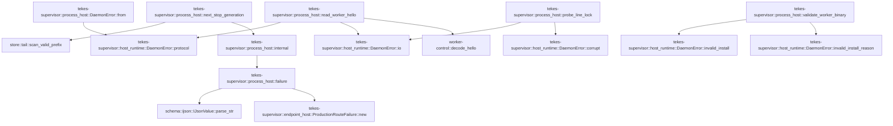

```mermaid
flowchart TD
  n0["endpoint::service::NativeEndpoint::open"]
  n1["endpoint::types::validate_session_id"]
  n2["engine::admission::AdmissionPool::new"]
  n3["profile::config::ConfigRepository::open"]
  n4["profile::resources::ResourceCatalog::from_snapshot"]
  n5["profile::scope::SessionScope::locate"]
  n6["provider::secret_store::MemorySecretStore::new"]
  n7["store::folder::ThreadStore::open"]
  n8["store::folder_events::subscribe"]
  n9["store::folder_events::canonical_root"]
  n10["tekes-supervisor::boot_trace::phase"]
  n11["tekes-supervisor::catalog::Catalog::new"]
  n12["tekes-supervisor::dynamic_bindings::resolve_worker_launch_bindings"]
  n13["tekes-supervisor::host_runtime::DaemonError::invalid_config"]
  n14["tekes-supervisor::host_runtime::DaemonError::corrupt"]
  n15["tekes-supervisor::host_runtime::DaemonError::required_broker"]
  n16["tekes-supervisor::mcp_runtime::McpRuntime::new"]
  n17["tekes-supervisor::process_host::ProductionProcessHost::client_tool_catalog"]
  n18["tekes-supervisor::process_host::ProductionProcessHost::run_post_ready"]
  n19["tekes-supervisor::process_host::ProductionProcessHost::post_ready_tasks"]
  n20["tekes-supervisor::process_host::ProductionProcessHost::cleanup_stale_ephemeral"]
  n21["tekes-supervisor::process_host::ProductionProcessHost::run_upgrade_pass"]
  n22["tekes-supervisor::process_host::WorkerHandshakeGuard::child_mut"]
  n23["tekes-supervisor::process_host::WorkerHandshakeGuard::take_credential_broker"]
  n24["tekes-supervisor::process_host::WorkerHandshakeGuard::wait_for_exit"]
  n25["tekes-supervisor::process_host::WorkerHandshakeGuard::drop"]
  n26["tekes-supervisor::process_host::scoped_client_file_path"]
  n27["tekes-supervisor::process_host::reconcile_credential_bindings"]
  n28["tekes-supervisor::process_host::validate_worker_binary"]
  n29["tekes-supervisor::process_host::credential_control"]
  n30["tekes-supervisor::process_host::active_material"]
  n31["tekes-supervisor::process_host::retain_prior_for_unknown_credentials"]
  n32["tekes-supervisor::process_host::ProductionProcessHost::open"]
  n33["tekes-supervisor::process_host::ProductionProcessHost::open_with_secret_store"]
  n34["tekes-supervisor::process_host::ProductionProcessHost::mcp_runtime"]
  n35["tekes-supervisor::process_host::ProductionProcessHost::credential_is_ready"]
  n36["tekes-supervisor::process_host::ProductionProcessHost::client_file_changes"]
  n37["tekes-supervisor::process_host::ProductionProcessHost::client_file_page"]
  n38["tekes-supervisor::process_host::ProductionProcessHost::session_scope"]
  n39["tekes-supervisor::process_host::ProductionProcessHost::user_agent_dir"]
  n40["tekes-supervisor::process_host::ProductionProcessHost::client_session_roots"]
  n41["tekes-supervisor::process_host::ProductionProcessHost::client_resource_catalog"]
  n42["tekes-supervisor::thread_card::CardWriter::spawn_from_env"]
  n43["workspace-service::file_text_page"]
  n44["workspace-service::file_byte_page"]
  n17 --> n12
  n17 --> n13
  n17 --> n15
  n17 --> n38
  n19 --> n10
  n19 --> n20
  n19 --> n21
  n24 --> n22
  n27 --> n15
  n27 --> n29
  n27 --> n30
  n29 --> n15
  n32 --> n6
  n32 --> n33
  n33 --> n0
  n33 --> n2
  n33 --> n3
  n33 --> n7
  n33 --> n8
  n33 --> n9
  n33 --> n11
  n33 --> n13
  n33 --> n14
  n33 --> n15
  n33 --> n16
  n33 --> n28
  n33 --> n42
  n36 --> n5
  n36 --> n38
  n37 --> n13
  n37 --> n26
  n37 --> n38
  n37 --> n43
  n37 --> n44
  n38 --> n1
  n38 --> n5
  n38 --> n13
  n40 --> n13
  n40 --> n38
  n41 --> n4
  n41 --> n13
  n41 --> n38
```

```mermaid
flowchart TD
  n0["provider::secret_store::resolve_config_credentials"]
  n1["store::folder::ThreadStore::open"]
  n2["store::folder_events::arm_admission"]
  n3["store::folder_events::is_admitted"]
  n4["tekes-supervisor::endpoint_host::recover_pending_management"]
  n5["tekes-supervisor::host_runtime::DaemonError::invalid_config"]
  n6["tekes-supervisor::host_runtime::DaemonError::corrupt"]
  n7["tekes-supervisor::host_runtime::DaemonError::required_broker"]
  n8["tekes-supervisor::process_host::ProductionProcessHost::cleanup_stale_ephemeral"]
  n9["tekes-supervisor::process_host::ProductionProcessHost::live_sessions_for_cleanup"]
  n10["tekes-supervisor::process_host::ProductionProcessHost::run_upgrade_pass"]
  n11["tekes-supervisor::process_host::ProductionProcessHost::is_stale_ephemeral"]
  n12["tekes-supervisor::process_host::ProductionProcessHost::on_folder_event"]
  n13["tekes-supervisor::process_host::ProductionProcessHost::attach_streams"]
  n14["tekes-supervisor::process_host::ProductionProcessHost::reconcile_child_line"]
  n15["tekes-supervisor::process_host::ProductionProcessHost::publish_session_status"]
  n16["tekes-supervisor::process_host::ProductionProcessHost::start_periodic_sweep"]
  n17["tekes-supervisor::process_host::ProductionProcessHost::recover_pending_management"]
  n18["tekes-supervisor::process_host::ProductionProcessHost::refresh_live_credentials"]
  n19["tekes-supervisor::process_host::ProductionProcessHost::config_mutation_succeeded"]
  n20["tekes-supervisor::process_host::ProductionProcessHost::refresh_worker_credentials"]
  n21["tekes-supervisor::process_host::ProductionProcessHost::boot_sweep"]
  n22["tekes-supervisor::process_host::ProductionProcessHost::arm_admission"]
  n23["tekes-supervisor::process_host::ProductionProcessHost::recover_client_sessions"]
  n24["tekes-supervisor::process_host::ProductionProcessHost::ensure_verified"]
  n25["tekes-supervisor::process_host::ProductionProcessHost::hydrate"]
  n26["tekes-supervisor::process_host::ProductionProcessHost::hydrate_with"]
  n27["tekes-supervisor::process_host::ProductionProcessHost::recently_failed"]
  n28["tekes-supervisor::process_host::ProductionProcessHost::hydrate_unrecorded"]
  n29["tekes-supervisor::process_host::ProductionProcessHost::sweep_once"]
  n30["tekes-supervisor::process_host::ProductionProcessHost::sweep_session"]
  n31["tekes-supervisor::process_host::web_search_scope_ready"]
  n32["tekes-supervisor::process_host::terminate_worker"]
  n33["tekes-supervisor::process_host::reconcile_credential_bindings"]
  n34["tekes-supervisor::process_host::retain_prior_for_unknown_credentials"]
  n8 --> n1
  n8 --> n3
  n8 --> n9
  n10 --> n25
  n10 --> n27
  n11 --> n3
  n17 --> n4
  n18 --> n20
  n19 --> n18
  n20 --> n0
  n20 --> n7
  n20 --> n31
  n20 --> n32
  n20 --> n33
  n20 --> n34
  n21 --> n29
  n22 --> n2
  n23 --> n5
  n23 --> n24
  n23 --> n30
  n24 --> n5
  n24 --> n6
  n24 --> n25
  n25 --> n26
  n26 --> n28
```

```mermaid
flowchart TD
  n0["engine::lifecycle::ensure_action_at"]
  n1["engine::lifecycle::classify"]
  n2["profile::scope::SessionScope::for_ledger"]
  n3["session-controls::bound_goal_id"]
  n4["store::card::remove_stale_card_temps"]
  n5["store::folder_events::is_admitted"]
  n6["store::folder_events::admitted_ids"]
  n7["store::platform::NamedLock::shared"]
  n8["store::tail::scan_valid_prefix"]
  n9["store::tail::repair_thread_tails"]
  n10["tekes-supervisor::boot_trace::detail"]
  n11["tekes-supervisor::boot_trace::per_item_enabled"]
  n12["tekes-supervisor::dynamic_bindings::resolve_worker_launch_bindings"]
  n13["tekes-supervisor::host_runtime::system_timestamp"]
  n14["tekes-supervisor::host_runtime::DaemonError::protocol"]
  n15["tekes-supervisor::host_runtime::DaemonError::invalid_config"]
  n16["tekes-supervisor::host_runtime::DaemonError::corrupt"]
  n17["tekes-supervisor::host_runtime::DaemonError::required_broker"]
  n18["tekes-supervisor::launch_profiled_worker_with_secret_store_and_binding_resolver"]
  n19["tekes-supervisor::process_host::ProductionProcessHost::live_sessions_for_cleanup"]
  n20["tekes-supervisor::process_host::production_sandbox_backend"]
  n21["tekes-supervisor::process_host::ProductionProcessHost::hydrate_unrecorded"]
  n22["tekes-supervisor::process_host::ProductionProcessHost::repair_main_projection"]
  n23["tekes-supervisor::process_host::ProductionProcessHost::periodic_sweep_once"]
  n24["tekes-supervisor::process_host::ProductionProcessHost::is_draining"]
  n25["tekes-supervisor::process_host::ProductionProcessHost::sweep_ledger_scan"]
  n26["tekes-supervisor::process_host::now_rfc3339"]
  n27["tekes-supervisor::process_host::ProductionProcessHost::sweep_once"]
  n28["tekes-supervisor::process_host::ProductionProcessHost::sweep_ids"]
  n29["tekes-supervisor::process_host::ProductionProcessHost::is_deferred"]
  n30["tekes-supervisor::process_host::ProductionProcessHost::sweep_session"]
  n31["tekes-supervisor::process_host::ProductionProcessHost::propagate_durable_stops_before_sweep"]
  n32["tekes-supervisor::process_host::ProductionProcessHost::shutdown"]
  n33["tekes-supervisor::process_host::ProductionProcessHost::shutdown_with"]
  n34["tekes-supervisor::process_host::ProductionProcessHost::ensure_running"]
  n35["tekes-supervisor::process_host::ProductionProcessHost::live_worker"]
  n36["tekes-supervisor::process_host::ProductionProcessHost::spawn_worker_at"]
  n37["tekes-supervisor::process_host::ProductionProcessHost::spawn_worker_at_with_handshake_timeout"]
  n38["tekes-supervisor::process_host::ProductionProcessHost::workspace_service_binary"]
  n39["tekes-supervisor::process_host::ProductionProcessHost::worker_binary_digest"]
  n40["tekes-supervisor::process_host::ProductionProcessHost::refresh_limits"]
  n41["tekes-supervisor::process_host::ProductionProcessHost::preflight_mandatory_authorities"]
  n42["tekes-supervisor::process_host::ProductionProcessHost::is_mcp_only_app_sandbox_host"]
  n43["tekes-supervisor::process_host::ProductionProcessHost::freeze_tool_authority"]
  n44["tekes-supervisor::process_host::ProductionProcessHost::schedule_worker_at"]
  n45["tekes-supervisor::process_host::ProductionProcessHost::wait_for_worker"]
  n46["tekes-supervisor::process_host::ProductionProcessHost::publish_appended"]
  n47["tekes-supervisor::process_host::ProductionProcessHost::publish_appended_with"]
  n48["tekes-supervisor::process_host::ProductionProcessHost::cascade_stop_from"]
  n49["tekes-supervisor::process_host::ProductionProcessHost::reset_restart_backoff"]
  n50["tekes-supervisor::process_host::ProductionProcessHost::restart_is_due"]
  n51["tekes-supervisor::process_host::ProductionProcessHost::note_restart_failure"]
  n52["tekes-supervisor::process_host::ProductionProcessHost::record_session_notice"]
  n53["tekes-supervisor::process_host::genesis_preset_skills"]
  n54["tekes-supervisor::process_host::missing_preset_skill_notice"]
  n55["tekes-supervisor::process_host::validator_tool_launch_policy"]
  n56["tekes-supervisor::process_host::worker_reader"]
  n57["tekes-supervisor::process_host::worker_stderr_reader"]
  n58["tekes-supervisor::process_host::damage_under_lock"]
  n59["tekes-supervisor::process_host::child_ledger_damage"]
  n60["tekes-supervisor::process_host::workspace_quiescence_lock_path"]
  n61["tekes-supervisor::process_host::goal_continuation_due"]
  n62["tekes-supervisor::process_host::probe_line_lock"]
  n63["tekes-supervisor::process_host::read_worker_hello"]
  n64["tekes-supervisor::process_host::SweepLedgerIdentity::of"]
  n65["tekes-supervisor::thread_card::fold_child_views"]
  n66["tools::runtime_backends::HelperJobLauncher::new"]
  n67["tools::runtime_backends::HelperJobLauncher::disabled"]
  n68["tools::sandbox::probe_backend"]
  n69["worker-control::durable::encode_queue_transaction"]
  n70["worker-control::negotiate"]
  n71["worker-control::encode_line"]
  n21 --> n4
  n21 --> n9
  n21 --> n16
  n21 --> n47
  n21 --> n58
  n21 --> n59
  n21 --> n65
  n22 --> n46
  n23 --> n27
  n25 --> n8
  n25 --> n14
  n25 --> n16
  n25 --> n64
  n27 --> n10
  n27 --> n11
  n27 --> n28
  n27 --> n30
  n28 --> n6
  n29 --> n5
  n30 --> n0
  n30 --> n1
  n30 --> n22
  n30 --> n25
  n30 --> n26
  n30 --> n29
  n30 --> n31
  n30 --> n40
  n30 --> n44
  n30 --> n50
  n30 --> n51
  n30 --> n61
  n30 --> n62
  n31 --> n25
  n31 --> n48
  n32 --> n33
  n33 --> n19
  n34 --> n40
  n34 --> n44
  n34 --> n45
  n34 --> n49
  n36 --> n37
  n37 --> n2
  n37 --> n3
  n37 --> n7
  n37 --> n12
  n37 --> n13
  n37 --> n14
  n37 --> n15
  n37 --> n17
  n37 --> n18
  n37 --> n39
  n37 --> n43
  n37 --> n52
  n37 --> n53
  n37 --> n54
  n37 --> n55
  n37 --> n56
  n37 --> n57
  n37 --> n60
  n37 --> n63
  n37 --> n69
  n37 --> n70
  n37 --> n71
  n40 --> n15
  n41 --> n17
  n41 --> n20
  n41 --> n42
  n41 --> n66
  n41 --> n67
  n41 --> n68
```

```mermaid
flowchart TD
  n0["engine::context::plan_context_compaction"]
  n1["schema::event::Event::from_value"]
  n2["schema::ijson::IJsonValue::parse"]
  n3["store::tail::scan_valid_prefix"]
  n4["tekes-supervisor::host_runtime::DaemonError::protocol"]
  n5["tekes-supervisor::host_runtime::DaemonError::io"]
  n6["tekes-supervisor::host_runtime::DaemonError::required_broker"]
  n7["tekes-supervisor::process_host::ProductionProcessHost::publish_session_status"]
  n8["tekes-supervisor::process_host::production_sandbox_backend"]
  n9["tekes-supervisor::process_host::ProductionProcessHost::refresh_worker_credentials"]
  n10["tekes-supervisor::process_host::ProductionProcessHost::ensure_verified"]
  n11["tekes-supervisor::process_host::spill_compaction_summary"]
  n12["tekes-supervisor::process_host::ProductionProcessHost::live_worker"]
  n13["tekes-supervisor::process_host::ProductionProcessHost::spawn_worker_at"]
  n14["tekes-supervisor::process_host::deterministic_automatic_thread_title"]
  n15["tekes-supervisor::process_host::ProductionProcessHost::refresh_limits"]
  n16["tekes-supervisor::process_host::ProductionProcessHost::is_mcp_only_app_sandbox_host"]
  n17["tekes-supervisor::process_host::ProductionProcessHost::freeze_tool_authority"]
  n18["tekes-supervisor::process_host::prompt_text"]
  n19["tekes-supervisor::process_host::ProductionProcessHost::schedule_main"]
  n20["tekes-supervisor::process_host::ProductionProcessHost::schedule_line"]
  n21["tekes-supervisor::process_host::ProductionProcessHost::schedule_worker_at"]
  n22["tekes-supervisor::process_host::ProductionProcessHost::schedule_worker_at_with_startup"]
  n23["tekes-supervisor::process_host::automatic_title_origin"]
  n24["tekes-supervisor::process_host::ProductionProcessHost::schedule_child_from_parent"]
  n25["tekes-supervisor::process_host::ProductionProcessHost::wait_for_worker"]
  n26["tekes-supervisor::process_host::ProductionProcessHost::start_pending_workers"]
  n27["tekes-supervisor::process_host::ProductionProcessHost::has_worker_capacity"]
  n28["tekes-supervisor::process_host::ProductionProcessHost::request_provider_lease"]
  n29["tekes-supervisor::process_host::ProductionProcessHost::locked_prompt"]
  n30["tekes-supervisor::process_host::ProductionProcessHost::locked_compact"]
  n31["tekes-supervisor::process_host::ProductionProcessHost::first_root_input"]
  n32["tekes-supervisor::process_host::ProductionProcessHost::seed_automatic_title"]
  n33["tekes-supervisor::process_host::ProductionProcessHost::try_seed_automatic_title"]
  n34["tekes-supervisor::process_host::ProductionProcessHost::wait_and_seed_automatic_title"]
  n35["tekes-supervisor::process_host::ProductionProcessHost::spawn_automatic_title_refinement"]
  n36["tekes-supervisor::process_host::ProductionProcessHost::spawn_automatic_title_seed_and_refinement"]
  n37["tekes-supervisor::process_host::ProductionProcessHost::refine_automatic_title"]
  n38["tekes-supervisor::process_host::ProductionProcessHost::summary_for_manual_compaction"]
  n39["tekes-supervisor::process_host::ProductionProcessHost::generate_automatic_title"]
  n40["tekes-supervisor::process_host::ProductionProcessHost::publish_appended"]
  n41["tekes-supervisor::process_host::ProductionProcessHost::reset_restart_backoff"]
  n42["tekes-supervisor::process_host::ProductionProcessHost::record_spawn_failure"]
  n43["tekes-supervisor::process_host::frozen_tool_launch_policy"]
  n44["tekes-supervisor::process_host::child_dependency_admitted"]
  n45["tekes-supervisor::process_host::unresolved_parent_dependency"]
  n46["tekes-supervisor::process_host::line_schedule_target"]
  n47["tekes-supervisor::process_host::ledger_needs_worker"]
  n48["tekes-supervisor::process_host::internal"]
  n49["tools::runtime_backends::HelperJobLauncher::new"]
  n50["tools::runtime_backends::HelperJobLauncher::disabled"]
  n51["tools::sandbox::probe_backend"]
  n16 --> n5
  n16 --> n6
  n17 --> n6
  n17 --> n8
  n17 --> n16
  n17 --> n43
  n17 --> n49
  n17 --> n50
  n17 --> n51
  n19 --> n21
  n20 --> n21
  n20 --> n24
  n20 --> n45
  n20 --> n46
  n21 --> n22
  n22 --> n4
  n22 --> n7
  n22 --> n9
  n22 --> n10
  n22 --> n12
  n22 --> n13
  n22 --> n15
  n22 --> n27
  n24 --> n7
  n24 --> n9
  n24 --> n13
  n24 --> n15
  n24 --> n27
  n24 --> n44
  n25 --> n6
  n26 --> n7
  n26 --> n13
  n26 --> n27
  n26 --> n47
  n29 --> n2
  n29 --> n18
  n29 --> n19
  n29 --> n31
  n29 --> n32
  n29 --> n35
  n29 --> n41
  n29 --> n42
  n30 --> n0
  n30 --> n1
  n30 --> n2
  n30 --> n11
  n30 --> n38
  n30 --> n40
  n30 --> n48
  n31 --> n3
  n32 --> n33
  n33 --> n14
  n33 --> n23
  n33 --> n40
  n34 --> n33
  n37 --> n23
  n37 --> n39
  n37 --> n40
```

```mermaid
flowchart TD
  n0["endpoint::journal::EndpointJournal::open"]
  n1["engine::compaction_summary::admit_summary_artifact"]
  n2["engine::compaction_summary::summary_request_bytes"]
  n3["engine::compaction_summary::CompactionSummary::from_outcome"]
  n4["engine::compaction_summary::freeze_source_bundle"]
  n5["engine::context::plan_context_compaction"]
  n6["engine::lifecycle::ensure_action_at"]
  n7["engine::lifecycle::classify"]
  n8["engine::permission_mode::read_permission_mode"]
  n9["provider::compaction_summary::prepare_summary_request"]
  n10["provider::compaction_summary::summary_completion_artifact"]
  n11["provider::http::HttpRuntime::new"]
  n12["schema::event::Event::from_value"]
  n13["schema::ijson::IJsonValue::parse"]
  n14["store::tail::LockedLedger::open"]
  n15["store::tail::scan_valid_prefix"]
  n16["store::tail::read_genesis"]
  n17["tekes-supervisor::host_runtime::DaemonError::protocol"]
  n18["tekes-supervisor::host_runtime::DaemonError::corrupt"]
  n19["tekes-supervisor::host_runtime::DaemonError::required_broker"]
  n20["tekes-supervisor::process_host::now_rfc3339"]
  n21["tekes-supervisor::process_host::session_event_time_now"]
  n22["tekes-supervisor::process_host::normalized_automatic_thread_title"]
  n23["tekes-supervisor::process_host::ProductionProcessHost::refresh_limits"]
  n24["tekes-supervisor::process_host::ProductionProcessHost::is_mcp_only_app_sandbox_host"]
  n25["tekes-supervisor::process_host::ProductionProcessHost::schedule_worker_at"]
  n26["tekes-supervisor::process_host::ProductionProcessHost::schedule_child_from_parent"]
  n27["tekes-supervisor::process_host::automatic_title_route"]
  n28["tekes-supervisor::process_host::session_model_route"]
  n29["tekes-supervisor::process_host::ProductionProcessHost::complete_automatic_text"]
  n30["tekes-supervisor::process_host::ProductionProcessHost::complete_automatic_terminal"]
  n31["tekes-supervisor::process_host::ProductionProcessHost::summary_for_manual_compaction"]
  n32["tekes-supervisor::process_host::ProductionProcessHost::generate_automatic_title"]
  n33["tekes-supervisor::process_host::ProductionProcessHost::current_tool_authority"]
  n34["tekes-supervisor::process_host::ProductionProcessHost::tool_authority_for_session"]
  n35["tekes-supervisor::process_host::ProductionProcessHost::handle_tool_control"]
  n36["tekes-supervisor::process_host::ProductionProcessHost::handle_tool_continuation"]
  n37["tekes-supervisor::process_host::ProductionProcessHost::validate_child_proof"]
  n38["tekes-supervisor::process_host::ProductionProcessHost::publish_appended"]
  n39["tekes-supervisor::process_host::ProductionProcessHost::publish_appended_with"]
  n40["tekes-supervisor::process_host::prepare_automatic_title_request"]
  n41["tekes-supervisor::process_host::ProductionProcessHost::publish_frame"]
  n42["tekes-supervisor::process_host::ProductionProcessHost::launch_child"]
  n43["tekes-supervisor::process_host::ProductionProcessHost::propagate_parent_stop"]
  n44["tekes-supervisor::process_host::ProductionProcessHost::cascade_stop_from"]
  n45["tekes-supervisor::process_host::ProductionProcessHost::reconcile_after_exit"]
  n46["tekes-supervisor::process_host::ProductionProcessHost::reset_restart_backoff"]
  n47["tekes-supervisor::process_host::ProductionProcessHost::restart_is_due"]
  n48["tekes-supervisor::process_host::ProductionProcessHost::note_restart_failure"]
  n49["tekes-supervisor::process_host::ProductionProcessHost::record_spawn_failure"]
  n50["tekes-supervisor::process_host::ProductionProcessHost::record_session_notice"]
  n51["tekes-supervisor::process_host::terminate_worker"]
  n52["tekes-supervisor::process_host::ledger_damage"]
  n53["tekes-supervisor::process_host::damage_under_lock"]
  n54["tekes-supervisor::process_host::line_schedule_target"]
  n55["tekes-supervisor::process_host::goal_continuation_due"]
  n56["tekes-supervisor::process_host::probe_line_lock"]
  n57["tekes-supervisor::production_tool_control::JobBrokerSupervisorAuthority::new"]
  n58["tekes-supervisor::production_tool_control::ProductionToolControlHandler::new"]
  n59["tekes-supervisor::production_tool_control::ProductionToolControlPolicy::new"]
  n60["tekes-supervisor::thread_card::journal_input"]
  n61["tekes-supervisor::thread_card::prepare"]
  n62["tekes-supervisor::tool_control::ToolControlSession::new"]
  n63["tools::runtime_backends::HelperJobLauncher::for_execution_access"]
  n64["tools::schema_registry::fixed_schema"]
  n65["worker-control::continuation::decode_tool_continuation"]
  n66["worker-control::continuation::encode_tool_continuation_result"]
  n67["worker-control::encode_line"]
  n29 --> n30
  n30 --> n11
  n31 --> n1
  n31 --> n2
  n31 --> n3
  n31 --> n4
  n31 --> n5
  n31 --> n9
  n31 --> n10
  n31 --> n13
  n31 --> n15
  n31 --> n28
  n31 --> n30
  n31 --> n64
  n32 --> n22
  n32 --> n27
  n32 --> n29
  n32 --> n40
  n33 --> n34
  n34 --> n8
  n34 --> n19
  n34 --> n24
  n34 --> n63
  n35 --> n17
  n35 --> n19
  n35 --> n33
  n35 --> n57
  n35 --> n58
  n35 --> n59
  n35 --> n62
  n36 --> n17
  n36 --> n19
  n36 --> n33
  n36 --> n57
  n36 --> n58
  n36 --> n59
  n36 --> n65
  n36 --> n66
  n37 --> n16
  n37 --> n18
  n38 --> n39
  n39 --> n0
  n39 --> n15
  n39 --> n18
  n39 --> n52
  n39 --> n53
  n39 --> n60
  n39 --> n61
  n41 --> n0
  n41 --> n15
  n41 --> n18
  n41 --> n21
  n42 --> n6
  n42 --> n7
  n42 --> n15
  n42 --> n17
  n42 --> n18
  n42 --> n20
  n42 --> n26
  n42 --> n43
  n42 --> n56
  n43 --> n12
  n43 --> n13
  n43 --> n14
  n43 --> n15
  n43 --> n17
  n43 --> n18
  n43 --> n67
  n44 --> n15
  n44 --> n18
  n44 --> n26
  n44 --> n43
  n44 --> n44
  n44 --> n51
  n44 --> n54
  n45 --> n6
  n45 --> n7
  n45 --> n15
  n45 --> n18
  n45 --> n20
  n45 --> n23
  n45 --> n25
  n45 --> n38
  n45 --> n46
  n45 --> n47
  n45 --> n48
  n45 --> n55
  n45 --> n56
  n49 --> n50
```

```mermaid
flowchart TD
  n0["endpoint::service::genesis_cwd"]
  n1["endpoint::service::genesis_preset_summary"]
  n2["endpoint::service::permission_mode_of"]
  n3["endpoint::service::last_record_updated_ms"]
  n4["endpoint::types::validate_session_id"]
  n5["store::card::valid_line_name"]
  n6["store::folder_events::admitted_ids"]
  n7["store::tail::scan_valid_prefix"]
  n8["store::tail::read_genesis"]
  n9["tekes-supervisor::endpoint_host::ProductionRouteFailure::new"]
  n10["tekes-supervisor::process_host::ProductionProcessHost::is_stale_ephemeral"]
  n11["tekes-supervisor::process_host::ProductionProcessHost::ensure_verified"]
  n12["tekes-supervisor::process_host::ProductionProcessHost::recently_failed"]
  n13["tekes-supervisor::process_host::terminate_worker"]
  n14["tekes-supervisor::process_host::ProductionProcessHost::cancel"]
  n15["tekes-supervisor::process_host::ProductionProcessHost::rename"]
  n16["tekes-supervisor::process_host::ProductionProcessHost::deliver_if_live"]
  n17["tekes-supervisor::process_host::ProductionProcessHost::ensure_after_locked_append"]
  n18["tekes-supervisor::process_host::cancel_stage_failure"]
  n19["tekes-supervisor::process_host::child_exited_within"]
  n20["tekes-supervisor::process_host::neutral_lifecycle"]
  n21["tekes-supervisor::process_host::ledger_damage"]
  n22["tekes-supervisor::process_host::damage_under_lock"]
  n23["tekes-supervisor::process_host::child_ledger_damage"]
  n24["tekes-supervisor::process_host::is_single_line_ledger"]
  n25["tekes-supervisor::process_host::ProductionProcessHost::list_wait"]
  n26["tekes-supervisor::process_host::ProductionProcessHost::is_running"]
  n27["tekes-supervisor::process_host::ProductionProcessHost::catalog_item"]
  n28["tekes-supervisor::process_host::ProductionProcessHost::verify_within"]
  n29["tekes-supervisor::process_host::ProductionProcessHost::build_inventory"]
  n30["tekes-supervisor::process_host::ProductionProcessHost::inventory_items"]
  n31["tekes-supervisor::process_host::ProductionProcessHost::ensure_verified"]
  n32["tekes-supervisor::process_host::ProductionProcessHost::has_catalog"]
  n33["tekes-supervisor::process_host::ProductionProcessHost::hold_catalog"]
  n34["tekes-supervisor::process_host::next_stop_generation"]
  n35["tekes-supervisor::process_host::internal"]
  n36["worker-control::encode_line"]
  n14 --> n13
  n14 --> n18
  n14 --> n19
  n14 --> n34
  n14 --> n35
  n14 --> n36
  n15 --> n36
  n16 --> n19
  n16 --> n36
  n18 --> n9
  n21 --> n7
  n22 --> n21
  n23 --> n5
  n23 --> n21
  n23 --> n22
  n27 --> n0
  n27 --> n1
  n27 --> n2
  n27 --> n3
  n27 --> n8
  n27 --> n10
  n27 --> n20
  n27 --> n24
  n27 --> n26
  n29 --> n4
  n29 --> n6
  n29 --> n12
  n29 --> n20
  n29 --> n27
  n29 --> n28
  n31 --> n11
```

```mermaid
flowchart TD
  n0["engine::lifecycle::ensure_action_at"]
  n1["engine::lifecycle::classify"]
  n2["provider::dialect::validate_provider"]
  n3["provider::dialect::resolve_profile"]
  n4["provider::request::endpoint_origin"]
  n5["provider::secret_store::resolve_config_credentials"]
  n6["schema::ijson::IJsonValue::parse"]
  n7["session-controls::read_goal"]
  n8["store::tail::scan_valid_prefix"]
  n9["tekes-supervisor::host_runtime::system_timestamp"]
  n10["tekes-supervisor::host_runtime::DaemonError::io"]
  n11["tekes-supervisor::host_runtime::DaemonError::invalid_config"]
  n12["tekes-supervisor::host_runtime::DaemonError::corrupt"]
  n13["tekes-supervisor::process_host::now_rfc3339"]
  n14["tekes-supervisor::process_host::ProductionProcessHost::inventory_item"]
  n15["tekes-supervisor::process_host::ProductionProcessHost::live_sessions"]
  n16["tekes-supervisor::process_host::ProductionProcessHost::reconcile_projection"]
  n17["tekes-supervisor::process_host::ProductionProcessHost::execute"]
  n18["tekes-supervisor::process_host::ProductionProcessHost::readiness"]
  n19["tekes-supervisor::process_host::ProductionProcessHost::config_mutation_succeeded"]
  n20["tekes-supervisor::process_host::ProcessToolRuntime::host"]
  n21["tekes-supervisor::process_host::ProcessToolRuntime::ensure_running"]
  n22["tekes-supervisor::process_host::ProcessToolRuntime::deliver_input"]
  n23["tekes-supervisor::process_host::ProcessToolRuntime::interrupt"]
  n24["tekes-supervisor::process_host::ProcessToolRuntime::ensure_child"]
  n25["tekes-supervisor::process_host::ProcessToolRuntime::deliver_report"]
  n26["tekes-supervisor::process_host::unresolved_parent_dependency"]
  n27["tekes-supervisor::process_host::line_schedule_target"]
  n28["tekes-supervisor::process_host::operation_unavailable"]
  n29["tekes-supervisor::process_host::operation_value"]
  n30["tekes-supervisor::process_host::workspace_quiescence_lock_path"]
  n31["tekes-supervisor::process_host::scoped_client_file_path"]
  n32["tekes-supervisor::process_host::ledger_needs_worker"]
  n33["tekes-supervisor::process_host::goal_continuation_due"]
  n34["tekes-supervisor::process_host::probe_line_lock"]
  n35["worker-control::durable::encode_queue_transaction"]
  n17 --> n35
  n18 --> n2
  n18 --> n3
  n18 --> n4
  n18 --> n5
  n21 --> n29
  n22 --> n9
  n22 --> n29
  n23 --> n8
  n23 --> n9
  n23 --> n10
  n23 --> n28
  n23 --> n29
  n24 --> n29
  n25 --> n29
  n26 --> n8
  n26 --> n12
  n26 --> n27
  n27 --> n12
  n29 --> n6
  n31 --> n11
  n32 --> n0
  n32 --> n1
  n32 --> n8
  n32 --> n12
  n32 --> n13
  n32 --> n33
  n32 --> n34
  n33 --> n7
  n33 --> n8
  n33 --> n11
  n33 --> n12
```

# tekes-supervisor::process_host

[Package atlas](index.md) · [Source](../../src/process_host.rs)

## Declarations

Visibility is the declaration spelling; trait members and reexports require their enclosing interface. `cfg` is not evaluated.

| Symbol | Kind | Visibility | Test / cfg |
|---|---|---|---|
| [tekes-supervisor::process_host::DELIVERY_TIMEOUT](../../src/process_host.rs#L58) | const_item | `private` |  |
| [tekes-supervisor::process_host::MCP_ONLY_APP_SANDBOX_MARKER](../../src/process_host.rs#L59) | const_item | `private` |  |
| [tekes-supervisor::process_host::WORKER_HANDSHAKE_TIMEOUT](../../src/process_host.rs#L60) | const_item | `private` |  |
| [tekes-supervisor::process_host::WORKER_HELLO_MAX_BYTES](../../src/process_host.rs#L61) | const_item | `private` |  |
| [tekes-supervisor::process_host::MANAGEMENT_RECOVERY_SECONDS](../../src/process_host.rs#L63) | const_item | `private` |  |
| [tekes-supervisor::process_host::PERIODIC_SWEEP_INTERVAL](../../src/process_host.rs#L64) | const_item | `private` |  |
| [tekes-supervisor::process_host::SweepLedgerIdentity](../../src/process_host.rs#L69) | struct_item | `private` |  |
| [tekes-supervisor::process_host::SweepLedgerIdentity::of](../../src/process_host.rs#L76) | function_item | `private` |  |
| [tekes-supervisor::process_host::SweepLedgerScan](../../src/process_host.rs#L89) | struct_item | `private` |  |
| [tekes-supervisor::process_host::AUTOMATIC_THREAD_TITLE_MODEL_HINT](../../src/process_host.rs#L103) | const_item | `private` |  |
| [tekes-supervisor::process_host::AUTOMATIC_THREAD_TITLE_MAX_CHARS](../../src/process_host.rs#L104) | const_item | `private` |  |
| [tekes-supervisor::process_host::AUTOMATIC_THREAD_TITLE_TIMEOUT](../../src/process_host.rs#L105) | const_item | `private` |  |
| [tekes-supervisor::process_host::AUTOMATIC_THREAD_TITLE_MAX_OUTPUT_TOKENS](../../src/process_host.rs#L109) | const_item | `private` |  |
| [tekes-supervisor::process_host::COMPACTION_SUMMARY_TIMEOUT](../../src/process_host.rs#L110) | const_item | `private` |  |
| [tekes-supervisor::process_host::AUTOMATIC_THREAD_TITLE_SYSTEM](../../src/process_host.rs#L111) | const_item | `private` |  |
| [tekes-supervisor::process_host::LineLockState](../../src/process_host.rs#L114) | enum_item | `private` |  |
| [tekes-supervisor::process_host::production_sandbox_backend](../../src/process_host.rs#L119) | function_item | `private` |  |
| [tekes-supervisor::process_host::seq_ranges](../../src/process_host.rs#L130) | function_item | `private` |  |
| [tekes-supervisor::process_host::spill_compaction_summary](../../src/process_host.rs#L149) | function_item | `private` |  |
| [tekes-supervisor::process_host::now_rfc3339](../../src/process_host.rs#L166) | function_item | `private` |  |
| [tekes-supervisor::process_host::session_event_time_now](../../src/process_host.rs#L170) | function_item | `private` |  |
| [tekes-supervisor::process_host::session_event_time](../../src/process_host.rs#L174) | function_item | `private` |  |
| [tekes-supervisor::process_host::compact_title_source](../../src/process_host.rs#L184) | function_item | `private` |  |
| [tekes-supervisor::process_host::bounded_title](../../src/process_host.rs#L188) | function_item | `private` |  |
| [tekes-supervisor::process_host::deterministic_automatic_thread_title](../../src/process_host.rs#L195) | function_item | `private` |  |
| [tekes-supervisor::process_host::normalized_automatic_thread_title](../../src/process_host.rs#L199) | function_item | `private` |  |
| [tekes-supervisor::process_host::prompt_text](../../src/process_host.rs#L224) | function_item | `private` |  |
| [tekes-supervisor::process_host::automatic_title_origin](../../src/process_host.rs#L235) | function_item | `private` |  |
| [tekes-supervisor::process_host::automatic_title_route](../../src/process_host.rs#L245) | function_item | `private` |  |
| [tekes-supervisor::process_host::session_model_route](../../src/process_host.rs#L284) | function_item | `private` |  |
| [tekes-supervisor::process_host::prepare_automatic_title_request](../../src/process_host.rs#L332) | function_item | `private` |  |
| [tekes-supervisor::process_host::prepare_automatic_text_request](../../src/process_host.rs#L349) | function_item | `private` |  |
| [tekes-supervisor::process_host::accepted_stream_event](../../src/process_host.rs#L400) | function_item | `private` | test; #[cfg(test)] |
| [tekes-supervisor::process_host::ProcessToolRuntime](../../src/process_host.rs#L415) | struct_item | `private` |  |
| [tekes-supervisor::process_host::ProductionProcessHost](../../src/process_host.rs#L419) | struct_item | `pub` |  |
| [tekes-supervisor::process_host::SessionProjectionCache](../../src/process_host.rs#L477) | struct_item | `private` |  |
| [tekes-supervisor::process_host::WorkerHandle](../../src/process_host.rs#L483) | struct_item | `private` |  |
| [tekes-supervisor::process_host::WorkerHandshakeGuard](../../src/process_host.rs#L506) | struct_item | `private` |  |
| [tekes-supervisor::process_host::WorkerHandshakeGuard::child_mut](../../src/process_host.rs#L513) | function_item | `private` |  |
| [tekes-supervisor::process_host::WorkerHandshakeGuard::take_child](../../src/process_host.rs#L517) | function_item | `private` |  |
| [tekes-supervisor::process_host::WorkerHandshakeGuard::take_credential_control](../../src/process_host.rs#L521) | function_item | `private` |  |
| [tekes-supervisor::process_host::WorkerHandshakeGuard::take_credential_broker](../../src/process_host.rs#L525) | function_item | `private` |  |
| [tekes-supervisor::process_host::WorkerHandshakeGuard::wait_for_exit](../../src/process_host.rs#L529) | function_item | `private` |  |
| [tekes-supervisor::process_host::WorkerHandshakeGuard::drop](../../src/process_host.rs#L542) | function_item | `private` |  |
| [tekes-supervisor::process_host::PendingWorker](../../src/process_host.rs#L555) | struct_item | `private` |  |
| [tekes-supervisor::process_host::WorkerProtocolQuarantine](../../src/process_host.rs#L562) | struct_item | `private` |  |
| [tekes-supervisor::process_host::RestartBackoff](../../src/process_host.rs#L569) | struct_item | `private` |  |
| [tekes-supervisor::process_host::ScheduledWorker](../../src/process_host.rs#L576) | struct_item | `private` |  |
| [tekes-supervisor::process_host::WorkerState](../../src/process_host.rs#L582) | struct_item | `private` |  |
| [tekes-supervisor::process_host::reconcile_credential_bindings](../../src/process_host.rs#L589) | function_item | `private` |  |
| [tekes-supervisor::process_host::credential_control](../../src/process_host.rs#L693) | function_item | `private` |  |
| [tekes-supervisor::process_host::active_material](../../src/process_host.rs#L704) | function_item | `private` |  |
| [tekes-supervisor::process_host::retain_prior_for_unknown_credentials](../../src/process_host.rs#L718) | function_item | `private` |  |
| [tekes-supervisor::process_host::ProductionProcessHost::open](../../src/process_host.rs#L761) | function_item | `pub` |  |
| [tekes-supervisor::process_host::ProductionProcessHost::open_with_secret_store](../../src/process_host.rs#L776) | function_item | `pub` |  |
| [tekes-supervisor::process_host::ProductionProcessHost::mcp_runtime](../../src/process_host.rs#L876) | function_item | `pub` |  |
| [tekes-supervisor::process_host::ProductionProcessHost::credential_is_ready](../../src/process_host.rs#L883) | function_item | `pub` |  |
| [tekes-supervisor::process_host::ProductionProcessHost::client_file_changes](../../src/process_host.rs#L895) | function_item | `pub(crate)` |  |
| [tekes-supervisor::process_host::ProductionProcessHost::client_file_page](../../src/process_host.rs#L927) | function_item | `pub(crate)` |  |
| [tekes-supervisor::process_host::ProductionProcessHost::session_scope](../../src/process_host.rs#L957) | function_item | `private` |  |
| [tekes-supervisor::process_host::ProductionProcessHost::user_agent_dir](../../src/process_host.rs#L965) | function_item | `pub` |  |
| [tekes-supervisor::process_host::ProductionProcessHost::client_session_roots](../../src/process_host.rs#L971) | function_item | `pub` |  |
| [tekes-supervisor::process_host::ProductionProcessHost::client_resource_catalog](../../src/process_host.rs#L985) | function_item | `pub(crate)` |  |
| [tekes-supervisor::process_host::ProductionProcessHost::client_tool_catalog](../../src/process_host.rs#L1004) | function_item | `pub(crate)` |  |
| [tekes-supervisor::process_host::ProductionProcessHost::run_post_ready](../../src/process_host.rs#L1031) | function_item | `pub` |  |
| [tekes-supervisor::process_host::ProductionProcessHost::post_ready_tasks](../../src/process_host.rs#L1045) | function_item | `private` |  |
| [tekes-supervisor::process_host::ProductionProcessHost::cleanup_stale_ephemeral](../../src/process_host.rs#L1063) | function_item | `private` |  |
| [tekes-supervisor::process_host::ProductionProcessHost::live_sessions_for_cleanup](../../src/process_host.rs#L1088) | function_item | `private` |  |
| [tekes-supervisor::process_host::ProductionProcessHost::run_upgrade_pass](../../src/process_host.rs#L1101) | function_item | `private` |  |
| [tekes-supervisor::process_host::ProductionProcessHost::release_for_test](../../src/process_host.rs#L1144) | function_item | `pub(crate)` | test; #[cfg(test)] #[cfg_attr(not(target_os = "macos"), allow(dead_code))] |
| [tekes-supervisor::process_host::ProductionProcessHost::is_stale_ephemeral](../../src/process_host.rs#L1152) | function_item | `pub(crate)` |  |
| [tekes-supervisor::process_host::ProductionProcessHost::on_folder_event](../../src/process_host.rs#L1156) | function_item | `private` |  |
| [tekes-supervisor::process_host::ProductionProcessHost::attach_streams](../../src/process_host.rs#L1195) | function_item | `pub` |  |
| [tekes-supervisor::process_host::ProductionProcessHost::reconcile_child_line](../../src/process_host.rs#L1205) | function_item | `private` |  |
| [tekes-supervisor::process_host::ProductionProcessHost::publish_session_status](../../src/process_host.rs#L1224) | function_item | `private` |  |
| [tekes-supervisor::process_host::ProductionProcessHost::start_periodic_sweep](../../src/process_host.rs#L1241) | function_item | `pub` |  |
| [tekes-supervisor::process_host::ProductionProcessHost::recover_pending_management](../../src/process_host.rs#L1292) | function_item | `private` |  |
| [tekes-supervisor::process_host::ProductionProcessHost::refresh_live_credentials](../../src/process_host.rs#L1300) | function_item | `pub` |  |
| [tekes-supervisor::process_host::ProductionProcessHost::config_mutation_succeeded](../../src/process_host.rs#L1318) | function_item | `pub` |  |
| [tekes-supervisor::process_host::ProductionProcessHost::refresh_worker_credentials](../../src/process_host.rs#L1333) | function_item | `private` |  |
| [tekes-supervisor::process_host::ProductionProcessHost::boot_sweep](../../src/process_host.rs#L1372) | function_item | `pub` |  |
| [tekes-supervisor::process_host::ProductionProcessHost::arm_admission](../../src/process_host.rs#L1383) | function_item | `pub` |  |
| [tekes-supervisor::process_host::ProductionProcessHost::recover_client_sessions](../../src/process_host.rs#L1392) | function_item | `pub` |  |
| [tekes-supervisor::process_host::ProductionProcessHost::ensure_verified](../../src/process_host.rs#L1434) | function_item | `pub(crate)` |  |
| [tekes-supervisor::process_host::ProductionProcessHost::hydrate](../../src/process_host.rs#L1449) | function_item | `pub(crate)` |  |
| [tekes-supervisor::process_host::ProductionProcessHost::hydrate_with](../../src/process_host.rs#L1455) | function_item | `pub(crate)` |  |
| [tekes-supervisor::process_host::ProductionProcessHost::recently_failed](../../src/process_host.rs#L1475) | function_item | `private` |  |
| [tekes-supervisor::process_host::ProductionProcessHost::hydrate_unrecorded](../../src/process_host.rs#L1483) | function_item | `private` |  |
| [tekes-supervisor::process_host::ProductionProcessHost::repair_main_projection](../../src/process_host.rs#L1572) | function_item | `private` |  |
| [tekes-supervisor::process_host::ProductionProcessHost::periodic_sweep_once](../../src/process_host.rs#L1617) | function_item | `pub` |  |
| [tekes-supervisor::process_host::ProductionProcessHost::is_draining](../../src/process_host.rs#L1634) | function_item | `pub` |  |
| [tekes-supervisor::process_host::ProductionProcessHost::sweep_ledger_scan](../../src/process_host.rs#L1644) | function_item | `private` |  |
| [tekes-supervisor::process_host::ProductionProcessHost::sweep_once](../../src/process_host.rs#L1694) | function_item | `private` |  |
| [tekes-supervisor::process_host::ProductionProcessHost::sweep_ids](../../src/process_host.rs#L1714) | function_item | `private` |  |
| [tekes-supervisor::process_host::ProductionProcessHost::is_deferred](../../src/process_host.rs#L1743) | function_item | `private` |  |
| [tekes-supervisor::process_host::ProductionProcessHost::sweep_session](../../src/process_host.rs#L1755) | function_item | `private` |  |
| [tekes-supervisor::process_host::ProductionProcessHost::propagate_durable_stops_before_sweep](../../src/process_host.rs#L1838) | function_item | `private` |  |
| [tekes-supervisor::process_host::ProductionProcessHost::shutdown](../../src/process_host.rs#L1873) | function_item | `pub` |  |
| [tekes-supervisor::process_host::ProductionProcessHost::shutdown_with](../../src/process_host.rs#L1880) | function_item | `private` |  |
| [tekes-supervisor::process_host::ProductionProcessHost::ensure_running](../../src/process_host.rs#L1919) | function_item | `private` |  |
| [tekes-supervisor::process_host::ProductionProcessHost::live_worker](../../src/process_host.rs#L1933) | function_item | `private` |  |
| [tekes-supervisor::process_host::ProductionProcessHost::spawn_worker_at](../../src/process_host.rs#L1943) | function_item | `private` |  |
| [tekes-supervisor::process_host::ProductionProcessHost::spawn_worker_at_with_handshake_timeout](../../src/process_host.rs#L1959) | function_item | `private` |  |
| [tekes-supervisor::process_host::ProductionProcessHost::workspace_service_binary](../../src/process_host.rs#L2185) | function_item | `pub` |  |
| [tekes-supervisor::process_host::ProductionProcessHost::worker_binary_digest](../../src/process_host.rs#L2189) | function_item | `private` |  |
| [tekes-supervisor::process_host::ProductionProcessHost::refresh_limits](../../src/process_host.rs#L2194) | function_item | `private` |  |
| [tekes-supervisor::process_host::ProductionProcessHost::preflight_mandatory_authorities](../../src/process_host.rs#L2213) | function_item | `pub` |  |
| [tekes-supervisor::process_host::ProductionProcessHost::is_mcp_only_app_sandbox_host](../../src/process_host.rs#L2232) | function_item | `private` |  |
| [tekes-supervisor::process_host::ProductionProcessHost::freeze_tool_authority](../../src/process_host.rs#L2252) | function_item | `private` |  |
| [tekes-supervisor::process_host::ProductionProcessHost::schedule_main](../../src/process_host.rs#L2272) | function_item | `private` |  |
| [tekes-supervisor::process_host::ProductionProcessHost::schedule_line](../../src/process_host.rs#L2283) | function_item | `private` |  |
| [tekes-supervisor::process_host::ProductionProcessHost::schedule_worker_at](../../src/process_host.rs#L2299) | function_item | `private` |  |
| [tekes-supervisor::process_host::ProductionProcessHost::schedule_worker_at_with_startup](../../src/process_host.rs#L2310) | function_item | `private` |  |
| [tekes-supervisor::process_host::ProductionProcessHost::schedule_child_from_parent](../../src/process_host.rs#L2397) | function_item | `private` |  |
| [tekes-supervisor::process_host::ProductionProcessHost::wait_for_worker](../../src/process_host.rs#L2445) | function_item | `private` |  |
| [tekes-supervisor::process_host::ProductionProcessHost::start_pending_workers](../../src/process_host.rs#L2473) | function_item | `private` |  |
| [tekes-supervisor::process_host::ProductionProcessHost::has_worker_capacity](../../src/process_host.rs#L2540) | function_item | `private` |  |
| [tekes-supervisor::process_host::ProductionProcessHost::request_provider_lease](../../src/process_host.rs#L2548) | function_item | `private` |  |
| [tekes-supervisor::process_host::ProductionProcessHost::locked_prompt](../../src/process_host.rs#L2587) | function_item | `private` |  |
| [tekes-supervisor::process_host::ProductionProcessHost::locked_compact](../../src/process_host.rs#L2621) | function_item | `private` |  |
| [tekes-supervisor::process_host::ProductionProcessHost::first_root_input](../../src/process_host.rs#L2698) | function_item | `private` |  |
| [tekes-supervisor::process_host::ProductionProcessHost::seed_automatic_title](../../src/process_host.rs#L2730) | function_item | `private` |  |
| [tekes-supervisor::process_host::ProductionProcessHost::try_seed_automatic_title](../../src/process_host.rs#L2742) | function_item | `private` |  |
| [tekes-supervisor::process_host::ProductionProcessHost::wait_and_seed_automatic_title](../../src/process_host.rs#L2770) | function_item | `private` |  |
| [tekes-supervisor::process_host::ProductionProcessHost::spawn_automatic_title_refinement](../../src/process_host.rs#L2795) | function_item | `private` |  |
| [tekes-supervisor::process_host::ProductionProcessHost::spawn_automatic_title_seed_and_refinement](../../src/process_host.rs#L2809) | function_item | `private` |  |
| [tekes-supervisor::process_host::ProductionProcessHost::refine_automatic_title](../../src/process_host.rs#L2833) | function_item | `private` |  |
| [tekes-supervisor::process_host::ProductionProcessHost::complete_automatic_text](../../src/process_host.rs#L2870) | function_item | `private` |  |
| [tekes-supervisor::process_host::ProductionProcessHost::complete_automatic_terminal](../../src/process_host.rs#L2896) | function_item | `private` |  |
| [tekes-supervisor::process_host::ProductionProcessHost::summary_for_manual_compaction](../../src/process_host.rs#L2960) | function_item | `private` |  |
| [tekes-supervisor::process_host::ProductionProcessHost::generate_automatic_title](../../src/process_host.rs#L3031) | function_item | `private` |  |
| [tekes-supervisor::process_host::ProductionProcessHost::current_tool_authority](../../src/process_host.rs#L3058) | function_item | `private` |  |
| [tekes-supervisor::process_host::ProductionProcessHost::tool_authority_for_session](../../src/process_host.rs#L3070) | function_item | `private` |  |
| [tekes-supervisor::process_host::ProductionProcessHost::handle_tool_control](../../src/process_host.rs#L3097) | function_item | `private` |  |
| [tekes-supervisor::process_host::ProductionProcessHost::handle_tool_continuation](../../src/process_host.rs#L3133) | function_item | `private` |  |
| [tekes-supervisor::process_host::ProductionProcessHost::validate_child_proof](../../src/process_host.rs#L3172) | function_item | `private` |  |
| [tekes-supervisor::process_host::ProductionProcessHost::publish_appended](../../src/process_host.rs#L3189) | function_item | `private` |  |
| [tekes-supervisor::process_host::ProductionProcessHost::publish_appended_with](../../src/process_host.rs#L3195) | function_item | `private` |  |
| [tekes-supervisor::process_host::ProductionProcessHost::publish_frame](../../src/process_host.rs#L3394) | function_item | `private` |  |
| [tekes-supervisor::process_host::ProductionProcessHost::launch_child](../../src/process_host.rs#L3539) | function_item | `private` |  |
| [tekes-supervisor::process_host::ProductionProcessHost::propagate_parent_stop](../../src/process_host.rs#L3626) | function_item | `private` |  |
| [tekes-supervisor::process_host::ProductionProcessHost::cascade_stop_from](../../src/process_host.rs#L3719) | function_item | `private` |  |
| [tekes-supervisor::process_host::ProductionProcessHost::reconcile_after_exit](../../src/process_host.rs#L3805) | function_item | `private` |  |
| [tekes-supervisor::process_host::ProductionProcessHost::reset_restart_backoff](../../src/process_host.rs#L3868) | function_item | `private` |  |
| [tekes-supervisor::process_host::ProductionProcessHost::restart_is_due](../../src/process_host.rs#L3875) | function_item | `private` |  |
| [tekes-supervisor::process_host::ProductionProcessHost::note_restart_failure](../../src/process_host.rs#L3883) | function_item | `private` |  |
| [tekes-supervisor::process_host::ProductionProcessHost::record_spawn_failure](../../src/process_host.rs#L3924) | function_item | `private` |  |
| [tekes-supervisor::process_host::ProductionProcessHost::record_session_notice](../../src/process_host.rs#L3949) | function_item | `private` |  |
| [tekes-supervisor::process_host::genesis_preset_skills](../../src/process_host.rs#L3984) | function_item | `private` |  |
| [tekes-supervisor::process_host::missing_preset_skill_notice](../../src/process_host.rs#L3995) | function_item | `private` |  |
| [tekes-supervisor::process_host::frozen_tool_launch_policy](../../src/process_host.rs#L4016) | function_item | `private` |  |
| [tekes-supervisor::process_host::validator_tool_launch_policy](../../src/process_host.rs#L4046) | function_item | `private` |  |
| [tekes-supervisor::process_host::private_validator_launch_policy](../../src/process_host.rs#L4088) | function_item | `private` |  |
| [tekes-supervisor::process_host::web_search_scope_ready](../../src/process_host.rs#L4117) | function_item | `private` |  |
| [tekes-supervisor::process_host::child_dependency_admitted](../../src/process_host.rs#L4135) | function_item | `private` |  |
| [tekes-supervisor::process_host::WorkerHandle::write](../../src/process_host.rs#L4140) | function_item | `private` |  |
| [tekes-supervisor::process_host::WorkerHandle::receipt](../../src/process_host.rs#L4149) | function_item | `private` |  |
| [tekes-supervisor::process_host::WorkerHandle::queue_result](../../src/process_host.rs#L4174) | function_item | `private` |  |
| [tekes-supervisor::process_host::worker_reader](../../src/process_host.rs#L4203) | function_item | `private` |  |
| [tekes-supervisor::process_host::terminate_worker](../../src/process_host.rs#L4458) | function_item | `private` |  |
| [tekes-supervisor::process_host::fail_worker](../../src/process_host.rs#L4485) | function_item | `private` |  |
| [tekes-supervisor::process_host::worker_stderr_reader](../../src/process_host.rs#L4509) | function_item | `private` |  |
| [tekes-supervisor::process_host::worker_stderr_reader::MAX_STDERR_TAIL](../../src/process_host.rs#L4510) | const_item | `private` |  |
| [tekes-supervisor::process_host::preserve_first_failure](../../src/process_host.rs#L4529) | function_item | `private` |  |
| [tekes-supervisor::process_host::ProductionProcessHost::workspace_metadata_changed](../../src/process_host.rs#L4536) | function_item | `private` |  |
| [tekes-supervisor::process_host::ProductionProcessHost::session_metadata_changed](../../src/process_host.rs#L4551) | function_item | `private` |  |
| [tekes-supervisor::process_host::ProductionProcessHost::prompt](../../src/process_host.rs#L4555) | function_item | `private` |  |
| [tekes-supervisor::process_host::ProductionProcessHost::compact](../../src/process_host.rs#L4618) | function_item | `private` |  |
| [tekes-supervisor::process_host::ProductionProcessHost::cancel](../../src/process_host.rs#L4657) | function_item | `private` |  |
| [tekes-supervisor::process_host::ProductionProcessHost::rename](../../src/process_host.rs#L4741) | function_item | `private` |  |
| [tekes-supervisor::process_host::ProductionProcessHost::deliver_if_live](../../src/process_host.rs#L4778) | function_item | `private` |  |
| [tekes-supervisor::process_host::ProductionProcessHost::ensure_after_locked_append](../../src/process_host.rs#L4802) | function_item | `private` |  |
| [tekes-supervisor::process_host::cancel_stage_failure](../../src/process_host.rs#L4816) | function_item | `private` |  |
| [tekes-supervisor::process_host::child_exited_within](../../src/process_host.rs#L4835) | function_item | `private` |  |
| [tekes-supervisor::process_host::neutral_lifecycle](../../src/process_host.rs#L4857) | function_item | `private` |  |
| [tekes-supervisor::process_host::ledger_damage](../../src/process_host.rs#L4880) | function_item | `private` |  |
| [tekes-supervisor::process_host::DamageVerdict](../../src/process_host.rs#L4890) | enum_item | `private` |  |
| [tekes-supervisor::process_host::damage_under_lock](../../src/process_host.rs#L4906) | function_item | `private` |  |
| [tekes-supervisor::process_host::child_ledger_damage](../../src/process_host.rs#L4942) | function_item | `private` |  |
| [tekes-supervisor::process_host::is_single_line_ledger](../../src/process_host.rs#L4968) | function_item | `private` |  |
| [tekes-supervisor::process_host::HYDRATE_RETRY](../../src/process_host.rs#L4981) | const_item | `private` |  |
| [tekes-supervisor::process_host::DEFAULT_LIST_WAIT](../../src/process_host.rs#L4983) | const_item | `private` |  |
| [tekes-supervisor::process_host::ProductionProcessHost::list_wait](../../src/process_host.rs#L4986) | function_item | `private` |  |
| [tekes-supervisor::process_host::ProductionProcessHost::is_running](../../src/process_host.rs#L5001) | function_item | `private` |  |
| [tekes-supervisor::process_host::ProductionProcessHost::catalog_item](../../src/process_host.rs#L5011) | function_item | `private` |  |
| [tekes-supervisor::process_host::ProductionProcessHost::verify_within](../../src/process_host.rs#L5100) | function_item | `private` |  |
| [tekes-supervisor::process_host::ProductionProcessHost::build_inventory](../../src/process_host.rs#L5165) | function_item | `private` |  |
| [tekes-supervisor::process_host::ProductionProcessHost::inventory_items](../../src/process_host.rs#L5222) | function_item | `private` |  |
| [tekes-supervisor::process_host::ProductionProcessHost::ensure_verified](../../src/process_host.rs#L5232) | function_item | `private` |  |
| [tekes-supervisor::process_host::ProductionProcessHost::has_catalog](../../src/process_host.rs#L5247) | function_item | `private` |  |
| [tekes-supervisor::process_host::ProductionProcessHost::hold_catalog](../../src/process_host.rs#L5251) | function_item | `private` |  |
| [tekes-supervisor::process_host::ProductionProcessHost::inventory_item](../../src/process_host.rs#L5307) | function_item | `private` |  |
| [tekes-supervisor::process_host::ProductionProcessHost::live_sessions](../../src/process_host.rs#L5336) | function_item | `private` |  |
| [tekes-supervisor::process_host::ProductionProcessHost::reconcile_projection](../../src/process_host.rs#L5346) | function_item | `private` |  |
| [tekes-supervisor::process_host::ProductionProcessHost::execute](../../src/process_host.rs#L5356) | function_item | `private` |  |
| [tekes-supervisor::process_host::ProductionProcessHost::readiness](../../src/process_host.rs#L5384) | function_item | `private` |  |
| [tekes-supervisor::process_host::ProductionProcessHost::config_mutation_succeeded](../../src/process_host.rs#L5461) | function_item | `private` |  |
| [tekes-supervisor::process_host::ProcessToolRuntime::host](../../src/process_host.rs#L5485) | function_item | `private` |  |
| [tekes-supervisor::process_host::ProcessToolRuntime::ensure_running](../../src/process_host.rs#L5493) | function_item | `private` |  |
| [tekes-supervisor::process_host::ProcessToolRuntime::deliver_input](../../src/process_host.rs#L5504) | function_item | `private` |  |
| [tekes-supervisor::process_host::ProcessToolRuntime::interrupt](../../src/process_host.rs#L5540) | function_item | `private` |  |
| [tekes-supervisor::process_host::ProcessToolRuntime::ensure_child](../../src/process_host.rs#L5622) | function_item | `private` |  |
| [tekes-supervisor::process_host::ProcessToolRuntime::deliver_report](../../src/process_host.rs#L5636) | function_item | `private` |  |
| [tekes-supervisor::process_host::unresolved_parent_dependency](../../src/process_host.rs#L5658) | function_item | `private` |  |
| [tekes-supervisor::process_host::line_schedule_target](../../src/process_host.rs#L5736) | function_item | `private` |  |
| [tekes-supervisor::process_host::operation_unavailable](../../src/process_host.rs#L5772) | function_item | `private` |  |
| [tekes-supervisor::process_host::operation_value](../../src/process_host.rs#L5776) | function_item | `private` |  |
| [tekes-supervisor::process_host::workspace_quiescence_lock_path](../../src/process_host.rs#L5784) | function_item | `pub(crate)` |  |
| [tekes-supervisor::process_host::scoped_client_file_path](../../src/process_host.rs#L5789) | function_item | `private` |  |
| [tekes-supervisor::process_host::ledger_needs_worker](../../src/process_host.rs#L5832) | function_item | `private` |  |
| [tekes-supervisor::process_host::goal_continuation_due](../../src/process_host.rs#L5850) | function_item | `private` |  |
| [tekes-supervisor::process_host::probe_line_lock](../../src/process_host.rs#L5894) | function_item | `private` |  |
| [tekes-supervisor::process_host::read_worker_hello](../../src/process_host.rs#L5928) | function_item | `private` |  |
| [tekes-supervisor::process_host::next_stop_generation](../../src/process_host.rs#L6000) | function_item | `private` |  |
| [tekes-supervisor::process_host::validate_worker_binary](../../src/process_host.rs#L6019) | function_item | `private` |  |
| [tekes-supervisor::process_host::failure](../../src/process_host.rs#L6031) | function_item | `private` |  |
| [tekes-supervisor::process_host::internal](../../src/process_host.rs#L6039) | function_item | `private` |  |
| [tekes-supervisor::process_host::DaemonError::from](../../src/process_host.rs#L6044) | function_item | `private` |  |
| [tekes-supervisor::process_host::tests::client_file_scope_uses_selected_directory_and_rejects_escape](../../src/process_host.rs#L6052) | function_item | `private` | test; #[cfg(test)] |
| [tekes-supervisor::process_host::tests::deepseek_title_provider](../../src/process_host.rs#L6096) | function_item | `private` | test; #[cfg(test)] |
| [tekes-supervisor::process_host::tests::serve_title_once](../../src/process_host.rs#L6119) | function_item | `private` | test; #[cfg(test)] |
| [tekes-supervisor::process_host::tests::serve_title_response](../../src/process_host.rs#L6134) | function_item | `private` | test; #[cfg(test)] |
| [tekes-supervisor::process_host::tests::automatic_title_text_normalization_matches_the_legacy_contract](../../src/process_host.rs#L6188) | function_item | `private` | test; #[cfg(test)] |
| [tekes-supervisor::process_host::tests::automatic_title_route_finds_flash_by_hint_and_falls_back_to_any_deepseek](../../src/process_host.rs#L6211) | function_item | `private` | test; #[cfg(test)] |
| [tekes-supervisor::process_host::tests::automatic_title_route_finds_flash_by_hint_and_falls_back_to_any_deepseek::providers_with](../../src/process_host.rs#L6212) | function_item | `private` | test; #[cfg(test)] |
| [tekes-supervisor::process_host::tests::automatic_title_request_uses_configured_deepseek_adapter_and_pins_flash](../../src/process_host.rs#L6255) | function_item | `private` | test; #[cfg(test)] |
| [tekes-supervisor::process_host::tests::automatic_title_uses_the_provider_runtime_and_normalizes_its_terminal](../../src/process_host.rs#L6291) | function_item | `private` | test; #[cfg(test)] |
| [tekes-supervisor::process_host::tests::automatic_title_rejects_cut_and_failed_responses](../../src/process_host.rs#L6336) | function_item | `private` | test; #[cfg(test)] |
| [tekes-supervisor::process_host::tests::automatic_title_request_fails_closed_without_a_reasoning_off_switch](../../src/process_host.rs#L6390) | function_item | `private` | test; #[cfg(test)] |
| [tekes-supervisor::process_host::tests::locked_manual_compact_covers_settled_history_and_is_keyed_by_origin](../../src/process_host.rs#L6423) | function_item | `private` | test; #[cfg(test)] |
| [tekes-supervisor::process_host::tests::full_access_job_authority_tracks_session_mode_and_preserves_private_boundaries](../../src/process_host.rs#L6522) | function_item | `private` | test; #[cfg(test)] |
| [tekes-supervisor::process_host::tests::worker_failure_preserves_first_root_cause](../../src/process_host.rs#L6601) | function_item | `private` | test; #[cfg(test)] |
| [tekes-supervisor::process_host::tests::restart_backoff_is_reason_scoped_bounded_and_user_resettable](../../src/process_host.rs#L6611) | function_item | `private` | test; #[cfg(test)] |
| [tekes-supervisor::process_host::tests::unavailable_credential_refresh_retains_last_authoritative_generation](../../src/process_host.rs#L6654) | function_item | `private` | test; #[cfg(test)] |
| [tekes-supervisor::process_host::tests::a_missing_preset_skill_is_one_warning](../../src/process_host.rs#L6692) | function_item | `private` | test; #[cfg(test)] |
| [tekes-supervisor::process_host::tests::durable_prompt_receipt_survives_spawn_failure_and_exact_retry_deduplicates](../../src/process_host.rs#L6722) | function_item | `private` | test; #[cfg(test)] #[cfg(target_os = "macos")] |
| [tekes-supervisor::process_host::tests::session_notices](../../src/process_host.rs#L6802) | function_item | `private` | test; #[cfg(test)] #[cfg(target_os = "macos")] |
| [tekes-supervisor::process_host::tests::late_provider_frame_does_not_reopen_sealed_output](../../src/process_host.rs#L6814) | function_item | `private` | test; #[cfg(test)] #[cfg(target_os = "macos")] |
| [tekes-supervisor::process_host::tests::late_provider_frame_does_not_reopen_sealed_output::SESSION](../../src/process_host.rs#L6815) | const_item | `private` | test; #[cfg(test)] #[cfg(target_os = "macos")] |
| [tekes-supervisor::process_host::tests::eager_tool_records_published_by_doorbell_do_not_drop_later_frames](../../src/process_host.rs#L6858) | function_item | `private` | test; #[cfg(test)] #[cfg(target_os = "macos")] |
| [tekes-supervisor::process_host::tests::eager_tool_records_published_by_doorbell_do_not_drop_later_frames::SESSION](../../src/process_host.rs#L6859) | const_item | `private` | test; #[cfg(test)] #[cfg(target_os = "macos")] |
| [tekes-supervisor::process_host::tests::late_stamped_frame_does_not_reopen_sealed_output](../../src/process_host.rs#L6943) | function_item | `private` | test; #[cfg(test)] #[cfg(target_os = "macos")] |
| [tekes-supervisor::process_host::tests::late_stamped_frame_does_not_reopen_sealed_output::SESSION](../../src/process_host.rs#L6944) | const_item | `private` | test; #[cfg(test)] #[cfg(target_os = "macos")] |
| [tekes-supervisor::process_host::tests::provider_frame_reaches_transient_sink_and_is_never_journaled](../../src/process_host.rs#L6981) | function_item | `private` | test; #[cfg(test)] |
| [tekes-supervisor::process_host::tests::provider_frame_reaches_transient_sink_and_is_never_journaled::SESSION](../../src/process_host.rs#L6982) | const_item | `private` | test; #[cfg(test)] |
| [tekes-supervisor::process_host::tests::block_on_ready](../../src/process_host.rs#L7068) | function_item | `private` | test; #[cfg(test)] |
| [tekes-supervisor::process_host::tests::appended_events_are_projected_before_any_endpoint_stream_is_attached](../../src/process_host.rs#L7080) | function_item | `private` | test; #[cfg(test)] #[cfg(target_os = "macos")] |
| [tekes-supervisor::process_host::tests::opening_a_thread_repairs_a_terminal_main_tail_missing_from_the_endpoint_journal](../../src/process_host.rs#L7129) | function_item | `private` | test; #[cfg(test)] #[cfg(target_os = "macos")] |
| [tekes-supervisor::process_host::tests::opening_a_thread_repairs_a_terminal_main_tail_missing_from_the_endpoint_journal::SESSION](../../src/process_host.rs#L7130) | const_item | `private` | test; #[cfg(test)] #[cfg(target_os = "macos")] |
| [tekes-supervisor::process_host::tests::attached_streams_report_inventory_running_from_the_line_lock_on_status_frames](../../src/process_host.rs#L7189) | function_item | `private` | test; #[cfg(test)] #[cfg(target_os = "macos")] |
| [tekes-supervisor::process_host::tests::periodic_sweep_repairs_a_stale_endpoint_journal_for_live_subscribers](../../src/process_host.rs#L7257) | function_item | `private` | test; #[cfg(test)] #[cfg(target_os = "macos")] |
| [tekes-supervisor::process_host::tests::periodic_sweep_repairs_a_stale_endpoint_journal_for_live_subscribers::SESSION](../../src/process_host.rs#L7258) | const_item | `private` | test; #[cfg(test)] #[cfg(target_os = "macos")] |
| [tekes-supervisor::process_host::tests::opening_a_mux_journal_reconciles_the_semantic_tail_first](../../src/process_host.rs#L7362) | function_item | `private` | test; #[cfg(test)] #[cfg(target_os = "macos")] |
| [tekes-supervisor::process_host::tests::opening_a_mux_journal_reconciles_the_semantic_tail_first::SESSION](../../src/process_host.rs#L7363) | const_item | `private` | test; #[cfg(test)] #[cfg(target_os = "macos")] |
| [tekes-supervisor::process_host::tests::wait_for_mux_frame](../../src/process_host.rs#L7415) | function_item | `private` | test; #[cfg(test)] #[cfg(target_os = "macos")] |
| [tekes-supervisor::process_host::tests::worker_exit_path_projects_the_settled_tail_and_refreshes_inventory](../../src/process_host.rs#L7447) | function_item | `private` | test; #[cfg(test)] #[cfg(target_os = "macos")] |
| [tekes-supervisor::process_host::tests::worker_exit_path_projects_the_settled_tail_and_refreshes_inventory::SESSION](../../src/process_host.rs#L7448) | const_item | `private` | test; #[cfg(test)] #[cfg(target_os = "macos")] |
| [tekes-supervisor::process_host::tests::sweep_retries_a_projection_that_failed_on_the_doorbell](../../src/process_host.rs#L7587) | function_item | `private` | test; #[cfg(test)] #[cfg(target_os = "macos")] |
| [tekes-supervisor::process_host::tests::sweep_retries_a_projection_that_failed_on_the_doorbell::SESSION](../../src/process_host.rs#L7588) | const_item | `private` | test; #[cfg(test)] #[cfg(target_os = "macos")] |
| [tekes-supervisor::process_host::tests::live_stream_time_is_integral_epoch_milliseconds](../../src/process_host.rs#L7652) | function_item | `private` | test; #[cfg(test)] |
| [tekes-supervisor::process_host::tests::terminal_attempt_pipe_tail_is_not_a_worker_failure](../../src/process_host.rs#L7659) | function_item | `private` | test; #[cfg(test)] |
| [tekes-supervisor::process_host::tests::report_wake_targets_the_exact_nested_parent_line](../../src/process_host.rs#L7675) | function_item | `private` | test; #[cfg(test)] |
| [tekes-supervisor::process_host::tests::report_wake_rejects_parent_line_aliases_and_path_escape](../../src/process_host.rs#L7685) | function_item | `private` | test; #[cfg(test)] |
| [tekes-supervisor::process_host::tests::child_dependency_overrides_only_its_live_parent_capacity_slot](../../src/process_host.rs#L7699) | function_item | `private` | test; #[cfg(test)] |
| [tekes-supervisor::process_host::tests::periodic_sweep_is_single_flight_and_stops_at_drain](../../src/process_host.rs#L7713) | function_item | `private` | test; #[cfg(test)] |
| [tekes-supervisor::process_host::tests::sweep_isolates_one_corrupt_session_and_still_recovers_the_next](../../src/process_host.rs#L7744) | function_item | `private` | test; #[cfg(test)] #[cfg(target_os = "macos")] |
| [tekes-supervisor::process_host::tests::builtin_recovery_waits_for_explicit_request_and_is_idempotent](../../src/process_host.rs#L7750) | function_item | `private` | test; #[cfg(test)] #[cfg(target_os = "macos")] |
| [tekes-supervisor::process_host::tests::check_sweep_recovery](../../src/process_host.rs#L7755) | function_item | `private` | test; #[cfg(test)] #[cfg(target_os = "macos")] |
| [tekes-supervisor::process_host::tests::sweep_scans_a_ledger_once_per_file_identity](../../src/process_host.rs#L7854) | function_item | `private` | test; #[cfg(test)] |
| [tekes-supervisor::process_host::tests::sweep_quarantines_busy_unknown_until_the_file_lock_is_free](../../src/process_host.rs#L7895) | function_item | `private` | test; #[cfg(test)] #[cfg(target_os = "macos")] |
| [tekes-supervisor::process_host::tests::ensure_existing_worker_refreshes_adjacent_secret_revocation](../../src/process_host.rs#L7962) | function_item | `private` | test; #[cfg(test)] #[cfg(target_os = "macos")] |
| [tekes-supervisor::process_host::tests::queue_recovery_is_preloaded_during_worker_negotiation](../../src/process_host.rs#L8050) | function_item | `private` | test; #[cfg(test)] #[cfg(target_os = "macos")] |
| [tekes-supervisor::process_host::tests::pending_queue_recovery_survives_an_ordinary_ensure_race](../../src/process_host.rs#L8136) | function_item | `private` | test; #[cfg(test)] #[cfg(target_os = "macos")] |
| [tekes-supervisor::process_host::tests::capacity_release_starts_a_pending_queue_transaction_on_a_settled_tail](../../src/process_host.rs#L8242) | function_item | `private` | test; #[cfg(test)] #[cfg(target_os = "macos")] |
| [tekes-supervisor::process_host::tests::no_mutual_worker_protocol_is_quarantined_until_binary_bytes_change](../../src/process_host.rs#L8358) | function_item | `private` | test; #[cfg(test)] #[cfg(target_os = "macos")] |
| [tekes-supervisor::process_host::tests::worker_hello_timeout_kills_waits_and_closes_the_broker](../../src/process_host.rs#L8431) | function_item | `private` | test; #[cfg(test)] #[cfg(target_os = "macos")] |
| [tekes-supervisor::process_host::tests::malformed_worker_hello_kills_waits_and_closes_the_broker](../../src/process_host.rs#L8441) | function_item | `private` | test; #[cfg(test)] #[cfg(target_os = "macos")] |
| [tekes-supervisor::process_host::tests::worker_early_eof_is_reaped_before_spawn_returns](../../src/process_host.rs#L8451) | function_item | `private` | test; #[cfg(test)] #[cfg(target_os = "macos")] |
| [tekes-supervisor::process_host::tests::worker_without_a_startup_witness_times_out_and_is_reaped](../../src/process_host.rs#L8463) | function_item | `private` | test; #[cfg(test)] #[cfg(target_os = "macos")] |
| [tekes-supervisor::process_host::tests::assert_handshake_failure_reaps_worker](../../src/process_host.rs#L8491) | function_item | `private` | test; #[cfg(test)] #[cfg(target_os = "macos")] |
| [tekes-supervisor::process_host::tests::stop_cascade_durably_gates_the_entire_unpaired_spawn_graph](../../src/process_host.rs#L8626) | function_item | `private` | test; #[cfg(test)] #[cfg(target_os = "macos")] |
| [tekes-supervisor::process_host::tests::live_root_stop_receipt_precedes_the_same_durable_cascade](../../src/process_host.rs#L8632) | function_item | `private` | test; #[cfg(test)] #[cfg(target_os = "macos")] |
| [tekes-supervisor::process_host::tests::sweep_propagates_a_durable_root_stop_before_descendant_triage](../../src/process_host.rs#L8638) | function_item | `private` | test; #[cfg(test)] #[cfg(target_os = "macos")] |
| [tekes-supervisor::process_host::tests::exercise_stop_cascade](../../src/process_host.rs#L8723) | function_item | `private` | test; #[cfg(test)] #[cfg(target_os = "macos")] |
| [tekes-supervisor::process_host::tests::max_one_worker_dependency_chain_progresses_without_admitting_unrelated_work](../../src/process_host.rs#L8850) | function_item | `private` | test; #[cfg(test)] #[cfg(target_os = "macos")] |
| [tekes-supervisor::process_host::tests::prompt_after_confirmed_worker_exit_reuses_locked_origin](../../src/process_host.rs#L9015) | function_item | `private` | test; #[cfg(test)] #[cfg(target_os = "macos")] |
| [tekes-supervisor::process_host::tests::write_test_execution_config](../../src/process_host.rs#L9087) | function_item | `private` | test; #[cfg(test)] |
| [tekes-supervisor::process_host::tests::write_canonical_test_json](../../src/process_host.rs#L9109) | function_item | `private` | test; #[cfg(test)] #[cfg_attr(not(target_os = "macos"), allow(dead_code))] |
| [tekes-supervisor::process_host::tests::real_worker_recovers_final_before_settlement_with_resume_never](../../src/process_host.rs#L9118) | function_item | `private` | test; #[cfg(test)] #[cfg(target_os = "macos")] |
| [tekes-supervisor::process_host::tests::HELD_TS](../../src/process_host.rs#L9367) | const_item | `private` | test; #[cfg(test)] |
| [tekes-supervisor::process_host::tests::held_ledger_lines](../../src/process_host.rs#L9370) | function_item | `private` | test; #[cfg(test)] |
| [tekes-supervisor::process_host::tests::held_response_line](../../src/process_host.rs#L9416) | function_item | `private` | test; #[cfg(test)] #[cfg(target_os = "macos")] |
| [tekes-supervisor::process_host::tests::held_host](../../src/process_host.rs#L9423) | function_item | `private` | test; #[cfg(test)] #[cfg_attr(not(target_os = "macos"), allow(dead_code))] |
| [tekes-supervisor::process_host::tests::publish_appended_writes_a_fresh_card_that_matches_the_inventory_scan](../../src/process_host.rs#L9457) | function_item | `private` | test; #[cfg(test)] #[cfg(target_os = "macos")] |
| [tekes-supervisor::process_host::tests::card_writer_coalesces_and_flushes_at_shutdown](../../src/process_host.rs#L9504) | function_item | `private` | test; #[cfg(test)] #[cfg(target_os = "macos")] |
| [tekes-supervisor::process_host::tests::publish_appended_fast_path_publishes_the_pending_hold_from_one_decode](../../src/process_host.rs#L9537) | function_item | `private` | test; #[cfg(test)] #[cfg(target_os = "macos")] |
| [tekes-supervisor::process_host::tests::publish_appended_with_a_grown_ledger_does_not_resurrect_a_resolved_hold](../../src/process_host.rs#L9556) | function_item | `private` | test; #[cfg(test)] #[cfg(target_os = "macos")] |
| [tekes-supervisor::process_host::tests::a_reused_session_id_does_not_inherit_the_old_actionable_high_water_mark](../../src/process_host.rs#L9590) | function_item | `private` | test; #[cfg(test)] #[cfg(target_os = "macos")] |
| [tekes-supervisor::process_host::tests::held_thread_on_disk](../../src/process_host.rs#L9634) | function_item | `private` | test; #[cfg(test)] #[cfg_attr(not(target_os = "macos"), allow(dead_code))] |
| [tekes-supervisor::process_host::tests::the_catalog_list_equals_the_scan_list_and_a_late_thread_is_a_placeholder](../../src/process_host.rs#L9651) | function_item | `private` | test; #[cfg(test)] #[cfg(target_os = "macos")] |
| [tekes-supervisor::process_host::tests::only_threads_this_process_published_or_unarchived_are_admitted](../../src/process_host.rs#L9773) | function_item | `private` | test; #[cfg(test)] #[cfg(target_os = "macos")] |
| [tekes-supervisor::process_host::tests::open_host](../../src/process_host.rs#L9802) | function_item | `private` | test; #[cfg(test)] #[cfg_attr(not(target_os = "macos"), allow(dead_code))] |
| [tekes-supervisor::process_host::tests::poll_until_ready](../../src/process_host.rs#L9825) | function_item | `private` | test; #[cfg(test)] #[cfg_attr(not(target_os = "macos"), allow(dead_code))] |
| [tekes-supervisor::process_host::tests::a_thread_published_after_the_catalog_loaded_is_listed_swept_and_blank](../../src/process_host.rs#L9844) | function_item | `private` | test; #[cfg(test)] #[cfg(target_os = "macos")] |
| [tekes-supervisor::process_host::tests::hydrations_run_in_parallel_and_never_hold_up_a_doorbell](../../src/process_host.rs#L9898) | function_item | `private` | test; #[cfg(test)] #[cfg(target_os = "macos")] |
| [tekes-supervisor::process_host::tests::a_complete_invalid_line_quarantines_and_is_not_rehydrated](../../src/process_host.rs#L9973) | function_item | `private` | test; #[cfg(test)] #[cfg(target_os = "macos")] |
| [tekes-supervisor::process_host::tests::damage_in_a_held_ledger_is_deferred_until_the_lock_is_free](../../src/process_host.rs#L10016) | function_item | `private` | test; #[cfg(test)] #[cfg(target_os = "macos")] |
| [tekes-supervisor::process_host::tests::a_placeholder_row_is_followed_by_the_real_row_as_an_upsert](../../src/process_host.rs#L10063) | function_item | `private` | test; #[cfg(test)] #[cfg(target_os = "macos")] |
| [tekes-supervisor::process_host::tests::a_client_unarchive_admits_the_thread_and_lists_it_again](../../src/process_host.rs#L10110) | function_item | `private` | test; #[cfg(test)] #[cfg(target_os = "macos")] |
| [tekes-supervisor::process_host::tests::shutdown_stops_workers_before_it_flushes_the_cards_of_live_threads](../../src/process_host.rs#L10142) | function_item | `private` | test; #[cfg(test)] #[cfg(target_os = "macos")] |
| [tekes-supervisor::process_host::tests::a_fold_between_card_writes_does_not_rebuild_the_card_view](../../src/process_host.rs#L10177) | function_item | `private` | test; #[cfg(test)] #[cfg(target_os = "macos")] |
| [tekes-supervisor::process_host::tests::a_complete_invalid_line_in_a_child_ledger_quarantines_the_thread](../../src/process_host.rs#L10240) | function_item | `private` | test; #[cfg(test)] #[cfg(target_os = "macos")] |
| [tekes-supervisor::process_host::tests::a_published_folder_enters_the_catalog_unread](../../src/process_host.rs#L10263) | function_item | `private` | test; #[cfg(test)] #[cfg(target_os = "macos")] |
| [tekes-supervisor::process_host::tests::the_management_recovery_tick_runs_on_an_idle_root_and_reads_no_thread](../../src/process_host.rs#L10290) | function_item | `private` | test; #[cfg(test)] #[cfg(target_os = "macos")] |
| [tekes-supervisor::process_host::tests::a_thread_that_fails_verification_is_not_retried_by_every_list](../../src/process_host.rs#L10312) | function_item | `private` | test; #[cfg(test)] #[cfg(target_os = "macos")] |
| [tekes-supervisor::process_host::tests::opening_a_thread_bypasses_the_list_backoff](../../src/process_host.rs#L10345) | function_item | `private` | test; #[cfg(test)] #[cfg(target_os = "macos")] |
| [tekes-supervisor::process_host::tests::the_list_verifies_the_newest_ledgers_first](../../src/process_host.rs#L10371) | function_item | `private` | test; #[cfg(test)] #[cfg(target_os = "macos")] |
| [tekes-supervisor::process_host::tests::the_ready_path_does_not_read_any_thread_or_archive_folder](../../src/process_host.rs#L10418) | function_item | `private` | test; #[cfg(test)] #[cfg(target_os = "macos")] |
| [tekes-supervisor::process_host::tests::the_ready_path_does_not_read_any_thread_or_archive_folder::Restore](../../src/process_host.rs#L10436) | struct_item | `private` | test; #[cfg(test)] #[cfg(target_os = "macos")] |
| [tekes-supervisor::process_host::tests::the_ready_path_does_not_read_any_thread_or_archive_folder::Restore::drop](../../src/process_host.rs#L10438) | function_item | `private` | test; #[cfg(test)] #[cfg(target_os = "macos")] |
| [tekes-supervisor::process_host::tests::a_stale_projection_cannot_overwrite_a_newer_published_actionable_set](../../src/process_host.rs#L10473) | function_item | `private` | test; #[cfg(test)] #[cfg(target_os = "macos")] |
| [tekes-supervisor::process_host::tests::publish_appended_with_a_torn_tail_keeps_the_previous_error_path](../../src/process_host.rs#L10505) | function_item | `private` | test; #[cfg(test)] #[cfg(target_os = "macos")] |
| [tekes-supervisor::process_host::tests::write_test_genesis](../../src/process_host.rs#L10520) | function_item | `private` | test; #[cfg(test)] |
| [tekes-supervisor::process_host::tests::write_test_genesis_with_identity](../../src/process_host.rs#L10525) | function_item | `private` | test; #[cfg(test)] |
| [tekes-supervisor::process_host::tests::append_test_input](../../src/process_host.rs#L10554) | function_item | `private` | test; #[cfg(test)] |
| [tekes-supervisor::process_host::tests::append_test_stop](../../src/process_host.rs#L10577) | function_item | `private` | test; #[cfg(test)] #[cfg(target_os = "macos")] |
| [tekes-supervisor::process_host::tests::write_test_spawn_line](../../src/process_host.rs#L10600) | function_item | `private` | test; #[cfg(test)] #[cfg(target_os = "macos")] |
| [tekes-supervisor::process_host::tests::write_test_child_genesis](../../src/process_host.rs#L10660) | function_item | `private` | test; #[cfg(test)] #[cfg(target_os = "macos")] |
| [tekes-supervisor::process_host::tests::write_test_events](../../src/process_host.rs#L10684) | function_item | `private` | test; #[cfg(test)] #[cfg(target_os = "macos")] |
| [tekes-supervisor::process_host::tests::CHILD_TS](../../src/process_host.rs#L10697) | const_item | `private` | test; #[cfg(test)] #[cfg_attr(not(target_os = "macos"), allow(dead_code))] |
| [tekes-supervisor::process_host::tests::write_thread_with_child](../../src/process_host.rs#L10702) | function_item | `private` | test; #[cfg(test)] #[cfg(target_os = "macos")] |
| [tekes-supervisor::process_host::tests::child_request_event](../../src/process_host.rs#L10743) | function_item | `private` | test; #[cfg(test)] #[cfg(target_os = "macos")] |
| [tekes-supervisor::process_host::tests::child_response_event](../../src/process_host.rs#L10748) | function_item | `private` | test; #[cfg(test)] #[cfg(target_os = "macos")] |
| [tekes-supervisor::process_host::tests::append_test_events](../../src/process_host.rs#L10754) | function_item | `private` | test; #[cfg(test)] #[cfg(target_os = "macos")] |
| [tekes-supervisor::process_host::tests::child_rpc_id](../../src/process_host.rs#L10767) | function_item | `private` | test; #[cfg(test)] #[cfg(target_os = "macos")] |
| [tekes-supervisor::process_host::tests::a_live_child_hold_is_in_the_baseline_of_a_verified_thread_until_it_is_answered](../../src/process_host.rs#L10782) | function_item | `private` | test; #[cfg(test)] #[cfg(target_os = "macos")] |
| [tekes-supervisor::process_host::tests::a_child_exit_announces_a_hold_no_doorbell_announced](../../src/process_host.rs#L10823) | function_item | `private` | test; #[cfg(test)] #[cfg(target_os = "macos")] |
| [tekes-supervisor::process_host::tests::a_doorbell_fold_clears_child_exactness_and_the_prefilter_finds_the_new_hold](../../src/process_host.rs#L10848) | function_item | `private` | test; #[cfg(test)] #[cfg(target_os = "macos")] |
| [tekes-supervisor::process_host::tests::actionables_recomputes_do_not_reread_unchanged_child_files](../../src/process_host.rs#L10900) | function_item | `private` | test; #[cfg(test)] #[cfg(target_os = "macos")] |
| [tekes-supervisor::process_host::tests::a_busy_stale_scratch_thread_is_removed_by_the_retry](../../src/process_host.rs#L10938) | function_item | `private` | test; #[cfg(test)] #[cfg(target_os = "macos")] |
| [tekes-supervisor::process_host::tests::hydration_removes_a_dead_processs_card_temporary](../../src/process_host.rs#L10965) | function_item | `private` | test; #[cfg(test)] #[cfg(target_os = "macos")] |
| [tekes-supervisor::process_host::tests::hold_line_lock](../../src/process_host.rs#L10983) | function_item | `private` | test; #[cfg(test)] |
| [tekes-supervisor::process_host::tests::damage_is_decided_under_the_line_lock](../../src/process_host.rs#L10997) | function_item | `private` | test; #[cfg(test)] |
| [tekes-supervisor::process_host::tests::provider_admission_waits_fairly_and_drain_denies_waiter](../../src/process_host.rs#L11052) | function_item | `private` | test; #[cfg(test)] |

## Imports / reexports

| Local name | Source path | Visibility |
|---|---|---|
| `BTreeMap` | `std::collections::BTreeMap` | `private` |
| `BTreeSet` | `std::collections::BTreeSet` | `private` |
| `HashMap` | `std::collections::HashMap` | `private` |
| `HashSet` | `std::collections::HashSet` | `private` |
| `VecDeque` | `std::collections::VecDeque` | `private` |
| `fs` | `std::fs` | `private` |
| `BufRead` | `std::io::BufRead` | `private` |
| `BufReader` | `std::io::BufReader` | `private` |
| `Read` | `std::io::Read` | `private` |
| `Write` | `std::io::Write` | `private` |
| `AsRawFd` | `std::os::fd::AsRawFd` | `private` |
| `MetadataExt` | `std::os::unix::fs::MetadataExt` | `private` |
| `OpenOptionsExt` | `std::os::unix::fs::OpenOptionsExt` | `private` |
| `Path` | `std::path::Path` | `private` |
| `PathBuf` | `std::path::PathBuf` | `private` |
| `Child` | `std::process::Child` | `private` |
| `ChildStdin` | `std::process::ChildStdin` | `private` |
| `AtomicBool` | `std::sync::atomic::AtomicBool` | `private` |
| `AtomicU64` | `std::sync::atomic::AtomicU64` | `private` |
| `Ordering` | `std::sync::atomic::Ordering` | `private` |
| `Arc` | `std::sync::Arc` | `private` |
| `Condvar` | `std::sync::Condvar` | `private` |
| `Mutex` | `std::sync::Mutex` | `private` |
| `TryLockError` | `std::sync::TryLockError` | `private` |
| `Weak` | `std::sync::Weak` | `private` |
| `Duration` | `std::time::Duration` | `private` |
| `Instant` | `std::time::Instant` | `private` |
| `UNIX_EPOCH` | `std::time::UNIX_EPOCH` | `private` |
| `Utc` | `chrono::Utc` | `private` |
| `AUTOMATIC_TITLE_REFINE_OPERATION` | `endpoint::AUTOMATIC_TITLE_REFINE_OPERATION` | `private` |
| `AUTOMATIC_TITLE_SEED_OPERATION` | `endpoint::AUTOMATIC_TITLE_SEED_OPERATION` | `private` |
| `AcceptedStreamFrame` | `endpoint::AcceptedStreamFrame` | `private` |
| `EndpointJournal` | `endpoint::EndpointJournal` | `private` |
| `MaterializedPrompt` | `endpoint::MaterializedPrompt` | `private` |
| `MutationReceipt` | `endpoint::MutationReceipt` | `private` |
| `NativeEndpoint` | `endpoint::NativeEndpoint` | `private` |
| `Projector` | `endpoint::Projector` | `private` |
| `SESSION_NOTICE_OPERATION` | `endpoint::SESSION_NOTICE_OPERATION` | `private` |
| `SessionInventoryItem` | `endpoint::SessionInventoryItem` | `private` |
| `SessionNotice` | `endpoint::SessionNotice` | `private` |
| `SessionNoticeSeverity` | `endpoint::SessionNoticeSeverity` | `private` |
| `AdmissionLease` | `engine::AdmissionLease` | `private` |
| `AdmissionPool` | `engine::AdmissionPool` | `private` |
| `EnsureAction` | `engine::EnsureAction` | `private` |
| `LockFacts` | `engine::LockFacts` | `private` |
| `classify` | `engine::classify` | `private` |
| `ensure_action_at` | `engine::ensure_action_at` | `private` |
| `ConfigRepository` | `profile::ConfigRepository` | `private` |
| `ConfigSnapshot` | `profile::ConfigSnapshot` | `private` |
| `DynamicToolCatalog` | `profile::DynamicToolCatalog` | `private` |
| `Block` | `schema::Block` | `private` |
| `Event` | `schema::Event` | `private` |
| `EventKind` | `schema::EventKind` | `private` |
| `IJsonValue` | `schema::IJsonValue` | `private` |
| `OriginTuple` | `schema::OriginTuple` | `private` |
| `Digest` | `sha2::Digest` | `private` |
| `Sha256` | `sha2::Sha256` | `private` |
| `AssetStore` | `store::AssetStore` | `private` |
| `LockedLedger` | `store::LockedLedger` | `private` |
| `ThreadStore` | `store::ThreadStore` | `private` |
| `scan_valid_prefix` | `store::scan_valid_prefix` | `private` |
| `ApprovalResponse` | `worker_control::ApprovalResponse` | `private` |
| `Frame` | `worker_control::Frame` | `private` |
| `FrameChannel` | `worker_control::FrameChannel` | `private` |
| `Input` | `worker_control::Input` | `private` |
| `LaunchChild` | `worker_control::LaunchChild` | `private` |
| `LaunchResult` | `worker_control::LaunchResult` | `private` |
| `Lease` | `worker_control::Lease` | `private` |
| `Meta` | `worker_control::Meta` | `private` |
| `Receipt` | `worker_control::Receipt` | `private` |
| `Reject` | `worker_control::Reject` | `private` |
| `Stop` | `worker_control::Stop` | `private` |
| `WorkerMessage` | `worker_control::WorkerMessage` | `private` |
| `decode_hello` | `worker_control::decode_hello` | `private` |
| `decode_worker` | `worker_control::decode_worker` | `private` |
| `encode_line` | `worker_control::encode_line` | `private` |
| `QueueTransaction` | `worker_control::QueueTransaction` | `private` |
| `QueueTransactionResult` | `worker_control::QueueTransactionResult` | `private` |
| `Selection` | `worker_control::Selection` | `private` |
| `WorkerStartup` | `worker_control::WorkerStartup` | `private` |
| `decode_tool_control` | `worker_control::decode_tool_control` | `private` |
| `encode_queue_transaction` | `worker_control::encode_queue_transaction` | `private` |
| `resolve_worker_launch_bindings` | `crate::dynamic_bindings::resolve_worker_launch_bindings` | `private` |
| `HoldCatalog` | `crate::endpoint_carrier::HoldCatalog` | `private` |
| `HoldRef` | `crate::endpoint_carrier::HoldRef` | `private` |
| `LiveRespondAuthority` | `crate::endpoint_carrier::LiveRespondAuthority` | `private` |
| `ProductionCarrierError` | `crate::endpoint_carrier::ProductionCarrierError` | `private` |
| `ProductionCarrierStreams` | `crate::endpoint_carrier::ProductionCarrierStreams` | `private` |
| `SessionGateError` | `crate::endpoint_carrier::SessionGateError` | `private` |
| `SupervisorSessionAuthority` | `crate::endpoint_carrier::SupervisorSessionAuthority` | `private` |
| `VerifiedHolds` | `crate::endpoint_carrier::VerifiedHolds` | `private` |
| `ProductionRouteFailure` | `crate::endpoint_host::ProductionRouteFailure` | `private` |
| `ProviderReadinessAuthority` | `crate::endpoint_host::ProviderReadinessAuthority` | `private` |
| `QueueTransactionAuthority` | `crate::endpoint_host::QueueTransactionAuthority` | `private` |
| `RuntimeModelReadiness` | `crate::endpoint_host::RuntimeModelReadiness` | `private` |
| `RuntimeProviderFailure` | `crate::endpoint_host::RuntimeProviderFailure` | `private` |
| `RuntimeProviderReadiness` | `crate::endpoint_host::RuntimeProviderReadiness` | `private` |
| `RuntimeProviderStatus` | `crate::endpoint_host::RuntimeProviderStatus` | `private` |
| `SessionDeliveryAuthority` | `crate::endpoint_host::SessionDeliveryAuthority` | `private` |
| `DaemonError` | `crate::host_runtime::DaemonError` | `private` |
| `McpRuntime` | `crate::mcp_runtime::McpRuntime` | `private` |
| `ChildLaunchProof` | `crate::production_tool_control::ChildLaunchProof` | `private` |
| `DeliveryRequest` | `crate::production_tool_control::DeliveryRequest` | `private` |
| `DynamicSupervisorAuthority` | `crate::production_tool_control::DynamicSupervisorAuthority` | `private` |
| `InterruptRequest` | `crate::production_tool_control::InterruptRequest` | `private` |
| `JobBrokerSupervisorAuthority` | `crate::production_tool_control::JobBrokerSupervisorAuthority` | `private` |
| `ParentReportProof` | `crate::production_tool_control::ParentReportProof` | `private` |
| `ProductionToolControlHandler` | `crate::production_tool_control::ProductionToolControlHandler` | `private` |
| `ProductionToolControlPolicy` | `crate::production_tool_control::ProductionToolControlPolicy` | `private` |
| `SupervisorOperationError` | `crate::production_tool_control::SupervisorOperationError` | `private` |
| `SupervisorRuntimeAuthority` | `crate::production_tool_control::SupervisorRuntimeAuthority` | `private` |
| `ToolControlSession` | `crate::tool_control::ToolControlSession` | `private` |
| `ProfiledWorkerLaunchSpec` | `crate::ProfiledWorkerLaunchSpec` | `private` |
| `launch_profiled_worker_with_secret_store_and_binding_resolver` | `crate::launch_profiled_worker_with_secret_store_and_binding_resolver` | `private` |
| `Future` | `std::future::Future` | `private` |
| `_` | `std::io::Read` | `private` |
| `_` | `std::io::Write` | `private` |
| `TcpListener` | `std::net::TcpListener` | `private` |
| `PermissionsExt` | `std::os::unix::fs::PermissionsExt` | `private` |
| `mpsc` | `std::sync::mpsc` | `private` |
| `Context` | `std::task::Context` | `private` |
| `Poll` | `std::task::Poll` | `private` |
| `Waker` | `std::task::Waker` | `private` |
| `Value` | `serde_json::Value` | `private` |
| `json` | `serde_json::json` | `private` |
| `*` | `super::*` | `private` |

## Module declarations

| Module | Visibility | Attributes |
|---|---|---|
| `tekes-supervisor::process_host::tests` | `private` | #[cfg(test)] |

## Function call graphs

Edges below are syntactically resolved calls only, including private functions. Graphs partition callers into groups of 20; they are not execution order. All unresolved sites are listed below and in the JSON inventory.

Functions 1–20: 12 direct edges

Functions 21–40: 42 direct edges

Functions 41–60: 25 direct edges

Functions 61–80: 70 direct edges

Functions 81–100: 58 direct edges

Functions 101–120: 89 direct edges

Functions 121–140: 32 direct edges

Functions 141–160: 31 direct edges

Functions 161–180: 32 direct edges

Functions 181–187: 13 direct edges

## Call sites

Includes test functions (marked in declarations). Receiver-type-required sites need type analysis/manual tracing. Calls in closures are attributed to their enclosing function; their occurrence here does not mean the closure executes immediately.

| Caller | Callee expression | Source lines | Target / classification |
|---|---|---|---|
| `DELIVERY_TIMEOUT` | `Duration::from_secs` | [58](../../src/process_host.rs#L58) | external-constructor-callback-or-unresolved |
| `WORKER_HANDSHAKE_TIMEOUT` | `Duration::from_secs` | [60](../../src/process_host.rs#L60) | external-constructor-callback-or-unresolved |
| `PERIODIC_SWEEP_INTERVAL` | `Duration::from_secs` | [64](../../src/process_host.rs#L64) | external-constructor-callback-or-unresolved |
| `of` | `fs::metadata(path).map_err` | [77](../../src/process_host.rs#L77) | receiver-type-required |
| `of` | `fs::metadata` | [77](../../src/process_host.rs#L77) | external-constructor-callback-or-unresolved |
| `of` | `Ok` | [78](../../src/process_host.rs#L78) | external-constructor-callback-or-unresolved |
| `of` | `metadata.ino` | [79](../../src/process_host.rs#L79) | receiver-type-required |
| `of` | `metadata.len` | [80](../../src/process_host.rs#L80) | receiver-type-required |
| `of` | `i128::from` | [81](../../src/process_host.rs#L81), [82](../../src/process_host.rs#L82) | external-constructor-callback-or-unresolved |
| `of` | `metadata.mtime` | [81](../../src/process_host.rs#L81) | receiver-type-required |
| `of` | `metadata.mtime_nsec` | [82](../../src/process_host.rs#L82) | receiver-type-required |
| `AUTOMATIC_THREAD_TITLE_TIMEOUT` | `Duration::from_secs` | [105](../../src/process_host.rs#L105) | external-constructor-callback-or-unresolved |
| `COMPACTION_SUMMARY_TIMEOUT` | `Duration::from_secs` | [110](../../src/process_host.rs#L110) | external-constructor-callback-or-unresolved |
| `seq_ranges` | `Vec::new` | [131](../../src/process_host.rs#L131) | external-constructor-callback-or-unresolved |
| `seq_ranges` | `ranges.last_mut().and_then` | [133](../../src/process_host.rs#L133) | receiver-type-required |
| `seq_ranges` | `ranges.last_mut` | [133](../../src/process_host.rs#L133) | receiver-type-required |
| `seq_ranges` | `range.get("to").and_then` | [135](../../src/process_host.rs#L135) | receiver-type-required |
| `seq_ranges` | `range.get` | [135](../../src/process_host.rs#L135) | receiver-type-required |
| `seq_ranges` | `Some` | [136](../../src/process_host.rs#L136) | external-constructor-callback-or-unresolved |
| `seq_ranges` | `seq.saturating_sub` | [136](../../src/process_host.rs#L136) | receiver-type-required |
| `seq_ranges` | `range.insert` | [138](../../src/process_host.rs#L138) | receiver-type-required |
| `seq_ranges` | `"to".to_owned` | [138](../../src/process_host.rs#L138) | receiver-type-required |
| `seq_ranges` | `serde_json::Value::from` | [138](../../src/process_host.rs#L138) | external-constructor-callback-or-unresolved |
| `seq_ranges` | `ranges.push` | [140](../../src/process_host.rs#L140) | receiver-type-required |
| `spill_compaction_summary` | `serde_json_canonicalizer::to_vec(&serde_json::Value::String(summary.to_owned()))         .map_err` | [153](../../src/process_host.rs#L153) | receiver-type-required |
| `spill_compaction_summary` | `serde_json_canonicalizer::to_vec` | [153](../../src/process_host.rs#L153) | external-constructor-callback-or-unresolved |
| `spill_compaction_summary` | `serde_json::Value::String` | [153](../../src/process_host.rs#L153), [156](../../src/process_host.rs#L156) | external-constructor-callback-or-unresolved |
| `spill_compaction_summary` | `summary.to_owned` | [153](../../src/process_host.rs#L153), [156](../../src/process_host.rs#L156) | receiver-type-required |
| `spill_compaction_summary` | `store::StoreError::Corruption` | [154](../../src/process_host.rs#L154), [161](../../src/process_host.rs#L161) | external-constructor-callback-or-unresolved |
| `spill_compaction_summary` | `error.to_string` | [154](../../src/process_host.rs#L154) | receiver-type-required |
| `spill_compaction_summary` | `encoded.len` | [155](../../src/process_host.rs#L155) | receiver-type-required |
| `spill_compaction_summary` | `Ok` | [156](../../src/process_host.rs#L156), [163](../../src/process_host.rs#L163) | external-constructor-callback-or-unresolved |
| `spill_compaction_summary` | `ledger         .path()         .parent()         .ok_or_else` | [158](../../src/process_host.rs#L158) | receiver-type-required |
| `spill_compaction_summary` | `ledger         .path()         .parent` | [158](../../src/process_host.rs#L158) | receiver-type-required |
| `spill_compaction_summary` | `ledger         .path` | [158](../../src/process_host.rs#L158) | receiver-type-required |
| `spill_compaction_summary` | `"ledger has no folder".to_owned` | [161](../../src/process_host.rs#L161) | receiver-type-required |
| `spill_compaction_summary` | `AssetStore::new(folder.join("assets"))?.publish` | [162](../../src/process_host.rs#L162) | receiver-type-required |
| `spill_compaction_summary` | `AssetStore::new` | [162](../../src/process_host.rs#L162) | [store::asset::AssetStore::new](../../../store/src/asset.rs#L27) |
| `spill_compaction_summary` | `folder.join` | [162](../../src/process_host.rs#L162) | receiver-type-required |
| `now_rfc3339` | `Utc::now().to_rfc3339_opts` | [167](../../src/process_host.rs#L167) | receiver-type-required |
| `now_rfc3339` | `Utc::now` | [167](../../src/process_host.rs#L167) | external-constructor-callback-or-unresolved |
| `session_event_time_now` | `session_event_time` | [171](../../src/process_host.rs#L171) | [tekes-supervisor::process_host::session_event_time](../../src/process_host.rs#L174) |
| `session_event_time_now` | `std::time::SystemTime::now` | [171](../../src/process_host.rs#L171) | external-constructor-callback-or-unresolved |
| `session_event_time` | `time         .duration_since(std::time::UNIX_EPOCH)         .map_err(&#124;error&#124; DaemonError::protocol(error.to_string()))?         .as_millis` | [175](../../src/process_host.rs#L175) | receiver-type-required |
| `session_event_time` | `time         .duration_since(std::time::UNIX_EPOCH)         .map_err` | [175](../../src/process_host.rs#L175) | receiver-type-required |
| `session_event_time` | `time         .duration_since` | [175](../../src/process_host.rs#L175) | receiver-type-required |
| `session_event_time` | `DaemonError::protocol` | [177](../../src/process_host.rs#L177), [180](../../src/process_host.rs#L180) | [tekes-supervisor::host_runtime::DaemonError::protocol](../../src/host_runtime.rs#L447) |
| `session_event_time` | `error.to_string` | [177](../../src/process_host.rs#L177) | receiver-type-required |
| `session_event_time` | `u64::try_from(millis)         .map_err` | [179](../../src/process_host.rs#L179) | receiver-type-required |
| `session_event_time` | `u64::try_from` | [179](../../src/process_host.rs#L179) | external-constructor-callback-or-unresolved |
| `session_event_time` | `Ok` | [181](../../src/process_host.rs#L181) | external-constructor-callback-or-unresolved |
| `compact_title_source` | `value.split_whitespace().collect::<Vec<_>>().join` | [185](../../src/process_host.rs#L185) | receiver-type-required |
| `compact_title_source` | `value.split_whitespace().collect::<Vec<_>>` | [185](../../src/process_host.rs#L185) | receiver-type-required |
| `compact_title_source` | `value.split_whitespace` | [185](../../src/process_host.rs#L185) | receiver-type-required |
| `bounded_title` | `value         .chars()         .take(AUTOMATIC_THREAD_TITLE_MAX_CHARS)         .collect` | [189](../../src/process_host.rs#L189) | receiver-type-required |
| `bounded_title` | `value         .chars()         .take` | [189](../../src/process_host.rs#L189) | receiver-type-required |
| `bounded_title` | `value         .chars` | [189](../../src/process_host.rs#L189) | receiver-type-required |
| `deterministic_automatic_thread_title` | `bounded_title` | [196](../../src/process_host.rs#L196) | [tekes-supervisor::process_host::bounded_title](../../src/process_host.rs#L188) |
| `deterministic_automatic_thread_title` | `compact_title_source` | [196](../../src/process_host.rs#L196) | [tekes-supervisor::process_host::compact_title_source](../../src/process_host.rs#L184) |
| `normalized_automatic_thread_title` | `compact_title_source` | [200](../../src/process_host.rs#L200) | [tekes-supervisor::process_host::compact_title_source](../../src/process_host.rs#L184) |
| `normalized_automatic_thread_title` | `value.trim().to_owned` | [202](../../src/process_host.rs#L202), [212](../../src/process_host.rs#L212) | receiver-type-required |
| `normalized_automatic_thread_title` | `value.trim` | [202](../../src/process_host.rs#L202), [212](../../src/process_host.rs#L212) | receiver-type-required |
| `normalized_automatic_thread_title` | `value.chars().next` | [203](../../src/process_host.rs#L203) | receiver-type-required |
| `normalized_automatic_thread_title` | `value.chars` | [203](../../src/process_host.rs#L203), [213](../../src/process_host.rs#L213) | receiver-type-required |
| `normalized_automatic_thread_title` | `"#'\"'“‘".contains` | [206](../../src/process_host.rs#L206) | receiver-type-required |
| `normalized_automatic_thread_title` | `value.drain` | [209](../../src/process_host.rs#L209) | receiver-type-required |
| `normalized_automatic_thread_title` | `first.len_utf8` | [209](../../src/process_host.rs#L209) | receiver-type-required |
| `normalized_automatic_thread_title` | `value.chars().next_back` | [213](../../src/process_host.rs#L213) | receiver-type-required |
| `normalized_automatic_thread_title` | `"'\"'”’。.!！?？:：;；".contains` | [216](../../src/process_host.rs#L216) | receiver-type-required |
| `normalized_automatic_thread_title` | `value.truncate` | [219](../../src/process_host.rs#L219) | receiver-type-required |
| `normalized_automatic_thread_title` | `value.len` | [219](../../src/process_host.rs#L219) | receiver-type-required |
| `normalized_automatic_thread_title` | `last.len_utf8` | [219](../../src/process_host.rs#L219) | receiver-type-required |
| `normalized_automatic_thread_title` | `bounded_title` | [221](../../src/process_host.rs#L221) | [tekes-supervisor::process_host::bounded_title](../../src/process_host.rs#L188) |
| `prompt_text` | `blocks         .iter()         .filter_map(&#124;block&#124; match block {             Block::Text { text } => Some(text.as_str()),             _ => None,         })         .collect::<Vec<_>>()         .join` | [225](../../src/process_host.rs#L225) | receiver-type-required |
| `prompt_text` | `blocks         .iter()         .filter_map(&#124;block&#124; match block {             Block::Text { text } => Some(text.as_str()),             _ => None,         })         .collect::<Vec<_>>` | [225](../../src/process_host.rs#L225) | receiver-type-required |
| `prompt_text` | `blocks         .iter()         .filter_map` | [225](../../src/process_host.rs#L225) | receiver-type-required |
| `prompt_text` | `blocks         .iter` | [225](../../src/process_host.rs#L225) | receiver-type-required |
| `prompt_text` | `Some` | [228](../../src/process_host.rs#L228) | external-constructor-callback-or-unresolved |
| `prompt_text` | `text.as_str` | [228](../../src/process_host.rs#L228) | receiver-type-required |
| `automatic_title_origin` | `"host".to_owned` | [237](../../src/process_host.rs#L237) | receiver-type-required |
| `automatic_title_origin` | `"tekes-supervisor".to_owned` | [238](../../src/process_host.rs#L238) | receiver-type-required |
| `automatic_title_origin` | `session_id.to_owned` | [239](../../src/process_host.rs#L239) | receiver-type-required |
| `automatic_title_origin` | `operation.to_owned` | [240](../../src/process_host.rs#L240) | receiver-type-required |
| `automatic_title_route` | `configured.models.iter().filter` | [259](../../src/process_host.rs#L259) | receiver-type-required |
| `automatic_title_route` | `configured.models.iter` | [259](../../src/process_host.rs#L259) | receiver-type-required |
| `automatic_title_route` | `provider::resolve_profile` | [260](../../src/process_host.rs#L260) | [provider::dialect::resolve_profile](../../../provider/src/dialect.rs#L692) |
| `automatic_title_route` | `configured.clone` | [269](../../src/process_host.rs#L269) | receiver-type-required |
| `automatic_title_route` | `model.clone` | [269](../../src/process_host.rs#L269) | receiver-type-required |
| `automatic_title_route` | `model.id.contains` | [270](../../src/process_host.rs#L270) | receiver-type-required |
| `automatic_title_route` | `model.profile.contains` | [271](../../src/process_host.rs#L271) | receiver-type-required |
| `automatic_title_route` | `Ok` | [273](../../src/process_host.rs#L273) | external-constructor-callback-or-unresolved |
| `automatic_title_route` | `fallback.get_or_insert` | [275](../../src/process_host.rs#L275) | receiver-type-required |
| `automatic_title_route` | `fallback.ok_or_else` | [278](../../src/process_host.rs#L278) | receiver-type-required |
| `automatic_title_route` | `"no enabled DeepSeek model is configured".to_owned` | [278](../../src/process_host.rs#L278) | receiver-type-required |
| `session_model_route` | `session.provider.clone` | [299](../../src/process_host.rs#L299) | receiver-type-required |
| `session_model_route` | `session.model.clone` | [299](../../src/process_host.rs#L299) | receiver-type-required |
| `session_model_route` | `provider_id.clone` | [300](../../src/process_host.rs#L300) | receiver-type-required |
| `session_model_route` | `model_id.clone` | [300](../../src/process_host.rs#L300) | receiver-type-required |
| `session_model_route` | `config                 .providers                 .providers                 .iter()                 .find(&#124;configured&#124; configured.models.iter().any(&#124;model&#124; model.enabled))                 .ok_or` | [302](../../src/process_host.rs#L302) | receiver-type-required |
| `session_model_route` | `config                 .providers                 .providers                 .iter()                 .find` | [302](../../src/process_host.rs#L302) | receiver-type-required |
| `session_model_route` | `config                 .providers                 .providers                 .iter` | [302](../../src/process_host.rs#L302) | receiver-type-required |
| `session_model_route` | `configured.models.iter().any` | [306](../../src/process_host.rs#L306) | receiver-type-required |
| `session_model_route` | `configured.models.iter` | [306](../../src/process_host.rs#L306) | receiver-type-required |
| `session_model_route` | `configured                 .models                 .iter()                 .find(&#124;model&#124; model.enabled)                 .expect` | [308](../../src/process_host.rs#L308) | receiver-type-required |
| `session_model_route` | `configured                 .models                 .iter()                 .find` | [308](../../src/process_host.rs#L308) | receiver-type-required |
| `session_model_route` | `configured                 .models                 .iter` | [308](../../src/process_host.rs#L308) | receiver-type-required |
| `session_model_route` | `configured.id.clone` | [313](../../src/process_host.rs#L313) | receiver-type-required |
| `session_model_route` | `model.id.clone` | [313](../../src/process_host.rs#L313) | receiver-type-required |
| `session_model_route` | `config         .providers         .providers         .iter()         .find(&#124;configured&#124; configured.id == provider_id)         .ok_or_else` | [316](../../src/process_host.rs#L316) | receiver-type-required |
| `session_model_route` | `config         .providers         .providers         .iter()         .find` | [316](../../src/process_host.rs#L316) | receiver-type-required |
| `session_model_route` | `config         .providers         .providers         .iter` | [316](../../src/process_host.rs#L316) | receiver-type-required |
| `session_model_route` | `configured         .models         .iter()         .find(&#124;model&#124; model.enabled && model.id == model_id)         .ok_or_else` | [322](../../src/process_host.rs#L322) | receiver-type-required |
| `session_model_route` | `configured         .models         .iter()         .find` | [322](../../src/process_host.rs#L322) | receiver-type-required |
| `session_model_route` | `configured         .models         .iter` | [322](../../src/process_host.rs#L322) | receiver-type-required |
| `session_model_route` | `provider::resolve_profile(configured, model)         .map_err` | [327](../../src/process_host.rs#L327) | receiver-type-required |
| `session_model_route` | `provider::resolve_profile` | [327](../../src/process_host.rs#L327) | [provider::dialect::resolve_profile](../../../provider/src/dialect.rs#L692) |
| `session_model_route` | `Ok` | [329](../../src/process_host.rs#L329) | external-constructor-callback-or-unresolved |
| `session_model_route` | `configured.clone` | [329](../../src/process_host.rs#L329) | receiver-type-required |
| `session_model_route` | `model.clone` | [329](../../src/process_host.rs#L329) | receiver-type-required |
| `prepare_automatic_title_request` | `prepare_automatic_text_request` | [338](../../src/process_host.rs#L338) | [tekes-supervisor::process_host::prepare_automatic_text_request](../../src/process_host.rs#L349) |
| `prepare_automatic_text_request` | `IJsonValue::parse(         &serde_json_canonicalizer::to_vec(&serde_json::json!({             "controls": {                 "title_max_output_tokens": AUTOMATIC_THREAD_TITLE_MAX_OUTPUT_TOKENS,                 "reasoning_disabled": true,             },             "serializer_revision": resolved.serializer_revision,             "system": system,             "target": resolved.target,         }))         .map_err(&#124;error&#124; format!("request profile: {error}"))?,     )     .map_err` | [364](../../src/process_host.rs#L364) | receiver-type-required |
| `prepare_automatic_text_request` | `IJsonValue::parse` | [364](../../src/process_host.rs#L364), [377](../../src/process_host.rs#L377), [385](../../src/process_host.rs#L385) | [schema::ijson::IJsonValue::parse](../../../schema/src/ijson.rs#L16) |
| `prepare_automatic_text_request` | `serde_json_canonicalizer::to_vec(&serde_json::json!({             "controls": {                 "title_max_output_tokens": AUTOMATIC_THREAD_TITLE_MAX_OUTPUT_TOKENS,                 "reasoning_disabled": true,             },             "serializer_revision": resolved.serializer_revision,             "system": system,             "target": resolved.target,         }))         .map_err` | [365](../../src/process_host.rs#L365) | receiver-type-required |
| `prepare_automatic_text_request` | `serde_json_canonicalizer::to_vec` | [365](../../src/process_host.rs#L365), [378](../../src/process_host.rs#L378) | external-constructor-callback-or-unresolved |
| `prepare_automatic_text_request` | `IJsonValue::parse(         &serde_json_canonicalizer::to_vec(&serde_json::json!({             "content": [{"text": source, "type": "text"}],             "role": "user",         }))         .map_err(&#124;error&#124; format!("request input: {error}"))?,     )     .map_err` | [377](../../src/process_host.rs#L377) | receiver-type-required |
| `prepare_automatic_text_request` | `serde_json_canonicalizer::to_vec(&serde_json::json!({             "content": [{"text": source, "type": "text"}],             "role": "user",         }))         .map_err` | [378](../../src/process_host.rs#L378) | receiver-type-required |
| `prepare_automatic_text_request` | `IJsonValue::parse(b"[]").map_err` | [385](../../src/process_host.rs#L385) | receiver-type-required |
| `prepare_automatic_text_request` | `provider::prepare(&provider::PrepareInput {         attempt_id,         target: resolved.target.clone(),         endpoint: configured.endpoint.clone(),         epoch_profile,         continuation_id: None,         rendered_items: vec![rendered],         tool_catalog: tools,         stream: false,     })     .map_err` | [386](../../src/process_host.rs#L386) | receiver-type-required |
| `prepare_automatic_text_request` | `provider::prepare` | [386](../../src/process_host.rs#L386) | [provider::request::prepare](../../../provider/src/request.rs#L132) |
| `prepare_automatic_text_request` | `resolved.target.clone` | [388](../../src/process_host.rs#L388) | receiver-type-required |
| `prepare_automatic_text_request` | `configured.endpoint.clone` | [389](../../src/process_host.rs#L389) | receiver-type-required |
| `accepted_stream_event` | `Ok` | [404](../../src/process_host.rs#L404), [409](../../src/process_host.rs#L409) | external-constructor-callback-or-unresolved |
| `accepted_stream_event` | `Some` | [404](../../src/process_host.rs#L404) | external-constructor-callback-or-unresolved |
| `accepted_stream_event` | `Err` | [410](../../src/process_host.rs#L410) | external-constructor-callback-or-unresolved |
| `accepted_stream_event` | `DaemonError::protocol` | [410](../../src/process_host.rs#L410) | [tekes-supervisor::host_runtime::DaemonError::protocol](../../src/host_runtime.rs#L447) |
| `accepted_stream_event` | `error.to_string` | [410](../../src/process_host.rs#L410) | receiver-type-required |
| `child_mut` | `self.child.as_mut().expect` | [514](../../src/process_host.rs#L514) | receiver-type-required |
| `child_mut` | `self.child.as_mut` | [514](../../src/process_host.rs#L514) | receiver-type-required |
| `take_child` | `self.child.take().expect` | [518](../../src/process_host.rs#L518) | receiver-type-required |
| `take_child` | `self.child.take` | [518](../../src/process_host.rs#L518) | receiver-type-required |
| `take_credential_control` | `self.credential_control.take` | [522](../../src/process_host.rs#L522) | receiver-type-required |
| `take_credential_broker` | `self.credential_broker.take` | [526](../../src/process_host.rs#L526) | receiver-type-required |
| `wait_for_exit` | `Instant::now` | [530](../../src/process_host.rs#L530), [531](../../src/process_host.rs#L531) | external-constructor-callback-or-unresolved |
| `wait_for_exit` | `self.child_mut().try_wait` | [532](../../src/process_host.rs#L532) | receiver-type-required |
| `wait_for_exit` | `self.child_mut` | [532](../../src/process_host.rs#L532) | [tekes-supervisor::process_host::WorkerHandshakeGuard::child_mut](../../src/process_host.rs#L513) |
| `wait_for_exit` | `std::thread::sleep` | [534](../../src/process_host.rs#L534) | external-constructor-callback-or-unresolved |
| `wait_for_exit` | `Duration::from_millis` | [534](../../src/process_host.rs#L534) | external-constructor-callback-or-unresolved |
| `drop` | `self.child.take` | [543](../../src/process_host.rs#L543) | receiver-type-required |
| `drop` | `child.kill` | [544](../../src/process_host.rs#L544) | receiver-type-required |
| `drop` | `child.wait` | [545](../../src/process_host.rs#L545) | receiver-type-required |
| `drop` | `drop` | [547](../../src/process_host.rs#L547) | external-constructor-callback-or-unresolved |
| `drop` | `self.credential_control.take` | [547](../../src/process_host.rs#L547) | receiver-type-required |
| `drop` | `self.credential_broker.take` | [548](../../src/process_host.rs#L548) | receiver-type-required |
| `drop` | `join.join` | [549](../../src/process_host.rs#L549) | receiver-type-required |
| `reconcile_credential_bindings` | `previous         .availability         .keys()         .chain(current.availability.keys())         .cloned()         .collect::<BTreeSet<_>>` | [594](../../src/process_host.rs#L594) | receiver-type-required |
| `reconcile_credential_bindings` | `previous         .availability         .keys()         .chain(current.availability.keys())         .cloned` | [594](../../src/process_host.rs#L594) | receiver-type-required |
| `reconcile_credential_bindings` | `previous         .availability         .keys()         .chain` | [594](../../src/process_host.rs#L594) | receiver-type-required |
| `reconcile_credential_bindings` | `previous         .availability         .keys` | [594](../../src/process_host.rs#L594) | receiver-type-required |
| `reconcile_credential_bindings` | `current.availability.keys` | [597](../../src/process_host.rs#L597) | receiver-type-required |
| `reconcile_credential_bindings` | `previous.availability.get` | [601](../../src/process_host.rs#L601) | receiver-type-required |
| `reconcile_credential_bindings` | `current.availability.get` | [602](../../src/process_host.rs#L602) | receiver-type-required |
| `reconcile_credential_bindings` | `active_material` | [613](../../src/process_host.rs#L613), [614](../../src/process_host.rs#L614), [629](../../src/process_host.rs#L629), [671](../../src/process_host.rs#L671) | [tekes-supervisor::process_host::active_material](../../src/process_host.rs#L704) |
| `reconcile_credential_bindings` | `Err` | [616](../../src/process_host.rs#L616), [684](../../src/process_host.rs#L684) | external-constructor-callback-or-unresolved |
| `reconcile_credential_bindings` | `DaemonError::required_broker` | [616](../../src/process_host.rs#L616), [630](../../src/process_host.rs#L630), [638](../../src/process_host.rs#L638), [661](../../src/process_host.rs#L661), [672](../../src/process_host.rs#L672), [680](../../src/process_host.rs#L680), [684](../../src/process_host.rs#L684) | [tekes-supervisor::host_runtime::DaemonError::required_broker](../../src/host_runtime.rs#L497) |
| `reconcile_credential_bindings` | `active_material(current, &credential_id).ok_or_else` | [629](../../src/process_host.rs#L629), [671](../../src/process_host.rs#L671) | receiver-type-required |
| `reconcile_credential_bindings` | `credential_control(worker)?                     .rotate(                         credential_id.clone(),                         after_generation.to_string(),                         material.to_owned(),                     )                     .map_err` | [632](../../src/process_host.rs#L632), [674](../../src/process_host.rs#L674) | receiver-type-required |
| `reconcile_credential_bindings` | `credential_control(worker)?                     .rotate` | [632](../../src/process_host.rs#L632), [674](../../src/process_host.rs#L674) | receiver-type-required |
| `reconcile_credential_bindings` | `credential_control` | [632](../../src/process_host.rs#L632), [659](../../src/process_host.rs#L659), [674](../../src/process_host.rs#L674) | [tekes-supervisor::process_host::credential_control](../../src/process_host.rs#L693) |
| `reconcile_credential_bindings` | `credential_id.clone` | [634](../../src/process_host.rs#L634), [660](../../src/process_host.rs#L660), [676](../../src/process_host.rs#L676) | receiver-type-required |
| `reconcile_credential_bindings` | `after_generation.to_string` | [635](../../src/process_host.rs#L635), [660](../../src/process_host.rs#L660), [677](../../src/process_host.rs#L677) | receiver-type-required |
| `reconcile_credential_bindings` | `material.to_owned` | [636](../../src/process_host.rs#L636), [678](../../src/process_host.rs#L678) | receiver-type-required |
| `reconcile_credential_bindings` | `credential_control(worker)?                     .revoke(credential_id.clone(), after_generation.to_string())                     .map_err` | [659](../../src/process_host.rs#L659) | receiver-type-required |
| `reconcile_credential_bindings` | `credential_control(worker)?                     .revoke` | [659](../../src/process_host.rs#L659) | receiver-type-required |
| `reconcile_credential_bindings` | `Ok` | [690](../../src/process_host.rs#L690) | external-constructor-callback-or-unresolved |
| `credential_control` | `worker         .credential_control         .lock()         .unwrap_or_else(std::sync::PoisonError::into_inner)         .clone()         .ok_or_else` | [696](../../src/process_host.rs#L696) | receiver-type-required |
| `credential_control` | `worker         .credential_control         .lock()         .unwrap_or_else(std::sync::PoisonError::into_inner)         .clone` | [696](../../src/process_host.rs#L696) | receiver-type-required |
| `credential_control` | `worker         .credential_control         .lock()         .unwrap_or_else` | [696](../../src/process_host.rs#L696) | receiver-type-required |
| `credential_control` | `worker         .credential_control         .lock` | [696](../../src/process_host.rs#L696) | receiver-type-required |
| `credential_control` | `DaemonError::required_broker` | [701](../../src/process_host.rs#L701) | [tekes-supervisor::host_runtime::DaemonError::required_broker](../../src/host_runtime.rs#L497) |
| `active_material` | `bindings         .active         .iter()         .filter` | [708](../../src/process_host.rs#L708) | receiver-type-required |
| `active_material` | `bindings         .active         .iter` | [708](../../src/process_host.rs#L708) | receiver-type-required |
| `active_material` | `scopes.next()?.material.as_str` | [712](../../src/process_host.rs#L712) | receiver-type-required |
| `active_material` | `scopes.next` | [712](../../src/process_host.rs#L712) | receiver-type-required |
| `active_material` | `scopes         .all(&#124;scope&#124; scope.material == material)         .then_some` | [713](../../src/process_host.rs#L713) | receiver-type-required |
| `active_material` | `scopes         .all` | [713](../../src/process_host.rs#L713) | receiver-type-required |
| `retain_prior_for_unknown_credentials` | `current         .availability         .iter()         .filter_map(&#124;(credential_id, availability)&#124; {             matches!(availability, provider::CredentialAvailability::Unavailable)                 .then_some(credential_id.clone())         })         .collect::<BTreeSet<_>>` | [722](../../src/process_host.rs#L722) | receiver-type-required |
| `retain_prior_for_unknown_credentials` | `current         .availability         .iter()         .filter_map` | [722](../../src/process_host.rs#L722) | receiver-type-required |
| `retain_prior_for_unknown_credentials` | `current         .availability         .iter` | [722](../../src/process_host.rs#L722) | receiver-type-required |
| `retain_prior_for_unknown_credentials` | `matches!(availability, provider::CredentialAvailability::Unavailable)                 .then_some` | [726](../../src/process_host.rs#L726) | receiver-type-required |
| `retain_prior_for_unknown_credentials` | `credential_id.clone` | [727](../../src/process_host.rs#L727), [736](../../src/process_host.rs#L736) | receiver-type-required |
| `retain_prior_for_unknown_credentials` | `previous.availability.get` | [731](../../src/process_host.rs#L731) | receiver-type-required |
| `retain_prior_for_unknown_credentials` | `current             .availability             .insert` | [734](../../src/process_host.rs#L734) | receiver-type-required |
| `retain_prior_for_unknown_credentials` | `prior_availability.clone` | [736](../../src/process_host.rs#L736) | receiver-type-required |
| `retain_prior_for_unknown_credentials` | `current             .active             .retain` | [737](../../src/process_host.rs#L737) | receiver-type-required |
| `retain_prior_for_unknown_credentials` | `current             .revoked             .retain` | [740](../../src/process_host.rs#L740) | receiver-type-required |
| `retain_prior_for_unknown_credentials` | `current.active.extend` | [743](../../src/process_host.rs#L743) | receiver-type-required |
| `retain_prior_for_unknown_credentials` | `previous                 .active                 .iter()                 .filter(&#124;scope&#124; scope.credential_id == credential_id)                 .cloned` | [744](../../src/process_host.rs#L744) | receiver-type-required |
| `retain_prior_for_unknown_credentials` | `previous                 .active                 .iter()                 .filter` | [744](../../src/process_host.rs#L744) | receiver-type-required |
| `retain_prior_for_unknown_credentials` | `previous                 .active                 .iter` | [744](../../src/process_host.rs#L744) | receiver-type-required |
| `retain_prior_for_unknown_credentials` | `current.revoked.extend` | [750](../../src/process_host.rs#L750) | receiver-type-required |
| `retain_prior_for_unknown_credentials` | `previous                 .revoked                 .iter()                 .filter(&#124;scope&#124; scope.credential_id == credential_id)                 .cloned` | [751](../../src/process_host.rs#L751) | receiver-type-required |
| `retain_prior_for_unknown_credentials` | `previous                 .revoked                 .iter()                 .filter` | [751](../../src/process_host.rs#L751) | receiver-type-required |
| `retain_prior_for_unknown_credentials` | `previous                 .revoked                 .iter` | [751](../../src/process_host.rs#L751) | receiver-type-required |
| `open` | `Self::open_with_secret_store` | [767](../../src/process_host.rs#L767) | [tekes-supervisor::process_host::ProductionProcessHost::open_with_secret_store](../../src/process_host.rs#L776) |
| `open` | `Arc::new` | [772](../../src/process_host.rs#L772) | external-constructor-callback-or-unresolved |
| `open` | `provider::MemorySecretStore::new` | [772](../../src/process_host.rs#L772) | [provider::secret_store::MemorySecretStore::new](../../../provider/src/secret_store.rs#L179) |
| `open_with_secret_store` | `root.as_ref().to_path_buf` | [783](../../src/process_host.rs#L783) | receiver-type-required |
| `open_with_secret_store` | `root.as_ref` | [783](../../src/process_host.rs#L783) | receiver-type-required |
| `open_with_secret_store` | `worker_binary.into` | [784](../../src/process_host.rs#L784) | receiver-type-required |
| `open_with_secret_store` | `validate_worker_binary` | [785](../../src/process_host.rs#L785) | [tekes-supervisor::process_host::validate_worker_binary](../../src/process_host.rs#L6019) |
| `open_with_secret_store` | `ConfigRepository::open(&root)             .map_err` | [786](../../src/process_host.rs#L786) | receiver-type-required |
| `open_with_secret_store` | `ConfigRepository::open` | [786](../../src/process_host.rs#L786) | [profile::config::ConfigRepository::open](../../../profile/src/config.rs#L543) |
| `open_with_secret_store` | `DaemonError::invalid_config` | [787](../../src/process_host.rs#L787) | [tekes-supervisor::host_runtime::DaemonError::invalid_config](../../src/host_runtime.rs#L489) |
| `open_with_secret_store` | `error.to_string` | [787](../../src/process_host.rs#L787), [789](../../src/process_host.rs#L789), [793](../../src/process_host.rs#L793) | receiver-type-required |
| `open_with_secret_store` | `NativeEndpoint::open(&root).map_err` | [789](../../src/process_host.rs#L789) | receiver-type-required |
| `open_with_secret_store` | `NativeEndpoint::open` | [789](../../src/process_host.rs#L789) | [endpoint::service::NativeEndpoint::open](../../../endpoint/src/service.rs#L263) |
| `open_with_secret_store` | `DaemonError::corrupt` | [789](../../src/process_host.rs#L789) | [tekes-supervisor::host_runtime::DaemonError::corrupt](../../src/host_runtime.rs#L493) |
| `open_with_secret_store` | `build.into` | [790](../../src/process_host.rs#L790) | receiver-type-required |
| `open_with_secret_store` | `Arc::new` | [791](../../src/process_host.rs#L791), [809](../../src/process_host.rs#L809), [825](../../src/process_host.rs#L825), [850](../../src/process_host.rs#L850) | external-constructor-callback-or-unresolved |
| `open_with_secret_store` | `McpRuntime::new(Arc::clone(&secret_store))                 .map_err` | [792](../../src/process_host.rs#L792) | receiver-type-required |
| `open_with_secret_store` | `McpRuntime::new` | [792](../../src/process_host.rs#L792) | [tekes-supervisor::mcp_runtime::McpRuntime::new](../../src/mcp_runtime.rs#L86) |
| `open_with_secret_store` | `Arc::clone` | [792](../../src/process_host.rs#L792) | external-constructor-callback-or-unresolved |
| `open_with_secret_store` | `DaemonError::required_broker` | [793](../../src/process_host.rs#L793) | [tekes-supervisor::host_runtime::DaemonError::required_broker](../../src/host_runtime.rs#L497) |
| `open_with_secret_store` | `root.clone` | [795](../../src/process_host.rs#L795) | receiver-type-required |
| `open_with_secret_store` | `ThreadStore::open(&root_for_catalog).map_err` | [796](../../src/process_host.rs#L796) | receiver-type-required |
| `open_with_secret_store` | `ThreadStore::open` | [796](../../src/process_host.rs#L796) | [store::folder::ThreadStore::open](../../../store/src/folder.rs#L36) |
| `open_with_secret_store` | `Arc::new_cyclic` | [797](../../src/process_host.rs#L797) | external-constructor-callback-or-unresolved |
| `open_with_secret_store` | `crate::thread_card::CardWriter::spawn_from_env` | [798](../../src/process_host.rs#L798) | [tekes-supervisor::thread_card::CardWriter::spawn_from_env](../../src/thread_card.rs#L437) |
| `open_with_secret_store` | `user_agent_dir.into` | [804](../../src/process_host.rs#L804) | receiver-type-required |
| `open_with_secret_store` | `Mutex::new` | [807](../../src/process_host.rs#L807), [808](../../src/process_host.rs#L808), [811](../../src/process_host.rs#L811), [812](../../src/process_host.rs#L812), [819](../../src/process_host.rs#L819), [821](../../src/process_host.rs#L821), [823](../../src/process_host.rs#L823), [825](../../src/process_host.rs#L825), [826](../../src/process_host.rs#L826), [832](../../src/process_host.rs#L832), [833](../../src/process_host.rs#L833), [834](../../src/process_host.rs#L834), [835](../../src/process_host.rs#L835), [836](../../src/process_host.rs#L836), [837](../../src/process_host.rs#L837), [838](../../src/process_host.rs#L838), [839](../../src/process_host.rs#L839), [841](../../src/process_host.rs#L841), [844](../../src/process_host.rs#L844) | external-constructor-callback-or-unresolved |
| `open_with_secret_store` | `HashMap::new` | [807](../../src/process_host.rs#L807), [811](../../src/process_host.rs#L811), [812](../../src/process_host.rs#L812), [833](../../src/process_host.rs#L833), [838](../../src/process_host.rs#L838), [841](../../src/process_host.rs#L841) | external-constructor-callback-or-unresolved |
| `open_with_secret_store` | `HashSet::new` | [808](../../src/process_host.rs#L808), [834](../../src/process_host.rs#L834), [835](../../src/process_host.rs#L835) | external-constructor-callback-or-unresolved |
| `open_with_secret_store` | `crate::catalog::Catalog::new` | [809](../../src/process_host.rs#L809) | [tekes-supervisor::catalog::Catalog::new](../../src/catalog.rs#L105) |
| `open_with_secret_store` | `std::sync::atomic::AtomicUsize::new` | [813](../../src/process_host.rs#L813) | external-constructor-callback-or-unresolved |
| `open_with_secret_store` | `AtomicU64::new` | [815](../../src/process_host.rs#L815), [817](../../src/process_host.rs#L817), [828](../../src/process_host.rs#L828), [829](../../src/process_host.rs#L829), [830](../../src/process_host.rs#L830) | external-constructor-callback-or-unresolved |
| `open_with_secret_store` | `Vec::new` | [819](../../src/process_host.rs#L819) | external-constructor-callback-or-unresolved |
| `open_with_secret_store` | `crate::file_observation::SessionFileObservations::default` | [822](../../src/process_host.rs#L822) | external-constructor-callback-or-unresolved |
| `open_with_secret_store` | `BTreeMap::new` | [823](../../src/process_host.rs#L823) | external-constructor-callback-or-unresolved |
| `open_with_secret_store` | `Condvar::new` | [824](../../src/process_host.rs#L824), [827](../../src/process_host.rs#L827) | external-constructor-callback-or-unresolved |
| `open_with_secret_store` | `AdmissionPool::new` | [825](../../src/process_host.rs#L825) | [engine::admission::AdmissionPool::new](../../../engine/src/admission.rs#L24) |
| `open_with_secret_store` | `VecDeque::new` | [826](../../src/process_host.rs#L826) | external-constructor-callback-or-unresolved |
| `open_with_secret_store` | `weak.clone` | [831](../../src/process_host.rs#L831) | receiver-type-required |
| `open_with_secret_store` | `BTreeSet::new` | [836](../../src/process_host.rs#L836) | external-constructor-callback-or-unresolved |
| `open_with_secret_store` | `AtomicBool::new` | [840](../../src/process_host.rs#L840), [842](../../src/process_host.rs#L842) | external-constructor-callback-or-unresolved |
| `open_with_secret_store` | `Arc::downgrade` | [848](../../src/process_host.rs#L848), [859](../../src/process_host.rs#L859) | external-constructor-callback-or-unresolved |
| `open_with_secret_store` | `store::folder_events::canonical_root` | [849](../../src/process_host.rs#L849) | [store::folder_events::canonical_root](../../../store/src/folder_events.rs#L69) |
| `open_with_secret_store` | `store::folder_events::subscribe` | [850](../../src/process_host.rs#L850) | [store::folder_events::subscribe](../../../store/src/folder_events.rs#L135) |
| `open_with_secret_store` | `events_host.upgrade` | [851](../../src/process_host.rs#L851) | receiver-type-required |
| `open_with_secret_store` | `event.root` | [854](../../src/process_host.rs#L854) | receiver-type-required |
| `open_with_secret_store` | `host.on_folder_event` | [855](../../src/process_host.rs#L855) | receiver-type-required |
| `open_with_secret_store` | `std::thread::spawn` | [860](../../src/process_host.rs#L860) | external-constructor-callback-or-unresolved |
| `open_with_secret_store` | `refresh_host.upgrade` | [861](../../src/process_host.rs#L861) | receiver-type-required |
| `open_with_secret_store` | `host.draining.load` | [862](../../src/process_host.rs#L862), [866](../../src/process_host.rs#L866) | receiver-type-required |
| `open_with_secret_store` | `std::thread::sleep` | [865](../../src/process_host.rs#L865) | external-constructor-callback-or-unresolved |
| `open_with_secret_store` | `Duration::from_secs` | [865](../../src/process_host.rs#L865) | external-constructor-callback-or-unresolved |
| `open_with_secret_store` | `host.refresh_live_credentials` | [869](../../src/process_host.rs#L869) | receiver-type-required |
| `open_with_secret_store` | `Ok` | [872](../../src/process_host.rs#L872) | external-constructor-callback-or-unresolved |
| `mcp_runtime` | `Arc::clone` | [877](../../src/process_host.rs#L877) | external-constructor-callback-or-unresolved |
| `credential_is_ready` | `Ok` | [885](../../src/process_host.rs#L885), [887](../../src/process_host.rs#L887) | external-constructor-callback-or-unresolved |
| `client_file_changes` | `self.session_scope` | [902](../../src/process_host.rs#L902) | [tekes-supervisor::process_host::ProductionProcessHost::session_scope](../../src/process_host.rs#L957) |
| `client_file_changes` | `self.root.clone` | [903](../../src/process_host.rs#L903) | receiver-type-required |
| `client_file_changes` | `session_id.to_owned` | [904](../../src/process_host.rs#L904) | receiver-type-required |
| `client_file_changes` | `self.repository.clone` | [905](../../src/process_host.rs#L905) | receiver-type-required |
| `client_file_changes` | `profile::SessionScope::locate(&root, &session)                 .and_then(&#124;scope&#124; scope.config(&repository))                 .map(&#124;config&#124; config.execution)                 .map_err` | [907](../../src/process_host.rs#L907) | receiver-type-required |
| `client_file_changes` | `profile::SessionScope::locate(&root, &session)                 .and_then(&#124;scope&#124; scope.config(&repository))                 .map` | [907](../../src/process_host.rs#L907) | receiver-type-required |
| `client_file_changes` | `profile::SessionScope::locate(&root, &session)                 .and_then` | [907](../../src/process_host.rs#L907) | receiver-type-required |
| `client_file_changes` | `profile::SessionScope::locate` | [907](../../src/process_host.rs#L907) | [profile::scope::SessionScope::locate](../../../profile/src/scope.rs#L11) |
| `client_file_changes` | `scope.config` | [908](../../src/process_host.rs#L908) | receiver-type-required |
| `client_file_changes` | `error.to_string` | [910](../../src/process_host.rs#L910) | receiver-type-required |
| `client_file_changes` | `resolve().map_err` | [912](../../src/process_host.rs#L912) | receiver-type-required |
| `client_file_changes` | `resolve` | [912](../../src/process_host.rs#L912), [918](../../src/process_host.rs#L918) | external-constructor-callback-or-unresolved |
| `client_file_changes` | `self             .file_observations             .open(session_id)             .map_err` | [913](../../src/process_host.rs#L913) | receiver-type-required |
| `client_file_changes` | `self             .file_observations             .open` | [913](../../src/process_host.rs#L913) | receiver-type-required |
| `client_file_changes` | `Ok` | [917](../../src/process_host.rs#L917), [921](../../src/process_host.rs#L921) | external-constructor-callback-or-unresolved |
| `client_file_changes` | `subscription.with_authority_check` | [917](../../src/process_host.rs#L917) | receiver-type-required |
| `client_file_changes` | `Err` | [919](../../src/process_host.rs#L919) | external-constructor-callback-or-unresolved |
| `client_file_changes` | `"Session workspace authority changed".into` | [919](../../src/process_host.rs#L919) | receiver-type-required |
| `client_file_page` | `self.session_scope` | [935](../../src/process_host.rs#L935) | [tekes-supervisor::process_host::ProductionProcessHost::session_scope](../../src/process_host.rs#L957) |
| `client_file_page` | `scope             .config(&self.repository)             .map_err` | [936](../../src/process_host.rs#L936) | receiver-type-required |
| `client_file_page` | `scope             .config` | [936](../../src/process_host.rs#L936) | receiver-type-required |
| `client_file_page` | `DaemonError::invalid_config` | [938](../../src/process_host.rs#L938), [945](../../src/process_host.rs#L945), [951](../../src/process_host.rs#L951) | [tekes-supervisor::host_runtime::DaemonError::invalid_config](../../src/host_runtime.rs#L489) |
| `client_file_page` | `error.to_string` | [938](../../src/process_host.rs#L938) | receiver-type-required |
| `client_file_page` | `scoped_client_file_path` | [939](../../src/process_host.rs#L939) | [tekes-supervisor::process_host::scoped_client_file_path](../../src/process_host.rs#L5789) |
| `client_file_page` | `self.file_observations             .register(session_id, &root, &relative)             .map_err` | [940](../../src/process_host.rs#L940) | receiver-type-required |
| `client_file_page` | `self.file_observations             .register` | [940](../../src/process_host.rs#L940) | receiver-type-required |
| `client_file_page` | `usize::try_from(offset)                 .map_err` | [944](../../src/process_host.rs#L944) | receiver-type-required |
| `client_file_page` | `usize::try_from` | [944](../../src/process_host.rs#L944) | external-constructor-callback-or-unresolved |
| `client_file_page` | `workspace_service::file_text_page` | [946](../../src/process_host.rs#L946) | [workspace-service::file_text_page](../../../workspace-service/src/lib.rs#L128) |
| `client_file_page` | `workspace_service::file_byte_page` | [948](../../src/process_host.rs#L948) | [workspace-service::file_byte_page](../../../workspace-service/src/lib.rs#L199) |
| `client_file_page` | `result.map_err` | [950](../../src/process_host.rs#L950) | receiver-type-required |
| `session_scope` | `endpoint::validate_session_id(session_id)             .map_err` | [958](../../src/process_host.rs#L958) | receiver-type-required |
| `session_scope` | `endpoint::validate_session_id` | [958](../../src/process_host.rs#L958) | [endpoint::types::validate_session_id](../../../endpoint/src/types.rs#L130) |
| `session_scope` | `DaemonError::invalid_config` | [959](../../src/process_host.rs#L959), [961](../../src/process_host.rs#L961) | [tekes-supervisor::host_runtime::DaemonError::invalid_config](../../src/host_runtime.rs#L489) |
| `session_scope` | `profile::SessionScope::locate(&self.root, session_id)             .map_err` | [960](../../src/process_host.rs#L960) | receiver-type-required |
| `session_scope` | `profile::SessionScope::locate` | [960](../../src/process_host.rs#L960) | [profile::scope::SessionScope::locate](../../../profile/src/scope.rs#L11) |
| `client_session_roots` | `self             .session_scope(session_id)?             .config(&self.repository)             .map_err` | [972](../../src/process_host.rs#L972) | receiver-type-required |
| `client_session_roots` | `self             .session_scope(session_id)?             .config` | [972](../../src/process_host.rs#L972) | receiver-type-required |
| `client_session_roots` | `self             .session_scope` | [972](../../src/process_host.rs#L972) | [tekes-supervisor::process_host::ProductionProcessHost::session_scope](../../src/process_host.rs#L957) |
| `client_session_roots` | `DaemonError::invalid_config` | [975](../../src/process_host.rs#L975) | [tekes-supervisor::host_runtime::DaemonError::invalid_config](../../src/host_runtime.rs#L489) |
| `client_session_roots` | `e.to_string` | [975](../../src/process_host.rs#L975) | receiver-type-required |
| `client_session_roots` | `config             .execution             .cwd             .iter()             .map(&#124;root&#124; Path::new(root).canonicalize().map_err(DaemonError::io))             .collect` | [976](../../src/process_host.rs#L976) | receiver-type-required |
| `client_session_roots` | `config             .execution             .cwd             .iter()             .map` | [976](../../src/process_host.rs#L976) | receiver-type-required |
| `client_session_roots` | `config             .execution             .cwd             .iter` | [976](../../src/process_host.rs#L976) | receiver-type-required |
| `client_session_roots` | `Path::new(root).canonicalize().map_err` | [980](../../src/process_host.rs#L980) | receiver-type-required |
| `client_session_roots` | `Path::new(root).canonicalize` | [980](../../src/process_host.rs#L980) | receiver-type-required |
| `client_session_roots` | `Path::new` | [980](../../src/process_host.rs#L980) | external-constructor-callback-or-unresolved |
| `client_resource_catalog` | `self.session_scope` | [989](../../src/process_host.rs#L989) | [tekes-supervisor::process_host::ProductionProcessHost::session_scope](../../src/process_host.rs#L957) |
| `client_resource_catalog` | `scope             .config(&self.repository)             .map_err` | [990](../../src/process_host.rs#L990) | receiver-type-required |
| `client_resource_catalog` | `scope             .config` | [990](../../src/process_host.rs#L990) | receiver-type-required |
| `client_resource_catalog` | `DaemonError::invalid_config` | [992](../../src/process_host.rs#L992), [996](../../src/process_host.rs#L996), [998](../../src/process_host.rs#L998) | [tekes-supervisor::host_runtime::DaemonError::invalid_config](../../src/host_runtime.rs#L489) |
| `client_resource_catalog` | `error.to_string` | [992](../../src/process_host.rs#L992), [996](../../src/process_host.rs#L996), [998](../../src/process_host.rs#L998) | receiver-type-required |
| `client_resource_catalog` | `scope             .instructions(&self.repository, &self.user_agent_dir, &config)             .and_then(&#124;resolver&#124; resolver.capture())             .map_err` | [993](../../src/process_host.rs#L993) | receiver-type-required |
| `client_resource_catalog` | `scope             .instructions(&self.repository, &self.user_agent_dir, &config)             .and_then` | [993](../../src/process_host.rs#L993) | receiver-type-required |
| `client_resource_catalog` | `scope             .instructions` | [993](../../src/process_host.rs#L993) | receiver-type-required |
| `client_resource_catalog` | `resolver.capture` | [995](../../src/process_host.rs#L995) | receiver-type-required |
| `client_resource_catalog` | `profile::ResourceCatalog::from_snapshot(&snapshot)             .map_err` | [997](../../src/process_host.rs#L997) | receiver-type-required |
| `client_resource_catalog` | `profile::ResourceCatalog::from_snapshot` | [997](../../src/process_host.rs#L997) | [profile::resources::ResourceCatalog::from_snapshot](../../../profile/src/resources.rs#L99) |
| `client_tool_catalog` | `self.session_scope` | [1008](../../src/process_host.rs#L1008) | [tekes-supervisor::process_host::ProductionProcessHost::session_scope](../../src/process_host.rs#L957) |
| `client_tool_catalog` | `scope             .config(&self.repository)             .map_err` | [1009](../../src/process_host.rs#L1009) | receiver-type-required |
| `client_tool_catalog` | `scope             .config` | [1009](../../src/process_host.rs#L1009) | receiver-type-required |
| `client_tool_catalog` | `DaemonError::invalid_config` | [1011](../../src/process_host.rs#L1011), [1015](../../src/process_host.rs#L1015) | [tekes-supervisor::host_runtime::DaemonError::invalid_config](../../src/host_runtime.rs#L489) |
| `client_tool_catalog` | `e.to_string` | [1011](../../src/process_host.rs#L1011), [1015](../../src/process_host.rs#L1015), [1019](../../src/process_host.rs#L1019), [1023](../../src/process_host.rs#L1023) | receiver-type-required |
| `client_tool_catalog` | `scope             .instructions(&self.repository, &self.user_agent_dir, &config)             .and_then(&#124;r&#124; r.capture())             .map_err` | [1012](../../src/process_host.rs#L1012) | receiver-type-required |
| `client_tool_catalog` | `scope             .instructions(&self.repository, &self.user_agent_dir, &config)             .and_then` | [1012](../../src/process_host.rs#L1012) | receiver-type-required |
| `client_tool_catalog` | `scope             .instructions` | [1012](../../src/process_host.rs#L1012) | receiver-type-required |
| `client_tool_catalog` | `r.capture` | [1014](../../src/process_host.rs#L1014) | receiver-type-required |
| `client_tool_catalog` | `self             .mcp_runtime             .prepare_session(scope.session_id(), &scope.execution().mcp)             .map_err` | [1016](../../src/process_host.rs#L1016) | receiver-type-required |
| `client_tool_catalog` | `self             .mcp_runtime             .prepare_session` | [1016](../../src/process_host.rs#L1016) | receiver-type-required |
| `client_tool_catalog` | `scope.session_id` | [1018](../../src/process_host.rs#L1018) | receiver-type-required |
| `client_tool_catalog` | `scope.execution` | [1018](../../src/process_host.rs#L1018) | receiver-type-required |
| `client_tool_catalog` | `DaemonError::required_broker` | [1019](../../src/process_host.rs#L1019), [1023](../../src/process_host.rs#L1023) | [tekes-supervisor::host_runtime::DaemonError::required_broker](../../src/host_runtime.rs#L497) |
| `client_tool_catalog` | `mcp.unavailable_tools` | [1020](../../src/process_host.rs#L1020) | receiver-type-required |
| `client_tool_catalog` | `resolve_worker_launch_bindings(&config, &instruction, None, mcp.catalog.tools, unavailable)             .map(&#124;b&#124; b.dynamic_catalog)             .map_err` | [1021](../../src/process_host.rs#L1021) | receiver-type-required |
| `client_tool_catalog` | `resolve_worker_launch_bindings(&config, &instruction, None, mcp.catalog.tools, unavailable)             .map` | [1021](../../src/process_host.rs#L1021) | receiver-type-required |
| `client_tool_catalog` | `resolve_worker_launch_bindings` | [1021](../../src/process_host.rs#L1021) | [tekes-supervisor::dynamic_bindings::resolve_worker_launch_bindings](../../src/dynamic_bindings.rs#L14) |
| `run_post_ready` | `Arc::downgrade` | [1032](../../src/process_host.rs#L1032) | external-constructor-callback-or-unresolved |
| `run_post_ready` | `std::thread::Builder::new()             .name("post-ready".to_owned())             .spawn` | [1033](../../src/process_host.rs#L1033) | receiver-type-required |
| `run_post_ready` | `std::thread::Builder::new()             .name` | [1033](../../src/process_host.rs#L1033) | receiver-type-required |
| `run_post_ready` | `std::thread::Builder::new` | [1033](../../src/process_host.rs#L1033) | external-constructor-callback-or-unresolved |
| `run_post_ready` | `"post-ready".to_owned` | [1034](../../src/process_host.rs#L1034) | receiver-type-required |
| `run_post_ready` | `host.upgrade` | [1036](../../src/process_host.rs#L1036) | receiver-type-required |
| `run_post_ready` | `host.post_ready_tasks` | [1037](../../src/process_host.rs#L1037) | receiver-type-required |
| `post_ready_tasks` | `self.catalog.ensure_loaded` | [1046](../../src/process_host.rs#L1046) | receiver-type-required |
| `post_ready_tasks` | `crate::boot_trace::phase` | [1047](../../src/process_host.rs#L1047), [1055](../../src/process_host.rs#L1055) | [tekes-supervisor::boot_trace::phase](../../src/boot_trace.rs#L60) |
| `post_ready_tasks` | `self.draining.load` | [1048](../../src/process_host.rs#L1048), [1052](../../src/process_host.rs#L1052) | receiver-type-required |
| `post_ready_tasks` | `self.cleanup_stale_ephemeral` | [1051](../../src/process_host.rs#L1051) | [tekes-supervisor::process_host::ProductionProcessHost::cleanup_stale_ephemeral](../../src/process_host.rs#L1063) |
| `post_ready_tasks` | `self.run_upgrade_pass` | [1056](../../src/process_host.rs#L1056) | [tekes-supervisor::process_host::ProductionProcessHost::run_upgrade_pass](../../src/process_host.rs#L1101) |
| `cleanup_stale_ephemeral` | `store::ThreadStore::open` | [1064](../../src/process_host.rs#L1064) | [store::folder::ThreadStore::open](../../../store/src/folder.rs#L36) |
| `cleanup_stale_ephemeral` | `self.live_sessions_for_cleanup` | [1067](../../src/process_host.rs#L1067) | [tekes-supervisor::process_host::ProductionProcessHost::live_sessions_for_cleanup](../../src/process_host.rs#L1088) |
| `cleanup_stale_ephemeral` | `threads.cleanup_stale_ephemeral` | [1068](../../src/process_host.rs#L1068) | receiver-type-required |
| `cleanup_stale_ephemeral` | `store::folder_events::is_admitted` | [1069](../../src/process_host.rs#L1069) | [store::folder_events::is_admitted](../../../store/src/folder_events.rs#L148) |
| `cleanup_stale_ephemeral` | `live.contains` | [1069](../../src/process_host.rs#L1069) | receiver-type-required |
| `cleanup_stale_ephemeral` | `self.stale_ephemeral_busy                     .store` | [1073](../../src/process_host.rs#L1073) | receiver-type-required |
| `cleanup_stale_ephemeral` | `report.busy.len` | [1074](../../src/process_host.rs#L1074) | receiver-type-required |
| `cleanup_stale_ephemeral` | `report.removed.is_empty` | [1075](../../src/process_host.rs#L1075) | receiver-type-required |
| `cleanup_stale_ephemeral` | `report.busy.is_empty` | [1075](../../src/process_host.rs#L1075) | receiver-type-required |
| `live_sessions_for_cleanup` | `self.workers             .lock()             .unwrap_or_else(std::sync::PoisonError::into_inner)             .iter()             .filter(&#124;(_, worker)&#124; worker.alive.load(Ordering::Acquire))             .map(&#124;(key, _)&#124; key.split(':').next().unwrap_or(key).to_owned())             .collect` | [1089](../../src/process_host.rs#L1089) | receiver-type-required |
| `live_sessions_for_cleanup` | `self.workers             .lock()             .unwrap_or_else(std::sync::PoisonError::into_inner)             .iter()             .filter(&#124;(_, worker)&#124; worker.alive.load(Ordering::Acquire))             .map` | [1089](../../src/process_host.rs#L1089) | receiver-type-required |
| `live_sessions_for_cleanup` | `self.workers             .lock()             .unwrap_or_else(std::sync::PoisonError::into_inner)             .iter()             .filter` | [1089](../../src/process_host.rs#L1089) | receiver-type-required |
| `live_sessions_for_cleanup` | `self.workers             .lock()             .unwrap_or_else(std::sync::PoisonError::into_inner)             .iter` | [1089](../../src/process_host.rs#L1089) | receiver-type-required |
| `live_sessions_for_cleanup` | `self.workers             .lock()             .unwrap_or_else` | [1089](../../src/process_host.rs#L1089) | receiver-type-required |
| `live_sessions_for_cleanup` | `self.workers             .lock` | [1089](../../src/process_host.rs#L1089) | receiver-type-required |
| `live_sessions_for_cleanup` | `worker.alive.load` | [1093](../../src/process_host.rs#L1093) | receiver-type-required |
| `live_sessions_for_cleanup` | `key.split(':').next().unwrap_or(key).to_owned` | [1094](../../src/process_host.rs#L1094) | receiver-type-required |
| `live_sessions_for_cleanup` | `key.split(':').next().unwrap_or` | [1094](../../src/process_host.rs#L1094) | receiver-type-required |
| `live_sessions_for_cleanup` | `key.split(':').next` | [1094](../../src/process_host.rs#L1094) | receiver-type-required |
| `live_sessions_for_cleanup` | `key.split` | [1094](../../src/process_host.rs#L1094) | receiver-type-required |
| `run_upgrade_pass` | `self.catalog.unverified` | [1102](../../src/process_host.rs#L1102) | receiver-type-required |
| `run_upgrade_pass` | `work.is_empty` | [1103](../../src/process_host.rs#L1103) | receiver-type-required |
| `run_upgrade_pass` | `Instant::now` | [1106](../../src/process_host.rs#L1106), [1109](../../src/process_host.rs#L1109), [1117](../../src/process_host.rs#L1117), [1129](../../src/process_host.rs#L1129) | external-constructor-callback-or-unresolved |
| `run_upgrade_pass` | `work.len` | [1107](../../src/process_host.rs#L1107) | receiver-type-required |
| `run_upgrade_pass` | `self.draining.load` | [1111](../../src/process_host.rs#L1111) | receiver-type-required |
| `run_upgrade_pass` | `self.recently_failed` | [1114](../../src/process_host.rs#L1114) | [tekes-supervisor::process_host::ProductionProcessHost::recently_failed](../../src/process_host.rs#L1475) |
| `run_upgrade_pass` | `self.hydrate` | [1118](../../src/process_host.rs#L1118) | [tekes-supervisor::process_host::ProductionProcessHost::hydrate](../../src/process_host.rs#L1449) |
| `run_upgrade_pass` | `last_report.elapsed` | [1124](../../src/process_host.rs#L1124) | receiver-type-required |
| `run_upgrade_pass` | `Duration::from_millis` | [1124](../../src/process_host.rs#L1124), [1133](../../src/process_host.rs#L1133) | external-constructor-callback-or-unresolved |
| `run_upgrade_pass` | `std::thread::sleep` | [1133](../../src/process_host.rs#L1133) | external-constructor-callback-or-unresolved |
| `run_upgrade_pass` | `began.elapsed().min` | [1133](../../src/process_host.rs#L1133) | receiver-type-required |
| `run_upgrade_pass` | `began.elapsed` | [1133](../../src/process_host.rs#L1133) | receiver-type-required |
| `release_for_test` | `self.released             .lock()             .unwrap_or_else(std::sync::PoisonError::into_inner)             .insert` | [1145](../../src/process_host.rs#L1145) | receiver-type-required |
| `release_for_test` | `self.released             .lock()             .unwrap_or_else` | [1145](../../src/process_host.rs#L1145) | receiver-type-required |
| `release_for_test` | `self.released             .lock` | [1145](../../src/process_host.rs#L1145) | receiver-type-required |
| `release_for_test` | `session_id.to_owned` | [1148](../../src/process_host.rs#L1148) | receiver-type-required |
| `is_stale_ephemeral` | `store::folder_events::is_admitted` | [1153](../../src/process_host.rs#L1153) | [store::folder_events::is_admitted](../../../store/src/folder_events.rs#L148) |
| `on_folder_event` | `event.id` | [1158](../../src/process_host.rs#L1158) | receiver-type-required |
| `on_folder_event` | `self.catalog.forget` | [1159](../../src/process_host.rs#L1159) | receiver-type-required |
| `on_folder_event` | `self.catalog.note_present` | [1173](../../src/process_host.rs#L1173) | receiver-type-required |
| `on_folder_event` | `self.projection_cache             .lock()             .unwrap_or_else(std::sync::PoisonError::into_inner)             .remove` | [1175](../../src/process_host.rs#L1175) | receiver-type-required |
| `on_folder_event` | `self.projection_cache             .lock()             .unwrap_or_else` | [1175](../../src/process_host.rs#L1175) | receiver-type-required |
| `on_folder_event` | `self.projection_cache             .lock` | [1175](../../src/process_host.rs#L1175) | receiver-type-required |
| `on_folder_event` | `self             .streams             .lock()             .unwrap_or_else(std::sync::PoisonError::into_inner)             .clone` | [1179](../../src/process_host.rs#L1179) | receiver-type-required |
| `on_folder_event` | `self             .streams             .lock()             .unwrap_or_else` | [1179](../../src/process_host.rs#L1179) | receiver-type-required |
| `on_folder_event` | `self             .streams             .lock` | [1179](../../src/process_host.rs#L1179) | receiver-type-required |
| `on_folder_event` | `streams.forget_session` | [1185](../../src/process_host.rs#L1185) | receiver-type-required |
| `on_folder_event` | `self.released                 .lock()                 .unwrap_or_else(std::sync::PoisonError::into_inner)                 .remove` | [1188](../../src/process_host.rs#L1188) | receiver-type-required |
| `on_folder_event` | `self.released                 .lock()                 .unwrap_or_else` | [1188](../../src/process_host.rs#L1188) | receiver-type-required |
| `on_folder_event` | `self.released                 .lock` | [1188](../../src/process_host.rs#L1188) | receiver-type-required |
| `attach_streams` | `streams.attach_session_authority` | [1196](../../src/process_host.rs#L1196) | receiver-type-required |
| `attach_streams` | `self.self_weak.clone` | [1196](../../src/process_host.rs#L1196) | receiver-type-required |
| `attach_streams` | `self             .streams             .lock()             .unwrap_or_else` | [1197](../../src/process_host.rs#L1197) | receiver-type-required |
| `attach_streams` | `self             .streams             .lock` | [1197](../../src/process_host.rs#L1197) | receiver-type-required |
| `attach_streams` | `Some` | [1200](../../src/process_host.rs#L1200) | external-constructor-callback-or-unresolved |
| `reconcile_child_line` | `self             .streams             .lock()             .unwrap_or_else(std::sync::PoisonError::into_inner)             .clone` | [1206](../../src/process_host.rs#L1206) | receiver-type-required |
| `reconcile_child_line` | `self             .streams             .lock()             .unwrap_or_else` | [1206](../../src/process_host.rs#L1206) | receiver-type-required |
| `reconcile_child_line` | `self             .streams             .lock` | [1206](../../src/process_host.rs#L1206) | receiver-type-required |
| `reconcile_child_line` | `ledger.file_name().and_then` | [1212](../../src/process_host.rs#L1212) | receiver-type-required |
| `reconcile_child_line` | `ledger.file_name` | [1212](../../src/process_host.rs#L1212) | receiver-type-required |
| `reconcile_child_line` | `name.to_str` | [1212](../../src/process_host.rs#L1212) | receiver-type-required |
| `reconcile_child_line` | `streams.reconcile_actionables` | [1216](../../src/process_host.rs#L1216) | receiver-type-required |
| `reconcile_child_line` | `Some` | [1216](../../src/process_host.rs#L1216) | external-constructor-callback-or-unresolved |
| `publish_session_status` | `self             .streams             .lock()             .unwrap_or_else(std::sync::PoisonError::into_inner)             .clone` | [1225](../../src/process_host.rs#L1225) | receiver-type-required |
| `publish_session_status` | `self             .streams             .lock()             .unwrap_or_else` | [1225](../../src/process_host.rs#L1225) | receiver-type-required |
| `publish_session_status` | `self             .streams             .lock` | [1225](../../src/process_host.rs#L1225) | receiver-type-required |
| `publish_session_status` | `self.live_sessions().contains` | [1233](../../src/process_host.rs#L1233) | receiver-type-required |
| `publish_session_status` | `self.live_sessions` | [1233](../../src/process_host.rs#L1233) | receiver-type-required |
| `publish_session_status` | `streams.publish_session_status` | [1234](../../src/process_host.rs#L1234) | receiver-type-required |
| `start_periodic_sweep` | `self             .periodic_sweep_started             .compare_exchange(false, true, Ordering::AcqRel, Ordering::Acquire)             .is_err` | [1242](../../src/process_host.rs#L1242) | receiver-type-required |
| `start_periodic_sweep` | `self             .periodic_sweep_started             .compare_exchange` | [1242](../../src/process_host.rs#L1242) | receiver-type-required |
| `start_periodic_sweep` | `Arc::downgrade` | [1249](../../src/process_host.rs#L1249), [1266](../../src/process_host.rs#L1266) | external-constructor-callback-or-unresolved |
| `start_periodic_sweep` | `std::thread::spawn` | [1250](../../src/process_host.rs#L1250), [1267](../../src/process_host.rs#L1267) | external-constructor-callback-or-unresolved |
| `start_periodic_sweep` | `std::thread::sleep` | [1252](../../src/process_host.rs#L1252), [1271](../../src/process_host.rs#L1271) | external-constructor-callback-or-unresolved |
| `start_periodic_sweep` | `sweep_host.upgrade` | [1253](../../src/process_host.rs#L1253) | receiver-type-required |
| `start_periodic_sweep` | `host.draining.load` | [1256](../../src/process_host.rs#L1256), [1273](../../src/process_host.rs#L1273) | receiver-type-required |
| `start_periodic_sweep` | `host.periodic_sweep_once` | [1259](../../src/process_host.rs#L1259) | receiver-type-required |
| `start_periodic_sweep` | `endpoint::CompleteOperations::default` | [1268](../../src/process_host.rs#L1268) | external-constructor-callback-or-unresolved |
| `start_periodic_sweep` | `Duration::from_secs` | [1271](../../src/process_host.rs#L1271) | external-constructor-callback-or-unresolved |
| `start_periodic_sweep` | `recovery_host.upgrade` | [1272](../../src/process_host.rs#L1272), [1277](../../src/process_host.rs#L1277) | receiver-type-required |
| `start_periodic_sweep` | `host.recover_pending_management` | [1280](../../src/process_host.rs#L1280) | receiver-type-required |
| `start_periodic_sweep` | `host.stale_ephemeral_busy.load` | [1283](../../src/process_host.rs#L1283) | receiver-type-required |
| `start_periodic_sweep` | `host.cleanup_stale_ephemeral` | [1284](../../src/process_host.rs#L1284) | receiver-type-required |
| `recover_pending_management` | `crate::endpoint_host::recover_pending_management` | [1294](../../src/process_host.rs#L1294) | [tekes-supervisor::endpoint_host::recover_pending_management](../../src/endpoint_host.rs#L190) |
| `refresh_live_credentials` | `self             .workers             .lock()             .unwrap_or_else(std::sync::PoisonError::into_inner)             .values()             .filter(&#124;worker&#124; worker.alive.load(Ordering::Acquire))             .cloned()             .collect::<Vec<_>>` | [1301](../../src/process_host.rs#L1301) | receiver-type-required |
| `refresh_live_credentials` | `self             .workers             .lock()             .unwrap_or_else(std::sync::PoisonError::into_inner)             .values()             .filter(&#124;worker&#124; worker.alive.load(Ordering::Acquire))             .cloned` | [1301](../../src/process_host.rs#L1301) | receiver-type-required |
| `refresh_live_credentials` | `self             .workers             .lock()             .unwrap_or_else(std::sync::PoisonError::into_inner)             .values()             .filter` | [1301](../../src/process_host.rs#L1301) | receiver-type-required |
| `refresh_live_credentials` | `self             .workers             .lock()             .unwrap_or_else(std::sync::PoisonError::into_inner)             .values` | [1301](../../src/process_host.rs#L1301) | receiver-type-required |
| `refresh_live_credentials` | `self             .workers             .lock()             .unwrap_or_else` | [1301](../../src/process_host.rs#L1301) | receiver-type-required |
| `refresh_live_credentials` | `self             .workers             .lock` | [1301](../../src/process_host.rs#L1301) | receiver-type-required |
| `refresh_live_credentials` | `worker.alive.load` | [1306](../../src/process_host.rs#L1306) | receiver-type-required |
| `refresh_live_credentials` | `self.refresh_worker_credentials` | [1310](../../src/process_host.rs#L1310) | [tekes-supervisor::process_host::ProductionProcessHost::refresh_worker_credentials](../../src/process_host.rs#L1333) |
| `refresh_live_credentials` | `Ok` | [1312](../../src/process_host.rs#L1312) | external-constructor-callback-or-unresolved |
| `config_mutation_succeeded` | `self.refresh_live_credentials` | [1319](../../src/process_host.rs#L1319) | [tekes-supervisor::process_host::ProductionProcessHost::refresh_live_credentials](../../src/process_host.rs#L1300) |
| `config_mutation_succeeded` | `self             .streams             .lock()             .unwrap_or_else(std::sync::PoisonError::into_inner)             .clone` | [1320](../../src/process_host.rs#L1320) | receiver-type-required |
| `config_mutation_succeeded` | `self             .streams             .lock()             .unwrap_or_else` | [1320](../../src/process_host.rs#L1320) | receiver-type-required |
| `config_mutation_succeeded` | `self             .streams             .lock` | [1320](../../src/process_host.rs#L1320) | receiver-type-required |
| `config_mutation_succeeded` | `streams                 .refresh_all_context_projections()                 .map_err` | [1326](../../src/process_host.rs#L1326) | receiver-type-required |
| `config_mutation_succeeded` | `streams                 .refresh_all_context_projections` | [1326](../../src/process_host.rs#L1326) | receiver-type-required |
| `config_mutation_succeeded` | `Ok` | [1330](../../src/process_host.rs#L1330) | external-constructor-callback-or-unresolved |
| `refresh_worker_credentials` | `provider::resolve_config_credentials(             &worker.config_snapshot,             self.secret_store.as_ref(),         )         .map_err` | [1334](../../src/process_host.rs#L1334) | receiver-type-required |
| `refresh_worker_credentials` | `provider::resolve_config_credentials` | [1334](../../src/process_host.rs#L1334) | [provider::secret_store::resolve_config_credentials](../../../provider/src/secret_store.rs#L294) |
| `refresh_worker_credentials` | `self.secret_store.as_ref` | [1336](../../src/process_host.rs#L1336) | receiver-type-required |
| `refresh_worker_credentials` | `DaemonError::required_broker` | [1338](../../src/process_host.rs#L1338), [1346](../../src/process_host.rs#L1346) | [tekes-supervisor::host_runtime::DaemonError::required_broker](../../src/host_runtime.rs#L497) |
| `refresh_worker_credentials` | `worker             .credential_bindings             .lock()             .unwrap_or_else` | [1339](../../src/process_host.rs#L1339) | receiver-type-required |
| `refresh_worker_credentials` | `worker             .credential_bindings             .lock` | [1339](../../src/process_host.rs#L1339) | receiver-type-required |
| `refresh_worker_credentials` | `prior.as_ref` | [1343](../../src/process_host.rs#L1343) | receiver-type-required |
| `refresh_worker_credentials` | `current.availability.is_empty` | [1344](../../src/process_host.rs#L1344) | receiver-type-required |
| `refresh_worker_credentials` | `terminate_worker` | [1345](../../src/process_host.rs#L1345), [1355](../../src/process_host.rs#L1355), [1362](../../src/process_host.rs#L1362) | [tekes-supervisor::process_host::terminate_worker](../../src/process_host.rs#L4458) |
| `refresh_worker_credentials` | `Err` | [1346](../../src/process_host.rs#L1346), [1356](../../src/process_host.rs#L1356) | external-constructor-callback-or-unresolved |
| `refresh_worker_credentials` | `Some` | [1350](../../src/process_host.rs#L1350), [1361](../../src/process_host.rs#L1361), [1365](../../src/process_host.rs#L1365) | external-constructor-callback-or-unresolved |
| `refresh_worker_credentials` | `Ok` | [1351](../../src/process_host.rs#L1351), [1363](../../src/process_host.rs#L1363), [1366](../../src/process_host.rs#L1366) | external-constructor-callback-or-unresolved |
| `refresh_worker_credentials` | `retain_prior_for_unknown_credentials` | [1353](../../src/process_host.rs#L1353) | [tekes-supervisor::process_host::retain_prior_for_unknown_credentials](../../src/process_host.rs#L718) |
| `refresh_worker_credentials` | `reconcile_credential_bindings` | [1354](../../src/process_host.rs#L1354) | [tekes-supervisor::process_host::reconcile_credential_bindings](../../src/process_host.rs#L589) |
| `refresh_worker_credentials` | `web_search_scope_ready` | [1358](../../src/process_host.rs#L1358), [1359](../../src/process_host.rs#L1359) | [tekes-supervisor::process_host::web_search_scope_ready](../../src/process_host.rs#L4117) |
| `boot_sweep` | `self             .sweep_lock             .lock()             .unwrap_or_else` | [1373](../../src/process_host.rs#L1373) | receiver-type-required |
| `boot_sweep` | `self             .sweep_lock             .lock` | [1373](../../src/process_host.rs#L1373) | receiver-type-required |
| `boot_sweep` | `self.sweep_once` | [1377](../../src/process_host.rs#L1377) | [tekes-supervisor::process_host::ProductionProcessHost::sweep_once](../../src/process_host.rs#L1694) |
| `arm_admission` | `store::folder_events::arm_admission` | [1384](../../src/process_host.rs#L1384) | [store::folder_events::arm_admission](../../../store/src/folder_events.rs#L141) |
| `recover_client_sessions` | `session.is_empty` | [1394](../../src/process_host.rs#L1394) | receiver-type-required |
| `recover_client_sessions` | `session.contains` | [1395](../../src/process_host.rs#L1395) | receiver-type-required |
| `recover_client_sessions` | `self                     .root                     .join("threads")                     .join(session)                     .join("main.jsonl")                     .is_file` | [1398](../../src/process_host.rs#L1398) | receiver-type-required |
| `recover_client_sessions` | `self                     .root                     .join("threads")                     .join(session)                     .join` | [1398](../../src/process_host.rs#L1398) | receiver-type-required |
| `recover_client_sessions` | `self                     .root                     .join("threads")                     .join` | [1398](../../src/process_host.rs#L1398) | receiver-type-required |
| `recover_client_sessions` | `self                     .root                     .join` | [1398](../../src/process_host.rs#L1398) | receiver-type-required |
| `recover_client_sessions` | `Err` | [1405](../../src/process_host.rs#L1405) | external-constructor-callback-or-unresolved |
| `recover_client_sessions` | `DaemonError::invalid_config` | [1405](../../src/process_host.rs#L1405) | [tekes-supervisor::host_runtime::DaemonError::invalid_config](../../src/host_runtime.rs#L489) |
| `recover_client_sessions` | `self.ensure_verified` | [1409](../../src/process_host.rs#L1409) | [tekes-supervisor::process_host::ProductionProcessHost::ensure_verified](../../src/process_host.rs#L1434) |
| `recover_client_sessions` | `self.released                 .lock()                 .unwrap_or_else(std::sync::PoisonError::into_inner)                 .insert` | [1414](../../src/process_host.rs#L1414) | receiver-type-required |
| `recover_client_sessions` | `self.released                 .lock()                 .unwrap_or_else` | [1414](../../src/process_host.rs#L1414) | receiver-type-required |
| `recover_client_sessions` | `self.released                 .lock` | [1414](../../src/process_host.rs#L1414) | receiver-type-required |
| `recover_client_sessions` | `session.clone` | [1417](../../src/process_host.rs#L1417) | receiver-type-required |
| `recover_client_sessions` | `self                 .sweep_lock                 .lock()                 .unwrap_or_else` | [1418](../../src/process_host.rs#L1418) | receiver-type-required |
| `recover_client_sessions` | `self                 .sweep_lock                 .lock` | [1418](../../src/process_host.rs#L1418) | receiver-type-required |
| `recover_client_sessions` | `self.sweep_session` | [1422](../../src/process_host.rs#L1422) | [tekes-supervisor::process_host::ProductionProcessHost::sweep_session](../../src/process_host.rs#L1755) |
| `recover_client_sessions` | `Ok` | [1426](../../src/process_host.rs#L1426) | external-constructor-callback-or-unresolved |
| `ensure_verified` | `self.catalog.get` | [1435](../../src/process_host.rs#L1435) | receiver-type-required |
| `ensure_verified` | `Err` | [1436](../../src/process_host.rs#L1436), [1441](../../src/process_host.rs#L1441) | external-constructor-callback-or-unresolved |
| `ensure_verified` | `DaemonError::invalid_config` | [1436](../../src/process_host.rs#L1436) | [tekes-supervisor::host_runtime::DaemonError::invalid_config](../../src/host_runtime.rs#L489) |
| `ensure_verified` | `Ok` | [1439](../../src/process_host.rs#L1439) | external-constructor-callback-or-unresolved |
| `ensure_verified` | `DaemonError::corrupt` | [1441](../../src/process_host.rs#L1441) | [tekes-supervisor::host_runtime::DaemonError::corrupt](../../src/host_runtime.rs#L493) |
| `ensure_verified` | `self.hydrate` | [1445](../../src/process_host.rs#L1445) | [tekes-supervisor::process_host::ProductionProcessHost::hydrate](../../src/process_host.rs#L1449) |
| `hydrate` | `self.hydrate_with` | [1450](../../src/process_host.rs#L1450) | [tekes-supervisor::process_host::ProductionProcessHost::hydrate_with](../../src/process_host.rs#L1455) |
| `hydrate_with` | `self.hydrate_unrecorded` | [1460](../../src/process_host.rs#L1460) | [tekes-supervisor::process_host::ProductionProcessHost::hydrate_unrecorded](../../src/process_host.rs#L1483) |
| `hydrate_with` | `self             .hydrate_failures             .lock()             .unwrap_or_else` | [1461](../../src/process_host.rs#L1461) | receiver-type-required |
| `hydrate_with` | `self             .hydrate_failures             .lock` | [1461](../../src/process_host.rs#L1461) | receiver-type-required |
| `hydrate_with` | `outcome.is_ok` | [1465](../../src/process_host.rs#L1465) | receiver-type-required |
| `hydrate_with` | `failures.remove` | [1466](../../src/process_host.rs#L1466) | receiver-type-required |
| `hydrate_with` | `failures.insert` | [1468](../../src/process_host.rs#L1468) | receiver-type-required |
| `hydrate_with` | `session_id.to_owned` | [1468](../../src/process_host.rs#L1468) | receiver-type-required |
| `hydrate_with` | `Instant::now` | [1468](../../src/process_host.rs#L1468) | external-constructor-callback-or-unresolved |
| `recently_failed` | `self.hydrate_failures             .lock()             .unwrap_or_else(std::sync::PoisonError::into_inner)             .get(session_id)             .is_some_and` | [1476](../../src/process_host.rs#L1476) | receiver-type-required |
| `recently_failed` | `self.hydrate_failures             .lock()             .unwrap_or_else(std::sync::PoisonError::into_inner)             .get` | [1476](../../src/process_host.rs#L1476) | receiver-type-required |
| `recently_failed` | `self.hydrate_failures             .lock()             .unwrap_or_else` | [1476](../../src/process_host.rs#L1476) | receiver-type-required |
| `recently_failed` | `self.hydrate_failures             .lock` | [1476](../../src/process_host.rs#L1476) | receiver-type-required |
| `recently_failed` | `at.elapsed` | [1480](../../src/process_host.rs#L1480) | receiver-type-required |
| `hydrate_unrecorded` | `self                 .hydrating                 .lock()                 .unwrap_or_else` | [1489](../../src/process_host.rs#L1489) | receiver-type-required |
| `hydrate_unrecorded` | `self                 .hydrating                 .lock` | [1489](../../src/process_host.rs#L1489) | receiver-type-required |
| `hydrate_unrecorded` | `Arc::clone` | [1493](../../src/process_host.rs#L1493) | external-constructor-callback-or-unresolved |
| `hydrate_unrecorded` | `gates.entry(session_id.to_owned()).or_default` | [1493](../../src/process_host.rs#L1493) | receiver-type-required |
| `hydrate_unrecorded` | `gates.entry` | [1493](../../src/process_host.rs#L1493) | receiver-type-required |
| `hydrate_unrecorded` | `session_id.to_owned` | [1493](../../src/process_host.rs#L1493) | receiver-type-required |
| `hydrate_unrecorded` | `gate             .lock()             .unwrap_or_else` | [1495](../../src/process_host.rs#L1495) | receiver-type-required |
| `hydrate_unrecorded` | `gate             .lock` | [1495](../../src/process_host.rs#L1495) | receiver-type-required |
| `hydrate_unrecorded` | `self.catalog.get` | [1499](../../src/process_host.rs#L1499) | receiver-type-required |
| `hydrate_unrecorded` | `Ok` | [1501](../../src/process_host.rs#L1501), [1563](../../src/process_host.rs#L1563) | external-constructor-callback-or-unresolved |
| `hydrate_unrecorded` | `Err` | [1503](../../src/process_host.rs#L1503), [1530](../../src/process_host.rs#L1530), [1555](../../src/process_host.rs#L1555) | external-constructor-callback-or-unresolved |
| `hydrate_unrecorded` | `DaemonError::corrupt` | [1503](../../src/process_host.rs#L1503), [1530](../../src/process_host.rs#L1530), [1555](../../src/process_host.rs#L1555) | [tekes-supervisor::host_runtime::DaemonError::corrupt](../../src/host_runtime.rs#L493) |
| `hydrate_unrecorded` | `self.root.join("threads").join` | [1508](../../src/process_host.rs#L1508) | receiver-type-required |
| `hydrate_unrecorded` | `self.root.join` | [1508](../../src/process_host.rs#L1508) | receiver-type-required |
| `hydrate_unrecorded` | `store::repair_thread_tails(&folder).map_err` | [1509](../../src/process_host.rs#L1509) | receiver-type-required |
| `hydrate_unrecorded` | `store::repair_thread_tails` | [1509](../../src/process_host.rs#L1509) | [store::tail::repair_thread_tails](../../../store/src/tail.rs#L676) |
| `hydrate_unrecorded` | `report             .corrupt             .iter()             .find` | [1513](../../src/process_host.rs#L1513) | receiver-type-required |
| `hydrate_unrecorded` | `report             .corrupt             .iter` | [1513](../../src/process_host.rs#L1513) | receiver-type-required |
| `hydrate_unrecorded` | `damage_under_lock` | [1516](../../src/process_host.rs#L1516) | [tekes-supervisor::process_host::damage_under_lock](../../src/process_host.rs#L4906) |
| `hydrate_unrecorded` | `folder.join` | [1516](../../src/process_host.rs#L1516) | receiver-type-required |
| `hydrate_unrecorded` | `self.catalog.mark_corrupt` | [1529](../../src/process_host.rs#L1529), [1554](../../src/process_host.rs#L1554) | receiver-type-required |
| `hydrate_unrecorded` | `self.card_writer.governor().charge` | [1539](../../src/process_host.rs#L1539) | receiver-type-required |
| `hydrate_unrecorded` | `self.card_writer.governor` | [1539](../../src/process_host.rs#L1539) | receiver-type-required |
| `hydrate_unrecorded` | `store::card::remove_stale_card_temps` | [1543](../../src/process_host.rs#L1543) | [store::card::remove_stale_card_temps](../../../store/src/card.rs#L718) |
| `hydrate_unrecorded` | `self.card_writer.reset_window` | [1547](../../src/process_host.rs#L1547) | receiver-type-required |
| `hydrate_unrecorded` | `self.hydrate_runs.fetch_add` | [1549](../../src/process_host.rs#L1549) | receiver-type-required |
| `hydrate_unrecorded` | `self.publish_appended_with` | [1550](../../src/process_host.rs#L1550) | [tekes-supervisor::process_host::ProductionProcessHost::publish_appended_with](../../src/process_host.rs#L3195) |
| `hydrate_unrecorded` | `child_ledger_damage` | [1552](../../src/process_host.rs#L1552) | [tekes-supervisor::process_host::child_ledger_damage](../../src/process_host.rs#L4942) |
| `hydrate_unrecorded` | `self.catalog.set_children` | [1559](../../src/process_host.rs#L1559) | receiver-type-required |
| `hydrate_unrecorded` | `crate::thread_card::fold_child_views` | [1561](../../src/process_host.rs#L1561) | [tekes-supervisor::thread_card::fold_child_views](../../src/thread_card.rs#L190) |
| `repair_main_projection` | `self             .projection_cache             .lock()             .unwrap_or_else(std::sync::PoisonError::into_inner)             .get(session_id)             .map` | [1573](../../src/process_host.rs#L1573) | receiver-type-required |
| `repair_main_projection` | `self             .projection_cache             .lock()             .unwrap_or_else(std::sync::PoisonError::into_inner)             .get` | [1573](../../src/process_host.rs#L1573) | receiver-type-required |
| `repair_main_projection` | `self             .projection_cache             .lock()             .unwrap_or_else` | [1573](../../src/process_host.rs#L1573) | receiver-type-required |
| `repair_main_projection` | `self             .projection_cache             .lock` | [1573](../../src/process_host.rs#L1573) | receiver-type-required |
| `repair_main_projection` | `cache.projector.processed_through().unwrap_or` | [1578](../../src/process_host.rs#L1578) | receiver-type-required |
| `repair_main_projection` | `cache.projector.processed_through` | [1578](../../src/process_host.rs#L1578) | receiver-type-required |
| `repair_main_projection` | `cached_through.is_some_and` | [1579](../../src/process_host.rs#L1579) | receiver-type-required |
| `repair_main_projection` | `self                 .context_projection_retries                 .lock()                 .unwrap_or_else(std::sync::PoisonError::into_inner)                 .contains` | [1580](../../src/process_host.rs#L1580) | receiver-type-required |
| `repair_main_projection` | `self                 .context_projection_retries                 .lock()                 .unwrap_or_else` | [1580](../../src/process_host.rs#L1580) | receiver-type-required |
| `repair_main_projection` | `self                 .context_projection_retries                 .lock` | [1580](../../src/process_host.rs#L1580) | receiver-type-required |
| `repair_main_projection` | `self.publish_appended` | [1588](../../src/process_host.rs#L1588) | [tekes-supervisor::process_host::ProductionProcessHost::publish_appended](../../src/process_host.rs#L3189) |
| `repair_main_projection` | `self.projection_repair_failures                     .lock()                     .unwrap_or_else(std::sync::PoisonError::into_inner)                     .remove` | [1590](../../src/process_host.rs#L1590) | receiver-type-required |
| `repair_main_projection` | `self.projection_repair_failures                     .lock()                     .unwrap_or_else` | [1590](../../src/process_host.rs#L1590) | receiver-type-required |
| `repair_main_projection` | `self.projection_repair_failures                     .lock` | [1590](../../src/process_host.rs#L1590) | receiver-type-required |
| `repair_main_projection` | `self                     .projection_repair_failures                     .lock()                     .unwrap_or_else(std::sync::PoisonError::into_inner)                     .insert` | [1598](../../src/process_host.rs#L1598) | receiver-type-required |
| `repair_main_projection` | `self                     .projection_repair_failures                     .lock()                     .unwrap_or_else` | [1598](../../src/process_host.rs#L1598) | receiver-type-required |
| `repair_main_projection` | `self                     .projection_repair_failures                     .lock` | [1598](../../src/process_host.rs#L1598) | receiver-type-required |
| `repair_main_projection` | `session_id.to_owned` | [1602](../../src/process_host.rs#L1602) | receiver-type-required |
| `periodic_sweep_once` | `self.draining.load` | [1618](../../src/process_host.rs#L1618), [1626](../../src/process_host.rs#L1626) | receiver-type-required |
| `periodic_sweep_once` | `Ok` | [1619](../../src/process_host.rs#L1619), [1623](../../src/process_host.rs#L1623), [1627](../../src/process_host.rs#L1627), [1630](../../src/process_host.rs#L1630) | external-constructor-callback-or-unresolved |
| `periodic_sweep_once` | `self.sweep_lock.try_lock` | [1621](../../src/process_host.rs#L1621) | receiver-type-required |
| `periodic_sweep_once` | `poisoned.into_inner` | [1624](../../src/process_host.rs#L1624) | receiver-type-required |
| `periodic_sweep_once` | `self.sweep_once` | [1629](../../src/process_host.rs#L1629) | [tekes-supervisor::process_host::ProductionProcessHost::sweep_once](../../src/process_host.rs#L1694) |
| `is_draining` | `self.draining.load` | [1635](../../src/process_host.rs#L1635) | receiver-type-required |
| `sweep_ledger_scan` | `SweepLedgerIdentity::of` | [1645](../../src/process_host.rs#L1645) | [tekes-supervisor::process_host::SweepLedgerIdentity::of](../../src/process_host.rs#L76) |
| `sweep_ledger_scan` | `self             .sweep_scans             .lock()             .unwrap_or_else(std::sync::PoisonError::into_inner)             .get(path)             .filter` | [1646](../../src/process_host.rs#L1646) | receiver-type-required |
| `sweep_ledger_scan` | `self             .sweep_scans             .lock()             .unwrap_or_else(std::sync::PoisonError::into_inner)             .get` | [1646](../../src/process_host.rs#L1646) | receiver-type-required |
| `sweep_ledger_scan` | `self             .sweep_scans             .lock()             .unwrap_or_else` | [1646](../../src/process_host.rs#L1646) | receiver-type-required |
| `sweep_ledger_scan` | `self             .sweep_scans             .lock` | [1646](../../src/process_host.rs#L1646) | receiver-type-required |
| `sweep_ledger_scan` | `Ok` | [1653](../../src/process_host.rs#L1653), [1691](../../src/process_host.rs#L1691) | external-constructor-callback-or-unresolved |
| `sweep_ledger_scan` | `Arc::clone` | [1653](../../src/process_host.rs#L1653), [1690](../../src/process_host.rs#L1690) | external-constructor-callback-or-unresolved |
| `sweep_ledger_scan` | `fs::read(path).map_err` | [1655](../../src/process_host.rs#L1655) | receiver-type-required |
| `sweep_ledger_scan` | `fs::read` | [1655](../../src/process_host.rs#L1655) | external-constructor-callback-or-unresolved |
| `sweep_ledger_scan` | `scan_valid_prefix` | [1658](../../src/process_host.rs#L1658) | [store::tail::scan_valid_prefix](../../../store/src/tail.rs#L37) |
| `sweep_ledger_scan` | `self.sweep_scans                 .lock()                 .unwrap_or_else(std::sync::PoisonError::into_inner)                 .remove` | [1660](../../src/process_host.rs#L1660) | receiver-type-required |
| `sweep_ledger_scan` | `self.sweep_scans                 .lock()                 .unwrap_or_else` | [1660](../../src/process_host.rs#L1660) | receiver-type-required |
| `sweep_ledger_scan` | `self.sweep_scans                 .lock` | [1660](../../src/process_host.rs#L1660) | receiver-type-required |
| `sweep_ledger_scan` | `Err` | [1664](../../src/process_host.rs#L1664) | external-constructor-callback-or-unresolved |
| `sweep_ledger_scan` | `DaemonError::corrupt` | [1664](../../src/process_host.rs#L1664), [1669](../../src/process_host.rs#L1669), [1672](../../src/process_host.rs#L1672) | [tekes-supervisor::host_runtime::DaemonError::corrupt](../../src/host_runtime.rs#L493) |
| `sweep_ledger_scan` | `projection             .events             .first()             .ok_or_else` | [1666](../../src/process_host.rs#L1666) | receiver-type-required |
| `sweep_ledger_scan` | `projection             .events             .first` | [1666](../../src/process_host.rs#L1666) | receiver-type-required |
| `sweep_ledger_scan` | `genesis             .string_field("thread")             .ok_or_else(&#124;&#124; DaemonError::corrupt("line genesis has no thread"))?             .to_owned` | [1670](../../src/process_host.rs#L1670) | receiver-type-required |
| `sweep_ledger_scan` | `genesis             .string_field("thread")             .ok_or_else` | [1670](../../src/process_host.rs#L1670) | receiver-type-required |
| `sweep_ledger_scan` | `genesis             .string_field` | [1670](../../src/process_host.rs#L1670) | receiver-type-required |
| `sweep_ledger_scan` | `serde_json::to_value(genesis.raw())             .map_err(&#124;error&#124; DaemonError::protocol(error.to_string()))?             .get("parent")             .and_then(&#124;parent&#124; parent.get("file"))             .and_then(serde_json::Value::as_str)             .map` | [1674](../../src/process_host.rs#L1674) | receiver-type-required |
| `sweep_ledger_scan` | `serde_json::to_value(genesis.raw())             .map_err(&#124;error&#124; DaemonError::protocol(error.to_string()))?             .get("parent")             .and_then(&#124;parent&#124; parent.get("file"))             .and_then` | [1674](../../src/process_host.rs#L1674) | receiver-type-required |
| `sweep_ledger_scan` | `serde_json::to_value(genesis.raw())             .map_err(&#124;error&#124; DaemonError::protocol(error.to_string()))?             .get("parent")             .and_then` | [1674](../../src/process_host.rs#L1674) | receiver-type-required |
| `sweep_ledger_scan` | `serde_json::to_value(genesis.raw())             .map_err(&#124;error&#124; DaemonError::protocol(error.to_string()))?             .get` | [1674](../../src/process_host.rs#L1674) | receiver-type-required |
| `sweep_ledger_scan` | `serde_json::to_value(genesis.raw())             .map_err` | [1674](../../src/process_host.rs#L1674) | receiver-type-required |
| `sweep_ledger_scan` | `serde_json::to_value` | [1674](../../src/process_host.rs#L1674) | external-constructor-callback-or-unresolved |
| `sweep_ledger_scan` | `genesis.raw` | [1674](../../src/process_host.rs#L1674) | receiver-type-required |
| `sweep_ledger_scan` | `DaemonError::protocol` | [1675](../../src/process_host.rs#L1675) | [tekes-supervisor::host_runtime::DaemonError::protocol](../../src/host_runtime.rs#L447) |
| `sweep_ledger_scan` | `error.to_string` | [1675](../../src/process_host.rs#L1675) | receiver-type-required |
| `sweep_ledger_scan` | `parent.get` | [1677](../../src/process_host.rs#L1677) | receiver-type-required |
| `sweep_ledger_scan` | `Arc::new` | [1680](../../src/process_host.rs#L1680) | external-constructor-callback-or-unresolved |
| `sweep_ledger_scan` | `self.sweep_scans             .lock()             .unwrap_or_else(std::sync::PoisonError::into_inner)             .insert` | [1687](../../src/process_host.rs#L1687) | receiver-type-required |
| `sweep_ledger_scan` | `self.sweep_scans             .lock()             .unwrap_or_else` | [1687](../../src/process_host.rs#L1687) | receiver-type-required |
| `sweep_ledger_scan` | `self.sweep_scans             .lock` | [1687](../../src/process_host.rs#L1687) | receiver-type-required |
| `sweep_ledger_scan` | `path.to_path_buf` | [1690](../../src/process_host.rs#L1690) | receiver-type-required |
| `sweep_once` | `self.sweep_ids` | [1695](../../src/process_host.rs#L1695) | [tekes-supervisor::process_host::ProductionProcessHost::sweep_ids](../../src/process_host.rs#L1714) |
| `sweep_once` | `Instant::now` | [1696](../../src/process_host.rs#L1696) | external-constructor-callback-or-unresolved |
| `sweep_once` | `self.sweep_session` | [1697](../../src/process_host.rs#L1697) | [tekes-supervisor::process_host::ProductionProcessHost::sweep_session](../../src/process_host.rs#L1755) |
| `sweep_once` | `crate::boot_trace::per_item_enabled` | [1702](../../src/process_host.rs#L1702) | [tekes-supervisor::boot_trace::per_item_enabled](../../src/boot_trace.rs#L93) |
| `sweep_once` | `started.elapsed().as_millis` | [1702](../../src/process_host.rs#L1702) | receiver-type-required |
| `sweep_once` | `started.elapsed` | [1702](../../src/process_host.rs#L1702) | receiver-type-required |
| `sweep_once` | `crate::boot_trace::detail` | [1703](../../src/process_host.rs#L1703) | [tekes-supervisor::boot_trace::detail](../../src/boot_trace.rs#L65) |
| `sweep_once` | `Ok` | [1709](../../src/process_host.rs#L1709) | external-constructor-callback-or-unresolved |
| `sweep_ids` | `self.catalog.is_loaded` | [1715](../../src/process_host.rs#L1715) | receiver-type-required |
| `sweep_ids` | `self.catalog                 .entries_now()                 .into_iter()                 .map(&#124;(id, _)&#124; id)                 .collect::<Vec<_>>` | [1716](../../src/process_host.rs#L1716) | receiver-type-required |
| `sweep_ids` | `self.catalog                 .entries_now()                 .into_iter()                 .map` | [1716](../../src/process_host.rs#L1716) | receiver-type-required |
| `sweep_ids` | `self.catalog                 .entries_now()                 .into_iter` | [1716](../../src/process_host.rs#L1716) | receiver-type-required |
| `sweep_ids` | `self.catalog                 .entries_now` | [1716](../../src/process_host.rs#L1716) | receiver-type-required |
| `sweep_ids` | `Vec::new` | [1722](../../src/process_host.rs#L1722) | external-constructor-callback-or-unresolved |
| `sweep_ids` | `ids.extend` | [1726](../../src/process_host.rs#L1726), [1727](../../src/process_host.rs#L1727) | receiver-type-required |
| `sweep_ids` | `store::folder_events::admitted_ids` | [1726](../../src/process_host.rs#L1726) | [store::folder_events::admitted_ids](../../../store/src/folder_events.rs#L158) |
| `sweep_ids` | `self.released                 .lock()                 .unwrap_or_else(std::sync::PoisonError::into_inner)                 .iter()                 .cloned` | [1728](../../src/process_host.rs#L1728) | receiver-type-required |
| `sweep_ids` | `self.released                 .lock()                 .unwrap_or_else(std::sync::PoisonError::into_inner)                 .iter` | [1728](../../src/process_host.rs#L1728) | receiver-type-required |
| `sweep_ids` | `self.released                 .lock()                 .unwrap_or_else` | [1728](../../src/process_host.rs#L1728) | receiver-type-required |
| `sweep_ids` | `self.released                 .lock` | [1728](../../src/process_host.rs#L1728) | receiver-type-required |
| `sweep_ids` | `ids.sort` | [1734](../../src/process_host.rs#L1734) | receiver-type-required |
| `sweep_ids` | `ids.dedup` | [1735](../../src/process_host.rs#L1735) | receiver-type-required |
| `is_deferred` | `store::folder_events::is_admitted` | [1744](../../src/process_host.rs#L1744) | [store::folder_events::is_admitted](../../../store/src/folder_events.rs#L148) |
| `is_deferred` | `self                 .released                 .lock()                 .unwrap_or_else(std::sync::PoisonError::into_inner)                 .contains` | [1745](../../src/process_host.rs#L1745) | receiver-type-required |
| `is_deferred` | `self                 .released                 .lock()                 .unwrap_or_else` | [1745](../../src/process_host.rs#L1745) | receiver-type-required |
| `is_deferred` | `self                 .released                 .lock` | [1745](../../src/process_host.rs#L1745) | receiver-type-required |
| `sweep_session` | `self.catalog.get` | [1756](../../src/process_host.rs#L1756) | receiver-type-required |
| `sweep_session` | `Ok` | [1757](../../src/process_host.rs#L1757), [1760](../../src/process_host.rs#L1760), [1769](../../src/process_host.rs#L1769), [1792](../../src/process_host.rs#L1792), [1832](../../src/process_host.rs#L1832) | external-constructor-callback-or-unresolved |
| `sweep_session` | `self.is_deferred` | [1762](../../src/process_host.rs#L1762) | [tekes-supervisor::process_host::ProductionProcessHost::is_deferred](../../src/process_host.rs#L1743) |
| `sweep_session` | `entry                 .view                 .as_ref()                 .is_some_and` | [1764](../../src/process_host.rs#L1764) | receiver-type-required |
| `sweep_session` | `entry                 .view                 .as_ref` | [1764](../../src/process_host.rs#L1764) | receiver-type-required |
| `sweep_session` | `view.stop_active` | [1767](../../src/process_host.rs#L1767) | receiver-type-required |
| `sweep_session` | `self.root.join("threads").join` | [1771](../../src/process_host.rs#L1771) | receiver-type-required |
| `sweep_session` | `self.root.join` | [1771](../../src/process_host.rs#L1771) | receiver-type-required |
| `sweep_session` | `fs::read_dir(&session_dir)             .map_err(DaemonError::io)?             .collect::<Result<Vec<_>, _>>()             .map_err` | [1772](../../src/process_host.rs#L1772) | receiver-type-required |
| `sweep_session` | `fs::read_dir(&session_dir)             .map_err(DaemonError::io)?             .collect::<Result<Vec<_>, _>>` | [1772](../../src/process_host.rs#L1772) | receiver-type-required |
| `sweep_session` | `fs::read_dir(&session_dir)             .map_err` | [1772](../../src/process_host.rs#L1772) | receiver-type-required |
| `sweep_session` | `fs::read_dir` | [1772](../../src/process_host.rs#L1772) | external-constructor-callback-or-unresolved |
| `sweep_session` | `ledgers.retain` | [1776](../../src/process_host.rs#L1776) | receiver-type-required |
| `sweep_session` | `entry.file_type().is_ok_and` | [1777](../../src/process_host.rs#L1777) | receiver-type-required |
| `sweep_session` | `entry.file_type` | [1777](../../src/process_host.rs#L1777) | receiver-type-required |
| `sweep_session` | `kind.is_file` | [1777](../../src/process_host.rs#L1777) | receiver-type-required |
| `sweep_session` | `entry.path().extension().and_then` | [1778](../../src/process_host.rs#L1778) | receiver-type-required |
| `sweep_session` | `entry.path().extension` | [1778](../../src/process_host.rs#L1778) | receiver-type-required |
| `sweep_session` | `entry.path` | [1778](../../src/process_host.rs#L1778) | receiver-type-required |
| `sweep_session` | `value.to_str` | [1778](../../src/process_host.rs#L1778) | receiver-type-required |
| `sweep_session` | `Some` | [1778](../../src/process_host.rs#L1778), [1819](../../src/process_host.rs#L1819) | external-constructor-callback-or-unresolved |
| `sweep_session` | `entry                     .file_name()                     .to_str()                     .is_some_and` | [1779](../../src/process_host.rs#L1779) | receiver-type-required |
| `sweep_session` | `entry                     .file_name()                     .to_str` | [1779](../../src/process_host.rs#L1779) | receiver-type-required |
| `sweep_session` | `entry                     .file_name` | [1779](../../src/process_host.rs#L1779) | receiver-type-required |
| `sweep_session` | `ledgers.sort_by_key` | [1784](../../src/process_host.rs#L1784) | receiver-type-required |
| `sweep_session` | `entry.file_name` | [1786](../../src/process_host.rs#L1786), [1787](../../src/process_host.rs#L1787) | receiver-type-required |
| `sweep_session` | `std::ffi::OsStr::new` | [1786](../../src/process_host.rs#L1786), [1799](../../src/process_host.rs#L1799) | external-constructor-callback-or-unresolved |
| `sweep_session` | `self.propagate_durable_stops_before_sweep` | [1790](../../src/process_host.rs#L1790) | [tekes-supervisor::process_host::ProductionProcessHost::propagate_durable_stops_before_sweep](../../src/process_host.rs#L1838) |
| `sweep_session` | `ledger.path` | [1795](../../src/process_host.rs#L1795) | receiver-type-required |
| `sweep_session` | `self.sweep_ledger_scan` | [1796](../../src/process_host.rs#L1796) | [tekes-supervisor::process_host::ProductionProcessHost::sweep_ledger_scan](../../src/process_host.rs#L1644) |
| `sweep_session` | `ledger.file_name` | [1799](../../src/process_host.rs#L1799) | receiver-type-required |
| `sweep_session` | `session_id.to_owned` | [1800](../../src/process_host.rs#L1800) | receiver-type-required |
| `sweep_session` | `self                 .workers                 .lock()                 .unwrap_or_else(std::sync::PoisonError::into_inner)                 .get(&key)                 .is_some_and` | [1804](../../src/process_host.rs#L1804) | receiver-type-required |
| `sweep_session` | `self                 .workers                 .lock()                 .unwrap_or_else(std::sync::PoisonError::into_inner)                 .get` | [1804](../../src/process_host.rs#L1804) | receiver-type-required |
| `sweep_session` | `self                 .workers                 .lock()                 .unwrap_or_else` | [1804](../../src/process_host.rs#L1804) | receiver-type-required |
| `sweep_session` | `self                 .workers                 .lock` | [1804](../../src/process_host.rs#L1804) | receiver-type-required |
| `sweep_session` | `worker.alive.load` | [1809](../../src/process_host.rs#L1809) | receiver-type-required |
| `sweep_session` | `self.repair_main_projection` | [1811](../../src/process_host.rs#L1811) | [tekes-supervisor::process_host::ProductionProcessHost::repair_main_projection](../../src/process_host.rs#L1572) |
| `sweep_session` | `probe_line_lock` | [1813](../../src/process_host.rs#L1813) | [tekes-supervisor::process_host::probe_line_lock](../../src/process_host.rs#L5894) |
| `sweep_session` | `classify` | [1818](../../src/process_host.rs#L1818) | [engine::lifecycle::classify](../../../engine/src/lifecycle.rs#L84) |
| `sweep_session` | `ensure_action_at` | [1819](../../src/process_host.rs#L1819) | [engine::lifecycle::ensure_action_at](../../../engine/src/lifecycle.rs#L116) |
| `sweep_session` | `now_rfc3339` | [1819](../../src/process_host.rs#L1819) | [tekes-supervisor::process_host::now_rfc3339](../../src/process_host.rs#L166) |
| `sweep_session` | `goal_continuation_due` | [1820](../../src/process_host.rs#L1820) | [tekes-supervisor::process_host::goal_continuation_due](../../src/process_host.rs#L5850) |
| `sweep_session` | `self.restart_is_due` | [1824](../../src/process_host.rs#L1824) | [tekes-supervisor::process_host::ProductionProcessHost::restart_is_due](../../src/process_host.rs#L3875) |
| `sweep_session` | `self.refresh_limits` | [1827](../../src/process_host.rs#L1827) | [tekes-supervisor::process_host::ProductionProcessHost::refresh_limits](../../src/process_host.rs#L2194) |
| `sweep_session` | `self.schedule_worker_at` | [1828](../../src/process_host.rs#L1828) | [tekes-supervisor::process_host::ProductionProcessHost::schedule_worker_at](../../src/process_host.rs#L2299) |
| `sweep_session` | `self.note_restart_failure` | [1829](../../src/process_host.rs#L1829) | [tekes-supervisor::process_host::ProductionProcessHost::note_restart_failure](../../src/process_host.rs#L3883) |
| `sweep_session` | `error.bootstrap_code().as_bytes` | [1829](../../src/process_host.rs#L1829) | receiver-type-required |
| `sweep_session` | `error.bootstrap_code` | [1829](../../src/process_host.rs#L1829) | receiver-type-required |
| `propagate_durable_stops_before_sweep` | `self.root.join("threads").join` | [1843](../../src/process_host.rs#L1843) | receiver-type-required |
| `propagate_durable_stops_before_sweep` | `self.root.join` | [1843](../../src/process_host.rs#L1843) | receiver-type-required |
| `propagate_durable_stops_before_sweep` | `Vec::new` | [1844](../../src/process_host.rs#L1844) | external-constructor-callback-or-unresolved |
| `propagate_durable_stops_before_sweep` | `HashSet::new` | [1845](../../src/process_host.rs#L1845), [1868](../../src/process_host.rs#L1868) | external-constructor-callback-or-unresolved |
| `propagate_durable_stops_before_sweep` | `ledger.path` | [1847](../../src/process_host.rs#L1847) | receiver-type-required |
| `propagate_durable_stops_before_sweep` | `self.sweep_ledger_scan` | [1848](../../src/process_host.rs#L1848) | [tekes-supervisor::process_host::ProductionProcessHost::sweep_ledger_scan](../../src/process_host.rs#L1644) |
| `propagate_durable_stops_before_sweep` | `scan.parent_file.as_deref().map` | [1852](../../src/process_host.rs#L1852) | receiver-type-required |
| `propagate_durable_stops_before_sweep` | `scan.parent_file.as_deref` | [1852](../../src/process_host.rs#L1852) | receiver-type-required |
| `propagate_durable_stops_before_sweep` | `folder.join` | [1852](../../src/process_host.rs#L1852) | receiver-type-required |
| `propagate_durable_stops_before_sweep` | `active_paths.insert` | [1853](../../src/process_host.rs#L1853) | receiver-type-required |
| `propagate_durable_stops_before_sweep` | `path.clone` | [1853](../../src/process_host.rs#L1853) | receiver-type-required |
| `propagate_durable_stops_before_sweep` | `active.push` | [1854](../../src/process_host.rs#L1854) | receiver-type-required |
| `propagate_durable_stops_before_sweep` | `scan.line.clone` | [1854](../../src/process_host.rs#L1854) | receiver-type-required |
| `propagate_durable_stops_before_sweep` | `parent                 .as_ref()                 .is_some_and` | [1857](../../src/process_host.rs#L1857) | receiver-type-required |
| `propagate_durable_stops_before_sweep` | `parent                 .as_ref` | [1857](../../src/process_host.rs#L1857) | receiver-type-required |
| `propagate_durable_stops_before_sweep` | `active_paths.contains` | [1859](../../src/process_host.rs#L1859) | receiver-type-required |
| `propagate_durable_stops_before_sweep` | `path.file_name` | [1863](../../src/process_host.rs#L1863) | receiver-type-required |
| `propagate_durable_stops_before_sweep` | `Some` | [1863](../../src/process_host.rs#L1863) | external-constructor-callback-or-unresolved |
| `propagate_durable_stops_before_sweep` | `std::ffi::OsStr::new` | [1863](../../src/process_host.rs#L1863) | external-constructor-callback-or-unresolved |
| `propagate_durable_stops_before_sweep` | `session_id.to_owned` | [1864](../../src/process_host.rs#L1864) | receiver-type-required |
| `propagate_durable_stops_before_sweep` | `self.cascade_stop_from` | [1868](../../src/process_host.rs#L1868) | [tekes-supervisor::process_host::ProductionProcessHost::cascade_stop_from](../../src/process_host.rs#L3719) |
| `propagate_durable_stops_before_sweep` | `Ok` | [1870](../../src/process_host.rs#L1870) | external-constructor-callback-or-unresolved |
| `shutdown` | `self.shutdown_with` | [1874](../../src/process_host.rs#L1874) | [tekes-supervisor::process_host::ProductionProcessHost::shutdown_with](../../src/process_host.rs#L1880) |
| `shutdown` | `HashSet::new` | [1874](../../src/process_host.rs#L1874) | external-constructor-callback-or-unresolved |
| `shutdown_with` | `self.draining.store` | [1881](../../src/process_host.rs#L1881) | receiver-type-required |
| `shutdown_with` | `self.pending_workers             .lock()             .unwrap_or_else(std::sync::PoisonError::into_inner)             .clear` | [1882](../../src/process_host.rs#L1882) | receiver-type-required |
| `shutdown_with` | `self.pending_workers             .lock()             .unwrap_or_else` | [1882](../../src/process_host.rs#L1882) | receiver-type-required |
| `shutdown_with` | `self.pending_workers             .lock` | [1882](../../src/process_host.rs#L1882) | receiver-type-required |
| `shutdown_with` | `self.admission_changed.notify_all` | [1886](../../src/process_host.rs#L1886) | receiver-type-required |
| `shutdown_with` | `self.workers_changed.notify_all` | [1887](../../src/process_host.rs#L1887) | receiver-type-required |
| `shutdown_with` | `self.live_sessions_for_cleanup` | [1888](../../src/process_host.rs#L1888) | [tekes-supervisor::process_host::ProductionProcessHost::live_sessions_for_cleanup](../../src/process_host.rs#L1088) |
| `shutdown_with` | `live_before.extend` | [1889](../../src/process_host.rs#L1889) | receiver-type-required |
| `shutdown_with` | `also_live.iter().cloned` | [1889](../../src/process_host.rs#L1889) | receiver-type-required |
| `shutdown_with` | `also_live.iter` | [1889](../../src/process_host.rs#L1889) | receiver-type-required |
| `shutdown_with` | `self             .workers             .lock()             .unwrap_or_else(std::sync::PoisonError::into_inner)             .values()             .cloned()             .collect::<Vec<_>>` | [1890](../../src/process_host.rs#L1890) | receiver-type-required |
| `shutdown_with` | `self             .workers             .lock()             .unwrap_or_else(std::sync::PoisonError::into_inner)             .values()             .cloned` | [1890](../../src/process_host.rs#L1890) | receiver-type-required |
| `shutdown_with` | `self             .workers             .lock()             .unwrap_or_else(std::sync::PoisonError::into_inner)             .values` | [1890](../../src/process_host.rs#L1890) | receiver-type-required |
| `shutdown_with` | `self             .workers             .lock()             .unwrap_or_else` | [1890](../../src/process_host.rs#L1890) | receiver-type-required |
| `shutdown_with` | `self             .workers             .lock` | [1890](../../src/process_host.rs#L1890) | receiver-type-required |
| `shutdown_with` | `worker                 .child                 .lock()                 .unwrap_or_else` | [1898](../../src/process_host.rs#L1898) | receiver-type-required |
| `shutdown_with` | `worker                 .child                 .lock` | [1898](../../src/process_host.rs#L1898) | receiver-type-required |
| `shutdown_with` | `child.kill` | [1902](../../src/process_host.rs#L1902) | receiver-type-required |
| `shutdown_with` | `child.wait` | [1903](../../src/process_host.rs#L1903) | receiver-type-required |
| `shutdown_with` | `worker.alive.store` | [1904](../../src/process_host.rs#L1904) | receiver-type-required |
| `shutdown_with` | `after_workers_stopped` | [1910](../../src/process_host.rs#L1910) | external-constructor-callback-or-unresolved |
| `shutdown_with` | `self.root.join("threads").join` | [1913](../../src/process_host.rs#L1913) | receiver-type-required |
| `shutdown_with` | `self.root.join` | [1913](../../src/process_host.rs#L1913) | receiver-type-required |
| `shutdown_with` | `self.card_writer.mark_dirty` | [1914](../../src/process_host.rs#L1914) | receiver-type-required |
| `shutdown_with` | `self.card_writer.shutdown` | [1916](../../src/process_host.rs#L1916) | receiver-type-required |
| `ensure_running` | `self.reset_restart_backoff` | [1920](../../src/process_host.rs#L1920) | [tekes-supervisor::process_host::ProductionProcessHost::reset_restart_backoff](../../src/process_host.rs#L3868) |
| `ensure_running` | `self             .root             .join("threads")             .join(session_id)             .join` | [1921](../../src/process_host.rs#L1921) | receiver-type-required |
| `ensure_running` | `self             .root             .join("threads")             .join` | [1921](../../src/process_host.rs#L1921) | receiver-type-required |
| `ensure_running` | `self             .root             .join` | [1921](../../src/process_host.rs#L1921) | receiver-type-required |
| `ensure_running` | `self.refresh_limits` | [1926](../../src/process_host.rs#L1926) | [tekes-supervisor::process_host::ProductionProcessHost::refresh_limits](../../src/process_host.rs#L2194) |
| `ensure_running` | `self.schedule_worker_at` | [1927](../../src/process_host.rs#L1927) | [tekes-supervisor::process_host::ProductionProcessHost::schedule_worker_at](../../src/process_host.rs#L2299) |
| `ensure_running` | `Ok` | [1928](../../src/process_host.rs#L1928) | external-constructor-callback-or-unresolved |
| `ensure_running` | `self.wait_for_worker` | [1930](../../src/process_host.rs#L1930) | [tekes-supervisor::process_host::ProductionProcessHost::wait_for_worker](../../src/process_host.rs#L2445) |
| `live_worker` | `self             .workers             .lock()             .unwrap_or_else(std::sync::PoisonError::into_inner)             .get(session_id)             .cloned` | [1934](../../src/process_host.rs#L1934) | receiver-type-required |
| `live_worker` | `self             .workers             .lock()             .unwrap_or_else(std::sync::PoisonError::into_inner)             .get` | [1934](../../src/process_host.rs#L1934) | receiver-type-required |
| `live_worker` | `self             .workers             .lock()             .unwrap_or_else` | [1934](../../src/process_host.rs#L1934) | receiver-type-required |
| `live_worker` | `self             .workers             .lock` | [1934](../../src/process_host.rs#L1934) | receiver-type-required |
| `live_worker` | `worker.alive.load(Ordering::Acquire).then_some` | [1940](../../src/process_host.rs#L1940) | receiver-type-required |
| `live_worker` | `worker.alive.load` | [1940](../../src/process_host.rs#L1940) | receiver-type-required |
| `spawn_worker_at` | `self.spawn_worker_at_with_handshake_timeout` | [1950](../../src/process_host.rs#L1950) | [tekes-supervisor::process_host::ProductionProcessHost::spawn_worker_at_with_handshake_timeout](../../src/process_host.rs#L1959) |
| `spawn_worker_at_with_handshake_timeout` | `self.worker_binary_digest` | [1967](../../src/process_host.rs#L1967) | [tekes-supervisor::process_host::ProductionProcessHost::worker_binary_digest](../../src/process_host.rs#L2189) |
| `spawn_worker_at_with_handshake_timeout` | `self             .protocol_quarantine             .lock()             .unwrap_or_else(std::sync::PoisonError::into_inner)             .iter()             .any` | [1968](../../src/process_host.rs#L1968) | receiver-type-required |
| `spawn_worker_at_with_handshake_timeout` | `self             .protocol_quarantine             .lock()             .unwrap_or_else(std::sync::PoisonError::into_inner)             .iter` | [1968](../../src/process_host.rs#L1968) | receiver-type-required |
| `spawn_worker_at_with_handshake_timeout` | `self             .protocol_quarantine             .lock()             .unwrap_or_else` | [1968](../../src/process_host.rs#L1968) | receiver-type-required |
| `spawn_worker_at_with_handshake_timeout` | `self             .protocol_quarantine             .lock` | [1968](../../src/process_host.rs#L1968) | receiver-type-required |
| `spawn_worker_at_with_handshake_timeout` | `Err` | [1975](../../src/process_host.rs#L1975), [2109](../../src/process_host.rs#L2109), [2111](../../src/process_host.rs#L2111) | external-constructor-callback-or-unresolved |
| `spawn_worker_at_with_handshake_timeout` | `DaemonError::protocol` | [1975](../../src/process_host.rs#L1975), [2072](../../src/process_host.rs#L2072), [2077](../../src/process_host.rs#L2077), [2082](../../src/process_host.rs#L2082), [2109](../../src/process_host.rs#L2109), [2111](../../src/process_host.rs#L2111), [2126](../../src/process_host.rs#L2126), [2152](../../src/process_host.rs#L2152) | [tekes-supervisor::host_runtime::DaemonError::protocol](../../src/host_runtime.rs#L447) |
| `spawn_worker_at_with_handshake_timeout` | `store::NamedLock::shared(workspace_quiescence_lock_path(             &self.root,             &format!("session:{session_id}"),         ))         .map_err` | [1979](../../src/process_host.rs#L1979) | receiver-type-required |
| `spawn_worker_at_with_handshake_timeout` | `store::NamedLock::shared` | [1979](../../src/process_host.rs#L1979) | [store::platform::NamedLock::shared](../../../store/src/platform.rs#L99) |
| `spawn_worker_at_with_handshake_timeout` | `workspace_quiescence_lock_path` | [1979](../../src/process_host.rs#L1979) | [tekes-supervisor::process_host::workspace_quiescence_lock_path](../../src/process_host.rs#L5784) |
| `spawn_worker_at_with_handshake_timeout` | `profile::SessionScope::for_ledger(&ledger)             .map_err` | [1984](../../src/process_host.rs#L1984) | receiver-type-required |
| `spawn_worker_at_with_handshake_timeout` | `profile::SessionScope::for_ledger` | [1984](../../src/process_host.rs#L1984) | [profile::scope::SessionScope::for_ledger](../../../profile/src/scope.rs#L25) |
| `spawn_worker_at_with_handshake_timeout` | `DaemonError::invalid_config` | [1985](../../src/process_host.rs#L1985), [1994](../../src/process_host.rs#L1994) | [tekes-supervisor::host_runtime::DaemonError::invalid_config](../../src/host_runtime.rs#L489) |
| `spawn_worker_at_with_handshake_timeout` | `error.to_string` | [1985](../../src/process_host.rs#L1985), [1994](../../src/process_host.rs#L1994), [2017](../../src/process_host.rs#L2017), [2032](../../src/process_host.rs#L2032), [2042](../../src/process_host.rs#L2042), [2111](../../src/process_host.rs#L2111), [2126](../../src/process_host.rs#L2126) | receiver-type-required |
| `spawn_worker_at_with_handshake_timeout` | `Arc::new` | [1986](../../src/process_host.rs#L1986), [1998](../../src/process_host.rs#L1998), [2142](../../src/process_host.rs#L2142) | external-constructor-callback-or-unresolved |
| `spawn_worker_at_with_handshake_timeout` | `Mutex::new` | [1986](../../src/process_host.rs#L1986), [1998](../../src/process_host.rs#L1998), [2144](../../src/process_host.rs#L2144), [2145](../../src/process_host.rs#L2145), [2146](../../src/process_host.rs#L2146), [2147](../../src/process_host.rs#L2147), [2157](../../src/process_host.rs#L2157), [2158](../../src/process_host.rs#L2158), [2159](../../src/process_host.rs#L2159) | external-constructor-callback-or-unresolved |
| `spawn_worker_at_with_handshake_timeout` | `Arc::clone` | [1989](../../src/process_host.rs#L1989), [1999](../../src/process_host.rs#L1999), [2165](../../src/process_host.rs#L2165), [2180](../../src/process_host.rs#L2180) | external-constructor-callback-or-unresolved |
| `spawn_worker_at_with_handshake_timeout` | `session_controls::bound_goal_id(&self.root, session_id)             .map_err` | [1993](../../src/process_host.rs#L1993) | receiver-type-required |
| `spawn_worker_at_with_handshake_timeout` | `session_controls::bound_goal_id` | [1993](../../src/process_host.rs#L1993) | [session-controls::bound_goal_id](../../../session-controls/src/lib.rs#L352) |
| `spawn_worker_at_with_handshake_timeout` | `self.next_run.fetch_add` | [1995](../../src/process_host.rs#L1995) | receiver-type-required |
| `spawn_worker_at_with_handshake_timeout` | `crate::host_runtime::system_timestamp().map_err` | [1996](../../src/process_host.rs#L1996) | receiver-type-required |
| `spawn_worker_at_with_handshake_timeout` | `crate::host_runtime::system_timestamp` | [1996](../../src/process_host.rs#L1996) | [tekes-supervisor::host_runtime::system_timestamp](../../src/host_runtime.rs#L406) |
| `spawn_worker_at_with_handshake_timeout` | `Vec::<SessionNotice>::new` | [1998](../../src/process_host.rs#L1998) | external-constructor-callback-or-unresolved |
| `spawn_worker_at_with_handshake_timeout` | `genesis_preset_skills` | [2000](../../src/process_host.rs#L2000) | [tekes-supervisor::process_host::genesis_preset_skills](../../src/process_host.rs#L3984) |
| `spawn_worker_at_with_handshake_timeout` | `detached_scope.execution().clone` | [2001](../../src/process_host.rs#L2001) | receiver-type-required |
| `spawn_worker_at_with_handshake_timeout` | `detached_scope.execution` | [2001](../../src/process_host.rs#L2001) | receiver-type-required |
| `spawn_worker_at_with_handshake_timeout` | `launch_profiled_worker_with_secret_store_and_binding_resolver(             &self.repository,             &ProfiledWorkerLaunchSpec {                 binary: self.worker_binary.clone(),                 ledger: ledger.clone(),                 timestamp,                 run_id: run_id.clone(),                 binary_attribution: self.build.clone(),                  user_agent_dir: self.user_agent_dir.clone(),             },             self.secret_store.as_ref(),             move &#124;config, instruction&#124; {                 let mcp = mcp_runtime                     .prepare_session(&config.execution.session_id, &execution.mcp)                     .map_err(&#124;error&#124; error.to_string())?;                 *launch_notices_capture                     .lock()                     .unwrap_or_else(std::sync::PoisonError::into_inner) =                     missing_preset_skill_notice(preset_skills.as_deref(), instruction)                         .into_iter()                         .collect();                 let unavailable = mcp.unavailable_tools(&config.execution.policy.allowed_tools);                 let bindings = resolve_worker_launch_bindings(                     config,                     instruction,                     goal_id.clone(),                     mcp.catalog.tools,                     unavailable,                 )                 .map_err(&#124;error&#124; error.to_string())?;                 *mcp_routes_capture                     .lock()                     .unwrap_or_else(std::sync::PoisonError::into_inner) = Some((                     bindings.dynamic_catalog.clone(),                     mcp.authority as Arc<dyn DynamicSupervisorAuthority>,                 ));                 Ok(bindings)             },         )         .map_err` | [2002](../../src/process_host.rs#L2002) | receiver-type-required |
| `spawn_worker_at_with_handshake_timeout` | `launch_profiled_worker_with_secret_store_and_binding_resolver` | [2002](../../src/process_host.rs#L2002) | [tekes-supervisor::launch_profiled_worker_with_secret_store_and_binding_resolver](../../src/lib.rs#L198) |
| `spawn_worker_at_with_handshake_timeout` | `self.worker_binary.clone` | [2005](../../src/process_host.rs#L2005) | receiver-type-required |
| `spawn_worker_at_with_handshake_timeout` | `ledger.clone` | [2006](../../src/process_host.rs#L2006), [2169](../../src/process_host.rs#L2169) | receiver-type-required |
| `spawn_worker_at_with_handshake_timeout` | `run_id.clone` | [2008](../../src/process_host.rs#L2008) | receiver-type-required |
| `spawn_worker_at_with_handshake_timeout` | `self.build.clone` | [2009](../../src/process_host.rs#L2009) | receiver-type-required |
| `spawn_worker_at_with_handshake_timeout` | `self.user_agent_dir.clone` | [2011](../../src/process_host.rs#L2011) | receiver-type-required |
| `spawn_worker_at_with_handshake_timeout` | `self.secret_store.as_ref` | [2013](../../src/process_host.rs#L2013) | receiver-type-required |
| `spawn_worker_at_with_handshake_timeout` | `mcp_runtime                     .prepare_session(&config.execution.session_id, &execution.mcp)                     .map_err` | [2015](../../src/process_host.rs#L2015) | receiver-type-required |
| `spawn_worker_at_with_handshake_timeout` | `mcp_runtime                     .prepare_session` | [2015](../../src/process_host.rs#L2015) | receiver-type-required |
| `spawn_worker_at_with_handshake_timeout` | `launch_notices_capture                     .lock()                     .unwrap_or_else` | [2018](../../src/process_host.rs#L2018) | receiver-type-required |
| `spawn_worker_at_with_handshake_timeout` | `launch_notices_capture                     .lock` | [2018](../../src/process_host.rs#L2018) | receiver-type-required |
| `spawn_worker_at_with_handshake_timeout` | `missing_preset_skill_notice(preset_skills.as_deref(), instruction)                         .into_iter()                         .collect` | [2021](../../src/process_host.rs#L2021) | receiver-type-required |
| `spawn_worker_at_with_handshake_timeout` | `missing_preset_skill_notice(preset_skills.as_deref(), instruction)                         .into_iter` | [2021](../../src/process_host.rs#L2021) | receiver-type-required |
| `spawn_worker_at_with_handshake_timeout` | `missing_preset_skill_notice` | [2021](../../src/process_host.rs#L2021) | [tekes-supervisor::process_host::missing_preset_skill_notice](../../src/process_host.rs#L3995) |
| `spawn_worker_at_with_handshake_timeout` | `preset_skills.as_deref` | [2021](../../src/process_host.rs#L2021) | receiver-type-required |
| `spawn_worker_at_with_handshake_timeout` | `mcp.unavailable_tools` | [2024](../../src/process_host.rs#L2024) | receiver-type-required |
| `spawn_worker_at_with_handshake_timeout` | `resolve_worker_launch_bindings(                     config,                     instruction,                     goal_id.clone(),                     mcp.catalog.tools,                     unavailable,                 )                 .map_err` | [2025](../../src/process_host.rs#L2025) | receiver-type-required |
| `spawn_worker_at_with_handshake_timeout` | `resolve_worker_launch_bindings` | [2025](../../src/process_host.rs#L2025) | [tekes-supervisor::dynamic_bindings::resolve_worker_launch_bindings](../../src/dynamic_bindings.rs#L14) |
| `spawn_worker_at_with_handshake_timeout` | `goal_id.clone` | [2028](../../src/process_host.rs#L2028) | receiver-type-required |
| `spawn_worker_at_with_handshake_timeout` | `mcp_routes_capture                     .lock()                     .unwrap_or_else` | [2033](../../src/process_host.rs#L2033) | receiver-type-required |
| `spawn_worker_at_with_handshake_timeout` | `mcp_routes_capture                     .lock` | [2033](../../src/process_host.rs#L2033) | receiver-type-required |
| `spawn_worker_at_with_handshake_timeout` | `Some` | [2035](../../src/process_host.rs#L2035), [2053](../../src/process_host.rs#L2053), [2140](../../src/process_host.rs#L2140) | external-constructor-callback-or-unresolved |
| `spawn_worker_at_with_handshake_timeout` | `bindings.dynamic_catalog.clone` | [2036](../../src/process_host.rs#L2036) | receiver-type-required |
| `spawn_worker_at_with_handshake_timeout` | `Ok` | [2039](../../src/process_host.rs#L2039), [2182](../../src/process_host.rs#L2182) | external-constructor-callback-or-unresolved |
| `spawn_worker_at_with_handshake_timeout` | `DaemonError::required_broker` | [2042](../../src/process_host.rs#L2042) | [tekes-supervisor::host_runtime::DaemonError::required_broker](../../src/host_runtime.rs#L497) |
| `spawn_worker_at_with_handshake_timeout` | `std::mem::take` | [2043](../../src/process_host.rs#L2043) | external-constructor-callback-or-unresolved |
| `spawn_worker_at_with_handshake_timeout` | `launch_notices                 .lock()                 .unwrap_or_else` | [2044](../../src/process_host.rs#L2044) | receiver-type-required |
| `spawn_worker_at_with_handshake_timeout` | `launch_notices                 .lock` | [2044](../../src/process_host.rs#L2044) | receiver-type-required |
| `spawn_worker_at_with_handshake_timeout` | `self.record_session_notice` | [2049](../../src/process_host.rs#L2049) | [tekes-supervisor::process_host::ProductionProcessHost::record_session_notice](../../src/process_host.rs#L3949) |
| `spawn_worker_at_with_handshake_timeout` | `Instant::now` | [2051](../../src/process_host.rs#L2051) | external-constructor-callback-or-unresolved |
| `spawn_worker_at_with_handshake_timeout` | `launch.credential_control.take` | [2054](../../src/process_host.rs#L2054) | receiver-type-required |
| `spawn_worker_at_with_handshake_timeout` | `launch.credential_broker.take` | [2055](../../src/process_host.rs#L2055) | receiver-type-required |
| `spawn_worker_at_with_handshake_timeout` | `self.freeze_tool_authority` | [2058](../../src/process_host.rs#L2058) | [tekes-supervisor::process_host::ProductionProcessHost::freeze_tool_authority](../../src/process_host.rs#L2252) |
| `spawn_worker_at_with_handshake_timeout` | `validator_tool_launch_policy` | [2060](../../src/process_host.rs#L2060) | [tekes-supervisor::process_host::validator_tool_launch_policy](../../src/process_host.rs#L4046) |
| `spawn_worker_at_with_handshake_timeout` | `guard             .child_mut()             .stdin             .take()             .ok_or_else` | [2068](../../src/process_host.rs#L2068) | receiver-type-required |
| `spawn_worker_at_with_handshake_timeout` | `guard             .child_mut()             .stdin             .take` | [2068](../../src/process_host.rs#L2068) | receiver-type-required |
| `spawn_worker_at_with_handshake_timeout` | `guard             .child_mut` | [2068](../../src/process_host.rs#L2068), [2073](../../src/process_host.rs#L2073), [2078](../../src/process_host.rs#L2078) | receiver-type-required |
| `spawn_worker_at_with_handshake_timeout` | `guard             .child_mut()             .stdout             .take()             .ok_or_else` | [2073](../../src/process_host.rs#L2073) | receiver-type-required |
| `spawn_worker_at_with_handshake_timeout` | `guard             .child_mut()             .stdout             .take` | [2073](../../src/process_host.rs#L2073) | receiver-type-required |
| `spawn_worker_at_with_handshake_timeout` | `guard             .child_mut()             .stderr             .take()             .ok_or_else` | [2078](../../src/process_host.rs#L2078) | receiver-type-required |
| `spawn_worker_at_with_handshake_timeout` | `guard             .child_mut()             .stderr             .take` | [2078](../../src/process_host.rs#L2078) | receiver-type-required |
| `spawn_worker_at_with_handshake_timeout` | `BufReader::new` | [2083](../../src/process_host.rs#L2083), [2181](../../src/process_host.rs#L2181) | external-constructor-callback-or-unresolved |
| `spawn_worker_at_with_handshake_timeout` | `read_worker_hello` | [2084](../../src/process_host.rs#L2084) | [tekes-supervisor::process_host::read_worker_hello](../../src/process_host.rs#L5928) |
| `spawn_worker_at_with_handshake_timeout` | `worker_control::negotiate` | [2085](../../src/process_host.rs#L2085) | [worker-control::negotiate](../../../worker-control/src/lib.rs#L276) |
| `spawn_worker_at_with_handshake_timeout` | `self.protocol_quarantine                     .lock()                     .unwrap_or_else(std::sync::PoisonError::into_inner)                     .insert` | [2092](../../src/process_host.rs#L2092) | receiver-type-required |
| `spawn_worker_at_with_handshake_timeout` | `self.protocol_quarantine                     .lock()                     .unwrap_or_else` | [2092](../../src/process_host.rs#L2092) | receiver-type-required |
| `spawn_worker_at_with_handshake_timeout` | `self.protocol_quarantine                     .lock` | [2092](../../src/process_host.rs#L2092) | receiver-type-required |
| `spawn_worker_at_with_handshake_timeout` | `encode_line` | [2100](../../src/process_host.rs#L2100), [2114](../../src/process_host.rs#L2114) | [worker-control::encode_line](../../../worker-control/src/lib.rs#L359) |
| `spawn_worker_at_with_handshake_timeout` | `"no_mutual_version".to_owned` | [2103](../../src/process_host.rs#L2103) | receiver-type-required |
| `spawn_worker_at_with_handshake_timeout` | `stdin.write_all(&reject).map_err` | [2106](../../src/process_host.rs#L2106) | receiver-type-required |
| `spawn_worker_at_with_handshake_timeout` | `stdin.write_all` | [2106](../../src/process_host.rs#L2106) | receiver-type-required |
| `spawn_worker_at_with_handshake_timeout` | `stdin.flush().map_err` | [2107](../../src/process_host.rs#L2107), [2130](../../src/process_host.rs#L2130) | receiver-type-required |
| `spawn_worker_at_with_handshake_timeout` | `stdin.flush` | [2107](../../src/process_host.rs#L2107), [2130](../../src/process_host.rs#L2130) | receiver-type-required |
| `spawn_worker_at_with_handshake_timeout` | `guard.wait_for_exit` | [2108](../../src/process_host.rs#L2108) | receiver-type-required |
| `spawn_worker_at_with_handshake_timeout` | `Duration::from_secs` | [2108](../../src/process_host.rs#L2108) | external-constructor-callback-or-unresolved |
| `spawn_worker_at_with_handshake_timeout` | `stdin             .write_all(&encode_line(                 "selected",                 &Selection {                     version: selected,                     startup: startup.map(&#124;_&#124; WorkerStartup::QueueTransaction),                 },             )?)             .map_err` | [2113](../../src/process_host.rs#L2113) | receiver-type-required |
| `spawn_worker_at_with_handshake_timeout` | `stdin             .write_all` | [2113](../../src/process_host.rs#L2113) | receiver-type-required |
| `spawn_worker_at_with_handshake_timeout` | `startup.map` | [2118](../../src/process_host.rs#L2118) | receiver-type-required |
| `spawn_worker_at_with_handshake_timeout` | `stdin                 .write_all(                     &encode_queue_transaction(transaction)                         .map_err(&#124;error&#124; DaemonError::protocol(error.to_string()))?,                 )                 .map_err` | [2123](../../src/process_host.rs#L2123) | receiver-type-required |
| `spawn_worker_at_with_handshake_timeout` | `stdin                 .write_all` | [2123](../../src/process_host.rs#L2123) | receiver-type-required |
| `spawn_worker_at_with_handshake_timeout` | `encode_queue_transaction(transaction)                         .map_err` | [2125](../../src/process_host.rs#L2125) | receiver-type-required |
| `spawn_worker_at_with_handshake_timeout` | `encode_queue_transaction` | [2125](../../src/process_host.rs#L2125) | [worker-control::durable::encode_queue_transaction](../../../worker-control/src/durable.rs#L499) |
| `spawn_worker_at_with_handshake_timeout` | `guard.take_child` | [2131](../../src/process_host.rs#L2131) | receiver-type-required |
| `spawn_worker_at_with_handshake_timeout` | `guard.take_credential_control` | [2132](../../src/process_host.rs#L2132) | receiver-type-required |
| `spawn_worker_at_with_handshake_timeout` | `guard.take_credential_broker` | [2133](../../src/process_host.rs#L2133) | receiver-type-required |
| `spawn_worker_at_with_handshake_timeout` | `mcp_routes             .lock()             .unwrap_or_else(std::sync::PoisonError::into_inner)             .take()             .map_or_else` | [2134](../../src/process_host.rs#L2134) | receiver-type-required |
| `spawn_worker_at_with_handshake_timeout` | `mcp_routes             .lock()             .unwrap_or_else(std::sync::PoisonError::into_inner)             .take` | [2134](../../src/process_host.rs#L2134) | receiver-type-required |
| `spawn_worker_at_with_handshake_timeout` | `mcp_routes             .lock()             .unwrap_or_else` | [2134](../../src/process_host.rs#L2134) | receiver-type-required |
| `spawn_worker_at_with_handshake_timeout` | `mcp_routes             .lock` | [2134](../../src/process_host.rs#L2134) | receiver-type-required |
| `spawn_worker_at_with_handshake_timeout` | `DynamicToolCatalog::default` | [2139](../../src/process_host.rs#L2139) | external-constructor-callback-or-unresolved |
| `spawn_worker_at_with_handshake_timeout` | `WorkerState::default` | [2146](../../src/process_host.rs#L2146) | external-constructor-callback-or-unresolved |
| `spawn_worker_at_with_handshake_timeout` | `Vec::new` | [2147](../../src/process_host.rs#L2147) | external-constructor-callback-or-unresolved |
| `spawn_worker_at_with_handshake_timeout` | `Condvar::new` | [2148](../../src/process_host.rs#L2148) | external-constructor-callback-or-unresolved |
| `spawn_worker_at_with_handshake_timeout` | `AtomicBool::new` | [2149](../../src/process_host.rs#L2149) | external-constructor-callback-or-unresolved |
| `spawn_worker_at_with_handshake_timeout` | `ledger                 .parent()                 .ok_or_else(&#124;&#124; DaemonError::protocol("worker ledger has no folder"))?                 .to_path_buf` | [2150](../../src/process_host.rs#L2150) | receiver-type-required |
| `spawn_worker_at_with_handshake_timeout` | `ledger                 .parent()                 .ok_or_else` | [2150](../../src/process_host.rs#L2150) | receiver-type-required |
| `spawn_worker_at_with_handshake_timeout` | `ledger                 .parent` | [2150](../../src/process_host.rs#L2150) | receiver-type-required |
| `spawn_worker_at_with_handshake_timeout` | `launch.credential_bindings.take` | [2159](../../src/process_host.rs#L2159) | receiver-type-required |
| `spawn_worker_at_with_handshake_timeout` | `tools::CancellationToken::default` | [2163](../../src/process_host.rs#L2163) | external-constructor-callback-or-unresolved |
| `spawn_worker_at_with_handshake_timeout` | `self.self_weak.clone` | [2166](../../src/process_host.rs#L2166) | receiver-type-required |
| `spawn_worker_at_with_handshake_timeout` | `session_id.to_owned` | [2167](../../src/process_host.rs#L2167) | receiver-type-required |
| `spawn_worker_at_with_handshake_timeout` | `process_key.to_owned` | [2168](../../src/process_host.rs#L2168) | receiver-type-required |
| `spawn_worker_at_with_handshake_timeout` | `std::thread::spawn` | [2170](../../src/process_host.rs#L2170), [2181](../../src/process_host.rs#L2181) | external-constructor-callback-or-unresolved |
| `spawn_worker_at_with_handshake_timeout` | `worker_reader` | [2171](../../src/process_host.rs#L2171) | [tekes-supervisor::process_host::worker_reader](../../src/process_host.rs#L4203) |
| `spawn_worker_at_with_handshake_timeout` | `worker_stderr_reader` | [2181](../../src/process_host.rs#L2181) | [tekes-supervisor::process_host::worker_stderr_reader](../../src/process_host.rs#L4509) |
| `workspace_service_binary` | `self.worker_binary.with_file_name` | [2186](../../src/process_host.rs#L2186) | receiver-type-required |
| `worker_binary_digest` | `fs::read(&self.worker_binary).map_err` | [2190](../../src/process_host.rs#L2190) | receiver-type-required |
| `worker_binary_digest` | `fs::read` | [2190](../../src/process_host.rs#L2190) | external-constructor-callback-or-unresolved |
| `worker_binary_digest` | `Ok` | [2191](../../src/process_host.rs#L2191) | external-constructor-callback-or-unresolved |
| `worker_binary_digest` | `Sha256::digest(bytes).into` | [2191](../../src/process_host.rs#L2191) | receiver-type-required |
| `worker_binary_digest` | `Sha256::digest` | [2191](../../src/process_host.rs#L2191) | external-constructor-callback-or-unresolved |
| `refresh_limits` | `self             .repository             .settings()             .map_err` | [2195](../../src/process_host.rs#L2195) | receiver-type-required |
| `refresh_limits` | `self             .repository             .settings` | [2195](../../src/process_host.rs#L2195) | receiver-type-required |
| `refresh_limits` | `DaemonError::invalid_config` | [2198](../../src/process_host.rs#L2198) | [tekes-supervisor::host_runtime::DaemonError::invalid_config](../../src/host_runtime.rs#L489) |
| `refresh_limits` | `error.to_string` | [2198](../../src/process_host.rs#L2198) | receiver-type-required |
| `refresh_limits` | `settings.limits.as_ref` | [2199](../../src/process_host.rs#L2199) | receiver-type-required |
| `refresh_limits` | `self.max_workers.store` | [2200](../../src/process_host.rs#L2200) | receiver-type-required |
| `refresh_limits` | `limits.and_then(&#124;limits&#124; limits.max_workers).unwrap_or` | [2201](../../src/process_host.rs#L2201) | receiver-type-required |
| `refresh_limits` | `limits.and_then` | [2201](../../src/process_host.rs#L2201) | receiver-type-required |
| `refresh_limits` | `self.max_provider_leases.store` | [2204](../../src/process_host.rs#L2204) | receiver-type-required |
| `refresh_limits` | `limits                 .and_then(&#124;limits&#124; limits.max_provider_leases)                 .unwrap_or` | [2205](../../src/process_host.rs#L2205) | receiver-type-required |
| `refresh_limits` | `limits                 .and_then` | [2205](../../src/process_host.rs#L2205) | receiver-type-required |
| `refresh_limits` | `Ok` | [2210](../../src/process_host.rs#L2210) | external-constructor-callback-or-unresolved |
| `preflight_mandatory_authorities` | `self.root.join("jobs").is_dir` | [2214](../../src/process_host.rs#L2214) | receiver-type-required |
| `preflight_mandatory_authorities` | `self.root.join` | [2214](../../src/process_host.rs#L2214) | receiver-type-required |
| `preflight_mandatory_authorities` | `Err` | [2215](../../src/process_host.rs#L2215) | external-constructor-callback-or-unresolved |
| `preflight_mandatory_authorities` | `DaemonError::required_broker` | [2215](../../src/process_host.rs#L2215), [2221](../../src/process_host.rs#L2221), [2227](../../src/process_host.rs#L2227) | [tekes-supervisor::host_runtime::DaemonError::required_broker](../../src/host_runtime.rs#L497) |
| `preflight_mandatory_authorities` | `self.is_mcp_only_app_sandbox_host` | [2219](../../src/process_host.rs#L2219) | [tekes-supervisor::process_host::ProductionProcessHost::is_mcp_only_app_sandbox_host](../../src/process_host.rs#L2232) |
| `preflight_mandatory_authorities` | `tools::HelperJobLauncher::disabled(self.worker_binary.with_file_name("tekes-helper"))                 .map_err` | [2220](../../src/process_host.rs#L2220) | receiver-type-required |
| `preflight_mandatory_authorities` | `tools::HelperJobLauncher::disabled` | [2220](../../src/process_host.rs#L2220) | [tools::runtime_backends::HelperJobLauncher::disabled](../../../tools/src/runtime_backends.rs#L555) |
| `preflight_mandatory_authorities` | `self.worker_binary.with_file_name` | [2220](../../src/process_host.rs#L2220), [2224](../../src/process_host.rs#L2224) | receiver-type-required |
| `preflight_mandatory_authorities` | `error.to_string` | [2221](../../src/process_host.rs#L2221), [2227](../../src/process_host.rs#L2227) | receiver-type-required |
| `preflight_mandatory_authorities` | `tools::HelperJobLauncher::new(                 self.worker_binary.with_file_name("tekes-helper"),                 tools::probe_backend(production_sandbox_backend()),             )             .map_err` | [2223](../../src/process_host.rs#L2223) | receiver-type-required |
| `preflight_mandatory_authorities` | `tools::HelperJobLauncher::new` | [2223](../../src/process_host.rs#L2223) | [tools::runtime_backends::HelperJobLauncher::new](../../../tools/src/runtime_backends.rs#L511) |
| `preflight_mandatory_authorities` | `tools::probe_backend` | [2225](../../src/process_host.rs#L2225) | [tools::sandbox::probe_backend](../../../tools/src/sandbox.rs#L534) |
| `preflight_mandatory_authorities` | `production_sandbox_backend` | [2225](../../src/process_host.rs#L2225) | [tekes-supervisor::process_host::production_sandbox_backend](../../src/process_host.rs#L119) |
| `preflight_mandatory_authorities` | `Ok` | [2229](../../src/process_host.rs#L2229) | external-constructor-callback-or-unresolved |
| `is_mcp_only_app_sandbox_host` | `self.root.join` | [2233](../../src/process_host.rs#L2233) | receiver-type-required |
| `is_mcp_only_app_sandbox_host` | `libc::geteuid` | [2235](../../src/process_host.rs#L2235) | external-constructor-callback-or-unresolved |
| `is_mcp_only_app_sandbox_host` | `fs::symlink_metadata` | [2236](../../src/process_host.rs#L2236) | external-constructor-callback-or-unresolved |
| `is_mcp_only_app_sandbox_host` | `metadata.file_type().is_file` | [2238](../../src/process_host.rs#L2238) | receiver-type-required |
| `is_mcp_only_app_sandbox_host` | `metadata.file_type` | [2238](../../src/process_host.rs#L2238) | receiver-type-required |
| `is_mcp_only_app_sandbox_host` | `metadata.uid` | [2239](../../src/process_host.rs#L2239) | receiver-type-required |
| `is_mcp_only_app_sandbox_host` | `metadata.mode` | [2240](../../src/process_host.rs#L2240) | receiver-type-required |
| `is_mcp_only_app_sandbox_host` | `Ok` | [2242](../../src/process_host.rs#L2242), [2247](../../src/process_host.rs#L2247) | external-constructor-callback-or-unresolved |
| `is_mcp_only_app_sandbox_host` | `Err` | [2244](../../src/process_host.rs#L2244), [2248](../../src/process_host.rs#L2248) | external-constructor-callback-or-unresolved |
| `is_mcp_only_app_sandbox_host` | `DaemonError::required_broker` | [2244](../../src/process_host.rs#L2244) | [tekes-supervisor::host_runtime::DaemonError::required_broker](../../src/host_runtime.rs#L497) |
| `is_mcp_only_app_sandbox_host` | `error.kind` | [2247](../../src/process_host.rs#L2247) | receiver-type-required |
| `is_mcp_only_app_sandbox_host` | `DaemonError::io` | [2248](../../src/process_host.rs#L2248) | [tekes-supervisor::host_runtime::DaemonError::io](../../src/host_runtime.rs#L451) |
| `freeze_tool_authority` | `frozen_tool_launch_policy` | [2257](../../src/process_host.rs#L2257) | [tekes-supervisor::process_host::frozen_tool_launch_policy](../../src/process_host.rs#L4016) |
| `freeze_tool_authority` | `self.worker_binary.with_file_name` | [2258](../../src/process_host.rs#L2258) | receiver-type-required |
| `freeze_tool_authority` | `if self.is_mcp_only_app_sandbox_host()? {             tools::HelperJobLauncher::disabled(executable)         } else {             tools::HelperJobLauncher::new(                 executable,                 tools::probe_backend(production_sandbox_backend()),             )         }         .map_err` | [2259](../../src/process_host.rs#L2259) | receiver-type-required |
| `freeze_tool_authority` | `self.is_mcp_only_app_sandbox_host` | [2259](../../src/process_host.rs#L2259) | [tekes-supervisor::process_host::ProductionProcessHost::is_mcp_only_app_sandbox_host](../../src/process_host.rs#L2232) |
| `freeze_tool_authority` | `tools::HelperJobLauncher::disabled` | [2260](../../src/process_host.rs#L2260) | [tools::runtime_backends::HelperJobLauncher::disabled](../../../tools/src/runtime_backends.rs#L555) |
| `freeze_tool_authority` | `tools::HelperJobLauncher::new` | [2262](../../src/process_host.rs#L2262) | [tools::runtime_backends::HelperJobLauncher::new](../../../tools/src/runtime_backends.rs#L511) |
| `freeze_tool_authority` | `tools::probe_backend` | [2264](../../src/process_host.rs#L2264) | [tools::sandbox::probe_backend](../../../tools/src/sandbox.rs#L534) |
| `freeze_tool_authority` | `production_sandbox_backend` | [2264](../../src/process_host.rs#L2264) | [tekes-supervisor::process_host::production_sandbox_backend](../../src/process_host.rs#L119) |
| `freeze_tool_authority` | `DaemonError::required_broker` | [2267](../../src/process_host.rs#L2267) | [tekes-supervisor::host_runtime::DaemonError::required_broker](../../src/host_runtime.rs#L497) |
| `freeze_tool_authority` | `error.to_string` | [2267](../../src/process_host.rs#L2267) | receiver-type-required |
| `freeze_tool_authority` | `Arc::new` | [2268](../../src/process_host.rs#L2268) | external-constructor-callback-or-unresolved |
| `freeze_tool_authority` | `Ok` | [2269](../../src/process_host.rs#L2269) | external-constructor-callback-or-unresolved |
| `schedule_main` | `self.schedule_worker_at` | [2273](../../src/process_host.rs#L2273) | [tekes-supervisor::process_host::ProductionProcessHost::schedule_worker_at](../../src/process_host.rs#L2299) |
| `schedule_main` | `self.root                 .join("threads")                 .join(session_id)                 .join` | [2276](../../src/process_host.rs#L2276) | receiver-type-required |
| `schedule_main` | `self.root                 .join("threads")                 .join` | [2276](../../src/process_host.rs#L2276) | receiver-type-required |
| `schedule_main` | `self.root                 .join` | [2276](../../src/process_host.rs#L2276) | receiver-type-required |
| `schedule_line` | `line_schedule_target` | [2290](../../src/process_host.rs#L2290) | [tekes-supervisor::process_host::line_schedule_target](../../src/process_host.rs#L5736) |
| `schedule_line` | `unresolved_parent_dependency` | [2292](../../src/process_host.rs#L2292) | [tekes-supervisor::process_host::unresolved_parent_dependency](../../src/process_host.rs#L5658) |
| `schedule_line` | `self.schedule_child_from_parent` | [2294](../../src/process_host.rs#L2294) | [tekes-supervisor::process_host::ProductionProcessHost::schedule_child_from_parent](../../src/process_host.rs#L2397) |
| `schedule_line` | `self.schedule_worker_at` | [2296](../../src/process_host.rs#L2296) | [tekes-supervisor::process_host::ProductionProcessHost::schedule_worker_at](../../src/process_host.rs#L2299) |
| `schedule_worker_at` | `Ok` | [2305](../../src/process_host.rs#L2305) | external-constructor-callback-or-unresolved |
| `schedule_worker_at` | `self             .schedule_worker_at_with_startup` | [2305](../../src/process_host.rs#L2305) | [tekes-supervisor::process_host::ProductionProcessHost::schedule_worker_at_with_startup](../../src/process_host.rs#L2310) |
| `schedule_worker_at_with_startup` | `self.live_worker(process_key).is_none` | [2319](../../src/process_host.rs#L2319) | receiver-type-required |
| `schedule_worker_at_with_startup` | `self.live_worker` | [2319](../../src/process_host.rs#L2319) | [tekes-supervisor::process_host::ProductionProcessHost::live_worker](../../src/process_host.rs#L1933) |
| `schedule_worker_at_with_startup` | `ProductionProcessHost::ensure_verified` | [2320](../../src/process_host.rs#L2320) | [tekes-supervisor::process_host::ProductionProcessHost::ensure_verified](../../src/process_host.rs#L1434) |
| `schedule_worker_at_with_startup` | `self.refresh_limits` | [2322](../../src/process_host.rs#L2322) | [tekes-supervisor::process_host::ProductionProcessHost::refresh_limits](../../src/process_host.rs#L2194) |
| `schedule_worker_at_with_startup` | `self             .workers             .lock()             .unwrap_or_else` | [2323](../../src/process_host.rs#L2323) | receiver-type-required |
| `schedule_worker_at_with_startup` | `self             .workers             .lock` | [2323](../../src/process_host.rs#L2323) | receiver-type-required |
| `schedule_worker_at_with_startup` | `workers             .get(process_key)             .filter(&#124;worker&#124; worker.alive.load(Ordering::Acquire))             .cloned` | [2327](../../src/process_host.rs#L2327) | receiver-type-required |
| `schedule_worker_at_with_startup` | `workers             .get(process_key)             .filter` | [2327](../../src/process_host.rs#L2327) | receiver-type-required |
| `schedule_worker_at_with_startup` | `workers             .get` | [2327](../../src/process_host.rs#L2327) | receiver-type-required |
| `schedule_worker_at_with_startup` | `worker.alive.load` | [2329](../../src/process_host.rs#L2329) | receiver-type-required |
| `schedule_worker_at_with_startup` | `drop` | [2332](../../src/process_host.rs#L2332), [2388](../../src/process_host.rs#L2388) | external-constructor-callback-or-unresolved |
| `schedule_worker_at_with_startup` | `self.refresh_worker_credentials` | [2333](../../src/process_host.rs#L2333) | [tekes-supervisor::process_host::ProductionProcessHost::refresh_worker_credentials](../../src/process_host.rs#L1333) |
| `schedule_worker_at_with_startup` | `Ok` | [2334](../../src/process_host.rs#L2334), [2362](../../src/process_host.rs#L2362), [2391](../../src/process_host.rs#L2391) | external-constructor-callback-or-unresolved |
| `schedule_worker_at_with_startup` | `Some` | [2335](../../src/process_host.rs#L2335), [2359](../../src/process_host.rs#L2359), [2379](../../src/process_host.rs#L2379), [2392](../../src/process_host.rs#L2392) | external-constructor-callback-or-unresolved |
| `schedule_worker_at_with_startup` | `self.has_worker_capacity` | [2339](../../src/process_host.rs#L2339) | [tekes-supervisor::process_host::ProductionProcessHost::has_worker_capacity](../../src/process_host.rs#L2540) |
| `schedule_worker_at_with_startup` | `self                 .pending_workers                 .lock()                 .unwrap_or_else` | [2340](../../src/process_host.rs#L2340) | receiver-type-required |
| `schedule_worker_at_with_startup` | `self                 .pending_workers                 .lock` | [2340](../../src/process_host.rs#L2340) | receiver-type-required |
| `schedule_worker_at_with_startup` | `pending                 .entry(process_key.to_owned())                 .or_insert_with` | [2344](../../src/process_host.rs#L2344) | receiver-type-required |
| `schedule_worker_at_with_startup` | `pending                 .entry` | [2344](../../src/process_host.rs#L2344) | receiver-type-required |
| `schedule_worker_at_with_startup` | `process_key.to_owned` | [2345](../../src/process_host.rs#L2345), [2387](../../src/process_host.rs#L2387) | receiver-type-required |
| `schedule_worker_at_with_startup` | `session_id.to_owned` | [2347](../../src/process_host.rs#L2347) | receiver-type-required |
| `schedule_worker_at_with_startup` | `pending.startup.as_ref` | [2352](../../src/process_host.rs#L2352) | receiver-type-required |
| `schedule_worker_at_with_startup` | `Err` | [2354](../../src/process_host.rs#L2354), [2375](../../src/process_host.rs#L2375) | external-constructor-callback-or-unresolved |
| `schedule_worker_at_with_startup` | `DaemonError::protocol` | [2354](../../src/process_host.rs#L2354), [2375](../../src/process_host.rs#L2375) | [tekes-supervisor::host_runtime::DaemonError::protocol](../../src/host_runtime.rs#L447) |
| `schedule_worker_at_with_startup` | `startup.clone` | [2359](../../src/process_host.rs#L2359) | receiver-type-required |
| `schedule_worker_at_with_startup` | `startup.is_some` | [2364](../../src/process_host.rs#L2364) | receiver-type-required |
| `schedule_worker_at_with_startup` | `self             .pending_workers             .lock()             .unwrap_or_else(std::sync::PoisonError::into_inner)             .get(process_key)             .and_then` | [2367](../../src/process_host.rs#L2367) | receiver-type-required |
| `schedule_worker_at_with_startup` | `self             .pending_workers             .lock()             .unwrap_or_else(std::sync::PoisonError::into_inner)             .get` | [2367](../../src/process_host.rs#L2367) | receiver-type-required |
| `schedule_worker_at_with_startup` | `self             .pending_workers             .lock()             .unwrap_or_else` | [2367](../../src/process_host.rs#L2367) | receiver-type-required |
| `schedule_worker_at_with_startup` | `self             .pending_workers             .lock` | [2367](../../src/process_host.rs#L2367) | receiver-type-required |
| `schedule_worker_at_with_startup` | `pending.startup.clone` | [2372](../../src/process_host.rs#L2372) | receiver-type-required |
| `schedule_worker_at_with_startup` | `pending_startup.as_ref` | [2373](../../src/process_host.rs#L2373) | receiver-type-required |
| `schedule_worker_at_with_startup` | `self.spawn_worker_at` | [2382](../../src/process_host.rs#L2382) | [tekes-supervisor::process_host::ProductionProcessHost::spawn_worker_at](../../src/process_host.rs#L1943) |
| `schedule_worker_at_with_startup` | `self.pending_workers             .lock()             .unwrap_or_else(std::sync::PoisonError::into_inner)             .remove` | [2383](../../src/process_host.rs#L2383) | receiver-type-required |
| `schedule_worker_at_with_startup` | `self.pending_workers             .lock()             .unwrap_or_else` | [2383](../../src/process_host.rs#L2383) | receiver-type-required |
| `schedule_worker_at_with_startup` | `self.pending_workers             .lock` | [2383](../../src/process_host.rs#L2383) | receiver-type-required |
| `schedule_worker_at_with_startup` | `workers.insert` | [2387](../../src/process_host.rs#L2387) | receiver-type-required |
| `schedule_worker_at_with_startup` | `Arc::clone` | [2387](../../src/process_host.rs#L2387) | external-constructor-callback-or-unresolved |
| `schedule_worker_at_with_startup` | `self.workers_changed.notify_all` | [2389](../../src/process_host.rs#L2389) | receiver-type-required |
| `schedule_worker_at_with_startup` | `self.publish_session_status` | [2390](../../src/process_host.rs#L2390) | [tekes-supervisor::process_host::ProductionProcessHost::publish_session_status](../../src/process_host.rs#L1224) |
| `schedule_worker_at_with_startup` | `effective_startup.is_some` | [2393](../../src/process_host.rs#L2393) | receiver-type-required |
| `schedule_child_from_parent` | `self.refresh_limits` | [2404](../../src/process_host.rs#L2404) | [tekes-supervisor::process_host::ProductionProcessHost::refresh_limits](../../src/process_host.rs#L2194) |
| `schedule_child_from_parent` | `self             .workers             .lock()             .unwrap_or_else` | [2405](../../src/process_host.rs#L2405) | receiver-type-required |
| `schedule_child_from_parent` | `self             .workers             .lock` | [2405](../../src/process_host.rs#L2405) | receiver-type-required |
| `schedule_child_from_parent` | `workers             .get(child_process_key)             .filter(&#124;worker&#124; worker.alive.load(Ordering::Acquire))             .cloned` | [2409](../../src/process_host.rs#L2409) | receiver-type-required |
| `schedule_child_from_parent` | `workers             .get(child_process_key)             .filter` | [2409](../../src/process_host.rs#L2409) | receiver-type-required |
| `schedule_child_from_parent` | `workers             .get` | [2409](../../src/process_host.rs#L2409), [2418](../../src/process_host.rs#L2418) | receiver-type-required |
| `schedule_child_from_parent` | `worker.alive.load` | [2411](../../src/process_host.rs#L2411), [2420](../../src/process_host.rs#L2420) | receiver-type-required |
| `schedule_child_from_parent` | `drop` | [2414](../../src/process_host.rs#L2414), [2439](../../src/process_host.rs#L2439) | external-constructor-callback-or-unresolved |
| `schedule_child_from_parent` | `self.refresh_worker_credentials` | [2415](../../src/process_host.rs#L2415) | [tekes-supervisor::process_host::ProductionProcessHost::refresh_worker_credentials](../../src/process_host.rs#L1333) |
| `schedule_child_from_parent` | `Ok` | [2416](../../src/process_host.rs#L2416), [2431](../../src/process_host.rs#L2431), [2442](../../src/process_host.rs#L2442) | external-constructor-callback-or-unresolved |
| `schedule_child_from_parent` | `Some` | [2416](../../src/process_host.rs#L2416), [2442](../../src/process_host.rs#L2442) | external-constructor-callback-or-unresolved |
| `schedule_child_from_parent` | `workers             .get(parent_process_key)             .is_some_and` | [2418](../../src/process_host.rs#L2418) | receiver-type-required |
| `schedule_child_from_parent` | `child_dependency_admitted` | [2421](../../src/process_host.rs#L2421) | [tekes-supervisor::process_host::child_dependency_admitted](../../src/process_host.rs#L4135) |
| `schedule_child_from_parent` | `self.has_worker_capacity` | [2421](../../src/process_host.rs#L2421) | [tekes-supervisor::process_host::ProductionProcessHost::has_worker_capacity](../../src/process_host.rs#L2540) |
| `schedule_child_from_parent` | `self.pending_workers                 .lock()                 .unwrap_or_else(std::sync::PoisonError::into_inner)                 .entry(child_process_key.to_owned())                 .or_insert_with` | [2422](../../src/process_host.rs#L2422) | receiver-type-required |
| `schedule_child_from_parent` | `self.pending_workers                 .lock()                 .unwrap_or_else(std::sync::PoisonError::into_inner)                 .entry` | [2422](../../src/process_host.rs#L2422) | receiver-type-required |
| `schedule_child_from_parent` | `self.pending_workers                 .lock()                 .unwrap_or_else` | [2422](../../src/process_host.rs#L2422) | receiver-type-required |
| `schedule_child_from_parent` | `self.pending_workers                 .lock` | [2422](../../src/process_host.rs#L2422) | receiver-type-required |
| `schedule_child_from_parent` | `child_process_key.to_owned` | [2425](../../src/process_host.rs#L2425), [2438](../../src/process_host.rs#L2438) | receiver-type-required |
| `schedule_child_from_parent` | `session_id.to_owned` | [2427](../../src/process_host.rs#L2427) | receiver-type-required |
| `schedule_child_from_parent` | `self.spawn_worker_at` | [2433](../../src/process_host.rs#L2433) | [tekes-supervisor::process_host::ProductionProcessHost::spawn_worker_at](../../src/process_host.rs#L1943) |
| `schedule_child_from_parent` | `self.pending_workers             .lock()             .unwrap_or_else(std::sync::PoisonError::into_inner)             .remove` | [2434](../../src/process_host.rs#L2434) | receiver-type-required |
| `schedule_child_from_parent` | `self.pending_workers             .lock()             .unwrap_or_else` | [2434](../../src/process_host.rs#L2434) | receiver-type-required |
| `schedule_child_from_parent` | `self.pending_workers             .lock` | [2434](../../src/process_host.rs#L2434) | receiver-type-required |
| `schedule_child_from_parent` | `workers.insert` | [2438](../../src/process_host.rs#L2438) | receiver-type-required |
| `schedule_child_from_parent` | `Arc::clone` | [2438](../../src/process_host.rs#L2438) | external-constructor-callback-or-unresolved |
| `schedule_child_from_parent` | `self.workers_changed.notify_all` | [2440](../../src/process_host.rs#L2440) | receiver-type-required |
| `schedule_child_from_parent` | `self.publish_session_status` | [2441](../../src/process_host.rs#L2441) | [tekes-supervisor::process_host::ProductionProcessHost::publish_session_status](../../src/process_host.rs#L1224) |
| `wait_for_worker` | `Instant::now` | [2446](../../src/process_host.rs#L2446), [2461](../../src/process_host.rs#L2461) | external-constructor-callback-or-unresolved |
| `wait_for_worker` | `self             .workers             .lock()             .unwrap_or_else` | [2447](../../src/process_host.rs#L2447) | receiver-type-required |
| `wait_for_worker` | `self             .workers             .lock` | [2447](../../src/process_host.rs#L2447) | receiver-type-required |
| `wait_for_worker` | `workers                 .get(process_key)                 .filter` | [2452](../../src/process_host.rs#L2452) | receiver-type-required |
| `wait_for_worker` | `workers                 .get` | [2452](../../src/process_host.rs#L2452) | receiver-type-required |
| `wait_for_worker` | `worker.alive.load` | [2454](../../src/process_host.rs#L2454) | receiver-type-required |
| `wait_for_worker` | `Ok` | [2456](../../src/process_host.rs#L2456) | external-constructor-callback-or-unresolved |
| `wait_for_worker` | `Arc::clone` | [2456](../../src/process_host.rs#L2456) | external-constructor-callback-or-unresolved |
| `wait_for_worker` | `self.draining.load` | [2458](../../src/process_host.rs#L2458) | receiver-type-required |
| `wait_for_worker` | `Err` | [2459](../../src/process_host.rs#L2459), [2463](../../src/process_host.rs#L2463) | external-constructor-callback-or-unresolved |
| `wait_for_worker` | `DaemonError::required_broker` | [2459](../../src/process_host.rs#L2459), [2463](../../src/process_host.rs#L2463) | [tekes-supervisor::host_runtime::DaemonError::required_broker](../../src/host_runtime.rs#L497) |
| `wait_for_worker` | `self                 .workers_changed                 .wait_timeout(workers, deadline - now)                 .unwrap_or_else` | [2465](../../src/process_host.rs#L2465) | receiver-type-required |
| `wait_for_worker` | `self                 .workers_changed                 .wait_timeout` | [2465](../../src/process_host.rs#L2465) | receiver-type-required |
| `start_pending_workers` | `self.draining.load` | [2475](../../src/process_host.rs#L2475) | receiver-type-required |
| `start_pending_workers` | `self                 .workers                 .lock()                 .unwrap_or_else` | [2478](../../src/process_host.rs#L2478) | receiver-type-required |
| `start_pending_workers` | `self                 .workers                 .lock` | [2478](../../src/process_host.rs#L2478) | receiver-type-required |
| `start_pending_workers` | `self.has_worker_capacity` | [2482](../../src/process_host.rs#L2482) | [tekes-supervisor::process_host::ProductionProcessHost::has_worker_capacity](../../src/process_host.rs#L2540) |
| `start_pending_workers` | `self                     .pending_workers                     .lock()                     .unwrap_or_else` | [2486](../../src/process_host.rs#L2486) | receiver-type-required |
| `start_pending_workers` | `self                     .pending_workers                     .lock` | [2486](../../src/process_host.rs#L2486) | receiver-type-required |
| `start_pending_workers` | `pending.keys().next().cloned` | [2490](../../src/process_host.rs#L2490) | receiver-type-required |
| `start_pending_workers` | `pending.keys().next` | [2490](../../src/process_host.rs#L2490) | receiver-type-required |
| `start_pending_workers` | `pending.keys` | [2490](../../src/process_host.rs#L2490) | receiver-type-required |
| `start_pending_workers` | `pending.get(&key).cloned().map` | [2493](../../src/process_host.rs#L2493) | receiver-type-required |
| `start_pending_workers` | `pending.get(&key).cloned` | [2493](../../src/process_host.rs#L2493) | receiver-type-required |
| `start_pending_workers` | `pending.get` | [2493](../../src/process_host.rs#L2493) | receiver-type-required |
| `start_pending_workers` | `pending.startup.is_some` | [2498](../../src/process_host.rs#L2498) | receiver-type-required |
| `start_pending_workers` | `ledger_needs_worker` | [2501](../../src/process_host.rs#L2501) | [tekes-supervisor::process_host::ledger_needs_worker](../../src/process_host.rs#L5832) |
| `start_pending_workers` | `self.pending_workers                     .lock()                     .unwrap_or_else(std::sync::PoisonError::into_inner)                     .remove` | [2510](../../src/process_host.rs#L2510) | receiver-type-required |
| `start_pending_workers` | `self.pending_workers                     .lock()                     .unwrap_or_else` | [2510](../../src/process_host.rs#L2510) | receiver-type-required |
| `start_pending_workers` | `self.pending_workers                     .lock` | [2510](../../src/process_host.rs#L2510) | receiver-type-required |
| `start_pending_workers` | `self.spawn_worker_at` | [2516](../../src/process_host.rs#L2516) | [tekes-supervisor::process_host::ProductionProcessHost::spawn_worker_at](../../src/process_host.rs#L1943) |
| `start_pending_workers` | `pending.ledger.clone` | [2519](../../src/process_host.rs#L2519) | receiver-type-required |
| `start_pending_workers` | `pending.startup.as_ref` | [2520](../../src/process_host.rs#L2520) | receiver-type-required |
| `start_pending_workers` | `self.pending_workers                         .lock()                         .unwrap_or_else(std::sync::PoisonError::into_inner)                         .remove` | [2523](../../src/process_host.rs#L2523) | receiver-type-required |
| `start_pending_workers` | `self.pending_workers                         .lock()                         .unwrap_or_else` | [2523](../../src/process_host.rs#L2523) | receiver-type-required |
| `start_pending_workers` | `self.pending_workers                         .lock` | [2523](../../src/process_host.rs#L2523) | receiver-type-required |
| `start_pending_workers` | `workers.insert` | [2527](../../src/process_host.rs#L2527) | receiver-type-required |
| `start_pending_workers` | `drop` | [2528](../../src/process_host.rs#L2528) | external-constructor-callback-or-unresolved |
| `start_pending_workers` | `self.workers_changed.notify_all` | [2529](../../src/process_host.rs#L2529) | receiver-type-required |
| `start_pending_workers` | `self.publish_session_status` | [2530](../../src/process_host.rs#L2530) | [tekes-supervisor::process_host::ProductionProcessHost::publish_session_status](../../src/process_host.rs#L1224) |
| `has_worker_capacity` | `workers             .values()             .filter(&#124;worker&#124; worker.alive.load(Ordering::Acquire))             .count` | [2541](../../src/process_host.rs#L2541) | receiver-type-required |
| `has_worker_capacity` | `workers             .values()             .filter` | [2541](../../src/process_host.rs#L2541) | receiver-type-required |
| `has_worker_capacity` | `workers             .values` | [2541](../../src/process_host.rs#L2541) | receiver-type-required |
| `has_worker_capacity` | `worker.alive.load` | [2543](../../src/process_host.rs#L2543) | receiver-type-required |
| `has_worker_capacity` | `self.max_workers.load` | [2545](../../src/process_host.rs#L2545) | receiver-type-required |
| `request_provider_lease` | `lease.attempt.clone` | [2549](../../src/process_host.rs#L2549) | receiver-type-required |
| `request_provider_lease` | `self             .admission_waiters             .lock()             .unwrap_or_else` | [2550](../../src/process_host.rs#L2550) | receiver-type-required |
| `request_provider_lease` | `self             .admission_waiters             .lock` | [2550](../../src/process_host.rs#L2550) | receiver-type-required |
| `request_provider_lease` | `waiters.contains` | [2554](../../src/process_host.rs#L2554) | receiver-type-required |
| `request_provider_lease` | `waiters.push_back` | [2555](../../src/process_host.rs#L2555) | receiver-type-required |
| `request_provider_lease` | `attempt.clone` | [2555](../../src/process_host.rs#L2555) | receiver-type-required |
| `request_provider_lease` | `self.draining.load` | [2558](../../src/process_host.rs#L2558) | receiver-type-required |
| `request_provider_lease` | `waiters.retain` | [2559](../../src/process_host.rs#L2559) | receiver-type-required |
| `request_provider_lease` | `self.admission_changed.notify_all` | [2560](../../src/process_host.rs#L2560), [2576](../../src/process_host.rs#L2576) | receiver-type-required |
| `request_provider_lease` | `waiters.front` | [2563](../../src/process_host.rs#L2563) | receiver-type-required |
| `request_provider_lease` | `Some` | [2563](../../src/process_host.rs#L2563) | external-constructor-callback-or-unresolved |
| `request_provider_lease` | `self                     .admission                     .lock()                     .unwrap_or_else` | [2565](../../src/process_host.rs#L2565) | receiver-type-required |
| `request_provider_lease` | `self                     .admission                     .lock` | [2565](../../src/process_host.rs#L2565) | receiver-type-required |
| `request_provider_lease` | `admission.is_held` | [2569](../../src/process_host.rs#L2569) | receiver-type-required |
| `request_provider_lease` | `admission.held_count` | [2570](../../src/process_host.rs#L2570) | receiver-type-required |
| `request_provider_lease` | `self.max_provider_leases.load` | [2571](../../src/process_host.rs#L2571) | receiver-type-required |
| `request_provider_lease` | `admission.request` | [2572](../../src/process_host.rs#L2572) | receiver-type-required |
| `request_provider_lease` | `lease.clone` | [2572](../../src/process_host.rs#L2572) | receiver-type-required |
| `request_provider_lease` | `waiters.pop_front` | [2574](../../src/process_host.rs#L2574) | receiver-type-required |
| `request_provider_lease` | `drop` | [2575](../../src/process_host.rs#L2575) | external-constructor-callback-or-unresolved |
| `request_provider_lease` | `self                 .admission_changed                 .wait(waiters)                 .unwrap_or_else` | [2580](../../src/process_host.rs#L2580) | receiver-type-required |
| `request_provider_lease` | `self                 .admission_changed                 .wait` | [2580](../../src/process_host.rs#L2580) | receiver-type-required |
| `locked_prompt` | `IJsonValue::parse(&serde_json::to_vec(&prompt.blocks).map_err(internal)?)             .map_err` | [2595](../../src/process_host.rs#L2595) | receiver-type-required |
| `locked_prompt` | `IJsonValue::parse` | [2595](../../src/process_host.rs#L2595) | [schema::ijson::IJsonValue::parse](../../../schema/src/ijson.rs#L16) |
| `locked_prompt` | `serde_json::to_vec(&prompt.blocks).map_err` | [2595](../../src/process_host.rs#L2595) | receiver-type-required |
| `locked_prompt` | `serde_json::to_vec` | [2595](../../src/process_host.rs#L2595) | external-constructor-callback-or-unresolved |
| `locked_prompt` | `self             .endpoint             .prompt_for_endpoint(session_id, timestamp, origin, content, steer)             .map_err` | [2597](../../src/process_host.rs#L2597) | receiver-type-required |
| `locked_prompt` | `self             .endpoint             .prompt_for_endpoint` | [2597](../../src/process_host.rs#L2597) | receiver-type-required |
| `locked_prompt` | `self             .first_root_input(session_id)             .unwrap_or_else` | [2601](../../src/process_host.rs#L2601) | receiver-type-required |
| `locked_prompt` | `self             .first_root_input` | [2601](../../src/process_host.rs#L2601) | [tekes-supervisor::process_host::ProductionProcessHost::first_root_input](../../src/process_host.rs#L2698) |
| `locked_prompt` | `prompt_text` | [2603](../../src/process_host.rs#L2603) | [tekes-supervisor::process_host::prompt_text](../../src/process_host.rs#L224) |
| `locked_prompt` | `self.seed_automatic_title` | [2604](../../src/process_host.rs#L2604) | [tekes-supervisor::process_host::ProductionProcessHost::seed_automatic_title](../../src/process_host.rs#L2730) |
| `locked_prompt` | `self.reset_restart_backoff` | [2605](../../src/process_host.rs#L2605) | [tekes-supervisor::process_host::ProductionProcessHost::reset_restart_backoff](../../src/process_host.rs#L3868) |
| `locked_prompt` | `self.schedule_main` | [2606](../../src/process_host.rs#L2606) | [tekes-supervisor::process_host::ProductionProcessHost::schedule_main](../../src/process_host.rs#L2272) |
| `locked_prompt` | `self.record_spawn_failure` | [2607](../../src/process_host.rs#L2607) | [tekes-supervisor::process_host::ProductionProcessHost::record_spawn_failure](../../src/process_host.rs#L3924) |
| `locked_prompt` | `self.spawn_automatic_title_refinement` | [2610](../../src/process_host.rs#L2610) | [tekes-supervisor::process_host::ProductionProcessHost::spawn_automatic_title_refinement](../../src/process_host.rs#L2795) |
| `locked_prompt` | `session_id.to_owned` | [2610](../../src/process_host.rs#L2610) | receiver-type-required |
| `locked_prompt` | `Ok` | [2612](../../src/process_host.rs#L2612) | external-constructor-callback-or-unresolved |
| `locked_compact` | `std::thread::scope` | [2632](../../src/process_host.rs#L2632) | external-constructor-callback-or-unresolved |
| `locked_compact` | `scope                 .spawn(&#124;&#124; self.summary_for_manual_compaction(session_id))                 .join()                 .unwrap_or_else` | [2633](../../src/process_host.rs#L2633) | receiver-type-required |
| `locked_compact` | `scope                 .spawn(&#124;&#124; self.summary_for_manual_compaction(session_id))                 .join` | [2633](../../src/process_host.rs#L2633) | receiver-type-required |
| `locked_compact` | `scope                 .spawn` | [2633](../../src/process_host.rs#L2633) | receiver-type-required |
| `locked_compact` | `self.summary_for_manual_compaction` | [2634](../../src/process_host.rs#L2634) | [tekes-supervisor::process_host::ProductionProcessHost::summary_for_manual_compaction](../../src/process_host.rs#L2960) |
| `locked_compact` | `Err` | [2636](../../src/process_host.rs#L2636) | external-constructor-callback-or-unresolved |
| `locked_compact` | `"summary request thread panicked".to_owned` | [2636](../../src/process_host.rs#L2636) | receiver-type-required |
| `locked_compact` | `self             .endpoint             .author_keyed_with_ledger(session_id, origin, &#124;ledger&#124; {                 let (turn, plan) = {                     let projection = ledger.projection().ok_or_else(&#124;&#124; {                         store::StoreError::Corruption("empty thread ledger".to_owned())                     })?;                     let turn = projection                         .latest_turn                         .unwrap_or(0)                         .saturating_add(u64::from(                             projection.terminal_tail &#124;&#124; projection.latest_turn.is_none(),                         ));                     let plan = engine::plan_context_compaction(&projection.events, turn).map_err(                         &#124;error&#124; store::StoreError::Corruption(format!("compaction plan: {error}")),                     )?;                     (turn, plan)                 };                 let _ = turn;                 let (summary_record, summary_text) = match summary.as_ref() {                     Some(model_summary) => {                         let (record, text) =                             model_summary.apply(&plan.covers, plan.summary.clone());                         (Some(record), text)                     }                     None => (None, plan.summary.clone()),                 };                 ledger.create_checkpoint(timestamp, "manual compaction boundary")?;                 let summary = spill_compaction_summary(ledger, &summary_text)?;                 let mut value = serde_json::json!({                     "v": 1, "seq": ledger.next_seq(), "kind": "compact", "ts": timestamp,                     "covers": seq_ranges(&plan.covers), "summary": summary,                     "origin_key": origin.key, "origin_tuple": origin,                 });                 if let Some(record) = summary_record {                     value["summary_request"] = record;                 }                 let bytes = serde_json::to_vec(&value)                     .map_err(&#124;error&#124; store::StoreError::Corruption(error.to_string()))?;                 let parsed = IJsonValue::parse(&bytes)                     .map_err(&#124;error&#124; store::StoreError::Corruption(error.to_string()))?;                 Ok(Some(schema::Event::from_value(parsed)?))             })             .map_err` | [2647](../../src/process_host.rs#L2647) | receiver-type-required |
| `locked_compact` | `self             .endpoint             .author_keyed_with_ledger` | [2647](../../src/process_host.rs#L2647) | receiver-type-required |
| `locked_compact` | `ledger.projection().ok_or_else` | [2651](../../src/process_host.rs#L2651) | receiver-type-required |
| `locked_compact` | `ledger.projection` | [2651](../../src/process_host.rs#L2651) | receiver-type-required |
| `locked_compact` | `store::StoreError::Corruption` | [2652](../../src/process_host.rs#L2652), [2661](../../src/process_host.rs#L2661), [2685](../../src/process_host.rs#L2685), [2687](../../src/process_host.rs#L2687) | external-constructor-callback-or-unresolved |
| `locked_compact` | `"empty thread ledger".to_owned` | [2652](../../src/process_host.rs#L2652) | receiver-type-required |
| `locked_compact` | `projection                         .latest_turn                         .unwrap_or(0)                         .saturating_add` | [2654](../../src/process_host.rs#L2654) | receiver-type-required |
| `locked_compact` | `projection                         .latest_turn                         .unwrap_or` | [2654](../../src/process_host.rs#L2654) | receiver-type-required |
| `locked_compact` | `u64::from` | [2657](../../src/process_host.rs#L2657) | external-constructor-callback-or-unresolved |
| `locked_compact` | `projection.latest_turn.is_none` | [2658](../../src/process_host.rs#L2658) | receiver-type-required |
| `locked_compact` | `engine::plan_context_compaction(&projection.events, turn).map_err` | [2660](../../src/process_host.rs#L2660) | receiver-type-required |
| `locked_compact` | `engine::plan_context_compaction` | [2660](../../src/process_host.rs#L2660) | [engine::context::plan_context_compaction](../../../engine/src/context.rs#L106) |
| `locked_compact` | `summary.as_ref` | [2666](../../src/process_host.rs#L2666) | receiver-type-required |
| `locked_compact` | `model_summary.apply` | [2669](../../src/process_host.rs#L2669) | receiver-type-required |
| `locked_compact` | `plan.summary.clone` | [2669](../../src/process_host.rs#L2669), [2672](../../src/process_host.rs#L2672) | receiver-type-required |
| `locked_compact` | `Some` | [2670](../../src/process_host.rs#L2670), [2688](../../src/process_host.rs#L2688) | external-constructor-callback-or-unresolved |
| `locked_compact` | `ledger.create_checkpoint` | [2674](../../src/process_host.rs#L2674) | receiver-type-required |
| `locked_compact` | `spill_compaction_summary` | [2675](../../src/process_host.rs#L2675) | [tekes-supervisor::process_host::spill_compaction_summary](../../src/process_host.rs#L149) |
| `locked_compact` | `serde_json::to_vec(&value)                     .map_err` | [2684](../../src/process_host.rs#L2684) | receiver-type-required |
| `locked_compact` | `serde_json::to_vec` | [2684](../../src/process_host.rs#L2684) | external-constructor-callback-or-unresolved |
| `locked_compact` | `error.to_string` | [2685](../../src/process_host.rs#L2685), [2687](../../src/process_host.rs#L2687) | receiver-type-required |
| `locked_compact` | `IJsonValue::parse(&bytes)                     .map_err` | [2686](../../src/process_host.rs#L2686) | receiver-type-required |
| `locked_compact` | `IJsonValue::parse` | [2686](../../src/process_host.rs#L2686) | [schema::ijson::IJsonValue::parse](../../../schema/src/ijson.rs#L16) |
| `locked_compact` | `Ok` | [2688](../../src/process_host.rs#L2688), [2695](../../src/process_host.rs#L2695) | external-constructor-callback-or-unresolved |
| `locked_compact` | `schema::Event::from_value` | [2688](../../src/process_host.rs#L2688) | [schema::event::Event::from_value](../../../schema/src/event.rs#L179) |
| `locked_compact` | `appended.ok_or_else` | [2691](../../src/process_host.rs#L2691) | receiver-type-required |
| `locked_compact` | `internal` | [2691](../../src/process_host.rs#L2691) | [tekes-supervisor::process_host::internal](../../src/process_host.rs#L6039) |
| `locked_compact` | `self.publish_appended(session_id).map_err` | [2693](../../src/process_host.rs#L2693) | receiver-type-required |
| `locked_compact` | `self.publish_appended` | [2693](../../src/process_host.rs#L2693) | [tekes-supervisor::process_host::ProductionProcessHost::publish_appended](../../src/process_host.rs#L3189) |
| `first_root_input` | `self.root.join("threads").join` | [2699](../../src/process_host.rs#L2699) | receiver-type-required |
| `first_root_input` | `self.root.join` | [2699](../../src/process_host.rs#L2699) | receiver-type-required |
| `first_root_input` | `fs::read(folder.join("main.jsonl")).ok` | [2700](../../src/process_host.rs#L2700) | receiver-type-required |
| `first_root_input` | `fs::read` | [2700](../../src/process_host.rs#L2700) | external-constructor-callback-or-unresolved |
| `first_root_input` | `folder.join` | [2700](../../src/process_host.rs#L2700) | receiver-type-required |
| `first_root_input` | `scan_valid_prefix` | [2701](../../src/process_host.rs#L2701) | [store::tail::scan_valid_prefix](../../../store/src/tail.rs#L37) |
| `first_root_input` | `projection             .events             .iter()             .find(&#124;event&#124; *event.kind() == EventKind::Input)             .and_then(&#124;event&#124; serde_json::to_value(event.raw()).ok())             .and_then(&#124;event&#124; {                 event                     .get("content")                     .and_then(serde_json::Value::as_array)                     .cloned()             })             .map(&#124;blocks&#124; {                 blocks                     .iter()                     .filter_map(&#124;block&#124; {                         (block.get("type").and_then(serde_json::Value::as_str) == Some("text"))                             .then(&#124;&#124; block.get("text").and_then(serde_json::Value::as_str))                             .flatten()                     })                     .collect::<Vec<_>>()                     .join("\n")             })             .filter` | [2702](../../src/process_host.rs#L2702) | receiver-type-required |
| `first_root_input` | `projection             .events             .iter()             .find(&#124;event&#124; *event.kind() == EventKind::Input)             .and_then(&#124;event&#124; serde_json::to_value(event.raw()).ok())             .and_then(&#124;event&#124; {                 event                     .get("content")                     .and_then(serde_json::Value::as_array)                     .cloned()             })             .map` | [2702](../../src/process_host.rs#L2702) | receiver-type-required |
| `first_root_input` | `projection             .events             .iter()             .find(&#124;event&#124; *event.kind() == EventKind::Input)             .and_then(&#124;event&#124; serde_json::to_value(event.raw()).ok())             .and_then` | [2702](../../src/process_host.rs#L2702) | receiver-type-required |
| `first_root_input` | `projection             .events             .iter()             .find(&#124;event&#124; *event.kind() == EventKind::Input)             .and_then` | [2702](../../src/process_host.rs#L2702) | receiver-type-required |
| `first_root_input` | `projection             .events             .iter()             .find` | [2702](../../src/process_host.rs#L2702) | receiver-type-required |
| `first_root_input` | `projection             .events             .iter` | [2702](../../src/process_host.rs#L2702) | receiver-type-required |
| `first_root_input` | `event.kind` | [2705](../../src/process_host.rs#L2705) | receiver-type-required |
| `first_root_input` | `serde_json::to_value(event.raw()).ok` | [2706](../../src/process_host.rs#L2706) | receiver-type-required |
| `first_root_input` | `serde_json::to_value` | [2706](../../src/process_host.rs#L2706) | external-constructor-callback-or-unresolved |
| `first_root_input` | `event.raw` | [2706](../../src/process_host.rs#L2706) | receiver-type-required |
| `first_root_input` | `event                     .get("content")                     .and_then(serde_json::Value::as_array)                     .cloned` | [2708](../../src/process_host.rs#L2708) | receiver-type-required |
| `first_root_input` | `event                     .get("content")                     .and_then` | [2708](../../src/process_host.rs#L2708) | receiver-type-required |
| `first_root_input` | `event                     .get` | [2708](../../src/process_host.rs#L2708) | receiver-type-required |
| `first_root_input` | `blocks                     .iter()                     .filter_map(&#124;block&#124; {                         (block.get("type").and_then(serde_json::Value::as_str) == Some("text"))                             .then(&#124;&#124; block.get("text").and_then(serde_json::Value::as_str))                             .flatten()                     })                     .collect::<Vec<_>>()                     .join` | [2714](../../src/process_host.rs#L2714) | receiver-type-required |
| `first_root_input` | `blocks                     .iter()                     .filter_map(&#124;block&#124; {                         (block.get("type").and_then(serde_json::Value::as_str) == Some("text"))                             .then(&#124;&#124; block.get("text").and_then(serde_json::Value::as_str))                             .flatten()                     })                     .collect::<Vec<_>>` | [2714](../../src/process_host.rs#L2714) | receiver-type-required |
| `first_root_input` | `blocks                     .iter()                     .filter_map` | [2714](../../src/process_host.rs#L2714) | receiver-type-required |
| `first_root_input` | `blocks                     .iter` | [2714](../../src/process_host.rs#L2714) | receiver-type-required |
| `first_root_input` | `(block.get("type").and_then(serde_json::Value::as_str) == Some("text"))                             .then(&#124;&#124; block.get("text").and_then(serde_json::Value::as_str))                             .flatten` | [2717](../../src/process_host.rs#L2717) | receiver-type-required |
| `first_root_input` | `(block.get("type").and_then(serde_json::Value::as_str) == Some("text"))                             .then` | [2717](../../src/process_host.rs#L2717) | receiver-type-required |
| `first_root_input` | `block.get("type").and_then` | [2717](../../src/process_host.rs#L2717) | receiver-type-required |
| `first_root_input` | `block.get` | [2717](../../src/process_host.rs#L2717), [2718](../../src/process_host.rs#L2718) | receiver-type-required |
| `first_root_input` | `Some` | [2717](../../src/process_host.rs#L2717) | external-constructor-callback-or-unresolved |
| `first_root_input` | `block.get("text").and_then` | [2718](../../src/process_host.rs#L2718) | receiver-type-required |
| `first_root_input` | `value.trim().is_empty` | [2724](../../src/process_host.rs#L2724) | receiver-type-required |
| `first_root_input` | `value.trim` | [2724](../../src/process_host.rs#L2724) | receiver-type-required |
| `seed_automatic_title` | `self.try_seed_automatic_title` | [2731](../../src/process_host.rs#L2731) | [tekes-supervisor::process_host::ProductionProcessHost::try_seed_automatic_title](../../src/process_host.rs#L2742) |
| `try_seed_automatic_title` | `deterministic_automatic_thread_title` | [2748](../../src/process_host.rs#L2748) | [tekes-supervisor::process_host::deterministic_automatic_thread_title](../../src/process_host.rs#L195) |
| `try_seed_automatic_title` | `fallback.is_empty` | [2749](../../src/process_host.rs#L2749) | receiver-type-required |
| `try_seed_automatic_title` | `Ok` | [2750](../../src/process_host.rs#L2750), [2763](../../src/process_host.rs#L2763), [2765](../../src/process_host.rs#L2765) | external-constructor-callback-or-unresolved |
| `try_seed_automatic_title` | `automatic_title_origin` | [2752](../../src/process_host.rs#L2752) | [tekes-supervisor::process_host::automatic_title_origin](../../src/process_host.rs#L235) |
| `try_seed_automatic_title` | `self             .endpoint             .seed_automatic_title_if_missing` | [2753](../../src/process_host.rs#L2753) | receiver-type-required |
| `try_seed_automatic_title` | `self.publish_appended` | [2758](../../src/process_host.rs#L2758) | [tekes-supervisor::process_host::ProductionProcessHost::publish_appended](../../src/process_host.rs#L3189) |
| `try_seed_automatic_title` | `Err` | [2766](../../src/process_host.rs#L2766) | external-constructor-callback-or-unresolved |
| `wait_and_seed_automatic_title` | `self.draining.load` | [2777](../../src/process_host.rs#L2777) | receiver-type-required |
| `wait_and_seed_automatic_title` | `self.try_seed_automatic_title` | [2780](../../src/process_host.rs#L2780) | [tekes-supervisor::process_host::ProductionProcessHost::try_seed_automatic_title](../../src/process_host.rs#L2742) |
| `wait_and_seed_automatic_title` | `std::thread::sleep` | [2783](../../src/process_host.rs#L2783) | external-constructor-callback-or-unresolved |
| `wait_and_seed_automatic_title` | `Duration::from_millis` | [2783](../../src/process_host.rs#L2783) | external-constructor-callback-or-unresolved |
| `spawn_automatic_title_refinement` | `self.self_weak.clone` | [2796](../../src/process_host.rs#L2796) | receiver-type-required |
| `spawn_automatic_title_refinement` | `std::thread::spawn` | [2797](../../src/process_host.rs#L2797) | external-constructor-callback-or-unresolved |
| `spawn_automatic_title_refinement` | `owner.upgrade` | [2798](../../src/process_host.rs#L2798) | receiver-type-required |
| `spawn_automatic_title_refinement` | `owner.refine_automatic_title` | [2801](../../src/process_host.rs#L2801) | receiver-type-required |
| `spawn_automatic_title_seed_and_refinement` | `self.self_weak.clone` | [2815](../../src/process_host.rs#L2815) | receiver-type-required |
| `spawn_automatic_title_seed_and_refinement` | `std::thread::spawn` | [2816](../../src/process_host.rs#L2816) | external-constructor-callback-or-unresolved |
| `spawn_automatic_title_seed_and_refinement` | `owner.upgrade` | [2817](../../src/process_host.rs#L2817) | receiver-type-required |
| `spawn_automatic_title_seed_and_refinement` | `owner                 .first_root_input(&session_id)                 .unwrap_or` | [2820](../../src/process_host.rs#L2820) | receiver-type-required |
| `spawn_automatic_title_seed_and_refinement` | `owner                 .first_root_input` | [2820](../../src/process_host.rs#L2820) | receiver-type-required |
| `spawn_automatic_title_seed_and_refinement` | `owner.wait_and_seed_automatic_title` | [2823](../../src/process_host.rs#L2823) | receiver-type-required |
| `spawn_automatic_title_seed_and_refinement` | `owner.refine_automatic_title` | [2824](../../src/process_host.rs#L2824) | receiver-type-required |
| `refine_automatic_title` | `self.draining.load` | [2834](../../src/process_host.rs#L2834), [2845](../../src/process_host.rs#L2845) | receiver-type-required |
| `refine_automatic_title` | `Ok` | [2835](../../src/process_host.rs#L2835), [2846](../../src/process_host.rs#L2846), [2866](../../src/process_host.rs#L2866) | external-constructor-callback-or-unresolved |
| `refine_automatic_title` | `self             .endpoint             .session_config_snapshot(session_id)             .map_err` | [2837](../../src/process_host.rs#L2837) | receiver-type-required |
| `refine_automatic_title` | `self             .endpoint             .session_config_snapshot` | [2837](../../src/process_host.rs#L2837) | receiver-type-required |
| `refine_automatic_title` | `self.generate_automatic_title` | [2841](../../src/process_host.rs#L2841) | [tekes-supervisor::process_host::ProductionProcessHost::generate_automatic_title](../../src/process_host.rs#L3031) |
| `refine_automatic_title` | `automatic_title_origin` | [2842](../../src/process_host.rs#L2842) | [tekes-supervisor::process_host::automatic_title_origin](../../src/process_host.rs#L235) |
| `refine_automatic_title` | `Utc::now().to_rfc3339_opts` | [2843](../../src/process_host.rs#L2843) | receiver-type-required |
| `refine_automatic_title` | `Utc::now` | [2843](../../src/process_host.rs#L2843) | external-constructor-callback-or-unresolved |
| `refine_automatic_title` | `self                 .endpoint                 .refine_automatic_title` | [2848](../../src/process_host.rs#L2848) | receiver-type-required |
| `refine_automatic_title` | `std::thread::sleep` | [2857](../../src/process_host.rs#L2857) | external-constructor-callback-or-unresolved |
| `refine_automatic_title` | `Duration::from_millis` | [2857](../../src/process_host.rs#L2857) | external-constructor-callback-or-unresolved |
| `refine_automatic_title` | `Err` | [2859](../../src/process_host.rs#L2859) | external-constructor-callback-or-unresolved |
| `refine_automatic_title` | `receipt.is_some_and` | [2862](../../src/process_host.rs#L2862) | receiver-type-required |
| `refine_automatic_title` | `self.publish_appended(session_id)                 .map_err` | [2863](../../src/process_host.rs#L2863) | receiver-type-required |
| `refine_automatic_title` | `self.publish_appended` | [2863](../../src/process_host.rs#L2863) | [tekes-supervisor::process_host::ProductionProcessHost::publish_appended](../../src/process_host.rs#L3189) |
| `complete_automatic_text` | `self.complete_automatic_terminal` | [2877](../../src/process_host.rs#L2877) | [tekes-supervisor::process_host::ProductionProcessHost::complete_automatic_terminal](../../src/process_host.rs#L2896) |
| `complete_automatic_text` | `terminal.tool_calls.is_empty` | [2879](../../src/process_host.rs#L2879) | receiver-type-required |
| `complete_automatic_text` | `Err` | [2881](../../src/process_host.rs#L2881) | external-constructor-callback-or-unresolved |
| `complete_automatic_text` | `terminal             .content             .iter()             .filter_map(&#124;block&#124; match block {                 provider::ContentBlock::Text(text) => Some(text.as_str()),                 provider::ContentBlock::Reasoning(_) => None,             })             .collect::<Vec<_>>()             .join` | [2883](../../src/process_host.rs#L2883) | receiver-type-required |
| `complete_automatic_text` | `terminal             .content             .iter()             .filter_map(&#124;block&#124; match block {                 provider::ContentBlock::Text(text) => Some(text.as_str()),                 provider::ContentBlock::Reasoning(_) => None,             })             .collect::<Vec<_>>` | [2883](../../src/process_host.rs#L2883) | receiver-type-required |
| `complete_automatic_text` | `terminal             .content             .iter()             .filter_map` | [2883](../../src/process_host.rs#L2883) | receiver-type-required |
| `complete_automatic_text` | `terminal             .content             .iter` | [2883](../../src/process_host.rs#L2883) | receiver-type-required |
| `complete_automatic_text` | `Some` | [2887](../../src/process_host.rs#L2887) | external-constructor-callback-or-unresolved |
| `complete_automatic_text` | `text.as_str` | [2887](../../src/process_host.rs#L2887) | receiver-type-required |
| `complete_automatic_text` | `Ok` | [2892](../../src/process_host.rs#L2892) | external-constructor-callback-or-unresolved |
| `complete_automatic_terminal` | `configured             .credential_key             .as_deref()             .map(&#124;key&#124; self.secret_store.resolve(key))             .transpose()             .map_err` | [2903](../../src/process_host.rs#L2903) | receiver-type-required |
| `complete_automatic_terminal` | `configured             .credential_key             .as_deref()             .map(&#124;key&#124; self.secret_store.resolve(key))             .transpose` | [2903](../../src/process_host.rs#L2903) | receiver-type-required |
| `complete_automatic_terminal` | `configured             .credential_key             .as_deref()             .map` | [2903](../../src/process_host.rs#L2903) | receiver-type-required |
| `complete_automatic_terminal` | `configured             .credential_key             .as_deref` | [2903](../../src/process_host.rs#L2903) | receiver-type-required |
| `complete_automatic_terminal` | `self.secret_store.resolve` | [2906](../../src/process_host.rs#L2906) | receiver-type-required |
| `complete_automatic_terminal` | `credential.as_ref` | [2909](../../src/process_host.rs#L2909) | receiver-type-required |
| `complete_automatic_terminal` | `material.as_str` | [2913](../../src/process_host.rs#L2913) | receiver-type-required |
| `complete_automatic_terminal` | `Err` | [2918](../../src/process_host.rs#L2918), [2921](../../src/process_host.rs#L2921), [2949](../../src/process_host.rs#L2949) | external-constructor-callback-or-unresolved |
| `complete_automatic_terminal` | `"credential is revoked".to_owned` | [2918](../../src/process_host.rs#L2918) | receiver-type-required |
| `complete_automatic_terminal` | `"credential is missing".to_owned` | [2921](../../src/process_host.rs#L2921) | receiver-type-required |
| `complete_automatic_terminal` | `provider::HttpRuntime::new().map_err` | [2925](../../src/process_host.rs#L2925) | receiver-type-required |
| `complete_automatic_terminal` | `provider::HttpRuntime::new` | [2925](../../src/process_host.rs#L2925) | [provider::http::HttpRuntime::new](../../../provider/src/http.rs#L62) |
| `complete_automatic_terminal` | `error.to_string` | [2925](../../src/process_host.rs#L2925), [2945](../../src/process_host.rs#L2945) | receiver-type-required |
| `complete_automatic_terminal` | `Arc::new` | [2926](../../src/process_host.rs#L2926) | external-constructor-callback-or-unresolved |
| `complete_automatic_terminal` | `AtomicBool::new` | [2926](../../src/process_host.rs#L2926) | external-constructor-callback-or-unresolved |
| `complete_automatic_terminal` | `self             .automatic_title_test_redirect             .lock()             .unwrap_or_else(std::sync::PoisonError::into_inner)             .clone` | [2928](../../src/process_host.rs#L2928) | receiver-type-required |
| `complete_automatic_terminal` | `self             .automatic_title_test_redirect             .lock()             .unwrap_or_else` | [2928](../../src/process_host.rs#L2928) | receiver-type-required |
| `complete_automatic_terminal` | `self             .automatic_title_test_redirect             .lock` | [2928](../../src/process_host.rs#L2928) | receiver-type-required |
| `complete_automatic_terminal` | `runtime             .send_dialect_with_frames_and_wall_transport(                 resolved.dialect,                 prepared,                 transport_endpoint.as_deref(),                 material,                 &cancelled,                 Some(timeout),                 &#124;_&#124; Ok(()),             )             .map_err` | [2935](../../src/process_host.rs#L2935) | receiver-type-required |
| `complete_automatic_terminal` | `runtime             .send_dialect_with_frames_and_wall_transport` | [2935](../../src/process_host.rs#L2935) | receiver-type-required |
| `complete_automatic_terminal` | `transport_endpoint.as_deref` | [2939](../../src/process_host.rs#L2939) | receiver-type-required |
| `complete_automatic_terminal` | `Some` | [2942](../../src/process_host.rs#L2942) | external-constructor-callback-or-unresolved |
| `complete_automatic_terminal` | `Ok` | [2943](../../src/process_host.rs#L2943), [2947](../../src/process_host.rs#L2947) | external-constructor-callback-or-unresolved |
| `summary_for_manual_compaction` | `self             .endpoint             .session_config_snapshot(session_id)             .map_err` | [2964](../../src/process_host.rs#L2964) | receiver-type-required |
| `summary_for_manual_compaction` | `self             .endpoint             .session_config_snapshot` | [2964](../../src/process_host.rs#L2964) | receiver-type-required |
| `summary_for_manual_compaction` | `self.root.join("threads").join` | [2968](../../src/process_host.rs#L2968) | receiver-type-required |
| `summary_for_manual_compaction` | `self.root.join` | [2968](../../src/process_host.rs#L2968) | receiver-type-required |
| `summary_for_manual_compaction` | `fs::read(folder.join("main.jsonl")).map_err` | [2969](../../src/process_host.rs#L2969) | receiver-type-required |
| `summary_for_manual_compaction` | `fs::read` | [2969](../../src/process_host.rs#L2969) | external-constructor-callback-or-unresolved |
| `summary_for_manual_compaction` | `folder.join` | [2969](../../src/process_host.rs#L2969) | receiver-type-required |
| `summary_for_manual_compaction` | `error.to_string` | [2969](../../src/process_host.rs#L2969), [2980](../../src/process_host.rs#L2980), [2995](../../src/process_host.rs#L2995), [2997](../../src/process_host.rs#L2997) | receiver-type-required |
| `summary_for_manual_compaction` | `scan_valid_prefix(&bytes, schema::READER_VERSION)             .projection             .ok_or` | [2970](../../src/process_host.rs#L2970) | receiver-type-required |
| `summary_for_manual_compaction` | `scan_valid_prefix` | [2970](../../src/process_host.rs#L2970) | [store::tail::scan_valid_prefix](../../../store/src/tail.rs#L37) |
| `summary_for_manual_compaction` | `projection             .latest_turn             .unwrap_or(0)             .saturating_add` | [2973](../../src/process_host.rs#L2973) | receiver-type-required |
| `summary_for_manual_compaction` | `projection             .latest_turn             .unwrap_or` | [2973](../../src/process_host.rs#L2973) | receiver-type-required |
| `summary_for_manual_compaction` | `u64::from` | [2976](../../src/process_host.rs#L2976) | external-constructor-callback-or-unresolved |
| `summary_for_manual_compaction` | `projection.latest_turn.is_none` | [2977](../../src/process_host.rs#L2977) | receiver-type-required |
| `summary_for_manual_compaction` | `engine::plan_context_compaction(&projection.events, turn)             .map_err` | [2979](../../src/process_host.rs#L2979) | receiver-type-required |
| `summary_for_manual_compaction` | `engine::plan_context_compaction` | [2979](../../src/process_host.rs#L2979) | [engine::context::plan_context_compaction](../../../engine/src/context.rs#L106) |
| `summary_for_manual_compaction` | `plan.covers.is_empty` | [2981](../../src/process_host.rs#L2981) | receiver-type-required |
| `summary_for_manual_compaction` | `Ok` | [2982](../../src/process_host.rs#L2982), [3015](../../src/process_host.rs#L3015), [3026](../../src/process_host.rs#L3026) | external-constructor-callback-or-unresolved |
| `summary_for_manual_compaction` | `session_model_route` | [2984](../../src/process_host.rs#L2984) | [tekes-supervisor::process_host::session_model_route](../../src/process_host.rs#L284) |
| `summary_for_manual_compaction` | `engine::freeze_source_bundle` | [2985](../../src/process_host.rs#L2985) | [engine::compaction_summary::freeze_source_bundle](../../../engine/src/compaction_summary.rs#L39) |
| `summary_for_manual_compaction` | `engine::summary_request_bytes` | [2988](../../src/process_host.rs#L2988) | [engine::compaction_summary::summary_request_bytes](../../../engine/src/compaction_summary.rs#L18) |
| `summary_for_manual_compaction` | `(&#124;&#124; -> Result<_, String> {             let schema =                 tools::fixed_schema("summary_artifact").ok_or("summary_artifact schema missing")?;             let catalog = IJsonValue::parse(                 &serde_json::to_vec(&serde_json::json!([schema.model_schema()]))                     .map_err(&#124;error&#124; error.to_string())?,             )             .map_err(&#124;error&#124; error.to_string())?;             let prepared = provider::prepare_summary_request(                 &configured.endpoint,                 &resolved,                 engine::SUMMARY_SYSTEM,                 &bundle.rendered,                 catalog,                 format!("compaction-summary-{}", uuid::Uuid::new_v4()),             )?;             self.complete_automatic_terminal(                 &configured,                 &resolved,                 &prepared,                 COMPACTION_SUMMARY_TIMEOUT,             )         })` | [2990](../../src/process_host.rs#L2990) | external-constructor-callback-or-unresolved |
| `summary_for_manual_compaction` | `tools::fixed_schema("summary_artifact").ok_or` | [2992](../../src/process_host.rs#L2992) | receiver-type-required |
| `summary_for_manual_compaction` | `tools::fixed_schema` | [2992](../../src/process_host.rs#L2992) | [tools::schema_registry::fixed_schema](../../../tools/src/schema_registry.rs#L1222) |
| `summary_for_manual_compaction` | `IJsonValue::parse(                 &serde_json::to_vec(&serde_json::json!([schema.model_schema()]))                     .map_err(&#124;error&#124; error.to_string())?,             )             .map_err` | [2993](../../src/process_host.rs#L2993) | receiver-type-required |
| `summary_for_manual_compaction` | `IJsonValue::parse` | [2993](../../src/process_host.rs#L2993) | [schema::ijson::IJsonValue::parse](../../../schema/src/ijson.rs#L16) |
| `summary_for_manual_compaction` | `serde_json::to_vec(&serde_json::json!([schema.model_schema()]))                     .map_err` | [2994](../../src/process_host.rs#L2994) | receiver-type-required |
| `summary_for_manual_compaction` | `serde_json::to_vec` | [2994](../../src/process_host.rs#L2994) | external-constructor-callback-or-unresolved |
| `summary_for_manual_compaction` | `provider::prepare_summary_request` | [2998](../../src/process_host.rs#L2998) | [provider::compaction_summary::prepare_summary_request](../../../provider/src/compaction_summary.rs#L14) |
| `summary_for_manual_compaction` | `self.complete_automatic_terminal` | [3006](../../src/process_host.rs#L3006) | [tekes-supervisor::process_host::ProductionProcessHost::complete_automatic_terminal](../../src/process_host.rs#L2896) |
| `summary_for_manual_compaction` | `provider::summary_completion_artifact` | [3015](../../src/process_host.rs#L3015) | [provider::compaction_summary::summary_completion_artifact](../../../provider/src/compaction_summary.rs#L62) |
| `summary_for_manual_compaction` | `provider::ProviderCompletion::Terminal` | [3016](../../src/process_host.rs#L3016) | external-constructor-callback-or-unresolved |
| `summary_for_manual_compaction` | `artifact                         .and_then` | [3019](../../src/process_host.rs#L3019) | receiver-type-required |
| `summary_for_manual_compaction` | `engine::admit_summary_artifact` | [3020](../../src/process_host.rs#L3020) | [engine::compaction_summary::admit_summary_artifact](../../../engine/src/compaction_summary.rs#L103) |
| `summary_for_manual_compaction` | `Err` | [3024](../../src/process_host.rs#L3024) | external-constructor-callback-or-unresolved |
| `summary_for_manual_compaction` | `Some` | [3026](../../src/process_host.rs#L3026) | external-constructor-callback-or-unresolved |
| `summary_for_manual_compaction` | `engine::CompactionSummary::from_outcome` | [3026](../../src/process_host.rs#L3026) | [engine::compaction_summary::CompactionSummary::from_outcome](../../../engine/src/compaction_summary.rs#L192) |
| `generate_automatic_title` | `automatic_title_route` | [3036](../../src/process_host.rs#L3036) | [tekes-supervisor::process_host::automatic_title_route](../../src/process_host.rs#L245) |
| `generate_automatic_title` | `prepare_automatic_title_request` | [3037](../../src/process_host.rs#L3037) | [tekes-supervisor::process_host::prepare_automatic_title_request](../../src/process_host.rs#L332) |
| `generate_automatic_title` | `self.complete_automatic_text` | [3043](../../src/process_host.rs#L3043) | [tekes-supervisor::process_host::ProductionProcessHost::complete_automatic_text](../../src/process_host.rs#L2870) |
| `generate_automatic_title` | `normalized_automatic_thread_title` | [3049](../../src/process_host.rs#L3049) | [tekes-supervisor::process_host::normalized_automatic_thread_title](../../src/process_host.rs#L199) |
| `generate_automatic_title` | `title.is_empty` | [3050](../../src/process_host.rs#L3050) | receiver-type-required |
| `generate_automatic_title` | `Err` | [3051](../../src/process_host.rs#L3051) | external-constructor-callback-or-unresolved |
| `generate_automatic_title` | `"provider returned an empty title".to_owned` | [3051](../../src/process_host.rs#L3051) | receiver-type-required |
| `generate_automatic_title` | `Ok` | [3053](../../src/process_host.rs#L3053) | external-constructor-callback-or-unresolved |
| `current_tool_authority` | `self.tool_authority_for_session` | [3062](../../src/process_host.rs#L3062) | [tekes-supervisor::process_host::ProductionProcessHost::tool_authority_for_session](../../src/process_host.rs#L3070) |
| `tool_authority_for_session` | `engine::read_permission_mode` | [3077](../../src/process_host.rs#L3077) | [engine::permission_mode::read_permission_mode](../../../engine/src/permission_mode.rs#L94) |
| `tool_authority_for_session` | `mode.mode.execution_access` | [3079](../../src/process_host.rs#L3079) | receiver-type-required |
| `tool_authority_for_session` | `self.is_mcp_only_app_sandbox_host` | [3080](../../src/process_host.rs#L3080) | [tekes-supervisor::process_host::ProductionProcessHost::is_mcp_only_app_sandbox_host](../../src/process_host.rs#L2232) |
| `tool_authority_for_session` | `Ok` | [3082](../../src/process_host.rs#L3082), [3094](../../src/process_host.rs#L3094) | external-constructor-callback-or-unresolved |
| `tool_authority_for_session` | `restricted_policy.clone` | [3082](../../src/process_host.rs#L3082), [3084](../../src/process_host.rs#L3084) | receiver-type-required |
| `tool_authority_for_session` | `Arc::clone` | [3082](../../src/process_host.rs#L3082) | external-constructor-callback-or-unresolved |
| `tool_authority_for_session` | `restricted_policy.clone().full_access` | [3084](../../src/process_host.rs#L3084) | receiver-type-required |
| `tool_authority_for_session` | `tools::HelperJobLauncher::for_execution_access(             self.worker_binary.with_file_name("tekes-helper"),             tools::ProbeStatus::Unavailable {                 class: tools::ProbeFailure::Rejected,                 detail: "full access uses host execution".to_owned(),             },             tools::ExecutionAccess::FullAccess,         )         .map_err` | [3085](../../src/process_host.rs#L3085) | receiver-type-required |
| `tool_authority_for_session` | `tools::HelperJobLauncher::for_execution_access` | [3085](../../src/process_host.rs#L3085) | [tools::runtime_backends::HelperJobLauncher::for_execution_access](../../../tools/src/runtime_backends.rs#L531) |
| `tool_authority_for_session` | `self.worker_binary.with_file_name` | [3086](../../src/process_host.rs#L3086) | receiver-type-required |
| `tool_authority_for_session` | `"full access uses host execution".to_owned` | [3089](../../src/process_host.rs#L3089) | receiver-type-required |
| `tool_authority_for_session` | `DaemonError::required_broker` | [3093](../../src/process_host.rs#L3093) | [tekes-supervisor::host_runtime::DaemonError::required_broker](../../src/host_runtime.rs#L497) |
| `tool_authority_for_session` | `error.to_string` | [3093](../../src/process_host.rs#L3093) | receiver-type-required |
| `tool_authority_for_session` | `Arc::new` | [3094](../../src/process_host.rs#L3094) | external-constructor-callback-or-unresolved |
| `handle_tool_control` | `self.current_tool_authority` | [3102](../../src/process_host.rs#L3102) | [tekes-supervisor::process_host::ProductionProcessHost::current_tool_authority](../../src/process_host.rs#L3058) |
| `handle_tool_control` | `JobBrokerSupervisorAuthority::new(             self.root.join("jobs"),             64 * 1024,             launch_policy,             launcher,             handle.tool_cancellation.clone(),         )         .map_err` | [3103](../../src/process_host.rs#L3103) | receiver-type-required |
| `handle_tool_control` | `JobBrokerSupervisorAuthority::new` | [3103](../../src/process_host.rs#L3103) | [tekes-supervisor::production_tool_control::JobBrokerSupervisorAuthority::new](../../src/production_tool_control.rs#L188) |
| `handle_tool_control` | `self.root.join` | [3104](../../src/process_host.rs#L3104) | receiver-type-required |
| `handle_tool_control` | `handle.tool_cancellation.clone` | [3108](../../src/process_host.rs#L3108) | receiver-type-required |
| `handle_tool_control` | `DaemonError::required_broker` | [3110](../../src/process_host.rs#L3110) | [tekes-supervisor::host_runtime::DaemonError::required_broker](../../src/host_runtime.rs#L497) |
| `handle_tool_control` | `error.to_string` | [3110](../../src/process_host.rs#L3110), [3127](../../src/process_host.rs#L3127) | receiver-type-required |
| `handle_tool_control` | `self.self_weak.clone` | [3112](../../src/process_host.rs#L3112) | receiver-type-required |
| `handle_tool_control` | `ProductionToolControlHandler::new` | [3114](../../src/process_host.rs#L3114) | [tekes-supervisor::production_tool_control::ProductionToolControlHandler::new](../../src/production_tool_control.rs#L273) |
| `handle_tool_control` | `self.root.clone` | [3114](../../src/process_host.rs#L3114), [3120](../../src/process_host.rs#L3120) | receiver-type-required |
| `handle_tool_control` | `handle.dynamic_authority.as_ref` | [3115](../../src/process_host.rs#L3115) | receiver-type-required |
| `handle_tool_control` | `handler.with_dynamic_routes` | [3117](../../src/process_host.rs#L3117) | receiver-type-required |
| `handle_tool_control` | `handle.dynamic_catalog.clone` | [3117](../../src/process_host.rs#L3117) | receiver-type-required |
| `handle_tool_control` | `Arc::clone` | [3117](../../src/process_host.rs#L3117) | external-constructor-callback-or-unresolved |
| `handle_tool_control` | `ToolControlSession::new` | [3119](../../src/process_host.rs#L3119) | [tekes-supervisor::tool_control::ToolControlSession::new](../../src/tool_control.rs#L125) |
| `handle_tool_control` | `ProductionToolControlPolicy::new` | [3123](../../src/process_host.rs#L3123) | [tekes-supervisor::production_tool_control::ProductionToolControlPolicy::new](../../src/production_tool_control.rs#L853) |
| `handle_tool_control` | `tools::SecretScanner::default` | [3123](../../src/process_host.rs#L3123) | external-constructor-callback-or-unresolved |
| `handle_tool_control` | `session             .handle_line(line)             .map_err` | [3125](../../src/process_host.rs#L3125) | receiver-type-required |
| `handle_tool_control` | `session             .handle_line` | [3125](../../src/process_host.rs#L3125) | receiver-type-required |
| `handle_tool_control` | `DaemonError::protocol` | [3127](../../src/process_host.rs#L3127) | [tekes-supervisor::host_runtime::DaemonError::protocol](../../src/host_runtime.rs#L447) |
| `handle_tool_continuation` | `worker_control::continuation::decode_tool_continuation(line)             .map_err` | [3138](../../src/process_host.rs#L3138) | receiver-type-required |
| `handle_tool_continuation` | `worker_control::continuation::decode_tool_continuation` | [3138](../../src/process_host.rs#L3138) | [worker-control::continuation::decode_tool_continuation](../../../worker-control/src/continuation.rs#L277) |
| `handle_tool_continuation` | `DaemonError::protocol` | [3139](../../src/process_host.rs#L3139), [3142](../../src/process_host.rs#L3142), [3144](../../src/process_host.rs#L3144), [3169](../../src/process_host.rs#L3169) | [tekes-supervisor::host_runtime::DaemonError::protocol](../../src/host_runtime.rs#L447) |
| `handle_tool_continuation` | `error.to_string` | [3139](../../src/process_host.rs#L3139), [3156](../../src/process_host.rs#L3156), [3169](../../src/process_host.rs#L3169) | receiver-type-required |
| `handle_tool_continuation` | `self.root.join("threads").join` | [3140](../../src/process_host.rs#L3140) | receiver-type-required |
| `handle_tool_continuation` | `self.root.join` | [3140](../../src/process_host.rs#L3140), [3150](../../src/process_host.rs#L3150) | receiver-type-required |
| `handle_tool_continuation` | `fs::symlink_metadata(&thread_folder)             .map_err` | [3141](../../src/process_host.rs#L3141) | receiver-type-required |
| `handle_tool_continuation` | `fs::symlink_metadata` | [3141](../../src/process_host.rs#L3141) | external-constructor-callback-or-unresolved |
| `handle_tool_continuation` | `metadata.is_dir` | [3143](../../src/process_host.rs#L3143) | receiver-type-required |
| `handle_tool_continuation` | `metadata.file_type().is_symlink` | [3143](../../src/process_host.rs#L3143) | receiver-type-required |
| `handle_tool_continuation` | `metadata.file_type` | [3143](../../src/process_host.rs#L3143) | receiver-type-required |
| `handle_tool_continuation` | `Err` | [3144](../../src/process_host.rs#L3144) | external-constructor-callback-or-unresolved |
| `handle_tool_continuation` | `self.current_tool_authority` | [3148](../../src/process_host.rs#L3148) | [tekes-supervisor::process_host::ProductionProcessHost::current_tool_authority](../../src/process_host.rs#L3058) |
| `handle_tool_continuation` | `JobBrokerSupervisorAuthority::new(             self.root.join("jobs"),             64 * 1024,             launch_policy,             launcher,             handle.tool_cancellation.clone(),         )         .map_err` | [3149](../../src/process_host.rs#L3149) | receiver-type-required |
| `handle_tool_continuation` | `JobBrokerSupervisorAuthority::new` | [3149](../../src/process_host.rs#L3149) | [tekes-supervisor::production_tool_control::JobBrokerSupervisorAuthority::new](../../src/production_tool_control.rs#L188) |
| `handle_tool_continuation` | `handle.tool_cancellation.clone` | [3154](../../src/process_host.rs#L3154) | receiver-type-required |
| `handle_tool_continuation` | `DaemonError::required_broker` | [3156](../../src/process_host.rs#L3156) | [tekes-supervisor::host_runtime::DaemonError::required_broker](../../src/host_runtime.rs#L497) |
| `handle_tool_continuation` | `self.self_weak.clone` | [3158](../../src/process_host.rs#L3158) | receiver-type-required |
| `handle_tool_continuation` | `ProductionToolControlHandler::new` | [3160](../../src/process_host.rs#L3160) | [tekes-supervisor::production_tool_control::ProductionToolControlHandler::new](../../src/production_tool_control.rs#L273) |
| `handle_tool_continuation` | `self.root.clone` | [3160](../../src/process_host.rs#L3160) | receiver-type-required |
| `handle_tool_continuation` | `handle.dynamic_authority.as_ref` | [3161](../../src/process_host.rs#L3161) | receiver-type-required |
| `handle_tool_continuation` | `handler.with_dynamic_routes` | [3163](../../src/process_host.rs#L3163) | receiver-type-required |
| `handle_tool_continuation` | `handle.dynamic_catalog.clone` | [3163](../../src/process_host.rs#L3163) | receiver-type-required |
| `handle_tool_continuation` | `Arc::clone` | [3163](../../src/process_host.rs#L3163) | external-constructor-callback-or-unresolved |
| `handle_tool_continuation` | `handler.continue_task` | [3165](../../src/process_host.rs#L3165) | receiver-type-required |
| `handle_tool_continuation` | `ProductionToolControlPolicy::new(tools::SecretScanner::default())             .apply_continuation` | [3166](../../src/process_host.rs#L3166) | receiver-type-required |
| `handle_tool_continuation` | `ProductionToolControlPolicy::new` | [3166](../../src/process_host.rs#L3166) | [tekes-supervisor::production_tool_control::ProductionToolControlPolicy::new](../../src/production_tool_control.rs#L853) |
| `handle_tool_continuation` | `tools::SecretScanner::default` | [3166](../../src/process_host.rs#L3166) | external-constructor-callback-or-unresolved |
| `handle_tool_continuation` | `worker_control::continuation::encode_tool_continuation_result(&response)             .map_err` | [3168](../../src/process_host.rs#L3168) | receiver-type-required |
| `handle_tool_continuation` | `worker_control::continuation::encode_tool_continuation_result` | [3168](../../src/process_host.rs#L3168) | [worker-control::continuation::encode_tool_continuation_result](../../../worker-control/src/continuation.rs#L287) |
| `validate_child_proof` | `self             .root             .join("threads")             .join(&proof.session)             .join` | [3173](../../src/process_host.rs#L3173) | receiver-type-required |
| `validate_child_proof` | `self             .root             .join("threads")             .join` | [3173](../../src/process_host.rs#L3173) | receiver-type-required |
| `validate_child_proof` | `self             .root             .join` | [3173](../../src/process_host.rs#L3173) | receiver-type-required |
| `validate_child_proof` | `store::read_genesis(&ledger)             .map_err(DaemonError::store)?             .ok_or_else` | [3178](../../src/process_host.rs#L3178) | receiver-type-required |
| `validate_child_proof` | `store::read_genesis(&ledger)             .map_err` | [3178](../../src/process_host.rs#L3178) | receiver-type-required |
| `validate_child_proof` | `store::read_genesis` | [3178](../../src/process_host.rs#L3178) | [store::tail::read_genesis](../../../store/src/tail.rs#L86) |
| `validate_child_proof` | `DaemonError::corrupt` | [3180](../../src/process_host.rs#L3180), [3182](../../src/process_host.rs#L3182) | [tekes-supervisor::host_runtime::DaemonError::corrupt](../../src/host_runtime.rs#L493) |
| `validate_child_proof` | `genesis.string_field` | [3181](../../src/process_host.rs#L3181) | receiver-type-required |
| `validate_child_proof` | `Some` | [3181](../../src/process_host.rs#L3181) | external-constructor-callback-or-unresolved |
| `validate_child_proof` | `proof.child_line.as_str` | [3181](../../src/process_host.rs#L3181) | receiver-type-required |
| `validate_child_proof` | `Err` | [3182](../../src/process_host.rs#L3182) | external-constructor-callback-or-unresolved |
| `validate_child_proof` | `Ok` | [3186](../../src/process_host.rs#L3186) | external-constructor-callback-or-unresolved |
| `publish_appended` | `self.publish_appended_with` | [3190](../../src/process_host.rs#L3190) | [tekes-supervisor::process_host::ProductionProcessHost::publish_appended_with](../../src/process_host.rs#L3195) |
| `publish_appended_with` | `self             .streams             .lock()             .unwrap_or_else(std::sync::PoisonError::into_inner)             .clone` | [3200](../../src/process_host.rs#L3200) | receiver-type-required |
| `publish_appended_with` | `self             .streams             .lock()             .unwrap_or_else` | [3200](../../src/process_host.rs#L3200) | receiver-type-required |
| `publish_appended_with` | `self             .streams             .lock` | [3200](../../src/process_host.rs#L3200) | receiver-type-required |
| `publish_appended_with` | `self.root.join("threads").join` | [3205](../../src/process_host.rs#L3205) | receiver-type-required |
| `publish_appended_with` | `self.root.join` | [3205](../../src/process_host.rs#L3205) | receiver-type-required |
| `publish_appended_with` | `folder.join` | [3206](../../src/process_host.rs#L3206) | receiver-type-required |
| `publish_appended_with` | `fs::read(&ledger_path).map_err` | [3210](../../src/process_host.rs#L3210), [3228](../../src/process_host.rs#L3228) | receiver-type-required |
| `publish_appended_with` | `fs::read` | [3210](../../src/process_host.rs#L3210), [3228](../../src/process_host.rs#L3228) | external-constructor-callback-or-unresolved |
| `publish_appended_with` | `scan_valid_prefix` | [3211](../../src/process_host.rs#L3211), [3229](../../src/process_host.rs#L3229) | [store::tail::scan_valid_prefix](../../../store/src/tail.rs#L37) |
| `publish_appended_with` | `ledger_damage(&bytes).is_some` | [3218](../../src/process_host.rs#L3218) | receiver-type-required |
| `publish_appended_with` | `ledger_damage` | [3218](../../src/process_host.rs#L3218) | [tekes-supervisor::process_host::ledger_damage](../../src/process_host.rs#L4880) |
| `publish_appended_with` | `damage_under_lock` | [3219](../../src/process_host.rs#L3219) | [tekes-supervisor::process_host::damage_under_lock](../../src/process_host.rs#L4906) |
| `publish_appended_with` | `self.catalog.mark_corrupt` | [3223](../../src/process_host.rs#L3223) | receiver-type-required |
| `publish_appended_with` | `Err` | [3224](../../src/process_host.rs#L3224), [3301](../../src/process_host.rs#L3301) | external-constructor-callback-or-unresolved |
| `publish_appended_with` | `DaemonError::corrupt` | [3224](../../src/process_host.rs#L3224), [3241](../../src/process_host.rs#L3241), [3275](../../src/process_host.rs#L3275), [3279](../../src/process_host.rs#L3279) | [tekes-supervisor::host_runtime::DaemonError::corrupt](../../src/host_runtime.rs#L493) |
| `publish_appended_with` | `bytes.len` | [3233](../../src/process_host.rs#L3233) | receiver-type-required |
| `publish_appended_with` | `usize::try_from(scan.valid_bytes).unwrap_or` | [3234](../../src/process_host.rs#L3234) | receiver-type-required |
| `publish_appended_with` | `usize::try_from` | [3234](../../src/process_host.rs#L3234) | external-constructor-callback-or-unresolved |
| `publish_appended_with` | `scan.needs_repair` | [3238](../../src/process_host.rs#L3238) | receiver-type-required |
| `publish_appended_with` | `scan             .projection             .ok_or_else` | [3239](../../src/process_host.rs#L3239) | receiver-type-required |
| `publish_appended_with` | `self.card_writer.is_due` | [3242](../../src/process_host.rs#L3242) | receiver-type-required |
| `publish_appended_with` | `self.catalog.refresh_light` | [3246](../../src/process_host.rs#L3246) | receiver-type-required |
| `publish_appended_with` | `self.card_builds.fetch_add` | [3249](../../src/process_host.rs#L3249) | receiver-type-required |
| `publish_appended_with` | `crate::thread_card::prepare` | [3252](../../src/process_host.rs#L3252) | [tekes-supervisor::thread_card::prepare](../../src/thread_card.rs#L155) |
| `publish_appended_with` | `folder.clone` | [3254](../../src/process_host.rs#L3254), [3343](../../src/process_host.rs#L3343), [3357](../../src/process_host.rs#L3357), [3365](../../src/process_host.rs#L3365) | receiver-type-required |
| `publish_appended_with` | `after_decode` | [3264](../../src/process_host.rs#L3264) | external-constructor-callback-or-unresolved |
| `publish_appended_with` | `self             .projection_lock             .lock()             .unwrap_or_else` | [3270](../../src/process_host.rs#L3270) | receiver-type-required |
| `publish_appended_with` | `self             .projection_lock             .lock` | [3270](../../src/process_host.rs#L3270) | receiver-type-required |
| `publish_appended_with` | `EndpointJournal::open(&folder)             .map_err` | [3274](../../src/process_host.rs#L3274) | receiver-type-required |
| `publish_appended_with` | `EndpointJournal::open` | [3274](../../src/process_host.rs#L3274) | [endpoint::journal::EndpointJournal::open](../../../endpoint/src/journal.rs#L165) |
| `publish_appended_with` | `error.to_string` | [3275](../../src/process_host.rs#L3275), [3279](../../src/process_host.rs#L3279) | receiver-type-required |
| `publish_appended_with` | `Projector::default` | [3276](../../src/process_host.rs#L3276) | external-constructor-callback-or-unresolved |
| `publish_appended_with` | `projector             .reconcile(&projection.events, &journal)             .map_err` | [3277](../../src/process_host.rs#L3277) | receiver-type-required |
| `publish_appended_with` | `projector             .reconcile` | [3277](../../src/process_host.rs#L3277) | receiver-type-required |
| `publish_appended_with` | `fs::metadata(&ledger_path).is_ok_and` | [3285](../../src/process_host.rs#L3285) | receiver-type-required |
| `publish_appended_with` | `fs::metadata` | [3285](../../src/process_host.rs#L3285) | external-constructor-callback-or-unresolved |
| `publish_appended_with` | `metadata.len` | [3285](../../src/process_host.rs#L3285) | receiver-type-required |
| `publish_appended_with` | `ledger_unchanged` | [3288](../../src/process_host.rs#L3288), [3312](../../src/process_host.rs#L3312) | external-constructor-callback-or-unresolved |
| `publish_appended_with` | `streams.reconcile_actionables_main` | [3289](../../src/process_host.rs#L3289) | receiver-type-required |
| `publish_appended_with` | `streams.reconcile_actionables` | [3291](../../src/process_host.rs#L3291) | receiver-type-required |
| `publish_appended_with` | `DaemonError::from` | [3301](../../src/process_host.rs#L3301) | external-constructor-callback-or-unresolved |
| `publish_appended_with` | `streams                     .publish_durable_session_event_from_journal(session_id, &journal, event, None)                     .map_err` | [3306](../../src/process_host.rs#L3306) | receiver-type-required |
| `publish_appended_with` | `streams                     .publish_durable_session_event_from_journal` | [3306](../../src/process_host.rs#L3306) | receiver-type-required |
| `publish_appended_with` | `streams.refresh_context_projection_shared` | [3313](../../src/process_host.rs#L3313) | receiver-type-required |
| `publish_appended_with` | `streams.refresh_context_projection` | [3315](../../src/process_host.rs#L3315) | receiver-type-required |
| `publish_appended_with` | `self.context_projection_retries                         .lock()                         .unwrap_or_else(std::sync::PoisonError::into_inner)                         .remove` | [3319](../../src/process_host.rs#L3319) | receiver-type-required |
| `publish_appended_with` | `self.context_projection_retries                         .lock()                         .unwrap_or_else` | [3319](../../src/process_host.rs#L3319), [3325](../../src/process_host.rs#L3325) | receiver-type-required |
| `publish_appended_with` | `self.context_projection_retries                         .lock` | [3319](../../src/process_host.rs#L3319), [3325](../../src/process_host.rs#L3325) | receiver-type-required |
| `publish_appended_with` | `self.context_projection_retries                         .lock()                         .unwrap_or_else(std::sync::PoisonError::into_inner)                         .insert` | [3325](../../src/process_host.rs#L3325) | receiver-type-required |
| `publish_appended_with` | `session_id.to_owned` | [3328](../../src/process_host.rs#L3328), [3377](../../src/process_host.rs#L3377), [3381](../../src/process_host.rs#L3381) | receiver-type-required |
| `publish_appended_with` | `self.card_writer.mark_dirty` | [3341](../../src/process_host.rs#L3341), [3355](../../src/process_host.rs#L3355) | receiver-type-required |
| `publish_appended_with` | `crate::thread_card::journal_input` | [3344](../../src/process_host.rs#L3344), [3347](../../src/process_host.rs#L3347) | [tekes-supervisor::thread_card::journal_input](../../src/thread_card.rs#L117) |
| `publish_appended_with` | `card.with_journal` | [3350](../../src/process_host.rs#L3350) | receiver-type-required |
| `publish_appended_with` | `self.catalog.set_fresh_main` | [3351](../../src/process_host.rs#L3351) | receiver-type-required |
| `publish_appended_with` | `card.view` | [3351](../../src/process_host.rs#L3351) | receiver-type-required |
| `publish_appended_with` | `self.card_writer.submit` | [3353](../../src/process_host.rs#L3353) | receiver-type-required |
| `publish_appended_with` | `self.card_writer                         .mark_dirty` | [3364](../../src/process_host.rs#L3364) | receiver-type-required |
| `publish_appended_with` | `self             .projection_cache             .lock()             .unwrap_or_else` | [3370](../../src/process_host.rs#L3370) | receiver-type-required |
| `publish_appended_with` | `self             .projection_cache             .lock` | [3370](../../src/process_host.rs#L3370) | receiver-type-required |
| `publish_appended_with` | `projection_cache.remove` | [3374](../../src/process_host.rs#L3374) | receiver-type-required |
| `publish_appended_with` | `projection_cache.insert` | [3377](../../src/process_host.rs#L3377), [3380](../../src/process_host.rs#L3380) | receiver-type-required |
| `publish_appended_with` | `previous.map(&#124;cache&#124; cache.next_frames).unwrap_or_default` | [3385](../../src/process_host.rs#L3385) | receiver-type-required |
| `publish_appended_with` | `previous.map` | [3385](../../src/process_host.rs#L3385) | receiver-type-required |
| `publish_appended_with` | `drop` | [3390](../../src/process_host.rs#L3390) | external-constructor-callback-or-unresolved |
| `publish_appended_with` | `Ok` | [3391](../../src/process_host.rs#L3391) | external-constructor-callback-or-unresolved |
| `publish_frame` | `self             .projection_lock             .lock()             .unwrap_or_else` | [3395](../../src/process_host.rs#L3395) | receiver-type-required |
| `publish_frame` | `self             .projection_lock             .lock` | [3395](../../src/process_host.rs#L3395) | receiver-type-required |
| `publish_frame` | `self             .streams             .lock()             .unwrap_or_else(std::sync::PoisonError::into_inner)             .clone` | [3399](../../src/process_host.rs#L3399) | receiver-type-required |
| `publish_frame` | `self             .streams             .lock()             .unwrap_or_else` | [3399](../../src/process_host.rs#L3399) | receiver-type-required |
| `publish_frame` | `self             .streams             .lock` | [3399](../../src/process_host.rs#L3399) | receiver-type-required |
| `publish_frame` | `self.root.join("threads").join` | [3404](../../src/process_host.rs#L3404) | receiver-type-required |
| `publish_frame` | `self.root.join` | [3404](../../src/process_host.rs#L3404) | receiver-type-required |
| `publish_frame` | `folder.join` | [3405](../../src/process_host.rs#L3405) | receiver-type-required |
| `publish_frame` | `fs::metadata(&ledger_path).map_err(DaemonError::io)?.len` | [3406](../../src/process_host.rs#L3406) | receiver-type-required |
| `publish_frame` | `fs::metadata(&ledger_path).map_err` | [3406](../../src/process_host.rs#L3406) | receiver-type-required |
| `publish_frame` | `fs::metadata` | [3406](../../src/process_host.rs#L3406) | external-constructor-callback-or-unresolved |
| `publish_frame` | `self             .projection_cache             .lock()             .unwrap_or_else` | [3407](../../src/process_host.rs#L3407) | receiver-type-required |
| `publish_frame` | `self             .projection_cache             .lock` | [3407](../../src/process_host.rs#L3407) | receiver-type-required |
| `publish_frame` | `projection_cache.get(session_id).is_some_and` | [3411](../../src/process_host.rs#L3411) | receiver-type-required |
| `publish_frame` | `projection_cache.get` | [3411](../../src/process_host.rs#L3411) | receiver-type-required |
| `publish_frame` | `cache.next_frames.contains_key` | [3413](../../src/process_host.rs#L3413) | receiver-type-required |
| `publish_frame` | `fs::read(&ledger_path).map_err` | [3416](../../src/process_host.rs#L3416) | receiver-type-required |
| `publish_frame` | `fs::read` | [3416](../../src/process_host.rs#L3416) | external-constructor-callback-or-unresolved |
| `publish_frame` | `scan_valid_prefix(&bytes, schema::READER_VERSION)                 .projection                 .ok_or_else` | [3417](../../src/process_host.rs#L3417) | receiver-type-required |
| `publish_frame` | `scan_valid_prefix` | [3417](../../src/process_host.rs#L3417) | [store::tail::scan_valid_prefix](../../../store/src/tail.rs#L37) |
| `publish_frame` | `DaemonError::corrupt` | [3419](../../src/process_host.rs#L3419), [3421](../../src/process_host.rs#L3421), [3427](../../src/process_host.rs#L3427), [3468](../../src/process_host.rs#L3468), [3523](../../src/process_host.rs#L3523) | [tekes-supervisor::host_runtime::DaemonError::corrupt](../../src/host_runtime.rs#L493) |
| `publish_frame` | `EndpointJournal::open(&folder)                 .map_err` | [3420](../../src/process_host.rs#L3420) | receiver-type-required |
| `publish_frame` | `EndpointJournal::open` | [3420](../../src/process_host.rs#L3420) | [endpoint::journal::EndpointJournal::open](../../../endpoint/src/journal.rs#L165) |
| `publish_frame` | `error.to_string` | [3421](../../src/process_host.rs#L3421), [3427](../../src/process_host.rs#L3427), [3468](../../src/process_host.rs#L3468), [3523](../../src/process_host.rs#L3523) | receiver-type-required |
| `publish_frame` | `journal                 .records()                 .map_err(&#124;error&#124; DaemonError::corrupt(error.to_string()))?                 .iter()                 .flat_map(&#124;record&#124; record.kernel_seqs.iter().copied())                 .max()                 .unwrap_or` | [3425](../../src/process_host.rs#L3425) | receiver-type-required |
| `publish_frame` | `journal                 .records()                 .map_err(&#124;error&#124; DaemonError::corrupt(error.to_string()))?                 .iter()                 .flat_map(&#124;record&#124; record.kernel_seqs.iter().copied())                 .max` | [3425](../../src/process_host.rs#L3425) | receiver-type-required |
| `publish_frame` | `journal                 .records()                 .map_err(&#124;error&#124; DaemonError::corrupt(error.to_string()))?                 .iter()                 .flat_map` | [3425](../../src/process_host.rs#L3425) | receiver-type-required |
| `publish_frame` | `journal                 .records()                 .map_err(&#124;error&#124; DaemonError::corrupt(error.to_string()))?                 .iter` | [3425](../../src/process_host.rs#L3425) | receiver-type-required |
| `publish_frame` | `journal                 .records()                 .map_err` | [3425](../../src/process_host.rs#L3425) | receiver-type-required |
| `publish_frame` | `journal                 .records` | [3425](../../src/process_host.rs#L3425) | receiver-type-required |
| `publish_frame` | `record.kernel_seqs.iter().copied` | [3429](../../src/process_host.rs#L3429) | receiver-type-required |
| `publish_frame` | `record.kernel_seqs.iter` | [3429](../../src/process_host.rs#L3429) | receiver-type-required |
| `publish_frame` | `ledger_seq.max` | [3440](../../src/process_host.rs#L3440) | receiver-type-required |
| `publish_frame` | `projection                     .events                     .partition_point` | [3441](../../src/process_host.rs#L3441) | receiver-type-required |
| `publish_frame` | `event.seq` | [3443](../../src/process_host.rs#L3443) | receiver-type-required |
| `publish_frame` | `projection                     .events                     .iter()                     .position(&#124;event&#124; {                         event.string_field("attempt") == Some(frame.attempt.as_str())                             && matches!(                                 event.kind(),                                 EventKind::ToolCall &#124; EventKind::Output &#124; EventKind::Error                             )                     })                     .unwrap_or` | [3445](../../src/process_host.rs#L3445) | receiver-type-required |
| `publish_frame` | `projection                     .events                     .iter()                     .position` | [3445](../../src/process_host.rs#L3445) | receiver-type-required |
| `publish_frame` | `projection                     .events                     .iter` | [3445](../../src/process_host.rs#L3445) | receiver-type-required |
| `publish_frame` | `event.string_field` | [3449](../../src/process_host.rs#L3449) | receiver-type-required |
| `publish_frame` | `Some` | [3449](../../src/process_host.rs#L3449) | external-constructor-callback-or-unresolved |
| `publish_frame` | `frame.attempt.as_str` | [3449](../../src/process_host.rs#L3449) | receiver-type-required |
| `publish_frame` | `projection.events.len` | [3455](../../src/process_host.rs#L3455) | receiver-type-required |
| `publish_frame` | `prefix.last().map_or` | [3457](../../src/process_host.rs#L3457) | receiver-type-required |
| `publish_frame` | `prefix.last` | [3457](../../src/process_host.rs#L3457) | receiver-type-required |
| `publish_frame` | `Ok` | [3461](../../src/process_host.rs#L3461), [3522](../../src/process_host.rs#L3522), [3536](../../src/process_host.rs#L3536) | external-constructor-callback-or-unresolved |
| `publish_frame` | `Projector::default` | [3465](../../src/process_host.rs#L3465) | external-constructor-callback-or-unresolved |
| `publish_frame` | `projector                 .reconcile(prefix, &journal)                 .map_err` | [3466](../../src/process_host.rs#L3466) | receiver-type-required |
| `publish_frame` | `projector                 .reconcile` | [3466](../../src/process_host.rs#L3466) | receiver-type-required |
| `publish_frame` | `streams                         .publish_durable_session_event_from_journal(                             session_id, &journal, event, None,                         )                         .map_err` | [3471](../../src/process_host.rs#L3471) | receiver-type-required |
| `publish_frame` | `streams                         .publish_durable_session_event_from_journal` | [3471](../../src/process_host.rs#L3471) | receiver-type-required |
| `publish_frame` | `projection_cache                 .remove(session_id)                 .map(&#124;previous&#124; previous.next_frames)                 .unwrap_or_default` | [3478](../../src/process_host.rs#L3478) | receiver-type-required |
| `publish_frame` | `projection_cache                 .remove(session_id)                 .map` | [3478](../../src/process_host.rs#L3478) | receiver-type-required |
| `publish_frame` | `projection_cache                 .remove` | [3478](../../src/process_host.rs#L3478) | receiver-type-required |
| `publish_frame` | `projection_cache.insert` | [3482](../../src/process_host.rs#L3482) | receiver-type-required |
| `publish_frame` | `session_id.to_owned` | [3483](../../src/process_host.rs#L3483), [3530](../../src/process_host.rs#L3530) | receiver-type-required |
| `publish_frame` | `projection_cache             .get_mut(session_id)             .expect` | [3491](../../src/process_host.rs#L3491) | receiver-type-required |
| `publish_frame` | `projection_cache             .get_mut` | [3491](../../src/process_host.rs#L3491) | receiver-type-required |
| `publish_frame` | `cache.next_frames.get(&frame.attempt).copied().unwrap_or` | [3496](../../src/process_host.rs#L3496) | receiver-type-required |
| `publish_frame` | `cache.next_frames.get(&frame.attempt).copied` | [3496](../../src/process_host.rs#L3496) | receiver-type-required |
| `publish_frame` | `cache.next_frames.get` | [3496](../../src/process_host.rs#L3496) | receiver-type-required |
| `publish_frame` | `cache             .next_frames             .insert` | [3497](../../src/process_host.rs#L3497) | receiver-type-required |
| `publish_frame` | `frame.attempt.clone` | [3499](../../src/process_host.rs#L3499) | receiver-type-required |
| `publish_frame` | `next_frame.saturating_add` | [3499](../../src/process_host.rs#L3499) | receiver-type-required |
| `publish_frame` | `session_event_time_now` | [3500](../../src/process_host.rs#L3500) | [tekes-supervisor::process_host::session_event_time_now](../../src/process_host.rs#L170) |
| `publish_frame` | `match frame.channel {                 FrameChannel::Text => "text",                 FrameChannel::Reasoning => "reasoning",                 FrameChannel::Tool => "tool",                 FrameChannel::Usage => "usage",             }             .to_owned` | [3505](../../src/process_host.rs#L3505) | receiver-type-required |
| `publish_frame` | `cache.projector.stream_event` | [3518](../../src/process_host.rs#L3518) | receiver-type-required |
| `publish_frame` | `Err` | [3523](../../src/process_host.rs#L3523) | external-constructor-callback-or-unresolved |
| `publish_frame` | `streams                 .publish_session_frame(                     session_id,                     endpoint::MuxFrame::Transient {                         session_id: session_id.to_owned(),                         event: transient.clone(),                     },                 )                 .map_err` | [3526](../../src/process_host.rs#L3526) | receiver-type-required |
| `publish_frame` | `streams                 .publish_session_frame` | [3526](../../src/process_host.rs#L3526) | receiver-type-required |
| `publish_frame` | `transient.clone` | [3531](../../src/process_host.rs#L3531) | receiver-type-required |
| `launch_child` | `self.root.join("threads").join` | [3546](../../src/process_host.rs#L3546) | receiver-type-required |
| `launch_child` | `self.root.join` | [3546](../../src/process_host.rs#L3546) | receiver-type-required |
| `launch_child` | `fs::read_dir(&folder)             .map_err(DaemonError::io)?             .collect::<Result<Vec<_>, _>>()             .map_err` | [3547](../../src/process_host.rs#L3547) | receiver-type-required |
| `launch_child` | `fs::read_dir(&folder)             .map_err(DaemonError::io)?             .collect::<Result<Vec<_>, _>>` | [3547](../../src/process_host.rs#L3547) | receiver-type-required |
| `launch_child` | `fs::read_dir(&folder)             .map_err` | [3547](../../src/process_host.rs#L3547) | receiver-type-required |
| `launch_child` | `fs::read_dir` | [3547](../../src/process_host.rs#L3547) | external-constructor-callback-or-unresolved |
| `launch_child` | `ledgers.sort_by_key` | [3551](../../src/process_host.rs#L3551) | receiver-type-required |
| `launch_child` | `ledger.path` | [3553](../../src/process_host.rs#L3553) | receiver-type-required |
| `launch_child` | `ledger.file_type().map_err(DaemonError::io)?.is_file` | [3554](../../src/process_host.rs#L3554) | receiver-type-required |
| `launch_child` | `ledger.file_type().map_err` | [3554](../../src/process_host.rs#L3554) | receiver-type-required |
| `launch_child` | `ledger.file_type` | [3554](../../src/process_host.rs#L3554) | receiver-type-required |
| `launch_child` | `path.extension().and_then` | [3555](../../src/process_host.rs#L3555) | receiver-type-required |
| `launch_child` | `path.extension` | [3555](../../src/process_host.rs#L3555) | receiver-type-required |
| `launch_child` | `value.to_str` | [3555](../../src/process_host.rs#L3555), [3558](../../src/process_host.rs#L3558) | receiver-type-required |
| `launch_child` | `Some` | [3555](../../src/process_host.rs#L3555), [3570](../../src/process_host.rs#L3570), [3579](../../src/process_host.rs#L3579), [3585](../../src/process_host.rs#L3585), [3606](../../src/process_host.rs#L3606), [3622](../../src/process_host.rs#L3622) | external-constructor-callback-or-unresolved |
| `launch_child` | `path                     .file_name()                     .and_then(&#124;value&#124; value.to_str())                     .is_some_and` | [3556](../../src/process_host.rs#L3556) | receiver-type-required |
| `launch_child` | `path                     .file_name()                     .and_then` | [3556](../../src/process_host.rs#L3556) | receiver-type-required |
| `launch_child` | `path                     .file_name` | [3556](../../src/process_host.rs#L3556) | receiver-type-required |
| `launch_child` | `fs::read(&path).map_err` | [3563](../../src/process_host.rs#L3563), [3590](../../src/process_host.rs#L3590) | receiver-type-required |
| `launch_child` | `fs::read` | [3563](../../src/process_host.rs#L3563), [3590](../../src/process_host.rs#L3590) | external-constructor-callback-or-unresolved |
| `launch_child` | `scan_valid_prefix(&bytes, schema::READER_VERSION)                 .projection                 .ok_or_else` | [3564](../../src/process_host.rs#L3564), [3591](../../src/process_host.rs#L3591) | receiver-type-required |
| `launch_child` | `scan_valid_prefix` | [3564](../../src/process_host.rs#L3564), [3591](../../src/process_host.rs#L3591) | [store::tail::scan_valid_prefix](../../../store/src/tail.rs#L37) |
| `launch_child` | `DaemonError::corrupt` | [3566](../../src/process_host.rs#L3566), [3593](../../src/process_host.rs#L3593) | [tekes-supervisor::host_runtime::DaemonError::corrupt](../../src/host_runtime.rs#L493) |
| `launch_child` | `projection.events.first` | [3567](../../src/process_host.rs#L3567) | receiver-type-required |
| `launch_child` | `genesis.string_field` | [3570](../../src/process_host.rs#L3570) | receiver-type-required |
| `launch_child` | `request.child.as_str` | [3570](../../src/process_host.rs#L3570) | receiver-type-required |
| `launch_child` | `serde_json::to_value(genesis.raw())                 .map_err` | [3573](../../src/process_host.rs#L3573) | receiver-type-required |
| `launch_child` | `serde_json::to_value` | [3573](../../src/process_host.rs#L3573) | external-constructor-callback-or-unresolved |
| `launch_child` | `genesis.raw` | [3573](../../src/process_host.rs#L3573) | receiver-type-required |
| `launch_child` | `DaemonError::protocol` | [3574](../../src/process_host.rs#L3574) | [tekes-supervisor::host_runtime::DaemonError::protocol](../../src/host_runtime.rs#L447) |
| `launch_child` | `error.to_string` | [3574](../../src/process_host.rs#L3574) | receiver-type-required |
| `launch_child` | `genesis_value                 .get("parent")                 .and_then(&#124;parent&#124; parent.get("spawn_id"))                 .and_then` | [3575](../../src/process_host.rs#L3575) | receiver-type-required |
| `launch_child` | `genesis_value                 .get("parent")                 .and_then` | [3575](../../src/process_host.rs#L3575) | receiver-type-required |
| `launch_child` | `genesis_value                 .get` | [3575](../../src/process_host.rs#L3575) | receiver-type-required |
| `launch_child` | `parent.get` | [3577](../../src/process_host.rs#L3577) | receiver-type-required |
| `launch_child` | `request.spawn_id.as_str` | [3579](../../src/process_host.rs#L3579) | receiver-type-required |
| `launch_child` | `Ok` | [3581](../../src/process_host.rs#L3581), [3611](../../src/process_host.rs#L3611), [3618](../../src/process_host.rs#L3618) | external-constructor-callback-or-unresolved |
| `launch_child` | `request.child.clone` | [3582](../../src/process_host.rs#L3582), [3612](../../src/process_host.rs#L3612), [3619](../../src/process_host.rs#L3619) | receiver-type-required |
| `launch_child` | `request.spawn_id.clone` | [3583](../../src/process_host.rs#L3583), [3613](../../src/process_host.rs#L3613), [3620](../../src/process_host.rs#L3620) | receiver-type-required |
| `launch_child` | `"spawn_mismatch".to_owned` | [3585](../../src/process_host.rs#L3585) | receiver-type-required |
| `launch_child` | `self.propagate_parent_stop` | [3589](../../src/process_host.rs#L3589) | [tekes-supervisor::process_host::ProductionProcessHost::propagate_parent_stop](../../src/process_host.rs#L3626) |
| `launch_child` | `self                 .workers                 .lock()                 .unwrap_or_else(std::sync::PoisonError::into_inner)                 .get(&key)                 .is_some_and` | [3595](../../src/process_host.rs#L3595) | receiver-type-required |
| `launch_child` | `self                 .workers                 .lock()                 .unwrap_or_else(std::sync::PoisonError::into_inner)                 .get` | [3595](../../src/process_host.rs#L3595) | receiver-type-required |
| `launch_child` | `self                 .workers                 .lock()                 .unwrap_or_else` | [3595](../../src/process_host.rs#L3595) | receiver-type-required |
| `launch_child` | `self                 .workers                 .lock` | [3595](../../src/process_host.rs#L3595) | receiver-type-required |
| `launch_child` | `worker.alive.load` | [3600](../../src/process_host.rs#L3600) | receiver-type-required |
| `launch_child` | `probe_line_lock` | [3601](../../src/process_host.rs#L3601) | [tekes-supervisor::process_host::probe_line_lock](../../src/process_host.rs#L5894) |
| `launch_child` | `ensure_action_at` | [3606](../../src/process_host.rs#L3606) | [engine::lifecycle::ensure_action_at](../../../engine/src/lifecycle.rs#L116) |
| `launch_child` | `classify` | [3606](../../src/process_host.rs#L3606) | [engine::lifecycle::classify](../../../engine/src/lifecycle.rs#L84) |
| `launch_child` | `now_rfc3339` | [3606](../../src/process_host.rs#L3606) | [tekes-supervisor::process_host::now_rfc3339](../../src/process_host.rs#L166) |
| `launch_child` | `self.schedule_child_from_parent` | [3609](../../src/process_host.rs#L3609) | [tekes-supervisor::process_host::ProductionProcessHost::schedule_child_from_parent](../../src/process_host.rs#L2397) |
| `launch_child` | `"missing".to_owned` | [3622](../../src/process_host.rs#L3622) | receiver-type-required |
| `propagate_parent_stop` | `fs::read(parent_ledger).map_err` | [3633](../../src/process_host.rs#L3633) | receiver-type-required |
| `propagate_parent_stop` | `fs::read` | [3633](../../src/process_host.rs#L3633), [3659](../../src/process_host.rs#L3659) | external-constructor-callback-or-unresolved |
| `propagate_parent_stop` | `scan_valid_prefix(&parent_bytes, schema::READER_VERSION)             .projection             .ok_or_else` | [3634](../../src/process_host.rs#L3634) | receiver-type-required |
| `propagate_parent_stop` | `scan_valid_prefix` | [3634](../../src/process_host.rs#L3634), [3660](../../src/process_host.rs#L3660) | [store::tail::scan_valid_prefix](../../../store/src/tail.rs#L37) |
| `propagate_parent_stop` | `DaemonError::corrupt` | [3636](../../src/process_host.rs#L3636), [3645](../../src/process_host.rs#L3645), [3648](../../src/process_host.rs#L3648), [3655](../../src/process_host.rs#L3655), [3662](../../src/process_host.rs#L3662) | [tekes-supervisor::host_runtime::DaemonError::corrupt](../../src/host_runtime.rs#L493) |
| `propagate_parent_stop` | `Ok` | [3638](../../src/process_host.rs#L3638), [3674](../../src/process_host.rs#L3674), [3696](../../src/process_host.rs#L3696) | external-constructor-callback-or-unresolved |
| `propagate_parent_stop` | `parent             .events             .iter()             .rev()             .find(&#124;event&#124; event.kind() == &schema::EventKind::StopRequested)             .ok_or_else` | [3640](../../src/process_host.rs#L3640) | receiver-type-required |
| `propagate_parent_stop` | `parent             .events             .iter()             .rev()             .find` | [3640](../../src/process_host.rs#L3640) | receiver-type-required |
| `propagate_parent_stop` | `parent             .events             .iter()             .rev` | [3640](../../src/process_host.rs#L3640) | receiver-type-required |
| `propagate_parent_stop` | `parent             .events             .iter` | [3640](../../src/process_host.rs#L3640) | receiver-type-required |
| `propagate_parent_stop` | `event.kind` | [3644](../../src/process_host.rs#L3644), [3667](../../src/process_host.rs#L3667) | receiver-type-required |
| `propagate_parent_stop` | `stop             .integer_field("generation")             .ok_or_else` | [3646](../../src/process_host.rs#L3646) | receiver-type-required |
| `propagate_parent_stop` | `stop             .integer_field` | [3646](../../src/process_host.rs#L3646) | receiver-type-required |
| `propagate_parent_stop` | `serde_json::to_value(stop.raw())             .map_err` | [3649](../../src/process_host.rs#L3649) | receiver-type-required |
| `propagate_parent_stop` | `serde_json::to_value` | [3649](../../src/process_host.rs#L3649) | external-constructor-callback-or-unresolved |
| `propagate_parent_stop` | `stop.raw` | [3649](../../src/process_host.rs#L3649) | receiver-type-required |
| `propagate_parent_stop` | `DaemonError::protocol` | [3650](../../src/process_host.rs#L3650), [3657](../../src/process_host.rs#L3657), [3695](../../src/process_host.rs#L3695), [3711](../../src/process_host.rs#L3711), [3713](../../src/process_host.rs#L3713), [3715](../../src/process_host.rs#L3715) | [tekes-supervisor::host_runtime::DaemonError::protocol](../../src/host_runtime.rs#L447) |
| `propagate_parent_stop` | `error.to_string` | [3650](../../src/process_host.rs#L3650), [3657](../../src/process_host.rs#L3657), [3711](../../src/process_host.rs#L3711), [3713](../../src/process_host.rs#L3713), [3715](../../src/process_host.rs#L3715) | receiver-type-required |
| `propagate_parent_stop` | `serde_json::from_value(             value                 .get("origin_tuple")                 .cloned()                 .ok_or_else(&#124;&#124; DaemonError::corrupt("parent stop has no origin tuple"))?,         )         .map_err` | [3651](../../src/process_host.rs#L3651) | receiver-type-required |
| `propagate_parent_stop` | `serde_json::from_value` | [3651](../../src/process_host.rs#L3651) | external-constructor-callback-or-unresolved |
| `propagate_parent_stop` | `value                 .get("origin_tuple")                 .cloned()                 .ok_or_else` | [3652](../../src/process_host.rs#L3652) | receiver-type-required |
| `propagate_parent_stop` | `value                 .get("origin_tuple")                 .cloned` | [3652](../../src/process_host.rs#L3652) | receiver-type-required |
| `propagate_parent_stop` | `value                 .get` | [3652](../../src/process_host.rs#L3652) | receiver-type-required |
| `propagate_parent_stop` | `fs::read(child_ledger).map_err` | [3659](../../src/process_host.rs#L3659) | receiver-type-required |
| `propagate_parent_stop` | `scan_valid_prefix(&child_bytes, schema::READER_VERSION)             .projection             .ok_or_else` | [3660](../../src/process_host.rs#L3660) | receiver-type-required |
| `propagate_parent_stop` | `child             .events             .iter()             .filter_map(&#124;event&#124; {                 (event.kind() == &schema::EventKind::StopRequested)                     .then(&#124;&#124; event.integer_field("generation"))                     .flatten()             })             .max()             .unwrap_or` | [3663](../../src/process_host.rs#L3663) | receiver-type-required |
| `propagate_parent_stop` | `child             .events             .iter()             .filter_map(&#124;event&#124; {                 (event.kind() == &schema::EventKind::StopRequested)                     .then(&#124;&#124; event.integer_field("generation"))                     .flatten()             })             .max` | [3663](../../src/process_host.rs#L3663) | receiver-type-required |
| `propagate_parent_stop` | `child             .events             .iter()             .filter_map` | [3663](../../src/process_host.rs#L3663) | receiver-type-required |
| `propagate_parent_stop` | `child             .events             .iter` | [3663](../../src/process_host.rs#L3663) | receiver-type-required |
| `propagate_parent_stop` | `(event.kind() == &schema::EventKind::StopRequested)                     .then(&#124;&#124; event.integer_field("generation"))                     .flatten` | [3667](../../src/process_host.rs#L3667) | receiver-type-required |
| `propagate_parent_stop` | `(event.kind() == &schema::EventKind::StopRequested)                     .then` | [3667](../../src/process_host.rs#L3667) | receiver-type-required |
| `propagate_parent_stop` | `event.integer_field` | [3668](../../src/process_host.rs#L3668) | receiver-type-required |
| `propagate_parent_stop` | `self             .workers             .lock()             .unwrap_or_else(std::sync::PoisonError::into_inner)             .get(child_key)             .filter(&#124;worker&#124; worker.alive.load(Ordering::Acquire))             .cloned` | [3676](../../src/process_host.rs#L3676) | receiver-type-required |
| `propagate_parent_stop` | `self             .workers             .lock()             .unwrap_or_else(std::sync::PoisonError::into_inner)             .get(child_key)             .filter` | [3676](../../src/process_host.rs#L3676) | receiver-type-required |
| `propagate_parent_stop` | `self             .workers             .lock()             .unwrap_or_else(std::sync::PoisonError::into_inner)             .get` | [3676](../../src/process_host.rs#L3676) | receiver-type-required |
| `propagate_parent_stop` | `self             .workers             .lock()             .unwrap_or_else` | [3676](../../src/process_host.rs#L3676) | receiver-type-required |
| `propagate_parent_stop` | `self             .workers             .lock` | [3676](../../src/process_host.rs#L3676) | receiver-type-required |
| `propagate_parent_stop` | `worker.alive.load` | [3681](../../src/process_host.rs#L3681) | receiver-type-required |
| `propagate_parent_stop` | `worker.write` | [3685](../../src/process_host.rs#L3685) | receiver-type-required |
| `propagate_parent_stop` | `encode_line` | [3685](../../src/process_host.rs#L3685) | [worker-control::encode_line](../../../worker-control/src/lib.rs#L359) |
| `propagate_parent_stop` | `delivery.clone` | [3688](../../src/process_host.rs#L3688) | receiver-type-required |
| `propagate_parent_stop` | `worker                 .receipt(&delivery)                 .map_err` | [3693](../../src/process_host.rs#L3693) | receiver-type-required |
| `propagate_parent_stop` | `worker                 .receipt` | [3693](../../src/process_host.rs#L3693) | receiver-type-required |
| `propagate_parent_stop` | `LockedLedger::open(child_ledger, schema::READER_VERSION).map_err` | [3699](../../src/process_host.rs#L3699) | receiver-type-required |
| `propagate_parent_stop` | `LockedLedger::open` | [3699](../../src/process_host.rs#L3699) | [store::tail::LockedLedger::open](../../../store/src/tail.rs#L186) |
| `propagate_parent_stop` | `schema::Event::from_value(             IJsonValue::parse(                 &serde_json::to_vec(&serde_json::json!({                     "v":1,                     "seq":ledger.next_seq(),                     "ts":crate::host_runtime::system_timestamp().map_err(DaemonError::protocol)?,                     "kind":"stop_requested",                     "generation":generation,                     "origin_key":origin.key,                     "origin_tuple":origin,                 }))                 .map_err(&#124;error&#124; DaemonError::protocol(error.to_string()))?,             )             .map_err(&#124;error&#124; DaemonError::protocol(error.to_string()))?,         )         .map_err` | [3700](../../src/process_host.rs#L3700) | receiver-type-required |
| `propagate_parent_stop` | `schema::Event::from_value` | [3700](../../src/process_host.rs#L3700) | [schema::event::Event::from_value](../../../schema/src/event.rs#L179) |
| `propagate_parent_stop` | `IJsonValue::parse(                 &serde_json::to_vec(&serde_json::json!({                     "v":1,                     "seq":ledger.next_seq(),                     "ts":crate::host_runtime::system_timestamp().map_err(DaemonError::protocol)?,                     "kind":"stop_requested",                     "generation":generation,                     "origin_key":origin.key,                     "origin_tuple":origin,                 }))                 .map_err(&#124;error&#124; DaemonError::protocol(error.to_string()))?,             )             .map_err` | [3701](../../src/process_host.rs#L3701) | receiver-type-required |
| `propagate_parent_stop` | `IJsonValue::parse` | [3701](../../src/process_host.rs#L3701) | [schema::ijson::IJsonValue::parse](../../../schema/src/ijson.rs#L16) |
| `propagate_parent_stop` | `serde_json::to_vec(&serde_json::json!({                     "v":1,                     "seq":ledger.next_seq(),                     "ts":crate::host_runtime::system_timestamp().map_err(DaemonError::protocol)?,                     "kind":"stop_requested",                     "generation":generation,                     "origin_key":origin.key,                     "origin_tuple":origin,                 }))                 .map_err` | [3702](../../src/process_host.rs#L3702) | receiver-type-required |
| `propagate_parent_stop` | `serde_json::to_vec` | [3702](../../src/process_host.rs#L3702) | external-constructor-callback-or-unresolved |
| `propagate_parent_stop` | `ledger.append(event, true).map_err` | [3716](../../src/process_host.rs#L3716) | receiver-type-required |
| `propagate_parent_stop` | `ledger.append` | [3716](../../src/process_host.rs#L3716) | receiver-type-required |
| `cascade_stop_from` | `parent_ledger.canonicalize().map_err` | [3726](../../src/process_host.rs#L3726) | receiver-type-required |
| `cascade_stop_from` | `parent_ledger.canonicalize` | [3726](../../src/process_host.rs#L3726) | receiver-type-required |
| `cascade_stop_from` | `visited.insert` | [3727](../../src/process_host.rs#L3727) | receiver-type-required |
| `cascade_stop_from` | `Err` | [3728](../../src/process_host.rs#L3728), [3761](../../src/process_host.rs#L3761), [3775](../../src/process_host.rs#L3775) | external-constructor-callback-or-unresolved |
| `cascade_stop_from` | `DaemonError::corrupt` | [3728](../../src/process_host.rs#L3728), [3732](../../src/process_host.rs#L3732), [3736](../../src/process_host.rs#L3736), [3761](../../src/process_host.rs#L3761), [3766](../../src/process_host.rs#L3766), [3771](../../src/process_host.rs#L3771), [3775](../../src/process_host.rs#L3775) | [tekes-supervisor::host_runtime::DaemonError::corrupt](../../src/host_runtime.rs#L493) |
| `cascade_stop_from` | `parent_ledger             .parent()             .ok_or_else` | [3730](../../src/process_host.rs#L3730) | receiver-type-required |
| `cascade_stop_from` | `parent_ledger             .parent` | [3730](../../src/process_host.rs#L3730) | receiver-type-required |
| `cascade_stop_from` | `fs::read(parent_ledger).map_err` | [3733](../../src/process_host.rs#L3733) | receiver-type-required |
| `cascade_stop_from` | `fs::read` | [3733](../../src/process_host.rs#L3733), [3763](../../src/process_host.rs#L3763) | external-constructor-callback-or-unresolved |
| `cascade_stop_from` | `scan_valid_prefix(&bytes, schema::READER_VERSION)             .projection             .ok_or_else` | [3734](../../src/process_host.rs#L3734) | receiver-type-required |
| `cascade_stop_from` | `scan_valid_prefix` | [3734](../../src/process_host.rs#L3734), [3764](../../src/process_host.rs#L3764) | [store::tail::scan_valid_prefix](../../../store/src/tail.rs#L37) |
| `cascade_stop_from` | `projection             .events             .iter()             .filter(&#124;event&#124; event.kind() == &EventKind::ChildResult)             .filter_map(&#124;event&#124; event.string_field("call"))             .collect::<HashSet<_>>` | [3737](../../src/process_host.rs#L3737) | receiver-type-required |
| `cascade_stop_from` | `projection             .events             .iter()             .filter(&#124;event&#124; event.kind() == &EventKind::ChildResult)             .filter_map` | [3737](../../src/process_host.rs#L3737) | receiver-type-required |
| `cascade_stop_from` | `projection             .events             .iter()             .filter` | [3737](../../src/process_host.rs#L3737), [3743](../../src/process_host.rs#L3743) | receiver-type-required |
| `cascade_stop_from` | `projection             .events             .iter` | [3737](../../src/process_host.rs#L3737), [3743](../../src/process_host.rs#L3743) | receiver-type-required |
| `cascade_stop_from` | `event.kind` | [3740](../../src/process_host.rs#L3740), [3746](../../src/process_host.rs#L3746) | receiver-type-required |
| `cascade_stop_from` | `event.string_field` | [3741](../../src/process_host.rs#L3741), [3748](../../src/process_host.rs#L3748), [3750](../../src/process_host.rs#L3750), [3770](../../src/process_host.rs#L3770) | receiver-type-required |
| `cascade_stop_from` | `projection             .events             .iter()             .filter(&#124;event&#124; event.kind() == &EventKind::Spawn)             .filter_map(&#124;event&#124; {                 let call = event.string_field("call")?;                 (!completed_calls.contains(call))                     .then(&#124;&#124; event.string_field("child").map(str::to_owned))                     .flatten()             })             .collect::<Vec<_>>` | [3743](../../src/process_host.rs#L3743) | receiver-type-required |
| `cascade_stop_from` | `projection             .events             .iter()             .filter(&#124;event&#124; event.kind() == &EventKind::Spawn)             .filter_map` | [3743](../../src/process_host.rs#L3743) | receiver-type-required |
| `cascade_stop_from` | `(!completed_calls.contains(call))                     .then(&#124;&#124; event.string_field("child").map(str::to_owned))                     .flatten` | [3749](../../src/process_host.rs#L3749) | receiver-type-required |
| `cascade_stop_from` | `(!completed_calls.contains(call))                     .then` | [3749](../../src/process_host.rs#L3749) | receiver-type-required |
| `cascade_stop_from` | `completed_calls.contains` | [3749](../../src/process_host.rs#L3749) | receiver-type-required |
| `cascade_stop_from` | `event.string_field("child").map` | [3750](../../src/process_host.rs#L3750) | receiver-type-required |
| `cascade_stop_from` | `children.sort_by` | [3754](../../src/process_host.rs#L3754) | receiver-type-required |
| `cascade_stop_from` | `left.as_bytes().cmp` | [3754](../../src/process_host.rs#L3754) | receiver-type-required |
| `cascade_stop_from` | `left.as_bytes` | [3754](../../src/process_host.rs#L3754) | receiver-type-required |
| `cascade_stop_from` | `right.as_bytes` | [3754](../../src/process_host.rs#L3754) | receiver-type-required |
| `cascade_stop_from` | `children.dedup` | [3755](../../src/process_host.rs#L3755) | receiver-type-required |
| `cascade_stop_from` | `folder.join` | [3757](../../src/process_host.rs#L3757) | receiver-type-required |
| `cascade_stop_from` | `child_ledger.parent` | [3758](../../src/process_host.rs#L3758) | receiver-type-required |
| `cascade_stop_from` | `Some` | [3758](../../src/process_host.rs#L3758), [3759](../../src/process_host.rs#L3759) | external-constructor-callback-or-unresolved |
| `cascade_stop_from` | `child_ledger.extension().and_then` | [3759](../../src/process_host.rs#L3759) | receiver-type-required |
| `cascade_stop_from` | `child_ledger.extension` | [3759](../../src/process_host.rs#L3759) | receiver-type-required |
| `cascade_stop_from` | `v.to_str` | [3759](../../src/process_host.rs#L3759) | receiver-type-required |
| `cascade_stop_from` | `fs::read(&child_ledger).map_err` | [3763](../../src/process_host.rs#L3763) | receiver-type-required |
| `cascade_stop_from` | `scan_valid_prefix(&child_bytes, schema::READER_VERSION)                 .projection                 .ok_or_else` | [3764](../../src/process_host.rs#L3764) | receiver-type-required |
| `cascade_stop_from` | `child_projection                 .events                 .first()                 .and_then(&#124;event&#124; event.string_field("thread"))                 .ok_or_else` | [3767](../../src/process_host.rs#L3767) | receiver-type-required |
| `cascade_stop_from` | `child_projection                 .events                 .first()                 .and_then` | [3767](../../src/process_host.rs#L3767) | receiver-type-required |
| `cascade_stop_from` | `child_projection                 .events                 .first` | [3767](../../src/process_host.rs#L3767) | receiver-type-required |
| `cascade_stop_from` | `line_schedule_target` | [3773](../../src/process_host.rs#L3773) | [tekes-supervisor::process_host::line_schedule_target](../../src/process_host.rs#L5736) |
| `cascade_stop_from` | `self.propagate_parent_stop` | [3779](../../src/process_host.rs#L3779) | [tekes-supervisor::process_host::ProductionProcessHost::propagate_parent_stop](../../src/process_host.rs#L3626) |
| `cascade_stop_from` | `self.cascade_stop_from` | [3780](../../src/process_host.rs#L3780) | [tekes-supervisor::process_host::ProductionProcessHost::cascade_stop_from](../../src/process_host.rs#L3719) |
| `cascade_stop_from` | `self                 .workers                 .lock()                 .unwrap_or_else(std::sync::PoisonError::into_inner)                 .get(&child_key)                 .cloned` | [3781](../../src/process_host.rs#L3781) | receiver-type-required |
| `cascade_stop_from` | `self                 .workers                 .lock()                 .unwrap_or_else(std::sync::PoisonError::into_inner)                 .get` | [3781](../../src/process_host.rs#L3781) | receiver-type-required |
| `cascade_stop_from` | `self                 .workers                 .lock()                 .unwrap_or_else` | [3781](../../src/process_host.rs#L3781) | receiver-type-required |
| `cascade_stop_from` | `self                 .workers                 .lock` | [3781](../../src/process_host.rs#L3781) | receiver-type-required |
| `cascade_stop_from` | `terminate_worker` | [3788](../../src/process_host.rs#L3788) | [tekes-supervisor::process_host::terminate_worker](../../src/process_host.rs#L4458) |
| `cascade_stop_from` | `self.schedule_child_from_parent` | [3790](../../src/process_host.rs#L3790) | [tekes-supervisor::process_host::ProductionProcessHost::schedule_child_from_parent](../../src/process_host.rs#L2397) |
| `cascade_stop_from` | `Ok` | [3798](../../src/process_host.rs#L3798) | external-constructor-callback-or-unresolved |
| `reconcile_after_exit` | `self.draining.load` | [3812](../../src/process_host.rs#L3812) | receiver-type-required |
| `reconcile_after_exit` | `(&#124;&#124; {             if process_key == session_id {                 self.publish_appended(session_id)?;             }             self.refresh_limits(ledger)?;             let bytes = fs::read(ledger).map_err(DaemonError::io)?;             let facts = scan_valid_prefix(&bytes, schema::READER_VERSION)                 .projection                 .ok_or_else(&#124;&#124; DaemonError::corrupt("worker ledger has no projection"))?                 .lifecycle;             let lock_facts = if probe_line_lock(ledger)? == LineLockState::Busy {                 LockFacts::OTHER             } else {                 LockFacts::FREE             };             let state = classify(&facts, lock_facts);             if ensure_action_at(state, &facts, Some(&now_rfc3339())) == EnsureAction::None                 && !(process_key == session_id && goal_continuation_due(ledger)?)             {                 self.reset_restart_backoff(process_key);                 return Ok(());             }             match failure {                 Some(failure) => {                     let Some(delay) = self.note_restart_failure(process_key, session_id, failure)                     else {                         return Ok(());                     };                     std::thread::sleep(delay);                     if !self.restart_is_due(process_key) {                         return Ok(());                     }                 }                 None => self.reset_restart_backoff(process_key),             }             match self.schedule_worker_at(process_key, session_id, ledger.to_owned()) {                 Ok(Some(_)) => {}                 Ok(None) => {}                 Err(error) => {                     self.note_restart_failure(                         process_key,                         session_id,                         error.bootstrap_code().as_bytes(),                     );                 }             }             Ok::<_, DaemonError>(())         })` | [3815](../../src/process_host.rs#L3815) | external-constructor-callback-or-unresolved |
| `reconcile_after_exit` | `self.publish_appended` | [3817](../../src/process_host.rs#L3817) | [tekes-supervisor::process_host::ProductionProcessHost::publish_appended](../../src/process_host.rs#L3189) |
| `reconcile_after_exit` | `self.refresh_limits` | [3819](../../src/process_host.rs#L3819) | [tekes-supervisor::process_host::ProductionProcessHost::refresh_limits](../../src/process_host.rs#L2194) |
| `reconcile_after_exit` | `fs::read(ledger).map_err` | [3820](../../src/process_host.rs#L3820) | receiver-type-required |
| `reconcile_after_exit` | `fs::read` | [3820](../../src/process_host.rs#L3820) | external-constructor-callback-or-unresolved |
| `reconcile_after_exit` | `scan_valid_prefix(&bytes, schema::READER_VERSION)                 .projection                 .ok_or_else` | [3821](../../src/process_host.rs#L3821) | receiver-type-required |
| `reconcile_after_exit` | `scan_valid_prefix` | [3821](../../src/process_host.rs#L3821) | [store::tail::scan_valid_prefix](../../../store/src/tail.rs#L37) |
| `reconcile_after_exit` | `DaemonError::corrupt` | [3823](../../src/process_host.rs#L3823) | [tekes-supervisor::host_runtime::DaemonError::corrupt](../../src/host_runtime.rs#L493) |
| `reconcile_after_exit` | `probe_line_lock` | [3825](../../src/process_host.rs#L3825) | [tekes-supervisor::process_host::probe_line_lock](../../src/process_host.rs#L5894) |
| `reconcile_after_exit` | `classify` | [3830](../../src/process_host.rs#L3830) | [engine::lifecycle::classify](../../../engine/src/lifecycle.rs#L84) |
| `reconcile_after_exit` | `ensure_action_at` | [3831](../../src/process_host.rs#L3831) | [engine::lifecycle::ensure_action_at](../../../engine/src/lifecycle.rs#L116) |
| `reconcile_after_exit` | `Some` | [3831](../../src/process_host.rs#L3831) | external-constructor-callback-or-unresolved |
| `reconcile_after_exit` | `now_rfc3339` | [3831](../../src/process_host.rs#L3831) | [tekes-supervisor::process_host::now_rfc3339](../../src/process_host.rs#L166) |
| `reconcile_after_exit` | `goal_continuation_due` | [3832](../../src/process_host.rs#L3832) | [tekes-supervisor::process_host::goal_continuation_due](../../src/process_host.rs#L5850) |
| `reconcile_after_exit` | `self.reset_restart_backoff` | [3834](../../src/process_host.rs#L3834), [3848](../../src/process_host.rs#L3848) | [tekes-supervisor::process_host::ProductionProcessHost::reset_restart_backoff](../../src/process_host.rs#L3868) |
| `reconcile_after_exit` | `Ok` | [3835](../../src/process_host.rs#L3835), [3841](../../src/process_host.rs#L3841), [3845](../../src/process_host.rs#L3845) | external-constructor-callback-or-unresolved |
| `reconcile_after_exit` | `self.note_restart_failure` | [3839](../../src/process_host.rs#L3839), [3854](../../src/process_host.rs#L3854) | [tekes-supervisor::process_host::ProductionProcessHost::note_restart_failure](../../src/process_host.rs#L3883) |
| `reconcile_after_exit` | `std::thread::sleep` | [3843](../../src/process_host.rs#L3843) | external-constructor-callback-or-unresolved |
| `reconcile_after_exit` | `self.restart_is_due` | [3844](../../src/process_host.rs#L3844) | [tekes-supervisor::process_host::ProductionProcessHost::restart_is_due](../../src/process_host.rs#L3875) |
| `reconcile_after_exit` | `self.schedule_worker_at` | [3850](../../src/process_host.rs#L3850) | [tekes-supervisor::process_host::ProductionProcessHost::schedule_worker_at](../../src/process_host.rs#L2299) |
| `reconcile_after_exit` | `ledger.to_owned` | [3850](../../src/process_host.rs#L3850) | receiver-type-required |
| `reconcile_after_exit` | `error.bootstrap_code().as_bytes` | [3857](../../src/process_host.rs#L3857) | receiver-type-required |
| `reconcile_after_exit` | `error.bootstrap_code` | [3857](../../src/process_host.rs#L3857) | receiver-type-required |
| `reconcile_after_exit` | `Ok::<_, DaemonError>` | [3861](../../src/process_host.rs#L3861) | external-constructor-callback-or-unresolved |
| `reset_restart_backoff` | `self.restart_failures             .lock()             .unwrap_or_else(std::sync::PoisonError::into_inner)             .remove` | [3869](../../src/process_host.rs#L3869) | receiver-type-required |
| `reset_restart_backoff` | `self.restart_failures             .lock()             .unwrap_or_else` | [3869](../../src/process_host.rs#L3869) | receiver-type-required |
| `reset_restart_backoff` | `self.restart_failures             .lock` | [3869](../../src/process_host.rs#L3869) | receiver-type-required |
| `restart_is_due` | `self.restart_failures             .lock()             .unwrap_or_else(std::sync::PoisonError::into_inner)             .get(process_key)             .is_none_or` | [3876](../../src/process_host.rs#L3876) | receiver-type-required |
| `restart_is_due` | `self.restart_failures             .lock()             .unwrap_or_else(std::sync::PoisonError::into_inner)             .get` | [3876](../../src/process_host.rs#L3876) | receiver-type-required |
| `restart_is_due` | `self.restart_failures             .lock()             .unwrap_or_else` | [3876](../../src/process_host.rs#L3876) | receiver-type-required |
| `restart_is_due` | `self.restart_failures             .lock` | [3876](../../src/process_host.rs#L3876) | receiver-type-required |
| `restart_is_due` | `Instant::now` | [3880](../../src/process_host.rs#L3880) | external-constructor-callback-or-unresolved |
| `note_restart_failure` | `Sha256::digest(reason).into` | [3889](../../src/process_host.rs#L3889) | receiver-type-required |
| `note_restart_failure` | `Sha256::digest` | [3889](../../src/process_host.rs#L3889) | external-constructor-callback-or-unresolved |
| `note_restart_failure` | `self             .restart_failures             .lock()             .unwrap_or_else` | [3890](../../src/process_host.rs#L3890) | receiver-type-required |
| `note_restart_failure` | `self             .restart_failures             .lock` | [3890](../../src/process_host.rs#L3890) | receiver-type-required |
| `note_restart_failure` | `Instant::now` | [3894](../../src/process_host.rs#L3894) | external-constructor-callback-or-unresolved |
| `note_restart_failure` | `failures             .entry(process_key.to_owned())             .or_insert` | [3895](../../src/process_host.rs#L3895) | receiver-type-required |
| `note_restart_failure` | `failures             .entry` | [3895](../../src/process_host.rs#L3895) | receiver-type-required |
| `note_restart_failure` | `process_key.to_owned` | [3896](../../src/process_host.rs#L3896) | receiver-type-required |
| `note_restart_failure` | `backoff.failures.saturating_add` | [3908](../../src/process_host.rs#L3908) | receiver-type-required |
| `note_restart_failure` | `(1_u64 << backoff.failures.saturating_sub(1).min(4)).min` | [3914](../../src/process_host.rs#L3914) | receiver-type-required |
| `note_restart_failure` | `backoff.failures.saturating_sub(1).min` | [3914](../../src/process_host.rs#L3914) | receiver-type-required |
| `note_restart_failure` | `backoff.failures.saturating_sub` | [3914](../../src/process_host.rs#L3914) | receiver-type-required |
| `note_restart_failure` | `Duration::from_secs` | [3915](../../src/process_host.rs#L3915) | external-constructor-callback-or-unresolved |
| `note_restart_failure` | `Some` | [3917](../../src/process_host.rs#L3917) | external-constructor-callback-or-unresolved |
| `record_spawn_failure` | `self.record_session_notice` | [3934](../../src/process_host.rs#L3934) | [tekes-supervisor::process_host::ProductionProcessHost::record_session_notice](../../src/process_host.rs#L3949) |
| `record_spawn_failure` | `"worker_launch".to_owned` | [3939](../../src/process_host.rs#L3939) | receiver-type-required |
| `record_spawn_failure` | `operation.to_owned` | [3940](../../src/process_host.rs#L3940) | receiver-type-required |
| `record_session_notice` | `crate::host_runtime::system_timestamp` | [3950](../../src/process_host.rs#L3950) | [tekes-supervisor::host_runtime::system_timestamp](../../src/host_runtime.rs#L406) |
| `record_session_notice` | `"host".to_owned` | [3958](../../src/process_host.rs#L3958) | receiver-type-required |
| `record_session_notice` | `"tekes-supervisor".to_owned` | [3959](../../src/process_host.rs#L3959) | receiver-type-required |
| `record_session_notice` | `session_id.to_owned` | [3960](../../src/process_host.rs#L3960) | receiver-type-required |
| `record_session_notice` | `SESSION_NOTICE_OPERATION.to_owned` | [3961](../../src/process_host.rs#L3961) | receiver-type-required |
| `record_session_notice` | `self             .endpoint             .record_session_notice` | [3964](../../src/process_host.rs#L3964) | receiver-type-required |
| `record_session_notice` | `self.publish_appended` | [3969](../../src/process_host.rs#L3969) | [tekes-supervisor::process_host::ProductionProcessHost::publish_appended](../../src/process_host.rs#L3189) |
| `genesis_preset_skills` | `store::read_genesis(ledger).ok` | [3985](../../src/process_host.rs#L3985) | receiver-type-required |
| `genesis_preset_skills` | `store::read_genesis` | [3985](../../src/process_host.rs#L3985) | [store::tail::read_genesis](../../../store/src/tail.rs#L86) |
| `genesis_preset_skills` | `serde_json::to_value(genesis.raw()).ok` | [3986](../../src/process_host.rs#L3986) | receiver-type-required |
| `genesis_preset_skills` | `serde_json::to_value` | [3986](../../src/process_host.rs#L3986) | external-constructor-callback-or-unresolved |
| `genesis_preset_skills` | `genesis.raw` | [3986](../../src/process_host.rs#L3986) | receiver-type-required |
| `genesis_preset_skills` | `tools::ResolvedPreset::from_genesis(raw.get("preset")?)         .ok` | [3987](../../src/process_host.rs#L3987) | receiver-type-required |
| `genesis_preset_skills` | `tools::ResolvedPreset::from_genesis` | [3987](../../src/process_host.rs#L3987) | [tools::preset::ResolvedPreset::from_genesis](../../../tools/src/preset.rs#L855) |
| `genesis_preset_skills` | `raw.get` | [3987](../../src/process_host.rs#L3987) | receiver-type-required |
| `missing_preset_skill_notice` | `profile::ResourceCatalog::skill_package_names` | [3999](../../src/process_host.rs#L3999) | [profile::resources::ResourceCatalog::skill_package_names](../../../profile/src/resources.rs#L114) |
| `missing_preset_skill_notice` | `selected?         .iter()         .filter(&#124;name&#124; !packages.contains(name.as_str()))         .map(String::as_str)         .collect::<Vec<_>>` | [4000](../../src/process_host.rs#L4000) | receiver-type-required |
| `missing_preset_skill_notice` | `selected?         .iter()         .filter(&#124;name&#124; !packages.contains(name.as_str()))         .map` | [4000](../../src/process_host.rs#L4000) | receiver-type-required |
| `missing_preset_skill_notice` | `selected?         .iter()         .filter` | [4000](../../src/process_host.rs#L4000) | receiver-type-required |
| `missing_preset_skill_notice` | `selected?         .iter` | [4000](../../src/process_host.rs#L4000) | receiver-type-required |
| `missing_preset_skill_notice` | `packages.contains` | [4002](../../src/process_host.rs#L4002) | receiver-type-required |
| `missing_preset_skill_notice` | `name.as_str` | [4002](../../src/process_host.rs#L4002) | receiver-type-required |
| `missing_preset_skill_notice` | `(!missing.is_empty()).then` | [4005](../../src/process_host.rs#L4005) | receiver-type-required |
| `missing_preset_skill_notice` | `missing.is_empty` | [4005](../../src/process_host.rs#L4005) | receiver-type-required |
| `missing_preset_skill_notice` | `"preset_skill".to_owned` | [4007](../../src/process_host.rs#L4007) | receiver-type-required |
| `missing_preset_skill_notice` | `"worker-launch".to_owned` | [4008](../../src/process_host.rs#L4008) | receiver-type-required |
| `frozen_tool_launch_policy` | `instruction.meet_workspace_policy` | [4021](../../src/process_host.rs#L4021) | receiver-type-required |
| `frozen_tool_launch_policy` | `config         .execution_cwd()         .map(str::to_owned)         .ok_or_else` | [4022](../../src/process_host.rs#L4022) | receiver-type-required |
| `frozen_tool_launch_policy` | `config         .execution_cwd()         .map` | [4022](../../src/process_host.rs#L4022) | receiver-type-required |
| `frozen_tool_launch_policy` | `config         .execution_cwd` | [4022](../../src/process_host.rs#L4022) | receiver-type-required |
| `frozen_tool_launch_policy` | `DaemonError::invalid_config` | [4025](../../src/process_host.rs#L4025) | [tekes-supervisor::host_runtime::DaemonError::invalid_config](../../src/host_runtime.rs#L489) |
| `frozen_tool_launch_policy` | `config.execution.cwd.clone` | [4028](../../src/process_host.rs#L4028) | receiver-type-required |
| `frozen_tool_launch_policy` | `Vec::new` | [4029](../../src/process_host.rs#L4029) | external-constructor-callback-or-unresolved |
| `frozen_tool_launch_policy` | `tools::exposed_protected_roots` | [4037](../../src/process_host.rs#L4037) | [tools::sandbox::exposed_protected_roots](../../../tools/src/sandbox.rs#L215) |
| `frozen_tool_launch_policy` | `config.protected_roots` | [4038](../../src/process_host.rs#L4038) | receiver-type-required |
| `frozen_tool_launch_policy` | `tools::JobLaunchPolicy::new(execution_cwd, sandbox, effective.writable_roots)         .map_err` | [4042](../../src/process_host.rs#L4042) | receiver-type-required |
| `frozen_tool_launch_policy` | `tools::JobLaunchPolicy::new` | [4042](../../src/process_host.rs#L4042) | [tools::runtime_backends::JobLaunchPolicy::new](../../../tools/src/runtime_backends.rs#L320) |
| `frozen_tool_launch_policy` | `DaemonError::required_broker` | [4043](../../src/process_host.rs#L4043) | [tekes-supervisor::host_runtime::DaemonError::required_broker](../../src/host_runtime.rs#L497) |
| `frozen_tool_launch_policy` | `error.to_string` | [4043](../../src/process_host.rs#L4043) | receiver-type-required |
| `validator_tool_launch_policy` | `fs::read(ledger).map_err` | [4051](../../src/process_host.rs#L4051) | receiver-type-required |
| `validator_tool_launch_policy` | `fs::read` | [4051](../../src/process_host.rs#L4051) | external-constructor-callback-or-unresolved |
| `validator_tool_launch_policy` | `scan_valid_prefix(&bytes, schema::READER_VERSION)         .projection         .ok_or_else` | [4052](../../src/process_host.rs#L4052) | receiver-type-required |
| `validator_tool_launch_policy` | `scan_valid_prefix` | [4052](../../src/process_host.rs#L4052) | [store::tail::scan_valid_prefix](../../../store/src/tail.rs#L37) |
| `validator_tool_launch_policy` | `DaemonError::corrupt` | [4054](../../src/process_host.rs#L4054) | [tekes-supervisor::host_runtime::DaemonError::corrupt](../../src/host_runtime.rs#L493) |
| `validator_tool_launch_policy` | `projection         .events         .first()         .is_some_and` | [4055](../../src/process_host.rs#L4055) | receiver-type-required |
| `validator_tool_launch_policy` | `projection         .events         .first` | [4055](../../src/process_host.rs#L4055) | receiver-type-required |
| `validator_tool_launch_policy` | `genesis.has_field` | [4058](../../src/process_host.rs#L4058) | receiver-type-required |
| `validator_tool_launch_policy` | `Ok` | [4060](../../src/process_host.rs#L4060) | external-constructor-callback-or-unresolved |
| `validator_tool_launch_policy` | `ledger         .parent()         .ok_or_else(&#124;&#124; DaemonError::protocol("validator ledger has no folder"))?         .canonicalize()         .map_err` | [4062](../../src/process_host.rs#L4062) | receiver-type-required |
| `validator_tool_launch_policy` | `ledger         .parent()         .ok_or_else(&#124;&#124; DaemonError::protocol("validator ledger has no folder"))?         .canonicalize` | [4062](../../src/process_host.rs#L4062) | receiver-type-required |
| `validator_tool_launch_policy` | `ledger         .parent()         .ok_or_else` | [4062](../../src/process_host.rs#L4062) | receiver-type-required |
| `validator_tool_launch_policy` | `ledger         .parent` | [4062](../../src/process_host.rs#L4062) | receiver-type-required |
| `validator_tool_launch_policy` | `DaemonError::protocol` | [4064](../../src/process_host.rs#L4064), [4070](../../src/process_host.rs#L4070) | [tekes-supervisor::host_runtime::DaemonError::protocol](../../src/host_runtime.rs#L447) |
| `validator_tool_launch_policy` | `ledger         .file_stem()         .and_then(&#124;value&#124; value.to_str())         .ok_or_else` | [4067](../../src/process_host.rs#L4067) | receiver-type-required |
| `validator_tool_launch_policy` | `ledger         .file_stem()         .and_then` | [4067](../../src/process_host.rs#L4067) | receiver-type-required |
| `validator_tool_launch_policy` | `ledger         .file_stem` | [4067](../../src/process_host.rs#L4067) | receiver-type-required |
| `validator_tool_launch_policy` | `value.to_str` | [4069](../../src/process_host.rs#L4069) | receiver-type-required |
| `validator_tool_launch_policy` | `folder.join("validator-workspaces").join` | [4071](../../src/process_host.rs#L4071) | receiver-type-required |
| `validator_tool_launch_policy` | `folder.join` | [4071](../../src/process_host.rs#L4071) | receiver-type-required |
| `validator_tool_launch_policy` | `private         .join("scratch")         .canonicalize()         .map_err` | [4072](../../src/process_host.rs#L4072) | receiver-type-required |
| `validator_tool_launch_policy` | `private         .join("scratch")         .canonicalize` | [4072](../../src/process_host.rs#L4072) | receiver-type-required |
| `validator_tool_launch_policy` | `private         .join` | [4072](../../src/process_host.rs#L4072), [4076](../../src/process_host.rs#L4076) | receiver-type-required |
| `validator_tool_launch_policy` | `private         .join("snapshot")         .canonicalize()         .map_err` | [4076](../../src/process_host.rs#L4076) | receiver-type-required |
| `validator_tool_launch_policy` | `private         .join("snapshot")         .canonicalize` | [4076](../../src/process_host.rs#L4076) | receiver-type-required |
| `validator_tool_launch_policy` | `private.join` | [4080](../../src/process_host.rs#L4080) | receiver-type-required |
| `validator_tool_launch_policy` | `Err` | [4081](../../src/process_host.rs#L4081) | external-constructor-callback-or-unresolved |
| `validator_tool_launch_policy` | `DaemonError::required_broker` | [4081](../../src/process_host.rs#L4081) | [tekes-supervisor::host_runtime::DaemonError::required_broker](../../src/host_runtime.rs#L497) |
| `validator_tool_launch_policy` | `private_validator_launch_policy(&scratch, &snapshot, config, instruction).map` | [4085](../../src/process_host.rs#L4085) | receiver-type-required |
| `validator_tool_launch_policy` | `private_validator_launch_policy` | [4085](../../src/process_host.rs#L4085) | [tekes-supervisor::process_host::private_validator_launch_policy](../../src/process_host.rs#L4088) |
| `private_validator_launch_policy` | `scratch.to_string_lossy().into_owned` | [4094](../../src/process_host.rs#L4094) | receiver-type-required |
| `private_validator_launch_policy` | `scratch.to_string_lossy` | [4094](../../src/process_host.rs#L4094) | receiver-type-required |
| `private_validator_launch_policy` | `read_roots.extend` | [4096](../../src/process_host.rs#L4096) | receiver-type-required |
| `private_validator_launch_policy` | `config.execution.cwd.iter().cloned` | [4096](../../src/process_host.rs#L4096) | receiver-type-required |
| `private_validator_launch_policy` | `config.execution.cwd.iter` | [4096](../../src/process_host.rs#L4096) | receiver-type-required |
| `private_validator_launch_policy` | `read_roots.sort` | [4097](../../src/process_host.rs#L4097) | receiver-type-required |
| `private_validator_launch_policy` | `read_roots.dedup` | [4098](../../src/process_host.rs#L4098) | receiver-type-required |
| `private_validator_launch_policy` | `instruction.meet_workspace_policy` | [4099](../../src/process_host.rs#L4099) | receiver-type-required |
| `private_validator_launch_policy` | `Vec::new` | [4103](../../src/process_host.rs#L4103), [4111](../../src/process_host.rs#L4111) | external-constructor-callback-or-unresolved |
| `private_validator_launch_policy` | `tools::JobLaunchPolicy::new(scratch.clone(), sandbox, vec![scratch])         .map_err` | [4113](../../src/process_host.rs#L4113) | receiver-type-required |
| `private_validator_launch_policy` | `tools::JobLaunchPolicy::new` | [4113](../../src/process_host.rs#L4113) | [tools::runtime_backends::JobLaunchPolicy::new](../../../tools/src/runtime_backends.rs#L320) |
| `private_validator_launch_policy` | `scratch.clone` | [4113](../../src/process_host.rs#L4113) | receiver-type-required |
| `private_validator_launch_policy` | `DaemonError::required_broker` | [4114](../../src/process_host.rs#L4114) | [tekes-supervisor::host_runtime::DaemonError::required_broker](../../src/host_runtime.rs#L497) |
| `private_validator_launch_policy` | `error.to_string` | [4114](../../src/process_host.rs#L4114) | receiver-type-required |
| `web_search_scope_ready` | `provider::endpoint_origin` | [4124](../../src/process_host.rs#L4124) | [provider::request::endpoint_origin](../../../provider/src/request.rs#L113) |
| `web_search_scope_ready` | `bindings.active.iter().any` | [4127](../../src/process_host.rs#L4127) | receiver-type-required |
| `web_search_scope_ready` | `bindings.active.iter` | [4127](../../src/process_host.rs#L4127) | receiver-type-required |
| `write` | `self             .stdin             .lock()             .unwrap_or_else` | [4141](../../src/process_host.rs#L4141) | receiver-type-required |
| `write` | `self             .stdin             .lock` | [4141](../../src/process_host.rs#L4141) | receiver-type-required |
| `write` | `stdin.write_all(bytes).map_err` | [4145](../../src/process_host.rs#L4145) | receiver-type-required |
| `write` | `stdin.write_all` | [4145](../../src/process_host.rs#L4145) | receiver-type-required |
| `write` | `stdin.flush().map_err` | [4146](../../src/process_host.rs#L4146) | receiver-type-required |
| `write` | `stdin.flush` | [4146](../../src/process_host.rs#L4146) | receiver-type-required |
| `receipt` | `Instant::now` | [4150](../../src/process_host.rs#L4150), [4162](../../src/process_host.rs#L4162) | external-constructor-callback-or-unresolved |
| `receipt` | `self             .state             .lock()             .unwrap_or_else` | [4151](../../src/process_host.rs#L4151) | receiver-type-required |
| `receipt` | `self             .state             .lock` | [4151](../../src/process_host.rs#L4151) | receiver-type-required |
| `receipt` | `state.receipts.remove` | [4156](../../src/process_host.rs#L4156) | receiver-type-required |
| `receipt` | `Ok` | [4157](../../src/process_host.rs#L4157) | external-constructor-callback-or-unresolved |
| `receipt` | `state.failure.as_ref` | [4159](../../src/process_host.rs#L4159) | receiver-type-required |
| `receipt` | `Err` | [4160](../../src/process_host.rs#L4160), [4164](../../src/process_host.rs#L4164) | external-constructor-callback-or-unresolved |
| `receipt` | `internal` | [4160](../../src/process_host.rs#L4160), [4164](../../src/process_host.rs#L4164) | [tekes-supervisor::process_host::internal](../../src/process_host.rs#L6039) |
| `receipt` | `self                 .changed                 .wait_timeout(state, deadline - now)                 .unwrap_or_else` | [4166](../../src/process_host.rs#L4166) | receiver-type-required |
| `receipt` | `self                 .changed                 .wait_timeout` | [4166](../../src/process_host.rs#L4166) | receiver-type-required |
| `queue_result` | `Instant::now` | [4178](../../src/process_host.rs#L4178), [4190](../../src/process_host.rs#L4190) | external-constructor-callback-or-unresolved |
| `queue_result` | `self             .state             .lock()             .unwrap_or_else` | [4179](../../src/process_host.rs#L4179) | receiver-type-required |
| `queue_result` | `self             .state             .lock` | [4179](../../src/process_host.rs#L4179) | receiver-type-required |
| `queue_result` | `state.queue_results.remove` | [4184](../../src/process_host.rs#L4184) | receiver-type-required |
| `queue_result` | `Ok` | [4185](../../src/process_host.rs#L4185) | external-constructor-callback-or-unresolved |
| `queue_result` | `state.failure.as_ref` | [4187](../../src/process_host.rs#L4187) | receiver-type-required |
| `queue_result` | `Err` | [4188](../../src/process_host.rs#L4188), [4192](../../src/process_host.rs#L4192) | external-constructor-callback-or-unresolved |
| `queue_result` | `internal` | [4188](../../src/process_host.rs#L4188), [4192](../../src/process_host.rs#L4192) | [tekes-supervisor::process_host::internal](../../src/process_host.rs#L6039) |
| `queue_result` | `self                 .changed                 .wait_timeout(state, deadline - now)                 .unwrap_or_else` | [4194](../../src/process_host.rs#L4194) | receiver-type-required |
| `queue_result` | `self                 .changed                 .wait_timeout` | [4194](../../src/process_host.rs#L4194) | receiver-type-required |
| `worker_reader` | `String::new` | [4211](../../src/process_host.rs#L4211) | external-constructor-callback-or-unresolved |
| `worker_reader` | `line.clear` | [4214](../../src/process_host.rs#L4214) | receiver-type-required |
| `worker_reader` | `reader.read_line` | [4215](../../src/process_host.rs#L4215) | receiver-type-required |
| `worker_reader` | `fail_worker` | [4219](../../src/process_host.rs#L4219), [4329](../../src/process_host.rs#L4329), [4354](../../src/process_host.rs#L4354), [4363](../../src/process_host.rs#L4363), [4370](../../src/process_host.rs#L4370) | [tekes-supervisor::process_host::fail_worker](../../src/process_host.rs#L4485) |
| `worker_reader` | `error.to_string` | [4219](../../src/process_host.rs#L4219), [4324](../../src/process_host.rs#L4324), [4329](../../src/process_host.rs#L4329), [4354](../../src/process_host.rs#L4354), [4363](../../src/process_host.rs#L4363) | receiver-type-required |
| `worker_reader` | `decode_worker` | [4224](../../src/process_host.rs#L4224) | [worker-control::decode_worker](../../../worker-control/src/lib.rs#L330) |
| `worker_reader` | `line.as_bytes` | [4224](../../src/process_host.rs#L4224), [4336](../../src/process_host.rs#L4336), [4338](../../src/process_host.rs#L4338), [4346](../../src/process_host.rs#L4346), [4348](../../src/process_host.rs#L4348) | receiver-type-required |
| `worker_reader` | `handle                     .state                     .lock()                     .unwrap_or_else(std::sync::PoisonError::into_inner)                     .receipts                     .insert` | [4226](../../src/process_host.rs#L4226) | receiver-type-required |
| `worker_reader` | `handle                     .state                     .lock()                     .unwrap_or_else` | [4226](../../src/process_host.rs#L4226), [4235](../../src/process_host.rs#L4235) | receiver-type-required |
| `worker_reader` | `handle                     .state                     .lock` | [4226](../../src/process_host.rs#L4226), [4235](../../src/process_host.rs#L4235) | receiver-type-required |
| `worker_reader` | `receipt.delivery.clone` | [4231](../../src/process_host.rs#L4231) | receiver-type-required |
| `worker_reader` | `handle.changed.notify_all` | [4232](../../src/process_host.rs#L4232), [4241](../../src/process_host.rs#L4241) | receiver-type-required |
| `worker_reader` | `handle                     .state                     .lock()                     .unwrap_or_else(std::sync::PoisonError::into_inner)                     .queue_results                     .insert` | [4235](../../src/process_host.rs#L4235) | receiver-type-required |
| `worker_reader` | `result.delivery.clone` | [4240](../../src/process_host.rs#L4240) | receiver-type-required |
| `worker_reader` | `owner.upgrade().is_some_and` | [4244](../../src/process_host.rs#L4244) | receiver-type-required |
| `worker_reader` | `owner.upgrade` | [4244](../../src/process_host.rs#L4244), [4270](../../src/process_host.rs#L4270), [4287](../../src/process_host.rs#L4287), [4292](../../src/process_host.rs#L4292), [4300](../../src/process_host.rs#L4300), [4401](../../src/process_host.rs#L4401) | receiver-type-required |
| `worker_reader` | `owner.request_provider_lease` | [4245](../../src/process_host.rs#L4245) | receiver-type-required |
| `worker_reader` | `request.attempt.clone` | [4246](../../src/process_host.rs#L4246), [4256](../../src/process_host.rs#L4256) | receiver-type-required |
| `worker_reader` | `handle                         .state                         .lock()                         .unwrap_or_else(std::sync::PoisonError::into_inner)                         .held_attempts                         .insert` | [4251](../../src/process_host.rs#L4251) | receiver-type-required |
| `worker_reader` | `handle                         .state                         .lock()                         .unwrap_or_else` | [4251](../../src/process_host.rs#L4251), [4271](../../src/process_host.rs#L4271), [4439](../../src/process_host.rs#L4439) | receiver-type-required |
| `worker_reader` | `handle                         .state                         .lock` | [4251](../../src/process_host.rs#L4251), [4271](../../src/process_host.rs#L4271), [4439](../../src/process_host.rs#L4439) | receiver-type-required |
| `worker_reader` | `handle.write` | [4258](../../src/process_host.rs#L4258), [4323](../../src/process_host.rs#L4323), [4351](../../src/process_host.rs#L4351) | receiver-type-required |
| `worker_reader` | `encode_line(                         "lease",                         &Lease {                             attempt: request.attempt,                             granted,                         },                     )                     .unwrap_or_default` | [4259](../../src/process_host.rs#L4259) | receiver-type-required |
| `worker_reader` | `encode_line` | [4259](../../src/process_host.rs#L4259), [4322](../../src/process_host.rs#L4322) | [worker-control::encode_line](../../../worker-control/src/lib.rs#L359) |
| `worker_reader` | `handle                         .state                         .lock()                         .unwrap_or_else(std::sync::PoisonError::into_inner)                         .held_attempts                         .remove` | [4271](../../src/process_host.rs#L4271) | receiver-type-required |
| `worker_reader` | `owner                         .admission                         .lock()                         .unwrap_or_else(std::sync::PoisonError::into_inner)                         .settle` | [4277](../../src/process_host.rs#L4277) | receiver-type-required |
| `worker_reader` | `owner                         .admission                         .lock()                         .unwrap_or_else` | [4277](../../src/process_host.rs#L4277) | receiver-type-required |
| `worker_reader` | `owner                         .admission                         .lock` | [4277](../../src/process_host.rs#L4277) | receiver-type-required |
| `worker_reader` | `owner.admission_changed.notify_all` | [4282](../../src/process_host.rs#L4282), [4414](../../src/process_host.rs#L4414) | receiver-type-required |
| `worker_reader` | `owner.reconcile_child_line` | [4289](../../src/process_host.rs#L4289), [4431](../../src/process_host.rs#L4431) | receiver-type-required |
| `worker_reader` | `owner.publish_appended` | [4293](../../src/process_host.rs#L4293) | receiver-type-required |
| `worker_reader` | `owner.publish_frame` | [4301](../../src/process_host.rs#L4301) | receiver-type-required |
| `worker_reader` | `owner                     .upgrade()                     .ok_or_else(&#124;&#124; DaemonError::protocol("process host was dropped"))                     .and_then` | [4307](../../src/process_host.rs#L4307) | receiver-type-required |
| `worker_reader` | `owner                     .upgrade()                     .ok_or_else` | [4307](../../src/process_host.rs#L4307) | receiver-type-required |
| `worker_reader` | `owner                     .upgrade` | [4307](../../src/process_host.rs#L4307) | receiver-type-required |
| `worker_reader` | `DaemonError::protocol` | [4309](../../src/process_host.rs#L4309), [4343](../../src/process_host.rs#L4343) | [tekes-supervisor::host_runtime::DaemonError::protocol](../../src/host_runtime.rs#L447) |
| `worker_reader` | `owner.launch_child` | [4311](../../src/process_host.rs#L4311) | receiver-type-required |
| `worker_reader` | `Some` | [4319](../../src/process_host.rs#L4319), [4438](../../src/process_host.rs#L4438) | external-constructor-callback-or-unresolved |
| `worker_reader` | `error.bootstrap_code().to_owned` | [4319](../../src/process_host.rs#L4319) | receiver-type-required |
| `worker_reader` | `error.bootstrap_code` | [4319](../../src/process_host.rs#L4319) | receiver-type-required |
| `worker_reader` | `encode_line("launch_result", &result).and_then` | [4322](../../src/process_host.rs#L4322) | receiver-type-required |
| `worker_reader` | `handle.write(&bytes).map_err` | [4323](../../src/process_host.rs#L4323) | receiver-type-required |
| `worker_reader` | `worker_control::ProtocolError::InvalidDurableControl` | [4324](../../src/process_host.rs#L4324) | external-constructor-callback-or-unresolved |
| `worker_reader` | `decode_tool_control(line.as_bytes()).is_ok` | [4336](../../src/process_host.rs#L4336) | receiver-type-required |
| `worker_reader` | `decode_tool_control` | [4336](../../src/process_host.rs#L4336) | [worker-control::durable::decode_tool_control](../../../worker-control/src/durable.rs#L474) |
| `worker_reader` | `worker_control::continuation::decode_tool_continuation(line.as_bytes())                         .is_ok` | [4338](../../src/process_host.rs#L4338) | receiver-type-required |
| `worker_reader` | `worker_control::continuation::decode_tool_continuation` | [4338](../../src/process_host.rs#L4338) | [worker-control::continuation::decode_tool_continuation](../../../worker-control/src/continuation.rs#L277) |
| `worker_reader` | `owner                         .upgrade()                         .ok_or_else(&#124;&#124; DaemonError::protocol("process host was dropped"))                         .and_then` | [4341](../../src/process_host.rs#L4341) | receiver-type-required |
| `worker_reader` | `owner                         .upgrade()                         .ok_or_else` | [4341](../../src/process_host.rs#L4341) | receiver-type-required |
| `worker_reader` | `owner                         .upgrade` | [4341](../../src/process_host.rs#L4341) | receiver-type-required |
| `worker_reader` | `owner.handle_tool_control` | [4346](../../src/process_host.rs#L4346) | receiver-type-required |
| `worker_reader` | `owner.handle_tool_continuation` | [4348](../../src/process_host.rs#L4348) | receiver-type-required |
| `worker_reader` | `result.and_then` | [4351](../../src/process_host.rs#L4351) | receiver-type-required |
| `worker_reader` | `handle.alive.store` | [4369](../../src/process_host.rs#L4369) | receiver-type-required |
| `worker_reader` | `"worker exited".to_owned` | [4370](../../src/process_host.rs#L4370) | receiver-type-required |
| `worker_reader` | `terminate_worker` | [4372](../../src/process_host.rs#L4372) | [tekes-supervisor::process_host::terminate_worker](../../src/process_host.rs#L4458) |
| `worker_reader` | `handle         .child         .lock()         .unwrap_or_else(std::sync::PoisonError::into_inner)         .wait` | [4374](../../src/process_host.rs#L4374) | receiver-type-required |
| `worker_reader` | `handle         .child         .lock()         .unwrap_or_else` | [4374](../../src/process_host.rs#L4374) | receiver-type-required |
| `worker_reader` | `handle         .child         .lock` | [4374](../../src/process_host.rs#L4374) | receiver-type-required |
| `worker_reader` | `exit_status             .as_ref()             .is_ok_and` | [4383](../../src/process_host.rs#L4383) | receiver-type-required |
| `worker_reader` | `exit_status             .as_ref` | [4383](../../src/process_host.rs#L4383) | receiver-type-required |
| `worker_reader` | `drop` | [4386](../../src/process_host.rs#L4386), [4425](../../src/process_host.rs#L4425) | external-constructor-callback-or-unresolved |
| `worker_reader` | `handle             .credential_control             .lock()             .unwrap_or_else(std::sync::PoisonError::into_inner)             .take` | [4387](../../src/process_host.rs#L4387) | receiver-type-required |
| `worker_reader` | `handle             .credential_control             .lock()             .unwrap_or_else` | [4387](../../src/process_host.rs#L4387) | receiver-type-required |
| `worker_reader` | `handle             .credential_control             .lock` | [4387](../../src/process_host.rs#L4387) | receiver-type-required |
| `worker_reader` | `handle         .credential_broker         .lock()         .unwrap_or_else(std::sync::PoisonError::into_inner)         .take` | [4393](../../src/process_host.rs#L4393) | receiver-type-required |
| `worker_reader` | `handle         .credential_broker         .lock()         .unwrap_or_else` | [4393](../../src/process_host.rs#L4393) | receiver-type-required |
| `worker_reader` | `handle         .credential_broker         .lock` | [4393](../../src/process_host.rs#L4393) | receiver-type-required |
| `worker_reader` | `join.join` | [4399](../../src/process_host.rs#L4399) | receiver-type-required |
| `worker_reader` | `std::mem::take` | [4402](../../src/process_host.rs#L4402) | external-constructor-callback-or-unresolved |
| `worker_reader` | `handle                 .state                 .lock()                 .unwrap_or_else` | [4403](../../src/process_host.rs#L4403) | receiver-type-required |
| `worker_reader` | `handle                 .state                 .lock` | [4403](../../src/process_host.rs#L4403) | receiver-type-required |
| `worker_reader` | `owner             .admission             .lock()             .unwrap_or_else(std::sync::PoisonError::into_inner)             .reap` | [4409](../../src/process_host.rs#L4409) | receiver-type-required |
| `worker_reader` | `owner             .admission             .lock()             .unwrap_or_else` | [4409](../../src/process_host.rs#L4409) | receiver-type-required |
| `worker_reader` | `owner             .admission             .lock` | [4409](../../src/process_host.rs#L4409) | receiver-type-required |
| `worker_reader` | `owner             .workers             .lock()             .unwrap_or_else` | [4415](../../src/process_host.rs#L4415) | receiver-type-required |
| `worker_reader` | `owner             .workers             .lock` | [4415](../../src/process_host.rs#L4415) | receiver-type-required |
| `worker_reader` | `workers             .get(&process_key)             .is_some_and` | [4419](../../src/process_host.rs#L4419) | receiver-type-required |
| `worker_reader` | `workers             .get` | [4419](../../src/process_host.rs#L4419) | receiver-type-required |
| `worker_reader` | `Arc::ptr_eq` | [4421](../../src/process_host.rs#L4421) | external-constructor-callback-or-unresolved |
| `worker_reader` | `workers.remove` | [4423](../../src/process_host.rs#L4423) | receiver-type-required |
| `worker_reader` | `owner.workers_changed.notify_all` | [4426](../../src/process_host.rs#L4426) | receiver-type-required |
| `worker_reader` | `owner.publish_session_status` | [4427](../../src/process_host.rs#L4427) | receiver-type-required |
| `worker_reader` | `owner.start_pending_workers` | [4433](../../src/process_host.rs#L4433) | receiver-type-required |
| `worker_reader` | `owner.draining.load` | [4434](../../src/process_host.rs#L4434) | receiver-type-required |
| `worker_reader` | `handle                         .state                         .lock()                         .unwrap_or_else(std::sync::PoisonError::into_inner)                         .failure                         .clone()                         .unwrap_or_else` | [4439](../../src/process_host.rs#L4439) | receiver-type-required |
| `worker_reader` | `handle                         .state                         .lock()                         .unwrap_or_else(std::sync::PoisonError::into_inner)                         .failure                         .clone` | [4439](../../src/process_host.rs#L4439) | receiver-type-required |
| `worker_reader` | `"worker-exit".to_owned` | [4445](../../src/process_host.rs#L4445) | receiver-type-required |
| `worker_reader` | `owner.reconcile_after_exit` | [4448](../../src/process_host.rs#L4448) | receiver-type-required |
| `worker_reader` | `failure.as_deref().map` | [4452](../../src/process_host.rs#L4452) | receiver-type-required |
| `worker_reader` | `failure.as_deref` | [4452](../../src/process_host.rs#L4452) | receiver-type-required |
| `terminate_worker` | `handle.tool_cancellation.cancel` | [4459](../../src/process_host.rs#L4459) | receiver-type-required |
| `terminate_worker` | `handle.dynamic_authority.as_ref` | [4460](../../src/process_host.rs#L4460) | receiver-type-required |
| `terminate_worker` | `authority.cancel_inflight` | [4461](../../src/process_host.rs#L4461) | receiver-type-required |
| `terminate_worker` | `handle         .child         .lock()         .unwrap_or_else` | [4463](../../src/process_host.rs#L4463) | receiver-type-required |
| `terminate_worker` | `handle         .child         .lock` | [4463](../../src/process_host.rs#L4463) | receiver-type-required |
| `terminate_worker` | `child.id` | [4467](../../src/process_host.rs#L4467) | receiver-type-required |
| `terminate_worker` | `libc::kill` | [4469](../../src/process_host.rs#L4469) | external-constructor-callback-or-unresolved |
| `terminate_worker` | `Instant::now` | [4470](../../src/process_host.rs#L4470), [4474](../../src/process_host.rs#L4474) | external-constructor-callback-or-unresolved |
| `terminate_worker` | `Duration::from_secs` | [4470](../../src/process_host.rs#L4470) | external-constructor-callback-or-unresolved |
| `terminate_worker` | `child.try_wait` | [4472](../../src/process_host.rs#L4472) | receiver-type-required |
| `terminate_worker` | `std::thread::sleep` | [4475](../../src/process_host.rs#L4475) | external-constructor-callback-or-unresolved |
| `terminate_worker` | `Duration::from_millis` | [4475](../../src/process_host.rs#L4475) | external-constructor-callback-or-unresolved |
| `terminate_worker` | `child.kill` | [4478](../../src/process_host.rs#L4478) | receiver-type-required |
| `fail_worker` | `handle.tool_cancellation.cancel` | [4486](../../src/process_host.rs#L4486) | receiver-type-required |
| `fail_worker` | `handle.dynamic_authority.as_ref` | [4487](../../src/process_host.rs#L4487) | receiver-type-required |
| `fail_worker` | `authority.cancel_inflight` | [4488](../../src/process_host.rs#L4488) | receiver-type-required |
| `fail_worker` | `handle.alive.store` | [4490](../../src/process_host.rs#L4490) | receiver-type-required |
| `fail_worker` | `handle         .state         .lock()         .unwrap_or_else` | [4491](../../src/process_host.rs#L4491) | receiver-type-required |
| `fail_worker` | `handle         .state         .lock` | [4491](../../src/process_host.rs#L4491) | receiver-type-required |
| `fail_worker` | `handle         .stderr_tail         .lock()         .unwrap_or_else` | [4495](../../src/process_host.rs#L4495) | receiver-type-required |
| `fail_worker` | `handle         .stderr_tail         .lock` | [4495](../../src/process_host.rs#L4495) | receiver-type-required |
| `fail_worker` | `stderr.is_empty` | [4499](../../src/process_host.rs#L4499) | receiver-type-required |
| `fail_worker` | `preserve_first_failure` | [4504](../../src/process_host.rs#L4504) | [tekes-supervisor::process_host::preserve_first_failure](../../src/process_host.rs#L4529) |
| `fail_worker` | `drop` | [4505](../../src/process_host.rs#L4505) | external-constructor-callback-or-unresolved |
| `fail_worker` | `handle.changed.notify_all` | [4506](../../src/process_host.rs#L4506) | receiver-type-required |
| `worker_stderr_reader` | `reader.read` | [4513](../../src/process_host.rs#L4513) | receiver-type-required |
| `worker_stderr_reader` | `handle             .stderr_tail             .lock()             .unwrap_or_else` | [4517](../../src/process_host.rs#L4517) | receiver-type-required |
| `worker_stderr_reader` | `handle             .stderr_tail             .lock` | [4517](../../src/process_host.rs#L4517) | receiver-type-required |
| `worker_stderr_reader` | `tail.extend_from_slice` | [4521](../../src/process_host.rs#L4521) | receiver-type-required |
| `worker_stderr_reader` | `tail.len` | [4522](../../src/process_host.rs#L4522), [4523](../../src/process_host.rs#L4523) | receiver-type-required |
| `worker_stderr_reader` | `tail.drain` | [4524](../../src/process_host.rs#L4524) | receiver-type-required |
| `preserve_first_failure` | `failure.is_none` | [4530](../../src/process_host.rs#L4530) | receiver-type-required |
| `preserve_first_failure` | `Some` | [4531](../../src/process_host.rs#L4531) | external-constructor-callback-or-unresolved |
| `workspace_metadata_changed` | `self             .streams             .lock()             .unwrap_or_else(std::sync::PoisonError::into_inner)             .clone` | [4537](../../src/process_host.rs#L4537) | receiver-type-required |
| `workspace_metadata_changed` | `self             .streams             .lock()             .unwrap_or_else` | [4537](../../src/process_host.rs#L4537) | receiver-type-required |
| `workspace_metadata_changed` | `self             .streams             .lock` | [4537](../../src/process_host.rs#L4537) | receiver-type-required |
| `workspace_metadata_changed` | `streams.publish_workspace_changed` | [4543](../../src/process_host.rs#L4543) | receiver-type-required |
| `session_metadata_changed` | `self.publish_session_status` | [4552](../../src/process_host.rs#L4552) | receiver-type-required |
| `prompt` | `self.reset_restart_backoff` | [4563](../../src/process_host.rs#L4563) | receiver-type-required |
| `prompt` | `self.live_worker` | [4564](../../src/process_host.rs#L4564) | receiver-type-required |
| `prompt` | `origin.key.clone` | [4565](../../src/process_host.rs#L4565) | receiver-type-required |
| `prompt` | `worker                 .write(                     &encode_line(                         "input",                         &Input {                             delivery: delivery.clone(),                             origin: origin.clone(),                             content: prompt.blocks.clone(),                             submission: Some(                                 self.endpoint                                     .submission_snapshot(session_id)                                     .map_err(internal)?,                             ),                             steer: Some(steer),                             assets: (!prompt.attachments.is_empty()).then(&#124;&#124; {                                 prompt                                     .attachments                                     .iter()                                     .map(&#124;attachment&#124; worker_control::AssetRef {                                         asset: attachment.attachment_id.clone(),                                         mime: attachment.media_type.as_str().to_owned(),                                     })                                     .collect()                             }),                         },                     )                     .map_err(internal)?,                 )                 .map_err(internal)                 .and_then` | [4566](../../src/process_host.rs#L4566) | receiver-type-required |
| `prompt` | `worker                 .write(                     &encode_line(                         "input",                         &Input {                             delivery: delivery.clone(),                             origin: origin.clone(),                             content: prompt.blocks.clone(),                             submission: Some(                                 self.endpoint                                     .submission_snapshot(session_id)                                     .map_err(internal)?,                             ),                             steer: Some(steer),                             assets: (!prompt.attachments.is_empty()).then(&#124;&#124; {                                 prompt                                     .attachments                                     .iter()                                     .map(&#124;attachment&#124; worker_control::AssetRef {                                         asset: attachment.attachment_id.clone(),                                         mime: attachment.media_type.as_str().to_owned(),                                     })                                     .collect()                             }),                         },                     )                     .map_err(internal)?,                 )                 .map_err` | [4566](../../src/process_host.rs#L4566) | receiver-type-required |
| `prompt` | `worker                 .write` | [4566](../../src/process_host.rs#L4566) | receiver-type-required |
| `prompt` | `encode_line(                         "input",                         &Input {                             delivery: delivery.clone(),                             origin: origin.clone(),                             content: prompt.blocks.clone(),                             submission: Some(                                 self.endpoint                                     .submission_snapshot(session_id)                                     .map_err(internal)?,                             ),                             steer: Some(steer),                             assets: (!prompt.attachments.is_empty()).then(&#124;&#124; {                                 prompt                                     .attachments                                     .iter()                                     .map(&#124;attachment&#124; worker_control::AssetRef {                                         asset: attachment.attachment_id.clone(),                                         mime: attachment.media_type.as_str().to_owned(),                                     })                                     .collect()                             }),                         },                     )                     .map_err` | [4568](../../src/process_host.rs#L4568) | receiver-type-required |
| `prompt` | `encode_line` | [4568](../../src/process_host.rs#L4568) | [worker-control::encode_line](../../../worker-control/src/lib.rs#L359) |
| `prompt` | `delivery.clone` | [4571](../../src/process_host.rs#L4571) | receiver-type-required |
| `prompt` | `origin.clone` | [4572](../../src/process_host.rs#L4572) | receiver-type-required |
| `prompt` | `prompt.blocks.clone` | [4573](../../src/process_host.rs#L4573) | receiver-type-required |
| `prompt` | `Some` | [4574](../../src/process_host.rs#L4574), [4579](../../src/process_host.rs#L4579) | external-constructor-callback-or-unresolved |
| `prompt` | `self.endpoint                                     .submission_snapshot(session_id)                                     .map_err` | [4575](../../src/process_host.rs#L4575) | receiver-type-required |
| `prompt` | `self.endpoint                                     .submission_snapshot` | [4575](../../src/process_host.rs#L4575) | receiver-type-required |
| `prompt` | `(!prompt.attachments.is_empty()).then` | [4580](../../src/process_host.rs#L4580) | receiver-type-required |
| `prompt` | `prompt.attachments.is_empty` | [4580](../../src/process_host.rs#L4580) | receiver-type-required |
| `prompt` | `prompt                                     .attachments                                     .iter()                                     .map(&#124;attachment&#124; worker_control::AssetRef {                                         asset: attachment.attachment_id.clone(),                                         mime: attachment.media_type.as_str().to_owned(),                                     })                                     .collect` | [4581](../../src/process_host.rs#L4581) | receiver-type-required |
| `prompt` | `prompt                                     .attachments                                     .iter()                                     .map` | [4581](../../src/process_host.rs#L4581) | receiver-type-required |
| `prompt` | `prompt                                     .attachments                                     .iter` | [4581](../../src/process_host.rs#L4581) | receiver-type-required |
| `prompt` | `attachment.attachment_id.clone` | [4585](../../src/process_host.rs#L4585) | receiver-type-required |
| `prompt` | `attachment.media_type.as_str().to_owned` | [4586](../../src/process_host.rs#L4586) | receiver-type-required |
| `prompt` | `attachment.media_type.as_str` | [4586](../../src/process_host.rs#L4586) | receiver-type-required |
| `prompt` | `worker.receipt` | [4595](../../src/process_host.rs#L4595) | receiver-type-required |
| `prompt` | `self.spawn_automatic_title_seed_and_refinement` | [4597](../../src/process_host.rs#L4597) | receiver-type-required |
| `prompt` | `session_id.to_owned` | [4598](../../src/process_host.rs#L4598) | receiver-type-required |
| `prompt` | `timestamp.to_owned` | [4599](../../src/process_host.rs#L4599) | receiver-type-required |
| `prompt` | `prompt_text` | [4600](../../src/process_host.rs#L4600) | [tekes-supervisor::process_host::prompt_text](../../src/process_host.rs#L224) |
| `prompt` | `Ok` | [4602](../../src/process_host.rs#L4602) | external-constructor-callback-or-unresolved |
| `prompt` | `child_exited_within` | [4610](../../src/process_host.rs#L4610) | [tekes-supervisor::process_host::child_exited_within](../../src/process_host.rs#L4835) |
| `prompt` | `Duration::from_secs` | [4610](../../src/process_host.rs#L4610) | external-constructor-callback-or-unresolved |
| `prompt` | `Err` | [4611](../../src/process_host.rs#L4611) | external-constructor-callback-or-unresolved |
| `prompt` | `delivered.unwrap_err` | [4611](../../src/process_host.rs#L4611) | receiver-type-required |
| `prompt` | `worker.alive.store` | [4613](../../src/process_host.rs#L4613) | receiver-type-required |
| `prompt` | `self.locked_prompt` | [4615](../../src/process_host.rs#L4615) | receiver-type-required |
| `compact` | `self.reset_restart_backoff` | [4624](../../src/process_host.rs#L4624) | receiver-type-required |
| `compact` | `self.live_worker` | [4625](../../src/process_host.rs#L4625) | receiver-type-required |
| `compact` | `origin.key.clone` | [4626](../../src/process_host.rs#L4626) | receiver-type-required |
| `compact` | `worker                 .write(                     &encode_line(                         "compact",                         &worker_control::Compact {                             delivery: delivery.clone(),                             origin: origin.clone(),                         },                     )                     .map_err(internal)?,                 )                 .map_err(internal)                 .and_then` | [4627](../../src/process_host.rs#L4627) | receiver-type-required |
| `compact` | `worker                 .write(                     &encode_line(                         "compact",                         &worker_control::Compact {                             delivery: delivery.clone(),                             origin: origin.clone(),                         },                     )                     .map_err(internal)?,                 )                 .map_err` | [4627](../../src/process_host.rs#L4627) | receiver-type-required |
| `compact` | `worker                 .write` | [4627](../../src/process_host.rs#L4627) | receiver-type-required |
| `compact` | `encode_line(                         "compact",                         &worker_control::Compact {                             delivery: delivery.clone(),                             origin: origin.clone(),                         },                     )                     .map_err` | [4629](../../src/process_host.rs#L4629) | receiver-type-required |
| `compact` | `encode_line` | [4629](../../src/process_host.rs#L4629) | [worker-control::encode_line](../../../worker-control/src/lib.rs#L359) |
| `compact` | `delivery.clone` | [4632](../../src/process_host.rs#L4632) | receiver-type-required |
| `compact` | `origin.clone` | [4633](../../src/process_host.rs#L4633) | receiver-type-required |
| `compact` | `worker.receipt` | [4639](../../src/process_host.rs#L4639) | receiver-type-required |
| `compact` | `Ok` | [4641](../../src/process_host.rs#L4641) | external-constructor-callback-or-unresolved |
| `compact` | `child_exited_within` | [4649](../../src/process_host.rs#L4649) | [tekes-supervisor::process_host::child_exited_within](../../src/process_host.rs#L4835) |
| `compact` | `Duration::from_secs` | [4649](../../src/process_host.rs#L4649) | external-constructor-callback-or-unresolved |
| `compact` | `Err` | [4650](../../src/process_host.rs#L4650) | external-constructor-callback-or-unresolved |
| `compact` | `delivered.unwrap_err` | [4650](../../src/process_host.rs#L4650) | receiver-type-required |
| `compact` | `worker.alive.store` | [4652](../../src/process_host.rs#L4652) | receiver-type-required |
| `compact` | `self.locked_compact` | [4654](../../src/process_host.rs#L4654) | receiver-type-required |
| `cancel` | `self.reset_restart_backoff` | [4663](../../src/process_host.rs#L4663) | receiver-type-required |
| `cancel` | `Instant::now` | [4664](../../src/process_host.rs#L4664) | external-constructor-callback-or-unresolved |
| `cancel` | `self.live_worker` | [4665](../../src/process_host.rs#L4665) | receiver-type-required |
| `cancel` | `worker.tool_cancellation.cancel` | [4666](../../src/process_host.rs#L4666) | receiver-type-required |
| `cancel` | `worker.dynamic_authority.as_ref` | [4667](../../src/process_host.rs#L4667) | receiver-type-required |
| `cancel` | `authority.cancel_inflight` | [4668](../../src/process_host.rs#L4668) | receiver-type-required |
| `cancel` | `origin.key.clone` | [4670](../../src/process_host.rs#L4670) | receiver-type-required |
| `cancel` | `next_stop_generation` | [4671](../../src/process_host.rs#L4671) | [tekes-supervisor::process_host::next_stop_generation](../../src/process_host.rs#L6000) |
| `cancel` | `encode_line(                 "stop",                 &Stop {                     delivery: delivery.clone(),                     origin: origin.clone(),                     generation,                 },             )             .map_err` | [4672](../../src/process_host.rs#L4672) | receiver-type-required |
| `cancel` | `encode_line` | [4672](../../src/process_host.rs#L4672) | [worker-control::encode_line](../../../worker-control/src/lib.rs#L359) |
| `cancel` | `delivery.clone` | [4675](../../src/process_host.rs#L4675) | receiver-type-required |
| `cancel` | `origin.clone` | [4676](../../src/process_host.rs#L4676) | receiver-type-required |
| `cancel` | `worker                 .write(&stop)                 .map_err(&#124;error&#124; ("stop-write", internal(error)))                 .and_then` | [4681](../../src/process_host.rs#L4681) | receiver-type-required |
| `cancel` | `worker                 .write(&stop)                 .map_err` | [4681](../../src/process_host.rs#L4681) | receiver-type-required |
| `cancel` | `worker                 .write` | [4681](../../src/process_host.rs#L4681) | receiver-type-required |
| `cancel` | `internal` | [4683](../../src/process_host.rs#L4683), [4698](../../src/process_host.rs#L4698) | [tekes-supervisor::process_host::internal](../../src/process_host.rs#L6039) |
| `cancel` | `worker                         .receipt(&delivery)                         .map_err` | [4685](../../src/process_host.rs#L4685) | receiver-type-required |
| `cancel` | `worker                         .receipt` | [4685](../../src/process_host.rs#L4685) | receiver-type-required |
| `cancel` | `self                         .root                         .join("threads")                         .join(session_id)                         .join` | [4691](../../src/process_host.rs#L4691) | receiver-type-required |
| `cancel` | `self                         .root                         .join("threads")                         .join` | [4691](../../src/process_host.rs#L4691) | receiver-type-required |
| `cancel` | `self                         .root                         .join` | [4691](../../src/process_host.rs#L4691) | receiver-type-required |
| `cancel` | `self.cascade_stop_from(session_id, session_id, &ledger, &mut HashSet::new())                         .map_err` | [4696](../../src/process_host.rs#L4696) | receiver-type-required |
| `cancel` | `self.cascade_stop_from` | [4696](../../src/process_host.rs#L4696), [4733](../../src/process_host.rs#L4733) | receiver-type-required |
| `cancel` | `HashSet::new` | [4696](../../src/process_host.rs#L4696), [4733](../../src/process_host.rs#L4733) | external-constructor-callback-or-unresolved |
| `cancel` | `cancel_stage_failure` | [4698](../../src/process_host.rs#L4698), [4714](../../src/process_host.rs#L4714) | [tekes-supervisor::process_host::cancel_stage_failure](../../src/process_host.rs#L4816) |
| `cancel` | `terminate_worker` | [4700](../../src/process_host.rs#L4700) | [tekes-supervisor::process_host::terminate_worker](../../src/process_host.rs#L4458) |
| `cancel` | `Ok` | [4701](../../src/process_host.rs#L4701), [4738](../../src/process_host.rs#L4738) | external-constructor-callback-or-unresolved |
| `cancel` | `child_exited_within` | [4713](../../src/process_host.rs#L4713) | [tekes-supervisor::process_host::child_exited_within](../../src/process_host.rs#L4835) |
| `cancel` | `Duration::from_secs` | [4713](../../src/process_host.rs#L4713) | external-constructor-callback-or-unresolved |
| `cancel` | `Err` | [4714](../../src/process_host.rs#L4714) | external-constructor-callback-or-unresolved |
| `cancel` | `worker.alive.store` | [4716](../../src/process_host.rs#L4716) | receiver-type-required |
| `cancel` | `self             .endpoint             .cancel_for_endpoint(session_id, timestamp, origin)             .map_err` | [4724](../../src/process_host.rs#L4724) | receiver-type-required |
| `cancel` | `self             .endpoint             .cancel_for_endpoint` | [4724](../../src/process_host.rs#L4724) | receiver-type-required |
| `cancel` | `self             .root             .join("threads")             .join(session_id)             .join` | [4728](../../src/process_host.rs#L4728) | receiver-type-required |
| `cancel` | `self             .root             .join("threads")             .join` | [4728](../../src/process_host.rs#L4728) | receiver-type-required |
| `cancel` | `self             .root             .join` | [4728](../../src/process_host.rs#L4728) | receiver-type-required |
| `cancel` | `self.cascade_stop_from(session_id, session_id, &ledger, &mut HashSet::new())             .map_err` | [4733](../../src/process_host.rs#L4733) | receiver-type-required |
| `cancel` | `self.schedule_main` | [4735](../../src/process_host.rs#L4735) | receiver-type-required |
| `cancel` | `self.record_spawn_failure` | [4736](../../src/process_host.rs#L4736) | receiver-type-required |
| `rename` | `self.reset_restart_backoff` | [4748](../../src/process_host.rs#L4748) | receiver-type-required |
| `rename` | `self.live_worker` | [4749](../../src/process_host.rs#L4749) | receiver-type-required |
| `rename` | `origin.key.clone` | [4750](../../src/process_host.rs#L4750) | receiver-type-required |
| `rename` | `worker                 .write(                     &encode_line(                         "meta",                         &Meta {                             delivery: delivery.clone(),                             origin: origin.clone(),                             title: Some(title.to_owned()),                             labels: None,                         },                     )                     .map_err(internal)?,                 )                 .map_err` | [4751](../../src/process_host.rs#L4751) | receiver-type-required |
| `rename` | `worker                 .write` | [4751](../../src/process_host.rs#L4751) | receiver-type-required |
| `rename` | `encode_line(                         "meta",                         &Meta {                             delivery: delivery.clone(),                             origin: origin.clone(),                             title: Some(title.to_owned()),                             labels: None,                         },                     )                     .map_err` | [4753](../../src/process_host.rs#L4753) | receiver-type-required |
| `rename` | `encode_line` | [4753](../../src/process_host.rs#L4753) | [worker-control::encode_line](../../../worker-control/src/lib.rs#L359) |
| `rename` | `delivery.clone` | [4756](../../src/process_host.rs#L4756) | receiver-type-required |
| `rename` | `origin.clone` | [4757](../../src/process_host.rs#L4757) | receiver-type-required |
| `rename` | `Some` | [4758](../../src/process_host.rs#L4758) | external-constructor-callback-or-unresolved |
| `rename` | `title.to_owned` | [4758](../../src/process_host.rs#L4758) | receiver-type-required |
| `rename` | `worker.receipt` | [4765](../../src/process_host.rs#L4765) | receiver-type-required |
| `rename` | `Ok` | [4766](../../src/process_host.rs#L4766) | external-constructor-callback-or-unresolved |
| `rename` | `self.endpoint             .rename_session_for_endpoint(session_id, timestamp, origin, title)             .map_err` | [4771](../../src/process_host.rs#L4771) | receiver-type-required |
| `rename` | `self.endpoint             .rename_session_for_endpoint` | [4771](../../src/process_host.rs#L4771) | receiver-type-required |
| `deliver_if_live` | `self.live_worker` | [4783](../../src/process_host.rs#L4783) | receiver-type-required |
| `deliver_if_live` | `Ok` | [4784](../../src/process_host.rs#L4784), [4797](../../src/process_host.rs#L4797) | external-constructor-callback-or-unresolved |
| `deliver_if_live` | `encode_line("approval_response", response).map_err` | [4786](../../src/process_host.rs#L4786) | receiver-type-required |
| `deliver_if_live` | `encode_line` | [4786](../../src/process_host.rs#L4786) | [worker-control::encode_line](../../../worker-control/src/lib.rs#L359) |
| `deliver_if_live` | `worker             .write(&bytes)             .map_err(internal)             .and_then(&#124;()&#124; worker.receipt(&response.delivery))             .map` | [4787](../../src/process_host.rs#L4787) | receiver-type-required |
| `deliver_if_live` | `worker             .write(&bytes)             .map_err(internal)             .and_then` | [4787](../../src/process_host.rs#L4787) | receiver-type-required |
| `deliver_if_live` | `worker             .write(&bytes)             .map_err` | [4787](../../src/process_host.rs#L4787) | receiver-type-required |
| `deliver_if_live` | `worker             .write` | [4787](../../src/process_host.rs#L4787) | receiver-type-required |
| `deliver_if_live` | `worker.receipt` | [4790](../../src/process_host.rs#L4790) | receiver-type-required |
| `deliver_if_live` | `result.is_err` | [4792](../../src/process_host.rs#L4792) | receiver-type-required |
| `deliver_if_live` | `child_exited_within` | [4792](../../src/process_host.rs#L4792) | [tekes-supervisor::process_host::child_exited_within](../../src/process_host.rs#L4835) |
| `deliver_if_live` | `Duration::from_secs` | [4792](../../src/process_host.rs#L4792) | external-constructor-callback-or-unresolved |
| `ensure_after_locked_append` | `session_id.split_once` | [4803](../../src/process_host.rs#L4803) | receiver-type-required |
| `ensure_after_locked_append` | `self.schedule_line(session, child, &format!("{child}.jsonl"))                 .map(&#124;_&#124; ())                 .map_err` | [4804](../../src/process_host.rs#L4804) | receiver-type-required |
| `ensure_after_locked_append` | `self.schedule_line(session, child, &format!("{child}.jsonl"))                 .map` | [4804](../../src/process_host.rs#L4804) | receiver-type-required |
| `ensure_after_locked_append` | `self.schedule_line` | [4804](../../src/process_host.rs#L4804) | receiver-type-required |
| `ensure_after_locked_append` | `self.schedule_main(session_id).map(&#124;_&#124; ()).map_err` | [4808](../../src/process_host.rs#L4808) | receiver-type-required |
| `ensure_after_locked_append` | `self.schedule_main(session_id).map` | [4808](../../src/process_host.rs#L4808) | receiver-type-required |
| `ensure_after_locked_append` | `self.schedule_main` | [4808](../../src/process_host.rs#L4808) | receiver-type-required |
| `cancel_stage_failure` | `ProductionRouteFailure::new` | [4824](../../src/process_host.rs#L4824) | [tekes-supervisor::endpoint_host::ProductionRouteFailure::new](../../src/endpoint_host.rs#L499) |
| `child_exited_within` | `Instant::now` | [4836](../../src/process_host.rs#L4836), [4847](../../src/process_host.rs#L4847) | external-constructor-callback-or-unresolved |
| `child_exited_within` | `child.try_lock` | [4838](../../src/process_host.rs#L4838) | receiver-type-required |
| `child_exited_within` | `child.try_wait` | [4839](../../src/process_host.rs#L4839) | receiver-type-required |
| `child_exited_within` | `std::thread::sleep` | [4850](../../src/process_host.rs#L4850) | external-constructor-callback-or-unresolved |
| `child_exited_within` | `Duration::from_millis` | [4850](../../src/process_host.rs#L4850) | external-constructor-callback-or-unresolved |
| `neutral_lifecycle` | `Vec::new` | [4865](../../src/process_host.rs#L4865), [4866](../../src/process_host.rs#L4866), [4867](../../src/process_host.rs#L4867) | external-constructor-callback-or-unresolved |
| `ledger_damage` | `scan_valid_prefix` | [4881](../../src/process_host.rs#L4881) | [store::tail::scan_valid_prefix](../../../store/src/tail.rs#L37) |
| `ledger_damage` | `usize::try_from(scan.valid_bytes).unwrap_or` | [4882](../../src/process_host.rs#L4882) | receiver-type-required |
| `ledger_damage` | `usize::try_from` | [4882](../../src/process_host.rs#L4882) | external-constructor-callback-or-unresolved |
| `ledger_damage` | `(scan.projection.is_none()         &#124;&#124; (scan.needs_repair() && bytes.get(valid..).is_some_and(&#124;tail&#124; tail.contains(&b'\n'))))     .then` | [4883](../../src/process_host.rs#L4883) | receiver-type-required |
| `ledger_damage` | `scan.projection.is_none` | [4883](../../src/process_host.rs#L4883) | receiver-type-required |
| `ledger_damage` | `scan.needs_repair` | [4884](../../src/process_host.rs#L4884) | receiver-type-required |
| `ledger_damage` | `bytes.get(valid..).is_some_and` | [4884](../../src/process_host.rs#L4884) | receiver-type-required |
| `ledger_damage` | `bytes.get` | [4884](../../src/process_host.rs#L4884) | receiver-type-required |
| `ledger_damage` | `tail.contains` | [4884](../../src/process_host.rs#L4884) | receiver-type-required |
| `ledger_damage` | `scan.first_invalid_offset.unwrap_or` | [4885](../../src/process_host.rs#L4885) | receiver-type-required |
| `damage_under_lock` | `fs::OpenOptions::new()         .read(true)         .append(true)         .custom_flags(libc::O_CLOEXEC &#124; libc::O_NOFOLLOW)         .open` | [4907](../../src/process_host.rs#L4907) | receiver-type-required |
| `damage_under_lock` | `fs::OpenOptions::new()         .read(true)         .append(true)         .custom_flags` | [4907](../../src/process_host.rs#L4907) | receiver-type-required |
| `damage_under_lock` | `fs::OpenOptions::new()         .read(true)         .append` | [4907](../../src/process_host.rs#L4907) | receiver-type-required |
| `damage_under_lock` | `fs::OpenOptions::new()         .read` | [4907](../../src/process_host.rs#L4907) | receiver-type-required |
| `damage_under_lock` | `fs::OpenOptions::new` | [4907](../../src/process_host.rs#L4907) | external-constructor-callback-or-unresolved |
| `damage_under_lock` | `libc::flock` | [4917](../../src/process_host.rs#L4917) | external-constructor-callback-or-unresolved |
| `damage_under_lock` | `file.as_raw_fd` | [4917](../../src/process_host.rs#L4917) | receiver-type-required |
| `damage_under_lock` | `std::io::Error::last_os_error().kind` | [4920](../../src/process_host.rs#L4920) | receiver-type-required |
| `damage_under_lock` | `std::io::Error::last_os_error` | [4920](../../src/process_host.rs#L4920) | external-constructor-callback-or-unresolved |
| `damage_under_lock` | `file.metadata` | [4926](../../src/process_host.rs#L4926) | receiver-type-required |
| `damage_under_lock` | `fs::metadata` | [4926](../../src/process_host.rs#L4926) | external-constructor-callback-or-unresolved |
| `damage_under_lock` | `descriptor.dev` | [4929](../../src/process_host.rs#L4929) | receiver-type-required |
| `damage_under_lock` | `pathname.dev` | [4929](../../src/process_host.rs#L4929) | receiver-type-required |
| `damage_under_lock` | `descriptor.ino` | [4929](../../src/process_host.rs#L4929) | receiver-type-required |
| `damage_under_lock` | `pathname.ino` | [4929](../../src/process_host.rs#L4929) | receiver-type-required |
| `damage_under_lock` | `fs::read` | [4932](../../src/process_host.rs#L4932) | external-constructor-callback-or-unresolved |
| `damage_under_lock` | `ledger_damage(&bytes).map_or` | [4933](../../src/process_host.rs#L4933) | receiver-type-required |
| `damage_under_lock` | `ledger_damage` | [4933](../../src/process_host.rs#L4933) | [tekes-supervisor::process_host::ledger_damage](../../src/process_host.rs#L4880) |
| `child_ledger_damage` | `fs::read_dir(folder).ok` | [4943](../../src/process_host.rs#L4943) | receiver-type-required |
| `child_ledger_damage` | `fs::read_dir` | [4943](../../src/process_host.rs#L4943) | external-constructor-callback-or-unresolved |
| `child_ledger_damage` | `entries.flatten` | [4944](../../src/process_host.rs#L4944) | receiver-type-required |
| `child_ledger_damage` | `entry.file_name().to_string_lossy().into_owned` | [4945](../../src/process_host.rs#L4945) | receiver-type-required |
| `child_ledger_damage` | `entry.file_name().to_string_lossy` | [4945](../../src/process_host.rs#L4945) | receiver-type-required |
| `child_ledger_damage` | `entry.file_name` | [4945](../../src/process_host.rs#L4945) | receiver-type-required |
| `child_ledger_damage` | `store::card::valid_line_name` | [4947](../../src/process_host.rs#L4947) | [store::card::valid_line_name](../../../store/src/card.rs#L256) |
| `child_ledger_damage` | `entry.file_type().is_ok_and` | [4948](../../src/process_host.rs#L4948) | receiver-type-required |
| `child_ledger_damage` | `entry.file_type` | [4948](../../src/process_host.rs#L4948) | receiver-type-required |
| `child_ledger_damage` | `kind.is_file` | [4948](../../src/process_host.rs#L4948) | receiver-type-required |
| `child_ledger_damage` | `fs::read` | [4952](../../src/process_host.rs#L4952) | external-constructor-callback-or-unresolved |
| `child_ledger_damage` | `entry.path` | [4952](../../src/process_host.rs#L4952), [4959](../../src/process_host.rs#L4959) | receiver-type-required |
| `child_ledger_damage` | `bytes.is_empty` | [4955](../../src/process_host.rs#L4955) | receiver-type-required |
| `child_ledger_damage` | `ledger_damage(&bytes).is_some` | [4958](../../src/process_host.rs#L4958) | receiver-type-required |
| `child_ledger_damage` | `ledger_damage` | [4958](../../src/process_host.rs#L4958) | [tekes-supervisor::process_host::ledger_damage](../../src/process_host.rs#L4880) |
| `child_ledger_damage` | `damage_under_lock` | [4959](../../src/process_host.rs#L4959) | [tekes-supervisor::process_host::damage_under_lock](../../src/process_host.rs#L4906) |
| `child_ledger_damage` | `Some` | [4961](../../src/process_host.rs#L4961) | external-constructor-callback-or-unresolved |
| `is_single_line_ledger` | `fs::File::open` | [4969](../../src/process_host.rs#L4969) | external-constructor-callback-or-unresolved |
| `is_single_line_ledger` | `BufReader::new` | [4972](../../src/process_host.rs#L4972) | external-constructor-callback-or-unresolved |
| `is_single_line_ledger` | `Vec::new` | [4973](../../src/process_host.rs#L4973) | external-constructor-callback-or-unresolved |
| `is_single_line_ledger` | `reader.read_until(b'\n', &mut first).is_err` | [4974](../../src/process_host.rs#L4974) | receiver-type-required |
| `is_single_line_ledger` | `reader.read_until` | [4974](../../src/process_host.rs#L4974) | receiver-type-required |
| `is_single_line_ledger` | `first.last` | [4974](../../src/process_host.rs#L4974) | receiver-type-required |
| `is_single_line_ledger` | `Some` | [4974](../../src/process_host.rs#L4974) | external-constructor-callback-or-unresolved |
| `is_single_line_ledger` | `reader.fill_buf().is_ok_and` | [4977](../../src/process_host.rs#L4977) | receiver-type-required |
| `is_single_line_ledger` | `reader.fill_buf` | [4977](../../src/process_host.rs#L4977) | receiver-type-required |
| `HYDRATE_RETRY` | `Duration::from_secs` | [4981](../../src/process_host.rs#L4981) | external-constructor-callback-or-unresolved |
| `DEFAULT_LIST_WAIT` | `Duration::from_millis` | [4983](../../src/process_host.rs#L4983) | external-constructor-callback-or-unresolved |
| `list_wait` | `self             .list_wait_override             .lock()             .unwrap_or_else` | [4988](../../src/process_host.rs#L4988) | receiver-type-required |
| `list_wait` | `self             .list_wait_override             .lock` | [4988](../../src/process_host.rs#L4988) | receiver-type-required |
| `list_wait` | `std::env::var("TEKES_KERNEL_LIST_COLD_WAIT_MS")             .ok()             .and_then(&#124;value&#124; value.parse::<u64>().ok())             .map_or` | [4995](../../src/process_host.rs#L4995) | receiver-type-required |
| `list_wait` | `std::env::var("TEKES_KERNEL_LIST_COLD_WAIT_MS")             .ok()             .and_then` | [4995](../../src/process_host.rs#L4995) | receiver-type-required |
| `list_wait` | `std::env::var("TEKES_KERNEL_LIST_COLD_WAIT_MS")             .ok` | [4995](../../src/process_host.rs#L4995) | receiver-type-required |
| `list_wait` | `std::env::var` | [4995](../../src/process_host.rs#L4995) | external-constructor-callback-or-unresolved |
| `list_wait` | `value.parse::<u64>().ok` | [4997](../../src/process_host.rs#L4997) | receiver-type-required |
| `list_wait` | `value.parse::<u64>` | [4997](../../src/process_host.rs#L4997) | receiver-type-required |
| `is_running` | `live.contains` | [5002](../../src/process_host.rs#L5002) | receiver-type-required |
| `is_running` | `self                 .threads                 .session_has_live_line_holder(session_id)                 .unwrap_or` | [5003](../../src/process_host.rs#L5003) | receiver-type-required |
| `is_running` | `self                 .threads                 .session_has_live_line_holder` | [5003](../../src/process_host.rs#L5003) | receiver-type-required |
| `catalog_item` | `self.root.join("threads").join` | [5017](../../src/process_host.rs#L5017) | receiver-type-required |
| `catalog_item` | `self.root.join` | [5017](../../src/process_host.rs#L5017) | receiver-type-required |
| `catalog_item` | `self.is_running` | [5018](../../src/process_host.rs#L5018) | [tekes-supervisor::process_host::ProductionProcessHost::is_running](../../src/process_host.rs#L5001) |
| `catalog_item` | `entry             .view             .as_ref()             .filter` | [5019](../../src/process_host.rs#L5019) | receiver-type-required |
| `catalog_item` | `entry             .view             .as_ref` | [5019](../../src/process_host.rs#L5019) | receiver-type-required |
| `catalog_item` | `view.main` | [5024](../../src/process_host.rs#L5024) | receiver-type-required |
| `catalog_item` | `self.is_stale_ephemeral` | [5025](../../src/process_host.rs#L5025), [5060](../../src/process_host.rs#L5060) | [tekes-supervisor::process_host::ProductionProcessHost::is_stale_ephemeral](../../src/process_host.rs#L1152) |
| `catalog_item` | `Some` | [5028](../../src/process_host.rs#L5028), [5074](../../src/process_host.rs#L5074), [5089](../../src/process_host.rs#L5089), [5090](../../src/process_host.rs#L5090) | external-constructor-callback-or-unresolved |
| `catalog_item` | `session_id.to_owned` | [5029](../../src/process_host.rs#L5029), [5075](../../src/process_host.rs#L5075) | receiver-type-required |
| `catalog_item` | `view                     .summary                     .cwd                     .clone()                     .or_else(&#124;&#124; {                         store::read_genesis(folder.join("main.jsonl"))                             .ok()                             .flatten()                             .map(&#124;g&#124; endpoint::genesis_cwd(&folder, &g))                     })                     .unwrap_or_default` | [5031](../../src/process_host.rs#L5031) | receiver-type-required |
| `catalog_item` | `view                     .summary                     .cwd                     .clone()                     .or_else` | [5031](../../src/process_host.rs#L5031) | receiver-type-required |
| `catalog_item` | `view                     .summary                     .cwd                     .clone` | [5031](../../src/process_host.rs#L5031) | receiver-type-required |
| `catalog_item` | `store::read_genesis(folder.join("main.jsonl"))                             .ok()                             .flatten()                             .map` | [5036](../../src/process_host.rs#L5036) | receiver-type-required |
| `catalog_item` | `store::read_genesis(folder.join("main.jsonl"))                             .ok()                             .flatten` | [5036](../../src/process_host.rs#L5036) | receiver-type-required |
| `catalog_item` | `store::read_genesis(folder.join("main.jsonl"))                             .ok` | [5036](../../src/process_host.rs#L5036) | receiver-type-required |
| `catalog_item` | `store::read_genesis` | [5036](../../src/process_host.rs#L5036), [5058](../../src/process_host.rs#L5058) | [store::tail::read_genesis](../../../store/src/tail.rs#L86) |
| `catalog_item` | `folder.join` | [5036](../../src/process_host.rs#L5036), [5058](../../src/process_host.rs#L5058), [5064](../../src/process_host.rs#L5064), [5066](../../src/process_host.rs#L5066), [5082](../../src/process_host.rs#L5082) | receiver-type-required |
| `catalog_item` | `endpoint::genesis_cwd` | [5039](../../src/process_host.rs#L5039), [5077](../../src/process_host.rs#L5077) | [endpoint::service::genesis_cwd](../../../endpoint/src/service.rs#L101) |
| `catalog_item` | `view.summary.title.clone` | [5043](../../src/process_host.rs#L5043) | receiver-type-required |
| `catalog_item` | `main.facts.clone` | [5049](../../src/process_host.rs#L5049) | receiver-type-required |
| `catalog_item` | `endpoint::permission_mode_of` | [5050](../../src/process_host.rs#L5050), [5085](../../src/process_host.rs#L5085) | [endpoint::service::permission_mode_of](../../../endpoint/src/service.rs#L116) |
| `catalog_item` | `view.summary.identity_profile.clone` | [5051](../../src/process_host.rs#L5051) | receiver-type-required |
| `catalog_item` | `view.summary.preset.clone` | [5052](../../src/process_host.rs#L5052) | receiver-type-required |
| `catalog_item` | `store::read_genesis(folder.join("main.jsonl")).ok` | [5058](../../src/process_host.rs#L5058) | receiver-type-required |
| `catalog_item` | `genesis.is_ephemeral_genesis` | [5059](../../src/process_host.rs#L5059) | receiver-type-required |
| `catalog_item` | `endpoint::last_record_updated_ms(&folder.join("main.jsonl"))             .unwrap_or_else` | [5064](../../src/process_host.rs#L5064) | receiver-type-required |
| `catalog_item` | `endpoint::last_record_updated_ms` | [5064](../../src/process_host.rs#L5064) | [endpoint::service::last_record_updated_ms](../../../endpoint/src/service.rs#L187) |
| `catalog_item` | `fs::metadata(folder.join("main.jsonl"))                     .and_then(&#124;metadata&#124; metadata.modified())                     .ok()                     .and_then(&#124;time&#124; time.duration_since(UNIX_EPOCH).ok())                     .map_or` | [5066](../../src/process_host.rs#L5066) | receiver-type-required |
| `catalog_item` | `fs::metadata(folder.join("main.jsonl"))                     .and_then(&#124;metadata&#124; metadata.modified())                     .ok()                     .and_then` | [5066](../../src/process_host.rs#L5066) | receiver-type-required |
| `catalog_item` | `fs::metadata(folder.join("main.jsonl"))                     .and_then(&#124;metadata&#124; metadata.modified())                     .ok` | [5066](../../src/process_host.rs#L5066) | receiver-type-required |
| `catalog_item` | `fs::metadata(folder.join("main.jsonl"))                     .and_then` | [5066](../../src/process_host.rs#L5066) | receiver-type-required |
| `catalog_item` | `fs::metadata` | [5066](../../src/process_host.rs#L5066) | external-constructor-callback-or-unresolved |
| `catalog_item` | `metadata.modified` | [5067](../../src/process_host.rs#L5067) | receiver-type-required |
| `catalog_item` | `time.duration_since(UNIX_EPOCH).ok` | [5069](../../src/process_host.rs#L5069) | receiver-type-required |
| `catalog_item` | `time.duration_since` | [5069](../../src/process_host.rs#L5069) | receiver-type-required |
| `catalog_item` | `u64::try_from(duration.as_millis()).unwrap_or` | [5071](../../src/process_host.rs#L5071) | receiver-type-required |
| `catalog_item` | `u64::try_from` | [5071](../../src/process_host.rs#L5071) | external-constructor-callback-or-unresolved |
| `catalog_item` | `duration.as_millis` | [5071](../../src/process_host.rs#L5071) | receiver-type-required |
| `catalog_item` | `is_single_line_ledger` | [5082](../../src/process_host.rs#L5082) | [tekes-supervisor::process_host::is_single_line_ledger](../../src/process_host.rs#L4968) |
| `catalog_item` | `neutral_lifecycle` | [5084](../../src/process_host.rs#L5084) | [tekes-supervisor::process_host::neutral_lifecycle](../../src/process_host.rs#L4857) |
| `catalog_item` | `endpoint::genesis_preset_summary` | [5086](../../src/process_host.rs#L5086), [5088](../../src/process_host.rs#L5088) | [endpoint::service::genesis_preset_summary](../../../endpoint/src/service.rs#L110) |
| `catalog_item` | `genesis.string_field` | [5087](../../src/process_host.rs#L5087) | receiver-type-required |
| `catalog_item` | `endpoint::genesis_preset_summary(&genesis).is_some` | [5088](../../src/process_host.rs#L5088) | receiver-type-required |
| `catalog_item` | `"coding".to_owned` | [5089](../../src/process_host.rs#L5089) | receiver-type-required |
| `catalog_item` | `profile.to_owned` | [5090](../../src/process_host.rs#L5090) | receiver-type-required |
| `verify_within` | `ids.is_empty` | [5101](../../src/process_host.rs#L5101) | receiver-type-required |
| `verify_within` | `self.self_weak.upgrade` | [5104](../../src/process_host.rs#L5104) | receiver-type-required |
| `verify_within` | `ids.len` | [5107](../../src/process_host.rs#L5107) | receiver-type-required |
| `verify_within` | `Arc::new` | [5108](../../src/process_host.rs#L5108), [5109](../../src/process_host.rs#L5109) | external-constructor-callback-or-unresolved |
| `verify_within` | `Mutex::new` | [5108](../../src/process_host.rs#L5108), [5109](../../src/process_host.rs#L5109) | external-constructor-callback-or-unresolved |
| `verify_within` | `ids.into_iter().collect::<VecDeque<_>>` | [5108](../../src/process_host.rs#L5108) | receiver-type-required |
| `verify_within` | `ids.into_iter` | [5108](../../src/process_host.rs#L5108) | receiver-type-required |
| `verify_within` | `Condvar::new` | [5109](../../src/process_host.rs#L5109) | external-constructor-callback-or-unresolved |
| `verify_within` | `std::thread::available_parallelism()             .map_or(2, std::num::NonZeroUsize::get)             .min(8)             .min` | [5110](../../src/process_host.rs#L5110) | receiver-type-required |
| `verify_within` | `std::thread::available_parallelism()             .map_or(2, std::num::NonZeroUsize::get)             .min` | [5110](../../src/process_host.rs#L5110) | receiver-type-required |
| `verify_within` | `std::thread::available_parallelism()             .map_or` | [5110](../../src/process_host.rs#L5110) | receiver-type-required |
| `verify_within` | `std::thread::available_parallelism` | [5110](../../src/process_host.rs#L5110) | external-constructor-callback-or-unresolved |
| `verify_within` | `Arc::clone` | [5116](../../src/process_host.rs#L5116) | external-constructor-callback-or-unresolved |
| `verify_within` | `std::thread::spawn` | [5117](../../src/process_host.rs#L5117) | external-constructor-callback-or-unresolved |
| `verify_within` | `queue                             .lock()                             .unwrap_or_else` | [5120](../../src/process_host.rs#L5120) | receiver-type-required |
| `verify_within` | `queue                             .lock` | [5120](../../src/process_host.rs#L5120) | receiver-type-required |
| `verify_within` | `queue.pop_front` | [5123](../../src/process_host.rs#L5123) | receiver-type-required |
| `verify_within` | `host.verify_order                                 .lock()                                 .unwrap_or_else(std::sync::PoisonError::into_inner)                                 .push` | [5127](../../src/process_host.rs#L5127) | receiver-type-required |
| `verify_within` | `host.verify_order                                 .lock()                                 .unwrap_or_else` | [5127](../../src/process_host.rs#L5127) | receiver-type-required |
| `verify_within` | `host.verify_order                                 .lock` | [5127](../../src/process_host.rs#L5127) | receiver-type-required |
| `verify_within` | `id.clone` | [5130](../../src/process_host.rs#L5130) | receiver-type-required |
| `verify_within` | `host.hydrate` | [5137](../../src/process_host.rs#L5137) | receiver-type-required |
| `verify_within` | `host.publish_session_status` | [5140](../../src/process_host.rs#L5140) | receiver-type-required |
| `verify_within` | `count                         .lock()                         .unwrap_or_else` | [5142](../../src/process_host.rs#L5142) | receiver-type-required |
| `verify_within` | `count                         .lock` | [5142](../../src/process_host.rs#L5142) | receiver-type-required |
| `verify_within` | `changed.notify_all` | [5145](../../src/process_host.rs#L5145) | receiver-type-required |
| `verify_within` | `Instant::now` | [5150](../../src/process_host.rs#L5150), [5155](../../src/process_host.rs#L5155) | external-constructor-callback-or-unresolved |
| `verify_within` | `count             .lock()             .unwrap_or_else` | [5151](../../src/process_host.rs#L5151) | receiver-type-required |
| `verify_within` | `count             .lock` | [5151](../../src/process_host.rs#L5151) | receiver-type-required |
| `verify_within` | `deadline.checked_duration_since` | [5155](../../src/process_host.rs#L5155) | receiver-type-required |
| `verify_within` | `changed                 .wait_timeout(done, remaining)                 .unwrap_or_else` | [5158](../../src/process_host.rs#L5158) | receiver-type-required |
| `verify_within` | `changed                 .wait_timeout` | [5158](../../src/process_host.rs#L5158) | receiver-type-required |
| `build_inventory` | `self.live_sessions` | [5170](../../src/process_host.rs#L5170) | receiver-type-required |
| `build_inventory` | `self.catalog.ensure_loaded` | [5171](../../src/process_host.rs#L5171) | receiver-type-required |
| `build_inventory` | `store::folder_events::admitted_ids` | [5172](../../src/process_host.rs#L5172) | [store::folder_events::admitted_ids](../../../store/src/folder_events.rs#L158) |
| `build_inventory` | `self.catalog.get` | [5173](../../src/process_host.rs#L5173) | receiver-type-required |
| `build_inventory` | `self             .catalog             .unverified()             .into_iter()             .filter(&#124;id&#124; !self.recently_failed(id))             .collect::<Vec<_>>` | [5176](../../src/process_host.rs#L5176) | receiver-type-required |
| `build_inventory` | `self             .catalog             .unverified()             .into_iter()             .filter` | [5176](../../src/process_host.rs#L5176) | receiver-type-required |
| `build_inventory` | `self             .catalog             .unverified()             .into_iter` | [5176](../../src/process_host.rs#L5176) | receiver-type-required |
| `build_inventory` | `self             .catalog             .unverified` | [5176](../../src/process_host.rs#L5176) | receiver-type-required |
| `build_inventory` | `self.recently_failed` | [5180](../../src/process_host.rs#L5180) | [tekes-supervisor::process_host::ProductionProcessHost::recently_failed](../../src/process_host.rs#L1475) |
| `build_inventory` | `self.verify_within` | [5182](../../src/process_host.rs#L5182) | [tekes-supervisor::process_host::ProductionProcessHost::verify_within](../../src/process_host.rs#L5100) |
| `build_inventory` | `self             .catalog             .entries_now()             .into_iter()             .filter_map(&#124;(id, entry)&#124; self.catalog_item(&id, &entry, &live))             .collect::<Vec<_>>` | [5183](../../src/process_host.rs#L5183) | receiver-type-required |
| `build_inventory` | `self             .catalog             .entries_now()             .into_iter()             .filter_map` | [5183](../../src/process_host.rs#L5183) | receiver-type-required |
| `build_inventory` | `self             .catalog             .entries_now()             .into_iter` | [5183](../../src/process_host.rs#L5183) | receiver-type-required |
| `build_inventory` | `self             .catalog             .entries_now` | [5183](../../src/process_host.rs#L5183) | receiver-type-required |
| `build_inventory` | `self.catalog_item` | [5187](../../src/process_host.rs#L5187) | [tekes-supervisor::process_host::ProductionProcessHost::catalog_item](../../src/process_host.rs#L5011) |
| `build_inventory` | `fs::read_dir(self.root.join("archive")).map_err` | [5190](../../src/process_host.rs#L5190) | receiver-type-required |
| `build_inventory` | `fs::read_dir` | [5190](../../src/process_host.rs#L5190) | external-constructor-callback-or-unresolved |
| `build_inventory` | `self.root.join` | [5190](../../src/process_host.rs#L5190) | receiver-type-required |
| `build_inventory` | `entry.map_err` | [5191](../../src/process_host.rs#L5191) | receiver-type-required |
| `build_inventory` | `entry.file_name().to_string_lossy().into_owned` | [5192](../../src/process_host.rs#L5192) | receiver-type-required |
| `build_inventory` | `entry.file_name().to_string_lossy` | [5192](../../src/process_host.rs#L5192) | receiver-type-required |
| `build_inventory` | `entry.file_name` | [5192](../../src/process_host.rs#L5192) | receiver-type-required |
| `build_inventory` | `entry.file_type().map_err(DaemonError::io)?.is_dir` | [5193](../../src/process_host.rs#L5193) | receiver-type-required |
| `build_inventory` | `entry.file_type().map_err` | [5193](../../src/process_host.rs#L5193) | receiver-type-required |
| `build_inventory` | `entry.file_type` | [5193](../../src/process_host.rs#L5193) | receiver-type-required |
| `build_inventory` | `endpoint::validate_session_id(&id).is_ok` | [5194](../../src/process_host.rs#L5194) | receiver-type-required |
| `build_inventory` | `endpoint::validate_session_id` | [5194](../../src/process_host.rs#L5194) | [endpoint::types::validate_session_id](../../../endpoint/src/types.rs#L130) |
| `build_inventory` | `items.push` | [5196](../../src/process_host.rs#L5196) | receiver-type-required |
| `build_inventory` | `String::new` | [5199](../../src/process_host.rs#L5199), [5208](../../src/process_host.rs#L5208) | external-constructor-callback-or-unresolved |
| `build_inventory` | `neutral_lifecycle` | [5207](../../src/process_host.rs#L5207) | [tekes-supervisor::process_host::neutral_lifecycle](../../src/process_host.rs#L4857) |
| `build_inventory` | `items.sort_by` | [5216](../../src/process_host.rs#L5216) | receiver-type-required |
| `build_inventory` | `left.session_id.as_bytes().cmp` | [5216](../../src/process_host.rs#L5216) | receiver-type-required |
| `build_inventory` | `left.session_id.as_bytes` | [5216](../../src/process_host.rs#L5216) | receiver-type-required |
| `build_inventory` | `right.session_id.as_bytes` | [5216](../../src/process_host.rs#L5216) | receiver-type-required |
| `build_inventory` | `Ok` | [5217](../../src/process_host.rs#L5217) | external-constructor-callback-or-unresolved |
| `inventory_items` | `Some` | [5226](../../src/process_host.rs#L5226) | external-constructor-callback-or-unresolved |
| `inventory_items` | `self.build_inventory(include_archived, self.list_wait())                 .map_err` | [5227](../../src/process_host.rs#L5227) | receiver-type-required |
| `inventory_items` | `self.build_inventory` | [5227](../../src/process_host.rs#L5227) | receiver-type-required |
| `inventory_items` | `self.list_wait` | [5227](../../src/process_host.rs#L5227) | receiver-type-required |
| `inventory_items` | `error.to_string` | [5228](../../src/process_host.rs#L5228) | receiver-type-required |
| `ensure_verified` | `self.live_worker(session_id).is_some` | [5234](../../src/process_host.rs#L5234) | receiver-type-required |
| `ensure_verified` | `self.live_worker` | [5234](../../src/process_host.rs#L5234) | receiver-type-required |
| `ensure_verified` | `Ok` | [5235](../../src/process_host.rs#L5235) | external-constructor-callback-or-unresolved |
| `ensure_verified` | `ProductionProcessHost::ensure_verified(self, session_id).map_err` | [5237](../../src/process_host.rs#L5237) | receiver-type-required |
| `ensure_verified` | `ProductionProcessHost::ensure_verified` | [5237](../../src/process_host.rs#L5237) | [tekes-supervisor::process_host::ProductionProcessHost::ensure_verified](../../src/process_host.rs#L1434) |
| `ensure_verified` | `error.to_string` | [5238](../../src/process_host.rs#L5238) | receiver-type-required |
| `ensure_verified` | `message.contains` | [5239](../../src/process_host.rs#L5239) | receiver-type-required |
| `ensure_verified` | `SessionGateError::Quarantined` | [5240](../../src/process_host.rs#L5240) | external-constructor-callback-or-unresolved |
| `ensure_verified` | `SessionGateError::Failed` | [5242](../../src/process_host.rs#L5242) | external-constructor-callback-or-unresolved |
| `hold_catalog` | `self.catalog.ensure_loaded` | [5253](../../src/process_host.rs#L5253) | receiver-type-required |
| `hold_catalog` | `HoldCatalog::default` | [5254](../../src/process_host.rs#L5254) | external-constructor-callback-or-unresolved |
| `hold_catalog` | `self.catalog.entries_now` | [5255](../../src/process_host.rs#L5255) | receiver-type-required |
| `hold_catalog` | `entry                 .view                 .as_ref()                 .map(&#124;view&#124; {                     view.lines                         .iter()                         .flat_map(&#124;line&#124; {                             line.holds.iter().map(&#124;hold&#124; HoldRef {                                 line: (line.file != "main.jsonl").then(&#124;&#124; line.file.clone()),                                 hold_seq: hold.hold_seq,                                 kind: if hold.kind == "question" {                                     endpoint::RequestFrameType::Question                                 } else {                                     endpoint::RequestFrameType::Approval                                 },                                 resolved: hold.resolved.is_some(),                             })                         })                         .collect::<Vec<_>>()                 })                 .unwrap_or_default` | [5256](../../src/process_host.rs#L5256) | receiver-type-required |
| `hold_catalog` | `entry                 .view                 .as_ref()                 .map` | [5256](../../src/process_host.rs#L5256) | receiver-type-required |
| `hold_catalog` | `entry                 .view                 .as_ref` | [5256](../../src/process_host.rs#L5256) | receiver-type-required |
| `hold_catalog` | `view.lines                         .iter()                         .flat_map(&#124;line&#124; {                             line.holds.iter().map(&#124;hold&#124; HoldRef {                                 line: (line.file != "main.jsonl").then(&#124;&#124; line.file.clone()),                                 hold_seq: hold.hold_seq,                                 kind: if hold.kind == "question" {                                     endpoint::RequestFrameType::Question                                 } else {                                     endpoint::RequestFrameType::Approval                                 },                                 resolved: hold.resolved.is_some(),                             })                         })                         .collect::<Vec<_>>` | [5260](../../src/process_host.rs#L5260) | receiver-type-required |
| `hold_catalog` | `view.lines                         .iter()                         .flat_map` | [5260](../../src/process_host.rs#L5260) | receiver-type-required |
| `hold_catalog` | `view.lines                         .iter` | [5260](../../src/process_host.rs#L5260) | receiver-type-required |
| `hold_catalog` | `line.holds.iter().map` | [5263](../../src/process_host.rs#L5263) | receiver-type-required |
| `hold_catalog` | `line.holds.iter` | [5263](../../src/process_host.rs#L5263) | receiver-type-required |
| `hold_catalog` | `(line.file != "main.jsonl").then` | [5264](../../src/process_host.rs#L5264) | receiver-type-required |
| `hold_catalog` | `line.file.clone` | [5264](../../src/process_host.rs#L5264) | receiver-type-required |
| `hold_catalog` | `hold.resolved.is_some` | [5271](../../src/process_host.rs#L5271) | receiver-type-required |
| `hold_catalog` | `entry.view.as_ref().is_some_and` | [5279](../../src/process_host.rs#L5279) | receiver-type-required |
| `hold_catalog` | `entry.view.as_ref` | [5279](../../src/process_host.rs#L5279) | receiver-type-required |
| `hold_catalog` | `result.children_unverified.push` | [5280](../../src/process_host.rs#L5280) | receiver-type-required |
| `hold_catalog` | `session.clone` | [5280](../../src/process_host.rs#L5280), [5295](../../src/process_host.rs#L5295) | receiver-type-required |
| `hold_catalog` | `result.verified.push` | [5282](../../src/process_host.rs#L5282), [5288](../../src/process_host.rs#L5288), [5294](../../src/process_host.rs#L5294) | receiver-type-required |
| `hold_catalog` | `result.unverified.push` | [5299](../../src/process_host.rs#L5299), [5301](../../src/process_host.rs#L5301) | receiver-type-required |
| `hold_catalog` | `Some` | [5304](../../src/process_host.rs#L5304) | external-constructor-callback-or-unresolved |
| `inventory_item` | `self.live_sessions` | [5311](../../src/process_host.rs#L5311) | receiver-type-required |
| `inventory_item` | `self.catalog.get` | [5312](../../src/process_host.rs#L5312), [5329](../../src/process_host.rs#L5329) | receiver-type-required |
| `inventory_item` | `entry.as_ref().is_some_and` | [5317](../../src/process_host.rs#L5317) | receiver-type-required |
| `inventory_item` | `entry.as_ref` | [5317](../../src/process_host.rs#L5317) | receiver-type-required |
| `inventory_item` | `self.live_worker(session_id).is_none` | [5322](../../src/process_host.rs#L5322) | receiver-type-required |
| `inventory_item` | `self.live_worker` | [5322](../../src/process_host.rs#L5322) | receiver-type-required |
| `inventory_item` | `self.hydrate` | [5324](../../src/process_host.rs#L5324) | receiver-type-required |
| `inventory_item` | `Some` | [5331](../../src/process_host.rs#L5331) | external-constructor-callback-or-unresolved |
| `inventory_item` | `Ok` | [5331](../../src/process_host.rs#L5331) | external-constructor-callback-or-unresolved |
| `inventory_item` | `entry.and_then` | [5331](../../src/process_host.rs#L5331) | receiver-type-required |
| `inventory_item` | `self.catalog_item` | [5332](../../src/process_host.rs#L5332) | receiver-type-required |
| `live_sessions` | `self.workers             .lock()             .unwrap_or_else(std::sync::PoisonError::into_inner)             .iter()             .filter(&#124;(_, worker)&#124; worker.alive.load(Ordering::Acquire))             .map(&#124;(key, _)&#124; key.split(':').next().unwrap_or(key).to_owned())             .collect` | [5337](../../src/process_host.rs#L5337) | receiver-type-required |
| `live_sessions` | `self.workers             .lock()             .unwrap_or_else(std::sync::PoisonError::into_inner)             .iter()             .filter(&#124;(_, worker)&#124; worker.alive.load(Ordering::Acquire))             .map` | [5337](../../src/process_host.rs#L5337) | receiver-type-required |
| `live_sessions` | `self.workers             .lock()             .unwrap_or_else(std::sync::PoisonError::into_inner)             .iter()             .filter` | [5337](../../src/process_host.rs#L5337) | receiver-type-required |
| `live_sessions` | `self.workers             .lock()             .unwrap_or_else(std::sync::PoisonError::into_inner)             .iter` | [5337](../../src/process_host.rs#L5337) | receiver-type-required |
| `live_sessions` | `self.workers             .lock()             .unwrap_or_else` | [5337](../../src/process_host.rs#L5337) | receiver-type-required |
| `live_sessions` | `self.workers             .lock` | [5337](../../src/process_host.rs#L5337) | receiver-type-required |
| `live_sessions` | `worker.alive.load` | [5341](../../src/process_host.rs#L5341) | receiver-type-required |
| `live_sessions` | `key.split(':').next().unwrap_or(key).to_owned` | [5342](../../src/process_host.rs#L5342) | receiver-type-required |
| `live_sessions` | `key.split(':').next().unwrap_or` | [5342](../../src/process_host.rs#L5342) | receiver-type-required |
| `live_sessions` | `key.split(':').next` | [5342](../../src/process_host.rs#L5342) | receiver-type-required |
| `live_sessions` | `key.split` | [5342](../../src/process_host.rs#L5342) | receiver-type-required |
| `reconcile_projection` | `self.live_worker(session_id).is_some` | [5347](../../src/process_host.rs#L5347) | receiver-type-required |
| `reconcile_projection` | `self.live_worker` | [5347](../../src/process_host.rs#L5347) | receiver-type-required |
| `reconcile_projection` | `Ok` | [5348](../../src/process_host.rs#L5348) | external-constructor-callback-or-unresolved |
| `reconcile_projection` | `self.publish_appended(session_id)             .map_err` | [5350](../../src/process_host.rs#L5350) | receiver-type-required |
| `reconcile_projection` | `self.publish_appended` | [5350](../../src/process_host.rs#L5350) | receiver-type-required |
| `reconcile_projection` | `error.to_string` | [5351](../../src/process_host.rs#L5351) | receiver-type-required |
| `execute` | `self.reset_restart_backoff` | [5361](../../src/process_host.rs#L5361) | receiver-type-required |
| `execute` | `self             .root             .join("threads")             .join(session_id)             .join` | [5362](../../src/process_host.rs#L5362) | receiver-type-required |
| `execute` | `self             .root             .join("threads")             .join` | [5362](../../src/process_host.rs#L5362) | receiver-type-required |
| `execute` | `self             .root             .join` | [5362](../../src/process_host.rs#L5362) | receiver-type-required |
| `execute` | `self             .schedule_worker_at_with_startup(session_id, session_id, ledger, Some(transaction))             .map_err` | [5367](../../src/process_host.rs#L5367) | receiver-type-required |
| `execute` | `self             .schedule_worker_at_with_startup` | [5367](../../src/process_host.rs#L5367) | receiver-type-required |
| `execute` | `Some` | [5368](../../src/process_host.rs#L5368) | external-constructor-callback-or-unresolved |
| `execute` | `self.wait_for_worker(session_id).map_err` | [5372](../../src/process_host.rs#L5372) | receiver-type-required |
| `execute` | `self.wait_for_worker` | [5372](../../src/process_host.rs#L5372) | receiver-type-required |
| `execute` | `worker                 .write(&encode_queue_transaction(transaction).map_err(internal)?)                 .map_err` | [5375](../../src/process_host.rs#L5375) | receiver-type-required |
| `execute` | `worker                 .write` | [5375](../../src/process_host.rs#L5375) | receiver-type-required |
| `execute` | `encode_queue_transaction(transaction).map_err` | [5376](../../src/process_host.rs#L5376) | receiver-type-required |
| `execute` | `encode_queue_transaction` | [5376](../../src/process_host.rs#L5376) | [worker-control::durable::encode_queue_transaction](../../../worker-control/src/durable.rs#L499) |
| `execute` | `worker.queue_result` | [5379](../../src/process_host.rs#L5379) | receiver-type-required |
| `readiness` | `provider::resolve_config_credentials(config, self.secret_store.as_ref())             .map_err` | [5389](../../src/process_host.rs#L5389) | receiver-type-required |
| `readiness` | `provider::resolve_config_credentials` | [5389](../../src/process_host.rs#L5389) | [provider::secret_store::resolve_config_credentials](../../../provider/src/secret_store.rs#L294) |
| `readiness` | `self.secret_store.as_ref` | [5389](../../src/process_host.rs#L5389) | receiver-type-required |
| `readiness` | `Ok` | [5391](../../src/process_host.rs#L5391) | external-constructor-callback-or-unresolved |
| `readiness` | `config             .providers             .providers             .iter()             .map(&#124;configured&#124; {                 let route_misconfigured = provider::validate_provider(configured).is_err();                 let resolved_models = configured                     .models                     .iter()                     .filter(&#124;model&#124; model.enabled)                     .filter_map(&#124;model&#124; {                         provider::resolve_profile(configured, model)                             .ok()                             .map(&#124;profile&#124; (model, profile))                     })                     .collect::<Vec<_>>();                 let status = if route_misconfigured                     &#124;&#124; provider::endpoint_origin(&configured.endpoint).is_err()                     &#124;&#124; resolved_models.is_empty()                 {                     RuntimeProviderStatus::Failed {                         failure: RuntimeProviderFailure::Misconfigured,                     }                 } else if let Some(credential_id) = &configured.credential_key {                     match credentials.availability.get(credential_id) {                         Some(provider::CredentialAvailability::Active { .. }) => {                             RuntimeProviderStatus::Ready                         }                         Some(provider::CredentialAvailability::Unavailable) => {                             RuntimeProviderStatus::Failed {                                 failure: RuntimeProviderFailure::Unavailable,                             }                         }                         Some(                             provider::CredentialAvailability::Revoked { .. }                             &#124; provider::CredentialAvailability::NotFound,                         )                         &#124; None => RuntimeProviderStatus::Failed {                             failure: RuntimeProviderFailure::InvalidCredential,                         },                     }                 } else {                     RuntimeProviderStatus::Ready                 };                 RuntimeProviderReadiness {                     provider: configured.id.clone(),                     models: if status == RuntimeProviderStatus::Ready {                         resolved_models                             .into_iter()                             .map(&#124;(model, profile)&#124; RuntimeModelReadiness {                                 id: model.id.clone(),                                 efforts: profile                                     .reasoning_efforts()                                     .iter()                                     .map(&#124;value&#124; (*value).to_owned())                                     .collect(),                                 default_effort: profile                                     .default_reasoning_effort()                                     .map(str::to_owned),                             })                             .collect()                     } else {                         Vec::new()                     },                     status,                 }             })             .collect` | [5391](../../src/process_host.rs#L5391) | receiver-type-required |
| `readiness` | `config             .providers             .providers             .iter()             .map` | [5391](../../src/process_host.rs#L5391) | receiver-type-required |
| `readiness` | `config             .providers             .providers             .iter` | [5391](../../src/process_host.rs#L5391) | receiver-type-required |
| `readiness` | `provider::validate_provider(configured).is_err` | [5396](../../src/process_host.rs#L5396) | receiver-type-required |
| `readiness` | `provider::validate_provider` | [5396](../../src/process_host.rs#L5396) | [provider::dialect::validate_provider](../../../provider/src/dialect.rs#L683) |
| `readiness` | `configured                     .models                     .iter()                     .filter(&#124;model&#124; model.enabled)                     .filter_map(&#124;model&#124; {                         provider::resolve_profile(configured, model)                             .ok()                             .map(&#124;profile&#124; (model, profile))                     })                     .collect::<Vec<_>>` | [5397](../../src/process_host.rs#L5397) | receiver-type-required |
| `readiness` | `configured                     .models                     .iter()                     .filter(&#124;model&#124; model.enabled)                     .filter_map` | [5397](../../src/process_host.rs#L5397) | receiver-type-required |
| `readiness` | `configured                     .models                     .iter()                     .filter` | [5397](../../src/process_host.rs#L5397) | receiver-type-required |
| `readiness` | `configured                     .models                     .iter` | [5397](../../src/process_host.rs#L5397) | receiver-type-required |
| `readiness` | `provider::resolve_profile(configured, model)                             .ok()                             .map` | [5402](../../src/process_host.rs#L5402) | receiver-type-required |
| `readiness` | `provider::resolve_profile(configured, model)                             .ok` | [5402](../../src/process_host.rs#L5402) | receiver-type-required |
| `readiness` | `provider::resolve_profile` | [5402](../../src/process_host.rs#L5402) | [provider::dialect::resolve_profile](../../../provider/src/dialect.rs#L692) |
| `readiness` | `provider::endpoint_origin(&configured.endpoint).is_err` | [5408](../../src/process_host.rs#L5408) | receiver-type-required |
| `readiness` | `provider::endpoint_origin` | [5408](../../src/process_host.rs#L5408) | [provider::request::endpoint_origin](../../../provider/src/request.rs#L113) |
| `readiness` | `resolved_models.is_empty` | [5409](../../src/process_host.rs#L5409) | receiver-type-required |
| `readiness` | `credentials.availability.get` | [5415](../../src/process_host.rs#L5415) | receiver-type-required |
| `readiness` | `configured.id.clone` | [5436](../../src/process_host.rs#L5436) | receiver-type-required |
| `readiness` | `resolved_models                             .into_iter()                             .map(&#124;(model, profile)&#124; RuntimeModelReadiness {                                 id: model.id.clone(),                                 efforts: profile                                     .reasoning_efforts()                                     .iter()                                     .map(&#124;value&#124; (*value).to_owned())                                     .collect(),                                 default_effort: profile                                     .default_reasoning_effort()                                     .map(str::to_owned),                             })                             .collect` | [5438](../../src/process_host.rs#L5438) | receiver-type-required |
| `readiness` | `resolved_models                             .into_iter()                             .map` | [5438](../../src/process_host.rs#L5438) | receiver-type-required |
| `readiness` | `resolved_models                             .into_iter` | [5438](../../src/process_host.rs#L5438) | receiver-type-required |
| `readiness` | `model.id.clone` | [5441](../../src/process_host.rs#L5441) | receiver-type-required |
| `readiness` | `profile                                     .reasoning_efforts()                                     .iter()                                     .map(&#124;value&#124; (*value).to_owned())                                     .collect` | [5442](../../src/process_host.rs#L5442) | receiver-type-required |
| `readiness` | `profile                                     .reasoning_efforts()                                     .iter()                                     .map` | [5442](../../src/process_host.rs#L5442) | receiver-type-required |
| `readiness` | `profile                                     .reasoning_efforts()                                     .iter` | [5442](../../src/process_host.rs#L5442) | receiver-type-required |
| `readiness` | `profile                                     .reasoning_efforts` | [5442](../../src/process_host.rs#L5442) | receiver-type-required |
| `readiness` | `(*value).to_owned` | [5445](../../src/process_host.rs#L5445) | receiver-type-required |
| `readiness` | `profile                                     .default_reasoning_effort()                                     .map` | [5447](../../src/process_host.rs#L5447) | receiver-type-required |
| `readiness` | `profile                                     .default_reasoning_effort` | [5447](../../src/process_host.rs#L5447) | receiver-type-required |
| `readiness` | `Vec::new` | [5453](../../src/process_host.rs#L5453) | external-constructor-callback-or-unresolved |
| `config_mutation_succeeded` | `self.refresh_live_credentials().map_err` | [5462](../../src/process_host.rs#L5462) | receiver-type-required |
| `config_mutation_succeeded` | `self.refresh_live_credentials` | [5462](../../src/process_host.rs#L5462) | receiver-type-required |
| `config_mutation_succeeded` | `self             .streams             .lock()             .unwrap_or_else(std::sync::PoisonError::into_inner)             .clone` | [5463](../../src/process_host.rs#L5463) | receiver-type-required |
| `config_mutation_succeeded` | `self             .streams             .lock()             .unwrap_or_else` | [5463](../../src/process_host.rs#L5463) | receiver-type-required |
| `config_mutation_succeeded` | `self             .streams             .lock` | [5463](../../src/process_host.rs#L5463) | receiver-type-required |
| `config_mutation_succeeded` | `session_id.is_empty` | [5469](../../src/process_host.rs#L5469) | receiver-type-required |
| `config_mutation_succeeded` | `streams.refresh_all_context_projections` | [5470](../../src/process_host.rs#L5470) | receiver-type-required |
| `config_mutation_succeeded` | `streams.refresh_context_projection` | [5472](../../src/process_host.rs#L5472) | receiver-type-required |
| `config_mutation_succeeded` | `Ok` | [5480](../../src/process_host.rs#L5480) | external-constructor-callback-or-unresolved |
| `host` | `self.host.upgrade().ok_or_else` | [5486](../../src/process_host.rs#L5486) | receiver-type-required |
| `host` | `self.host.upgrade` | [5486](../../src/process_host.rs#L5486) | receiver-type-required |
| `host` | `SupervisorOperationError::Unavailable` | [5487](../../src/process_host.rs#L5487) | external-constructor-callback-or-unresolved |
| `host` | `"production process host was dropped".into` | [5487](../../src/process_host.rs#L5487) | receiver-type-required |
| `ensure_running` | `self.host()?             .ensure_running(session)             .map_err` | [5498](../../src/process_host.rs#L5498) | receiver-type-required |
| `ensure_running` | `self.host()?             .ensure_running` | [5498](../../src/process_host.rs#L5498) | receiver-type-required |
| `ensure_running` | `self.host` | [5498](../../src/process_host.rs#L5498) | receiver-type-required |
| `ensure_running` | `operation_value` | [5501](../../src/process_host.rs#L5501) | [tekes-supervisor::process_host::operation_value](../../src/process_host.rs#L5776) |
| `deliver_input` | `self.host` | [5508](../../src/process_host.rs#L5508) | receiver-type-required |
| `deliver_input` | `crate::host_runtime::system_timestamp().map_err` | [5510](../../src/process_host.rs#L5510) | receiver-type-required |
| `deliver_input` | `crate::host_runtime::system_timestamp` | [5510](../../src/process_host.rs#L5510) | [tekes-supervisor::host_runtime::system_timestamp](../../src/host_runtime.rs#L406) |
| `deliver_input` | `"kernel-worker".into` | [5512](../../src/process_host.rs#L5512) | receiver-type-required |
| `deliver_input` | `"context".into` | [5513](../../src/process_host.rs#L5513) | receiver-type-required |
| `deliver_input` | `request.target_session.clone` | [5514](../../src/process_host.rs#L5514) | receiver-type-required |
| `deliver_input` | `"session.prompt".into` | [5515](../../src/process_host.rs#L5515) | receiver-type-required |
| `deliver_input` | `request.request_id.clone` | [5516](../../src/process_host.rs#L5516) | receiver-type-required |
| `deliver_input` | `host             .prompt(                 &request.target_session,                 &timestamp,                 &origin,                 &MaterializedPrompt {                     blocks: vec![Block::Text {                         text: request.message.clone(),                     }],                     attachments: Vec::new(),                     files: Vec::new(),                 },                 false,             )             .map_err` | [5518](../../src/process_host.rs#L5518) | receiver-type-required |
| `deliver_input` | `host             .prompt` | [5518](../../src/process_host.rs#L5518) | receiver-type-required |
| `deliver_input` | `Vec::new` | [5527](../../src/process_host.rs#L5527), [5528](../../src/process_host.rs#L5528) | external-constructor-callback-or-unresolved |
| `deliver_input` | `SupervisorOperationError::Unavailable` | [5532](../../src/process_host.rs#L5532) | external-constructor-callback-or-unresolved |
| `deliver_input` | `operation_value` | [5533](../../src/process_host.rs#L5533) | [tekes-supervisor::process_host::operation_value](../../src/process_host.rs#L5776) |
| `interrupt` | `self.host` | [5544](../../src/process_host.rs#L5544) | receiver-type-required |
| `interrupt` | `host             .session_scope(&request.target_session)             .map_err` | [5549](../../src/process_host.rs#L5549) | receiver-type-required |
| `interrupt` | `host             .session_scope` | [5549](../../src/process_host.rs#L5549) | receiver-type-required |
| `interrupt` | `scope.session_folder` | [5552](../../src/process_host.rs#L5552) | receiver-type-required |
| `interrupt` | `fs::symlink_metadata(folder)             .map_err` | [5553](../../src/process_host.rs#L5553) | receiver-type-required |
| `interrupt` | `fs::symlink_metadata` | [5553](../../src/process_host.rs#L5553) | external-constructor-callback-or-unresolved |
| `interrupt` | `operation_unavailable` | [5554](../../src/process_host.rs#L5554), [5565](../../src/process_host.rs#L5565) | [tekes-supervisor::process_host::operation_unavailable](../../src/process_host.rs#L5772) |
| `interrupt` | `DaemonError::io` | [5554](../../src/process_host.rs#L5554), [5565](../../src/process_host.rs#L5565) | [tekes-supervisor::host_runtime::DaemonError::io](../../src/host_runtime.rs#L451) |
| `interrupt` | `metadata.is_dir` | [5555](../../src/process_host.rs#L5555) | receiver-type-required |
| `interrupt` | `metadata.file_type().is_symlink` | [5556](../../src/process_host.rs#L5556) | receiver-type-required |
| `interrupt` | `metadata.file_type` | [5556](../../src/process_host.rs#L5556) | receiver-type-required |
| `interrupt` | `folder.file_name().and_then` | [5557](../../src/process_host.rs#L5557) | receiver-type-required |
| `interrupt` | `folder.file_name` | [5557](../../src/process_host.rs#L5557) | receiver-type-required |
| `interrupt` | `name.to_str` | [5557](../../src/process_host.rs#L5557) | receiver-type-required |
| `interrupt` | `Some` | [5558](../../src/process_host.rs#L5558), [5575](../../src/process_host.rs#L5575), [5594](../../src/process_host.rs#L5594) | external-constructor-callback-or-unresolved |
| `interrupt` | `request.target_session.as_str` | [5558](../../src/process_host.rs#L5558), [5575](../../src/process_host.rs#L5575) | receiver-type-required |
| `interrupt` | `Err` | [5560](../../src/process_host.rs#L5560), [5577](../../src/process_host.rs#L5577) | external-constructor-callback-or-unresolved |
| `interrupt` | `SupervisorOperationError::Corruption` | [5560](../../src/process_host.rs#L5560), [5569](../../src/process_host.rs#L5569), [5577](../../src/process_host.rs#L5577), [5592](../../src/process_host.rs#L5592) | external-constructor-callback-or-unresolved |
| `interrupt` | `"interrupt target folder identity mismatch".into` | [5561](../../src/process_host.rs#L5561) | receiver-type-required |
| `interrupt` | `fs::read(folder.join("main.jsonl"))             .map_err` | [5564](../../src/process_host.rs#L5564) | receiver-type-required |
| `interrupt` | `fs::read` | [5564](../../src/process_host.rs#L5564) | external-constructor-callback-or-unresolved |
| `interrupt` | `folder.join` | [5564](../../src/process_host.rs#L5564) | receiver-type-required |
| `interrupt` | `scan_valid_prefix(&bytes, schema::READER_VERSION)             .projection             .ok_or_else` | [5566](../../src/process_host.rs#L5566) | receiver-type-required |
| `interrupt` | `scan_valid_prefix` | [5566](../../src/process_host.rs#L5566) | [store::tail::scan_valid_prefix](../../../store/src/tail.rs#L37) |
| `interrupt` | `"interrupt target has no valid prefix".into` | [5569](../../src/process_host.rs#L5569) | receiver-type-required |
| `interrupt` | `projection             .events             .first()             .and_then` | [5571](../../src/process_host.rs#L5571) | receiver-type-required |
| `interrupt` | `projection             .events             .first` | [5571](../../src/process_host.rs#L5571) | receiver-type-required |
| `interrupt` | `event.string_field` | [5574](../../src/process_host.rs#L5574) | receiver-type-required |
| `interrupt` | `"interrupt target genesis identity mismatch".into` | [5578](../../src/process_host.rs#L5578) | receiver-type-required |
| `interrupt` | `"kernel-worker".into` | [5582](../../src/process_host.rs#L5582), [5606](../../src/process_host.rs#L5606) | receiver-type-required |
| `interrupt` | `"context".into` | [5583](../../src/process_host.rs#L5583), [5607](../../src/process_host.rs#L5607) | receiver-type-required |
| `interrupt` | `request.target_session.clone` | [5584](../../src/process_host.rs#L5584), [5608](../../src/process_host.rs#L5608) | receiver-type-required |
| `interrupt` | `"cancel".into` | [5585](../../src/process_host.rs#L5585) | receiver-type-required |
| `interrupt` | `request.request_id.clone` | [5586](../../src/process_host.rs#L5586), [5610](../../src/process_host.rs#L5610) | receiver-type-required |
| `interrupt` | `event.kind` | [5589](../../src/process_host.rs#L5589) | receiver-type-required |
| `interrupt` | `event                     .origin_tuple()                     .map_err(&#124;error&#124; SupervisorOperationError::Corruption(error.to_string()))?                     .as_ref` | [5590](../../src/process_host.rs#L5590) | receiver-type-required |
| `interrupt` | `event                     .origin_tuple()                     .map_err` | [5590](../../src/process_host.rs#L5590) | receiver-type-required |
| `interrupt` | `event                     .origin_tuple` | [5590](../../src/process_host.rs#L5590) | receiver-type-required |
| `interrupt` | `error.to_string` | [5592](../../src/process_host.rs#L5592) | receiver-type-required |
| `interrupt` | `operation_value` | [5596](../../src/process_host.rs#L5596), [5615](../../src/process_host.rs#L5615) | [tekes-supervisor::process_host::operation_value](../../src/process_host.rs#L5776) |
| `interrupt` | `crate::host_runtime::system_timestamp().map_err` | [5604](../../src/process_host.rs#L5604) | receiver-type-required |
| `interrupt` | `crate::host_runtime::system_timestamp` | [5604](../../src/process_host.rs#L5604) | [tekes-supervisor::host_runtime::system_timestamp](../../src/host_runtime.rs#L406) |
| `interrupt` | `"session.cancel".into` | [5609](../../src/process_host.rs#L5609) | receiver-type-required |
| `interrupt` | `host             .cancel(&request.target_session, &timestamp, &origin)             .map_err` | [5612](../../src/process_host.rs#L5612) | receiver-type-required |
| `interrupt` | `host             .cancel` | [5612](../../src/process_host.rs#L5612) | receiver-type-required |
| `interrupt` | `SupervisorOperationError::Unavailable` | [5614](../../src/process_host.rs#L5614) | external-constructor-callback-or-unresolved |
| `ensure_child` | `self.host()?             .validate_child_proof(proof)             .map_err` | [5626](../../src/process_host.rs#L5626) | receiver-type-required |
| `ensure_child` | `self.host()?             .validate_child_proof` | [5626](../../src/process_host.rs#L5626) | receiver-type-required |
| `ensure_child` | `self.host` | [5626](../../src/process_host.rs#L5626) | receiver-type-required |
| `ensure_child` | `operation_value` | [5629](../../src/process_host.rs#L5629) | [tekes-supervisor::process_host::operation_value](../../src/process_host.rs#L5776) |
| `deliver_report` | `self.host()?             .schedule_line(&proof.session, &proof.parent_line, &proof.parent_file)             .map_err` | [5644](../../src/process_host.rs#L5644) | receiver-type-required |
| `deliver_report` | `self.host()?             .schedule_line` | [5644](../../src/process_host.rs#L5644) | receiver-type-required |
| `deliver_report` | `self.host` | [5644](../../src/process_host.rs#L5644) | receiver-type-required |
| `deliver_report` | `operation_value` | [5647](../../src/process_host.rs#L5647) | [tekes-supervisor::process_host::operation_value](../../src/process_host.rs#L5776) |
| `unresolved_parent_dependency` | `scan_valid_prefix(             &fs::read(path).map_err(DaemonError::io)?,             schema::READER_VERSION,         )         .projection         .ok_or_else` | [5665](../../src/process_host.rs#L5665) | receiver-type-required |
| `unresolved_parent_dependency` | `scan_valid_prefix` | [5665](../../src/process_host.rs#L5665) | [store::tail::scan_valid_prefix](../../../store/src/tail.rs#L37) |
| `unresolved_parent_dependency` | `fs::read(path).map_err` | [5666](../../src/process_host.rs#L5666) | receiver-type-required |
| `unresolved_parent_dependency` | `fs::read` | [5666](../../src/process_host.rs#L5666) | external-constructor-callback-or-unresolved |
| `unresolved_parent_dependency` | `DaemonError::corrupt` | [5670](../../src/process_host.rs#L5670), [5676](../../src/process_host.rs#L5676), [5678](../../src/process_host.rs#L5678), [5681](../../src/process_host.rs#L5681), [5687](../../src/process_host.rs#L5687), [5692](../../src/process_host.rs#L5692), [5696](../../src/process_host.rs#L5696), [5705](../../src/process_host.rs#L5705), [5709](../../src/process_host.rs#L5709), [5712](../../src/process_host.rs#L5712), [5717](../../src/process_host.rs#L5717), [5721](../../src/process_host.rs#L5721) | [tekes-supervisor::host_runtime::DaemonError::corrupt](../../src/host_runtime.rs#L493) |
| `unresolved_parent_dependency` | `read` | [5672](../../src/process_host.rs#L5672), [5698](../../src/process_host.rs#L5698) | external-constructor-callback-or-unresolved |
| `unresolved_parent_dependency` | `child         .events         .first()         .ok_or_else` | [5673](../../src/process_host.rs#L5673) | receiver-type-required |
| `unresolved_parent_dependency` | `child         .events         .first` | [5673](../../src/process_host.rs#L5673) | receiver-type-required |
| `unresolved_parent_dependency` | `genesis.string_field` | [5677](../../src/process_host.rs#L5677) | receiver-type-required |
| `unresolved_parent_dependency` | `Some` | [5677](../../src/process_host.rs#L5677), [5703](../../src/process_host.rs#L5703), [5719](../../src/process_host.rs#L5719), [5727](../../src/process_host.rs#L5727), [5733](../../src/process_host.rs#L5733) | external-constructor-callback-or-unresolved |
| `unresolved_parent_dependency` | `Err` | [5678](../../src/process_host.rs#L5678), [5696](../../src/process_host.rs#L5696), [5705](../../src/process_host.rs#L5705), [5721](../../src/process_host.rs#L5721) | external-constructor-callback-or-unresolved |
| `unresolved_parent_dependency` | `serde_json::to_value(genesis.raw()).map_err` | [5681](../../src/process_host.rs#L5681) | receiver-type-required |
| `unresolved_parent_dependency` | `serde_json::to_value` | [5681](../../src/process_host.rs#L5681) | external-constructor-callback-or-unresolved |
| `unresolved_parent_dependency` | `genesis.raw` | [5681](../../src/process_host.rs#L5681) | receiver-type-required |
| `unresolved_parent_dependency` | `e.to_string` | [5681](../../src/process_host.rs#L5681) | receiver-type-required |
| `unresolved_parent_dependency` | `raw.get` | [5682](../../src/process_host.rs#L5682) | receiver-type-required |
| `unresolved_parent_dependency` | `Ok` | [5683](../../src/process_host.rs#L5683), [5731](../../src/process_host.rs#L5731), [5733](../../src/process_host.rs#L5733) | external-constructor-callback-or-unresolved |
| `unresolved_parent_dependency` | `parent["file"]         .as_str()         .ok_or_else` | [5685](../../src/process_host.rs#L5685) | receiver-type-required |
| `unresolved_parent_dependency` | `parent["file"]         .as_str` | [5685](../../src/process_host.rs#L5685) | receiver-type-required |
| `unresolved_parent_dependency` | `file.strip_suffix(".jsonl")             .ok_or_else` | [5691](../../src/process_host.rs#L5691) | receiver-type-required |
| `unresolved_parent_dependency` | `file.strip_suffix` | [5691](../../src/process_host.rs#L5691) | receiver-type-required |
| `unresolved_parent_dependency` | `line_schedule_target` | [5694](../../src/process_host.rs#L5694) | [tekes-supervisor::process_host::line_schedule_target](../../src/process_host.rs#L5736) |
| `unresolved_parent_dependency` | `projection         .events         .first()         .and_then` | [5699](../../src/process_host.rs#L5699) | receiver-type-required |
| `unresolved_parent_dependency` | `projection         .events         .first` | [5699](../../src/process_host.rs#L5699) | receiver-type-required |
| `unresolved_parent_dependency` | `e.string_field` | [5702](../../src/process_host.rs#L5702), [5727](../../src/process_host.rs#L5727) | receiver-type-required |
| `unresolved_parent_dependency` | `parent["seq"]         .as_u64()         .ok_or_else` | [5707](../../src/process_host.rs#L5707) | receiver-type-required |
| `unresolved_parent_dependency` | `parent["seq"]         .as_u64` | [5707](../../src/process_host.rs#L5707) | receiver-type-required |
| `unresolved_parent_dependency` | `parent["spawn_id"]         .as_str()         .ok_or_else` | [5710](../../src/process_host.rs#L5710) | receiver-type-required |
| `unresolved_parent_dependency` | `parent["spawn_id"]         .as_str` | [5710](../../src/process_host.rs#L5710) | receiver-type-required |
| `unresolved_parent_dependency` | `projection         .events         .iter()         .find(&#124;e&#124; e.seq() == seq && e.kind() == &EventKind::Spawn)         .ok_or_else` | [5713](../../src/process_host.rs#L5713) | receiver-type-required |
| `unresolved_parent_dependency` | `projection         .events         .iter()         .find` | [5713](../../src/process_host.rs#L5713) | receiver-type-required |
| `unresolved_parent_dependency` | `projection         .events         .iter` | [5713](../../src/process_host.rs#L5713) | receiver-type-required |
| `unresolved_parent_dependency` | `e.seq` | [5716](../../src/process_host.rs#L5716), [5725](../../src/process_host.rs#L5725) | receiver-type-required |
| `unresolved_parent_dependency` | `e.kind` | [5716](../../src/process_host.rs#L5716), [5726](../../src/process_host.rs#L5726), [5728](../../src/process_host.rs#L5728) | receiver-type-required |
| `unresolved_parent_dependency` | `spawn.string_field` | [5718](../../src/process_host.rs#L5718), [5719](../../src/process_host.rs#L5719) | receiver-type-required |
| `unresolved_parent_dependency` | `child_path.file_name().and_then` | [5718](../../src/process_host.rs#L5718) | receiver-type-required |
| `unresolved_parent_dependency` | `child_path.file_name` | [5718](../../src/process_host.rs#L5718) | receiver-type-required |
| `unresolved_parent_dependency` | `n.to_str` | [5718](../../src/process_host.rs#L5718) | receiver-type-required |
| `unresolved_parent_dependency` | `spawn.turn` | [5723](../../src/process_host.rs#L5723), [5728](../../src/process_host.rs#L5728) | receiver-type-required |
| `unresolved_parent_dependency` | `projection.events.iter().any` | [5724](../../src/process_host.rs#L5724) | receiver-type-required |
| `unresolved_parent_dependency` | `projection.events.iter` | [5724](../../src/process_host.rs#L5724) | receiver-type-required |
| `unresolved_parent_dependency` | `e.turn` | [5728](../../src/process_host.rs#L5728) | receiver-type-required |
| `line_schedule_target` | `Path::new` | [5742](../../src/process_host.rs#L5742) | external-constructor-callback-or-unresolved |
| `line_schedule_target` | `file_path.file_name().and_then` | [5743](../../src/process_host.rs#L5743) | receiver-type-required |
| `line_schedule_target` | `file_path.file_name` | [5743](../../src/process_host.rs#L5743) | receiver-type-required |
| `line_schedule_target` | `name.to_str` | [5743](../../src/process_host.rs#L5743) | receiver-type-required |
| `line_schedule_target` | `Some` | [5743](../../src/process_host.rs#L5743), [5747](../../src/process_host.rs#L5747) | external-constructor-callback-or-unresolved |
| `line_schedule_target` | `file_path             .extension()             .and_then` | [5744](../../src/process_host.rs#L5744) | receiver-type-required |
| `line_schedule_target` | `file_path             .extension` | [5744](../../src/process_host.rs#L5744) | receiver-type-required |
| `line_schedule_target` | `extension.to_str` | [5746](../../src/process_host.rs#L5746) | receiver-type-required |
| `line_schedule_target` | `Err` | [5749](../../src/process_host.rs#L5749), [5753](../../src/process_host.rs#L5753), [5760](../../src/process_host.rs#L5760) | external-constructor-callback-or-unresolved |
| `line_schedule_target` | `DaemonError::corrupt` | [5749](../../src/process_host.rs#L5749), [5753](../../src/process_host.rs#L5753), [5760](../../src/process_host.rs#L5760) | [tekes-supervisor::host_runtime::DaemonError::corrupt](../../src/host_runtime.rs#L493) |
| `line_schedule_target` | `session_id.to_owned` | [5757](../../src/process_host.rs#L5757) | receiver-type-required |
| `line_schedule_target` | `Ok` | [5766](../../src/process_host.rs#L5766) | external-constructor-callback-or-unresolved |
| `line_schedule_target` | `root.join("threads").join(session_id).join` | [5768](../../src/process_host.rs#L5768) | receiver-type-required |
| `line_schedule_target` | `root.join("threads").join` | [5768](../../src/process_host.rs#L5768) | receiver-type-required |
| `line_schedule_target` | `root.join` | [5768](../../src/process_host.rs#L5768) | receiver-type-required |
| `operation_unavailable` | `SupervisorOperationError::Unavailable` | [5773](../../src/process_host.rs#L5773) | external-constructor-callback-or-unresolved |
| `operation_unavailable` | `error.to_string` | [5773](../../src/process_host.rs#L5773) | receiver-type-required |
| `operation_value` | `IJsonValue::parse(         &serde_json::to_vec(&value)             .map_err(&#124;error&#124; SupervisorOperationError::Protocol(error.to_string()))?,     )     .map_err` | [5777](../../src/process_host.rs#L5777) | receiver-type-required |
| `operation_value` | `IJsonValue::parse` | [5777](../../src/process_host.rs#L5777) | [schema::ijson::IJsonValue::parse](../../../schema/src/ijson.rs#L16) |
| `operation_value` | `serde_json::to_vec(&value)             .map_err` | [5778](../../src/process_host.rs#L5778) | receiver-type-required |
| `operation_value` | `serde_json::to_vec` | [5778](../../src/process_host.rs#L5778) | external-constructor-callback-or-unresolved |
| `operation_value` | `SupervisorOperationError::Protocol` | [5779](../../src/process_host.rs#L5779), [5781](../../src/process_host.rs#L5781) | external-constructor-callback-or-unresolved |
| `operation_value` | `error.to_string` | [5779](../../src/process_host.rs#L5779), [5781](../../src/process_host.rs#L5781) | receiver-type-required |
| `workspace_quiescence_lock_path` | `Sha256::digest` | [5785](../../src/process_host.rs#L5785) | external-constructor-callback-or-unresolved |
| `workspace_quiescence_lock_path` | `workspace_id.as_bytes` | [5785](../../src/process_host.rs#L5785) | receiver-type-required |
| `workspace_quiescence_lock_path` | `root.join` | [5786](../../src/process_host.rs#L5786) | receiver-type-required |
| `scoped_client_file_path` | `Path::new` | [5793](../../src/process_host.rs#L5793), [5805](../../src/process_host.rs#L5805), [5815](../../src/process_host.rs#L5815) | external-constructor-callback-or-unresolved |
| `scoped_client_file_path` | `path.is_empty` | [5794](../../src/process_host.rs#L5794) | receiver-type-required |
| `scoped_client_file_path` | `path.contains` | [5795](../../src/process_host.rs#L5795) | receiver-type-required |
| `scoped_client_file_path` | `requested             .components()             .any` | [5796](../../src/process_host.rs#L5796) | receiver-type-required |
| `scoped_client_file_path` | `requested             .components` | [5796](../../src/process_host.rs#L5796) | receiver-type-required |
| `scoped_client_file_path` | `Err` | [5800](../../src/process_host.rs#L5800) | external-constructor-callback-or-unresolved |
| `scoped_client_file_path` | `DaemonError::invalid_config` | [5800](../../src/process_host.rs#L5800), [5814](../../src/process_host.rs#L5814), [5822](../../src/process_host.rs#L5822), [5827](../../src/process_host.rs#L5827) | [tekes-supervisor::host_runtime::DaemonError::invalid_config](../../src/host_runtime.rs#L489) |
| `scoped_client_file_path` | `workspace         .cwd         .iter()         .map(&#124;root&#124; Path::new(root).canonicalize().map_err(DaemonError::io))         .collect::<Result<Vec<_>, _>>` | [5802](../../src/process_host.rs#L5802) | receiver-type-required |
| `scoped_client_file_path` | `workspace         .cwd         .iter()         .map` | [5802](../../src/process_host.rs#L5802) | receiver-type-required |
| `scoped_client_file_path` | `workspace         .cwd         .iter` | [5802](../../src/process_host.rs#L5802) | receiver-type-required |
| `scoped_client_file_path` | `Path::new(root).canonicalize().map_err` | [5805](../../src/process_host.rs#L5805) | receiver-type-required |
| `scoped_client_file_path` | `Path::new(root).canonicalize` | [5805](../../src/process_host.rs#L5805) | receiver-type-required |
| `scoped_client_file_path` | `if requested.is_absolute() {         requested.to_owned()     } else {         let selected = workspace             .cwd             .first()             .map(String::as_str)             .ok_or_else(&#124;&#124; DaemonError::invalid_config("session has no directory"))?;         Path::new(selected).join(requested)     }     .canonicalize()     .map_err` | [5807](../../src/process_host.rs#L5807) | receiver-type-required |
| `scoped_client_file_path` | `if requested.is_absolute() {         requested.to_owned()     } else {         let selected = workspace             .cwd             .first()             .map(String::as_str)             .ok_or_else(&#124;&#124; DaemonError::invalid_config("session has no directory"))?;         Path::new(selected).join(requested)     }     .canonicalize` | [5807](../../src/process_host.rs#L5807) | receiver-type-required |
| `scoped_client_file_path` | `requested.is_absolute` | [5807](../../src/process_host.rs#L5807) | receiver-type-required |
| `scoped_client_file_path` | `requested.to_owned` | [5808](../../src/process_host.rs#L5808) | receiver-type-required |
| `scoped_client_file_path` | `workspace             .cwd             .first()             .map(String::as_str)             .ok_or_else` | [5810](../../src/process_host.rs#L5810) | receiver-type-required |
| `scoped_client_file_path` | `workspace             .cwd             .first()             .map` | [5810](../../src/process_host.rs#L5810) | receiver-type-required |
| `scoped_client_file_path` | `workspace             .cwd             .first` | [5810](../../src/process_host.rs#L5810) | receiver-type-required |
| `scoped_client_file_path` | `Path::new(selected).join` | [5815](../../src/process_host.rs#L5815) | receiver-type-required |
| `scoped_client_file_path` | `roots         .into_iter()         .find(&#124;root&#124; target.starts_with(root))         .ok_or_else` | [5819](../../src/process_host.rs#L5819) | receiver-type-required |
| `scoped_client_file_path` | `roots         .into_iter()         .find` | [5819](../../src/process_host.rs#L5819) | receiver-type-required |
| `scoped_client_file_path` | `roots         .into_iter` | [5819](../../src/process_host.rs#L5819) | receiver-type-required |
| `scoped_client_file_path` | `target.starts_with` | [5821](../../src/process_host.rs#L5821) | receiver-type-required |
| `scoped_client_file_path` | `target         .strip_prefix(&root)         .unwrap()         .to_str()         .ok_or_else(&#124;&#124; DaemonError::invalid_config("file path is not UTF-8"))?         .to_owned` | [5823](../../src/process_host.rs#L5823) | receiver-type-required |
| `scoped_client_file_path` | `target         .strip_prefix(&root)         .unwrap()         .to_str()         .ok_or_else` | [5823](../../src/process_host.rs#L5823) | receiver-type-required |
| `scoped_client_file_path` | `target         .strip_prefix(&root)         .unwrap()         .to_str` | [5823](../../src/process_host.rs#L5823) | receiver-type-required |
| `scoped_client_file_path` | `target         .strip_prefix(&root)         .unwrap` | [5823](../../src/process_host.rs#L5823) | receiver-type-required |
| `scoped_client_file_path` | `target         .strip_prefix` | [5823](../../src/process_host.rs#L5823) | receiver-type-required |
| `scoped_client_file_path` | `Ok` | [5829](../../src/process_host.rs#L5829) | external-constructor-callback-or-unresolved |
| `ledger_needs_worker` | `fs::read(ledger).map_err` | [5833](../../src/process_host.rs#L5833) | receiver-type-required |
| `ledger_needs_worker` | `fs::read` | [5833](../../src/process_host.rs#L5833) | external-constructor-callback-or-unresolved |
| `ledger_needs_worker` | `scan_valid_prefix(&bytes, schema::READER_VERSION)         .projection         .ok_or_else` | [5834](../../src/process_host.rs#L5834) | receiver-type-required |
| `ledger_needs_worker` | `scan_valid_prefix` | [5834](../../src/process_host.rs#L5834) | [store::tail::scan_valid_prefix](../../../store/src/tail.rs#L37) |
| `ledger_needs_worker` | `DaemonError::corrupt` | [5836](../../src/process_host.rs#L5836) | [tekes-supervisor::host_runtime::DaemonError::corrupt](../../src/host_runtime.rs#L493) |
| `ledger_needs_worker` | `probe_line_lock` | [5838](../../src/process_host.rs#L5838) | [tekes-supervisor::process_host::probe_line_lock](../../src/process_host.rs#L5894) |
| `ledger_needs_worker` | `Ok` | [5843](../../src/process_host.rs#L5843) | external-constructor-callback-or-unresolved |
| `ledger_needs_worker` | `ensure_action_at` | [5844](../../src/process_host.rs#L5844) | [engine::lifecycle::ensure_action_at](../../../engine/src/lifecycle.rs#L116) |
| `ledger_needs_worker` | `classify` | [5844](../../src/process_host.rs#L5844) | [engine::lifecycle::classify](../../../engine/src/lifecycle.rs#L84) |
| `ledger_needs_worker` | `Some` | [5844](../../src/process_host.rs#L5844) | external-constructor-callback-or-unresolved |
| `ledger_needs_worker` | `now_rfc3339` | [5844](../../src/process_host.rs#L5844) | [tekes-supervisor::process_host::now_rfc3339](../../src/process_host.rs#L166) |
| `ledger_needs_worker` | `goal_continuation_due` | [5846](../../src/process_host.rs#L5846) | [tekes-supervisor::process_host::goal_continuation_due](../../src/process_host.rs#L5850) |
| `goal_continuation_due` | `ledger.file_name` | [5851](../../src/process_host.rs#L5851) | receiver-type-required |
| `goal_continuation_due` | `Some` | [5851](../../src/process_host.rs#L5851), [5890](../../src/process_host.rs#L5890) | external-constructor-callback-or-unresolved |
| `goal_continuation_due` | `std::ffi::OsStr::new` | [5851](../../src/process_host.rs#L5851) | external-constructor-callback-or-unresolved |
| `goal_continuation_due` | `Ok` | [5852](../../src/process_host.rs#L5852), [5868](../../src/process_host.rs#L5868), [5871](../../src/process_host.rs#L5871), [5879](../../src/process_host.rs#L5879), [5882](../../src/process_host.rs#L5882), [5884](../../src/process_host.rs#L5884) | external-constructor-callback-or-unresolved |
| `goal_continuation_due` | `ledger         .parent()         .ok_or_else` | [5854](../../src/process_host.rs#L5854) | receiver-type-required |
| `goal_continuation_due` | `ledger         .parent` | [5854](../../src/process_host.rs#L5854) | receiver-type-required |
| `goal_continuation_due` | `DaemonError::corrupt` | [5856](../../src/process_host.rs#L5856), [5860](../../src/process_host.rs#L5860), [5864](../../src/process_host.rs#L5864), [5876](../../src/process_host.rs#L5876) | [tekes-supervisor::host_runtime::DaemonError::corrupt](../../src/host_runtime.rs#L493) |
| `goal_continuation_due` | `folder         .file_name()         .and_then(&#124;name&#124; name.to_str())         .ok_or_else` | [5857](../../src/process_host.rs#L5857) | receiver-type-required |
| `goal_continuation_due` | `folder         .file_name()         .and_then` | [5857](../../src/process_host.rs#L5857) | receiver-type-required |
| `goal_continuation_due` | `folder         .file_name` | [5857](../../src/process_host.rs#L5857) | receiver-type-required |
| `goal_continuation_due` | `name.to_str` | [5859](../../src/process_host.rs#L5859) | receiver-type-required |
| `goal_continuation_due` | `folder         .parent()         .and_then(Path::parent)         .ok_or_else` | [5861](../../src/process_host.rs#L5861) | receiver-type-required |
| `goal_continuation_due` | `folder         .parent()         .and_then` | [5861](../../src/process_host.rs#L5861) | receiver-type-required |
| `goal_continuation_due` | `folder         .parent` | [5861](../../src/process_host.rs#L5861) | receiver-type-required |
| `goal_continuation_due` | `session_controls::read_goal(root, session)         .map_err` | [5865](../../src/process_host.rs#L5865) | receiver-type-required |
| `goal_continuation_due` | `session_controls::read_goal` | [5865](../../src/process_host.rs#L5865) | [session-controls::read_goal](../../../session-controls/src/lib.rs#L366) |
| `goal_continuation_due` | `DaemonError::invalid_config` | [5866](../../src/process_host.rs#L5866) | [tekes-supervisor::host_runtime::DaemonError::invalid_config](../../src/host_runtime.rs#L489) |
| `goal_continuation_due` | `error.to_string` | [5866](../../src/process_host.rs#L5866) | receiver-type-required |
| `goal_continuation_due` | `fs::read(ledger).map_err` | [5873](../../src/process_host.rs#L5873) | receiver-type-required |
| `goal_continuation_due` | `fs::read` | [5873](../../src/process_host.rs#L5873) | external-constructor-callback-or-unresolved |
| `goal_continuation_due` | `scan_valid_prefix(&bytes, schema::READER_VERSION)         .projection         .ok_or_else` | [5874](../../src/process_host.rs#L5874) | receiver-type-required |
| `goal_continuation_due` | `scan_valid_prefix` | [5874](../../src/process_host.rs#L5874) | [store::tail::scan_valid_prefix](../../../store/src/tail.rs#L37) |
| `goal_continuation_due` | `facts.turn_open_inputs.is_empty` | [5878](../../src/process_host.rs#L5878) | receiver-type-required |
| `goal_continuation_due` | `projection         .events         .iter()         .rev()         .find(&#124;event&#124; event.kind() == &schema::EventKind::Settle)         .is_some_and` | [5884](../../src/process_host.rs#L5884) | receiver-type-required |
| `goal_continuation_due` | `projection         .events         .iter()         .rev()         .find` | [5884](../../src/process_host.rs#L5884) | receiver-type-required |
| `goal_continuation_due` | `projection         .events         .iter()         .rev` | [5884](../../src/process_host.rs#L5884) | receiver-type-required |
| `goal_continuation_due` | `projection         .events         .iter` | [5884](../../src/process_host.rs#L5884) | receiver-type-required |
| `goal_continuation_due` | `event.kind` | [5888](../../src/process_host.rs#L5888) | receiver-type-required |
| `goal_continuation_due` | `event.turn` | [5890](../../src/process_host.rs#L5890) | receiver-type-required |
| `goal_continuation_due` | `event.string_field` | [5890](../../src/process_host.rs#L5890) | receiver-type-required |
| `probe_line_lock` | `fs::OpenOptions::new()         .read(true)         .append(true)         .custom_flags(libc::O_CLOEXEC &#124; libc::O_NOFOLLOW)         .open(path)         .map_err` | [5895](../../src/process_host.rs#L5895) | receiver-type-required |
| `probe_line_lock` | `fs::OpenOptions::new()         .read(true)         .append(true)         .custom_flags(libc::O_CLOEXEC &#124; libc::O_NOFOLLOW)         .open` | [5895](../../src/process_host.rs#L5895) | receiver-type-required |
| `probe_line_lock` | `fs::OpenOptions::new()         .read(true)         .append(true)         .custom_flags` | [5895](../../src/process_host.rs#L5895) | receiver-type-required |
| `probe_line_lock` | `fs::OpenOptions::new()         .read(true)         .append` | [5895](../../src/process_host.rs#L5895) | receiver-type-required |
| `probe_line_lock` | `fs::OpenOptions::new()         .read` | [5895](../../src/process_host.rs#L5895) | receiver-type-required |
| `probe_line_lock` | `fs::OpenOptions::new` | [5895](../../src/process_host.rs#L5895) | external-constructor-callback-or-unresolved |
| `probe_line_lock` | `libc::flock` | [5903](../../src/process_host.rs#L5903), [5912](../../src/process_host.rs#L5912) | external-constructor-callback-or-unresolved |
| `probe_line_lock` | `file.as_raw_fd` | [5903](../../src/process_host.rs#L5903), [5912](../../src/process_host.rs#L5912) | receiver-type-required |
| `probe_line_lock` | `file.metadata().map_err` | [5904](../../src/process_host.rs#L5904) | receiver-type-required |
| `probe_line_lock` | `file.metadata` | [5904](../../src/process_host.rs#L5904) | receiver-type-required |
| `probe_line_lock` | `fs::metadata(path).map_err` | [5905](../../src/process_host.rs#L5905) | receiver-type-required |
| `probe_line_lock` | `fs::metadata` | [5905](../../src/process_host.rs#L5905) | external-constructor-callback-or-unresolved |
| `probe_line_lock` | `descriptor.dev` | [5906](../../src/process_host.rs#L5906) | receiver-type-required |
| `probe_line_lock` | `pathname.dev` | [5906](../../src/process_host.rs#L5906) | receiver-type-required |
| `probe_line_lock` | `descriptor.ino` | [5906](../../src/process_host.rs#L5906) | receiver-type-required |
| `probe_line_lock` | `pathname.ino` | [5906](../../src/process_host.rs#L5906) | receiver-type-required |
| `probe_line_lock` | `Err` | [5907](../../src/process_host.rs#L5907), [5913](../../src/process_host.rs#L5913), [5923](../../src/process_host.rs#L5923) | external-constructor-callback-or-unresolved |
| `probe_line_lock` | `DaemonError::corrupt` | [5907](../../src/process_host.rs#L5907) | [tekes-supervisor::host_runtime::DaemonError::corrupt](../../src/host_runtime.rs#L493) |
| `probe_line_lock` | `DaemonError::io` | [5913](../../src/process_host.rs#L5913), [5923](../../src/process_host.rs#L5923) | [tekes-supervisor::host_runtime::DaemonError::io](../../src/host_runtime.rs#L451) |
| `probe_line_lock` | `std::io::Error::last_os_error` | [5913](../../src/process_host.rs#L5913), [5917](../../src/process_host.rs#L5917) | external-constructor-callback-or-unresolved |
| `probe_line_lock` | `Ok` | [5915](../../src/process_host.rs#L5915), [5920](../../src/process_host.rs#L5920) | external-constructor-callback-or-unresolved |
| `probe_line_lock` | `error.raw_os_error` | [5918](../../src/process_host.rs#L5918) | receiver-type-required |
| `probe_line_lock` | `error.kind` | [5922](../../src/process_host.rs#L5922) | receiver-type-required |
| `read_worker_hello` | `Vec::new` | [5932](../../src/process_host.rs#L5932) | external-constructor-callback-or-unresolved |
| `read_worker_hello` | `Instant::now` | [5934](../../src/process_host.rs#L5934) | external-constructor-callback-or-unresolved |
| `read_worker_hello` | `remaining                 .as_millis()                 .saturating_add(u128::from(                     !remaining.subsec_nanos().is_multiple_of(1_000_000),                 ))                 .clamp` | [5944](../../src/process_host.rs#L5944) | receiver-type-required |
| `read_worker_hello` | `remaining                 .as_millis()                 .saturating_add` | [5944](../../src/process_host.rs#L5944) | receiver-type-required |
| `read_worker_hello` | `remaining                 .as_millis` | [5944](../../src/process_host.rs#L5944) | receiver-type-required |
| `read_worker_hello` | `u128::from` | [5946](../../src/process_host.rs#L5946) | external-constructor-callback-or-unresolved |
| `read_worker_hello` | `remaining.subsec_nanos().is_multiple_of` | [5947](../../src/process_host.rs#L5947) | receiver-type-required |
| `read_worker_hello` | `remaining.subsec_nanos` | [5947](../../src/process_host.rs#L5947) | receiver-type-required |
| `read_worker_hello` | `reader.get_ref().as_raw_fd` | [5952](../../src/process_host.rs#L5952) | receiver-type-required |
| `read_worker_hello` | `reader.get_ref` | [5952](../../src/process_host.rs#L5952) | receiver-type-required |
| `read_worker_hello` | `libc::poll` | [5957](../../src/process_host.rs#L5957) | external-constructor-callback-or-unresolved |
| `read_worker_hello` | `Err` | [5959](../../src/process_host.rs#L5959), [5966](../../src/process_host.rs#L5966), [5969](../../src/process_host.rs#L5969), [5976](../../src/process_host.rs#L5976), [5981](../../src/process_host.rs#L5981), [5987](../../src/process_host.rs#L5987) | external-constructor-callback-or-unresolved |
| `read_worker_hello` | `DaemonError::protocol` | [5959](../../src/process_host.rs#L5959), [5969](../../src/process_host.rs#L5969), [5976](../../src/process_host.rs#L5976), [5981](../../src/process_host.rs#L5981), [5987](../../src/process_host.rs#L5987), [5995](../../src/process_host.rs#L5995) | [tekes-supervisor::host_runtime::DaemonError::protocol](../../src/host_runtime.rs#L447) |
| `read_worker_hello` | `std::io::Error::last_os_error` | [5962](../../src/process_host.rs#L5962) | external-constructor-callback-or-unresolved |
| `read_worker_hello` | `error.kind` | [5963](../../src/process_host.rs#L5963) | receiver-type-required |
| `read_worker_hello` | `DaemonError::io` | [5966](../../src/process_host.rs#L5966) | [tekes-supervisor::host_runtime::DaemonError::io](../../src/host_runtime.rs#L451) |
| `read_worker_hello` | `reader.fill_buf().map_err` | [5974](../../src/process_host.rs#L5974) | receiver-type-required |
| `read_worker_hello` | `reader.fill_buf` | [5974](../../src/process_host.rs#L5974) | receiver-type-required |
| `read_worker_hello` | `available.is_empty` | [5975](../../src/process_host.rs#L5975) | receiver-type-required |
| `read_worker_hello` | `available.iter().position` | [5978](../../src/process_host.rs#L5978) | receiver-type-required |
| `read_worker_hello` | `available.iter` | [5978](../../src/process_host.rs#L5978) | receiver-type-required |
| `read_worker_hello` | `line.len().saturating_add` | [5980](../../src/process_host.rs#L5980), [5986](../../src/process_host.rs#L5986) | receiver-type-required |
| `read_worker_hello` | `line.len` | [5980](../../src/process_host.rs#L5980), [5986](../../src/process_host.rs#L5986) | receiver-type-required |
| `read_worker_hello` | `line.extend_from_slice` | [5983](../../src/process_host.rs#L5983), [5989](../../src/process_host.rs#L5989) | receiver-type-required |
| `read_worker_hello` | `available.len` | [5986](../../src/process_host.rs#L5986), [5990](../../src/process_host.rs#L5990) | receiver-type-required |
| `read_worker_hello` | `reader.consume` | [5993](../../src/process_host.rs#L5993) | receiver-type-required |
| `read_worker_hello` | `decode_hello(&line).map_err` | [5995](../../src/process_host.rs#L5995) | receiver-type-required |
| `read_worker_hello` | `decode_hello` | [5995](../../src/process_host.rs#L5995) | [worker-control::decode_hello](../../../worker-control/src/lib.rs#L292) |
| `read_worker_hello` | `error.to_string` | [5995](../../src/process_host.rs#L5995) | receiver-type-required |
| `next_stop_generation` | `root.join("threads").join(session_id).join` | [6001](../../src/process_host.rs#L6001) | receiver-type-required |
| `next_stop_generation` | `root.join("threads").join` | [6001](../../src/process_host.rs#L6001) | receiver-type-required |
| `next_stop_generation` | `root.join` | [6001](../../src/process_host.rs#L6001) | receiver-type-required |
| `next_stop_generation` | `fs::read(&ledger).map_err` | [6002](../../src/process_host.rs#L6002) | receiver-type-required |
| `next_stop_generation` | `fs::read` | [6002](../../src/process_host.rs#L6002) | external-constructor-callback-or-unresolved |
| `next_stop_generation` | `scan_valid_prefix(&bytes, schema::READER_VERSION)         .projection         .ok_or_else` | [6003](../../src/process_host.rs#L6003) | receiver-type-required |
| `next_stop_generation` | `scan_valid_prefix` | [6003](../../src/process_host.rs#L6003) | [store::tail::scan_valid_prefix](../../../store/src/tail.rs#L37) |
| `next_stop_generation` | `internal` | [6005](../../src/process_host.rs#L6005) | [tekes-supervisor::process_host::internal](../../src/process_host.rs#L6039) |
| `next_stop_generation` | `Ok` | [6006](../../src/process_host.rs#L6006) | external-constructor-callback-or-unresolved |
| `next_stop_generation` | `projection         .events         .iter()         .filter_map(&#124;event&#124; {             (event.kind() == &schema::EventKind::StopRequested)                 .then(&#124;&#124; event.integer_field("generation"))                 .flatten()         })         .max()         .unwrap_or(0)         .saturating_add` | [6006](../../src/process_host.rs#L6006) | receiver-type-required |
| `next_stop_generation` | `projection         .events         .iter()         .filter_map(&#124;event&#124; {             (event.kind() == &schema::EventKind::StopRequested)                 .then(&#124;&#124; event.integer_field("generation"))                 .flatten()         })         .max()         .unwrap_or` | [6006](../../src/process_host.rs#L6006) | receiver-type-required |
| `next_stop_generation` | `projection         .events         .iter()         .filter_map(&#124;event&#124; {             (event.kind() == &schema::EventKind::StopRequested)                 .then(&#124;&#124; event.integer_field("generation"))                 .flatten()         })         .max` | [6006](../../src/process_host.rs#L6006) | receiver-type-required |
| `next_stop_generation` | `projection         .events         .iter()         .filter_map` | [6006](../../src/process_host.rs#L6006) | receiver-type-required |
| `next_stop_generation` | `projection         .events         .iter` | [6006](../../src/process_host.rs#L6006) | receiver-type-required |
| `next_stop_generation` | `(event.kind() == &schema::EventKind::StopRequested)                 .then(&#124;&#124; event.integer_field("generation"))                 .flatten` | [6010](../../src/process_host.rs#L6010) | receiver-type-required |
| `next_stop_generation` | `(event.kind() == &schema::EventKind::StopRequested)                 .then` | [6010](../../src/process_host.rs#L6010) | receiver-type-required |
| `next_stop_generation` | `event.kind` | [6010](../../src/process_host.rs#L6010) | receiver-type-required |
| `next_stop_generation` | `event.integer_field` | [6011](../../src/process_host.rs#L6011) | receiver-type-required |
| `validate_worker_binary` | `fs::symlink_metadata(path)         .map_err` | [6020](../../src/process_host.rs#L6020) | receiver-type-required |
| `validate_worker_binary` | `fs::symlink_metadata` | [6020](../../src/process_host.rs#L6020) | external-constructor-callback-or-unresolved |
| `validate_worker_binary` | `DaemonError::invalid_install` | [6021](../../src/process_host.rs#L6021) | [tekes-supervisor::host_runtime::DaemonError::invalid_install](../../src/host_runtime.rs#L481) |
| `validate_worker_binary` | `path.to_path_buf` | [6021](../../src/process_host.rs#L6021) | receiver-type-required |
| `validate_worker_binary` | `metadata.file_type().is_symlink` | [6022](../../src/process_host.rs#L6022) | receiver-type-required |
| `validate_worker_binary` | `metadata.file_type` | [6022](../../src/process_host.rs#L6022) | receiver-type-required |
| `validate_worker_binary` | `metadata.file_type().is_file` | [6022](../../src/process_host.rs#L6022) | receiver-type-required |
| `validate_worker_binary` | `Err` | [6023](../../src/process_host.rs#L6023) | external-constructor-callback-or-unresolved |
| `validate_worker_binary` | `DaemonError::invalid_install_reason` | [6023](../../src/process_host.rs#L6023) | [tekes-supervisor::host_runtime::DaemonError::invalid_install_reason](../../src/host_runtime.rs#L485) |
| `validate_worker_binary` | `Ok` | [6028](../../src/process_host.rs#L6028) | external-constructor-callback-or-unresolved |
| `failure` | `ProductionRouteFailure::new` | [6032](../../src/process_host.rs#L6032) | [tekes-supervisor::endpoint_host::ProductionRouteFailure::new](../../src/endpoint_host.rs#L499) |
| `failure` | `IJsonValue::parse_str("{}").expect` | [6035](../../src/process_host.rs#L6035) | receiver-type-required |
| `failure` | `IJsonValue::parse_str` | [6035](../../src/process_host.rs#L6035) | [schema::ijson::IJsonValue::parse_str](../../../schema/src/ijson.rs#L23) |
| `internal` | `failure` | [6040](../../src/process_host.rs#L6040) | [tekes-supervisor::process_host::failure](../../src/process_host.rs#L6031) |
| `internal` | `error.to_string` | [6040](../../src/process_host.rs#L6040) | receiver-type-required |
| `from` | `DaemonError::protocol` | [6045](../../src/process_host.rs#L6045) | [tekes-supervisor::host_runtime::DaemonError::protocol](../../src/host_runtime.rs#L447) |
| `from` | `error.to_string` | [6045](../../src/process_host.rs#L6045) | receiver-type-required |
| `client_file_scope_uses_selected_directory_and_rejects_escape` | `tempfile::tempdir().unwrap` | [6053](../../src/process_host.rs#L6053), [6054](../../src/process_host.rs#L6054), [6055](../../src/process_host.rs#L6055) | receiver-type-required |
| `client_file_scope_uses_selected_directory_and_rejects_escape` | `tempfile::tempdir` | [6053](../../src/process_host.rs#L6053), [6054](../../src/process_host.rs#L6054), [6055](../../src/process_host.rs#L6055) | external-constructor-callback-or-unresolved |
| `client_file_scope_uses_selected_directory_and_rejects_escape` | `first.path` | [6056](../../src/process_host.rs#L6056) | receiver-type-required |
| `client_file_scope_uses_selected_directory_and_rejects_escape` | `selected.path` | [6056](../../src/process_host.rs#L6056), [6079](../../src/process_host.rs#L6079) | receiver-type-required |
| `client_file_scope_uses_selected_directory_and_rejects_escape` | `outside.path` | [6056](../../src/process_host.rs#L6056), [6079](../../src/process_host.rs#L6079) | receiver-type-required |
| `client_file_scope_uses_selected_directory_and_rejects_escape` | `std::fs::write(directory.join("file"), "fixture").unwrap` | [6057](../../src/process_host.rs#L6057) | receiver-type-required |
| `client_file_scope_uses_selected_directory_and_rejects_escape` | `std::fs::write` | [6057](../../src/process_host.rs#L6057) | external-constructor-callback-or-unresolved |
| `client_file_scope_uses_selected_directory_and_rejects_escape` | `directory.join` | [6057](../../src/process_host.rs#L6057) | receiver-type-required |
| `client_file_scope_uses_selected_directory_and_rejects_escape` | `serde_json::from_value(serde_json::json!({             "session_id":"s",             "cwd":[selected.path(),first.path()],"policy":{}         }))         .unwrap` | [6059](../../src/process_host.rs#L6059) | receiver-type-required |
| `client_file_scope_uses_selected_directory_and_rejects_escape` | `serde_json::from_value` | [6059](../../src/process_host.rs#L6059) | external-constructor-callback-or-unresolved |
| `client_file_scope_uses_selected_directory_and_rejects_escape` | `super::scoped_client_file_path(&execution, "file").unwrap` | [6064](../../src/process_host.rs#L6064) | receiver-type-required |
| `client_file_scope_uses_selected_directory_and_rejects_escape` | `super::scoped_client_file_path` | [6064](../../src/process_host.rs#L6064) | [tekes-supervisor::process_host::scoped_client_file_path](../../src/process_host.rs#L5789) |
| `client_file_scope_uses_selected_directory_and_rejects_escape` | `std::os::unix::fs::symlink(outside.path().join("file"), selected.path().join("escape"))             .unwrap` | [6079](../../src/process_host.rs#L6079) | receiver-type-required |
| `client_file_scope_uses_selected_directory_and_rejects_escape` | `std::os::unix::fs::symlink` | [6079](../../src/process_host.rs#L6079) | external-constructor-callback-or-unresolved |
| `client_file_scope_uses_selected_directory_and_rejects_escape` | `outside.path().join` | [6079](../../src/process_host.rs#L6079) | receiver-type-required |
| `client_file_scope_uses_selected_directory_and_rejects_escape` | `selected.path().join` | [6079](../../src/process_host.rs#L6079) | receiver-type-required |
| `deepseek_title_provider` | `"deepseek-responses".to_owned` | [6098](../../src/process_host.rs#L6098) | receiver-type-required |
| `deepseek_title_provider` | `Some` | [6099](../../src/process_host.rs#L6099), [6107](../../src/process_host.rs#L6107) | external-constructor-callback-or-unresolved |
| `deepseek_title_provider` | `"DeepSeek".to_owned` | [6099](../../src/process_host.rs#L6099) | receiver-type-required |
| `deepseek_title_provider` | `"responses".to_owned` | [6100](../../src/process_host.rs#L6100) | receiver-type-required |
| `deepseek_title_provider` | `"deepseek_responses_v1".to_owned` | [6101](../../src/process_host.rs#L6101) | receiver-type-required |
| `deepseek_title_provider` | `"deepseek".to_owned` | [6102](../../src/process_host.rs#L6102) | receiver-type-required |
| `deepseek_title_provider` | `"direct".to_owned` | [6103](../../src/process_host.rs#L6103) | receiver-type-required |
| `deepseek_title_provider` | `"deepseek-direct-responses-v4-2026-07-31+function-json-schema-strict-v1".to_owned` | [6105](../../src/process_host.rs#L6105) | receiver-type-required |
| `deepseek_title_provider` | `"https://api.deepseek.com".to_owned` | [6106](../../src/process_host.rs#L6106) | receiver-type-required |
| `deepseek_title_provider` | `"deepseek-key".to_owned` | [6107](../../src/process_host.rs#L6107) | receiver-type-required |
| `serve_title_once` | `serve_title_response` | [6120](../../src/process_host.rs#L6120) | [tekes-supervisor::process_host::tests::serve_title_response](../../src/process_host.rs#L6134) |
| `serve_title_response` | `TcpListener::bind("127.0.0.1:0").expect` | [6138](../../src/process_host.rs#L6138) | receiver-type-required |
| `serve_title_response` | `TcpListener::bind` | [6138](../../src/process_host.rs#L6138) | external-constructor-callback-or-unresolved |
| `serve_title_response` | `listener.local_addr().expect` | [6139](../../src/process_host.rs#L6139) | receiver-type-required |
| `serve_title_response` | `listener.local_addr` | [6139](../../src/process_host.rs#L6139) | receiver-type-required |
| `serve_title_response` | `serde_json::to_vec(response).expect` | [6140](../../src/process_host.rs#L6140) | receiver-type-required |
| `serve_title_response` | `serde_json::to_vec` | [6140](../../src/process_host.rs#L6140) | external-constructor-callback-or-unresolved |
| `serve_title_response` | `std::thread::spawn` | [6141](../../src/process_host.rs#L6141) | external-constructor-callback-or-unresolved |
| `serve_title_response` | `listener.accept().expect` | [6142](../../src/process_host.rs#L6142) | receiver-type-required |
| `serve_title_response` | `listener.accept` | [6142](../../src/process_host.rs#L6142) | receiver-type-required |
| `serve_title_response` | `stream                 .set_read_timeout(Some(Duration::from_secs(2)))                 .expect` | [6143](../../src/process_host.rs#L6143) | receiver-type-required |
| `serve_title_response` | `stream                 .set_read_timeout` | [6143](../../src/process_host.rs#L6143) | receiver-type-required |
| `serve_title_response` | `Some` | [6144](../../src/process_host.rs#L6144), [6167](../../src/process_host.rs#L6167) | external-constructor-callback-or-unresolved |
| `serve_title_response` | `Duration::from_secs` | [6144](../../src/process_host.rs#L6144) | external-constructor-callback-or-unresolved |
| `serve_title_response` | `Vec::new` | [6146](../../src/process_host.rs#L6146) | external-constructor-callback-or-unresolved |
| `serve_title_response` | `stream.read(&mut chunk).expect` | [6150](../../src/process_host.rs#L6150) | receiver-type-required |
| `serve_title_response` | `stream.read` | [6150](../../src/process_host.rs#L6150) | receiver-type-required |
| `serve_title_response` | `request.extend_from_slice` | [6154](../../src/process_host.rs#L6154) | receiver-type-required |
| `serve_title_response` | `expected.is_none` | [6155](../../src/process_host.rs#L6155) | receiver-type-required |
| `serve_title_response` | `request.windows(4).position` | [6156](../../src/process_host.rs#L6156) | receiver-type-required |
| `serve_title_response` | `request.windows` | [6156](../../src/process_host.rs#L6156) | receiver-type-required |
| `serve_title_response` | `String::from_utf8_lossy` | [6158](../../src/process_host.rs#L6158) | external-constructor-callback-or-unresolved |
| `serve_title_response` | `headers                         .lines()                         .find_map(&#124;line&#124; {                             line.strip_prefix("content-length: ")                                 .or_else(&#124;&#124; line.strip_prefix("Content-Length: "))                         })                         .and_then(&#124;value&#124; value.parse::<usize>().ok())                         .unwrap_or` | [6159](../../src/process_host.rs#L6159) | receiver-type-required |
| `serve_title_response` | `headers                         .lines()                         .find_map(&#124;line&#124; {                             line.strip_prefix("content-length: ")                                 .or_else(&#124;&#124; line.strip_prefix("Content-Length: "))                         })                         .and_then` | [6159](../../src/process_host.rs#L6159) | receiver-type-required |
| `serve_title_response` | `headers                         .lines()                         .find_map` | [6159](../../src/process_host.rs#L6159) | receiver-type-required |
| `serve_title_response` | `headers                         .lines` | [6159](../../src/process_host.rs#L6159) | receiver-type-required |
| `serve_title_response` | `line.strip_prefix("content-length: ")                                 .or_else` | [6162](../../src/process_host.rs#L6162) | receiver-type-required |
| `serve_title_response` | `line.strip_prefix` | [6162](../../src/process_host.rs#L6162), [6163](../../src/process_host.rs#L6163) | receiver-type-required |
| `serve_title_response` | `value.parse::<usize>().ok` | [6165](../../src/process_host.rs#L6165) | receiver-type-required |
| `serve_title_response` | `value.parse::<usize>` | [6165](../../src/process_host.rs#L6165) | receiver-type-required |
| `serve_title_response` | `expected.is_some_and` | [6169](../../src/process_host.rs#L6169) | receiver-type-required |
| `serve_title_response` | `request.len` | [6169](../../src/process_host.rs#L6169) | receiver-type-required |
| `serve_title_response` | `stream                 .write_all(header.as_bytes())                 .expect` | [6177](../../src/process_host.rs#L6177) | receiver-type-required |
| `serve_title_response` | `stream                 .write_all` | [6177](../../src/process_host.rs#L6177) | receiver-type-required |
| `serve_title_response` | `header.as_bytes` | [6178](../../src/process_host.rs#L6178) | receiver-type-required |
| `serve_title_response` | `stream.write_all(&body).expect` | [6180](../../src/process_host.rs#L6180) | receiver-type-required |
| `serve_title_response` | `stream.write_all` | [6180](../../src/process_host.rs#L6180) | receiver-type-required |
| `serve_title_response` | `stream.flush().expect` | [6181](../../src/process_host.rs#L6181) | receiver-type-required |
| `serve_title_response` | `stream.flush` | [6181](../../src/process_host.rs#L6181) | receiver-type-required |
| `automatic_title_route_finds_flash_by_hint_and_falls_back_to_any_deepseek` | `providers_with` | [6233](../../src/process_host.rs#L6233), [6241](../../src/process_host.rs#L6241), [6246](../../src/process_host.rs#L6246) | external-constructor-callback-or-unresolved |
| `automatic_title_route_finds_flash_by_hint_and_falls_back_to_any_deepseek` | `automatic_title_route(&production).expect` | [6237](../../src/process_host.rs#L6237) | receiver-type-required |
| `automatic_title_route_finds_flash_by_hint_and_falls_back_to_any_deepseek` | `automatic_title_route` | [6237](../../src/process_host.rs#L6237), [6242](../../src/process_host.rs#L6242), [6250](../../src/process_host.rs#L6250) | external-constructor-callback-or-unresolved |
| `automatic_title_route_finds_flash_by_hint_and_falls_back_to_any_deepseek` | `automatic_title_route(&renamed).expect` | [6242](../../src/process_host.rs#L6242) | receiver-type-required |
| `automatic_title_route_finds_flash_by_hint_and_falls_back_to_any_deepseek` | `automatic_title_route(&pro_only).expect` | [6250](../../src/process_host.rs#L6250) | receiver-type-required |
| `providers_with` | `deepseek_title_provider` | [6213](../../src/process_host.rs#L6213) | external-constructor-callback-or-unresolved |
| `providers_with` | `models                 .into_iter()                 .map(&#124;(id, profile_id)&#124; profile::Model {                     id: id.to_owned(),                     profile: profile_id.to_owned(),                     enabled: true,                     context_window_tokens: 200_000,                     compact_trigger_tokens: 180_000,                 })                 .collect` | [6214](../../src/process_host.rs#L6214) | receiver-type-required |
| `providers_with` | `models                 .into_iter()                 .map` | [6214](../../src/process_host.rs#L6214) | receiver-type-required |
| `providers_with` | `models                 .into_iter` | [6214](../../src/process_host.rs#L6214) | receiver-type-required |
| `providers_with` | `id.to_owned` | [6217](../../src/process_host.rs#L6217) | receiver-type-required |
| `providers_with` | `profile_id.to_owned` | [6218](../../src/process_host.rs#L6218) | receiver-type-required |
| `automatic_title_request_uses_configured_deepseek_adapter_and_pins_flash` | `automatic_title_route(&providers).expect` | [6263](../../src/process_host.rs#L6263) | receiver-type-required |
| `automatic_title_request_uses_configured_deepseek_adapter_and_pins_flash` | `automatic_title_route` | [6263](../../src/process_host.rs#L6263) | external-constructor-callback-or-unresolved |
| `automatic_title_request_uses_configured_deepseek_adapter_and_pins_flash` | `prepare_automatic_title_request(             &configured,             &resolved,             "请修复登录问题",             "automatic-title-test".to_owned(),         )         .expect` | [6266](../../src/process_host.rs#L6266) | receiver-type-required |
| `automatic_title_request_uses_configured_deepseek_adapter_and_pins_flash` | `prepare_automatic_title_request` | [6266](../../src/process_host.rs#L6266) | external-constructor-callback-or-unresolved |
| `automatic_title_request_uses_configured_deepseek_adapter_and_pins_flash` | `"automatic-title-test".to_owned` | [6270](../../src/process_host.rs#L6270) | receiver-type-required |
| `automatic_title_request_uses_configured_deepseek_adapter_and_pins_flash` | `serde_json::from_slice(&prepared.body).expect` | [6274](../../src/process_host.rs#L6274) | receiver-type-required |
| `automatic_title_request_uses_configured_deepseek_adapter_and_pins_flash` | `serde_json::from_slice` | [6274](../../src/process_host.rs#L6274) | external-constructor-callback-or-unresolved |
| `automatic_title_uses_the_provider_runtime_and_normalizes_its_terminal` | `tempfile::tempdir().expect` | [6292](../../src/process_host.rs#L6292) | receiver-type-required |
| `automatic_title_uses_the_provider_runtime_and_normalizes_its_terminal` | `tempfile::tempdir` | [6292](../../src/process_host.rs#L6292) | external-constructor-callback-or-unresolved |
| `automatic_title_uses_the_provider_runtime_and_normalizes_its_terminal` | `Arc::new` | [6293](../../src/process_host.rs#L6293) | external-constructor-callback-or-unresolved |
| `automatic_title_uses_the_provider_runtime_and_normalizes_its_terminal` | `provider::MemorySecretStore::new` | [6293](../../src/process_host.rs#L6293) | [provider::secret_store::MemorySecretStore::new](../../../provider/src/secret_store.rs#L179) |
| `automatic_title_uses_the_provider_runtime_and_normalizes_its_terminal` | `secrets             .publish(                 "deepseek-key",                 provider::SecretRecord::Active {                     generation: 1,                     material: "fixture-title-secret".to_owned(),                 },             )             .expect` | [6294](../../src/process_host.rs#L6294) | receiver-type-required |
| `automatic_title_uses_the_provider_runtime_and_normalizes_its_terminal` | `secrets             .publish` | [6294](../../src/process_host.rs#L6294) | receiver-type-required |
| `automatic_title_uses_the_provider_runtime_and_normalizes_its_terminal` | `"fixture-title-secret".to_owned` | [6299](../../src/process_host.rs#L6299) | receiver-type-required |
| `automatic_title_uses_the_provider_runtime_and_normalizes_its_terminal` | `ProductionProcessHost::open_with_secret_store(             root.path(),             std::env::current_exe().expect("test executable"),             "test-build",             root.path().join("missing-agent-home"),             secrets,         )         .expect` | [6303](../../src/process_host.rs#L6303) | receiver-type-required |
| `automatic_title_uses_the_provider_runtime_and_normalizes_its_terminal` | `ProductionProcessHost::open_with_secret_store` | [6303](../../src/process_host.rs#L6303) | external-constructor-callback-or-unresolved |
| `automatic_title_uses_the_provider_runtime_and_normalizes_its_terminal` | `root.path` | [6304](../../src/process_host.rs#L6304), [6307](../../src/process_host.rs#L6307) | receiver-type-required |
| `automatic_title_uses_the_provider_runtime_and_normalizes_its_terminal` | `std::env::current_exe().expect` | [6305](../../src/process_host.rs#L6305) | receiver-type-required |
| `automatic_title_uses_the_provider_runtime_and_normalizes_its_terminal` | `std::env::current_exe` | [6305](../../src/process_host.rs#L6305) | external-constructor-callback-or-unresolved |
| `automatic_title_uses_the_provider_runtime_and_normalizes_its_terminal` | `root.path().join` | [6307](../../src/process_host.rs#L6307) | receiver-type-required |
| `automatic_title_uses_the_provider_runtime_and_normalizes_its_terminal` | `serve_title_once` | [6311](../../src/process_host.rs#L6311) | [tekes-supervisor::process_host::tests::serve_title_once](../../src/process_host.rs#L6119) |
| `automatic_title_uses_the_provider_runtime_and_normalizes_its_terminal` | `host             .automatic_title_test_redirect             .lock()             .unwrap_or_else` | [6312](../../src/process_host.rs#L6312) | receiver-type-required |
| `automatic_title_uses_the_provider_runtime_and_normalizes_its_terminal` | `host             .automatic_title_test_redirect             .lock` | [6312](../../src/process_host.rs#L6312) | receiver-type-required |
| `automatic_title_uses_the_provider_runtime_and_normalizes_its_terminal` | `Some` | [6315](../../src/process_host.rs#L6315) | external-constructor-callback-or-unresolved |
| `automatic_title_uses_the_provider_runtime_and_normalizes_its_terminal` | `String::from_utf8(request.join().expect("title server")).expect` | [6327](../../src/process_host.rs#L6327) | receiver-type-required |
| `automatic_title_uses_the_provider_runtime_and_normalizes_its_terminal` | `String::from_utf8` | [6327](../../src/process_host.rs#L6327) | external-constructor-callback-or-unresolved |
| `automatic_title_uses_the_provider_runtime_and_normalizes_its_terminal` | `request.join().expect` | [6327](../../src/process_host.rs#L6327) | receiver-type-required |
| `automatic_title_uses_the_provider_runtime_and_normalizes_its_terminal` | `request.join` | [6327](../../src/process_host.rs#L6327) | receiver-type-required |
| `automatic_title_uses_the_provider_runtime_and_normalizes_its_terminal` | `host.shutdown` | [6330](../../src/process_host.rs#L6330) | receiver-type-required |
| `automatic_title_rejects_cut_and_failed_responses` | `tempfile::tempdir().expect` | [6337](../../src/process_host.rs#L6337) | receiver-type-required |
| `automatic_title_rejects_cut_and_failed_responses` | `tempfile::tempdir` | [6337](../../src/process_host.rs#L6337) | external-constructor-callback-or-unresolved |
| `automatic_title_rejects_cut_and_failed_responses` | `Arc::new` | [6338](../../src/process_host.rs#L6338) | external-constructor-callback-or-unresolved |
| `automatic_title_rejects_cut_and_failed_responses` | `provider::MemorySecretStore::new` | [6338](../../src/process_host.rs#L6338) | [provider::secret_store::MemorySecretStore::new](../../../provider/src/secret_store.rs#L179) |
| `automatic_title_rejects_cut_and_failed_responses` | `secrets             .publish(                 "deepseek-key",                 provider::SecretRecord::Active {                     generation: 1,                     material: "fixture-title-secret".to_owned(),                 },             )             .expect` | [6339](../../src/process_host.rs#L6339) | receiver-type-required |
| `automatic_title_rejects_cut_and_failed_responses` | `secrets             .publish` | [6339](../../src/process_host.rs#L6339) | receiver-type-required |
| `automatic_title_rejects_cut_and_failed_responses` | `"fixture-title-secret".to_owned` | [6344](../../src/process_host.rs#L6344) | receiver-type-required |
| `automatic_title_rejects_cut_and_failed_responses` | `ProductionProcessHost::open_with_secret_store(             root.path(),             std::env::current_exe().expect("test executable"),             "test-build",             root.path().join("missing-agent-home"),             secrets,         )         .expect` | [6348](../../src/process_host.rs#L6348) | receiver-type-required |
| `automatic_title_rejects_cut_and_failed_responses` | `ProductionProcessHost::open_with_secret_store` | [6348](../../src/process_host.rs#L6348) | external-constructor-callback-or-unresolved |
| `automatic_title_rejects_cut_and_failed_responses` | `root.path` | [6349](../../src/process_host.rs#L6349), [6352](../../src/process_host.rs#L6352) | receiver-type-required |
| `automatic_title_rejects_cut_and_failed_responses` | `std::env::current_exe().expect` | [6350](../../src/process_host.rs#L6350) | receiver-type-required |
| `automatic_title_rejects_cut_and_failed_responses` | `std::env::current_exe` | [6350](../../src/process_host.rs#L6350) | external-constructor-callback-or-unresolved |
| `automatic_title_rejects_cut_and_failed_responses` | `root.path().join` | [6352](../../src/process_host.rs#L6352) | receiver-type-required |
| `automatic_title_rejects_cut_and_failed_responses` | `serve_title_response` | [6374](../../src/process_host.rs#L6374) | [tekes-supervisor::process_host::tests::serve_title_response](../../src/process_host.rs#L6134) |
| `automatic_title_rejects_cut_and_failed_responses` | `host                 .automatic_title_test_redirect                 .lock()                 .unwrap_or_else` | [6375](../../src/process_host.rs#L6375) | receiver-type-required |
| `automatic_title_rejects_cut_and_failed_responses` | `host                 .automatic_title_test_redirect                 .lock` | [6375](../../src/process_host.rs#L6375) | receiver-type-required |
| `automatic_title_rejects_cut_and_failed_responses` | `Some` | [6378](../../src/process_host.rs#L6378) | external-constructor-callback-or-unresolved |
| `automatic_title_rejects_cut_and_failed_responses` | `request.join().expect` | [6384](../../src/process_host.rs#L6384) | receiver-type-required |
| `automatic_title_rejects_cut_and_failed_responses` | `request.join` | [6384](../../src/process_host.rs#L6384) | receiver-type-required |
| `automatic_title_rejects_cut_and_failed_responses` | `host.shutdown` | [6386](../../src/process_host.rs#L6386) | receiver-type-required |
| `automatic_title_request_fails_closed_without_a_reasoning_off_switch` | `"openai".to_owned` | [6392](../../src/process_host.rs#L6392), [6396](../../src/process_host.rs#L6396) | receiver-type-required |
| `automatic_title_request_fails_closed_without_a_reasoning_off_switch` | `"responses".to_owned` | [6394](../../src/process_host.rs#L6394) | receiver-type-required |
| `automatic_title_request_fails_closed_without_a_reasoning_off_switch` | `"openai_responses_v1".to_owned` | [6395](../../src/process_host.rs#L6395) | receiver-type-required |
| `automatic_title_request_fails_closed_without_a_reasoning_off_switch` | `"direct".to_owned` | [6397](../../src/process_host.rs#L6397) | receiver-type-required |
| `automatic_title_request_fails_closed_without_a_reasoning_off_switch` | `"openai-2026-08-01".to_owned` | [6398](../../src/process_host.rs#L6398) | receiver-type-required |
| `automatic_title_request_fails_closed_without_a_reasoning_off_switch` | `"https://api.openai.com/v1".to_owned` | [6399](../../src/process_host.rs#L6399) | receiver-type-required |
| `automatic_title_request_fails_closed_without_a_reasoning_off_switch` | `provider::resolve_profile(&configured, &configured.models[0]).expect` | [6410](../../src/process_host.rs#L6410) | receiver-type-required |
| `automatic_title_request_fails_closed_without_a_reasoning_off_switch` | `provider::resolve_profile` | [6410](../../src/process_host.rs#L6410) | [provider::dialect::resolve_profile](../../../provider/src/dialect.rs#L692) |
| `locked_manual_compact_covers_settled_history_and_is_keyed_by_origin` | `tempfile::tempdir().expect` | [6424](../../src/process_host.rs#L6424) | receiver-type-required |
| `locked_manual_compact_covers_settled_history_and_is_keyed_by_origin` | `tempfile::tempdir` | [6424](../../src/process_host.rs#L6424) | external-constructor-callback-or-unresolved |
| `locked_manual_compact_covers_settled_history_and_is_keyed_by_origin` | `ProductionProcessHost::open(             root.path(),             std::env::current_exe().expect("test executable"),             "test-build",             root.path().join("missing-agent-home"),         )         .expect` | [6425](../../src/process_host.rs#L6425) | receiver-type-required |
| `locked_manual_compact_covers_settled_history_and_is_keyed_by_origin` | `ProductionProcessHost::open` | [6425](../../src/process_host.rs#L6425) | external-constructor-callback-or-unresolved |
| `locked_manual_compact_covers_settled_history_and_is_keyed_by_origin` | `root.path` | [6426](../../src/process_host.rs#L6426), [6429](../../src/process_host.rs#L6429), [6433](../../src/process_host.rs#L6433) | receiver-type-required |
| `locked_manual_compact_covers_settled_history_and_is_keyed_by_origin` | `std::env::current_exe().expect` | [6427](../../src/process_host.rs#L6427) | receiver-type-required |
| `locked_manual_compact_covers_settled_history_and_is_keyed_by_origin` | `std::env::current_exe` | [6427](../../src/process_host.rs#L6427) | external-constructor-callback-or-unresolved |
| `locked_manual_compact_covers_settled_history_and_is_keyed_by_origin` | `root.path().join` | [6429](../../src/process_host.rs#L6429), [6433](../../src/process_host.rs#L6433) | receiver-type-required |
| `locked_manual_compact_covers_settled_history_and_is_keyed_by_origin` | `root.path().join("threads").join` | [6433](../../src/process_host.rs#L6433) | receiver-type-required |
| `locked_manual_compact_covers_settled_history_and_is_keyed_by_origin` | `fs::create_dir_all(folder.join("assets")).expect` | [6434](../../src/process_host.rs#L6434) | receiver-type-required |
| `locked_manual_compact_covers_settled_history_and_is_keyed_by_origin` | `fs::create_dir_all` | [6434](../../src/process_host.rs#L6434) | external-constructor-callback-or-unresolved |
| `locked_manual_compact_covers_settled_history_and_is_keyed_by_origin` | `folder.join` | [6434](../../src/process_host.rs#L6434), [6435](../../src/process_host.rs#L6435), [6436](../../src/process_host.rs#L6436), [6442](../../src/process_host.rs#L6442), [6474](../../src/process_host.rs#L6474) | receiver-type-required |
| `locked_manual_compact_covers_settled_history_and_is_keyed_by_origin` | `write_test_genesis` | [6435](../../src/process_host.rs#L6435) | [tekes-supervisor::process_host::tests::write_test_genesis](../../src/process_host.rs#L10520) |
| `locked_manual_compact_covers_settled_history_and_is_keyed_by_origin` | `AssetStore::new(folder.join("assets"))             .expect("assets")             .publish(b"system")             .expect` | [6436](../../src/process_host.rs#L6436) | receiver-type-required |
| `locked_manual_compact_covers_settled_history_and_is_keyed_by_origin` | `AssetStore::new(folder.join("assets"))             .expect("assets")             .publish` | [6436](../../src/process_host.rs#L6436) | receiver-type-required |
| `locked_manual_compact_covers_settled_history_and_is_keyed_by_origin` | `AssetStore::new(folder.join("assets"))             .expect` | [6436](../../src/process_host.rs#L6436) | receiver-type-required |
| `locked_manual_compact_covers_settled_history_and_is_keyed_by_origin` | `AssetStore::new` | [6436](../../src/process_host.rs#L6436) | external-constructor-callback-or-unresolved |
| `locked_manual_compact_covers_settled_history_and_is_keyed_by_origin` | `store::LockedLedger::open(folder.join("main.jsonl"), schema::READER_VERSION)                     .expect` | [6442](../../src/process_host.rs#L6442) | receiver-type-required |
| `locked_manual_compact_covers_settled_history_and_is_keyed_by_origin` | `store::LockedLedger::open` | [6442](../../src/process_host.rs#L6442) | [store::tail::LockedLedger::open](../../../store/src/tail.rs#L186) |
| `locked_manual_compact_covers_settled_history_and_is_keyed_by_origin` | `schema::Event::decode(&serde_json::to_vec(&value).expect("event JSON"))                     .expect` | [6456](../../src/process_host.rs#L6456) | receiver-type-required |
| `locked_manual_compact_covers_settled_history_and_is_keyed_by_origin` | `schema::Event::decode` | [6456](../../src/process_host.rs#L6456) | [schema::event::Event::decode](../../../schema/src/event.rs#L163) |
| `locked_manual_compact_covers_settled_history_and_is_keyed_by_origin` | `serde_json::to_vec(&value).expect` | [6456](../../src/process_host.rs#L6456) | receiver-type-required |
| `locked_manual_compact_covers_settled_history_and_is_keyed_by_origin` | `serde_json::to_vec` | [6456](../../src/process_host.rs#L6456) | external-constructor-callback-or-unresolved |
| `locked_manual_compact_covers_settled_history_and_is_keyed_by_origin` | `ledger                     .append_contract(event, store::BarrierContext::default())                     .expect` | [6458](../../src/process_host.rs#L6458) | receiver-type-required |
| `locked_manual_compact_covers_settled_history_and_is_keyed_by_origin` | `ledger                     .append_contract` | [6458](../../src/process_host.rs#L6458) | receiver-type-required |
| `locked_manual_compact_covers_settled_history_and_is_keyed_by_origin` | `store::BarrierContext::default` | [6459](../../src/process_host.rs#L6459) | external-constructor-callback-or-unresolved |
| `locked_manual_compact_covers_settled_history_and_is_keyed_by_origin` | `"uid:501".to_owned` | [6464](../../src/process_host.rs#L6464) | receiver-type-required |
| `locked_manual_compact_covers_settled_history_and_is_keyed_by_origin` | `"tekes-client-resource".to_owned` | [6465](../../src/process_host.rs#L6465) | receiver-type-required |
| `locked_manual_compact_covers_settled_history_and_is_keyed_by_origin` | `session.to_owned` | [6466](../../src/process_host.rs#L6466) | receiver-type-required |
| `locked_manual_compact_covers_settled_history_and_is_keyed_by_origin` | `"commands/run".to_owned` | [6467](../../src/process_host.rs#L6467) | receiver-type-required |
| `locked_manual_compact_covers_settled_history_and_is_keyed_by_origin` | `"compact-1".to_owned` | [6468](../../src/process_host.rs#L6468) | receiver-type-required |
| `locked_manual_compact_covers_settled_history_and_is_keyed_by_origin` | `host             .locked_compact(session, "2026-09-05T00:00:03.000Z", &origin)             .expect` | [6470](../../src/process_host.rs#L6470) | receiver-type-required |
| `locked_manual_compact_covers_settled_history_and_is_keyed_by_origin` | `host             .locked_compact` | [6470](../../src/process_host.rs#L6470), [6499](../../src/process_host.rs#L6499) | receiver-type-required |
| `locked_manual_compact_covers_settled_history_and_is_keyed_by_origin` | `fs::read_to_string(folder.join("main.jsonl")).expect` | [6474](../../src/process_host.rs#L6474) | receiver-type-required |
| `locked_manual_compact_covers_settled_history_and_is_keyed_by_origin` | `fs::read_to_string` | [6474](../../src/process_host.rs#L6474) | external-constructor-callback-or-unresolved |
| `locked_manual_compact_covers_settled_history_and_is_keyed_by_origin` | `ledger             .lines()             .map(&#124;line&#124; serde_json::from_str(line).expect("event"))             .collect` | [6475](../../src/process_host.rs#L6475) | receiver-type-required |
| `locked_manual_compact_covers_settled_history_and_is_keyed_by_origin` | `ledger             .lines()             .map` | [6475](../../src/process_host.rs#L6475) | receiver-type-required |
| `locked_manual_compact_covers_settled_history_and_is_keyed_by_origin` | `ledger             .lines` | [6475](../../src/process_host.rs#L6475) | receiver-type-required |
| `locked_manual_compact_covers_settled_history_and_is_keyed_by_origin` | `serde_json::from_str(line).expect` | [6477](../../src/process_host.rs#L6477) | receiver-type-required |
| `locked_manual_compact_covers_settled_history_and_is_keyed_by_origin` | `serde_json::from_str` | [6477](../../src/process_host.rs#L6477) | external-constructor-callback-or-unresolved |
| `locked_manual_compact_covers_settled_history_and_is_keyed_by_origin` | `events             .iter()             .find(&#124;event&#124; event["kind"] == "compact")             .expect` | [6479](../../src/process_host.rs#L6479) | receiver-type-required |
| `locked_manual_compact_covers_settled_history_and_is_keyed_by_origin` | `events             .iter()             .find` | [6479](../../src/process_host.rs#L6479) | receiver-type-required |
| `locked_manual_compact_covers_settled_history_and_is_keyed_by_origin` | `events             .iter` | [6479](../../src/process_host.rs#L6479) | receiver-type-required |
| `locked_manual_compact_covers_settled_history_and_is_keyed_by_origin` | `host             .locked_compact(session, "2026-09-05T00:00:04.000Z", &origin)             .expect` | [6499](../../src/process_host.rs#L6499) | receiver-type-required |
| `locked_manual_compact_covers_settled_history_and_is_keyed_by_origin` | `schema::validate_ledger(ledger.as_bytes(), schema::READER_VERSION)             .expect` | [6510](../../src/process_host.rs#L6510) | receiver-type-required |
| `locked_manual_compact_covers_settled_history_and_is_keyed_by_origin` | `schema::validate_ledger` | [6510](../../src/process_host.rs#L6510) | [schema::fold::validate_ledger](../../../schema/src/fold.rs#L1053) |
| `locked_manual_compact_covers_settled_history_and_is_keyed_by_origin` | `ledger.as_bytes` | [6510](../../src/process_host.rs#L6510) | receiver-type-required |
| `locked_manual_compact_covers_settled_history_and_is_keyed_by_origin` | `host.shutdown` | [6518](../../src/process_host.rs#L6518) | receiver-type-required |
| `full_access_job_authority_tracks_session_mode_and_preserves_private_boundaries` | `tempfile::tempdir().unwrap` | [6524](../../src/process_host.rs#L6524), [6525](../../src/process_host.rs#L6525) | receiver-type-required |
| `full_access_job_authority_tracks_session_mode_and_preserves_private_boundaries` | `tempfile::tempdir` | [6524](../../src/process_host.rs#L6524), [6525](../../src/process_host.rs#L6525) | external-constructor-callback-or-unresolved |
| `full_access_job_authority_tracks_session_mode_and_preserves_private_boundaries` | `workspace             .path()             .canonicalize()             .unwrap()             .to_string_lossy()             .into_owned` | [6526](../../src/process_host.rs#L6526) | receiver-type-required |
| `full_access_job_authority_tracks_session_mode_and_preserves_private_boundaries` | `workspace             .path()             .canonicalize()             .unwrap()             .to_string_lossy` | [6526](../../src/process_host.rs#L6526) | receiver-type-required |
| `full_access_job_authority_tracks_session_mode_and_preserves_private_boundaries` | `workspace             .path()             .canonicalize()             .unwrap` | [6526](../../src/process_host.rs#L6526) | receiver-type-required |
| `full_access_job_authority_tracks_session_mode_and_preserves_private_boundaries` | `workspace             .path()             .canonicalize` | [6526](../../src/process_host.rs#L6526) | receiver-type-required |
| `full_access_job_authority_tracks_session_mode_and_preserves_private_boundaries` | `workspace             .path` | [6526](../../src/process_host.rs#L6526) | receiver-type-required |
| `full_access_job_authority_tracks_session_mode_and_preserves_private_boundaries` | `root.path().join` | [6532](../../src/process_host.rs#L6532), [6534](../../src/process_host.rs#L6534), [6541](../../src/process_host.rs#L6541), [6559](../../src/process_host.rs#L6559), [6589](../../src/process_host.rs#L6589) | receiver-type-required |
| `full_access_job_authority_tracks_session_mode_and_preserves_private_boundaries` | `root.path` | [6532](../../src/process_host.rs#L6532), [6534](../../src/process_host.rs#L6534), [6538](../../src/process_host.rs#L6538), [6541](../../src/process_host.rs#L6541), [6559](../../src/process_host.rs#L6559), [6589](../../src/process_host.rs#L6589) | receiver-type-required |
| `full_access_job_authority_tracks_session_mode_and_preserves_private_boundaries` | `fs::write(&helper, b"fixture").unwrap` | [6533](../../src/process_host.rs#L6533) | receiver-type-required |
| `full_access_job_authority_tracks_session_mode_and_preserves_private_boundaries` | `fs::write` | [6533](../../src/process_host.rs#L6533), [6535](../../src/process_host.rs#L6535), [6586](../../src/process_host.rs#L6586), [6590](../../src/process_host.rs#L6590) | external-constructor-callback-or-unresolved |
| `full_access_job_authority_tracks_session_mode_and_preserves_private_boundaries` | `fs::write(&worker, b"#!/bin/sh\nexit 0\n").unwrap` | [6535](../../src/process_host.rs#L6535) | receiver-type-required |
| `full_access_job_authority_tracks_session_mode_and_preserves_private_boundaries` | `fs::set_permissions(&worker, fs::Permissions::from_mode(0o700)).unwrap` | [6536](../../src/process_host.rs#L6536) | receiver-type-required |
| `full_access_job_authority_tracks_session_mode_and_preserves_private_boundaries` | `fs::set_permissions` | [6536](../../src/process_host.rs#L6536), [6591](../../src/process_host.rs#L6591) | external-constructor-callback-or-unresolved |
| `full_access_job_authority_tracks_session_mode_and_preserves_private_boundaries` | `fs::Permissions::from_mode` | [6536](../../src/process_host.rs#L6536), [6591](../../src/process_host.rs#L6591) | external-constructor-callback-or-unresolved |
| `full_access_job_authority_tracks_session_mode_and_preserves_private_boundaries` | `ProductionProcessHost::open(             root.path(),             worker,             "test-build",             root.path().join("missing-agent-home"),         )         .unwrap` | [6537](../../src/process_host.rs#L6537) | receiver-type-required |
| `full_access_job_authority_tracks_session_mode_and_preserves_private_boundaries` | `ProductionProcessHost::open` | [6537](../../src/process_host.rs#L6537) | external-constructor-callback-or-unresolved |
| `full_access_job_authority_tracks_session_mode_and_preserves_private_boundaries` | `tools::JobLaunchPolicy::new(             cwd.clone(),             tools::SandboxPolicy {                 format: 1,                 read_roots: vec![cwd.clone()],                 write_roots: Vec::new(),                 network: tools::NetworkPolicy::Deny,                 allow_process: true,                 scratch: None,                 protected_roots: Vec::new(),             },             vec![cwd],         )         .unwrap` | [6544](../../src/process_host.rs#L6544) | receiver-type-required |
| `full_access_job_authority_tracks_session_mode_and_preserves_private_boundaries` | `tools::JobLaunchPolicy::new` | [6544](../../src/process_host.rs#L6544) | [tools::runtime_backends::JobLaunchPolicy::new](../../../tools/src/runtime_backends.rs#L320) |
| `full_access_job_authority_tracks_session_mode_and_preserves_private_boundaries` | `cwd.clone` | [6545](../../src/process_host.rs#L6545) | receiver-type-required |
| `full_access_job_authority_tracks_session_mode_and_preserves_private_boundaries` | `Vec::new` | [6549](../../src/process_host.rs#L6549), [6553](../../src/process_host.rs#L6553) | external-constructor-callback-or-unresolved |
| `full_access_job_authority_tracks_session_mode_and_preserves_private_boundaries` | `Arc::new` | [6558](../../src/process_host.rs#L6558) | external-constructor-callback-or-unresolved |
| `full_access_job_authority_tracks_session_mode_and_preserves_private_boundaries` | `tools::HelperJobLauncher::disabled(helper).unwrap` | [6558](../../src/process_host.rs#L6558) | receiver-type-required |
| `full_access_job_authority_tracks_session_mode_and_preserves_private_boundaries` | `tools::HelperJobLauncher::disabled` | [6558](../../src/process_host.rs#L6558) | [tools::runtime_backends::HelperJobLauncher::disabled](../../../tools/src/runtime_backends.rs#L555) |
| `full_access_job_authority_tracks_session_mode_and_preserves_private_boundaries` | `fs::create_dir_all(&folder).unwrap` | [6560](../../src/process_host.rs#L6560) | receiver-type-required |
| `full_access_job_authority_tracks_session_mode_and_preserves_private_boundaries` | `fs::create_dir_all` | [6560](../../src/process_host.rs#L6560) | external-constructor-callback-or-unresolved |
| `full_access_job_authority_tracks_session_mode_and_preserves_private_boundaries` | `host.tool_authority_for_session(&folder, private, &restricted, &launcher)                 .unwrap` | [6562](../../src/process_host.rs#L6562) | receiver-type-required |
| `full_access_job_authority_tracks_session_mode_and_preserves_private_boundaries` | `host.tool_authority_for_session` | [6562](../../src/process_host.rs#L6562) | receiver-type-required |
| `full_access_job_authority_tracks_session_mode_and_preserves_private_boundaries` | `engine::write_permission_mode(&folder, engine::PermissionMode::DangerFullAccess).unwrap` | [6566](../../src/process_host.rs#L6566), [6588](../../src/process_host.rs#L6588) | receiver-type-required |
| `full_access_job_authority_tracks_session_mode_and_preserves_private_boundaries` | `engine::write_permission_mode` | [6566](../../src/process_host.rs#L6566), [6579](../../src/process_host.rs#L6579), [6588](../../src/process_host.rs#L6588) | [engine::permission_mode::write_permission_mode](../../../engine/src/permission_mode.rs#L126) |
| `full_access_job_authority_tracks_session_mode_and_preserves_private_boundaries` | `current` | [6567](../../src/process_host.rs#L6567), [6580](../../src/process_host.rs#L6580) | external-constructor-callback-or-unresolved |
| `full_access_job_authority_tracks_session_mode_and_preserves_private_boundaries` | `engine::write_permission_mode(&folder, engine::PermissionMode::WorkspaceWrite).unwrap` | [6579](../../src/process_host.rs#L6579) | receiver-type-required |
| `full_access_job_authority_tracks_session_mode_and_preserves_private_boundaries` | `fs::write(engine::permission_mode_path(&folder), b"{").unwrap` | [6586](../../src/process_host.rs#L6586) | receiver-type-required |
| `full_access_job_authority_tracks_session_mode_and_preserves_private_boundaries` | `engine::permission_mode_path` | [6586](../../src/process_host.rs#L6586) | [engine::permission_mode::permission_mode_path](../../../engine/src/permission_mode.rs#L88) |
| `full_access_job_authority_tracks_session_mode_and_preserves_private_boundaries` | `fs::write(&marker, b"").unwrap` | [6590](../../src/process_host.rs#L6590) | receiver-type-required |
| `full_access_job_authority_tracks_session_mode_and_preserves_private_boundaries` | `fs::set_permissions(marker, fs::Permissions::from_mode(0o600)).unwrap` | [6591](../../src/process_host.rs#L6591) | receiver-type-required |
| `full_access_job_authority_tracks_session_mode_and_preserves_private_boundaries` | `host.shutdown` | [6597](../../src/process_host.rs#L6597) | receiver-type-required |
| `worker_failure_preserves_first_root_cause` | `preserve_first_failure` | [6604](../../src/process_host.rs#L6604), [6605](../../src/process_host.rs#L6605) | external-constructor-callback-or-unresolved |
| `worker_failure_preserves_first_root_cause` | `"publish frame failed".to_owned` | [6604](../../src/process_host.rs#L6604) | receiver-type-required |
| `worker_failure_preserves_first_root_cause` | `"worker exited".to_owned` | [6605](../../src/process_host.rs#L6605) | receiver-type-required |
| `restart_backoff_is_reason_scoped_bounded_and_user_resettable` | `tempfile::tempdir().expect` | [6612](../../src/process_host.rs#L6612) | receiver-type-required |
| `restart_backoff_is_reason_scoped_bounded_and_user_resettable` | `tempfile::tempdir` | [6612](../../src/process_host.rs#L6612) | external-constructor-callback-or-unresolved |
| `restart_backoff_is_reason_scoped_bounded_and_user_resettable` | `ProductionProcessHost::open(             root.path(),             std::env::current_exe().expect("test executable"),             "test-build",             root.path().join("missing-agent-home"),         )         .expect` | [6613](../../src/process_host.rs#L6613) | receiver-type-required |
| `restart_backoff_is_reason_scoped_bounded_and_user_resettable` | `ProductionProcessHost::open` | [6613](../../src/process_host.rs#L6613) | external-constructor-callback-or-unresolved |
| `restart_backoff_is_reason_scoped_bounded_and_user_resettable` | `root.path` | [6614](../../src/process_host.rs#L6614), [6617](../../src/process_host.rs#L6617) | receiver-type-required |
| `restart_backoff_is_reason_scoped_bounded_and_user_resettable` | `std::env::current_exe().expect` | [6615](../../src/process_host.rs#L6615) | receiver-type-required |
| `restart_backoff_is_reason_scoped_bounded_and_user_resettable` | `std::env::current_exe` | [6615](../../src/process_host.rs#L6615) | external-constructor-callback-or-unresolved |
| `restart_backoff_is_reason_scoped_bounded_and_user_resettable` | `root.path().join` | [6617](../../src/process_host.rs#L6617) | receiver-type-required |
| `restart_backoff_is_reason_scoped_bounded_and_user_resettable` | `host.reset_restart_backoff` | [6648](../../src/process_host.rs#L6648) | receiver-type-required |
| `restart_backoff_is_reason_scoped_bounded_and_user_resettable` | `host.shutdown` | [6650](../../src/process_host.rs#L6650) | receiver-type-required |
| `unavailable_credential_refresh_retains_last_authoritative_generation` | `"provider-key".to_owned` | [6656](../../src/process_host.rs#L6656), [6667](../../src/process_host.rs#L6667), [6677](../../src/process_host.rs#L6677) | receiver-type-required |
| `unavailable_credential_refresh_retains_last_authoritative_generation` | `"responses".to_owned` | [6657](../../src/process_host.rs#L6657) | receiver-type-required |
| `unavailable_credential_refresh_retains_last_authoritative_generation` | `"https://api.example.test".to_owned` | [6658](../../src/process_host.rs#L6658) | receiver-type-required |
| `unavailable_credential_refresh_retains_last_authoritative_generation` | `"provider".to_owned` | [6659](../../src/process_host.rs#L6659) | receiver-type-required |
| `unavailable_credential_refresh_retains_last_authoritative_generation` | `"7".to_owned` | [6660](../../src/process_host.rs#L6660) | receiver-type-required |
| `unavailable_credential_refresh_retains_last_authoritative_generation` | `"fixture-secret-never-log".to_owned` | [6661](../../src/process_host.rs#L6661) | receiver-type-required |
| `unavailable_credential_refresh_retains_last_authoritative_generation` | `Vec::new` | [6665](../../src/process_host.rs#L6665), [6674](../../src/process_host.rs#L6674), [6675](../../src/process_host.rs#L6675) | external-constructor-callback-or-unresolved |
| `unavailable_credential_refresh_retains_last_authoritative_generation` | `[(                 "provider-key".to_owned(),                 provider::CredentialAvailability::Active { generation: 7 },             )]             .into_iter()             .collect` | [6666](../../src/process_host.rs#L6666) | receiver-type-required |
| `unavailable_credential_refresh_retains_last_authoritative_generation` | `[(                 "provider-key".to_owned(),                 provider::CredentialAvailability::Active { generation: 7 },             )]             .into_iter` | [6666](../../src/process_host.rs#L6666) | receiver-type-required |
| `unavailable_credential_refresh_retains_last_authoritative_generation` | `[(                 "provider-key".to_owned(),                 provider::CredentialAvailability::Unavailable,             )]             .into_iter()             .collect` | [6676](../../src/process_host.rs#L6676) | receiver-type-required |
| `unavailable_credential_refresh_retains_last_authoritative_generation` | `[(                 "provider-key".to_owned(),                 provider::CredentialAvailability::Unavailable,             )]             .into_iter` | [6676](../../src/process_host.rs#L6676) | receiver-type-required |
| `unavailable_credential_refresh_retains_last_authoritative_generation` | `retain_prior_for_unknown_credentials` | [6684](../../src/process_host.rs#L6684) | external-constructor-callback-or-unresolved |
| `a_missing_preset_skill_is_one_warning` | `profile::EffectiveInstructions::default` | [6703](../../src/process_host.rs#L6703) | external-constructor-callback-or-unresolved |
| `a_missing_preset_skill_is_one_warning` | `missing_preset_skill_notice(Some(&selected), &instruction).expect` | [6706](../../src/process_host.rs#L6706) | receiver-type-required |
| `a_missing_preset_skill_is_one_warning` | `missing_preset_skill_notice` | [6706](../../src/process_host.rs#L6706) | external-constructor-callback-or-unresolved |
| `a_missing_preset_skill_is_one_warning` | `Some` | [6706](../../src/process_host.rs#L6706) | external-constructor-callback-or-unresolved |
| `durable_prompt_receipt_survives_spawn_failure_and_exact_retry_deduplicates` | `tempfile::tempdir().expect` | [6723](../../src/process_host.rs#L6723) | receiver-type-required |
| `durable_prompt_receipt_survives_spawn_failure_and_exact_retry_deduplicates` | `tempfile::tempdir` | [6723](../../src/process_host.rs#L6723), [6724](../../src/process_host.rs#L6724) | external-constructor-callback-or-unresolved |
| `durable_prompt_receipt_survives_spawn_failure_and_exact_retry_deduplicates` | `tempfile::tempdir().unwrap` | [6724](../../src/process_host.rs#L6724) | receiver-type-required |
| `durable_prompt_receipt_survives_spawn_failure_and_exact_retry_deduplicates` | `project_root.path().to_path_buf` | [6725](../../src/process_host.rs#L6725) | receiver-type-required |
| `durable_prompt_receipt_survives_spawn_failure_and_exact_retry_deduplicates` | `project_root.path` | [6725](../../src/process_host.rs#L6725) | receiver-type-required |
| `durable_prompt_receipt_survives_spawn_failure_and_exact_retry_deduplicates` | `fs::create_dir_all(&workspace).expect` | [6726](../../src/process_host.rs#L6726) | receiver-type-required |
| `durable_prompt_receipt_survives_spawn_failure_and_exact_retry_deduplicates` | `fs::create_dir_all` | [6726](../../src/process_host.rs#L6726), [6735](../../src/process_host.rs#L6735) | external-constructor-callback-or-unresolved |
| `durable_prompt_receipt_survives_spawn_failure_and_exact_retry_deduplicates` | `write_test_execution_config` | [6727](../../src/process_host.rs#L6727) | [tekes-supervisor::process_host::tests::write_test_execution_config](../../src/process_host.rs#L9087) |
| `durable_prompt_receipt_survives_spawn_failure_and_exact_retry_deduplicates` | `root.path` | [6728](../../src/process_host.rs#L6728), [6734](../../src/process_host.rs#L6734), [6738](../../src/process_host.rs#L6738), [6741](../../src/process_host.rs#L6741), [6745](../../src/process_host.rs#L6745), [6748](../../src/process_host.rs#L6748) | receiver-type-required |
| `durable_prompt_receipt_survives_spawn_failure_and_exact_retry_deduplicates` | `root.path().join("threads").join` | [6734](../../src/process_host.rs#L6734) | receiver-type-required |
| `durable_prompt_receipt_survives_spawn_failure_and_exact_retry_deduplicates` | `root.path().join` | [6734](../../src/process_host.rs#L6734), [6738](../../src/process_host.rs#L6738), [6741](../../src/process_host.rs#L6741), [6748](../../src/process_host.rs#L6748) | receiver-type-required |
| `durable_prompt_receipt_survives_spawn_failure_and_exact_retry_deduplicates` | `fs::create_dir_all(folder.join("assets")).expect` | [6735](../../src/process_host.rs#L6735) | receiver-type-required |
| `durable_prompt_receipt_survives_spawn_failure_and_exact_retry_deduplicates` | `folder.join` | [6735](../../src/process_host.rs#L6735), [6736](../../src/process_host.rs#L6736) | receiver-type-required |
| `durable_prompt_receipt_survives_spawn_failure_and_exact_retry_deduplicates` | `write_test_genesis` | [6737](../../src/process_host.rs#L6737) | [tekes-supervisor::process_host::tests::write_test_genesis](../../src/process_host.rs#L10520) |
| `durable_prompt_receipt_survives_spawn_failure_and_exact_retry_deduplicates` | `fs::write(&worker, b"#!/bin/sh\nexit 1\n").expect` | [6739](../../src/process_host.rs#L6739) | receiver-type-required |
| `durable_prompt_receipt_survives_spawn_failure_and_exact_retry_deduplicates` | `fs::write` | [6739](../../src/process_host.rs#L6739), [6742](../../src/process_host.rs#L6742) | external-constructor-callback-or-unresolved |
| `durable_prompt_receipt_survives_spawn_failure_and_exact_retry_deduplicates` | `fs::set_permissions(&worker, fs::Permissions::from_mode(0o700)).expect` | [6740](../../src/process_host.rs#L6740) | receiver-type-required |
| `durable_prompt_receipt_survives_spawn_failure_and_exact_retry_deduplicates` | `fs::set_permissions` | [6740](../../src/process_host.rs#L6740), [6743](../../src/process_host.rs#L6743) | external-constructor-callback-or-unresolved |
| `durable_prompt_receipt_survives_spawn_failure_and_exact_retry_deduplicates` | `fs::Permissions::from_mode` | [6740](../../src/process_host.rs#L6740), [6743](../../src/process_host.rs#L6743) | external-constructor-callback-or-unresolved |
| `durable_prompt_receipt_survives_spawn_failure_and_exact_retry_deduplicates` | `fs::write(&helper, b"#!/bin/sh\nexit 0\n").expect` | [6742](../../src/process_host.rs#L6742) | receiver-type-required |
| `durable_prompt_receipt_survives_spawn_failure_and_exact_retry_deduplicates` | `fs::set_permissions(&helper, fs::Permissions::from_mode(0o700)).expect` | [6743](../../src/process_host.rs#L6743) | receiver-type-required |
| `durable_prompt_receipt_survives_spawn_failure_and_exact_retry_deduplicates` | `ProductionProcessHost::open(             root.path(),             worker,             "test-build",             root.path().join("missing-agent-home"),         )         .expect` | [6744](../../src/process_host.rs#L6744) | receiver-type-required |
| `durable_prompt_receipt_survives_spawn_failure_and_exact_retry_deduplicates` | `ProductionProcessHost::open` | [6744](../../src/process_host.rs#L6744) | external-constructor-callback-or-unresolved |
| `durable_prompt_receipt_survives_spawn_failure_and_exact_retry_deduplicates` | `"test".to_owned` | [6752](../../src/process_host.rs#L6752), [6753](../../src/process_host.rs#L6753) | receiver-type-required |
| `durable_prompt_receipt_survives_spawn_failure_and_exact_retry_deduplicates` | `session.to_owned` | [6754](../../src/process_host.rs#L6754) | receiver-type-required |
| `durable_prompt_receipt_survives_spawn_failure_and_exact_retry_deduplicates` | `"session.prompt".to_owned` | [6755](../../src/process_host.rs#L6755) | receiver-type-required |
| `durable_prompt_receipt_survives_spawn_failure_and_exact_retry_deduplicates` | `"rpc-durable-spawn-failure".to_owned` | [6756](../../src/process_host.rs#L6756) | receiver-type-required |
| `durable_prompt_receipt_survives_spawn_failure_and_exact_retry_deduplicates` | `Vec::new` | [6762](../../src/process_host.rs#L6762), [6763](../../src/process_host.rs#L6763) | external-constructor-callback-or-unresolved |
| `durable_prompt_receipt_survives_spawn_failure_and_exact_retry_deduplicates` | `host             .locked_prompt(session, "2026-08-28T00:00:01.000Z", &origin, &prompt, false)             .expect` | [6766](../../src/process_host.rs#L6766), [6769](../../src/process_host.rs#L6769) | receiver-type-required |
| `durable_prompt_receipt_survives_spawn_failure_and_exact_retry_deduplicates` | `host             .locked_prompt` | [6766](../../src/process_host.rs#L6766), [6769](../../src/process_host.rs#L6769) | receiver-type-required |
| `durable_prompt_receipt_survives_spawn_failure_and_exact_retry_deduplicates` | `fs::read(&ledger).expect` | [6776](../../src/process_host.rs#L6776) | receiver-type-required |
| `durable_prompt_receipt_survives_spawn_failure_and_exact_retry_deduplicates` | `fs::read` | [6776](../../src/process_host.rs#L6776) | external-constructor-callback-or-unresolved |
| `durable_prompt_receipt_survives_spawn_failure_and_exact_retry_deduplicates` | `session_notices` | [6786](../../src/process_host.rs#L6786) | [tekes-supervisor::process_host::tests::session_notices](../../src/process_host.rs#L6802) |
| `durable_prompt_receipt_survives_spawn_failure_and_exact_retry_deduplicates` | `host.shutdown` | [6798](../../src/process_host.rs#L6798) | receiver-type-required |
| `session_notices` | `ledger             .split(&#124;byte&#124; *byte == b'\n')             .filter(&#124;line&#124; !line.is_empty())             .filter_map(&#124;line&#124; serde_json::from_slice::<serde_json::Value>(line).ok())             .filter(&#124;event&#124; event["kind"] == "meta")             .filter_map(&#124;event&#124; event.get("notice").cloned())             .collect` | [6803](../../src/process_host.rs#L6803) | receiver-type-required |
| `session_notices` | `ledger             .split(&#124;byte&#124; *byte == b'\n')             .filter(&#124;line&#124; !line.is_empty())             .filter_map(&#124;line&#124; serde_json::from_slice::<serde_json::Value>(line).ok())             .filter(&#124;event&#124; event["kind"] == "meta")             .filter_map` | [6803](../../src/process_host.rs#L6803) | receiver-type-required |
| `session_notices` | `ledger             .split(&#124;byte&#124; *byte == b'\n')             .filter(&#124;line&#124; !line.is_empty())             .filter_map(&#124;line&#124; serde_json::from_slice::<serde_json::Value>(line).ok())             .filter` | [6803](../../src/process_host.rs#L6803) | receiver-type-required |
| `session_notices` | `ledger             .split(&#124;byte&#124; *byte == b'\n')             .filter(&#124;line&#124; !line.is_empty())             .filter_map` | [6803](../../src/process_host.rs#L6803) | receiver-type-required |
| `session_notices` | `ledger             .split(&#124;byte&#124; *byte == b'\n')             .filter` | [6803](../../src/process_host.rs#L6803) | receiver-type-required |
| `session_notices` | `ledger             .split` | [6803](../../src/process_host.rs#L6803) | receiver-type-required |
| `session_notices` | `line.is_empty` | [6805](../../src/process_host.rs#L6805) | receiver-type-required |
| `session_notices` | `serde_json::from_slice::<serde_json::Value>(line).ok` | [6806](../../src/process_host.rs#L6806) | receiver-type-required |
| `session_notices` | `serde_json::from_slice::<serde_json::Value>` | [6806](../../src/process_host.rs#L6806) | external-constructor-callback-or-unresolved |
| `session_notices` | `event.get("notice").cloned` | [6808](../../src/process_host.rs#L6808) | receiver-type-required |
| `session_notices` | `event.get` | [6808](../../src/process_host.rs#L6808) | receiver-type-required |
| `late_provider_frame_does_not_reopen_sealed_output` | `tempfile::tempdir().unwrap` | [6816](../../src/process_host.rs#L6816) | receiver-type-required |
| `late_provider_frame_does_not_reopen_sealed_output` | `tempfile::tempdir` | [6816](../../src/process_host.rs#L6816) | external-constructor-callback-or-unresolved |
| `late_provider_frame_does_not_reopen_sealed_output` | `root.path().join("threads").join` | [6817](../../src/process_host.rs#L6817) | receiver-type-required |
| `late_provider_frame_does_not_reopen_sealed_output` | `root.path().join` | [6817](../../src/process_host.rs#L6817), [6828](../../src/process_host.rs#L6828) | receiver-type-required |
| `late_provider_frame_does_not_reopen_sealed_output` | `root.path` | [6817](../../src/process_host.rs#L6817), [6825](../../src/process_host.rs#L6825), [6828](../../src/process_host.rs#L6828) | receiver-type-required |
| `late_provider_frame_does_not_reopen_sealed_output` | `fs::create_dir_all(folder.join("assets")).unwrap` | [6818](../../src/process_host.rs#L6818) | receiver-type-required |
| `late_provider_frame_does_not_reopen_sealed_output` | `fs::create_dir_all` | [6818](../../src/process_host.rs#L6818) | external-constructor-callback-or-unresolved |
| `late_provider_frame_does_not_reopen_sealed_output` | `folder.join` | [6818](../../src/process_host.rs#L6818), [6820](../../src/process_host.rs#L6820), [6832](../../src/process_host.rs#L6832) | receiver-type-required |
| `late_provider_frame_does_not_reopen_sealed_output` | `fs::write(             folder.join("main.jsonl"),             include_str!("../../../fixtures/endpoint/projection-source.jsonl"),         )         .unwrap` | [6819](../../src/process_host.rs#L6819) | receiver-type-required |
| `late_provider_frame_does_not_reopen_sealed_output` | `fs::write` | [6819](../../src/process_host.rs#L6819) | external-constructor-callback-or-unresolved |
| `late_provider_frame_does_not_reopen_sealed_output` | `ProductionProcessHost::open(             root.path(),             std::env::current_exe().unwrap(),             "test-build",             root.path().join("missing-agent-home"),         )         .unwrap` | [6824](../../src/process_host.rs#L6824) | receiver-type-required |
| `late_provider_frame_does_not_reopen_sealed_output` | `ProductionProcessHost::open` | [6824](../../src/process_host.rs#L6824) | external-constructor-callback-or-unresolved |
| `late_provider_frame_does_not_reopen_sealed_output` | `std::env::current_exe().unwrap` | [6826](../../src/process_host.rs#L6826) | receiver-type-required |
| `late_provider_frame_does_not_reopen_sealed_output` | `std::env::current_exe` | [6826](../../src/process_host.rs#L6826) | external-constructor-callback-or-unresolved |
| `late_provider_frame_does_not_reopen_sealed_output` | `host.publish_appended(SESSION).unwrap` | [6831](../../src/process_host.rs#L6831), [6847](../../src/process_host.rs#L6847) | receiver-type-required |
| `late_provider_frame_does_not_reopen_sealed_output` | `host.publish_appended` | [6831](../../src/process_host.rs#L6831), [6847](../../src/process_host.rs#L6847) | receiver-type-required |
| `late_provider_frame_does_not_reopen_sealed_output` | `fs::read(folder.join("endpoint.jsonl")).unwrap` | [6832](../../src/process_host.rs#L6832) | receiver-type-required |
| `late_provider_frame_does_not_reopen_sealed_output` | `fs::read` | [6832](../../src/process_host.rs#L6832) | external-constructor-callback-or-unresolved |
| `late_provider_frame_does_not_reopen_sealed_output` | `host.publish_frame(             SESSION,             Frame {                 arguments_complete: None,                 ledger_seq: None,                 attempt: "a1".into(),                 channel: FrameChannel::Text,                 block: 0,                 delta: "late text".into(),                 call_id: None,                 name: None,             },         )         .unwrap` | [6833](../../src/process_host.rs#L6833) | receiver-type-required |
| `late_provider_frame_does_not_reopen_sealed_output` | `host.publish_frame` | [6833](../../src/process_host.rs#L6833) | receiver-type-required |
| `late_provider_frame_does_not_reopen_sealed_output` | `"a1".into` | [6838](../../src/process_host.rs#L6838) | receiver-type-required |
| `late_provider_frame_does_not_reopen_sealed_output` | `"late text".into` | [6841](../../src/process_host.rs#L6841) | receiver-type-required |
| `eager_tool_records_published_by_doorbell_do_not_drop_later_frames` | `tempfile::tempdir().unwrap` | [6860](../../src/process_host.rs#L6860) | receiver-type-required |
| `eager_tool_records_published_by_doorbell_do_not_drop_later_frames` | `tempfile::tempdir` | [6860](../../src/process_host.rs#L6860) | external-constructor-callback-or-unresolved |
| `eager_tool_records_published_by_doorbell_do_not_drop_later_frames` | `root.path().join("threads").join` | [6861](../../src/process_host.rs#L6861) | receiver-type-required |
| `eager_tool_records_published_by_doorbell_do_not_drop_later_frames` | `root.path().join` | [6861](../../src/process_host.rs#L6861), [6874](../../src/process_host.rs#L6874) | receiver-type-required |
| `eager_tool_records_published_by_doorbell_do_not_drop_later_frames` | `root.path` | [6861](../../src/process_host.rs#L6861), [6871](../../src/process_host.rs#L6871), [6874](../../src/process_host.rs#L6874) | receiver-type-required |
| `eager_tool_records_published_by_doorbell_do_not_drop_later_frames` | `fs::create_dir_all(folder.join("assets")).unwrap` | [6862](../../src/process_host.rs#L6862) | receiver-type-required |
| `eager_tool_records_published_by_doorbell_do_not_drop_later_frames` | `fs::create_dir_all` | [6862](../../src/process_host.rs#L6862) | external-constructor-callback-or-unresolved |
| `eager_tool_records_published_by_doorbell_do_not_drop_later_frames` | `folder.join` | [6862](../../src/process_host.rs#L6862), [6869](../../src/process_host.rs#L6869) | receiver-type-required |
| `eager_tool_records_published_by_doorbell_do_not_drop_later_frames` | `source.lines().take(6).collect::<Vec<_>>().join` | [6864](../../src/process_host.rs#L6864) | receiver-type-required |
| `eager_tool_records_published_by_doorbell_do_not_drop_later_frames` | `source.lines().take(6).collect::<Vec<_>>` | [6864](../../src/process_host.rs#L6864) | receiver-type-required |
| `eager_tool_records_published_by_doorbell_do_not_drop_later_frames` | `source.lines().take` | [6864](../../src/process_host.rs#L6864) | receiver-type-required |
| `eager_tool_records_published_by_doorbell_do_not_drop_later_frames` | `source.lines` | [6864](../../src/process_host.rs#L6864) | receiver-type-required |
| `eager_tool_records_published_by_doorbell_do_not_drop_later_frames` | `ledger.push_str` | [6865](../../src/process_host.rs#L6865), [6867](../../src/process_host.rs#L6867) | receiver-type-required |
| `eager_tool_records_published_by_doorbell_do_not_drop_later_frames` | `ledger.push` | [6866](../../src/process_host.rs#L6866), [6868](../../src/process_host.rs#L6868) | receiver-type-required |
| `eager_tool_records_published_by_doorbell_do_not_drop_later_frames` | `fs::write(folder.join("main.jsonl"), ledger).unwrap` | [6869](../../src/process_host.rs#L6869) | receiver-type-required |
| `eager_tool_records_published_by_doorbell_do_not_drop_later_frames` | `fs::write` | [6869](../../src/process_host.rs#L6869) | external-constructor-callback-or-unresolved |
| `eager_tool_records_published_by_doorbell_do_not_drop_later_frames` | `ProductionProcessHost::open(             root.path(),             std::env::current_exe().unwrap(),             "test-build",             root.path().join("missing-agent-home"),         )         .unwrap` | [6870](../../src/process_host.rs#L6870) | receiver-type-required |
| `eager_tool_records_published_by_doorbell_do_not_drop_later_frames` | `ProductionProcessHost::open` | [6870](../../src/process_host.rs#L6870) | external-constructor-callback-or-unresolved |
| `eager_tool_records_published_by_doorbell_do_not_drop_later_frames` | `std::env::current_exe().unwrap` | [6872](../../src/process_host.rs#L6872) | receiver-type-required |
| `eager_tool_records_published_by_doorbell_do_not_drop_later_frames` | `std::env::current_exe` | [6872](../../src/process_host.rs#L6872) | external-constructor-callback-or-unresolved |
| `eager_tool_records_published_by_doorbell_do_not_drop_later_frames` | `host.publish_appended(SESSION).unwrap` | [6877](../../src/process_host.rs#L6877) | receiver-type-required |
| `eager_tool_records_published_by_doorbell_do_not_drop_later_frames` | `host.publish_appended` | [6877](../../src/process_host.rs#L6877) | receiver-type-required |
| `eager_tool_records_published_by_doorbell_do_not_drop_later_frames` | `EndpointJournal::open(&folder).unwrap` | [6878](../../src/process_host.rs#L6878) | receiver-type-required |
| `eager_tool_records_published_by_doorbell_do_not_drop_later_frames` | `EndpointJournal::open` | [6878](../../src/process_host.rs#L6878) | external-constructor-callback-or-unresolved |
| `eager_tool_records_published_by_doorbell_do_not_drop_later_frames` | `host.publish_frame(             SESSION,             Frame {                 arguments_complete: None,                 ledger_seq: Some(8),                 attempt: "a1".into(),                 channel: FrameChannel::Text,                 block: 0,                 delta: "after the tool".into(),                 call_id: None,                 name: None,             },         )         .unwrap` | [6888](../../src/process_host.rs#L6888) | receiver-type-required |
| `eager_tool_records_published_by_doorbell_do_not_drop_later_frames` | `host.publish_frame` | [6888](../../src/process_host.rs#L6888), [6914](../../src/process_host.rs#L6914) | receiver-type-required |
| `eager_tool_records_published_by_doorbell_do_not_drop_later_frames` | `Some` | [6892](../../src/process_host.rs#L6892), [6918](../../src/process_host.rs#L6918) | external-constructor-callback-or-unresolved |
| `eager_tool_records_published_by_doorbell_do_not_drop_later_frames` | `"a1".into` | [6893](../../src/process_host.rs#L6893), [6919](../../src/process_host.rs#L6919) | receiver-type-required |
| `eager_tool_records_published_by_doorbell_do_not_drop_later_frames` | `"after the tool".into` | [6896](../../src/process_host.rs#L6896) | receiver-type-required |
| `eager_tool_records_published_by_doorbell_do_not_drop_later_frames` | `host.publish_frame(             SESSION,             Frame {                 arguments_complete: None,                 ledger_seq: Some(6),                 attempt: "a1".into(),                 channel: FrameChannel::Text,                 block: 1,                 delta: "stale stamp".into(),                 call_id: None,                 name: None,             },         )         .unwrap` | [6914](../../src/process_host.rs#L6914) | receiver-type-required |
| `eager_tool_records_published_by_doorbell_do_not_drop_later_frames` | `"stale stamp".into` | [6922](../../src/process_host.rs#L6922) | receiver-type-required |
| `late_stamped_frame_does_not_reopen_sealed_output` | `tempfile::tempdir().unwrap` | [6945](../../src/process_host.rs#L6945) | receiver-type-required |
| `late_stamped_frame_does_not_reopen_sealed_output` | `tempfile::tempdir` | [6945](../../src/process_host.rs#L6945) | external-constructor-callback-or-unresolved |
| `late_stamped_frame_does_not_reopen_sealed_output` | `root.path().join("threads").join` | [6946](../../src/process_host.rs#L6946) | receiver-type-required |
| `late_stamped_frame_does_not_reopen_sealed_output` | `root.path().join` | [6946](../../src/process_host.rs#L6946), [6957](../../src/process_host.rs#L6957) | receiver-type-required |
| `late_stamped_frame_does_not_reopen_sealed_output` | `root.path` | [6946](../../src/process_host.rs#L6946), [6954](../../src/process_host.rs#L6954), [6957](../../src/process_host.rs#L6957) | receiver-type-required |
| `late_stamped_frame_does_not_reopen_sealed_output` | `fs::create_dir_all(folder.join("assets")).unwrap` | [6947](../../src/process_host.rs#L6947) | receiver-type-required |
| `late_stamped_frame_does_not_reopen_sealed_output` | `fs::create_dir_all` | [6947](../../src/process_host.rs#L6947) | external-constructor-callback-or-unresolved |
| `late_stamped_frame_does_not_reopen_sealed_output` | `folder.join` | [6947](../../src/process_host.rs#L6947), [6949](../../src/process_host.rs#L6949), [6961](../../src/process_host.rs#L6961) | receiver-type-required |
| `late_stamped_frame_does_not_reopen_sealed_output` | `fs::write(             folder.join("main.jsonl"),             include_str!("../../../fixtures/endpoint/projection-source.jsonl"),         )         .unwrap` | [6948](../../src/process_host.rs#L6948) | receiver-type-required |
| `late_stamped_frame_does_not_reopen_sealed_output` | `fs::write` | [6948](../../src/process_host.rs#L6948) | external-constructor-callback-or-unresolved |
| `late_stamped_frame_does_not_reopen_sealed_output` | `ProductionProcessHost::open(             root.path(),             std::env::current_exe().unwrap(),             "test-build",             root.path().join("missing-agent-home"),         )         .unwrap` | [6953](../../src/process_host.rs#L6953) | receiver-type-required |
| `late_stamped_frame_does_not_reopen_sealed_output` | `ProductionProcessHost::open` | [6953](../../src/process_host.rs#L6953) | external-constructor-callback-or-unresolved |
| `late_stamped_frame_does_not_reopen_sealed_output` | `std::env::current_exe().unwrap` | [6955](../../src/process_host.rs#L6955) | receiver-type-required |
| `late_stamped_frame_does_not_reopen_sealed_output` | `std::env::current_exe` | [6955](../../src/process_host.rs#L6955) | external-constructor-callback-or-unresolved |
| `late_stamped_frame_does_not_reopen_sealed_output` | `host.publish_appended(SESSION).unwrap` | [6960](../../src/process_host.rs#L6960), [6976](../../src/process_host.rs#L6976) | receiver-type-required |
| `late_stamped_frame_does_not_reopen_sealed_output` | `host.publish_appended` | [6960](../../src/process_host.rs#L6960), [6976](../../src/process_host.rs#L6976) | receiver-type-required |
| `late_stamped_frame_does_not_reopen_sealed_output` | `fs::read(folder.join("endpoint.jsonl")).unwrap` | [6961](../../src/process_host.rs#L6961) | receiver-type-required |
| `late_stamped_frame_does_not_reopen_sealed_output` | `fs::read` | [6961](../../src/process_host.rs#L6961) | external-constructor-callback-or-unresolved |
| `late_stamped_frame_does_not_reopen_sealed_output` | `host.publish_frame(             SESSION,             Frame {                 arguments_complete: None,                 ledger_seq: Some(6),                 attempt: "a1".into(),                 channel: FrameChannel::Text,                 block: 0,                 delta: "late text".into(),                 call_id: None,                 name: None,             },         )         .unwrap` | [6962](../../src/process_host.rs#L6962) | receiver-type-required |
| `late_stamped_frame_does_not_reopen_sealed_output` | `host.publish_frame` | [6962](../../src/process_host.rs#L6962) | receiver-type-required |
| `late_stamped_frame_does_not_reopen_sealed_output` | `Some` | [6966](../../src/process_host.rs#L6966) | external-constructor-callback-or-unresolved |
| `late_stamped_frame_does_not_reopen_sealed_output` | `"a1".into` | [6967](../../src/process_host.rs#L6967) | receiver-type-required |
| `late_stamped_frame_does_not_reopen_sealed_output` | `"late text".into` | [6970](../../src/process_host.rs#L6970) | receiver-type-required |
| `provider_frame_reaches_transient_sink_and_is_never_journaled` | `tempfile::tempdir().expect` | [6983](../../src/process_host.rs#L6983) | receiver-type-required |
| `provider_frame_reaches_transient_sink_and_is_never_journaled` | `tempfile::tempdir` | [6983](../../src/process_host.rs#L6983) | external-constructor-callback-or-unresolved |
| `provider_frame_reaches_transient_sink_and_is_never_journaled` | `root.path().join("threads").join` | [6984](../../src/process_host.rs#L6984) | receiver-type-required |
| `provider_frame_reaches_transient_sink_and_is_never_journaled` | `root.path().join` | [6984](../../src/process_host.rs#L6984), [6994](../../src/process_host.rs#L6994) | receiver-type-required |
| `provider_frame_reaches_transient_sink_and_is_never_journaled` | `root.path` | [6984](../../src/process_host.rs#L6984), [6991](../../src/process_host.rs#L6991), [6994](../../src/process_host.rs#L6994), [7000](../../src/process_host.rs#L7000) | receiver-type-required |
| `provider_frame_reaches_transient_sink_and_is_never_journaled` | `fs::create_dir_all(folder.join("assets")).expect` | [6985](../../src/process_host.rs#L6985) | receiver-type-required |
| `provider_frame_reaches_transient_sink_and_is_never_journaled` | `fs::create_dir_all` | [6985](../../src/process_host.rs#L6985) | external-constructor-callback-or-unresolved |
| `provider_frame_reaches_transient_sink_and_is_never_journaled` | `folder.join` | [6985](../../src/process_host.rs#L6985), [6988](../../src/process_host.rs#L6988), [7017](../../src/process_host.rs#L7017) | receiver-type-required |
| `provider_frame_reaches_transient_sink_and_is_never_journaled` | `source.lines().take(6).collect::<Vec<_>>().join` | [6987](../../src/process_host.rs#L6987) | receiver-type-required |
| `provider_frame_reaches_transient_sink_and_is_never_journaled` | `source.lines().take(6).collect::<Vec<_>>` | [6987](../../src/process_host.rs#L6987) | receiver-type-required |
| `provider_frame_reaches_transient_sink_and_is_never_journaled` | `source.lines().take` | [6987](../../src/process_host.rs#L6987) | receiver-type-required |
| `provider_frame_reaches_transient_sink_and_is_never_journaled` | `source.lines` | [6987](../../src/process_host.rs#L6987) | receiver-type-required |
| `provider_frame_reaches_transient_sink_and_is_never_journaled` | `fs::write(folder.join("main.jsonl"), active_attempt).expect` | [6988](../../src/process_host.rs#L6988) | receiver-type-required |
| `provider_frame_reaches_transient_sink_and_is_never_journaled` | `fs::write` | [6988](../../src/process_host.rs#L6988), [7017](../../src/process_host.rs#L7017) | external-constructor-callback-or-unresolved |
| `provider_frame_reaches_transient_sink_and_is_never_journaled` | `ProductionProcessHost::open(             root.path(),             std::env::current_exe().expect("test executable"),             "test-build",             root.path().join("missing-agent-home"),         )         .expect` | [6990](../../src/process_host.rs#L6990) | receiver-type-required |
| `provider_frame_reaches_transient_sink_and_is_never_journaled` | `ProductionProcessHost::open` | [6990](../../src/process_host.rs#L6990) | external-constructor-callback-or-unresolved |
| `provider_frame_reaches_transient_sink_and_is_never_journaled` | `std::env::current_exe().expect` | [6992](../../src/process_host.rs#L6992) | receiver-type-required |
| `provider_frame_reaches_transient_sink_and_is_never_journaled` | `std::env::current_exe` | [6992](../../src/process_host.rs#L6992) | external-constructor-callback-or-unresolved |
| `provider_frame_reaches_transient_sink_and_is_never_journaled` | `host.publish_appended(SESSION)             .expect` | [6997](../../src/process_host.rs#L6997) | receiver-type-required |
| `provider_frame_reaches_transient_sink_and_is_never_journaled` | `host.publish_appended` | [6997](../../src/process_host.rs#L6997), [7053](../../src/process_host.rs#L7053) | receiver-type-required |
| `provider_frame_reaches_transient_sink_and_is_never_journaled` | `ProductionCarrierStreams::new` | [7000](../../src/process_host.rs#L7000) | external-constructor-callback-or-unresolved |
| `provider_frame_reaches_transient_sink_and_is_never_journaled` | `block_on_ready(endpoint::CarrierStreamHandler::open_stream(             &streams,             endpoint::StreamChannel::Mux,         ))         .expect` | [7001](../../src/process_host.rs#L7001) | receiver-type-required |
| `provider_frame_reaches_transient_sink_and_is_never_journaled` | `block_on_ready` | [7001](../../src/process_host.rs#L7001), [7010](../../src/process_host.rs#L7010), [7034](../../src/process_host.rs#L7034) | [tekes-supervisor::process_host::tests::block_on_ready](../../src/process_host.rs#L7068) |
| `provider_frame_reaches_transient_sink_and_is_never_journaled` | `endpoint::CarrierStreamHandler::open_stream` | [7001](../../src/process_host.rs#L7001) | external-constructor-callback-or-unresolved |
| `provider_frame_reaches_transient_sink_and_is_never_journaled` | `host.attach_streams` | [7006](../../src/process_host.rs#L7006) | receiver-type-required |
| `provider_frame_reaches_transient_sink_and_is_never_journaled` | `streams.clone` | [7006](../../src/process_host.rs#L7006) | receiver-type-required |
| `provider_frame_reaches_transient_sink_and_is_never_journaled` | `streams.attach_session(SESSION).expect` | [7009](../../src/process_host.rs#L7009) | receiver-type-required |
| `provider_frame_reaches_transient_sink_and_is_never_journaled` | `streams.attach_session` | [7009](../../src/process_host.rs#L7009) | receiver-type-required |
| `provider_frame_reaches_transient_sink_and_is_never_journaled` | `block_on_ready(mux.recv())             .expect("baseline item")             .expect` | [7010](../../src/process_host.rs#L7010) | receiver-type-required |
| `provider_frame_reaches_transient_sink_and_is_never_journaled` | `block_on_ready(mux.recv())             .expect` | [7010](../../src/process_host.rs#L7010), [7034](../../src/process_host.rs#L7034) | receiver-type-required |
| `provider_frame_reaches_transient_sink_and_is_never_journaled` | `mux.recv` | [7010](../../src/process_host.rs#L7010), [7034](../../src/process_host.rs#L7034) | receiver-type-required |
| `provider_frame_reaches_transient_sink_and_is_never_journaled` | `fs::write(folder.join("main.jsonl"), source).unwrap` | [7017](../../src/process_host.rs#L7017) | receiver-type-required |
| `provider_frame_reaches_transient_sink_and_is_never_journaled` | `host.publish_frame(             SESSION,             Frame {                 arguments_complete: None,                 ledger_seq: None,                 attempt: "a1".to_owned(),                 channel: FrameChannel::Reasoning,                 block: 0,                 delta: "live reasoning".to_owned(),                 call_id: None,                 name: None,             },         )         .expect` | [7019](../../src/process_host.rs#L7019) | receiver-type-required |
| `provider_frame_reaches_transient_sink_and_is_never_journaled` | `host.publish_frame` | [7019](../../src/process_host.rs#L7019) | receiver-type-required |
| `provider_frame_reaches_transient_sink_and_is_never_journaled` | `"a1".to_owned` | [7024](../../src/process_host.rs#L7024) | receiver-type-required |
| `provider_frame_reaches_transient_sink_and_is_never_journaled` | `"live reasoning".to_owned` | [7027](../../src/process_host.rs#L7027) | receiver-type-required |
| `provider_frame_reaches_transient_sink_and_is_never_journaled` | `block_on_ready(mux.recv())             .expect("transient item")             .expect` | [7034](../../src/process_host.rs#L7034) | receiver-type-required |
| `provider_frame_reaches_transient_sink_and_is_never_journaled` | `serde_json::from_slice(             &transient                 .payload                 .canonical_bytes()                 .expect("transient payload"),         )         .expect` | [7038](../../src/process_host.rs#L7038) | receiver-type-required |
| `provider_frame_reaches_transient_sink_and_is_never_journaled` | `serde_json::from_slice` | [7038](../../src/process_host.rs#L7038) | external-constructor-callback-or-unresolved |
| `provider_frame_reaches_transient_sink_and_is_never_journaled` | `transient                 .payload                 .canonical_bytes()                 .expect` | [7039](../../src/process_host.rs#L7039) | receiver-type-required |
| `provider_frame_reaches_transient_sink_and_is_never_journaled` | `transient                 .payload                 .canonical_bytes` | [7039](../../src/process_host.rs#L7039) | receiver-type-required |
| `provider_frame_reaches_transient_sink_and_is_never_journaled` | `host.publish_appended(SESSION).unwrap` | [7053](../../src/process_host.rs#L7053) | receiver-type-required |
| `provider_frame_reaches_transient_sink_and_is_never_journaled` | `EndpointJournal::open(&folder).expect` | [7054](../../src/process_host.rs#L7054) | receiver-type-required |
| `provider_frame_reaches_transient_sink_and_is_never_journaled` | `EndpointJournal::open` | [7054](../../src/process_host.rs#L7054) | external-constructor-callback-or-unresolved |
| `provider_frame_reaches_transient_sink_and_is_never_journaled` | `journal.records().unwrap` | [7055](../../src/process_host.rs#L7055) | receiver-type-required |
| `provider_frame_reaches_transient_sink_and_is_never_journaled` | `journal.records` | [7055](../../src/process_host.rs#L7055) | receiver-type-required |
| `provider_frame_reaches_transient_sink_and_is_never_journaled` | `host.shutdown` | [7065](../../src/process_host.rs#L7065) | receiver-type-required |
| `block_on_ready` | `Waker::noop` | [7069](../../src/process_host.rs#L7069) | external-constructor-callback-or-unresolved |
| `block_on_ready` | `Context::from_waker` | [7070](../../src/process_host.rs#L7070) | external-constructor-callback-or-unresolved |
| `block_on_ready` | `future.as_mut().poll` | [7072](../../src/process_host.rs#L7072) | receiver-type-required |
| `block_on_ready` | `future.as_mut` | [7072](../../src/process_host.rs#L7072) | receiver-type-required |
| `appended_events_are_projected_before_any_endpoint_stream_is_attached` | `tempfile::tempdir().expect` | [7081](../../src/process_host.rs#L7081) | receiver-type-required |
| `appended_events_are_projected_before_any_endpoint_stream_is_attached` | `tempfile::tempdir` | [7081](../../src/process_host.rs#L7081) | external-constructor-callback-or-unresolved |
| `appended_events_are_projected_before_any_endpoint_stream_is_attached` | `root.path().join("threads").join` | [7083](../../src/process_host.rs#L7083) | receiver-type-required |
| `appended_events_are_projected_before_any_endpoint_stream_is_attached` | `root.path().join` | [7083](../../src/process_host.rs#L7083), [7113](../../src/process_host.rs#L7113) | receiver-type-required |
| `appended_events_are_projected_before_any_endpoint_stream_is_attached` | `root.path` | [7083](../../src/process_host.rs#L7083), [7110](../../src/process_host.rs#L7110), [7113](../../src/process_host.rs#L7113) | receiver-type-required |
| `appended_events_are_projected_before_any_endpoint_stream_is_attached` | `fs::create_dir_all(folder.join("assets")).expect` | [7084](../../src/process_host.rs#L7084) | receiver-type-required |
| `appended_events_are_projected_before_any_endpoint_stream_is_attached` | `fs::create_dir_all` | [7084](../../src/process_host.rs#L7084) | external-constructor-callback-or-unresolved |
| `appended_events_are_projected_before_any_endpoint_stream_is_attached` | `folder.join` | [7084](../../src/process_host.rs#L7084), [7085](../../src/process_host.rs#L7085), [7086](../../src/process_host.rs#L7086), [7104](../../src/process_host.rs#L7104) | receiver-type-required |
| `appended_events_are_projected_before_any_endpoint_stream_is_attached` | `write_test_genesis` | [7085](../../src/process_host.rs#L7085) | [tekes-supervisor::process_host::tests::write_test_genesis](../../src/process_host.rs#L10520) |
| `appended_events_are_projected_before_any_endpoint_stream_is_attached` | `append_test_input` | [7086](../../src/process_host.rs#L7086) | [tekes-supervisor::process_host::tests::append_test_input](../../src/process_host.rs#L10554) |
| `appended_events_are_projected_before_any_endpoint_stream_is_attached` | `schema::Event::decode(&serde_json::to_vec(&value).expect("event JSON"))                 .expect` | [7098](../../src/process_host.rs#L7098) | receiver-type-required |
| `appended_events_are_projected_before_any_endpoint_stream_is_attached` | `schema::Event::decode` | [7098](../../src/process_host.rs#L7098) | [schema::event::Event::decode](../../../schema/src/event.rs#L163) |
| `appended_events_are_projected_before_any_endpoint_stream_is_attached` | `serde_json::to_vec(&value).expect` | [7098](../../src/process_host.rs#L7098) | receiver-type-required |
| `appended_events_are_projected_before_any_endpoint_stream_is_attached` | `serde_json::to_vec` | [7098](../../src/process_host.rs#L7098) | external-constructor-callback-or-unresolved |
| `appended_events_are_projected_before_any_endpoint_stream_is_attached` | `event.canonical_bytes().expect` | [7100](../../src/process_host.rs#L7100) | receiver-type-required |
| `appended_events_are_projected_before_any_endpoint_stream_is_attached` | `event.canonical_bytes` | [7100](../../src/process_host.rs#L7100) | receiver-type-required |
| `appended_events_are_projected_before_any_endpoint_stream_is_attached` | `bytes.push` | [7101](../../src/process_host.rs#L7101) | receiver-type-required |
| `appended_events_are_projected_before_any_endpoint_stream_is_attached` | `fs::OpenOptions::new()                 .append(true)                 .open(folder.join("main.jsonl"))                 .expect("open ledger")                 .write_all(&bytes)                 .expect` | [7102](../../src/process_host.rs#L7102) | receiver-type-required |
| `appended_events_are_projected_before_any_endpoint_stream_is_attached` | `fs::OpenOptions::new()                 .append(true)                 .open(folder.join("main.jsonl"))                 .expect("open ledger")                 .write_all` | [7102](../../src/process_host.rs#L7102) | receiver-type-required |
| `appended_events_are_projected_before_any_endpoint_stream_is_attached` | `fs::OpenOptions::new()                 .append(true)                 .open(folder.join("main.jsonl"))                 .expect` | [7102](../../src/process_host.rs#L7102) | receiver-type-required |
| `appended_events_are_projected_before_any_endpoint_stream_is_attached` | `fs::OpenOptions::new()                 .append(true)                 .open` | [7102](../../src/process_host.rs#L7102) | receiver-type-required |
| `appended_events_are_projected_before_any_endpoint_stream_is_attached` | `fs::OpenOptions::new()                 .append` | [7102](../../src/process_host.rs#L7102) | receiver-type-required |
| `appended_events_are_projected_before_any_endpoint_stream_is_attached` | `fs::OpenOptions::new` | [7102](../../src/process_host.rs#L7102) | external-constructor-callback-or-unresolved |
| `appended_events_are_projected_before_any_endpoint_stream_is_attached` | `ProductionProcessHost::open(             root.path(),             std::env::current_exe().expect("test executable"),             "test-build",             root.path().join("missing-agent-home"),         )         .expect` | [7109](../../src/process_host.rs#L7109) | receiver-type-required |
| `appended_events_are_projected_before_any_endpoint_stream_is_attached` | `ProductionProcessHost::open` | [7109](../../src/process_host.rs#L7109) | external-constructor-callback-or-unresolved |
| `appended_events_are_projected_before_any_endpoint_stream_is_attached` | `std::env::current_exe().expect` | [7111](../../src/process_host.rs#L7111) | receiver-type-required |
| `appended_events_are_projected_before_any_endpoint_stream_is_attached` | `std::env::current_exe` | [7111](../../src/process_host.rs#L7111) | external-constructor-callback-or-unresolved |
| `appended_events_are_projected_before_any_endpoint_stream_is_attached` | `host.publish_appended(session)             .expect` | [7117](../../src/process_host.rs#L7117) | receiver-type-required |
| `appended_events_are_projected_before_any_endpoint_stream_is_attached` | `host.publish_appended` | [7117](../../src/process_host.rs#L7117) | receiver-type-required |
| `appended_events_are_projected_before_any_endpoint_stream_is_attached` | `EndpointJournal::open(&folder).expect` | [7120](../../src/process_host.rs#L7120) | receiver-type-required |
| `appended_events_are_projected_before_any_endpoint_stream_is_attached` | `EndpointJournal::open` | [7120](../../src/process_host.rs#L7120) | external-constructor-callback-or-unresolved |
| `opening_a_thread_repairs_a_terminal_main_tail_missing_from_the_endpoint_journal` | `tempfile::tempdir().expect` | [7131](../../src/process_host.rs#L7131) | receiver-type-required |
| `opening_a_thread_repairs_a_terminal_main_tail_missing_from_the_endpoint_journal` | `tempfile::tempdir` | [7131](../../src/process_host.rs#L7131) | external-constructor-callback-or-unresolved |
| `opening_a_thread_repairs_a_terminal_main_tail_missing_from_the_endpoint_journal` | `root.path().join("threads").join` | [7132](../../src/process_host.rs#L7132) | receiver-type-required |
| `opening_a_thread_repairs_a_terminal_main_tail_missing_from_the_endpoint_journal` | `root.path().join` | [7132](../../src/process_host.rs#L7132), [7142](../../src/process_host.rs#L7142) | receiver-type-required |
| `opening_a_thread_repairs_a_terminal_main_tail_missing_from_the_endpoint_journal` | `root.path` | [7132](../../src/process_host.rs#L7132), [7139](../../src/process_host.rs#L7139), [7142](../../src/process_host.rs#L7142) | receiver-type-required |
| `opening_a_thread_repairs_a_terminal_main_tail_missing_from_the_endpoint_journal` | `fs::create_dir_all(folder.join("assets")).expect` | [7133](../../src/process_host.rs#L7133) | receiver-type-required |
| `opening_a_thread_repairs_a_terminal_main_tail_missing_from_the_endpoint_journal` | `fs::create_dir_all` | [7133](../../src/process_host.rs#L7133) | external-constructor-callback-or-unresolved |
| `opening_a_thread_repairs_a_terminal_main_tail_missing_from_the_endpoint_journal` | `folder.join` | [7133](../../src/process_host.rs#L7133), [7136](../../src/process_host.rs#L7136), [7161](../../src/process_host.rs#L7161) | receiver-type-required |
| `opening_a_thread_repairs_a_terminal_main_tail_missing_from_the_endpoint_journal` | `source.lines().collect::<Vec<_>>` | [7135](../../src/process_host.rs#L7135) | receiver-type-required |
| `opening_a_thread_repairs_a_terminal_main_tail_missing_from_the_endpoint_journal` | `source.lines` | [7135](../../src/process_host.rs#L7135) | receiver-type-required |
| `opening_a_thread_repairs_a_terminal_main_tail_missing_from_the_endpoint_journal` | `fs::write(folder.join("main.jsonl"), lines[..6].join("\n") + "\n")             .expect` | [7136](../../src/process_host.rs#L7136) | receiver-type-required |
| `opening_a_thread_repairs_a_terminal_main_tail_missing_from_the_endpoint_journal` | `fs::write` | [7136](../../src/process_host.rs#L7136), [7161](../../src/process_host.rs#L7161) | external-constructor-callback-or-unresolved |
| `opening_a_thread_repairs_a_terminal_main_tail_missing_from_the_endpoint_journal` | `lines[..6].join` | [7136](../../src/process_host.rs#L7136) | receiver-type-required |
| `opening_a_thread_repairs_a_terminal_main_tail_missing_from_the_endpoint_journal` | `ProductionProcessHost::open(             root.path(),             std::env::current_exe().expect("test executable"),             "test-build",             root.path().join("missing-agent-home"),         )         .expect` | [7138](../../src/process_host.rs#L7138) | receiver-type-required |
| `opening_a_thread_repairs_a_terminal_main_tail_missing_from_the_endpoint_journal` | `ProductionProcessHost::open` | [7138](../../src/process_host.rs#L7138) | external-constructor-callback-or-unresolved |
| `opening_a_thread_repairs_a_terminal_main_tail_missing_from_the_endpoint_journal` | `std::env::current_exe().expect` | [7140](../../src/process_host.rs#L7140) | receiver-type-required |
| `opening_a_thread_repairs_a_terminal_main_tail_missing_from_the_endpoint_journal` | `std::env::current_exe` | [7140](../../src/process_host.rs#L7140) | external-constructor-callback-or-unresolved |
| `opening_a_thread_repairs_a_terminal_main_tail_missing_from_the_endpoint_journal` | `host.publish_appended(SESSION)             .expect` | [7145](../../src/process_host.rs#L7145) | receiver-type-required |
| `opening_a_thread_repairs_a_terminal_main_tail_missing_from_the_endpoint_journal` | `host.publish_appended` | [7145](../../src/process_host.rs#L7145) | receiver-type-required |
| `opening_a_thread_repairs_a_terminal_main_tail_missing_from_the_endpoint_journal` | `host.publish_frame(             SESSION,             Frame {                 arguments_complete: None,                 ledger_seq: None,                 attempt: "a1".to_owned(),                 channel: FrameChannel::Text,                 block: 0,                 delta: "done".to_owned(),                 call_id: None,                 name: None,             },         )         .expect` | [7147](../../src/process_host.rs#L7147) | receiver-type-required |
| `opening_a_thread_repairs_a_terminal_main_tail_missing_from_the_endpoint_journal` | `host.publish_frame` | [7147](../../src/process_host.rs#L7147) | receiver-type-required |
| `opening_a_thread_repairs_a_terminal_main_tail_missing_from_the_endpoint_journal` | `"a1".to_owned` | [7152](../../src/process_host.rs#L7152) | receiver-type-required |
| `opening_a_thread_repairs_a_terminal_main_tail_missing_from_the_endpoint_journal` | `"done".to_owned` | [7155](../../src/process_host.rs#L7155) | receiver-type-required |
| `opening_a_thread_repairs_a_terminal_main_tail_missing_from_the_endpoint_journal` | `fs::write(folder.join("main.jsonl"), source).expect` | [7161](../../src/process_host.rs#L7161) | receiver-type-required |
| `opening_a_thread_repairs_a_terminal_main_tail_missing_from_the_endpoint_journal` | `SupervisorSessionAuthority::reconcile_projection(&*host, SESSION)             .expect` | [7165](../../src/process_host.rs#L7165) | receiver-type-required |
| `opening_a_thread_repairs_a_terminal_main_tail_missing_from_the_endpoint_journal` | `SupervisorSessionAuthority::reconcile_projection` | [7165](../../src/process_host.rs#L7165) | external-constructor-callback-or-unresolved |
| `opening_a_thread_repairs_a_terminal_main_tail_missing_from_the_endpoint_journal` | `EndpointJournal::open(&folder).expect` | [7168](../../src/process_host.rs#L7168) | receiver-type-required |
| `opening_a_thread_repairs_a_terminal_main_tail_missing_from_the_endpoint_journal` | `EndpointJournal::open` | [7168](../../src/process_host.rs#L7168) | external-constructor-callback-or-unresolved |
| `opening_a_thread_repairs_a_terminal_main_tail_missing_from_the_endpoint_journal` | `endpoint             .records()             .expect("endpoint records")             .into_iter()             .map(&#124;record&#124; record.event.event_type)             .collect::<Vec<_>>` | [7169](../../src/process_host.rs#L7169) | receiver-type-required |
| `opening_a_thread_repairs_a_terminal_main_tail_missing_from_the_endpoint_journal` | `endpoint             .records()             .expect("endpoint records")             .into_iter()             .map` | [7169](../../src/process_host.rs#L7169) | receiver-type-required |
| `opening_a_thread_repairs_a_terminal_main_tail_missing_from_the_endpoint_journal` | `endpoint             .records()             .expect("endpoint records")             .into_iter` | [7169](../../src/process_host.rs#L7169) | receiver-type-required |
| `opening_a_thread_repairs_a_terminal_main_tail_missing_from_the_endpoint_journal` | `endpoint             .records()             .expect` | [7169](../../src/process_host.rs#L7169) | receiver-type-required |
| `opening_a_thread_repairs_a_terminal_main_tail_missing_from_the_endpoint_journal` | `endpoint             .records` | [7169](../../src/process_host.rs#L7169) | receiver-type-required |
| `opening_a_thread_repairs_a_terminal_main_tail_missing_from_the_endpoint_journal` | `host.shutdown` | [7184](../../src/process_host.rs#L7184) | receiver-type-required |
| `attached_streams_report_inventory_running_from_the_line_lock_on_status_frames` | `tempfile::tempdir().expect` | [7190](../../src/process_host.rs#L7190) | receiver-type-required |
| `attached_streams_report_inventory_running_from_the_line_lock_on_status_frames` | `tempfile::tempdir` | [7190](../../src/process_host.rs#L7190) | external-constructor-callback-or-unresolved |
| `attached_streams_report_inventory_running_from_the_line_lock_on_status_frames` | `root.path().join("threads").join` | [7192](../../src/process_host.rs#L7192) | receiver-type-required |
| `attached_streams_report_inventory_running_from_the_line_lock_on_status_frames` | `root.path().join` | [7192](../../src/process_host.rs#L7192), [7194](../../src/process_host.rs#L7194), [7208](../../src/process_host.rs#L7208) | receiver-type-required |
| `attached_streams_report_inventory_running_from_the_line_lock_on_status_frames` | `root.path` | [7192](../../src/process_host.rs#L7192), [7194](../../src/process_host.rs#L7194), [7196](../../src/process_host.rs#L7196), [7205](../../src/process_host.rs#L7205), [7208](../../src/process_host.rs#L7208), [7211](../../src/process_host.rs#L7211) | receiver-type-required |
| `attached_streams_report_inventory_running_from_the_line_lock_on_status_frames` | `fs::create_dir_all(folder.join("assets")).expect` | [7193](../../src/process_host.rs#L7193) | receiver-type-required |
| `attached_streams_report_inventory_running_from_the_line_lock_on_status_frames` | `fs::create_dir_all` | [7193](../../src/process_host.rs#L7193), [7194](../../src/process_host.rs#L7194) | external-constructor-callback-or-unresolved |
| `attached_streams_report_inventory_running_from_the_line_lock_on_status_frames` | `folder.join` | [7193](../../src/process_host.rs#L7193), [7203](../../src/process_host.rs#L7203), [7227](../../src/process_host.rs#L7227) | receiver-type-required |
| `attached_streams_report_inventory_running_from_the_line_lock_on_status_frames` | `fs::create_dir_all(root.path().join("workspaces/ws")).expect` | [7194](../../src/process_host.rs#L7194) | receiver-type-required |
| `attached_streams_report_inventory_running_from_the_line_lock_on_status_frames` | `write_test_execution_config` | [7195](../../src/process_host.rs#L7195) | [tekes-supervisor::process_host::tests::write_test_execution_config](../../src/process_host.rs#L9087) |
| `attached_streams_report_inventory_running_from_the_line_lock_on_status_frames` | `write_test_genesis` | [7203](../../src/process_host.rs#L7203) | [tekes-supervisor::process_host::tests::write_test_genesis](../../src/process_host.rs#L10520) |
| `attached_streams_report_inventory_running_from_the_line_lock_on_status_frames` | `ProductionProcessHost::open(             root.path(),             std::env::current_exe().expect("test executable"),             "test-build",             root.path().join("missing-agent-home"),         )         .expect` | [7204](../../src/process_host.rs#L7204) | receiver-type-required |
| `attached_streams_report_inventory_running_from_the_line_lock_on_status_frames` | `ProductionProcessHost::open` | [7204](../../src/process_host.rs#L7204) | external-constructor-callback-or-unresolved |
| `attached_streams_report_inventory_running_from_the_line_lock_on_status_frames` | `std::env::current_exe().expect` | [7206](../../src/process_host.rs#L7206) | receiver-type-required |
| `attached_streams_report_inventory_running_from_the_line_lock_on_status_frames` | `std::env::current_exe` | [7206](../../src/process_host.rs#L7206) | external-constructor-callback-or-unresolved |
| `attached_streams_report_inventory_running_from_the_line_lock_on_status_frames` | `ProductionCarrierStreams::new` | [7211](../../src/process_host.rs#L7211) | external-constructor-callback-or-unresolved |
| `attached_streams_report_inventory_running_from_the_line_lock_on_status_frames` | `host.attach_streams` | [7212](../../src/process_host.rs#L7212) | receiver-type-required |
| `attached_streams_report_inventory_running_from_the_line_lock_on_status_frames` | `streams.clone` | [7212](../../src/process_host.rs#L7212) | receiver-type-required |
| `attached_streams_report_inventory_running_from_the_line_lock_on_status_frames` | `streams             .open_mux(1, endpoint::SessionStreamTarget::SessionInventory)             .expect` | [7213](../../src/process_host.rs#L7213) | receiver-type-required |
| `attached_streams_report_inventory_running_from_the_line_lock_on_status_frames` | `streams             .open_mux` | [7213](../../src/process_host.rs#L7213) | receiver-type-required |
| `attached_streams_report_inventory_running_from_the_line_lock_on_status_frames` | `block_on_ready(inventory.recv())                 .expect("baseline item")                 .expect` | [7217](../../src/process_host.rs#L7217) | receiver-type-required |
| `attached_streams_report_inventory_running_from_the_line_lock_on_status_frames` | `block_on_ready(inventory.recv())                 .expect` | [7217](../../src/process_host.rs#L7217) | receiver-type-required |
| `attached_streams_report_inventory_running_from_the_line_lock_on_status_frames` | `block_on_ready` | [7217](../../src/process_host.rs#L7217), [7232](../../src/process_host.rs#L7232), [7245](../../src/process_host.rs#L7245) | [tekes-supervisor::process_host::tests::block_on_ready](../../src/process_host.rs#L7068) |
| `attached_streams_report_inventory_running_from_the_line_lock_on_status_frames` | `inventory.recv` | [7217](../../src/process_host.rs#L7217), [7232](../../src/process_host.rs#L7232), [7245](../../src/process_host.rs#L7245) | receiver-type-required |
| `attached_streams_report_inventory_running_from_the_line_lock_on_status_frames` | `LockedLedger::open(folder.join("main.jsonl"), schema::READER_VERSION)             .expect` | [7227](../../src/process_host.rs#L7227) | receiver-type-required |
| `attached_streams_report_inventory_running_from_the_line_lock_on_status_frames` | `LockedLedger::open` | [7227](../../src/process_host.rs#L7227) | external-constructor-callback-or-unresolved |
| `attached_streams_report_inventory_running_from_the_line_lock_on_status_frames` | `host.publish_session_status` | [7229](../../src/process_host.rs#L7229), [7242](../../src/process_host.rs#L7242) | receiver-type-required |
| `attached_streams_report_inventory_running_from_the_line_lock_on_status_frames` | `block_on_ready(inventory.recv())             .expect("running upsert item")             .expect` | [7232](../../src/process_host.rs#L7232) | receiver-type-required |
| `attached_streams_report_inventory_running_from_the_line_lock_on_status_frames` | `block_on_ready(inventory.recv())             .expect` | [7232](../../src/process_host.rs#L7232), [7245](../../src/process_host.rs#L7245) | receiver-type-required |
| `attached_streams_report_inventory_running_from_the_line_lock_on_status_frames` | `drop` | [7241](../../src/process_host.rs#L7241) | external-constructor-callback-or-unresolved |
| `attached_streams_report_inventory_running_from_the_line_lock_on_status_frames` | `block_on_ready(inventory.recv())             .expect("idle upsert item")             .expect` | [7245](../../src/process_host.rs#L7245) | receiver-type-required |
| `attached_streams_report_inventory_running_from_the_line_lock_on_status_frames` | `host.shutdown` | [7252](../../src/process_host.rs#L7252) | receiver-type-required |
| `periodic_sweep_repairs_a_stale_endpoint_journal_for_live_subscribers` | `tempfile::tempdir().expect` | [7259](../../src/process_host.rs#L7259) | receiver-type-required |
| `periodic_sweep_repairs_a_stale_endpoint_journal_for_live_subscribers` | `tempfile::tempdir` | [7259](../../src/process_host.rs#L7259) | external-constructor-callback-or-unresolved |
| `periodic_sweep_repairs_a_stale_endpoint_journal_for_live_subscribers` | `root.path().join("threads").join` | [7260](../../src/process_host.rs#L7260) | receiver-type-required |
| `periodic_sweep_repairs_a_stale_endpoint_journal_for_live_subscribers` | `root.path().join` | [7260](../../src/process_host.rs#L7260), [7271](../../src/process_host.rs#L7271) | receiver-type-required |
| `periodic_sweep_repairs_a_stale_endpoint_journal_for_live_subscribers` | `root.path` | [7260](../../src/process_host.rs#L7260), [7268](../../src/process_host.rs#L7268), [7271](../../src/process_host.rs#L7271), [7275](../../src/process_host.rs#L7275) | receiver-type-required |
| `periodic_sweep_repairs_a_stale_endpoint_journal_for_live_subscribers` | `fs::create_dir_all(folder.join("assets")).expect` | [7261](../../src/process_host.rs#L7261) | receiver-type-required |
| `periodic_sweep_repairs_a_stale_endpoint_journal_for_live_subscribers` | `fs::create_dir_all` | [7261](../../src/process_host.rs#L7261) | external-constructor-callback-or-unresolved |
| `periodic_sweep_repairs_a_stale_endpoint_journal_for_live_subscribers` | `folder.join` | [7261](../../src/process_host.rs#L7261), [7265](../../src/process_host.rs#L7265), [7320](../../src/process_host.rs#L7320) | receiver-type-required |
| `periodic_sweep_repairs_a_stale_endpoint_journal_for_live_subscribers` | `include_str!("../../../fixtures/endpoint/projection-source.jsonl")             .replace` | [7262](../../src/process_host.rs#L7262) | receiver-type-required |
| `periodic_sweep_repairs_a_stale_endpoint_journal_for_live_subscribers` | `source.lines().collect::<Vec<_>>` | [7264](../../src/process_host.rs#L7264) | receiver-type-required |
| `periodic_sweep_repairs_a_stale_endpoint_journal_for_live_subscribers` | `source.lines` | [7264](../../src/process_host.rs#L7264) | receiver-type-required |
| `periodic_sweep_repairs_a_stale_endpoint_journal_for_live_subscribers` | `fs::write(folder.join("main.jsonl"), lines[..6].join("\n") + "\n")             .expect` | [7265](../../src/process_host.rs#L7265) | receiver-type-required |
| `periodic_sweep_repairs_a_stale_endpoint_journal_for_live_subscribers` | `fs::write` | [7265](../../src/process_host.rs#L7265), [7320](../../src/process_host.rs#L7320) | external-constructor-callback-or-unresolved |
| `periodic_sweep_repairs_a_stale_endpoint_journal_for_live_subscribers` | `lines[..6].join` | [7265](../../src/process_host.rs#L7265) | receiver-type-required |
| `periodic_sweep_repairs_a_stale_endpoint_journal_for_live_subscribers` | `ProductionProcessHost::open(             root.path(),             std::env::current_exe().expect("test executable"),             "test-build",             root.path().join("missing-agent-home"),         )         .expect` | [7267](../../src/process_host.rs#L7267) | receiver-type-required |
| `periodic_sweep_repairs_a_stale_endpoint_journal_for_live_subscribers` | `ProductionProcessHost::open` | [7267](../../src/process_host.rs#L7267) | external-constructor-callback-or-unresolved |
| `periodic_sweep_repairs_a_stale_endpoint_journal_for_live_subscribers` | `std::env::current_exe().expect` | [7269](../../src/process_host.rs#L7269) | receiver-type-required |
| `periodic_sweep_repairs_a_stale_endpoint_journal_for_live_subscribers` | `std::env::current_exe` | [7269](../../src/process_host.rs#L7269) | external-constructor-callback-or-unresolved |
| `periodic_sweep_repairs_a_stale_endpoint_journal_for_live_subscribers` | `host.release_for_test` | [7274](../../src/process_host.rs#L7274) | receiver-type-required |
| `periodic_sweep_repairs_a_stale_endpoint_journal_for_live_subscribers` | `ProductionCarrierStreams::new` | [7275](../../src/process_host.rs#L7275) | external-constructor-callback-or-unresolved |
| `periodic_sweep_repairs_a_stale_endpoint_journal_for_live_subscribers` | `host.attach_streams` | [7276](../../src/process_host.rs#L7276) | receiver-type-required |
| `periodic_sweep_repairs_a_stale_endpoint_journal_for_live_subscribers` | `streams.clone` | [7276](../../src/process_host.rs#L7276) | receiver-type-required |
| `periodic_sweep_repairs_a_stale_endpoint_journal_for_live_subscribers` | `host.publish_appended(SESSION)             .expect` | [7277](../../src/process_host.rs#L7277) | receiver-type-required |
| `periodic_sweep_repairs_a_stale_endpoint_journal_for_live_subscribers` | `host.publish_appended` | [7277](../../src/process_host.rs#L7277) | receiver-type-required |
| `periodic_sweep_repairs_a_stale_endpoint_journal_for_live_subscribers` | `host.publish_frame(             SESSION,             Frame {                 arguments_complete: None,                 ledger_seq: None,                 attempt: "a1".to_owned(),                 channel: FrameChannel::Text,                 block: 0,                 delta: "done".to_owned(),                 call_id: None,                 name: None,             },         )         .expect` | [7279](../../src/process_host.rs#L7279) | receiver-type-required |
| `periodic_sweep_repairs_a_stale_endpoint_journal_for_live_subscribers` | `host.publish_frame` | [7279](../../src/process_host.rs#L7279) | receiver-type-required |
| `periodic_sweep_repairs_a_stale_endpoint_journal_for_live_subscribers` | `"a1".to_owned` | [7284](../../src/process_host.rs#L7284) | receiver-type-required |
| `periodic_sweep_repairs_a_stale_endpoint_journal_for_live_subscribers` | `"done".to_owned` | [7287](../../src/process_host.rs#L7287) | receiver-type-required |
| `periodic_sweep_repairs_a_stale_endpoint_journal_for_live_subscribers` | `streams             .open_mux(                 1,                 endpoint::SessionStreamTarget::SessionJournal {                     address: endpoint::SessionAddress {                         session_id: SESSION.to_owned(),                     },                     max_messages: 50,                 },             )             .expect` | [7293](../../src/process_host.rs#L7293) | receiver-type-required |
| `periodic_sweep_repairs_a_stale_endpoint_journal_for_live_subscribers` | `streams             .open_mux` | [7293](../../src/process_host.rs#L7293) | receiver-type-required |
| `periodic_sweep_repairs_a_stale_endpoint_journal_for_live_subscribers` | `SESSION.to_owned` | [7298](../../src/process_host.rs#L7298) | receiver-type-required |
| `periodic_sweep_repairs_a_stale_endpoint_journal_for_live_subscribers` | `block_on_ready(journal.recv())                 .expect("snapshot item")                 .expect` | [7305](../../src/process_host.rs#L7305) | receiver-type-required |
| `periodic_sweep_repairs_a_stale_endpoint_journal_for_live_subscribers` | `block_on_ready(journal.recv())                 .expect` | [7305](../../src/process_host.rs#L7305), [7327](../../src/process_host.rs#L7327) | receiver-type-required |
| `periodic_sweep_repairs_a_stale_endpoint_journal_for_live_subscribers` | `block_on_ready` | [7305](../../src/process_host.rs#L7305), [7327](../../src/process_host.rs#L7327) | [tekes-supervisor::process_host::tests::block_on_ready](../../src/process_host.rs#L7068) |
| `periodic_sweep_repairs_a_stale_endpoint_journal_for_live_subscribers` | `journal.recv` | [7305](../../src/process_host.rs#L7305), [7327](../../src/process_host.rs#L7327) | receiver-type-required |
| `periodic_sweep_repairs_a_stale_endpoint_journal_for_live_subscribers` | `fs::write(folder.join("main.jsonl"), source).expect` | [7320](../../src/process_host.rs#L7320) | receiver-type-required |
| `periodic_sweep_repairs_a_stale_endpoint_journal_for_live_subscribers` | `Vec::new` | [7324](../../src/process_host.rs#L7324), [7325](../../src/process_host.rs#L7325) | external-constructor-callback-or-unresolved |
| `periodic_sweep_repairs_a_stale_endpoint_journal_for_live_subscribers` | `delivered.len` | [7326](../../src/process_host.rs#L7326) | receiver-type-required |
| `periodic_sweep_repairs_a_stale_endpoint_journal_for_live_subscribers` | `block_on_ready(journal.recv())                 .expect("live repair item")                 .expect` | [7327](../../src/process_host.rs#L7327) | receiver-type-required |
| `periodic_sweep_repairs_a_stale_endpoint_journal_for_live_subscribers` | `replayed.push` | [7333](../../src/process_host.rs#L7333) | receiver-type-required |
| `periodic_sweep_repairs_a_stale_endpoint_journal_for_live_subscribers` | `delivered.push` | [7335](../../src/process_host.rs#L7335) | receiver-type-required |
| `periodic_sweep_repairs_a_stale_endpoint_journal_for_live_subscribers` | `EndpointJournal::open(&folder)             .expect("endpoint journal")             .records()             .expect` | [7347](../../src/process_host.rs#L7347) | receiver-type-required |
| `periodic_sweep_repairs_a_stale_endpoint_journal_for_live_subscribers` | `EndpointJournal::open(&folder)             .expect("endpoint journal")             .records` | [7347](../../src/process_host.rs#L7347) | receiver-type-required |
| `periodic_sweep_repairs_a_stale_endpoint_journal_for_live_subscribers` | `EndpointJournal::open(&folder)             .expect` | [7347](../../src/process_host.rs#L7347) | receiver-type-required |
| `periodic_sweep_repairs_a_stale_endpoint_journal_for_live_subscribers` | `EndpointJournal::open` | [7347](../../src/process_host.rs#L7347) | external-constructor-callback-or-unresolved |
| `periodic_sweep_repairs_a_stale_endpoint_journal_for_live_subscribers` | `host.shutdown` | [7357](../../src/process_host.rs#L7357) | receiver-type-required |
| `opening_a_mux_journal_reconciles_the_semantic_tail_first` | `tempfile::tempdir().expect` | [7364](../../src/process_host.rs#L7364) | receiver-type-required |
| `opening_a_mux_journal_reconciles_the_semantic_tail_first` | `tempfile::tempdir` | [7364](../../src/process_host.rs#L7364) | external-constructor-callback-or-unresolved |
| `opening_a_mux_journal_reconciles_the_semantic_tail_first` | `root.path().join("threads").join` | [7365](../../src/process_host.rs#L7365) | receiver-type-required |
| `opening_a_mux_journal_reconciles_the_semantic_tail_first` | `root.path().join` | [7365](../../src/process_host.rs#L7365), [7374](../../src/process_host.rs#L7374) | receiver-type-required |
| `opening_a_mux_journal_reconciles_the_semantic_tail_first` | `root.path` | [7365](../../src/process_host.rs#L7365), [7371](../../src/process_host.rs#L7371), [7374](../../src/process_host.rs#L7374), [7377](../../src/process_host.rs#L7377) | receiver-type-required |
| `opening_a_mux_journal_reconciles_the_semantic_tail_first` | `fs::create_dir_all(folder.join("assets")).expect` | [7366](../../src/process_host.rs#L7366) | receiver-type-required |
| `opening_a_mux_journal_reconciles_the_semantic_tail_first` | `fs::create_dir_all` | [7366](../../src/process_host.rs#L7366) | external-constructor-callback-or-unresolved |
| `opening_a_mux_journal_reconciles_the_semantic_tail_first` | `folder.join` | [7366](../../src/process_host.rs#L7366), [7369](../../src/process_host.rs#L7369) | receiver-type-required |
| `opening_a_mux_journal_reconciles_the_semantic_tail_first` | `include_str!("../../../fixtures/endpoint/projection-source.jsonl")             .replace` | [7367](../../src/process_host.rs#L7367) | receiver-type-required |
| `opening_a_mux_journal_reconciles_the_semantic_tail_first` | `fs::write(folder.join("main.jsonl"), source).expect` | [7369](../../src/process_host.rs#L7369) | receiver-type-required |
| `opening_a_mux_journal_reconciles_the_semantic_tail_first` | `fs::write` | [7369](../../src/process_host.rs#L7369) | external-constructor-callback-or-unresolved |
| `opening_a_mux_journal_reconciles_the_semantic_tail_first` | `ProductionProcessHost::open(             root.path(),             std::env::current_exe().expect("test executable"),             "test-build",             root.path().join("missing-agent-home"),         )         .expect` | [7370](../../src/process_host.rs#L7370) | receiver-type-required |
| `opening_a_mux_journal_reconciles_the_semantic_tail_first` | `ProductionProcessHost::open` | [7370](../../src/process_host.rs#L7370) | external-constructor-callback-or-unresolved |
| `opening_a_mux_journal_reconciles_the_semantic_tail_first` | `std::env::current_exe().expect` | [7372](../../src/process_host.rs#L7372) | receiver-type-required |
| `opening_a_mux_journal_reconciles_the_semantic_tail_first` | `std::env::current_exe` | [7372](../../src/process_host.rs#L7372) | external-constructor-callback-or-unresolved |
| `opening_a_mux_journal_reconciles_the_semantic_tail_first` | `ProductionCarrierStreams::new` | [7377](../../src/process_host.rs#L7377) | external-constructor-callback-or-unresolved |
| `opening_a_mux_journal_reconciles_the_semantic_tail_first` | `host.attach_streams` | [7378](../../src/process_host.rs#L7378) | receiver-type-required |
| `opening_a_mux_journal_reconciles_the_semantic_tail_first` | `streams.clone` | [7378](../../src/process_host.rs#L7378) | receiver-type-required |
| `opening_a_mux_journal_reconciles_the_semantic_tail_first` | `streams             .open_mux(                 1,                 endpoint::SessionStreamTarget::SessionJournal {                     address: endpoint::SessionAddress {                         session_id: SESSION.to_owned(),                     },                     max_messages: 50,                 },             )             .expect` | [7379](../../src/process_host.rs#L7379) | receiver-type-required |
| `opening_a_mux_journal_reconciles_the_semantic_tail_first` | `streams             .open_mux` | [7379](../../src/process_host.rs#L7379) | receiver-type-required |
| `opening_a_mux_journal_reconciles_the_semantic_tail_first` | `SESSION.to_owned` | [7384](../../src/process_host.rs#L7384) | receiver-type-required |
| `opening_a_mux_journal_reconciles_the_semantic_tail_first` | `block_on_ready(journal.recv())                 .expect("snapshot item")                 .expect` | [7391](../../src/process_host.rs#L7391) | receiver-type-required |
| `opening_a_mux_journal_reconciles_the_semantic_tail_first` | `block_on_ready(journal.recv())                 .expect` | [7391](../../src/process_host.rs#L7391) | receiver-type-required |
| `opening_a_mux_journal_reconciles_the_semantic_tail_first` | `block_on_ready` | [7391](../../src/process_host.rs#L7391) | [tekes-supervisor::process_host::tests::block_on_ready](../../src/process_host.rs#L7068) |
| `opening_a_mux_journal_reconciles_the_semantic_tail_first` | `journal.recv` | [7391](../../src/process_host.rs#L7391) | receiver-type-required |
| `opening_a_mux_journal_reconciles_the_semantic_tail_first` | `host.shutdown` | [7409](../../src/process_host.rs#L7409) | receiver-type-required |
| `wait_for_mux_frame` | `Instant::now` | [7419](../../src/process_host.rs#L7419), [7435](../../src/process_host.rs#L7435) | external-constructor-callback-or-unresolved |
| `wait_for_mux_frame` | `Waker::noop` | [7421](../../src/process_host.rs#L7421) | external-constructor-callback-or-unresolved |
| `wait_for_mux_frame` | `Context::from_waker` | [7422](../../src/process_host.rs#L7422) | external-constructor-callback-or-unresolved |
| `wait_for_mux_frame` | `future.as_mut().poll` | [7425](../../src/process_host.rs#L7425) | receiver-type-required |
| `wait_for_mux_frame` | `future.as_mut` | [7425](../../src/process_host.rs#L7425) | receiver-type-required |
| `wait_for_mux_frame` | `Some` | [7426](../../src/process_host.rs#L7426), [7428](../../src/process_host.rs#L7428) | external-constructor-callback-or-unresolved |
| `wait_for_mux_frame` | `std::thread::sleep` | [7438](../../src/process_host.rs#L7438) | external-constructor-callback-or-unresolved |
| `wait_for_mux_frame` | `Duration::from_millis` | [7438](../../src/process_host.rs#L7438) | external-constructor-callback-or-unresolved |
| `worker_exit_path_projects_the_settled_tail_and_refreshes_inventory` | `tempfile::tempdir().expect` | [7449](../../src/process_host.rs#L7449) | receiver-type-required |
| `worker_exit_path_projects_the_settled_tail_and_refreshes_inventory` | `tempfile::tempdir` | [7449](../../src/process_host.rs#L7449), [7450](../../src/process_host.rs#L7450) | external-constructor-callback-or-unresolved |
| `worker_exit_path_projects_the_settled_tail_and_refreshes_inventory` | `tempfile::tempdir().unwrap` | [7450](../../src/process_host.rs#L7450) | receiver-type-required |
| `worker_exit_path_projects_the_settled_tail_and_refreshes_inventory` | `project_root.path().to_path_buf` | [7451](../../src/process_host.rs#L7451) | receiver-type-required |
| `worker_exit_path_projects_the_settled_tail_and_refreshes_inventory` | `project_root.path` | [7451](../../src/process_host.rs#L7451) | receiver-type-required |
| `worker_exit_path_projects_the_settled_tail_and_refreshes_inventory` | `fs::create_dir_all(&workspace).expect` | [7452](../../src/process_host.rs#L7452) | receiver-type-required |
| `worker_exit_path_projects_the_settled_tail_and_refreshes_inventory` | `fs::create_dir_all` | [7452](../../src/process_host.rs#L7452), [7453](../../src/process_host.rs#L7453), [7454](../../src/process_host.rs#L7454), [7455](../../src/process_host.rs#L7455), [7490](../../src/process_host.rs#L7490) | external-constructor-callback-or-unresolved |
| `worker_exit_path_projects_the_settled_tail_and_refreshes_inventory` | `fs::create_dir_all(root.path().join("config")).expect` | [7453](../../src/process_host.rs#L7453) | receiver-type-required |
| `worker_exit_path_projects_the_settled_tail_and_refreshes_inventory` | `root.path().join` | [7453](../../src/process_host.rs#L7453), [7454](../../src/process_host.rs#L7454), [7455](../../src/process_host.rs#L7455), [7468](../../src/process_host.rs#L7468), [7476](../../src/process_host.rs#L7476), [7485](../../src/process_host.rs#L7485), [7489](../../src/process_host.rs#L7489), [7497](../../src/process_host.rs#L7497) | receiver-type-required |
| `worker_exit_path_projects_the_settled_tail_and_refreshes_inventory` | `root.path` | [7453](../../src/process_host.rs#L7453), [7454](../../src/process_host.rs#L7454), [7455](../../src/process_host.rs#L7455), [7457](../../src/process_host.rs#L7457), [7468](../../src/process_host.rs#L7468), [7471](../../src/process_host.rs#L7471), [7476](../../src/process_host.rs#L7476), [7485](../../src/process_host.rs#L7485), [7489](../../src/process_host.rs#L7489), [7497](../../src/process_host.rs#L7497), [7500](../../src/process_host.rs#L7500) | receiver-type-required |
| `worker_exit_path_projects_the_settled_tail_and_refreshes_inventory` | `fs::create_dir_all(root.path().join("workspaces/ws")).expect` | [7454](../../src/process_host.rs#L7454) | receiver-type-required |
| `worker_exit_path_projects_the_settled_tail_and_refreshes_inventory` | `fs::create_dir_all(root.path().join("threads")).expect` | [7455](../../src/process_host.rs#L7455) | receiver-type-required |
| `worker_exit_path_projects_the_settled_tail_and_refreshes_inventory` | `write_test_execution_config` | [7456](../../src/process_host.rs#L7456) | [tekes-supervisor::process_host::tests::write_test_execution_config](../../src/process_host.rs#L9087) |
| `worker_exit_path_projects_the_settled_tail_and_refreshes_inventory` | `fs::copy(fixture, &staged_fixture).unwrap` | [7469](../../src/process_host.rs#L7469) | receiver-type-required |
| `worker_exit_path_projects_the_settled_tail_and_refreshes_inventory` | `fs::copy` | [7469](../../src/process_host.rs#L7469) | external-constructor-callback-or-unresolved |
| `worker_exit_path_projects_the_settled_tail_and_refreshes_inventory` | `test_support::bind_execution_fixture` | [7470](../../src/process_host.rs#L7470) | [test-support::bind_execution_fixture](../../../test-support/src/lib.rs#L240) |
| `worker_exit_path_projects_the_settled_tail_and_refreshes_inventory` | `ConfigRepository::open(root.path()).unwrap` | [7471](../../src/process_host.rs#L7471) | receiver-type-required |
| `worker_exit_path_projects_the_settled_tail_and_refreshes_inventory` | `ConfigRepository::open` | [7471](../../src/process_host.rs#L7471) | external-constructor-callback-or-unresolved |
| `worker_exit_path_projects_the_settled_tail_and_refreshes_inventory` | `staged_fixture.to_str().unwrap` | [7474](../../src/process_host.rs#L7474) | receiver-type-required |
| `worker_exit_path_projects_the_settled_tail_and_refreshes_inventory` | `staged_fixture.to_str` | [7474](../../src/process_host.rs#L7474) | receiver-type-required |
| `worker_exit_path_projects_the_settled_tail_and_refreshes_inventory` | `fs::write(             &bin,             format!(                 "#!/bin/sh\nLEDGER=\"$1\"\nprintf '%s\\n' '{{\"hello\":{{\"max\":2,\"min\":2,\"proto\":\"tekes-worker\"}}}}'\nIFS= read -r selected\nsleep 0.5\ncp '{fixture}' \"$LEDGER\"\nexit 0\n"             ),         )         .expect` | [7477](../../src/process_host.rs#L7477) | receiver-type-required |
| `worker_exit_path_projects_the_settled_tail_and_refreshes_inventory` | `fs::write` | [7477](../../src/process_host.rs#L7477), [7486](../../src/process_host.rs#L7486), [7493](../../src/process_host.rs#L7493) | external-constructor-callback-or-unresolved |
| `worker_exit_path_projects_the_settled_tail_and_refreshes_inventory` | `fs::set_permissions(&bin, fs::Permissions::from_mode(0o700)).expect` | [7484](../../src/process_host.rs#L7484) | receiver-type-required |
| `worker_exit_path_projects_the_settled_tail_and_refreshes_inventory` | `fs::set_permissions` | [7484](../../src/process_host.rs#L7484), [7487](../../src/process_host.rs#L7487) | external-constructor-callback-or-unresolved |
| `worker_exit_path_projects_the_settled_tail_and_refreshes_inventory` | `fs::Permissions::from_mode` | [7484](../../src/process_host.rs#L7484), [7487](../../src/process_host.rs#L7487) | external-constructor-callback-or-unresolved |
| `worker_exit_path_projects_the_settled_tail_and_refreshes_inventory` | `fs::write(&helper, b"#!/bin/sh\nexit 0\n").expect` | [7486](../../src/process_host.rs#L7486) | receiver-type-required |
| `worker_exit_path_projects_the_settled_tail_and_refreshes_inventory` | `fs::set_permissions(&helper, fs::Permissions::from_mode(0o700)).expect` | [7487](../../src/process_host.rs#L7487) | receiver-type-required |
| `worker_exit_path_projects_the_settled_tail_and_refreshes_inventory` | `root.path().join("threads").join` | [7489](../../src/process_host.rs#L7489) | receiver-type-required |
| `worker_exit_path_projects_the_settled_tail_and_refreshes_inventory` | `fs::create_dir_all(folder.join("assets")).expect` | [7490](../../src/process_host.rs#L7490) | receiver-type-required |
| `worker_exit_path_projects_the_settled_tail_and_refreshes_inventory` | `folder.join` | [7490](../../src/process_host.rs#L7490), [7493](../../src/process_host.rs#L7493) | receiver-type-required |
| `worker_exit_path_projects_the_settled_tail_and_refreshes_inventory` | `fs::read_to_string(fixture).expect` | [7491](../../src/process_host.rs#L7491) | receiver-type-required |
| `worker_exit_path_projects_the_settled_tail_and_refreshes_inventory` | `fs::read_to_string` | [7491](../../src/process_host.rs#L7491) | external-constructor-callback-or-unresolved |
| `worker_exit_path_projects_the_settled_tail_and_refreshes_inventory` | `source.lines().collect::<Vec<_>>` | [7492](../../src/process_host.rs#L7492) | receiver-type-required |
| `worker_exit_path_projects_the_settled_tail_and_refreshes_inventory` | `source.lines` | [7492](../../src/process_host.rs#L7492) | receiver-type-required |
| `worker_exit_path_projects_the_settled_tail_and_refreshes_inventory` | `fs::write(folder.join("main.jsonl"), lines[..2].join("\n") + "\n")             .expect` | [7493](../../src/process_host.rs#L7493) | receiver-type-required |
| `worker_exit_path_projects_the_settled_tail_and_refreshes_inventory` | `lines[..2].join` | [7493](../../src/process_host.rs#L7493) | receiver-type-required |
| `worker_exit_path_projects_the_settled_tail_and_refreshes_inventory` | `ProductionProcessHost::open(root.path(), &bin, "test", root.path().join(".agent"))                 .expect` | [7497](../../src/process_host.rs#L7497) | receiver-type-required |
| `worker_exit_path_projects_the_settled_tail_and_refreshes_inventory` | `ProductionProcessHost::open` | [7497](../../src/process_host.rs#L7497) | external-constructor-callback-or-unresolved |
| `worker_exit_path_projects_the_settled_tail_and_refreshes_inventory` | `host.release_for_test` | [7499](../../src/process_host.rs#L7499) | receiver-type-required |
| `worker_exit_path_projects_the_settled_tail_and_refreshes_inventory` | `ProductionCarrierStreams::new` | [7500](../../src/process_host.rs#L7500) | external-constructor-callback-or-unresolved |
| `worker_exit_path_projects_the_settled_tail_and_refreshes_inventory` | `host.attach_streams` | [7501](../../src/process_host.rs#L7501) | receiver-type-required |
| `worker_exit_path_projects_the_settled_tail_and_refreshes_inventory` | `streams.clone` | [7501](../../src/process_host.rs#L7501) | receiver-type-required |
| `worker_exit_path_projects_the_settled_tail_and_refreshes_inventory` | `streams             .open_mux(1, endpoint::SessionStreamTarget::SessionInventory)             .expect` | [7502](../../src/process_host.rs#L7502) | receiver-type-required |
| `worker_exit_path_projects_the_settled_tail_and_refreshes_inventory` | `streams             .open_mux` | [7502](../../src/process_host.rs#L7502), [7513](../../src/process_host.rs#L7513) | receiver-type-required |
| `worker_exit_path_projects_the_settled_tail_and_refreshes_inventory` | `block_on_ready(inventory.recv())                 .expect("baseline item")                 .expect` | [7506](../../src/process_host.rs#L7506) | receiver-type-required |
| `worker_exit_path_projects_the_settled_tail_and_refreshes_inventory` | `block_on_ready(inventory.recv())                 .expect` | [7506](../../src/process_host.rs#L7506) | receiver-type-required |
| `worker_exit_path_projects_the_settled_tail_and_refreshes_inventory` | `block_on_ready` | [7506](../../src/process_host.rs#L7506) | [tekes-supervisor::process_host::tests::block_on_ready](../../src/process_host.rs#L7068) |
| `worker_exit_path_projects_the_settled_tail_and_refreshes_inventory` | `inventory.recv` | [7506](../../src/process_host.rs#L7506) | receiver-type-required |
| `worker_exit_path_projects_the_settled_tail_and_refreshes_inventory` | `streams             .open_mux(                 1,                 endpoint::SessionStreamTarget::SessionJournal {                     address: endpoint::SessionAddress {                         session_id: SESSION.to_owned(),                     },                     max_messages: 50,                 },             )             .expect` | [7513](../../src/process_host.rs#L7513) | receiver-type-required |
| `worker_exit_path_projects_the_settled_tail_and_refreshes_inventory` | `SESSION.to_owned` | [7518](../../src/process_host.rs#L7518) | receiver-type-required |
| `worker_exit_path_projects_the_settled_tail_and_refreshes_inventory` | `wait_for_mux_frame` | [7535](../../src/process_host.rs#L7535), [7548](../../src/process_host.rs#L7548), [7565](../../src/process_host.rs#L7565) | [tekes-supervisor::process_host::tests::wait_for_mux_frame](../../src/process_host.rs#L7415) |
| `worker_exit_path_projects_the_settled_tail_and_refreshes_inventory` | `Duration::from_secs` | [7535](../../src/process_host.rs#L7535), [7542](../../src/process_host.rs#L7542), [7548](../../src/process_host.rs#L7548), [7559](../../src/process_host.rs#L7559) | external-constructor-callback-or-unresolved |
| `worker_exit_path_projects_the_settled_tail_and_refreshes_inventory` | `Vec::new` | [7541](../../src/process_host.rs#L7541) | external-constructor-callback-or-unresolved |
| `worker_exit_path_projects_the_settled_tail_and_refreshes_inventory` | `Instant::now` | [7542](../../src/process_host.rs#L7542), [7559](../../src/process_host.rs#L7559), [7567](../../src/process_host.rs#L7567) | external-constructor-callback-or-unresolved |
| `worker_exit_path_projects_the_settled_tail_and_refreshes_inventory` | `delivered.contains` | [7543](../../src/process_host.rs#L7543) | receiver-type-required |
| `worker_exit_path_projects_the_settled_tail_and_refreshes_inventory` | `"turn/end".to_owned` | [7543](../../src/process_host.rs#L7543) | receiver-type-required |
| `worker_exit_path_projects_the_settled_tail_and_refreshes_inventory` | `delivered.push` | [7550](../../src/process_host.rs#L7550) | receiver-type-required |
| `worker_exit_path_projects_the_settled_tail_and_refreshes_inventory` | `deadline.saturating_duration_since` | [7567](../../src/process_host.rs#L7567) | receiver-type-required |
| `worker_exit_path_projects_the_settled_tail_and_refreshes_inventory` | `host.shutdown` | [7580](../../src/process_host.rs#L7580) | receiver-type-required |
| `sweep_retries_a_projection_that_failed_on_the_doorbell` | `tempfile::tempdir().expect` | [7589](../../src/process_host.rs#L7589) | receiver-type-required |
| `sweep_retries_a_projection_that_failed_on_the_doorbell` | `tempfile::tempdir` | [7589](../../src/process_host.rs#L7589) | external-constructor-callback-or-unresolved |
| `sweep_retries_a_projection_that_failed_on_the_doorbell` | `root.path().join("threads").join` | [7590](../../src/process_host.rs#L7590) | receiver-type-required |
| `sweep_retries_a_projection_that_failed_on_the_doorbell` | `root.path().join` | [7590](../../src/process_host.rs#L7590), [7600](../../src/process_host.rs#L7600) | receiver-type-required |
| `sweep_retries_a_projection_that_failed_on_the_doorbell` | `root.path` | [7590](../../src/process_host.rs#L7590), [7597](../../src/process_host.rs#L7597), [7600](../../src/process_host.rs#L7600) | receiver-type-required |
| `sweep_retries_a_projection_that_failed_on_the_doorbell` | `fs::create_dir_all(folder.join("assets")).expect` | [7591](../../src/process_host.rs#L7591) | receiver-type-required |
| `sweep_retries_a_projection_that_failed_on_the_doorbell` | `fs::create_dir_all` | [7591](../../src/process_host.rs#L7591) | external-constructor-callback-or-unresolved |
| `sweep_retries_a_projection_that_failed_on_the_doorbell` | `folder.join` | [7591](../../src/process_host.rs#L7591), [7594](../../src/process_host.rs#L7594), [7606](../../src/process_host.rs#L7606), [7608](../../src/process_host.rs#L7608) | receiver-type-required |
| `sweep_retries_a_projection_that_failed_on_the_doorbell` | `source.lines().collect::<Vec<_>>` | [7593](../../src/process_host.rs#L7593) | receiver-type-required |
| `sweep_retries_a_projection_that_failed_on_the_doorbell` | `source.lines` | [7593](../../src/process_host.rs#L7593) | receiver-type-required |
| `sweep_retries_a_projection_that_failed_on_the_doorbell` | `fs::write(folder.join("main.jsonl"), lines[..6].join("\n") + "\n")             .expect` | [7594](../../src/process_host.rs#L7594) | receiver-type-required |
| `sweep_retries_a_projection_that_failed_on_the_doorbell` | `fs::write` | [7594](../../src/process_host.rs#L7594), [7606](../../src/process_host.rs#L7606) | external-constructor-callback-or-unresolved |
| `sweep_retries_a_projection_that_failed_on_the_doorbell` | `lines[..6].join` | [7594](../../src/process_host.rs#L7594) | receiver-type-required |
| `sweep_retries_a_projection_that_failed_on_the_doorbell` | `ProductionProcessHost::open(             root.path(),             std::env::current_exe().expect("test executable"),             "test-build",             root.path().join("missing-agent-home"),         )         .expect` | [7596](../../src/process_host.rs#L7596) | receiver-type-required |
| `sweep_retries_a_projection_that_failed_on_the_doorbell` | `ProductionProcessHost::open` | [7596](../../src/process_host.rs#L7596) | external-constructor-callback-or-unresolved |
| `sweep_retries_a_projection_that_failed_on_the_doorbell` | `std::env::current_exe().expect` | [7598](../../src/process_host.rs#L7598) | receiver-type-required |
| `sweep_retries_a_projection_that_failed_on_the_doorbell` | `std::env::current_exe` | [7598](../../src/process_host.rs#L7598) | external-constructor-callback-or-unresolved |
| `sweep_retries_a_projection_that_failed_on_the_doorbell` | `host.release_for_test` | [7603](../../src/process_host.rs#L7603) | receiver-type-required |
| `sweep_retries_a_projection_that_failed_on_the_doorbell` | `host.publish_appended(SESSION)             .expect` | [7604](../../src/process_host.rs#L7604) | receiver-type-required |
| `sweep_retries_a_projection_that_failed_on_the_doorbell` | `host.publish_appended` | [7604](../../src/process_host.rs#L7604) | receiver-type-required |
| `sweep_retries_a_projection_that_failed_on_the_doorbell` | `fs::write(folder.join("main.jsonl"), source).expect` | [7606](../../src/process_host.rs#L7606) | receiver-type-required |
| `sweep_retries_a_projection_that_failed_on_the_doorbell` | `fs::set_permissions(&journal_path, fs::Permissions::from_mode(0o400))             .expect` | [7609](../../src/process_host.rs#L7609) | receiver-type-required |
| `sweep_retries_a_projection_that_failed_on_the_doorbell` | `fs::set_permissions` | [7609](../../src/process_host.rs#L7609), [7629](../../src/process_host.rs#L7629) | external-constructor-callback-or-unresolved |
| `sweep_retries_a_projection_that_failed_on_the_doorbell` | `fs::Permissions::from_mode` | [7609](../../src/process_host.rs#L7609), [7629](../../src/process_host.rs#L7629) | external-constructor-callback-or-unresolved |
| `sweep_retries_a_projection_that_failed_on_the_doorbell` | `fs::read_to_string(&journal_path).expect` | [7623](../../src/process_host.rs#L7623) | receiver-type-required |
| `sweep_retries_a_projection_that_failed_on_the_doorbell` | `fs::read_to_string` | [7623](../../src/process_host.rs#L7623) | external-constructor-callback-or-unresolved |
| `sweep_retries_a_projection_that_failed_on_the_doorbell` | `fs::set_permissions(&journal_path, fs::Permissions::from_mode(0o644))             .expect` | [7629](../../src/process_host.rs#L7629) | receiver-type-required |
| `sweep_retries_a_projection_that_failed_on_the_doorbell` | `EndpointJournal::open(&folder)             .expect("endpoint journal")             .records()             .expect` | [7632](../../src/process_host.rs#L7632) | receiver-type-required |
| `sweep_retries_a_projection_that_failed_on_the_doorbell` | `EndpointJournal::open(&folder)             .expect("endpoint journal")             .records` | [7632](../../src/process_host.rs#L7632) | receiver-type-required |
| `sweep_retries_a_projection_that_failed_on_the_doorbell` | `EndpointJournal::open(&folder)             .expect` | [7632](../../src/process_host.rs#L7632) | receiver-type-required |
| `sweep_retries_a_projection_that_failed_on_the_doorbell` | `EndpointJournal::open` | [7632](../../src/process_host.rs#L7632) | external-constructor-callback-or-unresolved |
| `sweep_retries_a_projection_that_failed_on_the_doorbell` | `host.shutdown` | [7648](../../src/process_host.rs#L7648) | receiver-type-required |
| `live_stream_time_is_integral_epoch_milliseconds` | `Duration::from_micros` | [7653](../../src/process_host.rs#L7653) | external-constructor-callback-or-unresolved |
| `terminal_attempt_pipe_tail_is_not_a_worker_failure` | `accepted_stream_event(Err(endpoint::ProjectionError::TerminalAttempt(             "attempt-1".to_owned(),         )))         .expect` | [7660](../../src/process_host.rs#L7660) | receiver-type-required |
| `terminal_attempt_pipe_tail_is_not_a_worker_failure` | `accepted_stream_event` | [7660](../../src/process_host.rs#L7660) | external-constructor-callback-or-unresolved |
| `terminal_attempt_pipe_tail_is_not_a_worker_failure` | `Err` | [7660](../../src/process_host.rs#L7660) | external-constructor-callback-or-unresolved |
| `terminal_attempt_pipe_tail_is_not_a_worker_failure` | `endpoint::ProjectionError::TerminalAttempt` | [7660](../../src/process_host.rs#L7660) | external-constructor-callback-or-unresolved |
| `terminal_attempt_pipe_tail_is_not_a_worker_failure` | `"attempt-1".to_owned` | [7661](../../src/process_host.rs#L7661) | receiver-type-required |
| `report_wake_targets_the_exact_nested_parent_line` | `Path::new` | [7676](../../src/process_host.rs#L7676) | external-constructor-callback-or-unresolved |
| `report_wake_targets_the_exact_nested_parent_line` | `line_schedule_target(root, "session-1", "parent-child", "parent-child.jsonl")                 .expect` | [7678](../../src/process_host.rs#L7678) | receiver-type-required |
| `report_wake_targets_the_exact_nested_parent_line` | `line_schedule_target` | [7678](../../src/process_host.rs#L7678) | external-constructor-callback-or-unresolved |
| `report_wake_rejects_parent_line_aliases_and_path_escape` | `Path::new` | [7686](../../src/process_host.rs#L7686) | external-constructor-callback-or-unresolved |
| `periodic_sweep_is_single_flight_and_stops_at_drain` | `tempfile::tempdir().expect` | [7714](../../src/process_host.rs#L7714) | receiver-type-required |
| `periodic_sweep_is_single_flight_and_stops_at_drain` | `tempfile::tempdir` | [7714](../../src/process_host.rs#L7714) | external-constructor-callback-or-unresolved |
| `periodic_sweep_is_single_flight_and_stops_at_drain` | `fs::create_dir_all(root.path().join("threads")).expect` | [7715](../../src/process_host.rs#L7715) | receiver-type-required |
| `periodic_sweep_is_single_flight_and_stops_at_drain` | `fs::create_dir_all` | [7715](../../src/process_host.rs#L7715) | external-constructor-callback-or-unresolved |
| `periodic_sweep_is_single_flight_and_stops_at_drain` | `root.path().join` | [7715](../../src/process_host.rs#L7715), [7720](../../src/process_host.rs#L7720) | receiver-type-required |
| `periodic_sweep_is_single_flight_and_stops_at_drain` | `root.path` | [7715](../../src/process_host.rs#L7715), [7717](../../src/process_host.rs#L7717), [7720](../../src/process_host.rs#L7720) | receiver-type-required |
| `periodic_sweep_is_single_flight_and_stops_at_drain` | `ProductionProcessHost::open(             root.path(),             std::env::current_exe().expect("test executable"),             "test-build",             root.path().join("missing-agent-home"),         )         .expect` | [7716](../../src/process_host.rs#L7716) | receiver-type-required |
| `periodic_sweep_is_single_flight_and_stops_at_drain` | `ProductionProcessHost::open` | [7716](../../src/process_host.rs#L7716) | external-constructor-callback-or-unresolved |
| `periodic_sweep_is_single_flight_and_stops_at_drain` | `std::env::current_exe().expect` | [7718](../../src/process_host.rs#L7718) | receiver-type-required |
| `periodic_sweep_is_single_flight_and_stops_at_drain` | `std::env::current_exe` | [7718](../../src/process_host.rs#L7718) | external-constructor-callback-or-unresolved |
| `periodic_sweep_is_single_flight_and_stops_at_drain` | `host             .sweep_lock             .lock()             .unwrap_or_else` | [7724](../../src/process_host.rs#L7724) | receiver-type-required |
| `periodic_sweep_is_single_flight_and_stops_at_drain` | `host             .sweep_lock             .lock` | [7724](../../src/process_host.rs#L7724) | receiver-type-required |
| `periodic_sweep_is_single_flight_and_stops_at_drain` | `drop` | [7732](../../src/process_host.rs#L7732) | external-constructor-callback-or-unresolved |
| `periodic_sweep_is_single_flight_and_stops_at_drain` | `host.shutdown` | [7735](../../src/process_host.rs#L7735) | receiver-type-required |
| `sweep_isolates_one_corrupt_session_and_still_recovers_the_next` | `check_sweep_recovery` | [7745](../../src/process_host.rs#L7745) | [tekes-supervisor::process_host::tests::check_sweep_recovery](../../src/process_host.rs#L7755) |
| `builtin_recovery_waits_for_explicit_request_and_is_idempotent` | `check_sweep_recovery` | [7751](../../src/process_host.rs#L7751) | [tekes-supervisor::process_host::tests::check_sweep_recovery](../../src/process_host.rs#L7755) |
| `check_sweep_recovery` | `tempfile::tempdir().expect` | [7756](../../src/process_host.rs#L7756) | receiver-type-required |
| `check_sweep_recovery` | `tempfile::tempdir` | [7756](../../src/process_host.rs#L7756), [7757](../../src/process_host.rs#L7757) | external-constructor-callback-or-unresolved |
| `check_sweep_recovery` | `tempfile::tempdir().unwrap` | [7757](../../src/process_host.rs#L7757) | receiver-type-required |
| `check_sweep_recovery` | `project_root.path().to_path_buf` | [7758](../../src/process_host.rs#L7758) | receiver-type-required |
| `check_sweep_recovery` | `project_root.path` | [7758](../../src/process_host.rs#L7758) | receiver-type-required |
| `check_sweep_recovery` | `fs::create_dir_all(&workspace).expect` | [7759](../../src/process_host.rs#L7759) | receiver-type-required |
| `check_sweep_recovery` | `fs::create_dir_all` | [7759](../../src/process_host.rs#L7759), [7760](../../src/process_host.rs#L7760), [7761](../../src/process_host.rs#L7761), [7762](../../src/process_host.rs#L7762), [7787](../../src/process_host.rs#L7787), [7791](../../src/process_host.rs#L7791) | external-constructor-callback-or-unresolved |
| `check_sweep_recovery` | `fs::create_dir_all(root.path().join("config")).expect` | [7760](../../src/process_host.rs#L7760) | receiver-type-required |
| `check_sweep_recovery` | `root.path().join` | [7760](../../src/process_host.rs#L7760), [7761](../../src/process_host.rs#L7761), [7762](../../src/process_host.rs#L7762), [7771](../../src/process_host.rs#L7771), [7778](../../src/process_host.rs#L7778), [7783](../../src/process_host.rs#L7783), [7786](../../src/process_host.rs#L7786), [7790](../../src/process_host.rs#L7790) | receiver-type-required |
| `check_sweep_recovery` | `root.path` | [7760](../../src/process_host.rs#L7760), [7761](../../src/process_host.rs#L7761), [7762](../../src/process_host.rs#L7762), [7764](../../src/process_host.rs#L7764), [7771](../../src/process_host.rs#L7771), [7778](../../src/process_host.rs#L7778), [7783](../../src/process_host.rs#L7783), [7786](../../src/process_host.rs#L7786), [7790](../../src/process_host.rs#L7790) | receiver-type-required |
| `check_sweep_recovery` | `fs::create_dir_all(root.path().join("workspaces/ws")).expect` | [7761](../../src/process_host.rs#L7761) | receiver-type-required |
| `check_sweep_recovery` | `fs::create_dir_all(root.path().join("threads")).expect` | [7762](../../src/process_host.rs#L7762) | receiver-type-required |
| `check_sweep_recovery` | `write_test_execution_config` | [7763](../../src/process_host.rs#L7763) | [tekes-supervisor::process_host::tests::write_test_execution_config](../../src/process_host.rs#L9087) |
| `check_sweep_recovery` | `fs::write(             &bin,             b"#!/bin/sh\nprintf '%s\\n' '{\"hello\":{\"max\":2,\"min\":2,\"proto\":\"tekes-worker\"}}'\nIFS= read -r selected\nwhile IFS= read -r line; do :; done\n",         )         .expect` | [7772](../../src/process_host.rs#L7772) | receiver-type-required |
| `check_sweep_recovery` | `fs::write` | [7772](../../src/process_host.rs#L7772), [7779](../../src/process_host.rs#L7779), [7788](../../src/process_host.rs#L7788) | external-constructor-callback-or-unresolved |
| `check_sweep_recovery` | `fs::set_permissions(&bin, fs::Permissions::from_mode(0o700)).expect` | [7777](../../src/process_host.rs#L7777) | receiver-type-required |
| `check_sweep_recovery` | `fs::set_permissions` | [7777](../../src/process_host.rs#L7777), [7780](../../src/process_host.rs#L7780) | external-constructor-callback-or-unresolved |
| `check_sweep_recovery` | `fs::Permissions::from_mode` | [7777](../../src/process_host.rs#L7777), [7780](../../src/process_host.rs#L7780) | external-constructor-callback-or-unresolved |
| `check_sweep_recovery` | `fs::write(&helper, b"#!/bin/sh\nexit 0\n").expect` | [7779](../../src/process_host.rs#L7779) | receiver-type-required |
| `check_sweep_recovery` | `fs::set_permissions(&helper, fs::Permissions::from_mode(0o700)).expect` | [7780](../../src/process_host.rs#L7780) | receiver-type-required |
| `check_sweep_recovery` | `ProductionProcessHost::open(root.path(), &bin, "test", root.path().join(".agent"))                 .expect` | [7783](../../src/process_host.rs#L7783) | receiver-type-required |
| `check_sweep_recovery` | `ProductionProcessHost::open` | [7783](../../src/process_host.rs#L7783) | external-constructor-callback-or-unresolved |
| `check_sweep_recovery` | `root.path().join("threads").join` | [7786](../../src/process_host.rs#L7786), [7790](../../src/process_host.rs#L7790) | receiver-type-required |
| `check_sweep_recovery` | `fs::create_dir_all(corrupt_folder.join("assets")).expect` | [7787](../../src/process_host.rs#L7787) | receiver-type-required |
| `check_sweep_recovery` | `corrupt_folder.join` | [7787](../../src/process_host.rs#L7787), [7788](../../src/process_host.rs#L7788) | receiver-type-required |
| `check_sweep_recovery` | `fs::write(corrupt_folder.join("main.jsonl"), b"corrupt\n").expect` | [7788](../../src/process_host.rs#L7788) | receiver-type-required |
| `check_sweep_recovery` | `fs::create_dir_all(folder.join("assets")).expect` | [7791](../../src/process_host.rs#L7791) | receiver-type-required |
| `check_sweep_recovery` | `folder.join` | [7791](../../src/process_host.rs#L7791), [7792](../../src/process_host.rs#L7792), [7793](../../src/process_host.rs#L7793) | receiver-type-required |
| `check_sweep_recovery` | `write_test_genesis` | [7792](../../src/process_host.rs#L7792) | [tekes-supervisor::process_host::tests::write_test_genesis](../../src/process_host.rs#L10520) |
| `check_sweep_recovery` | `append_test_input` | [7793](../../src/process_host.rs#L7793) | [tekes-supervisor::process_host::tests::append_test_input](../../src/process_host.rs#L10554) |
| `check_sweep_recovery` | `host.boot_sweep().expect` | [7797](../../src/process_host.rs#L7797) | receiver-type-required |
| `check_sweep_recovery` | `host.boot_sweep` | [7797](../../src/process_host.rs#L7797) | receiver-type-required |
| `check_sweep_recovery` | `host.recover_client_sessions(&[session.to_owned()])                 .expect` | [7803](../../src/process_host.rs#L7803), [7812](../../src/process_host.rs#L7812) | receiver-type-required |
| `check_sweep_recovery` | `host.recover_client_sessions` | [7803](../../src/process_host.rs#L7803), [7812](../../src/process_host.rs#L7812) | receiver-type-required |
| `check_sweep_recovery` | `session.to_owned` | [7803](../../src/process_host.rs#L7803), [7812](../../src/process_host.rs#L7812), [7831](../../src/process_host.rs#L7831) | receiver-type-required |
| `check_sweep_recovery` | `host                 .workers                 .lock()                 .unwrap()                 .get(session)                 .cloned()                 .expect` | [7805](../../src/process_host.rs#L7805), [7814](../../src/process_host.rs#L7814) | receiver-type-required |
| `check_sweep_recovery` | `host                 .workers                 .lock()                 .unwrap()                 .get(session)                 .cloned` | [7805](../../src/process_host.rs#L7805), [7814](../../src/process_host.rs#L7814) | receiver-type-required |
| `check_sweep_recovery` | `host                 .workers                 .lock()                 .unwrap()                 .get` | [7805](../../src/process_host.rs#L7805), [7814](../../src/process_host.rs#L7814) | receiver-type-required |
| `check_sweep_recovery` | `host                 .workers                 .lock()                 .unwrap` | [7805](../../src/process_host.rs#L7805), [7814](../../src/process_host.rs#L7814) | receiver-type-required |
| `check_sweep_recovery` | `host                 .workers                 .lock` | [7805](../../src/process_host.rs#L7805), [7814](../../src/process_host.rs#L7814), [7836](../../src/process_host.rs#L7836) | receiver-type-required |
| `check_sweep_recovery` | `host.released                 .lock()                 .unwrap()                 .extend` | [7828](../../src/process_host.rs#L7828) | receiver-type-required |
| `check_sweep_recovery` | `host.released                 .lock()                 .unwrap` | [7828](../../src/process_host.rs#L7828) | receiver-type-required |
| `check_sweep_recovery` | `host.released                 .lock` | [7828](../../src/process_host.rs#L7828) | receiver-type-required |
| `check_sweep_recovery` | `corrupt.to_owned` | [7831](../../src/process_host.rs#L7831) | receiver-type-required |
| `check_sweep_recovery` | `host                 .workers                 .lock()                 .unwrap_or_else(std::sync::PoisonError::into_inner)                 .get(session)                 .is_some_and` | [7836](../../src/process_host.rs#L7836) | receiver-type-required |
| `check_sweep_recovery` | `host                 .workers                 .lock()                 .unwrap_or_else(std::sync::PoisonError::into_inner)                 .get` | [7836](../../src/process_host.rs#L7836) | receiver-type-required |
| `check_sweep_recovery` | `host                 .workers                 .lock()                 .unwrap_or_else` | [7836](../../src/process_host.rs#L7836) | receiver-type-required |
| `check_sweep_recovery` | `worker.alive.load` | [7841](../../src/process_host.rs#L7841) | receiver-type-required |
| `check_sweep_recovery` | `host.shutdown` | [7843](../../src/process_host.rs#L7843), [7848](../../src/process_host.rs#L7848) | receiver-type-required |
| `check_sweep_recovery` | `std::thread::sleep` | [7846](../../src/process_host.rs#L7846) | external-constructor-callback-or-unresolved |
| `check_sweep_recovery` | `Duration::from_millis` | [7846](../../src/process_host.rs#L7846) | external-constructor-callback-or-unresolved |
| `sweep_scans_a_ledger_once_per_file_identity` | `tempfile::tempdir().expect` | [7855](../../src/process_host.rs#L7855) | receiver-type-required |
| `sweep_scans_a_ledger_once_per_file_identity` | `tempfile::tempdir` | [7855](../../src/process_host.rs#L7855) | external-constructor-callback-or-unresolved |
| `sweep_scans_a_ledger_once_per_file_identity` | `fs::create_dir_all(root.path().join("config")).expect` | [7856](../../src/process_host.rs#L7856) | receiver-type-required |
| `sweep_scans_a_ledger_once_per_file_identity` | `fs::create_dir_all` | [7856](../../src/process_host.rs#L7856), [7857](../../src/process_host.rs#L7857), [7866](../../src/process_host.rs#L7866) | external-constructor-callback-or-unresolved |
| `sweep_scans_a_ledger_once_per_file_identity` | `root.path().join` | [7856](../../src/process_host.rs#L7856), [7857](../../src/process_host.rs#L7857), [7858](../../src/process_host.rs#L7858), [7862](../../src/process_host.rs#L7862), [7865](../../src/process_host.rs#L7865) | receiver-type-required |
| `sweep_scans_a_ledger_once_per_file_identity` | `root.path` | [7856](../../src/process_host.rs#L7856), [7857](../../src/process_host.rs#L7857), [7858](../../src/process_host.rs#L7858), [7862](../../src/process_host.rs#L7862), [7865](../../src/process_host.rs#L7865) | receiver-type-required |
| `sweep_scans_a_ledger_once_per_file_identity` | `fs::create_dir_all(root.path().join("threads")).expect` | [7857](../../src/process_host.rs#L7857) | receiver-type-required |
| `sweep_scans_a_ledger_once_per_file_identity` | `fs::write(&bin, b"#!/bin/sh\nexit 0\n").expect` | [7859](../../src/process_host.rs#L7859) | receiver-type-required |
| `sweep_scans_a_ledger_once_per_file_identity` | `fs::write` | [7859](../../src/process_host.rs#L7859), [7884](../../src/process_host.rs#L7884) | external-constructor-callback-or-unresolved |
| `sweep_scans_a_ledger_once_per_file_identity` | `fs::set_permissions(&bin, fs::Permissions::from_mode(0o700)).expect` | [7860](../../src/process_host.rs#L7860) | receiver-type-required |
| `sweep_scans_a_ledger_once_per_file_identity` | `fs::set_permissions` | [7860](../../src/process_host.rs#L7860) | external-constructor-callback-or-unresolved |
| `sweep_scans_a_ledger_once_per_file_identity` | `fs::Permissions::from_mode` | [7860](../../src/process_host.rs#L7860) | external-constructor-callback-or-unresolved |
| `sweep_scans_a_ledger_once_per_file_identity` | `ProductionProcessHost::open(root.path(), &bin, "test", root.path().join(".agent"))                 .expect` | [7862](../../src/process_host.rs#L7862) | receiver-type-required |
| `sweep_scans_a_ledger_once_per_file_identity` | `ProductionProcessHost::open` | [7862](../../src/process_host.rs#L7862) | external-constructor-callback-or-unresolved |
| `sweep_scans_a_ledger_once_per_file_identity` | `root.path().join("threads").join` | [7865](../../src/process_host.rs#L7865) | receiver-type-required |
| `sweep_scans_a_ledger_once_per_file_identity` | `fs::create_dir_all(&folder).expect` | [7866](../../src/process_host.rs#L7866) | receiver-type-required |
| `sweep_scans_a_ledger_once_per_file_identity` | `folder.join` | [7867](../../src/process_host.rs#L7867) | receiver-type-required |
| `sweep_scans_a_ledger_once_per_file_identity` | `write_test_genesis` | [7868](../../src/process_host.rs#L7868) | [tekes-supervisor::process_host::tests::write_test_genesis](../../src/process_host.rs#L10520) |
| `sweep_scans_a_ledger_once_per_file_identity` | `host.sweep_ledger_scan(&ledger).expect` | [7870](../../src/process_host.rs#L7870), [7871](../../src/process_host.rs#L7871), [7877](../../src/process_host.rs#L7877) | receiver-type-required |
| `sweep_scans_a_ledger_once_per_file_identity` | `host.sweep_ledger_scan` | [7870](../../src/process_host.rs#L7870), [7871](../../src/process_host.rs#L7871), [7877](../../src/process_host.rs#L7877) | receiver-type-required |
| `sweep_scans_a_ledger_once_per_file_identity` | `append_test_input` | [7876](../../src/process_host.rs#L7876) | [tekes-supervisor::process_host::tests::append_test_input](../../src/process_host.rs#L10554) |
| `sweep_scans_a_ledger_once_per_file_identity` | `fs::write(&ledger, b"corrupt\n").expect` | [7884](../../src/process_host.rs#L7884) | receiver-type-required |
| `sweep_scans_a_ledger_once_per_file_identity` | `host.shutdown` | [7890](../../src/process_host.rs#L7890) | receiver-type-required |
| `sweep_quarantines_busy_unknown_until_the_file_lock_is_free` | `tempfile::tempdir().expect` | [7896](../../src/process_host.rs#L7896) | receiver-type-required |
| `sweep_quarantines_busy_unknown_until_the_file_lock_is_free` | `tempfile::tempdir` | [7896](../../src/process_host.rs#L7896), [7897](../../src/process_host.rs#L7897) | external-constructor-callback-or-unresolved |
| `sweep_quarantines_busy_unknown_until_the_file_lock_is_free` | `tempfile::tempdir().unwrap` | [7897](../../src/process_host.rs#L7897) | receiver-type-required |
| `sweep_quarantines_busy_unknown_until_the_file_lock_is_free` | `project_root.path().to_path_buf` | [7898](../../src/process_host.rs#L7898) | receiver-type-required |
| `sweep_quarantines_busy_unknown_until_the_file_lock_is_free` | `project_root.path` | [7898](../../src/process_host.rs#L7898) | receiver-type-required |
| `sweep_quarantines_busy_unknown_until_the_file_lock_is_free` | `fs::create_dir_all(&workspace).expect` | [7899](../../src/process_host.rs#L7899) | receiver-type-required |
| `sweep_quarantines_busy_unknown_until_the_file_lock_is_free` | `fs::create_dir_all` | [7899](../../src/process_host.rs#L7899), [7900](../../src/process_host.rs#L7900), [7901](../../src/process_host.rs#L7901), [7902](../../src/process_host.rs#L7902), [7924](../../src/process_host.rs#L7924) | external-constructor-callback-or-unresolved |
| `sweep_quarantines_busy_unknown_until_the_file_lock_is_free` | `fs::create_dir_all(root.path().join("config")).expect` | [7900](../../src/process_host.rs#L7900) | receiver-type-required |
| `sweep_quarantines_busy_unknown_until_the_file_lock_is_free` | `root.path().join` | [7900](../../src/process_host.rs#L7900), [7901](../../src/process_host.rs#L7901), [7902](../../src/process_host.rs#L7902), [7911](../../src/process_host.rs#L7911), [7918](../../src/process_host.rs#L7918), [7923](../../src/process_host.rs#L7923), [7934](../../src/process_host.rs#L7934) | receiver-type-required |
| `sweep_quarantines_busy_unknown_until_the_file_lock_is_free` | `root.path` | [7900](../../src/process_host.rs#L7900), [7901](../../src/process_host.rs#L7901), [7902](../../src/process_host.rs#L7902), [7904](../../src/process_host.rs#L7904), [7911](../../src/process_host.rs#L7911), [7918](../../src/process_host.rs#L7918), [7923](../../src/process_host.rs#L7923), [7931](../../src/process_host.rs#L7931), [7934](../../src/process_host.rs#L7934) | receiver-type-required |
| `sweep_quarantines_busy_unknown_until_the_file_lock_is_free` | `fs::create_dir_all(root.path().join("workspaces/ws")).expect` | [7901](../../src/process_host.rs#L7901) | receiver-type-required |
| `sweep_quarantines_busy_unknown_until_the_file_lock_is_free` | `fs::create_dir_all(root.path().join("threads")).expect` | [7902](../../src/process_host.rs#L7902) | receiver-type-required |
| `sweep_quarantines_busy_unknown_until_the_file_lock_is_free` | `write_test_execution_config` | [7903](../../src/process_host.rs#L7903) | [tekes-supervisor::process_host::tests::write_test_execution_config](../../src/process_host.rs#L9087) |
| `sweep_quarantines_busy_unknown_until_the_file_lock_is_free` | `fs::write(             &bin,             b"#!/bin/sh\nprintf '%s\n' '{\"hello\":{\"max\":2,\"min\":2,\"proto\":\"tekes-worker\"}}'\nIFS= read -r selected\nwhile IFS= read -r line; do :; done\n",         )         .expect` | [7912](../../src/process_host.rs#L7912) | receiver-type-required |
| `sweep_quarantines_busy_unknown_until_the_file_lock_is_free` | `fs::write` | [7912](../../src/process_host.rs#L7912), [7919](../../src/process_host.rs#L7919) | external-constructor-callback-or-unresolved |
| `sweep_quarantines_busy_unknown_until_the_file_lock_is_free` | `fs::set_permissions(&bin, fs::Permissions::from_mode(0o700)).expect` | [7917](../../src/process_host.rs#L7917) | receiver-type-required |
| `sweep_quarantines_busy_unknown_until_the_file_lock_is_free` | `fs::set_permissions` | [7917](../../src/process_host.rs#L7917), [7920](../../src/process_host.rs#L7920) | external-constructor-callback-or-unresolved |
| `sweep_quarantines_busy_unknown_until_the_file_lock_is_free` | `fs::Permissions::from_mode` | [7917](../../src/process_host.rs#L7917), [7920](../../src/process_host.rs#L7920) | external-constructor-callback-or-unresolved |
| `sweep_quarantines_busy_unknown_until_the_file_lock_is_free` | `fs::write(&helper, b"#!/bin/sh\nexit 0\n").expect` | [7919](../../src/process_host.rs#L7919) | receiver-type-required |
| `sweep_quarantines_busy_unknown_until_the_file_lock_is_free` | `fs::set_permissions(&helper, fs::Permissions::from_mode(0o700)).expect` | [7920](../../src/process_host.rs#L7920) | receiver-type-required |
| `sweep_quarantines_busy_unknown_until_the_file_lock_is_free` | `root.path().join("threads").join` | [7923](../../src/process_host.rs#L7923) | receiver-type-required |
| `sweep_quarantines_busy_unknown_until_the_file_lock_is_free` | `fs::create_dir_all(folder.join("assets")).expect` | [7924](../../src/process_host.rs#L7924) | receiver-type-required |
| `sweep_quarantines_busy_unknown_until_the_file_lock_is_free` | `folder.join` | [7924](../../src/process_host.rs#L7924), [7925](../../src/process_host.rs#L7925) | receiver-type-required |
| `sweep_quarantines_busy_unknown_until_the_file_lock_is_free` | `write_test_genesis` | [7926](../../src/process_host.rs#L7926) | [tekes-supervisor::process_host::tests::write_test_genesis](../../src/process_host.rs#L10520) |
| `sweep_quarantines_busy_unknown_until_the_file_lock_is_free` | `append_test_input` | [7927](../../src/process_host.rs#L7927) | [tekes-supervisor::process_host::tests::append_test_input](../../src/process_host.rs#L10554) |
| `sweep_quarantines_busy_unknown_until_the_file_lock_is_free` | `LockedLedger::open(&ledger, schema::READER_VERSION).expect` | [7929](../../src/process_host.rs#L7929) | receiver-type-required |
| `sweep_quarantines_busy_unknown_until_the_file_lock_is_free` | `LockedLedger::open` | [7929](../../src/process_host.rs#L7929) | external-constructor-callback-or-unresolved |
| `sweep_quarantines_busy_unknown_until_the_file_lock_is_free` | `ProductionProcessHost::open(             root.path(),             &bin,             "test",             root.path().join("missing-agent-home"),         )         .expect` | [7930](../../src/process_host.rs#L7930) | receiver-type-required |
| `sweep_quarantines_busy_unknown_until_the_file_lock_is_free` | `ProductionProcessHost::open` | [7930](../../src/process_host.rs#L7930) | external-constructor-callback-or-unresolved |
| `sweep_quarantines_busy_unknown_until_the_file_lock_is_free` | `host.release_for_test` | [7937](../../src/process_host.rs#L7937) | receiver-type-required |
| `sweep_quarantines_busy_unknown_until_the_file_lock_is_free` | `drop` | [7947](../../src/process_host.rs#L7947) | external-constructor-callback-or-unresolved |
| `sweep_quarantines_busy_unknown_until_the_file_lock_is_free` | `host.shutdown` | [7957](../../src/process_host.rs#L7957) | receiver-type-required |
| `ensure_existing_worker_refreshes_adjacent_secret_revocation` | `tempfile::tempdir().expect` | [7963](../../src/process_host.rs#L7963) | receiver-type-required |
| `ensure_existing_worker_refreshes_adjacent_secret_revocation` | `tempfile::tempdir` | [7963](../../src/process_host.rs#L7963), [7964](../../src/process_host.rs#L7964) | external-constructor-callback-or-unresolved |
| `ensure_existing_worker_refreshes_adjacent_secret_revocation` | `tempfile::tempdir().unwrap` | [7964](../../src/process_host.rs#L7964) | receiver-type-required |
| `ensure_existing_worker_refreshes_adjacent_secret_revocation` | `project_root.path().to_path_buf` | [7965](../../src/process_host.rs#L7965) | receiver-type-required |
| `ensure_existing_worker_refreshes_adjacent_secret_revocation` | `project_root.path` | [7965](../../src/process_host.rs#L7965) | receiver-type-required |
| `ensure_existing_worker_refreshes_adjacent_secret_revocation` | `fs::create_dir_all(&workspace).expect` | [7966](../../src/process_host.rs#L7966) | receiver-type-required |
| `ensure_existing_worker_refreshes_adjacent_secret_revocation` | `fs::create_dir_all` | [7966](../../src/process_host.rs#L7966), [7967](../../src/process_host.rs#L7967), [7968](../../src/process_host.rs#L7968), [8003](../../src/process_host.rs#L8003) | external-constructor-callback-or-unresolved |
| `ensure_existing_worker_refreshes_adjacent_secret_revocation` | `fs::create_dir_all(root.path().join("config")).expect` | [7967](../../src/process_host.rs#L7967) | receiver-type-required |
| `ensure_existing_worker_refreshes_adjacent_secret_revocation` | `root.path().join` | [7967](../../src/process_host.rs#L7967), [7968](../../src/process_host.rs#L7968), [7978](../../src/process_host.rs#L7978), [7990](../../src/process_host.rs#L7990), [7997](../../src/process_host.rs#L7997), [8002](../../src/process_host.rs#L8002), [8019](../../src/process_host.rs#L8019) | receiver-type-required |
| `ensure_existing_worker_refreshes_adjacent_secret_revocation` | `root.path` | [7967](../../src/process_host.rs#L7967), [7968](../../src/process_host.rs#L7968), [7970](../../src/process_host.rs#L7970), [7978](../../src/process_host.rs#L7978), [7990](../../src/process_host.rs#L7990), [7997](../../src/process_host.rs#L7997), [8002](../../src/process_host.rs#L8002), [8016](../../src/process_host.rs#L8016), [8019](../../src/process_host.rs#L8019) | receiver-type-required |
| `ensure_existing_worker_refreshes_adjacent_secret_revocation` | `fs::create_dir_all(root.path().join("workspaces/ws")).expect` | [7968](../../src/process_host.rs#L7968) | receiver-type-required |
| `ensure_existing_worker_refreshes_adjacent_secret_revocation` | `write_test_execution_config` | [7969](../../src/process_host.rs#L7969) | [tekes-supervisor::process_host::tests::write_test_execution_config](../../src/process_host.rs#L9087) |
| `ensure_existing_worker_refreshes_adjacent_secret_revocation` | `write_canonical_test_json` | [7977](../../src/process_host.rs#L7977) | [tekes-supervisor::process_host::tests::write_canonical_test_json](../../src/process_host.rs#L9109) |
| `ensure_existing_worker_refreshes_adjacent_secret_revocation` | `fs::write(             &bin,             b"#!/bin/sh\nprintf '%s\\n' '{\"hello\":{\"max\":2,\"min\":2,\"proto\":\"tekes-worker\"}}'\nIFS= read -r selected\nwhile IFS= read -r line; do :; done\n",         )         .expect` | [7991](../../src/process_host.rs#L7991) | receiver-type-required |
| `ensure_existing_worker_refreshes_adjacent_secret_revocation` | `fs::write` | [7991](../../src/process_host.rs#L7991), [7998](../../src/process_host.rs#L7998) | external-constructor-callback-or-unresolved |
| `ensure_existing_worker_refreshes_adjacent_secret_revocation` | `fs::set_permissions(&bin, fs::Permissions::from_mode(0o700)).expect` | [7996](../../src/process_host.rs#L7996) | receiver-type-required |
| `ensure_existing_worker_refreshes_adjacent_secret_revocation` | `fs::set_permissions` | [7996](../../src/process_host.rs#L7996), [7999](../../src/process_host.rs#L7999) | external-constructor-callback-or-unresolved |
| `ensure_existing_worker_refreshes_adjacent_secret_revocation` | `fs::Permissions::from_mode` | [7996](../../src/process_host.rs#L7996), [7999](../../src/process_host.rs#L7999) | external-constructor-callback-or-unresolved |
| `ensure_existing_worker_refreshes_adjacent_secret_revocation` | `fs::write(&helper, b"#!/bin/sh\nexit 0\n").expect` | [7998](../../src/process_host.rs#L7998) | receiver-type-required |
| `ensure_existing_worker_refreshes_adjacent_secret_revocation` | `fs::set_permissions(&helper, fs::Permissions::from_mode(0o700)).expect` | [7999](../../src/process_host.rs#L7999) | receiver-type-required |
| `ensure_existing_worker_refreshes_adjacent_secret_revocation` | `root.path().join("threads").join` | [8002](../../src/process_host.rs#L8002) | receiver-type-required |
| `ensure_existing_worker_refreshes_adjacent_secret_revocation` | `fs::create_dir_all(folder.join("assets")).expect` | [8003](../../src/process_host.rs#L8003) | receiver-type-required |
| `ensure_existing_worker_refreshes_adjacent_secret_revocation` | `folder.join` | [8003](../../src/process_host.rs#L8003), [8004](../../src/process_host.rs#L8004), [8024](../../src/process_host.rs#L8024), [8032](../../src/process_host.rs#L8032) | receiver-type-required |
| `ensure_existing_worker_refreshes_adjacent_secret_revocation` | `write_test_genesis` | [8004](../../src/process_host.rs#L8004) | [tekes-supervisor::process_host::tests::write_test_genesis](../../src/process_host.rs#L10520) |
| `ensure_existing_worker_refreshes_adjacent_secret_revocation` | `Arc::new` | [8005](../../src/process_host.rs#L8005) | external-constructor-callback-or-unresolved |
| `ensure_existing_worker_refreshes_adjacent_secret_revocation` | `provider::MemorySecretStore::new` | [8005](../../src/process_host.rs#L8005) | [provider::secret_store::MemorySecretStore::new](../../../provider/src/secret_store.rs#L179) |
| `ensure_existing_worker_refreshes_adjacent_secret_revocation` | `store             .publish(                 "shared",                 provider::SecretRecord::Active {                     generation: 1,                     material: "fixture-secret-never-log".to_owned(),                 },             )             .expect` | [8006](../../src/process_host.rs#L8006) | receiver-type-required |
| `ensure_existing_worker_refreshes_adjacent_secret_revocation` | `store             .publish` | [8006](../../src/process_host.rs#L8006), [8028](../../src/process_host.rs#L8028) | receiver-type-required |
| `ensure_existing_worker_refreshes_adjacent_secret_revocation` | `"fixture-secret-never-log".to_owned` | [8011](../../src/process_host.rs#L8011) | receiver-type-required |
| `ensure_existing_worker_refreshes_adjacent_secret_revocation` | `ProductionProcessHost::open_with_secret_store(             root.path(),             &bin,             "test",             root.path().join(".agent"),             Arc::clone(&store) as Arc<dyn provider::SecretStore>,         )         .expect` | [8015](../../src/process_host.rs#L8015) | receiver-type-required |
| `ensure_existing_worker_refreshes_adjacent_secret_revocation` | `ProductionProcessHost::open_with_secret_store` | [8015](../../src/process_host.rs#L8015) | external-constructor-callback-or-unresolved |
| `ensure_existing_worker_refreshes_adjacent_secret_revocation` | `Arc::clone` | [8020](../../src/process_host.rs#L8020) | external-constructor-callback-or-unresolved |
| `ensure_existing_worker_refreshes_adjacent_secret_revocation` | `host             .schedule_worker_at(session, session, folder.join("main.jsonl"))             .expect("first ensure")             .expect` | [8023](../../src/process_host.rs#L8023) | receiver-type-required |
| `ensure_existing_worker_refreshes_adjacent_secret_revocation` | `host             .schedule_worker_at(session, session, folder.join("main.jsonl"))             .expect` | [8023](../../src/process_host.rs#L8023), [8031](../../src/process_host.rs#L8031) | receiver-type-required |
| `ensure_existing_worker_refreshes_adjacent_secret_revocation` | `host             .schedule_worker_at` | [8023](../../src/process_host.rs#L8023), [8031](../../src/process_host.rs#L8031) | receiver-type-required |
| `ensure_existing_worker_refreshes_adjacent_secret_revocation` | `store             .publish("shared", provider::SecretRecord::Revoked { generation: 2 })             .expect` | [8028](../../src/process_host.rs#L8028) | receiver-type-required |
| `ensure_existing_worker_refreshes_adjacent_secret_revocation` | `host             .schedule_worker_at(session, session, folder.join("main.jsonl"))             .expect("second ensure")             .expect` | [8031](../../src/process_host.rs#L8031) | receiver-type-required |
| `ensure_existing_worker_refreshes_adjacent_secret_revocation` | `host.shutdown` | [8045](../../src/process_host.rs#L8045) | receiver-type-required |
| `queue_recovery_is_preloaded_during_worker_negotiation` | `tempfile::tempdir().expect` | [8051](../../src/process_host.rs#L8051) | receiver-type-required |
| `queue_recovery_is_preloaded_during_worker_negotiation` | `tempfile::tempdir` | [8051](../../src/process_host.rs#L8051), [8052](../../src/process_host.rs#L8052) | external-constructor-callback-or-unresolved |
| `queue_recovery_is_preloaded_during_worker_negotiation` | `tempfile::tempdir().unwrap` | [8052](../../src/process_host.rs#L8052) | receiver-type-required |
| `queue_recovery_is_preloaded_during_worker_negotiation` | `project_root.path().to_path_buf` | [8053](../../src/process_host.rs#L8053) | receiver-type-required |
| `queue_recovery_is_preloaded_during_worker_negotiation` | `project_root.path` | [8053](../../src/process_host.rs#L8053) | receiver-type-required |
| `queue_recovery_is_preloaded_during_worker_negotiation` | `fs::create_dir_all(&workspace).expect` | [8054](../../src/process_host.rs#L8054) | receiver-type-required |
| `queue_recovery_is_preloaded_during_worker_negotiation` | `fs::create_dir_all` | [8054](../../src/process_host.rs#L8054), [8055](../../src/process_host.rs#L8055), [8056](../../src/process_host.rs#L8056), [8095](../../src/process_host.rs#L8095) | external-constructor-callback-or-unresolved |
| `queue_recovery_is_preloaded_during_worker_negotiation` | `fs::create_dir_all(root.path().join("config")).expect` | [8055](../../src/process_host.rs#L8055) | receiver-type-required |
| `queue_recovery_is_preloaded_during_worker_negotiation` | `root.path().join` | [8055](../../src/process_host.rs#L8055), [8056](../../src/process_host.rs#L8056), [8065](../../src/process_host.rs#L8065), [8078](../../src/process_host.rs#L8078), [8089](../../src/process_host.rs#L8089), [8094](../../src/process_host.rs#L8094), [8114](../../src/process_host.rs#L8114) | receiver-type-required |
| `queue_recovery_is_preloaded_during_worker_negotiation` | `root.path` | [8055](../../src/process_host.rs#L8055), [8056](../../src/process_host.rs#L8056), [8058](../../src/process_host.rs#L8058), [8065](../../src/process_host.rs#L8065), [8078](../../src/process_host.rs#L8078), [8089](../../src/process_host.rs#L8089), [8094](../../src/process_host.rs#L8094), [8111](../../src/process_host.rs#L8111), [8114](../../src/process_host.rs#L8114) | receiver-type-required |
| `queue_recovery_is_preloaded_during_worker_negotiation` | `fs::create_dir_all(root.path().join("workspaces/ws")).expect` | [8056](../../src/process_host.rs#L8056) | receiver-type-required |
| `queue_recovery_is_preloaded_during_worker_negotiation` | `write_test_execution_config` | [8057](../../src/process_host.rs#L8057) | [tekes-supervisor::process_host::tests::write_test_execution_config](../../src/process_host.rs#L9087) |
| `queue_recovery_is_preloaded_during_worker_negotiation` | `"rpc-queue".to_owned` | [8067](../../src/process_host.rs#L8067), [8098](../../src/process_host.rs#L8098), [8099](../../src/process_host.rs#L8099) | receiver-type-required |
| `queue_recovery_is_preloaded_during_worker_negotiation` | `String::from_utf8(             worker_control::encode_queue_transaction_result(&result).expect("queue result line"),         )         .expect` | [8074](../../src/process_host.rs#L8074) | receiver-type-required |
| `queue_recovery_is_preloaded_during_worker_negotiation` | `String::from_utf8` | [8074](../../src/process_host.rs#L8074) | external-constructor-callback-or-unresolved |
| `queue_recovery_is_preloaded_during_worker_negotiation` | `worker_control::encode_queue_transaction_result(&result).expect` | [8075](../../src/process_host.rs#L8075) | receiver-type-required |
| `queue_recovery_is_preloaded_during_worker_negotiation` | `worker_control::encode_queue_transaction_result` | [8075](../../src/process_host.rs#L8075) | [worker-control::durable::encode_queue_transaction_result](../../../worker-control/src/durable.rs#L512) |
| `queue_recovery_is_preloaded_during_worker_negotiation` | `fs::write(             &bin,             format!(                 "#!/bin/sh\nprintf '%s\\n' '{{\"hello\":{{\"max\":2,\"min\":2,\"proto\":\"tekes-worker\"}}}}'\nIFS= read -r selected\nIFS= read -r startup\nprintf '%s\\n%s\\n' \"$selected\" \"$startup\" > '{}'\nprintf '%s\\n' '{}'\nwhile IFS= read -r line; do :; done\n",                 capture.display(),                 result_line.trim_end()             ),         )         .expect` | [8079](../../src/process_host.rs#L8079) | receiver-type-required |
| `queue_recovery_is_preloaded_during_worker_negotiation` | `fs::write` | [8079](../../src/process_host.rs#L8079), [8090](../../src/process_host.rs#L8090) | external-constructor-callback-or-unresolved |
| `queue_recovery_is_preloaded_during_worker_negotiation` | `fs::set_permissions(&bin, fs::Permissions::from_mode(0o700)).expect` | [8088](../../src/process_host.rs#L8088) | receiver-type-required |
| `queue_recovery_is_preloaded_during_worker_negotiation` | `fs::set_permissions` | [8088](../../src/process_host.rs#L8088), [8091](../../src/process_host.rs#L8091) | external-constructor-callback-or-unresolved |
| `queue_recovery_is_preloaded_during_worker_negotiation` | `fs::Permissions::from_mode` | [8088](../../src/process_host.rs#L8088), [8091](../../src/process_host.rs#L8091) | external-constructor-callback-or-unresolved |
| `queue_recovery_is_preloaded_during_worker_negotiation` | `fs::write(&helper, b"#!/bin/sh\nexit 0\n").expect` | [8090](../../src/process_host.rs#L8090) | receiver-type-required |
| `queue_recovery_is_preloaded_during_worker_negotiation` | `fs::set_permissions(&helper, fs::Permissions::from_mode(0o700)).expect` | [8091](../../src/process_host.rs#L8091) | receiver-type-required |
| `queue_recovery_is_preloaded_during_worker_negotiation` | `root.path().join("threads").join` | [8094](../../src/process_host.rs#L8094) | receiver-type-required |
| `queue_recovery_is_preloaded_during_worker_negotiation` | `fs::create_dir_all(folder.join("assets")).expect` | [8095](../../src/process_host.rs#L8095) | receiver-type-required |
| `queue_recovery_is_preloaded_during_worker_negotiation` | `folder.join` | [8095](../../src/process_host.rs#L8095), [8096](../../src/process_host.rs#L8096) | receiver-type-required |
| `queue_recovery_is_preloaded_during_worker_negotiation` | `write_test_genesis` | [8096](../../src/process_host.rs#L8096) | [tekes-supervisor::process_host::tests::write_test_genesis](../../src/process_host.rs#L10520) |
| `queue_recovery_is_preloaded_during_worker_negotiation` | `"client".to_owned` | [8102](../../src/process_host.rs#L8102) | receiver-type-required |
| `queue_recovery_is_preloaded_during_worker_negotiation` | `"principal".to_owned` | [8103](../../src/process_host.rs#L8103) | receiver-type-required |
| `queue_recovery_is_preloaded_during_worker_negotiation` | `"session.updateQueue".to_owned` | [8104](../../src/process_host.rs#L8104) | receiver-type-required |
| `queue_recovery_is_preloaded_during_worker_negotiation` | `session.to_owned` | [8105](../../src/process_host.rs#L8105) | receiver-type-required |
| `queue_recovery_is_preloaded_during_worker_negotiation` | `"rpc-queue/retract".to_owned` | [8106](../../src/process_host.rs#L8106) | receiver-type-required |
| `queue_recovery_is_preloaded_during_worker_negotiation` | `ProductionProcessHost::open(             root.path(),             &bin,             "test",             root.path().join("missing-agent-home"),         )         .expect` | [8110](../../src/process_host.rs#L8110) | receiver-type-required |
| `queue_recovery_is_preloaded_during_worker_negotiation` | `ProductionProcessHost::open` | [8110](../../src/process_host.rs#L8110) | external-constructor-callback-or-unresolved |
| `queue_recovery_is_preloaded_during_worker_negotiation` | `QueueTransactionAuthority::execute(&*host, session, &transaction)             .expect` | [8117](../../src/process_host.rs#L8117) | receiver-type-required |
| `queue_recovery_is_preloaded_during_worker_negotiation` | `QueueTransactionAuthority::execute` | [8117](../../src/process_host.rs#L8117) | external-constructor-callback-or-unresolved |
| `queue_recovery_is_preloaded_during_worker_negotiation` | `fs::read(&capture).expect` | [8120](../../src/process_host.rs#L8120) | receiver-type-required |
| `queue_recovery_is_preloaded_during_worker_negotiation` | `fs::read` | [8120](../../src/process_host.rs#L8120) | external-constructor-callback-or-unresolved |
| `queue_recovery_is_preloaded_during_worker_negotiation` | `lines.split_inclusive` | [8121](../../src/process_host.rs#L8121) | receiver-type-required |
| `queue_recovery_is_preloaded_during_worker_negotiation` | `worker_control::decode_selection(lines.next().expect("selection line"))             .expect` | [8122](../../src/process_host.rs#L8122) | receiver-type-required |
| `queue_recovery_is_preloaded_during_worker_negotiation` | `worker_control::decode_selection` | [8122](../../src/process_host.rs#L8122) | [worker-control::durable::decode_selection](../../../worker-control/src/durable.rs#L493) |
| `queue_recovery_is_preloaded_during_worker_negotiation` | `lines.next().expect` | [8122](../../src/process_host.rs#L8122) | receiver-type-required |
| `queue_recovery_is_preloaded_during_worker_negotiation` | `lines.next` | [8122](../../src/process_host.rs#L8122) | receiver-type-required |
| `queue_recovery_is_preloaded_during_worker_negotiation` | `host.shutdown` | [8131](../../src/process_host.rs#L8131) | receiver-type-required |
| `pending_queue_recovery_survives_an_ordinary_ensure_race` | `tempfile::tempdir().expect` | [8137](../../src/process_host.rs#L8137) | receiver-type-required |
| `pending_queue_recovery_survives_an_ordinary_ensure_race` | `tempfile::tempdir` | [8137](../../src/process_host.rs#L8137), [8138](../../src/process_host.rs#L8138) | external-constructor-callback-or-unresolved |
| `pending_queue_recovery_survives_an_ordinary_ensure_race` | `tempfile::tempdir().unwrap` | [8138](../../src/process_host.rs#L8138) | receiver-type-required |
| `pending_queue_recovery_survives_an_ordinary_ensure_race` | `project_root.path().to_path_buf` | [8139](../../src/process_host.rs#L8139) | receiver-type-required |
| `pending_queue_recovery_survives_an_ordinary_ensure_race` | `project_root.path` | [8139](../../src/process_host.rs#L8139) | receiver-type-required |
| `pending_queue_recovery_survives_an_ordinary_ensure_race` | `fs::create_dir_all(&workspace).expect` | [8140](../../src/process_host.rs#L8140) | receiver-type-required |
| `pending_queue_recovery_survives_an_ordinary_ensure_race` | `fs::create_dir_all` | [8140](../../src/process_host.rs#L8140), [8141](../../src/process_host.rs#L8141), [8142](../../src/process_host.rs#L8142), [8143](../../src/process_host.rs#L8143), [8182](../../src/process_host.rs#L8182) | external-constructor-callback-or-unresolved |
| `pending_queue_recovery_survives_an_ordinary_ensure_race` | `fs::create_dir_all(root.path().join("config")).expect` | [8141](../../src/process_host.rs#L8141) | receiver-type-required |
| `pending_queue_recovery_survives_an_ordinary_ensure_race` | `root.path().join` | [8141](../../src/process_host.rs#L8141), [8142](../../src/process_host.rs#L8142), [8143](../../src/process_host.rs#L8143), [8152](../../src/process_host.rs#L8152), [8165](../../src/process_host.rs#L8165), [8176](../../src/process_host.rs#L8176), [8181](../../src/process_host.rs#L8181), [8202](../../src/process_host.rs#L8202) | receiver-type-required |
| `pending_queue_recovery_survives_an_ordinary_ensure_race` | `root.path` | [8141](../../src/process_host.rs#L8141), [8142](../../src/process_host.rs#L8142), [8143](../../src/process_host.rs#L8143), [8145](../../src/process_host.rs#L8145), [8152](../../src/process_host.rs#L8152), [8165](../../src/process_host.rs#L8165), [8176](../../src/process_host.rs#L8176), [8181](../../src/process_host.rs#L8181), [8199](../../src/process_host.rs#L8199), [8202](../../src/process_host.rs#L8202) | receiver-type-required |
| `pending_queue_recovery_survives_an_ordinary_ensure_race` | `fs::create_dir_all(root.path().join("workspaces/ws")).expect` | [8142](../../src/process_host.rs#L8142) | receiver-type-required |
| `pending_queue_recovery_survives_an_ordinary_ensure_race` | `fs::create_dir_all(root.path().join("threads")).expect` | [8143](../../src/process_host.rs#L8143) | receiver-type-required |
| `pending_queue_recovery_survives_an_ordinary_ensure_race` | `write_test_execution_config` | [8144](../../src/process_host.rs#L8144) | [tekes-supervisor::process_host::tests::write_test_execution_config](../../src/process_host.rs#L9087) |
| `pending_queue_recovery_survives_an_ordinary_ensure_race` | `"rpc-pending".to_owned` | [8154](../../src/process_host.rs#L8154), [8186](../../src/process_host.rs#L8186), [8187](../../src/process_host.rs#L8187) | receiver-type-required |
| `pending_queue_recovery_survives_an_ordinary_ensure_race` | `String::from_utf8(             worker_control::encode_queue_transaction_result(&result).expect("queue result line"),         )         .expect` | [8161](../../src/process_host.rs#L8161) | receiver-type-required |
| `pending_queue_recovery_survives_an_ordinary_ensure_race` | `String::from_utf8` | [8161](../../src/process_host.rs#L8161) | external-constructor-callback-or-unresolved |
| `pending_queue_recovery_survives_an_ordinary_ensure_race` | `worker_control::encode_queue_transaction_result(&result).expect` | [8162](../../src/process_host.rs#L8162) | receiver-type-required |
| `pending_queue_recovery_survives_an_ordinary_ensure_race` | `worker_control::encode_queue_transaction_result` | [8162](../../src/process_host.rs#L8162) | [worker-control::durable::encode_queue_transaction_result](../../../worker-control/src/durable.rs#L512) |
| `pending_queue_recovery_survives_an_ordinary_ensure_race` | `fs::write(             &bin,             format!(                 "#!/bin/sh\nprintf '%s\\n' '{{\"hello\":{{\"max\":2,\"min\":2,\"proto\":\"tekes-worker\"}}}}'\nIFS= read -r selected\nIFS= read -r startup\nprintf '%s\\n%s\\n' \"$selected\" \"$startup\" > '{}'\nprintf '%s\\n' '{}'\nwhile IFS= read -r line; do :; done\n",                 capture.display(),                 result_line.trim_end()             ),         )         .expect` | [8166](../../src/process_host.rs#L8166) | receiver-type-required |
| `pending_queue_recovery_survives_an_ordinary_ensure_race` | `fs::write` | [8166](../../src/process_host.rs#L8166), [8177](../../src/process_host.rs#L8177) | external-constructor-callback-or-unresolved |
| `pending_queue_recovery_survives_an_ordinary_ensure_race` | `fs::set_permissions(&bin, fs::Permissions::from_mode(0o700)).expect` | [8175](../../src/process_host.rs#L8175) | receiver-type-required |
| `pending_queue_recovery_survives_an_ordinary_ensure_race` | `fs::set_permissions` | [8175](../../src/process_host.rs#L8175), [8178](../../src/process_host.rs#L8178) | external-constructor-callback-or-unresolved |
| `pending_queue_recovery_survives_an_ordinary_ensure_race` | `fs::Permissions::from_mode` | [8175](../../src/process_host.rs#L8175), [8178](../../src/process_host.rs#L8178) | external-constructor-callback-or-unresolved |
| `pending_queue_recovery_survives_an_ordinary_ensure_race` | `fs::write(&helper, b"#!/bin/sh\nexit 0\n").expect` | [8177](../../src/process_host.rs#L8177) | receiver-type-required |
| `pending_queue_recovery_survives_an_ordinary_ensure_race` | `fs::set_permissions(&helper, fs::Permissions::from_mode(0o700)).expect` | [8178](../../src/process_host.rs#L8178) | receiver-type-required |
| `pending_queue_recovery_survives_an_ordinary_ensure_race` | `root.path().join("threads").join` | [8181](../../src/process_host.rs#L8181) | receiver-type-required |
| `pending_queue_recovery_survives_an_ordinary_ensure_race` | `fs::create_dir_all(folder.join("assets")).expect` | [8182](../../src/process_host.rs#L8182) | receiver-type-required |
| `pending_queue_recovery_survives_an_ordinary_ensure_race` | `folder.join` | [8182](../../src/process_host.rs#L8182), [8183](../../src/process_host.rs#L8183) | receiver-type-required |
| `pending_queue_recovery_survives_an_ordinary_ensure_race` | `write_test_genesis` | [8184](../../src/process_host.rs#L8184) | [tekes-supervisor::process_host::tests::write_test_genesis](../../src/process_host.rs#L10520) |
| `pending_queue_recovery_survives_an_ordinary_ensure_race` | `"client".to_owned` | [8190](../../src/process_host.rs#L8190) | receiver-type-required |
| `pending_queue_recovery_survives_an_ordinary_ensure_race` | `"principal".to_owned` | [8191](../../src/process_host.rs#L8191) | receiver-type-required |
| `pending_queue_recovery_survives_an_ordinary_ensure_race` | `"session.updateQueue".to_owned` | [8192](../../src/process_host.rs#L8192) | receiver-type-required |
| `pending_queue_recovery_survives_an_ordinary_ensure_race` | `session.to_owned` | [8193](../../src/process_host.rs#L8193), [8209](../../src/process_host.rs#L8209), [8211](../../src/process_host.rs#L8211) | receiver-type-required |
| `pending_queue_recovery_survives_an_ordinary_ensure_race` | `"rpc-pending/retract".to_owned` | [8194](../../src/process_host.rs#L8194) | receiver-type-required |
| `pending_queue_recovery_survives_an_ordinary_ensure_race` | `ProductionProcessHost::open(             root.path(),             &bin,             "test",             root.path().join("missing-agent-home"),         )         .expect` | [8198](../../src/process_host.rs#L8198) | receiver-type-required |
| `pending_queue_recovery_survives_an_ordinary_ensure_race` | `ProductionProcessHost::open` | [8198](../../src/process_host.rs#L8198) | external-constructor-callback-or-unresolved |
| `pending_queue_recovery_survives_an_ordinary_ensure_race` | `host.pending_workers             .lock()             .unwrap_or_else(std::sync::PoisonError::into_inner)             .insert` | [8205](../../src/process_host.rs#L8205) | receiver-type-required |
| `pending_queue_recovery_survives_an_ordinary_ensure_race` | `host.pending_workers             .lock()             .unwrap_or_else` | [8205](../../src/process_host.rs#L8205) | receiver-type-required |
| `pending_queue_recovery_survives_an_ordinary_ensure_race` | `host.pending_workers             .lock` | [8205](../../src/process_host.rs#L8205) | receiver-type-required |
| `pending_queue_recovery_survives_an_ordinary_ensure_race` | `ledger.clone` | [8212](../../src/process_host.rs#L8212) | receiver-type-required |
| `pending_queue_recovery_survives_an_ordinary_ensure_race` | `Some` | [8213](../../src/process_host.rs#L8213) | external-constructor-callback-or-unresolved |
| `pending_queue_recovery_survives_an_ordinary_ensure_race` | `transaction.clone` | [8213](../../src/process_host.rs#L8213) | receiver-type-required |
| `pending_queue_recovery_survives_an_ordinary_ensure_race` | `host             .schedule_worker_at(session, session, ledger)             .expect("ordinary ensure")             .expect` | [8216](../../src/process_host.rs#L8216) | receiver-type-required |
| `pending_queue_recovery_survives_an_ordinary_ensure_race` | `host             .schedule_worker_at(session, session, ledger)             .expect` | [8216](../../src/process_host.rs#L8216) | receiver-type-required |
| `pending_queue_recovery_survives_an_ordinary_ensure_race` | `host             .schedule_worker_at` | [8216](../../src/process_host.rs#L8216) | receiver-type-required |
| `pending_queue_recovery_survives_an_ordinary_ensure_race` | `fs::read(&capture).expect` | [8226](../../src/process_host.rs#L8226) | receiver-type-required |
| `pending_queue_recovery_survives_an_ordinary_ensure_race` | `fs::read` | [8226](../../src/process_host.rs#L8226) | external-constructor-callback-or-unresolved |
| `pending_queue_recovery_survives_an_ordinary_ensure_race` | `lines.split_inclusive` | [8227](../../src/process_host.rs#L8227) | receiver-type-required |
| `pending_queue_recovery_survives_an_ordinary_ensure_race` | `worker_control::decode_selection(lines.next().expect("selection line"))             .expect` | [8228](../../src/process_host.rs#L8228) | receiver-type-required |
| `pending_queue_recovery_survives_an_ordinary_ensure_race` | `worker_control::decode_selection` | [8228](../../src/process_host.rs#L8228) | [worker-control::durable::decode_selection](../../../worker-control/src/durable.rs#L493) |
| `pending_queue_recovery_survives_an_ordinary_ensure_race` | `lines.next().expect` | [8228](../../src/process_host.rs#L8228) | receiver-type-required |
| `pending_queue_recovery_survives_an_ordinary_ensure_race` | `lines.next` | [8228](../../src/process_host.rs#L8228) | receiver-type-required |
| `pending_queue_recovery_survives_an_ordinary_ensure_race` | `host.shutdown` | [8237](../../src/process_host.rs#L8237) | receiver-type-required |
| `capacity_release_starts_a_pending_queue_transaction_on_a_settled_tail` | `tempfile::tempdir().expect` | [8243](../../src/process_host.rs#L8243) | receiver-type-required |
| `capacity_release_starts_a_pending_queue_transaction_on_a_settled_tail` | `tempfile::tempdir` | [8243](../../src/process_host.rs#L8243), [8244](../../src/process_host.rs#L8244) | external-constructor-callback-or-unresolved |
| `capacity_release_starts_a_pending_queue_transaction_on_a_settled_tail` | `tempfile::tempdir().unwrap` | [8244](../../src/process_host.rs#L8244) | receiver-type-required |
| `capacity_release_starts_a_pending_queue_transaction_on_a_settled_tail` | `project_root.path().to_path_buf` | [8245](../../src/process_host.rs#L8245) | receiver-type-required |
| `capacity_release_starts_a_pending_queue_transaction_on_a_settled_tail` | `project_root.path` | [8245](../../src/process_host.rs#L8245) | receiver-type-required |
| `capacity_release_starts_a_pending_queue_transaction_on_a_settled_tail` | `fs::create_dir_all(&workspace).expect` | [8246](../../src/process_host.rs#L8246) | receiver-type-required |
| `capacity_release_starts_a_pending_queue_transaction_on_a_settled_tail` | `fs::create_dir_all` | [8246](../../src/process_host.rs#L8246), [8247](../../src/process_host.rs#L8247), [8248](../../src/process_host.rs#L8248), [8249](../../src/process_host.rs#L8249), [8294](../../src/process_host.rs#L8294) | external-constructor-callback-or-unresolved |
| `capacity_release_starts_a_pending_queue_transaction_on_a_settled_tail` | `fs::create_dir_all(root.path().join("config")).expect` | [8247](../../src/process_host.rs#L8247) | receiver-type-required |
| `capacity_release_starts_a_pending_queue_transaction_on_a_settled_tail` | `root.path().join` | [8247](../../src/process_host.rs#L8247), [8248](../../src/process_host.rs#L8248), [8249](../../src/process_host.rs#L8249), [8259](../../src/process_host.rs#L8259), [8274](../../src/process_host.rs#L8274), [8286](../../src/process_host.rs#L8286), [8293](../../src/process_host.rs#L8293), [8314](../../src/process_host.rs#L8314), [8325](../../src/process_host.rs#L8325) | receiver-type-required |
| `capacity_release_starts_a_pending_queue_transaction_on_a_settled_tail` | `root.path` | [8247](../../src/process_host.rs#L8247), [8248](../../src/process_host.rs#L8248), [8249](../../src/process_host.rs#L8249), [8251](../../src/process_host.rs#L8251), [8259](../../src/process_host.rs#L8259), [8274](../../src/process_host.rs#L8274), [8286](../../src/process_host.rs#L8286), [8293](../../src/process_host.rs#L8293), [8311](../../src/process_host.rs#L8311), [8314](../../src/process_host.rs#L8314), [8325](../../src/process_host.rs#L8325) | receiver-type-required |
| `capacity_release_starts_a_pending_queue_transaction_on_a_settled_tail` | `fs::create_dir_all(root.path().join("workspaces/ws")).expect` | [8248](../../src/process_host.rs#L8248) | receiver-type-required |
| `capacity_release_starts_a_pending_queue_transaction_on_a_settled_tail` | `fs::create_dir_all(root.path().join("threads")).expect` | [8249](../../src/process_host.rs#L8249) | receiver-type-required |
| `capacity_release_starts_a_pending_queue_transaction_on_a_settled_tail` | `write_test_execution_config` | [8250](../../src/process_host.rs#L8250) | [tekes-supervisor::process_host::tests::write_test_execution_config](../../src/process_host.rs#L9087) |
| `capacity_release_starts_a_pending_queue_transaction_on_a_settled_tail` | `write_canonical_test_json` | [8258](../../src/process_host.rs#L8258) | [tekes-supervisor::process_host::tests::write_canonical_test_json](../../src/process_host.rs#L9109) |
| `capacity_release_starts_a_pending_queue_transaction_on_a_settled_tail` | `"rpc-capacity".to_owned` | [8263](../../src/process_host.rs#L8263), [8298](../../src/process_host.rs#L8298), [8299](../../src/process_host.rs#L8299) | receiver-type-required |
| `capacity_release_starts_a_pending_queue_transaction_on_a_settled_tail` | `String::from_utf8(             worker_control::encode_queue_transaction_result(&result).expect("queue result line"),         )         .expect` | [8270](../../src/process_host.rs#L8270) | receiver-type-required |
| `capacity_release_starts_a_pending_queue_transaction_on_a_settled_tail` | `String::from_utf8` | [8270](../../src/process_host.rs#L8270) | external-constructor-callback-or-unresolved |
| `capacity_release_starts_a_pending_queue_transaction_on_a_settled_tail` | `worker_control::encode_queue_transaction_result(&result).expect` | [8271](../../src/process_host.rs#L8271) | receiver-type-required |
| `capacity_release_starts_a_pending_queue_transaction_on_a_settled_tail` | `worker_control::encode_queue_transaction_result` | [8271](../../src/process_host.rs#L8271) | [worker-control::durable::encode_queue_transaction_result](../../../worker-control/src/durable.rs#L512) |
| `capacity_release_starts_a_pending_queue_transaction_on_a_settled_tail` | `fs::write(             &bin,             format!(                 "#!/bin/sh\nprintf '%s\\n' '{{\"hello\":{{\"max\":2,\"min\":2,\"proto\":\"tekes-worker\"}}}}'\nIFS= read -r selected\ncase \"$selected\" in\n  *queue-transaction*) IFS= read -r startup; printf '%s\\n' '{}'; while IFS= read -r line; do :; done ;;\n  *) while IFS= read -r line; do :; done ;;\nesac\n",                 result_line.trim_end()             ),         )         .expect` | [8277](../../src/process_host.rs#L8277) | receiver-type-required |
| `capacity_release_starts_a_pending_queue_transaction_on_a_settled_tail` | `fs::write` | [8277](../../src/process_host.rs#L8277), [8287](../../src/process_host.rs#L8287) | external-constructor-callback-or-unresolved |
| `capacity_release_starts_a_pending_queue_transaction_on_a_settled_tail` | `fs::set_permissions(&bin, fs::Permissions::from_mode(0o700)).expect` | [8285](../../src/process_host.rs#L8285) | receiver-type-required |
| `capacity_release_starts_a_pending_queue_transaction_on_a_settled_tail` | `fs::set_permissions` | [8285](../../src/process_host.rs#L8285), [8288](../../src/process_host.rs#L8288) | external-constructor-callback-or-unresolved |
| `capacity_release_starts_a_pending_queue_transaction_on_a_settled_tail` | `fs::Permissions::from_mode` | [8285](../../src/process_host.rs#L8285), [8288](../../src/process_host.rs#L8288) | external-constructor-callback-or-unresolved |
| `capacity_release_starts_a_pending_queue_transaction_on_a_settled_tail` | `fs::write(&helper, b"#!/bin/sh\nexit 0\n").expect` | [8287](../../src/process_host.rs#L8287) | receiver-type-required |
| `capacity_release_starts_a_pending_queue_transaction_on_a_settled_tail` | `fs::set_permissions(&helper, fs::Permissions::from_mode(0o700)).expect` | [8288](../../src/process_host.rs#L8288) | receiver-type-required |
| `capacity_release_starts_a_pending_queue_transaction_on_a_settled_tail` | `root.path().join("threads").join` | [8293](../../src/process_host.rs#L8293), [8325](../../src/process_host.rs#L8325) | receiver-type-required |
| `capacity_release_starts_a_pending_queue_transaction_on_a_settled_tail` | `fs::create_dir_all(folder.join("assets")).expect` | [8294](../../src/process_host.rs#L8294) | receiver-type-required |
| `capacity_release_starts_a_pending_queue_transaction_on_a_settled_tail` | `folder.join` | [8294](../../src/process_host.rs#L8294), [8295](../../src/process_host.rs#L8295) | receiver-type-required |
| `capacity_release_starts_a_pending_queue_transaction_on_a_settled_tail` | `write_test_genesis` | [8295](../../src/process_host.rs#L8295) | [tekes-supervisor::process_host::tests::write_test_genesis](../../src/process_host.rs#L10520) |
| `capacity_release_starts_a_pending_queue_transaction_on_a_settled_tail` | `"client".to_owned` | [8302](../../src/process_host.rs#L8302) | receiver-type-required |
| `capacity_release_starts_a_pending_queue_transaction_on_a_settled_tail` | `"principal".to_owned` | [8303](../../src/process_host.rs#L8303) | receiver-type-required |
| `capacity_release_starts_a_pending_queue_transaction_on_a_settled_tail` | `"session.updateQueue".to_owned` | [8304](../../src/process_host.rs#L8304) | receiver-type-required |
| `capacity_release_starts_a_pending_queue_transaction_on_a_settled_tail` | `target.to_owned` | [8305](../../src/process_host.rs#L8305) | receiver-type-required |
| `capacity_release_starts_a_pending_queue_transaction_on_a_settled_tail` | `"rpc-capacity/retract".to_owned` | [8306](../../src/process_host.rs#L8306) | receiver-type-required |
| `capacity_release_starts_a_pending_queue_transaction_on_a_settled_tail` | `ProductionProcessHost::open(             root.path(),             &bin,             "test",             root.path().join("missing-agent-home"),         )         .expect` | [8310](../../src/process_host.rs#L8310) | receiver-type-required |
| `capacity_release_starts_a_pending_queue_transaction_on_a_settled_tail` | `ProductionProcessHost::open` | [8310](../../src/process_host.rs#L8310) | external-constructor-callback-or-unresolved |
| `capacity_release_starts_a_pending_queue_transaction_on_a_settled_tail` | `host             .schedule_main(blocker)             .expect("blocker schedule")             .expect` | [8317](../../src/process_host.rs#L8317) | receiver-type-required |
| `capacity_release_starts_a_pending_queue_transaction_on_a_settled_tail` | `host             .schedule_main(blocker)             .expect` | [8317](../../src/process_host.rs#L8317) | receiver-type-required |
| `capacity_release_starts_a_pending_queue_transaction_on_a_settled_tail` | `host             .schedule_main` | [8317](../../src/process_host.rs#L8317) | receiver-type-required |
| `capacity_release_starts_a_pending_queue_transaction_on_a_settled_tail` | `host             .schedule_worker_at_with_startup(                 target,                 target,                 root.path().join("threads").join(target).join("main.jsonl"),                 Some(&transaction),             )             .expect` | [8321](../../src/process_host.rs#L8321) | receiver-type-required |
| `capacity_release_starts_a_pending_queue_transaction_on_a_settled_tail` | `host             .schedule_worker_at_with_startup` | [8321](../../src/process_host.rs#L8321) | receiver-type-required |
| `capacity_release_starts_a_pending_queue_transaction_on_a_settled_tail` | `root.path().join("threads").join(target).join` | [8325](../../src/process_host.rs#L8325) | receiver-type-required |
| `capacity_release_starts_a_pending_queue_transaction_on_a_settled_tail` | `Some` | [8326](../../src/process_host.rs#L8326) | external-constructor-callback-or-unresolved |
| `capacity_release_starts_a_pending_queue_transaction_on_a_settled_tail` | `blocker_worker             .child             .lock()             .unwrap_or_else(std::sync::PoisonError::into_inner)             .kill()             .expect` | [8332](../../src/process_host.rs#L8332) | receiver-type-required |
| `capacity_release_starts_a_pending_queue_transaction_on_a_settled_tail` | `blocker_worker             .child             .lock()             .unwrap_or_else(std::sync::PoisonError::into_inner)             .kill` | [8332](../../src/process_host.rs#L8332) | receiver-type-required |
| `capacity_release_starts_a_pending_queue_transaction_on_a_settled_tail` | `blocker_worker             .child             .lock()             .unwrap_or_else` | [8332](../../src/process_host.rs#L8332) | receiver-type-required |
| `capacity_release_starts_a_pending_queue_transaction_on_a_settled_tail` | `blocker_worker             .child             .lock` | [8332](../../src/process_host.rs#L8332) | receiver-type-required |
| `capacity_release_starts_a_pending_queue_transaction_on_a_settled_tail` | `host.wait_for_worker(target).expect` | [8338](../../src/process_host.rs#L8338) | receiver-type-required |
| `capacity_release_starts_a_pending_queue_transaction_on_a_settled_tail` | `host.wait_for_worker` | [8338](../../src/process_host.rs#L8338) | receiver-type-required |
| `capacity_release_starts_a_pending_queue_transaction_on_a_settled_tail` | `host.shutdown` | [8353](../../src/process_host.rs#L8353) | receiver-type-required |
| `no_mutual_worker_protocol_is_quarantined_until_binary_bytes_change` | `tempfile::tempdir().expect` | [8359](../../src/process_host.rs#L8359) | receiver-type-required |
| `no_mutual_worker_protocol_is_quarantined_until_binary_bytes_change` | `tempfile::tempdir` | [8359](../../src/process_host.rs#L8359), [8360](../../src/process_host.rs#L8360) | external-constructor-callback-or-unresolved |
| `no_mutual_worker_protocol_is_quarantined_until_binary_bytes_change` | `tempfile::tempdir().unwrap` | [8360](../../src/process_host.rs#L8360) | receiver-type-required |
| `no_mutual_worker_protocol_is_quarantined_until_binary_bytes_change` | `project_root.path().to_path_buf` | [8361](../../src/process_host.rs#L8361) | receiver-type-required |
| `no_mutual_worker_protocol_is_quarantined_until_binary_bytes_change` | `project_root.path` | [8361](../../src/process_host.rs#L8361) | receiver-type-required |
| `no_mutual_worker_protocol_is_quarantined_until_binary_bytes_change` | `fs::create_dir_all(&workspace).expect` | [8362](../../src/process_host.rs#L8362) | receiver-type-required |
| `no_mutual_worker_protocol_is_quarantined_until_binary_bytes_change` | `fs::create_dir_all` | [8362](../../src/process_host.rs#L8362), [8363](../../src/process_host.rs#L8363), [8364](../../src/process_host.rs#L8364), [8365](../../src/process_host.rs#L8365), [8392](../../src/process_host.rs#L8392) | external-constructor-callback-or-unresolved |
| `no_mutual_worker_protocol_is_quarantined_until_binary_bytes_change` | `fs::create_dir_all(root.path().join("config")).expect` | [8363](../../src/process_host.rs#L8363) | receiver-type-required |
| `no_mutual_worker_protocol_is_quarantined_until_binary_bytes_change` | `root.path().join` | [8363](../../src/process_host.rs#L8363), [8364](../../src/process_host.rs#L8364), [8365](../../src/process_host.rs#L8365), [8376](../../src/process_host.rs#L8376), [8387](../../src/process_host.rs#L8387), [8391](../../src/process_host.rs#L8391), [8399](../../src/process_host.rs#L8399) | receiver-type-required |
| `no_mutual_worker_protocol_is_quarantined_until_binary_bytes_change` | `root.path` | [8363](../../src/process_host.rs#L8363), [8364](../../src/process_host.rs#L8364), [8365](../../src/process_host.rs#L8365), [8367](../../src/process_host.rs#L8367), [8376](../../src/process_host.rs#L8376), [8387](../../src/process_host.rs#L8387), [8391](../../src/process_host.rs#L8391), [8396](../../src/process_host.rs#L8396), [8399](../../src/process_host.rs#L8399) | receiver-type-required |
| `no_mutual_worker_protocol_is_quarantined_until_binary_bytes_change` | `fs::create_dir_all(root.path().join("workspaces/ws")).expect` | [8364](../../src/process_host.rs#L8364) | receiver-type-required |
| `no_mutual_worker_protocol_is_quarantined_until_binary_bytes_change` | `fs::create_dir_all(root.path().join("threads")).expect` | [8365](../../src/process_host.rs#L8365) | receiver-type-required |
| `no_mutual_worker_protocol_is_quarantined_until_binary_bytes_change` | `write_test_execution_config` | [8366](../../src/process_host.rs#L8366) | [tekes-supervisor::process_host::tests::write_test_execution_config](../../src/process_host.rs#L9087) |
| `no_mutual_worker_protocol_is_quarantined_until_binary_bytes_change` | `workspace.join` | [8374](../../src/process_host.rs#L8374), [8375](../../src/process_host.rs#L8375) | receiver-type-required |
| `no_mutual_worker_protocol_is_quarantined_until_binary_bytes_change` | `fs::write(             &bin,             format!(                 "#!/bin/sh\nprintf x >> '{}'\nprintf '%s\\n' '{{\"hello\":{{\"max\":4,\"min\":3,\"proto\":\"tekes-worker\"}}}}'\nIFS= read -r line\nprintf '%s\\n' \"$line\" > '{}'\nexit 76\n",                 launches.display(),                 reject.display(),             ),         )         .expect` | [8377](../../src/process_host.rs#L8377) | receiver-type-required |
| `no_mutual_worker_protocol_is_quarantined_until_binary_bytes_change` | `fs::write` | [8377](../../src/process_host.rs#L8377), [8388](../../src/process_host.rs#L8388) | external-constructor-callback-or-unresolved |
| `no_mutual_worker_protocol_is_quarantined_until_binary_bytes_change` | `fs::set_permissions(&bin, fs::Permissions::from_mode(0o700)).expect` | [8386](../../src/process_host.rs#L8386) | receiver-type-required |
| `no_mutual_worker_protocol_is_quarantined_until_binary_bytes_change` | `fs::set_permissions` | [8386](../../src/process_host.rs#L8386), [8389](../../src/process_host.rs#L8389) | external-constructor-callback-or-unresolved |
| `no_mutual_worker_protocol_is_quarantined_until_binary_bytes_change` | `fs::Permissions::from_mode` | [8386](../../src/process_host.rs#L8386), [8389](../../src/process_host.rs#L8389) | external-constructor-callback-or-unresolved |
| `no_mutual_worker_protocol_is_quarantined_until_binary_bytes_change` | `fs::write(&helper, b"#!/bin/sh\nexit 0\n").expect` | [8388](../../src/process_host.rs#L8388) | receiver-type-required |
| `no_mutual_worker_protocol_is_quarantined_until_binary_bytes_change` | `fs::set_permissions(&helper, fs::Permissions::from_mode(0o700)).expect` | [8389](../../src/process_host.rs#L8389) | receiver-type-required |
| `no_mutual_worker_protocol_is_quarantined_until_binary_bytes_change` | `root.path().join("threads").join` | [8391](../../src/process_host.rs#L8391) | receiver-type-required |
| `no_mutual_worker_protocol_is_quarantined_until_binary_bytes_change` | `fs::create_dir_all(folder.join("assets")).expect` | [8392](../../src/process_host.rs#L8392) | receiver-type-required |
| `no_mutual_worker_protocol_is_quarantined_until_binary_bytes_change` | `folder.join` | [8392](../../src/process_host.rs#L8392), [8393](../../src/process_host.rs#L8393) | receiver-type-required |
| `no_mutual_worker_protocol_is_quarantined_until_binary_bytes_change` | `write_test_genesis` | [8394](../../src/process_host.rs#L8394) | [tekes-supervisor::process_host::tests::write_test_genesis](../../src/process_host.rs#L10520) |
| `no_mutual_worker_protocol_is_quarantined_until_binary_bytes_change` | `ProductionProcessHost::open(             root.path(),             &bin,             "test",             root.path().join("missing-agent-home"),         )         .expect` | [8395](../../src/process_host.rs#L8395) | receiver-type-required |
| `no_mutual_worker_protocol_is_quarantined_until_binary_bytes_change` | `ProductionProcessHost::open` | [8395](../../src/process_host.rs#L8395) | external-constructor-callback-or-unresolved |
| `no_mutual_worker_protocol_is_quarantined_until_binary_bytes_change` | `host.schedule_worker_at` | [8403](../../src/process_host.rs#L8403), [8408](../../src/process_host.rs#L8408) | receiver-type-required |
| `no_mutual_worker_protocol_is_quarantined_until_binary_bytes_change` | `ledger.clone` | [8403](../../src/process_host.rs#L8403) | receiver-type-required |
| `no_mutual_worker_protocol_is_quarantined_until_binary_bytes_change` | `host.shutdown` | [8426](../../src/process_host.rs#L8426) | receiver-type-required |
| `worker_hello_timeout_kills_waits_and_closes_the_broker` | `assert_handshake_failure_reaps_worker` | [8432](../../src/process_host.rs#L8432) | [tekes-supervisor::process_host::tests::assert_handshake_failure_reaps_worker](../../src/process_host.rs#L8491) |
| `worker_hello_timeout_kills_waits_and_closes_the_broker` | `Duration::from_secs` | [8434](../../src/process_host.rs#L8434) | external-constructor-callback-or-unresolved |
| `malformed_worker_hello_kills_waits_and_closes_the_broker` | `assert_handshake_failure_reaps_worker` | [8442](../../src/process_host.rs#L8442) | [tekes-supervisor::process_host::tests::assert_handshake_failure_reaps_worker](../../src/process_host.rs#L8491) |
| `malformed_worker_hello_kills_waits_and_closes_the_broker` | `Duration::from_secs` | [8444](../../src/process_host.rs#L8444) | external-constructor-callback-or-unresolved |
| `worker_early_eof_is_reaped_before_spawn_returns` | `assert_handshake_failure_reaps_worker` | [8452](../../src/process_host.rs#L8452) | [tekes-supervisor::process_host::tests::assert_handshake_failure_reaps_worker](../../src/process_host.rs#L8491) |
| `worker_early_eof_is_reaped_before_spawn_returns` | `Duration::from_secs` | [8454](../../src/process_host.rs#L8454) | external-constructor-callback-or-unresolved |
| `worker_without_a_startup_witness_times_out_and_is_reaped` | `std::process::Command::new("/bin/sleep")             .arg("30")             .stdin(std::process::Stdio::null())             .stdout(std::process::Stdio::piped())             .stderr(std::process::Stdio::null())             .spawn()             .expect` | [8464](../../src/process_host.rs#L8464) | receiver-type-required |
| `worker_without_a_startup_witness_times_out_and_is_reaped` | `std::process::Command::new("/bin/sleep")             .arg("30")             .stdin(std::process::Stdio::null())             .stdout(std::process::Stdio::piped())             .stderr(std::process::Stdio::null())             .spawn` | [8464](../../src/process_host.rs#L8464) | receiver-type-required |
| `worker_without_a_startup_witness_times_out_and_is_reaped` | `std::process::Command::new("/bin/sleep")             .arg("30")             .stdin(std::process::Stdio::null())             .stdout(std::process::Stdio::piped())             .stderr` | [8464](../../src/process_host.rs#L8464) | receiver-type-required |
| `worker_without_a_startup_witness_times_out_and_is_reaped` | `std::process::Command::new("/bin/sleep")             .arg("30")             .stdin(std::process::Stdio::null())             .stdout` | [8464](../../src/process_host.rs#L8464) | receiver-type-required |
| `worker_without_a_startup_witness_times_out_and_is_reaped` | `std::process::Command::new("/bin/sleep")             .arg("30")             .stdin` | [8464](../../src/process_host.rs#L8464) | receiver-type-required |
| `worker_without_a_startup_witness_times_out_and_is_reaped` | `std::process::Command::new("/bin/sleep")             .arg` | [8464](../../src/process_host.rs#L8464) | receiver-type-required |
| `worker_without_a_startup_witness_times_out_and_is_reaped` | `std::process::Command::new` | [8464](../../src/process_host.rs#L8464) | external-constructor-callback-or-unresolved |
| `worker_without_a_startup_witness_times_out_and_is_reaped` | `std::process::Stdio::null` | [8466](../../src/process_host.rs#L8466), [8468](../../src/process_host.rs#L8468) | external-constructor-callback-or-unresolved |
| `worker_without_a_startup_witness_times_out_and_is_reaped` | `std::process::Stdio::piped` | [8467](../../src/process_host.rs#L8467) | external-constructor-callback-or-unresolved |
| `worker_without_a_startup_witness_times_out_and_is_reaped` | `child.id` | [8471](../../src/process_host.rs#L8471) | receiver-type-required |
| `worker_without_a_startup_witness_times_out_and_is_reaped` | `Some` | [8473](../../src/process_host.rs#L8473) | external-constructor-callback-or-unresolved |
| `worker_without_a_startup_witness_times_out_and_is_reaped` | `BufReader::new` | [8477](../../src/process_host.rs#L8477) | external-constructor-callback-or-unresolved |
| `worker_without_a_startup_witness_times_out_and_is_reaped` | `guard.child_mut().stdout.take().unwrap` | [8477](../../src/process_host.rs#L8477) | receiver-type-required |
| `worker_without_a_startup_witness_times_out_and_is_reaped` | `guard.child_mut().stdout.take` | [8477](../../src/process_host.rs#L8477) | receiver-type-required |
| `worker_without_a_startup_witness_times_out_and_is_reaped` | `guard.child_mut` | [8477](../../src/process_host.rs#L8477) | receiver-type-required |
| `worker_without_a_startup_witness_times_out_and_is_reaped` | `read_worker_hello(&mut reader, Instant::now() + Duration::from_millis(20))             .expect_err` | [8478](../../src/process_host.rs#L8478) | receiver-type-required |
| `worker_without_a_startup_witness_times_out_and_is_reaped` | `read_worker_hello` | [8478](../../src/process_host.rs#L8478) | external-constructor-callback-or-unresolved |
| `worker_without_a_startup_witness_times_out_and_is_reaped` | `Instant::now` | [8478](../../src/process_host.rs#L8478) | external-constructor-callback-or-unresolved |
| `worker_without_a_startup_witness_times_out_and_is_reaped` | `Duration::from_millis` | [8478](../../src/process_host.rs#L8478) | external-constructor-callback-or-unresolved |
| `worker_without_a_startup_witness_times_out_and_is_reaped` | `drop` | [8481](../../src/process_host.rs#L8481) | external-constructor-callback-or-unresolved |
| `assert_handshake_failure_reaps_worker` | `tempfile::tempdir().expect` | [8496](../../src/process_host.rs#L8496) | receiver-type-required |
| `assert_handshake_failure_reaps_worker` | `tempfile::tempdir` | [8496](../../src/process_host.rs#L8496), [8497](../../src/process_host.rs#L8497) | external-constructor-callback-or-unresolved |
| `assert_handshake_failure_reaps_worker` | `tempfile::tempdir().unwrap` | [8497](../../src/process_host.rs#L8497) | receiver-type-required |
| `assert_handshake_failure_reaps_worker` | `project_root.path().to_path_buf` | [8498](../../src/process_host.rs#L8498) | receiver-type-required |
| `assert_handshake_failure_reaps_worker` | `project_root.path` | [8498](../../src/process_host.rs#L8498) | receiver-type-required |
| `assert_handshake_failure_reaps_worker` | `fs::create_dir_all(&workspace).expect` | [8499](../../src/process_host.rs#L8499) | receiver-type-required |
| `assert_handshake_failure_reaps_worker` | `fs::create_dir_all` | [8499](../../src/process_host.rs#L8499), [8500](../../src/process_host.rs#L8500), [8501](../../src/process_host.rs#L8501), [8502](../../src/process_host.rs#L8502), [8577](../../src/process_host.rs#L8577) | external-constructor-callback-or-unresolved |
| `assert_handshake_failure_reaps_worker` | `fs::create_dir_all(root.path().join("config")).expect` | [8500](../../src/process_host.rs#L8500) | receiver-type-required |
| `assert_handshake_failure_reaps_worker` | `root.path().join` | [8500](../../src/process_host.rs#L8500), [8501](../../src/process_host.rs#L8501), [8502](../../src/process_host.rs#L8502), [8513](../../src/process_host.rs#L8513), [8526](../../src/process_host.rs#L8526), [8571](../../src/process_host.rs#L8571), [8576](../../src/process_host.rs#L8576), [8594](../../src/process_host.rs#L8594) | receiver-type-required |
| `assert_handshake_failure_reaps_worker` | `root.path` | [8500](../../src/process_host.rs#L8500), [8501](../../src/process_host.rs#L8501), [8502](../../src/process_host.rs#L8502), [8504](../../src/process_host.rs#L8504), [8513](../../src/process_host.rs#L8513), [8526](../../src/process_host.rs#L8526), [8571](../../src/process_host.rs#L8571), [8576](../../src/process_host.rs#L8576), [8591](../../src/process_host.rs#L8591), [8594](../../src/process_host.rs#L8594) | receiver-type-required |
| `assert_handshake_failure_reaps_worker` | `fs::create_dir_all(root.path().join("workspaces/ws")).expect` | [8501](../../src/process_host.rs#L8501) | receiver-type-required |
| `assert_handshake_failure_reaps_worker` | `fs::create_dir_all(root.path().join("threads")).expect` | [8502](../../src/process_host.rs#L8502) | receiver-type-required |
| `assert_handshake_failure_reaps_worker` | `write_test_execution_config` | [8503](../../src/process_host.rs#L8503) | [tekes-supervisor::process_host::tests::write_test_execution_config](../../src/process_host.rs#L9087) |
| `assert_handshake_failure_reaps_worker` | `write_canonical_test_json` | [8512](../../src/process_host.rs#L8512) | [tekes-supervisor::process_host::tests::write_canonical_test_json](../../src/process_host.rs#L9109) |
| `assert_handshake_failure_reaps_worker` | `workspace.join` | [8525](../../src/process_host.rs#L8525) | receiver-type-required |
| `assert_handshake_failure_reaps_worker` | `fs::write(             &bin,             format!(                 "#!/bin/sh\nif [ \"$1\" = --fixture-preflight ]; then exit 0; fi\nprintf '%s\\n' \"$$\" > '{}'\n{behavior}\n",                 pid_file.display()             ),         )         .expect` | [8527](../../src/process_host.rs#L8527) | receiver-type-required |
| `assert_handshake_failure_reaps_worker` | `fs::write` | [8527](../../src/process_host.rs#L8527), [8572](../../src/process_host.rs#L8572) | external-constructor-callback-or-unresolved |
| `assert_handshake_failure_reaps_worker` | `fs::set_permissions(&bin, fs::Permissions::from_mode(0o700)).expect` | [8535](../../src/process_host.rs#L8535) | receiver-type-required |
| `assert_handshake_failure_reaps_worker` | `fs::set_permissions` | [8535](../../src/process_host.rs#L8535), [8573](../../src/process_host.rs#L8573) | external-constructor-callback-or-unresolved |
| `assert_handshake_failure_reaps_worker` | `fs::Permissions::from_mode` | [8535](../../src/process_host.rs#L8535), [8573](../../src/process_host.rs#L8573) | external-constructor-callback-or-unresolved |
| `assert_handshake_failure_reaps_worker` | `std::process::Command::new(&bin)             .arg("--fixture-preflight")             .env_clear()             .stdin(std::process::Stdio::null())             .stdout(std::process::Stdio::null())             .stderr(std::process::Stdio::null())             .spawn()             .expect` | [8542](../../src/process_host.rs#L8542) | receiver-type-required |
| `assert_handshake_failure_reaps_worker` | `std::process::Command::new(&bin)             .arg("--fixture-preflight")             .env_clear()             .stdin(std::process::Stdio::null())             .stdout(std::process::Stdio::null())             .stderr(std::process::Stdio::null())             .spawn` | [8542](../../src/process_host.rs#L8542) | receiver-type-required |
| `assert_handshake_failure_reaps_worker` | `std::process::Command::new(&bin)             .arg("--fixture-preflight")             .env_clear()             .stdin(std::process::Stdio::null())             .stdout(std::process::Stdio::null())             .stderr` | [8542](../../src/process_host.rs#L8542) | receiver-type-required |
| `assert_handshake_failure_reaps_worker` | `std::process::Command::new(&bin)             .arg("--fixture-preflight")             .env_clear()             .stdin(std::process::Stdio::null())             .stdout` | [8542](../../src/process_host.rs#L8542) | receiver-type-required |
| `assert_handshake_failure_reaps_worker` | `std::process::Command::new(&bin)             .arg("--fixture-preflight")             .env_clear()             .stdin` | [8542](../../src/process_host.rs#L8542) | receiver-type-required |
| `assert_handshake_failure_reaps_worker` | `std::process::Command::new(&bin)             .arg("--fixture-preflight")             .env_clear` | [8542](../../src/process_host.rs#L8542) | receiver-type-required |
| `assert_handshake_failure_reaps_worker` | `std::process::Command::new(&bin)             .arg` | [8542](../../src/process_host.rs#L8542) | receiver-type-required |
| `assert_handshake_failure_reaps_worker` | `std::process::Command::new` | [8542](../../src/process_host.rs#L8542) | external-constructor-callback-or-unresolved |
| `assert_handshake_failure_reaps_worker` | `std::process::Stdio::null` | [8545](../../src/process_host.rs#L8545), [8546](../../src/process_host.rs#L8546), [8547](../../src/process_host.rs#L8547) | external-constructor-callback-or-unresolved |
| `assert_handshake_failure_reaps_worker` | `Instant::now` | [8550](../../src/process_host.rs#L8550), [8557](../../src/process_host.rs#L8557) | external-constructor-callback-or-unresolved |
| `assert_handshake_failure_reaps_worker` | `Duration::from_secs` | [8550](../../src/process_host.rs#L8550) | external-constructor-callback-or-unresolved |
| `assert_handshake_failure_reaps_worker` | `preflight.try_wait` | [8552](../../src/process_host.rs#L8552) | receiver-type-required |
| `assert_handshake_failure_reaps_worker` | `std::thread::sleep` | [8558](../../src/process_host.rs#L8558) | external-constructor-callback-or-unresolved |
| `assert_handshake_failure_reaps_worker` | `Duration::from_millis` | [8558](../../src/process_host.rs#L8558) | external-constructor-callback-or-unresolved |
| `assert_handshake_failure_reaps_worker` | `preflight.kill` | [8561](../../src/process_host.rs#L8561) | receiver-type-required |
| `assert_handshake_failure_reaps_worker` | `preflight.wait` | [8562](../../src/process_host.rs#L8562) | receiver-type-required |
| `assert_handshake_failure_reaps_worker` | `fs::write(&helper, b"#!/bin/sh\nexit 0\n").expect` | [8572](../../src/process_host.rs#L8572) | receiver-type-required |
| `assert_handshake_failure_reaps_worker` | `fs::set_permissions(&helper, fs::Permissions::from_mode(0o700)).expect` | [8573](../../src/process_host.rs#L8573) | receiver-type-required |
| `assert_handshake_failure_reaps_worker` | `root.path().join("threads").join` | [8576](../../src/process_host.rs#L8576) | receiver-type-required |
| `assert_handshake_failure_reaps_worker` | `fs::create_dir_all(folder.join("assets")).expect` | [8577](../../src/process_host.rs#L8577) | receiver-type-required |
| `assert_handshake_failure_reaps_worker` | `folder.join` | [8577](../../src/process_host.rs#L8577), [8578](../../src/process_host.rs#L8578) | receiver-type-required |
| `assert_handshake_failure_reaps_worker` | `write_test_genesis` | [8579](../../src/process_host.rs#L8579) | [tekes-supervisor::process_host::tests::write_test_genesis](../../src/process_host.rs#L10520) |
| `assert_handshake_failure_reaps_worker` | `Arc::new` | [8580](../../src/process_host.rs#L8580) | external-constructor-callback-or-unresolved |
| `assert_handshake_failure_reaps_worker` | `provider::MemorySecretStore::new` | [8580](../../src/process_host.rs#L8580) | [provider::secret_store::MemorySecretStore::new](../../../provider/src/secret_store.rs#L179) |
| `assert_handshake_failure_reaps_worker` | `store             .publish(                 "shared",                 provider::SecretRecord::Active {                     generation: 1,                     material: "fixture-secret-never-log".to_owned(),                 },             )             .expect` | [8581](../../src/process_host.rs#L8581) | receiver-type-required |
| `assert_handshake_failure_reaps_worker` | `store             .publish` | [8581](../../src/process_host.rs#L8581) | receiver-type-required |
| `assert_handshake_failure_reaps_worker` | `"fixture-secret-never-log".to_owned` | [8586](../../src/process_host.rs#L8586) | receiver-type-required |
| `assert_handshake_failure_reaps_worker` | `ProductionProcessHost::open_with_secret_store(             root.path(),             &bin,             "test",             root.path().join("missing-agent-home"),             store as Arc<dyn provider::SecretStore>,         )         .expect` | [8590](../../src/process_host.rs#L8590) | receiver-type-required |
| `assert_handshake_failure_reaps_worker` | `ProductionProcessHost::open_with_secret_store` | [8590](../../src/process_host.rs#L8590) | external-constructor-callback-or-unresolved |
| `assert_handshake_failure_reaps_worker` | `host             .spawn_worker_at_with_handshake_timeout` | [8598](../../src/process_host.rs#L8598) | receiver-type-required |
| `assert_handshake_failure_reaps_worker` | `fs::read_to_string(&pid_file)             .expect("worker pid witness")             .trim()             .parse::<libc::pid_t>()             .expect` | [8609](../../src/process_host.rs#L8609) | receiver-type-required |
| `assert_handshake_failure_reaps_worker` | `fs::read_to_string(&pid_file)             .expect("worker pid witness")             .trim()             .parse::<libc::pid_t>` | [8609](../../src/process_host.rs#L8609) | receiver-type-required |
| `assert_handshake_failure_reaps_worker` | `fs::read_to_string(&pid_file)             .expect("worker pid witness")             .trim` | [8609](../../src/process_host.rs#L8609) | receiver-type-required |
| `assert_handshake_failure_reaps_worker` | `fs::read_to_string(&pid_file)             .expect` | [8609](../../src/process_host.rs#L8609) | receiver-type-required |
| `assert_handshake_failure_reaps_worker` | `fs::read_to_string` | [8609](../../src/process_host.rs#L8609) | external-constructor-callback-or-unresolved |
| `assert_handshake_failure_reaps_worker` | `host.shutdown` | [8621](../../src/process_host.rs#L8621) | receiver-type-required |
| `stop_cascade_durably_gates_the_entire_unpaired_spawn_graph` | `exercise_stop_cascade` | [8627](../../src/process_host.rs#L8627) | [tekes-supervisor::process_host::tests::exercise_stop_cascade](../../src/process_host.rs#L8723) |
| `live_root_stop_receipt_precedes_the_same_durable_cascade` | `exercise_stop_cascade` | [8633](../../src/process_host.rs#L8633) | [tekes-supervisor::process_host::tests::exercise_stop_cascade](../../src/process_host.rs#L8723) |
| `sweep_propagates_a_durable_root_stop_before_descendant_triage` | `tempfile::tempdir().expect` | [8639](../../src/process_host.rs#L8639) | receiver-type-required |
| `sweep_propagates_a_durable_root_stop_before_descendant_triage` | `tempfile::tempdir` | [8639](../../src/process_host.rs#L8639), [8640](../../src/process_host.rs#L8640) | external-constructor-callback-or-unresolved |
| `sweep_propagates_a_durable_root_stop_before_descendant_triage` | `tempfile::tempdir().unwrap` | [8640](../../src/process_host.rs#L8640) | receiver-type-required |
| `sweep_propagates_a_durable_root_stop_before_descendant_triage` | `project_root.path().to_path_buf` | [8641](../../src/process_host.rs#L8641) | receiver-type-required |
| `sweep_propagates_a_durable_root_stop_before_descendant_triage` | `project_root.path` | [8641](../../src/process_host.rs#L8641) | receiver-type-required |
| `sweep_propagates_a_durable_root_stop_before_descendant_triage` | `fs::create_dir_all(&workspace).expect` | [8642](../../src/process_host.rs#L8642) | receiver-type-required |
| `sweep_propagates_a_durable_root_stop_before_descendant_triage` | `fs::create_dir_all` | [8642](../../src/process_host.rs#L8642), [8643](../../src/process_host.rs#L8643), [8644](../../src/process_host.rs#L8644), [8645](../../src/process_host.rs#L8645), [8673](../../src/process_host.rs#L8673) | external-constructor-callback-or-unresolved |
| `sweep_propagates_a_durable_root_stop_before_descendant_triage` | `fs::create_dir_all(root.path().join("config")).expect` | [8643](../../src/process_host.rs#L8643) | receiver-type-required |
| `sweep_propagates_a_durable_root_stop_before_descendant_triage` | `root.path().join` | [8643](../../src/process_host.rs#L8643), [8644](../../src/process_host.rs#L8644), [8645](../../src/process_host.rs#L8645), [8655](../../src/process_host.rs#L8655), [8658](../../src/process_host.rs#L8658), [8665](../../src/process_host.rs#L8665), [8672](../../src/process_host.rs#L8672), [8700](../../src/process_host.rs#L8700) | receiver-type-required |
| `sweep_propagates_a_durable_root_stop_before_descendant_triage` | `root.path` | [8643](../../src/process_host.rs#L8643), [8644](../../src/process_host.rs#L8644), [8645](../../src/process_host.rs#L8645), [8647](../../src/process_host.rs#L8647), [8655](../../src/process_host.rs#L8655), [8658](../../src/process_host.rs#L8658), [8665](../../src/process_host.rs#L8665), [8672](../../src/process_host.rs#L8672), [8697](../../src/process_host.rs#L8697), [8700](../../src/process_host.rs#L8700) | receiver-type-required |
| `sweep_propagates_a_durable_root_stop_before_descendant_triage` | `fs::create_dir_all(root.path().join("workspaces/ws")).expect` | [8644](../../src/process_host.rs#L8644) | receiver-type-required |
| `sweep_propagates_a_durable_root_stop_before_descendant_triage` | `fs::create_dir_all(root.path().join("threads")).expect` | [8645](../../src/process_host.rs#L8645) | receiver-type-required |
| `sweep_propagates_a_durable_root_stop_before_descendant_triage` | `write_test_execution_config` | [8646](../../src/process_host.rs#L8646) | [tekes-supervisor::process_host::tests::write_test_execution_config](../../src/process_host.rs#L9087) |
| `sweep_propagates_a_durable_root_stop_before_descendant_triage` | `write_canonical_test_json` | [8654](../../src/process_host.rs#L8654) | [tekes-supervisor::process_host::tests::write_canonical_test_json](../../src/process_host.rs#L9109) |
| `sweep_propagates_a_durable_root_stop_before_descendant_triage` | `fs::write(             &bin,             b"#!/bin/sh\nprintf '%s\n' '{\"hello\":{\"max\":2,\"min\":2,\"proto\":\"tekes-worker\"}}'\nIFS= read -r selected\nwhile IFS= read -r line; do :; done\n",         )         .expect` | [8659](../../src/process_host.rs#L8659) | receiver-type-required |
| `sweep_propagates_a_durable_root_stop_before_descendant_triage` | `fs::write` | [8659](../../src/process_host.rs#L8659), [8666](../../src/process_host.rs#L8666) | external-constructor-callback-or-unresolved |
| `sweep_propagates_a_durable_root_stop_before_descendant_triage` | `fs::set_permissions(&bin, fs::Permissions::from_mode(0o700)).expect` | [8664](../../src/process_host.rs#L8664) | receiver-type-required |
| `sweep_propagates_a_durable_root_stop_before_descendant_triage` | `fs::set_permissions` | [8664](../../src/process_host.rs#L8664), [8667](../../src/process_host.rs#L8667) | external-constructor-callback-or-unresolved |
| `sweep_propagates_a_durable_root_stop_before_descendant_triage` | `fs::Permissions::from_mode` | [8664](../../src/process_host.rs#L8664), [8667](../../src/process_host.rs#L8667) | external-constructor-callback-or-unresolved |
| `sweep_propagates_a_durable_root_stop_before_descendant_triage` | `fs::write(&helper, b"#!/bin/sh\nexit 0\n").expect` | [8666](../../src/process_host.rs#L8666) | receiver-type-required |
| `sweep_propagates_a_durable_root_stop_before_descendant_triage` | `fs::set_permissions(&helper, fs::Permissions::from_mode(0o700)).expect` | [8667](../../src/process_host.rs#L8667) | receiver-type-required |
| `sweep_propagates_a_durable_root_stop_before_descendant_triage` | `root.path().join("threads").join` | [8672](../../src/process_host.rs#L8672) | receiver-type-required |
| `sweep_propagates_a_durable_root_stop_before_descendant_triage` | `fs::create_dir_all(folder.join("assets")).expect` | [8673](../../src/process_host.rs#L8673) | receiver-type-required |
| `sweep_propagates_a_durable_root_stop_before_descendant_triage` | `folder.join` | [8673](../../src/process_host.rs#L8673), [8674](../../src/process_host.rs#L8674), [8675](../../src/process_host.rs#L8675), [8676](../../src/process_host.rs#L8676) | receiver-type-required |
| `sweep_propagates_a_durable_root_stop_before_descendant_triage` | `write_test_spawn_line` | [8677](../../src/process_host.rs#L8677), [8678](../../src/process_host.rs#L8678) | [tekes-supervisor::process_host::tests::write_test_spawn_line](../../src/process_host.rs#L10600) |
| `sweep_propagates_a_durable_root_stop_before_descendant_triage` | `Some` | [8683](../../src/process_host.rs#L8683) | external-constructor-callback-or-unresolved |
| `sweep_propagates_a_durable_root_stop_before_descendant_triage` | `write_test_child_genesis` | [8687](../../src/process_host.rs#L8687) | [tekes-supervisor::process_host::tests::write_test_child_genesis](../../src/process_host.rs#L10660) |
| `sweep_propagates_a_durable_root_stop_before_descendant_triage` | `append_test_stop` | [8694](../../src/process_host.rs#L8694) | [tekes-supervisor::process_host::tests::append_test_stop](../../src/process_host.rs#L10577) |
| `sweep_propagates_a_durable_root_stop_before_descendant_triage` | `ProductionProcessHost::open(             root.path(),             &bin,             "test",             root.path().join("missing-agent-home"),         )         .expect` | [8696](../../src/process_host.rs#L8696) | receiver-type-required |
| `sweep_propagates_a_durable_root_stop_before_descendant_triage` | `ProductionProcessHost::open` | [8696](../../src/process_host.rs#L8696) | external-constructor-callback-or-unresolved |
| `sweep_propagates_a_durable_root_stop_before_descendant_triage` | `host.release_for_test` | [8703](../../src/process_host.rs#L8703) | receiver-type-required |
| `sweep_propagates_a_durable_root_stop_before_descendant_triage` | `host.boot_sweep().expect` | [8704](../../src/process_host.rs#L8704) | receiver-type-required |
| `sweep_propagates_a_durable_root_stop_before_descendant_triage` | `host.boot_sweep` | [8704](../../src/process_host.rs#L8704) | receiver-type-required |
| `sweep_propagates_a_durable_root_stop_before_descendant_triage` | `fs::read(ledger).expect` | [8707](../../src/process_host.rs#L8707) | receiver-type-required |
| `sweep_propagates_a_durable_root_stop_before_descendant_triage` | `fs::read` | [8707](../../src/process_host.rs#L8707) | external-constructor-callback-or-unresolved |
| `sweep_propagates_a_durable_root_stop_before_descendant_triage` | `scan_valid_prefix(&bytes, schema::READER_VERSION)                 .projection                 .expect` | [8708](../../src/process_host.rs#L8708) | receiver-type-required |
| `sweep_propagates_a_durable_root_stop_before_descendant_triage` | `scan_valid_prefix` | [8708](../../src/process_host.rs#L8708) | external-constructor-callback-or-unresolved |
| `sweep_propagates_a_durable_root_stop_before_descendant_triage` | `host.shutdown` | [8719](../../src/process_host.rs#L8719) | receiver-type-required |
| `exercise_stop_cascade` | `tempfile::tempdir().expect` | [8724](../../src/process_host.rs#L8724) | receiver-type-required |
| `exercise_stop_cascade` | `tempfile::tempdir` | [8724](../../src/process_host.rs#L8724), [8725](../../src/process_host.rs#L8725) | external-constructor-callback-or-unresolved |
| `exercise_stop_cascade` | `tempfile::tempdir().unwrap` | [8725](../../src/process_host.rs#L8725) | receiver-type-required |
| `exercise_stop_cascade` | `project_root.path().to_path_buf` | [8726](../../src/process_host.rs#L8726) | receiver-type-required |
| `exercise_stop_cascade` | `project_root.path` | [8726](../../src/process_host.rs#L8726) | receiver-type-required |
| `exercise_stop_cascade` | `fs::create_dir_all(&workspace).expect` | [8727](../../src/process_host.rs#L8727) | receiver-type-required |
| `exercise_stop_cascade` | `fs::create_dir_all` | [8727](../../src/process_host.rs#L8727), [8728](../../src/process_host.rs#L8728), [8729](../../src/process_host.rs#L8729), [8730](../../src/process_host.rs#L8730), [8758](../../src/process_host.rs#L8758) | external-constructor-callback-or-unresolved |
| `exercise_stop_cascade` | `fs::create_dir_all(root.path().join("config")).expect` | [8728](../../src/process_host.rs#L8728) | receiver-type-required |
| `exercise_stop_cascade` | `root.path().join` | [8728](../../src/process_host.rs#L8728), [8729](../../src/process_host.rs#L8729), [8730](../../src/process_host.rs#L8730), [8740](../../src/process_host.rs#L8740), [8743](../../src/process_host.rs#L8743), [8750](../../src/process_host.rs#L8750), [8757](../../src/process_host.rs#L8757), [8784](../../src/process_host.rs#L8784) | receiver-type-required |
| `exercise_stop_cascade` | `root.path` | [8728](../../src/process_host.rs#L8728), [8729](../../src/process_host.rs#L8729), [8730](../../src/process_host.rs#L8730), [8732](../../src/process_host.rs#L8732), [8740](../../src/process_host.rs#L8740), [8743](../../src/process_host.rs#L8743), [8750](../../src/process_host.rs#L8750), [8757](../../src/process_host.rs#L8757), [8781](../../src/process_host.rs#L8781), [8784](../../src/process_host.rs#L8784) | receiver-type-required |
| `exercise_stop_cascade` | `fs::create_dir_all(root.path().join("workspaces/ws")).expect` | [8729](../../src/process_host.rs#L8729) | receiver-type-required |
| `exercise_stop_cascade` | `fs::create_dir_all(root.path().join("threads")).expect` | [8730](../../src/process_host.rs#L8730) | receiver-type-required |
| `exercise_stop_cascade` | `write_test_execution_config` | [8731](../../src/process_host.rs#L8731) | [tekes-supervisor::process_host::tests::write_test_execution_config](../../src/process_host.rs#L9087) |
| `exercise_stop_cascade` | `write_canonical_test_json` | [8739](../../src/process_host.rs#L8739) | [tekes-supervisor::process_host::tests::write_canonical_test_json](../../src/process_host.rs#L9109) |
| `exercise_stop_cascade` | `fs::write(             &bin,             b"#!/bin/sh\nprintf '%s\\n' '{\"hello\":{\"max\":2,\"min\":2,\"proto\":\"tekes-worker\"}}'\nIFS= read -r selected\nwhile IFS= read -r line; do\n  case \"$line\" in\n    *'\"stop\"'*)\n      printf '%s\\n' '{\"generation\":1,\"kind\":\"stop_requested\",\"origin_key\":\"root-stop\",\"origin_tuple\":{\"client\":\"test\",\"key\":\"root-stop\",\"op\":\"session.cancel\",\"principal\":\"test\",\"target\":\"018f0000-0000-7000-8000-000000000109\"},\"seq\":6,\"ts\":\"2026-08-28T00:00:05.000Z\",\"v\":1}' >> \"$1\"\n      sync\n      printf '%s\\n' '{\"receipt\":{\"deduplicated\":false,\"delivery\":\"root-stop\",\"seq\":6}}'\n      ;;\n  esac\ndone\n",         )         .expect` | [8744](../../src/process_host.rs#L8744) | receiver-type-required |
| `exercise_stop_cascade` | `fs::write` | [8744](../../src/process_host.rs#L8744), [8751](../../src/process_host.rs#L8751) | external-constructor-callback-or-unresolved |
| `exercise_stop_cascade` | `fs::set_permissions(&bin, fs::Permissions::from_mode(0o700)).expect` | [8749](../../src/process_host.rs#L8749) | receiver-type-required |
| `exercise_stop_cascade` | `fs::set_permissions` | [8749](../../src/process_host.rs#L8749), [8752](../../src/process_host.rs#L8752) | external-constructor-callback-or-unresolved |
| `exercise_stop_cascade` | `fs::Permissions::from_mode` | [8749](../../src/process_host.rs#L8749), [8752](../../src/process_host.rs#L8752) | external-constructor-callback-or-unresolved |
| `exercise_stop_cascade` | `fs::write(&helper, b"#!/bin/sh\nexit 0\n").expect` | [8751](../../src/process_host.rs#L8751) | receiver-type-required |
| `exercise_stop_cascade` | `fs::set_permissions(&helper, fs::Permissions::from_mode(0o700)).expect` | [8752](../../src/process_host.rs#L8752) | receiver-type-required |
| `exercise_stop_cascade` | `root.path().join("threads").join` | [8757](../../src/process_host.rs#L8757) | receiver-type-required |
| `exercise_stop_cascade` | `fs::create_dir_all(folder.join("assets")).expect` | [8758](../../src/process_host.rs#L8758) | receiver-type-required |
| `exercise_stop_cascade` | `folder.join` | [8758](../../src/process_host.rs#L8758), [8759](../../src/process_host.rs#L8759), [8760](../../src/process_host.rs#L8760), [8761](../../src/process_host.rs#L8761) | receiver-type-required |
| `exercise_stop_cascade` | `write_test_spawn_line` | [8762](../../src/process_host.rs#L8762), [8763](../../src/process_host.rs#L8763) | [tekes-supervisor::process_host::tests::write_test_spawn_line](../../src/process_host.rs#L10600) |
| `exercise_stop_cascade` | `Some` | [8768](../../src/process_host.rs#L8768), [8788](../../src/process_host.rs#L8788) | external-constructor-callback-or-unresolved |
| `exercise_stop_cascade` | `write_test_child_genesis` | [8772](../../src/process_host.rs#L8772) | [tekes-supervisor::process_host::tests::write_test_child_genesis](../../src/process_host.rs#L10660) |
| `exercise_stop_cascade` | `ProductionProcessHost::open(             root.path(),             &bin,             "test",             root.path().join("missing-agent-home"),         )         .expect` | [8780](../../src/process_host.rs#L8780) | receiver-type-required |
| `exercise_stop_cascade` | `ProductionProcessHost::open` | [8780](../../src/process_host.rs#L8780) | external-constructor-callback-or-unresolved |
| `exercise_stop_cascade` | `host.schedule_worker_at(session, session, main.clone())                     .expect("schedule root")                     .expect` | [8789](../../src/process_host.rs#L8789) | receiver-type-required |
| `exercise_stop_cascade` | `host.schedule_worker_at(session, session, main.clone())                     .expect` | [8789](../../src/process_host.rs#L8789) | receiver-type-required |
| `exercise_stop_cascade` | `host.schedule_worker_at` | [8789](../../src/process_host.rs#L8789) | receiver-type-required |
| `exercise_stop_cascade` | `main.clone` | [8789](../../src/process_host.rs#L8789) | receiver-type-required |
| `exercise_stop_cascade` | `host             .cancel(                 session,                 "2026-08-28T00:00:05.000Z",                 &OriginTuple {                     principal: "test".to_owned(),                     client: "test".to_owned(),                     target: session.to_owned(),                     op: "session.cancel".to_owned(),                     key: "root-stop".to_owned(),                 },             )             .expect` | [8796](../../src/process_host.rs#L8796) | receiver-type-required |
| `exercise_stop_cascade` | `host             .cancel` | [8796](../../src/process_host.rs#L8796) | receiver-type-required |
| `exercise_stop_cascade` | `"test".to_owned` | [8801](../../src/process_host.rs#L8801), [8802](../../src/process_host.rs#L8802) | receiver-type-required |
| `exercise_stop_cascade` | `session.to_owned` | [8803](../../src/process_host.rs#L8803) | receiver-type-required |
| `exercise_stop_cascade` | `"session.cancel".to_owned` | [8804](../../src/process_host.rs#L8804) | receiver-type-required |
| `exercise_stop_cascade` | `"root-stop".to_owned` | [8805](../../src/process_host.rs#L8805) | receiver-type-required |
| `exercise_stop_cascade` | `fs::read(ledger).expect` | [8812](../../src/process_host.rs#L8812) | receiver-type-required |
| `exercise_stop_cascade` | `fs::read` | [8812](../../src/process_host.rs#L8812) | external-constructor-callback-or-unresolved |
| `exercise_stop_cascade` | `scan_valid_prefix(&bytes, schema::READER_VERSION)                 .projection                 .expect` | [8813](../../src/process_host.rs#L8813) | receiver-type-required |
| `exercise_stop_cascade` | `scan_valid_prefix` | [8813](../../src/process_host.rs#L8813) | external-constructor-callback-or-unresolved |
| `exercise_stop_cascade` | `host                     .workers                     .lock()                     .unwrap_or_else(std::sync::PoisonError::into_inner)                     .get(session)                     .filter(&#124;worker&#124; worker.alive.load(Ordering::Acquire))                     .is_some_and` | [8829](../../src/process_host.rs#L8829) | receiver-type-required |
| `exercise_stop_cascade` | `host                     .workers                     .lock()                     .unwrap_or_else(std::sync::PoisonError::into_inner)                     .get(session)                     .filter` | [8829](../../src/process_host.rs#L8829) | receiver-type-required |
| `exercise_stop_cascade` | `host                     .workers                     .lock()                     .unwrap_or_else(std::sync::PoisonError::into_inner)                     .get` | [8829](../../src/process_host.rs#L8829) | receiver-type-required |
| `exercise_stop_cascade` | `host                     .workers                     .lock()                     .unwrap_or_else` | [8829](../../src/process_host.rs#L8829) | receiver-type-required |
| `exercise_stop_cascade` | `host                     .workers                     .lock` | [8829](../../src/process_host.rs#L8829) | receiver-type-required |
| `exercise_stop_cascade` | `worker.alive.load` | [8834](../../src/process_host.rs#L8834) | receiver-type-required |
| `exercise_stop_cascade` | `Arc::ptr_eq` | [8835](../../src/process_host.rs#L8835) | external-constructor-callback-or-unresolved |
| `exercise_stop_cascade` | `host.shutdown` | [8837](../../src/process_host.rs#L8837), [8842](../../src/process_host.rs#L8842), [8845](../../src/process_host.rs#L8845) | receiver-type-required |
| `exercise_stop_cascade` | `std::thread::sleep` | [8840](../../src/process_host.rs#L8840) | external-constructor-callback-or-unresolved |
| `exercise_stop_cascade` | `Duration::from_millis` | [8840](../../src/process_host.rs#L8840) | external-constructor-callback-or-unresolved |
| `max_one_worker_dependency_chain_progresses_without_admitting_unrelated_work` | `tempfile::tempdir().expect` | [8851](../../src/process_host.rs#L8851) | receiver-type-required |
| `max_one_worker_dependency_chain_progresses_without_admitting_unrelated_work` | `tempfile::tempdir` | [8851](../../src/process_host.rs#L8851), [8852](../../src/process_host.rs#L8852) | external-constructor-callback-or-unresolved |
| `max_one_worker_dependency_chain_progresses_without_admitting_unrelated_work` | `tempfile::tempdir().unwrap` | [8852](../../src/process_host.rs#L8852) | receiver-type-required |
| `max_one_worker_dependency_chain_progresses_without_admitting_unrelated_work` | `project_root.path().to_path_buf` | [8853](../../src/process_host.rs#L8853) | receiver-type-required |
| `max_one_worker_dependency_chain_progresses_without_admitting_unrelated_work` | `project_root.path` | [8853](../../src/process_host.rs#L8853) | receiver-type-required |
| `max_one_worker_dependency_chain_progresses_without_admitting_unrelated_work` | `fs::create_dir_all(&workspace).expect` | [8854](../../src/process_host.rs#L8854) | receiver-type-required |
| `max_one_worker_dependency_chain_progresses_without_admitting_unrelated_work` | `fs::create_dir_all` | [8854](../../src/process_host.rs#L8854), [8855](../../src/process_host.rs#L8855), [8856](../../src/process_host.rs#L8856), [8885](../../src/process_host.rs#L8885) | external-constructor-callback-or-unresolved |
| `max_one_worker_dependency_chain_progresses_without_admitting_unrelated_work` | `fs::create_dir_all(root.path().join("config")).expect` | [8855](../../src/process_host.rs#L8855) | receiver-type-required |
| `max_one_worker_dependency_chain_progresses_without_admitting_unrelated_work` | `root.path().join` | [8855](../../src/process_host.rs#L8855), [8856](../../src/process_host.rs#L8856), [8866](../../src/process_host.rs#L8866), [8869](../../src/process_host.rs#L8869), [8876](../../src/process_host.rs#L8876), [8884](../../src/process_host.rs#L8884), [8892](../../src/process_host.rs#L8892) | receiver-type-required |
| `max_one_worker_dependency_chain_progresses_without_admitting_unrelated_work` | `root.path` | [8855](../../src/process_host.rs#L8855), [8856](../../src/process_host.rs#L8856), [8858](../../src/process_host.rs#L8858), [8866](../../src/process_host.rs#L8866), [8869](../../src/process_host.rs#L8869), [8876](../../src/process_host.rs#L8876), [8884](../../src/process_host.rs#L8884), [8892](../../src/process_host.rs#L8892) | receiver-type-required |
| `max_one_worker_dependency_chain_progresses_without_admitting_unrelated_work` | `fs::create_dir_all(root.path().join("workspaces/ws")).expect` | [8856](../../src/process_host.rs#L8856) | receiver-type-required |
| `max_one_worker_dependency_chain_progresses_without_admitting_unrelated_work` | `write_test_execution_config` | [8857](../../src/process_host.rs#L8857) | [tekes-supervisor::process_host::tests::write_test_execution_config](../../src/process_host.rs#L9087) |
| `max_one_worker_dependency_chain_progresses_without_admitting_unrelated_work` | `write_canonical_test_json` | [8865](../../src/process_host.rs#L8865) | [tekes-supervisor::process_host::tests::write_canonical_test_json](../../src/process_host.rs#L9109) |
| `max_one_worker_dependency_chain_progresses_without_admitting_unrelated_work` | `fs::write(             &bin,             b"#!/bin/sh\nprintf '%s\\n' '{\"hello\":{\"max\":2,\"min\":2,\"proto\":\"tekes-worker\"}}'\nIFS= read -r selected\nwhile IFS= read -r line; do :; done\n",         )         .expect` | [8870](../../src/process_host.rs#L8870) | receiver-type-required |
| `max_one_worker_dependency_chain_progresses_without_admitting_unrelated_work` | `fs::write` | [8870](../../src/process_host.rs#L8870), [8877](../../src/process_host.rs#L8877), [8924](../../src/process_host.rs#L8924), [8932](../../src/process_host.rs#L8932), [8945](../../src/process_host.rs#L8945) | external-constructor-callback-or-unresolved |
| `max_one_worker_dependency_chain_progresses_without_admitting_unrelated_work` | `fs::set_permissions(&bin, fs::Permissions::from_mode(0o700)).expect` | [8875](../../src/process_host.rs#L8875) | receiver-type-required |
| `max_one_worker_dependency_chain_progresses_without_admitting_unrelated_work` | `fs::set_permissions` | [8875](../../src/process_host.rs#L8875), [8878](../../src/process_host.rs#L8878) | external-constructor-callback-or-unresolved |
| `max_one_worker_dependency_chain_progresses_without_admitting_unrelated_work` | `fs::Permissions::from_mode` | [8875](../../src/process_host.rs#L8875), [8878](../../src/process_host.rs#L8878) | external-constructor-callback-or-unresolved |
| `max_one_worker_dependency_chain_progresses_without_admitting_unrelated_work` | `fs::write(&helper, b"#!/bin/sh\nexit 0\n").expect` | [8877](../../src/process_host.rs#L8877) | receiver-type-required |
| `max_one_worker_dependency_chain_progresses_without_admitting_unrelated_work` | `fs::set_permissions(&helper, fs::Permissions::from_mode(0o700)).expect` | [8878](../../src/process_host.rs#L8878) | receiver-type-required |
| `max_one_worker_dependency_chain_progresses_without_admitting_unrelated_work` | `root.path().join("threads").join` | [8884](../../src/process_host.rs#L8884) | receiver-type-required |
| `max_one_worker_dependency_chain_progresses_without_admitting_unrelated_work` | `fs::create_dir_all(folder.join("assets")).expect` | [8885](../../src/process_host.rs#L8885) | receiver-type-required |
| `max_one_worker_dependency_chain_progresses_without_admitting_unrelated_work` | `folder.join` | [8885](../../src/process_host.rs#L8885), [8886](../../src/process_host.rs#L8886), [8887](../../src/process_host.rs#L8887), [8888](../../src/process_host.rs#L8888), [8889](../../src/process_host.rs#L8889), [8894](../../src/process_host.rs#L8894), [8912](../../src/process_host.rs#L8912), [8913](../../src/process_host.rs#L8913), [8952](../../src/process_host.rs#L8952) | receiver-type-required |
| `max_one_worker_dependency_chain_progresses_without_admitting_unrelated_work` | `write_test_genesis` | [8886](../../src/process_host.rs#L8886), [8887](../../src/process_host.rs#L8887), [8888](../../src/process_host.rs#L8888), [8889](../../src/process_host.rs#L8889) | [tekes-supervisor::process_host::tests::write_test_genesis](../../src/process_host.rs#L10520) |
| `max_one_worker_dependency_chain_progresses_without_admitting_unrelated_work` | `ProductionProcessHost::open(root.path(), &bin, "test", root.path().join(".agent"))                 .expect` | [8892](../../src/process_host.rs#L8892) | receiver-type-required |
| `max_one_worker_dependency_chain_progresses_without_admitting_unrelated_work` | `ProductionProcessHost::open` | [8892](../../src/process_host.rs#L8892) | external-constructor-callback-or-unresolved |
| `max_one_worker_dependency_chain_progresses_without_admitting_unrelated_work` | `host.schedule_worker_at(session, session, folder.join("main.jsonl"))             .expect("parent schedule")             .expect` | [8894](../../src/process_host.rs#L8894) | receiver-type-required |
| `max_one_worker_dependency_chain_progresses_without_admitting_unrelated_work` | `host.schedule_worker_at(session, session, folder.join("main.jsonl"))             .expect` | [8894](../../src/process_host.rs#L8894) | receiver-type-required |
| `max_one_worker_dependency_chain_progresses_without_admitting_unrelated_work` | `host.schedule_worker_at` | [8894](../../src/process_host.rs#L8894) | receiver-type-required |
| `max_one_worker_dependency_chain_progresses_without_admitting_unrelated_work` | `append_test_input` | [8914](../../src/process_host.rs#L8914) | [tekes-supervisor::process_host::tests::append_test_input](../../src/process_host.rs#L10554) |
| `max_one_worker_dependency_chain_progresses_without_admitting_unrelated_work` | `fs::read(&parent_path).unwrap` | [8915](../../src/process_host.rs#L8915) | receiver-type-required |
| `max_one_worker_dependency_chain_progresses_without_admitting_unrelated_work` | `fs::read` | [8915](../../src/process_host.rs#L8915), [8926](../../src/process_host.rs#L8926) | external-constructor-callback-or-unresolved |
| `max_one_worker_dependency_chain_progresses_without_admitting_unrelated_work` | `Event::decode(&serde_json::to_vec(&value).unwrap()).unwrap` | [8920](../../src/process_host.rs#L8920) | receiver-type-required |
| `max_one_worker_dependency_chain_progresses_without_admitting_unrelated_work` | `Event::decode` | [8920](../../src/process_host.rs#L8920), [8929](../../src/process_host.rs#L8929), [8942](../../src/process_host.rs#L8942) | external-constructor-callback-or-unresolved |
| `max_one_worker_dependency_chain_progresses_without_admitting_unrelated_work` | `serde_json::to_vec(&value).unwrap` | [8920](../../src/process_host.rs#L8920) | receiver-type-required |
| `max_one_worker_dependency_chain_progresses_without_admitting_unrelated_work` | `serde_json::to_vec` | [8920](../../src/process_host.rs#L8920), [8929](../../src/process_host.rs#L8929), [8942](../../src/process_host.rs#L8942) | external-constructor-callback-or-unresolved |
| `max_one_worker_dependency_chain_progresses_without_admitting_unrelated_work` | `parent_bytes.extend` | [8921](../../src/process_host.rs#L8921) | receiver-type-required |
| `max_one_worker_dependency_chain_progresses_without_admitting_unrelated_work` | `event.canonical_bytes().unwrap` | [8921](../../src/process_host.rs#L8921), [8930](../../src/process_host.rs#L8930), [8943](../../src/process_host.rs#L8943) | receiver-type-required |
| `max_one_worker_dependency_chain_progresses_without_admitting_unrelated_work` | `event.canonical_bytes` | [8921](../../src/process_host.rs#L8921), [8930](../../src/process_host.rs#L8930), [8943](../../src/process_host.rs#L8943) | receiver-type-required |
| `max_one_worker_dependency_chain_progresses_without_admitting_unrelated_work` | `parent_bytes.push` | [8922](../../src/process_host.rs#L8922) | receiver-type-required |
| `max_one_worker_dependency_chain_progresses_without_admitting_unrelated_work` | `fs::write(&parent_path, &parent_bytes).unwrap` | [8924](../../src/process_host.rs#L8924) | receiver-type-required |
| `max_one_worker_dependency_chain_progresses_without_admitting_unrelated_work` | `serde_json::from_slice(&fs::read(&child_path).unwrap()).unwrap` | [8926](../../src/process_host.rs#L8926) | receiver-type-required |
| `max_one_worker_dependency_chain_progresses_without_admitting_unrelated_work` | `serde_json::from_slice` | [8926](../../src/process_host.rs#L8926) | external-constructor-callback-or-unresolved |
| `max_one_worker_dependency_chain_progresses_without_admitting_unrelated_work` | `fs::read(&child_path).unwrap` | [8926](../../src/process_host.rs#L8926) | receiver-type-required |
| `max_one_worker_dependency_chain_progresses_without_admitting_unrelated_work` | `Event::decode(&serde_json::to_vec(&child_genesis).unwrap()).unwrap` | [8929](../../src/process_host.rs#L8929), [8942](../../src/process_host.rs#L8942) | receiver-type-required |
| `max_one_worker_dependency_chain_progresses_without_admitting_unrelated_work` | `serde_json::to_vec(&child_genesis).unwrap` | [8929](../../src/process_host.rs#L8929), [8942](../../src/process_host.rs#L8942) | receiver-type-required |
| `max_one_worker_dependency_chain_progresses_without_admitting_unrelated_work` | `bytes.push` | [8931](../../src/process_host.rs#L8931), [8944](../../src/process_host.rs#L8944) | receiver-type-required |
| `max_one_worker_dependency_chain_progresses_without_admitting_unrelated_work` | `fs::write(&child_path, bytes).unwrap` | [8932](../../src/process_host.rs#L8932), [8945](../../src/process_host.rs#L8945) | receiver-type-required |
| `max_one_worker_dependency_chain_progresses_without_admitting_unrelated_work` | `host.ensure_after_locked_append(&child_key)             .expect` | [8937](../../src/process_host.rs#L8937) | receiver-type-required |
| `max_one_worker_dependency_chain_progresses_without_admitting_unrelated_work` | `host.ensure_after_locked_append` | [8937](../../src/process_host.rs#L8937) | receiver-type-required |
| `max_one_worker_dependency_chain_progresses_without_admitting_unrelated_work` | `host.schedule_child_from_parent(             &child_key,             &grandchild_key,             session,             folder.join(format!("{grandchild}.jsonl")),         )         .expect("grandchild dependency schedule")         .expect` | [8948](../../src/process_host.rs#L8948) | receiver-type-required |
| `max_one_worker_dependency_chain_progresses_without_admitting_unrelated_work` | `host.schedule_child_from_parent(             &child_key,             &grandchild_key,             session,             folder.join(format!("{grandchild}.jsonl")),         )         .expect` | [8948](../../src/process_host.rs#L8948) | receiver-type-required |
| `max_one_worker_dependency_chain_progresses_without_admitting_unrelated_work` | `host.schedule_child_from_parent` | [8948](../../src/process_host.rs#L8948) | receiver-type-required |
| `max_one_worker_dependency_chain_progresses_without_admitting_unrelated_work` | `host             .workers             .lock()             .unwrap_or_else(std::sync::PoisonError::into_inner)             .get(&grandchild_key)             .cloned()             .expect` | [8983](../../src/process_host.rs#L8983) | receiver-type-required |
| `max_one_worker_dependency_chain_progresses_without_admitting_unrelated_work` | `host             .workers             .lock()             .unwrap_or_else(std::sync::PoisonError::into_inner)             .get(&grandchild_key)             .cloned` | [8983](../../src/process_host.rs#L8983) | receiver-type-required |
| `max_one_worker_dependency_chain_progresses_without_admitting_unrelated_work` | `host             .workers             .lock()             .unwrap_or_else(std::sync::PoisonError::into_inner)             .get` | [8983](../../src/process_host.rs#L8983) | receiver-type-required |
| `max_one_worker_dependency_chain_progresses_without_admitting_unrelated_work` | `host             .workers             .lock()             .unwrap_or_else` | [8983](../../src/process_host.rs#L8983) | receiver-type-required |
| `max_one_worker_dependency_chain_progresses_without_admitting_unrelated_work` | `host             .workers             .lock` | [8983](../../src/process_host.rs#L8983) | receiver-type-required |
| `max_one_worker_dependency_chain_progresses_without_admitting_unrelated_work` | `grandchild_worker             .child             .lock()             .unwrap_or_else(std::sync::PoisonError::into_inner)             .kill()             .expect` | [8990](../../src/process_host.rs#L8990) | receiver-type-required |
| `max_one_worker_dependency_chain_progresses_without_admitting_unrelated_work` | `grandchild_worker             .child             .lock()             .unwrap_or_else(std::sync::PoisonError::into_inner)             .kill` | [8990](../../src/process_host.rs#L8990) | receiver-type-required |
| `max_one_worker_dependency_chain_progresses_without_admitting_unrelated_work` | `grandchild_worker             .child             .lock()             .unwrap_or_else` | [8990](../../src/process_host.rs#L8990) | receiver-type-required |
| `max_one_worker_dependency_chain_progresses_without_admitting_unrelated_work` | `grandchild_worker             .child             .lock` | [8990](../../src/process_host.rs#L8990) | receiver-type-required |
| `max_one_worker_dependency_chain_progresses_without_admitting_unrelated_work` | `grandchild_worker.alive.load` | [8997](../../src/process_host.rs#L8997) | receiver-type-required |
| `max_one_worker_dependency_chain_progresses_without_admitting_unrelated_work` | `std::thread::sleep` | [9000](../../src/process_host.rs#L9000) | external-constructor-callback-or-unresolved |
| `max_one_worker_dependency_chain_progresses_without_admitting_unrelated_work` | `Duration::from_millis` | [9000](../../src/process_host.rs#L9000) | external-constructor-callback-or-unresolved |
| `max_one_worker_dependency_chain_progresses_without_admitting_unrelated_work` | `host.shutdown` | [9010](../../src/process_host.rs#L9010) | receiver-type-required |
| `prompt_after_confirmed_worker_exit_reuses_locked_origin` | `tempfile::tempdir().unwrap` | [9016](../../src/process_host.rs#L9016), [9017](../../src/process_host.rs#L9017) | receiver-type-required |
| `prompt_after_confirmed_worker_exit_reuses_locked_origin` | `tempfile::tempdir` | [9016](../../src/process_host.rs#L9016), [9017](../../src/process_host.rs#L9017) | external-constructor-callback-or-unresolved |
| `prompt_after_confirmed_worker_exit_reuses_locked_origin` | `project_root.path().to_path_buf` | [9018](../../src/process_host.rs#L9018) | receiver-type-required |
| `prompt_after_confirmed_worker_exit_reuses_locked_origin` | `project_root.path` | [9018](../../src/process_host.rs#L9018) | receiver-type-required |
| `prompt_after_confirmed_worker_exit_reuses_locked_origin` | `fs::create_dir_all(&workspace).unwrap` | [9019](../../src/process_host.rs#L9019) | receiver-type-required |
| `prompt_after_confirmed_worker_exit_reuses_locked_origin` | `fs::create_dir_all` | [9019](../../src/process_host.rs#L9019), [9033](../../src/process_host.rs#L9033) | external-constructor-callback-or-unresolved |
| `prompt_after_confirmed_worker_exit_reuses_locked_origin` | `write_test_execution_config` | [9020](../../src/process_host.rs#L9020) | [tekes-supervisor::process_host::tests::write_test_execution_config](../../src/process_host.rs#L9087) |
| `prompt_after_confirmed_worker_exit_reuses_locked_origin` | `root.path` | [9021](../../src/process_host.rs#L9021), [9025](../../src/process_host.rs#L9025), [9028](../../src/process_host.rs#L9028), [9032](../../src/process_host.rs#L9032), [9037](../../src/process_host.rs#L9037) | receiver-type-required |
| `prompt_after_confirmed_worker_exit_reuses_locked_origin` | `root.path().join` | [9025](../../src/process_host.rs#L9025), [9028](../../src/process_host.rs#L9028), [9032](../../src/process_host.rs#L9032), [9037](../../src/process_host.rs#L9037) | receiver-type-required |
| `prompt_after_confirmed_worker_exit_reuses_locked_origin` | `fs::write(&bin,b"#!/bin/sh\nprintf '%s\\n' '{\"hello\":{\"max\":2,\"min\":2,\"proto\":\"tekes-worker\"}}'\nIFS= read -r selected\nexit 0\n").unwrap` | [9026](../../src/process_host.rs#L9026) | receiver-type-required |
| `prompt_after_confirmed_worker_exit_reuses_locked_origin` | `fs::write` | [9026](../../src/process_host.rs#L9026), [9029](../../src/process_host.rs#L9029) | external-constructor-callback-or-unresolved |
| `prompt_after_confirmed_worker_exit_reuses_locked_origin` | `fs::set_permissions(&bin, fs::Permissions::from_mode(0o700)).unwrap` | [9027](../../src/process_host.rs#L9027) | receiver-type-required |
| `prompt_after_confirmed_worker_exit_reuses_locked_origin` | `fs::set_permissions` | [9027](../../src/process_host.rs#L9027), [9030](../../src/process_host.rs#L9030) | external-constructor-callback-or-unresolved |
| `prompt_after_confirmed_worker_exit_reuses_locked_origin` | `fs::Permissions::from_mode` | [9027](../../src/process_host.rs#L9027), [9030](../../src/process_host.rs#L9030) | external-constructor-callback-or-unresolved |
| `prompt_after_confirmed_worker_exit_reuses_locked_origin` | `fs::write(&helper, b"#!/bin/sh\nexit 0\n").unwrap` | [9029](../../src/process_host.rs#L9029) | receiver-type-required |
| `prompt_after_confirmed_worker_exit_reuses_locked_origin` | `fs::set_permissions(&helper, fs::Permissions::from_mode(0o700)).unwrap` | [9030](../../src/process_host.rs#L9030) | receiver-type-required |
| `prompt_after_confirmed_worker_exit_reuses_locked_origin` | `root.path().join("threads").join` | [9032](../../src/process_host.rs#L9032) | receiver-type-required |
| `prompt_after_confirmed_worker_exit_reuses_locked_origin` | `fs::create_dir_all(folder.join("assets")).unwrap` | [9033](../../src/process_host.rs#L9033) | receiver-type-required |
| `prompt_after_confirmed_worker_exit_reuses_locked_origin` | `folder.join` | [9033](../../src/process_host.rs#L9033), [9034](../../src/process_host.rs#L9034) | receiver-type-required |
| `prompt_after_confirmed_worker_exit_reuses_locked_origin` | `write_test_genesis` | [9035](../../src/process_host.rs#L9035) | [tekes-supervisor::process_host::tests::write_test_genesis](../../src/process_host.rs#L10520) |
| `prompt_after_confirmed_worker_exit_reuses_locked_origin` | `ProductionProcessHost::open(root.path(), &bin, "test", root.path().join(".agent"))                 .unwrap` | [9037](../../src/process_host.rs#L9037) | receiver-type-required |
| `prompt_after_confirmed_worker_exit_reuses_locked_origin` | `ProductionProcessHost::open` | [9037](../../src/process_host.rs#L9037) | external-constructor-callback-or-unresolved |
| `prompt_after_confirmed_worker_exit_reuses_locked_origin` | `host             .spawn_worker_at(session, session, path.clone(), None)             .unwrap` | [9039](../../src/process_host.rs#L9039) | receiver-type-required |
| `prompt_after_confirmed_worker_exit_reuses_locked_origin` | `host             .spawn_worker_at` | [9039](../../src/process_host.rs#L9039) | receiver-type-required |
| `prompt_after_confirmed_worker_exit_reuses_locked_origin` | `path.clone` | [9040](../../src/process_host.rs#L9040) | receiver-type-required |
| `prompt_after_confirmed_worker_exit_reuses_locked_origin` | `worker.alive.store` | [9045](../../src/process_host.rs#L9045) | receiver-type-required |
| `prompt_after_confirmed_worker_exit_reuses_locked_origin` | `host.workers.lock().unwrap().insert` | [9046](../../src/process_host.rs#L9046) | receiver-type-required |
| `prompt_after_confirmed_worker_exit_reuses_locked_origin` | `host.workers.lock().unwrap` | [9046](../../src/process_host.rs#L9046) | receiver-type-required |
| `prompt_after_confirmed_worker_exit_reuses_locked_origin` | `host.workers.lock` | [9046](../../src/process_host.rs#L9046) | receiver-type-required |
| `prompt_after_confirmed_worker_exit_reuses_locked_origin` | `session.into` | [9046](../../src/process_host.rs#L9046), [9050](../../src/process_host.rs#L9050) | receiver-type-required |
| `prompt_after_confirmed_worker_exit_reuses_locked_origin` | `"test".into` | [9048](../../src/process_host.rs#L9048), [9049](../../src/process_host.rs#L9049) | receiver-type-required |
| `prompt_after_confirmed_worker_exit_reuses_locked_origin` | `"session.prompt".into` | [9051](../../src/process_host.rs#L9051) | receiver-type-required |
| `prompt_after_confirmed_worker_exit_reuses_locked_origin` | `"exit-input".into` | [9052](../../src/process_host.rs#L9052) | receiver-type-required |
| `prompt_after_confirmed_worker_exit_reuses_locked_origin` | `Vec::new` | [9059](../../src/process_host.rs#L9059) | external-constructor-callback-or-unresolved |
| `prompt_after_confirmed_worker_exit_reuses_locked_origin` | `SessionDeliveryAuthority::prompt(             &*host,             session,             "2026-09-04T00:00:00.000Z",             &origin,             &prompt,             false,         )         .unwrap` | [9061](../../src/process_host.rs#L9061) | receiver-type-required |
| `prompt_after_confirmed_worker_exit_reuses_locked_origin` | `SessionDeliveryAuthority::prompt` | [9061](../../src/process_host.rs#L9061) | external-constructor-callback-or-unresolved |
| `prompt_after_confirmed_worker_exit_reuses_locked_origin` | `host.shutdown` | [9070](../../src/process_host.rs#L9070) | receiver-type-required |
| `prompt_after_confirmed_worker_exit_reuses_locked_origin` | `LockedLedger::open(&path, schema::READER_VERSION).unwrap` | [9071](../../src/process_host.rs#L9071) | receiver-type-required |
| `prompt_after_confirmed_worker_exit_reuses_locked_origin` | `LockedLedger::open` | [9071](../../src/process_host.rs#L9071) | external-constructor-callback-or-unresolved |
| `prompt_after_confirmed_worker_exit_reuses_locked_origin` | `ledger.projection().unwrap` | [9072](../../src/process_host.rs#L9072) | receiver-type-required |
| `prompt_after_confirmed_worker_exit_reuses_locked_origin` | `ledger.projection` | [9072](../../src/process_host.rs#L9072) | receiver-type-required |
| `write_test_execution_config` | `scenario["policy"].clone` | [9088](../../src/process_host.rs#L9088) | receiver-type-required |
| `write_test_execution_config` | `policy             .as_object_mut()             .unwrap()             .remove("provider")             .and_then` | [9089](../../src/process_host.rs#L9089) | receiver-type-required |
| `write_test_execution_config` | `policy             .as_object_mut()             .unwrap()             .remove` | [9089](../../src/process_host.rs#L9089), [9094](../../src/process_host.rs#L9094) | receiver-type-required |
| `write_test_execution_config` | `policy             .as_object_mut()             .unwrap` | [9089](../../src/process_host.rs#L9089), [9094](../../src/process_host.rs#L9094) | receiver-type-required |
| `write_test_execution_config` | `policy             .as_object_mut` | [9089](../../src/process_host.rs#L9089), [9094](../../src/process_host.rs#L9094) | receiver-type-required |
| `write_test_execution_config` | `v.as_str().map` | [9093](../../src/process_host.rs#L9093), [9098](../../src/process_host.rs#L9098) | receiver-type-required |
| `write_test_execution_config` | `v.as_str` | [9093](../../src/process_host.rs#L9093), [9098](../../src/process_host.rs#L9098) | receiver-type-required |
| `write_test_execution_config` | `policy             .as_object_mut()             .unwrap()             .remove("model")             .and_then` | [9094](../../src/process_host.rs#L9094) | receiver-type-required |
| `write_test_execution_config` | `test_support::freeze_execution_fixture(             &ConfigRepository::open(root).unwrap(),             serde_json::from_value(scenario["cwd"].clone()).unwrap(),             Some(serde_json::from_value(policy).unwrap()),             [provider, model],         )         .unwrap` | [9099](../../src/process_host.rs#L9099) | receiver-type-required |
| `write_test_execution_config` | `test_support::freeze_execution_fixture` | [9099](../../src/process_host.rs#L9099) | [test-support::freeze_execution_fixture](../../../test-support/src/lib.rs#L197) |
| `write_test_execution_config` | `ConfigRepository::open(root).unwrap` | [9100](../../src/process_host.rs#L9100) | receiver-type-required |
| `write_test_execution_config` | `ConfigRepository::open` | [9100](../../src/process_host.rs#L9100) | external-constructor-callback-or-unresolved |
| `write_test_execution_config` | `serde_json::from_value(scenario["cwd"].clone()).unwrap` | [9101](../../src/process_host.rs#L9101) | receiver-type-required |
| `write_test_execution_config` | `serde_json::from_value` | [9101](../../src/process_host.rs#L9101), [9102](../../src/process_host.rs#L9102) | external-constructor-callback-or-unresolved |
| `write_test_execution_config` | `scenario["cwd"].clone` | [9101](../../src/process_host.rs#L9101) | receiver-type-required |
| `write_test_execution_config` | `Some` | [9102](../../src/process_host.rs#L9102) | external-constructor-callback-or-unresolved |
| `write_test_execution_config` | `serde_json::from_value(policy).unwrap` | [9102](../../src/process_host.rs#L9102) | receiver-type-required |
| `write_canonical_test_json` | `serde_json_canonicalizer::to_vec(&value).expect` | [9110](../../src/process_host.rs#L9110) | receiver-type-required |
| `write_canonical_test_json` | `serde_json_canonicalizer::to_vec` | [9110](../../src/process_host.rs#L9110) | external-constructor-callback-or-unresolved |
| `write_canonical_test_json` | `bytes.push` | [9111](../../src/process_host.rs#L9111) | receiver-type-required |
| `write_canonical_test_json` | `fs::write(path, bytes).expect` | [9112](../../src/process_host.rs#L9112) | receiver-type-required |
| `write_canonical_test_json` | `fs::write` | [9112](../../src/process_host.rs#L9112) | external-constructor-callback-or-unresolved |
| `real_worker_recovers_final_before_settlement_with_resume_never` | `boundary.contains` | [9126](../../src/process_host.rs#L9126) | receiver-type-required |
| `real_worker_recovers_final_before_settlement_with_resume_never` | `PathBuf::from` | [9129](../../src/process_host.rs#L9129) | external-constructor-callback-or-unresolved |
| `real_worker_recovers_final_before_settlement_with_resume_never` | `std::env::var("TEKES_TEST_REAL_WORKER").expect` | [9129](../../src/process_host.rs#L9129) | receiver-type-required |
| `real_worker_recovers_final_before_settlement_with_resume_never` | `std::env::var` | [9129](../../src/process_host.rs#L9129) | external-constructor-callback-or-unresolved |
| `real_worker_recovers_final_before_settlement_with_resume_never` | `tempfile::tempdir().unwrap` | [9130](../../src/process_host.rs#L9130), [9131](../../src/process_host.rs#L9131) | receiver-type-required |
| `real_worker_recovers_final_before_settlement_with_resume_never` | `tempfile::tempdir` | [9130](../../src/process_host.rs#L9130), [9131](../../src/process_host.rs#L9131) | external-constructor-callback-or-unresolved |
| `real_worker_recovers_final_before_settlement_with_resume_never` | `project_root.path().to_path_buf` | [9132](../../src/process_host.rs#L9132) | receiver-type-required |
| `real_worker_recovers_final_before_settlement_with_resume_never` | `project_root.path` | [9132](../../src/process_host.rs#L9132) | receiver-type-required |
| `real_worker_recovers_final_before_settlement_with_resume_never` | `fs::create_dir_all(&workspace).unwrap` | [9133](../../src/process_host.rs#L9133) | receiver-type-required |
| `real_worker_recovers_final_before_settlement_with_resume_never` | `fs::create_dir_all` | [9133](../../src/process_host.rs#L9133), [9141](../../src/process_host.rs#L9141) | external-constructor-callback-or-unresolved |
| `real_worker_recovers_final_before_settlement_with_resume_never` | `write_test_execution_config` | [9134](../../src/process_host.rs#L9134) | [tekes-supervisor::process_host::tests::write_test_execution_config](../../src/process_host.rs#L9087) |
| `real_worker_recovers_final_before_settlement_with_resume_never` | `root.path` | [9135](../../src/process_host.rs#L9135), [9140](../../src/process_host.rs#L9140), [9217](../../src/process_host.rs#L9217), [9220](../../src/process_host.rs#L9220) | receiver-type-required |
| `real_worker_recovers_final_before_settlement_with_resume_never` | `root.path().join("threads").join` | [9140](../../src/process_host.rs#L9140) | receiver-type-required |
| `real_worker_recovers_final_before_settlement_with_resume_never` | `root.path().join` | [9140](../../src/process_host.rs#L9140), [9220](../../src/process_host.rs#L9220) | receiver-type-required |
| `real_worker_recovers_final_before_settlement_with_resume_never` | `fs::create_dir_all(folder.join("assets")).unwrap` | [9141](../../src/process_host.rs#L9141) | receiver-type-required |
| `real_worker_recovers_final_before_settlement_with_resume_never` | `folder.join` | [9141](../../src/process_host.rs#L9141), [9142](../../src/process_host.rs#L9142), [9145](../../src/process_host.rs#L9145), [9342](../../src/process_host.rs#L9342) | receiver-type-required |
| `real_worker_recovers_final_before_settlement_with_resume_never` | `write_test_genesis` | [9143](../../src/process_host.rs#L9143) | [tekes-supervisor::process_host::tests::write_test_genesis](../../src/process_host.rs#L10520) |
| `real_worker_recovers_final_before_settlement_with_resume_never` | `append_test_input` | [9144](../../src/process_host.rs#L9144) | [tekes-supervisor::process_host::tests::append_test_input](../../src/process_host.rs#L10554) |
| `real_worker_recovers_final_before_settlement_with_resume_never` | `AssetStore::new(folder.join("assets"))                 .unwrap()                 .publish(b"{}")                 .unwrap` | [9145](../../src/process_host.rs#L9145) | receiver-type-required |
| `real_worker_recovers_final_before_settlement_with_resume_never` | `AssetStore::new(folder.join("assets"))                 .unwrap()                 .publish` | [9145](../../src/process_host.rs#L9145) | receiver-type-required |
| `real_worker_recovers_final_before_settlement_with_resume_never` | `AssetStore::new(folder.join("assets"))                 .unwrap` | [9145](../../src/process_host.rs#L9145) | receiver-type-required |
| `real_worker_recovers_final_before_settlement_with_resume_never` | `AssetStore::new` | [9145](../../src/process_host.rs#L9145) | external-constructor-callback-or-unresolved |
| `real_worker_recovers_final_before_settlement_with_resume_never` | `fs::read(&path).unwrap` | [9149](../../src/process_host.rs#L9149), [9214](../../src/process_host.rs#L9214) | receiver-type-required |
| `real_worker_recovers_final_before_settlement_with_resume_never` | `fs::read` | [9149](../../src/process_host.rs#L9149), [9214](../../src/process_host.rs#L9214) | external-constructor-callback-or-unresolved |
| `real_worker_recovers_final_before_settlement_with_resume_never` | `records                 .iter()                 .position(&#124;record&#124; record["kind"] == "output")                 .unwrap` | [9157](../../src/process_host.rs#L9157) | receiver-type-required |
| `real_worker_recovers_final_before_settlement_with_resume_never` | `records                 .iter()                 .position` | [9157](../../src/process_host.rs#L9157) | receiver-type-required |
| `real_worker_recovers_final_before_settlement_with_resume_never` | `records                 .iter` | [9157](../../src/process_host.rs#L9157) | receiver-type-required |
| `real_worker_recovers_final_before_settlement_with_resume_never` | `records.into_iter().enumerate` | [9162](../../src/process_host.rs#L9162) | receiver-type-required |
| `real_worker_recovers_final_before_settlement_with_resume_never` | `records.into_iter` | [9162](../../src/process_host.rs#L9162) | receiver-type-required |
| `real_worker_recovers_final_before_settlement_with_resume_never` | `schema::Event::decode(&serde_json::to_vec(&raw).unwrap()).unwrap` | [9166](../../src/process_host.rs#L9166), [9209](../../src/process_host.rs#L9209) | receiver-type-required |
| `real_worker_recovers_final_before_settlement_with_resume_never` | `schema::Event::decode` | [9166](../../src/process_host.rs#L9166), [9209](../../src/process_host.rs#L9209) | [schema::event::Event::decode](../../../schema/src/event.rs#L163) |
| `real_worker_recovers_final_before_settlement_with_resume_never` | `serde_json::to_vec(&raw).unwrap` | [9166](../../src/process_host.rs#L9166), [9209](../../src/process_host.rs#L9209) | receiver-type-required |
| `real_worker_recovers_final_before_settlement_with_resume_never` | `serde_json::to_vec` | [9166](../../src/process_host.rs#L9166), [9209](../../src/process_host.rs#L9209) | external-constructor-callback-or-unresolved |
| `real_worker_recovers_final_before_settlement_with_resume_never` | `bytes.extend` | [9167](../../src/process_host.rs#L9167) | receiver-type-required |
| `real_worker_recovers_final_before_settlement_with_resume_never` | `event.canonical_bytes().unwrap` | [9167](../../src/process_host.rs#L9167) | receiver-type-required |
| `real_worker_recovers_final_before_settlement_with_resume_never` | `event.canonical_bytes` | [9167](../../src/process_host.rs#L9167) | receiver-type-required |
| `real_worker_recovers_final_before_settlement_with_resume_never` | `bytes.push` | [9168](../../src/process_host.rs#L9168) | receiver-type-required |
| `real_worker_recovers_final_before_settlement_with_resume_never` | `fs::write(&path, bytes).unwrap` | [9170](../../src/process_host.rs#L9170) | receiver-type-required |
| `real_worker_recovers_final_before_settlement_with_resume_never` | `fs::write` | [9170](../../src/process_host.rs#L9170), [9183](../../src/process_host.rs#L9183) | external-constructor-callback-or-unresolved |
| `real_worker_recovers_final_before_settlement_with_resume_never` | `store::LockedLedger::open(&path, schema::READER_VERSION).unwrap` | [9172](../../src/process_host.rs#L9172), [9203](../../src/process_host.rs#L9203) | receiver-type-required |
| `real_worker_recovers_final_before_settlement_with_resume_never` | `store::LockedLedger::open` | [9172](../../src/process_host.rs#L9172), [9203](../../src/process_host.rs#L9203) | [store::tail::LockedLedger::open](../../../store/src/tail.rs#L186) |
| `real_worker_recovers_final_before_settlement_with_resume_never` | `session.into` | [9174](../../src/process_host.rs#L9174), [9175](../../src/process_host.rs#L9175) | receiver-type-required |
| `real_worker_recovers_final_before_settlement_with_resume_never` | `Default::default` | [9178](../../src/process_host.rs#L9178) | external-constructor-callback-or-unresolved |
| `real_worker_recovers_final_before_settlement_with_resume_never` | `workspace.join` | [9182](../../src/process_host.rs#L9182) | receiver-type-required |
| `real_worker_recovers_final_before_settlement_with_resume_never` | `fs::write(&artifact, b"frozen draft").unwrap` | [9183](../../src/process_host.rs#L9183) | receiver-type-required |
| `real_worker_recovers_final_before_settlement_with_resume_never` | `binding.snapshot.insert` | [9184](../../src/process_host.rs#L9184) | receiver-type-required |
| `real_worker_recovers_final_before_settlement_with_resume_never` | `artifact.to_string_lossy().into_owned` | [9185](../../src/process_host.rs#L9185) | receiver-type-required |
| `real_worker_recovers_final_before_settlement_with_resume_never` | `artifact.to_string_lossy` | [9185](../../src/process_host.rs#L9185) | receiver-type-required |
| `real_worker_recovers_final_before_settlement_with_resume_never` | `engine::begin_validation(&mut ledger, "2026-08-28T00:00:03.000Z", &binding)                         .unwrap` | [9190](../../src/process_host.rs#L9190) | receiver-type-required |
| `real_worker_recovers_final_before_settlement_with_resume_never` | `engine::begin_validation` | [9190](../../src/process_host.rs#L9190) | [engine::validation_writer::begin_validation](../../../engine/src/validation_writer.rs#L25) |
| `real_worker_recovers_final_before_settlement_with_resume_never` | `engine::commit_validation_decision(                         &mut ledger,                         "2026-08-28T00:00:04.000Z",                         candidate,                         candidate,                     )                     .unwrap` | [9193](../../src/process_host.rs#L9193) | receiver-type-required |
| `real_worker_recovers_final_before_settlement_with_resume_never` | `engine::commit_validation_decision` | [9193](../../src/process_host.rs#L9193) | [engine::validation_writer::commit_validation_decision](../../../engine/src/validation_writer.rs#L92) |
| `real_worker_recovers_final_before_settlement_with_resume_never` | `ledger                     .append(                         schema::Event::decode(&serde_json::to_vec(&raw).unwrap()).unwrap(),                         true,                     )                     .unwrap` | [9207](../../src/process_host.rs#L9207) | receiver-type-required |
| `real_worker_recovers_final_before_settlement_with_resume_never` | `ledger                     .append` | [9207](../../src/process_host.rs#L9207) | receiver-type-required |
| `real_worker_recovers_final_before_settlement_with_resume_never` | `ProductionProcessHost::open(                 root.path(),                 worker,                 "test",                 root.path().join(".agent"),             )             .unwrap` | [9216](../../src/process_host.rs#L9216) | receiver-type-required |
| `real_worker_recovers_final_before_settlement_with_resume_never` | `ProductionProcessHost::open` | [9216](../../src/process_host.rs#L9216) | external-constructor-callback-or-unresolved |
| `real_worker_recovers_final_before_settlement_with_resume_never` | `std::panic::catch_unwind` | [9223](../../src/process_host.rs#L9223) | external-constructor-callback-or-unresolved |
| `real_worker_recovers_final_before_settlement_with_resume_never` | `std::panic::AssertUnwindSafe` | [9223](../../src/process_host.rs#L9223) | external-constructor-callback-or-unresolved |
| `real_worker_recovers_final_before_settlement_with_resume_never` | `host.schedule_main(session)                     .unwrap()                     .expect` | [9224](../../src/process_host.rs#L9224) | receiver-type-required |
| `real_worker_recovers_final_before_settlement_with_resume_never` | `host.schedule_main(session)                     .unwrap` | [9224](../../src/process_host.rs#L9224) | receiver-type-required |
| `real_worker_recovers_final_before_settlement_with_resume_never` | `host.schedule_main` | [9224](../../src/process_host.rs#L9224) | receiver-type-required |
| `real_worker_recovers_final_before_settlement_with_resume_never` | `Instant::now` | [9227](../../src/process_host.rs#L9227) | external-constructor-callback-or-unresolved |
| `real_worker_recovers_final_before_settlement_with_resume_never` | `Duration::from_secs` | [9227](../../src/process_host.rs#L9227) | external-constructor-callback-or-unresolved |
| `real_worker_recovers_final_before_settlement_with_resume_never` | `fs::read_to_string(&path).unwrap` | [9229](../../src/process_host.rs#L9229) | receiver-type-required |
| `real_worker_recovers_final_before_settlement_with_resume_never` | `fs::read_to_string` | [9229](../../src/process_host.rs#L9229), [9311](../../src/process_host.rs#L9311), [9342](../../src/process_host.rs#L9342) | external-constructor-callback-or-unresolved |
| `real_worker_recovers_final_before_settlement_with_resume_never` | `text                         .lines()                         .map(&#124;line&#124; serde_json::from_str::<Value>(line).unwrap())                         .collect::<Vec<_>>` | [9230](../../src/process_host.rs#L9230) | receiver-type-required |
| `real_worker_recovers_final_before_settlement_with_resume_never` | `text                         .lines()                         .map` | [9230](../../src/process_host.rs#L9230) | receiver-type-required |
| `real_worker_recovers_final_before_settlement_with_resume_never` | `text                         .lines` | [9230](../../src/process_host.rs#L9230) | receiver-type-required |
| `real_worker_recovers_final_before_settlement_with_resume_never` | `serde_json::from_str::<Value>(line).unwrap` | [9232](../../src/process_host.rs#L9232), [9314](../../src/process_host.rs#L9314), [9345](../../src/process_host.rs#L9345) | receiver-type-required |
| `real_worker_recovers_final_before_settlement_with_resume_never` | `serde_json::from_str::<Value>` | [9232](../../src/process_host.rs#L9232), [9314](../../src/process_host.rs#L9314), [9345](../../src/process_host.rs#L9345) | external-constructor-callback-or-unresolved |
| `real_worker_recovers_final_before_settlement_with_resume_never` | `events.iter().find` | [9234](../../src/process_host.rs#L9234) | receiver-type-required |
| `real_worker_recovers_final_before_settlement_with_resume_never` | `events.iter` | [9234](../../src/process_host.rs#L9234) | receiver-type-required |
| `real_worker_recovers_final_before_settlement_with_resume_never` | `events                                 .iter()                                 .find` | [9258](../../src/process_host.rs#L9258) | receiver-type-required |
| `real_worker_recovers_final_before_settlement_with_resume_never` | `events                                 .iter` | [9258](../../src/process_host.rs#L9258) | receiver-type-required |
| `real_worker_recovers_final_before_settlement_with_resume_never` | `events                                     .iter()                                     .find(&#124;e&#124; e["kind"] == "turn_open" && e["turn"] == 2)                                     .unwrap` | [9262](../../src/process_host.rs#L9262) | receiver-type-required |
| `real_worker_recovers_final_before_settlement_with_resume_never` | `events                                     .iter()                                     .find` | [9262](../../src/process_host.rs#L9262), [9271](../../src/process_host.rs#L9271) | receiver-type-required |
| `real_worker_recovers_final_before_settlement_with_resume_never` | `events                                     .iter` | [9262](../../src/process_host.rs#L9262), [9271](../../src/process_host.rs#L9271) | receiver-type-required |
| `real_worker_recovers_final_before_settlement_with_resume_never` | `events                                     .iter()                                     .find(&#124;event&#124; {                                         event["kind"] == "input"                                             && event["origin_key"] == "queued-second"                                     })                                     .unwrap` | [9271](../../src/process_host.rs#L9271) | receiver-type-required |
| `real_worker_recovers_final_before_settlement_with_resume_never` | `std::thread::sleep` | [9297](../../src/process_host.rs#L9297) | external-constructor-callback-or-unresolved |
| `real_worker_recovers_final_before_settlement_with_resume_never` | `Duration::from_millis` | [9297](../../src/process_host.rs#L9297) | external-constructor-callback-or-unresolved |
| `real_worker_recovers_final_before_settlement_with_resume_never` | `host.shutdown` | [9300](../../src/process_host.rs#L9300) | receiver-type-required |
| `real_worker_recovers_final_before_settlement_with_resume_never` | `std::panic::resume_unwind` | [9302](../../src/process_host.rs#L9302) | external-constructor-callback-or-unresolved |
| `real_worker_recovers_final_before_settlement_with_resume_never` | `fs::read_to_string(&path)                 .unwrap()                 .lines()                 .map(&#124;line&#124; serde_json::from_str::<Value>(line).unwrap())                 .collect::<Vec<_>>` | [9311](../../src/process_host.rs#L9311) | receiver-type-required |
| `real_worker_recovers_final_before_settlement_with_resume_never` | `fs::read_to_string(&path)                 .unwrap()                 .lines()                 .map` | [9311](../../src/process_host.rs#L9311) | receiver-type-required |
| `real_worker_recovers_final_before_settlement_with_resume_never` | `fs::read_to_string(&path)                 .unwrap()                 .lines` | [9311](../../src/process_host.rs#L9311) | receiver-type-required |
| `real_worker_recovers_final_before_settlement_with_resume_never` | `fs::read_to_string(&path)                 .unwrap` | [9311](../../src/process_host.rs#L9311) | receiver-type-required |
| `real_worker_recovers_final_before_settlement_with_resume_never` | `records                     .iter()                     .find(&#124;e&#124; e["kind"] == "spawn")                     .expect` | [9337](../../src/process_host.rs#L9337) | receiver-type-required |
| `real_worker_recovers_final_before_settlement_with_resume_never` | `records                     .iter()                     .find` | [9337](../../src/process_host.rs#L9337) | receiver-type-required |
| `real_worker_recovers_final_before_settlement_with_resume_never` | `records                     .iter` | [9337](../../src/process_host.rs#L9337) | receiver-type-required |
| `real_worker_recovers_final_before_settlement_with_resume_never` | `fs::read_to_string(folder.join(spawn["child"].as_str().unwrap())).unwrap` | [9342](../../src/process_host.rs#L9342) | receiver-type-required |
| `real_worker_recovers_final_before_settlement_with_resume_never` | `spawn["child"].as_str().unwrap` | [9342](../../src/process_host.rs#L9342) | receiver-type-required |
| `real_worker_recovers_final_before_settlement_with_resume_never` | `spawn["child"].as_str` | [9342](../../src/process_host.rs#L9342) | receiver-type-required |
| `real_worker_recovers_final_before_settlement_with_resume_never` | `child                     .lines()                     .map(&#124;line&#124; serde_json::from_str::<Value>(line).unwrap())                     .collect::<Vec<_>>` | [9343](../../src/process_host.rs#L9343) | receiver-type-required |
| `real_worker_recovers_final_before_settlement_with_resume_never` | `child                     .lines()                     .map` | [9343](../../src/process_host.rs#L9343) | receiver-type-required |
| `real_worker_recovers_final_before_settlement_with_resume_never` | `child                     .lines` | [9343](../../src/process_host.rs#L9343) | receiver-type-required |
| `held_ledger_lines` | `serde_json::from_str(&lines[0]).unwrap` | [9400](../../src/process_host.rs#L9400) | receiver-type-required |
| `held_ledger_lines` | `serde_json::from_str` | [9400](../../src/process_host.rs#L9400) | external-constructor-callback-or-unresolved |
| `held_ledger_lines` | `genesis.as_object_mut().unwrap().remove` | [9401](../../src/process_host.rs#L9401) | receiver-type-required |
| `held_ledger_lines` | `genesis.as_object_mut().unwrap` | [9401](../../src/process_host.rs#L9401) | receiver-type-required |
| `held_ledger_lines` | `genesis.as_object_mut` | [9401](../../src/process_host.rs#L9401) | receiver-type-required |
| `held_ledger_lines` | `serde_json::to_value(test_support::execution_fixture()).unwrap` | [9402](../../src/process_host.rs#L9402) | receiver-type-required |
| `held_ledger_lines` | `serde_json::to_value` | [9402](../../src/process_host.rs#L9402) | external-constructor-callback-or-unresolved |
| `held_ledger_lines` | `test_support::execution_fixture` | [9402](../../src/process_host.rs#L9402) | [test-support::execution_fixture](../../../test-support/src/lib.rs#L188) |
| `held_ledger_lines` | `genesis["execution"]["cwd"].clone` | [9403](../../src/process_host.rs#L9403) | receiver-type-required |
| `held_ledger_lines` | `String::from_utf8(             schema::Event::decode(&serde_json::to_vec(&genesis).unwrap())                 .unwrap()                 .canonical_bytes()                 .unwrap(),         )         .unwrap` | [9405](../../src/process_host.rs#L9405) | receiver-type-required |
| `held_ledger_lines` | `String::from_utf8` | [9405](../../src/process_host.rs#L9405) | external-constructor-callback-or-unresolved |
| `held_ledger_lines` | `schema::Event::decode(&serde_json::to_vec(&genesis).unwrap())                 .unwrap()                 .canonical_bytes()                 .unwrap` | [9406](../../src/process_host.rs#L9406) | receiver-type-required |
| `held_ledger_lines` | `schema::Event::decode(&serde_json::to_vec(&genesis).unwrap())                 .unwrap()                 .canonical_bytes` | [9406](../../src/process_host.rs#L9406) | receiver-type-required |
| `held_ledger_lines` | `schema::Event::decode(&serde_json::to_vec(&genesis).unwrap())                 .unwrap` | [9406](../../src/process_host.rs#L9406) | receiver-type-required |
| `held_ledger_lines` | `schema::Event::decode` | [9406](../../src/process_host.rs#L9406) | [schema::event::Event::decode](../../../schema/src/event.rs#L163) |
| `held_ledger_lines` | `serde_json::to_vec(&genesis).unwrap` | [9406](../../src/process_host.rs#L9406) | receiver-type-required |
| `held_ledger_lines` | `serde_json::to_vec` | [9406](../../src/process_host.rs#L9406) | external-constructor-callback-or-unresolved |
| `held_host` | `root.join("threads").join` | [9432](../../src/process_host.rs#L9432) | receiver-type-required |
| `held_host` | `root.join` | [9432](../../src/process_host.rs#L9432), [9444](../../src/process_host.rs#L9444) | receiver-type-required |
| `held_host` | `fs::create_dir_all(folder.join("assets")).expect` | [9433](../../src/process_host.rs#L9433) | receiver-type-required |
| `held_host` | `fs::create_dir_all` | [9433](../../src/process_host.rs#L9433) | external-constructor-callback-or-unresolved |
| `held_host` | `folder.join` | [9433](../../src/process_host.rs#L9433), [9434](../../src/process_host.rs#L9434) | receiver-type-required |
| `held_host` | `fs::write(             &ledger,             held_ledger_lines(session).join("\n") + "\n" + extra,         )         .expect` | [9435](../../src/process_host.rs#L9435) | receiver-type-required |
| `held_host` | `fs::write` | [9435](../../src/process_host.rs#L9435) | external-constructor-callback-or-unresolved |
| `held_host` | `held_ledger_lines(session).join` | [9437](../../src/process_host.rs#L9437) | receiver-type-required |
| `held_host` | `held_ledger_lines` | [9437](../../src/process_host.rs#L9437) | [tekes-supervisor::process_host::tests::held_ledger_lines](../../src/process_host.rs#L9370) |
| `held_host` | `ProductionProcessHost::open(             root,             std::env::current_exe().expect("test executable"),             "test-build",             root.join("missing-agent-home"),         )         .expect` | [9440](../../src/process_host.rs#L9440) | receiver-type-required |
| `held_host` | `ProductionProcessHost::open` | [9440](../../src/process_host.rs#L9440) | external-constructor-callback-or-unresolved |
| `held_host` | `std::env::current_exe().expect` | [9442](../../src/process_host.rs#L9442) | receiver-type-required |
| `held_host` | `std::env::current_exe` | [9442](../../src/process_host.rs#L9442) | external-constructor-callback-or-unresolved |
| `held_host` | `ProductionCarrierStreams::new` | [9447](../../src/process_host.rs#L9447) | external-constructor-callback-or-unresolved |
| `held_host` | `host.attach_streams` | [9448](../../src/process_host.rs#L9448) | receiver-type-required |
| `held_host` | `streams.clone` | [9448](../../src/process_host.rs#L9448) | receiver-type-required |
| `publish_appended_writes_a_fresh_card_that_matches_the_inventory_scan` | `tempfile::tempdir().expect` | [9458](../../src/process_host.rs#L9458) | receiver-type-required |
| `publish_appended_writes_a_fresh_card_that_matches_the_inventory_scan` | `tempfile::tempdir` | [9458](../../src/process_host.rs#L9458) | external-constructor-callback-or-unresolved |
| `publish_appended_writes_a_fresh_card_that_matches_the_inventory_scan` | `held_host` | [9460](../../src/process_host.rs#L9460) | [tekes-supervisor::process_host::tests::held_host](../../src/process_host.rs#L9423) |
| `publish_appended_writes_a_fresh_card_that_matches_the_inventory_scan` | `root.path` | [9460](../../src/process_host.rs#L9460), [9463](../../src/process_host.rs#L9463), [9472](../../src/process_host.rs#L9472) | receiver-type-required |
| `publish_appended_writes_a_fresh_card_that_matches_the_inventory_scan` | `host.publish_appended(session).expect` | [9461](../../src/process_host.rs#L9461) | receiver-type-required |
| `publish_appended_writes_a_fresh_card_that_matches_the_inventory_scan` | `host.publish_appended` | [9461](../../src/process_host.rs#L9461) | receiver-type-required |
| `publish_appended_writes_a_fresh_card_that_matches_the_inventory_scan` | `host.card_writer.shutdown` | [9462](../../src/process_host.rs#L9462) | receiver-type-required |
| `publish_appended_writes_a_fresh_card_that_matches_the_inventory_scan` | `root.path().join("threads").join` | [9463](../../src/process_host.rs#L9463) | receiver-type-required |
| `publish_appended_writes_a_fresh_card_that_matches_the_inventory_scan` | `root.path().join` | [9463](../../src/process_host.rs#L9463) | receiver-type-required |
| `publish_appended_writes_a_fresh_card_that_matches_the_inventory_scan` | `store::card::read_card(&folder).expect` | [9464](../../src/process_host.rs#L9464) | receiver-type-required |
| `publish_appended_writes_a_fresh_card_that_matches_the_inventory_scan` | `store::card::read_card` | [9464](../../src/process_host.rs#L9464) | [store::card::read_card](../../../store/src/card.rs#L176) |
| `publish_appended_writes_a_fresh_card_that_matches_the_inventory_scan` | `store::card::classify(&folder, &card).expect` | [9465](../../src/process_host.rs#L9465), [9497](../../src/process_host.rs#L9497) | receiver-type-required |
| `publish_appended_writes_a_fresh_card_that_matches_the_inventory_scan` | `store::card::classify` | [9465](../../src/process_host.rs#L9465), [9497](../../src/process_host.rs#L9497) | [store::card::classify](../../../store/src/card.rs#L391) |
| `publish_appended_writes_a_fresh_card_that_matches_the_inventory_scan` | `NativeEndpoint::open(root.path())             .expect("endpoint")             .list_sessions(&HashSet::new())             .expect("scan")             .into_iter()             .find(&#124;item&#124; item.session_id == session)             .expect` | [9472](../../src/process_host.rs#L9472) | receiver-type-required |
| `publish_appended_writes_a_fresh_card_that_matches_the_inventory_scan` | `NativeEndpoint::open(root.path())             .expect("endpoint")             .list_sessions(&HashSet::new())             .expect("scan")             .into_iter()             .find` | [9472](../../src/process_host.rs#L9472) | receiver-type-required |
| `publish_appended_writes_a_fresh_card_that_matches_the_inventory_scan` | `NativeEndpoint::open(root.path())             .expect("endpoint")             .list_sessions(&HashSet::new())             .expect("scan")             .into_iter` | [9472](../../src/process_host.rs#L9472) | receiver-type-required |
| `publish_appended_writes_a_fresh_card_that_matches_the_inventory_scan` | `NativeEndpoint::open(root.path())             .expect("endpoint")             .list_sessions(&HashSet::new())             .expect` | [9472](../../src/process_host.rs#L9472) | receiver-type-required |
| `publish_appended_writes_a_fresh_card_that_matches_the_inventory_scan` | `NativeEndpoint::open(root.path())             .expect("endpoint")             .list_sessions` | [9472](../../src/process_host.rs#L9472) | receiver-type-required |
| `publish_appended_writes_a_fresh_card_that_matches_the_inventory_scan` | `NativeEndpoint::open(root.path())             .expect` | [9472](../../src/process_host.rs#L9472) | receiver-type-required |
| `publish_appended_writes_a_fresh_card_that_matches_the_inventory_scan` | `NativeEndpoint::open` | [9472](../../src/process_host.rs#L9472) | external-constructor-callback-or-unresolved |
| `publish_appended_writes_a_fresh_card_that_matches_the_inventory_scan` | `HashSet::new` | [9474](../../src/process_host.rs#L9474) | external-constructor-callback-or-unresolved |
| `publish_appended_writes_a_fresh_card_that_matches_the_inventory_scan` | `fs::OpenOptions::new()                 .append(true)                 .open(&ledger)                 .expect` | [9490](../../src/process_host.rs#L9490) | receiver-type-required |
| `publish_appended_writes_a_fresh_card_that_matches_the_inventory_scan` | `fs::OpenOptions::new()                 .append(true)                 .open` | [9490](../../src/process_host.rs#L9490) | receiver-type-required |
| `publish_appended_writes_a_fresh_card_that_matches_the_inventory_scan` | `fs::OpenOptions::new()                 .append` | [9490](../../src/process_host.rs#L9490) | receiver-type-required |
| `publish_appended_writes_a_fresh_card_that_matches_the_inventory_scan` | `fs::OpenOptions::new` | [9490](../../src/process_host.rs#L9490) | external-constructor-callback-or-unresolved |
| `publish_appended_writes_a_fresh_card_that_matches_the_inventory_scan` | `file.write_all((held_response_line(session) + "\n").as_bytes())                 .expect` | [9494](../../src/process_host.rs#L9494) | receiver-type-required |
| `publish_appended_writes_a_fresh_card_that_matches_the_inventory_scan` | `file.write_all` | [9494](../../src/process_host.rs#L9494) | receiver-type-required |
| `publish_appended_writes_a_fresh_card_that_matches_the_inventory_scan` | `(held_response_line(session) + "\n").as_bytes` | [9494](../../src/process_host.rs#L9494) | receiver-type-required |
| `publish_appended_writes_a_fresh_card_that_matches_the_inventory_scan` | `held_response_line` | [9494](../../src/process_host.rs#L9494) | [tekes-supervisor::process_host::tests::held_response_line](../../src/process_host.rs#L9416) |
| `publish_appended_writes_a_fresh_card_that_matches_the_inventory_scan` | `host.shutdown` | [9499](../../src/process_host.rs#L9499) | receiver-type-required |
| `card_writer_coalesces_and_flushes_at_shutdown` | `tempfile::tempdir().expect` | [9505](../../src/process_host.rs#L9505) | receiver-type-required |
| `card_writer_coalesces_and_flushes_at_shutdown` | `tempfile::tempdir` | [9505](../../src/process_host.rs#L9505) | external-constructor-callback-or-unresolved |
| `card_writer_coalesces_and_flushes_at_shutdown` | `held_host` | [9507](../../src/process_host.rs#L9507) | [tekes-supervisor::process_host::tests::held_host](../../src/process_host.rs#L9423) |
| `card_writer_coalesces_and_flushes_at_shutdown` | `root.path` | [9507](../../src/process_host.rs#L9507), [9520](../../src/process_host.rs#L9520) | receiver-type-required |
| `card_writer_coalesces_and_flushes_at_shutdown` | `host.publish_appended(session).expect` | [9508](../../src/process_host.rs#L9508), [9518](../../src/process_host.rs#L9518) | receiver-type-required |
| `card_writer_coalesces_and_flushes_at_shutdown` | `host.publish_appended` | [9508](../../src/process_host.rs#L9508), [9518](../../src/process_host.rs#L9518) | receiver-type-required |
| `card_writer_coalesces_and_flushes_at_shutdown` | `fs::OpenOptions::new()                 .append(true)                 .open(&ledger)                 .expect` | [9511](../../src/process_host.rs#L9511) | receiver-type-required |
| `card_writer_coalesces_and_flushes_at_shutdown` | `fs::OpenOptions::new()                 .append(true)                 .open` | [9511](../../src/process_host.rs#L9511) | receiver-type-required |
| `card_writer_coalesces_and_flushes_at_shutdown` | `fs::OpenOptions::new()                 .append` | [9511](../../src/process_host.rs#L9511) | receiver-type-required |
| `card_writer_coalesces_and_flushes_at_shutdown` | `fs::OpenOptions::new` | [9511](../../src/process_host.rs#L9511) | external-constructor-callback-or-unresolved |
| `card_writer_coalesces_and_flushes_at_shutdown` | `file.write_all((held_response_line(session) + "\n").as_bytes())                 .expect` | [9515](../../src/process_host.rs#L9515) | receiver-type-required |
| `card_writer_coalesces_and_flushes_at_shutdown` | `file.write_all` | [9515](../../src/process_host.rs#L9515) | receiver-type-required |
| `card_writer_coalesces_and_flushes_at_shutdown` | `(held_response_line(session) + "\n").as_bytes` | [9515](../../src/process_host.rs#L9515) | receiver-type-required |
| `card_writer_coalesces_and_flushes_at_shutdown` | `held_response_line` | [9515](../../src/process_host.rs#L9515) | [tekes-supervisor::process_host::tests::held_response_line](../../src/process_host.rs#L9416) |
| `card_writer_coalesces_and_flushes_at_shutdown` | `host.shutdown` | [9519](../../src/process_host.rs#L9519) | receiver-type-required |
| `card_writer_coalesces_and_flushes_at_shutdown` | `root.path().join("threads").join` | [9520](../../src/process_host.rs#L9520) | receiver-type-required |
| `card_writer_coalesces_and_flushes_at_shutdown` | `root.path().join` | [9520](../../src/process_host.rs#L9520) | receiver-type-required |
| `card_writer_coalesces_and_flushes_at_shutdown` | `store::card::read_card(&folder).expect` | [9521](../../src/process_host.rs#L9521) | receiver-type-required |
| `card_writer_coalesces_and_flushes_at_shutdown` | `store::card::read_card` | [9521](../../src/process_host.rs#L9521) | [store::card::read_card](../../../store/src/card.rs#L176) |
| `publish_appended_fast_path_publishes_the_pending_hold_from_one_decode` | `tempfile::tempdir().expect` | [9538](../../src/process_host.rs#L9538) | receiver-type-required |
| `publish_appended_fast_path_publishes_the_pending_hold_from_one_decode` | `tempfile::tempdir` | [9538](../../src/process_host.rs#L9538) | external-constructor-callback-or-unresolved |
| `publish_appended_fast_path_publishes_the_pending_hold_from_one_decode` | `held_host` | [9540](../../src/process_host.rs#L9540) | [tekes-supervisor::process_host::tests::held_host](../../src/process_host.rs#L9423) |
| `publish_appended_fast_path_publishes_the_pending_hold_from_one_decode` | `root.path` | [9540](../../src/process_host.rs#L9540) | receiver-type-required |
| `publish_appended_fast_path_publishes_the_pending_hold_from_one_decode` | `host.publish_appended(session).expect` | [9541](../../src/process_host.rs#L9541) | receiver-type-required |
| `publish_appended_fast_path_publishes_the_pending_hold_from_one_decode` | `host.publish_appended` | [9541](../../src/process_host.rs#L9541) | receiver-type-required |
| `publish_appended_fast_path_publishes_the_pending_hold_from_one_decode` | `host.shutdown` | [9547](../../src/process_host.rs#L9547) | receiver-type-required |
| `publish_appended_with_a_grown_ledger_does_not_resurrect_a_resolved_hold` | `tempfile::tempdir().expect` | [9557](../../src/process_host.rs#L9557) | receiver-type-required |
| `publish_appended_with_a_grown_ledger_does_not_resurrect_a_resolved_hold` | `tempfile::tempdir` | [9557](../../src/process_host.rs#L9557) | external-constructor-callback-or-unresolved |
| `publish_appended_with_a_grown_ledger_does_not_resurrect_a_resolved_hold` | `held_host` | [9559](../../src/process_host.rs#L9559) | [tekes-supervisor::process_host::tests::held_host](../../src/process_host.rs#L9423) |
| `publish_appended_with_a_grown_ledger_does_not_resurrect_a_resolved_hold` | `root.path` | [9559](../../src/process_host.rs#L9559) | receiver-type-required |
| `publish_appended_with_a_grown_ledger_does_not_resurrect_a_resolved_hold` | `host.publish_appended(session).expect` | [9561](../../src/process_host.rs#L9561) | receiver-type-required |
| `publish_appended_with_a_grown_ledger_does_not_resurrect_a_resolved_hold` | `host.publish_appended` | [9561](../../src/process_host.rs#L9561) | receiver-type-required |
| `publish_appended_with_a_grown_ledger_does_not_resurrect_a_resolved_hold` | `fs::OpenOptions::new()                 .append(true)                 .open(&ledger)                 .expect` | [9564](../../src/process_host.rs#L9564) | receiver-type-required |
| `publish_appended_with_a_grown_ledger_does_not_resurrect_a_resolved_hold` | `fs::OpenOptions::new()                 .append(true)                 .open` | [9564](../../src/process_host.rs#L9564) | receiver-type-required |
| `publish_appended_with_a_grown_ledger_does_not_resurrect_a_resolved_hold` | `fs::OpenOptions::new()                 .append` | [9564](../../src/process_host.rs#L9564) | receiver-type-required |
| `publish_appended_with_a_grown_ledger_does_not_resurrect_a_resolved_hold` | `fs::OpenOptions::new` | [9564](../../src/process_host.rs#L9564) | external-constructor-callback-or-unresolved |
| `publish_appended_with_a_grown_ledger_does_not_resurrect_a_resolved_hold` | `file.write_all((held_response_line(session) + "\n").as_bytes())                 .expect` | [9568](../../src/process_host.rs#L9568) | receiver-type-required |
| `publish_appended_with_a_grown_ledger_does_not_resurrect_a_resolved_hold` | `file.write_all` | [9568](../../src/process_host.rs#L9568) | receiver-type-required |
| `publish_appended_with_a_grown_ledger_does_not_resurrect_a_resolved_hold` | `(held_response_line(session) + "\n").as_bytes` | [9568](../../src/process_host.rs#L9568) | receiver-type-required |
| `publish_appended_with_a_grown_ledger_does_not_resurrect_a_resolved_hold` | `held_response_line` | [9568](../../src/process_host.rs#L9568) | [tekes-supervisor::process_host::tests::held_response_line](../../src/process_host.rs#L9416) |
| `publish_appended_with_a_grown_ledger_does_not_resurrect_a_resolved_hold` | `drop` | [9570](../../src/process_host.rs#L9570) | external-constructor-callback-or-unresolved |
| `publish_appended_with_a_grown_ledger_does_not_resurrect_a_resolved_hold` | `streams                 .reconcile_actionables(session, None)                 .expect` | [9571](../../src/process_host.rs#L9571) | receiver-type-required |
| `publish_appended_with_a_grown_ledger_does_not_resurrect_a_resolved_hold` | `streams                 .reconcile_actionables` | [9571](../../src/process_host.rs#L9571) | receiver-type-required |
| `publish_appended_with_a_grown_ledger_does_not_resurrect_a_resolved_hold` | `host.publish_appended_with(session, Some(&respond))             .expect` | [9575](../../src/process_host.rs#L9575) | receiver-type-required |
| `publish_appended_with_a_grown_ledger_does_not_resurrect_a_resolved_hold` | `host.publish_appended_with` | [9575](../../src/process_host.rs#L9575) | receiver-type-required |
| `publish_appended_with_a_grown_ledger_does_not_resurrect_a_resolved_hold` | `Some` | [9575](../../src/process_host.rs#L9575) | external-constructor-callback-or-unresolved |
| `publish_appended_with_a_grown_ledger_does_not_resurrect_a_resolved_hold` | `host.shutdown` | [9581](../../src/process_host.rs#L9581) | receiver-type-required |
| `a_reused_session_id_does_not_inherit_the_old_actionable_high_water_mark` | `tempfile::tempdir().expect` | [9591](../../src/process_host.rs#L9591) | receiver-type-required |
| `a_reused_session_id_does_not_inherit_the_old_actionable_high_water_mark` | `tempfile::tempdir` | [9591](../../src/process_host.rs#L9591) | external-constructor-callback-or-unresolved |
| `a_reused_session_id_does_not_inherit_the_old_actionable_high_water_mark` | `held_host` | [9593](../../src/process_host.rs#L9593) | [tekes-supervisor::process_host::tests::held_host](../../src/process_host.rs#L9423) |
| `a_reused_session_id_does_not_inherit_the_old_actionable_high_water_mark` | `root.path` | [9593](../../src/process_host.rs#L9593), [9613](../../src/process_host.rs#L9613), [9617](../../src/process_host.rs#L9617) | receiver-type-required |
| `a_reused_session_id_does_not_inherit_the_old_actionable_high_water_mark` | `fs::read_to_string(&ledger).expect` | [9595](../../src/process_host.rs#L9595) | receiver-type-required |
| `a_reused_session_id_does_not_inherit_the_old_actionable_high_water_mark` | `fs::read_to_string` | [9595](../../src/process_host.rs#L9595) | external-constructor-callback-or-unresolved |
| `a_reused_session_id_does_not_inherit_the_old_actionable_high_water_mark` | `text.replacen` | [9597](../../src/process_host.rs#L9597) | receiver-type-required |
| `a_reused_session_id_does_not_inherit_the_old_actionable_high_water_mark` | `fs::write(&ledger, &ephemeral).expect` | [9599](../../src/process_host.rs#L9599) | receiver-type-required |
| `a_reused_session_id_does_not_inherit_the_old_actionable_high_water_mark` | `fs::write` | [9599](../../src/process_host.rs#L9599), [9619](../../src/process_host.rs#L9619) | external-constructor-callback-or-unresolved |
| `a_reused_session_id_does_not_inherit_the_old_actionable_high_water_mark` | `fs::OpenOptions::new()                 .append(true)                 .open(&ledger)                 .expect` | [9602](../../src/process_host.rs#L9602) | receiver-type-required |
| `a_reused_session_id_does_not_inherit_the_old_actionable_high_water_mark` | `fs::OpenOptions::new()                 .append(true)                 .open` | [9602](../../src/process_host.rs#L9602) | receiver-type-required |
| `a_reused_session_id_does_not_inherit_the_old_actionable_high_water_mark` | `fs::OpenOptions::new()                 .append` | [9602](../../src/process_host.rs#L9602) | receiver-type-required |
| `a_reused_session_id_does_not_inherit_the_old_actionable_high_water_mark` | `fs::OpenOptions::new` | [9602](../../src/process_host.rs#L9602) | external-constructor-callback-or-unresolved |
| `a_reused_session_id_does_not_inherit_the_old_actionable_high_water_mark` | `file.write_all((held_response_line(session) + "\n").as_bytes())                 .expect` | [9606](../../src/process_host.rs#L9606) | receiver-type-required |
| `a_reused_session_id_does_not_inherit_the_old_actionable_high_water_mark` | `file.write_all` | [9606](../../src/process_host.rs#L9606) | receiver-type-required |
| `a_reused_session_id_does_not_inherit_the_old_actionable_high_water_mark` | `(held_response_line(session) + "\n").as_bytes` | [9606](../../src/process_host.rs#L9606) | receiver-type-required |
| `a_reused_session_id_does_not_inherit_the_old_actionable_high_water_mark` | `held_response_line` | [9606](../../src/process_host.rs#L9606) | [tekes-supervisor::process_host::tests::held_response_line](../../src/process_host.rs#L9416) |
| `a_reused_session_id_does_not_inherit_the_old_actionable_high_water_mark` | `host.publish_appended(session).expect` | [9609](../../src/process_host.rs#L9609), [9624](../../src/process_host.rs#L9624) | receiver-type-required |
| `a_reused_session_id_does_not_inherit_the_old_actionable_high_water_mark` | `host.publish_appended` | [9609](../../src/process_host.rs#L9609), [9624](../../src/process_host.rs#L9624) | receiver-type-required |
| `a_reused_session_id_does_not_inherit_the_old_actionable_high_water_mark` | `store::ThreadStore::open(root.path())             .expect("store")             .discard_ephemeral(session)             .expect` | [9613](../../src/process_host.rs#L9613) | receiver-type-required |
| `a_reused_session_id_does_not_inherit_the_old_actionable_high_water_mark` | `store::ThreadStore::open(root.path())             .expect("store")             .discard_ephemeral` | [9613](../../src/process_host.rs#L9613) | receiver-type-required |
| `a_reused_session_id_does_not_inherit_the_old_actionable_high_water_mark` | `store::ThreadStore::open(root.path())             .expect` | [9613](../../src/process_host.rs#L9613) | receiver-type-required |
| `a_reused_session_id_does_not_inherit_the_old_actionable_high_water_mark` | `store::ThreadStore::open` | [9613](../../src/process_host.rs#L9613) | [store::folder::ThreadStore::open](../../../store/src/folder.rs#L36) |
| `a_reused_session_id_does_not_inherit_the_old_actionable_high_water_mark` | `root.path().join("threads").join` | [9617](../../src/process_host.rs#L9617) | receiver-type-required |
| `a_reused_session_id_does_not_inherit_the_old_actionable_high_water_mark` | `root.path().join` | [9617](../../src/process_host.rs#L9617) | receiver-type-required |
| `a_reused_session_id_does_not_inherit_the_old_actionable_high_water_mark` | `fs::create_dir_all(folder.join("assets")).expect` | [9618](../../src/process_host.rs#L9618) | receiver-type-required |
| `a_reused_session_id_does_not_inherit_the_old_actionable_high_water_mark` | `fs::create_dir_all` | [9618](../../src/process_host.rs#L9618) | external-constructor-callback-or-unresolved |
| `a_reused_session_id_does_not_inherit_the_old_actionable_high_water_mark` | `folder.join` | [9618](../../src/process_host.rs#L9618), [9620](../../src/process_host.rs#L9620) | receiver-type-required |
| `a_reused_session_id_does_not_inherit_the_old_actionable_high_water_mark` | `fs::write(             folder.join("main.jsonl"),             held_ledger_lines(session).join("\n") + "\n",         )         .expect` | [9619](../../src/process_host.rs#L9619) | receiver-type-required |
| `a_reused_session_id_does_not_inherit_the_old_actionable_high_water_mark` | `held_ledger_lines(session).join` | [9621](../../src/process_host.rs#L9621) | receiver-type-required |
| `a_reused_session_id_does_not_inherit_the_old_actionable_high_water_mark` | `held_ledger_lines` | [9621](../../src/process_host.rs#L9621) | [tekes-supervisor::process_host::tests::held_ledger_lines](../../src/process_host.rs#L9370) |
| `a_reused_session_id_does_not_inherit_the_old_actionable_high_water_mark` | `host.shutdown` | [9630](../../src/process_host.rs#L9630) | receiver-type-required |
| `held_thread_on_disk` | `root.join("threads").join` | [9635](../../src/process_host.rs#L9635) | receiver-type-required |
| `held_thread_on_disk` | `root.join` | [9635](../../src/process_host.rs#L9635) | receiver-type-required |
| `held_thread_on_disk` | `fs::create_dir_all(folder.join("assets")).expect` | [9636](../../src/process_host.rs#L9636) | receiver-type-required |
| `held_thread_on_disk` | `fs::create_dir_all` | [9636](../../src/process_host.rs#L9636) | external-constructor-callback-or-unresolved |
| `held_thread_on_disk` | `folder.join` | [9636](../../src/process_host.rs#L9636), [9638](../../src/process_host.rs#L9638) | receiver-type-required |
| `held_thread_on_disk` | `fs::write(             folder.join("main.jsonl"),             held_ledger_lines(session).join("\n") + "\n",         )         .expect` | [9637](../../src/process_host.rs#L9637) | receiver-type-required |
| `held_thread_on_disk` | `fs::write` | [9637](../../src/process_host.rs#L9637) | external-constructor-callback-or-unresolved |
| `held_thread_on_disk` | `held_ledger_lines(session).join` | [9639](../../src/process_host.rs#L9639) | receiver-type-required |
| `held_thread_on_disk` | `held_ledger_lines` | [9639](../../src/process_host.rs#L9639) | [tekes-supervisor::process_host::tests::held_ledger_lines](../../src/process_host.rs#L9370) |
| `the_catalog_list_equals_the_scan_list_and_a_late_thread_is_a_placeholder` | `tempfile::tempdir().expect` | [9652](../../src/process_host.rs#L9652) | receiver-type-required |
| `the_catalog_list_equals_the_scan_list_and_a_late_thread_is_a_placeholder` | `tempfile::tempdir` | [9652](../../src/process_host.rs#L9652) | external-constructor-callback-or-unresolved |
| `the_catalog_list_equals_the_scan_list_and_a_late_thread_is_a_placeholder` | `(0..14)             .map(&#124;n&#124; format!("018f0000-0000-7000-8000-0000000000b{n:x}"))             .collect::<Vec<_>>` | [9653](../../src/process_host.rs#L9653) | receiver-type-required |
| `the_catalog_list_equals_the_scan_list_and_a_late_thread_is_a_placeholder` | `(0..14)             .map` | [9653](../../src/process_host.rs#L9653) | receiver-type-required |
| `the_catalog_list_equals_the_scan_list_and_a_late_thread_is_a_placeholder` | `ids.iter().enumerate` | [9656](../../src/process_host.rs#L9656) | receiver-type-required |
| `the_catalog_list_equals_the_scan_list_and_a_late_thread_is_a_placeholder` | `ids.iter` | [9656](../../src/process_host.rs#L9656) | receiver-type-required |
| `the_catalog_list_equals_the_scan_list_and_a_late_thread_is_a_placeholder` | `held_thread_on_disk` | [9660](../../src/process_host.rs#L9660), [9677](../../src/process_host.rs#L9677), [9697](../../src/process_host.rs#L9697) | [tekes-supervisor::process_host::tests::held_thread_on_disk](../../src/process_host.rs#L9634) |
| `the_catalog_list_equals_the_scan_list_and_a_late_thread_is_a_placeholder` | `root.path` | [9660](../../src/process_host.rs#L9660), [9664](../../src/process_host.rs#L9664), [9670](../../src/process_host.rs#L9670), [9677](../../src/process_host.rs#L9677), [9687](../../src/process_host.rs#L9687), [9697](../../src/process_host.rs#L9697), [9698](../../src/process_host.rs#L9698), [9701](../../src/process_host.rs#L9701), [9704](../../src/process_host.rs#L9704), [9707](../../src/process_host.rs#L9707), [9718](../../src/process_host.rs#L9718) | receiver-type-required |
| `the_catalog_list_equals_the_scan_list_and_a_late_thread_is_a_placeholder` | `root.path().join("threads").join` | [9664](../../src/process_host.rs#L9664), [9670](../../src/process_host.rs#L9670), [9687](../../src/process_host.rs#L9687) | receiver-type-required |
| `the_catalog_list_equals_the_scan_list_and_a_late_thread_is_a_placeholder` | `root.path().join` | [9664](../../src/process_host.rs#L9664), [9670](../../src/process_host.rs#L9670), [9687](../../src/process_host.rs#L9687), [9698](../../src/process_host.rs#L9698), [9701](../../src/process_host.rs#L9701) | receiver-type-required |
| `the_catalog_list_equals_the_scan_list_and_a_late_thread_is_a_placeholder` | `fs::create_dir_all(folder.join("assets")).expect` | [9665](../../src/process_host.rs#L9665), [9671](../../src/process_host.rs#L9671), [9688](../../src/process_host.rs#L9688) | receiver-type-required |
| `the_catalog_list_equals_the_scan_list_and_a_late_thread_is_a_placeholder` | `fs::create_dir_all` | [9665](../../src/process_host.rs#L9665), [9671](../../src/process_host.rs#L9671), [9688](../../src/process_host.rs#L9688), [9698](../../src/process_host.rs#L9698) | external-constructor-callback-or-unresolved |
| `the_catalog_list_equals_the_scan_list_and_a_late_thread_is_a_placeholder` | `folder.join` | [9665](../../src/process_host.rs#L9665), [9666](../../src/process_host.rs#L9666), [9671](../../src/process_host.rs#L9671), [9672](../../src/process_host.rs#L9672), [9673](../../src/process_host.rs#L9673), [9678](../../src/process_host.rs#L9678), [9680](../../src/process_host.rs#L9680), [9688](../../src/process_host.rs#L9688), [9689](../../src/process_host.rs#L9689), [9690](../../src/process_host.rs#L9690), [9691](../../src/process_host.rs#L9691) | receiver-type-required |
| `the_catalog_list_equals_the_scan_list_and_a_late_thread_is_a_placeholder` | `write_test_genesis` | [9666](../../src/process_host.rs#L9666), [9672](../../src/process_host.rs#L9672), [9689](../../src/process_host.rs#L9689) | [tekes-supervisor::process_host::tests::write_test_genesis](../../src/process_host.rs#L10520) |
| `the_catalog_list_equals_the_scan_list_and_a_late_thread_is_a_placeholder` | `append_test_input` | [9673](../../src/process_host.rs#L9673), [9690](../../src/process_host.rs#L9690) | [tekes-supervisor::process_host::tests::append_test_input](../../src/process_host.rs#L10554) |
| `the_catalog_list_equals_the_scan_list_and_a_late_thread_is_a_placeholder` | `fs::read_to_string(folder.join("main.jsonl")).expect` | [9678](../../src/process_host.rs#L9678) | receiver-type-required |
| `the_catalog_list_equals_the_scan_list_and_a_late_thread_is_a_placeholder` | `fs::read_to_string` | [9678](../../src/process_host.rs#L9678) | external-constructor-callback-or-unresolved |
| `the_catalog_list_equals_the_scan_list_and_a_late_thread_is_a_placeholder` | `fs::write(                         folder.join("main.jsonl"),                         text.replacen(r#""execution":"#, r#""ephemeral":true,"execution":"#, 1),                     )                     .expect` | [9679](../../src/process_host.rs#L9679) | receiver-type-required |
| `the_catalog_list_equals_the_scan_list_and_a_late_thread_is_a_placeholder` | `fs::write` | [9679](../../src/process_host.rs#L9679) | external-constructor-callback-or-unresolved |
| `the_catalog_list_equals_the_scan_list_and_a_late_thread_is_a_placeholder` | `text.replacen` | [9681](../../src/process_host.rs#L9681) | receiver-type-required |
| `the_catalog_list_equals_the_scan_list_and_a_late_thread_is_a_placeholder` | `append_test_stop` | [9691](../../src/process_host.rs#L9691) | [tekes-supervisor::process_host::tests::append_test_stop](../../src/process_host.rs#L10577) |
| `the_catalog_list_equals_the_scan_list_and_a_late_thread_is_a_placeholder` | `fs::create_dir_all(root.path().join("archive")).expect` | [9698](../../src/process_host.rs#L9698) | receiver-type-required |
| `the_catalog_list_equals_the_scan_list_and_a_late_thread_is_a_placeholder` | `store::move_thread_folder(             &archived_folder,             &root.path().join("archive").join(archived),         )         .expect` | [9699](../../src/process_host.rs#L9699) | receiver-type-required |
| `the_catalog_list_equals_the_scan_list_and_a_late_thread_is_a_placeholder` | `store::move_thread_folder` | [9699](../../src/process_host.rs#L9699) | [store::folder::move_thread_folder](../../../store/src/folder.rs#L986) |
| `the_catalog_list_equals_the_scan_list_and_a_late_thread_is_a_placeholder` | `root.path().join("archive").join` | [9701](../../src/process_host.rs#L9701) | receiver-type-required |
| `the_catalog_list_equals_the_scan_list_and_a_late_thread_is_a_placeholder` | `open_host` | [9704](../../src/process_host.rs#L9704) | [tekes-supervisor::process_host::tests::open_host](../../src/process_host.rs#L9802) |
| `the_catalog_list_equals_the_scan_list_and_a_late_thread_is_a_placeholder` | `host.arm_admission` | [9706](../../src/process_host.rs#L9706) | receiver-type-required |
| `the_catalog_list_equals_the_scan_list_and_a_late_thread_is_a_placeholder` | `store::folder_events::arm_admission` | [9707](../../src/process_host.rs#L9707) | [store::folder_events::arm_admission](../../../store/src/folder_events.rs#L141) |
| `the_catalog_list_equals_the_scan_list_and_a_late_thread_is_a_placeholder` | `host             .build_inventory(false, Duration::ZERO)             .expect` | [9710](../../src/process_host.rs#L9710) | receiver-type-required |
| `the_catalog_list_equals_the_scan_list_and_a_late_thread_is_a_placeholder` | `host             .build_inventory` | [9710](../../src/process_host.rs#L9710), [9715](../../src/process_host.rs#L9715) | receiver-type-required |
| `the_catalog_list_equals_the_scan_list_and_a_late_thread_is_a_placeholder` | `host             .build_inventory(true, Duration::from_secs(120))             .expect` | [9715](../../src/process_host.rs#L9715) | receiver-type-required |
| `the_catalog_list_equals_the_scan_list_and_a_late_thread_is_a_placeholder` | `Duration::from_secs` | [9716](../../src/process_host.rs#L9716) | external-constructor-callback-or-unresolved |
| `the_catalog_list_equals_the_scan_list_and_a_late_thread_is_a_placeholder` | `NativeEndpoint::open(root.path())             .expect("endpoint")             .list_sessions(&HashSet::new())             .expect` | [9718](../../src/process_host.rs#L9718) | receiver-type-required |
| `the_catalog_list_equals_the_scan_list_and_a_late_thread_is_a_placeholder` | `NativeEndpoint::open(root.path())             .expect("endpoint")             .list_sessions` | [9718](../../src/process_host.rs#L9718) | receiver-type-required |
| `the_catalog_list_equals_the_scan_list_and_a_late_thread_is_a_placeholder` | `NativeEndpoint::open(root.path())             .expect` | [9718](../../src/process_host.rs#L9718) | receiver-type-required |
| `the_catalog_list_equals_the_scan_list_and_a_late_thread_is_a_placeholder` | `NativeEndpoint::open` | [9718](../../src/process_host.rs#L9718) | external-constructor-callback-or-unresolved |
| `the_catalog_list_equals_the_scan_list_and_a_late_thread_is_a_placeholder` | `HashSet::new` | [9720](../../src/process_host.rs#L9720) | external-constructor-callback-or-unresolved |
| `the_catalog_list_equals_the_scan_list_and_a_late_thread_is_a_placeholder` | `items                 .iter()                 .filter(&#124;item&#124; !item.archived)                 .cloned()                 .collect::<Vec<_>>` | [9723](../../src/process_host.rs#L9723) | receiver-type-required |
| `the_catalog_list_equals_the_scan_list_and_a_late_thread_is_a_placeholder` | `items                 .iter()                 .filter(&#124;item&#124; !item.archived)                 .cloned` | [9723](../../src/process_host.rs#L9723) | receiver-type-required |
| `the_catalog_list_equals_the_scan_list_and_a_late_thread_is_a_placeholder` | `items                 .iter()                 .filter` | [9723](../../src/process_host.rs#L9723) | receiver-type-required |
| `the_catalog_list_equals_the_scan_list_and_a_late_thread_is_a_placeholder` | `items                 .iter` | [9723](../../src/process_host.rs#L9723) | receiver-type-required |
| `the_catalog_list_equals_the_scan_list_and_a_late_thread_is_a_placeholder` | `active` | [9729](../../src/process_host.rs#L9729) | external-constructor-callback-or-unresolved |
| `the_catalog_list_equals_the_scan_list_and_a_late_thread_is_a_placeholder` | `right             .into_iter()             .filter(&#124;item&#124; !item.ephemeral)             .collect::<Vec<_>>` | [9732](../../src/process_host.rs#L9732) | receiver-type-required |
| `the_catalog_list_equals_the_scan_list_and_a_late_thread_is_a_placeholder` | `right             .into_iter()             .filter` | [9732](../../src/process_host.rs#L9732) | receiver-type-required |
| `the_catalog_list_equals_the_scan_list_and_a_late_thread_is_a_placeholder` | `right             .into_iter` | [9732](../../src/process_host.rs#L9732) | receiver-type-required |
| `the_catalog_list_equals_the_scan_list_and_a_late_thread_is_a_placeholder` | `rows.iter()                 .map(&#124;row&#124; row.session_id.clone())                 .collect::<Vec<_>>` | [9737](../../src/process_host.rs#L9737) | receiver-type-required |
| `the_catalog_list_equals_the_scan_list_and_a_late_thread_is_a_placeholder` | `rows.iter()                 .map` | [9737](../../src/process_host.rs#L9737) | receiver-type-required |
| `the_catalog_list_equals_the_scan_list_and_a_late_thread_is_a_placeholder` | `rows.iter` | [9737](../../src/process_host.rs#L9737) | receiver-type-required |
| `the_catalog_list_equals_the_scan_list_and_a_late_thread_is_a_placeholder` | `row.session_id.clone` | [9738](../../src/process_host.rs#L9738) | receiver-type-required |
| `the_catalog_list_equals_the_scan_list_and_a_late_thread_is_a_placeholder` | `left.iter().zip` | [9742](../../src/process_host.rs#L9742) | receiver-type-required |
| `the_catalog_list_equals_the_scan_list_and_a_late_thread_is_a_placeholder` | `left.iter` | [9742](../../src/process_host.rs#L9742) | receiver-type-required |
| `the_catalog_list_equals_the_scan_list_and_a_late_thread_is_a_placeholder` | `patient             .iter()             .filter(&#124;item&#124; item.archived)             .map(&#124;item&#124; item.session_id.as_str())             .collect::<Vec<_>>` | [9745](../../src/process_host.rs#L9745) | receiver-type-required |
| `the_catalog_list_equals_the_scan_list_and_a_late_thread_is_a_placeholder` | `patient             .iter()             .filter(&#124;item&#124; item.archived)             .map` | [9745](../../src/process_host.rs#L9745) | receiver-type-required |
| `the_catalog_list_equals_the_scan_list_and_a_late_thread_is_a_placeholder` | `patient             .iter()             .filter` | [9745](../../src/process_host.rs#L9745) | receiver-type-required |
| `the_catalog_list_equals_the_scan_list_and_a_late_thread_is_a_placeholder` | `patient             .iter` | [9745](../../src/process_host.rs#L9745) | receiver-type-required |
| `the_catalog_list_equals_the_scan_list_and_a_late_thread_is_a_placeholder` | `item.session_id.as_str` | [9748](../../src/process_host.rs#L9748) | receiver-type-required |
| `the_catalog_list_equals_the_scan_list_and_a_late_thread_is_a_placeholder` | `host             .inventory_item(&ids[1])             .expect("catalog backed")             .expect("ok")             .expect` | [9752](../../src/process_host.rs#L9752) | receiver-type-required |
| `the_catalog_list_equals_the_scan_list_and_a_late_thread_is_a_placeholder` | `host             .inventory_item(&ids[1])             .expect("catalog backed")             .expect` | [9752](../../src/process_host.rs#L9752) | receiver-type-required |
| `the_catalog_list_equals_the_scan_list_and_a_late_thread_is_a_placeholder` | `host             .inventory_item(&ids[1])             .expect` | [9752](../../src/process_host.rs#L9752) | receiver-type-required |
| `the_catalog_list_equals_the_scan_list_and_a_late_thread_is_a_placeholder` | `host             .inventory_item` | [9752](../../src/process_host.rs#L9752) | receiver-type-required |
| `the_catalog_list_equals_the_scan_list_and_a_late_thread_is_a_placeholder` | `host.shutdown` | [9765](../../src/process_host.rs#L9765) | receiver-type-required |
| `only_threads_this_process_published_or_unarchived_are_admitted` | `tempfile::tempdir().expect` | [9774](../../src/process_host.rs#L9774) | receiver-type-required |
| `only_threads_this_process_published_or_unarchived_are_admitted` | `tempfile::tempdir` | [9774](../../src/process_host.rs#L9774) | external-constructor-callback-or-unresolved |
| `only_threads_this_process_published_or_unarchived_are_admitted` | `held_thread_on_disk` | [9777](../../src/process_host.rs#L9777), [9778](../../src/process_host.rs#L9778) | [tekes-supervisor::process_host::tests::held_thread_on_disk](../../src/process_host.rs#L9634) |
| `only_threads_this_process_published_or_unarchived_are_admitted` | `root.path` | [9777](../../src/process_host.rs#L9777), [9778](../../src/process_host.rs#L9778), [9779](../../src/process_host.rs#L9779), [9780](../../src/process_host.rs#L9780), [9783](../../src/process_host.rs#L9783), [9786](../../src/process_host.rs#L9786), [9792](../../src/process_host.rs#L9792) | receiver-type-required |
| `only_threads_this_process_published_or_unarchived_are_admitted` | `fs::create_dir_all(root.path().join("archive")).expect` | [9779](../../src/process_host.rs#L9779) | receiver-type-required |
| `only_threads_this_process_published_or_unarchived_are_admitted` | `fs::create_dir_all` | [9779](../../src/process_host.rs#L9779) | external-constructor-callback-or-unresolved |
| `only_threads_this_process_published_or_unarchived_are_admitted` | `root.path().join` | [9779](../../src/process_host.rs#L9779), [9780](../../src/process_host.rs#L9780), [9786](../../src/process_host.rs#L9786), [9792](../../src/process_host.rs#L9792) | receiver-type-required |
| `only_threads_this_process_published_or_unarchived_are_admitted` | `root.path().join("archive").join` | [9780](../../src/process_host.rs#L9780) | receiver-type-required |
| `only_threads_this_process_published_or_unarchived_are_admitted` | `store::move_thread_folder(&archived_folder, &in_archive).expect` | [9781](../../src/process_host.rs#L9781) | receiver-type-required |
| `only_threads_this_process_published_or_unarchived_are_admitted` | `store::move_thread_folder` | [9781](../../src/process_host.rs#L9781), [9792](../../src/process_host.rs#L9792) | [store::folder::move_thread_folder](../../../store/src/folder.rs#L986) |
| `only_threads_this_process_published_or_unarchived_are_admitted` | `ProductionProcessHost::open(             root.path(),             std::env::current_exe().expect("test executable"),             "test-build",             root.path().join("missing-agent-home"),         )         .expect` | [9782](../../src/process_host.rs#L9782) | receiver-type-required |
| `only_threads_this_process_published_or_unarchived_are_admitted` | `ProductionProcessHost::open` | [9782](../../src/process_host.rs#L9782) | external-constructor-callback-or-unresolved |
| `only_threads_this_process_published_or_unarchived_are_admitted` | `std::env::current_exe().expect` | [9784](../../src/process_host.rs#L9784) | receiver-type-required |
| `only_threads_this_process_published_or_unarchived_are_admitted` | `std::env::current_exe` | [9784](../../src/process_host.rs#L9784) | external-constructor-callback-or-unresolved |
| `only_threads_this_process_published_or_unarchived_are_admitted` | `host.arm_admission` | [9789](../../src/process_host.rs#L9789) | receiver-type-required |
| `only_threads_this_process_published_or_unarchived_are_admitted` | `store::move_thread_folder(&in_archive, &root.path().join("threads").join(archived))             .expect` | [9792](../../src/process_host.rs#L9792) | receiver-type-required |
| `only_threads_this_process_published_or_unarchived_are_admitted` | `root.path().join("threads").join` | [9792](../../src/process_host.rs#L9792) | receiver-type-required |
| `only_threads_this_process_published_or_unarchived_are_admitted` | `host.release_for_test` | [9796](../../src/process_host.rs#L9796) | receiver-type-required |
| `only_threads_this_process_published_or_unarchived_are_admitted` | `host.shutdown` | [9798](../../src/process_host.rs#L9798) | receiver-type-required |
| `open_host` | `fs::create_dir_all(root.join("workspaces/ws")).expect` | [9803](../../src/process_host.rs#L9803) | receiver-type-required |
| `open_host` | `fs::create_dir_all` | [9803](../../src/process_host.rs#L9803) | external-constructor-callback-or-unresolved |
| `open_host` | `root.join` | [9803](../../src/process_host.rs#L9803), [9816](../../src/process_host.rs#L9816) | receiver-type-required |
| `open_host` | `write_test_execution_config` | [9804](../../src/process_host.rs#L9804) | [tekes-supervisor::process_host::tests::write_test_execution_config](../../src/process_host.rs#L9087) |
| `open_host` | `ProductionProcessHost::open(             root,             std::env::current_exe().expect("test executable"),             "test-build",             root.join("missing-agent-home"),         )         .expect` | [9812](../../src/process_host.rs#L9812) | receiver-type-required |
| `open_host` | `ProductionProcessHost::open` | [9812](../../src/process_host.rs#L9812) | external-constructor-callback-or-unresolved |
| `open_host` | `std::env::current_exe().expect` | [9814](../../src/process_host.rs#L9814) | receiver-type-required |
| `open_host` | `std::env::current_exe` | [9814](../../src/process_host.rs#L9814) | external-constructor-callback-or-unresolved |
| `open_host` | `ProductionCarrierStreams::new` | [9819](../../src/process_host.rs#L9819) | external-constructor-callback-or-unresolved |
| `open_host` | `host.attach_streams` | [9820](../../src/process_host.rs#L9820) | receiver-type-required |
| `open_host` | `streams.clone` | [9820](../../src/process_host.rs#L9820) | receiver-type-required |
| `poll_until_ready` | `Waker::noop` | [9826](../../src/process_host.rs#L9826) | external-constructor-callback-or-unresolved |
| `poll_until_ready` | `Context::from_waker` | [9827](../../src/process_host.rs#L9827) | external-constructor-callback-or-unresolved |
| `poll_until_ready` | `Instant::now` | [9829](../../src/process_host.rs#L9829) | external-constructor-callback-or-unresolved |
| `poll_until_ready` | `Duration::from_secs` | [9829](../../src/process_host.rs#L9829) | external-constructor-callback-or-unresolved |
| `poll_until_ready` | `future.as_mut().poll` | [9831](../../src/process_host.rs#L9831) | receiver-type-required |
| `poll_until_ready` | `future.as_mut` | [9831](../../src/process_host.rs#L9831) | receiver-type-required |
| `poll_until_ready` | `std::thread::sleep` | [9835](../../src/process_host.rs#L9835) | external-constructor-callback-or-unresolved |
| `poll_until_ready` | `Duration::from_millis` | [9835](../../src/process_host.rs#L9835) | external-constructor-callback-or-unresolved |
| `a_thread_published_after_the_catalog_loaded_is_listed_swept_and_blank` | `tempfile::tempdir().expect` | [9845](../../src/process_host.rs#L9845) | receiver-type-required |
| `a_thread_published_after_the_catalog_loaded_is_listed_swept_and_blank` | `tempfile::tempdir` | [9845](../../src/process_host.rs#L9845) | external-constructor-callback-or-unresolved |
| `a_thread_published_after_the_catalog_loaded_is_listed_swept_and_blank` | `held_thread_on_disk` | [9848](../../src/process_host.rs#L9848) | [tekes-supervisor::process_host::tests::held_thread_on_disk](../../src/process_host.rs#L9634) |
| `a_thread_published_after_the_catalog_loaded_is_listed_swept_and_blank` | `root.path` | [9848](../../src/process_host.rs#L9848), [9849](../../src/process_host.rs#L9849), [9855](../../src/process_host.rs#L9855) | receiver-type-required |
| `a_thread_published_after_the_catalog_loaded_is_listed_swept_and_blank` | `open_host` | [9849](../../src/process_host.rs#L9849) | [tekes-supervisor::process_host::tests::open_host](../../src/process_host.rs#L9802) |
| `a_thread_published_after_the_catalog_loaded_is_listed_swept_and_blank` | `host.arm_admission` | [9850](../../src/process_host.rs#L9850) | receiver-type-required |
| `a_thread_published_after_the_catalog_loaded_is_listed_swept_and_blank` | `host.catalog.ensure_loaded` | [9851](../../src/process_host.rs#L9851) | receiver-type-required |
| `a_thread_published_after_the_catalog_loaded_is_listed_swept_and_blank` | `schema::Event::decode_canonical(held_ledger_lines(fresh)[0].as_bytes())             .expect` | [9853](../../src/process_host.rs#L9853) | receiver-type-required |
| `a_thread_published_after_the_catalog_loaded_is_listed_swept_and_blank` | `schema::Event::decode_canonical` | [9853](../../src/process_host.rs#L9853) | [schema::event::Event::decode_canonical](../../../schema/src/event.rs#L168) |
| `a_thread_published_after_the_catalog_loaded_is_listed_swept_and_blank` | `held_ledger_lines(fresh)[0].as_bytes` | [9853](../../src/process_host.rs#L9853) | receiver-type-required |
| `a_thread_published_after_the_catalog_loaded_is_listed_swept_and_blank` | `held_ledger_lines` | [9853](../../src/process_host.rs#L9853) | [tekes-supervisor::process_host::tests::held_ledger_lines](../../src/process_host.rs#L9370) |
| `a_thread_published_after_the_catalog_loaded_is_listed_swept_and_blank` | `store::ThreadStore::open(root.path())             .expect("store")             .create_thread(fresh, genesis)             .expect` | [9855](../../src/process_host.rs#L9855) | receiver-type-required |
| `a_thread_published_after_the_catalog_loaded_is_listed_swept_and_blank` | `store::ThreadStore::open(root.path())             .expect("store")             .create_thread` | [9855](../../src/process_host.rs#L9855) | receiver-type-required |
| `a_thread_published_after_the_catalog_loaded_is_listed_swept_and_blank` | `store::ThreadStore::open(root.path())             .expect` | [9855](../../src/process_host.rs#L9855) | receiver-type-required |
| `a_thread_published_after_the_catalog_loaded_is_listed_swept_and_blank` | `store::ThreadStore::open` | [9855](../../src/process_host.rs#L9855) | [store::folder::ThreadStore::open](../../../store/src/folder.rs#L36) |
| `a_thread_published_after_the_catalog_loaded_is_listed_swept_and_blank` | `host             .build_inventory(false, Duration::from_secs(60))             .expect` | [9863](../../src/process_host.rs#L9863) | receiver-type-required |
| `a_thread_published_after_the_catalog_loaded_is_listed_swept_and_blank` | `host             .build_inventory` | [9863](../../src/process_host.rs#L9863) | receiver-type-required |
| `a_thread_published_after_the_catalog_loaded_is_listed_swept_and_blank` | `Duration::from_secs` | [9864](../../src/process_host.rs#L9864) | external-constructor-callback-or-unresolved |
| `a_thread_published_after_the_catalog_loaded_is_listed_swept_and_blank` | `list             .iter()             .find(&#124;item&#124; item.session_id == fresh)             .expect` | [9866](../../src/process_host.rs#L9866) | receiver-type-required |
| `a_thread_published_after_the_catalog_loaded_is_listed_swept_and_blank` | `list             .iter()             .find` | [9866](../../src/process_host.rs#L9866) | receiver-type-required |
| `a_thread_published_after_the_catalog_loaded_is_listed_swept_and_blank` | `list             .iter` | [9866](../../src/process_host.rs#L9866) | receiver-type-required |
| `a_thread_published_after_the_catalog_loaded_is_listed_swept_and_blank` | `host             .inventory_item(fresh)             .expect("catalog backed")             .expect("ok")             .expect` | [9872](../../src/process_host.rs#L9872) | receiver-type-required |
| `a_thread_published_after_the_catalog_loaded_is_listed_swept_and_blank` | `host             .inventory_item(fresh)             .expect("catalog backed")             .expect` | [9872](../../src/process_host.rs#L9872) | receiver-type-required |
| `a_thread_published_after_the_catalog_loaded_is_listed_swept_and_blank` | `host             .inventory_item(fresh)             .expect` | [9872](../../src/process_host.rs#L9872) | receiver-type-required |
| `a_thread_published_after_the_catalog_loaded_is_listed_swept_and_blank` | `host             .inventory_item` | [9872](../../src/process_host.rs#L9872) | receiver-type-required |
| `a_thread_published_after_the_catalog_loaded_is_listed_swept_and_blank` | `streams             .open_mux(7, endpoint::SessionStreamTarget::SessionInventory)             .expect` | [9879](../../src/process_host.rs#L9879) | receiver-type-required |
| `a_thread_published_after_the_catalog_loaded_is_listed_swept_and_blank` | `streams             .open_mux` | [9879](../../src/process_host.rs#L9879) | receiver-type-required |
| `a_thread_published_after_the_catalog_loaded_is_listed_swept_and_blank` | `poll_until_ready(inventory.recv())                 .expect("baseline item")                 .expect` | [9883](../../src/process_host.rs#L9883) | receiver-type-required |
| `a_thread_published_after_the_catalog_loaded_is_listed_swept_and_blank` | `poll_until_ready(inventory.recv())                 .expect` | [9883](../../src/process_host.rs#L9883) | receiver-type-required |
| `a_thread_published_after_the_catalog_loaded_is_listed_swept_and_blank` | `poll_until_ready` | [9883](../../src/process_host.rs#L9883) | [tekes-supervisor::process_host::tests::poll_until_ready](../../src/process_host.rs#L9825) |
| `a_thread_published_after_the_catalog_loaded_is_listed_swept_and_blank` | `inventory.recv` | [9883](../../src/process_host.rs#L9883) | receiver-type-required |
| `a_thread_published_after_the_catalog_loaded_is_listed_swept_and_blank` | `host.shutdown` | [9890](../../src/process_host.rs#L9890) | receiver-type-required |
| `hydrations_run_in_parallel_and_never_hold_up_a_doorbell` | `tempfile::tempdir().expect` | [9899](../../src/process_host.rs#L9899) | receiver-type-required |
| `hydrations_run_in_parallel_and_never_hold_up_a_doorbell` | `tempfile::tempdir` | [9899](../../src/process_host.rs#L9899) | external-constructor-callback-or-unresolved |
| `hydrations_run_in_parallel_and_never_hold_up_a_doorbell` | `(0..8)             .map(&#124;n&#124; format!("018f0000-0000-7000-8000-0000000000f{n}"))             .collect::<Vec<_>>` | [9900](../../src/process_host.rs#L9900) | receiver-type-required |
| `hydrations_run_in_parallel_and_never_hold_up_a_doorbell` | `(0..8)             .map` | [9900](../../src/process_host.rs#L9900) | receiver-type-required |
| `hydrations_run_in_parallel_and_never_hold_up_a_doorbell` | `held_thread_on_disk` | [9904](../../src/process_host.rs#L9904), [9937](../../src/process_host.rs#L9937), [9938](../../src/process_host.rs#L9938) | [tekes-supervisor::process_host::tests::held_thread_on_disk](../../src/process_host.rs#L9634) |
| `hydrations_run_in_parallel_and_never_hold_up_a_doorbell` | `root.path` | [9904](../../src/process_host.rs#L9904), [9906](../../src/process_host.rs#L9906), [9937](../../src/process_host.rs#L9937), [9938](../../src/process_host.rs#L9938) | receiver-type-required |
| `hydrations_run_in_parallel_and_never_hold_up_a_doorbell` | `open_host` | [9906](../../src/process_host.rs#L9906) | [tekes-supervisor::process_host::tests::open_host](../../src/process_host.rs#L9802) |
| `hydrations_run_in_parallel_and_never_hold_up_a_doorbell` | `std::sync::atomic::AtomicUsize::new` | [9907](../../src/process_host.rs#L9907) | external-constructor-callback-or-unresolved |
| `hydrations_run_in_parallel_and_never_hold_up_a_doorbell` | `std::thread::scope` | [9908](../../src/process_host.rs#L9908), [9941](../../src/process_host.rs#L9941) | external-constructor-callback-or-unresolved |
| `hydrations_run_in_parallel_and_never_hold_up_a_doorbell` | `scope.spawn` | [9911](../../src/process_host.rs#L9911), [9943](../../src/process_host.rs#L9943) | receiver-type-required |
| `hydrations_run_in_parallel_and_never_hold_up_a_doorbell` | `arrived.fetch_add` | [9913](../../src/process_host.rs#L9913) | receiver-type-required |
| `hydrations_run_in_parallel_and_never_hold_up_a_doorbell` | `Instant::now` | [9914](../../src/process_host.rs#L9914), [9946](../../src/process_host.rs#L9946), [9956](../../src/process_host.rs#L9956) | external-constructor-callback-or-unresolved |
| `hydrations_run_in_parallel_and_never_hold_up_a_doorbell` | `Duration::from_secs` | [9914](../../src/process_host.rs#L9914), [9946](../../src/process_host.rs#L9946), [9956](../../src/process_host.rs#L9956) | external-constructor-callback-or-unresolved |
| `hydrations_run_in_parallel_and_never_hold_up_a_doorbell` | `arrived.load` | [9915](../../src/process_host.rs#L9915) | receiver-type-required |
| `hydrations_run_in_parallel_and_never_hold_up_a_doorbell` | `std::thread::sleep` | [9921](../../src/process_host.rs#L9921), [9949](../../src/process_host.rs#L9949), [9959](../../src/process_host.rs#L9959) | external-constructor-callback-or-unresolved |
| `hydrations_run_in_parallel_and_never_hold_up_a_doorbell` | `Duration::from_millis` | [9921](../../src/process_host.rs#L9921), [9949](../../src/process_host.rs#L9949), [9959](../../src/process_host.rs#L9959) | external-constructor-callback-or-unresolved |
| `hydrations_run_in_parallel_and_never_hold_up_a_doorbell` | `host.hydrate_with(id, Some(&rendezvous)).expect` | [9924](../../src/process_host.rs#L9924) | receiver-type-required |
| `hydrations_run_in_parallel_and_never_hold_up_a_doorbell` | `host.hydrate_with` | [9924](../../src/process_host.rs#L9924) | receiver-type-required |
| `hydrations_run_in_parallel_and_never_hold_up_a_doorbell` | `Some` | [9924](../../src/process_host.rs#L9924), [9953](../../src/process_host.rs#L9953) | external-constructor-callback-or-unresolved |
| `hydrations_run_in_parallel_and_never_hold_up_a_doorbell` | `std::sync::atomic::AtomicBool::new` | [9939](../../src/process_host.rs#L9939), [9940](../../src/process_host.rs#L9940) | external-constructor-callback-or-unresolved |
| `hydrations_run_in_parallel_and_never_hold_up_a_doorbell` | `holding.store` | [9945](../../src/process_host.rs#L9945) | receiver-type-required |
| `hydrations_run_in_parallel_and_never_hold_up_a_doorbell` | `release.load` | [9947](../../src/process_host.rs#L9947) | receiver-type-required |
| `hydrations_run_in_parallel_and_never_hold_up_a_doorbell` | `host_ref                     .hydrate_with(cold, Some(&hold))                     .expect` | [9952](../../src/process_host.rs#L9952) | receiver-type-required |
| `hydrations_run_in_parallel_and_never_hold_up_a_doorbell` | `host_ref                     .hydrate_with` | [9952](../../src/process_host.rs#L9952) | receiver-type-required |
| `hydrations_run_in_parallel_and_never_hold_up_a_doorbell` | `holding.load` | [9957](../../src/process_host.rs#L9957) | receiver-type-required |
| `hydrations_run_in_parallel_and_never_hold_up_a_doorbell` | `host.publish_appended(live)                 .expect` | [9961](../../src/process_host.rs#L9961) | receiver-type-required |
| `hydrations_run_in_parallel_and_never_hold_up_a_doorbell` | `host.publish_appended` | [9961](../../src/process_host.rs#L9961) | receiver-type-required |
| `hydrations_run_in_parallel_and_never_hold_up_a_doorbell` | `release.store` | [9963](../../src/process_host.rs#L9963) | receiver-type-required |
| `hydrations_run_in_parallel_and_never_hold_up_a_doorbell` | `slow.join().expect` | [9964](../../src/process_host.rs#L9964) | receiver-type-required |
| `hydrations_run_in_parallel_and_never_hold_up_a_doorbell` | `slow.join` | [9964](../../src/process_host.rs#L9964) | receiver-type-required |
| `hydrations_run_in_parallel_and_never_hold_up_a_doorbell` | `host.shutdown` | [9966](../../src/process_host.rs#L9966) | receiver-type-required |
| `a_complete_invalid_line_quarantines_and_is_not_rehydrated` | `tempfile::tempdir().expect` | [9974](../../src/process_host.rs#L9974) | receiver-type-required |
| `a_complete_invalid_line_quarantines_and_is_not_rehydrated` | `tempfile::tempdir` | [9974](../../src/process_host.rs#L9974) | external-constructor-callback-or-unresolved |
| `a_complete_invalid_line_quarantines_and_is_not_rehydrated` | `held_thread_on_disk` | [9977](../../src/process_host.rs#L9977), [9978](../../src/process_host.rs#L9978) | [tekes-supervisor::process_host::tests::held_thread_on_disk](../../src/process_host.rs#L9634) |
| `a_complete_invalid_line_quarantines_and_is_not_rehydrated` | `root.path` | [9977](../../src/process_host.rs#L9977), [9978](../../src/process_host.rs#L9978), [9989](../../src/process_host.rs#L9989) | receiver-type-required |
| `a_complete_invalid_line_quarantines_and_is_not_rehydrated` | `fs::OpenOptions::new()                 .append(true)                 .open(folder.join("main.jsonl"))                 .expect` | [9980](../../src/process_host.rs#L9980) | receiver-type-required |
| `a_complete_invalid_line_quarantines_and_is_not_rehydrated` | `fs::OpenOptions::new()                 .append(true)                 .open` | [9980](../../src/process_host.rs#L9980) | receiver-type-required |
| `a_complete_invalid_line_quarantines_and_is_not_rehydrated` | `fs::OpenOptions::new()                 .append` | [9980](../../src/process_host.rs#L9980) | receiver-type-required |
| `a_complete_invalid_line_quarantines_and_is_not_rehydrated` | `fs::OpenOptions::new` | [9980](../../src/process_host.rs#L9980) | external-constructor-callback-or-unresolved |
| `a_complete_invalid_line_quarantines_and_is_not_rehydrated` | `folder.join` | [9982](../../src/process_host.rs#L9982) | receiver-type-required |
| `a_complete_invalid_line_quarantines_and_is_not_rehydrated` | `ledger                 .write_all(b"{\"not\":\"an event\"}\n")                 .expect` | [9985](../../src/process_host.rs#L9985) | receiver-type-required |
| `a_complete_invalid_line_quarantines_and_is_not_rehydrated` | `ledger                 .write_all` | [9985](../../src/process_host.rs#L9985) | receiver-type-required |
| `a_complete_invalid_line_quarantines_and_is_not_rehydrated` | `open_host` | [9989](../../src/process_host.rs#L9989) | [tekes-supervisor::process_host::tests::open_host](../../src/process_host.rs#L9802) |
| `a_complete_invalid_line_quarantines_and_is_not_rehydrated` | `host.hydrate(bad).expect_err` | [9990](../../src/process_host.rs#L9990) | receiver-type-required |
| `a_complete_invalid_line_quarantines_and_is_not_rehydrated` | `host.hydrate` | [9990](../../src/process_host.rs#L9990) | receiver-type-required |
| `a_complete_invalid_line_quarantines_and_is_not_rehydrated` | `host.hydrate_runs.load` | [9996](../../src/process_host.rs#L9996) | receiver-type-required |
| `a_complete_invalid_line_quarantines_and_is_not_rehydrated` | `host                 .build_inventory(false, Duration::from_secs(60))                 .expect` | [9998](../../src/process_host.rs#L9998) | receiver-type-required |
| `a_complete_invalid_line_quarantines_and_is_not_rehydrated` | `host                 .build_inventory` | [9998](../../src/process_host.rs#L9998) | receiver-type-required |
| `a_complete_invalid_line_quarantines_and_is_not_rehydrated` | `Duration::from_secs` | [9999](../../src/process_host.rs#L9999) | external-constructor-callback-or-unresolved |
| `a_complete_invalid_line_quarantines_and_is_not_rehydrated` | `host.ensure_verified(bad).expect_err` | [10006](../../src/process_host.rs#L10006) | receiver-type-required |
| `a_complete_invalid_line_quarantines_and_is_not_rehydrated` | `host.ensure_verified` | [10006](../../src/process_host.rs#L10006) | receiver-type-required |
| `a_complete_invalid_line_quarantines_and_is_not_rehydrated` | `host.shutdown` | [10008](../../src/process_host.rs#L10008) | receiver-type-required |
| `damage_in_a_held_ledger_is_deferred_until_the_lock_is_free` | `tempfile::tempdir().expect` | [10017](../../src/process_host.rs#L10017) | receiver-type-required |
| `damage_in_a_held_ledger_is_deferred_until_the_lock_is_free` | `tempfile::tempdir` | [10017](../../src/process_host.rs#L10017) | external-constructor-callback-or-unresolved |
| `damage_in_a_held_ledger_is_deferred_until_the_lock_is_free` | `held_thread_on_disk` | [10019](../../src/process_host.rs#L10019) | [tekes-supervisor::process_host::tests::held_thread_on_disk](../../src/process_host.rs#L9634) |
| `damage_in_a_held_ledger_is_deferred_until_the_lock_is_free` | `root.path` | [10019](../../src/process_host.rs#L10019), [10026](../../src/process_host.rs#L10026), [10047](../../src/process_host.rs#L10047) | receiver-type-required |
| `damage_in_a_held_ledger_is_deferred_until_the_lock_is_free` | `fs::OpenOptions::new()             .append(true)             .open(folder.join("main.jsonl"))             .expect("ledger")             .write_all(b"{\"not\":\"an event\"}\n")             .expect` | [10020](../../src/process_host.rs#L10020) | receiver-type-required |
| `damage_in_a_held_ledger_is_deferred_until_the_lock_is_free` | `fs::OpenOptions::new()             .append(true)             .open(folder.join("main.jsonl"))             .expect("ledger")             .write_all` | [10020](../../src/process_host.rs#L10020) | receiver-type-required |
| `damage_in_a_held_ledger_is_deferred_until_the_lock_is_free` | `fs::OpenOptions::new()             .append(true)             .open(folder.join("main.jsonl"))             .expect` | [10020](../../src/process_host.rs#L10020) | receiver-type-required |
| `damage_in_a_held_ledger_is_deferred_until_the_lock_is_free` | `fs::OpenOptions::new()             .append(true)             .open` | [10020](../../src/process_host.rs#L10020) | receiver-type-required |
| `damage_in_a_held_ledger_is_deferred_until_the_lock_is_free` | `fs::OpenOptions::new()             .append` | [10020](../../src/process_host.rs#L10020) | receiver-type-required |
| `damage_in_a_held_ledger_is_deferred_until_the_lock_is_free` | `fs::OpenOptions::new` | [10020](../../src/process_host.rs#L10020), [10027](../../src/process_host.rs#L10027) | external-constructor-callback-or-unresolved |
| `damage_in_a_held_ledger_is_deferred_until_the_lock_is_free` | `folder.join` | [10022](../../src/process_host.rs#L10022), [10030](../../src/process_host.rs#L10030) | receiver-type-required |
| `damage_in_a_held_ledger_is_deferred_until_the_lock_is_free` | `open_host` | [10026](../../src/process_host.rs#L10026), [10047](../../src/process_host.rs#L10047) | [tekes-supervisor::process_host::tests::open_host](../../src/process_host.rs#L9802) |
| `damage_in_a_held_ledger_is_deferred_until_the_lock_is_free` | `fs::OpenOptions::new()             .read(true)             .append(true)             .open(folder.join("main.jsonl"))             .expect` | [10027](../../src/process_host.rs#L10027) | receiver-type-required |
| `damage_in_a_held_ledger_is_deferred_until_the_lock_is_free` | `fs::OpenOptions::new()             .read(true)             .append(true)             .open` | [10027](../../src/process_host.rs#L10027) | receiver-type-required |
| `damage_in_a_held_ledger_is_deferred_until_the_lock_is_free` | `fs::OpenOptions::new()             .read(true)             .append` | [10027](../../src/process_host.rs#L10027) | receiver-type-required |
| `damage_in_a_held_ledger_is_deferred_until_the_lock_is_free` | `fs::OpenOptions::new()             .read` | [10027](../../src/process_host.rs#L10027) | receiver-type-required |
| `damage_in_a_held_ledger_is_deferred_until_the_lock_is_free` | `hold_line_lock` | [10032](../../src/process_host.rs#L10032) | [tekes-supervisor::process_host::tests::hold_line_lock](../../src/process_host.rs#L10983) |
| `damage_in_a_held_ledger_is_deferred_until_the_lock_is_free` | `host.hydrate` | [10033](../../src/process_host.rs#L10033), [10048](../../src/process_host.rs#L10048) | receiver-type-required |
| `damage_in_a_held_ledger_is_deferred_until_the_lock_is_free` | `drop` | [10041](../../src/process_host.rs#L10041) | external-constructor-callback-or-unresolved |
| `damage_in_a_held_ledger_is_deferred_until_the_lock_is_free` | `host.shutdown` | [10042](../../src/process_host.rs#L10042), [10049](../../src/process_host.rs#L10049) | receiver-type-required |
| `damage_in_a_held_ledger_is_deferred_until_the_lock_is_free` | `outcome.is_err_and` | [10050](../../src/process_host.rs#L10050) | receiver-type-required |
| `damage_in_a_held_ledger_is_deferred_until_the_lock_is_free` | `error.to_string().contains` | [10050](../../src/process_host.rs#L10050) | receiver-type-required |
| `damage_in_a_held_ledger_is_deferred_until_the_lock_is_free` | `error.to_string` | [10050](../../src/process_host.rs#L10050) | receiver-type-required |
| `damage_in_a_held_ledger_is_deferred_until_the_lock_is_free` | `std::thread::sleep` | [10054](../../src/process_host.rs#L10054) | external-constructor-callback-or-unresolved |
| `damage_in_a_held_ledger_is_deferred_until_the_lock_is_free` | `Duration::from_millis` | [10054](../../src/process_host.rs#L10054) | external-constructor-callback-or-unresolved |
| `a_placeholder_row_is_followed_by_the_real_row_as_an_upsert` | `tempfile::tempdir().expect` | [10064](../../src/process_host.rs#L10064) | receiver-type-required |
| `a_placeholder_row_is_followed_by_the_real_row_as_an_upsert` | `tempfile::tempdir` | [10064](../../src/process_host.rs#L10064) | external-constructor-callback-or-unresolved |
| `a_placeholder_row_is_followed_by_the_real_row_as_an_upsert` | `held_thread_on_disk` | [10066](../../src/process_host.rs#L10066) | [tekes-supervisor::process_host::tests::held_thread_on_disk](../../src/process_host.rs#L9634) |
| `a_placeholder_row_is_followed_by_the_real_row_as_an_upsert` | `root.path` | [10066](../../src/process_host.rs#L10066), [10067](../../src/process_host.rs#L10067) | receiver-type-required |
| `a_placeholder_row_is_followed_by_the_real_row_as_an_upsert` | `open_host` | [10067](../../src/process_host.rs#L10067) | [tekes-supervisor::process_host::tests::open_host](../../src/process_host.rs#L9802) |
| `a_placeholder_row_is_followed_by_the_real_row_as_an_upsert` | `host             .list_wait_override             .lock()             .unwrap_or_else` | [10068](../../src/process_host.rs#L10068) | receiver-type-required |
| `a_placeholder_row_is_followed_by_the_real_row_as_an_upsert` | `host             .list_wait_override             .lock` | [10068](../../src/process_host.rs#L10068) | receiver-type-required |
| `a_placeholder_row_is_followed_by_the_real_row_as_an_upsert` | `Some` | [10071](../../src/process_host.rs#L10071) | external-constructor-callback-or-unresolved |
| `a_placeholder_row_is_followed_by_the_real_row_as_an_upsert` | `streams             .open_mux(3, endpoint::SessionStreamTarget::SessionInventory)             .expect` | [10072](../../src/process_host.rs#L10072) | receiver-type-required |
| `a_placeholder_row_is_followed_by_the_real_row_as_an_upsert` | `streams             .open_mux` | [10072](../../src/process_host.rs#L10072) | receiver-type-required |
| `a_placeholder_row_is_followed_by_the_real_row_as_an_upsert` | `poll_until_ready(inventory.recv())                 .expect("baseline item")                 .expect` | [10076](../../src/process_host.rs#L10076) | receiver-type-required |
| `a_placeholder_row_is_followed_by_the_real_row_as_an_upsert` | `poll_until_ready(inventory.recv())                 .expect` | [10076](../../src/process_host.rs#L10076), [10091](../../src/process_host.rs#L10091) | receiver-type-required |
| `a_placeholder_row_is_followed_by_the_real_row_as_an_upsert` | `poll_until_ready` | [10076](../../src/process_host.rs#L10076), [10091](../../src/process_host.rs#L10091) | [tekes-supervisor::process_host::tests::poll_until_ready](../../src/process_host.rs#L9825) |
| `a_placeholder_row_is_followed_by_the_real_row_as_an_upsert` | `inventory.recv` | [10076](../../src/process_host.rs#L10076), [10091](../../src/process_host.rs#L10091) | receiver-type-required |
| `a_placeholder_row_is_followed_by_the_real_row_as_an_upsert` | `poll_until_ready(inventory.recv())                 .expect("upsert item")                 .expect` | [10091](../../src/process_host.rs#L10091) | receiver-type-required |
| `a_placeholder_row_is_followed_by_the_real_row_as_an_upsert` | `host.shutdown` | [10103](../../src/process_host.rs#L10103) | receiver-type-required |
| `a_client_unarchive_admits_the_thread_and_lists_it_again` | `tempfile::tempdir().expect` | [10111](../../src/process_host.rs#L10111) | receiver-type-required |
| `a_client_unarchive_admits_the_thread_and_lists_it_again` | `tempfile::tempdir` | [10111](../../src/process_host.rs#L10111) | external-constructor-callback-or-unresolved |
| `a_client_unarchive_admits_the_thread_and_lists_it_again` | `held_thread_on_disk` | [10113](../../src/process_host.rs#L10113) | [tekes-supervisor::process_host::tests::held_thread_on_disk](../../src/process_host.rs#L9634) |
| `a_client_unarchive_admits_the_thread_and_lists_it_again` | `root.path` | [10113](../../src/process_host.rs#L10113), [10114](../../src/process_host.rs#L10114), [10119](../../src/process_host.rs#L10119) | receiver-type-required |
| `a_client_unarchive_admits_the_thread_and_lists_it_again` | `open_host` | [10114](../../src/process_host.rs#L10114) | [tekes-supervisor::process_host::tests::open_host](../../src/process_host.rs#L9802) |
| `a_client_unarchive_admits_the_thread_and_lists_it_again` | `host.arm_admission` | [10115](../../src/process_host.rs#L10115) | receiver-type-required |
| `a_client_unarchive_admits_the_thread_and_lists_it_again` | `host.catalog.ensure_loaded` | [10116](../../src/process_host.rs#L10116) | receiver-type-required |
| `a_client_unarchive_admits_the_thread_and_lists_it_again` | `endpoint::SessionOperations::open_sessions(root.path()).expect` | [10119](../../src/process_host.rs#L10119) | receiver-type-required |
| `a_client_unarchive_admits_the_thread_and_lists_it_again` | `endpoint::SessionOperations::open_sessions` | [10119](../../src/process_host.rs#L10119) | [endpoint::session_operations::SessionOperations::open_sessions](../../../endpoint/src/session_operations.rs#L364) |
| `a_client_unarchive_admits_the_thread_and_lists_it_again` | `"a".repeat` | [10120](../../src/process_host.rs#L10120) | receiver-type-required |
| `a_client_unarchive_admits_the_thread_and_lists_it_again` | `management             .archive_session("rpc-archive-1", &sha, session, "2026-10-12T00:00:00.000Z")             .expect` | [10121](../../src/process_host.rs#L10121) | receiver-type-required |
| `a_client_unarchive_admits_the_thread_and_lists_it_again` | `management             .archive_session` | [10121](../../src/process_host.rs#L10121) | receiver-type-required |
| `a_client_unarchive_admits_the_thread_and_lists_it_again` | `management             .unarchive_session("rpc-unarchive-1", &sha, session, "2026-10-12T00:00:00.000Z")             .expect` | [10125](../../src/process_host.rs#L10125) | receiver-type-required |
| `a_client_unarchive_admits_the_thread_and_lists_it_again` | `management             .unarchive_session` | [10125](../../src/process_host.rs#L10125) | receiver-type-required |
| `a_client_unarchive_admits_the_thread_and_lists_it_again` | `host.shutdown` | [10135](../../src/process_host.rs#L10135) | receiver-type-required |
| `shutdown_stops_workers_before_it_flushes_the_cards_of_live_threads` | `tempfile::tempdir().expect` | [10143](../../src/process_host.rs#L10143) | receiver-type-required |
| `shutdown_stops_workers_before_it_flushes_the_cards_of_live_threads` | `tempfile::tempdir` | [10143](../../src/process_host.rs#L10143) | external-constructor-callback-or-unresolved |
| `shutdown_stops_workers_before_it_flushes_the_cards_of_live_threads` | `held_host` | [10145](../../src/process_host.rs#L10145) | [tekes-supervisor::process_host::tests::held_host](../../src/process_host.rs#L9423) |
| `shutdown_stops_workers_before_it_flushes_the_cards_of_live_threads` | `root.path` | [10145](../../src/process_host.rs#L10145), [10147](../../src/process_host.rs#L10147) | receiver-type-required |
| `shutdown_stops_workers_before_it_flushes_the_cards_of_live_threads` | `host.publish_appended(session).expect` | [10146](../../src/process_host.rs#L10146) | receiver-type-required |
| `shutdown_stops_workers_before_it_flushes_the_cards_of_live_threads` | `host.publish_appended` | [10146](../../src/process_host.rs#L10146) | receiver-type-required |
| `shutdown_stops_workers_before_it_flushes_the_cards_of_live_threads` | `root.path().join("threads").join` | [10147](../../src/process_host.rs#L10147) | receiver-type-required |
| `shutdown_stops_workers_before_it_flushes_the_cards_of_live_threads` | `root.path().join` | [10147](../../src/process_host.rs#L10147) | receiver-type-required |
| `shutdown_stops_workers_before_it_flushes_the_cards_of_live_threads` | `fs::OpenOptions::new()                 .append(true)                 .open(&ledger)                 .expect` | [10149](../../src/process_host.rs#L10149) | receiver-type-required |
| `shutdown_stops_workers_before_it_flushes_the_cards_of_live_threads` | `fs::OpenOptions::new()                 .append(true)                 .open` | [10149](../../src/process_host.rs#L10149) | receiver-type-required |
| `shutdown_stops_workers_before_it_flushes_the_cards_of_live_threads` | `fs::OpenOptions::new()                 .append` | [10149](../../src/process_host.rs#L10149) | receiver-type-required |
| `shutdown_stops_workers_before_it_flushes_the_cards_of_live_threads` | `fs::OpenOptions::new` | [10149](../../src/process_host.rs#L10149) | external-constructor-callback-or-unresolved |
| `shutdown_stops_workers_before_it_flushes_the_cards_of_live_threads` | `file.write_all((held_response_line(session) + "\n").as_bytes())                 .expect` | [10153](../../src/process_host.rs#L10153) | receiver-type-required |
| `shutdown_stops_workers_before_it_flushes_the_cards_of_live_threads` | `file.write_all` | [10153](../../src/process_host.rs#L10153) | receiver-type-required |
| `shutdown_stops_workers_before_it_flushes_the_cards_of_live_threads` | `(held_response_line(session) + "\n").as_bytes` | [10153](../../src/process_host.rs#L10153) | receiver-type-required |
| `shutdown_stops_workers_before_it_flushes_the_cards_of_live_threads` | `held_response_line` | [10153](../../src/process_host.rs#L10153) | [tekes-supervisor::process_host::tests::held_response_line](../../src/process_host.rs#L9416) |
| `shutdown_stops_workers_before_it_flushes_the_cards_of_live_threads` | `host.shutdown_with` | [10156](../../src/process_host.rs#L10156) | receiver-type-required |
| `shutdown_stops_workers_before_it_flushes_the_cards_of_live_threads` | `Some` | [10157](../../src/process_host.rs#L10157) | external-constructor-callback-or-unresolved |
| `shutdown_stops_workers_before_it_flushes_the_cards_of_live_threads` | `HashSet::from` | [10158](../../src/process_host.rs#L10158) | external-constructor-callback-or-unresolved |
| `shutdown_stops_workers_before_it_flushes_the_cards_of_live_threads` | `session.to_owned` | [10158](../../src/process_host.rs#L10158) | receiver-type-required |
| `shutdown_stops_workers_before_it_flushes_the_cards_of_live_threads` | `store::card::read_card(&folder).expect` | [10160](../../src/process_host.rs#L10160) | receiver-type-required |
| `shutdown_stops_workers_before_it_flushes_the_cards_of_live_threads` | `store::card::read_card` | [10160](../../src/process_host.rs#L10160) | [store::card::read_card](../../../store/src/card.rs#L176) |
| `a_fold_between_card_writes_does_not_rebuild_the_card_view` | `tempfile::tempdir().expect` | [10178](../../src/process_host.rs#L10178) | receiver-type-required |
| `a_fold_between_card_writes_does_not_rebuild_the_card_view` | `tempfile::tempdir` | [10178](../../src/process_host.rs#L10178) | external-constructor-callback-or-unresolved |
| `a_fold_between_card_writes_does_not_rebuild_the_card_view` | `root.path().join("threads").join` | [10180](../../src/process_host.rs#L10180) | receiver-type-required |
| `a_fold_between_card_writes_does_not_rebuild_the_card_view` | `root.path().join` | [10180](../../src/process_host.rs#L10180) | receiver-type-required |
| `a_fold_between_card_writes_does_not_rebuild_the_card_view` | `root.path` | [10180](../../src/process_host.rs#L10180), [10183](../../src/process_host.rs#L10183), [10203](../../src/process_host.rs#L10203) | receiver-type-required |
| `a_fold_between_card_writes_does_not_rebuild_the_card_view` | `fs::create_dir_all(folder.join("assets")).expect` | [10181](../../src/process_host.rs#L10181) | receiver-type-required |
| `a_fold_between_card_writes_does_not_rebuild_the_card_view` | `fs::create_dir_all` | [10181](../../src/process_host.rs#L10181) | external-constructor-callback-or-unresolved |
| `a_fold_between_card_writes_does_not_rebuild_the_card_view` | `folder.join` | [10181](../../src/process_host.rs#L10181), [10182](../../src/process_host.rs#L10182), [10188](../../src/process_host.rs#L10188), [10217](../../src/process_host.rs#L10217) | receiver-type-required |
| `a_fold_between_card_writes_does_not_rebuild_the_card_view` | `write_test_genesis` | [10182](../../src/process_host.rs#L10182) | [tekes-supervisor::process_host::tests::write_test_genesis](../../src/process_host.rs#L10520) |
| `a_fold_between_card_writes_does_not_rebuild_the_card_view` | `open_host` | [10183](../../src/process_host.rs#L10183) | [tekes-supervisor::process_host::tests::open_host](../../src/process_host.rs#L9802) |
| `a_fold_between_card_writes_does_not_rebuild_the_card_view` | `host.publish_appended(session).expect` | [10184](../../src/process_host.rs#L10184), [10189](../../src/process_host.rs#L10189), [10227](../../src/process_host.rs#L10227) | receiver-type-required |
| `a_fold_between_card_writes_does_not_rebuild_the_card_view` | `host.publish_appended` | [10184](../../src/process_host.rs#L10184), [10189](../../src/process_host.rs#L10189), [10227](../../src/process_host.rs#L10227) | receiver-type-required |
| `a_fold_between_card_writes_does_not_rebuild_the_card_view` | `append_test_input` | [10188](../../src/process_host.rs#L10188) | [tekes-supervisor::process_host::tests::append_test_input](../../src/process_host.rs#L10554) |
| `a_fold_between_card_writes_does_not_rebuild_the_card_view` | `host.catalog.get(session).expect` | [10195](../../src/process_host.rs#L10195), [10229](../../src/process_host.rs#L10229) | receiver-type-required |
| `a_fold_between_card_writes_does_not_rebuild_the_card_view` | `host.catalog.get` | [10195](../../src/process_host.rs#L10195), [10229](../../src/process_host.rs#L10229) | receiver-type-required |
| `a_fold_between_card_writes_does_not_rebuild_the_card_view` | `entry             .view             .as_ref()             .and_then(&#124;view&#124; view.main())             .expect` | [10196](../../src/process_host.rs#L10196) | receiver-type-required |
| `a_fold_between_card_writes_does_not_rebuild_the_card_view` | `entry             .view             .as_ref()             .and_then` | [10196](../../src/process_host.rs#L10196) | receiver-type-required |
| `a_fold_between_card_writes_does_not_rebuild_the_card_view` | `entry             .view             .as_ref` | [10196](../../src/process_host.rs#L10196) | receiver-type-required |
| `a_fold_between_card_writes_does_not_rebuild_the_card_view` | `view.main` | [10199](../../src/process_host.rs#L10199) | receiver-type-required |
| `a_fold_between_card_writes_does_not_rebuild_the_card_view` | `NativeEndpoint::open(root.path())             .expect("endpoint")             .list_sessions(&HashSet::new())             .expect("scan")             .into_iter()             .find(&#124;item&#124; item.session_id == session)             .expect` | [10203](../../src/process_host.rs#L10203) | receiver-type-required |
| `a_fold_between_card_writes_does_not_rebuild_the_card_view` | `NativeEndpoint::open(root.path())             .expect("endpoint")             .list_sessions(&HashSet::new())             .expect("scan")             .into_iter()             .find` | [10203](../../src/process_host.rs#L10203) | receiver-type-required |
| `a_fold_between_card_writes_does_not_rebuild_the_card_view` | `NativeEndpoint::open(root.path())             .expect("endpoint")             .list_sessions(&HashSet::new())             .expect("scan")             .into_iter` | [10203](../../src/process_host.rs#L10203) | receiver-type-required |
| `a_fold_between_card_writes_does_not_rebuild_the_card_view` | `NativeEndpoint::open(root.path())             .expect("endpoint")             .list_sessions(&HashSet::new())             .expect` | [10203](../../src/process_host.rs#L10203) | receiver-type-required |
| `a_fold_between_card_writes_does_not_rebuild_the_card_view` | `NativeEndpoint::open(root.path())             .expect("endpoint")             .list_sessions` | [10203](../../src/process_host.rs#L10203) | receiver-type-required |
| `a_fold_between_card_writes_does_not_rebuild_the_card_view` | `NativeEndpoint::open(root.path())             .expect` | [10203](../../src/process_host.rs#L10203) | receiver-type-required |
| `a_fold_between_card_writes_does_not_rebuild_the_card_view` | `NativeEndpoint::open` | [10203](../../src/process_host.rs#L10203) | external-constructor-callback-or-unresolved |
| `a_fold_between_card_writes_does_not_rebuild_the_card_view` | `HashSet::new` | [10205](../../src/process_host.rs#L10205), [10210](../../src/process_host.rs#L10210) | external-constructor-callback-or-unresolved |
| `a_fold_between_card_writes_does_not_rebuild_the_card_view` | `host.catalog_item(session, &entry, &live).expect` | [10211](../../src/process_host.rs#L10211) | receiver-type-required |
| `a_fold_between_card_writes_does_not_rebuild_the_card_view` | `host.catalog_item` | [10211](../../src/process_host.rs#L10211) | receiver-type-required |
| `a_fold_between_card_writes_does_not_rebuild_the_card_view` | `fs::OpenOptions::new()                 .append(true)                 .open(folder.join("main.jsonl"))                 .expect` | [10215](../../src/process_host.rs#L10215) | receiver-type-required |
| `a_fold_between_card_writes_does_not_rebuild_the_card_view` | `fs::OpenOptions::new()                 .append(true)                 .open` | [10215](../../src/process_host.rs#L10215) | receiver-type-required |
| `a_fold_between_card_writes_does_not_rebuild_the_card_view` | `fs::OpenOptions::new()                 .append` | [10215](../../src/process_host.rs#L10215) | receiver-type-required |
| `a_fold_between_card_writes_does_not_rebuild_the_card_view` | `fs::OpenOptions::new` | [10215](../../src/process_host.rs#L10215) | external-constructor-callback-or-unresolved |
| `a_fold_between_card_writes_does_not_rebuild_the_card_view` | `ledger                 .write_all(                     (r#"{"kind":"meta","seq":3,"title":"A title","ts":"2026-08-28T00:00:02.000Z","v":1}"#.to_owned()                         + "\n")                         .as_bytes(),                 )                 .expect` | [10219](../../src/process_host.rs#L10219) | receiver-type-required |
| `a_fold_between_card_writes_does_not_rebuild_the_card_view` | `ledger                 .write_all` | [10219](../../src/process_host.rs#L10219) | receiver-type-required |
| `a_fold_between_card_writes_does_not_rebuild_the_card_view` | `(r#"{"kind":"meta","seq":3,"title":"A title","ts":"2026-08-28T00:00:02.000Z","v":1}"#.to_owned()                         + "\n")                         .as_bytes` | [10221](../../src/process_host.rs#L10221) | receiver-type-required |
| `a_fold_between_card_writes_does_not_rebuild_the_card_view` | `r#"{"kind":"meta","seq":3,"title":"A title","ts":"2026-08-28T00:00:02.000Z","v":1}"#.to_owned` | [10221](../../src/process_host.rs#L10221) | receiver-type-required |
| `a_fold_between_card_writes_does_not_rebuild_the_card_view` | `host.shutdown` | [10234](../../src/process_host.rs#L10234) | receiver-type-required |
| `a_complete_invalid_line_in_a_child_ledger_quarantines_the_thread` | `tempfile::tempdir().expect` | [10241](../../src/process_host.rs#L10241) | receiver-type-required |
| `a_complete_invalid_line_in_a_child_ledger_quarantines_the_thread` | `tempfile::tempdir` | [10241](../../src/process_host.rs#L10241) | external-constructor-callback-or-unresolved |
| `a_complete_invalid_line_in_a_child_ledger_quarantines_the_thread` | `held_thread_on_disk` | [10243](../../src/process_host.rs#L10243) | [tekes-supervisor::process_host::tests::held_thread_on_disk](../../src/process_host.rs#L9634) |
| `a_complete_invalid_line_in_a_child_ledger_quarantines_the_thread` | `root.path` | [10243](../../src/process_host.rs#L10243), [10249](../../src/process_host.rs#L10249) | receiver-type-required |
| `a_complete_invalid_line_in_a_child_ledger_quarantines_the_thread` | `fs::write(             folder.join("018f0000-0000-7000-8000-0000000000c0.jsonl"),             b"{\"not\":\"a record\"}\n",         )         .expect` | [10244](../../src/process_host.rs#L10244) | receiver-type-required |
| `a_complete_invalid_line_in_a_child_ledger_quarantines_the_thread` | `fs::write` | [10244](../../src/process_host.rs#L10244) | external-constructor-callback-or-unresolved |
| `a_complete_invalid_line_in_a_child_ledger_quarantines_the_thread` | `folder.join` | [10245](../../src/process_host.rs#L10245) | receiver-type-required |
| `a_complete_invalid_line_in_a_child_ledger_quarantines_the_thread` | `open_host` | [10249](../../src/process_host.rs#L10249) | [tekes-supervisor::process_host::tests::open_host](../../src/process_host.rs#L9802) |
| `a_complete_invalid_line_in_a_child_ledger_quarantines_the_thread` | `host.hydrate(session).expect_err` | [10250](../../src/process_host.rs#L10250) | receiver-type-required |
| `a_complete_invalid_line_in_a_child_ledger_quarantines_the_thread` | `host.hydrate` | [10250](../../src/process_host.rs#L10250) | receiver-type-required |
| `a_complete_invalid_line_in_a_child_ledger_quarantines_the_thread` | `host.shutdown` | [10256](../../src/process_host.rs#L10256) | receiver-type-required |
| `a_published_folder_enters_the_catalog_unread` | `tempfile::tempdir().expect` | [10264](../../src/process_host.rs#L10264) | receiver-type-required |
| `a_published_folder_enters_the_catalog_unread` | `tempfile::tempdir` | [10264](../../src/process_host.rs#L10264) | external-constructor-callback-or-unresolved |
| `a_published_folder_enters_the_catalog_unread` | `open_host` | [10266](../../src/process_host.rs#L10266) | [tekes-supervisor::process_host::tests::open_host](../../src/process_host.rs#L9802) |
| `a_published_folder_enters_the_catalog_unread` | `root.path` | [10266](../../src/process_host.rs#L10266), [10270](../../src/process_host.rs#L10270) | receiver-type-required |
| `a_published_folder_enters_the_catalog_unread` | `host.arm_admission` | [10267](../../src/process_host.rs#L10267) | receiver-type-required |
| `a_published_folder_enters_the_catalog_unread` | `schema::Event::decode_canonical(held_ledger_lines(session)[0].as_bytes())             .expect` | [10268](../../src/process_host.rs#L10268) | receiver-type-required |
| `a_published_folder_enters_the_catalog_unread` | `schema::Event::decode_canonical` | [10268](../../src/process_host.rs#L10268) | [schema::event::Event::decode_canonical](../../../schema/src/event.rs#L168) |
| `a_published_folder_enters_the_catalog_unread` | `held_ledger_lines(session)[0].as_bytes` | [10268](../../src/process_host.rs#L10268) | receiver-type-required |
| `a_published_folder_enters_the_catalog_unread` | `held_ledger_lines` | [10268](../../src/process_host.rs#L10268) | [tekes-supervisor::process_host::tests::held_ledger_lines](../../src/process_host.rs#L9370) |
| `a_published_folder_enters_the_catalog_unread` | `store::ThreadStore::open(root.path())             .expect("store")             .create_thread(session, genesis)             .expect` | [10270](../../src/process_host.rs#L10270) | receiver-type-required |
| `a_published_folder_enters_the_catalog_unread` | `store::ThreadStore::open(root.path())             .expect("store")             .create_thread` | [10270](../../src/process_host.rs#L10270) | receiver-type-required |
| `a_published_folder_enters_the_catalog_unread` | `store::ThreadStore::open(root.path())             .expect` | [10270](../../src/process_host.rs#L10270) | receiver-type-required |
| `a_published_folder_enters_the_catalog_unread` | `store::ThreadStore::open` | [10270](../../src/process_host.rs#L10270) | [store::folder::ThreadStore::open](../../../store/src/folder.rs#L36) |
| `a_published_folder_enters_the_catalog_unread` | `host.catalog.entries_now` | [10274](../../src/process_host.rs#L10274) | receiver-type-required |
| `a_published_folder_enters_the_catalog_unread` | `listed             .iter()             .find(&#124;(id, _)&#124; id == session)             .expect` | [10275](../../src/process_host.rs#L10275) | receiver-type-required |
| `a_published_folder_enters_the_catalog_unread` | `listed             .iter()             .find` | [10275](../../src/process_host.rs#L10275) | receiver-type-required |
| `a_published_folder_enters_the_catalog_unread` | `listed             .iter` | [10275](../../src/process_host.rs#L10275) | receiver-type-required |
| `a_published_folder_enters_the_catalog_unread` | `host.catalog.get(session).expect` | [10281](../../src/process_host.rs#L10281) | receiver-type-required |
| `a_published_folder_enters_the_catalog_unread` | `host.catalog.get` | [10281](../../src/process_host.rs#L10281) | receiver-type-required |
| `a_published_folder_enters_the_catalog_unread` | `host.shutdown` | [10283](../../src/process_host.rs#L10283) | receiver-type-required |
| `the_management_recovery_tick_runs_on_an_idle_root_and_reads_no_thread` | `tempfile::tempdir().expect` | [10292](../../src/process_host.rs#L10292) | receiver-type-required |
| `the_management_recovery_tick_runs_on_an_idle_root_and_reads_no_thread` | `tempfile::tempdir` | [10292](../../src/process_host.rs#L10292) | external-constructor-callback-or-unresolved |
| `the_management_recovery_tick_runs_on_an_idle_root_and_reads_no_thread` | `held_thread_on_disk` | [10294](../../src/process_host.rs#L10294) | [tekes-supervisor::process_host::tests::held_thread_on_disk](../../src/process_host.rs#L9634) |
| `the_management_recovery_tick_runs_on_an_idle_root_and_reads_no_thread` | `root.path` | [10294](../../src/process_host.rs#L10294), [10295](../../src/process_host.rs#L10295), [10298](../../src/process_host.rs#L10298), [10302](../../src/process_host.rs#L10302) | receiver-type-required |
| `the_management_recovery_tick_runs_on_an_idle_root_and_reads_no_thread` | `open_host` | [10295](../../src/process_host.rs#L10295) | [tekes-supervisor::process_host::tests::open_host](../../src/process_host.rs#L9802) |
| `the_management_recovery_tick_runs_on_an_idle_root_and_reads_no_thread` | `endpoint::CompleteOperations::default` | [10297](../../src/process_host.rs#L10297) | external-constructor-callback-or-unresolved |
| `the_management_recovery_tick_runs_on_an_idle_root_and_reads_no_thread` | `crate::endpoint_host::recover_pending_management(root.path(), &*host, &mut validated)             .expect` | [10298](../../src/process_host.rs#L10298) | receiver-type-required |
| `the_management_recovery_tick_runs_on_an_idle_root_and_reads_no_thread` | `crate::endpoint_host::recover_pending_management` | [10298](../../src/process_host.rs#L10298), [10302](../../src/process_host.rs#L10302) | [tekes-supervisor::endpoint_host::recover_pending_management](../../src/endpoint_host.rs#L190) |
| `the_management_recovery_tick_runs_on_an_idle_root_and_reads_no_thread` | `fs::set_permissions(&folder, fs::Permissions::from_mode(0o000)).expect` | [10300](../../src/process_host.rs#L10300) | receiver-type-required |
| `the_management_recovery_tick_runs_on_an_idle_root_and_reads_no_thread` | `fs::set_permissions` | [10300](../../src/process_host.rs#L10300), [10303](../../src/process_host.rs#L10303) | external-constructor-callback-or-unresolved |
| `the_management_recovery_tick_runs_on_an_idle_root_and_reads_no_thread` | `fs::Permissions::from_mode` | [10300](../../src/process_host.rs#L10300), [10303](../../src/process_host.rs#L10303) | external-constructor-callback-or-unresolved |
| `the_management_recovery_tick_runs_on_an_idle_root_and_reads_no_thread` | `fs::set_permissions(&folder, fs::Permissions::from_mode(0o700)).expect` | [10303](../../src/process_host.rs#L10303) | receiver-type-required |
| `the_management_recovery_tick_runs_on_an_idle_root_and_reads_no_thread` | `outcome.expect` | [10304](../../src/process_host.rs#L10304) | receiver-type-required |
| `the_management_recovery_tick_runs_on_an_idle_root_and_reads_no_thread` | `host.shutdown` | [10305](../../src/process_host.rs#L10305) | receiver-type-required |
| `a_thread_that_fails_verification_is_not_retried_by_every_list` | `tempfile::tempdir().expect` | [10313](../../src/process_host.rs#L10313) | receiver-type-required |
| `a_thread_that_fails_verification_is_not_retried_by_every_list` | `tempfile::tempdir` | [10313](../../src/process_host.rs#L10313) | external-constructor-callback-or-unresolved |
| `a_thread_that_fails_verification_is_not_retried_by_every_list` | `held_thread_on_disk` | [10315](../../src/process_host.rs#L10315) | [tekes-supervisor::process_host::tests::held_thread_on_disk](../../src/process_host.rs#L9634) |
| `a_thread_that_fails_verification_is_not_retried_by_every_list` | `root.path` | [10315](../../src/process_host.rs#L10315), [10317](../../src/process_host.rs#L10317) | receiver-type-required |
| `a_thread_that_fails_verification_is_not_retried_by_every_list` | `fs::create_dir(folder.join("endpoint.jsonl")).expect` | [10316](../../src/process_host.rs#L10316) | receiver-type-required |
| `a_thread_that_fails_verification_is_not_retried_by_every_list` | `fs::create_dir` | [10316](../../src/process_host.rs#L10316) | external-constructor-callback-or-unresolved |
| `a_thread_that_fails_verification_is_not_retried_by_every_list` | `folder.join` | [10316](../../src/process_host.rs#L10316) | receiver-type-required |
| `a_thread_that_fails_verification_is_not_retried_by_every_list` | `open_host` | [10317](../../src/process_host.rs#L10317) | [tekes-supervisor::process_host::tests::open_host](../../src/process_host.rs#L9802) |
| `a_thread_that_fails_verification_is_not_retried_by_every_list` | `host             .build_inventory(false, Duration::from_secs(30))             .expect` | [10318](../../src/process_host.rs#L10318) | receiver-type-required |
| `a_thread_that_fails_verification_is_not_retried_by_every_list` | `host             .build_inventory` | [10318](../../src/process_host.rs#L10318) | receiver-type-required |
| `a_thread_that_fails_verification_is_not_retried_by_every_list` | `Duration::from_secs` | [10319](../../src/process_host.rs#L10319), [10330](../../src/process_host.rs#L10330) | external-constructor-callback-or-unresolved |
| `a_thread_that_fails_verification_is_not_retried_by_every_list` | `host.hydrate_runs.load` | [10322](../../src/process_host.rs#L10322) | receiver-type-required |
| `a_thread_that_fails_verification_is_not_retried_by_every_list` | `host.build_inventory(false, Duration::from_secs(30))                 .expect` | [10330](../../src/process_host.rs#L10330) | receiver-type-required |
| `a_thread_that_fails_verification_is_not_retried_by_every_list` | `host.build_inventory` | [10330](../../src/process_host.rs#L10330) | receiver-type-required |
| `a_thread_that_fails_verification_is_not_retried_by_every_list` | `host.shutdown` | [10338](../../src/process_host.rs#L10338) | receiver-type-required |
| `opening_a_thread_bypasses_the_list_backoff` | `tempfile::tempdir().expect` | [10346](../../src/process_host.rs#L10346) | receiver-type-required |
| `opening_a_thread_bypasses_the_list_backoff` | `tempfile::tempdir` | [10346](../../src/process_host.rs#L10346) | external-constructor-callback-or-unresolved |
| `opening_a_thread_bypasses_the_list_backoff` | `held_thread_on_disk` | [10348](../../src/process_host.rs#L10348) | [tekes-supervisor::process_host::tests::held_thread_on_disk](../../src/process_host.rs#L9634) |
| `opening_a_thread_bypasses_the_list_backoff` | `root.path` | [10348](../../src/process_host.rs#L10348), [10350](../../src/process_host.rs#L10350) | receiver-type-required |
| `opening_a_thread_bypasses_the_list_backoff` | `fs::create_dir(folder.join("endpoint.jsonl")).expect` | [10349](../../src/process_host.rs#L10349) | receiver-type-required |
| `opening_a_thread_bypasses_the_list_backoff` | `fs::create_dir` | [10349](../../src/process_host.rs#L10349) | external-constructor-callback-or-unresolved |
| `opening_a_thread_bypasses_the_list_backoff` | `folder.join` | [10349](../../src/process_host.rs#L10349), [10356](../../src/process_host.rs#L10356) | receiver-type-required |
| `opening_a_thread_bypasses_the_list_backoff` | `open_host` | [10350](../../src/process_host.rs#L10350) | [tekes-supervisor::process_host::tests::open_host](../../src/process_host.rs#L9802) |
| `opening_a_thread_bypasses_the_list_backoff` | `host.build_inventory(false, Duration::from_secs(30))             .expect` | [10351](../../src/process_host.rs#L10351), [10357](../../src/process_host.rs#L10357) | receiver-type-required |
| `opening_a_thread_bypasses_the_list_backoff` | `host.build_inventory` | [10351](../../src/process_host.rs#L10351), [10357](../../src/process_host.rs#L10357) | receiver-type-required |
| `opening_a_thread_bypasses_the_list_backoff` | `Duration::from_secs` | [10351](../../src/process_host.rs#L10351), [10357](../../src/process_host.rs#L10357) | external-constructor-callback-or-unresolved |
| `opening_a_thread_bypasses_the_list_backoff` | `host.hydrate_runs.load` | [10353](../../src/process_host.rs#L10353) | receiver-type-required |
| `opening_a_thread_bypasses_the_list_backoff` | `fs::remove_dir(folder.join("endpoint.jsonl")).expect` | [10356](../../src/process_host.rs#L10356) | receiver-type-required |
| `opening_a_thread_bypasses_the_list_backoff` | `fs::remove_dir` | [10356](../../src/process_host.rs#L10356) | external-constructor-callback-or-unresolved |
| `opening_a_thread_bypasses_the_list_backoff` | `host.ensure_verified(broken)             .expect` | [10360](../../src/process_host.rs#L10360) | receiver-type-required |
| `opening_a_thread_bypasses_the_list_backoff` | `host.ensure_verified` | [10360](../../src/process_host.rs#L10360) | receiver-type-required |
| `opening_a_thread_bypasses_the_list_backoff` | `host.shutdown` | [10364](../../src/process_host.rs#L10364) | receiver-type-required |
| `the_list_verifies_the_newest_ledgers_first` | `tempfile::tempdir().expect` | [10372](../../src/process_host.rs#L10372) | receiver-type-required |
| `the_list_verifies_the_newest_ledgers_first` | `tempfile::tempdir` | [10372](../../src/process_host.rs#L10372) | external-constructor-callback-or-unresolved |
| `the_list_verifies_the_newest_ledgers_first` | `std::time::SystemTime::now` | [10381](../../src/process_host.rs#L10381) | external-constructor-callback-or-unresolved |
| `the_list_verifies_the_newest_ledgers_first` | `Duration::from_secs` | [10381](../../src/process_host.rs#L10381), [10388](../../src/process_host.rs#L10388), [10399](../../src/process_host.rs#L10399) | external-constructor-callback-or-unresolved |
| `the_list_verifies_the_newest_ledgers_first` | `ids.iter().enumerate` | [10382](../../src/process_host.rs#L10382) | receiver-type-required |
| `the_list_verifies_the_newest_ledgers_first` | `ids.iter` | [10382](../../src/process_host.rs#L10382) | receiver-type-required |
| `the_list_verifies_the_newest_ledgers_first` | `held_thread_on_disk` | [10383](../../src/process_host.rs#L10383) | [tekes-supervisor::process_host::tests::held_thread_on_disk](../../src/process_host.rs#L9634) |
| `the_list_verifies_the_newest_ledgers_first` | `root.path` | [10383](../../src/process_host.rs#L10383), [10391](../../src/process_host.rs#L10391) | receiver-type-required |
| `the_list_verifies_the_newest_ledgers_first` | `fs::OpenOptions::new()                 .write(true)                 .open(folder.join("main.jsonl"))                 .expect` | [10384](../../src/process_host.rs#L10384) | receiver-type-required |
| `the_list_verifies_the_newest_ledgers_first` | `fs::OpenOptions::new()                 .write(true)                 .open` | [10384](../../src/process_host.rs#L10384) | receiver-type-required |
| `the_list_verifies_the_newest_ledgers_first` | `fs::OpenOptions::new()                 .write` | [10384](../../src/process_host.rs#L10384) | receiver-type-required |
| `the_list_verifies_the_newest_ledgers_first` | `fs::OpenOptions::new` | [10384](../../src/process_host.rs#L10384) | external-constructor-callback-or-unresolved |
| `the_list_verifies_the_newest_ledgers_first` | `folder.join` | [10386](../../src/process_host.rs#L10386) | receiver-type-required |
| `the_list_verifies_the_newest_ledgers_first` | `file.set_modified(base + Duration::from_secs(1_000 * (n as u64 + 1)))                 .expect` | [10388](../../src/process_host.rs#L10388) | receiver-type-required |
| `the_list_verifies_the_newest_ledgers_first` | `file.set_modified` | [10388](../../src/process_host.rs#L10388) | receiver-type-required |
| `the_list_verifies_the_newest_ledgers_first` | `open_host` | [10391](../../src/process_host.rs#L10391) | [tekes-supervisor::process_host::tests::open_host](../../src/process_host.rs#L9802) |
| `the_list_verifies_the_newest_ledgers_first` | `host.catalog.ensure_loaded` | [10392](../../src/process_host.rs#L10392) | receiver-type-required |
| `the_list_verifies_the_newest_ledgers_first` | `ids             .iter()             .rev()             .map(ToString::to_string)             .collect::<Vec<_>>` | [10393](../../src/process_host.rs#L10393) | receiver-type-required |
| `the_list_verifies_the_newest_ledgers_first` | `ids             .iter()             .rev()             .map` | [10393](../../src/process_host.rs#L10393) | receiver-type-required |
| `the_list_verifies_the_newest_ledgers_first` | `ids             .iter()             .rev` | [10393](../../src/process_host.rs#L10393) | receiver-type-required |
| `the_list_verifies_the_newest_ledgers_first` | `ids             .iter` | [10393](../../src/process_host.rs#L10393) | receiver-type-required |
| `the_list_verifies_the_newest_ledgers_first` | `host.build_inventory(false, Duration::from_secs(30))             .expect` | [10399](../../src/process_host.rs#L10399) | receiver-type-required |
| `the_list_verifies_the_newest_ledgers_first` | `host.build_inventory` | [10399](../../src/process_host.rs#L10399) | receiver-type-required |
| `the_list_verifies_the_newest_ledgers_first` | `host.shutdown` | [10409](../../src/process_host.rs#L10409) | receiver-type-required |
| `the_ready_path_does_not_read_any_thread_or_archive_folder` | `tempfile::tempdir().expect` | [10420](../../src/process_host.rs#L10420) | receiver-type-required |
| `the_ready_path_does_not_read_any_thread_or_archive_folder` | `tempfile::tempdir` | [10420](../../src/process_host.rs#L10420) | external-constructor-callback-or-unresolved |
| `the_ready_path_does_not_read_any_thread_or_archive_folder` | `fs::canonicalize(root_dir.path()).expect` | [10421](../../src/process_host.rs#L10421) | receiver-type-required |
| `the_ready_path_does_not_read_any_thread_or_archive_folder` | `fs::canonicalize` | [10421](../../src/process_host.rs#L10421) | external-constructor-callback-or-unresolved |
| `the_ready_path_does_not_read_any_thread_or_archive_folder` | `root_dir.path` | [10421](../../src/process_host.rs#L10421) | receiver-type-required |
| `the_ready_path_does_not_read_any_thread_or_archive_folder` | `Vec::new` | [10422](../../src/process_host.rs#L10422) | external-constructor-callback-or-unresolved |
| `the_ready_path_does_not_read_any_thread_or_archive_folder` | `["threads", "archive"].into_iter().enumerate` | [10423](../../src/process_host.rs#L10423) | receiver-type-required |
| `the_ready_path_does_not_read_any_thread_or_archive_folder` | `["threads", "archive"].into_iter` | [10423](../../src/process_host.rs#L10423) | receiver-type-required |
| `the_ready_path_does_not_read_any_thread_or_archive_folder` | `root_path.join(area).join` | [10426](../../src/process_host.rs#L10426) | receiver-type-required |
| `the_ready_path_does_not_read_any_thread_or_archive_folder` | `root_path.join` | [10426](../../src/process_host.rs#L10426), [10449](../../src/process_host.rs#L10449), [10452](../../src/process_host.rs#L10452), [10458](../../src/process_host.rs#L10458) | receiver-type-required |
| `the_ready_path_does_not_read_any_thread_or_archive_folder` | `fs::create_dir_all(folder.join("assets")).expect` | [10427](../../src/process_host.rs#L10427) | receiver-type-required |
| `the_ready_path_does_not_read_any_thread_or_archive_folder` | `fs::create_dir_all` | [10427](../../src/process_host.rs#L10427) | external-constructor-callback-or-unresolved |
| `the_ready_path_does_not_read_any_thread_or_archive_folder` | `folder.join` | [10427](../../src/process_host.rs#L10427), [10429](../../src/process_host.rs#L10429) | receiver-type-required |
| `the_ready_path_does_not_read_any_thread_or_archive_folder` | `fs::write(                     folder.join("main.jsonl"),                     held_ledger_lines(&id).join("\n") + "\n",                 )                 .expect` | [10428](../../src/process_host.rs#L10428) | receiver-type-required |
| `the_ready_path_does_not_read_any_thread_or_archive_folder` | `fs::write` | [10428](../../src/process_host.rs#L10428) | external-constructor-callback-or-unresolved |
| `the_ready_path_does_not_read_any_thread_or_archive_folder` | `held_ledger_lines(&id).join` | [10430](../../src/process_host.rs#L10430) | receiver-type-required |
| `the_ready_path_does_not_read_any_thread_or_archive_folder` | `held_ledger_lines` | [10430](../../src/process_host.rs#L10430) | [tekes-supervisor::process_host::tests::held_ledger_lines](../../src/process_host.rs#L9370) |
| `the_ready_path_does_not_read_any_thread_or_archive_folder` | `locked.push` | [10433](../../src/process_host.rs#L10433) | receiver-type-required |
| `the_ready_path_does_not_read_any_thread_or_archive_folder` | `Restore` | [10444](../../src/process_host.rs#L10444) | external-constructor-callback-or-unresolved |
| `the_ready_path_does_not_read_any_thread_or_archive_folder` | `locked.clone` | [10444](../../src/process_host.rs#L10444) | receiver-type-required |
| `the_ready_path_does_not_read_any_thread_or_archive_folder` | `fs::set_permissions(folder, fs::Permissions::from_mode(0o000)).expect` | [10446](../../src/process_host.rs#L10446) | receiver-type-required |
| `the_ready_path_does_not_read_any_thread_or_archive_folder` | `fs::set_permissions` | [10446](../../src/process_host.rs#L10446), [10449](../../src/process_host.rs#L10449) | external-constructor-callback-or-unresolved |
| `the_ready_path_does_not_read_any_thread_or_archive_folder` | `fs::Permissions::from_mode` | [10446](../../src/process_host.rs#L10446), [10449](../../src/process_host.rs#L10449) | external-constructor-callback-or-unresolved |
| `the_ready_path_does_not_read_any_thread_or_archive_folder` | `fs::set_permissions(root_path.join(area), fs::Permissions::from_mode(0o700))                 .expect` | [10449](../../src/process_host.rs#L10449) | receiver-type-required |
| `the_ready_path_does_not_read_any_thread_or_archive_folder` | `crate::host_runtime::prepare_storage(&root_path.join("threads"))             .expect` | [10452](../../src/process_host.rs#L10452) | receiver-type-required |
| `the_ready_path_does_not_read_any_thread_or_archive_folder` | `crate::host_runtime::prepare_storage` | [10452](../../src/process_host.rs#L10452) | [tekes-supervisor::host_runtime::prepare_storage](../../src/host_runtime.rs#L160) |
| `the_ready_path_does_not_read_any_thread_or_archive_folder` | `ProductionProcessHost::open(             &root_path,             std::env::current_exe().expect("test executable"),             "test-build",             root_path.join("missing-agent-home"),         )         .expect` | [10454](../../src/process_host.rs#L10454) | receiver-type-required |
| `the_ready_path_does_not_read_any_thread_or_archive_folder` | `ProductionProcessHost::open` | [10454](../../src/process_host.rs#L10454) | external-constructor-callback-or-unresolved |
| `the_ready_path_does_not_read_any_thread_or_archive_folder` | `std::env::current_exe().expect` | [10456](../../src/process_host.rs#L10456) | receiver-type-required |
| `the_ready_path_does_not_read_any_thread_or_archive_folder` | `std::env::current_exe` | [10456](../../src/process_host.rs#L10456) | external-constructor-callback-or-unresolved |
| `the_ready_path_does_not_read_any_thread_or_archive_folder` | `host.arm_admission` | [10461](../../src/process_host.rs#L10461) | receiver-type-required |
| `the_ready_path_does_not_read_any_thread_or_archive_folder` | `host.shutdown` | [10466](../../src/process_host.rs#L10466) | receiver-type-required |
| `drop` | `fs::set_permissions` | [10440](../../src/process_host.rs#L10440) | external-constructor-callback-or-unresolved |
| `drop` | `fs::Permissions::from_mode` | [10440](../../src/process_host.rs#L10440) | external-constructor-callback-or-unresolved |
| `a_stale_projection_cannot_overwrite_a_newer_published_actionable_set` | `tempfile::tempdir().expect` | [10474](../../src/process_host.rs#L10474) | receiver-type-required |
| `a_stale_projection_cannot_overwrite_a_newer_published_actionable_set` | `tempfile::tempdir` | [10474](../../src/process_host.rs#L10474) | external-constructor-callback-or-unresolved |
| `a_stale_projection_cannot_overwrite_a_newer_published_actionable_set` | `held_host` | [10476](../../src/process_host.rs#L10476) | [tekes-supervisor::process_host::tests::held_host](../../src/process_host.rs#L9423) |
| `a_stale_projection_cannot_overwrite_a_newer_published_actionable_set` | `root.path` | [10476](../../src/process_host.rs#L10476) | receiver-type-required |
| `a_stale_projection_cannot_overwrite_a_newer_published_actionable_set` | `scan_valid_prefix(&fs::read(&ledger).expect("ledger"), schema::READER_VERSION)             .projection             .expect` | [10477](../../src/process_host.rs#L10477) | receiver-type-required |
| `a_stale_projection_cannot_overwrite_a_newer_published_actionable_set` | `scan_valid_prefix` | [10477](../../src/process_host.rs#L10477) | external-constructor-callback-or-unresolved |
| `a_stale_projection_cannot_overwrite_a_newer_published_actionable_set` | `fs::read(&ledger).expect` | [10477](../../src/process_host.rs#L10477) | receiver-type-required |
| `a_stale_projection_cannot_overwrite_a_newer_published_actionable_set` | `fs::read` | [10477](../../src/process_host.rs#L10477) | external-constructor-callback-or-unresolved |
| `a_stale_projection_cannot_overwrite_a_newer_published_actionable_set` | `fs::OpenOptions::new()                 .append(true)                 .open(&ledger)                 .expect` | [10482](../../src/process_host.rs#L10482) | receiver-type-required |
| `a_stale_projection_cannot_overwrite_a_newer_published_actionable_set` | `fs::OpenOptions::new()                 .append(true)                 .open` | [10482](../../src/process_host.rs#L10482) | receiver-type-required |
| `a_stale_projection_cannot_overwrite_a_newer_published_actionable_set` | `fs::OpenOptions::new()                 .append` | [10482](../../src/process_host.rs#L10482) | receiver-type-required |
| `a_stale_projection_cannot_overwrite_a_newer_published_actionable_set` | `fs::OpenOptions::new` | [10482](../../src/process_host.rs#L10482) | external-constructor-callback-or-unresolved |
| `a_stale_projection_cannot_overwrite_a_newer_published_actionable_set` | `file.write_all((held_response_line(session) + "\n").as_bytes())                 .expect` | [10486](../../src/process_host.rs#L10486) | receiver-type-required |
| `a_stale_projection_cannot_overwrite_a_newer_published_actionable_set` | `file.write_all` | [10486](../../src/process_host.rs#L10486) | receiver-type-required |
| `a_stale_projection_cannot_overwrite_a_newer_published_actionable_set` | `(held_response_line(session) + "\n").as_bytes` | [10486](../../src/process_host.rs#L10486) | receiver-type-required |
| `a_stale_projection_cannot_overwrite_a_newer_published_actionable_set` | `held_response_line` | [10486](../../src/process_host.rs#L10486) | [tekes-supervisor::process_host::tests::held_response_line](../../src/process_host.rs#L9416) |
| `a_stale_projection_cannot_overwrite_a_newer_published_actionable_set` | `host.publish_appended(session)             .expect` | [10489](../../src/process_host.rs#L10489) | receiver-type-required |
| `a_stale_projection_cannot_overwrite_a_newer_published_actionable_set` | `host.publish_appended` | [10489](../../src/process_host.rs#L10489) | receiver-type-required |
| `a_stale_projection_cannot_overwrite_a_newer_published_actionable_set` | `streams             .reconcile_actionables_main(session, &stale)             .expect` | [10493](../../src/process_host.rs#L10493) | receiver-type-required |
| `a_stale_projection_cannot_overwrite_a_newer_published_actionable_set` | `streams             .reconcile_actionables_main` | [10493](../../src/process_host.rs#L10493) | receiver-type-required |
| `a_stale_projection_cannot_overwrite_a_newer_published_actionable_set` | `host.shutdown` | [10500](../../src/process_host.rs#L10500) | receiver-type-required |
| `publish_appended_with_a_torn_tail_keeps_the_previous_error_path` | `tempfile::tempdir().expect` | [10506](../../src/process_host.rs#L10506) | receiver-type-required |
| `publish_appended_with_a_torn_tail_keeps_the_previous_error_path` | `tempfile::tempdir` | [10506](../../src/process_host.rs#L10506) | external-constructor-callback-or-unresolved |
| `publish_appended_with_a_torn_tail_keeps_the_previous_error_path` | `held_host` | [10508](../../src/process_host.rs#L10508) | [tekes-supervisor::process_host::tests::held_host](../../src/process_host.rs#L9423) |
| `publish_appended_with_a_torn_tail_keeps_the_previous_error_path` | `root.path` | [10508](../../src/process_host.rs#L10508) | receiver-type-required |
| `publish_appended_with_a_torn_tail_keeps_the_previous_error_path` | `host             .publish_appended(session)             .expect_err` | [10509](../../src/process_host.rs#L10509) | receiver-type-required |
| `publish_appended_with_a_torn_tail_keeps_the_previous_error_path` | `host             .publish_appended` | [10509](../../src/process_host.rs#L10509) | receiver-type-required |
| `publish_appended_with_a_torn_tail_keeps_the_previous_error_path` | `host.shutdown` | [10517](../../src/process_host.rs#L10517) | receiver-type-required |
| `write_test_genesis` | `write_test_genesis_with_identity` | [10521](../../src/process_host.rs#L10521) | [tekes-supervisor::process_host::tests::write_test_genesis_with_identity](../../src/process_host.rs#L10525) |
| `write_test_genesis_with_identity` | `path.parent().unwrap().parent().unwrap().parent().unwrap` | [10534](../../src/process_host.rs#L10534) | receiver-type-required |
| `write_test_genesis_with_identity` | `path.parent().unwrap().parent().unwrap().parent` | [10534](../../src/process_host.rs#L10534) | receiver-type-required |
| `write_test_genesis_with_identity` | `path.parent().unwrap().parent().unwrap` | [10534](../../src/process_host.rs#L10534) | receiver-type-required |
| `write_test_genesis_with_identity` | `path.parent().unwrap().parent` | [10534](../../src/process_host.rs#L10534) | receiver-type-required |
| `write_test_genesis_with_identity` | `path.parent().unwrap` | [10534](../../src/process_host.rs#L10534) | receiver-type-required |
| `write_test_genesis_with_identity` | `path.parent` | [10534](../../src/process_host.rs#L10534) | receiver-type-required |
| `write_test_genesis_with_identity` | `fs::read` | [10535](../../src/process_host.rs#L10535), [10538](../../src/process_host.rs#L10538) | external-constructor-callback-or-unresolved |
| `write_test_genesis_with_identity` | `root.join` | [10535](../../src/process_host.rs#L10535), [10538](../../src/process_host.rs#L10538) | receiver-type-required |
| `write_test_genesis_with_identity` | `serde_json::from_slice::<Value>(&bytes).unwrap` | [10536](../../src/process_host.rs#L10536) | receiver-type-required |
| `write_test_genesis_with_identity` | `serde_json::from_slice::<Value>` | [10536](../../src/process_host.rs#L10536) | external-constructor-callback-or-unresolved |
| `write_test_genesis_with_identity` | `serde_json::from_slice(&bytes).unwrap` | [10539](../../src/process_host.rs#L10539) | receiver-type-required |
| `write_test_genesis_with_identity` | `serde_json::from_slice` | [10539](../../src/process_host.rs#L10539) | external-constructor-callback-or-unresolved |
| `write_test_genesis_with_identity` | `genesis["execution"]["cwd"].clone` | [10543](../../src/process_host.rs#L10543) | receiver-type-required |
| `write_test_genesis_with_identity` | `schema::Event::decode(&serde_json::to_vec(&genesis).expect("genesis JSON"))             .expect` | [10547](../../src/process_host.rs#L10547) | receiver-type-required |
| `write_test_genesis_with_identity` | `schema::Event::decode` | [10547](../../src/process_host.rs#L10547) | [schema::event::Event::decode](../../../schema/src/event.rs#L163) |
| `write_test_genesis_with_identity` | `serde_json::to_vec(&genesis).expect` | [10547](../../src/process_host.rs#L10547) | receiver-type-required |
| `write_test_genesis_with_identity` | `serde_json::to_vec` | [10547](../../src/process_host.rs#L10547) | external-constructor-callback-or-unresolved |
| `write_test_genesis_with_identity` | `event.canonical_bytes().expect` | [10549](../../src/process_host.rs#L10549) | receiver-type-required |
| `write_test_genesis_with_identity` | `event.canonical_bytes` | [10549](../../src/process_host.rs#L10549) | receiver-type-required |
| `write_test_genesis_with_identity` | `bytes.push` | [10550](../../src/process_host.rs#L10550) | receiver-type-required |
| `write_test_genesis_with_identity` | `fs::write(path, bytes).expect` | [10551](../../src/process_host.rs#L10551) | receiver-type-required |
| `write_test_genesis_with_identity` | `fs::write` | [10551](../../src/process_host.rs#L10551) | external-constructor-callback-or-unresolved |
| `append_test_input` | `schema::Event::decode(             &serde_json::to_vec(&json!({                 "v":1,"seq":2,"kind":"input","ts":"2026-08-28T00:00:01.000Z",                 "content":[{"type":"text","text":"recover"}],                 "origin_key":"periodic-input",                 "origin_tuple":{"principal":"test","client":"test","target":thread,                     "op":"submit","key":"periodic-input"}             }))             .expect("input JSON"),         )         .expect` | [10555](../../src/process_host.rs#L10555) | receiver-type-required |
| `append_test_input` | `schema::Event::decode` | [10555](../../src/process_host.rs#L10555) | [schema::event::Event::decode](../../../schema/src/event.rs#L163) |
| `append_test_input` | `serde_json::to_vec(&json!({                 "v":1,"seq":2,"kind":"input","ts":"2026-08-28T00:00:01.000Z",                 "content":[{"type":"text","text":"recover"}],                 "origin_key":"periodic-input",                 "origin_tuple":{"principal":"test","client":"test","target":thread,                     "op":"submit","key":"periodic-input"}             }))             .expect` | [10556](../../src/process_host.rs#L10556) | receiver-type-required |
| `append_test_input` | `serde_json::to_vec` | [10556](../../src/process_host.rs#L10556) | external-constructor-callback-or-unresolved |
| `append_test_input` | `event.canonical_bytes().expect` | [10566](../../src/process_host.rs#L10566) | receiver-type-required |
| `append_test_input` | `event.canonical_bytes` | [10566](../../src/process_host.rs#L10566) | receiver-type-required |
| `append_test_input` | `bytes.push` | [10567](../../src/process_host.rs#L10567) | receiver-type-required |
| `append_test_input` | `fs::OpenOptions::new()             .append(true)             .open(path)             .expect("open ledger")             .write_all(&bytes)             .expect` | [10568](../../src/process_host.rs#L10568) | receiver-type-required |
| `append_test_input` | `fs::OpenOptions::new()             .append(true)             .open(path)             .expect("open ledger")             .write_all` | [10568](../../src/process_host.rs#L10568) | receiver-type-required |
| `append_test_input` | `fs::OpenOptions::new()             .append(true)             .open(path)             .expect` | [10568](../../src/process_host.rs#L10568) | receiver-type-required |
| `append_test_input` | `fs::OpenOptions::new()             .append(true)             .open` | [10568](../../src/process_host.rs#L10568) | receiver-type-required |
| `append_test_input` | `fs::OpenOptions::new()             .append` | [10568](../../src/process_host.rs#L10568) | receiver-type-required |
| `append_test_input` | `fs::OpenOptions::new` | [10568](../../src/process_host.rs#L10568) | external-constructor-callback-or-unresolved |
| `append_test_stop` | `schema::Event::decode(             &serde_json::to_vec(&json!({                 "v":1,"seq":seq,"kind":"stop_requested",                 "ts":"2026-08-28T00:00:05.000Z","generation":generation,                 "origin_key":"root-stop",                 "origin_tuple":{"principal":"test","client":"test","target":thread,                     "op":"session.cancel","key":"root-stop"}             }))             .expect("stop JSON"),         )         .expect` | [10578](../../src/process_host.rs#L10578) | receiver-type-required |
| `append_test_stop` | `schema::Event::decode` | [10578](../../src/process_host.rs#L10578) | [schema::event::Event::decode](../../../schema/src/event.rs#L163) |
| `append_test_stop` | `serde_json::to_vec(&json!({                 "v":1,"seq":seq,"kind":"stop_requested",                 "ts":"2026-08-28T00:00:05.000Z","generation":generation,                 "origin_key":"root-stop",                 "origin_tuple":{"principal":"test","client":"test","target":thread,                     "op":"session.cancel","key":"root-stop"}             }))             .expect` | [10579](../../src/process_host.rs#L10579) | receiver-type-required |
| `append_test_stop` | `serde_json::to_vec` | [10579](../../src/process_host.rs#L10579) | external-constructor-callback-or-unresolved |
| `append_test_stop` | `event.canonical_bytes().expect` | [10589](../../src/process_host.rs#L10589) | receiver-type-required |
| `append_test_stop` | `event.canonical_bytes` | [10589](../../src/process_host.rs#L10589) | receiver-type-required |
| `append_test_stop` | `bytes.push` | [10590](../../src/process_host.rs#L10590) | receiver-type-required |
| `append_test_stop` | `fs::OpenOptions::new()             .append(true)             .open(path)             .expect("open ledger")             .write_all(&bytes)             .expect` | [10591](../../src/process_host.rs#L10591) | receiver-type-required |
| `append_test_stop` | `fs::OpenOptions::new()             .append(true)             .open(path)             .expect("open ledger")             .write_all` | [10591](../../src/process_host.rs#L10591) | receiver-type-required |
| `append_test_stop` | `fs::OpenOptions::new()             .append(true)             .open(path)             .expect` | [10591](../../src/process_host.rs#L10591) | receiver-type-required |
| `append_test_stop` | `fs::OpenOptions::new()             .append(true)             .open` | [10591](../../src/process_host.rs#L10591) | receiver-type-required |
| `append_test_stop` | `fs::OpenOptions::new()             .append` | [10591](../../src/process_host.rs#L10591) | receiver-type-required |
| `append_test_stop` | `fs::OpenOptions::new` | [10591](../../src/process_host.rs#L10591) | external-constructor-callback-or-unresolved |
| `write_test_spawn_line` | `parent.is_none` | [10627](../../src/process_host.rs#L10627) | receiver-type-required |
| `write_test_spawn_line` | `events.extend` | [10628](../../src/process_host.rs#L10628) | receiver-type-required |
| `write_test_spawn_line` | `events.push` | [10646](../../src/process_host.rs#L10646), [10651](../../src/process_host.rs#L10651) | receiver-type-required |
| `write_test_spawn_line` | `write_test_events` | [10656](../../src/process_host.rs#L10656) | [tekes-supervisor::process_host::tests::write_test_events](../../src/process_host.rs#L10684) |
| `write_test_child_genesis` | `write_test_events` | [10667](../../src/process_host.rs#L10667) | [tekes-supervisor::process_host::tests::write_test_events](../../src/process_host.rs#L10684) |
| `write_test_events` | `Vec::new` | [10685](../../src/process_host.rs#L10685) | external-constructor-callback-or-unresolved |
| `write_test_events` | `schema::Event::decode(&serde_json::to_vec(&value).expect("event JSON"))                 .expect` | [10687](../../src/process_host.rs#L10687) | receiver-type-required |
| `write_test_events` | `schema::Event::decode` | [10687](../../src/process_host.rs#L10687) | [schema::event::Event::decode](../../../schema/src/event.rs#L163) |
| `write_test_events` | `serde_json::to_vec(&value).expect` | [10687](../../src/process_host.rs#L10687) | receiver-type-required |
| `write_test_events` | `serde_json::to_vec` | [10687](../../src/process_host.rs#L10687) | external-constructor-callback-or-unresolved |
| `write_test_events` | `bytes.extend_from_slice` | [10689](../../src/process_host.rs#L10689) | receiver-type-required |
| `write_test_events` | `event.canonical_bytes().expect` | [10689](../../src/process_host.rs#L10689) | receiver-type-required |
| `write_test_events` | `event.canonical_bytes` | [10689](../../src/process_host.rs#L10689) | receiver-type-required |
| `write_test_events` | `bytes.push` | [10690](../../src/process_host.rs#L10690) | receiver-type-required |
| `write_test_events` | `schema::validate_ledger(&bytes, schema::READER_VERSION).expect` | [10692](../../src/process_host.rs#L10692) | receiver-type-required |
| `write_test_events` | `schema::validate_ledger` | [10692](../../src/process_host.rs#L10692) | [schema::fold::validate_ledger](../../../schema/src/fold.rs#L1053) |
| `write_test_events` | `fs::write(path, bytes).expect` | [10693](../../src/process_host.rs#L10693) | receiver-type-required |
| `write_test_events` | `fs::write` | [10693](../../src/process_host.rs#L10693) | external-constructor-callback-or-unresolved |
| `write_thread_with_child` | `root.join("threads").join` | [10703](../../src/process_host.rs#L10703) | receiver-type-required |
| `write_thread_with_child` | `root.join` | [10703](../../src/process_host.rs#L10703) | receiver-type-required |
| `write_thread_with_child` | `fs::create_dir_all(folder.join("assets")).expect` | [10704](../../src/process_host.rs#L10704) | receiver-type-required |
| `write_thread_with_child` | `fs::create_dir_all` | [10704](../../src/process_host.rs#L10704) | external-constructor-callback-or-unresolved |
| `write_thread_with_child` | `folder.join` | [10704](../../src/process_host.rs#L10704), [10706](../../src/process_host.rs#L10706), [10737](../../src/process_host.rs#L10737) | receiver-type-required |
| `write_thread_with_child` | `write_test_spawn_line` | [10705](../../src/process_host.rs#L10705) | [tekes-supervisor::process_host::tests::write_test_spawn_line](../../src/process_host.rs#L10600) |
| `write_thread_with_child` | `events.push` | [10735](../../src/process_host.rs#L10735) | receiver-type-required |
| `write_thread_with_child` | `child_request_event` | [10735](../../src/process_host.rs#L10735) | [tekes-supervisor::process_host::tests::child_request_event](../../src/process_host.rs#L10743) |
| `write_thread_with_child` | `write_test_events` | [10738](../../src/process_host.rs#L10738) | [tekes-supervisor::process_host::tests::write_test_events](../../src/process_host.rs#L10684) |
| `append_test_events` | `fs::read(path).expect` | [10755](../../src/process_host.rs#L10755) | receiver-type-required |
| `append_test_events` | `fs::read` | [10755](../../src/process_host.rs#L10755) | external-constructor-callback-or-unresolved |
| `append_test_events` | `schema::Event::decode(&serde_json::to_vec(&value).expect("event JSON"))                 .expect` | [10757](../../src/process_host.rs#L10757) | receiver-type-required |
| `append_test_events` | `schema::Event::decode` | [10757](../../src/process_host.rs#L10757) | [schema::event::Event::decode](../../../schema/src/event.rs#L163) |
| `append_test_events` | `serde_json::to_vec(&value).expect` | [10757](../../src/process_host.rs#L10757) | receiver-type-required |
| `append_test_events` | `serde_json::to_vec` | [10757](../../src/process_host.rs#L10757) | external-constructor-callback-or-unresolved |
| `append_test_events` | `bytes.extend_from_slice` | [10759](../../src/process_host.rs#L10759) | receiver-type-required |
| `append_test_events` | `event.canonical_bytes().expect` | [10759](../../src/process_host.rs#L10759) | receiver-type-required |
| `append_test_events` | `event.canonical_bytes` | [10759](../../src/process_host.rs#L10759) | receiver-type-required |
| `append_test_events` | `bytes.push` | [10760](../../src/process_host.rs#L10760) | receiver-type-required |
| `append_test_events` | `schema::validate_ledger(&bytes, schema::READER_VERSION).expect` | [10762](../../src/process_host.rs#L10762) | receiver-type-required |
| `append_test_events` | `schema::validate_ledger` | [10762](../../src/process_host.rs#L10762) | [schema::fold::validate_ledger](../../../schema/src/fold.rs#L1053) |
| `append_test_events` | `fs::write(path, bytes).expect` | [10763](../../src/process_host.rs#L10763) | receiver-type-required |
| `append_test_events` | `fs::write` | [10763](../../src/process_host.rs#L10763) | external-constructor-callback-or-unresolved |
| `child_rpc_id` | `endpoint::derive_line_request_rpc_id` | [10768](../../src/process_host.rs#L10768) | [endpoint::requests::derive_line_request_rpc_id](../../../endpoint/src/requests.rs#L128) |
| `child_rpc_id` | `Some` | [10770](../../src/process_host.rs#L10770) | external-constructor-callback-or-unresolved |
| `a_live_child_hold_is_in_the_baseline_of_a_verified_thread_until_it_is_answered` | `tempfile::tempdir().expect` | [10783](../../src/process_host.rs#L10783) | receiver-type-required |
| `a_live_child_hold_is_in_the_baseline_of_a_verified_thread_until_it_is_answered` | `tempfile::tempdir` | [10783](../../src/process_host.rs#L10783) | external-constructor-callback-or-unresolved |
| `a_live_child_hold_is_in_the_baseline_of_a_verified_thread_until_it_is_answered` | `write_thread_with_child` | [10786](../../src/process_host.rs#L10786) | [tekes-supervisor::process_host::tests::write_thread_with_child](../../src/process_host.rs#L10702) |
| `a_live_child_hold_is_in_the_baseline_of_a_verified_thread_until_it_is_answered` | `root.path` | [10786](../../src/process_host.rs#L10786), [10787](../../src/process_host.rs#L10787) | receiver-type-required |
| `a_live_child_hold_is_in_the_baseline_of_a_verified_thread_until_it_is_answered` | `open_host` | [10787](../../src/process_host.rs#L10787) | [tekes-supervisor::process_host::tests::open_host](../../src/process_host.rs#L9802) |
| `a_live_child_hold_is_in_the_baseline_of_a_verified_thread_until_it_is_answered` | `host.hydrate(session).expect` | [10788](../../src/process_host.rs#L10788) | receiver-type-required |
| `a_live_child_hold_is_in_the_baseline_of_a_verified_thread_until_it_is_answered` | `host.hydrate` | [10788](../../src/process_host.rs#L10788) | receiver-type-required |
| `a_live_child_hold_is_in_the_baseline_of_a_verified_thread_until_it_is_answered` | `host             .catalog             .get(session)             .and_then(&#124;entry&#124; entry.view)             .expect` | [10789](../../src/process_host.rs#L10789) | receiver-type-required |
| `a_live_child_hold_is_in_the_baseline_of_a_verified_thread_until_it_is_answered` | `host             .catalog             .get(session)             .and_then` | [10789](../../src/process_host.rs#L10789) | receiver-type-required |
| `a_live_child_hold_is_in_the_baseline_of_a_verified_thread_until_it_is_answered` | `host             .catalog             .get` | [10789](../../src/process_host.rs#L10789) | receiver-type-required |
| `a_live_child_hold_is_in_the_baseline_of_a_verified_thread_until_it_is_answered` | `append_test_events` | [10798](../../src/process_host.rs#L10798), [10808](../../src/process_host.rs#L10808) | [tekes-supervisor::process_host::tests::append_test_events](../../src/process_host.rs#L10754) |
| `a_live_child_hold_is_in_the_baseline_of_a_verified_thread_until_it_is_answered` | `streams             .reconcile_actionables(session, Some(&line))             .expect` | [10800](../../src/process_host.rs#L10800), [10809](../../src/process_host.rs#L10809) | receiver-type-required |
| `a_live_child_hold_is_in_the_baseline_of_a_verified_thread_until_it_is_answered` | `streams             .reconcile_actionables` | [10800](../../src/process_host.rs#L10800), [10809](../../src/process_host.rs#L10809) | receiver-type-required |
| `a_live_child_hold_is_in_the_baseline_of_a_verified_thread_until_it_is_answered` | `Some` | [10801](../../src/process_host.rs#L10801), [10810](../../src/process_host.rs#L10810) | external-constructor-callback-or-unresolved |
| `a_live_child_hold_is_in_the_baseline_of_a_verified_thread_until_it_is_answered` | `host.shutdown` | [10816](../../src/process_host.rs#L10816) | receiver-type-required |
| `a_child_exit_announces_a_hold_no_doorbell_announced` | `tempfile::tempdir().expect` | [10824](../../src/process_host.rs#L10824) | receiver-type-required |
| `a_child_exit_announces_a_hold_no_doorbell_announced` | `tempfile::tempdir` | [10824](../../src/process_host.rs#L10824) | external-constructor-callback-or-unresolved |
| `a_child_exit_announces_a_hold_no_doorbell_announced` | `write_thread_with_child` | [10827](../../src/process_host.rs#L10827) | [tekes-supervisor::process_host::tests::write_thread_with_child](../../src/process_host.rs#L10702) |
| `a_child_exit_announces_a_hold_no_doorbell_announced` | `root.path` | [10827](../../src/process_host.rs#L10827), [10828](../../src/process_host.rs#L10828) | receiver-type-required |
| `a_child_exit_announces_a_hold_no_doorbell_announced` | `open_host` | [10828](../../src/process_host.rs#L10828) | [tekes-supervisor::process_host::tests::open_host](../../src/process_host.rs#L9802) |
| `a_child_exit_announces_a_hold_no_doorbell_announced` | `host.hydrate(session).expect` | [10829](../../src/process_host.rs#L10829) | receiver-type-required |
| `a_child_exit_announces_a_hold_no_doorbell_announced` | `host.hydrate` | [10829](../../src/process_host.rs#L10829) | receiver-type-required |
| `a_child_exit_announces_a_hold_no_doorbell_announced` | `append_test_events` | [10830](../../src/process_host.rs#L10830) | [tekes-supervisor::process_host::tests::append_test_events](../../src/process_host.rs#L10754) |
| `a_child_exit_announces_a_hold_no_doorbell_announced` | `host.reconcile_child_line` | [10835](../../src/process_host.rs#L10835) | receiver-type-required |
| `a_child_exit_announces_a_hold_no_doorbell_announced` | `host.shutdown` | [10840](../../src/process_host.rs#L10840) | receiver-type-required |
| `a_doorbell_fold_clears_child_exactness_and_the_prefilter_finds_the_new_hold` | `tempfile::tempdir().expect` | [10849](../../src/process_host.rs#L10849) | receiver-type-required |
| `a_doorbell_fold_clears_child_exactness_and_the_prefilter_finds_the_new_hold` | `tempfile::tempdir` | [10849](../../src/process_host.rs#L10849) | external-constructor-callback-or-unresolved |
| `a_doorbell_fold_clears_child_exactness_and_the_prefilter_finds_the_new_hold` | `write_thread_with_child` | [10852](../../src/process_host.rs#L10852) | [tekes-supervisor::process_host::tests::write_thread_with_child](../../src/process_host.rs#L10702) |
| `a_doorbell_fold_clears_child_exactness_and_the_prefilter_finds_the_new_hold` | `root.path` | [10852](../../src/process_host.rs#L10852), [10853](../../src/process_host.rs#L10853) | receiver-type-required |
| `a_doorbell_fold_clears_child_exactness_and_the_prefilter_finds_the_new_hold` | `open_host` | [10853](../../src/process_host.rs#L10853) | [tekes-supervisor::process_host::tests::open_host](../../src/process_host.rs#L9802) |
| `a_doorbell_fold_clears_child_exactness_and_the_prefilter_finds_the_new_hold` | `host.hydrate(session).expect` | [10854](../../src/process_host.rs#L10854) | receiver-type-required |
| `a_doorbell_fold_clears_child_exactness_and_the_prefilter_finds_the_new_hold` | `host.hydrate` | [10854](../../src/process_host.rs#L10854) | receiver-type-required |
| `a_doorbell_fold_clears_child_exactness_and_the_prefilter_finds_the_new_hold` | `append_test_events` | [10870](../../src/process_host.rs#L10870) | [tekes-supervisor::process_host::tests::append_test_events](../../src/process_host.rs#L10754) |
| `a_doorbell_fold_clears_child_exactness_and_the_prefilter_finds_the_new_hold` | `host.publish_appended(session).expect` | [10871](../../src/process_host.rs#L10871) | receiver-type-required |
| `a_doorbell_fold_clears_child_exactness_and_the_prefilter_finds_the_new_hold` | `host.publish_appended` | [10871](../../src/process_host.rs#L10871) | receiver-type-required |
| `a_doorbell_fold_clears_child_exactness_and_the_prefilter_finds_the_new_hold` | `host.shutdown` | [10892](../../src/process_host.rs#L10892) | receiver-type-required |
| `actionables_recomputes_do_not_reread_unchanged_child_files` | `tempfile::tempdir().expect` | [10901](../../src/process_host.rs#L10901) | receiver-type-required |
| `actionables_recomputes_do_not_reread_unchanged_child_files` | `tempfile::tempdir` | [10901](../../src/process_host.rs#L10901) | external-constructor-callback-or-unresolved |
| `actionables_recomputes_do_not_reread_unchanged_child_files` | `write_thread_with_child` | [10904](../../src/process_host.rs#L10904) | [tekes-supervisor::process_host::tests::write_thread_with_child](../../src/process_host.rs#L10702) |
| `actionables_recomputes_do_not_reread_unchanged_child_files` | `root.path` | [10904](../../src/process_host.rs#L10904), [10905](../../src/process_host.rs#L10905) | receiver-type-required |
| `actionables_recomputes_do_not_reread_unchanged_child_files` | `open_host` | [10905](../../src/process_host.rs#L10905) | [tekes-supervisor::process_host::tests::open_host](../../src/process_host.rs#L9802) |
| `actionables_recomputes_do_not_reread_unchanged_child_files` | `host.hydrate(session).expect` | [10906](../../src/process_host.rs#L10906) | receiver-type-required |
| `actionables_recomputes_do_not_reread_unchanged_child_files` | `host.hydrate` | [10906](../../src/process_host.rs#L10906) | receiver-type-required |
| `actionables_recomputes_do_not_reread_unchanged_child_files` | `host.publish_appended(session).expect` | [10907](../../src/process_host.rs#L10907) | receiver-type-required |
| `actionables_recomputes_do_not_reread_unchanged_child_files` | `host.publish_appended` | [10907](../../src/process_host.rs#L10907) | receiver-type-required |
| `actionables_recomputes_do_not_reread_unchanged_child_files` | `append_test_events` | [10923](../../src/process_host.rs#L10923) | [tekes-supervisor::process_host::tests::append_test_events](../../src/process_host.rs#L10754) |
| `actionables_recomputes_do_not_reread_unchanged_child_files` | `host.shutdown` | [10930](../../src/process_host.rs#L10930) | receiver-type-required |
| `a_busy_stale_scratch_thread_is_removed_by_the_retry` | `tempfile::tempdir().expect` | [10939](../../src/process_host.rs#L10939) | receiver-type-required |
| `a_busy_stale_scratch_thread_is_removed_by_the_retry` | `tempfile::tempdir` | [10939](../../src/process_host.rs#L10939) | external-constructor-callback-or-unresolved |
| `a_busy_stale_scratch_thread_is_removed_by_the_retry` | `held_thread_on_disk` | [10941](../../src/process_host.rs#L10941) | [tekes-supervisor::process_host::tests::held_thread_on_disk](../../src/process_host.rs#L9634) |
| `a_busy_stale_scratch_thread_is_removed_by_the_retry` | `root.path` | [10941](../../src/process_host.rs#L10941), [10949](../../src/process_host.rs#L10949) | receiver-type-required |
| `a_busy_stale_scratch_thread_is_removed_by_the_retry` | `folder.join` | [10942](../../src/process_host.rs#L10942) | receiver-type-required |
| `a_busy_stale_scratch_thread_is_removed_by_the_retry` | `fs::read_to_string(&ledger).expect` | [10943](../../src/process_host.rs#L10943) | receiver-type-required |
| `a_busy_stale_scratch_thread_is_removed_by_the_retry` | `fs::read_to_string` | [10943](../../src/process_host.rs#L10943) | external-constructor-callback-or-unresolved |
| `a_busy_stale_scratch_thread_is_removed_by_the_retry` | `fs::write(             &ledger,             text.replacen(r#""execution":"#, r#""ephemeral":true,"execution":"#, 1),         )         .expect` | [10944](../../src/process_host.rs#L10944) | receiver-type-required |
| `a_busy_stale_scratch_thread_is_removed_by_the_retry` | `fs::write` | [10944](../../src/process_host.rs#L10944) | external-constructor-callback-or-unresolved |
| `a_busy_stale_scratch_thread_is_removed_by_the_retry` | `text.replacen` | [10946](../../src/process_host.rs#L10946) | receiver-type-required |
| `a_busy_stale_scratch_thread_is_removed_by_the_retry` | `open_host` | [10949](../../src/process_host.rs#L10949) | [tekes-supervisor::process_host::tests::open_host](../../src/process_host.rs#L9802) |
| `a_busy_stale_scratch_thread_is_removed_by_the_retry` | `store::LockedLedger::open(ledger.clone(), schema::READER_VERSION)             .expect` | [10950](../../src/process_host.rs#L10950) | receiver-type-required |
| `a_busy_stale_scratch_thread_is_removed_by_the_retry` | `store::LockedLedger::open` | [10950](../../src/process_host.rs#L10950) | [store::tail::LockedLedger::open](../../../store/src/tail.rs#L186) |
| `a_busy_stale_scratch_thread_is_removed_by_the_retry` | `ledger.clone` | [10950](../../src/process_host.rs#L10950) | receiver-type-required |
| `a_busy_stale_scratch_thread_is_removed_by_the_retry` | `host.cleanup_stale_ephemeral` | [10952](../../src/process_host.rs#L10952), [10956](../../src/process_host.rs#L10956) | receiver-type-required |
| `a_busy_stale_scratch_thread_is_removed_by_the_retry` | `drop` | [10955](../../src/process_host.rs#L10955) | external-constructor-callback-or-unresolved |
| `a_busy_stale_scratch_thread_is_removed_by_the_retry` | `host.shutdown` | [10959](../../src/process_host.rs#L10959) | receiver-type-required |
| `hydration_removes_a_dead_processs_card_temporary` | `tempfile::tempdir().expect` | [10966](../../src/process_host.rs#L10966) | receiver-type-required |
| `hydration_removes_a_dead_processs_card_temporary` | `tempfile::tempdir` | [10966](../../src/process_host.rs#L10966) | external-constructor-callback-or-unresolved |
| `hydration_removes_a_dead_processs_card_temporary` | `held_thread_on_disk` | [10968](../../src/process_host.rs#L10968) | [tekes-supervisor::process_host::tests::held_thread_on_disk](../../src/process_host.rs#L9634) |
| `hydration_removes_a_dead_processs_card_temporary` | `root.path` | [10968](../../src/process_host.rs#L10968), [10974](../../src/process_host.rs#L10974) | receiver-type-required |
| `hydration_removes_a_dead_processs_card_temporary` | `std::process::Command::new("true").spawn().expect` | [10969](../../src/process_host.rs#L10969) | receiver-type-required |
| `hydration_removes_a_dead_processs_card_temporary` | `std::process::Command::new("true").spawn` | [10969](../../src/process_host.rs#L10969) | receiver-type-required |
| `hydration_removes_a_dead_processs_card_temporary` | `std::process::Command::new` | [10969](../../src/process_host.rs#L10969) | external-constructor-callback-or-unresolved |
| `hydration_removes_a_dead_processs_card_temporary` | `gone.id` | [10970](../../src/process_host.rs#L10970) | receiver-type-required |
| `hydration_removes_a_dead_processs_card_temporary` | `gone.wait().expect` | [10971](../../src/process_host.rs#L10971) | receiver-type-required |
| `hydration_removes_a_dead_processs_card_temporary` | `gone.wait` | [10971](../../src/process_host.rs#L10971) | receiver-type-required |
| `hydration_removes_a_dead_processs_card_temporary` | `folder.join` | [10972](../../src/process_host.rs#L10972) | receiver-type-required |
| `hydration_removes_a_dead_processs_card_temporary` | `fs::write(&stale, b"half a card").expect` | [10973](../../src/process_host.rs#L10973) | receiver-type-required |
| `hydration_removes_a_dead_processs_card_temporary` | `fs::write` | [10973](../../src/process_host.rs#L10973) | external-constructor-callback-or-unresolved |
| `hydration_removes_a_dead_processs_card_temporary` | `open_host` | [10974](../../src/process_host.rs#L10974) | [tekes-supervisor::process_host::tests::open_host](../../src/process_host.rs#L9802) |
| `hydration_removes_a_dead_processs_card_temporary` | `host.hydrate(session).expect` | [10975](../../src/process_host.rs#L10975) | receiver-type-required |
| `hydration_removes_a_dead_processs_card_temporary` | `host.hydrate` | [10975](../../src/process_host.rs#L10975) | receiver-type-required |
| `hydration_removes_a_dead_processs_card_temporary` | `host.shutdown` | [10977](../../src/process_host.rs#L10977) | receiver-type-required |
| `hold_line_lock` | `libc::flock` | [10986](../../src/process_host.rs#L10986) | external-constructor-callback-or-unresolved |
| `hold_line_lock` | `holder.as_raw_fd` | [10986](../../src/process_host.rs#L10986) | receiver-type-required |
| `hold_line_lock` | `std::thread::sleep` | [10989](../../src/process_host.rs#L10989) | external-constructor-callback-or-unresolved |
| `hold_line_lock` | `Duration::from_millis` | [10989](../../src/process_host.rs#L10989) | external-constructor-callback-or-unresolved |
| `damage_is_decided_under_the_line_lock` | `damage_under_lock` | [11002](../../src/process_host.rs#L11002) | external-constructor-callback-or-unresolved |
| `damage_is_decided_under_the_line_lock` | `std::thread::sleep` | [11006](../../src/process_host.rs#L11006) | external-constructor-callback-or-unresolved |
| `damage_is_decided_under_the_line_lock` | `Duration::from_millis` | [11006](../../src/process_host.rs#L11006) | external-constructor-callback-or-unresolved |
| `damage_is_decided_under_the_line_lock` | `tempfile::tempdir().expect` | [11010](../../src/process_host.rs#L11010) | receiver-type-required |
| `damage_is_decided_under_the_line_lock` | `tempfile::tempdir` | [11010](../../src/process_host.rs#L11010) | external-constructor-callback-or-unresolved |
| `damage_is_decided_under_the_line_lock` | `dir.path().join` | [11011](../../src/process_host.rs#L11011) | receiver-type-required |
| `damage_is_decided_under_the_line_lock` | `dir.path` | [11011](../../src/process_host.rs#L11011) | receiver-type-required |
| `damage_is_decided_under_the_line_lock` | `fs::write(&path, &good).expect` | [11016](../../src/process_host.rs#L11016) | receiver-type-required |
| `damage_is_decided_under_the_line_lock` | `fs::write` | [11016](../../src/process_host.rs#L11016), [11024](../../src/process_host.rs#L11024) | external-constructor-callback-or-unresolved |
| `damage_is_decided_under_the_line_lock` | `fs::write(&path, &damaged).expect` | [11024](../../src/process_host.rs#L11024) | receiver-type-required |
| `damage_is_decided_under_the_line_lock` | `ledger_damage(damaged.as_bytes()).expect` | [11025](../../src/process_host.rs#L11025) | receiver-type-required |
| `damage_is_decided_under_the_line_lock` | `ledger_damage` | [11025](../../src/process_host.rs#L11025) | external-constructor-callback-or-unresolved |
| `damage_is_decided_under_the_line_lock` | `damaged.as_bytes` | [11025](../../src/process_host.rs#L11025) | receiver-type-required |
| `damage_is_decided_under_the_line_lock` | `fs::OpenOptions::new()             .read(true)             .append(true)             .open(&path)             .expect` | [11032](../../src/process_host.rs#L11032) | receiver-type-required |
| `damage_is_decided_under_the_line_lock` | `fs::OpenOptions::new()             .read(true)             .append(true)             .open` | [11032](../../src/process_host.rs#L11032) | receiver-type-required |
| `damage_is_decided_under_the_line_lock` | `fs::OpenOptions::new()             .read(true)             .append` | [11032](../../src/process_host.rs#L11032) | receiver-type-required |
| `damage_is_decided_under_the_line_lock` | `fs::OpenOptions::new()             .read` | [11032](../../src/process_host.rs#L11032) | receiver-type-required |
| `damage_is_decided_under_the_line_lock` | `fs::OpenOptions::new` | [11032](../../src/process_host.rs#L11032) | external-constructor-callback-or-unresolved |
| `damage_is_decided_under_the_line_lock` | `hold_line_lock` | [11037](../../src/process_host.rs#L11037) | [tekes-supervisor::process_host::tests::hold_line_lock](../../src/process_host.rs#L10983) |
| `damage_is_decided_under_the_line_lock` | `drop` | [11039](../../src/process_host.rs#L11039) | external-constructor-callback-or-unresolved |
| `provider_admission_waits_fairly_and_drain_denies_waiter` | `tempfile::tempdir().expect` | [11053](../../src/process_host.rs#L11053) | receiver-type-required |
| `provider_admission_waits_fairly_and_drain_denies_waiter` | `tempfile::tempdir` | [11053](../../src/process_host.rs#L11053) | external-constructor-callback-or-unresolved |
| `provider_admission_waits_fairly_and_drain_denies_waiter` | `ProductionProcessHost::open(             root.path(),             std::env::current_exe().expect("test executable"),             "test-build",             root.path().join("missing-agent-home"),         )         .expect` | [11054](../../src/process_host.rs#L11054) | receiver-type-required |
| `provider_admission_waits_fairly_and_drain_denies_waiter` | `ProductionProcessHost::open` | [11054](../../src/process_host.rs#L11054) | external-constructor-callback-or-unresolved |
| `provider_admission_waits_fairly_and_drain_denies_waiter` | `root.path` | [11055](../../src/process_host.rs#L11055), [11058](../../src/process_host.rs#L11058) | receiver-type-required |
| `provider_admission_waits_fairly_and_drain_denies_waiter` | `std::env::current_exe().expect` | [11056](../../src/process_host.rs#L11056) | receiver-type-required |
| `provider_admission_waits_fairly_and_drain_denies_waiter` | `std::env::current_exe` | [11056](../../src/process_host.rs#L11056) | external-constructor-callback-or-unresolved |
| `provider_admission_waits_fairly_and_drain_denies_waiter` | `root.path().join` | [11058](../../src/process_host.rs#L11058) | receiver-type-required |
| `provider_admission_waits_fairly_and_drain_denies_waiter` | `host.max_provider_leases.store` | [11061](../../src/process_host.rs#L11061) | receiver-type-required |
| `provider_admission_waits_fairly_and_drain_denies_waiter` | `mpsc::channel` | [11067](../../src/process_host.rs#L11067), [11092](../../src/process_host.rs#L11092) | external-constructor-callback-or-unresolved |
| `provider_admission_waits_fairly_and_drain_denies_waiter` | `Arc::clone` | [11068](../../src/process_host.rs#L11068), [11093](../../src/process_host.rs#L11093) | external-constructor-callback-or-unresolved |
| `provider_admission_waits_fairly_and_drain_denies_waiter` | `std::thread::spawn` | [11069](../../src/process_host.rs#L11069), [11094](../../src/process_host.rs#L11094) | external-constructor-callback-or-unresolved |
| `provider_admission_waits_fairly_and_drain_denies_waiter` | `sent.send(waiter.request_provider_lease(AdmissionLease {                 attempt: "attempt-b".to_owned(),                 class: "provider".to_owned(),             }))             .expect` | [11070](../../src/process_host.rs#L11070) | receiver-type-required |
| `provider_admission_waits_fairly_and_drain_denies_waiter` | `sent.send` | [11070](../../src/process_host.rs#L11070), [11095](../../src/process_host.rs#L11095) | receiver-type-required |
| `provider_admission_waits_fairly_and_drain_denies_waiter` | `waiter.request_provider_lease` | [11070](../../src/process_host.rs#L11070), [11095](../../src/process_host.rs#L11095) | receiver-type-required |
| `provider_admission_waits_fairly_and_drain_denies_waiter` | `"attempt-b".to_owned` | [11071](../../src/process_host.rs#L11071) | receiver-type-required |
| `provider_admission_waits_fairly_and_drain_denies_waiter` | `"provider".to_owned` | [11072](../../src/process_host.rs#L11072), [11097](../../src/process_host.rs#L11097) | receiver-type-required |
| `provider_admission_waits_fairly_and_drain_denies_waiter` | `host.admission             .lock()             .unwrap_or_else(std::sync::PoisonError::into_inner)             .settle` | [11080](../../src/process_host.rs#L11080) | receiver-type-required |
| `provider_admission_waits_fairly_and_drain_denies_waiter` | `host.admission             .lock()             .unwrap_or_else` | [11080](../../src/process_host.rs#L11080) | receiver-type-required |
| `provider_admission_waits_fairly_and_drain_denies_waiter` | `host.admission             .lock` | [11080](../../src/process_host.rs#L11080) | receiver-type-required |
| `provider_admission_waits_fairly_and_drain_denies_waiter` | `host.admission_changed.notify_all` | [11084](../../src/process_host.rs#L11084), [11103](../../src/process_host.rs#L11103) | receiver-type-required |
| `provider_admission_waits_fairly_and_drain_denies_waiter` | `join.join().expect` | [11090](../../src/process_host.rs#L11090), [11109](../../src/process_host.rs#L11109) | receiver-type-required |
| `provider_admission_waits_fairly_and_drain_denies_waiter` | `join.join` | [11090](../../src/process_host.rs#L11090), [11109](../../src/process_host.rs#L11109) | receiver-type-required |
| `provider_admission_waits_fairly_and_drain_denies_waiter` | `sent.send(waiter.request_provider_lease(AdmissionLease {                 attempt: "attempt-c".to_owned(),                 class: "provider".to_owned(),             }))             .expect` | [11095](../../src/process_host.rs#L11095) | receiver-type-required |
| `provider_admission_waits_fairly_and_drain_denies_waiter` | `"attempt-c".to_owned` | [11096](../../src/process_host.rs#L11096) | receiver-type-required |
| `provider_admission_waits_fairly_and_drain_denies_waiter` | `host.draining.store` | [11102](../../src/process_host.rs#L11102) | receiver-type-required |
