```mermaid
flowchart TD
  n0["endpoint::types::validate_session_id"]
  n1["schema::effective_session_genesis"]
  n2["store::folder::ThreadStore::open"]
  n3["store::tail::scan_valid_prefix"]
  n4["store::tail::read_genesis"]
  n5["tekes-supervisor::production_tool_control::parent_report_proof"]
  n6["tekes-supervisor::production_tool_control::session_lines"]
  n7["tekes-supervisor::production_tool_control::resolve_visible_line"]
  n8["tekes-supervisor::production_tool_control::visible_sessions"]
  n9["tekes-supervisor::production_tool_control::validate_session_folder"]
  n10["tekes-supervisor::production_tool_control::session_folder"]
  n11["tekes-supervisor::production_tool_control::read_projection"]
  n12["tekes-supervisor::production_tool_control::genesis_line"]
  n13["tekes-supervisor::production_tool_control::paired_tool_timestamp"]
  n14["tekes-supervisor::production_tool_control::event_record"]
  n15["tekes-supervisor::production_tool_control::required_string"]
  n16["tekes-supervisor::production_tool_control::argument_limit"]
  n17["tekes-supervisor::production_tool_control::encode_cursor"]
  n18["tekes-supervisor::production_tool_control::decode_cursor"]
  n19["tekes-supervisor::production_tool_control::context_start_genesis"]
  n20["tekes-supervisor::production_tool_control::deterministic_uuid"]
  n21["tekes-supervisor::production_tool_control::validate_line_file_name"]
  n22["tekes-supervisor::production_tool_control::to_ijson"]
  n23["tekes-supervisor::production_tool_control::ProductionToolControlHandler::context_search"]
  n24["tekes-supervisor::production_tool_control::ProductionToolControlHandler::context_start"]
  n25["tekes-supervisor::production_tool_control::ProductionToolControlHandler::context_fork"]
  n26["tekes-supervisor::production_tool_control::ProductionToolControlHandler::execute_context_get"]
  n27["tekes-supervisor::production_tool_control::is_fixed_supervisor_tool"]
  n28["tekes-supervisor::production_tool_control::ProductionToolControlPolicy::new"]
  n29["tekes-supervisor::production_tool_control::ProductionToolControlPolicy::apply_continuation"]
  n30["tekes-supervisor::production_tool_control::ProductionToolControlPolicy::apply"]
  n31["tekes-supervisor::production_tool_control::policy_withheld"]
  n32["tekes-supervisor::production_tool_control::child_launch_proof"]
  n33["worker-control::durable::ToolControlResult::failure"]
  n5 --> n11
  n5 --> n12
  n5 --> n21
  n6 --> n11
  n7 --> n6
  n7 --> n8
  n7 --> n10
  n7 --> n12
  n8 --> n9
  n9 --> n0
  n9 --> n4
  n10 --> n0
  n10 --> n9
  n11 --> n3
  n23 --> n6
  n23 --> n8
  n23 --> n10
  n23 --> n12
  n23 --> n15
  n23 --> n16
  n23 --> n17
  n23 --> n18
  n23 --> n22
  n24 --> n1
  n24 --> n2
  n24 --> n13
  n24 --> n19
  n24 --> n20
  n25 --> n2
  n25 --> n13
  n25 --> n20
  n25 --> n22
  n26 --> n7
  n26 --> n17
  n26 --> n18
  n26 --> n22
  n30 --> n31
  n31 --> n33
  n32 --> n11
  n32 --> n12
  n32 --> n21
```

# tekes-supervisor::production_tool_control

[Package atlas](index.md) · [Source](../../src/production_tool_control.rs)

## Declarations

Visibility is the declaration spelling; trait members and reexports require their enclosing interface. `cfg` is not evaluated.

| Symbol | Kind | Visibility | Test / cfg |
|---|---|---|---|
| [tekes-supervisor::production_tool_control::DEFAULT_PAGE_BYTES](../../src/production_tool_control.rs#L32) | const_item | `private` |  |
| [tekes-supervisor::production_tool_control::DEFAULT_SEARCH_LIMIT](../../src/production_tool_control.rs#L33) | const_item | `private` |  |
| [tekes-supervisor::production_tool_control::MAX_SEARCH_LIMIT](../../src/production_tool_control.rs#L34) | const_item | `private` |  |
| [tekes-supervisor::production_tool_control::DeliveryRequest](../../src/production_tool_control.rs#L37) | struct_item | `pub` |  |
| [tekes-supervisor::production_tool_control::InterruptRequest](../../src/production_tool_control.rs#L47) | struct_item | `pub` |  |
| [tekes-supervisor::production_tool_control::ChildLaunchProof](../../src/production_tool_control.rs#L55) | struct_item | `pub` |  |
| [tekes-supervisor::production_tool_control::ParentReportProof](../../src/production_tool_control.rs#L67) | struct_item | `pub` |  |
| [tekes-supervisor::production_tool_control::SupervisorRuntimeAuthority](../../src/production_tool_control.rs#L81) | trait_item | `pub` |  |
| [tekes-supervisor::production_tool_control::SupervisorRuntimeAuthority::ensure_running](../../src/production_tool_control.rs#L82) | function_signature_item | `private` |  |
| [tekes-supervisor::production_tool_control::SupervisorRuntimeAuthority::deliver_input](../../src/production_tool_control.rs#L88) | function_signature_item | `private` |  |
| [tekes-supervisor::production_tool_control::SupervisorRuntimeAuthority::interrupt](../../src/production_tool_control.rs#L93) | function_signature_item | `private` |  |
| [tekes-supervisor::production_tool_control::SupervisorRuntimeAuthority::archive_session](../../src/production_tool_control.rs#L98) | function_item | `private` |  |
| [tekes-supervisor::production_tool_control::SupervisorRuntimeAuthority::ensure_child](../../src/production_tool_control.rs#L111) | function_signature_item | `private` |  |
| [tekes-supervisor::production_tool_control::SupervisorRuntimeAuthority::deliver_report](../../src/production_tool_control.rs#L116) | function_signature_item | `private` |  |
| [tekes-supervisor::production_tool_control::SupervisorJobAuthority](../../src/production_tool_control.rs#L126) | trait_item | `pub` |  |
| [tekes-supervisor::production_tool_control::SupervisorJobAuthority::execute](../../src/production_tool_control.rs#L127) | function_signature_item | `private` |  |
| [tekes-supervisor::production_tool_control::DynamicExecutionOutcome](../../src/production_tool_control.rs#L137) | enum_item | `pub` |  |
| [tekes-supervisor::production_tool_control::DynamicSupervisorAuthority](../../src/production_tool_control.rs#L145) | trait_item | `pub` |  |
| [tekes-supervisor::production_tool_control::DynamicSupervisorAuthority::supports](../../src/production_tool_control.rs#L146) | function_signature_item | `private` |  |
| [tekes-supervisor::production_tool_control::DynamicSupervisorAuthority::execute](../../src/production_tool_control.rs#L148) | function_signature_item | `private` |  |
| [tekes-supervisor::production_tool_control::DynamicSupervisorAuthority::execute_outcome](../../src/production_tool_control.rs#L157) | function_item | `private` |  |
| [tekes-supervisor::production_tool_control::DynamicSupervisorAuthority::continue_task](../../src/production_tool_control.rs#L169) | function_item | `private` |  |
| [tekes-supervisor::production_tool_control::DynamicSupervisorAuthority::reconcile](../../src/production_tool_control.rs#L181) | function_item | `private` |  |
| [tekes-supervisor::production_tool_control::DynamicSupervisorAuthority::cancel_inflight](../../src/production_tool_control.rs#L190) | function_item | `private` |  |
| [tekes-supervisor::production_tool_control::JobBrokerSupervisorAuthority](../../src/production_tool_control.rs#L193) | struct_item | `pub` |  |
| [tekes-supervisor::production_tool_control::JobBrokerSupervisorAuthority::new](../../src/production_tool_control.rs#L201) | function_item | `pub` |  |
| [tekes-supervisor::production_tool_control::JobBrokerSupervisorAuthority::execute](../../src/production_tool_control.rs#L218) | function_item | `private` |  |
| [tekes-supervisor::production_tool_control::ProductionToolControlHandler](../../src/production_tool_control.rs#L276) | struct_item | `pub` |  |
| [tekes-supervisor::production_tool_control::ProductionToolControlHandler::new](../../src/production_tool_control.rs#L286) | function_item | `pub` |  |
| [tekes-supervisor::production_tool_control::ProductionToolControlHandler::with_dynamic_routes](../../src/production_tool_control.rs#L297) | function_item | `pub` |  |
| [tekes-supervisor::production_tool_control::ProductionToolControlHandler::runtime](../../src/production_tool_control.rs#L308) | function_item | `pub` |  |
| [tekes-supervisor::production_tool_control::ProductionToolControlHandler::execute](../../src/production_tool_control.rs#L316) | function_item | `private` |  |
| [tekes-supervisor::production_tool_control::ProductionToolControlHandler::recovery](../../src/production_tool_control.rs#L340) | function_item | `private` |  |
| [tekes-supervisor::production_tool_control::ProductionToolControlHandler::reconcile](../../src/production_tool_control.rs#L364) | function_item | `private` |  |
| [tekes-supervisor::production_tool_control::ProductionToolControlHandler::continue_task](../../src/production_tool_control.rs#L388) | function_item | `pub` |  |
| [tekes-supervisor::production_tool_control::ProductionToolControlHandler::execute_inner](../../src/production_tool_control.rs#L424) | function_item | `private` |  |
| [tekes-supervisor::production_tool_control::ProductionToolControlHandler::execute_dynamic](../../src/production_tool_control.rs#L461) | function_item | `private` |  |
| [tekes-supervisor::production_tool_control::ProductionToolControlHandler::execute_context](../../src/production_tool_control.rs#L492) | function_item | `private` |  |
| [tekes-supervisor::production_tool_control::ProductionToolControlHandler::context_threads](../../src/production_tool_control.rs#L567) | function_item | `private` |  |
| [tekes-supervisor::production_tool_control::ProductionToolControlHandler::context_read](../../src/production_tool_control.rs#L603) | function_item | `private` |  |
| [tekes-supervisor::production_tool_control::ProductionToolControlHandler::context_records](../../src/production_tool_control.rs#L618) | function_item | `private` |  |
| [tekes-supervisor::production_tool_control::ProductionToolControlHandler::context_search](../../src/production_tool_control.rs#L647) | function_item | `private` |  |
| [tekes-supervisor::production_tool_control::ProductionToolControlHandler::context_start](../../src/production_tool_control.rs#L728) | function_item | `private` |  |
| [tekes-supervisor::production_tool_control::ProductionToolControlHandler::context_fork](../../src/production_tool_control.rs#L758) | function_item | `private` |  |
| [tekes-supervisor::production_tool_control::ProductionToolControlHandler::execute_context_get](../../src/production_tool_control.rs#L778) | function_item | `private` |  |
| [tekes-supervisor::production_tool_control::is_fixed_supervisor_tool](../../src/production_tool_control.rs#L856) | function_item | `private` |  |
| [tekes-supervisor::production_tool_control::ProductionToolControlPolicy](../../src/production_tool_control.rs#L864) | struct_item | `pub` |  |
| [tekes-supervisor::production_tool_control::ProductionToolControlPolicy::new](../../src/production_tool_control.rs#L870) | function_item | `pub` |  |
| [tekes-supervisor::production_tool_control::ProductionToolControlPolicy::apply_continuation](../../src/production_tool_control.rs#L880) | function_item | `pub` |  |
| [tekes-supervisor::production_tool_control::ProductionToolControlPolicy::apply](../../src/production_tool_control.rs#L922) | function_item | `private` |  |
| [tekes-supervisor::production_tool_control::policy_withheld](../../src/production_tool_control.rs#L961) | function_item | `private` |  |
| [tekes-supervisor::production_tool_control::child_launch_proof](../../src/production_tool_control.rs#L973) | function_item | `private` |  |
| [tekes-supervisor::production_tool_control::parent_report_proof](../../src/production_tool_control.rs#L1045) | function_item | `private` |  |
| [tekes-supervisor::production_tool_control::session_lines](../../src/production_tool_control.rs#L1107) | function_item | `private` |  |
| [tekes-supervisor::production_tool_control::resolve_visible_line](../../src/production_tool_control.rs#L1128) | function_item | `private` |  |
| [tekes-supervisor::production_tool_control::visible_sessions](../../src/production_tool_control.rs#L1149) | function_item | `private` |  |
| [tekes-supervisor::production_tool_control::validate_session_folder](../../src/production_tool_control.rs#L1169) | function_item | `private` |  |
| [tekes-supervisor::production_tool_control::session_folder](../../src/production_tool_control.rs#L1189) | function_item | `private` |  |
| [tekes-supervisor::production_tool_control::read_projection](../../src/production_tool_control.rs#L1204) | function_item | `private` |  |
| [tekes-supervisor::production_tool_control::genesis_line](../../src/production_tool_control.rs#L1215) | function_item | `private` |  |
| [tekes-supervisor::production_tool_control::paired_tool_timestamp](../../src/production_tool_control.rs#L1223) | function_item | `private` |  |
| [tekes-supervisor::production_tool_control::event_record](../../src/production_tool_control.rs#L1239) | function_item | `private` |  |
| [tekes-supervisor::production_tool_control::required_string](../../src/production_tool_control.rs#L1245) | function_item | `private` |  |
| [tekes-supervisor::production_tool_control::string_array](../../src/production_tool_control.rs#L1253) | function_item | `private` |  |
| [tekes-supervisor::production_tool_control::job_record_outcome](../../src/production_tool_control.rs#L1268) | function_item | `private` |  |
| [tekes-supervisor::production_tool_control::map_backend](../../src/production_tool_control.rs#L1281) | function_item | `private` |  |
| [tekes-supervisor::production_tool_control::argument_limit](../../src/production_tool_control.rs#L1300) | function_item | `private` |  |
| [tekes-supervisor::production_tool_control::encode_cursor](../../src/production_tool_control.rs#L1313) | function_item | `private` |  |
| [tekes-supervisor::production_tool_control::decode_cursor](../../src/production_tool_control.rs#L1318) | function_item | `private` |  |
| [tekes-supervisor::production_tool_control::context_start_genesis](../../src/production_tool_control.rs#L1344) | function_item | `private` |  |
| [tekes-supervisor::production_tool_control::deterministic_uuid](../../src/production_tool_control.rs#L1371) | function_item | `private` |  |
| [tekes-supervisor::production_tool_control::validate_line_file_name](../../src/production_tool_control.rs#L1391) | function_item | `private` |  |
| [tekes-supervisor::production_tool_control::bounded_snippet](../../src/production_tool_control.rs#L1404) | function_item | `private` |  |
| [tekes-supervisor::production_tool_control::to_ijson](../../src/production_tool_control.rs#L1415) | function_item | `private` |  |
| [tekes-supervisor::production_tool_control::map_io](../../src/production_tool_control.rs#L1423) | function_item | `private` |  |
| [tekes-supervisor::production_tool_control::map_store](../../src/production_tool_control.rs#L1431) | function_item | `private` |  |
| [tekes-supervisor::production_tool_control::map_schema](../../src/production_tool_control.rs#L1443) | function_item | `private` |  |
| [tekes-supervisor::production_tool_control::SupervisorOperationError](../../src/production_tool_control.rs#L1448) | enum_item | `pub` |  |
| [tekes-supervisor::production_tool_control::SupervisorOperationError::into_control_error](../../src/production_tool_control.rs#L1478) | function_item | `private` |  |
| [tekes-supervisor::production_tool_control::tool_failure_tests::definitive_remote_tool_failure_is_not_retryable_transport_loss](../../src/production_tool_control.rs#L1505) | function_item | `private` | test; #[cfg(test)] |
| [tekes-supervisor::production_tool_control::continuation_policy_tests::value](../../src/production_tool_control.rs#L1524) | function_item | `private` | test; #[cfg(test)] |
| [tekes-supervisor::production_tool_control::continuation_policy_tests::pending_results_and_continuation_responses_pass_the_secret_policy](../../src/production_tool_control.rs#L1531) | function_item | `private` | test; #[cfg(test)] |
| [tekes-supervisor::production_tool_control::context_start_tests::a_started_session_inherits_execution_without_legacy_management](../../src/production_tool_control.rs#L1601) | function_item | `private` | test; #[cfg(test)] |

## Imports / reexports

| Local name | Source path | Visibility |
|---|---|---|
| `BTreeSet` | `std::collections::BTreeSet` | `private` |
| `fs` | `std::fs` | `private` |
| `Component` | `std::path::Component` | `private` |
| `Path` | `std::path::Path` | `private` |
| `PathBuf` | `std::path::PathBuf` | `private` |
| `Arc` | `std::sync::Arc` | `private` |
| `DynamicTool` | `profile::DynamicTool` | `private` |
| `DynamicToolCatalog` | `profile::DynamicToolCatalog` | `private` |
| `DynamicToolEffect` | `profile::DynamicToolEffect` | `private` |
| `Event` | `schema::Event` | `private` |
| `EventKind` | `schema::EventKind` | `private` |
| `IJsonValue` | `schema::IJsonValue` | `private` |
| `OriginTuple` | `schema::OriginTuple` | `private` |
| `Value` | `serde_json::Value` | `private` |
| `json` | `serde_json::json` | `private` |
| `Digest` | `sha2::Digest` | `private` |
| `Sha256` | `sha2::Sha256` | `private` |
| `ThreadStore` | `store::ThreadStore` | `private` |
| `scan_valid_prefix` | `store::scan_valid_prefix` | `private` |
| `Error` | `thiserror::Error` | `private` |
| `BackendFailure` | `tools::BackendFailure` | `private` |
| `BackendGate` | `tools::BackendGate` | `private` |
| `BackendOutcome` | `tools::BackendOutcome` | `private` |
| `CancellationToken` | `tools::CancellationToken` | `private` |
| `JobBroker` | `tools::JobBroker` | `private` |
| `JobLaunchPolicy` | `tools::JobLaunchPolicy` | `private` |
| `JobSpec` | `tools::JobSpec` | `private` |
| `SandboxedJobLauncher` | `tools::SandboxedJobLauncher` | `private` |
| `SecretScan` | `tools::SecretScan` | `private` |
| `SecretScanner` | `tools::SecretScanner` | `private` |
| `validate_fixed_arguments` | `tools::validate_fixed_arguments` | `private` |
| `ToolContinuationOutcome` | `worker_control::continuation::ToolContinuationOutcome` | `private` |
| `ToolContinuationRequest` | `worker_control::continuation::ToolContinuationRequest` | `private` |
| `ToolContinuationResponse` | `worker_control::continuation::ToolContinuationResponse` | `private` |
| `ToolControl` | `worker_control::ToolControl` | `private` |
| `ToolControlError` | `worker_control::ToolControlError` | `private` |
| `ToolControlErrorCode` | `worker_control::ToolControlErrorCode` | `private` |
| `ToolControlResult` | `worker_control::ToolControlResult` | `private` |
| `ExternalEffectResolution` | `crate::tool_control::ExternalEffectResolution` | `private` |
| `ToolControlHandler` | `crate::tool_control::ToolControlHandler` | `private` |
| `ToolControlPolicy` | `crate::tool_control::ToolControlPolicy` | `private` |
| `ToolControlRecovery` | `crate::tool_control::ToolControlRecovery` | `private` |
| `resolve_durable_binding` | `crate::tool_control::resolve_durable_binding` | `private` |
| `*` | `super::*` | `private` |
| `*` | `super::*` | `private` |
| `ContinuationOperation` | `worker_control::continuation::ContinuationOperation` | `private` |
| `ToolContinuationRequest` | `worker_control::continuation::ToolContinuationRequest` | `private` |
| `*` | `super::*` | `private` |

## Module declarations

| Module | Visibility | Attributes |
|---|---|---|
| `tekes-supervisor::production_tool_control::tool_failure_tests` | `private` | #[cfg(test)] |
| `tekes-supervisor::production_tool_control::continuation_policy_tests` | `private` | #[cfg(test)] |
| `tekes-supervisor::production_tool_control::context_start_tests` | `private` | #[cfg(test)] |

## Function call graphs

Edges below are syntactically resolved calls only, including private functions. Graphs partition callers into groups of 20; they are not execution order. All unresolved sites are listed below and in the JSON inventory.

```mermaid
flowchart TD
  n0["engine::dynamic_catalog::validate_dynamic_invocation"]
  n1["tekes-supervisor::production_tool_control::parent_report_proof"]
  n2["tekes-supervisor::production_tool_control::validate_session_folder"]
  n3["tekes-supervisor::production_tool_control::session_folder"]
  n4["tekes-supervisor::production_tool_control::read_projection"]
  n5["tekes-supervisor::production_tool_control::paired_tool_timestamp"]
  n6["tekes-supervisor::production_tool_control::required_string"]
  n7["tekes-supervisor::production_tool_control::string_array"]
  n8["tekes-supervisor::production_tool_control::job_record_outcome"]
  n9["tekes-supervisor::production_tool_control::map_backend"]
  n10["tekes-supervisor::production_tool_control::argument_limit"]
  n11["tekes-supervisor::production_tool_control::encode_cursor"]
  n12["tekes-supervisor::production_tool_control::decode_cursor"]
  n13["tekes-supervisor::production_tool_control::to_ijson"]
  n14["tekes-supervisor::production_tool_control::DynamicSupervisorAuthority::execute_outcome"]
  n15["tekes-supervisor::production_tool_control::DynamicSupervisorAuthority::continue_task"]
  n16["tekes-supervisor::production_tool_control::DynamicSupervisorAuthority::reconcile"]
  n17["tekes-supervisor::production_tool_control::DynamicSupervisorAuthority::cancel_inflight"]
  n18["tekes-supervisor::production_tool_control::JobBrokerSupervisorAuthority::new"]
  n19["tekes-supervisor::production_tool_control::JobBrokerSupervisorAuthority::execute"]
  n20["tekes-supervisor::production_tool_control::ProductionToolControlHandler::new"]
  n21["tekes-supervisor::production_tool_control::ProductionToolControlHandler::with_dynamic_routes"]
  n22["tekes-supervisor::production_tool_control::ProductionToolControlHandler::runtime"]
  n23["tekes-supervisor::production_tool_control::ProductionToolControlHandler::execute"]
  n24["tekes-supervisor::production_tool_control::ProductionToolControlHandler::recovery"]
  n25["tekes-supervisor::production_tool_control::ProductionToolControlHandler::reconcile"]
  n26["tekes-supervisor::production_tool_control::ProductionToolControlHandler::continue_task"]
  n27["tekes-supervisor::production_tool_control::ProductionToolControlHandler::execute_inner"]
  n28["tekes-supervisor::production_tool_control::ProductionToolControlHandler::execute_dynamic"]
  n29["tekes-supervisor::production_tool_control::ProductionToolControlHandler::execute_context"]
  n30["tekes-supervisor::production_tool_control::ProductionToolControlHandler::context_threads"]
  n31["tekes-supervisor::production_tool_control::ProductionToolControlHandler::context_read"]
  n32["tekes-supervisor::production_tool_control::ProductionToolControlHandler::context_records"]
  n33["tekes-supervisor::production_tool_control::ProductionToolControlHandler::context_search"]
  n34["tekes-supervisor::production_tool_control::ProductionToolControlHandler::context_start"]
  n35["tekes-supervisor::production_tool_control::ProductionToolControlHandler::context_fork"]
  n36["tekes-supervisor::production_tool_control::ProductionToolControlHandler::execute_context_get"]
  n37["tekes-supervisor::production_tool_control::is_fixed_supervisor_tool"]
  n38["tekes-supervisor::production_tool_control::child_launch_proof"]
  n39["tekes-supervisor::production_tool_control::SupervisorRuntimeAuthority::archive_session"]
  n40["tekes-supervisor::tool_control::resolve_durable_binding"]
  n41["tools::runtime_backends::JobBroker::new"]
  n42["tools::schema_registry::validate_fixed_arguments"]
  n43["worker-control::durable::ToolControlResult::pending"]
  n44["worker-control::durable::ToolControlResult::success"]
  n45["worker-control::durable::ToolControlResult::failure"]
  n18 --> n41
  n19 --> n6
  n19 --> n7
  n19 --> n8
  n19 --> n9
  n19 --> n13
  n23 --> n43
  n23 --> n44
  n23 --> n45
  n24 --> n37
  n27 --> n1
  n27 --> n13
  n27 --> n28
  n27 --> n29
  n27 --> n36
  n27 --> n37
  n27 --> n38
  n27 --> n40
  n27 --> n42
  n28 --> n0
  n29 --> n3
  n29 --> n5
  n29 --> n6
  n29 --> n13
  n29 --> n30
  n29 --> n31
  n29 --> n32
  n29 --> n33
  n29 --> n34
  n29 --> n35
  n30 --> n2
  n30 --> n4
  n30 --> n13
  n31 --> n3
  n31 --> n4
  n31 --> n13
  n32 --> n6
  n32 --> n10
  n32 --> n11
  n32 --> n12
  n32 --> n13
```

Functions 1–20: 41 direct edges

Functions 21–40: 41 direct edges

Functions 41–56: 6 direct edges

## Call sites

Includes test functions (marked in declarations). Receiver-type-required sites need type analysis/manual tracing. Calls in closures are attributed to their enclosing function; their occurrence here does not mean the closure executes immediately.

| Caller | Callee expression | Source lines | Target / classification |
|---|---|---|---|
| `archive_session` | `Err` | [106](../../src/production_tool_control.rs#L106) | external-constructor-callback-or-unresolved |
| `archive_session` | `SupervisorOperationError::Unsupported` | [106](../../src/production_tool_control.rs#L106) | external-constructor-callback-or-unresolved |
| `archive_session` | `"session archive lifecycle authority is unavailable".to_owned` | [107](../../src/production_tool_control.rs#L107) | receiver-type-required |
| `execute_outcome` | `self.execute(tool, request)             .map` | [163](../../src/production_tool_control.rs#L163) | receiver-type-required |
| `execute_outcome` | `self.execute` | [163](../../src/production_tool_control.rs#L163) | receiver-type-required |
| `continue_task` | `Err` | [175](../../src/production_tool_control.rs#L175) | external-constructor-callback-or-unresolved |
| `continue_task` | `SupervisorOperationError::Unsupported` | [175](../../src/production_tool_control.rs#L175) | external-constructor-callback-or-unresolved |
| `new` | `Ok` | [208](../../src/production_tool_control.rs#L208) | external-constructor-callback-or-unresolved |
| `new` | `JobBroker::new` | [209](../../src/production_tool_control.rs#L209) | [tools::runtime_backends::JobBroker::new](../../../tools/src/runtime_backends.rs#L614) |
| `execute` | `serde_json::to_value(&request.arguments)             .map_err` | [219](../../src/production_tool_control.rs#L219) | receiver-type-required |
| `execute` | `serde_json::to_value` | [219](../../src/production_tool_control.rs#L219) | external-constructor-callback-or-unresolved |
| `execute` | `SupervisorOperationError::Protocol` | [220](../../src/production_tool_control.rs#L220) | external-constructor-callback-or-unresolved |
| `execute` | `error.to_string` | [220](../../src/production_tool_control.rs#L220) | receiver-type-required |
| `execute` | `required_string` | [221](../../src/production_tool_control.rs#L221), [231](../../src/production_tool_control.rs#L231), [261](../../src/production_tool_control.rs#L261), [265](../../src/production_tool_control.rs#L265) | [tekes-supervisor::production_tool_control::required_string](../../src/production_tool_control.rs#L1245) |
| `execute` | `arguments                     .get("job_id")                     .and_then(Value::as_str)                     .filter(&#124;value&#124; !value.is_empty())                     .map(ToOwned::to_owned)                     .unwrap_or_else` | [224](../../src/production_tool_control.rs#L224) | receiver-type-required |
| `execute` | `arguments                     .get("job_id")                     .and_then(Value::as_str)                     .filter(&#124;value&#124; !value.is_empty())                     .map` | [224](../../src/production_tool_control.rs#L224) | receiver-type-required |
| `execute` | `arguments                     .get("job_id")                     .and_then(Value::as_str)                     .filter` | [224](../../src/production_tool_control.rs#L224) | receiver-type-required |
| `execute` | `arguments                     .get("job_id")                     .and_then` | [224](../../src/production_tool_control.rs#L224) | receiver-type-required |
| `execute` | `arguments                     .get` | [224](../../src/production_tool_control.rs#L224) | receiver-type-required |
| `execute` | `value.is_empty` | [227](../../src/production_tool_control.rs#L227), [236](../../src/production_tool_control.rs#L236) | receiver-type-required |
| `execute` | `required_string(&arguments, "program")?.to_owned` | [231](../../src/production_tool_control.rs#L231) | receiver-type-required |
| `execute` | `string_array` | [232](../../src/production_tool_control.rs#L232), [238](../../src/production_tool_control.rs#L238) | [tekes-supervisor::production_tool_control::string_array](../../src/production_tool_control.rs#L1253) |
| `execute` | `arguments                         .get("working_directory")                         .and_then(Value::as_str)                         .filter(&#124;value&#124; !value.is_empty())                         .map` | [233](../../src/production_tool_control.rs#L233) | receiver-type-required |
| `execute` | `arguments                         .get("working_directory")                         .and_then(Value::as_str)                         .filter` | [233](../../src/production_tool_control.rs#L233) | receiver-type-required |
| `execute` | `arguments                         .get("working_directory")                         .and_then` | [233](../../src/production_tool_control.rs#L233) | receiver-type-required |
| `execute` | `arguments                         .get` | [233](../../src/production_tool_control.rs#L233) | receiver-type-required |
| `execute` | `Default::default` | [239](../../src/production_tool_control.rs#L239) | external-constructor-callback-or-unresolved |
| `execute` | `job_record_outcome` | [241](../../src/production_tool_control.rs#L241), [262](../../src/production_tool_control.rs#L262), [266](../../src/production_tool_control.rs#L266) | [tekes-supervisor::production_tool_control::job_record_outcome](../../src/production_tool_control.rs#L1268) |
| `execute` | `self.broker.start` | [241](../../src/production_tool_control.rs#L241) | receiver-type-required |
| `execute` | `Arc::clone` | [245](../../src/production_tool_control.rs#L245) | external-constructor-callback-or-unresolved |
| `execute` | `self.broker.list` | [250](../../src/production_tool_control.rs#L250) | receiver-type-required |
| `execute` | `to_ijson` | [251](../../src/production_tool_control.rs#L251) | [tekes-supervisor::production_tool_control::to_ijson](../../src/production_tool_control.rs#L1415) |
| `execute` | `Err` | [252](../../src/production_tool_control.rs#L252), [253](../../src/production_tool_control.rs#L253), [257](../../src/production_tool_control.rs#L257), [268](../../src/production_tool_control.rs#L268) | external-constructor-callback-or-unresolved |
| `execute` | `map_backend` | [252](../../src/production_tool_control.rs#L252) | [tekes-supervisor::production_tool_control::map_backend](../../src/production_tool_control.rs#L1281) |
| `execute` | `SupervisorOperationError::Denied` | [253](../../src/production_tool_control.rs#L253) | external-constructor-callback-or-unresolved |
| `execute` | `"job list unexpectedly requested approval".into` | [254](../../src/production_tool_control.rs#L254) | receiver-type-required |
| `execute` | `SupervisorOperationError::Unavailable` | [257](../../src/production_tool_control.rs#L257) | external-constructor-callback-or-unresolved |
| `execute` | `self.broker.status` | [262](../../src/production_tool_control.rs#L262) | receiver-type-required |
| `execute` | `self.broker.stop` | [266](../../src/production_tool_control.rs#L266) | receiver-type-required |
| `execute` | `SupervisorOperationError::Unsupported` | [268](../../src/production_tool_control.rs#L268) | external-constructor-callback-or-unresolved |
| `execute` | `Ok` | [272](../../src/production_tool_control.rs#L272) | external-constructor-callback-or-unresolved |
| `new` | `root.into` | [288](../../src/production_tool_control.rs#L288) | receiver-type-required |
| `new` | `DynamicToolCatalog::default` | [291](../../src/production_tool_control.rs#L291) | external-constructor-callback-or-unresolved |
| `with_dynamic_routes` | `Some` | [303](../../src/production_tool_control.rs#L303) | external-constructor-callback-or-unresolved |
| `execute` | `self.execute_inner` | [317](../../src/production_tool_control.rs#L317) | receiver-type-required |
| `execute` | `ToolControlResult::success` | [318](../../src/production_tool_control.rs#L318) | [worker-control::durable::ToolControlResult::success](../../../worker-control/src/durable.rs#L360) |
| `execute` | `request.request_id.clone` | [319](../../src/production_tool_control.rs#L319), [327](../../src/production_tool_control.rs#L327), [333](../../src/production_tool_control.rs#L333) | receiver-type-required |
| `execute` | `request.call_id.clone` | [320](../../src/production_tool_control.rs#L320), [328](../../src/production_tool_control.rs#L328), [334](../../src/production_tool_control.rs#L334) | receiver-type-required |
| `execute` | `ToolControlResult::pending` | [326](../../src/production_tool_control.rs#L326) | [worker-control::durable::ToolControlResult::pending](../../../worker-control/src/durable.rs#L340) |
| `execute` | `ToolControlResult::failure` | [332](../../src/production_tool_control.rs#L332) | [worker-control::durable::ToolControlResult::failure](../../../worker-control/src/durable.rs#L375) |
| `execute` | `error.into_control_error` | [335](../../src/production_tool_control.rs#L335) | receiver-type-required |
| `recovery` | `is_fixed_supervisor_tool` | [341](../../src/production_tool_control.rs#L341) | [tekes-supervisor::production_tool_control::is_fixed_supervisor_tool](../../src/production_tool_control.rs#L856) |
| `recovery` | `self             .dynamic_catalog             .tools             .iter()             .find` | [344](../../src/production_tool_control.rs#L344) | receiver-type-required |
| `recovery` | `self             .dynamic_catalog             .tools             .iter` | [344](../../src/production_tool_control.rs#L344) | receiver-type-required |
| `recovery` | `tool.external_effect.is_some` | [357](../../src/production_tool_control.rs#L357) | receiver-type-required |
| `reconcile` | `self             .dynamic_catalog             .tools             .iter()             .find` | [365](../../src/production_tool_control.rs#L365) | receiver-type-required |
| `reconcile` | `self             .dynamic_catalog             .tools             .iter` | [365](../../src/production_tool_control.rs#L365) | receiver-type-required |
| `reconcile` | `self.dynamic.as_ref().filter` | [375](../../src/production_tool_control.rs#L375) | receiver-type-required |
| `reconcile` | `self.dynamic.as_ref` | [375](../../src/production_tool_control.rs#L375) | receiver-type-required |
| `reconcile` | `route.supports` | [375](../../src/production_tool_control.rs#L375) | receiver-type-required |
| `reconcile` | `authority.reconcile` | [380](../../src/production_tool_control.rs#L380) | receiver-type-required |
| `continue_task` | `request.request_id.clone` | [390](../../src/production_tool_control.rs#L390) | receiver-type-required |
| `continue_task` | `request.original.call_id.clone` | [391](../../src/production_tool_control.rs#L391) | receiver-type-required |
| `continue_task` | `error.into_control_error` | [393](../../src/production_tool_control.rs#L393) | receiver-type-required |
| `continue_task` | `self             .dynamic_catalog             .tools             .iter()             .find` | [396](../../src/production_tool_control.rs#L396) | receiver-type-required |
| `continue_task` | `self             .dynamic_catalog             .tools             .iter` | [396](../../src/production_tool_control.rs#L396) | receiver-type-required |
| `continue_task` | `failed` | [402](../../src/production_tool_control.rs#L402), [408](../../src/production_tool_control.rs#L408), [420](../../src/production_tool_control.rs#L420) | external-constructor-callback-or-unresolved |
| `continue_task` | `SupervisorOperationError::Unsupported` | [402](../../src/production_tool_control.rs#L402), [408](../../src/production_tool_control.rs#L408) | external-constructor-callback-or-unresolved |
| `continue_task` | `self.dynamic.as_ref().filter` | [407](../../src/production_tool_control.rs#L407) | receiver-type-required |
| `continue_task` | `self.dynamic.as_ref` | [407](../../src/production_tool_control.rs#L407) | receiver-type-required |
| `continue_task` | `route.supports` | [407](../../src/production_tool_control.rs#L407) | receiver-type-required |
| `continue_task` | `self             .root             .join("threads")             .join(&request.original.session)             .join` | [413](../../src/production_tool_control.rs#L413) | receiver-type-required |
| `continue_task` | `self             .root             .join("threads")             .join` | [413](../../src/production_tool_control.rs#L413) | receiver-type-required |
| `continue_task` | `self             .root             .join` | [413](../../src/production_tool_control.rs#L413) | receiver-type-required |
| `continue_task` | `authority.continue_task` | [418](../../src/production_tool_control.rs#L418) | receiver-type-required |
| `execute_inner` | `serde_json::to_value(&request.arguments)             .map_err` | [428](../../src/production_tool_control.rs#L428) | receiver-type-required |
| `execute_inner` | `serde_json::to_value` | [428](../../src/production_tool_control.rs#L428) | external-constructor-callback-or-unresolved |
| `execute_inner` | `SupervisorOperationError::Protocol` | [429](../../src/production_tool_control.rs#L429) | external-constructor-callback-or-unresolved |
| `execute_inner` | `error.to_string` | [429](../../src/production_tool_control.rs#L429), [432](../../src/production_tool_control.rs#L432), [437](../../src/production_tool_control.rs#L437) | receiver-type-required |
| `execute_inner` | `self.root.join("threads").join` | [430](../../src/production_tool_control.rs#L430) | receiver-type-required |
| `execute_inner` | `self.root.join` | [430](../../src/production_tool_control.rs#L430) | receiver-type-required |
| `execute_inner` | `resolve_durable_binding(&session_folder, request)             .map_err` | [431](../../src/production_tool_control.rs#L431) | receiver-type-required |
| `execute_inner` | `resolve_durable_binding` | [431](../../src/production_tool_control.rs#L431) | [tekes-supervisor::tool_control::resolve_durable_binding](../../src/tool_control.rs#L546) |
| `execute_inner` | `SupervisorOperationError::Conflict` | [432](../../src/production_tool_control.rs#L432) | external-constructor-callback-or-unresolved |
| `execute_inner` | `is_fixed_supervisor_tool` | [433](../../src/production_tool_control.rs#L433) | [tekes-supervisor::production_tool_control::is_fixed_supervisor_tool](../../src/production_tool_control.rs#L856) |
| `execute_inner` | `self.execute_dynamic` | [434](../../src/production_tool_control.rs#L434) | [tekes-supervisor::production_tool_control::ProductionToolControlHandler::execute_dynamic](../../src/production_tool_control.rs#L461) |
| `execute_inner` | `session_folder.join` | [434](../../src/production_tool_control.rs#L434) | receiver-type-required |
| `execute_inner` | `validate_fixed_arguments(&request.name, &arguments)             .map_err` | [436](../../src/production_tool_control.rs#L436) | receiver-type-required |
| `execute_inner` | `validate_fixed_arguments` | [436](../../src/production_tool_control.rs#L436) | [tools::schema_registry::validate_fixed_arguments](../../../tools/src/schema_registry.rs#L1228) |
| `execute_inner` | `SupervisorOperationError::Invalid` | [437](../../src/production_tool_control.rs#L437), [449](../../src/production_tool_control.rs#L449) | external-constructor-callback-or-unresolved |
| `execute_inner` | `request.name.as_str` | [438](../../src/production_tool_control.rs#L438) | receiver-type-required |
| `execute_inner` | `self.execute_context` | [439](../../src/production_tool_control.rs#L439) | [tekes-supervisor::production_tool_control::ProductionToolControlHandler::execute_context](../../src/production_tool_control.rs#L492) |
| `execute_inner` | `self.execute_context_get` | [440](../../src/production_tool_control.rs#L440) | [tekes-supervisor::production_tool_control::ProductionToolControlHandler::execute_context_get](../../src/production_tool_control.rs#L778) |
| `execute_inner` | `self.jobs.execute` | [441](../../src/production_tool_control.rs#L441) | receiver-type-required |
| `execute_inner` | `child_launch_proof` | [443](../../src/production_tool_control.rs#L443) | [tekes-supervisor::production_tool_control::child_launch_proof](../../src/production_tool_control.rs#L973) |
| `execute_inner` | `self.runtime.ensure_child` | [444](../../src/production_tool_control.rs#L444) | receiver-type-required |
| `execute_inner` | `parent_report_proof` | [447](../../src/production_tool_control.rs#L447) | [tekes-supervisor::production_tool_control::parent_report_proof](../../src/production_tool_control.rs#L1045) |
| `execute_inner` | `arguments.get("result").ok_or_else` | [448](../../src/production_tool_control.rs#L448) | receiver-type-required |
| `execute_inner` | `arguments.get` | [448](../../src/production_tool_control.rs#L448) | receiver-type-required |
| `execute_inner` | `"report.result missing".into` | [449](../../src/production_tool_control.rs#L449) | receiver-type-required |
| `execute_inner` | `to_ijson` | [451](../../src/production_tool_control.rs#L451) | [tekes-supervisor::production_tool_control::to_ijson](../../src/production_tool_control.rs#L1415) |
| `execute_inner` | `self.runtime.deliver_report` | [452](../../src/production_tool_control.rs#L452) | receiver-type-required |
| `execute_inner` | `Err` | [454](../../src/production_tool_control.rs#L454) | external-constructor-callback-or-unresolved |
| `execute_inner` | `SupervisorOperationError::Unsupported` | [454](../../src/production_tool_control.rs#L454) | external-constructor-callback-or-unresolved |
| `execute_inner` | `Ok` | [458](../../src/production_tool_control.rs#L458) | external-constructor-callback-or-unresolved |
| `execute_inner` | `DynamicExecutionOutcome::Value` | [458](../../src/production_tool_control.rs#L458) | external-constructor-callback-or-unresolved |
| `execute_dynamic` | `self             .dynamic_catalog             .tools             .iter()             .find(&#124;tool&#124; tool.name == request.name)             .ok_or_else` | [466](../../src/production_tool_control.rs#L466) | receiver-type-required |
| `execute_dynamic` | `self             .dynamic_catalog             .tools             .iter()             .find` | [466](../../src/production_tool_control.rs#L466) | receiver-type-required |
| `execute_dynamic` | `self             .dynamic_catalog             .tools             .iter` | [466](../../src/production_tool_control.rs#L466) | receiver-type-required |
| `execute_dynamic` | `SupervisorOperationError::Unsupported` | [472](../../src/production_tool_control.rs#L472), [484](../../src/production_tool_control.rs#L484) | external-constructor-callback-or-unresolved |
| `execute_dynamic` | `engine::validate_dynamic_invocation(tool, &request.arguments)             .map_err` | [477](../../src/production_tool_control.rs#L477) | receiver-type-required |
| `execute_dynamic` | `engine::validate_dynamic_invocation` | [477](../../src/production_tool_control.rs#L477) | [engine::dynamic_catalog::validate_dynamic_invocation](../../../engine/src/dynamic_catalog.rs#L140) |
| `execute_dynamic` | `SupervisorOperationError::Invalid` | [478](../../src/production_tool_control.rs#L478) | external-constructor-callback-or-unresolved |
| `execute_dynamic` | `error.to_string` | [478](../../src/production_tool_control.rs#L478) | receiver-type-required |
| `execute_dynamic` | `self             .dynamic             .as_ref()             .filter(&#124;route&#124; route.supports(tool))             .ok_or_else` | [479](../../src/production_tool_control.rs#L479) | receiver-type-required |
| `execute_dynamic` | `self             .dynamic             .as_ref()             .filter` | [479](../../src/production_tool_control.rs#L479) | receiver-type-required |
| `execute_dynamic` | `self             .dynamic             .as_ref` | [479](../../src/production_tool_control.rs#L479) | receiver-type-required |
| `execute_dynamic` | `route.supports` | [482](../../src/production_tool_control.rs#L482) | receiver-type-required |
| `execute_dynamic` | `authority.execute_outcome` | [489](../../src/production_tool_control.rs#L489) | receiver-type-required |
| `execute_context` | `arguments             .get("operation")             .and_then(Value::as_str)             .ok_or_else` | [498](../../src/production_tool_control.rs#L498) | receiver-type-required |
| `execute_context` | `arguments             .get("operation")             .and_then` | [498](../../src/production_tool_control.rs#L498) | receiver-type-required |
| `execute_context` | `arguments             .get` | [498](../../src/production_tool_control.rs#L498) | receiver-type-required |
| `execute_context` | `SupervisorOperationError::Invalid` | [501](../../src/production_tool_control.rs#L501) | external-constructor-callback-or-unresolved |
| `execute_context` | `"context.operation missing".into` | [501](../../src/production_tool_control.rs#L501) | receiver-type-required |
| `execute_context` | `self.context_threads` | [503](../../src/production_tool_control.rs#L503) | [tekes-supervisor::production_tool_control::ProductionToolControlHandler::context_threads](../../src/production_tool_control.rs#L567) |
| `execute_context` | `required_string` | [505](../../src/production_tool_control.rs#L505), [513](../../src/production_tool_control.rs#L513), [515](../../src/production_tool_control.rs#L515), [529](../../src/production_tool_control.rs#L529), [534](../../src/production_tool_control.rs#L534), [552](../../src/production_tool_control.rs#L552) | [tekes-supervisor::production_tool_control::required_string](../../src/production_tool_control.rs#L1245) |
| `execute_context` | `self.context_read` | [506](../../src/production_tool_control.rs#L506) | [tekes-supervisor::production_tool_control::ProductionToolControlHandler::context_read](../../src/production_tool_control.rs#L603) |
| `execute_context` | `self.context_records` | [508](../../src/production_tool_control.rs#L508) | [tekes-supervisor::production_tool_control::ProductionToolControlHandler::context_records](../../src/production_tool_control.rs#L618) |
| `execute_context` | `self.context_search` | [509](../../src/production_tool_control.rs#L509) | [tekes-supervisor::production_tool_control::ProductionToolControlHandler::context_search](../../src/production_tool_control.rs#L647) |
| `execute_context` | `self.context_start` | [510](../../src/production_tool_control.rs#L510) | [tekes-supervisor::production_tool_control::ProductionToolControlHandler::context_start](../../src/production_tool_control.rs#L728) |
| `execute_context` | `self.context_fork` | [511](../../src/production_tool_control.rs#L511) | [tekes-supervisor::production_tool_control::ProductionToolControlHandler::context_fork](../../src/production_tool_control.rs#L758) |
| `execute_context` | `session_folder` | [514](../../src/production_tool_control.rs#L514), [530](../../src/production_tool_control.rs#L530), [553](../../src/production_tool_control.rs#L553) | [tekes-supervisor::production_tool_control::session_folder](../../src/production_tool_control.rs#L1189) |
| `execute_context` | `self.runtime.deliver_input` | [516](../../src/production_tool_control.rs#L516) | receiver-type-required |
| `execute_context` | `request.session.clone` | [517](../../src/production_tool_control.rs#L517), [555](../../src/production_tool_control.rs#L555) | receiver-type-required |
| `execute_context` | `request.thread.clone` | [518](../../src/production_tool_control.rs#L518), [556](../../src/production_tool_control.rs#L556) | receiver-type-required |
| `execute_context` | `target.to_owned` | [519](../../src/production_tool_control.rs#L519), [557](../../src/production_tool_control.rs#L557) | receiver-type-required |
| `execute_context` | `request.request_id.clone` | [520](../../src/production_tool_control.rs#L520), [558](../../src/production_tool_control.rs#L558) | receiver-type-required |
| `execute_context` | `message.to_owned` | [521](../../src/production_tool_control.rs#L521) | receiver-type-required |
| `execute_context` | `arguments                         .get("goal")                         .and_then(Value::as_bool)                         .unwrap_or` | [522](../../src/production_tool_control.rs#L522) | receiver-type-required |
| `execute_context` | `arguments                         .get("goal")                         .and_then` | [522](../../src/production_tool_control.rs#L522) | receiver-type-required |
| `execute_context` | `arguments                         .get` | [522](../../src/production_tool_control.rs#L522) | receiver-type-required |
| `execute_context` | `self.runtime.ensure_running` | [531](../../src/production_tool_control.rs#L531) | receiver-type-required |
| `execute_context` | `Err` | [536](../../src/production_tool_control.rs#L536), [561](../../src/production_tool_control.rs#L561) | external-constructor-callback-or-unresolved |
| `execute_context` | `SupervisorOperationError::Denied` | [536](../../src/production_tool_control.rs#L536) | external-constructor-callback-or-unresolved |
| `execute_context` | `"a running worker cannot archive its containing session".into` | [537](../../src/production_tool_control.rs#L537) | receiver-type-required |
| `execute_context` | `paired_tool_timestamp` | [540](../../src/production_tool_control.rs#L540) | [tekes-supervisor::production_tool_control::paired_tool_timestamp](../../src/production_tool_control.rs#L1223) |
| `execute_context` | `request.arguments.canonical_bytes().map_err` | [541](../../src/production_tool_control.rs#L541) | receiver-type-required |
| `execute_context` | `request.arguments.canonical_bytes` | [541](../../src/production_tool_control.rs#L541) | receiver-type-required |
| `execute_context` | `self.runtime.archive_session` | [543](../../src/production_tool_control.rs#L543) | receiver-type-required |
| `execute_context` | `to_ijson` | [549](../../src/production_tool_control.rs#L549) | [tekes-supervisor::production_tool_control::to_ijson](../../src/production_tool_control.rs#L1415) |
| `execute_context` | `self.runtime.interrupt` | [554](../../src/production_tool_control.rs#L554) | receiver-type-required |
| `execute_context` | `SupervisorOperationError::Unsupported` | [561](../../src/production_tool_control.rs#L561) | external-constructor-callback-or-unresolved |
| `context_threads` | `Vec::new` | [568](../../src/production_tool_control.rs#L568) | external-constructor-callback-or-unresolved |
| `context_threads` | `fs::read_dir(self.root.join(area)).map_err` | [570](../../src/production_tool_control.rs#L570) | receiver-type-required |
| `context_threads` | `fs::read_dir` | [570](../../src/production_tool_control.rs#L570) | external-constructor-callback-or-unresolved |
| `context_threads` | `self.root.join` | [570](../../src/production_tool_control.rs#L570) | receiver-type-required |
| `context_threads` | `entry.map_err` | [571](../../src/production_tool_control.rs#L571) | receiver-type-required |
| `context_threads` | `entry.file_type().map_err(map_io)?.is_dir` | [572](../../src/production_tool_control.rs#L572) | receiver-type-required |
| `context_threads` | `entry.file_type().map_err` | [572](../../src/production_tool_control.rs#L572) | receiver-type-required |
| `context_threads` | `entry.file_type` | [572](../../src/production_tool_control.rs#L572) | receiver-type-required |
| `context_threads` | `entry.file_name().to_string_lossy().into_owned` | [575](../../src/production_tool_control.rs#L575) | receiver-type-required |
| `context_threads` | `entry.file_name().to_string_lossy` | [575](../../src/production_tool_control.rs#L575) | receiver-type-required |
| `context_threads` | `entry.file_name` | [575](../../src/production_tool_control.rs#L575) | receiver-type-required |
| `context_threads` | `validate_session_folder` | [576](../../src/production_tool_control.rs#L576) | [tekes-supervisor::production_tool_control::validate_session_folder](../../src/production_tool_control.rs#L1169) |
| `context_threads` | `entry.path` | [576](../../src/production_tool_control.rs#L576), [577](../../src/production_tool_control.rs#L577) | receiver-type-required |
| `context_threads` | `read_projection` | [577](../../src/production_tool_control.rs#L577) | [tekes-supervisor::production_tool_control::read_projection](../../src/production_tool_control.rs#L1204) |
| `context_threads` | `entry.path().join` | [577](../../src/production_tool_control.rs#L577) | receiver-type-required |
| `context_threads` | `projection.events.first().expect` | [578](../../src/production_tool_control.rs#L578) | receiver-type-required |
| `context_threads` | `projection.events.first` | [578](../../src/production_tool_control.rs#L578) | receiver-type-required |
| `context_threads` | `projection                     .events                     .iter()                     .rev()                     .find_map` | [579](../../src/production_tool_control.rs#L579) | receiver-type-required |
| `context_threads` | `projection                     .events                     .iter()                     .rev` | [579](../../src/production_tool_control.rs#L579) | receiver-type-required |
| `context_threads` | `projection                     .events                     .iter` | [579](../../src/production_tool_control.rs#L579) | receiver-type-required |
| `context_threads` | `event.string_field` | [583](../../src/production_tool_control.rs#L583) | receiver-type-required |
| `context_threads` | `items.push` | [584](../../src/production_tool_control.rs#L584) | receiver-type-required |
| `context_threads` | `items.sort_by` | [595](../../src/production_tool_control.rs#L595) | receiver-type-required |
| `context_threads` | `left.get("session_id")                 .and_then(Value::as_str)                 .cmp` | [596](../../src/production_tool_control.rs#L596) | receiver-type-required |
| `context_threads` | `left.get("session_id")                 .and_then` | [596](../../src/production_tool_control.rs#L596) | receiver-type-required |
| `context_threads` | `left.get` | [596](../../src/production_tool_control.rs#L596) | receiver-type-required |
| `context_threads` | `right.get("session_id").and_then` | [598](../../src/production_tool_control.rs#L598) | receiver-type-required |
| `context_threads` | `right.get` | [598](../../src/production_tool_control.rs#L598) | receiver-type-required |
| `context_threads` | `to_ijson` | [600](../../src/production_tool_control.rs#L600) | [tekes-supervisor::production_tool_control::to_ijson](../../src/production_tool_control.rs#L1415) |
| `context_read` | `session_folder` | [604](../../src/production_tool_control.rs#L604) | [tekes-supervisor::production_tool_control::session_folder](../../src/production_tool_control.rs#L1189) |
| `context_read` | `read_projection` | [605](../../src/production_tool_control.rs#L605) | [tekes-supervisor::production_tool_control::read_projection](../../src/production_tool_control.rs#L1204) |
| `context_read` | `folder.join` | [605](../../src/production_tool_control.rs#L605) | receiver-type-required |
| `context_read` | `projection.events.first().expect` | [606](../../src/production_tool_control.rs#L606) | receiver-type-required |
| `context_read` | `projection.events.first` | [606](../../src/production_tool_control.rs#L606) | receiver-type-required |
| `context_read` | `to_ijson` | [607](../../src/production_tool_control.rs#L607) | [tekes-supervisor::production_tool_control::to_ijson](../../src/production_tool_control.rs#L1415) |
| `context_records` | `required_string(arguments, "turn_id")?             .parse::<u64>()             .map_err` | [623](../../src/production_tool_control.rs#L623) | receiver-type-required |
| `context_records` | `required_string(arguments, "turn_id")?             .parse::<u64>` | [623](../../src/production_tool_control.rs#L623) | receiver-type-required |
| `context_records` | `required_string` | [623](../../src/production_tool_control.rs#L623) | [tekes-supervisor::production_tool_control::required_string](../../src/production_tool_control.rs#L1245) |
| `context_records` | `SupervisorOperationError::Invalid` | [626](../../src/production_tool_control.rs#L626) | external-constructor-callback-or-unresolved |
| `context_records` | `"turn_id is not a positive integer".into` | [626](../../src/production_tool_control.rs#L626) | receiver-type-required |
| `context_records` | `decode_cursor` | [628](../../src/production_tool_control.rs#L628) | [tekes-supervisor::production_tool_control::decode_cursor](../../src/production_tool_control.rs#L1318) |
| `context_records` | `arguments.get` | [628](../../src/production_tool_control.rs#L628) | receiver-type-required |
| `context_records` | `argument_limit` | [629](../../src/production_tool_control.rs#L629) | [tekes-supervisor::production_tool_control::argument_limit](../../src/production_tool_control.rs#L1300) |
| `context_records` | `resolved             .projection             .events             .iter()             .filter(&#124;event&#124; event.turn() == Some(turn))             .collect::<Vec<_>>` | [630](../../src/production_tool_control.rs#L630) | receiver-type-required |
| `context_records` | `resolved             .projection             .events             .iter()             .filter` | [630](../../src/production_tool_control.rs#L630) | receiver-type-required |
| `context_records` | `resolved             .projection             .events             .iter` | [630](../../src/production_tool_control.rs#L630) | receiver-type-required |
| `context_records` | `event.turn` | [634](../../src/production_tool_control.rs#L634) | receiver-type-required |
| `context_records` | `Some` | [634](../../src/production_tool_control.rs#L634) | external-constructor-callback-or-unresolved |
| `context_records` | `matching             .iter()             .skip(offset)             .take(limit)             .map(event_record)             .collect::<Result<Vec<_>, _>>` | [636](../../src/production_tool_control.rs#L636) | receiver-type-required |
| `context_records` | `matching             .iter()             .skip(offset)             .take(limit)             .map` | [636](../../src/production_tool_control.rs#L636) | receiver-type-required |
| `context_records` | `matching             .iter()             .skip(offset)             .take` | [636](../../src/production_tool_control.rs#L636) | receiver-type-required |
| `context_records` | `matching             .iter()             .skip` | [636](../../src/production_tool_control.rs#L636) | receiver-type-required |
| `context_records` | `matching             .iter` | [636](../../src/production_tool_control.rs#L636) | receiver-type-required |
| `context_records` | `(offset + records.len() < matching.len())             .then` | [642](../../src/production_tool_control.rs#L642) | receiver-type-required |
| `context_records` | `records.len` | [642](../../src/production_tool_control.rs#L642), [643](../../src/production_tool_control.rs#L643) | receiver-type-required |
| `context_records` | `matching.len` | [642](../../src/production_tool_control.rs#L642) | receiver-type-required |
| `context_records` | `encode_cursor` | [643](../../src/production_tool_control.rs#L643) | [tekes-supervisor::production_tool_control::encode_cursor](../../src/production_tool_control.rs#L1313) |
| `context_records` | `to_ijson` | [644](../../src/production_tool_control.rs#L644) | [tekes-supervisor::production_tool_control::to_ijson](../../src/production_tool_control.rs#L1415) |
| `context_search` | `required_string` | [652](../../src/production_tool_control.rs#L652), [661](../../src/production_tool_control.rs#L661), [676](../../src/production_tool_control.rs#L676) | [tekes-supervisor::production_tool_control::required_string](../../src/production_tool_control.rs#L1245) |
| `context_search` | `query.to_lowercase` | [653](../../src/production_tool_control.rs#L653) | receiver-type-required |
| `context_search` | `arguments             .get("scope")             .and_then(Value::as_str)             .unwrap_or` | [654](../../src/production_tool_control.rs#L654) | receiver-type-required |
| `context_search` | `arguments             .get("scope")             .and_then` | [654](../../src/production_tool_control.rs#L654) | receiver-type-required |
| `context_search` | `arguments             .get` | [654](../../src/production_tool_control.rs#L654) | receiver-type-required |
| `context_search` | `session_folder` | [662](../../src/production_tool_control.rs#L662), [685](../../src/production_tool_control.rs#L685) | [tekes-supervisor::production_tool_control::session_folder](../../src/production_tool_control.rs#L1189) |
| `context_search` | `visible_sessions` | [665](../../src/production_tool_control.rs#L665) | [tekes-supervisor::production_tool_control::visible_sessions](../../src/production_tool_control.rs#L1149) |
| `context_search` | `Err` | [667](../../src/production_tool_control.rs#L667) | external-constructor-callback-or-unresolved |
| `context_search` | `SupervisorOperationError::Invalid` | [667](../../src/production_tool_control.rs#L667) | external-constructor-callback-or-unresolved |
| `context_search` | `"invalid context.search scope".into` | [668](../../src/production_tool_control.rs#L668) | receiver-type-required |
| `context_search` | `request.session.as_str` | [675](../../src/production_tool_control.rs#L675) | receiver-type-required |
| `context_search` | `json!(["context-search-v2", scope, target, query]).to_string` | [680](../../src/production_tool_control.rs#L680) | receiver-type-required |
| `context_search` | `decode_cursor` | [681](../../src/production_tool_control.rs#L681) | [tekes-supervisor::production_tool_control::decode_cursor](../../src/production_tool_control.rs#L1318) |
| `context_search` | `arguments.get` | [681](../../src/production_tool_control.rs#L681) | receiver-type-required |
| `context_search` | `argument_limit` | [682](../../src/production_tool_control.rs#L682) | [tekes-supervisor::production_tool_control::argument_limit](../../src/production_tool_control.rs#L1300) |
| `context_search` | `Vec::new` | [683](../../src/production_tool_control.rs#L683) | external-constructor-callback-or-unresolved |
| `context_search` | `session_lines` | [686](../../src/production_tool_control.rs#L686) | [tekes-supervisor::production_tool_control::session_lines](../../src/production_tool_control.rs#L1107) |
| `context_search` | `genesis_line` | [687](../../src/production_tool_control.rs#L687) | [tekes-supervisor::production_tool_control::genesis_line](../../src/production_tool_control.rs#L1215) |
| `context_search` | `String::from_utf8(event.canonical_bytes().map_err(map_schema)?)                         .map_err` | [689](../../src/production_tool_control.rs#L689) | receiver-type-required |
| `context_search` | `String::from_utf8` | [689](../../src/production_tool_control.rs#L689) | external-constructor-callback-or-unresolved |
| `context_search` | `event.canonical_bytes().map_err` | [689](../../src/production_tool_control.rs#L689) | receiver-type-required |
| `context_search` | `event.canonical_bytes` | [689](../../src/production_tool_control.rs#L689) | receiver-type-required |
| `context_search` | `SupervisorOperationError::Protocol` | [690](../../src/production_tool_control.rs#L690) | external-constructor-callback-or-unresolved |
| `context_search` | `error.to_string` | [690](../../src/production_tool_control.rs#L690) | receiver-type-required |
| `context_search` | `canonical.to_lowercase().contains` | [691](../../src/production_tool_control.rs#L691) | receiver-type-required |
| `context_search` | `canonical.to_lowercase` | [691](../../src/production_tool_control.rs#L691) | receiver-type-required |
| `context_search` | `hits.push` | [692](../../src/production_tool_control.rs#L692) | receiver-type-required |
| `context_search` | `hits.sort_by` | [705](../../src/production_tool_control.rs#L705) | receiver-type-required |
| `context_search` | `(                 left.get("session_id").and_then(Value::as_str),                 left.get("thread_id").and_then(Value::as_str),                 left.get("record_id").and_then(Value::as_u64),             )                 .cmp` | [706](../../src/production_tool_control.rs#L706) | receiver-type-required |
| `context_search` | `left.get("session_id").and_then` | [707](../../src/production_tool_control.rs#L707) | receiver-type-required |
| `context_search` | `left.get` | [707](../../src/production_tool_control.rs#L707), [708](../../src/production_tool_control.rs#L708), [709](../../src/production_tool_control.rs#L709) | receiver-type-required |
| `context_search` | `left.get("thread_id").and_then` | [708](../../src/production_tool_control.rs#L708) | receiver-type-required |
| `context_search` | `left.get("record_id").and_then` | [709](../../src/production_tool_control.rs#L709) | receiver-type-required |
| `context_search` | `right.get("session_id").and_then` | [712](../../src/production_tool_control.rs#L712) | receiver-type-required |
| `context_search` | `right.get` | [712](../../src/production_tool_control.rs#L712), [713](../../src/production_tool_control.rs#L713), [714](../../src/production_tool_control.rs#L714) | receiver-type-required |
| `context_search` | `right.get("thread_id").and_then` | [713](../../src/production_tool_control.rs#L713) | receiver-type-required |
| `context_search` | `right.get("record_id").and_then` | [714](../../src/production_tool_control.rs#L714) | receiver-type-required |
| `context_search` | `hits             .iter()             .skip(offset)             .take(limit)             .cloned()             .collect::<Vec<_>>` | [717](../../src/production_tool_control.rs#L717) | receiver-type-required |
| `context_search` | `hits             .iter()             .skip(offset)             .take(limit)             .cloned` | [717](../../src/production_tool_control.rs#L717) | receiver-type-required |
| `context_search` | `hits             .iter()             .skip(offset)             .take` | [717](../../src/production_tool_control.rs#L717) | receiver-type-required |
| `context_search` | `hits             .iter()             .skip` | [717](../../src/production_tool_control.rs#L717) | receiver-type-required |
| `context_search` | `hits             .iter` | [717](../../src/production_tool_control.rs#L717) | receiver-type-required |
| `context_search` | `(offset + page.len() < hits.len())             .then` | [723](../../src/production_tool_control.rs#L723) | receiver-type-required |
| `context_search` | `page.len` | [723](../../src/production_tool_control.rs#L723), [724](../../src/production_tool_control.rs#L724) | receiver-type-required |
| `context_search` | `hits.len` | [723](../../src/production_tool_control.rs#L723) | receiver-type-required |
| `context_search` | `encode_cursor` | [724](../../src/production_tool_control.rs#L724) | [tekes-supervisor::production_tool_control::encode_cursor](../../src/production_tool_control.rs#L1313) |
| `context_search` | `to_ijson` | [725](../../src/production_tool_control.rs#L725) | [tekes-supervisor::production_tool_control::to_ijson](../../src/production_tool_control.rs#L1415) |
| `context_start` | `resolved             .projection             .events             .first()             .ok_or_else` | [733](../../src/production_tool_control.rs#L733) | receiver-type-required |
| `context_start` | `resolved             .projection             .events             .first` | [733](../../src/production_tool_control.rs#L733) | receiver-type-required |
| `context_start` | `SupervisorOperationError::Corruption` | [737](../../src/production_tool_control.rs#L737) | external-constructor-callback-or-unresolved |
| `context_start` | `"caller has no genesis".into` | [737](../../src/production_tool_control.rs#L737) | receiver-type-required |
| `context_start` | `schema::effective_session_genesis(&resolved.projection.events)             .map_err(map_schema)?             .expect` | [738](../../src/production_tool_control.rs#L738) | receiver-type-required |
| `context_start` | `schema::effective_session_genesis(&resolved.projection.events)             .map_err` | [738](../../src/production_tool_control.rs#L738) | receiver-type-required |
| `context_start` | `schema::effective_session_genesis` | [738](../../src/production_tool_control.rs#L738) | [schema::effective_session_genesis](../../../schema/src/lib.rs#L57) |
| `context_start` | `deterministic_uuid` | [741](../../src/production_tool_control.rs#L741) | [tekes-supervisor::production_tool_control::deterministic_uuid](../../src/production_tool_control.rs#L1371) |
| `context_start` | `paired_tool_timestamp` | [742](../../src/production_tool_control.rs#L742) | [tekes-supervisor::production_tool_control::paired_tool_timestamp](../../src/production_tool_control.rs#L1223) |
| `context_start` | `"kernel-worker".into` | [744](../../src/production_tool_control.rs#L744) | receiver-type-required |
| `context_start` | `"context".into` | [745](../../src/production_tool_control.rs#L745) | receiver-type-required |
| `context_start` | `session.clone` | [746](../../src/production_tool_control.rs#L746) | receiver-type-required |
| `context_start` | `"create".into` | [747](../../src/production_tool_control.rs#L747) | receiver-type-required |
| `context_start` | `request.request_id.clone` | [748](../../src/production_tool_control.rs#L748) | receiver-type-required |
| `context_start` | `context_start_genesis` | [750](../../src/production_tool_control.rs#L750) | [tekes-supervisor::production_tool_control::context_start_genesis](../../src/production_tool_control.rs#L1344) |
| `context_start` | `ThreadStore::open(&self.root)             .map_err(map_store)?             .create_thread(&session, event)             .map_err` | [751](../../src/production_tool_control.rs#L751) | receiver-type-required |
| `context_start` | `ThreadStore::open(&self.root)             .map_err(map_store)?             .create_thread` | [751](../../src/production_tool_control.rs#L751) | receiver-type-required |
| `context_start` | `ThreadStore::open(&self.root)             .map_err` | [751](../../src/production_tool_control.rs#L751) | receiver-type-required |
| `context_start` | `ThreadStore::open` | [751](../../src/production_tool_control.rs#L751) | [store::folder::ThreadStore::open](../../../store/src/folder.rs#L36) |
| `context_start` | `self.runtime.ensure_running` | [755](../../src/production_tool_control.rs#L755) | receiver-type-required |
| `context_fork` | `deterministic_uuid` | [763](../../src/production_tool_control.rs#L763) | [tekes-supervisor::production_tool_control::deterministic_uuid](../../src/production_tool_control.rs#L1371) |
| `context_fork` | `paired_tool_timestamp` | [764](../../src/production_tool_control.rs#L764) | [tekes-supervisor::production_tool_control::paired_tool_timestamp](../../src/production_tool_control.rs#L1223) |
| `context_fork` | `ThreadStore::open(&self.root).map_err` | [765](../../src/production_tool_control.rs#L765) | receiver-type-required |
| `context_fork` | `ThreadStore::open` | [765](../../src/production_tool_control.rs#L765) | [store::folder::ThreadStore::open](../../../store/src/folder.rs#L36) |
| `context_fork` | `store             .begin_fork(                 &request.request_id,                 &request.session,                 &destination,                 timestamp,             )             .map_err` | [766](../../src/production_tool_control.rs#L766) | receiver-type-required |
| `context_fork` | `store             .begin_fork` | [766](../../src/production_tool_control.rs#L766) | receiver-type-required |
| `context_fork` | `store.recover_rewrites().map_err` | [774](../../src/production_tool_control.rs#L774) | receiver-type-required |
| `context_fork` | `store.recover_rewrites` | [774](../../src/production_tool_control.rs#L774) | receiver-type-required |
| `context_fork` | `to_ijson` | [775](../../src/production_tool_control.rs#L775) | [tekes-supervisor::production_tool_control::to_ijson](../../src/production_tool_control.rs#L1415) |
| `execute_context_get` | `arguments.get("thread_id").and_then` | [784](../../src/production_tool_control.rs#L784) | receiver-type-required |
| `execute_context_get` | `arguments.get` | [784](../../src/production_tool_control.rs#L784), [813](../../src/production_tool_control.rs#L813) | receiver-type-required |
| `execute_context_get` | `resolve_visible_line` | [785](../../src/production_tool_control.rs#L785) | [tekes-supervisor::production_tool_control::resolve_visible_line](../../src/production_tool_control.rs#L1128) |
| `execute_context_get` | `resolved.projection.clone` | [786](../../src/production_tool_control.rs#L786) | receiver-type-required |
| `execute_context_get` | `arguments             .get("record_ids")             .and_then(Value::as_array)             .ok_or_else` | [788](../../src/production_tool_control.rs#L788) | receiver-type-required |
| `execute_context_get` | `arguments             .get("record_ids")             .and_then` | [788](../../src/production_tool_control.rs#L788) | receiver-type-required |
| `execute_context_get` | `arguments             .get` | [788](../../src/production_tool_control.rs#L788), [814](../../src/production_tool_control.rs#L814) | receiver-type-required |
| `execute_context_get` | `SupervisorOperationError::Invalid` | [792](../../src/production_tool_control.rs#L792), [798](../../src/production_tool_control.rs#L798), [825](../../src/production_tool_control.rs#L825) | external-constructor-callback-or-unresolved |
| `execute_context_get` | `"context_get.record_ids missing".into` | [792](../../src/production_tool_control.rs#L792) | receiver-type-required |
| `execute_context_get` | `Vec::new` | [794](../../src/production_tool_control.rs#L794), [818](../../src/production_tool_control.rs#L818) | external-constructor-callback-or-unresolved |
| `execute_context_get` | `BTreeSet::new` | [795](../../src/production_tool_control.rs#L795) | external-constructor-callback-or-unresolved |
| `execute_context_get` | `id.as_u64().ok_or_else` | [797](../../src/production_tool_control.rs#L797) | receiver-type-required |
| `execute_context_get` | `id.as_u64` | [797](../../src/production_tool_control.rs#L797) | receiver-type-required |
| `execute_context_get` | `"record id is not an integer".into` | [798](../../src/production_tool_control.rs#L798) | receiver-type-required |
| `execute_context_get` | `seen.insert` | [800](../../src/production_tool_control.rs#L800) | receiver-type-required |
| `execute_context_get` | `ordered.push` | [801](../../src/production_tool_control.rs#L801) | receiver-type-required |
| `execute_context_get` | `decode_cursor` | [813](../../src/production_tool_control.rs#L813) | [tekes-supervisor::production_tool_control::decode_cursor](../../src/production_tool_control.rs#L1318) |
| `execute_context_get` | `arguments             .get("page_bytes")             .and_then(Value::as_u64)             .map_or` | [814](../../src/production_tool_control.rs#L814) | receiver-type-required |
| `execute_context_get` | `arguments             .get("page_bytes")             .and_then` | [814](../../src/production_tool_control.rs#L814) | receiver-type-required |
| `execute_context_get` | `ordered.iter().skip` | [821](../../src/production_tool_control.rs#L821) | receiver-type-required |
| `execute_context_get` | `ordered.iter` | [821](../../src/production_tool_control.rs#L821) | receiver-type-required |
| `execute_context_get` | `projection                 .events                 .get(usize::try_from(*id - 1).map_err(&#124;_&#124; {                     SupervisorOperationError::Invalid("record id does not fit this platform".into())                 })?)                 .filter(&#124;event&#124; event.seq() == *id)                 .ok_or_else` | [822](../../src/production_tool_control.rs#L822) | receiver-type-required |
| `execute_context_get` | `projection                 .events                 .get(usize::try_from(*id - 1).map_err(&#124;_&#124; {                     SupervisorOperationError::Invalid("record id does not fit this platform".into())                 })?)                 .filter` | [822](../../src/production_tool_control.rs#L822) | receiver-type-required |
| `execute_context_get` | `projection                 .events                 .get` | [822](../../src/production_tool_control.rs#L822) | receiver-type-required |
| `execute_context_get` | `usize::try_from(*id - 1).map_err` | [824](../../src/production_tool_control.rs#L824) | receiver-type-required |
| `execute_context_get` | `usize::try_from` | [824](../../src/production_tool_control.rs#L824) | external-constructor-callback-or-unresolved |
| `execute_context_get` | `"record id does not fit this platform".into` | [825](../../src/production_tool_control.rs#L825) | receiver-type-required |
| `execute_context_get` | `event.seq` | [827](../../src/production_tool_control.rs#L827) | receiver-type-required |
| `execute_context_get` | `SupervisorOperationError::NotFound` | [828](../../src/production_tool_control.rs#L828) | external-constructor-callback-or-unresolved |
| `execute_context_get` | `event.canonical_bytes().map_err` | [829](../../src/production_tool_control.rs#L829) | receiver-type-required |
| `execute_context_get` | `event.canonical_bytes` | [829](../../src/production_tool_control.rs#L829) | receiver-type-required |
| `execute_context_get` | `canonical.len` | [830](../../src/production_tool_control.rs#L830), [835](../../src/production_tool_control.rs#L835), [838](../../src/production_tool_control.rs#L838) | receiver-type-required |
| `execute_context_get` | `Err` | [831](../../src/production_tool_control.rs#L831) | external-constructor-callback-or-unresolved |
| `execute_context_get` | `SupervisorOperationError::Limit` | [831](../../src/production_tool_control.rs#L831) | external-constructor-callback-or-unresolved |
| `execute_context_get` | `records.push` | [840](../../src/production_tool_control.rs#L840) | receiver-type-required |
| `execute_context_get` | `(offset + consumed < ordered.len())             .then` | [846](../../src/production_tool_control.rs#L846) | receiver-type-required |
| `execute_context_get` | `ordered.len` | [846](../../src/production_tool_control.rs#L846) | receiver-type-required |
| `execute_context_get` | `encode_cursor` | [847](../../src/production_tool_control.rs#L847) | [tekes-supervisor::production_tool_control::encode_cursor](../../src/production_tool_control.rs#L1313) |
| `execute_context_get` | `to_ijson` | [848](../../src/production_tool_control.rs#L848) | [tekes-supervisor::production_tool_control::to_ijson](../../src/production_tool_control.rs#L1415) |
| `apply_continuation` | `response.request_id.clone` | [885](../../src/production_tool_control.rs#L885) | receiver-type-required |
| `apply_continuation` | `response.call_id.clone` | [886](../../src/production_tool_control.rs#L886) | receiver-type-required |
| `apply_continuation` | `"tool continuation result withheld by secret policy".into` | [890](../../src/production_tool_control.rs#L890) | receiver-type-required |
| `apply_continuation` | `self.scanner.scan` | [896](../../src/production_tool_control.rs#L896), [900](../../src/production_tool_control.rs#L900), [906](../../src/production_tool_control.rs#L906) | receiver-type-required |
| `apply_continuation` | `withheld` | [898](../../src/production_tool_control.rs#L898), [902](../../src/production_tool_control.rs#L902), [913](../../src/production_tool_control.rs#L913) | external-constructor-callback-or-unresolved |
| `apply_continuation` | `IJsonValue::from` | [905](../../src/production_tool_control.rs#L905) | external-constructor-callback-or-unresolved |
| `apply_continuation` | `error.message.clone` | [905](../../src/production_tool_control.rs#L905) | receiver-type-required |
| `apply_continuation` | `serde_json::from_value(                             serde_json::to_value(message).unwrap_or(Value::Null),                         )                         .unwrap_or_else` | [908](../../src/production_tool_control.rs#L908) | receiver-type-required |
| `apply_continuation` | `serde_json::from_value` | [908](../../src/production_tool_control.rs#L908) | external-constructor-callback-or-unresolved |
| `apply_continuation` | `serde_json::to_value(message).unwrap_or` | [909](../../src/production_tool_control.rs#L909) | receiver-type-required |
| `apply_continuation` | `serde_json::to_value` | [909](../../src/production_tool_control.rs#L909) | external-constructor-callback-or-unresolved |
| `apply_continuation` | `"continuation error was redacted".to_owned` | [911](../../src/production_tool_control.rs#L911) | receiver-type-required |
| `apply` | `result.pending.as_mut` | [923](../../src/production_tool_control.rs#L923) | receiver-type-required |
| `apply` | `self.scanner.scan` | [926](../../src/production_tool_control.rs#L926), [935](../../src/production_tool_control.rs#L935), [945](../../src/production_tool_control.rs#L945) | receiver-type-required |
| `apply` | `policy_withheld` | [931](../../src/production_tool_control.rs#L931), [940](../../src/production_tool_control.rs#L940), [953](../../src/production_tool_control.rs#L953), [956](../../src/production_tool_control.rs#L956) | [tekes-supervisor::production_tool_control::policy_withheld](../../src/production_tool_control.rs#L961) |
| `apply` | `result.value.take` | [934](../../src/production_tool_control.rs#L934) | receiver-type-required |
| `apply` | `Some` | [937](../../src/production_tool_control.rs#L937) | external-constructor-callback-or-unresolved |
| `apply` | `result.error.as_mut` | [943](../../src/production_tool_control.rs#L943) | receiver-type-required |
| `apply` | `IJsonValue::from` | [944](../../src/production_tool_control.rs#L944) | external-constructor-callback-or-unresolved |
| `apply` | `error.message.clone` | [944](../../src/production_tool_control.rs#L944) | receiver-type-required |
| `apply` | `serde_json::from_value(                         serde_json::to_value(message).unwrap_or(Value::Null),                     )                     .unwrap_or_else` | [947](../../src/production_tool_control.rs#L947) | receiver-type-required |
| `apply` | `serde_json::from_value` | [947](../../src/production_tool_control.rs#L947) | external-constructor-callback-or-unresolved |
| `apply` | `serde_json::to_value(message).unwrap_or` | [948](../../src/production_tool_control.rs#L948) | receiver-type-required |
| `apply` | `serde_json::to_value` | [948](../../src/production_tool_control.rs#L948) | external-constructor-callback-or-unresolved |
| `apply` | `"backend error was redacted".to_owned` | [950](../../src/production_tool_control.rs#L950) | receiver-type-required |
| `policy_withheld` | `ToolControlResult::failure` | [962](../../src/production_tool_control.rs#L962) | [worker-control::durable::ToolControlResult::failure](../../../worker-control/src/durable.rs#L375) |
| `policy_withheld` | `"tool-control result withheld by secret policy".into` | [967](../../src/production_tool_control.rs#L967) | receiver-type-required |
| `child_launch_proof` | `resolved         .projection         .events         .iter()         .find(&#124;event&#124; {             matches!(event.kind(), EventKind::Spawn)                 && event.turn() == Some(request.turn)                 && event.string_field("call") == Some(request.call_id.as_str())         })         .ok_or_else` | [977](../../src/production_tool_control.rs#L977) | receiver-type-required |
| `child_launch_proof` | `resolved         .projection         .events         .iter()         .find` | [977](../../src/production_tool_control.rs#L977) | receiver-type-required |
| `child_launch_proof` | `resolved         .projection         .events         .iter` | [977](../../src/production_tool_control.rs#L977) | receiver-type-required |
| `child_launch_proof` | `event.turn` | [983](../../src/production_tool_control.rs#L983) | receiver-type-required |
| `child_launch_proof` | `Some` | [983](../../src/production_tool_control.rs#L983), [984](../../src/production_tool_control.rs#L984), [993](../../src/production_tool_control.rs#L993), [1025](../../src/production_tool_control.rs#L1025), [1026](../../src/production_tool_control.rs#L1026), [1027](../../src/production_tool_control.rs#L1027) | external-constructor-callback-or-unresolved |
| `child_launch_proof` | `event.string_field` | [984](../../src/production_tool_control.rs#L984), [993](../../src/production_tool_control.rs#L993) | receiver-type-required |
| `child_launch_proof` | `request.call_id.as_str` | [984](../../src/production_tool_control.rs#L984), [993](../../src/production_tool_control.rs#L993) | receiver-type-required |
| `child_launch_proof` | `SupervisorOperationError::Conflict` | [987](../../src/production_tool_control.rs#L987), [995](../../src/production_tool_control.rs#L995), [1014](../../src/production_tool_control.rs#L1014), [1029](../../src/production_tool_control.rs#L1029) | external-constructor-callback-or-unresolved |
| `child_launch_proof` | `"task/subagent has no durable parent spawn proof".into` | [988](../../src/production_tool_control.rs#L988) | receiver-type-required |
| `child_launch_proof` | `resolved.projection.events.iter().any` | [991](../../src/production_tool_control.rs#L991) | receiver-type-required |
| `child_launch_proof` | `resolved.projection.events.iter` | [991](../../src/production_tool_control.rs#L991) | receiver-type-required |
| `child_launch_proof` | `Err` | [995](../../src/production_tool_control.rs#L995), [1029](../../src/production_tool_control.rs#L1029) | external-constructor-callback-or-unresolved |
| `child_launch_proof` | `"child_result already terminalized this spawn".into` | [996](../../src/production_tool_control.rs#L996) | receiver-type-required |
| `child_launch_proof` | `spawn         .string_field("child")         .ok_or_else` | [999](../../src/production_tool_control.rs#L999) | receiver-type-required |
| `child_launch_proof` | `spawn         .string_field` | [999](../../src/production_tool_control.rs#L999), [1022](../../src/production_tool_control.rs#L1022) | receiver-type-required |
| `child_launch_proof` | `SupervisorOperationError::Corruption` | [1001](../../src/production_tool_control.rs#L1001), [1008](../../src/production_tool_control.rs#L1008), [1020](../../src/production_tool_control.rs#L1020), [1024](../../src/production_tool_control.rs#L1024) | external-constructor-callback-or-unresolved |
| `child_launch_proof` | `"spawn.child missing".into` | [1001](../../src/production_tool_control.rs#L1001) | receiver-type-required |
| `child_launch_proof` | `validate_line_file_name` | [1002](../../src/production_tool_control.rs#L1002) | [tekes-supervisor::production_tool_control::validate_line_file_name](../../src/production_tool_control.rs#L1391) |
| `child_launch_proof` | `resolved.thread_folder.join` | [1003](../../src/production_tool_control.rs#L1003) | receiver-type-required |
| `child_launch_proof` | `read_projection` | [1004](../../src/production_tool_control.rs#L1004) | [tekes-supervisor::production_tool_control::read_projection](../../src/production_tool_control.rs#L1204) |
| `child_launch_proof` | `child         .events         .first()         .ok_or_else` | [1005](../../src/production_tool_control.rs#L1005) | receiver-type-required |
| `child_launch_proof` | `child         .events         .first` | [1005](../../src/production_tool_control.rs#L1005) | receiver-type-required |
| `child_launch_proof` | `"child genesis missing".into` | [1008](../../src/production_tool_control.rs#L1008) | receiver-type-required |
| `child_launch_proof` | `serde_json::to_value(genesis.raw())         .map_err` | [1009](../../src/production_tool_control.rs#L1009) | receiver-type-required |
| `child_launch_proof` | `serde_json::to_value` | [1009](../../src/production_tool_control.rs#L1009) | external-constructor-callback-or-unresolved |
| `child_launch_proof` | `genesis.raw` | [1009](../../src/production_tool_control.rs#L1009) | receiver-type-required |
| `child_launch_proof` | `SupervisorOperationError::Protocol` | [1010](../../src/production_tool_control.rs#L1010) | external-constructor-callback-or-unresolved |
| `child_launch_proof` | `error.to_string` | [1010](../../src/production_tool_control.rs#L1010) | receiver-type-required |
| `child_launch_proof` | `value         .get("parent")         .and_then(Value::as_object)         .ok_or_else` | [1011](../../src/production_tool_control.rs#L1011) | receiver-type-required |
| `child_launch_proof` | `value         .get("parent")         .and_then` | [1011](../../src/production_tool_control.rs#L1011) | receiver-type-required |
| `child_launch_proof` | `value         .get` | [1011](../../src/production_tool_control.rs#L1011) | receiver-type-required |
| `child_launch_proof` | `"child parent binding missing".into` | [1014](../../src/production_tool_control.rs#L1014) | receiver-type-required |
| `child_launch_proof` | `resolved         .line_path         .file_name()         .and_then(&#124;value&#124; value.to_str())         .ok_or_else` | [1015](../../src/production_tool_control.rs#L1015) | receiver-type-required |
| `child_launch_proof` | `resolved         .line_path         .file_name()         .and_then` | [1015](../../src/production_tool_control.rs#L1015) | receiver-type-required |
| `child_launch_proof` | `resolved         .line_path         .file_name` | [1015](../../src/production_tool_control.rs#L1015) | receiver-type-required |
| `child_launch_proof` | `value.to_str` | [1018](../../src/production_tool_control.rs#L1018) | receiver-type-required |
| `child_launch_proof` | `"parent file name is not UTF-8".into` | [1020](../../src/production_tool_control.rs#L1020) | receiver-type-required |
| `child_launch_proof` | `spawn         .string_field("spawn_id")         .ok_or_else` | [1022](../../src/production_tool_control.rs#L1022) | receiver-type-required |
| `child_launch_proof` | `"spawn_id missing".into` | [1024](../../src/production_tool_control.rs#L1024) | receiver-type-required |
| `child_launch_proof` | `parent.get("file").and_then` | [1025](../../src/production_tool_control.rs#L1025) | receiver-type-required |
| `child_launch_proof` | `parent.get` | [1025](../../src/production_tool_control.rs#L1025), [1026](../../src/production_tool_control.rs#L1026), [1027](../../src/production_tool_control.rs#L1027) | receiver-type-required |
| `child_launch_proof` | `parent.get("seq").and_then` | [1026](../../src/production_tool_control.rs#L1026) | receiver-type-required |
| `child_launch_proof` | `spawn.seq` | [1026](../../src/production_tool_control.rs#L1026), [1037](../../src/production_tool_control.rs#L1037) | receiver-type-required |
| `child_launch_proof` | `parent.get("spawn_id").and_then` | [1027](../../src/production_tool_control.rs#L1027) | receiver-type-required |
| `child_launch_proof` | `"child genesis does not match the durable parent spawn".into` | [1030](../../src/production_tool_control.rs#L1030) | receiver-type-required |
| `child_launch_proof` | `Ok` | [1033](../../src/production_tool_control.rs#L1033) | external-constructor-callback-or-unresolved |
| `child_launch_proof` | `request.session.clone` | [1034](../../src/production_tool_control.rs#L1034) | receiver-type-required |
| `child_launch_proof` | `request.thread.clone` | [1035](../../src/production_tool_control.rs#L1035) | receiver-type-required |
| `child_launch_proof` | `parent_file.to_owned` | [1036](../../src/production_tool_control.rs#L1036) | receiver-type-required |
| `child_launch_proof` | `genesis_line(&child)?.to_owned` | [1038](../../src/production_tool_control.rs#L1038) | receiver-type-required |
| `child_launch_proof` | `genesis_line` | [1038](../../src/production_tool_control.rs#L1038) | [tekes-supervisor::production_tool_control::genesis_line](../../src/production_tool_control.rs#L1215) |
| `child_launch_proof` | `child_file.to_owned` | [1039](../../src/production_tool_control.rs#L1039) | receiver-type-required |
| `child_launch_proof` | `spawn_id.to_owned` | [1040](../../src/production_tool_control.rs#L1040) | receiver-type-required |
| `child_launch_proof` | `request.call_id.clone` | [1041](../../src/production_tool_control.rs#L1041) | receiver-type-required |
| `parent_report_proof` | `resolved.projection.events.first().ok_or_else` | [1049](../../src/production_tool_control.rs#L1049) | receiver-type-required |
| `parent_report_proof` | `resolved.projection.events.first` | [1049](../../src/production_tool_control.rs#L1049) | receiver-type-required |
| `parent_report_proof` | `SupervisorOperationError::Corruption` | [1050](../../src/production_tool_control.rs#L1050), [1063](../../src/production_tool_control.rs#L1063), [1068](../../src/production_tool_control.rs#L1068), [1072](../../src/production_tool_control.rs#L1072), [1077](../../src/production_tool_control.rs#L1077), [1086](../../src/production_tool_control.rs#L1086) | external-constructor-callback-or-unresolved |
| `parent_report_proof` | `"reporting line has no genesis".into` | [1050](../../src/production_tool_control.rs#L1050) | receiver-type-required |
| `parent_report_proof` | `serde_json::to_value(child_genesis.raw())         .map_err` | [1052](../../src/production_tool_control.rs#L1052) | receiver-type-required |
| `parent_report_proof` | `serde_json::to_value` | [1052](../../src/production_tool_control.rs#L1052) | external-constructor-callback-or-unresolved |
| `parent_report_proof` | `child_genesis.raw` | [1052](../../src/production_tool_control.rs#L1052) | receiver-type-required |
| `parent_report_proof` | `SupervisorOperationError::Protocol` | [1053](../../src/production_tool_control.rs#L1053) | external-constructor-callback-or-unresolved |
| `parent_report_proof` | `error.to_string` | [1053](../../src/production_tool_control.rs#L1053) | receiver-type-required |
| `parent_report_proof` | `value         .get("parent")         .and_then(Value::as_object)         .ok_or_else` | [1054](../../src/production_tool_control.rs#L1054) | receiver-type-required |
| `parent_report_proof` | `value         .get("parent")         .and_then` | [1054](../../src/production_tool_control.rs#L1054) | receiver-type-required |
| `parent_report_proof` | `value         .get` | [1054](../../src/production_tool_control.rs#L1054) | receiver-type-required |
| `parent_report_proof` | `SupervisorOperationError::Denied` | [1058](../../src/production_tool_control.rs#L1058) | external-constructor-callback-or-unresolved |
| `parent_report_proof` | `"report is valid only in a child line".into` | [1058](../../src/production_tool_control.rs#L1058) | receiver-type-required |
| `parent_report_proof` | `parent         .get("file")         .and_then(Value::as_str)         .ok_or_else` | [1060](../../src/production_tool_control.rs#L1060) | receiver-type-required |
| `parent_report_proof` | `parent         .get("file")         .and_then` | [1060](../../src/production_tool_control.rs#L1060) | receiver-type-required |
| `parent_report_proof` | `parent         .get` | [1060](../../src/production_tool_control.rs#L1060), [1065](../../src/production_tool_control.rs#L1065), [1069](../../src/production_tool_control.rs#L1069) | receiver-type-required |
| `parent_report_proof` | `"parent.file missing".into` | [1063](../../src/production_tool_control.rs#L1063) | receiver-type-required |
| `parent_report_proof` | `validate_line_file_name` | [1064](../../src/production_tool_control.rs#L1064) | [tekes-supervisor::production_tool_control::validate_line_file_name](../../src/production_tool_control.rs#L1391) |
| `parent_report_proof` | `parent         .get("seq")         .and_then(Value::as_u64)         .ok_or_else` | [1065](../../src/production_tool_control.rs#L1065) | receiver-type-required |
| `parent_report_proof` | `parent         .get("seq")         .and_then` | [1065](../../src/production_tool_control.rs#L1065) | receiver-type-required |
| `parent_report_proof` | `"parent.seq missing".into` | [1068](../../src/production_tool_control.rs#L1068) | receiver-type-required |
| `parent_report_proof` | `parent         .get("spawn_id")         .and_then(Value::as_str)         .ok_or_else` | [1069](../../src/production_tool_control.rs#L1069) | receiver-type-required |
| `parent_report_proof` | `parent         .get("spawn_id")         .and_then` | [1069](../../src/production_tool_control.rs#L1069) | receiver-type-required |
| `parent_report_proof` | `"parent.spawn_id missing".into` | [1072](../../src/production_tool_control.rs#L1072) | receiver-type-required |
| `parent_report_proof` | `read_projection` | [1073](../../src/production_tool_control.rs#L1073) | [tekes-supervisor::production_tool_control::read_projection](../../src/production_tool_control.rs#L1204) |
| `parent_report_proof` | `resolved.thread_folder.join` | [1073](../../src/production_tool_control.rs#L1073) | receiver-type-required |
| `parent_report_proof` | `parent_projection         .events         .get(usize::try_from(parent_seq - 1).map_err(&#124;_&#124; {             SupervisorOperationError::Corruption("parent seq does not fit this platform".into())         })?)         .filter(&#124;event&#124; event.seq() == parent_seq && matches!(event.kind(), EventKind::Spawn))         .ok_or_else` | [1074](../../src/production_tool_control.rs#L1074) | receiver-type-required |
| `parent_report_proof` | `parent_projection         .events         .get(usize::try_from(parent_seq - 1).map_err(&#124;_&#124; {             SupervisorOperationError::Corruption("parent seq does not fit this platform".into())         })?)         .filter` | [1074](../../src/production_tool_control.rs#L1074) | receiver-type-required |
| `parent_report_proof` | `parent_projection         .events         .get` | [1074](../../src/production_tool_control.rs#L1074) | receiver-type-required |
| `parent_report_proof` | `usize::try_from(parent_seq - 1).map_err` | [1076](../../src/production_tool_control.rs#L1076) | receiver-type-required |
| `parent_report_proof` | `usize::try_from` | [1076](../../src/production_tool_control.rs#L1076) | external-constructor-callback-or-unresolved |
| `parent_report_proof` | `"parent seq does not fit this platform".into` | [1077](../../src/production_tool_control.rs#L1077) | receiver-type-required |
| `parent_report_proof` | `event.seq` | [1079](../../src/production_tool_control.rs#L1079) | receiver-type-required |
| `parent_report_proof` | `SupervisorOperationError::Conflict` | [1080](../../src/production_tool_control.rs#L1080), [1091](../../src/production_tool_control.rs#L1091) | external-constructor-callback-or-unresolved |
| `parent_report_proof` | `"parent spawn proof missing".into` | [1080](../../src/production_tool_control.rs#L1080) | receiver-type-required |
| `parent_report_proof` | `resolved         .line_path         .file_name()         .and_then(&#124;value&#124; value.to_str())         .ok_or_else` | [1081](../../src/production_tool_control.rs#L1081) | receiver-type-required |
| `parent_report_proof` | `resolved         .line_path         .file_name()         .and_then` | [1081](../../src/production_tool_control.rs#L1081) | receiver-type-required |
| `parent_report_proof` | `resolved         .line_path         .file_name` | [1081](../../src/production_tool_control.rs#L1081) | receiver-type-required |
| `parent_report_proof` | `value.to_str` | [1084](../../src/production_tool_control.rs#L1084) | receiver-type-required |
| `parent_report_proof` | `"child file name is not UTF-8".into` | [1086](../../src/production_tool_control.rs#L1086) | receiver-type-required |
| `parent_report_proof` | `spawn.string_field` | [1088](../../src/production_tool_control.rs#L1088), [1089](../../src/production_tool_control.rs#L1089) | receiver-type-required |
| `parent_report_proof` | `Some` | [1088](../../src/production_tool_control.rs#L1088), [1089](../../src/production_tool_control.rs#L1089) | external-constructor-callback-or-unresolved |
| `parent_report_proof` | `Err` | [1091](../../src/production_tool_control.rs#L1091) | external-constructor-callback-or-unresolved |
| `parent_report_proof` | `"reporting child does not match parent spawn".into` | [1092](../../src/production_tool_control.rs#L1092) | receiver-type-required |
| `parent_report_proof` | `Ok` | [1095](../../src/production_tool_control.rs#L1095) | external-constructor-callback-or-unresolved |
| `parent_report_proof` | `request.session.clone` | [1096](../../src/production_tool_control.rs#L1096) | receiver-type-required |
| `parent_report_proof` | `request.thread.clone` | [1097](../../src/production_tool_control.rs#L1097) | receiver-type-required |
| `parent_report_proof` | `child_file.to_owned` | [1098](../../src/production_tool_control.rs#L1098) | receiver-type-required |
| `parent_report_proof` | `genesis_line(&parent_projection)?.to_owned` | [1099](../../src/production_tool_control.rs#L1099) | receiver-type-required |
| `parent_report_proof` | `genesis_line` | [1099](../../src/production_tool_control.rs#L1099) | [tekes-supervisor::production_tool_control::genesis_line](../../src/production_tool_control.rs#L1215) |
| `parent_report_proof` | `parent_file.to_owned` | [1100](../../src/production_tool_control.rs#L1100) | receiver-type-required |
| `parent_report_proof` | `spawn_id.to_owned` | [1102](../../src/production_tool_control.rs#L1102) | receiver-type-required |
| `parent_report_proof` | `request.call_id.clone` | [1103](../../src/production_tool_control.rs#L1103) | receiver-type-required |
| `session_lines` | `Vec::new` | [1110](../../src/production_tool_control.rs#L1110) | external-constructor-callback-or-unresolved |
| `session_lines` | `fs::read_dir(folder).map_err` | [1111](../../src/production_tool_control.rs#L1111) | receiver-type-required |
| `session_lines` | `fs::read_dir` | [1111](../../src/production_tool_control.rs#L1111) | external-constructor-callback-or-unresolved |
| `session_lines` | `entry.map_err` | [1112](../../src/production_tool_control.rs#L1112) | receiver-type-required |
| `session_lines` | `entry.file_type().map_err(map_io)?.is_file` | [1113](../../src/production_tool_control.rs#L1113) | receiver-type-required |
| `session_lines` | `entry.file_type().map_err` | [1113](../../src/production_tool_control.rs#L1113) | receiver-type-required |
| `session_lines` | `entry.file_type` | [1113](../../src/production_tool_control.rs#L1113) | receiver-type-required |
| `session_lines` | `entry.path` | [1116](../../src/production_tool_control.rs#L1116) | receiver-type-required |
| `session_lines` | `path.extension().and_then` | [1117](../../src/production_tool_control.rs#L1117) | receiver-type-required |
| `session_lines` | `path.extension` | [1117](../../src/production_tool_control.rs#L1117) | receiver-type-required |
| `session_lines` | `value.to_str` | [1117](../../src/production_tool_control.rs#L1117), [1118](../../src/production_tool_control.rs#L1118) | receiver-type-required |
| `session_lines` | `Some` | [1117](../../src/production_tool_control.rs#L1117), [1118](../../src/production_tool_control.rs#L1118) | external-constructor-callback-or-unresolved |
| `session_lines` | `path.file_name().and_then` | [1118](../../src/production_tool_control.rs#L1118) | receiver-type-required |
| `session_lines` | `path.file_name` | [1118](../../src/production_tool_control.rs#L1118) | receiver-type-required |
| `session_lines` | `read_projection` | [1119](../../src/production_tool_control.rs#L1119) | [tekes-supervisor::production_tool_control::read_projection](../../src/production_tool_control.rs#L1204) |
| `session_lines` | `lines.push` | [1121](../../src/production_tool_control.rs#L1121) | receiver-type-required |
| `session_lines` | `lines.sort_by` | [1124](../../src/production_tool_control.rs#L1124) | receiver-type-required |
| `session_lines` | `left.0.as_os_str().cmp` | [1124](../../src/production_tool_control.rs#L1124) | receiver-type-required |
| `session_lines` | `left.0.as_os_str` | [1124](../../src/production_tool_control.rs#L1124) | receiver-type-required |
| `session_lines` | `right.0.as_os_str` | [1124](../../src/production_tool_control.rs#L1124) | receiver-type-required |
| `session_lines` | `Ok` | [1125](../../src/production_tool_control.rs#L1125) | external-constructor-callback-or-unresolved |
| `resolve_visible_line` | `visible_sessions` | [1133](../../src/production_tool_control.rs#L1133) | [tekes-supervisor::production_tool_control::visible_sessions](../../src/production_tool_control.rs#L1149) |
| `resolve_visible_line` | `session_folder` | [1134](../../src/production_tool_control.rs#L1134) | [tekes-supervisor::production_tool_control::session_folder](../../src/production_tool_control.rs#L1189) |
| `resolve_visible_line` | `session_lines` | [1135](../../src/production_tool_control.rs#L1135) | [tekes-supervisor::production_tool_control::session_lines](../../src/production_tool_control.rs#L1107) |
| `resolve_visible_line` | `genesis_line` | [1136](../../src/production_tool_control.rs#L1136) | [tekes-supervisor::production_tool_control::genesis_line](../../src/production_tool_control.rs#L1215) |
| `resolve_visible_line` | `found.is_some` | [1137](../../src/production_tool_control.rs#L1137) | receiver-type-required |
| `resolve_visible_line` | `Err` | [1138](../../src/production_tool_control.rs#L1138) | external-constructor-callback-or-unresolved |
| `resolve_visible_line` | `SupervisorOperationError::Corruption` | [1138](../../src/production_tool_control.rs#L1138) | external-constructor-callback-or-unresolved |
| `resolve_visible_line` | `"line identity is duplicated across sessions".into` | [1139](../../src/production_tool_control.rs#L1139) | receiver-type-required |
| `resolve_visible_line` | `Some` | [1142](../../src/production_tool_control.rs#L1142) | external-constructor-callback-or-unresolved |
| `resolve_visible_line` | `found.ok_or_else` | [1146](../../src/production_tool_control.rs#L1146) | receiver-type-required |
| `resolve_visible_line` | `SupervisorOperationError::NotFound` | [1146](../../src/production_tool_control.rs#L1146) | external-constructor-callback-or-unresolved |
| `resolve_visible_line` | `"line not found".into` | [1146](../../src/production_tool_control.rs#L1146) | receiver-type-required |
| `visible_sessions` | `BTreeSet::new` | [1150](../../src/production_tool_control.rs#L1150) | external-constructor-callback-or-unresolved |
| `visible_sessions` | `fs::read_dir(root.join(area)).map_err` | [1152](../../src/production_tool_control.rs#L1152) | receiver-type-required |
| `visible_sessions` | `fs::read_dir` | [1152](../../src/production_tool_control.rs#L1152) | external-constructor-callback-or-unresolved |
| `visible_sessions` | `root.join` | [1152](../../src/production_tool_control.rs#L1152) | receiver-type-required |
| `visible_sessions` | `entry.map_err` | [1153](../../src/production_tool_control.rs#L1153) | receiver-type-required |
| `visible_sessions` | `entry.file_type().map_err(map_io)?.is_dir` | [1154](../../src/production_tool_control.rs#L1154) | receiver-type-required |
| `visible_sessions` | `entry.file_type().map_err` | [1154](../../src/production_tool_control.rs#L1154) | receiver-type-required |
| `visible_sessions` | `entry.file_type` | [1154](../../src/production_tool_control.rs#L1154) | receiver-type-required |
| `visible_sessions` | `entry.file_name().to_string_lossy().into_owned` | [1157](../../src/production_tool_control.rs#L1157) | receiver-type-required |
| `visible_sessions` | `entry.file_name().to_string_lossy` | [1157](../../src/production_tool_control.rs#L1157) | receiver-type-required |
| `visible_sessions` | `entry.file_name` | [1157](../../src/production_tool_control.rs#L1157) | receiver-type-required |
| `visible_sessions` | `validate_session_folder` | [1158](../../src/production_tool_control.rs#L1158) | [tekes-supervisor::production_tool_control::validate_session_folder](../../src/production_tool_control.rs#L1169) |
| `visible_sessions` | `entry.path` | [1158](../../src/production_tool_control.rs#L1158) | receiver-type-required |
| `visible_sessions` | `sessions.insert` | [1159](../../src/production_tool_control.rs#L1159) | receiver-type-required |
| `visible_sessions` | `Err` | [1160](../../src/production_tool_control.rs#L1160) | external-constructor-callback-or-unresolved |
| `visible_sessions` | `SupervisorOperationError::Corruption` | [1160](../../src/production_tool_control.rs#L1160) | external-constructor-callback-or-unresolved |
| `visible_sessions` | `"session exists in active and archive catalogs".into` | [1161](../../src/production_tool_control.rs#L1161) | receiver-type-required |
| `visible_sessions` | `Ok` | [1166](../../src/production_tool_control.rs#L1166) | external-constructor-callback-or-unresolved |
| `visible_sessions` | `sessions.into_iter().collect` | [1166](../../src/production_tool_control.rs#L1166) | receiver-type-required |
| `visible_sessions` | `sessions.into_iter` | [1166](../../src/production_tool_control.rs#L1166) | receiver-type-required |
| `validate_session_folder` | `endpoint::validate_session_id(session)         .map_err` | [1170](../../src/production_tool_control.rs#L1170) | receiver-type-required |
| `validate_session_folder` | `endpoint::validate_session_id` | [1170](../../src/production_tool_control.rs#L1170) | [endpoint::types::validate_session_id](../../../endpoint/src/types.rs#L130) |
| `validate_session_folder` | `SupervisorOperationError::Invalid` | [1171](../../src/production_tool_control.rs#L1171) | external-constructor-callback-or-unresolved |
| `validate_session_folder` | `"invalid session identity".into` | [1171](../../src/production_tool_control.rs#L1171) | receiver-type-required |
| `validate_session_folder` | `fs::symlink_metadata(folder).map_err` | [1172](../../src/production_tool_control.rs#L1172) | receiver-type-required |
| `validate_session_folder` | `fs::symlink_metadata` | [1172](../../src/production_tool_control.rs#L1172) | external-constructor-callback-or-unresolved |
| `validate_session_folder` | `metadata.is_dir` | [1173](../../src/production_tool_control.rs#L1173) | receiver-type-required |
| `validate_session_folder` | `metadata.file_type().is_symlink` | [1173](../../src/production_tool_control.rs#L1173) | receiver-type-required |
| `validate_session_folder` | `metadata.file_type` | [1173](../../src/production_tool_control.rs#L1173) | receiver-type-required |
| `validate_session_folder` | `Err` | [1174](../../src/production_tool_control.rs#L1174), [1182](../../src/production_tool_control.rs#L1182) | external-constructor-callback-or-unresolved |
| `validate_session_folder` | `SupervisorOperationError::NotFound` | [1174](../../src/production_tool_control.rs#L1174) | external-constructor-callback-or-unresolved |
| `validate_session_folder` | `"thread not found".into` | [1175](../../src/production_tool_control.rs#L1175) | receiver-type-required |
| `validate_session_folder` | `store::read_genesis(folder.join("main.jsonl"))         .map_err(map_store)?         .ok_or_else` | [1178](../../src/production_tool_control.rs#L1178) | receiver-type-required |
| `validate_session_folder` | `store::read_genesis(folder.join("main.jsonl"))         .map_err` | [1178](../../src/production_tool_control.rs#L1178) | receiver-type-required |
| `validate_session_folder` | `store::read_genesis` | [1178](../../src/production_tool_control.rs#L1178) | [store::tail::read_genesis](../../../store/src/tail.rs#L86) |
| `validate_session_folder` | `folder.join` | [1178](../../src/production_tool_control.rs#L1178) | receiver-type-required |
| `validate_session_folder` | `SupervisorOperationError::Corruption` | [1180](../../src/production_tool_control.rs#L1180), [1182](../../src/production_tool_control.rs#L1182) | external-constructor-callback-or-unresolved |
| `validate_session_folder` | `"genesis missing".into` | [1180](../../src/production_tool_control.rs#L1180) | receiver-type-required |
| `validate_session_folder` | `genesis.string_field` | [1181](../../src/production_tool_control.rs#L1181) | receiver-type-required |
| `validate_session_folder` | `Some` | [1181](../../src/production_tool_control.rs#L1181) | external-constructor-callback-or-unresolved |
| `validate_session_folder` | `"folder/genesis identity mismatch".into` | [1183](../../src/production_tool_control.rs#L1183) | receiver-type-required |
| `validate_session_folder` | `Ok` | [1186](../../src/production_tool_control.rs#L1186) | external-constructor-callback-or-unresolved |
| `session_folder` | `endpoint::validate_session_id(session)         .map_err` | [1190](../../src/production_tool_control.rs#L1190) | receiver-type-required |
| `session_folder` | `endpoint::validate_session_id` | [1190](../../src/production_tool_control.rs#L1190) | [endpoint::types::validate_session_id](../../../endpoint/src/types.rs#L130) |
| `session_folder` | `SupervisorOperationError::Invalid` | [1191](../../src/production_tool_control.rs#L1191) | external-constructor-callback-or-unresolved |
| `session_folder` | `"invalid session identity".into` | [1191](../../src/production_tool_control.rs#L1191) | receiver-type-required |
| `session_folder` | `root.join(area).join` | [1193](../../src/production_tool_control.rs#L1193) | receiver-type-required |
| `session_folder` | `root.join` | [1193](../../src/production_tool_control.rs#L1193) | receiver-type-required |
| `session_folder` | `fs::symlink_metadata(&folder).is_ok` | [1194](../../src/production_tool_control.rs#L1194) | receiver-type-required |
| `session_folder` | `fs::symlink_metadata` | [1194](../../src/production_tool_control.rs#L1194) | external-constructor-callback-or-unresolved |
| `session_folder` | `validate_session_folder` | [1195](../../src/production_tool_control.rs#L1195) | [tekes-supervisor::production_tool_control::validate_session_folder](../../src/production_tool_control.rs#L1169) |
| `session_folder` | `Ok` | [1196](../../src/production_tool_control.rs#L1196) | external-constructor-callback-or-unresolved |
| `session_folder` | `Err` | [1199](../../src/production_tool_control.rs#L1199) | external-constructor-callback-or-unresolved |
| `session_folder` | `SupervisorOperationError::NotFound` | [1199](../../src/production_tool_control.rs#L1199) | external-constructor-callback-or-unresolved |
| `session_folder` | `"thread not found".into` | [1200](../../src/production_tool_control.rs#L1200) | receiver-type-required |
| `read_projection` | `fs::read(path).map_err` | [1205](../../src/production_tool_control.rs#L1205) | receiver-type-required |
| `read_projection` | `fs::read` | [1205](../../src/production_tool_control.rs#L1205) | external-constructor-callback-or-unresolved |
| `read_projection` | `scan_valid_prefix` | [1206](../../src/production_tool_control.rs#L1206) | [store::tail::scan_valid_prefix](../../../store/src/tail.rs#L37) |
| `read_projection` | `scan.projection.ok_or_else` | [1207](../../src/production_tool_control.rs#L1207) | receiver-type-required |
| `read_projection` | `SupervisorOperationError::Corruption` | [1208](../../src/production_tool_control.rs#L1208) | external-constructor-callback-or-unresolved |
| `genesis_line` | `projection         .events         .first()         .and_then(&#124;event&#124; event.string_field("thread"))         .ok_or_else` | [1216](../../src/production_tool_control.rs#L1216) | receiver-type-required |
| `genesis_line` | `projection         .events         .first()         .and_then` | [1216](../../src/production_tool_control.rs#L1216) | receiver-type-required |
| `genesis_line` | `projection         .events         .first` | [1216](../../src/production_tool_control.rs#L1216) | receiver-type-required |
| `genesis_line` | `event.string_field` | [1219](../../src/production_tool_control.rs#L1219) | receiver-type-required |
| `genesis_line` | `SupervisorOperationError::Corruption` | [1220](../../src/production_tool_control.rs#L1220) | external-constructor-callback-or-unresolved |
| `genesis_line` | `"genesis thread missing".into` | [1220](../../src/production_tool_control.rs#L1220) | receiver-type-required |
| `paired_tool_timestamp` | `projection         .events         .iter()         .find(&#124;event&#124; {             matches!(event.kind(), EventKind::ToolCall)                 && event.turn() == Some(request.turn)                 && event.string_field("call") == Some(request.call_id.as_str())         })         .and_then(&#124;event&#124; event.string_field("ts"))         .ok_or_else` | [1227](../../src/production_tool_control.rs#L1227) | receiver-type-required |
| `paired_tool_timestamp` | `projection         .events         .iter()         .find(&#124;event&#124; {             matches!(event.kind(), EventKind::ToolCall)                 && event.turn() == Some(request.turn)                 && event.string_field("call") == Some(request.call_id.as_str())         })         .and_then` | [1227](../../src/production_tool_control.rs#L1227) | receiver-type-required |
| `paired_tool_timestamp` | `projection         .events         .iter()         .find` | [1227](../../src/production_tool_control.rs#L1227) | receiver-type-required |
| `paired_tool_timestamp` | `projection         .events         .iter` | [1227](../../src/production_tool_control.rs#L1227) | receiver-type-required |
| `paired_tool_timestamp` | `event.turn` | [1232](../../src/production_tool_control.rs#L1232) | receiver-type-required |
| `paired_tool_timestamp` | `Some` | [1232](../../src/production_tool_control.rs#L1232), [1233](../../src/production_tool_control.rs#L1233) | external-constructor-callback-or-unresolved |
| `paired_tool_timestamp` | `event.string_field` | [1233](../../src/production_tool_control.rs#L1233), [1235](../../src/production_tool_control.rs#L1235) | receiver-type-required |
| `paired_tool_timestamp` | `request.call_id.as_str` | [1233](../../src/production_tool_control.rs#L1233) | receiver-type-required |
| `paired_tool_timestamp` | `SupervisorOperationError::Corruption` | [1236](../../src/production_tool_control.rs#L1236) | external-constructor-callback-or-unresolved |
| `paired_tool_timestamp` | `"tool_call timestamp missing".into` | [1236](../../src/production_tool_control.rs#L1236) | receiver-type-required |
| `event_record` | `event.canonical_bytes().map_err` | [1240](../../src/production_tool_control.rs#L1240) | receiver-type-required |
| `event_record` | `event.canonical_bytes` | [1240](../../src/production_tool_control.rs#L1240) | receiver-type-required |
| `event_record` | `serde_json::from_slice(&canonical)         .map_err` | [1241](../../src/production_tool_control.rs#L1241) | receiver-type-required |
| `event_record` | `serde_json::from_slice` | [1241](../../src/production_tool_control.rs#L1241) | external-constructor-callback-or-unresolved |
| `event_record` | `SupervisorOperationError::Protocol` | [1242](../../src/production_tool_control.rs#L1242) | external-constructor-callback-or-unresolved |
| `event_record` | `error.to_string` | [1242](../../src/production_tool_control.rs#L1242) | receiver-type-required |
| `required_string` | `value         .get(field)         .and_then(Value::as_str)         .filter(&#124;value&#124; !value.is_empty())         .ok_or_else` | [1246](../../src/production_tool_control.rs#L1246) | receiver-type-required |
| `required_string` | `value         .get(field)         .and_then(Value::as_str)         .filter` | [1246](../../src/production_tool_control.rs#L1246) | receiver-type-required |
| `required_string` | `value         .get(field)         .and_then` | [1246](../../src/production_tool_control.rs#L1246) | receiver-type-required |
| `required_string` | `value         .get` | [1246](../../src/production_tool_control.rs#L1246) | receiver-type-required |
| `required_string` | `value.is_empty` | [1249](../../src/production_tool_control.rs#L1249) | receiver-type-required |
| `required_string` | `SupervisorOperationError::Invalid` | [1250](../../src/production_tool_control.rs#L1250) | external-constructor-callback-or-unresolved |
| `string_array` | `value.get(field).map_or` | [1254](../../src/production_tool_control.rs#L1254) | receiver-type-required |
| `string_array` | `value.get` | [1254](../../src/production_tool_control.rs#L1254) | receiver-type-required |
| `string_array` | `Ok` | [1254](../../src/production_tool_control.rs#L1254) | external-constructor-callback-or-unresolved |
| `string_array` | `Vec::new` | [1254](../../src/production_tool_control.rs#L1254) | external-constructor-callback-or-unresolved |
| `string_array` | `value             .as_array()             .ok_or_else(&#124;&#124; SupervisorOperationError::Invalid(format!("{field} must be an array")))?             .iter()             .map(&#124;value&#124; {                 value.as_str().map(ToOwned::to_owned).ok_or_else(&#124;&#124; {                     SupervisorOperationError::Invalid(format!("{field} contains a non-string"))                 })             })             .collect` | [1255](../../src/production_tool_control.rs#L1255) | receiver-type-required |
| `string_array` | `value             .as_array()             .ok_or_else(&#124;&#124; SupervisorOperationError::Invalid(format!("{field} must be an array")))?             .iter()             .map` | [1255](../../src/production_tool_control.rs#L1255) | receiver-type-required |
| `string_array` | `value             .as_array()             .ok_or_else(&#124;&#124; SupervisorOperationError::Invalid(format!("{field} must be an array")))?             .iter` | [1255](../../src/production_tool_control.rs#L1255) | receiver-type-required |
| `string_array` | `value             .as_array()             .ok_or_else` | [1255](../../src/production_tool_control.rs#L1255) | receiver-type-required |
| `string_array` | `value             .as_array` | [1255](../../src/production_tool_control.rs#L1255) | receiver-type-required |
| `string_array` | `SupervisorOperationError::Invalid` | [1257](../../src/production_tool_control.rs#L1257), [1261](../../src/production_tool_control.rs#L1261) | external-constructor-callback-or-unresolved |
| `string_array` | `value.as_str().map(ToOwned::to_owned).ok_or_else` | [1260](../../src/production_tool_control.rs#L1260) | receiver-type-required |
| `string_array` | `value.as_str().map` | [1260](../../src/production_tool_control.rs#L1260) | receiver-type-required |
| `string_array` | `value.as_str` | [1260](../../src/production_tool_control.rs#L1260) | receiver-type-required |
| `job_record_outcome` | `to_ijson` | [1272](../../src/production_tool_control.rs#L1272) | [tekes-supervisor::production_tool_control::to_ijson](../../src/production_tool_control.rs#L1415) |
| `job_record_outcome` | `Err` | [1273](../../src/production_tool_control.rs#L1273), [1274](../../src/production_tool_control.rs#L1274), [1276](../../src/production_tool_control.rs#L1276) | external-constructor-callback-or-unresolved |
| `job_record_outcome` | `map_backend` | [1273](../../src/production_tool_control.rs#L1273) | [tekes-supervisor::production_tool_control::map_backend](../../src/production_tool_control.rs#L1281) |
| `job_record_outcome` | `SupervisorOperationError::Denied` | [1274](../../src/production_tool_control.rs#L1274) | external-constructor-callback-or-unresolved |
| `job_record_outcome` | `SupervisorOperationError::Unavailable` | [1276](../../src/production_tool_control.rs#L1276) | external-constructor-callback-or-unresolved |
| `map_backend` | `SupervisorOperationError::Invalid` | [1283](../../src/production_tool_control.rs#L1283) | external-constructor-callback-or-unresolved |
| `map_backend` | `SupervisorOperationError::Denied` | [1284](../../src/production_tool_control.rs#L1284) | external-constructor-callback-or-unresolved |
| `map_backend` | `SupervisorOperationError::Unavailable` | [1285](../../src/production_tool_control.rs#L1285), [1290](../../src/production_tool_control.rs#L1290), [1292](../../src/production_tool_control.rs#L1292), [1294](../../src/production_tool_control.rs#L1294), [1296](../../src/production_tool_control.rs#L1296) | external-constructor-callback-or-unresolved |
| `map_backend` | `"job cancelled".into` | [1285](../../src/production_tool_control.rs#L1285) | receiver-type-required |
| `map_backend` | `SupervisorOperationError::Timeout` | [1286](../../src/production_tool_control.rs#L1286) | external-constructor-callback-or-unresolved |
| `map_backend` | `"job timed out".into` | [1286](../../src/production_tool_control.rs#L1286) | receiver-type-required |
| `map_backend` | `SupervisorOperationError::Limit` | [1287](../../src/production_tool_control.rs#L1287) | external-constructor-callback-or-unresolved |
| `map_backend` | `SupervisorOperationError::NotFound` | [1288](../../src/production_tool_control.rs#L1288) | external-constructor-callback-or-unresolved |
| `map_backend` | `SupervisorOperationError::Conflict` | [1289](../../src/production_tool_control.rs#L1289) | external-constructor-callback-or-unresolved |
| `map_backend` | `SupervisorOperationError::Protocol` | [1295](../../src/production_tool_control.rs#L1295) | external-constructor-callback-or-unresolved |
| `argument_limit` | `value         .get("limit")         .and_then(Value::as_u64)         .map_or` | [1301](../../src/production_tool_control.rs#L1301) | receiver-type-required |
| `argument_limit` | `value         .get("limit")         .and_then` | [1301](../../src/production_tool_control.rs#L1301) | receiver-type-required |
| `argument_limit` | `value         .get` | [1301](../../src/production_tool_control.rs#L1301) | receiver-type-required |
| `argument_limit` | `Err` | [1306](../../src/production_tool_control.rs#L1306) | external-constructor-callback-or-unresolved |
| `argument_limit` | `SupervisorOperationError::Limit` | [1306](../../src/production_tool_control.rs#L1306) | external-constructor-callback-or-unresolved |
| `argument_limit` | `Ok` | [1310](../../src/production_tool_control.rs#L1310) | external-constructor-callback-or-unresolved |
| `encode_cursor` | `Sha256::digest` | [1314](../../src/production_tool_control.rs#L1314) | external-constructor-callback-or-unresolved |
| `encode_cursor` | `identity.as_bytes` | [1314](../../src/production_tool_control.rs#L1314) | receiver-type-required |
| `decode_cursor` | `value         .and_then(Value::as_str)         .filter` | [1319](../../src/production_tool_control.rs#L1319) | receiver-type-required |
| `decode_cursor` | `value         .and_then` | [1319](../../src/production_tool_control.rs#L1319) | receiver-type-required |
| `decode_cursor` | `value.is_empty` | [1321](../../src/production_tool_control.rs#L1321) | receiver-type-required |
| `decode_cursor` | `Ok` | [1323](../../src/production_tool_control.rs#L1323) | external-constructor-callback-or-unresolved |
| `decode_cursor` | `encode_cursor` | [1325](../../src/production_tool_control.rs#L1325) | [tekes-supervisor::production_tool_control::encode_cursor](../../src/production_tool_control.rs#L1313) |
| `decode_cursor` | `cursor_zero         .rsplit_once('-')         .map(&#124;(prefix, _)&#124; prefix)         .expect` | [1326](../../src/production_tool_control.rs#L1326) | receiver-type-required |
| `decode_cursor` | `cursor_zero         .rsplit_once('-')         .map` | [1326](../../src/production_tool_control.rs#L1326) | receiver-type-required |
| `decode_cursor` | `cursor_zero         .rsplit_once` | [1326](../../src/production_tool_control.rs#L1326) | receiver-type-required |
| `decode_cursor` | `cursor         .rsplit_once('-')         .ok_or_else` | [1330](../../src/production_tool_control.rs#L1330) | receiver-type-required |
| `decode_cursor` | `cursor         .rsplit_once` | [1330](../../src/production_tool_control.rs#L1330) | receiver-type-required |
| `decode_cursor` | `SupervisorOperationError::Invalid` | [1332](../../src/production_tool_control.rs#L1332), [1340](../../src/production_tool_control.rs#L1340) | external-constructor-callback-or-unresolved |
| `decode_cursor` | `"invalid cursor".into` | [1332](../../src/production_tool_control.rs#L1332) | receiver-type-required |
| `decode_cursor` | `Err` | [1334](../../src/production_tool_control.rs#L1334) | external-constructor-callback-or-unresolved |
| `decode_cursor` | `SupervisorOperationError::Conflict` | [1334](../../src/production_tool_control.rs#L1334) | external-constructor-callback-or-unresolved |
| `decode_cursor` | `"cursor does not belong to this query".into` | [1335](../../src/production_tool_control.rs#L1335) | receiver-type-required |
| `decode_cursor` | `offset         .parse()         .map_err` | [1338](../../src/production_tool_control.rs#L1338) | receiver-type-required |
| `decode_cursor` | `offset         .parse` | [1338](../../src/production_tool_control.rs#L1338) | receiver-type-required |
| `decode_cursor` | `"invalid cursor offset".into` | [1340](../../src/production_tool_control.rs#L1340) | receiver-type-required |
| `context_start_genesis` | `serde_json::from_value(source.get("execution").cloned().ok_or_else(&#124;&#124; {             SupervisorOperationError::Corruption("caller execution missing".into())         })?)         .map_err` | [1351](../../src/production_tool_control.rs#L1351) | receiver-type-required |
| `context_start_genesis` | `serde_json::from_value` | [1351](../../src/production_tool_control.rs#L1351) | external-constructor-callback-or-unresolved |
| `context_start_genesis` | `source.get("execution").cloned().ok_or_else` | [1351](../../src/production_tool_control.rs#L1351) | receiver-type-required |
| `context_start_genesis` | `source.get("execution").cloned` | [1351](../../src/production_tool_control.rs#L1351) | receiver-type-required |
| `context_start_genesis` | `source.get` | [1351](../../src/production_tool_control.rs#L1351), [1364](../../src/production_tool_control.rs#L1364) | receiver-type-required |
| `context_start_genesis` | `SupervisorOperationError::Corruption` | [1352](../../src/production_tool_control.rs#L1352), [1354](../../src/production_tool_control.rs#L1354), [1357](../../src/production_tool_control.rs#L1357) | external-constructor-callback-or-unresolved |
| `context_start_genesis` | `"caller execution missing".into` | [1352](../../src/production_tool_control.rs#L1352) | receiver-type-required |
| `context_start_genesis` | `"invalid caller execution".into` | [1354](../../src/production_tool_control.rs#L1354), [1357](../../src/production_tool_control.rs#L1357) | receiver-type-required |
| `context_start_genesis` | `execution         .validate()         .map_err` | [1355](../../src/production_tool_control.rs#L1355) | receiver-type-required |
| `context_start_genesis` | `execution         .validate` | [1355](../../src/production_tool_control.rs#L1355) | receiver-type-required |
| `context_start_genesis` | `value.clone` | [1365](../../src/production_tool_control.rs#L1365) | receiver-type-required |
| `context_start_genesis` | `Event::from_value(to_ijson(&event)?).map_err` | [1368](../../src/production_tool_control.rs#L1368) | receiver-type-required |
| `context_start_genesis` | `Event::from_value` | [1368](../../src/production_tool_control.rs#L1368) | [schema::event::Event::from_value](../../../schema/src/event.rs#L182) |
| `context_start_genesis` | `to_ijson` | [1368](../../src/production_tool_control.rs#L1368) | [tekes-supervisor::production_tool_control::to_ijson](../../src/production_tool_control.rs#L1415) |
| `deterministic_uuid` | `request_id.as_bytes()[..32].to_vec` | [1372](../../src/production_tool_control.rs#L1372) | receiver-type-required |
| `deterministic_uuid` | `request_id.as_bytes` | [1372](../../src/production_tool_control.rs#L1372) | receiver-type-required |
| `deterministic_uuid` | `String::from_utf8(bytes).expect` | [1380](../../src/production_tool_control.rs#L1380) | receiver-type-required |
| `deterministic_uuid` | `String::from_utf8` | [1380](../../src/production_tool_control.rs#L1380) | external-constructor-callback-or-unresolved |
| `validate_line_file_name` | `Path::new` | [1392](../../src/production_tool_control.rs#L1392) | external-constructor-callback-or-unresolved |
| `validate_line_file_name` | `path.components().count` | [1393](../../src/production_tool_control.rs#L1393) | receiver-type-required |
| `validate_line_file_name` | `path.components` | [1393](../../src/production_tool_control.rs#L1393) | receiver-type-required |
| `validate_line_file_name` | `path.extension().and_then` | [1395](../../src/production_tool_control.rs#L1395) | receiver-type-required |
| `validate_line_file_name` | `path.extension` | [1395](../../src/production_tool_control.rs#L1395) | receiver-type-required |
| `validate_line_file_name` | `value.to_str` | [1395](../../src/production_tool_control.rs#L1395) | receiver-type-required |
| `validate_line_file_name` | `Some` | [1395](../../src/production_tool_control.rs#L1395) | external-constructor-callback-or-unresolved |
| `validate_line_file_name` | `Err` | [1397](../../src/production_tool_control.rs#L1397) | external-constructor-callback-or-unresolved |
| `validate_line_file_name` | `SupervisorOperationError::Denied` | [1397](../../src/production_tool_control.rs#L1397) | external-constructor-callback-or-unresolved |
| `validate_line_file_name` | `"line file escapes the session folder".into` | [1398](../../src/production_tool_control.rs#L1398) | receiver-type-required |
| `validate_line_file_name` | `Ok` | [1401](../../src/production_tool_control.rs#L1401) | external-constructor-callback-or-unresolved |
| `bounded_snippet` | `value.len` | [1405](../../src/production_tool_control.rs#L1405) | receiver-type-required |
| `bounded_snippet` | `value.to_owned` | [1406](../../src/production_tool_control.rs#L1406) | receiver-type-required |
| `bounded_snippet` | `value.is_char_boundary` | [1409](../../src/production_tool_control.rs#L1409) | receiver-type-required |
| `to_ijson` | `IJsonValue::parse(         &serde_json::to_vec(value)             .map_err(&#124;error&#124; SupervisorOperationError::Protocol(error.to_string()))?,     )     .map_err` | [1416](../../src/production_tool_control.rs#L1416) | receiver-type-required |
| `to_ijson` | `IJsonValue::parse` | [1416](../../src/production_tool_control.rs#L1416) | [schema::ijson::IJsonValue::parse](../../../schema/src/ijson.rs#L16) |
| `to_ijson` | `serde_json::to_vec(value)             .map_err` | [1417](../../src/production_tool_control.rs#L1417) | receiver-type-required |
| `to_ijson` | `serde_json::to_vec` | [1417](../../src/production_tool_control.rs#L1417) | external-constructor-callback-or-unresolved |
| `to_ijson` | `SupervisorOperationError::Protocol` | [1418](../../src/production_tool_control.rs#L1418) | external-constructor-callback-or-unresolved |
| `to_ijson` | `error.to_string` | [1418](../../src/production_tool_control.rs#L1418) | receiver-type-required |
| `map_io` | `error.kind` | [1424](../../src/production_tool_control.rs#L1424) | receiver-type-required |
| `map_io` | `SupervisorOperationError::NotFound` | [1425](../../src/production_tool_control.rs#L1425) | external-constructor-callback-or-unresolved |
| `map_io` | `"resource not found".into` | [1425](../../src/production_tool_control.rs#L1425) | receiver-type-required |
| `map_io` | `SupervisorOperationError::Unavailable` | [1427](../../src/production_tool_control.rs#L1427) | external-constructor-callback-or-unresolved |
| `map_io` | `error.to_string` | [1427](../../src/production_tool_control.rs#L1427) | receiver-type-required |
| `map_store` | `SupervisorOperationError::NotFound` | [1434](../../src/production_tool_control.rs#L1434) | external-constructor-callback-or-unresolved |
| `map_store` | `"thread not found".into` | [1434](../../src/production_tool_control.rs#L1434) | receiver-type-required |
| `map_store` | `SupervisorOperationError::Conflict` | [1437](../../src/production_tool_control.rs#L1437) | external-constructor-callback-or-unresolved |
| `map_store` | `"thread is archived".into` | [1437](../../src/production_tool_control.rs#L1437) | receiver-type-required |
| `map_store` | `SupervisorOperationError::Unavailable` | [1439](../../src/production_tool_control.rs#L1439) | external-constructor-callback-or-unresolved |
| `map_store` | `other.to_string` | [1439](../../src/production_tool_control.rs#L1439) | receiver-type-required |
| `map_schema` | `SupervisorOperationError::Corruption` | [1444](../../src/production_tool_control.rs#L1444) | external-constructor-callback-or-unresolved |
| `map_schema` | `error.to_string` | [1444](../../src/production_tool_control.rs#L1444) | receiver-type-required |
| `into_control_error` | `self.to_string` | [1495](../../src/production_tool_control.rs#L1495) | receiver-type-required |
| `definitive_remote_tool_failure_is_not_retryable_transport_loss` | `SupervisorOperationError::ToolFailed("remote details".into()).into_control_error` | [1507](../../src/production_tool_control.rs#L1507) | receiver-type-required |
| `definitive_remote_tool_failure_is_not_retryable_transport_loss` | `SupervisorOperationError::ToolFailed` | [1507](../../src/production_tool_control.rs#L1507) | external-constructor-callback-or-unresolved |
| `definitive_remote_tool_failure_is_not_retryable_transport_loss` | `"remote details".into` | [1507](../../src/production_tool_control.rs#L1507) | receiver-type-required |
| `value` | `IJsonValue::parse(raw.as_bytes()).unwrap` | [1525](../../src/production_tool_control.rs#L1525) | receiver-type-required |
| `value` | `IJsonValue::parse` | [1525](../../src/production_tool_control.rs#L1525) | external-constructor-callback-or-unresolved |
| `value` | `raw.as_bytes` | [1525](../../src/production_tool_control.rs#L1525) | receiver-type-required |
| `pending_results_and_continuation_responses_pass_the_secret_policy` | `ProductionToolControlPolicy::new` | [1532](../../src/production_tool_control.rs#L1532), [1583](../../src/production_tool_control.rs#L1583) | external-constructor-callback-or-unresolved |
| `pending_results_and_continuation_responses_pass_the_secret_policy` | `tools::SecretScanner::default` | [1532](../../src/production_tool_control.rs#L1532) | external-constructor-callback-or-unresolved |
| `pending_results_and_continuation_responses_pass_the_secret_policy` | `ToolControlResult::pending` | [1533](../../src/production_tool_control.rs#L1533) | external-constructor-callback-or-unresolved |
| `pending_results_and_continuation_responses_pass_the_secret_policy` | `"a".repeat` | [1534](../../src/production_tool_control.rs#L1534) | receiver-type-required |
| `pending_results_and_continuation_responses_pass_the_secret_policy` | `"b".repeat` | [1536](../../src/production_tool_control.rs#L1536), [1551](../../src/production_tool_control.rs#L1551) | receiver-type-required |
| `pending_results_and_continuation_responses_pass_the_secret_policy` | `value` | [1537](../../src/production_tool_control.rs#L1537), [1547](../../src/production_tool_control.rs#L1547), [1557](../../src/production_tool_control.rs#L1557), [1565](../../src/production_tool_control.rs#L1565) | [tekes-supervisor::production_tool_control::continuation_policy_tests::value](../../src/production_tool_control.rs#L1524) |
| `pending_results_and_continuation_responses_pass_the_secret_policy` | `policy.apply` | [1539](../../src/production_tool_control.rs#L1539) | receiver-type-required |
| `pending_results_and_continuation_responses_pass_the_secret_policy` | `pending.clone` | [1539](../../src/production_tool_control.rs#L1539) | receiver-type-required |
| `pending_results_and_continuation_responses_pass_the_secret_policy` | `ToolControl::new(             "018f0000-0000-7000-8000-000000000003",             "018f0000-0000-7000-8000-000000000003",             1,             "call-1",             "mcp__t__x",             value("{}"),         )         .unwrap` | [1541](../../src/production_tool_control.rs#L1541) | receiver-type-required |
| `pending_results_and_continuation_responses_pass_the_secret_policy` | `ToolControl::new` | [1541](../../src/production_tool_control.rs#L1541) | external-constructor-callback-or-unresolved |
| `pending_results_and_continuation_responses_pass_the_secret_policy` | `ToolContinuationRequest::new(original, "b".repeat(64), 1, ContinuationOperation::Query)                 .unwrap` | [1551](../../src/production_tool_control.rs#L1551) | receiver-type-required |
| `pending_results_and_continuation_responses_pass_the_secret_policy` | `ToolContinuationRequest::new` | [1551](../../src/production_tool_control.rs#L1551) | [worker-control::continuation::ToolContinuationRequest::new](../../../worker-control/src/continuation.rs#L32) |
| `pending_results_and_continuation_responses_pass_the_secret_policy` | `request.request_id.clone` | [1554](../../src/production_tool_control.rs#L1554), [1562](../../src/production_tool_control.rs#L1562) | receiver-type-required |
| `pending_results_and_continuation_responses_pass_the_secret_policy` | `"call-1".into` | [1555](../../src/production_tool_control.rs#L1555), [1563](../../src/production_tool_control.rs#L1563) | receiver-type-required |
| `pending_results_and_continuation_responses_pass_the_secret_policy` | `policy.apply_continuation` | [1570](../../src/production_tool_control.rs#L1570) | receiver-type-required |
| `pending_results_and_continuation_responses_pass_the_secret_policy` | `serde_json::to_value(value).unwrap()["content"][0]["text"]                     .as_str()                     .unwrap()                     .to_owned` | [1572](../../src/production_tool_control.rs#L1572) | receiver-type-required |
| `pending_results_and_continuation_responses_pass_the_secret_policy` | `serde_json::to_value(value).unwrap()["content"][0]["text"]                     .as_str()                     .unwrap` | [1572](../../src/production_tool_control.rs#L1572) | receiver-type-required |
| `pending_results_and_continuation_responses_pass_the_secret_policy` | `serde_json::to_value(value).unwrap()["content"][0]["text"]                     .as_str` | [1572](../../src/production_tool_control.rs#L1572) | receiver-type-required |
| `pending_results_and_continuation_responses_pass_the_secret_policy` | `serde_json::to_value(value).unwrap` | [1572](../../src/production_tool_control.rs#L1572) | receiver-type-required |
| `pending_results_and_continuation_responses_pass_the_secret_policy` | `serde_json::to_value` | [1572](../../src/production_tool_control.rs#L1572) | external-constructor-callback-or-unresolved |
| `pending_results_and_continuation_responses_pass_the_secret_policy` | `tools::SecretScanner::failing` | [1583](../../src/production_tool_control.rs#L1583) | [tools::pipeline::SecretScanner::failing](../../../tools/src/pipeline.rs#L107) |
| `a_started_session_inherits_execution_without_legacy_management` | `"kernel-worker".into` | [1604](../../src/production_tool_control.rs#L1604) | receiver-type-required |
| `a_started_session_inherits_execution_without_legacy_management` | `"context".into` | [1605](../../src/production_tool_control.rs#L1605) | receiver-type-required |
| `a_started_session_inherits_execution_without_legacy_management` | `session.into` | [1606](../../src/production_tool_control.rs#L1606) | receiver-type-required |
| `a_started_session_inherits_execution_without_legacy_management` | `"create".into` | [1607](../../src/production_tool_control.rs#L1607) | receiver-type-required |
| `a_started_session_inherits_execution_without_legacy_management` | `"request".into` | [1608](../../src/production_tool_control.rs#L1608) | receiver-type-required |
| `a_started_session_inherits_execution_without_legacy_management` | `context_start_genesis(&source, session, "2026-10-15T00:00:00.000Z", &origin).unwrap` | [1622](../../src/production_tool_control.rs#L1622) | receiver-type-required |
| `a_started_session_inherits_execution_without_legacy_management` | `context_start_genesis` | [1622](../../src/production_tool_control.rs#L1622) | external-constructor-callback-or-unresolved |
| `a_started_session_inherits_execution_without_legacy_management` | `serde_json::to_value(event.raw()).unwrap` | [1623](../../src/production_tool_control.rs#L1623) | receiver-type-required |
| `a_started_session_inherits_execution_without_legacy_management` | `serde_json::to_value` | [1623](../../src/production_tool_control.rs#L1623) | external-constructor-callback-or-unresolved |
| `a_started_session_inherits_execution_without_legacy_management` | `event.raw` | [1623](../../src/production_tool_control.rs#L1623) | receiver-type-required |
