```mermaid
flowchart TD
  n0["endpoint::types::validate_session_id"]
  n1["schema::effective_session_genesis"]
  n2["store::folder::ThreadStore::open"]
  n3["store::tail::scan_valid_prefix"]
  n4["store::tail::read_genesis"]
  n5["tekes-supervisor::production_tool_control::parent_report_proof"]
  n6["tekes-supervisor::production_tool_control::session_lines"]
  n7["tekes-supervisor::production_tool_control::resolve_visible_line"]
  n8["tekes-supervisor::production_tool_control::visible_sessions"]
  n9["tekes-supervisor::production_tool_control::validate_session_folder"]
  n10["tekes-supervisor::production_tool_control::session_folder"]
  n11["tekes-supervisor::production_tool_control::read_projection"]
  n12["tekes-supervisor::production_tool_control::genesis_line"]
  n13["tekes-supervisor::production_tool_control::paired_tool_timestamp"]
  n14["tekes-supervisor::production_tool_control::required_string"]
  n15["tekes-supervisor::production_tool_control::argument_limit"]
  n16["tekes-supervisor::production_tool_control::encode_cursor"]
  n17["tekes-supervisor::production_tool_control::decode_cursor"]
  n18["tekes-supervisor::production_tool_control::context_start_genesis"]
  n19["tekes-supervisor::production_tool_control::deterministic_uuid"]
  n20["tekes-supervisor::production_tool_control::validate_line_file_name"]
  n21["tekes-supervisor::production_tool_control::to_ijson"]
  n22["tekes-supervisor::production_tool_control::ProductionToolControlHandler::context_read"]
  n23["tekes-supervisor::production_tool_control::ProductionToolControlHandler::context_records"]
  n24["tekes-supervisor::production_tool_control::ProductionToolControlHandler::context_search"]
  n25["tekes-supervisor::production_tool_control::ProductionToolControlHandler::context_start"]
  n26["tekes-supervisor::production_tool_control::ProductionToolControlHandler::context_fork"]
  n27["tekes-supervisor::production_tool_control::ProductionToolControlHandler::execute_context_get"]
  n28["tekes-supervisor::production_tool_control::is_fixed_supervisor_tool"]
  n29["tekes-supervisor::production_tool_control::ProductionToolControlPolicy::new"]
  n30["tekes-supervisor::production_tool_control::ProductionToolControlPolicy::apply_continuation"]
  n31["tekes-supervisor::production_tool_control::ProductionToolControlPolicy::apply"]
  n32["tekes-supervisor::production_tool_control::policy_withheld"]
  n33["tekes-supervisor::production_tool_control::child_launch_proof"]
  n34["worker-control::durable::ToolControlResult::failure"]
  n5 --> n11
  n5 --> n12
  n5 --> n20
  n6 --> n11
  n7 --> n6
  n7 --> n8
  n7 --> n10
  n7 --> n12
  n8 --> n9
  n9 --> n0
  n9 --> n4
  n10 --> n0
  n10 --> n9
  n11 --> n3
  n22 --> n10
  n22 --> n11
  n22 --> n21
  n23 --> n14
  n23 --> n15
  n23 --> n16
  n23 --> n17
  n23 --> n21
  n24 --> n6
  n24 --> n8
  n24 --> n10
  n24 --> n12
  n24 --> n14
  n24 --> n15
  n24 --> n16
  n24 --> n17
  n24 --> n21
  n25 --> n1
  n25 --> n2
  n25 --> n13
  n25 --> n18
  n25 --> n19
  n26 --> n2
  n26 --> n13
  n26 --> n19
  n26 --> n21
  n27 --> n7
  n27 --> n16
  n27 --> n17
  n27 --> n21
  n31 --> n32
  n32 --> n34
  n33 --> n11
  n33 --> n12
  n33 --> n20
```

# tekes-supervisor::production_tool_control

[Package atlas](index.md) · [Source](../../src/production_tool_control.rs)

## Declarations

Visibility is the declaration spelling; trait members and reexports require their enclosing interface. `cfg` is not evaluated.

| Symbol | Kind | Visibility | Test / cfg |
|---|---|---|---|
| [tekes-supervisor::production_tool_control::DEFAULT_PAGE_BYTES](../../src/production_tool_control.rs#L32) | const_item | `private` |  |
| [tekes-supervisor::production_tool_control::DEFAULT_SEARCH_LIMIT](../../src/production_tool_control.rs#L33) | const_item | `private` |  |
| [tekes-supervisor::production_tool_control::MAX_SEARCH_LIMIT](../../src/production_tool_control.rs#L34) | const_item | `private` |  |
| [tekes-supervisor::production_tool_control::DeliveryRequest](../../src/production_tool_control.rs#L37) | struct_item | `pub` |  |
| [tekes-supervisor::production_tool_control::InterruptRequest](../../src/production_tool_control.rs#L47) | struct_item | `pub` |  |
| [tekes-supervisor::production_tool_control::ChildLaunchProof](../../src/production_tool_control.rs#L55) | struct_item | `pub` |  |
| [tekes-supervisor::production_tool_control::ParentReportProof](../../src/production_tool_control.rs#L67) | struct_item | `pub` |  |
| [tekes-supervisor::production_tool_control::SupervisorRuntimeAuthority](../../src/production_tool_control.rs#L81) | trait_item | `pub` |  |
| [tekes-supervisor::production_tool_control::SupervisorRuntimeAuthority::ensure_running](../../src/production_tool_control.rs#L82) | function_signature_item | `private` |  |
| [tekes-supervisor::production_tool_control::SupervisorRuntimeAuthority::deliver_input](../../src/production_tool_control.rs#L88) | function_signature_item | `private` |  |
| [tekes-supervisor::production_tool_control::SupervisorRuntimeAuthority::interrupt](../../src/production_tool_control.rs#L93) | function_signature_item | `private` |  |
| [tekes-supervisor::production_tool_control::SupervisorRuntimeAuthority::archive_session](../../src/production_tool_control.rs#L98) | function_item | `private` |  |
| [tekes-supervisor::production_tool_control::SupervisorRuntimeAuthority::ensure_child](../../src/production_tool_control.rs#L111) | function_signature_item | `private` |  |
| [tekes-supervisor::production_tool_control::SupervisorRuntimeAuthority::deliver_report](../../src/production_tool_control.rs#L116) | function_signature_item | `private` |  |
| [tekes-supervisor::production_tool_control::SupervisorJobAuthority](../../src/production_tool_control.rs#L126) | trait_item | `pub` |  |
| [tekes-supervisor::production_tool_control::SupervisorJobAuthority::execute](../../src/production_tool_control.rs#L127) | function_signature_item | `private` |  |
| [tekes-supervisor::production_tool_control::DynamicExecutionOutcome](../../src/production_tool_control.rs#L137) | enum_item | `pub` |  |
| [tekes-supervisor::production_tool_control::DynamicSupervisorAuthority](../../src/production_tool_control.rs#L145) | trait_item | `pub` |  |
| [tekes-supervisor::production_tool_control::DynamicSupervisorAuthority::supports](../../src/production_tool_control.rs#L146) | function_signature_item | `private` |  |
| [tekes-supervisor::production_tool_control::DynamicSupervisorAuthority::execute](../../src/production_tool_control.rs#L148) | function_signature_item | `private` |  |
| [tekes-supervisor::production_tool_control::DynamicSupervisorAuthority::execute_outcome](../../src/production_tool_control.rs#L157) | function_item | `private` |  |
| [tekes-supervisor::production_tool_control::DynamicSupervisorAuthority::continue_task](../../src/production_tool_control.rs#L169) | function_item | `private` |  |
| [tekes-supervisor::production_tool_control::DynamicSupervisorAuthority::reconcile](../../src/production_tool_control.rs#L181) | function_item | `private` |  |
| [tekes-supervisor::production_tool_control::DynamicSupervisorAuthority::authority_fingerprint](../../src/production_tool_control.rs#L190) | function_item | `private` |  |
| [tekes-supervisor::production_tool_control::DynamicSupervisorAuthority::cancel_inflight](../../src/production_tool_control.rs#L194) | function_item | `private` |  |
| [tekes-supervisor::production_tool_control::JobBrokerSupervisorAuthority](../../src/production_tool_control.rs#L197) | struct_item | `pub` |  |
| [tekes-supervisor::production_tool_control::JobBrokerSupervisorAuthority::new](../../src/production_tool_control.rs#L205) | function_item | `pub` |  |
| [tekes-supervisor::production_tool_control::JobBrokerSupervisorAuthority::execute](../../src/production_tool_control.rs#L222) | function_item | `private` |  |
| [tekes-supervisor::production_tool_control::ProductionToolControlHandler](../../src/production_tool_control.rs#L280) | struct_item | `pub` |  |
| [tekes-supervisor::production_tool_control::ProductionToolControlHandler::new](../../src/production_tool_control.rs#L290) | function_item | `pub` |  |
| [tekes-supervisor::production_tool_control::ProductionToolControlHandler::with_dynamic_routes](../../src/production_tool_control.rs#L301) | function_item | `pub` |  |
| [tekes-supervisor::production_tool_control::ProductionToolControlHandler::runtime](../../src/production_tool_control.rs#L312) | function_item | `pub` |  |
| [tekes-supervisor::production_tool_control::ProductionToolControlHandler::execute](../../src/production_tool_control.rs#L320) | function_item | `private` |  |
| [tekes-supervisor::production_tool_control::ProductionToolControlHandler::recovery](../../src/production_tool_control.rs#L344) | function_item | `private` |  |
| [tekes-supervisor::production_tool_control::ProductionToolControlHandler::authority_fingerprint](../../src/production_tool_control.rs#L368) | function_item | `private` |  |
| [tekes-supervisor::production_tool_control::ProductionToolControlHandler::reconcile](../../src/production_tool_control.rs#L380) | function_item | `private` |  |
| [tekes-supervisor::production_tool_control::ProductionToolControlHandler::continue_task](../../src/production_tool_control.rs#L404) | function_item | `pub` |  |
| [tekes-supervisor::production_tool_control::ProductionToolControlHandler::execute_inner](../../src/production_tool_control.rs#L440) | function_item | `private` |  |
| [tekes-supervisor::production_tool_control::ProductionToolControlHandler::execute_dynamic](../../src/production_tool_control.rs#L477) | function_item | `private` |  |
| [tekes-supervisor::production_tool_control::ProductionToolControlHandler::execute_context](../../src/production_tool_control.rs#L508) | function_item | `private` |  |
| [tekes-supervisor::production_tool_control::ProductionToolControlHandler::context_threads](../../src/production_tool_control.rs#L583) | function_item | `private` |  |
| [tekes-supervisor::production_tool_control::ProductionToolControlHandler::context_read](../../src/production_tool_control.rs#L619) | function_item | `private` |  |
| [tekes-supervisor::production_tool_control::ProductionToolControlHandler::context_records](../../src/production_tool_control.rs#L634) | function_item | `private` |  |
| [tekes-supervisor::production_tool_control::ProductionToolControlHandler::context_search](../../src/production_tool_control.rs#L663) | function_item | `private` |  |
| [tekes-supervisor::production_tool_control::ProductionToolControlHandler::context_start](../../src/production_tool_control.rs#L744) | function_item | `private` |  |
| [tekes-supervisor::production_tool_control::ProductionToolControlHandler::context_fork](../../src/production_tool_control.rs#L774) | function_item | `private` |  |
| [tekes-supervisor::production_tool_control::ProductionToolControlHandler::execute_context_get](../../src/production_tool_control.rs#L794) | function_item | `private` |  |
| [tekes-supervisor::production_tool_control::is_fixed_supervisor_tool](../../src/production_tool_control.rs#L872) | function_item | `private` |  |
| [tekes-supervisor::production_tool_control::ProductionToolControlPolicy](../../src/production_tool_control.rs#L880) | struct_item | `pub` |  |
| [tekes-supervisor::production_tool_control::ProductionToolControlPolicy::new](../../src/production_tool_control.rs#L886) | function_item | `pub` |  |
| [tekes-supervisor::production_tool_control::ProductionToolControlPolicy::apply_continuation](../../src/production_tool_control.rs#L896) | function_item | `pub` |  |
| [tekes-supervisor::production_tool_control::ProductionToolControlPolicy::apply](../../src/production_tool_control.rs#L938) | function_item | `private` |  |
| [tekes-supervisor::production_tool_control::policy_withheld](../../src/production_tool_control.rs#L977) | function_item | `private` |  |
| [tekes-supervisor::production_tool_control::child_launch_proof](../../src/production_tool_control.rs#L989) | function_item | `private` |  |
| [tekes-supervisor::production_tool_control::parent_report_proof](../../src/production_tool_control.rs#L1061) | function_item | `private` |  |
| [tekes-supervisor::production_tool_control::session_lines](../../src/production_tool_control.rs#L1123) | function_item | `private` |  |
| [tekes-supervisor::production_tool_control::resolve_visible_line](../../src/production_tool_control.rs#L1144) | function_item | `private` |  |
| [tekes-supervisor::production_tool_control::visible_sessions](../../src/production_tool_control.rs#L1165) | function_item | `private` |  |
| [tekes-supervisor::production_tool_control::validate_session_folder](../../src/production_tool_control.rs#L1185) | function_item | `private` |  |
| [tekes-supervisor::production_tool_control::session_folder](../../src/production_tool_control.rs#L1205) | function_item | `private` |  |
| [tekes-supervisor::production_tool_control::read_projection](../../src/production_tool_control.rs#L1220) | function_item | `private` |  |
| [tekes-supervisor::production_tool_control::genesis_line](../../src/production_tool_control.rs#L1231) | function_item | `private` |  |
| [tekes-supervisor::production_tool_control::paired_tool_timestamp](../../src/production_tool_control.rs#L1239) | function_item | `private` |  |
| [tekes-supervisor::production_tool_control::event_record](../../src/production_tool_control.rs#L1255) | function_item | `private` |  |
| [tekes-supervisor::production_tool_control::required_string](../../src/production_tool_control.rs#L1261) | function_item | `private` |  |
| [tekes-supervisor::production_tool_control::string_array](../../src/production_tool_control.rs#L1269) | function_item | `private` |  |
| [tekes-supervisor::production_tool_control::job_record_outcome](../../src/production_tool_control.rs#L1284) | function_item | `private` |  |
| [tekes-supervisor::production_tool_control::map_backend](../../src/production_tool_control.rs#L1297) | function_item | `private` |  |
| [tekes-supervisor::production_tool_control::argument_limit](../../src/production_tool_control.rs#L1316) | function_item | `private` |  |
| [tekes-supervisor::production_tool_control::encode_cursor](../../src/production_tool_control.rs#L1329) | function_item | `private` |  |
| [tekes-supervisor::production_tool_control::decode_cursor](../../src/production_tool_control.rs#L1334) | function_item | `private` |  |
| [tekes-supervisor::production_tool_control::context_start_genesis](../../src/production_tool_control.rs#L1360) | function_item | `private` |  |
| [tekes-supervisor::production_tool_control::deterministic_uuid](../../src/production_tool_control.rs#L1387) | function_item | `private` |  |
| [tekes-supervisor::production_tool_control::validate_line_file_name](../../src/production_tool_control.rs#L1407) | function_item | `private` |  |
| [tekes-supervisor::production_tool_control::bounded_snippet](../../src/production_tool_control.rs#L1420) | function_item | `private` |  |
| [tekes-supervisor::production_tool_control::to_ijson](../../src/production_tool_control.rs#L1431) | function_item | `private` |  |
| [tekes-supervisor::production_tool_control::map_io](../../src/production_tool_control.rs#L1439) | function_item | `private` |  |
| [tekes-supervisor::production_tool_control::map_store](../../src/production_tool_control.rs#L1447) | function_item | `private` |  |
| [tekes-supervisor::production_tool_control::map_schema](../../src/production_tool_control.rs#L1459) | function_item | `private` |  |
| [tekes-supervisor::production_tool_control::SupervisorOperationError](../../src/production_tool_control.rs#L1464) | enum_item | `pub` |  |
| [tekes-supervisor::production_tool_control::SupervisorOperationError::into_control_error](../../src/production_tool_control.rs#L1494) | function_item | `private` |  |
| [tekes-supervisor::production_tool_control::tool_failure_tests::definitive_remote_tool_failure_is_not_retryable_transport_loss](../../src/production_tool_control.rs#L1521) | function_item | `private` | test; #[cfg(test)] |
| [tekes-supervisor::production_tool_control::continuation_policy_tests::value](../../src/production_tool_control.rs#L1540) | function_item | `private` | test; #[cfg(test)] |
| [tekes-supervisor::production_tool_control::continuation_policy_tests::pending_results_and_continuation_responses_pass_the_secret_policy](../../src/production_tool_control.rs#L1547) | function_item | `private` | test; #[cfg(test)] |
| [tekes-supervisor::production_tool_control::context_start_tests::a_started_session_inherits_execution_without_legacy_management](../../src/production_tool_control.rs#L1617) | function_item | `private` | test; #[cfg(test)] |

## Imports / reexports

| Local name | Source path | Visibility |
|---|---|---|
| `BTreeSet` | `std::collections::BTreeSet` | `private` |
| `fs` | `std::fs` | `private` |
| `Component` | `std::path::Component` | `private` |
| `Path` | `std::path::Path` | `private` |
| `PathBuf` | `std::path::PathBuf` | `private` |
| `Arc` | `std::sync::Arc` | `private` |
| `DynamicTool` | `profile::DynamicTool` | `private` |
| `DynamicToolCatalog` | `profile::DynamicToolCatalog` | `private` |
| `DynamicToolEffect` | `profile::DynamicToolEffect` | `private` |
| `Event` | `schema::Event` | `private` |
| `EventKind` | `schema::EventKind` | `private` |
| `IJsonValue` | `schema::IJsonValue` | `private` |
| `OriginTuple` | `schema::OriginTuple` | `private` |
| `Value` | `serde_json::Value` | `private` |
| `json` | `serde_json::json` | `private` |
| `Digest` | `sha2::Digest` | `private` |
| `Sha256` | `sha2::Sha256` | `private` |
| `ThreadStore` | `store::ThreadStore` | `private` |
| `scan_valid_prefix` | `store::scan_valid_prefix` | `private` |
| `Error` | `thiserror::Error` | `private` |
| `BackendFailure` | `tools::BackendFailure` | `private` |
| `BackendGate` | `tools::BackendGate` | `private` |
| `BackendOutcome` | `tools::BackendOutcome` | `private` |
| `CancellationToken` | `tools::CancellationToken` | `private` |
| `JobBroker` | `tools::JobBroker` | `private` |
| `JobLaunchPolicy` | `tools::JobLaunchPolicy` | `private` |
| `JobSpec` | `tools::JobSpec` | `private` |
| `SandboxedJobLauncher` | `tools::SandboxedJobLauncher` | `private` |
| `SecretScan` | `tools::SecretScan` | `private` |
| `SecretScanner` | `tools::SecretScanner` | `private` |
| `validate_fixed_arguments` | `tools::validate_fixed_arguments` | `private` |
| `ToolContinuationOutcome` | `worker_control::continuation::ToolContinuationOutcome` | `private` |
| `ToolContinuationRequest` | `worker_control::continuation::ToolContinuationRequest` | `private` |
| `ToolContinuationResponse` | `worker_control::continuation::ToolContinuationResponse` | `private` |
| `ToolControl` | `worker_control::ToolControl` | `private` |
| `ToolControlError` | `worker_control::ToolControlError` | `private` |
| `ToolControlErrorCode` | `worker_control::ToolControlErrorCode` | `private` |
| `ToolControlResult` | `worker_control::ToolControlResult` | `private` |
| `ExternalEffectResolution` | `crate::tool_control::ExternalEffectResolution` | `private` |
| `ToolControlHandler` | `crate::tool_control::ToolControlHandler` | `private` |
| `ToolControlPolicy` | `crate::tool_control::ToolControlPolicy` | `private` |
| `ToolControlRecovery` | `crate::tool_control::ToolControlRecovery` | `private` |
| `resolve_durable_binding` | `crate::tool_control::resolve_durable_binding` | `private` |
| `*` | `super::*` | `private` |
| `*` | `super::*` | `private` |
| `ContinuationOperation` | `worker_control::continuation::ContinuationOperation` | `private` |
| `ToolContinuationRequest` | `worker_control::continuation::ToolContinuationRequest` | `private` |
| `*` | `super::*` | `private` |

## Module declarations

| Module | Visibility | Attributes |
|---|---|---|
| `tekes-supervisor::production_tool_control::tool_failure_tests` | `private` | #[cfg(test)] |
| `tekes-supervisor::production_tool_control::continuation_policy_tests` | `private` | #[cfg(test)] |
| `tekes-supervisor::production_tool_control::context_start_tests` | `private` | #[cfg(test)] |

## Function call graphs

Edges below are syntactically resolved calls only, including private functions. Graphs partition callers into groups of 20; they are not execution order. All unresolved sites are listed below and in the JSON inventory.

Functions 1–20: 33 direct edges

Functions 21–40: 49 direct edges

Functions 41–58: 6 direct edges

## Call sites

Includes test functions (marked in declarations). Receiver-type-required sites need type analysis/manual tracing. Calls in closures are attributed to their enclosing function; their occurrence here does not mean the closure executes immediately.

| Caller | Callee expression | Source lines | Target / classification |
|---|---|---|---|
| `archive_session` | `Err` | [106](../../src/production_tool_control.rs#L106) | external-constructor-callback-or-unresolved |
| `archive_session` | `SupervisorOperationError::Unsupported` | [106](../../src/production_tool_control.rs#L106) | external-constructor-callback-or-unresolved |
| `archive_session` | `"session archive lifecycle authority is unavailable".to_owned` | [107](../../src/production_tool_control.rs#L107) | receiver-type-required |
| `execute_outcome` | `self.execute(tool, request)             .map` | [163](../../src/production_tool_control.rs#L163) | receiver-type-required |
| `execute_outcome` | `self.execute` | [163](../../src/production_tool_control.rs#L163) | receiver-type-required |
| `continue_task` | `Err` | [175](../../src/production_tool_control.rs#L175) | external-constructor-callback-or-unresolved |
| `continue_task` | `SupervisorOperationError::Unsupported` | [175](../../src/production_tool_control.rs#L175) | external-constructor-callback-or-unresolved |
| `new` | `Ok` | [212](../../src/production_tool_control.rs#L212) | external-constructor-callback-or-unresolved |
| `new` | `JobBroker::new` | [213](../../src/production_tool_control.rs#L213) | [tools::runtime_backends::JobBroker::new](../../../tools/src/runtime_backends.rs#L614) |
| `execute` | `serde_json::to_value(&request.arguments)             .map_err` | [223](../../src/production_tool_control.rs#L223) | receiver-type-required |
| `execute` | `serde_json::to_value` | [223](../../src/production_tool_control.rs#L223) | external-constructor-callback-or-unresolved |
| `execute` | `SupervisorOperationError::Protocol` | [224](../../src/production_tool_control.rs#L224) | external-constructor-callback-or-unresolved |
| `execute` | `error.to_string` | [224](../../src/production_tool_control.rs#L224) | receiver-type-required |
| `execute` | `required_string` | [225](../../src/production_tool_control.rs#L225), [235](../../src/production_tool_control.rs#L235), [265](../../src/production_tool_control.rs#L265), [269](../../src/production_tool_control.rs#L269) | [tekes-supervisor::production_tool_control::required_string](../../src/production_tool_control.rs#L1261) |
| `execute` | `arguments                     .get("job_id")                     .and_then(Value::as_str)                     .filter(&#124;value&#124; !value.is_empty())                     .map(ToOwned::to_owned)                     .unwrap_or_else` | [228](../../src/production_tool_control.rs#L228) | receiver-type-required |
| `execute` | `arguments                     .get("job_id")                     .and_then(Value::as_str)                     .filter(&#124;value&#124; !value.is_empty())                     .map` | [228](../../src/production_tool_control.rs#L228) | receiver-type-required |
| `execute` | `arguments                     .get("job_id")                     .and_then(Value::as_str)                     .filter` | [228](../../src/production_tool_control.rs#L228) | receiver-type-required |
| `execute` | `arguments                     .get("job_id")                     .and_then` | [228](../../src/production_tool_control.rs#L228) | receiver-type-required |
| `execute` | `arguments                     .get` | [228](../../src/production_tool_control.rs#L228) | receiver-type-required |
| `execute` | `value.is_empty` | [231](../../src/production_tool_control.rs#L231), [240](../../src/production_tool_control.rs#L240) | receiver-type-required |
| `execute` | `required_string(&arguments, "program")?.to_owned` | [235](../../src/production_tool_control.rs#L235) | receiver-type-required |
| `execute` | `string_array` | [236](../../src/production_tool_control.rs#L236), [242](../../src/production_tool_control.rs#L242) | [tekes-supervisor::production_tool_control::string_array](../../src/production_tool_control.rs#L1269) |
| `execute` | `arguments                         .get("working_directory")                         .and_then(Value::as_str)                         .filter(&#124;value&#124; !value.is_empty())                         .map` | [237](../../src/production_tool_control.rs#L237) | receiver-type-required |
| `execute` | `arguments                         .get("working_directory")                         .and_then(Value::as_str)                         .filter` | [237](../../src/production_tool_control.rs#L237) | receiver-type-required |
| `execute` | `arguments                         .get("working_directory")                         .and_then` | [237](../../src/production_tool_control.rs#L237) | receiver-type-required |
| `execute` | `arguments                         .get` | [237](../../src/production_tool_control.rs#L237) | receiver-type-required |
| `execute` | `Default::default` | [243](../../src/production_tool_control.rs#L243) | external-constructor-callback-or-unresolved |
| `execute` | `job_record_outcome` | [245](../../src/production_tool_control.rs#L245), [266](../../src/production_tool_control.rs#L266), [270](../../src/production_tool_control.rs#L270) | [tekes-supervisor::production_tool_control::job_record_outcome](../../src/production_tool_control.rs#L1284) |
| `execute` | `self.broker.start` | [245](../../src/production_tool_control.rs#L245) | receiver-type-required |
| `execute` | `Arc::clone` | [249](../../src/production_tool_control.rs#L249) | external-constructor-callback-or-unresolved |
| `execute` | `self.broker.list` | [254](../../src/production_tool_control.rs#L254) | receiver-type-required |
| `execute` | `to_ijson` | [255](../../src/production_tool_control.rs#L255) | [tekes-supervisor::production_tool_control::to_ijson](../../src/production_tool_control.rs#L1431) |
| `execute` | `Err` | [256](../../src/production_tool_control.rs#L256), [257](../../src/production_tool_control.rs#L257), [261](../../src/production_tool_control.rs#L261), [272](../../src/production_tool_control.rs#L272) | external-constructor-callback-or-unresolved |
| `execute` | `map_backend` | [256](../../src/production_tool_control.rs#L256) | [tekes-supervisor::production_tool_control::map_backend](../../src/production_tool_control.rs#L1297) |
| `execute` | `SupervisorOperationError::Denied` | [257](../../src/production_tool_control.rs#L257) | external-constructor-callback-or-unresolved |
| `execute` | `"job list unexpectedly requested approval".into` | [258](../../src/production_tool_control.rs#L258) | receiver-type-required |
| `execute` | `SupervisorOperationError::Unavailable` | [261](../../src/production_tool_control.rs#L261) | external-constructor-callback-or-unresolved |
| `execute` | `self.broker.status` | [266](../../src/production_tool_control.rs#L266) | receiver-type-required |
| `execute` | `self.broker.stop` | [270](../../src/production_tool_control.rs#L270) | receiver-type-required |
| `execute` | `SupervisorOperationError::Unsupported` | [272](../../src/production_tool_control.rs#L272) | external-constructor-callback-or-unresolved |
| `execute` | `Ok` | [276](../../src/production_tool_control.rs#L276) | external-constructor-callback-or-unresolved |
| `new` | `root.into` | [292](../../src/production_tool_control.rs#L292) | receiver-type-required |
| `new` | `DynamicToolCatalog::default` | [295](../../src/production_tool_control.rs#L295) | external-constructor-callback-or-unresolved |
| `with_dynamic_routes` | `Some` | [307](../../src/production_tool_control.rs#L307) | external-constructor-callback-or-unresolved |
| `execute` | `self.execute_inner` | [321](../../src/production_tool_control.rs#L321) | receiver-type-required |
| `execute` | `ToolControlResult::success` | [322](../../src/production_tool_control.rs#L322) | [worker-control::durable::ToolControlResult::success](../../../worker-control/src/durable.rs#L360) |
| `execute` | `request.request_id.clone` | [323](../../src/production_tool_control.rs#L323), [331](../../src/production_tool_control.rs#L331), [337](../../src/production_tool_control.rs#L337) | receiver-type-required |
| `execute` | `request.call_id.clone` | [324](../../src/production_tool_control.rs#L324), [332](../../src/production_tool_control.rs#L332), [338](../../src/production_tool_control.rs#L338) | receiver-type-required |
| `execute` | `ToolControlResult::pending` | [330](../../src/production_tool_control.rs#L330) | [worker-control::durable::ToolControlResult::pending](../../../worker-control/src/durable.rs#L340) |
| `execute` | `ToolControlResult::failure` | [336](../../src/production_tool_control.rs#L336) | [worker-control::durable::ToolControlResult::failure](../../../worker-control/src/durable.rs#L375) |
| `execute` | `error.into_control_error` | [339](../../src/production_tool_control.rs#L339) | receiver-type-required |
| `recovery` | `is_fixed_supervisor_tool` | [345](../../src/production_tool_control.rs#L345) | [tekes-supervisor::production_tool_control::is_fixed_supervisor_tool](../../src/production_tool_control.rs#L872) |
| `recovery` | `self             .dynamic_catalog             .tools             .iter()             .find` | [348](../../src/production_tool_control.rs#L348) | receiver-type-required |
| `recovery` | `self             .dynamic_catalog             .tools             .iter` | [348](../../src/production_tool_control.rs#L348) | receiver-type-required |
| `recovery` | `tool.external_effect.is_some` | [361](../../src/production_tool_control.rs#L361) | receiver-type-required |
| `authority_fingerprint` | `self             .dynamic_catalog             .tools             .iter()             .find` | [369](../../src/production_tool_control.rs#L369) | receiver-type-required |
| `authority_fingerprint` | `self             .dynamic_catalog             .tools             .iter` | [369](../../src/production_tool_control.rs#L369) | receiver-type-required |
| `authority_fingerprint` | `self.dynamic             .as_ref()             .filter(&#124;route&#124; route.supports(tool))             .and_then` | [374](../../src/production_tool_control.rs#L374) | receiver-type-required |
| `authority_fingerprint` | `self.dynamic             .as_ref()             .filter` | [374](../../src/production_tool_control.rs#L374) | receiver-type-required |
| `authority_fingerprint` | `self.dynamic             .as_ref` | [374](../../src/production_tool_control.rs#L374) | receiver-type-required |
| `authority_fingerprint` | `route.supports` | [376](../../src/production_tool_control.rs#L376) | receiver-type-required |
| `authority_fingerprint` | `route.authority_fingerprint` | [377](../../src/production_tool_control.rs#L377) | receiver-type-required |
| `reconcile` | `self             .dynamic_catalog             .tools             .iter()             .find` | [381](../../src/production_tool_control.rs#L381) | receiver-type-required |
| `reconcile` | `self             .dynamic_catalog             .tools             .iter` | [381](../../src/production_tool_control.rs#L381) | receiver-type-required |
| `reconcile` | `self.dynamic.as_ref().filter` | [391](../../src/production_tool_control.rs#L391) | receiver-type-required |
| `reconcile` | `self.dynamic.as_ref` | [391](../../src/production_tool_control.rs#L391) | receiver-type-required |
| `reconcile` | `route.supports` | [391](../../src/production_tool_control.rs#L391) | receiver-type-required |
| `reconcile` | `authority.reconcile` | [396](../../src/production_tool_control.rs#L396) | receiver-type-required |
| `continue_task` | `request.request_id.clone` | [406](../../src/production_tool_control.rs#L406) | receiver-type-required |
| `continue_task` | `request.original.call_id.clone` | [407](../../src/production_tool_control.rs#L407) | receiver-type-required |
| `continue_task` | `error.into_control_error` | [409](../../src/production_tool_control.rs#L409) | receiver-type-required |
| `continue_task` | `self             .dynamic_catalog             .tools             .iter()             .find` | [412](../../src/production_tool_control.rs#L412) | receiver-type-required |
| `continue_task` | `self             .dynamic_catalog             .tools             .iter` | [412](../../src/production_tool_control.rs#L412) | receiver-type-required |
| `continue_task` | `failed` | [418](../../src/production_tool_control.rs#L418), [424](../../src/production_tool_control.rs#L424), [436](../../src/production_tool_control.rs#L436) | external-constructor-callback-or-unresolved |
| `continue_task` | `SupervisorOperationError::Unsupported` | [418](../../src/production_tool_control.rs#L418), [424](../../src/production_tool_control.rs#L424) | external-constructor-callback-or-unresolved |
| `continue_task` | `self.dynamic.as_ref().filter` | [423](../../src/production_tool_control.rs#L423) | receiver-type-required |
| `continue_task` | `self.dynamic.as_ref` | [423](../../src/production_tool_control.rs#L423) | receiver-type-required |
| `continue_task` | `route.supports` | [423](../../src/production_tool_control.rs#L423) | receiver-type-required |
| `continue_task` | `self             .root             .join("threads")             .join(&request.original.session)             .join` | [429](../../src/production_tool_control.rs#L429) | receiver-type-required |
| `continue_task` | `self             .root             .join("threads")             .join` | [429](../../src/production_tool_control.rs#L429) | receiver-type-required |
| `continue_task` | `self             .root             .join` | [429](../../src/production_tool_control.rs#L429) | receiver-type-required |
| `continue_task` | `authority.continue_task` | [434](../../src/production_tool_control.rs#L434) | receiver-type-required |
| `execute_inner` | `serde_json::to_value(&request.arguments)             .map_err` | [444](../../src/production_tool_control.rs#L444) | receiver-type-required |
| `execute_inner` | `serde_json::to_value` | [444](../../src/production_tool_control.rs#L444) | external-constructor-callback-or-unresolved |
| `execute_inner` | `SupervisorOperationError::Protocol` | [445](../../src/production_tool_control.rs#L445) | external-constructor-callback-or-unresolved |
| `execute_inner` | `error.to_string` | [445](../../src/production_tool_control.rs#L445), [448](../../src/production_tool_control.rs#L448), [453](../../src/production_tool_control.rs#L453) | receiver-type-required |
| `execute_inner` | `self.root.join("threads").join` | [446](../../src/production_tool_control.rs#L446) | receiver-type-required |
| `execute_inner` | `self.root.join` | [446](../../src/production_tool_control.rs#L446) | receiver-type-required |
| `execute_inner` | `resolve_durable_binding(&session_folder, request)             .map_err` | [447](../../src/production_tool_control.rs#L447) | receiver-type-required |
| `execute_inner` | `resolve_durable_binding` | [447](../../src/production_tool_control.rs#L447) | [tekes-supervisor::tool_control::resolve_durable_binding](../../src/tool_control.rs#L649) |
| `execute_inner` | `SupervisorOperationError::Conflict` | [448](../../src/production_tool_control.rs#L448) | external-constructor-callback-or-unresolved |
| `execute_inner` | `is_fixed_supervisor_tool` | [449](../../src/production_tool_control.rs#L449) | [tekes-supervisor::production_tool_control::is_fixed_supervisor_tool](../../src/production_tool_control.rs#L872) |
| `execute_inner` | `self.execute_dynamic` | [450](../../src/production_tool_control.rs#L450) | [tekes-supervisor::production_tool_control::ProductionToolControlHandler::execute_dynamic](../../src/production_tool_control.rs#L477) |
| `execute_inner` | `session_folder.join` | [450](../../src/production_tool_control.rs#L450) | receiver-type-required |
| `execute_inner` | `validate_fixed_arguments(&request.name, &arguments)             .map_err` | [452](../../src/production_tool_control.rs#L452) | receiver-type-required |
| `execute_inner` | `validate_fixed_arguments` | [452](../../src/production_tool_control.rs#L452) | [tools::schema_registry::validate_fixed_arguments](../../../tools/src/schema_registry.rs#L1228) |
| `execute_inner` | `SupervisorOperationError::Invalid` | [453](../../src/production_tool_control.rs#L453), [465](../../src/production_tool_control.rs#L465) | external-constructor-callback-or-unresolved |
| `execute_inner` | `request.name.as_str` | [454](../../src/production_tool_control.rs#L454) | receiver-type-required |
| `execute_inner` | `self.execute_context` | [455](../../src/production_tool_control.rs#L455) | [tekes-supervisor::production_tool_control::ProductionToolControlHandler::execute_context](../../src/production_tool_control.rs#L508) |
| `execute_inner` | `self.execute_context_get` | [456](../../src/production_tool_control.rs#L456) | [tekes-supervisor::production_tool_control::ProductionToolControlHandler::execute_context_get](../../src/production_tool_control.rs#L794) |
| `execute_inner` | `self.jobs.execute` | [457](../../src/production_tool_control.rs#L457) | receiver-type-required |
| `execute_inner` | `child_launch_proof` | [459](../../src/production_tool_control.rs#L459) | [tekes-supervisor::production_tool_control::child_launch_proof](../../src/production_tool_control.rs#L989) |
| `execute_inner` | `self.runtime.ensure_child` | [460](../../src/production_tool_control.rs#L460) | receiver-type-required |
| `execute_inner` | `parent_report_proof` | [463](../../src/production_tool_control.rs#L463) | [tekes-supervisor::production_tool_control::parent_report_proof](../../src/production_tool_control.rs#L1061) |
| `execute_inner` | `arguments.get("result").ok_or_else` | [464](../../src/production_tool_control.rs#L464) | receiver-type-required |
| `execute_inner` | `arguments.get` | [464](../../src/production_tool_control.rs#L464) | receiver-type-required |
| `execute_inner` | `"report.result missing".into` | [465](../../src/production_tool_control.rs#L465) | receiver-type-required |
| `execute_inner` | `to_ijson` | [467](../../src/production_tool_control.rs#L467) | [tekes-supervisor::production_tool_control::to_ijson](../../src/production_tool_control.rs#L1431) |
| `execute_inner` | `self.runtime.deliver_report` | [468](../../src/production_tool_control.rs#L468) | receiver-type-required |
| `execute_inner` | `Err` | [470](../../src/production_tool_control.rs#L470) | external-constructor-callback-or-unresolved |
| `execute_inner` | `SupervisorOperationError::Unsupported` | [470](../../src/production_tool_control.rs#L470) | external-constructor-callback-or-unresolved |
| `execute_inner` | `Ok` | [474](../../src/production_tool_control.rs#L474) | external-constructor-callback-or-unresolved |
| `execute_inner` | `DynamicExecutionOutcome::Value` | [474](../../src/production_tool_control.rs#L474) | external-constructor-callback-or-unresolved |
| `execute_dynamic` | `self             .dynamic_catalog             .tools             .iter()             .find(&#124;tool&#124; tool.name == request.name)             .ok_or_else` | [482](../../src/production_tool_control.rs#L482) | receiver-type-required |
| `execute_dynamic` | `self             .dynamic_catalog             .tools             .iter()             .find` | [482](../../src/production_tool_control.rs#L482) | receiver-type-required |
| `execute_dynamic` | `self             .dynamic_catalog             .tools             .iter` | [482](../../src/production_tool_control.rs#L482) | receiver-type-required |
| `execute_dynamic` | `SupervisorOperationError::Unsupported` | [488](../../src/production_tool_control.rs#L488), [500](../../src/production_tool_control.rs#L500) | external-constructor-callback-or-unresolved |
| `execute_dynamic` | `engine::validate_dynamic_invocation(tool, &request.arguments)             .map_err` | [493](../../src/production_tool_control.rs#L493) | receiver-type-required |
| `execute_dynamic` | `engine::validate_dynamic_invocation` | [493](../../src/production_tool_control.rs#L493) | [engine::dynamic_catalog::validate_dynamic_invocation](../../../engine/src/dynamic_catalog.rs#L140) |
| `execute_dynamic` | `SupervisorOperationError::Invalid` | [494](../../src/production_tool_control.rs#L494) | external-constructor-callback-or-unresolved |
| `execute_dynamic` | `error.to_string` | [494](../../src/production_tool_control.rs#L494) | receiver-type-required |
| `execute_dynamic` | `self             .dynamic             .as_ref()             .filter(&#124;route&#124; route.supports(tool))             .ok_or_else` | [495](../../src/production_tool_control.rs#L495) | receiver-type-required |
| `execute_dynamic` | `self             .dynamic             .as_ref()             .filter` | [495](../../src/production_tool_control.rs#L495) | receiver-type-required |
| `execute_dynamic` | `self             .dynamic             .as_ref` | [495](../../src/production_tool_control.rs#L495) | receiver-type-required |
| `execute_dynamic` | `route.supports` | [498](../../src/production_tool_control.rs#L498) | receiver-type-required |
| `execute_dynamic` | `authority.execute_outcome` | [505](../../src/production_tool_control.rs#L505) | receiver-type-required |
| `execute_context` | `arguments             .get("operation")             .and_then(Value::as_str)             .ok_or_else` | [514](../../src/production_tool_control.rs#L514) | receiver-type-required |
| `execute_context` | `arguments             .get("operation")             .and_then` | [514](../../src/production_tool_control.rs#L514) | receiver-type-required |
| `execute_context` | `arguments             .get` | [514](../../src/production_tool_control.rs#L514) | receiver-type-required |
| `execute_context` | `SupervisorOperationError::Invalid` | [517](../../src/production_tool_control.rs#L517) | external-constructor-callback-or-unresolved |
| `execute_context` | `"context.operation missing".into` | [517](../../src/production_tool_control.rs#L517) | receiver-type-required |
| `execute_context` | `self.context_threads` | [519](../../src/production_tool_control.rs#L519) | [tekes-supervisor::production_tool_control::ProductionToolControlHandler::context_threads](../../src/production_tool_control.rs#L583) |
| `execute_context` | `required_string` | [521](../../src/production_tool_control.rs#L521), [529](../../src/production_tool_control.rs#L529), [531](../../src/production_tool_control.rs#L531), [545](../../src/production_tool_control.rs#L545), [550](../../src/production_tool_control.rs#L550), [568](../../src/production_tool_control.rs#L568) | [tekes-supervisor::production_tool_control::required_string](../../src/production_tool_control.rs#L1261) |
| `execute_context` | `self.context_read` | [522](../../src/production_tool_control.rs#L522) | [tekes-supervisor::production_tool_control::ProductionToolControlHandler::context_read](../../src/production_tool_control.rs#L619) |
| `execute_context` | `self.context_records` | [524](../../src/production_tool_control.rs#L524) | [tekes-supervisor::production_tool_control::ProductionToolControlHandler::context_records](../../src/production_tool_control.rs#L634) |
| `execute_context` | `self.context_search` | [525](../../src/production_tool_control.rs#L525) | [tekes-supervisor::production_tool_control::ProductionToolControlHandler::context_search](../../src/production_tool_control.rs#L663) |
| `execute_context` | `self.context_start` | [526](../../src/production_tool_control.rs#L526) | [tekes-supervisor::production_tool_control::ProductionToolControlHandler::context_start](../../src/production_tool_control.rs#L744) |
| `execute_context` | `self.context_fork` | [527](../../src/production_tool_control.rs#L527) | [tekes-supervisor::production_tool_control::ProductionToolControlHandler::context_fork](../../src/production_tool_control.rs#L774) |
| `execute_context` | `session_folder` | [530](../../src/production_tool_control.rs#L530), [546](../../src/production_tool_control.rs#L546), [569](../../src/production_tool_control.rs#L569) | [tekes-supervisor::production_tool_control::session_folder](../../src/production_tool_control.rs#L1205) |
| `execute_context` | `self.runtime.deliver_input` | [532](../../src/production_tool_control.rs#L532) | receiver-type-required |
| `execute_context` | `request.session.clone` | [533](../../src/production_tool_control.rs#L533), [571](../../src/production_tool_control.rs#L571) | receiver-type-required |
| `execute_context` | `request.thread.clone` | [534](../../src/production_tool_control.rs#L534), [572](../../src/production_tool_control.rs#L572) | receiver-type-required |
| `execute_context` | `target.to_owned` | [535](../../src/production_tool_control.rs#L535), [573](../../src/production_tool_control.rs#L573) | receiver-type-required |
| `execute_context` | `request.request_id.clone` | [536](../../src/production_tool_control.rs#L536), [574](../../src/production_tool_control.rs#L574) | receiver-type-required |
| `execute_context` | `message.to_owned` | [537](../../src/production_tool_control.rs#L537) | receiver-type-required |
| `execute_context` | `arguments                         .get("goal")                         .and_then(Value::as_bool)                         .unwrap_or` | [538](../../src/production_tool_control.rs#L538) | receiver-type-required |
| `execute_context` | `arguments                         .get("goal")                         .and_then` | [538](../../src/production_tool_control.rs#L538) | receiver-type-required |
| `execute_context` | `arguments                         .get` | [538](../../src/production_tool_control.rs#L538) | receiver-type-required |
| `execute_context` | `self.runtime.ensure_running` | [547](../../src/production_tool_control.rs#L547) | receiver-type-required |
| `execute_context` | `Err` | [552](../../src/production_tool_control.rs#L552), [577](../../src/production_tool_control.rs#L577) | external-constructor-callback-or-unresolved |
| `execute_context` | `SupervisorOperationError::Denied` | [552](../../src/production_tool_control.rs#L552) | external-constructor-callback-or-unresolved |
| `execute_context` | `"a running worker cannot archive its containing session".into` | [553](../../src/production_tool_control.rs#L553) | receiver-type-required |
| `execute_context` | `paired_tool_timestamp` | [556](../../src/production_tool_control.rs#L556) | [tekes-supervisor::production_tool_control::paired_tool_timestamp](../../src/production_tool_control.rs#L1239) |
| `execute_context` | `request.arguments.canonical_bytes().map_err` | [557](../../src/production_tool_control.rs#L557) | receiver-type-required |
| `execute_context` | `request.arguments.canonical_bytes` | [557](../../src/production_tool_control.rs#L557) | receiver-type-required |
| `execute_context` | `self.runtime.archive_session` | [559](../../src/production_tool_control.rs#L559) | receiver-type-required |
| `execute_context` | `to_ijson` | [565](../../src/production_tool_control.rs#L565) | [tekes-supervisor::production_tool_control::to_ijson](../../src/production_tool_control.rs#L1431) |
| `execute_context` | `self.runtime.interrupt` | [570](../../src/production_tool_control.rs#L570) | receiver-type-required |
| `execute_context` | `SupervisorOperationError::Unsupported` | [577](../../src/production_tool_control.rs#L577) | external-constructor-callback-or-unresolved |
| `context_threads` | `Vec::new` | [584](../../src/production_tool_control.rs#L584) | external-constructor-callback-or-unresolved |
| `context_threads` | `fs::read_dir(self.root.join(area)).map_err` | [586](../../src/production_tool_control.rs#L586) | receiver-type-required |
| `context_threads` | `fs::read_dir` | [586](../../src/production_tool_control.rs#L586) | external-constructor-callback-or-unresolved |
| `context_threads` | `self.root.join` | [586](../../src/production_tool_control.rs#L586) | receiver-type-required |
| `context_threads` | `entry.map_err` | [587](../../src/production_tool_control.rs#L587) | receiver-type-required |
| `context_threads` | `entry.file_type().map_err(map_io)?.is_dir` | [588](../../src/production_tool_control.rs#L588) | receiver-type-required |
| `context_threads` | `entry.file_type().map_err` | [588](../../src/production_tool_control.rs#L588) | receiver-type-required |
| `context_threads` | `entry.file_type` | [588](../../src/production_tool_control.rs#L588) | receiver-type-required |
| `context_threads` | `entry.file_name().to_string_lossy().into_owned` | [591](../../src/production_tool_control.rs#L591) | receiver-type-required |
| `context_threads` | `entry.file_name().to_string_lossy` | [591](../../src/production_tool_control.rs#L591) | receiver-type-required |
| `context_threads` | `entry.file_name` | [591](../../src/production_tool_control.rs#L591) | receiver-type-required |
| `context_threads` | `validate_session_folder` | [592](../../src/production_tool_control.rs#L592) | [tekes-supervisor::production_tool_control::validate_session_folder](../../src/production_tool_control.rs#L1185) |
| `context_threads` | `entry.path` | [592](../../src/production_tool_control.rs#L592), [593](../../src/production_tool_control.rs#L593) | receiver-type-required |
| `context_threads` | `read_projection` | [593](../../src/production_tool_control.rs#L593) | [tekes-supervisor::production_tool_control::read_projection](../../src/production_tool_control.rs#L1220) |
| `context_threads` | `entry.path().join` | [593](../../src/production_tool_control.rs#L593) | receiver-type-required |
| `context_threads` | `projection.events.first().expect` | [594](../../src/production_tool_control.rs#L594) | receiver-type-required |
| `context_threads` | `projection.events.first` | [594](../../src/production_tool_control.rs#L594) | receiver-type-required |
| `context_threads` | `projection                     .events                     .iter()                     .rev()                     .find_map` | [595](../../src/production_tool_control.rs#L595) | receiver-type-required |
| `context_threads` | `projection                     .events                     .iter()                     .rev` | [595](../../src/production_tool_control.rs#L595) | receiver-type-required |
| `context_threads` | `projection                     .events                     .iter` | [595](../../src/production_tool_control.rs#L595) | receiver-type-required |
| `context_threads` | `event.string_field` | [599](../../src/production_tool_control.rs#L599) | receiver-type-required |
| `context_threads` | `items.push` | [600](../../src/production_tool_control.rs#L600) | receiver-type-required |
| `context_threads` | `items.sort_by` | [611](../../src/production_tool_control.rs#L611) | receiver-type-required |
| `context_threads` | `left.get("session_id")                 .and_then(Value::as_str)                 .cmp` | [612](../../src/production_tool_control.rs#L612) | receiver-type-required |
| `context_threads` | `left.get("session_id")                 .and_then` | [612](../../src/production_tool_control.rs#L612) | receiver-type-required |
| `context_threads` | `left.get` | [612](../../src/production_tool_control.rs#L612) | receiver-type-required |
| `context_threads` | `right.get("session_id").and_then` | [614](../../src/production_tool_control.rs#L614) | receiver-type-required |
| `context_threads` | `right.get` | [614](../../src/production_tool_control.rs#L614) | receiver-type-required |
| `context_threads` | `to_ijson` | [616](../../src/production_tool_control.rs#L616) | [tekes-supervisor::production_tool_control::to_ijson](../../src/production_tool_control.rs#L1431) |
| `context_read` | `session_folder` | [620](../../src/production_tool_control.rs#L620) | [tekes-supervisor::production_tool_control::session_folder](../../src/production_tool_control.rs#L1205) |
| `context_read` | `read_projection` | [621](../../src/production_tool_control.rs#L621) | [tekes-supervisor::production_tool_control::read_projection](../../src/production_tool_control.rs#L1220) |
| `context_read` | `folder.join` | [621](../../src/production_tool_control.rs#L621) | receiver-type-required |
| `context_read` | `projection.events.first().expect` | [622](../../src/production_tool_control.rs#L622) | receiver-type-required |
| `context_read` | `projection.events.first` | [622](../../src/production_tool_control.rs#L622) | receiver-type-required |
| `context_read` | `to_ijson` | [623](../../src/production_tool_control.rs#L623) | [tekes-supervisor::production_tool_control::to_ijson](../../src/production_tool_control.rs#L1431) |
| `context_records` | `required_string(arguments, "turn_id")?             .parse::<u64>()             .map_err` | [639](../../src/production_tool_control.rs#L639) | receiver-type-required |
| `context_records` | `required_string(arguments, "turn_id")?             .parse::<u64>` | [639](../../src/production_tool_control.rs#L639) | receiver-type-required |
| `context_records` | `required_string` | [639](../../src/production_tool_control.rs#L639) | [tekes-supervisor::production_tool_control::required_string](../../src/production_tool_control.rs#L1261) |
| `context_records` | `SupervisorOperationError::Invalid` | [642](../../src/production_tool_control.rs#L642) | external-constructor-callback-or-unresolved |
| `context_records` | `"turn_id is not a positive integer".into` | [642](../../src/production_tool_control.rs#L642) | receiver-type-required |
| `context_records` | `decode_cursor` | [644](../../src/production_tool_control.rs#L644) | [tekes-supervisor::production_tool_control::decode_cursor](../../src/production_tool_control.rs#L1334) |
| `context_records` | `arguments.get` | [644](../../src/production_tool_control.rs#L644) | receiver-type-required |
| `context_records` | `argument_limit` | [645](../../src/production_tool_control.rs#L645) | [tekes-supervisor::production_tool_control::argument_limit](../../src/production_tool_control.rs#L1316) |
| `context_records` | `resolved             .projection             .events             .iter()             .filter(&#124;event&#124; event.turn() == Some(turn))             .collect::<Vec<_>>` | [646](../../src/production_tool_control.rs#L646) | receiver-type-required |
| `context_records` | `resolved             .projection             .events             .iter()             .filter` | [646](../../src/production_tool_control.rs#L646) | receiver-type-required |
| `context_records` | `resolved             .projection             .events             .iter` | [646](../../src/production_tool_control.rs#L646) | receiver-type-required |
| `context_records` | `event.turn` | [650](../../src/production_tool_control.rs#L650) | receiver-type-required |
| `context_records` | `Some` | [650](../../src/production_tool_control.rs#L650) | external-constructor-callback-or-unresolved |
| `context_records` | `matching             .iter()             .skip(offset)             .take(limit)             .map(event_record)             .collect::<Result<Vec<_>, _>>` | [652](../../src/production_tool_control.rs#L652) | receiver-type-required |
| `context_records` | `matching             .iter()             .skip(offset)             .take(limit)             .map` | [652](../../src/production_tool_control.rs#L652) | receiver-type-required |
| `context_records` | `matching             .iter()             .skip(offset)             .take` | [652](../../src/production_tool_control.rs#L652) | receiver-type-required |
| `context_records` | `matching             .iter()             .skip` | [652](../../src/production_tool_control.rs#L652) | receiver-type-required |
| `context_records` | `matching             .iter` | [652](../../src/production_tool_control.rs#L652) | receiver-type-required |
| `context_records` | `(offset + records.len() < matching.len())             .then` | [658](../../src/production_tool_control.rs#L658) | receiver-type-required |
| `context_records` | `records.len` | [658](../../src/production_tool_control.rs#L658), [659](../../src/production_tool_control.rs#L659) | receiver-type-required |
| `context_records` | `matching.len` | [658](../../src/production_tool_control.rs#L658) | receiver-type-required |
| `context_records` | `encode_cursor` | [659](../../src/production_tool_control.rs#L659) | [tekes-supervisor::production_tool_control::encode_cursor](../../src/production_tool_control.rs#L1329) |
| `context_records` | `to_ijson` | [660](../../src/production_tool_control.rs#L660) | [tekes-supervisor::production_tool_control::to_ijson](../../src/production_tool_control.rs#L1431) |
| `context_search` | `required_string` | [668](../../src/production_tool_control.rs#L668), [677](../../src/production_tool_control.rs#L677), [692](../../src/production_tool_control.rs#L692) | [tekes-supervisor::production_tool_control::required_string](../../src/production_tool_control.rs#L1261) |
| `context_search` | `query.to_lowercase` | [669](../../src/production_tool_control.rs#L669) | receiver-type-required |
| `context_search` | `arguments             .get("scope")             .and_then(Value::as_str)             .unwrap_or` | [670](../../src/production_tool_control.rs#L670) | receiver-type-required |
| `context_search` | `arguments             .get("scope")             .and_then` | [670](../../src/production_tool_control.rs#L670) | receiver-type-required |
| `context_search` | `arguments             .get` | [670](../../src/production_tool_control.rs#L670) | receiver-type-required |
| `context_search` | `session_folder` | [678](../../src/production_tool_control.rs#L678), [701](../../src/production_tool_control.rs#L701) | [tekes-supervisor::production_tool_control::session_folder](../../src/production_tool_control.rs#L1205) |
| `context_search` | `visible_sessions` | [681](../../src/production_tool_control.rs#L681) | [tekes-supervisor::production_tool_control::visible_sessions](../../src/production_tool_control.rs#L1165) |
| `context_search` | `Err` | [683](../../src/production_tool_control.rs#L683) | external-constructor-callback-or-unresolved |
| `context_search` | `SupervisorOperationError::Invalid` | [683](../../src/production_tool_control.rs#L683) | external-constructor-callback-or-unresolved |
| `context_search` | `"invalid context.search scope".into` | [684](../../src/production_tool_control.rs#L684) | receiver-type-required |
| `context_search` | `request.session.as_str` | [691](../../src/production_tool_control.rs#L691) | receiver-type-required |
| `context_search` | `json!(["context-search-v2", scope, target, query]).to_string` | [696](../../src/production_tool_control.rs#L696) | receiver-type-required |
| `context_search` | `decode_cursor` | [697](../../src/production_tool_control.rs#L697) | [tekes-supervisor::production_tool_control::decode_cursor](../../src/production_tool_control.rs#L1334) |
| `context_search` | `arguments.get` | [697](../../src/production_tool_control.rs#L697) | receiver-type-required |
| `context_search` | `argument_limit` | [698](../../src/production_tool_control.rs#L698) | [tekes-supervisor::production_tool_control::argument_limit](../../src/production_tool_control.rs#L1316) |
| `context_search` | `Vec::new` | [699](../../src/production_tool_control.rs#L699) | external-constructor-callback-or-unresolved |
| `context_search` | `session_lines` | [702](../../src/production_tool_control.rs#L702) | [tekes-supervisor::production_tool_control::session_lines](../../src/production_tool_control.rs#L1123) |
| `context_search` | `genesis_line` | [703](../../src/production_tool_control.rs#L703) | [tekes-supervisor::production_tool_control::genesis_line](../../src/production_tool_control.rs#L1231) |
| `context_search` | `String::from_utf8(event.canonical_bytes().map_err(map_schema)?)                         .map_err` | [705](../../src/production_tool_control.rs#L705) | receiver-type-required |
| `context_search` | `String::from_utf8` | [705](../../src/production_tool_control.rs#L705) | external-constructor-callback-or-unresolved |
| `context_search` | `event.canonical_bytes().map_err` | [705](../../src/production_tool_control.rs#L705) | receiver-type-required |
| `context_search` | `event.canonical_bytes` | [705](../../src/production_tool_control.rs#L705) | receiver-type-required |
| `context_search` | `SupervisorOperationError::Protocol` | [706](../../src/production_tool_control.rs#L706) | external-constructor-callback-or-unresolved |
| `context_search` | `error.to_string` | [706](../../src/production_tool_control.rs#L706) | receiver-type-required |
| `context_search` | `canonical.to_lowercase().contains` | [707](../../src/production_tool_control.rs#L707) | receiver-type-required |
| `context_search` | `canonical.to_lowercase` | [707](../../src/production_tool_control.rs#L707) | receiver-type-required |
| `context_search` | `hits.push` | [708](../../src/production_tool_control.rs#L708) | receiver-type-required |
| `context_search` | `hits.sort_by` | [721](../../src/production_tool_control.rs#L721) | receiver-type-required |
| `context_search` | `(                 left.get("session_id").and_then(Value::as_str),                 left.get("thread_id").and_then(Value::as_str),                 left.get("record_id").and_then(Value::as_u64),             )                 .cmp` | [722](../../src/production_tool_control.rs#L722) | receiver-type-required |
| `context_search` | `left.get("session_id").and_then` | [723](../../src/production_tool_control.rs#L723) | receiver-type-required |
| `context_search` | `left.get` | [723](../../src/production_tool_control.rs#L723), [724](../../src/production_tool_control.rs#L724), [725](../../src/production_tool_control.rs#L725) | receiver-type-required |
| `context_search` | `left.get("thread_id").and_then` | [724](../../src/production_tool_control.rs#L724) | receiver-type-required |
| `context_search` | `left.get("record_id").and_then` | [725](../../src/production_tool_control.rs#L725) | receiver-type-required |
| `context_search` | `right.get("session_id").and_then` | [728](../../src/production_tool_control.rs#L728) | receiver-type-required |
| `context_search` | `right.get` | [728](../../src/production_tool_control.rs#L728), [729](../../src/production_tool_control.rs#L729), [730](../../src/production_tool_control.rs#L730) | receiver-type-required |
| `context_search` | `right.get("thread_id").and_then` | [729](../../src/production_tool_control.rs#L729) | receiver-type-required |
| `context_search` | `right.get("record_id").and_then` | [730](../../src/production_tool_control.rs#L730) | receiver-type-required |
| `context_search` | `hits             .iter()             .skip(offset)             .take(limit)             .cloned()             .collect::<Vec<_>>` | [733](../../src/production_tool_control.rs#L733) | receiver-type-required |
| `context_search` | `hits             .iter()             .skip(offset)             .take(limit)             .cloned` | [733](../../src/production_tool_control.rs#L733) | receiver-type-required |
| `context_search` | `hits             .iter()             .skip(offset)             .take` | [733](../../src/production_tool_control.rs#L733) | receiver-type-required |
| `context_search` | `hits             .iter()             .skip` | [733](../../src/production_tool_control.rs#L733) | receiver-type-required |
| `context_search` | `hits             .iter` | [733](../../src/production_tool_control.rs#L733) | receiver-type-required |
| `context_search` | `(offset + page.len() < hits.len())             .then` | [739](../../src/production_tool_control.rs#L739) | receiver-type-required |
| `context_search` | `page.len` | [739](../../src/production_tool_control.rs#L739), [740](../../src/production_tool_control.rs#L740) | receiver-type-required |
| `context_search` | `hits.len` | [739](../../src/production_tool_control.rs#L739) | receiver-type-required |
| `context_search` | `encode_cursor` | [740](../../src/production_tool_control.rs#L740) | [tekes-supervisor::production_tool_control::encode_cursor](../../src/production_tool_control.rs#L1329) |
| `context_search` | `to_ijson` | [741](../../src/production_tool_control.rs#L741) | [tekes-supervisor::production_tool_control::to_ijson](../../src/production_tool_control.rs#L1431) |
| `context_start` | `resolved             .projection             .events             .first()             .ok_or_else` | [749](../../src/production_tool_control.rs#L749) | receiver-type-required |
| `context_start` | `resolved             .projection             .events             .first` | [749](../../src/production_tool_control.rs#L749) | receiver-type-required |
| `context_start` | `SupervisorOperationError::Corruption` | [753](../../src/production_tool_control.rs#L753) | external-constructor-callback-or-unresolved |
| `context_start` | `"caller has no genesis".into` | [753](../../src/production_tool_control.rs#L753) | receiver-type-required |
| `context_start` | `schema::effective_session_genesis(&resolved.projection.events)             .map_err(map_schema)?             .expect` | [754](../../src/production_tool_control.rs#L754) | receiver-type-required |
| `context_start` | `schema::effective_session_genesis(&resolved.projection.events)             .map_err` | [754](../../src/production_tool_control.rs#L754) | receiver-type-required |
| `context_start` | `schema::effective_session_genesis` | [754](../../src/production_tool_control.rs#L754) | [schema::effective_session_genesis](../../../schema/src/lib.rs#L57) |
| `context_start` | `deterministic_uuid` | [757](../../src/production_tool_control.rs#L757) | [tekes-supervisor::production_tool_control::deterministic_uuid](../../src/production_tool_control.rs#L1387) |
| `context_start` | `paired_tool_timestamp` | [758](../../src/production_tool_control.rs#L758) | [tekes-supervisor::production_tool_control::paired_tool_timestamp](../../src/production_tool_control.rs#L1239) |
| `context_start` | `"kernel-worker".into` | [760](../../src/production_tool_control.rs#L760) | receiver-type-required |
| `context_start` | `"context".into` | [761](../../src/production_tool_control.rs#L761) | receiver-type-required |
| `context_start` | `session.clone` | [762](../../src/production_tool_control.rs#L762) | receiver-type-required |
| `context_start` | `"create".into` | [763](../../src/production_tool_control.rs#L763) | receiver-type-required |
| `context_start` | `request.request_id.clone` | [764](../../src/production_tool_control.rs#L764) | receiver-type-required |
| `context_start` | `context_start_genesis` | [766](../../src/production_tool_control.rs#L766) | [tekes-supervisor::production_tool_control::context_start_genesis](../../src/production_tool_control.rs#L1360) |
| `context_start` | `ThreadStore::open(&self.root)             .map_err(map_store)?             .create_thread(&session, event)             .map_err` | [767](../../src/production_tool_control.rs#L767) | receiver-type-required |
| `context_start` | `ThreadStore::open(&self.root)             .map_err(map_store)?             .create_thread` | [767](../../src/production_tool_control.rs#L767) | receiver-type-required |
| `context_start` | `ThreadStore::open(&self.root)             .map_err` | [767](../../src/production_tool_control.rs#L767) | receiver-type-required |
| `context_start` | `ThreadStore::open` | [767](../../src/production_tool_control.rs#L767) | [store::folder::ThreadStore::open](../../../store/src/folder.rs#L48) |
| `context_start` | `self.runtime.ensure_running` | [771](../../src/production_tool_control.rs#L771) | receiver-type-required |
| `context_fork` | `deterministic_uuid` | [779](../../src/production_tool_control.rs#L779) | [tekes-supervisor::production_tool_control::deterministic_uuid](../../src/production_tool_control.rs#L1387) |
| `context_fork` | `paired_tool_timestamp` | [780](../../src/production_tool_control.rs#L780) | [tekes-supervisor::production_tool_control::paired_tool_timestamp](../../src/production_tool_control.rs#L1239) |
| `context_fork` | `ThreadStore::open(&self.root).map_err` | [781](../../src/production_tool_control.rs#L781) | receiver-type-required |
| `context_fork` | `ThreadStore::open` | [781](../../src/production_tool_control.rs#L781) | [store::folder::ThreadStore::open](../../../store/src/folder.rs#L48) |
| `context_fork` | `store             .begin_fork(                 &request.request_id,                 &request.session,                 &destination,                 timestamp,             )             .map_err` | [782](../../src/production_tool_control.rs#L782) | receiver-type-required |
| `context_fork` | `store             .begin_fork` | [782](../../src/production_tool_control.rs#L782) | receiver-type-required |
| `context_fork` | `store.recover_rewrites().map_err` | [790](../../src/production_tool_control.rs#L790) | receiver-type-required |
| `context_fork` | `store.recover_rewrites` | [790](../../src/production_tool_control.rs#L790) | receiver-type-required |
| `context_fork` | `to_ijson` | [791](../../src/production_tool_control.rs#L791) | [tekes-supervisor::production_tool_control::to_ijson](../../src/production_tool_control.rs#L1431) |
| `execute_context_get` | `arguments.get("thread_id").and_then` | [800](../../src/production_tool_control.rs#L800) | receiver-type-required |
| `execute_context_get` | `arguments.get` | [800](../../src/production_tool_control.rs#L800), [829](../../src/production_tool_control.rs#L829) | receiver-type-required |
| `execute_context_get` | `resolve_visible_line` | [801](../../src/production_tool_control.rs#L801) | [tekes-supervisor::production_tool_control::resolve_visible_line](../../src/production_tool_control.rs#L1144) |
| `execute_context_get` | `resolved.projection.clone` | [802](../../src/production_tool_control.rs#L802) | receiver-type-required |
| `execute_context_get` | `arguments             .get("record_ids")             .and_then(Value::as_array)             .ok_or_else` | [804](../../src/production_tool_control.rs#L804) | receiver-type-required |
| `execute_context_get` | `arguments             .get("record_ids")             .and_then` | [804](../../src/production_tool_control.rs#L804) | receiver-type-required |
| `execute_context_get` | `arguments             .get` | [804](../../src/production_tool_control.rs#L804), [830](../../src/production_tool_control.rs#L830) | receiver-type-required |
| `execute_context_get` | `SupervisorOperationError::Invalid` | [808](../../src/production_tool_control.rs#L808), [814](../../src/production_tool_control.rs#L814), [841](../../src/production_tool_control.rs#L841) | external-constructor-callback-or-unresolved |
| `execute_context_get` | `"context_get.record_ids missing".into` | [808](../../src/production_tool_control.rs#L808) | receiver-type-required |
| `execute_context_get` | `Vec::new` | [810](../../src/production_tool_control.rs#L810), [834](../../src/production_tool_control.rs#L834) | external-constructor-callback-or-unresolved |
| `execute_context_get` | `BTreeSet::new` | [811](../../src/production_tool_control.rs#L811) | external-constructor-callback-or-unresolved |
| `execute_context_get` | `id.as_u64().ok_or_else` | [813](../../src/production_tool_control.rs#L813) | receiver-type-required |
| `execute_context_get` | `id.as_u64` | [813](../../src/production_tool_control.rs#L813) | receiver-type-required |
| `execute_context_get` | `"record id is not an integer".into` | [814](../../src/production_tool_control.rs#L814) | receiver-type-required |
| `execute_context_get` | `seen.insert` | [816](../../src/production_tool_control.rs#L816) | receiver-type-required |
| `execute_context_get` | `ordered.push` | [817](../../src/production_tool_control.rs#L817) | receiver-type-required |
| `execute_context_get` | `decode_cursor` | [829](../../src/production_tool_control.rs#L829) | [tekes-supervisor::production_tool_control::decode_cursor](../../src/production_tool_control.rs#L1334) |
| `execute_context_get` | `arguments             .get("page_bytes")             .and_then(Value::as_u64)             .map_or` | [830](../../src/production_tool_control.rs#L830) | receiver-type-required |
| `execute_context_get` | `arguments             .get("page_bytes")             .and_then` | [830](../../src/production_tool_control.rs#L830) | receiver-type-required |
| `execute_context_get` | `ordered.iter().skip` | [837](../../src/production_tool_control.rs#L837) | receiver-type-required |
| `execute_context_get` | `ordered.iter` | [837](../../src/production_tool_control.rs#L837) | receiver-type-required |
| `execute_context_get` | `projection                 .events                 .get(usize::try_from(*id - 1).map_err(&#124;_&#124; {                     SupervisorOperationError::Invalid("record id does not fit this platform".into())                 })?)                 .filter(&#124;event&#124; event.seq() == *id)                 .ok_or_else` | [838](../../src/production_tool_control.rs#L838) | receiver-type-required |
| `execute_context_get` | `projection                 .events                 .get(usize::try_from(*id - 1).map_err(&#124;_&#124; {                     SupervisorOperationError::Invalid("record id does not fit this platform".into())                 })?)                 .filter` | [838](../../src/production_tool_control.rs#L838) | receiver-type-required |
| `execute_context_get` | `projection                 .events                 .get` | [838](../../src/production_tool_control.rs#L838) | receiver-type-required |
| `execute_context_get` | `usize::try_from(*id - 1).map_err` | [840](../../src/production_tool_control.rs#L840) | receiver-type-required |
| `execute_context_get` | `usize::try_from` | [840](../../src/production_tool_control.rs#L840) | external-constructor-callback-or-unresolved |
| `execute_context_get` | `"record id does not fit this platform".into` | [841](../../src/production_tool_control.rs#L841) | receiver-type-required |
| `execute_context_get` | `event.seq` | [843](../../src/production_tool_control.rs#L843) | receiver-type-required |
| `execute_context_get` | `SupervisorOperationError::NotFound` | [844](../../src/production_tool_control.rs#L844) | external-constructor-callback-or-unresolved |
| `execute_context_get` | `event.canonical_bytes().map_err` | [845](../../src/production_tool_control.rs#L845) | receiver-type-required |
| `execute_context_get` | `event.canonical_bytes` | [845](../../src/production_tool_control.rs#L845) | receiver-type-required |
| `execute_context_get` | `canonical.len` | [846](../../src/production_tool_control.rs#L846), [851](../../src/production_tool_control.rs#L851), [854](../../src/production_tool_control.rs#L854) | receiver-type-required |
| `execute_context_get` | `Err` | [847](../../src/production_tool_control.rs#L847) | external-constructor-callback-or-unresolved |
| `execute_context_get` | `SupervisorOperationError::Limit` | [847](../../src/production_tool_control.rs#L847) | external-constructor-callback-or-unresolved |
| `execute_context_get` | `records.push` | [856](../../src/production_tool_control.rs#L856) | receiver-type-required |
| `execute_context_get` | `(offset + consumed < ordered.len())             .then` | [862](../../src/production_tool_control.rs#L862) | receiver-type-required |
| `execute_context_get` | `ordered.len` | [862](../../src/production_tool_control.rs#L862) | receiver-type-required |
| `execute_context_get` | `encode_cursor` | [863](../../src/production_tool_control.rs#L863) | [tekes-supervisor::production_tool_control::encode_cursor](../../src/production_tool_control.rs#L1329) |
| `execute_context_get` | `to_ijson` | [864](../../src/production_tool_control.rs#L864) | [tekes-supervisor::production_tool_control::to_ijson](../../src/production_tool_control.rs#L1431) |
| `apply_continuation` | `response.request_id.clone` | [901](../../src/production_tool_control.rs#L901) | receiver-type-required |
| `apply_continuation` | `response.call_id.clone` | [902](../../src/production_tool_control.rs#L902) | receiver-type-required |
| `apply_continuation` | `"tool continuation result withheld by secret policy".into` | [906](../../src/production_tool_control.rs#L906) | receiver-type-required |
| `apply_continuation` | `self.scanner.scan` | [912](../../src/production_tool_control.rs#L912), [916](../../src/production_tool_control.rs#L916), [922](../../src/production_tool_control.rs#L922) | receiver-type-required |
| `apply_continuation` | `withheld` | [914](../../src/production_tool_control.rs#L914), [918](../../src/production_tool_control.rs#L918), [929](../../src/production_tool_control.rs#L929) | external-constructor-callback-or-unresolved |
| `apply_continuation` | `IJsonValue::from` | [921](../../src/production_tool_control.rs#L921) | external-constructor-callback-or-unresolved |
| `apply_continuation` | `error.message.clone` | [921](../../src/production_tool_control.rs#L921) | receiver-type-required |
| `apply_continuation` | `serde_json::from_value(                             serde_json::to_value(message).unwrap_or(Value::Null),                         )                         .unwrap_or_else` | [924](../../src/production_tool_control.rs#L924) | receiver-type-required |
| `apply_continuation` | `serde_json::from_value` | [924](../../src/production_tool_control.rs#L924) | external-constructor-callback-or-unresolved |
| `apply_continuation` | `serde_json::to_value(message).unwrap_or` | [925](../../src/production_tool_control.rs#L925) | receiver-type-required |
| `apply_continuation` | `serde_json::to_value` | [925](../../src/production_tool_control.rs#L925) | external-constructor-callback-or-unresolved |
| `apply_continuation` | `"continuation error was redacted".to_owned` | [927](../../src/production_tool_control.rs#L927) | receiver-type-required |
| `apply` | `result.pending.as_mut` | [939](../../src/production_tool_control.rs#L939) | receiver-type-required |
| `apply` | `self.scanner.scan` | [942](../../src/production_tool_control.rs#L942), [951](../../src/production_tool_control.rs#L951), [961](../../src/production_tool_control.rs#L961) | receiver-type-required |
| `apply` | `policy_withheld` | [947](../../src/production_tool_control.rs#L947), [956](../../src/production_tool_control.rs#L956), [969](../../src/production_tool_control.rs#L969), [972](../../src/production_tool_control.rs#L972) | [tekes-supervisor::production_tool_control::policy_withheld](../../src/production_tool_control.rs#L977) |
| `apply` | `result.value.take` | [950](../../src/production_tool_control.rs#L950) | receiver-type-required |
| `apply` | `Some` | [953](../../src/production_tool_control.rs#L953) | external-constructor-callback-or-unresolved |
| `apply` | `result.error.as_mut` | [959](../../src/production_tool_control.rs#L959) | receiver-type-required |
| `apply` | `IJsonValue::from` | [960](../../src/production_tool_control.rs#L960) | external-constructor-callback-or-unresolved |
| `apply` | `error.message.clone` | [960](../../src/production_tool_control.rs#L960) | receiver-type-required |
| `apply` | `serde_json::from_value(                         serde_json::to_value(message).unwrap_or(Value::Null),                     )                     .unwrap_or_else` | [963](../../src/production_tool_control.rs#L963) | receiver-type-required |
| `apply` | `serde_json::from_value` | [963](../../src/production_tool_control.rs#L963) | external-constructor-callback-or-unresolved |
| `apply` | `serde_json::to_value(message).unwrap_or` | [964](../../src/production_tool_control.rs#L964) | receiver-type-required |
| `apply` | `serde_json::to_value` | [964](../../src/production_tool_control.rs#L964) | external-constructor-callback-or-unresolved |
| `apply` | `"backend error was redacted".to_owned` | [966](../../src/production_tool_control.rs#L966) | receiver-type-required |
| `policy_withheld` | `ToolControlResult::failure` | [978](../../src/production_tool_control.rs#L978) | [worker-control::durable::ToolControlResult::failure](../../../worker-control/src/durable.rs#L375) |
| `policy_withheld` | `"tool-control result withheld by secret policy".into` | [983](../../src/production_tool_control.rs#L983) | receiver-type-required |
| `child_launch_proof` | `resolved         .projection         .events         .iter()         .find(&#124;event&#124; {             matches!(event.kind(), EventKind::Spawn)                 && event.turn() == Some(request.turn)                 && event.string_field("call") == Some(request.call_id.as_str())         })         .ok_or_else` | [993](../../src/production_tool_control.rs#L993) | receiver-type-required |
| `child_launch_proof` | `resolved         .projection         .events         .iter()         .find` | [993](../../src/production_tool_control.rs#L993) | receiver-type-required |
| `child_launch_proof` | `resolved         .projection         .events         .iter` | [993](../../src/production_tool_control.rs#L993) | receiver-type-required |
| `child_launch_proof` | `event.turn` | [999](../../src/production_tool_control.rs#L999) | receiver-type-required |
| `child_launch_proof` | `Some` | [999](../../src/production_tool_control.rs#L999), [1000](../../src/production_tool_control.rs#L1000), [1009](../../src/production_tool_control.rs#L1009), [1041](../../src/production_tool_control.rs#L1041), [1042](../../src/production_tool_control.rs#L1042), [1043](../../src/production_tool_control.rs#L1043) | external-constructor-callback-or-unresolved |
| `child_launch_proof` | `event.string_field` | [1000](../../src/production_tool_control.rs#L1000), [1009](../../src/production_tool_control.rs#L1009) | receiver-type-required |
| `child_launch_proof` | `request.call_id.as_str` | [1000](../../src/production_tool_control.rs#L1000), [1009](../../src/production_tool_control.rs#L1009) | receiver-type-required |
| `child_launch_proof` | `SupervisorOperationError::Conflict` | [1003](../../src/production_tool_control.rs#L1003), [1011](../../src/production_tool_control.rs#L1011), [1030](../../src/production_tool_control.rs#L1030), [1045](../../src/production_tool_control.rs#L1045) | external-constructor-callback-or-unresolved |
| `child_launch_proof` | `"task/subagent has no durable parent spawn proof".into` | [1004](../../src/production_tool_control.rs#L1004) | receiver-type-required |
| `child_launch_proof` | `resolved.projection.events.iter().any` | [1007](../../src/production_tool_control.rs#L1007) | receiver-type-required |
| `child_launch_proof` | `resolved.projection.events.iter` | [1007](../../src/production_tool_control.rs#L1007) | receiver-type-required |
| `child_launch_proof` | `Err` | [1011](../../src/production_tool_control.rs#L1011), [1045](../../src/production_tool_control.rs#L1045) | external-constructor-callback-or-unresolved |
| `child_launch_proof` | `"child_result already terminalized this spawn".into` | [1012](../../src/production_tool_control.rs#L1012) | receiver-type-required |
| `child_launch_proof` | `spawn         .string_field("child")         .ok_or_else` | [1015](../../src/production_tool_control.rs#L1015) | receiver-type-required |
| `child_launch_proof` | `spawn         .string_field` | [1015](../../src/production_tool_control.rs#L1015), [1038](../../src/production_tool_control.rs#L1038) | receiver-type-required |
| `child_launch_proof` | `SupervisorOperationError::Corruption` | [1017](../../src/production_tool_control.rs#L1017), [1024](../../src/production_tool_control.rs#L1024), [1036](../../src/production_tool_control.rs#L1036), [1040](../../src/production_tool_control.rs#L1040) | external-constructor-callback-or-unresolved |
| `child_launch_proof` | `"spawn.child missing".into` | [1017](../../src/production_tool_control.rs#L1017) | receiver-type-required |
| `child_launch_proof` | `validate_line_file_name` | [1018](../../src/production_tool_control.rs#L1018) | [tekes-supervisor::production_tool_control::validate_line_file_name](../../src/production_tool_control.rs#L1407) |
| `child_launch_proof` | `resolved.thread_folder.join` | [1019](../../src/production_tool_control.rs#L1019) | receiver-type-required |
| `child_launch_proof` | `read_projection` | [1020](../../src/production_tool_control.rs#L1020) | [tekes-supervisor::production_tool_control::read_projection](../../src/production_tool_control.rs#L1220) |
| `child_launch_proof` | `child         .events         .first()         .ok_or_else` | [1021](../../src/production_tool_control.rs#L1021) | receiver-type-required |
| `child_launch_proof` | `child         .events         .first` | [1021](../../src/production_tool_control.rs#L1021) | receiver-type-required |
| `child_launch_proof` | `"child genesis missing".into` | [1024](../../src/production_tool_control.rs#L1024) | receiver-type-required |
| `child_launch_proof` | `serde_json::to_value(genesis.raw())         .map_err` | [1025](../../src/production_tool_control.rs#L1025) | receiver-type-required |
| `child_launch_proof` | `serde_json::to_value` | [1025](../../src/production_tool_control.rs#L1025) | external-constructor-callback-or-unresolved |
| `child_launch_proof` | `genesis.raw` | [1025](../../src/production_tool_control.rs#L1025) | receiver-type-required |
| `child_launch_proof` | `SupervisorOperationError::Protocol` | [1026](../../src/production_tool_control.rs#L1026) | external-constructor-callback-or-unresolved |
| `child_launch_proof` | `error.to_string` | [1026](../../src/production_tool_control.rs#L1026) | receiver-type-required |
| `child_launch_proof` | `value         .get("parent")         .and_then(Value::as_object)         .ok_or_else` | [1027](../../src/production_tool_control.rs#L1027) | receiver-type-required |
| `child_launch_proof` | `value         .get("parent")         .and_then` | [1027](../../src/production_tool_control.rs#L1027) | receiver-type-required |
| `child_launch_proof` | `value         .get` | [1027](../../src/production_tool_control.rs#L1027) | receiver-type-required |
| `child_launch_proof` | `"child parent binding missing".into` | [1030](../../src/production_tool_control.rs#L1030) | receiver-type-required |
| `child_launch_proof` | `resolved         .line_path         .file_name()         .and_then(&#124;value&#124; value.to_str())         .ok_or_else` | [1031](../../src/production_tool_control.rs#L1031) | receiver-type-required |
| `child_launch_proof` | `resolved         .line_path         .file_name()         .and_then` | [1031](../../src/production_tool_control.rs#L1031) | receiver-type-required |
| `child_launch_proof` | `resolved         .line_path         .file_name` | [1031](../../src/production_tool_control.rs#L1031) | receiver-type-required |
| `child_launch_proof` | `value.to_str` | [1034](../../src/production_tool_control.rs#L1034) | receiver-type-required |
| `child_launch_proof` | `"parent file name is not UTF-8".into` | [1036](../../src/production_tool_control.rs#L1036) | receiver-type-required |
| `child_launch_proof` | `spawn         .string_field("spawn_id")         .ok_or_else` | [1038](../../src/production_tool_control.rs#L1038) | receiver-type-required |
| `child_launch_proof` | `"spawn_id missing".into` | [1040](../../src/production_tool_control.rs#L1040) | receiver-type-required |
| `child_launch_proof` | `parent.get("file").and_then` | [1041](../../src/production_tool_control.rs#L1041) | receiver-type-required |
| `child_launch_proof` | `parent.get` | [1041](../../src/production_tool_control.rs#L1041), [1042](../../src/production_tool_control.rs#L1042), [1043](../../src/production_tool_control.rs#L1043) | receiver-type-required |
| `child_launch_proof` | `parent.get("seq").and_then` | [1042](../../src/production_tool_control.rs#L1042) | receiver-type-required |
| `child_launch_proof` | `spawn.seq` | [1042](../../src/production_tool_control.rs#L1042), [1053](../../src/production_tool_control.rs#L1053) | receiver-type-required |
| `child_launch_proof` | `parent.get("spawn_id").and_then` | [1043](../../src/production_tool_control.rs#L1043) | receiver-type-required |
| `child_launch_proof` | `"child genesis does not match the durable parent spawn".into` | [1046](../../src/production_tool_control.rs#L1046) | receiver-type-required |
| `child_launch_proof` | `Ok` | [1049](../../src/production_tool_control.rs#L1049) | external-constructor-callback-or-unresolved |
| `child_launch_proof` | `request.session.clone` | [1050](../../src/production_tool_control.rs#L1050) | receiver-type-required |
| `child_launch_proof` | `request.thread.clone` | [1051](../../src/production_tool_control.rs#L1051) | receiver-type-required |
| `child_launch_proof` | `parent_file.to_owned` | [1052](../../src/production_tool_control.rs#L1052) | receiver-type-required |
| `child_launch_proof` | `genesis_line(&child)?.to_owned` | [1054](../../src/production_tool_control.rs#L1054) | receiver-type-required |
| `child_launch_proof` | `genesis_line` | [1054](../../src/production_tool_control.rs#L1054) | [tekes-supervisor::production_tool_control::genesis_line](../../src/production_tool_control.rs#L1231) |
| `child_launch_proof` | `child_file.to_owned` | [1055](../../src/production_tool_control.rs#L1055) | receiver-type-required |
| `child_launch_proof` | `spawn_id.to_owned` | [1056](../../src/production_tool_control.rs#L1056) | receiver-type-required |
| `child_launch_proof` | `request.call_id.clone` | [1057](../../src/production_tool_control.rs#L1057) | receiver-type-required |
| `parent_report_proof` | `resolved.projection.events.first().ok_or_else` | [1065](../../src/production_tool_control.rs#L1065) | receiver-type-required |
| `parent_report_proof` | `resolved.projection.events.first` | [1065](../../src/production_tool_control.rs#L1065) | receiver-type-required |
| `parent_report_proof` | `SupervisorOperationError::Corruption` | [1066](../../src/production_tool_control.rs#L1066), [1079](../../src/production_tool_control.rs#L1079), [1084](../../src/production_tool_control.rs#L1084), [1088](../../src/production_tool_control.rs#L1088), [1093](../../src/production_tool_control.rs#L1093), [1102](../../src/production_tool_control.rs#L1102) | external-constructor-callback-or-unresolved |
| `parent_report_proof` | `"reporting line has no genesis".into` | [1066](../../src/production_tool_control.rs#L1066) | receiver-type-required |
| `parent_report_proof` | `serde_json::to_value(child_genesis.raw())         .map_err` | [1068](../../src/production_tool_control.rs#L1068) | receiver-type-required |
| `parent_report_proof` | `serde_json::to_value` | [1068](../../src/production_tool_control.rs#L1068) | external-constructor-callback-or-unresolved |
| `parent_report_proof` | `child_genesis.raw` | [1068](../../src/production_tool_control.rs#L1068) | receiver-type-required |
| `parent_report_proof` | `SupervisorOperationError::Protocol` | [1069](../../src/production_tool_control.rs#L1069) | external-constructor-callback-or-unresolved |
| `parent_report_proof` | `error.to_string` | [1069](../../src/production_tool_control.rs#L1069) | receiver-type-required |
| `parent_report_proof` | `value         .get("parent")         .and_then(Value::as_object)         .ok_or_else` | [1070](../../src/production_tool_control.rs#L1070) | receiver-type-required |
| `parent_report_proof` | `value         .get("parent")         .and_then` | [1070](../../src/production_tool_control.rs#L1070) | receiver-type-required |
| `parent_report_proof` | `value         .get` | [1070](../../src/production_tool_control.rs#L1070) | receiver-type-required |
| `parent_report_proof` | `SupervisorOperationError::Denied` | [1074](../../src/production_tool_control.rs#L1074) | external-constructor-callback-or-unresolved |
| `parent_report_proof` | `"report is valid only in a child line".into` | [1074](../../src/production_tool_control.rs#L1074) | receiver-type-required |
| `parent_report_proof` | `parent         .get("file")         .and_then(Value::as_str)         .ok_or_else` | [1076](../../src/production_tool_control.rs#L1076) | receiver-type-required |
| `parent_report_proof` | `parent         .get("file")         .and_then` | [1076](../../src/production_tool_control.rs#L1076) | receiver-type-required |
| `parent_report_proof` | `parent         .get` | [1076](../../src/production_tool_control.rs#L1076), [1081](../../src/production_tool_control.rs#L1081), [1085](../../src/production_tool_control.rs#L1085) | receiver-type-required |
| `parent_report_proof` | `"parent.file missing".into` | [1079](../../src/production_tool_control.rs#L1079) | receiver-type-required |
| `parent_report_proof` | `validate_line_file_name` | [1080](../../src/production_tool_control.rs#L1080) | [tekes-supervisor::production_tool_control::validate_line_file_name](../../src/production_tool_control.rs#L1407) |
| `parent_report_proof` | `parent         .get("seq")         .and_then(Value::as_u64)         .ok_or_else` | [1081](../../src/production_tool_control.rs#L1081) | receiver-type-required |
| `parent_report_proof` | `parent         .get("seq")         .and_then` | [1081](../../src/production_tool_control.rs#L1081) | receiver-type-required |
| `parent_report_proof` | `"parent.seq missing".into` | [1084](../../src/production_tool_control.rs#L1084) | receiver-type-required |
| `parent_report_proof` | `parent         .get("spawn_id")         .and_then(Value::as_str)         .ok_or_else` | [1085](../../src/production_tool_control.rs#L1085) | receiver-type-required |
| `parent_report_proof` | `parent         .get("spawn_id")         .and_then` | [1085](../../src/production_tool_control.rs#L1085) | receiver-type-required |
| `parent_report_proof` | `"parent.spawn_id missing".into` | [1088](../../src/production_tool_control.rs#L1088) | receiver-type-required |
| `parent_report_proof` | `read_projection` | [1089](../../src/production_tool_control.rs#L1089) | [tekes-supervisor::production_tool_control::read_projection](../../src/production_tool_control.rs#L1220) |
| `parent_report_proof` | `resolved.thread_folder.join` | [1089](../../src/production_tool_control.rs#L1089) | receiver-type-required |
| `parent_report_proof` | `parent_projection         .events         .get(usize::try_from(parent_seq - 1).map_err(&#124;_&#124; {             SupervisorOperationError::Corruption("parent seq does not fit this platform".into())         })?)         .filter(&#124;event&#124; event.seq() == parent_seq && matches!(event.kind(), EventKind::Spawn))         .ok_or_else` | [1090](../../src/production_tool_control.rs#L1090) | receiver-type-required |
| `parent_report_proof` | `parent_projection         .events         .get(usize::try_from(parent_seq - 1).map_err(&#124;_&#124; {             SupervisorOperationError::Corruption("parent seq does not fit this platform".into())         })?)         .filter` | [1090](../../src/production_tool_control.rs#L1090) | receiver-type-required |
| `parent_report_proof` | `parent_projection         .events         .get` | [1090](../../src/production_tool_control.rs#L1090) | receiver-type-required |
| `parent_report_proof` | `usize::try_from(parent_seq - 1).map_err` | [1092](../../src/production_tool_control.rs#L1092) | receiver-type-required |
| `parent_report_proof` | `usize::try_from` | [1092](../../src/production_tool_control.rs#L1092) | external-constructor-callback-or-unresolved |
| `parent_report_proof` | `"parent seq does not fit this platform".into` | [1093](../../src/production_tool_control.rs#L1093) | receiver-type-required |
| `parent_report_proof` | `event.seq` | [1095](../../src/production_tool_control.rs#L1095) | receiver-type-required |
| `parent_report_proof` | `SupervisorOperationError::Conflict` | [1096](../../src/production_tool_control.rs#L1096), [1107](../../src/production_tool_control.rs#L1107) | external-constructor-callback-or-unresolved |
| `parent_report_proof` | `"parent spawn proof missing".into` | [1096](../../src/production_tool_control.rs#L1096) | receiver-type-required |
| `parent_report_proof` | `resolved         .line_path         .file_name()         .and_then(&#124;value&#124; value.to_str())         .ok_or_else` | [1097](../../src/production_tool_control.rs#L1097) | receiver-type-required |
| `parent_report_proof` | `resolved         .line_path         .file_name()         .and_then` | [1097](../../src/production_tool_control.rs#L1097) | receiver-type-required |
| `parent_report_proof` | `resolved         .line_path         .file_name` | [1097](../../src/production_tool_control.rs#L1097) | receiver-type-required |
| `parent_report_proof` | `value.to_str` | [1100](../../src/production_tool_control.rs#L1100) | receiver-type-required |
| `parent_report_proof` | `"child file name is not UTF-8".into` | [1102](../../src/production_tool_control.rs#L1102) | receiver-type-required |
| `parent_report_proof` | `spawn.string_field` | [1104](../../src/production_tool_control.rs#L1104), [1105](../../src/production_tool_control.rs#L1105) | receiver-type-required |
| `parent_report_proof` | `Some` | [1104](../../src/production_tool_control.rs#L1104), [1105](../../src/production_tool_control.rs#L1105) | external-constructor-callback-or-unresolved |
| `parent_report_proof` | `Err` | [1107](../../src/production_tool_control.rs#L1107) | external-constructor-callback-or-unresolved |
| `parent_report_proof` | `"reporting child does not match parent spawn".into` | [1108](../../src/production_tool_control.rs#L1108) | receiver-type-required |
| `parent_report_proof` | `Ok` | [1111](../../src/production_tool_control.rs#L1111) | external-constructor-callback-or-unresolved |
| `parent_report_proof` | `request.session.clone` | [1112](../../src/production_tool_control.rs#L1112) | receiver-type-required |
| `parent_report_proof` | `request.thread.clone` | [1113](../../src/production_tool_control.rs#L1113) | receiver-type-required |
| `parent_report_proof` | `child_file.to_owned` | [1114](../../src/production_tool_control.rs#L1114) | receiver-type-required |
| `parent_report_proof` | `genesis_line(&parent_projection)?.to_owned` | [1115](../../src/production_tool_control.rs#L1115) | receiver-type-required |
| `parent_report_proof` | `genesis_line` | [1115](../../src/production_tool_control.rs#L1115) | [tekes-supervisor::production_tool_control::genesis_line](../../src/production_tool_control.rs#L1231) |
| `parent_report_proof` | `parent_file.to_owned` | [1116](../../src/production_tool_control.rs#L1116) | receiver-type-required |
| `parent_report_proof` | `spawn_id.to_owned` | [1118](../../src/production_tool_control.rs#L1118) | receiver-type-required |
| `parent_report_proof` | `request.call_id.clone` | [1119](../../src/production_tool_control.rs#L1119) | receiver-type-required |
| `session_lines` | `Vec::new` | [1126](../../src/production_tool_control.rs#L1126) | external-constructor-callback-or-unresolved |
| `session_lines` | `fs::read_dir(folder).map_err` | [1127](../../src/production_tool_control.rs#L1127) | receiver-type-required |
| `session_lines` | `fs::read_dir` | [1127](../../src/production_tool_control.rs#L1127) | external-constructor-callback-or-unresolved |
| `session_lines` | `entry.map_err` | [1128](../../src/production_tool_control.rs#L1128) | receiver-type-required |
| `session_lines` | `entry.file_type().map_err(map_io)?.is_file` | [1129](../../src/production_tool_control.rs#L1129) | receiver-type-required |
| `session_lines` | `entry.file_type().map_err` | [1129](../../src/production_tool_control.rs#L1129) | receiver-type-required |
| `session_lines` | `entry.file_type` | [1129](../../src/production_tool_control.rs#L1129) | receiver-type-required |
| `session_lines` | `entry.path` | [1132](../../src/production_tool_control.rs#L1132) | receiver-type-required |
| `session_lines` | `path.extension().and_then` | [1133](../../src/production_tool_control.rs#L1133) | receiver-type-required |
| `session_lines` | `path.extension` | [1133](../../src/production_tool_control.rs#L1133) | receiver-type-required |
| `session_lines` | `value.to_str` | [1133](../../src/production_tool_control.rs#L1133), [1134](../../src/production_tool_control.rs#L1134) | receiver-type-required |
| `session_lines` | `Some` | [1133](../../src/production_tool_control.rs#L1133), [1134](../../src/production_tool_control.rs#L1134) | external-constructor-callback-or-unresolved |
| `session_lines` | `path.file_name().and_then` | [1134](../../src/production_tool_control.rs#L1134) | receiver-type-required |
| `session_lines` | `path.file_name` | [1134](../../src/production_tool_control.rs#L1134) | receiver-type-required |
| `session_lines` | `read_projection` | [1135](../../src/production_tool_control.rs#L1135) | [tekes-supervisor::production_tool_control::read_projection](../../src/production_tool_control.rs#L1220) |
| `session_lines` | `lines.push` | [1137](../../src/production_tool_control.rs#L1137) | receiver-type-required |
| `session_lines` | `lines.sort_by` | [1140](../../src/production_tool_control.rs#L1140) | receiver-type-required |
| `session_lines` | `left.0.as_os_str().cmp` | [1140](../../src/production_tool_control.rs#L1140) | receiver-type-required |
| `session_lines` | `left.0.as_os_str` | [1140](../../src/production_tool_control.rs#L1140) | receiver-type-required |
| `session_lines` | `right.0.as_os_str` | [1140](../../src/production_tool_control.rs#L1140) | receiver-type-required |
| `session_lines` | `Ok` | [1141](../../src/production_tool_control.rs#L1141) | external-constructor-callback-or-unresolved |
| `resolve_visible_line` | `visible_sessions` | [1149](../../src/production_tool_control.rs#L1149) | [tekes-supervisor::production_tool_control::visible_sessions](../../src/production_tool_control.rs#L1165) |
| `resolve_visible_line` | `session_folder` | [1150](../../src/production_tool_control.rs#L1150) | [tekes-supervisor::production_tool_control::session_folder](../../src/production_tool_control.rs#L1205) |
| `resolve_visible_line` | `session_lines` | [1151](../../src/production_tool_control.rs#L1151) | [tekes-supervisor::production_tool_control::session_lines](../../src/production_tool_control.rs#L1123) |
| `resolve_visible_line` | `genesis_line` | [1152](../../src/production_tool_control.rs#L1152) | [tekes-supervisor::production_tool_control::genesis_line](../../src/production_tool_control.rs#L1231) |
| `resolve_visible_line` | `found.is_some` | [1153](../../src/production_tool_control.rs#L1153) | receiver-type-required |
| `resolve_visible_line` | `Err` | [1154](../../src/production_tool_control.rs#L1154) | external-constructor-callback-or-unresolved |
| `resolve_visible_line` | `SupervisorOperationError::Corruption` | [1154](../../src/production_tool_control.rs#L1154) | external-constructor-callback-or-unresolved |
| `resolve_visible_line` | `"line identity is duplicated across sessions".into` | [1155](../../src/production_tool_control.rs#L1155) | receiver-type-required |
| `resolve_visible_line` | `Some` | [1158](../../src/production_tool_control.rs#L1158) | external-constructor-callback-or-unresolved |
| `resolve_visible_line` | `found.ok_or_else` | [1162](../../src/production_tool_control.rs#L1162) | receiver-type-required |
| `resolve_visible_line` | `SupervisorOperationError::NotFound` | [1162](../../src/production_tool_control.rs#L1162) | external-constructor-callback-or-unresolved |
| `resolve_visible_line` | `"line not found".into` | [1162](../../src/production_tool_control.rs#L1162) | receiver-type-required |
| `visible_sessions` | `BTreeSet::new` | [1166](../../src/production_tool_control.rs#L1166) | external-constructor-callback-or-unresolved |
| `visible_sessions` | `fs::read_dir(root.join(area)).map_err` | [1168](../../src/production_tool_control.rs#L1168) | receiver-type-required |
| `visible_sessions` | `fs::read_dir` | [1168](../../src/production_tool_control.rs#L1168) | external-constructor-callback-or-unresolved |
| `visible_sessions` | `root.join` | [1168](../../src/production_tool_control.rs#L1168) | receiver-type-required |
| `visible_sessions` | `entry.map_err` | [1169](../../src/production_tool_control.rs#L1169) | receiver-type-required |
| `visible_sessions` | `entry.file_type().map_err(map_io)?.is_dir` | [1170](../../src/production_tool_control.rs#L1170) | receiver-type-required |
| `visible_sessions` | `entry.file_type().map_err` | [1170](../../src/production_tool_control.rs#L1170) | receiver-type-required |
| `visible_sessions` | `entry.file_type` | [1170](../../src/production_tool_control.rs#L1170) | receiver-type-required |
| `visible_sessions` | `entry.file_name().to_string_lossy().into_owned` | [1173](../../src/production_tool_control.rs#L1173) | receiver-type-required |
| `visible_sessions` | `entry.file_name().to_string_lossy` | [1173](../../src/production_tool_control.rs#L1173) | receiver-type-required |
| `visible_sessions` | `entry.file_name` | [1173](../../src/production_tool_control.rs#L1173) | receiver-type-required |
| `visible_sessions` | `validate_session_folder` | [1174](../../src/production_tool_control.rs#L1174) | [tekes-supervisor::production_tool_control::validate_session_folder](../../src/production_tool_control.rs#L1185) |
| `visible_sessions` | `entry.path` | [1174](../../src/production_tool_control.rs#L1174) | receiver-type-required |
| `visible_sessions` | `sessions.insert` | [1175](../../src/production_tool_control.rs#L1175) | receiver-type-required |
| `visible_sessions` | `Err` | [1176](../../src/production_tool_control.rs#L1176) | external-constructor-callback-or-unresolved |
| `visible_sessions` | `SupervisorOperationError::Corruption` | [1176](../../src/production_tool_control.rs#L1176) | external-constructor-callback-or-unresolved |
| `visible_sessions` | `"session exists in active and archive catalogs".into` | [1177](../../src/production_tool_control.rs#L1177) | receiver-type-required |
| `visible_sessions` | `Ok` | [1182](../../src/production_tool_control.rs#L1182) | external-constructor-callback-or-unresolved |
| `visible_sessions` | `sessions.into_iter().collect` | [1182](../../src/production_tool_control.rs#L1182) | receiver-type-required |
| `visible_sessions` | `sessions.into_iter` | [1182](../../src/production_tool_control.rs#L1182) | receiver-type-required |
| `validate_session_folder` | `endpoint::validate_session_id(session)         .map_err` | [1186](../../src/production_tool_control.rs#L1186) | receiver-type-required |
| `validate_session_folder` | `endpoint::validate_session_id` | [1186](../../src/production_tool_control.rs#L1186) | [endpoint::types::validate_session_id](../../../endpoint/src/types.rs#L130) |
| `validate_session_folder` | `SupervisorOperationError::Invalid` | [1187](../../src/production_tool_control.rs#L1187) | external-constructor-callback-or-unresolved |
| `validate_session_folder` | `"invalid session identity".into` | [1187](../../src/production_tool_control.rs#L1187) | receiver-type-required |
| `validate_session_folder` | `fs::symlink_metadata(folder).map_err` | [1188](../../src/production_tool_control.rs#L1188) | receiver-type-required |
| `validate_session_folder` | `fs::symlink_metadata` | [1188](../../src/production_tool_control.rs#L1188) | external-constructor-callback-or-unresolved |
| `validate_session_folder` | `metadata.is_dir` | [1189](../../src/production_tool_control.rs#L1189) | receiver-type-required |
| `validate_session_folder` | `metadata.file_type().is_symlink` | [1189](../../src/production_tool_control.rs#L1189) | receiver-type-required |
| `validate_session_folder` | `metadata.file_type` | [1189](../../src/production_tool_control.rs#L1189) | receiver-type-required |
| `validate_session_folder` | `Err` | [1190](../../src/production_tool_control.rs#L1190), [1198](../../src/production_tool_control.rs#L1198) | external-constructor-callback-or-unresolved |
| `validate_session_folder` | `SupervisorOperationError::NotFound` | [1190](../../src/production_tool_control.rs#L1190) | external-constructor-callback-or-unresolved |
| `validate_session_folder` | `"thread not found".into` | [1191](../../src/production_tool_control.rs#L1191) | receiver-type-required |
| `validate_session_folder` | `store::read_genesis(folder.join("main.jsonl"))         .map_err(map_store)?         .ok_or_else` | [1194](../../src/production_tool_control.rs#L1194) | receiver-type-required |
| `validate_session_folder` | `store::read_genesis(folder.join("main.jsonl"))         .map_err` | [1194](../../src/production_tool_control.rs#L1194) | receiver-type-required |
| `validate_session_folder` | `store::read_genesis` | [1194](../../src/production_tool_control.rs#L1194) | [store::tail::read_genesis](../../../store/src/tail.rs#L86) |
| `validate_session_folder` | `folder.join` | [1194](../../src/production_tool_control.rs#L1194) | receiver-type-required |
| `validate_session_folder` | `SupervisorOperationError::Corruption` | [1196](../../src/production_tool_control.rs#L1196), [1198](../../src/production_tool_control.rs#L1198) | external-constructor-callback-or-unresolved |
| `validate_session_folder` | `"genesis missing".into` | [1196](../../src/production_tool_control.rs#L1196) | receiver-type-required |
| `validate_session_folder` | `genesis.string_field` | [1197](../../src/production_tool_control.rs#L1197) | receiver-type-required |
| `validate_session_folder` | `Some` | [1197](../../src/production_tool_control.rs#L1197) | external-constructor-callback-or-unresolved |
| `validate_session_folder` | `"folder/genesis identity mismatch".into` | [1199](../../src/production_tool_control.rs#L1199) | receiver-type-required |
| `validate_session_folder` | `Ok` | [1202](../../src/production_tool_control.rs#L1202) | external-constructor-callback-or-unresolved |
| `session_folder` | `endpoint::validate_session_id(session)         .map_err` | [1206](../../src/production_tool_control.rs#L1206) | receiver-type-required |
| `session_folder` | `endpoint::validate_session_id` | [1206](../../src/production_tool_control.rs#L1206) | [endpoint::types::validate_session_id](../../../endpoint/src/types.rs#L130) |
| `session_folder` | `SupervisorOperationError::Invalid` | [1207](../../src/production_tool_control.rs#L1207) | external-constructor-callback-or-unresolved |
| `session_folder` | `"invalid session identity".into` | [1207](../../src/production_tool_control.rs#L1207) | receiver-type-required |
| `session_folder` | `root.join(area).join` | [1209](../../src/production_tool_control.rs#L1209) | receiver-type-required |
| `session_folder` | `root.join` | [1209](../../src/production_tool_control.rs#L1209) | receiver-type-required |
| `session_folder` | `fs::symlink_metadata(&folder).is_ok` | [1210](../../src/production_tool_control.rs#L1210) | receiver-type-required |
| `session_folder` | `fs::symlink_metadata` | [1210](../../src/production_tool_control.rs#L1210) | external-constructor-callback-or-unresolved |
| `session_folder` | `validate_session_folder` | [1211](../../src/production_tool_control.rs#L1211) | [tekes-supervisor::production_tool_control::validate_session_folder](../../src/production_tool_control.rs#L1185) |
| `session_folder` | `Ok` | [1212](../../src/production_tool_control.rs#L1212) | external-constructor-callback-or-unresolved |
| `session_folder` | `Err` | [1215](../../src/production_tool_control.rs#L1215) | external-constructor-callback-or-unresolved |
| `session_folder` | `SupervisorOperationError::NotFound` | [1215](../../src/production_tool_control.rs#L1215) | external-constructor-callback-or-unresolved |
| `session_folder` | `"thread not found".into` | [1216](../../src/production_tool_control.rs#L1216) | receiver-type-required |
| `read_projection` | `fs::read(path).map_err` | [1221](../../src/production_tool_control.rs#L1221) | receiver-type-required |
| `read_projection` | `fs::read` | [1221](../../src/production_tool_control.rs#L1221) | external-constructor-callback-or-unresolved |
| `read_projection` | `scan_valid_prefix` | [1222](../../src/production_tool_control.rs#L1222) | [store::tail::scan_valid_prefix](../../../store/src/tail.rs#L37) |
| `read_projection` | `scan.projection.ok_or_else` | [1223](../../src/production_tool_control.rs#L1223) | receiver-type-required |
| `read_projection` | `SupervisorOperationError::Corruption` | [1224](../../src/production_tool_control.rs#L1224) | external-constructor-callback-or-unresolved |
| `genesis_line` | `projection         .events         .first()         .and_then(&#124;event&#124; event.string_field("thread"))         .ok_or_else` | [1232](../../src/production_tool_control.rs#L1232) | receiver-type-required |
| `genesis_line` | `projection         .events         .first()         .and_then` | [1232](../../src/production_tool_control.rs#L1232) | receiver-type-required |
| `genesis_line` | `projection         .events         .first` | [1232](../../src/production_tool_control.rs#L1232) | receiver-type-required |
| `genesis_line` | `event.string_field` | [1235](../../src/production_tool_control.rs#L1235) | receiver-type-required |
| `genesis_line` | `SupervisorOperationError::Corruption` | [1236](../../src/production_tool_control.rs#L1236) | external-constructor-callback-or-unresolved |
| `genesis_line` | `"genesis thread missing".into` | [1236](../../src/production_tool_control.rs#L1236) | receiver-type-required |
| `paired_tool_timestamp` | `projection         .events         .iter()         .find(&#124;event&#124; {             matches!(event.kind(), EventKind::ToolCall)                 && event.turn() == Some(request.turn)                 && event.string_field("call") == Some(request.call_id.as_str())         })         .and_then(&#124;event&#124; event.string_field("ts"))         .ok_or_else` | [1243](../../src/production_tool_control.rs#L1243) | receiver-type-required |
| `paired_tool_timestamp` | `projection         .events         .iter()         .find(&#124;event&#124; {             matches!(event.kind(), EventKind::ToolCall)                 && event.turn() == Some(request.turn)                 && event.string_field("call") == Some(request.call_id.as_str())         })         .and_then` | [1243](../../src/production_tool_control.rs#L1243) | receiver-type-required |
| `paired_tool_timestamp` | `projection         .events         .iter()         .find` | [1243](../../src/production_tool_control.rs#L1243) | receiver-type-required |
| `paired_tool_timestamp` | `projection         .events         .iter` | [1243](../../src/production_tool_control.rs#L1243) | receiver-type-required |
| `paired_tool_timestamp` | `event.turn` | [1248](../../src/production_tool_control.rs#L1248) | receiver-type-required |
| `paired_tool_timestamp` | `Some` | [1248](../../src/production_tool_control.rs#L1248), [1249](../../src/production_tool_control.rs#L1249) | external-constructor-callback-or-unresolved |
| `paired_tool_timestamp` | `event.string_field` | [1249](../../src/production_tool_control.rs#L1249), [1251](../../src/production_tool_control.rs#L1251) | receiver-type-required |
| `paired_tool_timestamp` | `request.call_id.as_str` | [1249](../../src/production_tool_control.rs#L1249) | receiver-type-required |
| `paired_tool_timestamp` | `SupervisorOperationError::Corruption` | [1252](../../src/production_tool_control.rs#L1252) | external-constructor-callback-or-unresolved |
| `paired_tool_timestamp` | `"tool_call timestamp missing".into` | [1252](../../src/production_tool_control.rs#L1252) | receiver-type-required |
| `event_record` | `event.canonical_bytes().map_err` | [1256](../../src/production_tool_control.rs#L1256) | receiver-type-required |
| `event_record` | `event.canonical_bytes` | [1256](../../src/production_tool_control.rs#L1256) | receiver-type-required |
| `event_record` | `serde_json::from_slice(&canonical)         .map_err` | [1257](../../src/production_tool_control.rs#L1257) | receiver-type-required |
| `event_record` | `serde_json::from_slice` | [1257](../../src/production_tool_control.rs#L1257) | external-constructor-callback-or-unresolved |
| `event_record` | `SupervisorOperationError::Protocol` | [1258](../../src/production_tool_control.rs#L1258) | external-constructor-callback-or-unresolved |
| `event_record` | `error.to_string` | [1258](../../src/production_tool_control.rs#L1258) | receiver-type-required |
| `required_string` | `value         .get(field)         .and_then(Value::as_str)         .filter(&#124;value&#124; !value.is_empty())         .ok_or_else` | [1262](../../src/production_tool_control.rs#L1262) | receiver-type-required |
| `required_string` | `value         .get(field)         .and_then(Value::as_str)         .filter` | [1262](../../src/production_tool_control.rs#L1262) | receiver-type-required |
| `required_string` | `value         .get(field)         .and_then` | [1262](../../src/production_tool_control.rs#L1262) | receiver-type-required |
| `required_string` | `value         .get` | [1262](../../src/production_tool_control.rs#L1262) | receiver-type-required |
| `required_string` | `value.is_empty` | [1265](../../src/production_tool_control.rs#L1265) | receiver-type-required |
| `required_string` | `SupervisorOperationError::Invalid` | [1266](../../src/production_tool_control.rs#L1266) | external-constructor-callback-or-unresolved |
| `string_array` | `value.get(field).map_or` | [1270](../../src/production_tool_control.rs#L1270) | receiver-type-required |
| `string_array` | `value.get` | [1270](../../src/production_tool_control.rs#L1270) | receiver-type-required |
| `string_array` | `Ok` | [1270](../../src/production_tool_control.rs#L1270) | external-constructor-callback-or-unresolved |
| `string_array` | `Vec::new` | [1270](../../src/production_tool_control.rs#L1270) | external-constructor-callback-or-unresolved |
| `string_array` | `value             .as_array()             .ok_or_else(&#124;&#124; SupervisorOperationError::Invalid(format!("{field} must be an array")))?             .iter()             .map(&#124;value&#124; {                 value.as_str().map(ToOwned::to_owned).ok_or_else(&#124;&#124; {                     SupervisorOperationError::Invalid(format!("{field} contains a non-string"))                 })             })             .collect` | [1271](../../src/production_tool_control.rs#L1271) | receiver-type-required |
| `string_array` | `value             .as_array()             .ok_or_else(&#124;&#124; SupervisorOperationError::Invalid(format!("{field} must be an array")))?             .iter()             .map` | [1271](../../src/production_tool_control.rs#L1271) | receiver-type-required |
| `string_array` | `value             .as_array()             .ok_or_else(&#124;&#124; SupervisorOperationError::Invalid(format!("{field} must be an array")))?             .iter` | [1271](../../src/production_tool_control.rs#L1271) | receiver-type-required |
| `string_array` | `value             .as_array()             .ok_or_else` | [1271](../../src/production_tool_control.rs#L1271) | receiver-type-required |
| `string_array` | `value             .as_array` | [1271](../../src/production_tool_control.rs#L1271) | receiver-type-required |
| `string_array` | `SupervisorOperationError::Invalid` | [1273](../../src/production_tool_control.rs#L1273), [1277](../../src/production_tool_control.rs#L1277) | external-constructor-callback-or-unresolved |
| `string_array` | `value.as_str().map(ToOwned::to_owned).ok_or_else` | [1276](../../src/production_tool_control.rs#L1276) | receiver-type-required |
| `string_array` | `value.as_str().map` | [1276](../../src/production_tool_control.rs#L1276) | receiver-type-required |
| `string_array` | `value.as_str` | [1276](../../src/production_tool_control.rs#L1276) | receiver-type-required |
| `job_record_outcome` | `to_ijson` | [1288](../../src/production_tool_control.rs#L1288) | [tekes-supervisor::production_tool_control::to_ijson](../../src/production_tool_control.rs#L1431) |
| `job_record_outcome` | `Err` | [1289](../../src/production_tool_control.rs#L1289), [1290](../../src/production_tool_control.rs#L1290), [1292](../../src/production_tool_control.rs#L1292) | external-constructor-callback-or-unresolved |
| `job_record_outcome` | `map_backend` | [1289](../../src/production_tool_control.rs#L1289) | [tekes-supervisor::production_tool_control::map_backend](../../src/production_tool_control.rs#L1297) |
| `job_record_outcome` | `SupervisorOperationError::Denied` | [1290](../../src/production_tool_control.rs#L1290) | external-constructor-callback-or-unresolved |
| `job_record_outcome` | `SupervisorOperationError::Unavailable` | [1292](../../src/production_tool_control.rs#L1292) | external-constructor-callback-or-unresolved |
| `map_backend` | `SupervisorOperationError::Invalid` | [1299](../../src/production_tool_control.rs#L1299) | external-constructor-callback-or-unresolved |
| `map_backend` | `SupervisorOperationError::Denied` | [1300](../../src/production_tool_control.rs#L1300) | external-constructor-callback-or-unresolved |
| `map_backend` | `SupervisorOperationError::Unavailable` | [1301](../../src/production_tool_control.rs#L1301), [1306](../../src/production_tool_control.rs#L1306), [1308](../../src/production_tool_control.rs#L1308), [1310](../../src/production_tool_control.rs#L1310), [1312](../../src/production_tool_control.rs#L1312) | external-constructor-callback-or-unresolved |
| `map_backend` | `"job cancelled".into` | [1301](../../src/production_tool_control.rs#L1301) | receiver-type-required |
| `map_backend` | `SupervisorOperationError::Timeout` | [1302](../../src/production_tool_control.rs#L1302) | external-constructor-callback-or-unresolved |
| `map_backend` | `"job timed out".into` | [1302](../../src/production_tool_control.rs#L1302) | receiver-type-required |
| `map_backend` | `SupervisorOperationError::Limit` | [1303](../../src/production_tool_control.rs#L1303) | external-constructor-callback-or-unresolved |
| `map_backend` | `SupervisorOperationError::NotFound` | [1304](../../src/production_tool_control.rs#L1304) | external-constructor-callback-or-unresolved |
| `map_backend` | `SupervisorOperationError::Conflict` | [1305](../../src/production_tool_control.rs#L1305) | external-constructor-callback-or-unresolved |
| `map_backend` | `SupervisorOperationError::Protocol` | [1311](../../src/production_tool_control.rs#L1311) | external-constructor-callback-or-unresolved |
| `argument_limit` | `value         .get("limit")         .and_then(Value::as_u64)         .map_or` | [1317](../../src/production_tool_control.rs#L1317) | receiver-type-required |
| `argument_limit` | `value         .get("limit")         .and_then` | [1317](../../src/production_tool_control.rs#L1317) | receiver-type-required |
| `argument_limit` | `value         .get` | [1317](../../src/production_tool_control.rs#L1317) | receiver-type-required |
| `argument_limit` | `Err` | [1322](../../src/production_tool_control.rs#L1322) | external-constructor-callback-or-unresolved |
| `argument_limit` | `SupervisorOperationError::Limit` | [1322](../../src/production_tool_control.rs#L1322) | external-constructor-callback-or-unresolved |
| `argument_limit` | `Ok` | [1326](../../src/production_tool_control.rs#L1326) | external-constructor-callback-or-unresolved |
| `encode_cursor` | `Sha256::digest` | [1330](../../src/production_tool_control.rs#L1330) | external-constructor-callback-or-unresolved |
| `encode_cursor` | `identity.as_bytes` | [1330](../../src/production_tool_control.rs#L1330) | receiver-type-required |
| `decode_cursor` | `value         .and_then(Value::as_str)         .filter` | [1335](../../src/production_tool_control.rs#L1335) | receiver-type-required |
| `decode_cursor` | `value         .and_then` | [1335](../../src/production_tool_control.rs#L1335) | receiver-type-required |
| `decode_cursor` | `value.is_empty` | [1337](../../src/production_tool_control.rs#L1337) | receiver-type-required |
| `decode_cursor` | `Ok` | [1339](../../src/production_tool_control.rs#L1339) | external-constructor-callback-or-unresolved |
| `decode_cursor` | `encode_cursor` | [1341](../../src/production_tool_control.rs#L1341) | [tekes-supervisor::production_tool_control::encode_cursor](../../src/production_tool_control.rs#L1329) |
| `decode_cursor` | `cursor_zero         .rsplit_once('-')         .map(&#124;(prefix, _)&#124; prefix)         .expect` | [1342](../../src/production_tool_control.rs#L1342) | receiver-type-required |
| `decode_cursor` | `cursor_zero         .rsplit_once('-')         .map` | [1342](../../src/production_tool_control.rs#L1342) | receiver-type-required |
| `decode_cursor` | `cursor_zero         .rsplit_once` | [1342](../../src/production_tool_control.rs#L1342) | receiver-type-required |
| `decode_cursor` | `cursor         .rsplit_once('-')         .ok_or_else` | [1346](../../src/production_tool_control.rs#L1346) | receiver-type-required |
| `decode_cursor` | `cursor         .rsplit_once` | [1346](../../src/production_tool_control.rs#L1346) | receiver-type-required |
| `decode_cursor` | `SupervisorOperationError::Invalid` | [1348](../../src/production_tool_control.rs#L1348), [1356](../../src/production_tool_control.rs#L1356) | external-constructor-callback-or-unresolved |
| `decode_cursor` | `"invalid cursor".into` | [1348](../../src/production_tool_control.rs#L1348) | receiver-type-required |
| `decode_cursor` | `Err` | [1350](../../src/production_tool_control.rs#L1350) | external-constructor-callback-or-unresolved |
| `decode_cursor` | `SupervisorOperationError::Conflict` | [1350](../../src/production_tool_control.rs#L1350) | external-constructor-callback-or-unresolved |
| `decode_cursor` | `"cursor does not belong to this query".into` | [1351](../../src/production_tool_control.rs#L1351) | receiver-type-required |
| `decode_cursor` | `offset         .parse()         .map_err` | [1354](../../src/production_tool_control.rs#L1354) | receiver-type-required |
| `decode_cursor` | `offset         .parse` | [1354](../../src/production_tool_control.rs#L1354) | receiver-type-required |
| `decode_cursor` | `"invalid cursor offset".into` | [1356](../../src/production_tool_control.rs#L1356) | receiver-type-required |
| `context_start_genesis` | `serde_json::from_value(source.get("execution").cloned().ok_or_else(&#124;&#124; {             SupervisorOperationError::Corruption("caller execution missing".into())         })?)         .map_err` | [1367](../../src/production_tool_control.rs#L1367) | receiver-type-required |
| `context_start_genesis` | `serde_json::from_value` | [1367](../../src/production_tool_control.rs#L1367) | external-constructor-callback-or-unresolved |
| `context_start_genesis` | `source.get("execution").cloned().ok_or_else` | [1367](../../src/production_tool_control.rs#L1367) | receiver-type-required |
| `context_start_genesis` | `source.get("execution").cloned` | [1367](../../src/production_tool_control.rs#L1367) | receiver-type-required |
| `context_start_genesis` | `source.get` | [1367](../../src/production_tool_control.rs#L1367), [1380](../../src/production_tool_control.rs#L1380) | receiver-type-required |
| `context_start_genesis` | `SupervisorOperationError::Corruption` | [1368](../../src/production_tool_control.rs#L1368), [1370](../../src/production_tool_control.rs#L1370), [1373](../../src/production_tool_control.rs#L1373) | external-constructor-callback-or-unresolved |
| `context_start_genesis` | `"caller execution missing".into` | [1368](../../src/production_tool_control.rs#L1368) | receiver-type-required |
| `context_start_genesis` | `"invalid caller execution".into` | [1370](../../src/production_tool_control.rs#L1370), [1373](../../src/production_tool_control.rs#L1373) | receiver-type-required |
| `context_start_genesis` | `execution         .validate()         .map_err` | [1371](../../src/production_tool_control.rs#L1371) | receiver-type-required |
| `context_start_genesis` | `execution         .validate` | [1371](../../src/production_tool_control.rs#L1371) | receiver-type-required |
| `context_start_genesis` | `value.clone` | [1381](../../src/production_tool_control.rs#L1381) | receiver-type-required |
| `context_start_genesis` | `Event::from_value(to_ijson(&event)?).map_err` | [1384](../../src/production_tool_control.rs#L1384) | receiver-type-required |
| `context_start_genesis` | `Event::from_value` | [1384](../../src/production_tool_control.rs#L1384) | [schema::event::Event::from_value](../../../schema/src/event.rs#L182) |
| `context_start_genesis` | `to_ijson` | [1384](../../src/production_tool_control.rs#L1384) | [tekes-supervisor::production_tool_control::to_ijson](../../src/production_tool_control.rs#L1431) |
| `deterministic_uuid` | `request_id.as_bytes()[..32].to_vec` | [1388](../../src/production_tool_control.rs#L1388) | receiver-type-required |
| `deterministic_uuid` | `request_id.as_bytes` | [1388](../../src/production_tool_control.rs#L1388) | receiver-type-required |
| `deterministic_uuid` | `String::from_utf8(bytes).expect` | [1396](../../src/production_tool_control.rs#L1396) | receiver-type-required |
| `deterministic_uuid` | `String::from_utf8` | [1396](../../src/production_tool_control.rs#L1396) | external-constructor-callback-or-unresolved |
| `validate_line_file_name` | `Path::new` | [1408](../../src/production_tool_control.rs#L1408) | external-constructor-callback-or-unresolved |
| `validate_line_file_name` | `path.components().count` | [1409](../../src/production_tool_control.rs#L1409) | receiver-type-required |
| `validate_line_file_name` | `path.components` | [1409](../../src/production_tool_control.rs#L1409) | receiver-type-required |
| `validate_line_file_name` | `path.extension().and_then` | [1411](../../src/production_tool_control.rs#L1411) | receiver-type-required |
| `validate_line_file_name` | `path.extension` | [1411](../../src/production_tool_control.rs#L1411) | receiver-type-required |
| `validate_line_file_name` | `value.to_str` | [1411](../../src/production_tool_control.rs#L1411) | receiver-type-required |
| `validate_line_file_name` | `Some` | [1411](../../src/production_tool_control.rs#L1411) | external-constructor-callback-or-unresolved |
| `validate_line_file_name` | `Err` | [1413](../../src/production_tool_control.rs#L1413) | external-constructor-callback-or-unresolved |
| `validate_line_file_name` | `SupervisorOperationError::Denied` | [1413](../../src/production_tool_control.rs#L1413) | external-constructor-callback-or-unresolved |
| `validate_line_file_name` | `"line file escapes the session folder".into` | [1414](../../src/production_tool_control.rs#L1414) | receiver-type-required |
| `validate_line_file_name` | `Ok` | [1417](../../src/production_tool_control.rs#L1417) | external-constructor-callback-or-unresolved |
| `bounded_snippet` | `value.len` | [1421](../../src/production_tool_control.rs#L1421) | receiver-type-required |
| `bounded_snippet` | `value.to_owned` | [1422](../../src/production_tool_control.rs#L1422) | receiver-type-required |
| `bounded_snippet` | `value.is_char_boundary` | [1425](../../src/production_tool_control.rs#L1425) | receiver-type-required |
| `to_ijson` | `IJsonValue::parse(         &serde_json::to_vec(value)             .map_err(&#124;error&#124; SupervisorOperationError::Protocol(error.to_string()))?,     )     .map_err` | [1432](../../src/production_tool_control.rs#L1432) | receiver-type-required |
| `to_ijson` | `IJsonValue::parse` | [1432](../../src/production_tool_control.rs#L1432) | [schema::ijson::IJsonValue::parse](../../../schema/src/ijson.rs#L16) |
| `to_ijson` | `serde_json::to_vec(value)             .map_err` | [1433](../../src/production_tool_control.rs#L1433) | receiver-type-required |
| `to_ijson` | `serde_json::to_vec` | [1433](../../src/production_tool_control.rs#L1433) | external-constructor-callback-or-unresolved |
| `to_ijson` | `SupervisorOperationError::Protocol` | [1434](../../src/production_tool_control.rs#L1434) | external-constructor-callback-or-unresolved |
| `to_ijson` | `error.to_string` | [1434](../../src/production_tool_control.rs#L1434) | receiver-type-required |
| `map_io` | `error.kind` | [1440](../../src/production_tool_control.rs#L1440) | receiver-type-required |
| `map_io` | `SupervisorOperationError::NotFound` | [1441](../../src/production_tool_control.rs#L1441) | external-constructor-callback-or-unresolved |
| `map_io` | `"resource not found".into` | [1441](../../src/production_tool_control.rs#L1441) | receiver-type-required |
| `map_io` | `SupervisorOperationError::Unavailable` | [1443](../../src/production_tool_control.rs#L1443) | external-constructor-callback-or-unresolved |
| `map_io` | `error.to_string` | [1443](../../src/production_tool_control.rs#L1443) | receiver-type-required |
| `map_store` | `SupervisorOperationError::NotFound` | [1450](../../src/production_tool_control.rs#L1450) | external-constructor-callback-or-unresolved |
| `map_store` | `"thread not found".into` | [1450](../../src/production_tool_control.rs#L1450) | receiver-type-required |
| `map_store` | `SupervisorOperationError::Conflict` | [1453](../../src/production_tool_control.rs#L1453) | external-constructor-callback-or-unresolved |
| `map_store` | `"thread is archived".into` | [1453](../../src/production_tool_control.rs#L1453) | receiver-type-required |
| `map_store` | `SupervisorOperationError::Unavailable` | [1455](../../src/production_tool_control.rs#L1455) | external-constructor-callback-or-unresolved |
| `map_store` | `other.to_string` | [1455](../../src/production_tool_control.rs#L1455) | receiver-type-required |
| `map_schema` | `SupervisorOperationError::Corruption` | [1460](../../src/production_tool_control.rs#L1460) | external-constructor-callback-or-unresolved |
| `map_schema` | `error.to_string` | [1460](../../src/production_tool_control.rs#L1460) | receiver-type-required |
| `into_control_error` | `self.to_string` | [1511](../../src/production_tool_control.rs#L1511) | receiver-type-required |
| `definitive_remote_tool_failure_is_not_retryable_transport_loss` | `SupervisorOperationError::ToolFailed("remote details".into()).into_control_error` | [1523](../../src/production_tool_control.rs#L1523) | receiver-type-required |
| `definitive_remote_tool_failure_is_not_retryable_transport_loss` | `SupervisorOperationError::ToolFailed` | [1523](../../src/production_tool_control.rs#L1523) | external-constructor-callback-or-unresolved |
| `definitive_remote_tool_failure_is_not_retryable_transport_loss` | `"remote details".into` | [1523](../../src/production_tool_control.rs#L1523) | receiver-type-required |
| `value` | `IJsonValue::parse(raw.as_bytes()).unwrap` | [1541](../../src/production_tool_control.rs#L1541) | receiver-type-required |
| `value` | `IJsonValue::parse` | [1541](../../src/production_tool_control.rs#L1541) | external-constructor-callback-or-unresolved |
| `value` | `raw.as_bytes` | [1541](../../src/production_tool_control.rs#L1541) | receiver-type-required |
| `pending_results_and_continuation_responses_pass_the_secret_policy` | `ProductionToolControlPolicy::new` | [1548](../../src/production_tool_control.rs#L1548), [1599](../../src/production_tool_control.rs#L1599) | external-constructor-callback-or-unresolved |
| `pending_results_and_continuation_responses_pass_the_secret_policy` | `tools::SecretScanner::default` | [1548](../../src/production_tool_control.rs#L1548) | external-constructor-callback-or-unresolved |
| `pending_results_and_continuation_responses_pass_the_secret_policy` | `ToolControlResult::pending` | [1549](../../src/production_tool_control.rs#L1549) | external-constructor-callback-or-unresolved |
| `pending_results_and_continuation_responses_pass_the_secret_policy` | `"a".repeat` | [1550](../../src/production_tool_control.rs#L1550) | receiver-type-required |
| `pending_results_and_continuation_responses_pass_the_secret_policy` | `"b".repeat` | [1552](../../src/production_tool_control.rs#L1552), [1567](../../src/production_tool_control.rs#L1567) | receiver-type-required |
| `pending_results_and_continuation_responses_pass_the_secret_policy` | `value` | [1553](../../src/production_tool_control.rs#L1553), [1563](../../src/production_tool_control.rs#L1563), [1573](../../src/production_tool_control.rs#L1573), [1581](../../src/production_tool_control.rs#L1581) | [tekes-supervisor::production_tool_control::continuation_policy_tests::value](../../src/production_tool_control.rs#L1540) |
| `pending_results_and_continuation_responses_pass_the_secret_policy` | `policy.apply` | [1555](../../src/production_tool_control.rs#L1555) | receiver-type-required |
| `pending_results_and_continuation_responses_pass_the_secret_policy` | `pending.clone` | [1555](../../src/production_tool_control.rs#L1555) | receiver-type-required |
| `pending_results_and_continuation_responses_pass_the_secret_policy` | `ToolControl::new(             "018f0000-0000-7000-8000-000000000003",             "018f0000-0000-7000-8000-000000000003",             1,             "call-1",             "mcp__t__x",             value("{}"),         )         .unwrap` | [1557](../../src/production_tool_control.rs#L1557) | receiver-type-required |
| `pending_results_and_continuation_responses_pass_the_secret_policy` | `ToolControl::new` | [1557](../../src/production_tool_control.rs#L1557) | external-constructor-callback-or-unresolved |
| `pending_results_and_continuation_responses_pass_the_secret_policy` | `ToolContinuationRequest::new(original, "b".repeat(64), 1, ContinuationOperation::Query)                 .unwrap` | [1567](../../src/production_tool_control.rs#L1567) | receiver-type-required |
| `pending_results_and_continuation_responses_pass_the_secret_policy` | `ToolContinuationRequest::new` | [1567](../../src/production_tool_control.rs#L1567) | [worker-control::continuation::ToolContinuationRequest::new](../../../worker-control/src/continuation.rs#L32) |
| `pending_results_and_continuation_responses_pass_the_secret_policy` | `request.request_id.clone` | [1570](../../src/production_tool_control.rs#L1570), [1578](../../src/production_tool_control.rs#L1578) | receiver-type-required |
| `pending_results_and_continuation_responses_pass_the_secret_policy` | `"call-1".into` | [1571](../../src/production_tool_control.rs#L1571), [1579](../../src/production_tool_control.rs#L1579) | receiver-type-required |
| `pending_results_and_continuation_responses_pass_the_secret_policy` | `policy.apply_continuation` | [1586](../../src/production_tool_control.rs#L1586) | receiver-type-required |
| `pending_results_and_continuation_responses_pass_the_secret_policy` | `serde_json::to_value(value).unwrap()["content"][0]["text"]                     .as_str()                     .unwrap()                     .to_owned` | [1588](../../src/production_tool_control.rs#L1588) | receiver-type-required |
| `pending_results_and_continuation_responses_pass_the_secret_policy` | `serde_json::to_value(value).unwrap()["content"][0]["text"]                     .as_str()                     .unwrap` | [1588](../../src/production_tool_control.rs#L1588) | receiver-type-required |
| `pending_results_and_continuation_responses_pass_the_secret_policy` | `serde_json::to_value(value).unwrap()["content"][0]["text"]                     .as_str` | [1588](../../src/production_tool_control.rs#L1588) | receiver-type-required |
| `pending_results_and_continuation_responses_pass_the_secret_policy` | `serde_json::to_value(value).unwrap` | [1588](../../src/production_tool_control.rs#L1588) | receiver-type-required |
| `pending_results_and_continuation_responses_pass_the_secret_policy` | `serde_json::to_value` | [1588](../../src/production_tool_control.rs#L1588) | external-constructor-callback-or-unresolved |
| `pending_results_and_continuation_responses_pass_the_secret_policy` | `tools::SecretScanner::failing` | [1599](../../src/production_tool_control.rs#L1599) | [tools::pipeline::SecretScanner::failing](../../../tools/src/pipeline.rs#L107) |
| `a_started_session_inherits_execution_without_legacy_management` | `"kernel-worker".into` | [1620](../../src/production_tool_control.rs#L1620) | receiver-type-required |
| `a_started_session_inherits_execution_without_legacy_management` | `"context".into` | [1621](../../src/production_tool_control.rs#L1621) | receiver-type-required |
| `a_started_session_inherits_execution_without_legacy_management` | `session.into` | [1622](../../src/production_tool_control.rs#L1622) | receiver-type-required |
| `a_started_session_inherits_execution_without_legacy_management` | `"create".into` | [1623](../../src/production_tool_control.rs#L1623) | receiver-type-required |
| `a_started_session_inherits_execution_without_legacy_management` | `"request".into` | [1624](../../src/production_tool_control.rs#L1624) | receiver-type-required |
| `a_started_session_inherits_execution_without_legacy_management` | `context_start_genesis(&source, session, "2026-10-15T00:00:00.000Z", &origin).unwrap` | [1638](../../src/production_tool_control.rs#L1638) | receiver-type-required |
| `a_started_session_inherits_execution_without_legacy_management` | `context_start_genesis` | [1638](../../src/production_tool_control.rs#L1638) | external-constructor-callback-or-unresolved |
| `a_started_session_inherits_execution_without_legacy_management` | `serde_json::to_value(event.raw()).unwrap` | [1639](../../src/production_tool_control.rs#L1639) | receiver-type-required |
| `a_started_session_inherits_execution_without_legacy_management` | `serde_json::to_value` | [1639](../../src/production_tool_control.rs#L1639) | external-constructor-callback-or-unresolved |
| `a_started_session_inherits_execution_without_legacy_management` | `event.raw` | [1639](../../src/production_tool_control.rs#L1639) | receiver-type-required |
