# tekes-supervisor::request_index

[Package atlas](index.md) · [Source](../../src/request_index.rs)

## Declarations

Visibility is the declaration spelling; trait members and reexports require their enclosing interface. `cfg` is not evaluated.

| Symbol | Kind | Visibility | Test / cfg |
|---|---|---|---|
| [tekes-supervisor::request_index::NEGATIVE_CAPACITY](../../src/request_index.rs#L18) | const_item | `private` |  |
| [tekes-supervisor::request_index::NEGATIVE_TTL](../../src/request_index.rs#L19) | const_item | `private` |  |
| [tekes-supervisor::request_index::HOLD_PATTERN](../../src/request_index.rs#L22) | const_item | `private` |  |
| [tekes-supervisor::request_index::IndexedRequest](../../src/request_index.rs#L25) | struct_item | `pub(crate)` |  |
| [tekes-supervisor::request_index::State](../../src/request_index.rs#L32) | struct_item | `private` |  |
| [tekes-supervisor::request_index::RequestIndex](../../src/request_index.rs#L43) | struct_item | `pub(crate)` |  |
| [tekes-supervisor::request_index::RequestIndex::state](../../src/request_index.rs#L48) | function_item | `private` |  |
| [tekes-supervisor::request_index::RequestIndex::insert](../../src/request_index.rs#L54) | function_item | `pub(crate)` |  |
| [tekes-supervisor::request_index::RequestIndex::lookup](../../src/request_index.rs#L79) | function_item | `pub(crate)` |  |
| [tekes-supervisor::request_index::RequestIndex::remove](../../src/request_index.rs#L84) | function_item | `pub(crate)` |  |
| [tekes-supervisor::request_index::RequestIndex::forget_session](../../src/request_index.rs#L95) | function_item | `pub(crate)` |  |
| [tekes-supervisor::request_index::RequestIndex::is_known_missing](../../src/request_index.rs#L103) | function_item | `pub(crate)` |  |
| [tekes-supervisor::request_index::RequestIndex::note_missing](../../src/request_index.rs#L118) | function_item | `pub(crate)` |  |
| [tekes-supervisor::request_index::RequestIndex::examined](../../src/request_index.rs#L134) | function_item | `pub(crate)` |  |
| [tekes-supervisor::request_index::RequestIndex::note_examined](../../src/request_index.rs#L138) | function_item | `pub(crate)` |  |
| [tekes-supervisor::request_index::RequestIndex::len](../../src/request_index.rs#L143) | function_item | `pub(crate)` | test; #[cfg(test)] |
| [tekes-supervisor::request_index::ledger_signature](../../src/request_index.rs#L151) | function_item | `pub(crate)` |  |
| [tekes-supervisor::request_index::may_hold_requests](../../src/request_index.rs#L175) | function_item | `pub(crate)` |  |
| [tekes-supervisor::request_index::tests::insert_lookup_forget_and_negative_cache](../../src/request_index.rs#L209) | function_item | `private` | test; #[cfg(test)] |
| [tekes-supervisor::request_index::tests::inserting_a_request_clears_its_negative_entry](../../src/request_index.rs#L231) | function_item | `private` | test; #[cfg(test)] |
| [tekes-supervisor::request_index::tests::negative_cache_is_bounded](../../src/request_index.rs#L242) | function_item | `private` | test; #[cfg(test)] |
| [tekes-supervisor::request_index::tests::prefilter_has_no_false_negative_and_ignores_the_torn_suffix](../../src/request_index.rs#L252) | function_item | `private` | test; #[cfg(test)] |
| [tekes-supervisor::request_index::tests::ledger_signature_changes_when_a_file_grows_and_ignores_the_journal](../../src/request_index.rs#L289) | function_item | `private` | test; #[cfg(test)] |

## Imports / reexports

| Local name | Source path | Visibility |
|---|---|---|
| `HashMap` | `std::collections::HashMap` | `private` |
| `HashSet` | `std::collections::HashSet` | `private` |
| `VecDeque` | `std::collections::VecDeque` | `private` |
| `fs` | `std::fs` | `private` |
| `Path` | `std::path::Path` | `private` |
| `Mutex` | `std::sync::Mutex` | `private` |
| `Duration` | `std::time::Duration` | `private` |
| `Instant` | `std::time::Instant` | `private` |
| `RequestFrameType` | `endpoint::RequestFrameType` | `private` |
| `derive_line_request_rpc_id` | `endpoint::derive_line_request_rpc_id` | `private` |
| `*` | `super::*` | `private` |

## Module declarations

| Module | Visibility | Attributes |
|---|---|---|
| `tekes-supervisor::request_index::tests` | `private` | #[cfg(test)] |

## Function call graphs

Edges below are syntactically resolved calls only, including private functions. Graphs partition callers into groups of 20; they are not execution order. All unresolved sites are listed below and in the JSON inventory.

```mermaid
flowchart TD
  n0["endpoint::requests::derive_line_request_rpc_id"]
  n1["tekes-supervisor::request_index::RequestIndex::is_known_missing"]
  n2["tekes-supervisor::request_index::RequestIndex::note_missing"]
  n3["tekes-supervisor::request_index::RequestIndex::examined"]
  n4["tekes-supervisor::request_index::RequestIndex::note_examined"]
  n5["tekes-supervisor::request_index::ledger_signature"]
  n6["tekes-supervisor::request_index::may_hold_requests"]
  n7["tekes-supervisor::request_index::RequestIndex::state"]
  n8["tekes-supervisor::request_index::RequestIndex::insert"]
  n9["tekes-supervisor::request_index::RequestIndex::lookup"]
  n10["tekes-supervisor::request_index::RequestIndex::remove"]
  n11["tekes-supervisor::request_index::RequestIndex::forget_session"]
  n1 --> n7
  n2 --> n7
  n3 --> n7
  n4 --> n7
  n8 --> n0
  n8 --> n7
  n9 --> n7
  n10 --> n7
  n11 --> n7
```

Functions 1–11: 9 direct edges

## Call sites

Includes test functions (marked in declarations). Receiver-type-required sites need type analysis/manual tracing. Calls in closures are attributed to their enclosing function; their occurrence here does not mean the closure executes immediately.

| Caller | Callee expression | Source lines | Target / classification |
|---|---|---|---|
| `NEGATIVE_TTL` | `Duration::from_secs` | [19](../../src/request_index.rs#L19) | external-constructor-callback-or-unresolved |
| `state` | `self.state             .lock()             .unwrap_or_else` | [49](../../src/request_index.rs#L49) | receiver-type-required |
| `state` | `self.state             .lock` | [49](../../src/request_index.rs#L49) | receiver-type-required |
| `insert` | `derive_line_request_rpc_id` | [62](../../src/request_index.rs#L62) | [endpoint::requests::derive_line_request_rpc_id](../../../endpoint/src/requests.rs#L128) |
| `insert` | `self.state` | [63](../../src/request_index.rs#L63) | [tekes-supervisor::request_index::RequestIndex::state](../../src/request_index.rs#L48) |
| `insert` | `state.negative_ids.remove` | [64](../../src/request_index.rs#L64) | receiver-type-required |
| `insert` | `session.to_owned` | [66](../../src/request_index.rs#L66), [73](../../src/request_index.rs#L73) | receiver-type-required |
| `insert` | `line.map` | [67](../../src/request_index.rs#L67) | receiver-type-required |
| `insert` | `state.by_rpc.insert(rpc_id.clone(), entry).is_none` | [70](../../src/request_index.rs#L70) | receiver-type-required |
| `insert` | `state.by_rpc.insert` | [70](../../src/request_index.rs#L70) | receiver-type-required |
| `insert` | `rpc_id.clone` | [70](../../src/request_index.rs#L70) | receiver-type-required |
| `insert` | `state                 .by_session                 .entry(session.to_owned())                 .or_default()                 .push` | [71](../../src/request_index.rs#L71) | receiver-type-required |
| `insert` | `state                 .by_session                 .entry(session.to_owned())                 .or_default` | [71](../../src/request_index.rs#L71) | receiver-type-required |
| `insert` | `state                 .by_session                 .entry` | [71](../../src/request_index.rs#L71) | receiver-type-required |
| `lookup` | `self.state().by_rpc.get(rpc_id).cloned` | [80](../../src/request_index.rs#L80) | receiver-type-required |
| `lookup` | `self.state().by_rpc.get` | [80](../../src/request_index.rs#L80) | receiver-type-required |
| `lookup` | `self.state` | [80](../../src/request_index.rs#L80) | [tekes-supervisor::request_index::RequestIndex::state](../../src/request_index.rs#L48) |
| `remove` | `self.state` | [85](../../src/request_index.rs#L85) | [tekes-supervisor::request_index::RequestIndex::state](../../src/request_index.rs#L48) |
| `remove` | `state.by_rpc.remove` | [86](../../src/request_index.rs#L86) | receiver-type-required |
| `remove` | `state.by_session.get_mut` | [87](../../src/request_index.rs#L87) | receiver-type-required |
| `remove` | `ids.retain` | [88](../../src/request_index.rs#L88) | receiver-type-required |
| `forget_session` | `self.state` | [96](../../src/request_index.rs#L96) | [tekes-supervisor::request_index::RequestIndex::state](../../src/request_index.rs#L48) |
| `forget_session` | `state.by_session.remove(session).unwrap_or_default` | [97](../../src/request_index.rs#L97) | receiver-type-required |
| `forget_session` | `state.by_session.remove` | [97](../../src/request_index.rs#L97) | receiver-type-required |
| `forget_session` | `state.by_rpc.remove` | [98](../../src/request_index.rs#L98) | receiver-type-required |
| `forget_session` | `state.examined.remove` | [100](../../src/request_index.rs#L100) | receiver-type-required |
| `is_known_missing` | `self.state` | [104](../../src/request_index.rs#L104) | [tekes-supervisor::request_index::RequestIndex::state](../../src/request_index.rs#L48) |
| `is_known_missing` | `Instant::now` | [105](../../src/request_index.rs#L105) | external-constructor-callback-or-unresolved |
| `is_known_missing` | `state             .negative             .front()             .is_some_and` | [106](../../src/request_index.rs#L106) | receiver-type-required |
| `is_known_missing` | `state             .negative             .front` | [106](../../src/request_index.rs#L106) | receiver-type-required |
| `is_known_missing` | `now.duration_since` | [109](../../src/request_index.rs#L109) | receiver-type-required |
| `is_known_missing` | `state.negative.pop_front` | [111](../../src/request_index.rs#L111) | receiver-type-required |
| `is_known_missing` | `state.negative_ids.remove` | [112](../../src/request_index.rs#L112) | receiver-type-required |
| `is_known_missing` | `state.negative_ids.contains` | [115](../../src/request_index.rs#L115) | receiver-type-required |
| `note_missing` | `self.state` | [119](../../src/request_index.rs#L119) | [tekes-supervisor::request_index::RequestIndex::state](../../src/request_index.rs#L48) |
| `note_missing` | `state.negative_ids.insert` | [120](../../src/request_index.rs#L120) | receiver-type-required |
| `note_missing` | `rpc_id.to_owned` | [120](../../src/request_index.rs#L120), [125](../../src/request_index.rs#L125) | receiver-type-required |
| `note_missing` | `state             .negative             .push_back` | [123](../../src/request_index.rs#L123) | receiver-type-required |
| `note_missing` | `Instant::now` | [125](../../src/request_index.rs#L125) | external-constructor-callback-or-unresolved |
| `note_missing` | `state.negative.len` | [126](../../src/request_index.rs#L126) | receiver-type-required |
| `note_missing` | `state.negative.pop_front` | [127](../../src/request_index.rs#L127) | receiver-type-required |
| `note_missing` | `state.negative_ids.remove` | [128](../../src/request_index.rs#L128) | receiver-type-required |
| `examined` | `self.state().examined.get` | [135](../../src/request_index.rs#L135) | receiver-type-required |
| `examined` | `self.state` | [135](../../src/request_index.rs#L135) | [tekes-supervisor::request_index::RequestIndex::state](../../src/request_index.rs#L48) |
| `examined` | `Some` | [135](../../src/request_index.rs#L135) | external-constructor-callback-or-unresolved |
| `note_examined` | `self.state().examined.insert` | [139](../../src/request_index.rs#L139) | receiver-type-required |
| `note_examined` | `self.state` | [139](../../src/request_index.rs#L139) | [tekes-supervisor::request_index::RequestIndex::state](../../src/request_index.rs#L48) |
| `note_examined` | `session.to_owned` | [139](../../src/request_index.rs#L139) | receiver-type-required |
| `len` | `self.state().by_rpc.len` | [144](../../src/request_index.rs#L144) | receiver-type-required |
| `len` | `self.state` | [144](../../src/request_index.rs#L144) | [tekes-supervisor::request_index::RequestIndex::state](../../src/request_index.rs#L48) |
| `ledger_signature` | `fs::read_dir(folder).ok()?.flatten` | [153](../../src/request_index.rs#L153) | receiver-type-required |
| `ledger_signature` | `fs::read_dir(folder).ok` | [153](../../src/request_index.rs#L153) | receiver-type-required |
| `ledger_signature` | `fs::read_dir` | [153](../../src/request_index.rs#L153) | external-constructor-callback-or-unresolved |
| `ledger_signature` | `entry.file_name` | [154](../../src/request_index.rs#L154) | receiver-type-required |
| `ledger_signature` | `name.to_string_lossy` | [155](../../src/request_index.rs#L155) | receiver-type-required |
| `ledger_signature` | `name.ends_with` | [156](../../src/request_index.rs#L156) | receiver-type-required |
| `ledger_signature` | `entry.metadata().ok()?.len` | [159](../../src/request_index.rs#L159) | receiver-type-required |
| `ledger_signature` | `entry.metadata().ok` | [159](../../src/request_index.rs#L159) | receiver-type-required |
| `ledger_signature` | `entry.metadata` | [159](../../src/request_index.rs#L159) | receiver-type-required |
| `ledger_signature` | `name.bytes().chain` | [162](../../src/request_index.rs#L162) | receiver-type-required |
| `ledger_signature` | `name.bytes` | [162](../../src/request_index.rs#L162) | receiver-type-required |
| `ledger_signature` | `length.to_le_bytes` | [162](../../src/request_index.rs#L162) | receiver-type-required |
| `ledger_signature` | `u64::from` | [163](../../src/request_index.rs#L163) | external-constructor-callback-or-unresolved |
| `ledger_signature` | `hash.wrapping_mul` | [164](../../src/request_index.rs#L164) | receiver-type-required |
| `ledger_signature` | `signature.wrapping_add` | [166](../../src/request_index.rs#L166) | receiver-type-required |
| `ledger_signature` | `Some` | [168](../../src/request_index.rs#L168) | external-constructor-callback-or-unresolved |
| `may_hold_requests` | `fs::read_dir` | [176](../../src/request_index.rs#L176) | external-constructor-callback-or-unresolved |
| `may_hold_requests` | `entries.flatten` | [179](../../src/request_index.rs#L179) | receiver-type-required |
| `may_hold_requests` | `entry.file_name` | [180](../../src/request_index.rs#L180) | receiver-type-required |
| `may_hold_requests` | `name.to_string_lossy` | [181](../../src/request_index.rs#L181) | receiver-type-required |
| `may_hold_requests` | `name.ends_with` | [182](../../src/request_index.rs#L182) | receiver-type-required |
| `may_hold_requests` | `fs::read` | [185](../../src/request_index.rs#L185) | external-constructor-callback-or-unresolved |
| `may_hold_requests` | `entry.path` | [185](../../src/request_index.rs#L185) | receiver-type-required |
| `may_hold_requests` | `bytes                     .iter()                     .rposition(&#124;byte&#124; *byte == b'\n')                     .map_or` | [187](../../src/request_index.rs#L187) | receiver-type-required |
| `may_hold_requests` | `bytes                     .iter()                     .rposition` | [187](../../src/request_index.rs#L187) | receiver-type-required |
| `may_hold_requests` | `bytes                     .iter` | [187](../../src/request_index.rs#L187) | receiver-type-required |
| `may_hold_requests` | `valid                     .windows(HOLD_PATTERN.len())                     .any` | [191](../../src/request_index.rs#L191) | receiver-type-required |
| `may_hold_requests` | `valid                     .windows` | [191](../../src/request_index.rs#L191) | receiver-type-required |
| `may_hold_requests` | `HOLD_PATTERN.len` | [192](../../src/request_index.rs#L192) | receiver-type-required |
| `insert_lookup_forget_and_negative_cache` | `RequestIndex::default` | [210](../../src/request_index.rs#L210) | external-constructor-callback-or-unresolved |
| `insert_lookup_forget_and_negative_cache` | `index.insert` | [212](../../src/request_index.rs#L212), [213](../../src/request_index.rs#L213) | receiver-type-required |
| `insert_lookup_forget_and_negative_cache` | `Some` | [215](../../src/request_index.rs#L215) | external-constructor-callback-or-unresolved |
| `insert_lookup_forget_and_negative_cache` | `derive_line_request_rpc_id` | [220](../../src/request_index.rs#L220) | external-constructor-callback-or-unresolved |
| `insert_lookup_forget_and_negative_cache` | `index.note_missing` | [223](../../src/request_index.rs#L223) | receiver-type-required |
| `insert_lookup_forget_and_negative_cache` | `index.forget_session` | [225](../../src/request_index.rs#L225) | receiver-type-required |
| `inserting_a_request_clears_its_negative_entry` | `RequestIndex::default` | [232](../../src/request_index.rs#L232) | external-constructor-callback-or-unresolved |
| `inserting_a_request_clears_its_negative_entry` | `derive_line_request_rpc_id` | [234](../../src/request_index.rs#L234) | external-constructor-callback-or-unresolved |
| `inserting_a_request_clears_its_negative_entry` | `index.note_missing` | [235](../../src/request_index.rs#L235) | receiver-type-required |
| `inserting_a_request_clears_its_negative_entry` | `index.insert` | [237](../../src/request_index.rs#L237) | receiver-type-required |
| `negative_cache_is_bounded` | `RequestIndex::default` | [243](../../src/request_index.rs#L243) | external-constructor-callback-or-unresolved |
| `negative_cache_is_bounded` | `index.note_missing` | [245](../../src/request_index.rs#L245) | receiver-type-required |
| `prefilter_has_no_false_negative_and_ignores_the_torn_suffix` | `tempfile::tempdir().expect` | [253](../../src/request_index.rs#L253) | receiver-type-required |
| `prefilter_has_no_false_negative_and_ignores_the_torn_suffix` | `tempfile::tempdir` | [253](../../src/request_index.rs#L253) | external-constructor-callback-or-unresolved |
| `prefilter_has_no_false_negative_and_ignores_the_torn_suffix` | `fs::write(folder.path().join("main.jsonl"), "{\"kind\":\"input\"}\n").expect` | [255](../../src/request_index.rs#L255) | receiver-type-required |
| `prefilter_has_no_false_negative_and_ignores_the_torn_suffix` | `fs::write` | [255](../../src/request_index.rs#L255), [258](../../src/request_index.rs#L258), [273](../../src/request_index.rs#L273), [280](../../src/request_index.rs#L280) | external-constructor-callback-or-unresolved |
| `prefilter_has_no_false_negative_and_ignores_the_torn_suffix` | `folder.path().join` | [255](../../src/request_index.rs#L255), [274](../../src/request_index.rs#L274), [281](../../src/request_index.rs#L281) | receiver-type-required |
| `prefilter_has_no_false_negative_and_ignores_the_torn_suffix` | `folder.path` | [255](../../src/request_index.rs#L255), [274](../../src/request_index.rs#L274), [281](../../src/request_index.rs#L281) | receiver-type-required |
| `prefilter_has_no_false_negative_and_ignores_the_torn_suffix` | `fs::write(             folder                 .path()                 .join("018f0000-0000-7000-8000-000000000002.jsonl"),             format!("{{\"kind\":\"input\"}}\n{pattern}\n"),         )         .expect` | [258](../../src/request_index.rs#L258) | receiver-type-required |
| `prefilter_has_no_false_negative_and_ignores_the_torn_suffix` | `folder                 .path()                 .join` | [259](../../src/request_index.rs#L259), [268](../../src/request_index.rs#L268) | receiver-type-required |
| `prefilter_has_no_false_negative_and_ignores_the_torn_suffix` | `folder                 .path` | [259](../../src/request_index.rs#L259), [268](../../src/request_index.rs#L268) | receiver-type-required |
| `prefilter_has_no_false_negative_and_ignores_the_torn_suffix` | `fs::remove_file(             folder                 .path()                 .join("018f0000-0000-7000-8000-000000000002.jsonl"),         )         .expect` | [267](../../src/request_index.rs#L267) | receiver-type-required |
| `prefilter_has_no_false_negative_and_ignores_the_torn_suffix` | `fs::remove_file` | [267](../../src/request_index.rs#L267) | external-constructor-callback-or-unresolved |
| `prefilter_has_no_false_negative_and_ignores_the_torn_suffix` | `fs::write(             folder.path().join("main.jsonl"),             format!("{{\"kind\":\"input\"}}\n{pattern}"),         )         .expect` | [273](../../src/request_index.rs#L273) | receiver-type-required |
| `prefilter_has_no_false_negative_and_ignores_the_torn_suffix` | `fs::write(             folder.path().join(endpoint::JOURNAL_FILE),             format!("{pattern}\n"),         )         .expect` | [280](../../src/request_index.rs#L280) | receiver-type-required |
| `ledger_signature_changes_when_a_file_grows_and_ignores_the_journal` | `tempfile::tempdir().expect` | [290](../../src/request_index.rs#L290) | receiver-type-required |
| `ledger_signature_changes_when_a_file_grows_and_ignores_the_journal` | `tempfile::tempdir` | [290](../../src/request_index.rs#L290) | external-constructor-callback-or-unresolved |
| `ledger_signature_changes_when_a_file_grows_and_ignores_the_journal` | `fs::write(folder.path().join("main.jsonl"), "a\n").expect` | [291](../../src/request_index.rs#L291) | receiver-type-required |
| `ledger_signature_changes_when_a_file_grows_and_ignores_the_journal` | `fs::write` | [291](../../src/request_index.rs#L291), [293](../../src/request_index.rs#L293), [295](../../src/request_index.rs#L295) | external-constructor-callback-or-unresolved |
| `ledger_signature_changes_when_a_file_grows_and_ignores_the_journal` | `folder.path().join` | [291](../../src/request_index.rs#L291), [293](../../src/request_index.rs#L293), [295](../../src/request_index.rs#L295) | receiver-type-required |
| `ledger_signature_changes_when_a_file_grows_and_ignores_the_journal` | `folder.path` | [291](../../src/request_index.rs#L291), [292](../../src/request_index.rs#L292), [293](../../src/request_index.rs#L293), [295](../../src/request_index.rs#L295) | receiver-type-required |
| `ledger_signature_changes_when_a_file_grows_and_ignores_the_journal` | `ledger_signature(folder.path()).expect` | [292](../../src/request_index.rs#L292) | receiver-type-required |
| `ledger_signature_changes_when_a_file_grows_and_ignores_the_journal` | `ledger_signature` | [292](../../src/request_index.rs#L292) | external-constructor-callback-or-unresolved |
| `ledger_signature_changes_when_a_file_grows_and_ignores_the_journal` | `fs::write(folder.path().join(endpoint::JOURNAL_FILE), "journal\n").expect` | [293](../../src/request_index.rs#L293) | receiver-type-required |
| `ledger_signature_changes_when_a_file_grows_and_ignores_the_journal` | `fs::write(folder.path().join("main.jsonl"), "a\nb\n").expect` | [295](../../src/request_index.rs#L295) | receiver-type-required |
