# tekes-supervisor::request_index

[Package atlas](index.md) · [Source](../../src/request_index.rs)

## Declarations

Visibility is the declaration spelling; trait members and reexports require their enclosing interface. `cfg` is not evaluated.

| Symbol | Kind | Visibility | Test / cfg |
|---|---|---|---|
| [tekes-supervisor::request_index::NEGATIVE_CAPACITY](../../src/request_index.rs#L18) | const_item | `private` |  |
| [tekes-supervisor::request_index::NEGATIVE_TTL](../../src/request_index.rs#L19) | const_item | `private` |  |
| [tekes-supervisor::request_index::HOLD_PATTERN](../../src/request_index.rs#L22) | const_item | `private` |  |
| [tekes-supervisor::request_index::IndexedRequest](../../src/request_index.rs#L25) | struct_item | `pub(crate)` |  |
| [tekes-supervisor::request_index::State](../../src/request_index.rs#L32) | struct_item | `private` |  |
| [tekes-supervisor::request_index::RequestIndex](../../src/request_index.rs#L46) | struct_item | `pub(crate)` |  |
| [tekes-supervisor::request_index::RequestIndex::state](../../src/request_index.rs#L54) | function_item | `private` |  |
| [tekes-supervisor::request_index::RequestIndex::insert](../../src/request_index.rs#L60) | function_item | `pub(crate)` |  |
| [tekes-supervisor::request_index::RequestIndex::lookup](../../src/request_index.rs#L85) | function_item | `pub(crate)` |  |
| [tekes-supervisor::request_index::RequestIndex::remove](../../src/request_index.rs#L90) | function_item | `pub(crate)` |  |
| [tekes-supervisor::request_index::RequestIndex::forget_session](../../src/request_index.rs#L101) | function_item | `pub(crate)` |  |
| [tekes-supervisor::request_index::RequestIndex::is_known_missing](../../src/request_index.rs#L111) | function_item | `pub(crate)` |  |
| [tekes-supervisor::request_index::RequestIndex::note_missing](../../src/request_index.rs#L126) | function_item | `pub(crate)` |  |
| [tekes-supervisor::request_index::RequestIndex::examined](../../src/request_index.rs#L142) | function_item | `pub(crate)` |  |
| [tekes-supervisor::request_index::RequestIndex::note_examined](../../src/request_index.rs#L146) | function_item | `pub(crate)` |  |
| [tekes-supervisor::request_index::RequestIndex::children_may_hold](../../src/request_index.rs#L154) | function_item | `pub(crate)` |  |
| [tekes-supervisor::request_index::RequestIndex::children_scans](../../src/request_index.rs#L178) | function_item | `pub(crate)` | test; #[cfg(test)] |
| [tekes-supervisor::request_index::RequestIndex::len](../../src/request_index.rs#L184) | function_item | `pub(crate)` | test; #[cfg(test)] |
| [tekes-supervisor::request_index::ledger_signature](../../src/request_index.rs#L192) | function_item | `pub(crate)` |  |
| [tekes-supervisor::request_index::children_signature](../../src/request_index.rs#L198) | function_item | `private` |  |
| [tekes-supervisor::request_index::signature_of](../../src/request_index.rs#L202) | function_item | `private` |  |
| [tekes-supervisor::request_index::children_may_hold_requests](../../src/request_index.rs#L227) | function_item | `pub(crate)` |  |
| [tekes-supervisor::request_index::may_hold_requests](../../src/request_index.rs#L235) | function_item | `pub(crate)` |  |
| [tekes-supervisor::request_index::scan_for_requests](../../src/request_index.rs#L239) | function_item | `private` |  |
| [tekes-supervisor::request_index::tests::insert_lookup_forget_and_negative_cache](../../src/request_index.rs#L276) | function_item | `private` | test; #[cfg(test)] |
| [tekes-supervisor::request_index::tests::the_child_prefilter_reads_the_child_files_only_when_they_change](../../src/request_index.rs#L301) | function_item | `private` | test; #[cfg(test)] |
| [tekes-supervisor::request_index::tests::inserting_a_request_clears_its_negative_entry](../../src/request_index.rs#L340) | function_item | `private` | test; #[cfg(test)] |
| [tekes-supervisor::request_index::tests::negative_cache_is_bounded](../../src/request_index.rs#L351) | function_item | `private` | test; #[cfg(test)] |
| [tekes-supervisor::request_index::tests::prefilter_has_no_false_negative_and_ignores_the_torn_suffix](../../src/request_index.rs#L361) | function_item | `private` | test; #[cfg(test)] |
| [tekes-supervisor::request_index::tests::ledger_signature_changes_when_a_file_grows_and_ignores_the_journal](../../src/request_index.rs#L398) | function_item | `private` | test; #[cfg(test)] |

## Imports / reexports

| Local name | Source path | Visibility |
|---|---|---|
| `HashMap` | `std::collections::HashMap` | `private` |
| `HashSet` | `std::collections::HashSet` | `private` |
| `VecDeque` | `std::collections::VecDeque` | `private` |
| `fs` | `std::fs` | `private` |
| `Path` | `std::path::Path` | `private` |
| `Mutex` | `std::sync::Mutex` | `private` |
| `Duration` | `std::time::Duration` | `private` |
| `Instant` | `std::time::Instant` | `private` |
| `RequestFrameType` | `endpoint::RequestFrameType` | `private` |
| `derive_line_request_rpc_id` | `endpoint::derive_line_request_rpc_id` | `private` |
| `*` | `super::*` | `private` |

## Module declarations

| Module | Visibility | Attributes |
|---|---|---|
| `tekes-supervisor::request_index::tests` | `private` | #[cfg(test)] |

## Function call graphs

Edges below are syntactically resolved calls only, including private functions. Graphs partition callers into groups of 20; they are not execution order. All unresolved sites are listed below and in the JSON inventory.

```mermaid
flowchart TD
  n0["endpoint::requests::derive_line_request_rpc_id"]
  n1["tekes-supervisor::request_index::RequestIndex::forget_session"]
  n2["tekes-supervisor::request_index::RequestIndex::is_known_missing"]
  n3["tekes-supervisor::request_index::RequestIndex::note_missing"]
  n4["tekes-supervisor::request_index::RequestIndex::examined"]
  n5["tekes-supervisor::request_index::RequestIndex::note_examined"]
  n6["tekes-supervisor::request_index::RequestIndex::children_may_hold"]
  n7["tekes-supervisor::request_index::ledger_signature"]
  n8["tekes-supervisor::request_index::children_signature"]
  n9["tekes-supervisor::request_index::signature_of"]
  n10["tekes-supervisor::request_index::children_may_hold_requests"]
  n11["tekes-supervisor::request_index::may_hold_requests"]
  n12["tekes-supervisor::request_index::scan_for_requests"]
  n13["tekes-supervisor::request_index::RequestIndex::state"]
  n14["tekes-supervisor::request_index::RequestIndex::insert"]
  n15["tekes-supervisor::request_index::RequestIndex::lookup"]
  n16["tekes-supervisor::request_index::RequestIndex::remove"]
  n1 --> n13
  n2 --> n13
  n3 --> n13
  n4 --> n13
  n5 --> n13
  n6 --> n8
  n6 --> n10
  n6 --> n13
  n7 --> n9
  n8 --> n9
  n10 --> n12
  n11 --> n12
  n14 --> n0
  n14 --> n13
  n15 --> n13
  n16 --> n13
```

Functions 1–16: 16 direct edges

## Call sites

Includes test functions (marked in declarations). Receiver-type-required sites need type analysis/manual tracing. Calls in closures are attributed to their enclosing function; their occurrence here does not mean the closure executes immediately.

| Caller | Callee expression | Source lines | Target / classification |
|---|---|---|---|
| `NEGATIVE_TTL` | `Duration::from_secs` | [19](../../src/request_index.rs#L19) | external-constructor-callback-or-unresolved |
| `state` | `self.state             .lock()             .unwrap_or_else` | [55](../../src/request_index.rs#L55) | receiver-type-required |
| `state` | `self.state             .lock` | [55](../../src/request_index.rs#L55) | receiver-type-required |
| `insert` | `derive_line_request_rpc_id` | [68](../../src/request_index.rs#L68) | [endpoint::requests::derive_line_request_rpc_id](../../../endpoint/src/requests.rs#L128) |
| `insert` | `self.state` | [69](../../src/request_index.rs#L69) | [tekes-supervisor::request_index::RequestIndex::state](../../src/request_index.rs#L54) |
| `insert` | `state.negative_ids.remove` | [70](../../src/request_index.rs#L70) | receiver-type-required |
| `insert` | `session.to_owned` | [72](../../src/request_index.rs#L72), [79](../../src/request_index.rs#L79) | receiver-type-required |
| `insert` | `line.map` | [73](../../src/request_index.rs#L73) | receiver-type-required |
| `insert` | `state.by_rpc.insert(rpc_id.clone(), entry).is_none` | [76](../../src/request_index.rs#L76) | receiver-type-required |
| `insert` | `state.by_rpc.insert` | [76](../../src/request_index.rs#L76) | receiver-type-required |
| `insert` | `rpc_id.clone` | [76](../../src/request_index.rs#L76) | receiver-type-required |
| `insert` | `state                 .by_session                 .entry(session.to_owned())                 .or_default()                 .push` | [77](../../src/request_index.rs#L77) | receiver-type-required |
| `insert` | `state                 .by_session                 .entry(session.to_owned())                 .or_default` | [77](../../src/request_index.rs#L77) | receiver-type-required |
| `insert` | `state                 .by_session                 .entry` | [77](../../src/request_index.rs#L77) | receiver-type-required |
| `lookup` | `self.state().by_rpc.get(rpc_id).cloned` | [86](../../src/request_index.rs#L86) | receiver-type-required |
| `lookup` | `self.state().by_rpc.get` | [86](../../src/request_index.rs#L86) | receiver-type-required |
| `lookup` | `self.state` | [86](../../src/request_index.rs#L86) | [tekes-supervisor::request_index::RequestIndex::state](../../src/request_index.rs#L54) |
| `remove` | `self.state` | [91](../../src/request_index.rs#L91) | [tekes-supervisor::request_index::RequestIndex::state](../../src/request_index.rs#L54) |
| `remove` | `state.by_rpc.remove` | [92](../../src/request_index.rs#L92) | receiver-type-required |
| `remove` | `state.by_session.get_mut` | [93](../../src/request_index.rs#L93) | receiver-type-required |
| `remove` | `ids.retain` | [95](../../src/request_index.rs#L95) | receiver-type-required |
| `forget_session` | `self.state` | [102](../../src/request_index.rs#L102) | [tekes-supervisor::request_index::RequestIndex::state](../../src/request_index.rs#L54) |
| `forget_session` | `state.by_session.remove(session).unwrap_or_default` | [103](../../src/request_index.rs#L103) | receiver-type-required |
| `forget_session` | `state.by_session.remove` | [103](../../src/request_index.rs#L103) | receiver-type-required |
| `forget_session` | `state.by_rpc.remove` | [104](../../src/request_index.rs#L104) | receiver-type-required |
| `forget_session` | `state.examined.remove` | [106](../../src/request_index.rs#L106), [107](../../src/request_index.rs#L107) | receiver-type-required |
| `forget_session` | `state.children_prefilter.remove` | [108](../../src/request_index.rs#L108) | receiver-type-required |
| `is_known_missing` | `self.state` | [112](../../src/request_index.rs#L112) | [tekes-supervisor::request_index::RequestIndex::state](../../src/request_index.rs#L54) |
| `is_known_missing` | `Instant::now` | [113](../../src/request_index.rs#L113) | external-constructor-callback-or-unresolved |
| `is_known_missing` | `state             .negative             .front()             .is_some_and` | [114](../../src/request_index.rs#L114) | receiver-type-required |
| `is_known_missing` | `state             .negative             .front` | [114](../../src/request_index.rs#L114) | receiver-type-required |
| `is_known_missing` | `now.duration_since` | [117](../../src/request_index.rs#L117) | receiver-type-required |
| `is_known_missing` | `state.negative.pop_front` | [119](../../src/request_index.rs#L119) | receiver-type-required |
| `is_known_missing` | `state.negative_ids.remove` | [120](../../src/request_index.rs#L120) | receiver-type-required |
| `is_known_missing` | `state.negative_ids.contains` | [123](../../src/request_index.rs#L123) | receiver-type-required |
| `note_missing` | `self.state` | [127](../../src/request_index.rs#L127) | [tekes-supervisor::request_index::RequestIndex::state](../../src/request_index.rs#L54) |
| `note_missing` | `state.negative_ids.insert` | [128](../../src/request_index.rs#L128) | receiver-type-required |
| `note_missing` | `rpc_id.to_owned` | [128](../../src/request_index.rs#L128), [133](../../src/request_index.rs#L133) | receiver-type-required |
| `note_missing` | `state             .negative             .push_back` | [131](../../src/request_index.rs#L131) | receiver-type-required |
| `note_missing` | `Instant::now` | [133](../../src/request_index.rs#L133) | external-constructor-callback-or-unresolved |
| `note_missing` | `state.negative.len` | [134](../../src/request_index.rs#L134) | receiver-type-required |
| `note_missing` | `state.negative.pop_front` | [135](../../src/request_index.rs#L135) | receiver-type-required |
| `note_missing` | `state.negative_ids.remove` | [136](../../src/request_index.rs#L136) | receiver-type-required |
| `examined` | `self.state().examined.get` | [143](../../src/request_index.rs#L143) | receiver-type-required |
| `examined` | `self.state` | [143](../../src/request_index.rs#L143) | [tekes-supervisor::request_index::RequestIndex::state](../../src/request_index.rs#L54) |
| `examined` | `Some` | [143](../../src/request_index.rs#L143) | external-constructor-callback-or-unresolved |
| `note_examined` | `self.state().examined.insert` | [147](../../src/request_index.rs#L147) | receiver-type-required |
| `note_examined` | `self.state` | [147](../../src/request_index.rs#L147) | [tekes-supervisor::request_index::RequestIndex::state](../../src/request_index.rs#L54) |
| `note_examined` | `session.to_owned` | [147](../../src/request_index.rs#L147) | receiver-type-required |
| `children_may_hold` | `children_signature` | [155](../../src/request_index.rs#L155) | [tekes-supervisor::request_index::children_signature](../../src/request_index.rs#L198) |
| `children_may_hold` | `self.state().children_prefilter.get` | [159](../../src/request_index.rs#L159) | receiver-type-required |
| `children_may_hold` | `self.state` | [159](../../src/request_index.rs#L159), [170](../../src/request_index.rs#L170) | [tekes-supervisor::request_index::RequestIndex::state](../../src/request_index.rs#L54) |
| `children_may_hold` | `self.children_scans             .fetch_add` | [165](../../src/request_index.rs#L165) | receiver-type-required |
| `children_may_hold` | `children_may_hold_requests` | [169](../../src/request_index.rs#L169) | [tekes-supervisor::request_index::children_may_hold_requests](../../src/request_index.rs#L227) |
| `children_may_hold` | `self.state()             .children_prefilter             .insert` | [170](../../src/request_index.rs#L170) | receiver-type-required |
| `children_may_hold` | `session.to_owned` | [172](../../src/request_index.rs#L172) | receiver-type-required |
| `children_scans` | `self.children_scans             .load` | [179](../../src/request_index.rs#L179) | receiver-type-required |
| `len` | `self.state().by_rpc.len` | [185](../../src/request_index.rs#L185) | receiver-type-required |
| `len` | `self.state` | [185](../../src/request_index.rs#L185) | [tekes-supervisor::request_index::RequestIndex::state](../../src/request_index.rs#L54) |
| `ledger_signature` | `signature_of` | [193](../../src/request_index.rs#L193) | [tekes-supervisor::request_index::signature_of](../../src/request_index.rs#L202) |
| `children_signature` | `signature_of` | [199](../../src/request_index.rs#L199) | [tekes-supervisor::request_index::signature_of](../../src/request_index.rs#L202) |
| `signature_of` | `fs::read_dir(folder).ok()?.flatten` | [204](../../src/request_index.rs#L204) | receiver-type-required |
| `signature_of` | `fs::read_dir(folder).ok` | [204](../../src/request_index.rs#L204) | receiver-type-required |
| `signature_of` | `fs::read_dir` | [204](../../src/request_index.rs#L204) | external-constructor-callback-or-unresolved |
| `signature_of` | `entry.file_name` | [205](../../src/request_index.rs#L205) | receiver-type-required |
| `signature_of` | `name.to_string_lossy` | [206](../../src/request_index.rs#L206) | receiver-type-required |
| `signature_of` | `name.ends_with` | [207](../../src/request_index.rs#L207) | receiver-type-required |
| `signature_of` | `entry.metadata().ok()?.len` | [213](../../src/request_index.rs#L213) | receiver-type-required |
| `signature_of` | `entry.metadata().ok` | [213](../../src/request_index.rs#L213) | receiver-type-required |
| `signature_of` | `entry.metadata` | [213](../../src/request_index.rs#L213) | receiver-type-required |
| `signature_of` | `name.bytes().chain` | [216](../../src/request_index.rs#L216) | receiver-type-required |
| `signature_of` | `name.bytes` | [216](../../src/request_index.rs#L216) | receiver-type-required |
| `signature_of` | `length.to_le_bytes` | [216](../../src/request_index.rs#L216) | receiver-type-required |
| `signature_of` | `u64::from` | [217](../../src/request_index.rs#L217) | external-constructor-callback-or-unresolved |
| `signature_of` | `hash.wrapping_mul` | [218](../../src/request_index.rs#L218) | receiver-type-required |
| `signature_of` | `signature.wrapping_add` | [220](../../src/request_index.rs#L220) | receiver-type-required |
| `signature_of` | `Some` | [222](../../src/request_index.rs#L222) | external-constructor-callback-or-unresolved |
| `children_may_hold_requests` | `scan_for_requests` | [228](../../src/request_index.rs#L228) | [tekes-supervisor::request_index::scan_for_requests](../../src/request_index.rs#L239) |
| `may_hold_requests` | `scan_for_requests` | [236](../../src/request_index.rs#L236) | [tekes-supervisor::request_index::scan_for_requests](../../src/request_index.rs#L239) |
| `scan_for_requests` | `fs::read_dir` | [240](../../src/request_index.rs#L240) | external-constructor-callback-or-unresolved |
| `scan_for_requests` | `entries.flatten` | [243](../../src/request_index.rs#L243) | receiver-type-required |
| `scan_for_requests` | `entry.file_name` | [244](../../src/request_index.rs#L244) | receiver-type-required |
| `scan_for_requests` | `name.to_string_lossy` | [245](../../src/request_index.rs#L245) | receiver-type-required |
| `scan_for_requests` | `name.ends_with` | [246](../../src/request_index.rs#L246) | receiver-type-required |
| `scan_for_requests` | `fs::read` | [252](../../src/request_index.rs#L252) | external-constructor-callback-or-unresolved |
| `scan_for_requests` | `entry.path` | [252](../../src/request_index.rs#L252) | receiver-type-required |
| `scan_for_requests` | `bytes                     .iter()                     .rposition(&#124;byte&#124; *byte == b'\n')                     .map_or` | [254](../../src/request_index.rs#L254) | receiver-type-required |
| `scan_for_requests` | `bytes                     .iter()                     .rposition` | [254](../../src/request_index.rs#L254) | receiver-type-required |
| `scan_for_requests` | `bytes                     .iter` | [254](../../src/request_index.rs#L254) | receiver-type-required |
| `scan_for_requests` | `valid                     .windows(HOLD_PATTERN.len())                     .any` | [258](../../src/request_index.rs#L258) | receiver-type-required |
| `scan_for_requests` | `valid                     .windows` | [258](../../src/request_index.rs#L258) | receiver-type-required |
| `scan_for_requests` | `HOLD_PATTERN.len` | [259](../../src/request_index.rs#L259) | receiver-type-required |
| `insert_lookup_forget_and_negative_cache` | `RequestIndex::default` | [277](../../src/request_index.rs#L277) | external-constructor-callback-or-unresolved |
| `insert_lookup_forget_and_negative_cache` | `index.insert` | [279](../../src/request_index.rs#L279), [280](../../src/request_index.rs#L280) | receiver-type-required |
| `insert_lookup_forget_and_negative_cache` | `Some` | [282](../../src/request_index.rs#L282) | external-constructor-callback-or-unresolved |
| `insert_lookup_forget_and_negative_cache` | `derive_line_request_rpc_id` | [287](../../src/request_index.rs#L287) | external-constructor-callback-or-unresolved |
| `insert_lookup_forget_and_negative_cache` | `index.note_missing` | [290](../../src/request_index.rs#L290) | receiver-type-required |
| `insert_lookup_forget_and_negative_cache` | `index.forget_session` | [292](../../src/request_index.rs#L292) | receiver-type-required |
| `the_child_prefilter_reads_the_child_files_only_when_they_change` | `tempfile::tempdir().expect` | [302](../../src/request_index.rs#L302) | receiver-type-required |
| `the_child_prefilter_reads_the_child_files_only_when_they_change` | `tempfile::tempdir` | [302](../../src/request_index.rs#L302) | external-constructor-callback-or-unresolved |
| `the_child_prefilter_reads_the_child_files_only_when_they_change` | `folder             .path()             .join` | [304](../../src/request_index.rs#L304) | receiver-type-required |
| `the_child_prefilter_reads_the_child_files_only_when_they_change` | `folder             .path` | [304](../../src/request_index.rs#L304) | receiver-type-required |
| `the_child_prefilter_reads_the_child_files_only_when_they_change` | `fs::write(&child, b"{\"kind\":\"turn_open\"}\n").expect` | [307](../../src/request_index.rs#L307) | receiver-type-required |
| `the_child_prefilter_reads_the_child_files_only_when_they_change` | `fs::write` | [307](../../src/request_index.rs#L307), [308](../../src/request_index.rs#L308), [318](../../src/request_index.rs#L318), [328](../../src/request_index.rs#L328) | external-constructor-callback-or-unresolved |
| `the_child_prefilter_reads_the_child_files_only_when_they_change` | `fs::write(folder.path().join("main.jsonl"), b"{}\n").expect` | [308](../../src/request_index.rs#L308) | receiver-type-required |
| `the_child_prefilter_reads_the_child_files_only_when_they_change` | `folder.path().join` | [308](../../src/request_index.rs#L308), [318](../../src/request_index.rs#L318) | receiver-type-required |
| `the_child_prefilter_reads_the_child_files_only_when_they_change` | `folder.path` | [308](../../src/request_index.rs#L308), [318](../../src/request_index.rs#L318) | receiver-type-required |
| `the_child_prefilter_reads_the_child_files_only_when_they_change` | `RequestIndex::default` | [309](../../src/request_index.rs#L309) | external-constructor-callback-or-unresolved |
| `the_child_prefilter_reads_the_child_files_only_when_they_change` | `fs::write(folder.path().join("main.jsonl"), b"{}\n{}\n").expect` | [318](../../src/request_index.rs#L318) | receiver-type-required |
| `the_child_prefilter_reads_the_child_files_only_when_they_change` | `fs::read(&child).expect` | [326](../../src/request_index.rs#L326) | receiver-type-required |
| `the_child_prefilter_reads_the_child_files_only_when_they_change` | `fs::read` | [326](../../src/request_index.rs#L326) | external-constructor-callback-or-unresolved |
| `the_child_prefilter_reads_the_child_files_only_when_they_change` | `text.extend_from_slice` | [327](../../src/request_index.rs#L327) | receiver-type-required |
| `the_child_prefilter_reads_the_child_files_only_when_they_change` | `fs::write(&child, text).expect` | [328](../../src/request_index.rs#L328) | receiver-type-required |
| `the_child_prefilter_reads_the_child_files_only_when_they_change` | `index.forget_session` | [334](../../src/request_index.rs#L334) | receiver-type-required |
| `inserting_a_request_clears_its_negative_entry` | `RequestIndex::default` | [341](../../src/request_index.rs#L341) | external-constructor-callback-or-unresolved |
| `inserting_a_request_clears_its_negative_entry` | `derive_line_request_rpc_id` | [343](../../src/request_index.rs#L343) | external-constructor-callback-or-unresolved |
| `inserting_a_request_clears_its_negative_entry` | `index.note_missing` | [344](../../src/request_index.rs#L344) | receiver-type-required |
| `inserting_a_request_clears_its_negative_entry` | `index.insert` | [346](../../src/request_index.rs#L346) | receiver-type-required |
| `negative_cache_is_bounded` | `RequestIndex::default` | [352](../../src/request_index.rs#L352) | external-constructor-callback-or-unresolved |
| `negative_cache_is_bounded` | `index.note_missing` | [354](../../src/request_index.rs#L354) | receiver-type-required |
| `prefilter_has_no_false_negative_and_ignores_the_torn_suffix` | `tempfile::tempdir().expect` | [362](../../src/request_index.rs#L362) | receiver-type-required |
| `prefilter_has_no_false_negative_and_ignores_the_torn_suffix` | `tempfile::tempdir` | [362](../../src/request_index.rs#L362) | external-constructor-callback-or-unresolved |
| `prefilter_has_no_false_negative_and_ignores_the_torn_suffix` | `fs::write(folder.path().join("main.jsonl"), "{\"kind\":\"input\"}\n").expect` | [364](../../src/request_index.rs#L364) | receiver-type-required |
| `prefilter_has_no_false_negative_and_ignores_the_torn_suffix` | `fs::write` | [364](../../src/request_index.rs#L364), [367](../../src/request_index.rs#L367), [382](../../src/request_index.rs#L382), [389](../../src/request_index.rs#L389) | external-constructor-callback-or-unresolved |
| `prefilter_has_no_false_negative_and_ignores_the_torn_suffix` | `folder.path().join` | [364](../../src/request_index.rs#L364), [383](../../src/request_index.rs#L383), [390](../../src/request_index.rs#L390) | receiver-type-required |
| `prefilter_has_no_false_negative_and_ignores_the_torn_suffix` | `folder.path` | [364](../../src/request_index.rs#L364), [383](../../src/request_index.rs#L383), [390](../../src/request_index.rs#L390) | receiver-type-required |
| `prefilter_has_no_false_negative_and_ignores_the_torn_suffix` | `fs::write(             folder                 .path()                 .join("018f0000-0000-7000-8000-000000000002.jsonl"),             format!("{{\"kind\":\"input\"}}\n{pattern}\n"),         )         .expect` | [367](../../src/request_index.rs#L367) | receiver-type-required |
| `prefilter_has_no_false_negative_and_ignores_the_torn_suffix` | `folder                 .path()                 .join` | [368](../../src/request_index.rs#L368), [377](../../src/request_index.rs#L377) | receiver-type-required |
| `prefilter_has_no_false_negative_and_ignores_the_torn_suffix` | `folder                 .path` | [368](../../src/request_index.rs#L368), [377](../../src/request_index.rs#L377) | receiver-type-required |
| `prefilter_has_no_false_negative_and_ignores_the_torn_suffix` | `fs::remove_file(             folder                 .path()                 .join("018f0000-0000-7000-8000-000000000002.jsonl"),         )         .expect` | [376](../../src/request_index.rs#L376) | receiver-type-required |
| `prefilter_has_no_false_negative_and_ignores_the_torn_suffix` | `fs::remove_file` | [376](../../src/request_index.rs#L376) | external-constructor-callback-or-unresolved |
| `prefilter_has_no_false_negative_and_ignores_the_torn_suffix` | `fs::write(             folder.path().join("main.jsonl"),             format!("{{\"kind\":\"input\"}}\n{pattern}"),         )         .expect` | [382](../../src/request_index.rs#L382) | receiver-type-required |
| `prefilter_has_no_false_negative_and_ignores_the_torn_suffix` | `fs::write(             folder.path().join(endpoint::JOURNAL_FILE),             format!("{pattern}\n"),         )         .expect` | [389](../../src/request_index.rs#L389) | receiver-type-required |
| `ledger_signature_changes_when_a_file_grows_and_ignores_the_journal` | `tempfile::tempdir().expect` | [399](../../src/request_index.rs#L399) | receiver-type-required |
| `ledger_signature_changes_when_a_file_grows_and_ignores_the_journal` | `tempfile::tempdir` | [399](../../src/request_index.rs#L399) | external-constructor-callback-or-unresolved |
| `ledger_signature_changes_when_a_file_grows_and_ignores_the_journal` | `fs::write(folder.path().join("main.jsonl"), "a\n").expect` | [400](../../src/request_index.rs#L400) | receiver-type-required |
| `ledger_signature_changes_when_a_file_grows_and_ignores_the_journal` | `fs::write` | [400](../../src/request_index.rs#L400), [402](../../src/request_index.rs#L402), [404](../../src/request_index.rs#L404) | external-constructor-callback-or-unresolved |
| `ledger_signature_changes_when_a_file_grows_and_ignores_the_journal` | `folder.path().join` | [400](../../src/request_index.rs#L400), [402](../../src/request_index.rs#L402), [404](../../src/request_index.rs#L404) | receiver-type-required |
| `ledger_signature_changes_when_a_file_grows_and_ignores_the_journal` | `folder.path` | [400](../../src/request_index.rs#L400), [401](../../src/request_index.rs#L401), [402](../../src/request_index.rs#L402), [404](../../src/request_index.rs#L404) | receiver-type-required |
| `ledger_signature_changes_when_a_file_grows_and_ignores_the_journal` | `ledger_signature(folder.path()).expect` | [401](../../src/request_index.rs#L401) | receiver-type-required |
| `ledger_signature_changes_when_a_file_grows_and_ignores_the_journal` | `ledger_signature` | [401](../../src/request_index.rs#L401) | external-constructor-callback-or-unresolved |
| `ledger_signature_changes_when_a_file_grows_and_ignores_the_journal` | `fs::write(folder.path().join(endpoint::JOURNAL_FILE), "journal\n").expect` | [402](../../src/request_index.rs#L402) | receiver-type-required |
| `ledger_signature_changes_when_a_file_grows_and_ignores_the_journal` | `fs::write(folder.path().join("main.jsonl"), "a\nb\n").expect` | [404](../../src/request_index.rs#L404) | receiver-type-required |
