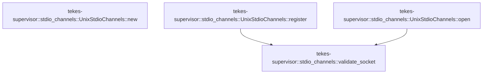

# tekes-supervisor::stdio_channels

[Package atlas](index.md) · [Source](../../src/stdio_channels.rs)

## Declarations

Visibility is the declaration spelling; trait members and reexports require their enclosing interface. `cfg` is not evaluated.

| Symbol | Kind | Visibility | Test / cfg |
|---|---|---|---|
| [tekes-supervisor::stdio_channels::UnixStdioChannels](../../src/stdio_channels.rs#L12) | struct_item | `pub` |  |
| [tekes-supervisor::stdio_channels::UnixStdioChannels::new](../../src/stdio_channels.rs#L15) | function_item | `pub` |  |
| [tekes-supervisor::stdio_channels::UnixStdioChannels::register](../../src/stdio_channels.rs#L21) | function_item | `private` |  |
| [tekes-supervisor::stdio_channels::validate_socket](../../src/stdio_channels.rs#L51) | function_item | `private` |  |
| [tekes-supervisor::stdio_channels::UnixStdioChannels::open](../../src/stdio_channels.rs#L75) | function_item | `private` |  |
| [tekes-supervisor::stdio_channels::tests::socket](../../src/stdio_channels.rs#L103) | function_item | `private` | test; #[cfg(test)] |
| [tekes-supervisor::stdio_channels::tests::append_preserves_existing_connections_and_rejects_rebinding](../../src/stdio_channels.rs#L111) | function_item | `private` | test; #[cfg(test)] |
| [tekes-supervisor::stdio_channels::tests::invalid_attachment_does_not_change_the_map](../../src/stdio_channels.rs#L136) | function_item | `private` | test; #[cfg(test)] |
| [tekes-supervisor::stdio_channels::tests::concurrent_conflicting_registrations_have_one_winner](../../src/stdio_channels.rs#L172) | function_item | `private` | test; #[cfg(test)] |

## Imports / reexports

| Local name | Source path | Visibility |
|---|---|---|
| `BTreeMap` | `std::collections::BTreeMap` | `private` |
| `File` | `std::fs::File` | `private` |
| `io` | `std::io` | `private` |
| `FileTypeExt` | `std::os::unix::fs::FileTypeExt` | `private` |
| `MetadataExt` | `std::os::unix::fs::MetadataExt` | `private` |
| `Path` | `std::path::Path` | `private` |
| `PathBuf` | `std::path::PathBuf` | `private` |
| `RwLock` | `std::sync::RwLock` | `private` |
| `StdioConnector` | `crate::mcp_runtime::StdioConnector` | `private` |
| `StdioOpen` | `crate::mcp_runtime::StdioOpen` | `private` |
| `*` | `super::*` | `private` |
| `PermissionsExt` | `std::os::unix::fs::PermissionsExt` | `private` |
| `Arc` | `std::sync::Arc` | `private` |
| `Barrier` | `std::sync::Barrier` | `private` |
| `HostStdioChannelAuthority` | `transport::HostStdioChannelAuthority` | `private` |
| `HostStdioChannelError` | `transport::HostStdioChannelError` | `private` |

## Module declarations

| Module | Visibility | Attributes |
|---|---|---|
| `tekes-supervisor::stdio_channels::tests` | `private` | #[cfg(test)] |

## Function call graphs

Edges below are syntactically resolved calls only, including private functions. Graphs partition callers into groups of 20; they are not execution order. All unresolved sites are listed below and in the JSON inventory.

Functions 1–4: 2 direct edges

## Call sites

Includes test functions (marked in declarations). Receiver-type-required sites need type analysis/manual tracing. Calls in closures are attributed to their enclosing function; their occurrence here does not mean the closure executes immediately.

| Caller | Callee expression | Source lines | Target / classification |
|---|---|---|---|
| `new` | `Self` | [16](../../src/stdio_channels.rs#L16) | external-constructor-callback-or-unresolved |
| `new` | `RwLock::new` | [16](../../src/stdio_channels.rs#L16) | external-constructor-callback-or-unresolved |
| `register` | `channel.is_empty` | [27](../../src/stdio_channels.rs#L27) | receiver-type-required |
| `register` | `channel.len` | [28](../../src/stdio_channels.rs#L28) | receiver-type-required |
| `register` | `channel                 .bytes()                 .all` | [29](../../src/stdio_channels.rs#L29) | receiver-type-required |
| `register` | `channel                 .bytes` | [29](../../src/stdio_channels.rs#L29) | receiver-type-required |
| `register` | `b.is_ascii_alphanumeric` | [31](../../src/stdio_channels.rs#L31) | receiver-type-required |
| `register` | `Err` | [33](../../src/stdio_channels.rs#L33), [43](../../src/stdio_channels.rs#L43) | external-constructor-callback-or-unresolved |
| `register` | `validate_socket(&path).map_err` | [35](../../src/stdio_channels.rs#L35) | receiver-type-required |
| `register` | `validate_socket` | [35](../../src/stdio_channels.rs#L35) | [tekes-supervisor::stdio_channels::validate_socket](../../src/stdio_channels.rs#L51) |
| `register` | `self.0.write().expect` | [38](../../src/stdio_channels.rs#L38) | receiver-type-required |
| `register` | `self.0.write` | [38](../../src/stdio_channels.rs#L38) | receiver-type-required |
| `register` | `channels.get` | [39](../../src/stdio_channels.rs#L39) | receiver-type-required |
| `register` | `Ok` | [41](../../src/stdio_channels.rs#L41), [47](../../src/stdio_channels.rs#L47) | external-constructor-callback-or-unresolved |
| `register` | `channels.insert` | [46](../../src/stdio_channels.rs#L46) | receiver-type-required |
| `validate_socket` | `path         .parent()         .ok_or_else` | [52](../../src/stdio_channels.rs#L52) | receiver-type-required |
| `validate_socket` | `path         .parent` | [52](../../src/stdio_channels.rs#L52) | receiver-type-required |
| `validate_socket` | `io::Error::other` | [54](../../src/stdio_channels.rs#L54), [69](../../src/stdio_channels.rs#L69) | external-constructor-callback-or-unresolved |
| `validate_socket` | `std::fs::symlink_metadata` | [55](../../src/stdio_channels.rs#L55), [56](../../src/stdio_channels.rs#L56) | external-constructor-callback-or-unresolved |
| `validate_socket` | `libc::geteuid` | [59](../../src/stdio_channels.rs#L59) | external-constructor-callback-or-unresolved |
| `validate_socket` | `path.is_absolute` | [60](../../src/stdio_channels.rs#L60) | receiver-type-required |
| `validate_socket` | `parent.canonicalize` | [61](../../src/stdio_channels.rs#L61) | receiver-type-required |
| `validate_socket` | `parent_metadata.is_dir` | [62](../../src/stdio_channels.rs#L62) | receiver-type-required |
| `validate_socket` | `parent_metadata.uid` | [63](../../src/stdio_channels.rs#L63) | receiver-type-required |
| `validate_socket` | `parent_metadata.mode` | [64](../../src/stdio_channels.rs#L64) | receiver-type-required |
| `validate_socket` | `metadata.file_type().is_socket` | [65](../../src/stdio_channels.rs#L65) | receiver-type-required |
| `validate_socket` | `metadata.file_type` | [65](../../src/stdio_channels.rs#L65) | receiver-type-required |
| `validate_socket` | `metadata.uid` | [66](../../src/stdio_channels.rs#L66) | receiver-type-required |
| `validate_socket` | `metadata.mode` | [67](../../src/stdio_channels.rs#L67) | receiver-type-required |
| `validate_socket` | `Err` | [69](../../src/stdio_channels.rs#L69) | external-constructor-callback-or-unresolved |
| `validate_socket` | `Ok` | [71](../../src/stdio_channels.rs#L71) | external-constructor-callback-or-unresolved |
| `open` | `Box::pin` | [76](../../src/stdio_channels.rs#L76) | external-constructor-callback-or-unresolved |
| `open` | `self                 .0                 .read()                 .expect("stdio channel lock poisoned")                 .get(channel)                 .cloned()                 .ok_or_else` | [77](../../src/stdio_channels.rs#L77) | receiver-type-required |
| `open` | `self                 .0                 .read()                 .expect("stdio channel lock poisoned")                 .get(channel)                 .cloned` | [77](../../src/stdio_channels.rs#L77) | receiver-type-required |
| `open` | `self                 .0                 .read()                 .expect("stdio channel lock poisoned")                 .get` | [77](../../src/stdio_channels.rs#L77) | receiver-type-required |
| `open` | `self                 .0                 .read()                 .expect` | [77](../../src/stdio_channels.rs#L77) | receiver-type-required |
| `open` | `self                 .0                 .read` | [77](../../src/stdio_channels.rs#L77) | receiver-type-required |
| `open` | `io::Error::other` | [83](../../src/stdio_channels.rs#L83) | external-constructor-callback-or-unresolved |
| `open` | `validate_socket` | [86](../../src/stdio_channels.rs#L86) | [tekes-supervisor::stdio_channels::validate_socket](../../src/stdio_channels.rs#L51) |
| `open` | `tokio::net::UnixStream::connect(&path).await?.into_std` | [87](../../src/stdio_channels.rs#L87) | receiver-type-required |
| `open` | `tokio::net::UnixStream::connect` | [87](../../src/stdio_channels.rs#L87) | external-constructor-callback-or-unresolved |
| `open` | `Ok` | [88](../../src/stdio_channels.rs#L88) | external-constructor-callback-or-unresolved |
| `open` | `File::from` | [89](../../src/stdio_channels.rs#L89), [90](../../src/stdio_channels.rs#L90) | external-constructor-callback-or-unresolved |
| `open` | `std::os::fd::OwnedFd::from` | [89](../../src/stdio_channels.rs#L89), [90](../../src/stdio_channels.rs#L90) | external-constructor-callback-or-unresolved |
| `open` | `stream.try_clone` | [89](../../src/stdio_channels.rs#L89) | receiver-type-required |
| `socket` | `root.join` | [104](../../src/stdio_channels.rs#L104) | receiver-type-required |
| `socket` | `std::os::unix::net::UnixListener::bind(&path).unwrap` | [105](../../src/stdio_channels.rs#L105) | receiver-type-required |
| `socket` | `std::os::unix::net::UnixListener::bind` | [105](../../src/stdio_channels.rs#L105) | external-constructor-callback-or-unresolved |
| `socket` | `std::fs::set_permissions(&path, std::fs::Permissions::from_mode(0o600)).unwrap` | [106](../../src/stdio_channels.rs#L106) | receiver-type-required |
| `socket` | `std::fs::set_permissions` | [106](../../src/stdio_channels.rs#L106) | external-constructor-callback-or-unresolved |
| `socket` | `std::fs::Permissions::from_mode` | [106](../../src/stdio_channels.rs#L106) | external-constructor-callback-or-unresolved |
| `append_preserves_existing_connections_and_rejects_rebinding` | `tempfile::tempdir().unwrap` | [112](../../src/stdio_channels.rs#L112) | receiver-type-required |
| `append_preserves_existing_connections_and_rejects_rebinding` | `tempfile::tempdir` | [112](../../src/stdio_channels.rs#L112) | external-constructor-callback-or-unresolved |
| `append_preserves_existing_connections_and_rejects_rebinding` | `temp.path().canonicalize().unwrap` | [113](../../src/stdio_channels.rs#L113) | receiver-type-required |
| `append_preserves_existing_connections_and_rejects_rebinding` | `temp.path().canonicalize` | [113](../../src/stdio_channels.rs#L113) | receiver-type-required |
| `append_preserves_existing_connections_and_rejects_rebinding` | `temp.path` | [113](../../src/stdio_channels.rs#L113) | receiver-type-required |
| `append_preserves_existing_connections_and_rejects_rebinding` | `std::fs::set_permissions(&root, std::fs::Permissions::from_mode(0o700)).unwrap` | [114](../../src/stdio_channels.rs#L114) | receiver-type-required |
| `append_preserves_existing_connections_and_rejects_rebinding` | `std::fs::set_permissions` | [114](../../src/stdio_channels.rs#L114), [131](../../src/stdio_channels.rs#L131) | external-constructor-callback-or-unresolved |
| `append_preserves_existing_connections_and_rejects_rebinding` | `std::fs::Permissions::from_mode` | [114](../../src/stdio_channels.rs#L114), [131](../../src/stdio_channels.rs#L131) | external-constructor-callback-or-unresolved |
| `append_preserves_existing_connections_and_rejects_rebinding` | `socket` | [115](../../src/stdio_channels.rs#L115), [116](../../src/stdio_channels.rs#L116) | [tekes-supervisor::stdio_channels::tests::socket](../../src/stdio_channels.rs#L103) |
| `append_preserves_existing_connections_and_rejects_rebinding` | `UnixStdioChannels::new` | [117](../../src/stdio_channels.rs#L117) | external-constructor-callback-or-unresolved |
| `append_preserves_existing_connections_and_rejects_rebinding` | `[("a".into(), a.clone())].into` | [117](../../src/stdio_channels.rs#L117) | receiver-type-required |
| `append_preserves_existing_connections_and_rejects_rebinding` | `"a".into` | [117](../../src/stdio_channels.rs#L117) | receiver-type-required |
| `append_preserves_existing_connections_and_rejects_rebinding` | `a.clone` | [117](../../src/stdio_channels.rs#L117) | receiver-type-required |
| `append_preserves_existing_connections_and_rejects_rebinding` | `channels.open("session-a", "a").await.unwrap` | [118](../../src/stdio_channels.rs#L118), [128](../../src/stdio_channels.rs#L128) | receiver-type-required |
| `append_preserves_existing_connections_and_rejects_rebinding` | `channels.open` | [118](../../src/stdio_channels.rs#L118), [127](../../src/stdio_channels.rs#L127), [128](../../src/stdio_channels.rs#L128) | receiver-type-required |
| `append_preserves_existing_connections_and_rejects_rebinding` | `channels.register("b".into(), b.clone()).unwrap` | [120](../../src/stdio_channels.rs#L120), [121](../../src/stdio_channels.rs#L121) | receiver-type-required |
| `append_preserves_existing_connections_and_rejects_rebinding` | `channels.register` | [120](../../src/stdio_channels.rs#L120), [121](../../src/stdio_channels.rs#L121) | receiver-type-required |
| `append_preserves_existing_connections_and_rejects_rebinding` | `"b".into` | [120](../../src/stdio_channels.rs#L120), [121](../../src/stdio_channels.rs#L121) | receiver-type-required |
| `append_preserves_existing_connections_and_rejects_rebinding` | `b.clone` | [120](../../src/stdio_channels.rs#L120), [121](../../src/stdio_channels.rs#L121) | receiver-type-required |
| `append_preserves_existing_connections_and_rejects_rebinding` | `channels.open("session-b", "b").await.unwrap` | [127](../../src/stdio_channels.rs#L127) | receiver-type-required |
| `append_preserves_existing_connections_and_rejects_rebinding` | `std::fs::set_permissions(&a, std::fs::Permissions::from_mode(0o666)).unwrap` | [131](../../src/stdio_channels.rs#L131) | receiver-type-required |
| `invalid_attachment_does_not_change_the_map` | `tempfile::tempdir().unwrap` | [137](../../src/stdio_channels.rs#L137) | receiver-type-required |
| `invalid_attachment_does_not_change_the_map` | `tempfile::tempdir` | [137](../../src/stdio_channels.rs#L137) | external-constructor-callback-or-unresolved |
| `invalid_attachment_does_not_change_the_map` | `temp.path().canonicalize().unwrap` | [138](../../src/stdio_channels.rs#L138) | receiver-type-required |
| `invalid_attachment_does_not_change_the_map` | `temp.path().canonicalize` | [138](../../src/stdio_channels.rs#L138) | receiver-type-required |
| `invalid_attachment_does_not_change_the_map` | `temp.path` | [138](../../src/stdio_channels.rs#L138) | receiver-type-required |
| `invalid_attachment_does_not_change_the_map` | `std::fs::set_permissions(&root, std::fs::Permissions::from_mode(0o700)).unwrap` | [139](../../src/stdio_channels.rs#L139) | receiver-type-required |
| `invalid_attachment_does_not_change_the_map` | `std::fs::set_permissions` | [139](../../src/stdio_channels.rs#L139), [163](../../src/stdio_channels.rs#L163) | external-constructor-callback-or-unresolved |
| `invalid_attachment_does_not_change_the_map` | `std::fs::Permissions::from_mode` | [139](../../src/stdio_channels.rs#L139), [163](../../src/stdio_channels.rs#L163) | external-constructor-callback-or-unresolved |
| `invalid_attachment_does_not_change_the_map` | `socket` | [140](../../src/stdio_channels.rs#L140) | [tekes-supervisor::stdio_channels::tests::socket](../../src/stdio_channels.rs#L103) |
| `invalid_attachment_does_not_change_the_map` | `UnixStdioChannels::new` | [141](../../src/stdio_channels.rs#L141) | external-constructor-callback-or-unresolved |
| `invalid_attachment_does_not_change_the_map` | `BTreeMap::new` | [141](../../src/stdio_channels.rs#L141) | external-constructor-callback-or-unresolved |
| `invalid_attachment_does_not_change_the_map` | `root.join` | [148](../../src/stdio_channels.rs#L148), [150](../../src/stdio_channels.rs#L150), [153](../../src/stdio_channels.rs#L153) | receiver-type-required |
| `invalid_attachment_does_not_change_the_map` | `std::fs::write(&regular, b"not a socket").unwrap` | [149](../../src/stdio_channels.rs#L149) | receiver-type-required |
| `invalid_attachment_does_not_change_the_map` | `std::fs::write` | [149](../../src/stdio_channels.rs#L149) | external-constructor-callback-or-unresolved |
| `invalid_attachment_does_not_change_the_map` | `std::os::unix::fs::symlink(&valid, &link).unwrap` | [151](../../src/stdio_channels.rs#L151) | receiver-type-required |
| `invalid_attachment_does_not_change_the_map` | `std::os::unix::fs::symlink` | [151](../../src/stdio_channels.rs#L151) | external-constructor-callback-or-unresolved |
| `invalid_attachment_does_not_change_the_map` | `PathBuf::from` | [156](../../src/stdio_channels.rs#L156) | external-constructor-callback-or-unresolved |
| `invalid_attachment_does_not_change_the_map` | `std::fs::set_permissions(&root, std::fs::Permissions::from_mode(0o755)).unwrap` | [163](../../src/stdio_channels.rs#L163) | receiver-type-required |
| `concurrent_conflicting_registrations_have_one_winner` | `tempfile::tempdir().unwrap` | [173](../../src/stdio_channels.rs#L173) | receiver-type-required |
| `concurrent_conflicting_registrations_have_one_winner` | `tempfile::tempdir` | [173](../../src/stdio_channels.rs#L173) | external-constructor-callback-or-unresolved |
| `concurrent_conflicting_registrations_have_one_winner` | `temp.path().canonicalize().unwrap` | [174](../../src/stdio_channels.rs#L174) | receiver-type-required |
| `concurrent_conflicting_registrations_have_one_winner` | `temp.path().canonicalize` | [174](../../src/stdio_channels.rs#L174) | receiver-type-required |
| `concurrent_conflicting_registrations_have_one_winner` | `temp.path` | [174](../../src/stdio_channels.rs#L174) | receiver-type-required |
| `concurrent_conflicting_registrations_have_one_winner` | `std::fs::set_permissions(&root, std::fs::Permissions::from_mode(0o700)).unwrap` | [175](../../src/stdio_channels.rs#L175) | receiver-type-required |
| `concurrent_conflicting_registrations_have_one_winner` | `std::fs::set_permissions` | [175](../../src/stdio_channels.rs#L175) | external-constructor-callback-or-unresolved |
| `concurrent_conflicting_registrations_have_one_winner` | `std::fs::Permissions::from_mode` | [175](../../src/stdio_channels.rs#L175) | external-constructor-callback-or-unresolved |
| `concurrent_conflicting_registrations_have_one_winner` | `socket` | [176](../../src/stdio_channels.rs#L176), [177](../../src/stdio_channels.rs#L177) | [tekes-supervisor::stdio_channels::tests::socket](../../src/stdio_channels.rs#L103) |
| `concurrent_conflicting_registrations_have_one_winner` | `Arc::new` | [178](../../src/stdio_channels.rs#L178), [179](../../src/stdio_channels.rs#L179) | external-constructor-callback-or-unresolved |
| `concurrent_conflicting_registrations_have_one_winner` | `UnixStdioChannels::new` | [178](../../src/stdio_channels.rs#L178) | external-constructor-callback-or-unresolved |
| `concurrent_conflicting_registrations_have_one_winner` | `BTreeMap::new` | [178](../../src/stdio_channels.rs#L178) | external-constructor-callback-or-unresolved |
| `concurrent_conflicting_registrations_have_one_winner` | `Barrier::new` | [179](../../src/stdio_channels.rs#L179) | external-constructor-callback-or-unresolved |
| `concurrent_conflicting_registrations_have_one_winner` | `[a, b]             .into_iter()             .map(&#124;path&#124; {                 let channels = channels.clone();                 let barrier = barrier.clone();                 std::thread::spawn(move &#124;&#124; {                     barrier.wait();                     channels.register("same".into(), path)                 })             })             .collect` | [180](../../src/stdio_channels.rs#L180) | receiver-type-required |
| `concurrent_conflicting_registrations_have_one_winner` | `[a, b]             .into_iter()             .map` | [180](../../src/stdio_channels.rs#L180) | receiver-type-required |
| `concurrent_conflicting_registrations_have_one_winner` | `[a, b]             .into_iter` | [180](../../src/stdio_channels.rs#L180) | receiver-type-required |
| `concurrent_conflicting_registrations_have_one_winner` | `channels.clone` | [183](../../src/stdio_channels.rs#L183) | receiver-type-required |
| `concurrent_conflicting_registrations_have_one_winner` | `barrier.clone` | [184](../../src/stdio_channels.rs#L184) | receiver-type-required |
| `concurrent_conflicting_registrations_have_one_winner` | `std::thread::spawn` | [185](../../src/stdio_channels.rs#L185) | external-constructor-callback-or-unresolved |
| `concurrent_conflicting_registrations_have_one_winner` | `barrier.wait` | [186](../../src/stdio_channels.rs#L186) | receiver-type-required |
| `concurrent_conflicting_registrations_have_one_winner` | `channels.register` | [187](../../src/stdio_channels.rs#L187) | receiver-type-required |
| `concurrent_conflicting_registrations_have_one_winner` | `"same".into` | [187](../../src/stdio_channels.rs#L187) | receiver-type-required |
| `concurrent_conflicting_registrations_have_one_winner` | `handles.into_iter().map(&#124;h&#124; h.join().unwrap()).collect` | [191](../../src/stdio_channels.rs#L191) | receiver-type-required |
| `concurrent_conflicting_registrations_have_one_winner` | `handles.into_iter().map` | [191](../../src/stdio_channels.rs#L191) | receiver-type-required |
| `concurrent_conflicting_registrations_have_one_winner` | `handles.into_iter` | [191](../../src/stdio_channels.rs#L191) | receiver-type-required |
| `concurrent_conflicting_registrations_have_one_winner` | `h.join().unwrap` | [191](../../src/stdio_channels.rs#L191) | receiver-type-required |
| `concurrent_conflicting_registrations_have_one_winner` | `h.join` | [191](../../src/stdio_channels.rs#L191) | receiver-type-required |
