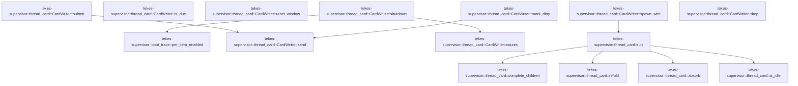

# tekes-supervisor::thread_card

[Package atlas](index.md) · [Source](../../src/thread_card.rs)

## Declarations

Visibility is the declaration spelling; trait members and reexports require their enclosing interface. `cfg` is not evaluated.

| Symbol | Kind | Visibility | Test / cfg |
|---|---|---|---|
| [tekes-supervisor::thread_card::DEFAULT_DEBOUNCE](../../src/thread_card.rs#L22) | const_item | `pub(crate)` |  |
| [tekes-supervisor::thread_card::PreparedLine](../../src/thread_card.rs#L24) | struct_item | `pub(crate)` |  |
| [tekes-supervisor::thread_card::PreparedCard](../../src/thread_card.rs#L36) | struct_item | `pub(crate)` |  |
| [tekes-supervisor::thread_card::PreparedLine::view](../../src/thread_card.rs#L46) | function_item | `private` |  |
| [tekes-supervisor::thread_card::PreparedCard::view](../../src/thread_card.rs#L62) | function_item | `pub(crate)` |  |
| [tekes-supervisor::thread_card::PreparedCard::with_journal](../../src/thread_card.rs#L72) | function_item | `pub(crate)` |  |
| [tekes-supervisor::thread_card::PreparedCard::fingerprint](../../src/thread_card.rs#L77) | function_item | `private` |  |
| [tekes-supervisor::thread_card::holds_of](../../src/thread_card.rs#L87) | function_item | `private` |  |
| [tekes-supervisor::thread_card::journal_input](../../src/thread_card.rs#L117) | function_item | `pub(crate)` |  |
| [tekes-supervisor::thread_card::main_line](../../src/thread_card.rs#L129) | function_item | `private` |  |
| [tekes-supervisor::thread_card::prepare](../../src/thread_card.rs#L155) | function_item | `pub(crate)` |  |
| [tekes-supervisor::thread_card::complete_children](../../src/thread_card.rs#L182) | function_item | `private` |  |
| [tekes-supervisor::thread_card::fold_child_views](../../src/thread_card.rs#L190) | function_item | `pub(crate)` |  |
| [tekes-supervisor::thread_card::fold_children](../../src/thread_card.rs#L200) | function_item | `private` |  |
| [tekes-supervisor::thread_card::refold](../../src/thread_card.rs#L259) | function_item | `private` |  |
| [tekes-supervisor::thread_card::write](../../src/thread_card.rs#L270) | function_item | `private` |  |
| [tekes-supervisor::thread_card::SyncGovernor](../../src/thread_card.rs#L312) | struct_item | `pub(crate)` |  |
| [tekes-supervisor::thread_card::SyncGovernor::new](../../src/thread_card.rs#L318) | function_item | `pub(crate)` |  |
| [tekes-supervisor::thread_card::SyncGovernor::charge](../../src/thread_card.rs#L330) | function_item | `pub(crate)` |  |
| [tekes-supervisor::thread_card::SyncGovernor::delay](../../src/thread_card.rs#L340) | function_item | `pub(crate)` |  |
| [tekes-supervisor::thread_card::Message](../../src/thread_card.rs#L348) | enum_item | `private` |  |
| [tekes-supervisor::thread_card::REFOLD_RETRIES](../../src/thread_card.rs#L360) | const_item | `private` |  |
| [tekes-supervisor::thread_card::REFOLD_RETRY_DELAY](../../src/thread_card.rs#L361) | const_item | `private` |  |
| [tekes-supervisor::thread_card::Pending](../../src/thread_card.rs#L363) | enum_item | `private` |  |
| [tekes-supervisor::thread_card::WriteFn](../../src/thread_card.rs#L374) | type_item | `private` |  |
| [tekes-supervisor::thread_card::Tuning](../../src/thread_card.rs#L378) | struct_item | `pub(crate)` |  |
| [tekes-supervisor::thread_card::Tuning::from_env](../../src/thread_card.rs#L385) | function_item | `pub(crate)` |  |
| [tekes-supervisor::thread_card::DEFAULT_MAX_PER_SEC](../../src/thread_card.rs#L403) | const_item | `pub(crate)` |  |
| [tekes-supervisor::thread_card::DEFAULT_SHUTDOWN_BUDGET](../../src/thread_card.rs#L404) | const_item | `pub(crate)` |  |
| [tekes-supervisor::thread_card::CardStats](../../src/thread_card.rs#L408) | struct_item | `private` |  |
| [tekes-supervisor::thread_card::CardWriter](../../src/thread_card.rs#L418) | struct_item | `pub(crate)` |  |
| [tekes-supervisor::thread_card::CardWriter::spawn](../../src/thread_card.rs#L429) | function_item | `pub(crate)` |  |
| [tekes-supervisor::thread_card::CardWriter::spawn_from_env](../../src/thread_card.rs#L437) | function_item | `pub(crate)` |  |
| [tekes-supervisor::thread_card::CardWriter::governor](../../src/thread_card.rs#L442) | function_item | `pub(crate)` |  |
| [tekes-supervisor::thread_card::CardWriter::spawn_with](../../src/thread_card.rs#L446) | function_item | `private` |  |
| [tekes-supervisor::thread_card::CardWriter::is_due](../../src/thread_card.rs#L479) | function_item | `pub(crate)` |  |
| [tekes-supervisor::thread_card::CardWriter::reset_window](../../src/thread_card.rs#L496) | function_item | `pub(crate)` |  |
| [tekes-supervisor::thread_card::CardWriter::submit](../../src/thread_card.rs#L503) | function_item | `pub(crate)` |  |
| [tekes-supervisor::thread_card::CardWriter::mark_dirty](../../src/thread_card.rs#L507) | function_item | `pub(crate)` |  |
| [tekes-supervisor::thread_card::CardWriter::send](../../src/thread_card.rs#L515) | function_item | `private` |  |
| [tekes-supervisor::thread_card::CardWriter::shutdown](../../src/thread_card.rs#L528) | function_item | `pub(crate)` |  |
| [tekes-supervisor::thread_card::CardWriter::counts](../../src/thread_card.rs#L570) | function_item | `pub(crate)` |  |
| [tekes-supervisor::thread_card::CardWriter::drop](../../src/thread_card.rs#L579) | function_item | `private` |  |
| [tekes-supervisor::thread_card::absorb](../../src/thread_card.rs#L584) | function_item | `private` |  |
| [tekes-supervisor::thread_card::is_idle](../../src/thread_card.rs#L612) | function_item | `private` |  |
| [tekes-supervisor::thread_card::run](../../src/thread_card.rs#L616) | function_item | `private` |  |

## Imports / reexports

| Local name | Source path | Visibility |
|---|---|---|
| `HashMap` | `std::collections::HashMap` | `private` |
| `PathBuf` | `std::path::PathBuf` | `private` |
| `AtomicU64` | `std::sync::atomic::AtomicU64` | `private` |
| `Ordering` | `std::sync::atomic::Ordering` | `private` |
| `mpsc` | `std::sync::mpsc` | `private` |
| `RecvTimeoutError` | `std::sync::mpsc::RecvTimeoutError` | `private` |
| `Sender` | `std::sync::mpsc::Sender` | `private` |
| `SyncSender` | `std::sync::mpsc::SyncSender` | `private` |
| `Arc` | `std::sync::Arc` | `private` |
| `Mutex` | `std::sync::Mutex` | `private` |
| `JoinHandle` | `std::thread::JoinHandle` | `private` |
| `Duration` | `std::time::Duration` | `private` |
| `Instant` | `std::time::Instant` | `private` |
| `EndpointJournal` | `endpoint::EndpointJournal` | `private` |
| `LedgerProjection` | `schema::LedgerProjection` | `private` |
| `CardInput` | `store::card::CardInput` | `private` |
| `CardSummary` | `store::card::CardSummary` | `private` |
| `Hold` | `store::card::Hold` | `private` |
| `HoldResolution` | `store::card::HoldResolution` | `private` |
| `JournalInput` | `store::card::JournalInput` | `private` |
| `LineInput` | `store::card::LineInput` | `private` |
| `WriteOutcome` | `store::card::WriteOutcome` | `private` |
| `line_requests` | `crate::endpoint_carrier::line_requests` | `private` |

## Module declarations

| Module | Visibility | Attributes |
|---|---|---|
| `tekes-supervisor::thread_card::tests` | `private` | #[cfg(test)] |

## Function call graphs

Edges below are syntactically resolved calls only, including private functions. Graphs partition callers into groups of 20; they are not execution order. All unresolved sites are listed below and in the JSON inventory.

```mermaid
flowchart TD
  n0["endpoint::service::genesis_cwd"]
  n1["endpoint::service::card_summary"]
  n2["store::card::valid_line_name"]
  n3["store::card::write_card"]
  n4["store::tail::scan_valid_prefix"]
  n5["tekes-supervisor::endpoint_carrier::line_requests"]
  n6["tekes-supervisor::host_runtime::system_timestamp"]
  n7["tekes-supervisor::thread_card::journal_input"]
  n8["tekes-supervisor::thread_card::main_line"]
  n9["tekes-supervisor::thread_card::prepare"]
  n10["tekes-supervisor::thread_card::complete_children"]
  n11["tekes-supervisor::thread_card::fold_child_views"]
  n12["tekes-supervisor::thread_card::fold_children"]
  n13["tekes-supervisor::thread_card::refold"]
  n14["tekes-supervisor::thread_card::write"]
  n15["tekes-supervisor::thread_card::SyncGovernor::new"]
  n16["tekes-supervisor::thread_card::SyncGovernor::charge"]
  n17["tekes-supervisor::thread_card::SyncGovernor::delay"]
  n18["tekes-supervisor::thread_card::Tuning::from_env"]
  n19["tekes-supervisor::thread_card::CardWriter::spawn"]
  n20["tekes-supervisor::thread_card::CardWriter::spawn_from_env"]
  n21["tekes-supervisor::thread_card::CardWriter::governor"]
  n22["tekes-supervisor::thread_card::CardWriter::spawn_with"]
  n23["tekes-supervisor::thread_card::PreparedLine::view"]
  n24["tekes-supervisor::thread_card::PreparedCard::view"]
  n25["tekes-supervisor::thread_card::PreparedCard::with_journal"]
  n26["tekes-supervisor::thread_card::PreparedCard::fingerprint"]
  n27["tekes-supervisor::thread_card::holds_of"]
  n8 --> n1
  n8 --> n27
  n9 --> n0
  n9 --> n6
  n9 --> n8
  n10 --> n12
  n11 --> n12
  n12 --> n2
  n12 --> n4
  n12 --> n27
  n13 --> n4
  n13 --> n9
  n14 --> n3
  n19 --> n15
  n19 --> n22
  n20 --> n18
  n20 --> n19
  n27 --> n5
```

Functions 1–20: 18 direct edges

Functions 21–32: 9 direct edges

## Call sites

Includes test functions (marked in declarations). Receiver-type-required sites need type analysis/manual tracing. Calls in closures are attributed to their enclosing function; their occurrence here does not mean the closure executes immediately.

| Caller | Callee expression | Source lines | Target / classification |
|---|---|---|---|
| `DEFAULT_DEBOUNCE` | `Duration::from_secs` | [22](../../src/thread_card.rs#L22) | external-constructor-callback-or-unresolved |
| `view` | `self.file.clone` | [48](../../src/thread_card.rs#L48) | receiver-type-required |
| `view` | `self.line.clone` | [50](../../src/thread_card.rs#L50) | receiver-type-required |
| `view` | `self.parent_file.clone` | [51](../../src/thread_card.rs#L51) | receiver-type-required |
| `view` | `self.facts.clone` | [52](../../src/thread_card.rs#L52) | receiver-type-required |
| `view` | `self.holds.clone` | [53](../../src/thread_card.rs#L53) | receiver-type-required |
| `view` | `self.summary.clone` | [64](../../src/thread_card.rs#L64) | receiver-type-required |
| `view` | `self.lines.iter().map(PreparedLine::view).collect` | [65](../../src/thread_card.rs#L65) | receiver-type-required |
| `view` | `self.lines.iter().map` | [65](../../src/thread_card.rs#L65) | receiver-type-required |
| `view` | `self.lines.iter` | [65](../../src/thread_card.rs#L65) | receiver-type-required |
| `view` | `self.lines.len` | [67](../../src/thread_card.rs#L67) | receiver-type-required |
| `fingerprint` | `self.lines.first` | [78](../../src/thread_card.rs#L78) | receiver-type-required |
| `fingerprint` | `main.map_or` | [80](../../src/thread_card.rs#L80), [81](../../src/thread_card.rs#L81) | receiver-type-required |
| `fingerprint` | `line.prefix.len` | [81](../../src/thread_card.rs#L81) | receiver-type-required |
| `fingerprint` | `self.journal.as_ref().map_or` | [82](../../src/thread_card.rs#L82) | receiver-type-required |
| `fingerprint` | `self.journal.as_ref` | [82](../../src/thread_card.rs#L82) | receiver-type-required |
| `holds_of` | `line_requests(session, source_line, projection).ok` | [92](../../src/thread_card.rs#L92) | receiver-type-required |
| `holds_of` | `line_requests` | [92](../../src/thread_card.rs#L92) | [tekes-supervisor::endpoint_carrier::line_requests](../../src/endpoint_carrier.rs#L2749) |
| `holds_of` | `Some` | [93](../../src/thread_card.rs#L93) | external-constructor-callback-or-unresolved |
| `holds_of` | `requests             .into_iter()             .map(&#124;(state, _)&#124; Hold {                 hold_seq: state.request.causal_kernel_seq,                 kind: match state.request.frame_type {                     endpoint::RequestFrameType::Approval => "approval",                     endpoint::RequestFrameType::Question => "question",                 }                 .to_owned(),                 resolved: state.resolution.map(&#124;(seq, outcome)&#124; HoldResolution {                     seq,                     // kebab-case ('allowed-once', 'rejected', 'cancelled', 'answered')                     outcome: serde_json::to_value(outcome)                         .ok()                         .and_then(&#124;value&#124; value.as_str().map(str::to_owned))                         .unwrap_or_default(),                 }),             })             .collect` | [94](../../src/thread_card.rs#L94) | receiver-type-required |
| `holds_of` | `requests             .into_iter()             .map` | [94](../../src/thread_card.rs#L94) | receiver-type-required |
| `holds_of` | `requests             .into_iter` | [94](../../src/thread_card.rs#L94) | receiver-type-required |
| `holds_of` | `match state.request.frame_type {                     endpoint::RequestFrameType::Approval => "approval",                     endpoint::RequestFrameType::Question => "question",                 }                 .to_owned` | [98](../../src/thread_card.rs#L98) | receiver-type-required |
| `holds_of` | `state.resolution.map` | [103](../../src/thread_card.rs#L103) | receiver-type-required |
| `holds_of` | `serde_json::to_value(outcome)                         .ok()                         .and_then(&#124;value&#124; value.as_str().map(str::to_owned))                         .unwrap_or_default` | [106](../../src/thread_card.rs#L106) | receiver-type-required |
| `holds_of` | `serde_json::to_value(outcome)                         .ok()                         .and_then` | [106](../../src/thread_card.rs#L106) | receiver-type-required |
| `holds_of` | `serde_json::to_value(outcome)                         .ok` | [106](../../src/thread_card.rs#L106) | receiver-type-required |
| `holds_of` | `serde_json::to_value` | [106](../../src/thread_card.rs#L106) | external-constructor-callback-or-unresolved |
| `holds_of` | `value.as_str().map` | [108](../../src/thread_card.rs#L108) | receiver-type-required |
| `holds_of` | `value.as_str` | [108](../../src/thread_card.rs#L108) | receiver-type-required |
| `journal_input` | `journal.tail_summary().ok` | [118](../../src/thread_card.rs#L118) | receiver-type-required |
| `journal_input` | `journal.tail_summary` | [118](../../src/thread_card.rs#L118) | receiver-type-required |
| `journal_input` | `Some` | [119](../../src/thread_card.rs#L119) | external-constructor-callback-or-unresolved |
| `journal_input` | `tail             .last_seq             .map_or` | [122](../../src/thread_card.rs#L122) | receiver-type-required |
| `journal_input` | `i64::try_from(seq).unwrap_or` | [124](../../src/thread_card.rs#L124) | receiver-type-required |
| `journal_input` | `i64::try_from` | [124](../../src/thread_card.rs#L124) | external-constructor-callback-or-unresolved |
| `main_line` | `bytes.truncate` | [135](../../src/thread_card.rs#L135) | receiver-type-required |
| `main_line` | `endpoint::card_summary(projection).ok` | [136](../../src/thread_card.rs#L136) | receiver-type-required |
| `main_line` | `endpoint::card_summary` | [136](../../src/thread_card.rs#L136) | [endpoint::service::card_summary](../../../endpoint/src/service.rs#L210) |
| `main_line` | `Some` | [137](../../src/thread_card.rs#L137) | external-constructor-callback-or-unresolved |
| `main_line` | `"main.jsonl".to_owned` | [139](../../src/thread_card.rs#L139) | receiver-type-required |
| `main_line` | `session.to_owned` | [142](../../src/thread_card.rs#L142) | receiver-type-required |
| `main_line` | `projection.lifecycle.clone` | [144](../../src/thread_card.rs#L144) | receiver-type-required |
| `main_line` | `holds_of` | [145](../../src/thread_card.rs#L145) | [tekes-supervisor::thread_card::holds_of](../../src/thread_card.rs#L87) |
| `prepare` | `main_line` | [163](../../src/thread_card.rs#L163) | [tekes-supervisor::thread_card::main_line](../../src/thread_card.rs#L129) |
| `prepare` | `summary.cwd.is_none` | [167](../../src/thread_card.rs#L167) | receiver-type-required |
| `prepare` | `Some` | [168](../../src/thread_card.rs#L168), [170](../../src/thread_card.rs#L170) | external-constructor-callback-or-unresolved |
| `prepare` | `endpoint::genesis_cwd` | [168](../../src/thread_card.rs#L168) | [endpoint::service::genesis_cwd](../../../endpoint/src/service.rs#L101) |
| `prepare` | `projection.events.first` | [168](../../src/thread_card.rs#L168) | receiver-type-required |
| `prepare` | `session.to_owned` | [171](../../src/thread_card.rs#L171) | receiver-type-required |
| `prepare` | `crate::host_runtime::system_timestamp().ok` | [172](../../src/thread_card.rs#L172) | receiver-type-required |
| `prepare` | `crate::host_runtime::system_timestamp` | [172](../../src/thread_card.rs#L172) | [tekes-supervisor::host_runtime::system_timestamp](../../src/host_runtime.rs#L406) |
| `complete_children` | `fold_children` | [183](../../src/thread_card.rs#L183) | [tekes-supervisor::thread_card::fold_children](../../src/thread_card.rs#L200) |
| `complete_children` | `card.lines.extend` | [184](../../src/thread_card.rs#L184) | receiver-type-required |
| `fold_child_views` | `fold_children(session, folder)         .iter()         .map(PreparedLine::view)         .collect` | [194](../../src/thread_card.rs#L194) | receiver-type-required |
| `fold_child_views` | `fold_children(session, folder)         .iter()         .map` | [194](../../src/thread_card.rs#L194) | receiver-type-required |
| `fold_child_views` | `fold_children(session, folder)         .iter` | [194](../../src/thread_card.rs#L194) | receiver-type-required |
| `fold_child_views` | `fold_children` | [194](../../src/thread_card.rs#L194) | [tekes-supervisor::thread_card::fold_children](../../src/thread_card.rs#L200) |
| `fold_children` | `Vec::new` | [201](../../src/thread_card.rs#L201) | external-constructor-callback-or-unresolved |
| `fold_children` | `std::fs::read_dir` | [202](../../src/thread_card.rs#L202) | external-constructor-callback-or-unresolved |
| `fold_children` | `entries         .flatten()         .filter_map(&#124;entry&#124; {             let name = entry.file_name().to_string_lossy().into_owned();             (store::card::valid_line_name(&name)                 && name != "main.jsonl"                 && entry.file_type().is_ok_and(&#124;kind&#124; kind.is_file()))             .then_some(name)         })         .collect::<Vec<_>>` | [205](../../src/thread_card.rs#L205) | receiver-type-required |
| `fold_children` | `entries         .flatten()         .filter_map` | [205](../../src/thread_card.rs#L205) | receiver-type-required |
| `fold_children` | `entries         .flatten` | [205](../../src/thread_card.rs#L205) | receiver-type-required |
| `fold_children` | `entry.file_name().to_string_lossy().into_owned` | [208](../../src/thread_card.rs#L208) | receiver-type-required |
| `fold_children` | `entry.file_name().to_string_lossy` | [208](../../src/thread_card.rs#L208) | receiver-type-required |
| `fold_children` | `entry.file_name` | [208](../../src/thread_card.rs#L208) | receiver-type-required |
| `fold_children` | `(store::card::valid_line_name(&name)                 && name != "main.jsonl"                 && entry.file_type().is_ok_and(&#124;kind&#124; kind.is_file()))             .then_some` | [209](../../src/thread_card.rs#L209) | receiver-type-required |
| `fold_children` | `store::card::valid_line_name` | [209](../../src/thread_card.rs#L209) | [store::card::valid_line_name](../../../store/src/card.rs#L256) |
| `fold_children` | `entry.file_type().is_ok_and` | [211](../../src/thread_card.rs#L211) | receiver-type-required |
| `fold_children` | `entry.file_type` | [211](../../src/thread_card.rs#L211) | receiver-type-required |
| `fold_children` | `kind.is_file` | [211](../../src/thread_card.rs#L211) | receiver-type-required |
| `fold_children` | `children.sort` | [215](../../src/thread_card.rs#L215) | receiver-type-required |
| `fold_children` | `std::fs::read` | [217](../../src/thread_card.rs#L217) | external-constructor-callback-or-unresolved |
| `fold_children` | `folder.join` | [217](../../src/thread_card.rs#L217) | receiver-type-required |
| `fold_children` | `store::scan_valid_prefix` | [220](../../src/thread_card.rs#L220) | [store::tail::scan_valid_prefix](../../../store/src/tail.rs#L37) |
| `fold_children` | `usize::try_from` | [221](../../src/thread_card.rs#L221) | external-constructor-callback-or-unresolved |
| `fold_children` | `child.events.first` | [227](../../src/thread_card.rs#L227) | receiver-type-required |
| `fold_children` | `serde_json::to_value(genesis.raw()).ok().and_then` | [230](../../src/thread_card.rs#L230) | receiver-type-required |
| `fold_children` | `serde_json::to_value(genesis.raw()).ok` | [230](../../src/thread_card.rs#L230) | receiver-type-required |
| `fold_children` | `serde_json::to_value` | [230](../../src/thread_card.rs#L230) | external-constructor-callback-or-unresolved |
| `fold_children` | `genesis.raw` | [230](../../src/thread_card.rs#L230) | receiver-type-required |
| `fold_children` | `value                 .get("parent")?                 .get("file")?                 .as_str()                 .map` | [231](../../src/thread_card.rs#L231) | receiver-type-required |
| `fold_children` | `value                 .get("parent")?                 .get("file")?                 .as_str` | [231](../../src/thread_card.rs#L231) | receiver-type-required |
| `fold_children` | `value                 .get("parent")?                 .get` | [231](../../src/thread_card.rs#L231) | receiver-type-required |
| `fold_children` | `value                 .get` | [231](../../src/thread_card.rs#L231) | receiver-type-required |
| `fold_children` | `genesis.string_field("thread").map` | [238](../../src/thread_card.rs#L238) | receiver-type-required |
| `fold_children` | `genesis.string_field` | [238](../../src/thread_card.rs#L238) | receiver-type-required |
| `fold_children` | `holds_of` | [239](../../src/thread_card.rs#L239) | [tekes-supervisor::thread_card::holds_of](../../src/thread_card.rs#L87) |
| `fold_children` | `Some` | [239](../../src/thread_card.rs#L239) | external-constructor-callback-or-unresolved |
| `fold_children` | `prefix.truncate` | [243](../../src/thread_card.rs#L243) | receiver-type-required |
| `fold_children` | `lines.push` | [244](../../src/thread_card.rs#L244) | receiver-type-required |
| `refold` | `std::fs::read(folder.join("main.jsonl")).ok` | [260](../../src/thread_card.rs#L260) | receiver-type-required |
| `refold` | `std::fs::read` | [260](../../src/thread_card.rs#L260) | external-constructor-callback-or-unresolved |
| `refold` | `folder.join` | [260](../../src/thread_card.rs#L260) | receiver-type-required |
| `refold` | `store::scan_valid_prefix` | [261](../../src/thread_card.rs#L261) | [store::tail::scan_valid_prefix](../../../store/src/tail.rs#L37) |
| `refold` | `scan.needs_repair` | [262](../../src/thread_card.rs#L262) | receiver-type-required |
| `refold` | `usize::try_from(scan.valid_bytes).ok` | [265](../../src/thread_card.rs#L265) | receiver-type-required |
| `refold` | `usize::try_from` | [265](../../src/thread_card.rs#L265) | external-constructor-callback-or-unresolved |
| `refold` | `prepare` | [267](../../src/thread_card.rs#L267) | [tekes-supervisor::thread_card::prepare](../../src/thread_card.rs#L155) |
| `write` | `prepared.written.clone` | [274](../../src/thread_card.rs#L274) | receiver-type-required |
| `write` | `prepared             .lines             .iter()             .map(&#124;line&#124; LineInput {                 file: &line.file,                 verified_prefix: &line.prefix,                 last_seq: line.last_seq,                 line: line.line.clone(),                 parent_file: line.parent_file.clone(),                 facts: line.facts.clone(),                 holds: line.holds.clone(),             })             .collect` | [275](../../src/thread_card.rs#L275) | receiver-type-required |
| `write` | `prepared             .lines             .iter()             .map` | [275](../../src/thread_card.rs#L275) | receiver-type-required |
| `write` | `prepared             .lines             .iter` | [275](../../src/thread_card.rs#L275) | receiver-type-required |
| `write` | `line.line.clone` | [282](../../src/thread_card.rs#L282) | receiver-type-required |
| `write` | `line.parent_file.clone` | [283](../../src/thread_card.rs#L283) | receiver-type-required |
| `write` | `line.facts.clone` | [284](../../src/thread_card.rs#L284) | receiver-type-required |
| `write` | `line.holds.clone` | [285](../../src/thread_card.rs#L285) | receiver-type-required |
| `write` | `prepared.summary.clone` | [288](../../src/thread_card.rs#L288) | receiver-type-required |
| `write` | `prepared.journal.as_ref().map` | [289](../../src/thread_card.rs#L289) | receiver-type-required |
| `write` | `prepared.journal.as_ref` | [289](../../src/thread_card.rs#L289) | receiver-type-required |
| `write` | `store::card::write_card` | [296](../../src/thread_card.rs#L296) | [store::card::write_card](../../../store/src/card.rs#L582) |
| `write` | `WriteOutcome::Skipped` | [303](../../src/thread_card.rs#L303) | external-constructor-callback-or-unresolved |
| `new` | `Duration::from_secs` | [323](../../src/thread_card.rs#L323) | external-constructor-callback-or-unresolved |
| `new` | `Mutex::new` | [325](../../src/thread_card.rs#L325) | external-constructor-callback-or-unresolved |
| `new` | `Instant::now` | [325](../../src/thread_card.rs#L325) | external-constructor-callback-or-unresolved |
| `charge` | `self             .next_allowed             .lock()             .unwrap_or_else` | [331](../../src/thread_card.rs#L331) | receiver-type-required |
| `charge` | `self             .next_allowed             .lock` | [331](../../src/thread_card.rs#L331) | receiver-type-required |
| `charge` | `(*next).max` | [335](../../src/thread_card.rs#L335) | receiver-type-required |
| `charge` | `Instant::now` | [335](../../src/thread_card.rs#L335) | external-constructor-callback-or-unresolved |
| `delay` | `self.next_allowed             .lock()             .unwrap_or_else(std::sync::PoisonError::into_inner)             .saturating_duration_since` | [341](../../src/thread_card.rs#L341) | receiver-type-required |
| `delay` | `self.next_allowed             .lock()             .unwrap_or_else` | [341](../../src/thread_card.rs#L341) | receiver-type-required |
| `delay` | `self.next_allowed             .lock` | [341](../../src/thread_card.rs#L341) | receiver-type-required |
| `delay` | `Instant::now` | [344](../../src/thread_card.rs#L344) | external-constructor-callback-or-unresolved |
| `REFOLD_RETRY_DELAY` | `Duration::from_millis` | [361](../../src/thread_card.rs#L361) | external-constructor-callback-or-unresolved |
| `from_env` | `std::env::var(name)                 .ok()                 .and_then` | [387](../../src/thread_card.rs#L387) | receiver-type-required |
| `from_env` | `std::env::var(name)                 .ok` | [387](../../src/thread_card.rs#L387) | receiver-type-required |
| `from_env` | `std::env::var` | [387](../../src/thread_card.rs#L387) | external-constructor-callback-or-unresolved |
| `from_env` | `value.parse::<u64>().ok` | [389](../../src/thread_card.rs#L389) | receiver-type-required |
| `from_env` | `value.parse::<u64>` | [389](../../src/thread_card.rs#L389) | receiver-type-required |
| `from_env` | `number("TEKES_KERNEL_CARD_DEBOUNCE_MS")                 .map_or` | [392](../../src/thread_card.rs#L392) | receiver-type-required |
| `from_env` | `number` | [392](../../src/thread_card.rs#L392), [394](../../src/thread_card.rs#L394) | external-constructor-callback-or-unresolved |
| `from_env` | `number("TEKES_KERNEL_CARD_MAX_PER_SEC")                 .map_or` | [394](../../src/thread_card.rs#L394) | receiver-type-required |
| `from_env` | `u32::try_from(value).unwrap_or` | [396](../../src/thread_card.rs#L396) | receiver-type-required |
| `from_env` | `u32::try_from` | [396](../../src/thread_card.rs#L396) | external-constructor-callback-or-unresolved |
| `DEFAULT_SHUTDOWN_BUDGET` | `Duration::from_secs` | [404](../../src/thread_card.rs#L404) | external-constructor-callback-or-unresolved |
| `spawn` | `Self::spawn_with` | [430](../../src/thread_card.rs#L430) | [tekes-supervisor::thread_card::CardWriter::spawn_with](../../src/thread_card.rs#L446) |
| `spawn` | `Arc::new` | [432](../../src/thread_card.rs#L432), [433](../../src/thread_card.rs#L433) | external-constructor-callback-or-unresolved |
| `spawn` | `SyncGovernor::new` | [432](../../src/thread_card.rs#L432) | [tekes-supervisor::thread_card::SyncGovernor::new](../../src/thread_card.rs#L318) |
| `spawn_from_env` | `Self::spawn` | [438](../../src/thread_card.rs#L438) | [tekes-supervisor::thread_card::CardWriter::spawn](../../src/thread_card.rs#L429) |
| `spawn_from_env` | `Tuning::from_env` | [438](../../src/thread_card.rs#L438) | [tekes-supervisor::thread_card::Tuning::from_env](../../src/thread_card.rs#L385) |
| `governor` | `Arc::clone` | [443](../../src/thread_card.rs#L443) | external-constructor-callback-or-unresolved |
| `spawn_with` | `mpsc::channel::<Message>` | [447](../../src/thread_card.rs#L447) | external-constructor-callback-or-unresolved |
| `spawn_with` | `mpsc::sync_channel::<()>` | [448](../../src/thread_card.rs#L448) | external-constructor-callback-or-unresolved |
| `spawn_with` | `Arc::new` | [449](../../src/thread_card.rs#L449) | external-constructor-callback-or-unresolved |
| `spawn_with` | `CardStats::default` | [449](../../src/thread_card.rs#L449) | external-constructor-callback-or-unresolved |
| `spawn_with` | `Arc::clone` | [450](../../src/thread_card.rs#L450), [451](../../src/thread_card.rs#L451) | external-constructor-callback-or-unresolved |
| `spawn_with` | `std::thread::Builder::new()             .name("thread-card-writer".to_owned())             .spawn(move &#124;&#124; {                 run(                     &receiver,                     tuning,                     &thread_governor,                     &write_card,                     &thread_stats,                     &done_sender,                 );             })             .ok` | [452](../../src/thread_card.rs#L452) | receiver-type-required |
| `spawn_with` | `std::thread::Builder::new()             .name("thread-card-writer".to_owned())             .spawn` | [452](../../src/thread_card.rs#L452) | receiver-type-required |
| `spawn_with` | `std::thread::Builder::new()             .name` | [452](../../src/thread_card.rs#L452) | receiver-type-required |
| `spawn_with` | `std::thread::Builder::new` | [452](../../src/thread_card.rs#L452) | external-constructor-callback-or-unresolved |
| `spawn_with` | `"thread-card-writer".to_owned` | [453](../../src/thread_card.rs#L453) | receiver-type-required |
| `spawn_with` | `run` | [455](../../src/thread_card.rs#L455) | [tekes-supervisor::thread_card::run](../../src/thread_card.rs#L616) |
| `spawn_with` | `Mutex::new` | [467](../../src/thread_card.rs#L467), [468](../../src/thread_card.rs#L468), [469](../../src/thread_card.rs#L469), [470](../../src/thread_card.rs#L470) | external-constructor-callback-or-unresolved |
| `spawn_with` | `Some` | [467](../../src/thread_card.rs#L467), [469](../../src/thread_card.rs#L469) | external-constructor-callback-or-unresolved |
| `spawn_with` | `HashMap::new` | [470](../../src/thread_card.rs#L470) | external-constructor-callback-or-unresolved |
| `is_due` | `self             .claimed             .lock()             .unwrap_or_else` | [480](../../src/thread_card.rs#L480) | receiver-type-required |
| `is_due` | `self             .claimed             .lock` | [480](../../src/thread_card.rs#L480) | receiver-type-required |
| `is_due` | `Instant::now` | [484](../../src/thread_card.rs#L484) | external-constructor-callback-or-unresolved |
| `is_due` | `claimed.get` | [485](../../src/thread_card.rs#L485) | receiver-type-required |
| `is_due` | `now.duration_since` | [486](../../src/thread_card.rs#L486) | receiver-type-required |
| `is_due` | `claimed.insert` | [488](../../src/thread_card.rs#L488) | receiver-type-required |
| `is_due` | `session.to_owned` | [488](../../src/thread_card.rs#L488) | receiver-type-required |
| `reset_window` | `self.claimed             .lock()             .unwrap_or_else(std::sync::PoisonError::into_inner)             .remove` | [497](../../src/thread_card.rs#L497) | receiver-type-required |
| `reset_window` | `self.claimed             .lock()             .unwrap_or_else` | [497](../../src/thread_card.rs#L497) | receiver-type-required |
| `reset_window` | `self.claimed             .lock` | [497](../../src/thread_card.rs#L497) | receiver-type-required |
| `submit` | `self.send` | [504](../../src/thread_card.rs#L504) | [tekes-supervisor::thread_card::CardWriter::send](../../src/thread_card.rs#L515) |
| `submit` | `Message::Card` | [504](../../src/thread_card.rs#L504) | external-constructor-callback-or-unresolved |
| `submit` | `Box::new` | [504](../../src/thread_card.rs#L504) | external-constructor-callback-or-unresolved |
| `mark_dirty` | `self.send` | [508](../../src/thread_card.rs#L508) | [tekes-supervisor::thread_card::CardWriter::send](../../src/thread_card.rs#L515) |
| `mark_dirty` | `session.to_owned` | [509](../../src/thread_card.rs#L509) | receiver-type-required |
| `send` | `self             .sender             .lock()             .unwrap_or_else` | [516](../../src/thread_card.rs#L516) | receiver-type-required |
| `send` | `self             .sender             .lock` | [516](../../src/thread_card.rs#L516) | receiver-type-required |
| `send` | `sender.as_ref` | [520](../../src/thread_card.rs#L520) | receiver-type-required |
| `send` | `sender.send` | [521](../../src/thread_card.rs#L521) | receiver-type-required |
| `shutdown` | `self             .sender             .lock()             .unwrap_or_else(std::sync::PoisonError::into_inner)             .take` | [529](../../src/thread_card.rs#L529) | receiver-type-required |
| `shutdown` | `self             .sender             .lock()             .unwrap_or_else` | [529](../../src/thread_card.rs#L529) | receiver-type-required |
| `shutdown` | `self             .sender             .lock` | [529](../../src/thread_card.rs#L529) | receiver-type-required |
| `shutdown` | `sender.send` | [538](../../src/thread_card.rs#L538) | receiver-type-required |
| `shutdown` | `Message::Shutdown` | [538](../../src/thread_card.rs#L538) | external-constructor-callback-or-unresolved |
| `shutdown` | `Instant::now` | [538](../../src/thread_card.rs#L538) | external-constructor-callback-or-unresolved |
| `shutdown` | `self             .done             .lock()             .unwrap_or_else(std::sync::PoisonError::into_inner)             .take` | [539](../../src/thread_card.rs#L539) | receiver-type-required |
| `shutdown` | `self             .done             .lock()             .unwrap_or_else` | [539](../../src/thread_card.rs#L539) | receiver-type-required |
| `shutdown` | `self             .done             .lock` | [539](../../src/thread_card.rs#L539) | receiver-type-required |
| `shutdown` | `done.is_none_or` | [544](../../src/thread_card.rs#L544) | receiver-type-required |
| `shutdown` | `done.recv_timeout(budget + Duration::from_millis(500))                 .is_ok` | [545](../../src/thread_card.rs#L545) | receiver-type-required |
| `shutdown` | `done.recv_timeout` | [545](../../src/thread_card.rs#L545) | receiver-type-required |
| `shutdown` | `Duration::from_millis` | [545](../../src/thread_card.rs#L545) | external-constructor-callback-or-unresolved |
| `shutdown` | `self             .handle             .lock()             .unwrap_or_else(std::sync::PoisonError::into_inner)             .take` | [548](../../src/thread_card.rs#L548) | receiver-type-required |
| `shutdown` | `self             .handle             .lock()             .unwrap_or_else` | [548](../../src/thread_card.rs#L548) | receiver-type-required |
| `shutdown` | `self             .handle             .lock` | [548](../../src/thread_card.rs#L548) | receiver-type-required |
| `shutdown` | `handle.join` | [555](../../src/thread_card.rs#L555) | receiver-type-required |
| `shutdown` | `crate::boot_trace::per_item_enabled` | [560](../../src/thread_card.rs#L560) | [tekes-supervisor::boot_trace::per_item_enabled](../../src/boot_trace.rs#L93) |
| `shutdown` | `self.counts` | [561](../../src/thread_card.rs#L561) | [tekes-supervisor::thread_card::CardWriter::counts](../../src/thread_card.rs#L570) |
| `counts` | `self.stats.written.load` | [572](../../src/thread_card.rs#L572) | receiver-type-required |
| `counts` | `self.stats.skipped.load` | [573](../../src/thread_card.rs#L573) | receiver-type-required |
| `drop` | `self.shutdown` | [580](../../src/thread_card.rs#L580) | receiver-type-required |
| `absorb` | `pending.insert` | [591](../../src/thread_card.rs#L591), [598](../../src/thread_card.rs#L598) | receiver-type-required |
| `absorb` | `card.session.clone` | [591](../../src/thread_card.rs#L591) | receiver-type-required |
| `absorb` | `Pending::Card` | [591](../../src/thread_card.rs#L591) | external-constructor-callback-or-unresolved |
| `absorb` | `Some` | [608](../../src/thread_card.rs#L608) | external-constructor-callback-or-unresolved |
| `is_idle` | `pending.is_empty` | [613](../../src/thread_card.rs#L613) | receiver-type-required |
| `is_idle` | `deadline.is_none` | [613](../../src/thread_card.rs#L613) | receiver-type-required |
| `run` | `HashMap::new` | [624](../../src/thread_card.rs#L624), [625](../../src/thread_card.rs#L625) | external-constructor-callback-or-unresolved |
| `run` | `pending.is_empty` | [628](../../src/thread_card.rs#L628), [740](../../src/thread_card.rs#L740) | receiver-type-required |
| `run` | `deadline.is_none` | [628](../../src/thread_card.rs#L628) | receiver-type-required |
| `run` | `receiver.recv().ok` | [629](../../src/thread_card.rs#L629) | receiver-type-required |
| `run` | `receiver.recv` | [629](../../src/thread_card.rs#L629) | receiver-type-required |
| `run` | `receiver.recv_timeout` | [631](../../src/thread_card.rs#L631) | receiver-type-required |
| `run` | `Duration::from_millis` | [631](../../src/thread_card.rs#L631) | external-constructor-callback-or-unresolved |
| `run` | `Some` | [632](../../src/thread_card.rs#L632), [691](../../src/thread_card.rs#L691), [707](../../src/thread_card.rs#L707) | external-constructor-callback-or-unresolved |
| `run` | `deadline.get_or_insert_with` | [635](../../src/thread_card.rs#L635) | receiver-type-required |
| `run` | `absorb` | [641](../../src/thread_card.rs#L641), [676](../../src/thread_card.rs#L676) | [tekes-supervisor::thread_card::absorb](../../src/thread_card.rs#L584) |
| `run` | `is_idle` | [643](../../src/thread_card.rs#L643) | [tekes-supervisor::thread_card::is_idle](../../src/thread_card.rs#L612) |
| `run` | `deadline.is_some` | [646](../../src/thread_card.rs#L646), [678](../../src/thread_card.rs#L678) | receiver-type-required |
| `run` | `Instant::now` | [647](../../src/thread_card.rs#L647), [679](../../src/thread_card.rs#L679), [707](../../src/thread_card.rs#L707), [737](../../src/thread_card.rs#L737) | external-constructor-callback-or-unresolved |
| `run` | `deadline.is_some_and` | [648](../../src/thread_card.rs#L648), [679](../../src/thread_card.rs#L679) | receiver-type-required |
| `run` | `stats                 .dropped_at_shutdown                 .fetch_add` | [649](../../src/thread_card.rs#L649) | receiver-type-required |
| `run` | `pending.len` | [651](../../src/thread_card.rs#L651) | receiver-type-required |
| `run` | `pending             .iter()             .filter(&#124;(session, job)&#124; {                 let retry_ready = match job {                     Pending::Dirty {                         not_before: Some(at),                         ..                     } => closing &#124;&#124; now >= *at,                     _ => true,                 };                 retry_ready                     && (closing                         &#124;&#124; last_written                             .get(*session)                             .is_none_or(&#124;(at, _)&#124; at.elapsed() >= tuning.debounce))             })             .map(&#124;(session, _)&#124; session.clone())             .collect::<Vec<_>>` | [654](../../src/thread_card.rs#L654) | receiver-type-required |
| `run` | `pending             .iter()             .filter(&#124;(session, job)&#124; {                 let retry_ready = match job {                     Pending::Dirty {                         not_before: Some(at),                         ..                     } => closing &#124;&#124; now >= *at,                     _ => true,                 };                 retry_ready                     && (closing                         &#124;&#124; last_written                             .get(*session)                             .is_none_or(&#124;(at, _)&#124; at.elapsed() >= tuning.debounce))             })             .map` | [654](../../src/thread_card.rs#L654) | receiver-type-required |
| `run` | `pending             .iter()             .filter` | [654](../../src/thread_card.rs#L654) | receiver-type-required |
| `run` | `pending             .iter` | [654](../../src/thread_card.rs#L654) | receiver-type-required |
| `run` | `last_written                             .get(*session)                             .is_none_or` | [666](../../src/thread_card.rs#L666) | receiver-type-required |
| `run` | `last_written                             .get` | [666](../../src/thread_card.rs#L666) | receiver-type-required |
| `run` | `at.elapsed` | [668](../../src/thread_card.rs#L668) | receiver-type-required |
| `run` | `session.clone` | [670](../../src/thread_card.rs#L670), [703](../../src/thread_card.rs#L703) | receiver-type-required |
| `run` | `due.sort` | [672](../../src/thread_card.rs#L672) | receiver-type-required |
| `run` | `receiver.try_recv` | [675](../../src/thread_card.rs#L675) | receiver-type-required |
| `run` | `governor.delay().is_zero` | [684](../../src/thread_card.rs#L684) | receiver-type-required |
| `run` | `governor.delay` | [684](../../src/thread_card.rs#L684) | receiver-type-required |
| `run` | `pending.remove` | [687](../../src/thread_card.rs#L687) | receiver-type-required |
| `run` | `refold` | [698](../../src/thread_card.rs#L698) | [tekes-supervisor::thread_card::refold](../../src/thread_card.rs#L259) |
| `run` | `folder.clone` | [698](../../src/thread_card.rs#L698) | receiver-type-required |
| `run` | `folded.is_none` | [699](../../src/thread_card.rs#L699) | receiver-type-required |
| `run` | `pending.entry(session.clone()).or_insert` | [703](../../src/thread_card.rs#L703) | receiver-type-required |
| `run` | `pending.entry` | [703](../../src/thread_card.rs#L703) | receiver-type-required |
| `run` | `stats.skipped.fetch_add` | [710](../../src/thread_card.rs#L710) | receiver-type-required |
| `run` | `card.fingerprint` | [719](../../src/thread_card.rs#L719) | receiver-type-required |
| `run` | `last_written                 .get(&session)                 .is_some_and` | [720](../../src/thread_card.rs#L720) | receiver-type-required |
| `run` | `last_written                 .get` | [720](../../src/thread_card.rs#L720) | receiver-type-required |
| `run` | `complete_children` | [726](../../src/thread_card.rs#L726) | [tekes-supervisor::thread_card::complete_children](../../src/thread_card.rs#L182) |
| `run` | `u32::try_from(card.lines.len()).unwrap_or` | [727](../../src/thread_card.rs#L727) | receiver-type-required |
| `run` | `u32::try_from` | [727](../../src/thread_card.rs#L727) | external-constructor-callback-or-unresolved |
| `run` | `card.lines.len` | [727](../../src/thread_card.rs#L727) | receiver-type-required |
| `run` | `write_card` | [728](../../src/thread_card.rs#L728) | external-constructor-callback-or-unresolved |
| `run` | `governor.charge` | [729](../../src/thread_card.rs#L729) | receiver-type-required |
| `run` | `counter.fetch_add` | [735](../../src/thread_card.rs#L735) | receiver-type-required |
| `run` | `last_written.insert` | [737](../../src/thread_card.rs#L737) | receiver-type-required |
| `run` | `done.send` | [744](../../src/thread_card.rs#L744) | receiver-type-required |
