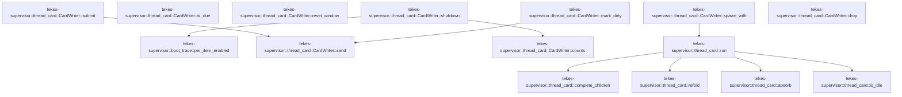

# tekes-supervisor::thread_card

[Package atlas](index.md) · [Source](../../src/thread_card.rs)

## Declarations

Visibility is the declaration spelling; trait members and reexports require their enclosing interface. `cfg` is not evaluated.

| Symbol | Kind | Visibility | Test / cfg |
|---|---|---|---|
| [tekes-supervisor::thread_card::DEFAULT_DEBOUNCE](../../src/thread_card.rs#L22) | const_item | `pub(crate)` |  |
| [tekes-supervisor::thread_card::PreparedLine](../../src/thread_card.rs#L24) | struct_item | `pub(crate)` |  |
| [tekes-supervisor::thread_card::PreparedCard](../../src/thread_card.rs#L36) | struct_item | `pub(crate)` |  |
| [tekes-supervisor::thread_card::PreparedLine::view](../../src/thread_card.rs#L46) | function_item | `private` |  |
| [tekes-supervisor::thread_card::PreparedCard::view](../../src/thread_card.rs#L62) | function_item | `pub(crate)` |  |
| [tekes-supervisor::thread_card::PreparedCard::with_journal](../../src/thread_card.rs#L72) | function_item | `pub(crate)` |  |
| [tekes-supervisor::thread_card::PreparedCard::fingerprint](../../src/thread_card.rs#L77) | function_item | `private` |  |
| [tekes-supervisor::thread_card::holds_of](../../src/thread_card.rs#L87) | function_item | `private` |  |
| [tekes-supervisor::thread_card::journal_input](../../src/thread_card.rs#L117) | function_item | `pub(crate)` |  |
| [tekes-supervisor::thread_card::main_line](../../src/thread_card.rs#L129) | function_item | `private` |  |
| [tekes-supervisor::thread_card::prepare](../../src/thread_card.rs#L155) | function_item | `pub(crate)` |  |
| [tekes-supervisor::thread_card::complete_children](../../src/thread_card.rs#L176) | function_item | `private` |  |
| [tekes-supervisor::thread_card::fold_child_views](../../src/thread_card.rs#L184) | function_item | `pub(crate)` |  |
| [tekes-supervisor::thread_card::fold_children](../../src/thread_card.rs#L194) | function_item | `private` |  |
| [tekes-supervisor::thread_card::refold](../../src/thread_card.rs#L253) | function_item | `private` |  |
| [tekes-supervisor::thread_card::write](../../src/thread_card.rs#L264) | function_item | `private` |  |
| [tekes-supervisor::thread_card::SyncGovernor](../../src/thread_card.rs#L306) | struct_item | `pub(crate)` |  |
| [tekes-supervisor::thread_card::SyncGovernor::new](../../src/thread_card.rs#L312) | function_item | `pub(crate)` |  |
| [tekes-supervisor::thread_card::SyncGovernor::charge](../../src/thread_card.rs#L324) | function_item | `pub(crate)` |  |
| [tekes-supervisor::thread_card::SyncGovernor::delay](../../src/thread_card.rs#L334) | function_item | `pub(crate)` |  |
| [tekes-supervisor::thread_card::Message](../../src/thread_card.rs#L342) | enum_item | `private` |  |
| [tekes-supervisor::thread_card::REFOLD_RETRIES](../../src/thread_card.rs#L354) | const_item | `private` |  |
| [tekes-supervisor::thread_card::REFOLD_RETRY_DELAY](../../src/thread_card.rs#L355) | const_item | `private` |  |
| [tekes-supervisor::thread_card::Pending](../../src/thread_card.rs#L357) | enum_item | `private` |  |
| [tekes-supervisor::thread_card::WriteFn](../../src/thread_card.rs#L368) | type_item | `private` |  |
| [tekes-supervisor::thread_card::Tuning](../../src/thread_card.rs#L372) | struct_item | `pub(crate)` |  |
| [tekes-supervisor::thread_card::Tuning::from_env](../../src/thread_card.rs#L379) | function_item | `pub(crate)` |  |
| [tekes-supervisor::thread_card::DEFAULT_MAX_PER_SEC](../../src/thread_card.rs#L397) | const_item | `pub(crate)` |  |
| [tekes-supervisor::thread_card::DEFAULT_SHUTDOWN_BUDGET](../../src/thread_card.rs#L398) | const_item | `pub(crate)` |  |
| [tekes-supervisor::thread_card::CardStats](../../src/thread_card.rs#L402) | struct_item | `private` |  |
| [tekes-supervisor::thread_card::CardWriter](../../src/thread_card.rs#L412) | struct_item | `pub(crate)` |  |
| [tekes-supervisor::thread_card::CardWriter::spawn](../../src/thread_card.rs#L423) | function_item | `pub(crate)` |  |
| [tekes-supervisor::thread_card::CardWriter::spawn_from_env](../../src/thread_card.rs#L431) | function_item | `pub(crate)` |  |
| [tekes-supervisor::thread_card::CardWriter::governor](../../src/thread_card.rs#L436) | function_item | `pub(crate)` |  |
| [tekes-supervisor::thread_card::CardWriter::spawn_with](../../src/thread_card.rs#L440) | function_item | `private` |  |
| [tekes-supervisor::thread_card::CardWriter::is_due](../../src/thread_card.rs#L473) | function_item | `pub(crate)` |  |
| [tekes-supervisor::thread_card::CardWriter::reset_window](../../src/thread_card.rs#L490) | function_item | `pub(crate)` |  |
| [tekes-supervisor::thread_card::CardWriter::submit](../../src/thread_card.rs#L497) | function_item | `pub(crate)` |  |
| [tekes-supervisor::thread_card::CardWriter::mark_dirty](../../src/thread_card.rs#L501) | function_item | `pub(crate)` |  |
| [tekes-supervisor::thread_card::CardWriter::send](../../src/thread_card.rs#L509) | function_item | `private` |  |
| [tekes-supervisor::thread_card::CardWriter::shutdown](../../src/thread_card.rs#L522) | function_item | `pub(crate)` |  |
| [tekes-supervisor::thread_card::CardWriter::counts](../../src/thread_card.rs#L564) | function_item | `pub(crate)` |  |
| [tekes-supervisor::thread_card::CardWriter::drop](../../src/thread_card.rs#L573) | function_item | `private` |  |
| [tekes-supervisor::thread_card::absorb](../../src/thread_card.rs#L578) | function_item | `private` |  |
| [tekes-supervisor::thread_card::is_idle](../../src/thread_card.rs#L606) | function_item | `private` |  |
| [tekes-supervisor::thread_card::run](../../src/thread_card.rs#L610) | function_item | `private` |  |

## Imports / reexports

| Local name | Source path | Visibility |
|---|---|---|
| `HashMap` | `std::collections::HashMap` | `private` |
| `PathBuf` | `std::path::PathBuf` | `private` |
| `AtomicU64` | `std::sync::atomic::AtomicU64` | `private` |
| `Ordering` | `std::sync::atomic::Ordering` | `private` |
| `mpsc` | `std::sync::mpsc` | `private` |
| `RecvTimeoutError` | `std::sync::mpsc::RecvTimeoutError` | `private` |
| `Sender` | `std::sync::mpsc::Sender` | `private` |
| `SyncSender` | `std::sync::mpsc::SyncSender` | `private` |
| `Arc` | `std::sync::Arc` | `private` |
| `Mutex` | `std::sync::Mutex` | `private` |
| `JoinHandle` | `std::thread::JoinHandle` | `private` |
| `Duration` | `std::time::Duration` | `private` |
| `Instant` | `std::time::Instant` | `private` |
| `EndpointJournal` | `endpoint::EndpointJournal` | `private` |
| `LedgerProjection` | `schema::LedgerProjection` | `private` |
| `CardInput` | `store::card::CardInput` | `private` |
| `CardSummary` | `store::card::CardSummary` | `private` |
| `Hold` | `store::card::Hold` | `private` |
| `HoldResolution` | `store::card::HoldResolution` | `private` |
| `JournalInput` | `store::card::JournalInput` | `private` |
| `LineInput` | `store::card::LineInput` | `private` |
| `WriteOutcome` | `store::card::WriteOutcome` | `private` |
| `line_requests` | `crate::endpoint_carrier::line_requests` | `private` |

## Module declarations

| Module | Visibility | Attributes |
|---|---|---|
| `tekes-supervisor::thread_card::tests` | `private` | #[cfg(test)] |

## Function call graphs

Edges below are syntactically resolved calls only, including private functions. Graphs partition callers into groups of 20; they are not execution order. All unresolved sites are listed below and in the JSON inventory.

```mermaid
flowchart TD
  n0["endpoint::service::card_summary"]
  n1["store::card::valid_line_name"]
  n2["store::card::write_card"]
  n3["store::tail::scan_valid_prefix"]
  n4["tekes-supervisor::endpoint_carrier::line_requests"]
  n5["tekes-supervisor::host_runtime::system_timestamp"]
  n6["tekes-supervisor::thread_card::journal_input"]
  n7["tekes-supervisor::thread_card::main_line"]
  n8["tekes-supervisor::thread_card::prepare"]
  n9["tekes-supervisor::thread_card::complete_children"]
  n10["tekes-supervisor::thread_card::fold_child_views"]
  n11["tekes-supervisor::thread_card::fold_children"]
  n12["tekes-supervisor::thread_card::refold"]
  n13["tekes-supervisor::thread_card::write"]
  n14["tekes-supervisor::thread_card::SyncGovernor::new"]
  n15["tekes-supervisor::thread_card::SyncGovernor::charge"]
  n16["tekes-supervisor::thread_card::SyncGovernor::delay"]
  n17["tekes-supervisor::thread_card::Tuning::from_env"]
  n18["tekes-supervisor::thread_card::CardWriter::spawn"]
  n19["tekes-supervisor::thread_card::CardWriter::spawn_from_env"]
  n20["tekes-supervisor::thread_card::CardWriter::governor"]
  n21["tekes-supervisor::thread_card::CardWriter::spawn_with"]
  n22["tekes-supervisor::thread_card::PreparedLine::view"]
  n23["tekes-supervisor::thread_card::PreparedCard::view"]
  n24["tekes-supervisor::thread_card::PreparedCard::with_journal"]
  n25["tekes-supervisor::thread_card::PreparedCard::fingerprint"]
  n26["tekes-supervisor::thread_card::holds_of"]
  n7 --> n0
  n7 --> n26
  n8 --> n5
  n8 --> n7
  n9 --> n11
  n10 --> n11
  n11 --> n1
  n11 --> n3
  n11 --> n26
  n12 --> n3
  n12 --> n8
  n13 --> n2
  n18 --> n14
  n18 --> n21
  n19 --> n17
  n19 --> n18
  n26 --> n4
```

Functions 1–20: 17 direct edges

Functions 21–32: 9 direct edges

## Call sites

Includes test functions (marked in declarations). Receiver-type-required sites need type analysis/manual tracing. Calls in closures are attributed to their enclosing function; their occurrence here does not mean the closure executes immediately.

| Caller | Callee expression | Source lines | Target / classification |
|---|---|---|---|
| `DEFAULT_DEBOUNCE` | `Duration::from_secs` | [22](../../src/thread_card.rs#L22) | external-constructor-callback-or-unresolved |
| `view` | `self.file.clone` | [48](../../src/thread_card.rs#L48) | receiver-type-required |
| `view` | `self.line.clone` | [50](../../src/thread_card.rs#L50) | receiver-type-required |
| `view` | `self.parent_file.clone` | [51](../../src/thread_card.rs#L51) | receiver-type-required |
| `view` | `self.facts.clone` | [52](../../src/thread_card.rs#L52) | receiver-type-required |
| `view` | `self.holds.clone` | [53](../../src/thread_card.rs#L53) | receiver-type-required |
| `view` | `self.summary.clone` | [64](../../src/thread_card.rs#L64) | receiver-type-required |
| `view` | `self.lines.iter().map(PreparedLine::view).collect` | [65](../../src/thread_card.rs#L65) | receiver-type-required |
| `view` | `self.lines.iter().map` | [65](../../src/thread_card.rs#L65) | receiver-type-required |
| `view` | `self.lines.iter` | [65](../../src/thread_card.rs#L65) | receiver-type-required |
| `view` | `self.lines.len` | [67](../../src/thread_card.rs#L67) | receiver-type-required |
| `fingerprint` | `self.lines.first` | [78](../../src/thread_card.rs#L78) | receiver-type-required |
| `fingerprint` | `main.map_or` | [80](../../src/thread_card.rs#L80), [81](../../src/thread_card.rs#L81) | receiver-type-required |
| `fingerprint` | `line.prefix.len` | [81](../../src/thread_card.rs#L81) | receiver-type-required |
| `fingerprint` | `self.journal.as_ref().map_or` | [82](../../src/thread_card.rs#L82) | receiver-type-required |
| `fingerprint` | `self.journal.as_ref` | [82](../../src/thread_card.rs#L82) | receiver-type-required |
| `holds_of` | `line_requests(session, source_line, projection).ok` | [92](../../src/thread_card.rs#L92) | receiver-type-required |
| `holds_of` | `line_requests` | [92](../../src/thread_card.rs#L92) | [tekes-supervisor::endpoint_carrier::line_requests](../../src/endpoint_carrier.rs#L2822) |
| `holds_of` | `Some` | [93](../../src/thread_card.rs#L93) | external-constructor-callback-or-unresolved |
| `holds_of` | `requests             .into_iter()             .map(&#124;(state, _)&#124; Hold {                 hold_seq: state.request.causal_kernel_seq,                 kind: match state.request.frame_type {                     endpoint::RequestFrameType::Approval => "approval",                     endpoint::RequestFrameType::Question => "question",                 }                 .to_owned(),                 resolved: state.resolution.map(&#124;(seq, outcome)&#124; HoldResolution {                     seq,                     // kebab-case ('allowed-once', 'rejected', 'cancelled', 'answered')                     outcome: serde_json::to_value(outcome)                         .ok()                         .and_then(&#124;value&#124; value.as_str().map(str::to_owned))                         .unwrap_or_default(),                 }),             })             .collect` | [94](../../src/thread_card.rs#L94) | receiver-type-required |
| `holds_of` | `requests             .into_iter()             .map` | [94](../../src/thread_card.rs#L94) | receiver-type-required |
| `holds_of` | `requests             .into_iter` | [94](../../src/thread_card.rs#L94) | receiver-type-required |
| `holds_of` | `match state.request.frame_type {                     endpoint::RequestFrameType::Approval => "approval",                     endpoint::RequestFrameType::Question => "question",                 }                 .to_owned` | [98](../../src/thread_card.rs#L98) | receiver-type-required |
| `holds_of` | `state.resolution.map` | [103](../../src/thread_card.rs#L103) | receiver-type-required |
| `holds_of` | `serde_json::to_value(outcome)                         .ok()                         .and_then(&#124;value&#124; value.as_str().map(str::to_owned))                         .unwrap_or_default` | [106](../../src/thread_card.rs#L106) | receiver-type-required |
| `holds_of` | `serde_json::to_value(outcome)                         .ok()                         .and_then` | [106](../../src/thread_card.rs#L106) | receiver-type-required |
| `holds_of` | `serde_json::to_value(outcome)                         .ok` | [106](../../src/thread_card.rs#L106) | receiver-type-required |
| `holds_of` | `serde_json::to_value` | [106](../../src/thread_card.rs#L106) | external-constructor-callback-or-unresolved |
| `holds_of` | `value.as_str().map` | [108](../../src/thread_card.rs#L108) | receiver-type-required |
| `holds_of` | `value.as_str` | [108](../../src/thread_card.rs#L108) | receiver-type-required |
| `journal_input` | `journal.tail_summary().ok` | [118](../../src/thread_card.rs#L118) | receiver-type-required |
| `journal_input` | `journal.tail_summary` | [118](../../src/thread_card.rs#L118) | receiver-type-required |
| `journal_input` | `Some` | [119](../../src/thread_card.rs#L119) | external-constructor-callback-or-unresolved |
| `journal_input` | `tail             .last_seq             .map_or` | [122](../../src/thread_card.rs#L122) | receiver-type-required |
| `journal_input` | `i64::try_from(seq).unwrap_or` | [124](../../src/thread_card.rs#L124) | receiver-type-required |
| `journal_input` | `i64::try_from` | [124](../../src/thread_card.rs#L124) | external-constructor-callback-or-unresolved |
| `main_line` | `bytes.truncate` | [135](../../src/thread_card.rs#L135) | receiver-type-required |
| `main_line` | `endpoint::card_summary(projection).ok` | [136](../../src/thread_card.rs#L136) | receiver-type-required |
| `main_line` | `endpoint::card_summary` | [136](../../src/thread_card.rs#L136) | [endpoint::service::card_summary](../../../endpoint/src/service.rs#L198) |
| `main_line` | `Some` | [137](../../src/thread_card.rs#L137) | external-constructor-callback-or-unresolved |
| `main_line` | `"main.jsonl".to_owned` | [139](../../src/thread_card.rs#L139) | receiver-type-required |
| `main_line` | `session.to_owned` | [142](../../src/thread_card.rs#L142) | receiver-type-required |
| `main_line` | `projection.lifecycle.clone` | [144](../../src/thread_card.rs#L144) | receiver-type-required |
| `main_line` | `holds_of` | [145](../../src/thread_card.rs#L145) | [tekes-supervisor::thread_card::holds_of](../../src/thread_card.rs#L87) |
| `prepare` | `main_line` | [163](../../src/thread_card.rs#L163) | [tekes-supervisor::thread_card::main_line](../../src/thread_card.rs#L129) |
| `prepare` | `Some` | [164](../../src/thread_card.rs#L164) | external-constructor-callback-or-unresolved |
| `prepare` | `session.to_owned` | [165](../../src/thread_card.rs#L165) | receiver-type-required |
| `prepare` | `crate::host_runtime::system_timestamp().ok` | [166](../../src/thread_card.rs#L166) | receiver-type-required |
| `prepare` | `crate::host_runtime::system_timestamp` | [166](../../src/thread_card.rs#L166) | [tekes-supervisor::host_runtime::system_timestamp](../../src/host_runtime.rs#L475) |
| `complete_children` | `fold_children` | [177](../../src/thread_card.rs#L177) | [tekes-supervisor::thread_card::fold_children](../../src/thread_card.rs#L194) |
| `complete_children` | `card.lines.extend` | [178](../../src/thread_card.rs#L178) | receiver-type-required |
| `fold_child_views` | `fold_children(session, folder)         .iter()         .map(PreparedLine::view)         .collect` | [188](../../src/thread_card.rs#L188) | receiver-type-required |
| `fold_child_views` | `fold_children(session, folder)         .iter()         .map` | [188](../../src/thread_card.rs#L188) | receiver-type-required |
| `fold_child_views` | `fold_children(session, folder)         .iter` | [188](../../src/thread_card.rs#L188) | receiver-type-required |
| `fold_child_views` | `fold_children` | [188](../../src/thread_card.rs#L188) | [tekes-supervisor::thread_card::fold_children](../../src/thread_card.rs#L194) |
| `fold_children` | `Vec::new` | [195](../../src/thread_card.rs#L195) | external-constructor-callback-or-unresolved |
| `fold_children` | `std::fs::read_dir` | [196](../../src/thread_card.rs#L196) | external-constructor-callback-or-unresolved |
| `fold_children` | `entries         .flatten()         .filter_map(&#124;entry&#124; {             let name = entry.file_name().to_string_lossy().into_owned();             (store::card::valid_line_name(&name)                 && name != "main.jsonl"                 && entry.file_type().is_ok_and(&#124;kind&#124; kind.is_file()))             .then_some(name)         })         .collect::<Vec<_>>` | [199](../../src/thread_card.rs#L199) | receiver-type-required |
| `fold_children` | `entries         .flatten()         .filter_map` | [199](../../src/thread_card.rs#L199) | receiver-type-required |
| `fold_children` | `entries         .flatten` | [199](../../src/thread_card.rs#L199) | receiver-type-required |
| `fold_children` | `entry.file_name().to_string_lossy().into_owned` | [202](../../src/thread_card.rs#L202) | receiver-type-required |
| `fold_children` | `entry.file_name().to_string_lossy` | [202](../../src/thread_card.rs#L202) | receiver-type-required |
| `fold_children` | `entry.file_name` | [202](../../src/thread_card.rs#L202) | receiver-type-required |
| `fold_children` | `(store::card::valid_line_name(&name)                 && name != "main.jsonl"                 && entry.file_type().is_ok_and(&#124;kind&#124; kind.is_file()))             .then_some` | [203](../../src/thread_card.rs#L203) | receiver-type-required |
| `fold_children` | `store::card::valid_line_name` | [203](../../src/thread_card.rs#L203) | [store::card::valid_line_name](../../../store/src/card.rs#L255) |
| `fold_children` | `entry.file_type().is_ok_and` | [205](../../src/thread_card.rs#L205) | receiver-type-required |
| `fold_children` | `entry.file_type` | [205](../../src/thread_card.rs#L205) | receiver-type-required |
| `fold_children` | `kind.is_file` | [205](../../src/thread_card.rs#L205) | receiver-type-required |
| `fold_children` | `children.sort` | [209](../../src/thread_card.rs#L209) | receiver-type-required |
| `fold_children` | `std::fs::read` | [211](../../src/thread_card.rs#L211) | external-constructor-callback-or-unresolved |
| `fold_children` | `folder.join` | [211](../../src/thread_card.rs#L211) | receiver-type-required |
| `fold_children` | `store::scan_valid_prefix` | [214](../../src/thread_card.rs#L214) | [store::tail::scan_valid_prefix](../../../store/src/tail.rs#L37) |
| `fold_children` | `usize::try_from` | [215](../../src/thread_card.rs#L215) | external-constructor-callback-or-unresolved |
| `fold_children` | `child.events.first` | [221](../../src/thread_card.rs#L221) | receiver-type-required |
| `fold_children` | `serde_json::to_value(genesis.raw()).ok().and_then` | [224](../../src/thread_card.rs#L224) | receiver-type-required |
| `fold_children` | `serde_json::to_value(genesis.raw()).ok` | [224](../../src/thread_card.rs#L224) | receiver-type-required |
| `fold_children` | `serde_json::to_value` | [224](../../src/thread_card.rs#L224) | external-constructor-callback-or-unresolved |
| `fold_children` | `genesis.raw` | [224](../../src/thread_card.rs#L224) | receiver-type-required |
| `fold_children` | `value                 .get("parent")?                 .get("file")?                 .as_str()                 .map` | [225](../../src/thread_card.rs#L225) | receiver-type-required |
| `fold_children` | `value                 .get("parent")?                 .get("file")?                 .as_str` | [225](../../src/thread_card.rs#L225) | receiver-type-required |
| `fold_children` | `value                 .get("parent")?                 .get` | [225](../../src/thread_card.rs#L225) | receiver-type-required |
| `fold_children` | `value                 .get` | [225](../../src/thread_card.rs#L225) | receiver-type-required |
| `fold_children` | `genesis.string_field("thread").map` | [232](../../src/thread_card.rs#L232) | receiver-type-required |
| `fold_children` | `genesis.string_field` | [232](../../src/thread_card.rs#L232) | receiver-type-required |
| `fold_children` | `holds_of` | [233](../../src/thread_card.rs#L233) | [tekes-supervisor::thread_card::holds_of](../../src/thread_card.rs#L87) |
| `fold_children` | `Some` | [233](../../src/thread_card.rs#L233) | external-constructor-callback-or-unresolved |
| `fold_children` | `prefix.truncate` | [237](../../src/thread_card.rs#L237) | receiver-type-required |
| `fold_children` | `lines.push` | [238](../../src/thread_card.rs#L238) | receiver-type-required |
| `refold` | `std::fs::read(folder.join("main.jsonl")).ok` | [254](../../src/thread_card.rs#L254) | receiver-type-required |
| `refold` | `std::fs::read` | [254](../../src/thread_card.rs#L254) | external-constructor-callback-or-unresolved |
| `refold` | `folder.join` | [254](../../src/thread_card.rs#L254) | receiver-type-required |
| `refold` | `store::scan_valid_prefix` | [255](../../src/thread_card.rs#L255) | [store::tail::scan_valid_prefix](../../../store/src/tail.rs#L37) |
| `refold` | `scan.needs_repair` | [256](../../src/thread_card.rs#L256) | receiver-type-required |
| `refold` | `usize::try_from(scan.valid_bytes).ok` | [259](../../src/thread_card.rs#L259) | receiver-type-required |
| `refold` | `usize::try_from` | [259](../../src/thread_card.rs#L259) | external-constructor-callback-or-unresolved |
| `refold` | `prepare` | [261](../../src/thread_card.rs#L261) | [tekes-supervisor::thread_card::prepare](../../src/thread_card.rs#L155) |
| `write` | `prepared.written.clone` | [268](../../src/thread_card.rs#L268) | receiver-type-required |
| `write` | `prepared             .lines             .iter()             .map(&#124;line&#124; LineInput {                 file: &line.file,                 verified_prefix: &line.prefix,                 last_seq: line.last_seq,                 line: line.line.clone(),                 parent_file: line.parent_file.clone(),                 facts: line.facts.clone(),                 holds: line.holds.clone(),             })             .collect` | [269](../../src/thread_card.rs#L269) | receiver-type-required |
| `write` | `prepared             .lines             .iter()             .map` | [269](../../src/thread_card.rs#L269) | receiver-type-required |
| `write` | `prepared             .lines             .iter` | [269](../../src/thread_card.rs#L269) | receiver-type-required |
| `write` | `line.line.clone` | [276](../../src/thread_card.rs#L276) | receiver-type-required |
| `write` | `line.parent_file.clone` | [277](../../src/thread_card.rs#L277) | receiver-type-required |
| `write` | `line.facts.clone` | [278](../../src/thread_card.rs#L278) | receiver-type-required |
| `write` | `line.holds.clone` | [279](../../src/thread_card.rs#L279) | receiver-type-required |
| `write` | `prepared.summary.clone` | [282](../../src/thread_card.rs#L282) | receiver-type-required |
| `write` | `prepared.journal.as_ref().map` | [283](../../src/thread_card.rs#L283) | receiver-type-required |
| `write` | `prepared.journal.as_ref` | [283](../../src/thread_card.rs#L283) | receiver-type-required |
| `write` | `store::card::write_card` | [290](../../src/thread_card.rs#L290) | [store::card::write_card](../../../store/src/card.rs#L581) |
| `write` | `WriteOutcome::Skipped` | [297](../../src/thread_card.rs#L297) | external-constructor-callback-or-unresolved |
| `new` | `Duration::from_secs` | [317](../../src/thread_card.rs#L317) | external-constructor-callback-or-unresolved |
| `new` | `Mutex::new` | [319](../../src/thread_card.rs#L319) | external-constructor-callback-or-unresolved |
| `new` | `Instant::now` | [319](../../src/thread_card.rs#L319) | external-constructor-callback-or-unresolved |
| `charge` | `self             .next_allowed             .lock()             .unwrap_or_else` | [325](../../src/thread_card.rs#L325) | receiver-type-required |
| `charge` | `self             .next_allowed             .lock` | [325](../../src/thread_card.rs#L325) | receiver-type-required |
| `charge` | `(*next).max` | [329](../../src/thread_card.rs#L329) | receiver-type-required |
| `charge` | `Instant::now` | [329](../../src/thread_card.rs#L329) | external-constructor-callback-or-unresolved |
| `delay` | `self.next_allowed             .lock()             .unwrap_or_else(std::sync::PoisonError::into_inner)             .saturating_duration_since` | [335](../../src/thread_card.rs#L335) | receiver-type-required |
| `delay` | `self.next_allowed             .lock()             .unwrap_or_else` | [335](../../src/thread_card.rs#L335) | receiver-type-required |
| `delay` | `self.next_allowed             .lock` | [335](../../src/thread_card.rs#L335) | receiver-type-required |
| `delay` | `Instant::now` | [338](../../src/thread_card.rs#L338) | external-constructor-callback-or-unresolved |
| `REFOLD_RETRY_DELAY` | `Duration::from_millis` | [355](../../src/thread_card.rs#L355) | external-constructor-callback-or-unresolved |
| `from_env` | `std::env::var(name)                 .ok()                 .and_then` | [381](../../src/thread_card.rs#L381) | receiver-type-required |
| `from_env` | `std::env::var(name)                 .ok` | [381](../../src/thread_card.rs#L381) | receiver-type-required |
| `from_env` | `std::env::var` | [381](../../src/thread_card.rs#L381) | external-constructor-callback-or-unresolved |
| `from_env` | `value.parse::<u64>().ok` | [383](../../src/thread_card.rs#L383) | receiver-type-required |
| `from_env` | `value.parse::<u64>` | [383](../../src/thread_card.rs#L383) | receiver-type-required |
| `from_env` | `number("TEKES_KERNEL_CARD_DEBOUNCE_MS")                 .map_or` | [386](../../src/thread_card.rs#L386) | receiver-type-required |
| `from_env` | `number` | [386](../../src/thread_card.rs#L386), [388](../../src/thread_card.rs#L388) | external-constructor-callback-or-unresolved |
| `from_env` | `number("TEKES_KERNEL_CARD_MAX_PER_SEC")                 .map_or` | [388](../../src/thread_card.rs#L388) | receiver-type-required |
| `from_env` | `u32::try_from(value).unwrap_or` | [390](../../src/thread_card.rs#L390) | receiver-type-required |
| `from_env` | `u32::try_from` | [390](../../src/thread_card.rs#L390) | external-constructor-callback-or-unresolved |
| `DEFAULT_SHUTDOWN_BUDGET` | `Duration::from_secs` | [398](../../src/thread_card.rs#L398) | external-constructor-callback-or-unresolved |
| `spawn` | `Self::spawn_with` | [424](../../src/thread_card.rs#L424) | [tekes-supervisor::thread_card::CardWriter::spawn_with](../../src/thread_card.rs#L440) |
| `spawn` | `Arc::new` | [426](../../src/thread_card.rs#L426), [427](../../src/thread_card.rs#L427) | external-constructor-callback-or-unresolved |
| `spawn` | `SyncGovernor::new` | [426](../../src/thread_card.rs#L426) | [tekes-supervisor::thread_card::SyncGovernor::new](../../src/thread_card.rs#L312) |
| `spawn_from_env` | `Self::spawn` | [432](../../src/thread_card.rs#L432) | [tekes-supervisor::thread_card::CardWriter::spawn](../../src/thread_card.rs#L423) |
| `spawn_from_env` | `Tuning::from_env` | [432](../../src/thread_card.rs#L432) | [tekes-supervisor::thread_card::Tuning::from_env](../../src/thread_card.rs#L379) |
| `governor` | `Arc::clone` | [437](../../src/thread_card.rs#L437) | external-constructor-callback-or-unresolved |
| `spawn_with` | `mpsc::channel::<Message>` | [441](../../src/thread_card.rs#L441) | external-constructor-callback-or-unresolved |
| `spawn_with` | `mpsc::sync_channel::<()>` | [442](../../src/thread_card.rs#L442) | external-constructor-callback-or-unresolved |
| `spawn_with` | `Arc::new` | [443](../../src/thread_card.rs#L443) | external-constructor-callback-or-unresolved |
| `spawn_with` | `CardStats::default` | [443](../../src/thread_card.rs#L443) | external-constructor-callback-or-unresolved |
| `spawn_with` | `Arc::clone` | [444](../../src/thread_card.rs#L444), [445](../../src/thread_card.rs#L445) | external-constructor-callback-or-unresolved |
| `spawn_with` | `std::thread::Builder::new()             .name("thread-card-writer".to_owned())             .spawn(move &#124;&#124; {                 run(                     &receiver,                     tuning,                     &thread_governor,                     &write_card,                     &thread_stats,                     &done_sender,                 );             })             .ok` | [446](../../src/thread_card.rs#L446) | receiver-type-required |
| `spawn_with` | `std::thread::Builder::new()             .name("thread-card-writer".to_owned())             .spawn` | [446](../../src/thread_card.rs#L446) | receiver-type-required |
| `spawn_with` | `std::thread::Builder::new()             .name` | [446](../../src/thread_card.rs#L446) | receiver-type-required |
| `spawn_with` | `std::thread::Builder::new` | [446](../../src/thread_card.rs#L446) | external-constructor-callback-or-unresolved |
| `spawn_with` | `"thread-card-writer".to_owned` | [447](../../src/thread_card.rs#L447) | receiver-type-required |
| `spawn_with` | `run` | [449](../../src/thread_card.rs#L449) | [tekes-supervisor::thread_card::run](../../src/thread_card.rs#L610) |
| `spawn_with` | `Mutex::new` | [461](../../src/thread_card.rs#L461), [462](../../src/thread_card.rs#L462), [463](../../src/thread_card.rs#L463), [464](../../src/thread_card.rs#L464) | external-constructor-callback-or-unresolved |
| `spawn_with` | `Some` | [461](../../src/thread_card.rs#L461), [463](../../src/thread_card.rs#L463) | external-constructor-callback-or-unresolved |
| `spawn_with` | `HashMap::new` | [464](../../src/thread_card.rs#L464) | external-constructor-callback-or-unresolved |
| `is_due` | `self             .claimed             .lock()             .unwrap_or_else` | [474](../../src/thread_card.rs#L474) | receiver-type-required |
| `is_due` | `self             .claimed             .lock` | [474](../../src/thread_card.rs#L474) | receiver-type-required |
| `is_due` | `Instant::now` | [478](../../src/thread_card.rs#L478) | external-constructor-callback-or-unresolved |
| `is_due` | `claimed.get` | [479](../../src/thread_card.rs#L479) | receiver-type-required |
| `is_due` | `now.duration_since` | [480](../../src/thread_card.rs#L480) | receiver-type-required |
| `is_due` | `claimed.insert` | [482](../../src/thread_card.rs#L482) | receiver-type-required |
| `is_due` | `session.to_owned` | [482](../../src/thread_card.rs#L482) | receiver-type-required |
| `reset_window` | `self.claimed             .lock()             .unwrap_or_else(std::sync::PoisonError::into_inner)             .remove` | [491](../../src/thread_card.rs#L491) | receiver-type-required |
| `reset_window` | `self.claimed             .lock()             .unwrap_or_else` | [491](../../src/thread_card.rs#L491) | receiver-type-required |
| `reset_window` | `self.claimed             .lock` | [491](../../src/thread_card.rs#L491) | receiver-type-required |
| `submit` | `self.send` | [498](../../src/thread_card.rs#L498) | [tekes-supervisor::thread_card::CardWriter::send](../../src/thread_card.rs#L509) |
| `submit` | `Message::Card` | [498](../../src/thread_card.rs#L498) | external-constructor-callback-or-unresolved |
| `submit` | `Box::new` | [498](../../src/thread_card.rs#L498) | external-constructor-callback-or-unresolved |
| `mark_dirty` | `self.send` | [502](../../src/thread_card.rs#L502) | [tekes-supervisor::thread_card::CardWriter::send](../../src/thread_card.rs#L509) |
| `mark_dirty` | `session.to_owned` | [503](../../src/thread_card.rs#L503) | receiver-type-required |
| `send` | `self             .sender             .lock()             .unwrap_or_else` | [510](../../src/thread_card.rs#L510) | receiver-type-required |
| `send` | `self             .sender             .lock` | [510](../../src/thread_card.rs#L510) | receiver-type-required |
| `send` | `sender.as_ref` | [514](../../src/thread_card.rs#L514) | receiver-type-required |
| `send` | `sender.send` | [515](../../src/thread_card.rs#L515) | receiver-type-required |
| `shutdown` | `self             .sender             .lock()             .unwrap_or_else(std::sync::PoisonError::into_inner)             .take` | [523](../../src/thread_card.rs#L523) | receiver-type-required |
| `shutdown` | `self             .sender             .lock()             .unwrap_or_else` | [523](../../src/thread_card.rs#L523) | receiver-type-required |
| `shutdown` | `self             .sender             .lock` | [523](../../src/thread_card.rs#L523) | receiver-type-required |
| `shutdown` | `sender.send` | [532](../../src/thread_card.rs#L532) | receiver-type-required |
| `shutdown` | `Message::Shutdown` | [532](../../src/thread_card.rs#L532) | external-constructor-callback-or-unresolved |
| `shutdown` | `Instant::now` | [532](../../src/thread_card.rs#L532) | external-constructor-callback-or-unresolved |
| `shutdown` | `self             .done             .lock()             .unwrap_or_else(std::sync::PoisonError::into_inner)             .take` | [533](../../src/thread_card.rs#L533) | receiver-type-required |
| `shutdown` | `self             .done             .lock()             .unwrap_or_else` | [533](../../src/thread_card.rs#L533) | receiver-type-required |
| `shutdown` | `self             .done             .lock` | [533](../../src/thread_card.rs#L533) | receiver-type-required |
| `shutdown` | `done.is_none_or` | [538](../../src/thread_card.rs#L538) | receiver-type-required |
| `shutdown` | `done.recv_timeout(budget + Duration::from_millis(500))                 .is_ok` | [539](../../src/thread_card.rs#L539) | receiver-type-required |
| `shutdown` | `done.recv_timeout` | [539](../../src/thread_card.rs#L539) | receiver-type-required |
| `shutdown` | `Duration::from_millis` | [539](../../src/thread_card.rs#L539) | external-constructor-callback-or-unresolved |
| `shutdown` | `self             .handle             .lock()             .unwrap_or_else(std::sync::PoisonError::into_inner)             .take` | [542](../../src/thread_card.rs#L542) | receiver-type-required |
| `shutdown` | `self             .handle             .lock()             .unwrap_or_else` | [542](../../src/thread_card.rs#L542) | receiver-type-required |
| `shutdown` | `self             .handle             .lock` | [542](../../src/thread_card.rs#L542) | receiver-type-required |
| `shutdown` | `handle.join` | [549](../../src/thread_card.rs#L549) | receiver-type-required |
| `shutdown` | `crate::boot_trace::per_item_enabled` | [554](../../src/thread_card.rs#L554) | [tekes-supervisor::boot_trace::per_item_enabled](../../src/boot_trace.rs#L93) |
| `shutdown` | `self.counts` | [555](../../src/thread_card.rs#L555) | [tekes-supervisor::thread_card::CardWriter::counts](../../src/thread_card.rs#L564) |
| `counts` | `self.stats.written.load` | [566](../../src/thread_card.rs#L566) | receiver-type-required |
| `counts` | `self.stats.skipped.load` | [567](../../src/thread_card.rs#L567) | receiver-type-required |
| `drop` | `self.shutdown` | [574](../../src/thread_card.rs#L574) | receiver-type-required |
| `absorb` | `pending.insert` | [585](../../src/thread_card.rs#L585), [592](../../src/thread_card.rs#L592) | receiver-type-required |
| `absorb` | `card.session.clone` | [585](../../src/thread_card.rs#L585) | receiver-type-required |
| `absorb` | `Pending::Card` | [585](../../src/thread_card.rs#L585) | external-constructor-callback-or-unresolved |
| `absorb` | `Some` | [602](../../src/thread_card.rs#L602) | external-constructor-callback-or-unresolved |
| `is_idle` | `pending.is_empty` | [607](../../src/thread_card.rs#L607) | receiver-type-required |
| `is_idle` | `deadline.is_none` | [607](../../src/thread_card.rs#L607) | receiver-type-required |
| `run` | `HashMap::new` | [618](../../src/thread_card.rs#L618), [619](../../src/thread_card.rs#L619) | external-constructor-callback-or-unresolved |
| `run` | `pending.is_empty` | [622](../../src/thread_card.rs#L622), [734](../../src/thread_card.rs#L734) | receiver-type-required |
| `run` | `deadline.is_none` | [622](../../src/thread_card.rs#L622) | receiver-type-required |
| `run` | `receiver.recv().ok` | [623](../../src/thread_card.rs#L623) | receiver-type-required |
| `run` | `receiver.recv` | [623](../../src/thread_card.rs#L623) | receiver-type-required |
| `run` | `receiver.recv_timeout` | [625](../../src/thread_card.rs#L625) | receiver-type-required |
| `run` | `Duration::from_millis` | [625](../../src/thread_card.rs#L625) | external-constructor-callback-or-unresolved |
| `run` | `Some` | [626](../../src/thread_card.rs#L626), [685](../../src/thread_card.rs#L685), [701](../../src/thread_card.rs#L701) | external-constructor-callback-or-unresolved |
| `run` | `deadline.get_or_insert_with` | [629](../../src/thread_card.rs#L629) | receiver-type-required |
| `run` | `absorb` | [635](../../src/thread_card.rs#L635), [670](../../src/thread_card.rs#L670) | [tekes-supervisor::thread_card::absorb](../../src/thread_card.rs#L578) |
| `run` | `is_idle` | [637](../../src/thread_card.rs#L637) | [tekes-supervisor::thread_card::is_idle](../../src/thread_card.rs#L606) |
| `run` | `deadline.is_some` | [640](../../src/thread_card.rs#L640), [672](../../src/thread_card.rs#L672) | receiver-type-required |
| `run` | `Instant::now` | [641](../../src/thread_card.rs#L641), [673](../../src/thread_card.rs#L673), [701](../../src/thread_card.rs#L701), [731](../../src/thread_card.rs#L731) | external-constructor-callback-or-unresolved |
| `run` | `deadline.is_some_and` | [642](../../src/thread_card.rs#L642), [673](../../src/thread_card.rs#L673) | receiver-type-required |
| `run` | `stats                 .dropped_at_shutdown                 .fetch_add` | [643](../../src/thread_card.rs#L643) | receiver-type-required |
| `run` | `pending.len` | [645](../../src/thread_card.rs#L645) | receiver-type-required |
| `run` | `pending             .iter()             .filter(&#124;(session, job)&#124; {                 let retry_ready = match job {                     Pending::Dirty {                         not_before: Some(at),                         ..                     } => closing &#124;&#124; now >= *at,                     _ => true,                 };                 retry_ready                     && (closing                         &#124;&#124; last_written                             .get(*session)                             .is_none_or(&#124;(at, _)&#124; at.elapsed() >= tuning.debounce))             })             .map(&#124;(session, _)&#124; session.clone())             .collect::<Vec<_>>` | [648](../../src/thread_card.rs#L648) | receiver-type-required |
| `run` | `pending             .iter()             .filter(&#124;(session, job)&#124; {                 let retry_ready = match job {                     Pending::Dirty {                         not_before: Some(at),                         ..                     } => closing &#124;&#124; now >= *at,                     _ => true,                 };                 retry_ready                     && (closing                         &#124;&#124; last_written                             .get(*session)                             .is_none_or(&#124;(at, _)&#124; at.elapsed() >= tuning.debounce))             })             .map` | [648](../../src/thread_card.rs#L648) | receiver-type-required |
| `run` | `pending             .iter()             .filter` | [648](../../src/thread_card.rs#L648) | receiver-type-required |
| `run` | `pending             .iter` | [648](../../src/thread_card.rs#L648) | receiver-type-required |
| `run` | `last_written                             .get(*session)                             .is_none_or` | [660](../../src/thread_card.rs#L660) | receiver-type-required |
| `run` | `last_written                             .get` | [660](../../src/thread_card.rs#L660) | receiver-type-required |
| `run` | `at.elapsed` | [662](../../src/thread_card.rs#L662) | receiver-type-required |
| `run` | `session.clone` | [664](../../src/thread_card.rs#L664), [697](../../src/thread_card.rs#L697) | receiver-type-required |
| `run` | `due.sort` | [666](../../src/thread_card.rs#L666) | receiver-type-required |
| `run` | `receiver.try_recv` | [669](../../src/thread_card.rs#L669) | receiver-type-required |
| `run` | `governor.delay().is_zero` | [678](../../src/thread_card.rs#L678) | receiver-type-required |
| `run` | `governor.delay` | [678](../../src/thread_card.rs#L678) | receiver-type-required |
| `run` | `pending.remove` | [681](../../src/thread_card.rs#L681) | receiver-type-required |
| `run` | `refold` | [692](../../src/thread_card.rs#L692) | [tekes-supervisor::thread_card::refold](../../src/thread_card.rs#L253) |
| `run` | `folder.clone` | [692](../../src/thread_card.rs#L692) | receiver-type-required |
| `run` | `folded.is_none` | [693](../../src/thread_card.rs#L693) | receiver-type-required |
| `run` | `pending.entry(session.clone()).or_insert` | [697](../../src/thread_card.rs#L697) | receiver-type-required |
| `run` | `pending.entry` | [697](../../src/thread_card.rs#L697) | receiver-type-required |
| `run` | `stats.skipped.fetch_add` | [704](../../src/thread_card.rs#L704) | receiver-type-required |
| `run` | `card.fingerprint` | [713](../../src/thread_card.rs#L713) | receiver-type-required |
| `run` | `last_written                 .get(&session)                 .is_some_and` | [714](../../src/thread_card.rs#L714) | receiver-type-required |
| `run` | `last_written                 .get` | [714](../../src/thread_card.rs#L714) | receiver-type-required |
| `run` | `complete_children` | [720](../../src/thread_card.rs#L720) | [tekes-supervisor::thread_card::complete_children](../../src/thread_card.rs#L176) |
| `run` | `u32::try_from(card.lines.len()).unwrap_or` | [721](../../src/thread_card.rs#L721) | receiver-type-required |
| `run` | `u32::try_from` | [721](../../src/thread_card.rs#L721) | external-constructor-callback-or-unresolved |
| `run` | `card.lines.len` | [721](../../src/thread_card.rs#L721) | receiver-type-required |
| `run` | `write_card` | [722](../../src/thread_card.rs#L722) | external-constructor-callback-or-unresolved |
| `run` | `governor.charge` | [723](../../src/thread_card.rs#L723) | receiver-type-required |
| `run` | `counter.fetch_add` | [729](../../src/thread_card.rs#L729) | receiver-type-required |
| `run` | `last_written.insert` | [731](../../src/thread_card.rs#L731) | receiver-type-required |
| `run` | `done.send` | [738](../../src/thread_card.rs#L738) | receiver-type-required |
