# tekes-supervisor::thread_card

[Package atlas](index.md) · [Source](../../src/thread_card.rs)

## Declarations

Visibility is the declaration spelling; trait members and reexports require their enclosing interface. `cfg` is not evaluated.

| Symbol | Kind | Visibility | Test / cfg |
|---|---|---|---|
| [tekes-supervisor::thread_card::DEFAULT_DEBOUNCE](../../src/thread_card.rs#L22) | const_item | `pub(crate)` |  |
| [tekes-supervisor::thread_card::PreparedLine](../../src/thread_card.rs#L24) | struct_item | `pub(crate)` |  |
| [tekes-supervisor::thread_card::PreparedCard](../../src/thread_card.rs#L36) | struct_item | `pub(crate)` |  |
| [tekes-supervisor::thread_card::PreparedCard::view](../../src/thread_card.rs#L47) | function_item | `pub(crate)` |  |
| [tekes-supervisor::thread_card::PreparedCard::with_journal](../../src/thread_card.rs#L67) | function_item | `pub(crate)` |  |
| [tekes-supervisor::thread_card::PreparedCard::fingerprint](../../src/thread_card.rs#L72) | function_item | `private` |  |
| [tekes-supervisor::thread_card::holds_of](../../src/thread_card.rs#L82) | function_item | `private` |  |
| [tekes-supervisor::thread_card::journal_input](../../src/thread_card.rs#L112) | function_item | `pub(crate)` |  |
| [tekes-supervisor::thread_card::main_line](../../src/thread_card.rs#L124) | function_item | `private` |  |
| [tekes-supervisor::thread_card::prepare](../../src/thread_card.rs#L150) | function_item | `pub(crate)` |  |
| [tekes-supervisor::thread_card::complete_children](../../src/thread_card.rs#L171) | function_item | `private` |  |
| [tekes-supervisor::thread_card::refold](../../src/thread_card.rs#L228) | function_item | `private` |  |
| [tekes-supervisor::thread_card::write](../../src/thread_card.rs#L239) | function_item | `private` |  |
| [tekes-supervisor::thread_card::SyncGovernor](../../src/thread_card.rs#L281) | struct_item | `pub(crate)` |  |
| [tekes-supervisor::thread_card::SyncGovernor::new](../../src/thread_card.rs#L287) | function_item | `pub(crate)` |  |
| [tekes-supervisor::thread_card::SyncGovernor::charge](../../src/thread_card.rs#L299) | function_item | `pub(crate)` |  |
| [tekes-supervisor::thread_card::SyncGovernor::delay](../../src/thread_card.rs#L309) | function_item | `pub(crate)` |  |
| [tekes-supervisor::thread_card::Message](../../src/thread_card.rs#L317) | enum_item | `private` |  |
| [tekes-supervisor::thread_card::REFOLD_RETRIES](../../src/thread_card.rs#L329) | const_item | `private` |  |
| [tekes-supervisor::thread_card::REFOLD_RETRY_DELAY](../../src/thread_card.rs#L330) | const_item | `private` |  |
| [tekes-supervisor::thread_card::Pending](../../src/thread_card.rs#L332) | enum_item | `private` |  |
| [tekes-supervisor::thread_card::WriteFn](../../src/thread_card.rs#L343) | type_item | `private` |  |
| [tekes-supervisor::thread_card::Tuning](../../src/thread_card.rs#L347) | struct_item | `pub(crate)` |  |
| [tekes-supervisor::thread_card::Tuning::from_env](../../src/thread_card.rs#L354) | function_item | `pub(crate)` |  |
| [tekes-supervisor::thread_card::DEFAULT_MAX_PER_SEC](../../src/thread_card.rs#L372) | const_item | `pub(crate)` |  |
| [tekes-supervisor::thread_card::DEFAULT_SHUTDOWN_BUDGET](../../src/thread_card.rs#L373) | const_item | `pub(crate)` |  |
| [tekes-supervisor::thread_card::CardStats](../../src/thread_card.rs#L377) | struct_item | `private` |  |
| [tekes-supervisor::thread_card::CardWriter](../../src/thread_card.rs#L387) | struct_item | `pub(crate)` |  |
| [tekes-supervisor::thread_card::CardWriter::spawn](../../src/thread_card.rs#L398) | function_item | `pub(crate)` |  |
| [tekes-supervisor::thread_card::CardWriter::spawn_from_env](../../src/thread_card.rs#L406) | function_item | `pub(crate)` |  |
| [tekes-supervisor::thread_card::CardWriter::governor](../../src/thread_card.rs#L411) | function_item | `pub(crate)` |  |
| [tekes-supervisor::thread_card::CardWriter::spawn_with](../../src/thread_card.rs#L415) | function_item | `private` |  |
| [tekes-supervisor::thread_card::CardWriter::is_due](../../src/thread_card.rs#L448) | function_item | `pub(crate)` |  |
| [tekes-supervisor::thread_card::CardWriter::reset_window](../../src/thread_card.rs#L465) | function_item | `pub(crate)` |  |
| [tekes-supervisor::thread_card::CardWriter::submit](../../src/thread_card.rs#L472) | function_item | `pub(crate)` |  |
| [tekes-supervisor::thread_card::CardWriter::mark_dirty](../../src/thread_card.rs#L476) | function_item | `pub(crate)` |  |
| [tekes-supervisor::thread_card::CardWriter::send](../../src/thread_card.rs#L484) | function_item | `private` |  |
| [tekes-supervisor::thread_card::CardWriter::shutdown](../../src/thread_card.rs#L497) | function_item | `pub(crate)` |  |
| [tekes-supervisor::thread_card::CardWriter::counts](../../src/thread_card.rs#L539) | function_item | `pub(crate)` |  |
| [tekes-supervisor::thread_card::CardWriter::drop](../../src/thread_card.rs#L548) | function_item | `private` |  |
| [tekes-supervisor::thread_card::absorb](../../src/thread_card.rs#L553) | function_item | `private` |  |
| [tekes-supervisor::thread_card::is_idle](../../src/thread_card.rs#L581) | function_item | `private` |  |
| [tekes-supervisor::thread_card::run](../../src/thread_card.rs#L585) | function_item | `private` |  |

## Imports / reexports

| Local name | Source path | Visibility |
|---|---|---|
| `HashMap` | `std::collections::HashMap` | `private` |
| `PathBuf` | `std::path::PathBuf` | `private` |
| `AtomicU64` | `std::sync::atomic::AtomicU64` | `private` |
| `Ordering` | `std::sync::atomic::Ordering` | `private` |
| `mpsc` | `std::sync::mpsc` | `private` |
| `RecvTimeoutError` | `std::sync::mpsc::RecvTimeoutError` | `private` |
| `Sender` | `std::sync::mpsc::Sender` | `private` |
| `SyncSender` | `std::sync::mpsc::SyncSender` | `private` |
| `Arc` | `std::sync::Arc` | `private` |
| `Mutex` | `std::sync::Mutex` | `private` |
| `JoinHandle` | `std::thread::JoinHandle` | `private` |
| `Duration` | `std::time::Duration` | `private` |
| `Instant` | `std::time::Instant` | `private` |
| `EndpointJournal` | `endpoint::EndpointJournal` | `private` |
| `LedgerProjection` | `schema::LedgerProjection` | `private` |
| `CardInput` | `store::card::CardInput` | `private` |
| `CardSummary` | `store::card::CardSummary` | `private` |
| `Hold` | `store::card::Hold` | `private` |
| `HoldResolution` | `store::card::HoldResolution` | `private` |
| `JournalInput` | `store::card::JournalInput` | `private` |
| `LineInput` | `store::card::LineInput` | `private` |
| `WriteOutcome` | `store::card::WriteOutcome` | `private` |
| `line_requests` | `crate::endpoint_carrier::line_requests` | `private` |

## Module declarations

| Module | Visibility | Attributes |
|---|---|---|
| `tekes-supervisor::thread_card::tests` | `private` | #[cfg(test)] |

## Function call graphs

Edges below are syntactically resolved calls only, including private functions. Graphs partition callers into groups of 20; they are not execution order. All unresolved sites are listed below and in the JSON inventory.

```mermaid
flowchart TD
  n0["endpoint::service::card_summary"]
  n1["store::card::valid_line_name"]
  n2["store::card::write_card"]
  n3["store::tail::scan_valid_prefix"]
  n4["tekes-supervisor::endpoint_carrier::line_requests"]
  n5["tekes-supervisor::host_runtime::system_timestamp"]
  n6["tekes-supervisor::thread_card::journal_input"]
  n7["tekes-supervisor::thread_card::main_line"]
  n8["tekes-supervisor::thread_card::prepare"]
  n9["tekes-supervisor::thread_card::complete_children"]
  n10["tekes-supervisor::thread_card::refold"]
  n11["tekes-supervisor::thread_card::write"]
  n12["tekes-supervisor::thread_card::SyncGovernor::new"]
  n13["tekes-supervisor::thread_card::SyncGovernor::charge"]
  n14["tekes-supervisor::thread_card::SyncGovernor::delay"]
  n15["tekes-supervisor::thread_card::Tuning::from_env"]
  n16["tekes-supervisor::thread_card::CardWriter::spawn"]
  n17["tekes-supervisor::thread_card::CardWriter::spawn_from_env"]
  n18["tekes-supervisor::thread_card::CardWriter::governor"]
  n19["tekes-supervisor::thread_card::CardWriter::spawn_with"]
  n20["tekes-supervisor::thread_card::CardWriter::is_due"]
  n21["tekes-supervisor::thread_card::CardWriter::reset_window"]
  n22["tekes-supervisor::thread_card::PreparedCard::view"]
  n23["tekes-supervisor::thread_card::run"]
  n24["tekes-supervisor::thread_card::PreparedCard::with_journal"]
  n25["tekes-supervisor::thread_card::PreparedCard::fingerprint"]
  n26["tekes-supervisor::thread_card::holds_of"]
  n7 --> n0
  n7 --> n26
  n8 --> n5
  n8 --> n7
  n9 --> n1
  n9 --> n3
  n9 --> n26
  n10 --> n3
  n10 --> n8
  n11 --> n2
  n16 --> n12
  n16 --> n19
  n17 --> n15
  n17 --> n16
  n19 --> n23
  n26 --> n4
```

Functions 1–20: 16 direct edges

Functions 21–29: 8 direct edges

```mermaid
flowchart TD
  n0["tekes-supervisor::boot_trace::per_item_enabled"]
  n1["tekes-supervisor::thread_card::complete_children"]
  n2["tekes-supervisor::thread_card::refold"]
  n3["tekes-supervisor::thread_card::CardWriter::submit"]
  n4["tekes-supervisor::thread_card::CardWriter::mark_dirty"]
  n5["tekes-supervisor::thread_card::CardWriter::send"]
  n6["tekes-supervisor::thread_card::CardWriter::shutdown"]
  n7["tekes-supervisor::thread_card::CardWriter::counts"]
  n8["tekes-supervisor::thread_card::CardWriter::drop"]
  n9["tekes-supervisor::thread_card::absorb"]
  n10["tekes-supervisor::thread_card::is_idle"]
  n11["tekes-supervisor::thread_card::run"]
  n3 --> n5
  n4 --> n5
  n6 --> n0
  n6 --> n7
  n11 --> n1
  n11 --> n2
  n11 --> n9
  n11 --> n10
```

## Call sites

Includes test functions (marked in declarations). Receiver-type-required sites need type analysis/manual tracing. Calls in closures are attributed to their enclosing function; their occurrence here does not mean the closure executes immediately.

| Caller | Callee expression | Source lines | Target / classification |
|---|---|---|---|
| `DEFAULT_DEBOUNCE` | `Duration::from_secs` | [22](../../src/thread_card.rs#L22) | external-constructor-callback-or-unresolved |
| `view` | `self.summary.clone` | [49](../../src/thread_card.rs#L49) | receiver-type-required |
| `view` | `self                 .lines                 .iter()                 .map(&#124;line&#124; crate::catalog::LineView {                     file: line.file.clone(),                     last_seq: line.last_seq,                     line: line.line.clone(),                     parent_file: line.parent_file.clone(),                     facts: line.facts.clone(),                     holds: line.holds.clone(),                 })                 .collect` | [50](../../src/thread_card.rs#L50) | receiver-type-required |
| `view` | `self                 .lines                 .iter()                 .map` | [50](../../src/thread_card.rs#L50) | receiver-type-required |
| `view` | `self                 .lines                 .iter` | [50](../../src/thread_card.rs#L50) | receiver-type-required |
| `view` | `line.file.clone` | [54](../../src/thread_card.rs#L54) | receiver-type-required |
| `view` | `line.line.clone` | [56](../../src/thread_card.rs#L56) | receiver-type-required |
| `view` | `line.parent_file.clone` | [57](../../src/thread_card.rs#L57) | receiver-type-required |
| `view` | `line.facts.clone` | [58](../../src/thread_card.rs#L58) | receiver-type-required |
| `view` | `line.holds.clone` | [59](../../src/thread_card.rs#L59) | receiver-type-required |
| `fingerprint` | `self.lines.first` | [73](../../src/thread_card.rs#L73) | receiver-type-required |
| `fingerprint` | `main.map_or` | [75](../../src/thread_card.rs#L75), [76](../../src/thread_card.rs#L76) | receiver-type-required |
| `fingerprint` | `line.prefix.len` | [76](../../src/thread_card.rs#L76) | receiver-type-required |
| `fingerprint` | `self.journal.as_ref().map_or` | [77](../../src/thread_card.rs#L77) | receiver-type-required |
| `fingerprint` | `self.journal.as_ref` | [77](../../src/thread_card.rs#L77) | receiver-type-required |
| `holds_of` | `line_requests(session, source_line, projection).ok` | [87](../../src/thread_card.rs#L87) | receiver-type-required |
| `holds_of` | `line_requests` | [87](../../src/thread_card.rs#L87) | [tekes-supervisor::endpoint_carrier::line_requests](../../src/endpoint_carrier.rs#L2687) |
| `holds_of` | `Some` | [88](../../src/thread_card.rs#L88) | external-constructor-callback-or-unresolved |
| `holds_of` | `requests             .into_iter()             .map(&#124;(state, _)&#124; Hold {                 hold_seq: state.request.causal_kernel_seq,                 kind: match state.request.frame_type {                     endpoint::RequestFrameType::Approval => "approval",                     endpoint::RequestFrameType::Question => "question",                 }                 .to_owned(),                 resolved: state.resolution.map(&#124;(seq, outcome)&#124; HoldResolution {                     seq,                     // kebab-case ('allowed-once', 'rejected', 'cancelled', 'answered')                     outcome: serde_json::to_value(outcome)                         .ok()                         .and_then(&#124;value&#124; value.as_str().map(str::to_owned))                         .unwrap_or_default(),                 }),             })             .collect` | [89](../../src/thread_card.rs#L89) | receiver-type-required |
| `holds_of` | `requests             .into_iter()             .map` | [89](../../src/thread_card.rs#L89) | receiver-type-required |
| `holds_of` | `requests             .into_iter` | [89](../../src/thread_card.rs#L89) | receiver-type-required |
| `holds_of` | `match state.request.frame_type {                     endpoint::RequestFrameType::Approval => "approval",                     endpoint::RequestFrameType::Question => "question",                 }                 .to_owned` | [93](../../src/thread_card.rs#L93) | receiver-type-required |
| `holds_of` | `state.resolution.map` | [98](../../src/thread_card.rs#L98) | receiver-type-required |
| `holds_of` | `serde_json::to_value(outcome)                         .ok()                         .and_then(&#124;value&#124; value.as_str().map(str::to_owned))                         .unwrap_or_default` | [101](../../src/thread_card.rs#L101) | receiver-type-required |
| `holds_of` | `serde_json::to_value(outcome)                         .ok()                         .and_then` | [101](../../src/thread_card.rs#L101) | receiver-type-required |
| `holds_of` | `serde_json::to_value(outcome)                         .ok` | [101](../../src/thread_card.rs#L101) | receiver-type-required |
| `holds_of` | `serde_json::to_value` | [101](../../src/thread_card.rs#L101) | external-constructor-callback-or-unresolved |
| `holds_of` | `value.as_str().map` | [103](../../src/thread_card.rs#L103) | receiver-type-required |
| `holds_of` | `value.as_str` | [103](../../src/thread_card.rs#L103) | receiver-type-required |
| `journal_input` | `journal.tail_summary().ok` | [113](../../src/thread_card.rs#L113) | receiver-type-required |
| `journal_input` | `journal.tail_summary` | [113](../../src/thread_card.rs#L113) | receiver-type-required |
| `journal_input` | `Some` | [114](../../src/thread_card.rs#L114) | external-constructor-callback-or-unresolved |
| `journal_input` | `tail             .last_seq             .map_or` | [117](../../src/thread_card.rs#L117) | receiver-type-required |
| `journal_input` | `i64::try_from(seq).unwrap_or` | [119](../../src/thread_card.rs#L119) | receiver-type-required |
| `journal_input` | `i64::try_from` | [119](../../src/thread_card.rs#L119) | external-constructor-callback-or-unresolved |
| `main_line` | `bytes.truncate` | [130](../../src/thread_card.rs#L130) | receiver-type-required |
| `main_line` | `endpoint::card_summary(projection).ok` | [131](../../src/thread_card.rs#L131) | receiver-type-required |
| `main_line` | `endpoint::card_summary` | [131](../../src/thread_card.rs#L131) | [endpoint::service::card_summary](../../../endpoint/src/service.rs#L160) |
| `main_line` | `Some` | [132](../../src/thread_card.rs#L132) | external-constructor-callback-or-unresolved |
| `main_line` | `"main.jsonl".to_owned` | [134](../../src/thread_card.rs#L134) | receiver-type-required |
| `main_line` | `session.to_owned` | [137](../../src/thread_card.rs#L137) | receiver-type-required |
| `main_line` | `projection.lifecycle.clone` | [139](../../src/thread_card.rs#L139) | receiver-type-required |
| `main_line` | `holds_of` | [140](../../src/thread_card.rs#L140) | [tekes-supervisor::thread_card::holds_of](../../src/thread_card.rs#L82) |
| `prepare` | `main_line` | [158](../../src/thread_card.rs#L158) | [tekes-supervisor::thread_card::main_line](../../src/thread_card.rs#L124) |
| `prepare` | `Some` | [159](../../src/thread_card.rs#L159) | external-constructor-callback-or-unresolved |
| `prepare` | `session.to_owned` | [160](../../src/thread_card.rs#L160) | receiver-type-required |
| `prepare` | `crate::host_runtime::system_timestamp().ok` | [161](../../src/thread_card.rs#L161) | receiver-type-required |
| `prepare` | `crate::host_runtime::system_timestamp` | [161](../../src/thread_card.rs#L161) | [tekes-supervisor::host_runtime::system_timestamp](../../src/host_runtime.rs#L495) |
| `complete_children` | `std::fs::read_dir` | [172](../../src/thread_card.rs#L172) | external-constructor-callback-or-unresolved |
| `complete_children` | `entries         .flatten()         .filter_map(&#124;entry&#124; {             let name = entry.file_name().to_string_lossy().into_owned();             (store::card::valid_line_name(&name)                 && name != "main.jsonl"                 && entry.file_type().is_ok_and(&#124;kind&#124; kind.is_file()))             .then_some(name)         })         .collect::<Vec<_>>` | [175](../../src/thread_card.rs#L175) | receiver-type-required |
| `complete_children` | `entries         .flatten()         .filter_map` | [175](../../src/thread_card.rs#L175) | receiver-type-required |
| `complete_children` | `entries         .flatten` | [175](../../src/thread_card.rs#L175) | receiver-type-required |
| `complete_children` | `entry.file_name().to_string_lossy().into_owned` | [178](../../src/thread_card.rs#L178) | receiver-type-required |
| `complete_children` | `entry.file_name().to_string_lossy` | [178](../../src/thread_card.rs#L178) | receiver-type-required |
| `complete_children` | `entry.file_name` | [178](../../src/thread_card.rs#L178) | receiver-type-required |
| `complete_children` | `(store::card::valid_line_name(&name)                 && name != "main.jsonl"                 && entry.file_type().is_ok_and(&#124;kind&#124; kind.is_file()))             .then_some` | [179](../../src/thread_card.rs#L179) | receiver-type-required |
| `complete_children` | `store::card::valid_line_name` | [179](../../src/thread_card.rs#L179) | [store::card::valid_line_name](../../../store/src/card.rs#L252) |
| `complete_children` | `entry.file_type().is_ok_and` | [181](../../src/thread_card.rs#L181) | receiver-type-required |
| `complete_children` | `entry.file_type` | [181](../../src/thread_card.rs#L181) | receiver-type-required |
| `complete_children` | `kind.is_file` | [181](../../src/thread_card.rs#L181) | receiver-type-required |
| `complete_children` | `children.sort` | [185](../../src/thread_card.rs#L185) | receiver-type-required |
| `complete_children` | `std::fs::read` | [187](../../src/thread_card.rs#L187) | external-constructor-callback-or-unresolved |
| `complete_children` | `card.folder.join` | [187](../../src/thread_card.rs#L187) | receiver-type-required |
| `complete_children` | `store::scan_valid_prefix` | [190](../../src/thread_card.rs#L190) | [store::tail::scan_valid_prefix](../../../store/src/tail.rs#L37) |
| `complete_children` | `usize::try_from` | [191](../../src/thread_card.rs#L191) | external-constructor-callback-or-unresolved |
| `complete_children` | `child.events.first` | [197](../../src/thread_card.rs#L197) | receiver-type-required |
| `complete_children` | `serde_json::to_value(genesis.raw()).ok().and_then` | [200](../../src/thread_card.rs#L200) | receiver-type-required |
| `complete_children` | `serde_json::to_value(genesis.raw()).ok` | [200](../../src/thread_card.rs#L200) | receiver-type-required |
| `complete_children` | `serde_json::to_value` | [200](../../src/thread_card.rs#L200) | external-constructor-callback-or-unresolved |
| `complete_children` | `genesis.raw` | [200](../../src/thread_card.rs#L200) | receiver-type-required |
| `complete_children` | `value                 .get("parent")?                 .get("file")?                 .as_str()                 .map` | [201](../../src/thread_card.rs#L201) | receiver-type-required |
| `complete_children` | `value                 .get("parent")?                 .get("file")?                 .as_str` | [201](../../src/thread_card.rs#L201) | receiver-type-required |
| `complete_children` | `value                 .get("parent")?                 .get` | [201](../../src/thread_card.rs#L201) | receiver-type-required |
| `complete_children` | `value                 .get` | [201](../../src/thread_card.rs#L201) | receiver-type-required |
| `complete_children` | `genesis.string_field("thread").map` | [208](../../src/thread_card.rs#L208) | receiver-type-required |
| `complete_children` | `genesis.string_field` | [208](../../src/thread_card.rs#L208) | receiver-type-required |
| `complete_children` | `holds_of` | [209](../../src/thread_card.rs#L209) | [tekes-supervisor::thread_card::holds_of](../../src/thread_card.rs#L82) |
| `complete_children` | `Some` | [209](../../src/thread_card.rs#L209) | external-constructor-callback-or-unresolved |
| `complete_children` | `prefix.truncate` | [213](../../src/thread_card.rs#L213) | receiver-type-required |
| `complete_children` | `card.lines.push` | [214](../../src/thread_card.rs#L214) | receiver-type-required |
| `refold` | `std::fs::read(folder.join("main.jsonl")).ok` | [229](../../src/thread_card.rs#L229) | receiver-type-required |
| `refold` | `std::fs::read` | [229](../../src/thread_card.rs#L229) | external-constructor-callback-or-unresolved |
| `refold` | `folder.join` | [229](../../src/thread_card.rs#L229) | receiver-type-required |
| `refold` | `store::scan_valid_prefix` | [230](../../src/thread_card.rs#L230) | [store::tail::scan_valid_prefix](../../../store/src/tail.rs#L37) |
| `refold` | `scan.needs_repair` | [231](../../src/thread_card.rs#L231) | receiver-type-required |
| `refold` | `usize::try_from(scan.valid_bytes).ok` | [234](../../src/thread_card.rs#L234) | receiver-type-required |
| `refold` | `usize::try_from` | [234](../../src/thread_card.rs#L234) | external-constructor-callback-or-unresolved |
| `refold` | `prepare` | [236](../../src/thread_card.rs#L236) | [tekes-supervisor::thread_card::prepare](../../src/thread_card.rs#L150) |
| `write` | `prepared.written.clone` | [243](../../src/thread_card.rs#L243) | receiver-type-required |
| `write` | `prepared             .lines             .iter()             .map(&#124;line&#124; LineInput {                 file: &line.file,                 verified_prefix: &line.prefix,                 last_seq: line.last_seq,                 line: line.line.clone(),                 parent_file: line.parent_file.clone(),                 facts: line.facts.clone(),                 holds: line.holds.clone(),             })             .collect` | [244](../../src/thread_card.rs#L244) | receiver-type-required |
| `write` | `prepared             .lines             .iter()             .map` | [244](../../src/thread_card.rs#L244) | receiver-type-required |
| `write` | `prepared             .lines             .iter` | [244](../../src/thread_card.rs#L244) | receiver-type-required |
| `write` | `line.line.clone` | [251](../../src/thread_card.rs#L251) | receiver-type-required |
| `write` | `line.parent_file.clone` | [252](../../src/thread_card.rs#L252) | receiver-type-required |
| `write` | `line.facts.clone` | [253](../../src/thread_card.rs#L253) | receiver-type-required |
| `write` | `line.holds.clone` | [254](../../src/thread_card.rs#L254) | receiver-type-required |
| `write` | `prepared.summary.clone` | [257](../../src/thread_card.rs#L257) | receiver-type-required |
| `write` | `prepared.journal.as_ref().map` | [258](../../src/thread_card.rs#L258) | receiver-type-required |
| `write` | `prepared.journal.as_ref` | [258](../../src/thread_card.rs#L258) | receiver-type-required |
| `write` | `store::card::write_card` | [265](../../src/thread_card.rs#L265) | [store::card::write_card](../../../store/src/card.rs#L578) |
| `write` | `WriteOutcome::Skipped` | [272](../../src/thread_card.rs#L272) | external-constructor-callback-or-unresolved |
| `new` | `Duration::from_secs` | [292](../../src/thread_card.rs#L292) | external-constructor-callback-or-unresolved |
| `new` | `Mutex::new` | [294](../../src/thread_card.rs#L294) | external-constructor-callback-or-unresolved |
| `new` | `Instant::now` | [294](../../src/thread_card.rs#L294) | external-constructor-callback-or-unresolved |
| `charge` | `self             .next_allowed             .lock()             .unwrap_or_else` | [300](../../src/thread_card.rs#L300) | receiver-type-required |
| `charge` | `self             .next_allowed             .lock` | [300](../../src/thread_card.rs#L300) | receiver-type-required |
| `charge` | `(*next).max` | [304](../../src/thread_card.rs#L304) | receiver-type-required |
| `charge` | `Instant::now` | [304](../../src/thread_card.rs#L304) | external-constructor-callback-or-unresolved |
| `delay` | `self.next_allowed             .lock()             .unwrap_or_else(std::sync::PoisonError::into_inner)             .saturating_duration_since` | [310](../../src/thread_card.rs#L310) | receiver-type-required |
| `delay` | `self.next_allowed             .lock()             .unwrap_or_else` | [310](../../src/thread_card.rs#L310) | receiver-type-required |
| `delay` | `self.next_allowed             .lock` | [310](../../src/thread_card.rs#L310) | receiver-type-required |
| `delay` | `Instant::now` | [313](../../src/thread_card.rs#L313) | external-constructor-callback-or-unresolved |
| `REFOLD_RETRY_DELAY` | `Duration::from_millis` | [330](../../src/thread_card.rs#L330) | external-constructor-callback-or-unresolved |
| `from_env` | `std::env::var(name)                 .ok()                 .and_then` | [356](../../src/thread_card.rs#L356) | receiver-type-required |
| `from_env` | `std::env::var(name)                 .ok` | [356](../../src/thread_card.rs#L356) | receiver-type-required |
| `from_env` | `std::env::var` | [356](../../src/thread_card.rs#L356) | external-constructor-callback-or-unresolved |
| `from_env` | `value.parse::<u64>().ok` | [358](../../src/thread_card.rs#L358) | receiver-type-required |
| `from_env` | `value.parse::<u64>` | [358](../../src/thread_card.rs#L358) | receiver-type-required |
| `from_env` | `number("TEKES_KERNEL_CARD_DEBOUNCE_MS")                 .map_or` | [361](../../src/thread_card.rs#L361) | receiver-type-required |
| `from_env` | `number` | [361](../../src/thread_card.rs#L361), [363](../../src/thread_card.rs#L363) | external-constructor-callback-or-unresolved |
| `from_env` | `number("TEKES_KERNEL_CARD_MAX_PER_SEC")                 .map_or` | [363](../../src/thread_card.rs#L363) | receiver-type-required |
| `from_env` | `u32::try_from(value).unwrap_or` | [365](../../src/thread_card.rs#L365) | receiver-type-required |
| `from_env` | `u32::try_from` | [365](../../src/thread_card.rs#L365) | external-constructor-callback-or-unresolved |
| `DEFAULT_SHUTDOWN_BUDGET` | `Duration::from_secs` | [373](../../src/thread_card.rs#L373) | external-constructor-callback-or-unresolved |
| `spawn` | `Self::spawn_with` | [399](../../src/thread_card.rs#L399) | [tekes-supervisor::thread_card::CardWriter::spawn_with](../../src/thread_card.rs#L415) |
| `spawn` | `Arc::new` | [401](../../src/thread_card.rs#L401), [402](../../src/thread_card.rs#L402) | external-constructor-callback-or-unresolved |
| `spawn` | `SyncGovernor::new` | [401](../../src/thread_card.rs#L401) | [tekes-supervisor::thread_card::SyncGovernor::new](../../src/thread_card.rs#L287) |
| `spawn_from_env` | `Self::spawn` | [407](../../src/thread_card.rs#L407) | [tekes-supervisor::thread_card::CardWriter::spawn](../../src/thread_card.rs#L398) |
| `spawn_from_env` | `Tuning::from_env` | [407](../../src/thread_card.rs#L407) | [tekes-supervisor::thread_card::Tuning::from_env](../../src/thread_card.rs#L354) |
| `governor` | `Arc::clone` | [412](../../src/thread_card.rs#L412) | external-constructor-callback-or-unresolved |
| `spawn_with` | `mpsc::channel::<Message>` | [416](../../src/thread_card.rs#L416) | external-constructor-callback-or-unresolved |
| `spawn_with` | `mpsc::sync_channel::<()>` | [417](../../src/thread_card.rs#L417) | external-constructor-callback-or-unresolved |
| `spawn_with` | `Arc::new` | [418](../../src/thread_card.rs#L418) | external-constructor-callback-or-unresolved |
| `spawn_with` | `CardStats::default` | [418](../../src/thread_card.rs#L418) | external-constructor-callback-or-unresolved |
| `spawn_with` | `Arc::clone` | [419](../../src/thread_card.rs#L419), [420](../../src/thread_card.rs#L420) | external-constructor-callback-or-unresolved |
| `spawn_with` | `std::thread::Builder::new()             .name("thread-card-writer".to_owned())             .spawn(move &#124;&#124; {                 run(                     &receiver,                     tuning,                     &thread_governor,                     &write_card,                     &thread_stats,                     &done_sender,                 );             })             .ok` | [421](../../src/thread_card.rs#L421) | receiver-type-required |
| `spawn_with` | `std::thread::Builder::new()             .name("thread-card-writer".to_owned())             .spawn` | [421](../../src/thread_card.rs#L421) | receiver-type-required |
| `spawn_with` | `std::thread::Builder::new()             .name` | [421](../../src/thread_card.rs#L421) | receiver-type-required |
| `spawn_with` | `std::thread::Builder::new` | [421](../../src/thread_card.rs#L421) | external-constructor-callback-or-unresolved |
| `spawn_with` | `"thread-card-writer".to_owned` | [422](../../src/thread_card.rs#L422) | receiver-type-required |
| `spawn_with` | `run` | [424](../../src/thread_card.rs#L424) | [tekes-supervisor::thread_card::run](../../src/thread_card.rs#L585) |
| `spawn_with` | `Mutex::new` | [436](../../src/thread_card.rs#L436), [437](../../src/thread_card.rs#L437), [438](../../src/thread_card.rs#L438), [439](../../src/thread_card.rs#L439) | external-constructor-callback-or-unresolved |
| `spawn_with` | `Some` | [436](../../src/thread_card.rs#L436), [438](../../src/thread_card.rs#L438) | external-constructor-callback-or-unresolved |
| `spawn_with` | `HashMap::new` | [439](../../src/thread_card.rs#L439) | external-constructor-callback-or-unresolved |
| `is_due` | `self             .claimed             .lock()             .unwrap_or_else` | [449](../../src/thread_card.rs#L449) | receiver-type-required |
| `is_due` | `self             .claimed             .lock` | [449](../../src/thread_card.rs#L449) | receiver-type-required |
| `is_due` | `Instant::now` | [453](../../src/thread_card.rs#L453) | external-constructor-callback-or-unresolved |
| `is_due` | `claimed.get` | [454](../../src/thread_card.rs#L454) | receiver-type-required |
| `is_due` | `now.duration_since` | [455](../../src/thread_card.rs#L455) | receiver-type-required |
| `is_due` | `claimed.insert` | [457](../../src/thread_card.rs#L457) | receiver-type-required |
| `is_due` | `session.to_owned` | [457](../../src/thread_card.rs#L457) | receiver-type-required |
| `reset_window` | `self.claimed             .lock()             .unwrap_or_else(std::sync::PoisonError::into_inner)             .remove` | [466](../../src/thread_card.rs#L466) | receiver-type-required |
| `reset_window` | `self.claimed             .lock()             .unwrap_or_else` | [466](../../src/thread_card.rs#L466) | receiver-type-required |
| `reset_window` | `self.claimed             .lock` | [466](../../src/thread_card.rs#L466) | receiver-type-required |
| `submit` | `self.send` | [473](../../src/thread_card.rs#L473) | [tekes-supervisor::thread_card::CardWriter::send](../../src/thread_card.rs#L484) |
| `submit` | `Message::Card` | [473](../../src/thread_card.rs#L473) | external-constructor-callback-or-unresolved |
| `submit` | `Box::new` | [473](../../src/thread_card.rs#L473) | external-constructor-callback-or-unresolved |
| `mark_dirty` | `self.send` | [477](../../src/thread_card.rs#L477) | [tekes-supervisor::thread_card::CardWriter::send](../../src/thread_card.rs#L484) |
| `mark_dirty` | `session.to_owned` | [478](../../src/thread_card.rs#L478) | receiver-type-required |
| `send` | `self             .sender             .lock()             .unwrap_or_else` | [485](../../src/thread_card.rs#L485) | receiver-type-required |
| `send` | `self             .sender             .lock` | [485](../../src/thread_card.rs#L485) | receiver-type-required |
| `send` | `sender.as_ref` | [489](../../src/thread_card.rs#L489) | receiver-type-required |
| `send` | `sender.send` | [490](../../src/thread_card.rs#L490) | receiver-type-required |
| `shutdown` | `self             .sender             .lock()             .unwrap_or_else(std::sync::PoisonError::into_inner)             .take` | [498](../../src/thread_card.rs#L498) | receiver-type-required |
| `shutdown` | `self             .sender             .lock()             .unwrap_or_else` | [498](../../src/thread_card.rs#L498) | receiver-type-required |
| `shutdown` | `self             .sender             .lock` | [498](../../src/thread_card.rs#L498) | receiver-type-required |
| `shutdown` | `sender.send` | [507](../../src/thread_card.rs#L507) | receiver-type-required |
| `shutdown` | `Message::Shutdown` | [507](../../src/thread_card.rs#L507) | external-constructor-callback-or-unresolved |
| `shutdown` | `Instant::now` | [507](../../src/thread_card.rs#L507) | external-constructor-callback-or-unresolved |
| `shutdown` | `self             .done             .lock()             .unwrap_or_else(std::sync::PoisonError::into_inner)             .take` | [508](../../src/thread_card.rs#L508) | receiver-type-required |
| `shutdown` | `self             .done             .lock()             .unwrap_or_else` | [508](../../src/thread_card.rs#L508) | receiver-type-required |
| `shutdown` | `self             .done             .lock` | [508](../../src/thread_card.rs#L508) | receiver-type-required |
| `shutdown` | `done.is_none_or` | [513](../../src/thread_card.rs#L513) | receiver-type-required |
| `shutdown` | `done.recv_timeout(budget + Duration::from_millis(500))                 .is_ok` | [514](../../src/thread_card.rs#L514) | receiver-type-required |
| `shutdown` | `done.recv_timeout` | [514](../../src/thread_card.rs#L514) | receiver-type-required |
| `shutdown` | `Duration::from_millis` | [514](../../src/thread_card.rs#L514) | external-constructor-callback-or-unresolved |
| `shutdown` | `self             .handle             .lock()             .unwrap_or_else(std::sync::PoisonError::into_inner)             .take` | [517](../../src/thread_card.rs#L517) | receiver-type-required |
| `shutdown` | `self             .handle             .lock()             .unwrap_or_else` | [517](../../src/thread_card.rs#L517) | receiver-type-required |
| `shutdown` | `self             .handle             .lock` | [517](../../src/thread_card.rs#L517) | receiver-type-required |
| `shutdown` | `handle.join` | [524](../../src/thread_card.rs#L524) | receiver-type-required |
| `shutdown` | `crate::boot_trace::per_item_enabled` | [529](../../src/thread_card.rs#L529) | [tekes-supervisor::boot_trace::per_item_enabled](../../src/boot_trace.rs#L93) |
| `shutdown` | `self.counts` | [530](../../src/thread_card.rs#L530) | [tekes-supervisor::thread_card::CardWriter::counts](../../src/thread_card.rs#L539) |
| `counts` | `self.stats.written.load` | [541](../../src/thread_card.rs#L541) | receiver-type-required |
| `counts` | `self.stats.skipped.load` | [542](../../src/thread_card.rs#L542) | receiver-type-required |
| `drop` | `self.shutdown` | [549](../../src/thread_card.rs#L549) | receiver-type-required |
| `absorb` | `pending.insert` | [560](../../src/thread_card.rs#L560), [567](../../src/thread_card.rs#L567) | receiver-type-required |
| `absorb` | `card.session.clone` | [560](../../src/thread_card.rs#L560) | receiver-type-required |
| `absorb` | `Pending::Card` | [560](../../src/thread_card.rs#L560) | external-constructor-callback-or-unresolved |
| `absorb` | `Some` | [577](../../src/thread_card.rs#L577) | external-constructor-callback-or-unresolved |
| `is_idle` | `pending.is_empty` | [582](../../src/thread_card.rs#L582) | receiver-type-required |
| `is_idle` | `deadline.is_none` | [582](../../src/thread_card.rs#L582) | receiver-type-required |
| `run` | `HashMap::new` | [593](../../src/thread_card.rs#L593), [594](../../src/thread_card.rs#L594) | external-constructor-callback-or-unresolved |
| `run` | `pending.is_empty` | [597](../../src/thread_card.rs#L597), [709](../../src/thread_card.rs#L709) | receiver-type-required |
| `run` | `deadline.is_none` | [597](../../src/thread_card.rs#L597) | receiver-type-required |
| `run` | `receiver.recv().ok` | [598](../../src/thread_card.rs#L598) | receiver-type-required |
| `run` | `receiver.recv` | [598](../../src/thread_card.rs#L598) | receiver-type-required |
| `run` | `receiver.recv_timeout` | [600](../../src/thread_card.rs#L600) | receiver-type-required |
| `run` | `Duration::from_millis` | [600](../../src/thread_card.rs#L600) | external-constructor-callback-or-unresolved |
| `run` | `Some` | [601](../../src/thread_card.rs#L601), [660](../../src/thread_card.rs#L660), [676](../../src/thread_card.rs#L676) | external-constructor-callback-or-unresolved |
| `run` | `deadline.get_or_insert_with` | [604](../../src/thread_card.rs#L604) | receiver-type-required |
| `run` | `absorb` | [610](../../src/thread_card.rs#L610), [645](../../src/thread_card.rs#L645) | [tekes-supervisor::thread_card::absorb](../../src/thread_card.rs#L553) |
| `run` | `is_idle` | [612](../../src/thread_card.rs#L612) | [tekes-supervisor::thread_card::is_idle](../../src/thread_card.rs#L581) |
| `run` | `deadline.is_some` | [615](../../src/thread_card.rs#L615), [647](../../src/thread_card.rs#L647) | receiver-type-required |
| `run` | `Instant::now` | [616](../../src/thread_card.rs#L616), [648](../../src/thread_card.rs#L648), [676](../../src/thread_card.rs#L676), [706](../../src/thread_card.rs#L706) | external-constructor-callback-or-unresolved |
| `run` | `deadline.is_some_and` | [617](../../src/thread_card.rs#L617), [648](../../src/thread_card.rs#L648) | receiver-type-required |
| `run` | `stats                 .dropped_at_shutdown                 .fetch_add` | [618](../../src/thread_card.rs#L618) | receiver-type-required |
| `run` | `pending.len` | [620](../../src/thread_card.rs#L620) | receiver-type-required |
| `run` | `pending             .iter()             .filter(&#124;(session, job)&#124; {                 let retry_ready = match job {                     Pending::Dirty {                         not_before: Some(at),                         ..                     } => closing &#124;&#124; now >= *at,                     _ => true,                 };                 retry_ready                     && (closing                         &#124;&#124; last_written                             .get(*session)                             .is_none_or(&#124;(at, _)&#124; at.elapsed() >= tuning.debounce))             })             .map(&#124;(session, _)&#124; session.clone())             .collect::<Vec<_>>` | [623](../../src/thread_card.rs#L623) | receiver-type-required |
| `run` | `pending             .iter()             .filter(&#124;(session, job)&#124; {                 let retry_ready = match job {                     Pending::Dirty {                         not_before: Some(at),                         ..                     } => closing &#124;&#124; now >= *at,                     _ => true,                 };                 retry_ready                     && (closing                         &#124;&#124; last_written                             .get(*session)                             .is_none_or(&#124;(at, _)&#124; at.elapsed() >= tuning.debounce))             })             .map` | [623](../../src/thread_card.rs#L623) | receiver-type-required |
| `run` | `pending             .iter()             .filter` | [623](../../src/thread_card.rs#L623) | receiver-type-required |
| `run` | `pending             .iter` | [623](../../src/thread_card.rs#L623) | receiver-type-required |
| `run` | `last_written                             .get(*session)                             .is_none_or` | [635](../../src/thread_card.rs#L635) | receiver-type-required |
| `run` | `last_written                             .get` | [635](../../src/thread_card.rs#L635) | receiver-type-required |
| `run` | `at.elapsed` | [637](../../src/thread_card.rs#L637) | receiver-type-required |
| `run` | `session.clone` | [639](../../src/thread_card.rs#L639), [672](../../src/thread_card.rs#L672) | receiver-type-required |
| `run` | `due.sort` | [641](../../src/thread_card.rs#L641) | receiver-type-required |
| `run` | `receiver.try_recv` | [644](../../src/thread_card.rs#L644) | receiver-type-required |
| `run` | `governor.delay().is_zero` | [653](../../src/thread_card.rs#L653) | receiver-type-required |
| `run` | `governor.delay` | [653](../../src/thread_card.rs#L653) | receiver-type-required |
| `run` | `pending.remove` | [656](../../src/thread_card.rs#L656) | receiver-type-required |
| `run` | `refold` | [667](../../src/thread_card.rs#L667) | [tekes-supervisor::thread_card::refold](../../src/thread_card.rs#L228) |
| `run` | `folder.clone` | [667](../../src/thread_card.rs#L667) | receiver-type-required |
| `run` | `folded.is_none` | [668](../../src/thread_card.rs#L668) | receiver-type-required |
| `run` | `pending.entry(session.clone()).or_insert` | [672](../../src/thread_card.rs#L672) | receiver-type-required |
| `run` | `pending.entry` | [672](../../src/thread_card.rs#L672) | receiver-type-required |
| `run` | `stats.skipped.fetch_add` | [679](../../src/thread_card.rs#L679) | receiver-type-required |
| `run` | `card.fingerprint` | [688](../../src/thread_card.rs#L688) | receiver-type-required |
| `run` | `last_written                 .get(&session)                 .is_some_and` | [689](../../src/thread_card.rs#L689) | receiver-type-required |
| `run` | `last_written                 .get` | [689](../../src/thread_card.rs#L689) | receiver-type-required |
| `run` | `complete_children` | [695](../../src/thread_card.rs#L695) | [tekes-supervisor::thread_card::complete_children](../../src/thread_card.rs#L171) |
| `run` | `u32::try_from(card.lines.len()).unwrap_or` | [696](../../src/thread_card.rs#L696) | receiver-type-required |
| `run` | `u32::try_from` | [696](../../src/thread_card.rs#L696) | external-constructor-callback-or-unresolved |
| `run` | `card.lines.len` | [696](../../src/thread_card.rs#L696) | receiver-type-required |
| `run` | `write_card` | [697](../../src/thread_card.rs#L697) | external-constructor-callback-or-unresolved |
| `run` | `governor.charge` | [698](../../src/thread_card.rs#L698) | receiver-type-required |
| `run` | `counter.fetch_add` | [704](../../src/thread_card.rs#L704) | receiver-type-required |
| `run` | `last_written.insert` | [706](../../src/thread_card.rs#L706) | receiver-type-required |
| `run` | `done.send` | [713](../../src/thread_card.rs#L713) | receiver-type-required |
