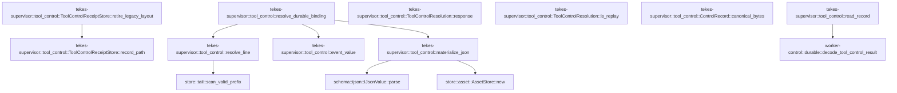

# tekes-supervisor::tool_control

[Package atlas](index.md) · [Source](../../src/tool_control.rs)

## Declarations

Visibility is the declaration spelling; trait members and reexports require their enclosing interface. `cfg` is not evaluated.

| Symbol | Kind | Visibility | Test / cfg |
|---|---|---|---|
| [tekes-supervisor::tool_control::RECORD_FORMAT](../../src/tool_control.rs#L18) | const_item | `private` |  |
| [tekes-supervisor::tool_control::CONTROL_DIR](../../src/tool_control.rs#L20) | const_item | `pub` |  |
| [tekes-supervisor::tool_control::LEGACY_CONTROL_DIRS](../../src/tool_control.rs#L22) | const_item | `private` |  |
| [tekes-supervisor::tool_control::ToolControlHandler](../../src/tool_control.rs#L24) | trait_item | `pub` |  |
| [tekes-supervisor::tool_control::ToolControlHandler::execute](../../src/tool_control.rs#L25) | function_signature_item | `private` |  |
| [tekes-supervisor::tool_control::ToolControlHandler::recovery](../../src/tool_control.rs#L27) | function_item | `private` |  |
| [tekes-supervisor::tool_control::ToolControlHandler::reconcile](../../src/tool_control.rs#L31) | function_item | `private` |  |
| [tekes-supervisor::tool_control::ToolControlHandler::authority_fingerprint](../../src/tool_control.rs#L40) | function_item | `private` |  |
| [tekes-supervisor::tool_control::ToolControlRecovery](../../src/tool_control.rs#L46) | enum_item | `pub` |  |
| [tekes-supervisor::tool_control::ExternalEffectResolution](../../src/tool_control.rs#L63) | enum_item | `pub` |  |
| [tekes-supervisor::tool_control::ToolControlAttempt](../../src/tool_control.rs#L70) | enum_item | `private` |  |
| [tekes-supervisor::tool_control::ToolControlAttemptResult](../../src/tool_control.rs#L75) | enum_item | `private` |  |
| [tekes-supervisor::tool_control::ToolControlPolicy](../../src/tool_control.rs#L80) | trait_item | `pub` |  |
| [tekes-supervisor::tool_control::ToolControlPolicy::apply](../../src/tool_control.rs#L81) | function_signature_item | `private` |  |
| [tekes-supervisor::tool_control::UnavailableToolControlHandler](../../src/tool_control.rs#L87) | struct_item | `pub` |  |
| [tekes-supervisor::tool_control::UnavailableToolControlHandler::execute](../../src/tool_control.rs#L90) | function_item | `private` |  |
| [tekes-supervisor::tool_control::FailClosedToolControlPolicy](../../src/tool_control.rs#L106) | struct_item | `pub` |  |
| [tekes-supervisor::tool_control::FailClosedToolControlPolicy::apply](../../src/tool_control.rs#L109) | function_item | `private` |  |
| [tekes-supervisor::tool_control::ToolControlSession](../../src/tool_control.rs#L125) | struct_item | `pub` |  |
| [tekes-supervisor::tool_control::ToolControlSession::new](../../src/tool_control.rs#L135) | function_item | `pub` |  |
| [tekes-supervisor::tool_control::ToolControlSession::with_cancellation](../../src/tool_control.rs#L146) | function_item | `pub` |  |
| [tekes-supervisor::tool_control::ToolControlSession::handle_line](../../src/tool_control.rs#L154) | function_item | `pub` |  |
| [tekes-supervisor::tool_control::ToolControlReceiptStore](../../src/tool_control.rs#L215) | struct_item | `pub` |  |
| [tekes-supervisor::tool_control::ToolControlReceiptStore::new](../../src/tool_control.rs#L222) | function_item | `pub` |  |
| [tekes-supervisor::tool_control::ToolControlReceiptStore::record_path](../../src/tool_control.rs#L233) | function_item | `pub` |  |
| [tekes-supervisor::tool_control::ToolControlReceiptStore::read_record](../../src/tool_control.rs#L241) | function_item | `pub` |  |
| [tekes-supervisor::tool_control::ToolControlReceiptStore::publish_or_reconcile](../../src/tool_control.rs#L252) | function_item | `private` |  |
| [tekes-supervisor::tool_control::ToolControlReceiptStore::resolve_external_with_authority](../../src/tool_control.rs#L424) | function_item | `private` |  |
| [tekes-supervisor::tool_control::ToolControlReceiptStore::unresolved](../../src/tool_control.rs#L476) | function_item | `private` |  |
| [tekes-supervisor::tool_control::ToolControlReceiptStore::lookup_settled](../../src/tool_control.rs#L500) | function_item | `private` |  |
| [tekes-supervisor::tool_control::ToolControlReceiptStore::publish_response](../../src/tool_control.rs#L521) | function_item | `private` |  |
| [tekes-supervisor::tool_control::ToolControlReceiptStore::publish_response_with_authority](../../src/tool_control.rs#L529) | function_item | `private` |  |
| [tekes-supervisor::tool_control::ToolControlReceiptStore::publish_or_replay](../../src/tool_control.rs#L553) | function_item | `pub` |  |
| [tekes-supervisor::tool_control::ToolControlReceiptStore::control_root](../../src/tool_control.rs#L592) | function_item | `private` |  |
| [tekes-supervisor::tool_control::ToolControlReceiptStore::lock](../../src/tool_control.rs#L598) | function_item | `private` |  |
| [tekes-supervisor::tool_control::ToolControlReceiptStore::retire_legacy_layout](../../src/tool_control.rs#L606) | function_item | `private` |  |
| [tekes-supervisor::tool_control::ResolvedToolControlLine](../../src/tool_control.rs#L643) | struct_item | `pub(crate)` |  |
| [tekes-supervisor::tool_control::resolve_durable_binding](../../src/tool_control.rs#L649) | function_item | `pub(crate)` |  |
| [tekes-supervisor::tool_control::resolve_line](../../src/tool_control.rs#L724) | function_item | `private` |  |
| [tekes-supervisor::tool_control::event_value](../../src/tool_control.rs#L761) | function_item | `private` |  |
| [tekes-supervisor::tool_control::materialize_json](../../src/tool_control.rs#L765) | function_item | `private` |  |
| [tekes-supervisor::tool_control::ToolControlResolution](../../src/tool_control.rs#L793) | enum_item | `pub` |  |
| [tekes-supervisor::tool_control::ToolControlResolution::response](../../src/tool_control.rs#L813) | function_item | `pub` |  |
| [tekes-supervisor::tool_control::ToolControlResolution::is_replay](../../src/tool_control.rs#L823) | function_item | `pub` |  |
| [tekes-supervisor::tool_control::ControlRecord](../../src/tool_control.rs#L832) | struct_item | `pub` |  |
| [tekes-supervisor::tool_control::ControlRecord::canonical_bytes](../../src/tool_control.rs#L839) | function_item | `private` |  |
| [tekes-supervisor::tool_control::read_record](../../src/tool_control.rs#L859) | function_item | `private` |  |
| [tekes-supervisor::tool_control::ToolControlReceiptError](../../src/tool_control.rs#L920) | enum_item | `pub` |  |

## Imports / reexports

| Local name | Source path | Visibility |
|---|---|---|
| `fs` | `std::fs` | `private` |
| `OpenOptions` | `std::fs::OpenOptions` | `private` |
| `Read` | `std::io::Read` | `private` |
| `OpenOptionsExt` | `std::os::unix::fs::OpenOptionsExt` | `private` |
| `Path` | `std::path::Path` | `private` |
| `PathBuf` | `std::path::PathBuf` | `private` |
| `EventKind` | `schema::EventKind` | `private` |
| `IJsonValue` | `schema::IJsonValue` | `private` |
| `Map` | `serde_json::Map` | `private` |
| `Value` | `serde_json::Value` | `private` |
| `AtomicPublisher` | `store::AtomicPublisher` | `private` |
| `NamedLock` | `store::NamedLock` | `private` |
| `StoreError` | `store::StoreError` | `private` |
| `Error` | `thiserror::Error` | `private` |
| `Selected` | `worker_control::Selected` | `private` |
| `DurableControlError` | `worker_control::DurableControlError` | `private` |
| `ToolControl` | `worker_control::ToolControl` | `private` |
| `ToolControlBinding` | `worker_control::ToolControlBinding` | `private` |
| `ToolControlError` | `worker_control::ToolControlError` | `private` |
| `ToolControlErrorCode` | `worker_control::ToolControlErrorCode` | `private` |
| `ToolControlResult` | `worker_control::ToolControlResult` | `private` |
| `decode_tool_control` | `worker_control::decode_tool_control` | `private` |
| `decode_tool_control_result` | `worker_control::decode_tool_control_result` | `private` |
| `encode_tool_control_result` | `worker_control::encode_tool_control_result` | `private` |

## Module declarations

| Module | Visibility | Attributes |
|---|---|---|

## Function call graphs

Edges below are syntactically resolved calls only, including private functions. Graphs partition callers into groups of 20; they are not execution order. All unresolved sites are listed below and in the JSON inventory.

```mermaid
flowchart TD
  n0["store::atomic::AtomicPublisher::replace"]
  n1["store::platform::NamedLock::exclusive"]
  n2["tekes-supervisor::tool_control::FailClosedToolControlPolicy::apply"]
  n3["tekes-supervisor::tool_control::ToolControlSession::new"]
  n4["tekes-supervisor::tool_control::ToolControlSession::with_cancellation"]
  n5["tekes-supervisor::tool_control::ToolControlSession::handle_line"]
  n6["tekes-supervisor::tool_control::ToolControlReceiptStore::new"]
  n7["tekes-supervisor::tool_control::ToolControlReceiptStore::record_path"]
  n8["tekes-supervisor::tool_control::ToolControlReceiptStore::read_record"]
  n9["tekes-supervisor::tool_control::ToolControlReceiptStore::publish_or_reconcile"]
  n10["tekes-supervisor::tool_control::ToolControlHandler::recovery"]
  n11["tekes-supervisor::tool_control::ToolControlHandler::reconcile"]
  n12["tekes-supervisor::tool_control::ToolControlHandler::authority_fingerprint"]
  n13["tekes-supervisor::tool_control::ToolControlReceiptStore::resolve_external_with_authority"]
  n14["tekes-supervisor::tool_control::ToolControlReceiptStore::unresolved"]
  n15["tekes-supervisor::tool_control::ToolControlReceiptStore::lookup_settled"]
  n16["tekes-supervisor::tool_control::ToolControlReceiptStore::publish_response"]
  n17["tekes-supervisor::tool_control::ToolControlReceiptStore::publish_response_with_authority"]
  n18["tekes-supervisor::tool_control::ToolControlReceiptStore::publish_or_replay"]
  n19["tekes-supervisor::tool_control::ToolControlReceiptStore::control_root"]
  n20["tekes-supervisor::tool_control::ToolControlReceiptStore::lock"]
  n21["tekes-supervisor::tool_control::ToolControlReceiptStore::retire_legacy_layout"]
  n22["tekes-supervisor::tool_control::resolve_durable_binding"]
  n23["tekes-supervisor::tool_control::read_record"]
  n24["tekes-supervisor::tool_control::UnavailableToolControlHandler::execute"]
  n25["worker-control::durable::ToolControlResult::failure"]
  n26["worker-control::durable::ToolControlResult::conflict"]
  n27["worker-control::durable::require_version"]
  n28["worker-control::durable::decode_tool_control"]
  n29["worker-control::durable::encode_tool_control_result"]
  n2 --> n25
  n5 --> n6
  n5 --> n22
  n5 --> n25
  n5 --> n27
  n5 --> n28
  n7 --> n19
  n8 --> n7
  n8 --> n23
  n9 --> n0
  n9 --> n7
  n9 --> n8
  n9 --> n13
  n9 --> n14
  n9 --> n15
  n9 --> n16
  n9 --> n17
  n9 --> n20
  n9 --> n25
  n9 --> n26
  n9 --> n29
  n13 --> n14
  n13 --> n17
  n14 --> n25
  n14 --> n29
  n15 --> n8
  n15 --> n26
  n15 --> n29
  n16 --> n17
  n17 --> n0
  n17 --> n7
  n17 --> n29
  n18 --> n0
  n18 --> n7
  n18 --> n15
  n18 --> n20
  n18 --> n29
  n20 --> n1
  n20 --> n19
  n20 --> n21
  n24 --> n25
```

Functions 1–20: 41 direct edges

Functions 21–29: 8 direct edges

## Call sites

Includes test functions (marked in declarations). Receiver-type-required sites need type analysis/manual tracing. Calls in closures are attributed to their enclosing function; their occurrence here does not mean the closure executes immediately.

| Caller | Callee expression | Source lines | Target / classification |
|---|---|---|---|
| `execute` | `ToolControlResult::failure` | [91](../../src/tool_control.rs#L91) | [worker-control::durable::ToolControlResult::failure](../../../worker-control/src/durable.rs#L375) |
| `execute` | `request.request_id.clone` | [92](../../src/tool_control.rs#L92) | receiver-type-required |
| `execute` | `request.call_id.clone` | [93](../../src/tool_control.rs#L93) | receiver-type-required |
| `execute` | `"supervisor tool-control authority is not configured".to_owned` | [96](../../src/tool_control.rs#L96) | receiver-type-required |
| `apply` | `result.value.is_none` | [110](../../src/tool_control.rs#L110) | receiver-type-required |
| `apply` | `ToolControlResult::failure` | [113](../../src/tool_control.rs#L113) | [worker-control::durable::ToolControlResult::failure](../../../worker-control/src/durable.rs#L375) |
| `apply` | `"tool-control result policy is not configured".to_owned` | [118](../../src/tool_control.rs#L118) | receiver-type-required |
| `new` | `root.into` | [137](../../src/tool_control.rs#L137) | receiver-type-required |
| `new` | `tools::CancellationToken::default` | [141](../../src/tool_control.rs#L141) | external-constructor-callback-or-unresolved |
| `handle_line` | `worker_control::require_version` | [155](../../src/tool_control.rs#L155) | [worker-control::durable::require_version](../../../worker-control/src/durable.rs#L443) |
| `handle_line` | `decode_tool_control` | [156](../../src/tool_control.rs#L156) | [worker-control::durable::decode_tool_control](../../../worker-control/src/durable.rs#L474) |
| `handle_line` | `self.root.join("threads").join` | [157](../../src/tool_control.rs#L157) | receiver-type-required |
| `handle_line` | `self.root.join` | [157](../../src/tool_control.rs#L157) | receiver-type-required |
| `handle_line` | `fs::symlink_metadata(&thread_folder)             .map_err` | [158](../../src/tool_control.rs#L158) | receiver-type-required |
| `handle_line` | `fs::symlink_metadata` | [158](../../src/tool_control.rs#L158) | external-constructor-callback-or-unresolved |
| `handle_line` | `thread_metadata.is_dir` | [160](../../src/tool_control.rs#L160) | receiver-type-required |
| `handle_line` | `thread_metadata.file_type().is_symlink` | [160](../../src/tool_control.rs#L160) | receiver-type-required |
| `handle_line` | `thread_metadata.file_type` | [160](../../src/tool_control.rs#L160) | receiver-type-required |
| `handle_line` | `Err` | [161](../../src/tool_control.rs#L161) | external-constructor-callback-or-unresolved |
| `handle_line` | `ToolControlReceiptStore::new` | [163](../../src/tool_control.rs#L163) | [tekes-supervisor::tool_control::ToolControlReceiptStore::new](../../src/tool_control.rs#L222) |
| `handle_line` | `store.thread_folder.clone` | [164](../../src/tool_control.rs#L164) | receiver-type-required |
| `handle_line` | `self.cancellation.clone` | [167](../../src/tool_control.rs#L167) | receiver-type-required |
| `handle_line` | `handler.recovery` | [168](../../src/tool_control.rs#L168) | receiver-type-required |
| `handle_line` | `handler.authority_fingerprint` | [169](../../src/tool_control.rs#L169) | receiver-type-required |
| `handle_line` | `store.publish_or_reconcile` | [170](../../src/tool_control.rs#L170) | receiver-type-required |
| `handle_line` | `resolve_durable_binding` | [174](../../src/tool_control.rs#L174) | [tekes-supervisor::tool_control::resolve_durable_binding](../../src/tool_control.rs#L649) |
| `handle_line` | `session_cancelled.is_cancelled` | [177](../../src/tool_control.rs#L177) | receiver-type-required |
| `handle_line` | `ToolControlAttemptResult::Executed` | [180](../../src/tool_control.rs#L180), [192](../../src/tool_control.rs#L192), [198](../../src/tool_control.rs#L198) | external-constructor-callback-or-unresolved |
| `handle_line` | `ToolControlResult::failure` | [180](../../src/tool_control.rs#L180), [198](../../src/tool_control.rs#L198) | [worker-control::durable::ToolControlResult::failure](../../../worker-control/src/durable.rs#L375) |
| `handle_line` | `request.request_id.clone` | [181](../../src/tool_control.rs#L181), [199](../../src/tool_control.rs#L199) | receiver-type-required |
| `handle_line` | `request.call_id.clone` | [182](../../src/tool_control.rs#L182), [200](../../src/tool_control.rs#L200) | receiver-type-required |
| `handle_line` | `"session stop is active; tool execution cancelled"                                     .to_owned` | [185](../../src/tool_control.rs#L185) | receiver-type-required |
| `handle_line` | `handler.execute` | [192](../../src/tool_control.rs#L192) | receiver-type-required |
| `handle_line` | `ToolControlAttemptResult::Reconciled` | [195](../../src/tool_control.rs#L195) | external-constructor-callback-or-unresolved |
| `handle_line` | `handler.reconcile` | [195](../../src/tool_control.rs#L195) | receiver-type-required |
| `handle_line` | `policy.apply` | [208](../../src/tool_control.rs#L208) | receiver-type-required |
| `handle_line` | `Ok` | [210](../../src/tool_control.rs#L210) | external-constructor-callback-or-unresolved |
| `handle_line` | `resolution.response().to_vec` | [210](../../src/tool_control.rs#L210) | receiver-type-required |
| `handle_line` | `resolution.response` | [210](../../src/tool_control.rs#L210) | receiver-type-required |
| `new` | `thread_folder.into` | [224](../../src/tool_control.rs#L224) | receiver-type-required |
| `new` | `bound_session.into` | [225](../../src/tool_control.rs#L225) | receiver-type-required |
| `record_path` | `request_id.get(..2).unwrap_or` | [234](../../src/tool_control.rs#L234) | receiver-type-required |
| `record_path` | `request_id.get` | [234](../../src/tool_control.rs#L234) | receiver-type-required |
| `record_path` | `self.control_root()             .join(prefix)             .join` | [235](../../src/tool_control.rs#L235) | receiver-type-required |
| `record_path` | `self.control_root()             .join` | [235](../../src/tool_control.rs#L235) | receiver-type-required |
| `record_path` | `self.control_root` | [235](../../src/tool_control.rs#L235) | [tekes-supervisor::tool_control::ToolControlReceiptStore::control_root](../../src/tool_control.rs#L592) |
| `read_record` | `self.record_path` | [245](../../src/tool_control.rs#L245) | [tekes-supervisor::tool_control::ToolControlReceiptStore::record_path](../../src/tool_control.rs#L233) |
| `read_record` | `path.exists` | [246](../../src/tool_control.rs#L246) | receiver-type-required |
| `read_record` | `Ok` | [247](../../src/tool_control.rs#L247) | external-constructor-callback-or-unresolved |
| `read_record` | `read_record(&path).map` | [249](../../src/tool_control.rs#L249) | receiver-type-required |
| `read_record` | `read_record` | [249](../../src/tool_control.rs#L249) | [tekes-supervisor::tool_control::read_record](../../src/tool_control.rs#L859) |
| `publish_or_reconcile` | `request.validate_for_receipt_lookup` | [264](../../src/tool_control.rs#L264) | receiver-type-required |
| `publish_or_reconcile` | `Err` | [266](../../src/tool_control.rs#L266), [279](../../src/tool_control.rs#L279), [370](../../src/tool_control.rs#L370), [384](../../src/tool_control.rs#L384), [394](../../src/tool_control.rs#L394) | external-constructor-callback-or-unresolved |
| `publish_or_reconcile` | `self.lock` | [268](../../src/tool_control.rs#L268) | [tekes-supervisor::tool_control::ToolControlReceiptStore::lock](../../src/tool_control.rs#L598) |
| `publish_or_reconcile` | `self.lookup_settled` | [269](../../src/tool_control.rs#L269) | [tekes-supervisor::tool_control::ToolControlReceiptStore::lookup_settled](../../src/tool_control.rs#L500) |
| `publish_or_reconcile` | `Ok` | [270](../../src/tool_control.rs#L270), [286](../../src/tool_control.rs#L286), [314](../../src/tool_control.rs#L314), [339](../../src/tool_control.rs#L339) | external-constructor-callback-or-unresolved |
| `publish_or_reconcile` | `request.validate` | [272](../../src/tool_control.rs#L272) | receiver-type-required |
| `publish_or_reconcile` | `backend` | [277](../../src/tool_control.rs#L277), [368](../../src/tool_control.rs#L368), [382](../../src/tool_control.rs#L382), [392](../../src/tool_control.rs#L392) | external-constructor-callback-or-unresolved |
| `publish_or_reconcile` | `self.publish_response` | [281](../../src/tool_control.rs#L281), [298](../../src/tool_control.rs#L298) | [tekes-supervisor::tool_control::ToolControlReceiptStore::publish_response](../../src/tool_control.rs#L521) |
| `publish_or_reconcile` | `apply_policy` | [281](../../src/tool_control.rs#L281), [417](../../src/tool_control.rs#L417) | external-constructor-callback-or-unresolved |
| `publish_or_reconcile` | `self.read_record` | [284](../../src/tool_control.rs#L284), [312](../../src/tool_control.rs#L312), [336](../../src/tool_control.rs#L336) | [tekes-supervisor::tool_control::ToolControlReceiptStore::read_record](../../src/tool_control.rs#L241) |
| `publish_or_reconcile` | `encode_tool_control_result` | [287](../../src/tool_control.rs#L287), [315](../../src/tool_control.rs#L315), [340](../../src/tool_control.rs#L340) | [worker-control::durable::encode_tool_control_result](../../../worker-control/src/durable.rs#L480) |
| `publish_or_reconcile` | `ToolControlResult::conflict` | [287](../../src/tool_control.rs#L287), [315](../../src/tool_control.rs#L315), [340](../../src/tool_control.rs#L340) | [worker-control::durable::ToolControlResult::conflict](../../../worker-control/src/durable.rs#L390) |
| `publish_or_reconcile` | `self.unresolved` | [292](../../src/tool_control.rs#L292), [320](../../src/tool_control.rs#L320), [326](../../src/tool_control.rs#L326), [346](../../src/tool_control.rs#L346), [409](../../src/tool_control.rs#L409) | [tekes-supervisor::tool_control::ToolControlReceiptStore::unresolved](../../src/tool_control.rs#L476) |
| `publish_or_reconcile` | `ToolControlResult::failure` | [300](../../src/tool_control.rs#L300) | [worker-control::durable::ToolControlResult::failure](../../../worker-control/src/durable.rs#L375) |
| `publish_or_reconcile` | `request.request_id.clone` | [301](../../src/tool_control.rs#L301) | receiver-type-required |
| `publish_or_reconcile` | `request.call_id.clone` | [302](../../src/tool_control.rs#L302) | receiver-type-required |
| `publish_or_reconcile` | `"effectful tool has no idempotency-reconcile authority; manual execution is required".to_owned` | [305](../../src/tool_control.rs#L305) | receiver-type-required |
| `publish_or_reconcile` | `intent.authority.is_some` | [345](../../src/tool_control.rs#L345) | receiver-type-required |
| `publish_or_reconcile` | `intent.authority.or` | [352](../../src/tool_control.rs#L352) | receiver-type-required |
| `publish_or_reconcile` | `request.clone` | [355](../../src/tool_control.rs#L355) | receiver-type-required |
| `publish_or_reconcile` | `authority.clone` | [357](../../src/tool_control.rs#L357) | receiver-type-required |
| `publish_or_reconcile` | `AtomicPublisher::replace` | [359](../../src/tool_control.rs#L359) | [store::atomic::AtomicPublisher::replace](../../../store/src/atomic.rs#L16) |
| `publish_or_reconcile` | `self.record_path` | [360](../../src/tool_control.rs#L360) | [tekes-supervisor::tool_control::ToolControlReceiptStore::record_path](../../src/tool_control.rs#L233) |
| `publish_or_reconcile` | `intent.canonical_bytes` | [361](../../src/tool_control.rs#L361) | receiver-type-required |
| `publish_or_reconcile` | `self.resolve_external_with_authority` | [372](../../src/tool_control.rs#L372), [396](../../src/tool_control.rs#L396) | [tekes-supervisor::tool_control::ToolControlReceiptStore::resolve_external_with_authority](../../src/tool_control.rs#L424) |
| `publish_or_reconcile` | `record_authority.as_deref` | [375](../../src/tool_control.rs#L375), [399](../../src/tool_control.rs#L399), [418](../../src/tool_control.rs#L418) | receiver-type-required |
| `publish_or_reconcile` | `response                     .error                     .as_ref()                     .is_some_and` | [386](../../src/tool_control.rs#L386) | receiver-type-required |
| `publish_or_reconcile` | `response                     .error                     .as_ref` | [386](../../src/tool_control.rs#L386), [404](../../src/tool_control.rs#L404) | receiver-type-required |
| `publish_or_reconcile` | `response                     .error                     .as_ref()                     .filter` | [404](../../src/tool_control.rs#L404) | receiver-type-required |
| `publish_or_reconcile` | `self.publish_response_with_authority` | [415](../../src/tool_control.rs#L415) | [tekes-supervisor::tool_control::ToolControlReceiptStore::publish_response_with_authority](../../src/tool_control.rs#L529) |
| `resolve_external_with_authority` | `self.publish_response_with_authority` | [438](../../src/tool_control.rs#L438), [465](../../src/tool_control.rs#L465) | [tekes-supervisor::tool_control::ToolControlReceiptStore::publish_response_with_authority](../../src/tool_control.rs#L529) |
| `resolve_external_with_authority` | `apply_policy` | [438](../../src/tool_control.rs#L438), [465](../../src/tool_control.rs#L465) | external-constructor-callback-or-unresolved |
| `resolve_external_with_authority` | `backend` | [442](../../src/tool_control.rs#L442) | external-constructor-callback-or-unresolved |
| `resolve_external_with_authority` | `Err` | [444](../../src/tool_control.rs#L444) | external-constructor-callback-or-unresolved |
| `resolve_external_with_authority` | `response.error.as_ref` | [446](../../src/tool_control.rs#L446) | receiver-type-required |
| `resolve_external_with_authority` | `self.unresolved` | [449](../../src/tool_control.rs#L449), [456](../../src/tool_control.rs#L456), [468](../../src/tool_control.rs#L468), [471](../../src/tool_control.rs#L471) | [tekes-supervisor::tool_control::ToolControlReceiptStore::unresolved](../../src/tool_control.rs#L476) |
| `unresolved` | `ToolControlResult::failure` | [482](../../src/tool_control.rs#L482) | [worker-control::durable::ToolControlResult::failure](../../../worker-control/src/durable.rs#L375) |
| `unresolved` | `request.request_id.clone` | [483](../../src/tool_control.rs#L483) | receiver-type-required |
| `unresolved` | `request.call_id.clone` | [484](../../src/tool_control.rs#L484) | receiver-type-required |
| `unresolved` | `Ok` | [493](../../src/tool_control.rs#L493) | external-constructor-callback-or-unresolved |
| `unresolved` | `encode_tool_control_result` | [494](../../src/tool_control.rs#L494) | [worker-control::durable::encode_tool_control_result](../../../worker-control/src/durable.rs#L480) |
| `lookup_settled` | `self.read_record` | [504](../../src/tool_control.rs#L504) | [tekes-supervisor::tool_control::ToolControlReceiptStore::read_record](../../src/tool_control.rs#L241) |
| `lookup_settled` | `Ok` | [505](../../src/tool_control.rs#L505), [508](../../src/tool_control.rs#L508), [512](../../src/tool_control.rs#L512), [516](../../src/tool_control.rs#L516) | external-constructor-callback-or-unresolved |
| `lookup_settled` | `response.validate_for` | [511](../../src/tool_control.rs#L511) | receiver-type-required |
| `lookup_settled` | `Some` | [512](../../src/tool_control.rs#L512), [516](../../src/tool_control.rs#L516) | external-constructor-callback-or-unresolved |
| `lookup_settled` | `encode_tool_control_result` | [513](../../src/tool_control.rs#L513), [517](../../src/tool_control.rs#L517) | [worker-control::durable::encode_tool_control_result](../../../worker-control/src/durable.rs#L480) |
| `lookup_settled` | `ToolControlResult::conflict` | [517](../../src/tool_control.rs#L517) | [worker-control::durable::ToolControlResult::conflict](../../../worker-control/src/durable.rs#L390) |
| `publish_response` | `self.publish_response_with_authority` | [526](../../src/tool_control.rs#L526) | [tekes-supervisor::tool_control::ToolControlReceiptStore::publish_response_with_authority](../../src/tool_control.rs#L529) |
| `publish_response_with_authority` | `response.validate_for` | [535](../../src/tool_control.rs#L535) | receiver-type-required |
| `publish_response_with_authority` | `request.clone` | [537](../../src/tool_control.rs#L537) | receiver-type-required |
| `publish_response_with_authority` | `Some` | [538](../../src/tool_control.rs#L538) | external-constructor-callback-or-unresolved |
| `publish_response_with_authority` | `authority.map` | [539](../../src/tool_control.rs#L539) | receiver-type-required |
| `publish_response_with_authority` | `self.record_path` | [541](../../src/tool_control.rs#L541) | [tekes-supervisor::tool_control::ToolControlReceiptStore::record_path](../../src/tool_control.rs#L233) |
| `publish_response_with_authority` | `AtomicPublisher::replace` | [542](../../src/tool_control.rs#L542) | [store::atomic::AtomicPublisher::replace](../../../store/src/atomic.rs#L16) |
| `publish_response_with_authority` | `receipt.canonical_bytes` | [542](../../src/tool_control.rs#L542) | receiver-type-required |
| `publish_response_with_authority` | `Ok` | [543](../../src/tool_control.rs#L543) | external-constructor-callback-or-unresolved |
| `publish_response_with_authority` | `encode_tool_control_result` | [544](../../src/tool_control.rs#L544) | [worker-control::durable::encode_tool_control_result](../../../worker-control/src/durable.rs#L480) |
| `publish_response_with_authority` | `receipt.response.as_ref().expect` | [544](../../src/tool_control.rs#L544) | receiver-type-required |
| `publish_response_with_authority` | `receipt.response.as_ref` | [544](../../src/tool_control.rs#L544) | receiver-type-required |
| `publish_or_replay` | `request.validate_for_receipt_lookup` | [563](../../src/tool_control.rs#L563) | receiver-type-required |
| `publish_or_replay` | `Err` | [565](../../src/tool_control.rs#L565) | external-constructor-callback-or-unresolved |
| `publish_or_replay` | `self.lock` | [568](../../src/tool_control.rs#L568) | [tekes-supervisor::tool_control::ToolControlReceiptStore::lock](../../src/tool_control.rs#L598) |
| `publish_or_replay` | `self.lookup_settled` | [569](../../src/tool_control.rs#L569) | [tekes-supervisor::tool_control::ToolControlReceiptStore::lookup_settled](../../src/tool_control.rs#L500) |
| `publish_or_replay` | `Ok` | [570](../../src/tool_control.rs#L570), [586](../../src/tool_control.rs#L586) | external-constructor-callback-or-unresolved |
| `publish_or_replay` | `self.record_path` | [572](../../src/tool_control.rs#L572) | [tekes-supervisor::tool_control::ToolControlReceiptStore::record_path](../../src/tool_control.rs#L233) |
| `publish_or_replay` | `request.validate` | [575](../../src/tool_control.rs#L575) | receiver-type-required |
| `publish_or_replay` | `apply_policy` | [576](../../src/tool_control.rs#L576) | external-constructor-callback-or-unresolved |
| `publish_or_replay` | `backend` | [576](../../src/tool_control.rs#L576) | external-constructor-callback-or-unresolved |
| `publish_or_replay` | `response.validate_for` | [577](../../src/tool_control.rs#L577) | receiver-type-required |
| `publish_or_replay` | `request.clone` | [579](../../src/tool_control.rs#L579) | receiver-type-required |
| `publish_or_replay` | `Some` | [580](../../src/tool_control.rs#L580) | external-constructor-callback-or-unresolved |
| `publish_or_replay` | `receipt.canonical_bytes` | [583](../../src/tool_control.rs#L583) | receiver-type-required |
| `publish_or_replay` | `AtomicPublisher::replace` | [584](../../src/tool_control.rs#L584) | [store::atomic::AtomicPublisher::replace](../../../store/src/atomic.rs#L16) |
| `publish_or_replay` | `encode_tool_control_result` | [585](../../src/tool_control.rs#L585) | [worker-control::durable::encode_tool_control_result](../../../worker-control/src/durable.rs#L480) |
| `publish_or_replay` | `receipt.response.as_ref().expect` | [585](../../src/tool_control.rs#L585) | receiver-type-required |
| `publish_or_replay` | `receipt.response.as_ref` | [585](../../src/tool_control.rs#L585) | receiver-type-required |
| `control_root` | `self.thread_folder.join` | [593](../../src/tool_control.rs#L593) | receiver-type-required |
| `lock` | `self.control_root` | [599](../../src/tool_control.rs#L599) | [tekes-supervisor::tool_control::ToolControlReceiptStore::control_root](../../src/tool_control.rs#L592) |
| `lock` | `fs::create_dir_all` | [600](../../src/tool_control.rs#L600) | external-constructor-callback-or-unresolved |
| `lock` | `NamedLock::exclusive` | [601](../../src/tool_control.rs#L601) | [store::platform::NamedLock::exclusive](../../../store/src/platform.rs#L103) |
| `lock` | `root.join` | [601](../../src/tool_control.rs#L601) | receiver-type-required |
| `lock` | `self.retire_legacy_layout` | [602](../../src/tool_control.rs#L602) | [tekes-supervisor::tool_control::ToolControlReceiptStore::retire_legacy_layout](../../src/tool_control.rs#L606) |
| `lock` | `Ok` | [603](../../src/tool_control.rs#L603) | external-constructor-callback-or-unresolved |
| `retire_legacy_layout` | `self.thread_folder.join` | [610](../../src/tool_control.rs#L610) | receiver-type-required |
| `retire_legacy_layout` | `legacy_root.is_dir` | [611](../../src/tool_control.rs#L611) | receiver-type-required |
| `retire_legacy_layout` | `fs::read_dir` | [614](../../src/tool_control.rs#L614), [619](../../src/tool_control.rs#L619) | external-constructor-callback-or-unresolved |
| `retire_legacy_layout` | `prefix.file_type()?.is_dir` | [616](../../src/tool_control.rs#L616) | receiver-type-required |
| `retire_legacy_layout` | `prefix.file_type` | [616](../../src/tool_control.rs#L616) | receiver-type-required |
| `retire_legacy_layout` | `prefix.path` | [619](../../src/tool_control.rs#L619) | receiver-type-required |
| `retire_legacy_layout` | `entry.file_name` | [621](../../src/tool_control.rs#L621) | receiver-type-required |
| `retire_legacy_layout` | `name.to_str().and_then` | [623](../../src/tool_control.rs#L623) | receiver-type-required |
| `retire_legacy_layout` | `name.to_str` | [623](../../src/tool_control.rs#L623) | receiver-type-required |
| `retire_legacy_layout` | `name.strip_suffix` | [623](../../src/tool_control.rs#L623) | receiver-type-required |
| `retire_legacy_layout` | `self.record_path` | [627](../../src/tool_control.rs#L627) | [tekes-supervisor::tool_control::ToolControlReceiptStore::record_path](../../src/tool_control.rs#L233) |
| `retire_legacy_layout` | `target.exists` | [628](../../src/tool_control.rs#L628) | receiver-type-required |
| `retire_legacy_layout` | `fs::remove_file` | [630](../../src/tool_control.rs#L630) | external-constructor-callback-or-unresolved |
| `retire_legacy_layout` | `entry.path` | [630](../../src/tool_control.rs#L630), [634](../../src/tool_control.rs#L634) | receiver-type-required |
| `retire_legacy_layout` | `fs::create_dir_all` | [633](../../src/tool_control.rs#L633) | external-constructor-callback-or-unresolved |
| `retire_legacy_layout` | `target.parent().expect` | [633](../../src/tool_control.rs#L633) | receiver-type-required |
| `retire_legacy_layout` | `target.parent` | [633](../../src/tool_control.rs#L633) | receiver-type-required |
| `retire_legacy_layout` | `fs::rename` | [634](../../src/tool_control.rs#L634) | external-constructor-callback-or-unresolved |
| `retire_legacy_layout` | `fs::remove_dir_all` | [637](../../src/tool_control.rs#L637) | external-constructor-callback-or-unresolved |
| `retire_legacy_layout` | `Ok` | [639](../../src/tool_control.rs#L639) | external-constructor-callback-or-unresolved |
| `resolve_durable_binding` | `resolve_line` | [653](../../src/tool_control.rs#L653) | [tekes-supervisor::tool_control::resolve_line](../../src/tool_control.rs#L724) |
| `resolve_durable_binding` | `event.turn` | [658](../../src/tool_control.rs#L658) | receiver-type-required |
| `resolve_durable_binding` | `Some` | [658](../../src/tool_control.rs#L658), [659](../../src/tool_control.rs#L659), [671](../../src/tool_control.rs#L671), [680](../../src/tool_control.rs#L680), [684](../../src/tool_control.rs#L684) | external-constructor-callback-or-unresolved |
| `resolve_durable_binding` | `event.string_field` | [659](../../src/tool_control.rs#L659), [679](../../src/tool_control.rs#L679) | receiver-type-required |
| `resolve_durable_binding` | `request.call_id.as_str` | [659](../../src/tool_control.rs#L659) | receiver-type-required |
| `resolve_durable_binding` | `event.kind` | [663](../../src/tool_control.rs#L663) | receiver-type-required |
| `resolve_durable_binding` | `tool_call_seq.is_some` | [665](../../src/tool_control.rs#L665) | receiver-type-required |
| `resolve_durable_binding` | `Err` | [666](../../src/tool_control.rs#L666), [715](../../src/tool_control.rs#L715) | external-constructor-callback-or-unresolved |
| `resolve_durable_binding` | `ToolControlReceiptError::DurableBinding` | [666](../../src/tool_control.rs#L666), [675](../../src/tool_control.rs#L675), [688](../../src/tool_control.rs#L688), [696](../../src/tool_control.rs#L696), [699](../../src/tool_control.rs#L699) | external-constructor-callback-or-unresolved |
| `resolve_durable_binding` | `event_value` | [670](../../src/tool_control.rs#L670), [683](../../src/tool_control.rs#L683) | [tekes-supervisor::tool_control::event_value](../../src/tool_control.rs#L761) |
| `resolve_durable_binding` | `materialize_json` | [671](../../src/tool_control.rs#L671), [684](../../src/tool_control.rs#L684) | [tekes-supervisor::tool_control::materialize_json](../../src/tool_control.rs#L765) |
| `resolve_durable_binding` | `value                         .get("args")                         .ok_or` | [673](../../src/tool_control.rs#L673) | receiver-type-required |
| `resolve_durable_binding` | `value                         .get` | [673](../../src/tool_control.rs#L673), [686](../../src/tool_control.rs#L686) | receiver-type-required |
| `resolve_durable_binding` | `event.string_field("name").map` | [679](../../src/tool_control.rs#L679) | receiver-type-required |
| `resolve_durable_binding` | `event.seq` | [680](../../src/tool_control.rs#L680), [682](../../src/tool_control.rs#L682) | receiver-type-required |
| `resolve_durable_binding` | `tool_call_seq.is_some_and` | [682](../../src/tool_control.rs#L682) | receiver-type-required |
| `resolve_durable_binding` | `value                         .get("invocation")                         .ok_or` | [686](../../src/tool_control.rs#L686) | receiver-type-required |
| `resolve_durable_binding` | `invocation.ok_or` | [696](../../src/tool_control.rs#L696) | receiver-type-required |
| `resolve_durable_binding` | `name.ok_or` | [699](../../src/tool_control.rs#L699) | receiver-type-required |
| `resolve_durable_binding` | `request.validate_against` | [702](../../src/tool_control.rs#L702) | receiver-type-required |
| `resolve_durable_binding` | `line_path.is_file` | [714](../../src/tool_control.rs#L714) | receiver-type-required |
| `resolve_durable_binding` | `Ok` | [717](../../src/tool_control.rs#L717) | external-constructor-callback-or-unresolved |
| `resolve_durable_binding` | `thread_folder.to_path_buf` | [718](../../src/tool_control.rs#L718) | receiver-type-required |
| `resolve_line` | `Vec::new` | [728](../../src/tool_control.rs#L728) | external-constructor-callback-or-unresolved |
| `resolve_line` | `fs::read_dir` | [729](../../src/tool_control.rs#L729) | external-constructor-callback-or-unresolved |
| `resolve_line` | `entry.file_type()?.is_file` | [731](../../src/tool_control.rs#L731) | receiver-type-required |
| `resolve_line` | `entry.file_type` | [731](../../src/tool_control.rs#L731) | receiver-type-required |
| `resolve_line` | `entry.path` | [734](../../src/tool_control.rs#L734) | receiver-type-required |
| `resolve_line` | `path.extension().and_then` | [735](../../src/tool_control.rs#L735) | receiver-type-required |
| `resolve_line` | `path.extension` | [735](../../src/tool_control.rs#L735) | receiver-type-required |
| `resolve_line` | `value.to_str` | [735](../../src/tool_control.rs#L735), [736](../../src/tool_control.rs#L736) | receiver-type-required |
| `resolve_line` | `Some` | [735](../../src/tool_control.rs#L735), [736](../../src/tool_control.rs#L736), [747](../../src/tool_control.rs#L747) | external-constructor-callback-or-unresolved |
| `resolve_line` | `path.file_name().and_then` | [736](../../src/tool_control.rs#L736) | receiver-type-required |
| `resolve_line` | `path.file_name` | [736](../../src/tool_control.rs#L736) | receiver-type-required |
| `resolve_line` | `fs::read` | [740](../../src/tool_control.rs#L740) | external-constructor-callback-or-unresolved |
| `resolve_line` | `store::scan_valid_prefix` | [741](../../src/tool_control.rs#L741) | [store::tail::scan_valid_prefix](../../../store/src/tail.rs#L37) |
| `resolve_line` | `projection.events.first().is_some_and` | [745](../../src/tool_control.rs#L745) | receiver-type-required |
| `resolve_line` | `projection.events.first` | [745](../../src/tool_control.rs#L745) | receiver-type-required |
| `resolve_line` | `genesis.string_field` | [747](../../src/tool_control.rs#L747) | receiver-type-required |
| `resolve_line` | `matches.push` | [749](../../src/tool_control.rs#L749) | receiver-type-required |
| `resolve_line` | `matches.len` | [752](../../src/tool_control.rs#L752) | receiver-type-required |
| `resolve_line` | `Ok` | [753](../../src/tool_control.rs#L753) | external-constructor-callback-or-unresolved |
| `resolve_line` | `matches.pop().expect` | [753](../../src/tool_control.rs#L753) | receiver-type-required |
| `resolve_line` | `matches.pop` | [753](../../src/tool_control.rs#L753) | receiver-type-required |
| `resolve_line` | `Err` | [754](../../src/tool_control.rs#L754), [755](../../src/tool_control.rs#L755) | external-constructor-callback-or-unresolved |
| `resolve_line` | `ToolControlReceiptError::DurableBinding` | [755](../../src/tool_control.rs#L755) | external-constructor-callback-or-unresolved |
| `event_value` | `serde_json::to_value(event.raw()).map_err` | [762](../../src/tool_control.rs#L762) | receiver-type-required |
| `event_value` | `serde_json::to_value` | [762](../../src/tool_control.rs#L762) | external-constructor-callback-or-unresolved |
| `event_value` | `event.raw` | [762](../../src/tool_control.rs#L762) | receiver-type-required |
| `materialize_json` | `value.get("$spill").and_then` | [769](../../src/tool_control.rs#L769) | receiver-type-required |
| `materialize_json` | `value.get` | [769](../../src/tool_control.rs#L769) | receiver-type-required |
| `materialize_json` | `value.as_object().is_none_or` | [770](../../src/tool_control.rs#L770) | receiver-type-required |
| `materialize_json` | `value.as_object` | [770](../../src/tool_control.rs#L770) | receiver-type-required |
| `materialize_json` | `object.len` | [770](../../src/tool_control.rs#L770) | receiver-type-required |
| `materialize_json` | `Err` | [771](../../src/tool_control.rs#L771), [783](../../src/tool_control.rs#L783) | external-constructor-callback-or-unresolved |
| `materialize_json` | `ToolControlReceiptError::DurableBinding` | [771](../../src/tool_control.rs#L771), [776](../../src/tool_control.rs#L776), [779](../../src/tool_control.rs#L779), [783](../../src/tool_control.rs#L783) | external-constructor-callback-or-unresolved |
| `materialize_json` | `spill.get("asset").and_then(Value::as_str).ok_or` | [775](../../src/tool_control.rs#L775) | receiver-type-required |
| `materialize_json` | `spill.get("asset").and_then` | [775](../../src/tool_control.rs#L775) | receiver-type-required |
| `materialize_json` | `spill.get` | [775](../../src/tool_control.rs#L775), [778](../../src/tool_control.rs#L778) | receiver-type-required |
| `materialize_json` | `spill.get("bytes").and_then(Value::as_u64).ok_or` | [778](../../src/tool_control.rs#L778) | receiver-type-required |
| `materialize_json` | `spill.get("bytes").and_then` | [778](../../src/tool_control.rs#L778) | receiver-type-required |
| `materialize_json` | `store::AssetStore::new(thread_folder.join("assets"))?.read_verified` | [781](../../src/tool_control.rs#L781) | receiver-type-required |
| `materialize_json` | `store::AssetStore::new` | [781](../../src/tool_control.rs#L781) | [store::asset::AssetStore::new](../../../store/src/asset.rs#L27) |
| `materialize_json` | `thread_folder.join` | [781](../../src/tool_control.rs#L781) | receiver-type-required |
| `materialize_json` | `u64::try_from(bytes.len()).ok` | [782](../../src/tool_control.rs#L782) | receiver-type-required |
| `materialize_json` | `u64::try_from` | [782](../../src/tool_control.rs#L782) | external-constructor-callback-or-unresolved |
| `materialize_json` | `bytes.len` | [782](../../src/tool_control.rs#L782) | receiver-type-required |
| `materialize_json` | `Some` | [782](../../src/tool_control.rs#L782) | external-constructor-callback-or-unresolved |
| `materialize_json` | `Ok` | [787](../../src/tool_control.rs#L787), [789](../../src/tool_control.rs#L789) | external-constructor-callback-or-unresolved |
| `materialize_json` | `IJsonValue::parse` | [787](../../src/tool_control.rs#L787), [789](../../src/tool_control.rs#L789) | [schema::ijson::IJsonValue::parse](../../../schema/src/ijson.rs#L16) |
| `materialize_json` | `serde_json::to_vec` | [789](../../src/tool_control.rs#L789) | external-constructor-callback-or-unresolved |
| `canonical_bytes` | `Value::String` | [845](../../src/tool_control.rs#L845) | external-constructor-callback-or-unresolved |
| `canonical_bytes` | `authority.clone` | [845](../../src/tool_control.rs#L845) | receiver-type-required |
| `canonical_bytes` | `Map::new` | [848](../../src/tool_control.rs#L848) | external-constructor-callback-or-unresolved |
| `canonical_bytes` | `envelope.insert` | [849](../../src/tool_control.rs#L849) | receiver-type-required |
| `canonical_bytes` | `"tool_control_result".to_owned` | [850](../../src/tool_control.rs#L850) | receiver-type-required |
| `canonical_bytes` | `serde_json::to_value` | [851](../../src/tool_control.rs#L851) | external-constructor-callback-or-unresolved |
| `canonical_bytes` | `Value::Object` | [853](../../src/tool_control.rs#L853) | external-constructor-callback-or-unresolved |
| `canonical_bytes` | `Ok` | [855](../../src/tool_control.rs#L855) | external-constructor-callback-or-unresolved |
| `canonical_bytes` | `serde_json_canonicalizer::to_vec` | [855](../../src/tool_control.rs#L855) | external-constructor-callback-or-unresolved |
| `read_record` | `OpenOptions::new()         .read(true)         .custom_flags(libc::O_CLOEXEC &#124; libc::O_NOFOLLOW)         .open` | [860](../../src/tool_control.rs#L860) | receiver-type-required |
| `read_record` | `OpenOptions::new()         .read(true)         .custom_flags` | [860](../../src/tool_control.rs#L860) | receiver-type-required |
| `read_record` | `OpenOptions::new()         .read` | [860](../../src/tool_control.rs#L860) | receiver-type-required |
| `read_record` | `OpenOptions::new` | [860](../../src/tool_control.rs#L860) | external-constructor-callback-or-unresolved |
| `read_record` | `file.metadata()?.file_type().is_file` | [864](../../src/tool_control.rs#L864) | receiver-type-required |
| `read_record` | `file.metadata()?.file_type` | [864](../../src/tool_control.rs#L864) | receiver-type-required |
| `read_record` | `file.metadata` | [864](../../src/tool_control.rs#L864) | receiver-type-required |
| `read_record` | `Err` | [865](../../src/tool_control.rs#L865), [871](../../src/tool_control.rs#L871), [880](../../src/tool_control.rs#L880), [883](../../src/tool_control.rs#L883) | external-constructor-callback-or-unresolved |
| `read_record` | `Vec::new` | [867](../../src/tool_control.rs#L867) | external-constructor-callback-or-unresolved |
| `read_record` | `file.read_to_end` | [868](../../src/tool_control.rs#L868) | receiver-type-required |
| `read_record` | `serde_json::from_slice` | [869](../../src/tool_control.rs#L869) | external-constructor-callback-or-unresolved |
| `read_record` | `serde_json_canonicalizer::to_vec` | [870](../../src/tool_control.rs#L870), [904](../../src/tool_control.rs#L904) | external-constructor-callback-or-unresolved |
| `read_record` | `value         .as_object()         .ok_or` | [873](../../src/tool_control.rs#L873) | receiver-type-required |
| `read_record` | `value         .as_object` | [873](../../src/tool_control.rs#L873) | receiver-type-required |
| `read_record` | `object.contains_key` | [876](../../src/tool_control.rs#L876), [877](../../src/tool_control.rs#L877) | receiver-type-required |
| `read_record` | `usize::from` | [878](../../src/tool_control.rs#L878) | external-constructor-callback-or-unresolved |
| `read_record` | `object.len` | [879](../../src/tool_control.rs#L879) | receiver-type-required |
| `read_record` | `object.get("format").and_then` | [882](../../src/tool_control.rs#L882) | receiver-type-required |
| `read_record` | `object.get` | [882](../../src/tool_control.rs#L882) | receiver-type-required |
| `read_record` | `Some` | [882](../../src/tool_control.rs#L882), [898](../../src/tool_control.rs#L898), [908](../../src/tool_control.rs#L908) | external-constructor-callback-or-unresolved |
| `read_record` | `serde_json::from_value` | [885](../../src/tool_control.rs#L885) | external-constructor-callback-or-unresolved |
| `read_record` | `object             .get("request")             .cloned()             .ok_or` | [886](../../src/tool_control.rs#L886) | receiver-type-required |
| `read_record` | `object             .get("request")             .cloned` | [886](../../src/tool_control.rs#L886) | receiver-type-required |
| `read_record` | `object             .get` | [886](../../src/tool_control.rs#L886), [893](../../src/tool_control.rs#L893) | receiver-type-required |
| `read_record` | `request.validate` | [891](../../src/tool_control.rs#L891) | receiver-type-required |
| `read_record` | `object             .get("authority")             .and_then(Value::as_str)             .filter(&#124;value&#124; !value.is_empty())             .ok_or` | [893](../../src/tool_control.rs#L893) | receiver-type-required |
| `read_record` | `object             .get("authority")             .and_then(Value::as_str)             .filter` | [893](../../src/tool_control.rs#L893) | receiver-type-required |
| `read_record` | `object             .get("authority")             .and_then` | [893](../../src/tool_control.rs#L893) | receiver-type-required |
| `read_record` | `value.is_empty` | [896](../../src/tool_control.rs#L896) | receiver-type-required |
| `read_record` | `raw.to_owned` | [898](../../src/tool_control.rs#L898) | receiver-type-required |
| `read_record` | `bytes.push` | [905](../../src/tool_control.rs#L905) | receiver-type-required |
| `read_record` | `decode_tool_control_result` | [908](../../src/tool_control.rs#L908) | [worker-control::durable::decode_tool_control_result](../../../worker-control/src/durable.rs#L487) |
| `read_record` | `Ok` | [912](../../src/tool_control.rs#L912) | external-constructor-callback-or-unresolved |
