# tekes-supervisor::workspace_routes

[Package atlas](index.md) · [Source](../../src/workspace_routes.rs)

## Declarations

Visibility is the declaration spelling; trait members and reexports require their enclosing interface. `cfg` is not evaluated.

| Symbol | Kind | Visibility | Test / cfg |
|---|---|---|---|
| [tekes-supervisor::workspace_routes::READS](../../src/workspace_routes.rs#L10) | const_item | `private` |  |
| [tekes-supervisor::workspace_routes::WRITES](../../src/workspace_routes.rs#L23) | const_item | `private` |  |
| [tekes-supervisor::workspace_routes::failure](../../src/workspace_routes.rs#L24) | function_item | `private` |  |
| [tekes-supervisor::workspace_routes::wire](../../src/workspace_routes.rs#L27) | function_item | `private` |  |
| [tekes-supervisor::workspace_routes::method](../../src/workspace_routes.rs#L31) | function_item | `private` |  |
| [tekes-supervisor::workspace_routes::WorkspaceRoutes](../../src/workspace_routes.rs#L36) | struct_item | `pub` |  |
| [tekes-supervisor::workspace_routes::WorkspaceRoutes::open](../../src/workspace_routes.rs#L42) | function_item | `pub` |  |
| [tekes-supervisor::workspace_routes::WorkspaceRoutes::authority](../../src/workspace_routes.rs#L53) | function_item | `private` |  |
| [tekes-supervisor::workspace_routes::WorkspaceRoutes::capabilities](../../src/workspace_routes.rs#L75) | function_item | `private` |  |
| [tekes-supervisor::workspace_routes::WorkspaceRoutes::extension_method_class](../../src/workspace_routes.rs#L82) | function_item | `private` |  |
| [tekes-supervisor::workspace_routes::WorkspaceRoutes::validate_extension_payload](../../src/workspace_routes.rs#L91) | function_item | `private` |  |
| [tekes-supervisor::workspace_routes::WorkspaceRoutes::extension_failure_is_exact](../../src/workspace_routes.rs#L158) | function_item | `private` |  |
| [tekes-supervisor::workspace_routes::WorkspaceRoutes::execute](../../src/workspace_routes.rs#L196) | function_item | `private` |  |

## Imports / reexports

| Local name | Source path | Visibility |
|---|---|---|
| `ProductionEndpointRoutes` | `crate::endpoint_host::ProductionEndpointRoutes` | `private` |
| `ProductionRouteFailure` | `crate::endpoint_host::ProductionRouteFailure` | `private` |
| `EndpointHostCall` | `endpoint::EndpointHostCall` | `private` |
| `ManagementStore` | `endpoint::ManagementStore` | `private` |
| `MethodClass` | `endpoint::MethodClass` | `private` |
| `IJsonValue` | `schema::IJsonValue` | `private` |
| `Value` | `serde_json::Value` | `private` |
| `json` | `serde_json::json` | `private` |
| `BTreeSet` | `std::collections::BTreeSet` | `private` |
| `Write` | `std::io::Write` | `private` |
| `Path` | `std::path::Path` | `private` |
| `PathBuf` | `std::path::PathBuf` | `private` |

## Module declarations

| Module | Visibility | Attributes |
|---|---|---|

## Function call graphs

Edges below are syntactically resolved calls only, including private functions. Graphs partition callers into groups of 20; they are not execution order. All unresolved sites are listed below and in the JSON inventory.

```mermaid
flowchart TD
  n0["endpoint::management::ManagementStore::open_light"]
  n1["profile::config::ConfigRepository::open"]
  n2["profile::scope::SessionScope::locate"]
  n3["schema::ijson::IJsonValue::parse"]
  n4["schema::ijson::IJsonValue::parse_str"]
  n5["store::tail::read_genesis"]
  n6["tekes-supervisor::endpoint_host::ProductionRouteFailure::new"]
  n7["tekes-supervisor::workspace_routes::WorkspaceRoutes::extension_failure_is_exact"]
  n8["tekes-supervisor::workspace_routes::WorkspaceRoutes::execute"]
  n9["tekes-supervisor::workspace_routes::failure"]
  n10["tekes-supervisor::workspace_routes::wire"]
  n11["tekes-supervisor::workspace_routes::method"]
  n12["tekes-supervisor::workspace_routes::WorkspaceRoutes::open"]
  n13["tekes-supervisor::workspace_routes::WorkspaceRoutes::authority"]
  n14["tekes-supervisor::workspace_routes::WorkspaceRoutes::capabilities"]
  n15["tekes-supervisor::workspace_routes::WorkspaceRoutes::extension_method_class"]
  n16["tekes-supervisor::workspace_routes::WorkspaceRoutes::validate_extension_payload"]
  n17["workspace-service::process::invoke_with_authority"]
  n7 --> n11
  n8 --> n1
  n8 --> n2
  n8 --> n5
  n8 --> n9
  n8 --> n10
  n8 --> n11
  n8 --> n17
  n9 --> n4
  n9 --> n6
  n10 --> n3
  n10 --> n9
  n12 --> n0
  n12 --> n9
  n13 --> n9
  n15 --> n11
  n16 --> n9
  n16 --> n11
```

Functions 1–10: 18 direct edges

## Call sites

Includes test functions (marked in declarations). Receiver-type-required sites need type analysis/manual tracing. Calls in closures are attributed to their enclosing function; their occurrence here does not mean the closure executes immediately.

| Caller | Callee expression | Source lines | Target / classification |
|---|---|---|---|
| `failure` | `ProductionRouteFailure::new` | [25](../../src/workspace_routes.rs#L25) | [tekes-supervisor::endpoint_host::ProductionRouteFailure::new](../../src/endpoint_host.rs#L517) |
| `failure` | `message.into` | [25](../../src/workspace_routes.rs#L25) | receiver-type-required |
| `failure` | `IJsonValue::parse_str("{}").unwrap` | [25](../../src/workspace_routes.rs#L25) | receiver-type-required |
| `failure` | `IJsonValue::parse_str` | [25](../../src/workspace_routes.rs#L25) | [schema::ijson::IJsonValue::parse_str](../../../schema/src/ijson.rs#L23) |
| `wire` | `IJsonValue::parse(&serde_json::to_vec(value).map_err(&#124;e&#124; failure("internal", e.to_string()))?)         .map_err` | [28](../../src/workspace_routes.rs#L28) | receiver-type-required |
| `wire` | `IJsonValue::parse` | [28](../../src/workspace_routes.rs#L28) | [schema::ijson::IJsonValue::parse](../../../schema/src/ijson.rs#L16) |
| `wire` | `serde_json::to_vec(value).map_err` | [28](../../src/workspace_routes.rs#L28) | receiver-type-required |
| `wire` | `serde_json::to_vec` | [28](../../src/workspace_routes.rs#L28) | external-constructor-callback-or-unresolved |
| `wire` | `failure` | [28](../../src/workspace_routes.rs#L28), [29](../../src/workspace_routes.rs#L29) | [tekes-supervisor::workspace_routes::failure](../../src/workspace_routes.rs#L24) |
| `wire` | `e.to_string` | [28](../../src/workspace_routes.rs#L28), [29](../../src/workspace_routes.rs#L29) | receiver-type-required |
| `method` | `operation.strip_prefix` | [32](../../src/workspace_routes.rs#L32) | receiver-type-required |
| `method` | `(READS.contains(&name) &#124;&#124; WRITES.contains(&name)).then_some` | [33](../../src/workspace_routes.rs#L33) | receiver-type-required |
| `method` | `READS.contains` | [33](../../src/workspace_routes.rs#L33) | receiver-type-required |
| `method` | `WRITES.contains` | [33](../../src/workspace_routes.rs#L33) | receiver-type-required |
| `open` | `executable.is_absolute` | [43](../../src/workspace_routes.rs#L43) | receiver-type-required |
| `open` | `executable.is_file` | [43](../../src/workspace_routes.rs#L43) | receiver-type-required |
| `open` | `Err` | [44](../../src/workspace_routes.rs#L44) | external-constructor-callback-or-unresolved |
| `open` | `failure` | [44](../../src/workspace_routes.rs#L44), [50](../../src/workspace_routes.rs#L50) | [tekes-supervisor::workspace_routes::failure](../../src/workspace_routes.rs#L24) |
| `open` | `Ok` | [46](../../src/workspace_routes.rs#L46) | external-constructor-callback-or-unresolved |
| `open` | `root.to_owned` | [47](../../src/workspace_routes.rs#L47) | receiver-type-required |
| `open` | `ManagementStore::open_light(root)                 .map_err` | [49](../../src/workspace_routes.rs#L49) | receiver-type-required |
| `open` | `ManagementStore::open_light` | [49](../../src/workspace_routes.rs#L49) | [endpoint::management::ManagementStore::open_light](../../../endpoint/src/management.rs#L536) |
| `open` | `e.to_string` | [50](../../src/workspace_routes.rs#L50) | receiver-type-required |
| `authority` | `self.root.join` | [56](../../src/workspace_routes.rs#L56) | receiver-type-required |
| `authority` | `std::fs::read` | [57](../../src/workspace_routes.rs#L57) | external-constructor-callback-or-unresolved |
| `authority` | `serde_json::from_slice::<Value>(&bytes)                 .map_err` | [58](../../src/workspace_routes.rs#L58) | receiver-type-required |
| `authority` | `serde_json::from_slice::<Value>` | [58](../../src/workspace_routes.rs#L58) | external-constructor-callback-or-unresolved |
| `authority` | `failure` | [59](../../src/workspace_routes.rs#L59), [63](../../src/workspace_routes.rs#L63), [66](../../src/workspace_routes.rs#L66), [70](../../src/workspace_routes.rs#L70) | [tekes-supervisor::workspace_routes::failure](../../src/workspace_routes.rs#L24) |
| `authority` | `e.to_string` | [59](../../src/workspace_routes.rs#L59), [63](../../src/workspace_routes.rs#L63), [70](../../src/workspace_routes.rs#L70) | receiver-type-required |
| `authority` | `e.kind` | [60](../../src/workspace_routes.rs#L60) | receiver-type-required |
| `authority` | `Err` | [63](../../src/workspace_routes.rs#L63), [66](../../src/workspace_routes.rs#L66) | external-constructor-callback-or-unresolved |
| `authority` | `authority.is_object` | [65](../../src/workspace_routes.rs#L65) | receiver-type-required |
| `authority` | `serde_json::from_value::<workspace_service::git::MutationAuthority>(authority.clone())             .map_err` | [69](../../src/workspace_routes.rs#L69) | receiver-type-required |
| `authority` | `serde_json::from_value::<workspace_service::git::MutationAuthority>` | [69](../../src/workspace_routes.rs#L69) | external-constructor-callback-or-unresolved |
| `authority` | `authority.clone` | [69](../../src/workspace_routes.rs#L69) | receiver-type-required |
| `authority` | `Ok` | [71](../../src/workspace_routes.rs#L71) | external-constructor-callback-or-unresolved |
| `capabilities` | `READS             .iter()             .chain(WRITES)             .map(&#124;name&#124; format!("tekesWorkspace.{name}"))             .collect` | [76](../../src/workspace_routes.rs#L76) | receiver-type-required |
| `capabilities` | `READS             .iter()             .chain(WRITES)             .map` | [76](../../src/workspace_routes.rs#L76) | receiver-type-required |
| `capabilities` | `READS             .iter()             .chain` | [76](../../src/workspace_routes.rs#L76) | receiver-type-required |
| `capabilities` | `READS             .iter` | [76](../../src/workspace_routes.rs#L76) | receiver-type-required |
| `extension_method_class` | `method(name).map` | [83](../../src/workspace_routes.rs#L83) | receiver-type-required |
| `extension_method_class` | `method` | [83](../../src/workspace_routes.rs#L83) | [tekes-supervisor::workspace_routes::method](../../src/workspace_routes.rs#L31) |
| `extension_method_class` | `WRITES.contains` | [84](../../src/workspace_routes.rs#L84) | receiver-type-required |
| `validate_extension_payload` | `method(operation)             .ok_or_else` | [96](../../src/workspace_routes.rs#L96) | receiver-type-required |
| `validate_extension_payload` | `method` | [96](../../src/workspace_routes.rs#L96) | [tekes-supervisor::workspace_routes::method](../../src/workspace_routes.rs#L31) |
| `validate_extension_payload` | `failure` | [97](../../src/workspace_routes.rs#L97), [100](../../src/workspace_routes.rs#L100), [120](../../src/workspace_routes.rs#L120), [123](../../src/workspace_routes.rs#L123), [139](../../src/workspace_routes.rs#L139), [143](../../src/workspace_routes.rs#L143), [146](../../src/workspace_routes.rs#L146), [150](../../src/workspace_routes.rs#L150), [154](../../src/workspace_routes.rs#L154) | [tekes-supervisor::workspace_routes::failure](../../src/workspace_routes.rs#L24) |
| `validate_extension_payload` | `payload             .as_object()             .ok_or_else` | [98](../../src/workspace_routes.rs#L98) | receiver-type-required |
| `validate_extension_payload` | `payload             .as_object` | [98](../../src/workspace_routes.rs#L98) | receiver-type-required |
| `validate_extension_payload` | `object.keys().any` | [117](../../src/workspace_routes.rs#L117) | receiver-type-required |
| `validate_extension_payload` | `object.keys` | [117](../../src/workspace_routes.rs#L117) | receiver-type-required |
| `validate_extension_payload` | `fields.contains` | [118](../../src/workspace_routes.rs#L118) | receiver-type-required |
| `validate_extension_payload` | `key.as_str` | [118](../../src/workspace_routes.rs#L118) | receiver-type-required |
| `validate_extension_payload` | `Err` | [120](../../src/workspace_routes.rs#L120), [123](../../src/workspace_routes.rs#L123), [139](../../src/workspace_routes.rs#L139) | external-constructor-callback-or-unresolved |
| `validate_extension_payload` | `payload["workspaceId"].as_str().is_none_or` | [122](../../src/workspace_routes.rs#L122) | receiver-type-required |
| `validate_extension_payload` | `payload["workspaceId"].as_str` | [122](../../src/workspace_routes.rs#L122) | receiver-type-required |
| `validate_extension_payload` | `required             .iter()             .any` | [135](../../src/workspace_routes.rs#L135) | receiver-type-required |
| `validate_extension_payload` | `required             .iter` | [135](../../src/workspace_routes.rs#L135) | receiver-type-required |
| `validate_extension_payload` | `payload[key].as_str().is_none_or` | [137](../../src/workspace_routes.rs#L137) | receiver-type-required |
| `validate_extension_payload` | `payload[key].as_str` | [137](../../src/workspace_routes.rs#L137) | receiver-type-required |
| `validate_extension_payload` | `serde_json::from_value::<workspace_service::write::Request>(payload.clone())                 .map_err` | [142](../../src/workspace_routes.rs#L142) | receiver-type-required |
| `validate_extension_payload` | `serde_json::from_value::<workspace_service::write::Request>` | [142](../../src/workspace_routes.rs#L142) | external-constructor-callback-or-unresolved |
| `validate_extension_payload` | `payload.clone` | [142](../../src/workspace_routes.rs#L142), [145](../../src/workspace_routes.rs#L145), [149](../../src/workspace_routes.rs#L149), [153](../../src/workspace_routes.rs#L153) | receiver-type-required |
| `validate_extension_payload` | `e.to_string` | [143](../../src/workspace_routes.rs#L143), [146](../../src/workspace_routes.rs#L146), [150](../../src/workspace_routes.rs#L150), [154](../../src/workspace_routes.rs#L154) | receiver-type-required |
| `validate_extension_payload` | `name.starts_with` | [144](../../src/workspace_routes.rs#L144), [148](../../src/workspace_routes.rs#L148) | receiver-type-required |
| `validate_extension_payload` | `serde_json::from_value::<workspace_service::FilesRequest>(payload.clone())                 .map_err` | [145](../../src/workspace_routes.rs#L145) | receiver-type-required |
| `validate_extension_payload` | `serde_json::from_value::<workspace_service::FilesRequest>` | [145](../../src/workspace_routes.rs#L145) | external-constructor-callback-or-unresolved |
| `validate_extension_payload` | `serde_json::from_value::<workspace_service::git::Query>(payload.clone())                 .map_err` | [149](../../src/workspace_routes.rs#L149) | receiver-type-required |
| `validate_extension_payload` | `serde_json::from_value::<workspace_service::git::Query>` | [149](../../src/workspace_routes.rs#L149) | external-constructor-callback-or-unresolved |
| `validate_extension_payload` | `serde_json::from_value::<workspace_service::turn::Request>(payload.clone())                 .map_err` | [153](../../src/workspace_routes.rs#L153) | receiver-type-required |
| `validate_extension_payload` | `serde_json::from_value::<workspace_service::turn::Request>` | [153](../../src/workspace_routes.rs#L153) | external-constructor-callback-or-unresolved |
| `validate_extension_payload` | `Ok` | [156](../../src/workspace_routes.rs#L156) | external-constructor-callback-or-unresolved |
| `extension_failure_is_exact` | `method(operation).is_some` | [159](../../src/workspace_routes.rs#L159) | receiver-type-required |
| `extension_failure_is_exact` | `method` | [159](../../src/workspace_routes.rs#L159) | [tekes-supervisor::workspace_routes::method](../../src/workspace_routes.rs#L31) |
| `extension_failure_is_exact` | `[                 "invalid-request",                 "unavailable",                 "workspace-missing",                 "session-outside-workspace",                 "invalid-authority",                 "permission-denied",                 "outcome-unknown",                 "path-missing",                 "path-outside-workspace",                 "repository-outside-workspace",                 "not-file",                 "snapshot-changed",                 "revision-conflict",                 "not-repository",                 "repository-selection-required",                 "invalid-output",                 "git-failed",                 "invalid-remote",                 "no-branch",                 "upstream-mismatch",                 "conflicts",                 "stale-selection",                 "busy",                 "timeout",                 "output-limit",                 "process-failed",                 "invalid-response",                 "io-error",                 "discovery-limit",                 "storage-limit",                 "corrupt-ledger",                 "internal",             ]             .contains` | [160](../../src/workspace_routes.rs#L160) | receiver-type-required |
| `extension_failure_is_exact` | `error.code.as_str` | [194](../../src/workspace_routes.rs#L194) | receiver-type-required |
| `execute` | `self.validate_extension_payload` | [202](../../src/workspace_routes.rs#L202) | receiver-type-required |
| `execute` | `method(&request.operation).unwrap` | [203](../../src/workspace_routes.rs#L203) | receiver-type-required |
| `execute` | `method` | [203](../../src/workspace_routes.rs#L203) | [tekes-supervisor::workspace_routes::method](../../src/workspace_routes.rs#L31) |
| `execute` | `self.authority` | [204](../../src/workspace_routes.rs#L204) | receiver-type-required |
| `execute` | `authority["allowedOperations"].as_array().unwrap` | [208](../../src/workspace_routes.rs#L208) | receiver-type-required |
| `execute` | `authority["allowedOperations"].as_array` | [208](../../src/workspace_routes.rs#L208) | receiver-type-required |
| `execute` | `operations.iter().any` | [210](../../src/workspace_routes.rs#L210) | receiver-type-required |
| `execute` | `operations.iter` | [210](../../src/workspace_routes.rs#L210) | receiver-type-required |
| `execute` | `v.as_str` | [210](../../src/workspace_routes.rs#L210), [224](../../src/workspace_routes.rs#L224) | receiver-type-required |
| `execute` | `Some` | [210](../../src/workspace_routes.rs#L210), [281](../../src/workspace_routes.rs#L281), [311](../../src/workspace_routes.rs#L311) | external-constructor-callback-or-unresolved |
| `execute` | `READS                 .iter()                 .copied()                 .filter(&#124;m&#124; *m != "capabilities")                 .collect::<Vec<_>>` | [211](../../src/workspace_routes.rs#L211) | receiver-type-required |
| `execute` | `READS                 .iter()                 .copied()                 .filter` | [211](../../src/workspace_routes.rs#L211) | receiver-type-required |
| `execute` | `READS                 .iter()                 .copied` | [211](../../src/workspace_routes.rs#L211) | receiver-type-required |
| `execute` | `READS                 .iter` | [211](../../src/workspace_routes.rs#L211) | receiver-type-required |
| `execute` | `allowed` | [216](../../src/workspace_routes.rs#L216), [219](../../src/workspace_routes.rs#L219) | external-constructor-callback-or-unresolved |
| `execute` | `methods.push` | [217](../../src/workspace_routes.rs#L217), [220](../../src/workspace_routes.rs#L220), [226](../../src/workspace_routes.rs#L226), [230](../../src/workspace_routes.rs#L230) | receiver-type-required |
| `execute` | `operations                 .iter()                 .any` | [222](../../src/workspace_routes.rs#L222) | receiver-type-required |
| `execute` | `operations                 .iter` | [222](../../src/workspace_routes.rs#L222) | receiver-type-required |
| `execute` | `v.as_str().is_some_and` | [224](../../src/workspace_routes.rs#L224) | receiver-type-required |
| `execute` | `s.starts_with` | [224](../../src/workspace_routes.rs#L224) | receiver-type-required |
| `execute` | `authority["allowFileWrites"].as_bool().unwrap_or` | [228](../../src/workspace_routes.rs#L228) | receiver-type-required |
| `execute` | `authority["allowFileWrites"].as_bool` | [228](../../src/workspace_routes.rs#L228) | receiver-type-required |
| `execute` | `wire` | [232](../../src/workspace_routes.rs#L232), [328](../../src/workspace_routes.rs#L328) | [tekes-supervisor::workspace_routes::wire](../../src/workspace_routes.rs#L27) |
| `execute` | `WRITES.contains` | [236](../../src/workspace_routes.rs#L236) | receiver-type-required |
| `execute` | `Err` | [237](../../src/workspace_routes.rs#L237), [247](../../src/workspace_routes.rs#L247), [283](../../src/workspace_routes.rs#L283), [321](../../src/workspace_routes.rs#L321) | external-constructor-callback-or-unresolved |
| `execute` | `failure` | [237](../../src/workspace_routes.rs#L237), [245](../../src/workspace_routes.rs#L245), [247](../../src/workspace_routes.rs#L247), [253](../../src/workspace_routes.rs#L253), [256](../../src/workspace_routes.rs#L256), [260](../../src/workspace_routes.rs#L260), [266](../../src/workspace_routes.rs#L266), [283](../../src/workspace_routes.rs#L283), [290](../../src/workspace_routes.rs#L290), [293](../../src/workspace_routes.rs#L293), [295](../../src/workspace_routes.rs#L295), [298](../../src/workspace_routes.rs#L298), [306](../../src/workspace_routes.rs#L306), [316](../../src/workspace_routes.rs#L316), [319](../../src/workspace_routes.rs#L319), [321](../../src/workspace_routes.rs#L321) | [tekes-supervisor::workspace_routes::failure](../../src/workspace_routes.rs#L24) |
| `execute` | `payload["workspaceId"].as_str().unwrap` | [242](../../src/workspace_routes.rs#L242) | receiver-type-required |
| `execute` | `payload["workspaceId"].as_str` | [242](../../src/workspace_routes.rs#L242) | receiver-type-required |
| `execute` | `payload.get("sessionId").and_then` | [243](../../src/workspace_routes.rs#L243) | receiver-type-required |
| `execute` | `payload.get` | [243](../../src/workspace_routes.rs#L243) | receiver-type-required |
| `execute` | `profile::SessionScope::locate(&self.root, session)                 .map_err` | [244](../../src/workspace_routes.rs#L244) | receiver-type-required |
| `execute` | `profile::SessionScope::locate` | [244](../../src/workspace_routes.rs#L244) | [profile::scope::SessionScope::locate](../../../profile/src/scope.rs#L34) |
| `execute` | `error.to_string` | [245](../../src/workspace_routes.rs#L245), [253](../../src/workspace_routes.rs#L253), [256](../../src/workspace_routes.rs#L256), [266](../../src/workspace_routes.rs#L266) | receiver-type-required |
| `execute` | `scope.workspace_id` | [246](../../src/workspace_routes.rs#L246) | receiver-type-required |
| `execute` | `profile::ConfigRepository::open(&self.root)                 .map_err` | [252](../../src/workspace_routes.rs#L252) | receiver-type-required |
| `execute` | `profile::ConfigRepository::open` | [252](../../src/workspace_routes.rs#L252) | [profile::config::ConfigRepository::open](../../../profile/src/config.rs#L814) |
| `execute` | `scope                 .config(&repository)                 .map_err` | [254](../../src/workspace_routes.rs#L254) | receiver-type-required |
| `execute` | `scope                 .config` | [254](../../src/workspace_routes.rs#L254) | receiver-type-required |
| `execute` | `PathBuf::from` | [257](../../src/workspace_routes.rs#L257), [263](../../src/workspace_routes.rs#L263) | external-constructor-callback-or-unresolved |
| `execute` | `config                     .execution_cwd()                     .ok_or_else` | [258](../../src/workspace_routes.rs#L258) | receiver-type-required |
| `execute` | `config                     .execution_cwd` | [258](../../src/workspace_routes.rs#L258) | receiver-type-required |
| `execute` | `self.management                     .workspace_path(workspace_id)                     .map_err` | [264](../../src/workspace_routes.rs#L264) | receiver-type-required |
| `execute` | `self.management                     .workspace_path` | [264](../../src/workspace_routes.rs#L264) | receiver-type-required |
| `execute` | `payload["sessionId"].as_str().unwrap` | [270](../../src/workspace_routes.rs#L270) | receiver-type-required |
| `execute` | `payload["sessionId"].as_str` | [270](../../src/workspace_routes.rs#L270) | receiver-type-required |
| `execute` | `["threads", "archive"]                 .into_iter()                 .map(&#124;area&#124; self.root.join(area).join(session))                 .find(&#124;folder&#124; folder.is_dir())                 .and_then(&#124;folder&#124; {                     store::read_genesis(folder.join("main.jsonl"))                         .ok()                         .flatten()                 })                 .is_some_and` | [272](../../src/workspace_routes.rs#L272) | receiver-type-required |
| `execute` | `["threads", "archive"]                 .into_iter()                 .map(&#124;area&#124; self.root.join(area).join(session))                 .find(&#124;folder&#124; folder.is_dir())                 .and_then` | [272](../../src/workspace_routes.rs#L272) | receiver-type-required |
| `execute` | `["threads", "archive"]                 .into_iter()                 .map(&#124;area&#124; self.root.join(area).join(session))                 .find` | [272](../../src/workspace_routes.rs#L272) | receiver-type-required |
| `execute` | `["threads", "archive"]                 .into_iter()                 .map` | [272](../../src/workspace_routes.rs#L272) | receiver-type-required |
| `execute` | `["threads", "archive"]                 .into_iter` | [272](../../src/workspace_routes.rs#L272) | receiver-type-required |
| `execute` | `self.root.join(area).join` | [274](../../src/workspace_routes.rs#L274) | receiver-type-required |
| `execute` | `self.root.join` | [274](../../src/workspace_routes.rs#L274) | receiver-type-required |
| `execute` | `folder.is_dir` | [275](../../src/workspace_routes.rs#L275) | receiver-type-required |
| `execute` | `store::read_genesis(folder.join("main.jsonl"))                         .ok()                         .flatten` | [277](../../src/workspace_routes.rs#L277) | receiver-type-required |
| `execute` | `store::read_genesis(folder.join("main.jsonl"))                         .ok` | [277](../../src/workspace_routes.rs#L277) | receiver-type-required |
| `execute` | `store::read_genesis` | [277](../../src/workspace_routes.rs#L277) | [store::tail::read_genesis](../../../store/src/tail.rs#L86) |
| `execute` | `folder.join` | [277](../../src/workspace_routes.rs#L277) | receiver-type-required |
| `execute` | `genesis.string_field` | [281](../../src/workspace_routes.rs#L281) | receiver-type-required |
| `execute` | `tempfile::NamedTempFile::new().map_err` | [290](../../src/workspace_routes.rs#L290) | receiver-type-required |
| `execute` | `tempfile::NamedTempFile::new` | [290](../../src/workspace_routes.rs#L290) | external-constructor-callback-or-unresolved |
| `execute` | `e.to_string` | [290](../../src/workspace_routes.rs#L290), [293](../../src/workspace_routes.rs#L293), [295](../../src/workspace_routes.rs#L295), [298](../../src/workspace_routes.rs#L298), [306](../../src/workspace_routes.rs#L306) | receiver-type-required |
| `execute` | `authority_file             .write_all(                 &serde_json::to_vec(&authority).map_err(&#124;e&#124; failure("internal", e.to_string()))?,             )             .map_err` | [291](../../src/workspace_routes.rs#L291) | receiver-type-required |
| `execute` | `authority_file             .write_all` | [291](../../src/workspace_routes.rs#L291) | receiver-type-required |
| `execute` | `serde_json::to_vec(&authority).map_err` | [293](../../src/workspace_routes.rs#L293) | receiver-type-required |
| `execute` | `serde_json::to_vec` | [293](../../src/workspace_routes.rs#L293) | external-constructor-callback-or-unresolved |
| `execute` | `authority_file             .flush()             .map_err` | [296](../../src/workspace_routes.rs#L296) | receiver-type-required |
| `execute` | `authority_file             .flush` | [296](../../src/workspace_routes.rs#L296) | receiver-type-required |
| `execute` | `self.executable.clone` | [299](../../src/workspace_routes.rs#L299) | receiver-type-required |
| `execute` | `name.to_owned` | [300](../../src/workspace_routes.rs#L300) | receiver-type-required |
| `execute` | `payload.clone` | [301](../../src/workspace_routes.rs#L301) | receiver-type-required |
| `execute` | `std::thread::spawn(move &#124;&#124; {             let runtime = tokio::runtime::Builder::new_current_thread()                 .enable_all()                 .build()                 .map_err(&#124;e&#124; failure("internal", e.to_string()))?;             runtime                 .block_on(workspace_service::process::invoke_with_authority(                     &executable,                     &workspace,                     Some(authority_file.path()),                     &name,                     payload,                     std::time::Duration::from_secs(if name == "gitPush" { 135 } else { 30 }),                 ))                 .map_err(&#124;e&#124; failure(e.code, e.message))         })         .join()         .map_err` | [302](../../src/workspace_routes.rs#L302) | receiver-type-required |
| `execute` | `std::thread::spawn(move &#124;&#124; {             let runtime = tokio::runtime::Builder::new_current_thread()                 .enable_all()                 .build()                 .map_err(&#124;e&#124; failure("internal", e.to_string()))?;             runtime                 .block_on(workspace_service::process::invoke_with_authority(                     &executable,                     &workspace,                     Some(authority_file.path()),                     &name,                     payload,                     std::time::Duration::from_secs(if name == "gitPush" { 135 } else { 30 }),                 ))                 .map_err(&#124;e&#124; failure(e.code, e.message))         })         .join` | [302](../../src/workspace_routes.rs#L302) | receiver-type-required |
| `execute` | `std::thread::spawn` | [302](../../src/workspace_routes.rs#L302) | external-constructor-callback-or-unresolved |
| `execute` | `tokio::runtime::Builder::new_current_thread()                 .enable_all()                 .build()                 .map_err` | [303](../../src/workspace_routes.rs#L303) | receiver-type-required |
| `execute` | `tokio::runtime::Builder::new_current_thread()                 .enable_all()                 .build` | [303](../../src/workspace_routes.rs#L303) | receiver-type-required |
| `execute` | `tokio::runtime::Builder::new_current_thread()                 .enable_all` | [303](../../src/workspace_routes.rs#L303) | receiver-type-required |
| `execute` | `tokio::runtime::Builder::new_current_thread` | [303](../../src/workspace_routes.rs#L303) | external-constructor-callback-or-unresolved |
| `execute` | `runtime                 .block_on(workspace_service::process::invoke_with_authority(                     &executable,                     &workspace,                     Some(authority_file.path()),                     &name,                     payload,                     std::time::Duration::from_secs(if name == "gitPush" { 135 } else { 30 }),                 ))                 .map_err` | [307](../../src/workspace_routes.rs#L307) | receiver-type-required |
| `execute` | `runtime                 .block_on` | [307](../../src/workspace_routes.rs#L307) | receiver-type-required |
| `execute` | `workspace_service::process::invoke_with_authority` | [308](../../src/workspace_routes.rs#L308) | [workspace-service::process::invoke_with_authority](../../../workspace-service/src/process.rs#L36) |
| `execute` | `authority_file.path` | [311](../../src/workspace_routes.rs#L311) | receiver-type-required |
| `execute` | `std::time::Duration::from_secs` | [314](../../src/workspace_routes.rs#L314) | external-constructor-callback-or-unresolved |
| `execute` | `response.get` | [320](../../src/workspace_routes.rs#L320) | receiver-type-required |
| `execute` | `error["code"].as_str().unwrap_or` | [322](../../src/workspace_routes.rs#L322) | receiver-type-required |
| `execute` | `error["code"].as_str` | [322](../../src/workspace_routes.rs#L322) | receiver-type-required |
| `execute` | `error["message"]                     .as_str()                     .unwrap_or` | [323](../../src/workspace_routes.rs#L323) | receiver-type-required |
| `execute` | `error["message"]                     .as_str` | [323](../../src/workspace_routes.rs#L323) | receiver-type-required |
