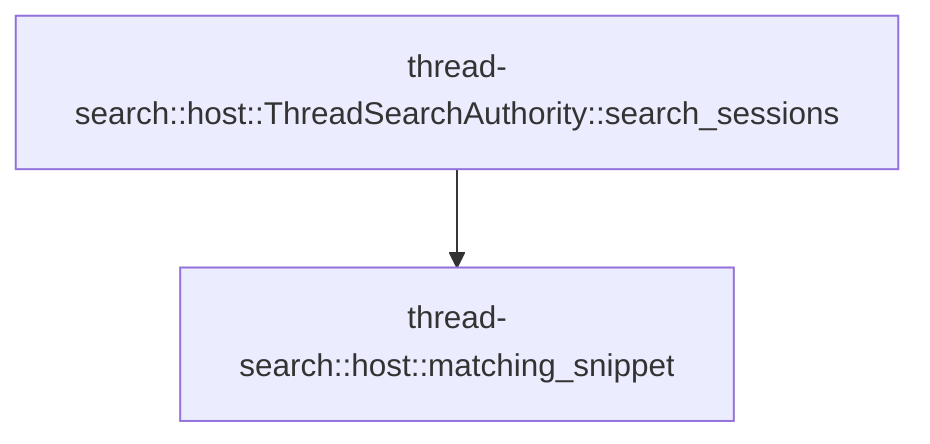

# thread-search::host

[Package atlas](index.md) · [Source](../../src/host.rs)

## Declarations

Visibility is the declaration spelling; trait members and reexports require their enclosing interface. `cfg` is not evaluated.

| Symbol | Kind | Visibility | Test / cfg |
|---|---|---|---|
| [thread-search::host::SessionSearchHit](../../src/host.rs#L6) | struct_item | `pub` |  |
| [thread-search::host::SessionSearchResults](../../src/host.rs#L13) | struct_item | `pub` |  |
| [thread-search::host::ThreadSearchAuthority::search_sessions](../../src/host.rs#L21) | function_item | `pub` |  |
| [thread-search::host::matching_snippet](../../src/host.rs#L67) | function_item | `private` |  |

## Imports / reexports

| Local name | Source path | Visibility |
|---|---|---|
| `*` | `super::*` | `private` |

## Module declarations

| Module | Visibility | Attributes |
|---|---|---|

## Function call graphs

Edges below are syntactically resolved calls only, including private functions. Graphs partition callers into groups of 20; they are not execution order. All unresolved sites are listed below and in the JSON inventory.

Functions 1–2: 1 direct edges

## Call sites

Includes test functions (marked in declarations). Receiver-type-required sites need type analysis/manual tracing. Calls in closures are attributed to their enclosing function; their occurrence here does not mean the closure executes immediately.

| Caller | Callee expression | Source lines | Target / classification |
|---|---|---|---|
| `search_sessions` | `validate_request` | [22](../../src/host.rs#L22) | external-constructor-callback-or-unresolved |
| `search_sessions` | `query.into` | [24](../../src/host.rs#L24) | receiver-type-required |
| `search_sessions` | `normalize` | [29](../../src/host.rs#L29) | external-constructor-callback-or-unresolved |
| `search_sessions` | `NamedLock::exclusive` | [30](../../src/host.rs#L30) | external-constructor-callback-or-unresolved |
| `search_sessions` | `self.store.root().join` | [30](../../src/host.rs#L30), [31](../../src/host.rs#L31), [32](../../src/host.rs#L32) | receiver-type-required |
| `search_sessions` | `self.store.root` | [30](../../src/host.rs#L30), [31](../../src/host.rs#L31), [32](../../src/host.rs#L32) | receiver-type-required |
| `search_sessions` | `NamedLock::shared` | [31](../../src/host.rs#L31), [32](../../src/host.rs#L32) | external-constructor-callback-or-unresolved |
| `search_sessions` | `self.scan_sources_cached` | [33](../../src/host.rs#L33) | receiver-type-required |
| `search_sessions` | `Vec::new` | [34](../../src/host.rs#L34) | external-constructor-callback-or-unresolved |
| `search_sessions` | `source                 .entry                 .title                 .as_deref()                 .and_then` | [36](../../src/host.rs#L36) | receiver-type-required |
| `search_sessions` | `source                 .entry                 .title                 .as_deref` | [36](../../src/host.rs#L36) | receiver-type-required |
| `search_sessions` | `matching_snippet` | [40](../../src/host.rs#L40), [45](../../src/host.rs#L45) | [thread-search::host::matching_snippet](../../src/host.rs#L67) |
| `search_sessions` | `snippet.is_none` | [41](../../src/host.rs#L41) | receiver-type-required |
| `search_sessions` | `source                     .visible_texts_rev                     .iter()                     .find_map` | [42](../../src/host.rs#L42) | receiver-type-required |
| `search_sessions` | `source                     .visible_texts_rev                     .iter` | [42](../../src/host.rs#L42) | receiver-type-required |
| `search_sessions` | `items.len` | [48](../../src/host.rs#L48) | receiver-type-required |
| `search_sessions` | `Ok` | [49](../../src/host.rs#L49), [60](../../src/host.rs#L60) | external-constructor-callback-or-unresolved |
| `search_sessions` | `items.push` | [54](../../src/host.rs#L54) | receiver-type-required |
| `matching_snippet` | `normalize` | [70](../../src/host.rs#L70) | external-constructor-callback-or-unresolved |
| `matching_snippet` | `text.find` | [71](../../src/host.rs#L71) | receiver-type-required |
| `matching_snippet` | `text[..position].chars().count` | [72](../../src/host.rs#L72) | receiver-type-required |
| `matching_snippet` | `text[..position].chars` | [72](../../src/host.rs#L72) | receiver-type-required |
| `matching_snippet` | `before.saturating_sub` | [73](../../src/host.rs#L73) | receiver-type-required |
| `matching_snippet` | `query.chars().count().saturating_add` | [74](../../src/host.rs#L74) | receiver-type-required |
| `matching_snippet` | `query.chars().count` | [74](../../src/host.rs#L74) | receiver-type-required |
| `matching_snippet` | `query.chars` | [74](../../src/host.rs#L74) | receiver-type-required |
| `matching_snippet` | `text.chars().skip(start).take(count).collect` | [75](../../src/host.rs#L75) | receiver-type-required |
| `matching_snippet` | `text.chars().skip(start).take` | [75](../../src/host.rs#L75) | receiver-type-required |
| `matching_snippet` | `text.chars().skip` | [75](../../src/host.rs#L75) | receiver-type-required |
| `matching_snippet` | `text.chars` | [75](../../src/host.rs#L75), [79](../../src/host.rs#L79) | receiver-type-required |
| `matching_snippet` | `result.insert` | [77](../../src/host.rs#L77) | receiver-type-required |
| `matching_snippet` | `text.chars().count` | [79](../../src/host.rs#L79) | receiver-type-required |
| `matching_snippet` | `result.push` | [80](../../src/host.rs#L80) | receiver-type-required |
| `matching_snippet` | `Some` | [82](../../src/host.rs#L82) | external-constructor-callback-or-unresolved |
