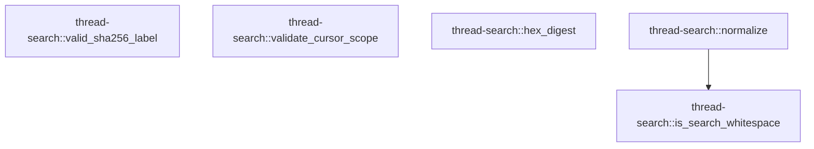

# thread-search

[Package atlas](index.md) · [Source](../../src/lib.rs)

## Declarations

Visibility is the declaration spelling; trait members and reexports require their enclosing interface. `cfg` is not evaluated.

| Symbol | Kind | Visibility | Test / cfg |
|---|---|---|---|
| [thread-search::FORMAT](../../src/lib.rs#L23) | const_item | `private` |  |
| [thread-search::INDEX_NAME](../../src/lib.rs#L24) | const_item | `private` |  |
| [thread-search::LEGACY_INDEX_NAME](../../src/lib.rs#L26) | const_item | `private` |  |
| [thread-search::MAX_QUERY_BYTES](../../src/lib.rs#L27) | const_item | `private` |  |
| [thread-search::MAX_WORKSPACE_BYTES](../../src/lib.rs#L28) | const_item | `private` |  |
| [thread-search::MAX_PAGE_SIZE](../../src/lib.rs#L29) | const_item | `private` |  |
| [thread-search::ArchiveVisibility](../../src/lib.rs#L33) | enum_item | `pub` |  |
| [thread-search::SearchRequest](../../src/lib.rs#L40) | struct_item | `pub` |  |
| [thread-search::MatchClass](../../src/lib.rs#L50) | enum_item | `pub` |  |
| [thread-search::SearchResult](../../src/lib.rs#L58) | struct_item | `pub` |  |
| [thread-search::IndexUse](../../src/lib.rs#L71) | struct_item | `pub` |  |
| [thread-search::SearchPage](../../src/lib.rs#L81) | struct_item | `pub` |  |
| [thread-search::ThreadSearchAuthority](../../src/lib.rs#L90) | struct_item | `pub` |  |
| [thread-search::ThreadSearchAuthority::open](../../src/lib.rs#L95) | function_item | `pub` |  |
| [thread-search::ThreadSearchAuthority::search](../../src/lib.rs#L104) | function_item | `pub` |  |
| [thread-search::ThreadSearchAuthority::rebuild_index](../../src/lib.rs#L176) | function_item | `pub` |  |
| [thread-search::ThreadSearchAuthority::scan_and_repair_indices](../../src/lib.rs#L187) | function_item | `private` |  |
| [thread-search::IndexFile](../../src/lib.rs#L227) | struct_item | `private` |  |
| [thread-search::IndexEntry](../../src/lib.rs#L235) | struct_item | `private` |  |
| [thread-search::CursorBody](../../src/lib.rs#L249) | struct_item | `private` |  |
| [thread-search::validate_request](../../src/lib.rs#L259) | function_item | `private` |  |
| [thread-search::valid_workspace_id](../../src/lib.rs#L282) | function_item | `private` |  |
| [thread-search::visibility_includes](../../src/lib.rs#L291) | function_item | `private` |  |
| [thread-search::rank](../../src/lib.rs#L296) | function_item | `private` |  |
| [thread-search::SKIPPED_SESSIONS](../../src/lib.rs#L322) | static_item | `private` |  |
| [thread-search::skipped_sessions](../../src/lib.rs#L326) | function_item | `pub` |  |
| [thread-search::note_skipped](../../src/lib.rs#L330) | function_item | `private` |  |
| [thread-search::note_skipped::LOGGED](../../src/lib.rs#L331) | static_item | `private` |  |
| [thread-search::scan_sources](../../src/lib.rs#L344) | function_item | `private` |  |
| [thread-search::scan_session](../../src/lib.rs#L375) | function_item | `private` |  |
| [thread-search::superseded_sequences](../../src/lib.rs#L448) | function_item | `private` |  |
| [thread-search::validate_session_id](../../src/lib.rs#L460) | function_item | `private` |  |
| [thread-search::publish_index](../../src/lib.rs#L468) | function_item | `private` |  |
| [thread-search::same_projection](../../src/lib.rs#L482) | function_item | `private` |  |
| [thread-search::decode_index](../../src/lib.rs#L492) | function_item | `private` |  |
| [thread-search::digest_entries](../../src/lib.rs#L528) | function_item | `private` |  |
| [thread-search::encode_cursor](../../src/lib.rs#L534) | function_item | `private` |  |
| [thread-search::decode_cursor](../../src/lib.rs#L544) | function_item | `private` |  |
| [thread-search::valid_sha256_label](../../src/lib.rs#L583) | function_item | `private` |  |
| [thread-search::validate_cursor_scope](../../src/lib.rs#L591) | function_item | `private` |  |
| [thread-search::hex_digest](../../src/lib.rs#L609) | function_item | `private` |  |
| [thread-search::normalize](../../src/lib.rs#L613) | function_item | `private` |  |
| [thread-search::is_search_whitespace](../../src/lib.rs#L634) | function_item | `private` |  |
| [thread-search::SearchError](../../src/lib.rs#L652) | enum_item | `pub` |  |

## Imports / reexports

| Local name | Source path | Visibility |
|---|---|---|
| `SessionSearchHit` | `host::SessionSearchHit` | `pub` |
| `SessionSearchResults` | `host::SessionSearchResults` | `pub` |
| `BTreeSet` | `std::collections::BTreeSet` | `private` |
| `HashSet` | `std::collections::HashSet` | `private` |
| `fs` | `std::fs` | `private` |
| `Path` | `std::path::Path` | `private` |
| `PathBuf` | `std::path::PathBuf` | `private` |
| `_` | `base64::Engine` | `private` |
| `URL_SAFE_NO_PAD` | `base64::engine::general_purpose::URL_SAFE_NO_PAD` | `private` |
| `EventKind` | `schema::EventKind` | `private` |
| `Deserialize` | `serde::Deserialize` | `private` |
| `Serialize` | `serde::Serialize` | `private` |
| `Digest` | `sha2::Digest` | `private` |
| `Sha256` | `sha2::Sha256` | `private` |
| `AtomicPublisher` | `store::AtomicPublisher` | `private` |
| `NamedLock` | `store::NamedLock` | `private` |
| `ThreadStore` | `store::ThreadStore` | `private` |
| `scan_valid_prefix` | `store::scan_valid_prefix` | `private` |
| `Error` | `thiserror::Error` | `private` |
| `UnicodeNormalization` | `unicode_normalization::UnicodeNormalization` | `private` |
| `Uuid` | `uuid::Uuid` | `private` |

## Module declarations

| Module | Visibility | Attributes |
|---|---|---|
| `thread-search::host` | `private` |  |

## Function call graphs

Edges below are syntactically resolved calls only, including private functions. Graphs partition callers into groups of 20; they are not execution order. All unresolved sites are listed below and in the JSON inventory.

```mermaid
flowchart TD
  n0["store::atomic::AtomicPublisher::replace"]
  n1["store::folder::ThreadStore::open"]
  n2["store::platform::NamedLock::exclusive"]
  n3["store::platform::NamedLock::shared"]
  n4["store::tail::scan_valid_prefix"]
  n5["thread-search::ThreadSearchAuthority::search"]
  n6["thread-search::ThreadSearchAuthority::rebuild_index"]
  n7["thread-search::ThreadSearchAuthority::scan_and_repair_indices"]
  n8["thread-search::validate_request"]
  n9["thread-search::valid_workspace_id"]
  n10["thread-search::visibility_includes"]
  n11["thread-search::rank"]
  n12["thread-search::skipped_sessions"]
  n13["thread-search::note_skipped"]
  n14["thread-search::scan_sources"]
  n15["thread-search::scan_session"]
  n16["thread-search::superseded_sequences"]
  n17["thread-search::validate_session_id"]
  n18["thread-search::publish_index"]
  n19["thread-search::same_projection"]
  n20["thread-search::decode_index"]
  n21["thread-search::digest_entries"]
  n22["thread-search::encode_cursor"]
  n23["thread-search::decode_cursor"]
  n24["thread-search::valid_sha256_label"]
  n25["thread-search::validate_cursor_scope"]
  n26["thread-search::hex_digest"]
  n27["thread-search::normalize"]
  n28["thread-search::is_search_whitespace"]
  n29["thread-search::ThreadSearchAuthority::open"]
  n5 --> n2
  n5 --> n3
  n5 --> n7
  n5 --> n8
  n5 --> n10
  n5 --> n11
  n5 --> n21
  n5 --> n22
  n5 --> n23
  n5 --> n25
  n5 --> n27
  n6 --> n2
  n6 --> n3
  n6 --> n14
  n6 --> n18
  n6 --> n21
  n7 --> n14
  n7 --> n18
  n7 --> n19
  n7 --> n20
  n8 --> n9
  n8 --> n27
  n8 --> n28
  n14 --> n13
  n14 --> n15
  n14 --> n17
  n15 --> n4
  n15 --> n9
  n15 --> n16
  n18 --> n0
  n18 --> n21
  n20 --> n9
  n20 --> n17
  n20 --> n21
  n23 --> n9
  n23 --> n17
  n23 --> n24
  n23 --> n26
  n23 --> n27
  n29 --> n1
```

Functions 1–20: 40 direct edges

Functions 21–25: 1 direct edges

## Call sites

Includes test functions (marked in declarations). Receiver-type-required sites need type analysis/manual tracing. Calls in closures are attributed to their enclosing function; their occurrence here does not mean the closure executes immediately.

| Caller | Callee expression | Source lines | Target / classification |
|---|---|---|---|
| `open` | `Ok` | [96](../../src/lib.rs#L96) | external-constructor-callback-or-unresolved |
| `open` | `ThreadStore::open` | [97](../../src/lib.rs#L97) | [store::folder::ThreadStore::open](../../../store/src/folder.rs#L36) |
| `search` | `validate_request` | [105](../../src/lib.rs#L105) | [thread-search::validate_request](../../src/lib.rs#L259) |
| `search` | `normalize` | [106](../../src/lib.rs#L106) | [thread-search::normalize](../../src/lib.rs#L613) |
| `search` | `NamedLock::exclusive` | [107](../../src/lib.rs#L107) | [store::platform::NamedLock::exclusive](../../../store/src/platform.rs#L103) |
| `search` | `self.store.root().join` | [107](../../src/lib.rs#L107), [108](../../src/lib.rs#L108), [109](../../src/lib.rs#L109) | receiver-type-required |
| `search` | `self.store.root` | [107](../../src/lib.rs#L107), [108](../../src/lib.rs#L108), [109](../../src/lib.rs#L109) | receiver-type-required |
| `search` | `NamedLock::shared` | [108](../../src/lib.rs#L108), [109](../../src/lib.rs#L109) | [store::platform::NamedLock::shared](../../../store/src/platform.rs#L99) |
| `search` | `self.scan_and_repair_indices` | [110](../../src/lib.rs#L110) | [thread-search::ThreadSearchAuthority::scan_and_repair_indices](../../src/lib.rs#L187) |
| `search` | `entries             .into_iter()             .filter(&#124;entry&#124; {                 request                     .workspace_id                     .as_ref()                     .is_none_or(&#124;filter&#124; &entry.workspace_id == filter)             })             .filter(&#124;entry&#124; visibility_includes(request.visibility, entry.archived))             .collect::<Vec<_>>` | [111](../../src/lib.rs#L111) | receiver-type-required |
| `search` | `entries             .into_iter()             .filter(&#124;entry&#124; {                 request                     .workspace_id                     .as_ref()                     .is_none_or(&#124;filter&#124; &entry.workspace_id == filter)             })             .filter` | [111](../../src/lib.rs#L111) | receiver-type-required |
| `search` | `entries             .into_iter()             .filter` | [111](../../src/lib.rs#L111) | receiver-type-required |
| `search` | `entries             .into_iter` | [111](../../src/lib.rs#L111) | receiver-type-required |
| `search` | `request                     .workspace_id                     .as_ref()                     .is_none_or` | [114](../../src/lib.rs#L114) | receiver-type-required |
| `search` | `request                     .workspace_id                     .as_ref` | [114](../../src/lib.rs#L114) | receiver-type-required |
| `search` | `visibility_includes` | [119](../../src/lib.rs#L119) | [thread-search::visibility_includes](../../src/lib.rs#L291) |
| `search` | `digest_entries` | [121](../../src/lib.rs#L121) | [thread-search::digest_entries](../../src/lib.rs#L528) |
| `search` | `scoped             .into_iter()             .filter_map(&#124;entry&#124; rank(entry, &normalized_query))             .collect::<Vec<_>>` | [123](../../src/lib.rs#L123) | receiver-type-required |
| `search` | `scoped             .into_iter()             .filter_map` | [123](../../src/lib.rs#L123) | receiver-type-required |
| `search` | `scoped             .into_iter` | [123](../../src/lib.rs#L123) | receiver-type-required |
| `search` | `rank` | [125](../../src/lib.rs#L125) | [thread-search::rank](../../src/lib.rs#L296) |
| `search` | `ranked.sort_by` | [127](../../src/lib.rs#L127) | receiver-type-required |
| `search` | `right                 .score                 .cmp(&left.score)                 .then_with` | [128](../../src/lib.rs#L128) | receiver-type-required |
| `search` | `right                 .score                 .cmp` | [128](../../src/lib.rs#L128) | receiver-type-required |
| `search` | `left.session_id.as_bytes().cmp` | [131](../../src/lib.rs#L131) | receiver-type-required |
| `search` | `left.session_id.as_bytes` | [131](../../src/lib.rs#L131) | receiver-type-required |
| `search` | `right.session_id.as_bytes` | [131](../../src/lib.rs#L131) | receiver-type-required |
| `search` | `decode_cursor` | [135](../../src/lib.rs#L135) | [thread-search::decode_cursor](../../src/lib.rs#L544) |
| `search` | `validate_cursor_scope` | [136](../../src/lib.rs#L136) | [thread-search::validate_cursor_scope](../../src/lib.rs#L591) |
| `search` | `ranked                 .iter()                 .position(&#124;candidate&#124; {                     candidate.session_id == cursor.session_id && candidate.score == cursor.score                 })                 .ok_or` | [137](../../src/lib.rs#L137) | receiver-type-required |
| `search` | `ranked                 .iter()                 .position` | [137](../../src/lib.rs#L137) | receiver-type-required |
| `search` | `ranked                 .iter` | [137](../../src/lib.rs#L137) | receiver-type-required |
| `search` | `start.saturating_add(request.limit).min` | [147](../../src/lib.rs#L147) | receiver-type-required |
| `search` | `start.saturating_add` | [147](../../src/lib.rs#L147) | receiver-type-required |
| `search` | `ranked.len` | [147](../../src/lib.rs#L147), [149](../../src/lib.rs#L149) | receiver-type-required |
| `search` | `ranked[start..end].to_vec` | [148](../../src/lib.rs#L148) | receiver-type-required |
| `search` | `(!reached_end)             .then(&#124;&#124; {                 let last = results.last().ok_or(SearchError::CursorPosition)?;                 encode_cursor(&CursorBody {                     v: FORMAT,                     workspace_id: request.workspace_id.clone(),                     visibility: request.visibility,                     normalized_query: normalized_query.clone(),                     catalog_digest: catalog_digest.clone(),                     score: last.score,                     session_id: last.session_id.clone(),                 })             })             .transpose` | [150](../../src/lib.rs#L150) | receiver-type-required |
| `search` | `(!reached_end)             .then` | [150](../../src/lib.rs#L150) | receiver-type-required |
| `search` | `results.last().ok_or` | [152](../../src/lib.rs#L152) | receiver-type-required |
| `search` | `results.last` | [152](../../src/lib.rs#L152) | receiver-type-required |
| `search` | `encode_cursor` | [153](../../src/lib.rs#L153) | [thread-search::encode_cursor](../../src/lib.rs#L534) |
| `search` | `request.workspace_id.clone` | [155](../../src/lib.rs#L155) | receiver-type-required |
| `search` | `normalized_query.clone` | [157](../../src/lib.rs#L157) | receiver-type-required |
| `search` | `catalog_digest.clone` | [158](../../src/lib.rs#L158) | receiver-type-required |
| `search` | `last.session_id.clone` | [160](../../src/lib.rs#L160) | receiver-type-required |
| `search` | `Ok` | [164](../../src/lib.rs#L164) | external-constructor-callback-or-unresolved |
| `rebuild_index` | `NamedLock::exclusive` | [177](../../src/lib.rs#L177) | [store::platform::NamedLock::exclusive](../../../store/src/platform.rs#L103) |
| `rebuild_index` | `self.store.root().join` | [177](../../src/lib.rs#L177), [178](../../src/lib.rs#L178), [179](../../src/lib.rs#L179) | receiver-type-required |
| `rebuild_index` | `self.store.root` | [177](../../src/lib.rs#L177), [178](../../src/lib.rs#L178), [179](../../src/lib.rs#L179), [180](../../src/lib.rs#L180) | receiver-type-required |
| `rebuild_index` | `NamedLock::shared` | [178](../../src/lib.rs#L178), [179](../../src/lib.rs#L179) | [store::platform::NamedLock::shared](../../../store/src/platform.rs#L99) |
| `rebuild_index` | `scan_sources` | [180](../../src/lib.rs#L180) | [thread-search::scan_sources](../../src/lib.rs#L344) |
| `rebuild_index` | `publish_index` | [182](../../src/lib.rs#L182) | [thread-search::publish_index](../../src/lib.rs#L468) |
| `rebuild_index` | `digest_entries` | [184](../../src/lib.rs#L184) | [thread-search::digest_entries](../../src/lib.rs#L528) |
| `scan_and_repair_indices` | `scan_sources` | [188](../../src/lib.rs#L188) | [thread-search::scan_sources](../../src/lib.rs#L344) |
| `scan_and_repair_indices` | `self.store.root` | [188](../../src/lib.rs#L188) | receiver-type-required |
| `scan_and_repair_indices` | `IndexUse::default` | [189](../../src/lib.rs#L189) | external-constructor-callback-or-unresolved |
| `scan_and_repair_indices` | `Vec::with_capacity` | [190](../../src/lib.rs#L190) | external-constructor-callback-or-unresolved |
| `scan_and_repair_indices` | `sources.len` | [190](../../src/lib.rs#L190) | receiver-type-required |
| `scan_and_repair_indices` | `std::fs::remove_file` | [192](../../src/lib.rs#L192) | external-constructor-callback-or-unresolved |
| `scan_and_repair_indices` | `source.folder.join` | [192](../../src/lib.rs#L192), [193](../../src/lib.rs#L193) | receiver-type-required |
| `scan_and_repair_indices` | `fs::read` | [194](../../src/lib.rs#L194) | external-constructor-callback-or-unresolved |
| `scan_and_repair_indices` | `decode_index` | [195](../../src/lib.rs#L195) | [thread-search::decode_index](../../src/lib.rs#L492) |
| `scan_and_repair_indices` | `same_projection` | [196](../../src/lib.rs#L196) | [thread-search::same_projection](../../src/lib.rs#L482) |
| `scan_and_repair_indices` | `usable.push` | [199](../../src/lib.rs#L199), [219](../../src/lib.rs#L219) | receiver-type-required |
| `scan_and_repair_indices` | `error.kind` | [209](../../src/lib.rs#L209) | receiver-type-required |
| `scan_and_repair_indices` | `publish_index(&source).is_err` | [216](../../src/lib.rs#L216) | receiver-type-required |
| `scan_and_repair_indices` | `publish_index` | [216](../../src/lib.rs#L216) | [thread-search::publish_index](../../src/lib.rs#L468) |
| `scan_and_repair_indices` | `Ok` | [221](../../src/lib.rs#L221) | external-constructor-callback-or-unresolved |
| `validate_request` | `request         .workspace_id         .as_deref()         .is_some_and` | [260](../../src/lib.rs#L260) | receiver-type-required |
| `validate_request` | `request         .workspace_id         .as_deref` | [260](../../src/lib.rs#L260) | receiver-type-required |
| `validate_request` | `valid_workspace_id` | [263](../../src/lib.rs#L263) | [thread-search::valid_workspace_id](../../src/lib.rs#L282) |
| `validate_request` | `Err` | [265](../../src/lib.rs#L265), [274](../../src/lib.rs#L274), [277](../../src/lib.rs#L277) | external-constructor-callback-or-unresolved |
| `validate_request` | `request.query.len` | [267](../../src/lib.rs#L267) | receiver-type-required |
| `validate_request` | `request             .query             .chars()             .any` | [268](../../src/lib.rs#L268) | receiver-type-required |
| `validate_request` | `request             .query             .chars` | [268](../../src/lib.rs#L268) | receiver-type-required |
| `validate_request` | `value.is_control` | [271](../../src/lib.rs#L271) | receiver-type-required |
| `validate_request` | `is_search_whitespace` | [271](../../src/lib.rs#L271) | [thread-search::is_search_whitespace](../../src/lib.rs#L634) |
| `validate_request` | `normalize(&request.query).is_empty` | [272](../../src/lib.rs#L272) | receiver-type-required |
| `validate_request` | `normalize` | [272](../../src/lib.rs#L272) | [thread-search::normalize](../../src/lib.rs#L613) |
| `validate_request` | `(1..=MAX_PAGE_SIZE).contains` | [276](../../src/lib.rs#L276) | receiver-type-required |
| `validate_request` | `Ok` | [279](../../src/lib.rs#L279) | external-constructor-callback-or-unresolved |
| `valid_workspace_id` | `value.is_empty` | [283](../../src/lib.rs#L283) | receiver-type-required |
| `valid_workspace_id` | `value.len` | [284](../../src/lib.rs#L284) | receiver-type-required |
| `valid_workspace_id` | `value.starts_with` | [285](../../src/lib.rs#L285) | receiver-type-required |
| `valid_workspace_id` | `value             .bytes()             .all` | [286](../../src/lib.rs#L286) | receiver-type-required |
| `valid_workspace_id` | `value             .bytes` | [286](../../src/lib.rs#L286) | receiver-type-required |
| `valid_workspace_id` | `byte.is_ascii_alphanumeric` | [288](../../src/lib.rs#L288) | receiver-type-required |
| `rank` | `entry.normalized_title.as_deref` | [297](../../src/lib.rs#L297) | receiver-type-required |
| `rank` | `normalized.starts_with` | [300](../../src/lib.rs#L300) | receiver-type-required |
| `rank` | `query.split(' ').all` | [302](../../src/lib.rs#L302) | receiver-type-required |
| `rank` | `query.split` | [302](../../src/lib.rs#L302) | receiver-type-required |
| `rank` | `normalized.contains` | [302](../../src/lib.rs#L302) | receiver-type-required |
| `rank` | `Some` | [307](../../src/lib.rs#L307) | external-constructor-callback-or-unresolved |
| `rank` | `entry.title.expect` | [310](../../src/lib.rs#L310) | receiver-type-required |
| `SKIPPED_SESSIONS` | `std::sync::atomic::AtomicU64::new` | [322](../../src/lib.rs#L322) | external-constructor-callback-or-unresolved |
| `skipped_sessions` | `SKIPPED_SESSIONS.load` | [327](../../src/lib.rs#L327) | receiver-type-required |
| `note_skipped` | `SKIPPED_SESSIONS.fetch_add` | [333](../../src/lib.rs#L333) | receiver-type-required |
| `note_skipped` | `LOGGED         .get_or_init(Default::default)         .lock()         .unwrap_or_else(std::sync::PoisonError::into_inner)         .insert` | [334](../../src/lib.rs#L334) | receiver-type-required |
| `note_skipped` | `LOGGED         .get_or_init(Default::default)         .lock()         .unwrap_or_else` | [334](../../src/lib.rs#L334) | receiver-type-required |
| `note_skipped` | `LOGGED         .get_or_init(Default::default)         .lock` | [334](../../src/lib.rs#L334) | receiver-type-required |
| `note_skipped` | `LOGGED         .get_or_init` | [334](../../src/lib.rs#L334) | receiver-type-required |
| `note_skipped` | `session_id.to_owned` | [338](../../src/lib.rs#L338) | receiver-type-required |
| `LOGGED` | `std::sync::OnceLock::new` | [332](../../src/lib.rs#L332) | external-constructor-callback-or-unresolved |
| `scan_sources` | `Vec::new` | [345](../../src/lib.rs#L345) | external-constructor-callback-or-unresolved |
| `scan_sources` | `HashSet::new` | [346](../../src/lib.rs#L346) | external-constructor-callback-or-unresolved |
| `scan_sources` | `fs::read_dir(root.join(area))?.collect::<Result<Vec<_>, _>>` | [348](../../src/lib.rs#L348) | receiver-type-required |
| `scan_sources` | `fs::read_dir` | [348](../../src/lib.rs#L348) | external-constructor-callback-or-unresolved |
| `scan_sources` | `root.join` | [348](../../src/lib.rs#L348) | receiver-type-required |
| `scan_sources` | `folders.sort_by_key` | [349](../../src/lib.rs#L349) | receiver-type-required |
| `scan_sources` | `folder.file_type()?.is_dir` | [351](../../src/lib.rs#L351) | receiver-type-required |
| `scan_sources` | `folder.file_type` | [351](../../src/lib.rs#L351) | receiver-type-required |
| `scan_sources` | `folder.file_name().to_string_lossy().into_owned` | [354](../../src/lib.rs#L354) | receiver-type-required |
| `scan_sources` | `folder.file_name().to_string_lossy` | [354](../../src/lib.rs#L354) | receiver-type-required |
| `scan_sources` | `folder.file_name` | [354](../../src/lib.rs#L354) | receiver-type-required |
| `scan_sources` | `validate_session_id` | [355](../../src/lib.rs#L355) | [thread-search::validate_session_id](../../src/lib.rs#L460) |
| `scan_sources` | `identities.insert` | [356](../../src/lib.rs#L356) | receiver-type-required |
| `scan_sources` | `session_id.clone` | [356](../../src/lib.rs#L356), [361](../../src/lib.rs#L361) | receiver-type-required |
| `scan_sources` | `Err` | [357](../../src/lib.rs#L357), [367](../../src/lib.rs#L367) | external-constructor-callback-or-unresolved |
| `scan_sources` | `SearchError::SourceCorrupt` | [357](../../src/lib.rs#L357) | external-constructor-callback-or-unresolved |
| `scan_sources` | `scan_session` | [361](../../src/lib.rs#L361) | [thread-search::scan_session](../../src/lib.rs#L375) |
| `scan_sources` | `folder.path` | [361](../../src/lib.rs#L361) | receiver-type-required |
| `scan_sources` | `entries.push` | [362](../../src/lib.rs#L362) | receiver-type-required |
| `scan_sources` | `note_skipped` | [363](../../src/lib.rs#L363), [365](../../src/lib.rs#L365) | [thread-search::note_skipped](../../src/lib.rs#L330) |
| `scan_sources` | `error.kind` | [364](../../src/lib.rs#L364) | receiver-type-required |
| `scan_sources` | `entries.sort_by` | [371](../../src/lib.rs#L371) | receiver-type-required |
| `scan_sources` | `left.session_id.as_bytes().cmp` | [371](../../src/lib.rs#L371) | receiver-type-required |
| `scan_sources` | `left.session_id.as_bytes` | [371](../../src/lib.rs#L371) | receiver-type-required |
| `scan_sources` | `right.session_id.as_bytes` | [371](../../src/lib.rs#L371) | receiver-type-required |
| `scan_sources` | `Ok` | [372](../../src/lib.rs#L372) | external-constructor-callback-or-unresolved |
| `scan_session` | `fs::read` | [380](../../src/lib.rs#L380) | external-constructor-callback-or-unresolved |
| `scan_session` | `folder.join` | [380](../../src/lib.rs#L380) | receiver-type-required |
| `scan_session` | `scan_valid_prefix` | [381](../../src/lib.rs#L381) | [store::tail::scan_valid_prefix](../../../store/src/tail.rs#L37) |
| `scan_session` | `usize::try_from(scan.valid_bytes)         .map_err` | [382](../../src/lib.rs#L382) | receiver-type-required |
| `scan_session` | `usize::try_from` | [382](../../src/lib.rs#L382) | external-constructor-callback-or-unresolved |
| `scan_session` | `SearchError::SourceCorrupt` | [383](../../src/lib.rs#L383), [388](../../src/lib.rs#L388), [393](../../src/lib.rs#L393), [396](../../src/lib.rs#L396), [401](../../src/lib.rs#L401), [408](../../src/lib.rs#L408), [412](../../src/lib.rs#L412), [433](../../src/lib.rs#L433) | external-constructor-callback-or-unresolved |
| `scan_session` | `"valid prefix is too large".to_owned` | [383](../../src/lib.rs#L383) | receiver-type-required |
| `scan_session` | `bytes         .get(valid_len..)         .is_some_and` | [384](../../src/lib.rs#L384) | receiver-type-required |
| `scan_session` | `bytes         .get` | [384](../../src/lib.rs#L384) | receiver-type-required |
| `scan_session` | `tail.contains` | [386](../../src/lib.rs#L386) | receiver-type-required |
| `scan_session` | `Err` | [388](../../src/lib.rs#L388), [401](../../src/lib.rs#L401), [412](../../src/lib.rs#L412) | external-constructor-callback-or-unresolved |
| `scan_session` | `scan.projection.ok_or_else` | [392](../../src/lib.rs#L392) | receiver-type-required |
| `scan_session` | `projection.events.first().ok_or_else` | [395](../../src/lib.rs#L395) | receiver-type-required |
| `scan_session` | `projection.events.first` | [395](../../src/lib.rs#L395) | receiver-type-required |
| `scan_session` | `genesis.string_field` | [399](../../src/lib.rs#L399) | receiver-type-required |
| `scan_session` | `Some` | [399](../../src/lib.rs#L399) | external-constructor-callback-or-unresolved |
| `scan_session` | `session_id.as_str` | [399](../../src/lib.rs#L399) | receiver-type-required |
| `scan_session` | `genesis         .string_field("workspace")         .ok_or_else(&#124;&#124; {             SearchError::SourceCorrupt(format!("session {session_id} genesis lacks workspace"))         })?         .to_owned` | [405](../../src/lib.rs#L405) | receiver-type-required |
| `scan_session` | `genesis         .string_field("workspace")         .ok_or_else` | [405](../../src/lib.rs#L405) | receiver-type-required |
| `scan_session` | `genesis         .string_field` | [405](../../src/lib.rs#L405) | receiver-type-required |
| `scan_session` | `valid_workspace_id` | [411](../../src/lib.rs#L411) | [thread-search::valid_workspace_id](../../src/lib.rs#L282) |
| `scan_session` | `superseded_sequences` | [416](../../src/lib.rs#L416) | [thread-search::superseded_sequences](../../src/lib.rs#L448) |
| `scan_session` | `projection         .events         .iter()         .rev()         .find(&#124;event&#124; {             matches!(event.kind(), EventKind::Meta)                 && event.string_field("title").is_some()                 && !superseded.contains(&event.seq())         })         .and_then(&#124;event&#124; event.string_field("title"))         .map` | [417](../../src/lib.rs#L417) | receiver-type-required |
| `scan_session` | `projection         .events         .iter()         .rev()         .find(&#124;event&#124; {             matches!(event.kind(), EventKind::Meta)                 && event.string_field("title").is_some()                 && !superseded.contains(&event.seq())         })         .and_then` | [417](../../src/lib.rs#L417) | receiver-type-required |
| `scan_session` | `projection         .events         .iter()         .rev()         .find` | [417](../../src/lib.rs#L417) | receiver-type-required |
| `scan_session` | `projection         .events         .iter()         .rev` | [417](../../src/lib.rs#L417) | receiver-type-required |
| `scan_session` | `projection         .events         .iter` | [417](../../src/lib.rs#L417) | receiver-type-required |
| `scan_session` | `event.string_field("title").is_some` | [423](../../src/lib.rs#L423) | receiver-type-required |
| `scan_session` | `event.string_field` | [423](../../src/lib.rs#L423), [426](../../src/lib.rs#L426), [431](../../src/lib.rs#L431) | receiver-type-required |
| `scan_session` | `superseded.contains` | [424](../../src/lib.rs#L424) | receiver-type-required |
| `scan_session` | `event.seq` | [424](../../src/lib.rs#L424) | receiver-type-required |
| `scan_session` | `projection         .events         .last()         .and_then(&#124;event&#124; event.string_field("ts"))         .ok_or_else(&#124;&#124; {             SearchError::SourceCorrupt(format!("session {session_id} tail lacks timestamp"))         })?         .to_owned` | [428](../../src/lib.rs#L428) | receiver-type-required |
| `scan_session` | `projection         .events         .last()         .and_then(&#124;event&#124; event.string_field("ts"))         .ok_or_else` | [428](../../src/lib.rs#L428) | receiver-type-required |
| `scan_session` | `projection         .events         .last()         .and_then` | [428](../../src/lib.rs#L428) | receiver-type-required |
| `scan_session` | `projection         .events         .last` | [428](../../src/lib.rs#L428) | receiver-type-required |
| `scan_session` | `Ok` | [436](../../src/lib.rs#L436) | external-constructor-callback-or-unresolved |
| `scan_session` | `title.as_deref().map` | [439](../../src/lib.rs#L439) | receiver-type-required |
| `scan_session` | `title.as_deref` | [439](../../src/lib.rs#L439) | receiver-type-required |
| `scan_session` | `folder.to_path_buf` | [444](../../src/lib.rs#L444) | receiver-type-required |
| `superseded_sequences` | `BTreeSet::new` | [449](../../src/lib.rs#L449) | external-constructor-callback-or-unresolved |
| `superseded_sequences` | `event.supersedes().map_err` | [451](../../src/lib.rs#L451) | receiver-type-required |
| `superseded_sequences` | `event.supersedes` | [451](../../src/lib.rs#L451) | receiver-type-required |
| `superseded_sequences` | `SearchError::SourceCorrupt` | [452](../../src/lib.rs#L452) | external-constructor-callback-or-unresolved |
| `superseded_sequences` | `superseded.extend` | [454](../../src/lib.rs#L454) | receiver-type-required |
| `superseded_sequences` | `Ok` | [457](../../src/lib.rs#L457) | external-constructor-callback-or-unresolved |
| `validate_session_id` | `Uuid::parse_str(value).map_err` | [461](../../src/lib.rs#L461) | receiver-type-required |
| `validate_session_id` | `Uuid::parse_str` | [461](../../src/lib.rs#L461) | external-constructor-callback-or-unresolved |
| `validate_session_id` | `parsed.hyphenated().to_string` | [462](../../src/lib.rs#L462) | receiver-type-required |
| `validate_session_id` | `parsed.hyphenated` | [462](../../src/lib.rs#L462) | receiver-type-required |
| `validate_session_id` | `value.to_ascii_lowercase` | [462](../../src/lib.rs#L462) | receiver-type-required |
| `validate_session_id` | `Err` | [463](../../src/lib.rs#L463) | external-constructor-callback-or-unresolved |
| `validate_session_id` | `Ok` | [465](../../src/lib.rs#L465) | external-constructor-callback-or-unresolved |
| `publish_index` | `digest_entries` | [471](../../src/lib.rs#L471) | [thread-search::digest_entries](../../src/lib.rs#L528) |
| `publish_index` | `std::slice::from_ref` | [471](../../src/lib.rs#L471) | external-constructor-callback-or-unresolved |
| `publish_index` | `entry.clone` | [472](../../src/lib.rs#L472) | receiver-type-required |
| `publish_index` | `serde_json_canonicalizer::to_vec(&value)         .map_err` | [474](../../src/lib.rs#L474) | receiver-type-required |
| `publish_index` | `serde_json_canonicalizer::to_vec` | [474](../../src/lib.rs#L474) | external-constructor-callback-or-unresolved |
| `publish_index` | `SearchError::Canonical` | [475](../../src/lib.rs#L475) | external-constructor-callback-or-unresolved |
| `publish_index` | `error.to_string` | [475](../../src/lib.rs#L475) | receiver-type-required |
| `publish_index` | `bytes.push` | [476](../../src/lib.rs#L476) | receiver-type-required |
| `publish_index` | `AtomicPublisher::replace` | [477](../../src/lib.rs#L477) | [store::atomic::AtomicPublisher::replace](../../../store/src/atomic.rs#L16) |
| `publish_index` | `entry.folder.join` | [477](../../src/lib.rs#L477), [478](../../src/lib.rs#L478) | receiver-type-required |
| `publish_index` | `std::fs::remove_file` | [478](../../src/lib.rs#L478) | external-constructor-callback-or-unresolved |
| `publish_index` | `Ok` | [479](../../src/lib.rs#L479) | external-constructor-callback-or-unresolved |
| `decode_index` | `bytes         .strip_suffix(b"\n")         .ok_or_else` | [493](../../src/lib.rs#L493) | receiver-type-required |
| `decode_index` | `bytes         .strip_suffix` | [493](../../src/lib.rs#L493) | receiver-type-required |
| `decode_index` | `SearchError::IndexCorrupt` | [495](../../src/lib.rs#L495), [497](../../src/lib.rs#L497), [502](../../src/lib.rs#L502), [504](../../src/lib.rs#L504), [514](../../src/lib.rs#L514), [521](../../src/lib.rs#L521) | external-constructor-callback-or-unresolved |
| `decode_index` | `"index lacks final LF".to_owned` | [495](../../src/lib.rs#L495) | receiver-type-required |
| `decode_index` | `line.contains` | [496](../../src/lib.rs#L496) | receiver-type-required |
| `decode_index` | `Err` | [497](../../src/lib.rs#L497), [504](../../src/lib.rs#L504), [514](../../src/lib.rs#L514), [521](../../src/lib.rs#L521) | external-constructor-callback-or-unresolved |
| `decode_index` | `"index contains multiple lines".to_owned` | [498](../../src/lib.rs#L498) | receiver-type-required |
| `decode_index` | `serde_json::from_slice(line)         .map_err` | [501](../../src/lib.rs#L501) | receiver-type-required |
| `decode_index` | `serde_json::from_slice` | [501](../../src/lib.rs#L501) | external-constructor-callback-or-unresolved |
| `decode_index` | `error.to_string` | [502](../../src/lib.rs#L502), [519](../../src/lib.rs#L519) | receiver-type-required |
| `decode_index` | `"unsupported index format".to_owned` | [505](../../src/lib.rs#L505) | receiver-type-required |
| `decode_index` | `validate_session_id` | [508](../../src/lib.rs#L508) | [thread-search::validate_session_id](../../src/lib.rs#L460) |
| `decode_index` | `valid_workspace_id` | [509](../../src/lib.rs#L509) | [thread-search::valid_workspace_id](../../src/lib.rs#L282) |
| `decode_index` | `index.entry.title.as_deref().map` | [511](../../src/lib.rs#L511) | receiver-type-required |
| `decode_index` | `index.entry.title.as_deref` | [511](../../src/lib.rs#L511) | receiver-type-required |
| `decode_index` | `digest_entries` | [512](../../src/lib.rs#L512) | [thread-search::digest_entries](../../src/lib.rs#L528) |
| `decode_index` | `std::slice::from_ref` | [512](../../src/lib.rs#L512) | external-constructor-callback-or-unresolved |
| `decode_index` | `"index source projection mismatch".to_owned` | [515](../../src/lib.rs#L515) | receiver-type-required |
| `decode_index` | `serde_json_canonicalizer::to_vec(&index)         .map_err` | [518](../../src/lib.rs#L518) | receiver-type-required |
| `decode_index` | `serde_json_canonicalizer::to_vec` | [518](../../src/lib.rs#L518) | external-constructor-callback-or-unresolved |
| `decode_index` | `SearchError::Canonical` | [519](../../src/lib.rs#L519) | external-constructor-callback-or-unresolved |
| `decode_index` | `"index is not canonical JSON".to_owned` | [522](../../src/lib.rs#L522) | receiver-type-required |
| `decode_index` | `Ok` | [525](../../src/lib.rs#L525) | external-constructor-callback-or-unresolved |
| `digest_entries` | `serde_json_canonicalizer::to_vec(&entries)         .map_err` | [529](../../src/lib.rs#L529) | receiver-type-required |
| `digest_entries` | `serde_json_canonicalizer::to_vec` | [529](../../src/lib.rs#L529) | external-constructor-callback-or-unresolved |
| `digest_entries` | `SearchError::Canonical` | [530](../../src/lib.rs#L530) | external-constructor-callback-or-unresolved |
| `digest_entries` | `error.to_string` | [530](../../src/lib.rs#L530) | receiver-type-required |
| `digest_entries` | `Ok` | [531](../../src/lib.rs#L531) | external-constructor-callback-or-unresolved |
| `encode_cursor` | `serde_json_canonicalizer::to_vec(cursor)         .map_err` | [535](../../src/lib.rs#L535) | receiver-type-required |
| `encode_cursor` | `serde_json_canonicalizer::to_vec` | [535](../../src/lib.rs#L535) | external-constructor-callback-or-unresolved |
| `encode_cursor` | `SearchError::Canonical` | [536](../../src/lib.rs#L536) | external-constructor-callback-or-unresolved |
| `encode_cursor` | `error.to_string` | [536](../../src/lib.rs#L536) | receiver-type-required |
| `encode_cursor` | `Ok` | [537](../../src/lib.rs#L537) | external-constructor-callback-or-unresolved |
| `decode_cursor` | `value.split` | [545](../../src/lib.rs#L545) | receiver-type-required |
| `decode_cursor` | `fields.next().ok_or` | [546](../../src/lib.rs#L546), [547](../../src/lib.rs#L547) | receiver-type-required |
| `decode_cursor` | `fields.next` | [546](../../src/lib.rs#L546), [547](../../src/lib.rs#L547), [548](../../src/lib.rs#L548) | receiver-type-required |
| `decode_cursor` | `fields.next().is_some` | [548](../../src/lib.rs#L548) | receiver-type-required |
| `decode_cursor` | `digest.len` | [549](../../src/lib.rs#L549) | receiver-type-required |
| `decode_cursor` | `digest             .bytes()             .all` | [550](../../src/lib.rs#L550) | receiver-type-required |
| `decode_cursor` | `digest             .bytes` | [550](../../src/lib.rs#L550) | receiver-type-required |
| `decode_cursor` | `byte.is_ascii_digit` | [552](../../src/lib.rs#L552) | receiver-type-required |
| `decode_cursor` | `(b'a'..=b'f').contains` | [552](../../src/lib.rs#L552) | receiver-type-required |
| `decode_cursor` | `Err` | [554](../../src/lib.rs#L554), [560](../../src/lib.rs#L560), [578](../../src/lib.rs#L578) | external-constructor-callback-or-unresolved |
| `decode_cursor` | `URL_SAFE_NO_PAD         .decode(encoded)         .map_err` | [556](../../src/lib.rs#L556) | receiver-type-required |
| `decode_cursor` | `URL_SAFE_NO_PAD         .decode` | [556](../../src/lib.rs#L556) | receiver-type-required |
| `decode_cursor` | `URL_SAFE_NO_PAD.encode` | [559](../../src/lib.rs#L559) | receiver-type-required |
| `decode_cursor` | `hex_digest` | [559](../../src/lib.rs#L559) | [thread-search::hex_digest](../../src/lib.rs#L609) |
| `decode_cursor` | `serde_json::from_slice(&bytes).map_err` | [563](../../src/lib.rs#L563) | receiver-type-required |
| `decode_cursor` | `serde_json::from_slice` | [563](../../src/lib.rs#L563) | external-constructor-callback-or-unresolved |
| `decode_cursor` | `serde_json_canonicalizer::to_vec(&cursor).map_err` | [565](../../src/lib.rs#L565) | receiver-type-required |
| `decode_cursor` | `serde_json_canonicalizer::to_vec` | [565](../../src/lib.rs#L565) | external-constructor-callback-or-unresolved |
| `decode_cursor` | `validate_session_id(&cursor.session_id).is_err` | [569](../../src/lib.rs#L569) | receiver-type-required |
| `decode_cursor` | `validate_session_id` | [569](../../src/lib.rs#L569) | [thread-search::validate_session_id](../../src/lib.rs#L460) |
| `decode_cursor` | `cursor             .workspace_id             .as_deref()             .is_some_and` | [570](../../src/lib.rs#L570) | receiver-type-required |
| `decode_cursor` | `cursor             .workspace_id             .as_deref` | [570](../../src/lib.rs#L570) | receiver-type-required |
| `decode_cursor` | `valid_workspace_id` | [573](../../src/lib.rs#L573) | [thread-search::valid_workspace_id](../../src/lib.rs#L282) |
| `decode_cursor` | `cursor.normalized_query.is_empty` | [574](../../src/lib.rs#L574) | receiver-type-required |
| `decode_cursor` | `normalize` | [575](../../src/lib.rs#L575) | [thread-search::normalize](../../src/lib.rs#L613) |
| `decode_cursor` | `valid_sha256_label` | [576](../../src/lib.rs#L576) | [thread-search::valid_sha256_label](../../src/lib.rs#L583) |
| `decode_cursor` | `Ok` | [580](../../src/lib.rs#L580) | external-constructor-callback-or-unresolved |
| `valid_sha256_label` | `value.len` | [584](../../src/lib.rs#L584) | receiver-type-required |
| `valid_sha256_label` | `value.starts_with` | [585](../../src/lib.rs#L585) | receiver-type-required |
| `valid_sha256_label` | `value[7..]             .bytes()             .all` | [586](../../src/lib.rs#L586) | receiver-type-required |
| `valid_sha256_label` | `value[7..]             .bytes` | [586](../../src/lib.rs#L586) | receiver-type-required |
| `valid_sha256_label` | `byte.is_ascii_digit` | [588](../../src/lib.rs#L588) | receiver-type-required |
| `valid_sha256_label` | `(b'a'..=b'f').contains` | [588](../../src/lib.rs#L588) | receiver-type-required |
| `validate_cursor_scope` | `Err` | [601](../../src/lib.rs#L601), [604](../../src/lib.rs#L604) | external-constructor-callback-or-unresolved |
| `validate_cursor_scope` | `Ok` | [606](../../src/lib.rs#L606) | external-constructor-callback-or-unresolved |
| `normalize` | `String::new` | [614](../../src/lib.rs#L614) | external-constructor-callback-or-unresolved |
| `normalize` | `value.nfkc` | [616](../../src/lib.rs#L616) | receiver-type-required |
| `normalize` | `is_search_whitespace` | [617](../../src/lib.rs#L617) | [thread-search::is_search_whitespace](../../src/lib.rs#L634) |
| `normalize` | `output.is_empty` | [618](../../src/lib.rs#L618) | receiver-type-required |
| `normalize` | `output.push` | [622](../../src/lib.rs#L622), [625](../../src/lib.rs#L625) | receiver-type-required |
| `normalize` | `scalar.is_ascii_uppercase` | [625](../../src/lib.rs#L625) | receiver-type-required |
| `normalize` | `scalar.to_ascii_lowercase` | [626](../../src/lib.rs#L626) | receiver-type-required |
