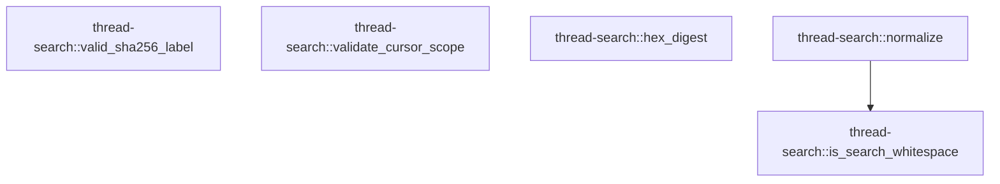

# thread-search

[Package atlas](index.md) · [Source](../../src/lib.rs)

## Declarations

Visibility is the declaration spelling; trait members and reexports require their enclosing interface. `cfg` is not evaluated.

| Symbol | Kind | Visibility | Test / cfg |
|---|---|---|---|
| [thread-search::FORMAT](../../src/lib.rs#L23) | const_item | `private` |  |
| [thread-search::INDEX_NAME](../../src/lib.rs#L24) | const_item | `private` |  |
| [thread-search::LEGACY_INDEX_NAME](../../src/lib.rs#L26) | const_item | `private` |  |
| [thread-search::MAX_QUERY_BYTES](../../src/lib.rs#L27) | const_item | `private` |  |
| [thread-search::MAX_WORKSPACE_BYTES](../../src/lib.rs#L28) | const_item | `private` |  |
| [thread-search::MAX_PAGE_SIZE](../../src/lib.rs#L29) | const_item | `private` |  |
| [thread-search::ArchiveVisibility](../../src/lib.rs#L33) | enum_item | `pub` |  |
| [thread-search::SearchRequest](../../src/lib.rs#L40) | struct_item | `pub` |  |
| [thread-search::MatchClass](../../src/lib.rs#L50) | enum_item | `pub` |  |
| [thread-search::SearchResult](../../src/lib.rs#L58) | struct_item | `pub` |  |
| [thread-search::IndexUse](../../src/lib.rs#L71) | struct_item | `pub` |  |
| [thread-search::SearchPage](../../src/lib.rs#L81) | struct_item | `pub` |  |
| [thread-search::ThreadSearchAuthority](../../src/lib.rs#L90) | struct_item | `pub` |  |
| [thread-search::ThreadSearchAuthority::open](../../src/lib.rs#L95) | function_item | `pub` |  |
| [thread-search::ThreadSearchAuthority::search](../../src/lib.rs#L104) | function_item | `pub` |  |
| [thread-search::ThreadSearchAuthority::rebuild_index](../../src/lib.rs#L171) | function_item | `pub` |  |
| [thread-search::ThreadSearchAuthority::scan_and_repair_indices](../../src/lib.rs#L182) | function_item | `private` |  |
| [thread-search::IndexFile](../../src/lib.rs#L222) | struct_item | `private` |  |
| [thread-search::IndexEntry](../../src/lib.rs#L230) | struct_item | `private` |  |
| [thread-search::CursorBody](../../src/lib.rs#L244) | struct_item | `private` |  |
| [thread-search::validate_request](../../src/lib.rs#L254) | function_item | `private` |  |
| [thread-search::valid_workspace_id](../../src/lib.rs#L273) | function_item | `private` |  |
| [thread-search::visibility_includes](../../src/lib.rs#L282) | function_item | `private` |  |
| [thread-search::rank](../../src/lib.rs#L287) | function_item | `private` |  |
| [thread-search::SKIPPED_SESSIONS](../../src/lib.rs#L313) | static_item | `private` |  |
| [thread-search::skipped_sessions](../../src/lib.rs#L317) | function_item | `pub` |  |
| [thread-search::note_skipped](../../src/lib.rs#L321) | function_item | `private` |  |
| [thread-search::note_skipped::LOGGED](../../src/lib.rs#L322) | static_item | `private` |  |
| [thread-search::scan_sources](../../src/lib.rs#L335) | function_item | `private` |  |
| [thread-search::scan_session](../../src/lib.rs#L366) | function_item | `private` |  |
| [thread-search::superseded_sequences](../../src/lib.rs#L439) | function_item | `private` |  |
| [thread-search::validate_session_id](../../src/lib.rs#L451) | function_item | `private` |  |
| [thread-search::publish_index](../../src/lib.rs#L459) | function_item | `private` |  |
| [thread-search::same_projection](../../src/lib.rs#L473) | function_item | `private` |  |
| [thread-search::decode_index](../../src/lib.rs#L483) | function_item | `private` |  |
| [thread-search::digest_entries](../../src/lib.rs#L519) | function_item | `private` |  |
| [thread-search::encode_cursor](../../src/lib.rs#L525) | function_item | `private` |  |
| [thread-search::decode_cursor](../../src/lib.rs#L535) | function_item | `private` |  |
| [thread-search::valid_sha256_label](../../src/lib.rs#L571) | function_item | `private` |  |
| [thread-search::validate_cursor_scope](../../src/lib.rs#L579) | function_item | `private` |  |
| [thread-search::hex_digest](../../src/lib.rs#L597) | function_item | `private` |  |
| [thread-search::normalize](../../src/lib.rs#L601) | function_item | `private` |  |
| [thread-search::is_search_whitespace](../../src/lib.rs#L622) | function_item | `private` |  |
| [thread-search::SearchError](../../src/lib.rs#L640) | enum_item | `pub` |  |

## Imports / reexports

| Local name | Source path | Visibility |
|---|---|---|
| `SessionSearchHit` | `host::SessionSearchHit` | `pub` |
| `SessionSearchResults` | `host::SessionSearchResults` | `pub` |
| `BTreeSet` | `std::collections::BTreeSet` | `private` |
| `HashSet` | `std::collections::HashSet` | `private` |
| `fs` | `std::fs` | `private` |
| `Path` | `std::path::Path` | `private` |
| `PathBuf` | `std::path::PathBuf` | `private` |
| `_` | `base64::Engine` | `private` |
| `URL_SAFE_NO_PAD` | `base64::engine::general_purpose::URL_SAFE_NO_PAD` | `private` |
| `EventKind` | `schema::EventKind` | `private` |
| `Deserialize` | `serde::Deserialize` | `private` |
| `Serialize` | `serde::Serialize` | `private` |
| `Digest` | `sha2::Digest` | `private` |
| `Sha256` | `sha2::Sha256` | `private` |
| `AtomicPublisher` | `store::AtomicPublisher` | `private` |
| `NamedLock` | `store::NamedLock` | `private` |
| `ThreadStore` | `store::ThreadStore` | `private` |
| `scan_valid_prefix` | `store::scan_valid_prefix` | `private` |
| `Error` | `thiserror::Error` | `private` |
| `UnicodeNormalization` | `unicode_normalization::UnicodeNormalization` | `private` |
| `Uuid` | `uuid::Uuid` | `private` |

## Module declarations

| Module | Visibility | Attributes |
|---|---|---|
| `thread-search::host` | `private` |  |

## Function call graphs

Edges below are syntactically resolved calls only, including private functions. Graphs partition callers into groups of 20; they are not execution order. All unresolved sites are listed below and in the JSON inventory.

```mermaid
flowchart TD
  n0["store::atomic::AtomicPublisher::replace"]
  n1["store::folder::ThreadStore::open"]
  n2["store::platform::NamedLock::exclusive"]
  n3["store::platform::NamedLock::shared"]
  n4["store::tail::scan_valid_prefix"]
  n5["thread-search::ThreadSearchAuthority::search"]
  n6["thread-search::ThreadSearchAuthority::rebuild_index"]
  n7["thread-search::ThreadSearchAuthority::scan_and_repair_indices"]
  n8["thread-search::validate_request"]
  n9["thread-search::valid_workspace_id"]
  n10["thread-search::visibility_includes"]
  n11["thread-search::rank"]
  n12["thread-search::skipped_sessions"]
  n13["thread-search::note_skipped"]
  n14["thread-search::scan_sources"]
  n15["thread-search::scan_session"]
  n16["thread-search::superseded_sequences"]
  n17["thread-search::validate_session_id"]
  n18["thread-search::publish_index"]
  n19["thread-search::same_projection"]
  n20["thread-search::decode_index"]
  n21["thread-search::digest_entries"]
  n22["thread-search::encode_cursor"]
  n23["thread-search::decode_cursor"]
  n24["thread-search::valid_sha256_label"]
  n25["thread-search::validate_cursor_scope"]
  n26["thread-search::hex_digest"]
  n27["thread-search::normalize"]
  n28["thread-search::is_search_whitespace"]
  n29["thread-search::ThreadSearchAuthority::open"]
  n5 --> n2
  n5 --> n3
  n5 --> n7
  n5 --> n8
  n5 --> n10
  n5 --> n11
  n5 --> n21
  n5 --> n22
  n5 --> n23
  n5 --> n25
  n5 --> n27
  n6 --> n2
  n6 --> n3
  n6 --> n14
  n6 --> n18
  n6 --> n21
  n7 --> n14
  n7 --> n18
  n7 --> n19
  n7 --> n20
  n8 --> n9
  n8 --> n27
  n8 --> n28
  n14 --> n13
  n14 --> n15
  n14 --> n17
  n15 --> n4
  n15 --> n9
  n15 --> n16
  n18 --> n0
  n18 --> n21
  n20 --> n9
  n20 --> n17
  n20 --> n21
  n23 --> n9
  n23 --> n17
  n23 --> n24
  n23 --> n26
  n23 --> n27
  n29 --> n1
```

Functions 1–20: 40 direct edges

Functions 21–25: 1 direct edges

## Call sites

Includes test functions (marked in declarations). Receiver-type-required sites need type analysis/manual tracing. Calls in closures are attributed to their enclosing function; their occurrence here does not mean the closure executes immediately.

| Caller | Callee expression | Source lines | Target / classification |
|---|---|---|---|
| `open` | `Ok` | [96](../../src/lib.rs#L96) | external-constructor-callback-or-unresolved |
| `open` | `ThreadStore::open` | [97](../../src/lib.rs#L97) | [store::folder::ThreadStore::open](../../../store/src/folder.rs#L36) |
| `search` | `validate_request` | [105](../../src/lib.rs#L105) | [thread-search::validate_request](../../src/lib.rs#L254) |
| `search` | `normalize` | [106](../../src/lib.rs#L106) | [thread-search::normalize](../../src/lib.rs#L601) |
| `search` | `NamedLock::exclusive` | [107](../../src/lib.rs#L107) | [store::platform::NamedLock::exclusive](../../../store/src/platform.rs#L103) |
| `search` | `self.store.root().join` | [107](../../src/lib.rs#L107), [108](../../src/lib.rs#L108), [109](../../src/lib.rs#L109) | receiver-type-required |
| `search` | `self.store.root` | [107](../../src/lib.rs#L107), [108](../../src/lib.rs#L108), [109](../../src/lib.rs#L109) | receiver-type-required |
| `search` | `NamedLock::shared` | [108](../../src/lib.rs#L108), [109](../../src/lib.rs#L109) | [store::platform::NamedLock::shared](../../../store/src/platform.rs#L99) |
| `search` | `self.scan_and_repair_indices` | [110](../../src/lib.rs#L110) | [thread-search::ThreadSearchAuthority::scan_and_repair_indices](../../src/lib.rs#L182) |
| `search` | `entries             .into_iter()             .filter(&#124;entry&#124; entry.workspace_id == request.workspace_id)             .filter(&#124;entry&#124; visibility_includes(request.visibility, entry.archived))             .collect::<Vec<_>>` | [111](../../src/lib.rs#L111) | receiver-type-required |
| `search` | `entries             .into_iter()             .filter(&#124;entry&#124; entry.workspace_id == request.workspace_id)             .filter` | [111](../../src/lib.rs#L111) | receiver-type-required |
| `search` | `entries             .into_iter()             .filter` | [111](../../src/lib.rs#L111) | receiver-type-required |
| `search` | `entries             .into_iter` | [111](../../src/lib.rs#L111) | receiver-type-required |
| `search` | `visibility_includes` | [114](../../src/lib.rs#L114) | [thread-search::visibility_includes](../../src/lib.rs#L282) |
| `search` | `digest_entries` | [116](../../src/lib.rs#L116) | [thread-search::digest_entries](../../src/lib.rs#L519) |
| `search` | `scoped             .into_iter()             .filter_map(&#124;entry&#124; rank(entry, &normalized_query))             .collect::<Vec<_>>` | [118](../../src/lib.rs#L118) | receiver-type-required |
| `search` | `scoped             .into_iter()             .filter_map` | [118](../../src/lib.rs#L118) | receiver-type-required |
| `search` | `scoped             .into_iter` | [118](../../src/lib.rs#L118) | receiver-type-required |
| `search` | `rank` | [120](../../src/lib.rs#L120) | [thread-search::rank](../../src/lib.rs#L287) |
| `search` | `ranked.sort_by` | [122](../../src/lib.rs#L122) | receiver-type-required |
| `search` | `right                 .score                 .cmp(&left.score)                 .then_with` | [123](../../src/lib.rs#L123) | receiver-type-required |
| `search` | `right                 .score                 .cmp` | [123](../../src/lib.rs#L123) | receiver-type-required |
| `search` | `left.session_id.as_bytes().cmp` | [126](../../src/lib.rs#L126) | receiver-type-required |
| `search` | `left.session_id.as_bytes` | [126](../../src/lib.rs#L126) | receiver-type-required |
| `search` | `right.session_id.as_bytes` | [126](../../src/lib.rs#L126) | receiver-type-required |
| `search` | `decode_cursor` | [130](../../src/lib.rs#L130) | [thread-search::decode_cursor](../../src/lib.rs#L535) |
| `search` | `validate_cursor_scope` | [131](../../src/lib.rs#L131) | [thread-search::validate_cursor_scope](../../src/lib.rs#L579) |
| `search` | `ranked                 .iter()                 .position(&#124;candidate&#124; {                     candidate.session_id == cursor.session_id && candidate.score == cursor.score                 })                 .ok_or` | [132](../../src/lib.rs#L132) | receiver-type-required |
| `search` | `ranked                 .iter()                 .position` | [132](../../src/lib.rs#L132) | receiver-type-required |
| `search` | `ranked                 .iter` | [132](../../src/lib.rs#L132) | receiver-type-required |
| `search` | `start.saturating_add(request.limit).min` | [142](../../src/lib.rs#L142) | receiver-type-required |
| `search` | `start.saturating_add` | [142](../../src/lib.rs#L142) | receiver-type-required |
| `search` | `ranked.len` | [142](../../src/lib.rs#L142), [144](../../src/lib.rs#L144) | receiver-type-required |
| `search` | `ranked[start..end].to_vec` | [143](../../src/lib.rs#L143) | receiver-type-required |
| `search` | `(!reached_end)             .then(&#124;&#124; {                 let last = results.last().ok_or(SearchError::CursorPosition)?;                 encode_cursor(&CursorBody {                     v: FORMAT,                     workspace_id: request.workspace_id.clone(),                     visibility: request.visibility,                     normalized_query: normalized_query.clone(),                     catalog_digest: catalog_digest.clone(),                     score: last.score,                     session_id: last.session_id.clone(),                 })             })             .transpose` | [145](../../src/lib.rs#L145) | receiver-type-required |
| `search` | `(!reached_end)             .then` | [145](../../src/lib.rs#L145) | receiver-type-required |
| `search` | `results.last().ok_or` | [147](../../src/lib.rs#L147) | receiver-type-required |
| `search` | `results.last` | [147](../../src/lib.rs#L147) | receiver-type-required |
| `search` | `encode_cursor` | [148](../../src/lib.rs#L148) | [thread-search::encode_cursor](../../src/lib.rs#L525) |
| `search` | `request.workspace_id.clone` | [150](../../src/lib.rs#L150) | receiver-type-required |
| `search` | `normalized_query.clone` | [152](../../src/lib.rs#L152) | receiver-type-required |
| `search` | `catalog_digest.clone` | [153](../../src/lib.rs#L153) | receiver-type-required |
| `search` | `last.session_id.clone` | [155](../../src/lib.rs#L155) | receiver-type-required |
| `search` | `Ok` | [159](../../src/lib.rs#L159) | external-constructor-callback-or-unresolved |
| `rebuild_index` | `NamedLock::exclusive` | [172](../../src/lib.rs#L172) | [store::platform::NamedLock::exclusive](../../../store/src/platform.rs#L103) |
| `rebuild_index` | `self.store.root().join` | [172](../../src/lib.rs#L172), [173](../../src/lib.rs#L173), [174](../../src/lib.rs#L174) | receiver-type-required |
| `rebuild_index` | `self.store.root` | [172](../../src/lib.rs#L172), [173](../../src/lib.rs#L173), [174](../../src/lib.rs#L174), [175](../../src/lib.rs#L175) | receiver-type-required |
| `rebuild_index` | `NamedLock::shared` | [173](../../src/lib.rs#L173), [174](../../src/lib.rs#L174) | [store::platform::NamedLock::shared](../../../store/src/platform.rs#L99) |
| `rebuild_index` | `scan_sources` | [175](../../src/lib.rs#L175) | [thread-search::scan_sources](../../src/lib.rs#L335) |
| `rebuild_index` | `publish_index` | [177](../../src/lib.rs#L177) | [thread-search::publish_index](../../src/lib.rs#L459) |
| `rebuild_index` | `digest_entries` | [179](../../src/lib.rs#L179) | [thread-search::digest_entries](../../src/lib.rs#L519) |
| `scan_and_repair_indices` | `scan_sources` | [183](../../src/lib.rs#L183) | [thread-search::scan_sources](../../src/lib.rs#L335) |
| `scan_and_repair_indices` | `self.store.root` | [183](../../src/lib.rs#L183) | receiver-type-required |
| `scan_and_repair_indices` | `IndexUse::default` | [184](../../src/lib.rs#L184) | external-constructor-callback-or-unresolved |
| `scan_and_repair_indices` | `Vec::with_capacity` | [185](../../src/lib.rs#L185) | external-constructor-callback-or-unresolved |
| `scan_and_repair_indices` | `sources.len` | [185](../../src/lib.rs#L185) | receiver-type-required |
| `scan_and_repair_indices` | `std::fs::remove_file` | [187](../../src/lib.rs#L187) | external-constructor-callback-or-unresolved |
| `scan_and_repair_indices` | `source.folder.join` | [187](../../src/lib.rs#L187), [188](../../src/lib.rs#L188) | receiver-type-required |
| `scan_and_repair_indices` | `fs::read` | [189](../../src/lib.rs#L189) | external-constructor-callback-or-unresolved |
| `scan_and_repair_indices` | `decode_index` | [190](../../src/lib.rs#L190) | [thread-search::decode_index](../../src/lib.rs#L483) |
| `scan_and_repair_indices` | `same_projection` | [191](../../src/lib.rs#L191) | [thread-search::same_projection](../../src/lib.rs#L473) |
| `scan_and_repair_indices` | `usable.push` | [194](../../src/lib.rs#L194), [214](../../src/lib.rs#L214) | receiver-type-required |
| `scan_and_repair_indices` | `error.kind` | [204](../../src/lib.rs#L204) | receiver-type-required |
| `scan_and_repair_indices` | `publish_index(&source).is_err` | [211](../../src/lib.rs#L211) | receiver-type-required |
| `scan_and_repair_indices` | `publish_index` | [211](../../src/lib.rs#L211) | [thread-search::publish_index](../../src/lib.rs#L459) |
| `scan_and_repair_indices` | `Ok` | [216](../../src/lib.rs#L216) | external-constructor-callback-or-unresolved |
| `validate_request` | `valid_workspace_id` | [255](../../src/lib.rs#L255) | [thread-search::valid_workspace_id](../../src/lib.rs#L273) |
| `validate_request` | `Err` | [256](../../src/lib.rs#L256), [265](../../src/lib.rs#L265), [268](../../src/lib.rs#L268) | external-constructor-callback-or-unresolved |
| `validate_request` | `request.query.len` | [258](../../src/lib.rs#L258) | receiver-type-required |
| `validate_request` | `request             .query             .chars()             .any` | [259](../../src/lib.rs#L259) | receiver-type-required |
| `validate_request` | `request             .query             .chars` | [259](../../src/lib.rs#L259) | receiver-type-required |
| `validate_request` | `value.is_control` | [262](../../src/lib.rs#L262) | receiver-type-required |
| `validate_request` | `is_search_whitespace` | [262](../../src/lib.rs#L262) | [thread-search::is_search_whitespace](../../src/lib.rs#L622) |
| `validate_request` | `normalize(&request.query).is_empty` | [263](../../src/lib.rs#L263) | receiver-type-required |
| `validate_request` | `normalize` | [263](../../src/lib.rs#L263) | [thread-search::normalize](../../src/lib.rs#L601) |
| `validate_request` | `(1..=MAX_PAGE_SIZE).contains` | [267](../../src/lib.rs#L267) | receiver-type-required |
| `validate_request` | `Ok` | [270](../../src/lib.rs#L270) | external-constructor-callback-or-unresolved |
| `valid_workspace_id` | `value.is_empty` | [274](../../src/lib.rs#L274) | receiver-type-required |
| `valid_workspace_id` | `value.len` | [275](../../src/lib.rs#L275) | receiver-type-required |
| `valid_workspace_id` | `value.starts_with` | [276](../../src/lib.rs#L276) | receiver-type-required |
| `valid_workspace_id` | `value             .bytes()             .all` | [277](../../src/lib.rs#L277) | receiver-type-required |
| `valid_workspace_id` | `value             .bytes` | [277](../../src/lib.rs#L277) | receiver-type-required |
| `valid_workspace_id` | `byte.is_ascii_alphanumeric` | [279](../../src/lib.rs#L279) | receiver-type-required |
| `rank` | `entry.normalized_title.as_deref` | [288](../../src/lib.rs#L288) | receiver-type-required |
| `rank` | `normalized.starts_with` | [291](../../src/lib.rs#L291) | receiver-type-required |
| `rank` | `query.split(' ').all` | [293](../../src/lib.rs#L293) | receiver-type-required |
| `rank` | `query.split` | [293](../../src/lib.rs#L293) | receiver-type-required |
| `rank` | `normalized.contains` | [293](../../src/lib.rs#L293) | receiver-type-required |
| `rank` | `Some` | [298](../../src/lib.rs#L298) | external-constructor-callback-or-unresolved |
| `rank` | `entry.title.expect` | [301](../../src/lib.rs#L301) | receiver-type-required |
| `SKIPPED_SESSIONS` | `std::sync::atomic::AtomicU64::new` | [313](../../src/lib.rs#L313) | external-constructor-callback-or-unresolved |
| `skipped_sessions` | `SKIPPED_SESSIONS.load` | [318](../../src/lib.rs#L318) | receiver-type-required |
| `note_skipped` | `SKIPPED_SESSIONS.fetch_add` | [324](../../src/lib.rs#L324) | receiver-type-required |
| `note_skipped` | `LOGGED         .get_or_init(Default::default)         .lock()         .unwrap_or_else(std::sync::PoisonError::into_inner)         .insert` | [325](../../src/lib.rs#L325) | receiver-type-required |
| `note_skipped` | `LOGGED         .get_or_init(Default::default)         .lock()         .unwrap_or_else` | [325](../../src/lib.rs#L325) | receiver-type-required |
| `note_skipped` | `LOGGED         .get_or_init(Default::default)         .lock` | [325](../../src/lib.rs#L325) | receiver-type-required |
| `note_skipped` | `LOGGED         .get_or_init` | [325](../../src/lib.rs#L325) | receiver-type-required |
| `note_skipped` | `session_id.to_owned` | [329](../../src/lib.rs#L329) | receiver-type-required |
| `LOGGED` | `std::sync::OnceLock::new` | [323](../../src/lib.rs#L323) | external-constructor-callback-or-unresolved |
| `scan_sources` | `Vec::new` | [336](../../src/lib.rs#L336) | external-constructor-callback-or-unresolved |
| `scan_sources` | `HashSet::new` | [337](../../src/lib.rs#L337) | external-constructor-callback-or-unresolved |
| `scan_sources` | `fs::read_dir(root.join(area))?.collect::<Result<Vec<_>, _>>` | [339](../../src/lib.rs#L339) | receiver-type-required |
| `scan_sources` | `fs::read_dir` | [339](../../src/lib.rs#L339) | external-constructor-callback-or-unresolved |
| `scan_sources` | `root.join` | [339](../../src/lib.rs#L339) | receiver-type-required |
| `scan_sources` | `folders.sort_by_key` | [340](../../src/lib.rs#L340) | receiver-type-required |
| `scan_sources` | `folder.file_type()?.is_dir` | [342](../../src/lib.rs#L342) | receiver-type-required |
| `scan_sources` | `folder.file_type` | [342](../../src/lib.rs#L342) | receiver-type-required |
| `scan_sources` | `folder.file_name().to_string_lossy().into_owned` | [345](../../src/lib.rs#L345) | receiver-type-required |
| `scan_sources` | `folder.file_name().to_string_lossy` | [345](../../src/lib.rs#L345) | receiver-type-required |
| `scan_sources` | `folder.file_name` | [345](../../src/lib.rs#L345) | receiver-type-required |
| `scan_sources` | `validate_session_id` | [346](../../src/lib.rs#L346) | [thread-search::validate_session_id](../../src/lib.rs#L451) |
| `scan_sources` | `identities.insert` | [347](../../src/lib.rs#L347) | receiver-type-required |
| `scan_sources` | `session_id.clone` | [347](../../src/lib.rs#L347), [352](../../src/lib.rs#L352) | receiver-type-required |
| `scan_sources` | `Err` | [348](../../src/lib.rs#L348), [358](../../src/lib.rs#L358) | external-constructor-callback-or-unresolved |
| `scan_sources` | `SearchError::SourceCorrupt` | [348](../../src/lib.rs#L348) | external-constructor-callback-or-unresolved |
| `scan_sources` | `scan_session` | [352](../../src/lib.rs#L352) | [thread-search::scan_session](../../src/lib.rs#L366) |
| `scan_sources` | `folder.path` | [352](../../src/lib.rs#L352) | receiver-type-required |
| `scan_sources` | `entries.push` | [353](../../src/lib.rs#L353) | receiver-type-required |
| `scan_sources` | `note_skipped` | [354](../../src/lib.rs#L354), [356](../../src/lib.rs#L356) | [thread-search::note_skipped](../../src/lib.rs#L321) |
| `scan_sources` | `error.kind` | [355](../../src/lib.rs#L355) | receiver-type-required |
| `scan_sources` | `entries.sort_by` | [362](../../src/lib.rs#L362) | receiver-type-required |
| `scan_sources` | `left.session_id.as_bytes().cmp` | [362](../../src/lib.rs#L362) | receiver-type-required |
| `scan_sources` | `left.session_id.as_bytes` | [362](../../src/lib.rs#L362) | receiver-type-required |
| `scan_sources` | `right.session_id.as_bytes` | [362](../../src/lib.rs#L362) | receiver-type-required |
| `scan_sources` | `Ok` | [363](../../src/lib.rs#L363) | external-constructor-callback-or-unresolved |
| `scan_session` | `fs::read` | [371](../../src/lib.rs#L371) | external-constructor-callback-or-unresolved |
| `scan_session` | `folder.join` | [371](../../src/lib.rs#L371) | receiver-type-required |
| `scan_session` | `scan_valid_prefix` | [372](../../src/lib.rs#L372) | [store::tail::scan_valid_prefix](../../../store/src/tail.rs#L37) |
| `scan_session` | `usize::try_from(scan.valid_bytes)         .map_err` | [373](../../src/lib.rs#L373) | receiver-type-required |
| `scan_session` | `usize::try_from` | [373](../../src/lib.rs#L373) | external-constructor-callback-or-unresolved |
| `scan_session` | `SearchError::SourceCorrupt` | [374](../../src/lib.rs#L374), [379](../../src/lib.rs#L379), [384](../../src/lib.rs#L384), [387](../../src/lib.rs#L387), [392](../../src/lib.rs#L392), [399](../../src/lib.rs#L399), [403](../../src/lib.rs#L403), [424](../../src/lib.rs#L424) | external-constructor-callback-or-unresolved |
| `scan_session` | `"valid prefix is too large".to_owned` | [374](../../src/lib.rs#L374) | receiver-type-required |
| `scan_session` | `bytes         .get(valid_len..)         .is_some_and` | [375](../../src/lib.rs#L375) | receiver-type-required |
| `scan_session` | `bytes         .get` | [375](../../src/lib.rs#L375) | receiver-type-required |
| `scan_session` | `tail.contains` | [377](../../src/lib.rs#L377) | receiver-type-required |
| `scan_session` | `Err` | [379](../../src/lib.rs#L379), [392](../../src/lib.rs#L392), [403](../../src/lib.rs#L403) | external-constructor-callback-or-unresolved |
| `scan_session` | `scan.projection.ok_or_else` | [383](../../src/lib.rs#L383) | receiver-type-required |
| `scan_session` | `projection.events.first().ok_or_else` | [386](../../src/lib.rs#L386) | receiver-type-required |
| `scan_session` | `projection.events.first` | [386](../../src/lib.rs#L386) | receiver-type-required |
| `scan_session` | `genesis.string_field` | [390](../../src/lib.rs#L390) | receiver-type-required |
| `scan_session` | `Some` | [390](../../src/lib.rs#L390) | external-constructor-callback-or-unresolved |
| `scan_session` | `session_id.as_str` | [390](../../src/lib.rs#L390) | receiver-type-required |
| `scan_session` | `genesis         .string_field("workspace")         .ok_or_else(&#124;&#124; {             SearchError::SourceCorrupt(format!("session {session_id} genesis lacks workspace"))         })?         .to_owned` | [396](../../src/lib.rs#L396) | receiver-type-required |
| `scan_session` | `genesis         .string_field("workspace")         .ok_or_else` | [396](../../src/lib.rs#L396) | receiver-type-required |
| `scan_session` | `genesis         .string_field` | [396](../../src/lib.rs#L396) | receiver-type-required |
| `scan_session` | `valid_workspace_id` | [402](../../src/lib.rs#L402) | [thread-search::valid_workspace_id](../../src/lib.rs#L273) |
| `scan_session` | `superseded_sequences` | [407](../../src/lib.rs#L407) | [thread-search::superseded_sequences](../../src/lib.rs#L439) |
| `scan_session` | `projection         .events         .iter()         .rev()         .find(&#124;event&#124; {             matches!(event.kind(), EventKind::Meta)                 && event.string_field("title").is_some()                 && !superseded.contains(&event.seq())         })         .and_then(&#124;event&#124; event.string_field("title"))         .map` | [408](../../src/lib.rs#L408) | receiver-type-required |
| `scan_session` | `projection         .events         .iter()         .rev()         .find(&#124;event&#124; {             matches!(event.kind(), EventKind::Meta)                 && event.string_field("title").is_some()                 && !superseded.contains(&event.seq())         })         .and_then` | [408](../../src/lib.rs#L408) | receiver-type-required |
| `scan_session` | `projection         .events         .iter()         .rev()         .find` | [408](../../src/lib.rs#L408) | receiver-type-required |
| `scan_session` | `projection         .events         .iter()         .rev` | [408](../../src/lib.rs#L408) | receiver-type-required |
| `scan_session` | `projection         .events         .iter` | [408](../../src/lib.rs#L408) | receiver-type-required |
| `scan_session` | `event.string_field("title").is_some` | [414](../../src/lib.rs#L414) | receiver-type-required |
| `scan_session` | `event.string_field` | [414](../../src/lib.rs#L414), [417](../../src/lib.rs#L417), [422](../../src/lib.rs#L422) | receiver-type-required |
| `scan_session` | `superseded.contains` | [415](../../src/lib.rs#L415) | receiver-type-required |
| `scan_session` | `event.seq` | [415](../../src/lib.rs#L415) | receiver-type-required |
| `scan_session` | `projection         .events         .last()         .and_then(&#124;event&#124; event.string_field("ts"))         .ok_or_else(&#124;&#124; {             SearchError::SourceCorrupt(format!("session {session_id} tail lacks timestamp"))         })?         .to_owned` | [419](../../src/lib.rs#L419) | receiver-type-required |
| `scan_session` | `projection         .events         .last()         .and_then(&#124;event&#124; event.string_field("ts"))         .ok_or_else` | [419](../../src/lib.rs#L419) | receiver-type-required |
| `scan_session` | `projection         .events         .last()         .and_then` | [419](../../src/lib.rs#L419) | receiver-type-required |
| `scan_session` | `projection         .events         .last` | [419](../../src/lib.rs#L419) | receiver-type-required |
| `scan_session` | `Ok` | [427](../../src/lib.rs#L427) | external-constructor-callback-or-unresolved |
| `scan_session` | `title.as_deref().map` | [430](../../src/lib.rs#L430) | receiver-type-required |
| `scan_session` | `title.as_deref` | [430](../../src/lib.rs#L430) | receiver-type-required |
| `scan_session` | `folder.to_path_buf` | [435](../../src/lib.rs#L435) | receiver-type-required |
| `superseded_sequences` | `BTreeSet::new` | [440](../../src/lib.rs#L440) | external-constructor-callback-or-unresolved |
| `superseded_sequences` | `event.supersedes().map_err` | [442](../../src/lib.rs#L442) | receiver-type-required |
| `superseded_sequences` | `event.supersedes` | [442](../../src/lib.rs#L442) | receiver-type-required |
| `superseded_sequences` | `SearchError::SourceCorrupt` | [443](../../src/lib.rs#L443) | external-constructor-callback-or-unresolved |
| `superseded_sequences` | `superseded.extend` | [445](../../src/lib.rs#L445) | receiver-type-required |
| `superseded_sequences` | `Ok` | [448](../../src/lib.rs#L448) | external-constructor-callback-or-unresolved |
| `validate_session_id` | `Uuid::parse_str(value).map_err` | [452](../../src/lib.rs#L452) | receiver-type-required |
| `validate_session_id` | `Uuid::parse_str` | [452](../../src/lib.rs#L452) | external-constructor-callback-or-unresolved |
| `validate_session_id` | `parsed.hyphenated().to_string` | [453](../../src/lib.rs#L453) | receiver-type-required |
| `validate_session_id` | `parsed.hyphenated` | [453](../../src/lib.rs#L453) | receiver-type-required |
| `validate_session_id` | `value.to_ascii_lowercase` | [453](../../src/lib.rs#L453) | receiver-type-required |
| `validate_session_id` | `Err` | [454](../../src/lib.rs#L454) | external-constructor-callback-or-unresolved |
| `validate_session_id` | `Ok` | [456](../../src/lib.rs#L456) | external-constructor-callback-or-unresolved |
| `publish_index` | `digest_entries` | [462](../../src/lib.rs#L462) | [thread-search::digest_entries](../../src/lib.rs#L519) |
| `publish_index` | `std::slice::from_ref` | [462](../../src/lib.rs#L462) | external-constructor-callback-or-unresolved |
| `publish_index` | `entry.clone` | [463](../../src/lib.rs#L463) | receiver-type-required |
| `publish_index` | `serde_json_canonicalizer::to_vec(&value)         .map_err` | [465](../../src/lib.rs#L465) | receiver-type-required |
| `publish_index` | `serde_json_canonicalizer::to_vec` | [465](../../src/lib.rs#L465) | external-constructor-callback-or-unresolved |
| `publish_index` | `SearchError::Canonical` | [466](../../src/lib.rs#L466) | external-constructor-callback-or-unresolved |
| `publish_index` | `error.to_string` | [466](../../src/lib.rs#L466) | receiver-type-required |
| `publish_index` | `bytes.push` | [467](../../src/lib.rs#L467) | receiver-type-required |
| `publish_index` | `AtomicPublisher::replace` | [468](../../src/lib.rs#L468) | [store::atomic::AtomicPublisher::replace](../../../store/src/atomic.rs#L16) |
| `publish_index` | `entry.folder.join` | [468](../../src/lib.rs#L468), [469](../../src/lib.rs#L469) | receiver-type-required |
| `publish_index` | `std::fs::remove_file` | [469](../../src/lib.rs#L469) | external-constructor-callback-or-unresolved |
| `publish_index` | `Ok` | [470](../../src/lib.rs#L470) | external-constructor-callback-or-unresolved |
| `decode_index` | `bytes         .strip_suffix(b"\n")         .ok_or_else` | [484](../../src/lib.rs#L484) | receiver-type-required |
| `decode_index` | `bytes         .strip_suffix` | [484](../../src/lib.rs#L484) | receiver-type-required |
| `decode_index` | `SearchError::IndexCorrupt` | [486](../../src/lib.rs#L486), [488](../../src/lib.rs#L488), [493](../../src/lib.rs#L493), [495](../../src/lib.rs#L495), [505](../../src/lib.rs#L505), [512](../../src/lib.rs#L512) | external-constructor-callback-or-unresolved |
| `decode_index` | `"index lacks final LF".to_owned` | [486](../../src/lib.rs#L486) | receiver-type-required |
| `decode_index` | `line.contains` | [487](../../src/lib.rs#L487) | receiver-type-required |
| `decode_index` | `Err` | [488](../../src/lib.rs#L488), [495](../../src/lib.rs#L495), [505](../../src/lib.rs#L505), [512](../../src/lib.rs#L512) | external-constructor-callback-or-unresolved |
| `decode_index` | `"index contains multiple lines".to_owned` | [489](../../src/lib.rs#L489) | receiver-type-required |
| `decode_index` | `serde_json::from_slice(line)         .map_err` | [492](../../src/lib.rs#L492) | receiver-type-required |
| `decode_index` | `serde_json::from_slice` | [492](../../src/lib.rs#L492) | external-constructor-callback-or-unresolved |
| `decode_index` | `error.to_string` | [493](../../src/lib.rs#L493), [510](../../src/lib.rs#L510) | receiver-type-required |
| `decode_index` | `"unsupported index format".to_owned` | [496](../../src/lib.rs#L496) | receiver-type-required |
| `decode_index` | `validate_session_id` | [499](../../src/lib.rs#L499) | [thread-search::validate_session_id](../../src/lib.rs#L451) |
| `decode_index` | `valid_workspace_id` | [500](../../src/lib.rs#L500) | [thread-search::valid_workspace_id](../../src/lib.rs#L273) |
| `decode_index` | `index.entry.title.as_deref().map` | [502](../../src/lib.rs#L502) | receiver-type-required |
| `decode_index` | `index.entry.title.as_deref` | [502](../../src/lib.rs#L502) | receiver-type-required |
| `decode_index` | `digest_entries` | [503](../../src/lib.rs#L503) | [thread-search::digest_entries](../../src/lib.rs#L519) |
| `decode_index` | `std::slice::from_ref` | [503](../../src/lib.rs#L503) | external-constructor-callback-or-unresolved |
| `decode_index` | `"index source projection mismatch".to_owned` | [506](../../src/lib.rs#L506) | receiver-type-required |
| `decode_index` | `serde_json_canonicalizer::to_vec(&index)         .map_err` | [509](../../src/lib.rs#L509) | receiver-type-required |
| `decode_index` | `serde_json_canonicalizer::to_vec` | [509](../../src/lib.rs#L509) | external-constructor-callback-or-unresolved |
| `decode_index` | `SearchError::Canonical` | [510](../../src/lib.rs#L510) | external-constructor-callback-or-unresolved |
| `decode_index` | `"index is not canonical JSON".to_owned` | [513](../../src/lib.rs#L513) | receiver-type-required |
| `decode_index` | `Ok` | [516](../../src/lib.rs#L516) | external-constructor-callback-or-unresolved |
| `digest_entries` | `serde_json_canonicalizer::to_vec(&entries)         .map_err` | [520](../../src/lib.rs#L520) | receiver-type-required |
| `digest_entries` | `serde_json_canonicalizer::to_vec` | [520](../../src/lib.rs#L520) | external-constructor-callback-or-unresolved |
| `digest_entries` | `SearchError::Canonical` | [521](../../src/lib.rs#L521) | external-constructor-callback-or-unresolved |
| `digest_entries` | `error.to_string` | [521](../../src/lib.rs#L521) | receiver-type-required |
| `digest_entries` | `Ok` | [522](../../src/lib.rs#L522) | external-constructor-callback-or-unresolved |
| `encode_cursor` | `serde_json_canonicalizer::to_vec(cursor)         .map_err` | [526](../../src/lib.rs#L526) | receiver-type-required |
| `encode_cursor` | `serde_json_canonicalizer::to_vec` | [526](../../src/lib.rs#L526) | external-constructor-callback-or-unresolved |
| `encode_cursor` | `SearchError::Canonical` | [527](../../src/lib.rs#L527) | external-constructor-callback-or-unresolved |
| `encode_cursor` | `error.to_string` | [527](../../src/lib.rs#L527) | receiver-type-required |
| `encode_cursor` | `Ok` | [528](../../src/lib.rs#L528) | external-constructor-callback-or-unresolved |
| `decode_cursor` | `value.split` | [536](../../src/lib.rs#L536) | receiver-type-required |
| `decode_cursor` | `fields.next().ok_or` | [537](../../src/lib.rs#L537), [538](../../src/lib.rs#L538) | receiver-type-required |
| `decode_cursor` | `fields.next` | [537](../../src/lib.rs#L537), [538](../../src/lib.rs#L538), [539](../../src/lib.rs#L539) | receiver-type-required |
| `decode_cursor` | `fields.next().is_some` | [539](../../src/lib.rs#L539) | receiver-type-required |
| `decode_cursor` | `digest.len` | [540](../../src/lib.rs#L540) | receiver-type-required |
| `decode_cursor` | `digest             .bytes()             .all` | [541](../../src/lib.rs#L541) | receiver-type-required |
| `decode_cursor` | `digest             .bytes` | [541](../../src/lib.rs#L541) | receiver-type-required |
| `decode_cursor` | `byte.is_ascii_digit` | [543](../../src/lib.rs#L543) | receiver-type-required |
| `decode_cursor` | `(b'a'..=b'f').contains` | [543](../../src/lib.rs#L543) | receiver-type-required |
| `decode_cursor` | `Err` | [545](../../src/lib.rs#L545), [551](../../src/lib.rs#L551), [566](../../src/lib.rs#L566) | external-constructor-callback-or-unresolved |
| `decode_cursor` | `URL_SAFE_NO_PAD         .decode(encoded)         .map_err` | [547](../../src/lib.rs#L547) | receiver-type-required |
| `decode_cursor` | `URL_SAFE_NO_PAD         .decode` | [547](../../src/lib.rs#L547) | receiver-type-required |
| `decode_cursor` | `URL_SAFE_NO_PAD.encode` | [550](../../src/lib.rs#L550) | receiver-type-required |
| `decode_cursor` | `hex_digest` | [550](../../src/lib.rs#L550) | [thread-search::hex_digest](../../src/lib.rs#L597) |
| `decode_cursor` | `serde_json::from_slice(&bytes).map_err` | [554](../../src/lib.rs#L554) | receiver-type-required |
| `decode_cursor` | `serde_json::from_slice` | [554](../../src/lib.rs#L554) | external-constructor-callback-or-unresolved |
| `decode_cursor` | `serde_json_canonicalizer::to_vec(&cursor).map_err` | [556](../../src/lib.rs#L556) | receiver-type-required |
| `decode_cursor` | `serde_json_canonicalizer::to_vec` | [556](../../src/lib.rs#L556) | external-constructor-callback-or-unresolved |
| `decode_cursor` | `validate_session_id(&cursor.session_id).is_err` | [560](../../src/lib.rs#L560) | receiver-type-required |
| `decode_cursor` | `validate_session_id` | [560](../../src/lib.rs#L560) | [thread-search::validate_session_id](../../src/lib.rs#L451) |
| `decode_cursor` | `valid_workspace_id` | [561](../../src/lib.rs#L561) | [thread-search::valid_workspace_id](../../src/lib.rs#L273) |
| `decode_cursor` | `cursor.normalized_query.is_empty` | [562](../../src/lib.rs#L562) | receiver-type-required |
| `decode_cursor` | `normalize` | [563](../../src/lib.rs#L563) | [thread-search::normalize](../../src/lib.rs#L601) |
| `decode_cursor` | `valid_sha256_label` | [564](../../src/lib.rs#L564) | [thread-search::valid_sha256_label](../../src/lib.rs#L571) |
| `decode_cursor` | `Ok` | [568](../../src/lib.rs#L568) | external-constructor-callback-or-unresolved |
| `valid_sha256_label` | `value.len` | [572](../../src/lib.rs#L572) | receiver-type-required |
| `valid_sha256_label` | `value.starts_with` | [573](../../src/lib.rs#L573) | receiver-type-required |
| `valid_sha256_label` | `value[7..]             .bytes()             .all` | [574](../../src/lib.rs#L574) | receiver-type-required |
| `valid_sha256_label` | `value[7..]             .bytes` | [574](../../src/lib.rs#L574) | receiver-type-required |
| `valid_sha256_label` | `byte.is_ascii_digit` | [576](../../src/lib.rs#L576) | receiver-type-required |
| `valid_sha256_label` | `(b'a'..=b'f').contains` | [576](../../src/lib.rs#L576) | receiver-type-required |
| `validate_cursor_scope` | `Err` | [589](../../src/lib.rs#L589), [592](../../src/lib.rs#L592) | external-constructor-callback-or-unresolved |
| `validate_cursor_scope` | `Ok` | [594](../../src/lib.rs#L594) | external-constructor-callback-or-unresolved |
| `normalize` | `String::new` | [602](../../src/lib.rs#L602) | external-constructor-callback-or-unresolved |
| `normalize` | `value.nfkc` | [604](../../src/lib.rs#L604) | receiver-type-required |
| `normalize` | `is_search_whitespace` | [605](../../src/lib.rs#L605) | [thread-search::is_search_whitespace](../../src/lib.rs#L622) |
| `normalize` | `output.is_empty` | [606](../../src/lib.rs#L606) | receiver-type-required |
| `normalize` | `output.push` | [610](../../src/lib.rs#L610), [613](../../src/lib.rs#L613) | receiver-type-required |
| `normalize` | `scalar.is_ascii_uppercase` | [613](../../src/lib.rs#L613) | receiver-type-required |
| `normalize` | `scalar.to_ascii_lowercase` | [614](../../src/lib.rs#L614) | receiver-type-required |
