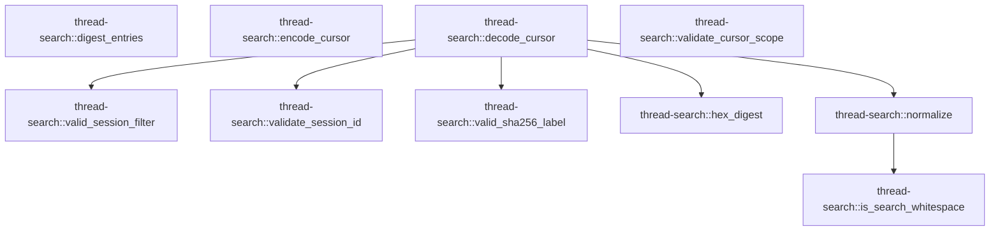

# thread-search

[Package atlas](index.md) · [Source](../../src/lib.rs)

## Declarations

Visibility is the declaration spelling; trait members and reexports require their enclosing interface. `cfg` is not evaluated.

| Symbol | Kind | Visibility | Test / cfg |
|---|---|---|---|
| [thread-search::FORMAT](../../src/lib.rs#L25) | const_item | `private` |  |
| [thread-search::INDEX_NAME](../../src/lib.rs#L26) | const_item | `private` |  |
| [thread-search::LEGACY_INDEX_NAME](../../src/lib.rs#L28) | const_item | `private` |  |
| [thread-search::MAX_QUERY_BYTES](../../src/lib.rs#L29) | const_item | `private` |  |
| [thread-search::MAX_SESSION_FILTER_BYTES](../../src/lib.rs#L30) | const_item | `private` |  |
| [thread-search::MAX_PAGE_SIZE](../../src/lib.rs#L31) | const_item | `private` |  |
| [thread-search::ArchiveVisibility](../../src/lib.rs#L35) | enum_item | `pub` |  |
| [thread-search::SearchRequest](../../src/lib.rs#L42) | struct_item | `pub` |  |
| [thread-search::MatchClass](../../src/lib.rs#L52) | enum_item | `pub` |  |
| [thread-search::SearchResult](../../src/lib.rs#L60) | struct_item | `pub` |  |
| [thread-search::IndexUse](../../src/lib.rs#L72) | struct_item | `pub` |  |
| [thread-search::SearchPage](../../src/lib.rs#L82) | struct_item | `pub` |  |
| [thread-search::SearchMetrics](../../src/lib.rs#L92) | struct_item | `pub` |  |
| [thread-search::CachedSessionScan](../../src/lib.rs#L100) | struct_item | `private` |  |
| [thread-search::ScannedSession](../../src/lib.rs#L107) | struct_item | `private` |  |
| [thread-search::ThreadSearchAuthority](../../src/lib.rs#L113) | struct_item | `pub` |  |
| [thread-search::ThreadSearchAuthority::open](../../src/lib.rs#L120) | function_item | `pub` |  |
| [thread-search::ThreadSearchAuthority::reset_metrics](../../src/lib.rs#L129) | function_item | `pub` |  |
| [thread-search::ThreadSearchAuthority::metrics](../../src/lib.rs#L138) | function_item | `pub` |  |
| [thread-search::ThreadSearchAuthority::search](../../src/lib.rs#L150) | function_item | `pub` |  |
| [thread-search::ThreadSearchAuthority::rebuild_index](../../src/lib.rs#L222) | function_item | `pub` |  |
| [thread-search::ThreadSearchAuthority::scan_and_repair_indices](../../src/lib.rs#L234) | function_item | `private` |  |
| [thread-search::ThreadSearchAuthority::scan_sources_cached](../../src/lib.rs#L273) | function_item | `private` |  |
| [thread-search::ThreadSearchAuthority::scan_session_cached](../../src/lib.rs#L316) | function_item | `private` |  |
| [thread-search::IndexFile](../../src/lib.rs#L382) | struct_item | `private` |  |
| [thread-search::IndexEntry](../../src/lib.rs#L390) | struct_item | `private` |  |
| [thread-search::CursorBody](../../src/lib.rs#L403) | struct_item | `private` |  |
| [thread-search::validate_request](../../src/lib.rs#L413) | function_item | `private` |  |
| [thread-search::valid_session_filter](../../src/lib.rs#L436) | function_item | `private` |  |
| [thread-search::visibility_includes](../../src/lib.rs#L445) | function_item | `private` |  |
| [thread-search::rank](../../src/lib.rs#L450) | function_item | `private` |  |
| [thread-search::SKIPPED_SESSIONS](../../src/lib.rs#L475) | static_item | `private` |  |
| [thread-search::skipped_sessions](../../src/lib.rs#L479) | function_item | `pub` |  |
| [thread-search::note_skipped](../../src/lib.rs#L483) | function_item | `private` |  |
| [thread-search::note_skipped::LOGGED](../../src/lib.rs#L484) | static_item | `private` |  |
| [thread-search::decode_session_ledger](../../src/lib.rs#L497) | function_item | `private` |  |
| [thread-search::superseded_sequences](../../src/lib.rs#L593) | function_item | `private` |  |
| [thread-search::validate_session_id](../../src/lib.rs#L605) | function_item | `private` |  |
| [thread-search::publish_index](../../src/lib.rs#L613) | function_item | `private` |  |
| [thread-search::same_projection](../../src/lib.rs#L627) | function_item | `private` |  |
| [thread-search::decode_index](../../src/lib.rs#L636) | function_item | `private` |  |
| [thread-search::digest_entries](../../src/lib.rs#L671) | function_item | `private` |  |
| [thread-search::encode_cursor](../../src/lib.rs#L677) | function_item | `private` |  |
| [thread-search::decode_cursor](../../src/lib.rs#L687) | function_item | `private` |  |
| [thread-search::valid_sha256_label](../../src/lib.rs#L726) | function_item | `private` |  |
| [thread-search::validate_cursor_scope](../../src/lib.rs#L734) | function_item | `private` |  |
| [thread-search::hex_digest](../../src/lib.rs#L752) | function_item | `private` |  |
| [thread-search::normalize](../../src/lib.rs#L756) | function_item | `private` |  |
| [thread-search::is_search_whitespace](../../src/lib.rs#L777) | function_item | `private` |  |
| [thread-search::SearchError](../../src/lib.rs#L795) | enum_item | `pub` |  |

## Imports / reexports

| Local name | Source path | Visibility |
|---|---|---|
| `SessionSearchHit` | `host::SessionSearchHit` | `pub` |
| `SessionSearchResults` | `host::SessionSearchResults` | `pub` |
| `BTreeSet` | `std::collections::BTreeSet` | `private` |
| `HashMap` | `std::collections::HashMap` | `private` |
| `HashSet` | `std::collections::HashSet` | `private` |
| `fs` | `std::fs` | `private` |
| `Path` | `std::path::Path` | `private` |
| `PathBuf` | `std::path::PathBuf` | `private` |
| `AtomicU64` | `std::sync::atomic::AtomicU64` | `private` |
| `Ordering` | `std::sync::atomic::Ordering` | `private` |
| `Arc` | `std::sync::Arc` | `private` |
| `Mutex` | `std::sync::Mutex` | `private` |
| `_` | `base64::Engine` | `private` |
| `URL_SAFE_NO_PAD` | `base64::engine::general_purpose::URL_SAFE_NO_PAD` | `private` |
| `EventKind` | `schema::EventKind` | `private` |
| `Deserialize` | `serde::Deserialize` | `private` |
| `Serialize` | `serde::Serialize` | `private` |
| `Digest` | `sha2::Digest` | `private` |
| `Sha256` | `sha2::Sha256` | `private` |
| `AtomicPublisher` | `store::AtomicPublisher` | `private` |
| `NamedLock` | `store::NamedLock` | `private` |
| `ThreadStore` | `store::ThreadStore` | `private` |
| `scan_valid_prefix` | `store::scan_valid_prefix` | `private` |
| `Error` | `thiserror::Error` | `private` |
| `UnicodeNormalization` | `unicode_normalization::UnicodeNormalization` | `private` |
| `Uuid` | `uuid::Uuid` | `private` |

## Module declarations

| Module | Visibility | Attributes |
|---|---|---|
| `thread-search::host` | `private` |  |

## Function call graphs

Edges below are syntactically resolved calls only, including private functions. Graphs partition callers into groups of 20; they are not execution order. All unresolved sites are listed below and in the JSON inventory.

```mermaid
flowchart TD
  n0["store::atomic::AtomicPublisher::replace"]
  n1["store::folder::ThreadStore::open"]
  n2["store::platform::NamedLock::exclusive"]
  n3["store::platform::NamedLock::shared"]
  n4["store::tail::scan_valid_prefix"]
  n5["thread-search::ThreadSearchAuthority::open"]
  n6["thread-search::ThreadSearchAuthority::reset_metrics"]
  n7["thread-search::ThreadSearchAuthority::metrics"]
  n8["thread-search::ThreadSearchAuthority::search"]
  n9["thread-search::ThreadSearchAuthority::rebuild_index"]
  n10["thread-search::ThreadSearchAuthority::scan_and_repair_indices"]
  n11["thread-search::ThreadSearchAuthority::scan_sources_cached"]
  n12["thread-search::ThreadSearchAuthority::scan_session_cached"]
  n13["thread-search::validate_request"]
  n14["thread-search::valid_session_filter"]
  n15["thread-search::visibility_includes"]
  n16["thread-search::rank"]
  n17["thread-search::skipped_sessions"]
  n18["thread-search::note_skipped"]
  n19["thread-search::decode_session_ledger"]
  n20["thread-search::superseded_sequences"]
  n21["thread-search::validate_session_id"]
  n22["thread-search::publish_index"]
  n23["thread-search::same_projection"]
  n24["thread-search::decode_index"]
  n25["thread-search::digest_entries"]
  n26["thread-search::encode_cursor"]
  n27["thread-search::decode_cursor"]
  n28["thread-search::validate_cursor_scope"]
  n29["thread-search::normalize"]
  n30["thread-search::is_search_whitespace"]
  n5 --> n1
  n8 --> n2
  n8 --> n3
  n8 --> n10
  n8 --> n13
  n8 --> n15
  n8 --> n16
  n8 --> n25
  n8 --> n26
  n8 --> n27
  n8 --> n28
  n8 --> n29
  n9 --> n2
  n9 --> n3
  n9 --> n11
  n9 --> n22
  n9 --> n25
  n10 --> n11
  n10 --> n22
  n10 --> n23
  n10 --> n24
  n11 --> n12
  n11 --> n18
  n11 --> n21
  n12 --> n19
  n13 --> n14
  n13 --> n29
  n13 --> n30
  n19 --> n4
  n19 --> n20
  n22 --> n0
  n22 --> n25
  n24 --> n21
  n24 --> n25
```

Functions 1–20: 34 direct edges

Functions 21–28: 6 direct edges

## Call sites

Includes test functions (marked in declarations). Receiver-type-required sites need type analysis/manual tracing. Calls in closures are attributed to their enclosing function; their occurrence here does not mean the closure executes immediately.

| Caller | Callee expression | Source lines | Target / classification |
|---|---|---|---|
| `open` | `Ok` | [121](../../src/lib.rs#L121) | external-constructor-callback-or-unresolved |
| `open` | `ThreadStore::open` | [122](../../src/lib.rs#L122) | [store::folder::ThreadStore::open](../../../store/src/folder.rs#L36) |
| `open` | `Arc::new` | [123](../../src/lib.rs#L123), [124](../../src/lib.rs#L124) | external-constructor-callback-or-unresolved |
| `open` | `SearchMetrics::default` | [123](../../src/lib.rs#L123) | external-constructor-callback-or-unresolved |
| `open` | `Mutex::new` | [124](../../src/lib.rs#L124) | external-constructor-callback-or-unresolved |
| `open` | `HashMap::new` | [124](../../src/lib.rs#L124) | external-constructor-callback-or-unresolved |
| `reset_metrics` | `self.metrics.ledger_reads.store` | [130](../../src/lib.rs#L130) | receiver-type-required |
| `reset_metrics` | `self.metrics.events_decoded.store` | [131](../../src/lib.rs#L131) | receiver-type-required |
| `reset_metrics` | `self.metrics.body_fallbacks.store` | [132](../../src/lib.rs#L132) | receiver-type-required |
| `reset_metrics` | `self.metrics.index_repairs.store` | [133](../../src/lib.rs#L133) | receiver-type-required |
| `metrics` | `self.metrics.ledger_reads.load` | [140](../../src/lib.rs#L140) | receiver-type-required |
| `metrics` | `self.metrics.events_decoded.load` | [141](../../src/lib.rs#L141) | receiver-type-required |
| `metrics` | `self.metrics.body_fallbacks.load` | [142](../../src/lib.rs#L142) | receiver-type-required |
| `metrics` | `self.metrics.index_repairs.load` | [143](../../src/lib.rs#L143) | receiver-type-required |
| `search` | `validate_request` | [151](../../src/lib.rs#L151) | [thread-search::validate_request](../../src/lib.rs#L413) |
| `search` | `normalize` | [152](../../src/lib.rs#L152) | [thread-search::normalize](../../src/lib.rs#L756) |
| `search` | `NamedLock::exclusive` | [153](../../src/lib.rs#L153) | [store::platform::NamedLock::exclusive](../../../store/src/platform.rs#L103) |
| `search` | `self.store.root().join` | [153](../../src/lib.rs#L153), [154](../../src/lib.rs#L154), [155](../../src/lib.rs#L155) | receiver-type-required |
| `search` | `self.store.root` | [153](../../src/lib.rs#L153), [154](../../src/lib.rs#L154), [155](../../src/lib.rs#L155) | receiver-type-required |
| `search` | `NamedLock::shared` | [154](../../src/lib.rs#L154), [155](../../src/lib.rs#L155) | [store::platform::NamedLock::shared](../../../store/src/platform.rs#L99) |
| `search` | `self.scan_and_repair_indices` | [156](../../src/lib.rs#L156) | [thread-search::ThreadSearchAuthority::scan_and_repair_indices](../../src/lib.rs#L234) |
| `search` | `entries             .into_iter()             .filter(&#124;entry&#124; {                 request                     .session_filter                     .as_ref()                     .is_none_or(&#124;filter&#124; &entry.session_id == filter)             })             .filter(&#124;entry&#124; visibility_includes(request.visibility, entry.archived))             .collect::<Vec<_>>` | [157](../../src/lib.rs#L157) | receiver-type-required |
| `search` | `entries             .into_iter()             .filter(&#124;entry&#124; {                 request                     .session_filter                     .as_ref()                     .is_none_or(&#124;filter&#124; &entry.session_id == filter)             })             .filter` | [157](../../src/lib.rs#L157) | receiver-type-required |
| `search` | `entries             .into_iter()             .filter` | [157](../../src/lib.rs#L157) | receiver-type-required |
| `search` | `entries             .into_iter` | [157](../../src/lib.rs#L157) | receiver-type-required |
| `search` | `request                     .session_filter                     .as_ref()                     .is_none_or` | [160](../../src/lib.rs#L160) | receiver-type-required |
| `search` | `request                     .session_filter                     .as_ref` | [160](../../src/lib.rs#L160) | receiver-type-required |
| `search` | `visibility_includes` | [165](../../src/lib.rs#L165) | [thread-search::visibility_includes](../../src/lib.rs#L445) |
| `search` | `digest_entries` | [167](../../src/lib.rs#L167) | [thread-search::digest_entries](../../src/lib.rs#L671) |
| `search` | `scoped             .into_iter()             .filter_map(&#124;entry&#124; rank(entry, &normalized_query))             .collect::<Vec<_>>` | [169](../../src/lib.rs#L169) | receiver-type-required |
| `search` | `scoped             .into_iter()             .filter_map` | [169](../../src/lib.rs#L169) | receiver-type-required |
| `search` | `scoped             .into_iter` | [169](../../src/lib.rs#L169) | receiver-type-required |
| `search` | `rank` | [171](../../src/lib.rs#L171) | [thread-search::rank](../../src/lib.rs#L450) |
| `search` | `ranked.sort_by` | [173](../../src/lib.rs#L173) | receiver-type-required |
| `search` | `right                 .score                 .cmp(&left.score)                 .then_with` | [174](../../src/lib.rs#L174) | receiver-type-required |
| `search` | `right                 .score                 .cmp` | [174](../../src/lib.rs#L174) | receiver-type-required |
| `search` | `left.session_id.as_bytes().cmp` | [177](../../src/lib.rs#L177) | receiver-type-required |
| `search` | `left.session_id.as_bytes` | [177](../../src/lib.rs#L177) | receiver-type-required |
| `search` | `right.session_id.as_bytes` | [177](../../src/lib.rs#L177) | receiver-type-required |
| `search` | `decode_cursor` | [181](../../src/lib.rs#L181) | [thread-search::decode_cursor](../../src/lib.rs#L687) |
| `search` | `validate_cursor_scope` | [182](../../src/lib.rs#L182) | [thread-search::validate_cursor_scope](../../src/lib.rs#L734) |
| `search` | `ranked                 .iter()                 .position(&#124;candidate&#124; {                     candidate.session_id == cursor.session_id && candidate.score == cursor.score                 })                 .ok_or` | [183](../../src/lib.rs#L183) | receiver-type-required |
| `search` | `ranked                 .iter()                 .position` | [183](../../src/lib.rs#L183) | receiver-type-required |
| `search` | `ranked                 .iter` | [183](../../src/lib.rs#L183) | receiver-type-required |
| `search` | `start.saturating_add(request.limit).min` | [193](../../src/lib.rs#L193) | receiver-type-required |
| `search` | `start.saturating_add` | [193](../../src/lib.rs#L193) | receiver-type-required |
| `search` | `ranked.len` | [193](../../src/lib.rs#L193), [195](../../src/lib.rs#L195) | receiver-type-required |
| `search` | `ranked[start..end].to_vec` | [194](../../src/lib.rs#L194) | receiver-type-required |
| `search` | `(!reached_end)             .then(&#124;&#124; {                 let last = results.last().ok_or(SearchError::CursorPosition)?;                 encode_cursor(&CursorBody {                     v: FORMAT,                     session_filter: request.session_filter.clone(),                     visibility: request.visibility,                     normalized_query: normalized_query.clone(),                     catalog_digest: catalog_digest.clone(),                     score: last.score,                     session_id: last.session_id.clone(),                 })             })             .transpose` | [196](../../src/lib.rs#L196) | receiver-type-required |
| `search` | `(!reached_end)             .then` | [196](../../src/lib.rs#L196) | receiver-type-required |
| `search` | `results.last().ok_or` | [198](../../src/lib.rs#L198) | receiver-type-required |
| `search` | `results.last` | [198](../../src/lib.rs#L198) | receiver-type-required |
| `search` | `encode_cursor` | [199](../../src/lib.rs#L199) | [thread-search::encode_cursor](../../src/lib.rs#L677) |
| `search` | `request.session_filter.clone` | [201](../../src/lib.rs#L201) | receiver-type-required |
| `search` | `normalized_query.clone` | [203](../../src/lib.rs#L203) | receiver-type-required |
| `search` | `catalog_digest.clone` | [204](../../src/lib.rs#L204) | receiver-type-required |
| `search` | `last.session_id.clone` | [206](../../src/lib.rs#L206) | receiver-type-required |
| `search` | `Ok` | [210](../../src/lib.rs#L210) | external-constructor-callback-or-unresolved |
| `rebuild_index` | `NamedLock::exclusive` | [223](../../src/lib.rs#L223) | [store::platform::NamedLock::exclusive](../../../store/src/platform.rs#L103) |
| `rebuild_index` | `self.store.root().join` | [223](../../src/lib.rs#L223), [224](../../src/lib.rs#L224), [225](../../src/lib.rs#L225) | receiver-type-required |
| `rebuild_index` | `self.store.root` | [223](../../src/lib.rs#L223), [224](../../src/lib.rs#L224), [225](../../src/lib.rs#L225) | receiver-type-required |
| `rebuild_index` | `NamedLock::shared` | [224](../../src/lib.rs#L224), [225](../../src/lib.rs#L225) | [store::platform::NamedLock::shared](../../../store/src/platform.rs#L99) |
| `rebuild_index` | `self.scan_sources_cached` | [226](../../src/lib.rs#L226) | [thread-search::ThreadSearchAuthority::scan_sources_cached](../../src/lib.rs#L273) |
| `rebuild_index` | `scanned.into_iter().map(&#124;s&#124; s.entry).collect` | [227](../../src/lib.rs#L227) | receiver-type-required |
| `rebuild_index` | `scanned.into_iter().map` | [227](../../src/lib.rs#L227) | receiver-type-required |
| `rebuild_index` | `scanned.into_iter` | [227](../../src/lib.rs#L227) | receiver-type-required |
| `rebuild_index` | `publish_index` | [229](../../src/lib.rs#L229) | [thread-search::publish_index](../../src/lib.rs#L613) |
| `rebuild_index` | `digest_entries` | [231](../../src/lib.rs#L231) | [thread-search::digest_entries](../../src/lib.rs#L671) |
| `scan_and_repair_indices` | `self.scan_sources_cached` | [235](../../src/lib.rs#L235) | [thread-search::ThreadSearchAuthority::scan_sources_cached](../../src/lib.rs#L273) |
| `scan_and_repair_indices` | `IndexUse::default` | [236](../../src/lib.rs#L236) | external-constructor-callback-or-unresolved |
| `scan_and_repair_indices` | `Vec::with_capacity` | [237](../../src/lib.rs#L237) | external-constructor-callback-or-unresolved |
| `scan_and_repair_indices` | `sources.len` | [237](../../src/lib.rs#L237) | receiver-type-required |
| `scan_and_repair_indices` | `std::fs::remove_file` | [240](../../src/lib.rs#L240) | external-constructor-callback-or-unresolved |
| `scan_and_repair_indices` | `source.folder.join` | [240](../../src/lib.rs#L240), [241](../../src/lib.rs#L241) | receiver-type-required |
| `scan_and_repair_indices` | `fs::read` | [242](../../src/lib.rs#L242) | external-constructor-callback-or-unresolved |
| `scan_and_repair_indices` | `decode_index` | [243](../../src/lib.rs#L243) | [thread-search::decode_index](../../src/lib.rs#L636) |
| `scan_and_repair_indices` | `same_projection` | [244](../../src/lib.rs#L244) | [thread-search::same_projection](../../src/lib.rs#L627) |
| `scan_and_repair_indices` | `usable.push` | [247](../../src/lib.rs#L247), [268](../../src/lib.rs#L268) | receiver-type-required |
| `scan_and_repair_indices` | `error.kind` | [257](../../src/lib.rs#L257) | receiver-type-required |
| `scan_and_repair_indices` | `self.metrics.index_repairs.fetch_add` | [264](../../src/lib.rs#L264) | receiver-type-required |
| `scan_and_repair_indices` | `publish_index(&source).is_err` | [265](../../src/lib.rs#L265) | receiver-type-required |
| `scan_and_repair_indices` | `publish_index` | [265](../../src/lib.rs#L265) | [thread-search::publish_index](../../src/lib.rs#L613) |
| `scan_and_repair_indices` | `Ok` | [270](../../src/lib.rs#L270) | external-constructor-callback-or-unresolved |
| `scan_sources_cached` | `self.store.root` | [274](../../src/lib.rs#L274) | receiver-type-required |
| `scan_sources_cached` | `Vec::new` | [275](../../src/lib.rs#L275) | external-constructor-callback-or-unresolved |
| `scan_sources_cached` | `HashSet::new` | [276](../../src/lib.rs#L276), [277](../../src/lib.rs#L277) | external-constructor-callback-or-unresolved |
| `scan_sources_cached` | `fs::read_dir(root.join(area))?.collect::<Result<Vec<_>, _>>` | [279](../../src/lib.rs#L279) | receiver-type-required |
| `scan_sources_cached` | `fs::read_dir` | [279](../../src/lib.rs#L279) | external-constructor-callback-or-unresolved |
| `scan_sources_cached` | `root.join` | [279](../../src/lib.rs#L279) | receiver-type-required |
| `scan_sources_cached` | `folders.sort_by_key` | [280](../../src/lib.rs#L280) | receiver-type-required |
| `scan_sources_cached` | `folder.file_type()?.is_dir` | [282](../../src/lib.rs#L282) | receiver-type-required |
| `scan_sources_cached` | `folder.file_type` | [282](../../src/lib.rs#L282) | receiver-type-required |
| `scan_sources_cached` | `folder.file_name().to_string_lossy().into_owned` | [285](../../src/lib.rs#L285) | receiver-type-required |
| `scan_sources_cached` | `folder.file_name().to_string_lossy` | [285](../../src/lib.rs#L285) | receiver-type-required |
| `scan_sources_cached` | `folder.file_name` | [285](../../src/lib.rs#L285) | receiver-type-required |
| `scan_sources_cached` | `validate_session_id` | [286](../../src/lib.rs#L286) | [thread-search::validate_session_id](../../src/lib.rs#L605) |
| `scan_sources_cached` | `identities.insert` | [287](../../src/lib.rs#L287) | receiver-type-required |
| `scan_sources_cached` | `session_id.clone` | [287](../../src/lib.rs#L287), [292](../../src/lib.rs#L292), [293](../../src/lib.rs#L293) | receiver-type-required |
| `scan_sources_cached` | `Err` | [288](../../src/lib.rs#L288), [299](../../src/lib.rs#L299) | external-constructor-callback-or-unresolved |
| `scan_sources_cached` | `SearchError::SourceCorrupt` | [288](../../src/lib.rs#L288) | external-constructor-callback-or-unresolved |
| `scan_sources_cached` | `seen_keys.insert` | [292](../../src/lib.rs#L292) | receiver-type-required |
| `scan_sources_cached` | `self.scan_session_cached` | [293](../../src/lib.rs#L293) | [thread-search::ThreadSearchAuthority::scan_session_cached](../../src/lib.rs#L316) |
| `scan_sources_cached` | `folder.path` | [293](../../src/lib.rs#L293) | receiver-type-required |
| `scan_sources_cached` | `scanned_list.push` | [294](../../src/lib.rs#L294) | receiver-type-required |
| `scan_sources_cached` | `note_skipped` | [295](../../src/lib.rs#L295), [297](../../src/lib.rs#L297) | [thread-search::note_skipped](../../src/lib.rs#L483) |
| `scan_sources_cached` | `error.kind` | [296](../../src/lib.rs#L296) | receiver-type-required |
| `scan_sources_cached` | `self.scan_cache             .lock()             .unwrap_or_else(std::sync::PoisonError::into_inner)             .retain` | [303](../../src/lib.rs#L303) | receiver-type-required |
| `scan_sources_cached` | `self.scan_cache             .lock()             .unwrap_or_else` | [303](../../src/lib.rs#L303) | receiver-type-required |
| `scan_sources_cached` | `self.scan_cache             .lock` | [303](../../src/lib.rs#L303) | receiver-type-required |
| `scan_sources_cached` | `seen_keys.contains` | [306](../../src/lib.rs#L306) | receiver-type-required |
| `scan_sources_cached` | `scanned_list.sort_by` | [307](../../src/lib.rs#L307) | receiver-type-required |
| `scan_sources_cached` | `left.entry                 .session_id                 .as_bytes()                 .cmp` | [308](../../src/lib.rs#L308) | receiver-type-required |
| `scan_sources_cached` | `left.entry                 .session_id                 .as_bytes` | [308](../../src/lib.rs#L308) | receiver-type-required |
| `scan_sources_cached` | `right.entry.session_id.as_bytes` | [311](../../src/lib.rs#L311) | receiver-type-required |
| `scan_sources_cached` | `Ok` | [313](../../src/lib.rs#L313) | external-constructor-callback-or-unresolved |
| `scan_session_cached` | `self.metrics.ledger_reads.fetch_add` | [322](../../src/lib.rs#L322) | receiver-type-required |
| `scan_session_cached` | `fs::read` | [323](../../src/lib.rs#L323) | external-constructor-callback-or-unresolved |
| `scan_session_cached` | `folder.join` | [323](../../src/lib.rs#L323) | receiver-type-required |
| `scan_session_cached` | `self.scan_cache                     .lock()                     .unwrap_or_else(std::sync::PoisonError::into_inner)                     .remove` | [326](../../src/lib.rs#L326), [370](../../src/lib.rs#L370) | receiver-type-required |
| `scan_session_cached` | `self.scan_cache                     .lock()                     .unwrap_or_else` | [326](../../src/lib.rs#L326), [356](../../src/lib.rs#L356), [370](../../src/lib.rs#L370) | receiver-type-required |
| `scan_session_cached` | `self.scan_cache                     .lock` | [326](../../src/lib.rs#L326), [356](../../src/lib.rs#L356), [370](../../src/lib.rs#L370) | receiver-type-required |
| `scan_session_cached` | `Err` | [330](../../src/lib.rs#L330), [374](../../src/lib.rs#L374) | external-constructor-callback-or-unresolved |
| `scan_session_cached` | `error.into` | [330](../../src/lib.rs#L330) | receiver-type-required |
| `scan_session_cached` | `Sha256::digest(&bytes).into` | [333](../../src/lib.rs#L333) | receiver-type-required |
| `scan_session_cached` | `Sha256::digest` | [333](../../src/lib.rs#L333) | external-constructor-callback-or-unresolved |
| `scan_session_cached` | `session_id.clone` | [334](../../src/lib.rs#L334) | receiver-type-required |
| `scan_session_cached` | `self                 .scan_cache                 .lock()                 .unwrap_or_else` | [336](../../src/lib.rs#L336) | receiver-type-required |
| `scan_session_cached` | `self                 .scan_cache                 .lock` | [336](../../src/lib.rs#L336) | receiver-type-required |
| `scan_session_cached` | `cache.get` | [340](../../src/lib.rs#L340) | receiver-type-required |
| `scan_session_cached` | `hit.entry.clone` | [343](../../src/lib.rs#L343) | receiver-type-required |
| `scan_session_cached` | `folder.to_path_buf` | [344](../../src/lib.rs#L344) | receiver-type-required |
| `scan_session_cached` | `Ok` | [345](../../src/lib.rs#L345), [367](../../src/lib.rs#L367) | external-constructor-callback-or-unresolved |
| `scan_session_cached` | `hit.visible_texts_rev.clone` | [347](../../src/lib.rs#L347) | receiver-type-required |
| `scan_session_cached` | `decode_session_ledger` | [353](../../src/lib.rs#L353) | [thread-search::decode_session_ledger](../../src/lib.rs#L497) |
| `scan_session_cached` | `self.scan_cache                     .lock()                     .unwrap_or_else(std::sync::PoisonError::into_inner)                     .insert` | [356](../../src/lib.rs#L356) | receiver-type-required |
| `scan_session_cached` | `scanned.entry.clone` | [363](../../src/lib.rs#L363) | receiver-type-required |
| `scan_session_cached` | `scanned.visible_texts_rev.clone` | [364](../../src/lib.rs#L364) | receiver-type-required |
| `validate_request` | `request         .session_filter         .as_deref()         .is_some_and` | [414](../../src/lib.rs#L414) | receiver-type-required |
| `validate_request` | `request         .session_filter         .as_deref` | [414](../../src/lib.rs#L414) | receiver-type-required |
| `validate_request` | `valid_session_filter` | [417](../../src/lib.rs#L417) | [thread-search::valid_session_filter](../../src/lib.rs#L436) |
| `validate_request` | `Err` | [419](../../src/lib.rs#L419), [428](../../src/lib.rs#L428), [431](../../src/lib.rs#L431) | external-constructor-callback-or-unresolved |
| `validate_request` | `request.query.len` | [421](../../src/lib.rs#L421) | receiver-type-required |
| `validate_request` | `request             .query             .chars()             .any` | [422](../../src/lib.rs#L422) | receiver-type-required |
| `validate_request` | `request             .query             .chars` | [422](../../src/lib.rs#L422) | receiver-type-required |
| `validate_request` | `value.is_control` | [425](../../src/lib.rs#L425) | receiver-type-required |
| `validate_request` | `is_search_whitespace` | [425](../../src/lib.rs#L425) | [thread-search::is_search_whitespace](../../src/lib.rs#L777) |
| `validate_request` | `normalize(&request.query).is_empty` | [426](../../src/lib.rs#L426) | receiver-type-required |
| `validate_request` | `normalize` | [426](../../src/lib.rs#L426) | [thread-search::normalize](../../src/lib.rs#L756) |
| `validate_request` | `(1..=MAX_PAGE_SIZE).contains` | [430](../../src/lib.rs#L430) | receiver-type-required |
| `validate_request` | `Ok` | [433](../../src/lib.rs#L433) | external-constructor-callback-or-unresolved |
| `valid_session_filter` | `value.is_empty` | [437](../../src/lib.rs#L437) | receiver-type-required |
| `valid_session_filter` | `value.len` | [438](../../src/lib.rs#L438) | receiver-type-required |
| `valid_session_filter` | `value.starts_with` | [439](../../src/lib.rs#L439) | receiver-type-required |
| `valid_session_filter` | `value             .bytes()             .all` | [440](../../src/lib.rs#L440) | receiver-type-required |
| `valid_session_filter` | `value             .bytes` | [440](../../src/lib.rs#L440) | receiver-type-required |
| `valid_session_filter` | `byte.is_ascii_alphanumeric` | [442](../../src/lib.rs#L442) | receiver-type-required |
| `rank` | `entry.normalized_title.as_deref` | [451](../../src/lib.rs#L451) | receiver-type-required |
| `rank` | `normalized.starts_with` | [454](../../src/lib.rs#L454) | receiver-type-required |
| `rank` | `query.split(' ').all` | [456](../../src/lib.rs#L456) | receiver-type-required |
| `rank` | `query.split` | [456](../../src/lib.rs#L456) | receiver-type-required |
| `rank` | `normalized.contains` | [456](../../src/lib.rs#L456) | receiver-type-required |
| `rank` | `Some` | [461](../../src/lib.rs#L461) | external-constructor-callback-or-unresolved |
| `rank` | `entry.title.expect` | [463](../../src/lib.rs#L463) | receiver-type-required |
| `SKIPPED_SESSIONS` | `std::sync::atomic::AtomicU64::new` | [475](../../src/lib.rs#L475) | external-constructor-callback-or-unresolved |
| `skipped_sessions` | `SKIPPED_SESSIONS.load` | [480](../../src/lib.rs#L480) | receiver-type-required |
| `note_skipped` | `SKIPPED_SESSIONS.fetch_add` | [486](../../src/lib.rs#L486) | receiver-type-required |
| `note_skipped` | `LOGGED         .get_or_init(Default::default)         .lock()         .unwrap_or_else(std::sync::PoisonError::into_inner)         .insert` | [487](../../src/lib.rs#L487) | receiver-type-required |
| `note_skipped` | `LOGGED         .get_or_init(Default::default)         .lock()         .unwrap_or_else` | [487](../../src/lib.rs#L487) | receiver-type-required |
| `note_skipped` | `LOGGED         .get_or_init(Default::default)         .lock` | [487](../../src/lib.rs#L487) | receiver-type-required |
| `note_skipped` | `LOGGED         .get_or_init` | [487](../../src/lib.rs#L487) | receiver-type-required |
| `note_skipped` | `session_id.to_owned` | [491](../../src/lib.rs#L491) | receiver-type-required |
| `LOGGED` | `std::sync::OnceLock::new` | [485](../../src/lib.rs#L485) | external-constructor-callback-or-unresolved |
| `decode_session_ledger` | `scan_valid_prefix` | [504](../../src/lib.rs#L504) | [store::tail::scan_valid_prefix](../../../store/src/tail.rs#L37) |
| `decode_session_ledger` | `scan.projection.as_ref` | [505](../../src/lib.rs#L505) | receiver-type-required |
| `decode_session_ledger` | `metrics             .events_decoded             .fetch_add` | [506](../../src/lib.rs#L506) | receiver-type-required |
| `decode_session_ledger` | `projection.events.len` | [508](../../src/lib.rs#L508) | receiver-type-required |
| `decode_session_ledger` | `usize::try_from(scan.valid_bytes)         .map_err` | [510](../../src/lib.rs#L510) | receiver-type-required |
| `decode_session_ledger` | `usize::try_from` | [510](../../src/lib.rs#L510) | external-constructor-callback-or-unresolved |
| `decode_session_ledger` | `SearchError::SourceCorrupt` | [511](../../src/lib.rs#L511), [516](../../src/lib.rs#L516), [521](../../src/lib.rs#L521), [524](../../src/lib.rs#L524), [529](../../src/lib.rs#L529), [550](../../src/lib.rs#L550), [564](../../src/lib.rs#L564), [566](../../src/lib.rs#L566) | external-constructor-callback-or-unresolved |
| `decode_session_ledger` | `"valid prefix is too large".to_owned` | [511](../../src/lib.rs#L511) | receiver-type-required |
| `decode_session_ledger` | `bytes         .get(valid_len..)         .is_some_and` | [512](../../src/lib.rs#L512) | receiver-type-required |
| `decode_session_ledger` | `bytes         .get` | [512](../../src/lib.rs#L512) | receiver-type-required |
| `decode_session_ledger` | `tail.contains` | [514](../../src/lib.rs#L514) | receiver-type-required |
| `decode_session_ledger` | `Err` | [516](../../src/lib.rs#L516), [529](../../src/lib.rs#L529) | external-constructor-callback-or-unresolved |
| `decode_session_ledger` | `scan.projection.ok_or_else` | [520](../../src/lib.rs#L520) | receiver-type-required |
| `decode_session_ledger` | `projection.events.first().ok_or_else` | [523](../../src/lib.rs#L523) | receiver-type-required |
| `decode_session_ledger` | `projection.events.first` | [523](../../src/lib.rs#L523) | receiver-type-required |
| `decode_session_ledger` | `genesis.string_field` | [527](../../src/lib.rs#L527) | receiver-type-required |
| `decode_session_ledger` | `Some` | [527](../../src/lib.rs#L527), [571](../../src/lib.rs#L571) | external-constructor-callback-or-unresolved |
| `decode_session_ledger` | `session_id.as_str` | [527](../../src/lib.rs#L527) | receiver-type-required |
| `decode_session_ledger` | `superseded_sequences` | [533](../../src/lib.rs#L533) | [thread-search::superseded_sequences](../../src/lib.rs#L593) |
| `decode_session_ledger` | `projection         .events         .iter()         .rev()         .find(&#124;event&#124; {             matches!(event.kind(), EventKind::Meta)                 && event.string_field("title").is_some()                 && !superseded.contains(&event.seq())         })         .and_then(&#124;event&#124; event.string_field("title"))         .map` | [534](../../src/lib.rs#L534) | receiver-type-required |
| `decode_session_ledger` | `projection         .events         .iter()         .rev()         .find(&#124;event&#124; {             matches!(event.kind(), EventKind::Meta)                 && event.string_field("title").is_some()                 && !superseded.contains(&event.seq())         })         .and_then` | [534](../../src/lib.rs#L534) | receiver-type-required |
| `decode_session_ledger` | `projection         .events         .iter()         .rev()         .find` | [534](../../src/lib.rs#L534) | receiver-type-required |
| `decode_session_ledger` | `projection         .events         .iter()         .rev` | [534](../../src/lib.rs#L534) | receiver-type-required |
| `decode_session_ledger` | `projection         .events         .iter` | [534](../../src/lib.rs#L534) | receiver-type-required |
| `decode_session_ledger` | `event.string_field("title").is_some` | [540](../../src/lib.rs#L540) | receiver-type-required |
| `decode_session_ledger` | `event.string_field` | [540](../../src/lib.rs#L540), [543](../../src/lib.rs#L543), [548](../../src/lib.rs#L548) | receiver-type-required |
| `decode_session_ledger` | `superseded.contains` | [541](../../src/lib.rs#L541), [555](../../src/lib.rs#L555) | receiver-type-required |
| `decode_session_ledger` | `event.seq` | [541](../../src/lib.rs#L541), [555](../../src/lib.rs#L555) | receiver-type-required |
| `decode_session_ledger` | `projection         .events         .last()         .and_then(&#124;event&#124; event.string_field("ts"))         .ok_or_else(&#124;&#124; {             SearchError::SourceCorrupt(format!("session {session_id} tail lacks timestamp"))         })?         .to_owned` | [545](../../src/lib.rs#L545) | receiver-type-required |
| `decode_session_ledger` | `projection         .events         .last()         .and_then(&#124;event&#124; event.string_field("ts"))         .ok_or_else` | [545](../../src/lib.rs#L545) | receiver-type-required |
| `decode_session_ledger` | `projection         .events         .last()         .and_then` | [545](../../src/lib.rs#L545) | receiver-type-required |
| `decode_session_ledger` | `projection         .events         .last` | [545](../../src/lib.rs#L545) | receiver-type-required |
| `decode_session_ledger` | `Vec::new` | [553](../../src/lib.rs#L553) | external-constructor-callback-or-unresolved |
| `decode_session_ledger` | `projection.events.iter().rev` | [554](../../src/lib.rs#L554) | receiver-type-required |
| `decode_session_ledger` | `projection.events.iter` | [554](../../src/lib.rs#L554) | receiver-type-required |
| `decode_session_ledger` | `serde_json::from_slice(             &event                 .raw()                 .canonical_bytes()                 .map_err(&#124;error&#124; SearchError::SourceCorrupt(error.to_string()))?,         )         .map_err` | [560](../../src/lib.rs#L560) | receiver-type-required |
| `decode_session_ledger` | `serde_json::from_slice` | [560](../../src/lib.rs#L560) | external-constructor-callback-or-unresolved |
| `decode_session_ledger` | `event                 .raw()                 .canonical_bytes()                 .map_err` | [561](../../src/lib.rs#L561) | receiver-type-required |
| `decode_session_ledger` | `event                 .raw()                 .canonical_bytes` | [561](../../src/lib.rs#L561) | receiver-type-required |
| `decode_session_ledger` | `event                 .raw` | [561](../../src/lib.rs#L561) | receiver-type-required |
| `decode_session_ledger` | `error.to_string` | [564](../../src/lib.rs#L564), [566](../../src/lib.rs#L566) | receiver-type-required |
| `decode_session_ledger` | `raw.get("content").and_then` | [567](../../src/lib.rs#L567) | receiver-type-required |
| `decode_session_ledger` | `raw.get` | [567](../../src/lib.rs#L567) | receiver-type-required |
| `decode_session_ledger` | `block.get("type").and_then` | [571](../../src/lib.rs#L571) | receiver-type-required |
| `decode_session_ledger` | `block.get` | [571](../../src/lib.rs#L571), [574](../../src/lib.rs#L574) | receiver-type-required |
| `decode_session_ledger` | `block.get("text").and_then` | [574](../../src/lib.rs#L574) | receiver-type-required |
| `decode_session_ledger` | `visible_texts_rev.push` | [575](../../src/lib.rs#L575) | receiver-type-required |
| `decode_session_ledger` | `text.to_owned` | [575](../../src/lib.rs#L575) | receiver-type-required |
| `decode_session_ledger` | `Ok` | [579](../../src/lib.rs#L579) | external-constructor-callback-or-unresolved |
| `decode_session_ledger` | `title.as_deref().map` | [582](../../src/lib.rs#L582) | receiver-type-required |
| `decode_session_ledger` | `title.as_deref` | [582](../../src/lib.rs#L582) | receiver-type-required |
| `decode_session_ledger` | `folder.to_path_buf` | [587](../../src/lib.rs#L587) | receiver-type-required |
| `superseded_sequences` | `BTreeSet::new` | [594](../../src/lib.rs#L594) | external-constructor-callback-or-unresolved |
| `superseded_sequences` | `event.supersedes().map_err` | [596](../../src/lib.rs#L596) | receiver-type-required |
| `superseded_sequences` | `event.supersedes` | [596](../../src/lib.rs#L596) | receiver-type-required |
| `superseded_sequences` | `SearchError::SourceCorrupt` | [597](../../src/lib.rs#L597) | external-constructor-callback-or-unresolved |
| `superseded_sequences` | `superseded.extend` | [599](../../src/lib.rs#L599) | receiver-type-required |
| `superseded_sequences` | `Ok` | [602](../../src/lib.rs#L602) | external-constructor-callback-or-unresolved |
| `validate_session_id` | `Uuid::parse_str(value).map_err` | [606](../../src/lib.rs#L606) | receiver-type-required |
| `validate_session_id` | `Uuid::parse_str` | [606](../../src/lib.rs#L606) | external-constructor-callback-or-unresolved |
| `validate_session_id` | `parsed.hyphenated().to_string` | [607](../../src/lib.rs#L607) | receiver-type-required |
| `validate_session_id` | `parsed.hyphenated` | [607](../../src/lib.rs#L607) | receiver-type-required |
| `validate_session_id` | `value.to_ascii_lowercase` | [607](../../src/lib.rs#L607) | receiver-type-required |
| `validate_session_id` | `Err` | [608](../../src/lib.rs#L608) | external-constructor-callback-or-unresolved |
| `validate_session_id` | `Ok` | [610](../../src/lib.rs#L610) | external-constructor-callback-or-unresolved |
| `publish_index` | `digest_entries` | [616](../../src/lib.rs#L616) | [thread-search::digest_entries](../../src/lib.rs#L671) |
| `publish_index` | `std::slice::from_ref` | [616](../../src/lib.rs#L616) | external-constructor-callback-or-unresolved |
| `publish_index` | `entry.clone` | [617](../../src/lib.rs#L617) | receiver-type-required |
| `publish_index` | `serde_json_canonicalizer::to_vec(&value)         .map_err` | [619](../../src/lib.rs#L619) | receiver-type-required |
| `publish_index` | `serde_json_canonicalizer::to_vec` | [619](../../src/lib.rs#L619) | external-constructor-callback-or-unresolved |
| `publish_index` | `SearchError::Canonical` | [620](../../src/lib.rs#L620) | external-constructor-callback-or-unresolved |
| `publish_index` | `error.to_string` | [620](../../src/lib.rs#L620) | receiver-type-required |
| `publish_index` | `bytes.push` | [621](../../src/lib.rs#L621) | receiver-type-required |
| `publish_index` | `AtomicPublisher::replace` | [622](../../src/lib.rs#L622) | [store::atomic::AtomicPublisher::replace](../../../store/src/atomic.rs#L16) |
| `publish_index` | `entry.folder.join` | [622](../../src/lib.rs#L622), [623](../../src/lib.rs#L623) | receiver-type-required |
| `publish_index` | `std::fs::remove_file` | [623](../../src/lib.rs#L623) | external-constructor-callback-or-unresolved |
| `publish_index` | `Ok` | [624](../../src/lib.rs#L624) | external-constructor-callback-or-unresolved |
| `decode_index` | `bytes         .strip_suffix(b"\n")         .ok_or_else` | [637](../../src/lib.rs#L637) | receiver-type-required |
| `decode_index` | `bytes         .strip_suffix` | [637](../../src/lib.rs#L637) | receiver-type-required |
| `decode_index` | `SearchError::IndexCorrupt` | [639](../../src/lib.rs#L639), [641](../../src/lib.rs#L641), [646](../../src/lib.rs#L646), [648](../../src/lib.rs#L648), [657](../../src/lib.rs#L657), [664](../../src/lib.rs#L664) | external-constructor-callback-or-unresolved |
| `decode_index` | `"index lacks final LF".to_owned` | [639](../../src/lib.rs#L639) | receiver-type-required |
| `decode_index` | `line.contains` | [640](../../src/lib.rs#L640) | receiver-type-required |
| `decode_index` | `Err` | [641](../../src/lib.rs#L641), [648](../../src/lib.rs#L648), [657](../../src/lib.rs#L657), [664](../../src/lib.rs#L664) | external-constructor-callback-or-unresolved |
| `decode_index` | `"index contains multiple lines".to_owned` | [642](../../src/lib.rs#L642) | receiver-type-required |
| `decode_index` | `serde_json::from_slice(line)         .map_err` | [645](../../src/lib.rs#L645) | receiver-type-required |
| `decode_index` | `serde_json::from_slice` | [645](../../src/lib.rs#L645) | external-constructor-callback-or-unresolved |
| `decode_index` | `error.to_string` | [646](../../src/lib.rs#L646), [662](../../src/lib.rs#L662) | receiver-type-required |
| `decode_index` | `"unsupported index format".to_owned` | [649](../../src/lib.rs#L649) | receiver-type-required |
| `decode_index` | `validate_session_id` | [652](../../src/lib.rs#L652) | [thread-search::validate_session_id](../../src/lib.rs#L605) |
| `decode_index` | `index.entry.title.as_deref().map` | [654](../../src/lib.rs#L654) | receiver-type-required |
| `decode_index` | `index.entry.title.as_deref` | [654](../../src/lib.rs#L654) | receiver-type-required |
| `decode_index` | `digest_entries` | [655](../../src/lib.rs#L655) | [thread-search::digest_entries](../../src/lib.rs#L671) |
| `decode_index` | `std::slice::from_ref` | [655](../../src/lib.rs#L655) | external-constructor-callback-or-unresolved |
| `decode_index` | `"index source projection mismatch".to_owned` | [658](../../src/lib.rs#L658) | receiver-type-required |
| `decode_index` | `serde_json_canonicalizer::to_vec(&index)         .map_err` | [661](../../src/lib.rs#L661) | receiver-type-required |
| `decode_index` | `serde_json_canonicalizer::to_vec` | [661](../../src/lib.rs#L661) | external-constructor-callback-or-unresolved |
| `decode_index` | `SearchError::Canonical` | [662](../../src/lib.rs#L662) | external-constructor-callback-or-unresolved |
| `decode_index` | `"index is not canonical JSON".to_owned` | [665](../../src/lib.rs#L665) | receiver-type-required |
| `decode_index` | `Ok` | [668](../../src/lib.rs#L668) | external-constructor-callback-or-unresolved |
| `digest_entries` | `serde_json_canonicalizer::to_vec(&entries)         .map_err` | [672](../../src/lib.rs#L672) | receiver-type-required |
| `digest_entries` | `serde_json_canonicalizer::to_vec` | [672](../../src/lib.rs#L672) | external-constructor-callback-or-unresolved |
| `digest_entries` | `SearchError::Canonical` | [673](../../src/lib.rs#L673) | external-constructor-callback-or-unresolved |
| `digest_entries` | `error.to_string` | [673](../../src/lib.rs#L673) | receiver-type-required |
| `digest_entries` | `Ok` | [674](../../src/lib.rs#L674) | external-constructor-callback-or-unresolved |
| `encode_cursor` | `serde_json_canonicalizer::to_vec(cursor)         .map_err` | [678](../../src/lib.rs#L678) | receiver-type-required |
| `encode_cursor` | `serde_json_canonicalizer::to_vec` | [678](../../src/lib.rs#L678) | external-constructor-callback-or-unresolved |
| `encode_cursor` | `SearchError::Canonical` | [679](../../src/lib.rs#L679) | external-constructor-callback-or-unresolved |
| `encode_cursor` | `error.to_string` | [679](../../src/lib.rs#L679) | receiver-type-required |
| `encode_cursor` | `Ok` | [680](../../src/lib.rs#L680) | external-constructor-callback-or-unresolved |
| `decode_cursor` | `value.split` | [688](../../src/lib.rs#L688) | receiver-type-required |
| `decode_cursor` | `fields.next().ok_or` | [689](../../src/lib.rs#L689), [690](../../src/lib.rs#L690) | receiver-type-required |
| `decode_cursor` | `fields.next` | [689](../../src/lib.rs#L689), [690](../../src/lib.rs#L690), [691](../../src/lib.rs#L691) | receiver-type-required |
| `decode_cursor` | `fields.next().is_some` | [691](../../src/lib.rs#L691) | receiver-type-required |
| `decode_cursor` | `digest.len` | [692](../../src/lib.rs#L692) | receiver-type-required |
| `decode_cursor` | `digest             .bytes()             .all` | [693](../../src/lib.rs#L693) | receiver-type-required |
| `decode_cursor` | `digest             .bytes` | [693](../../src/lib.rs#L693) | receiver-type-required |
| `decode_cursor` | `byte.is_ascii_digit` | [695](../../src/lib.rs#L695) | receiver-type-required |
| `decode_cursor` | `(b'a'..=b'f').contains` | [695](../../src/lib.rs#L695) | receiver-type-required |
| `decode_cursor` | `Err` | [697](../../src/lib.rs#L697), [703](../../src/lib.rs#L703), [721](../../src/lib.rs#L721) | external-constructor-callback-or-unresolved |
| `decode_cursor` | `URL_SAFE_NO_PAD         .decode(encoded)         .map_err` | [699](../../src/lib.rs#L699) | receiver-type-required |
| `decode_cursor` | `URL_SAFE_NO_PAD         .decode` | [699](../../src/lib.rs#L699) | receiver-type-required |
| `decode_cursor` | `URL_SAFE_NO_PAD.encode` | [702](../../src/lib.rs#L702) | receiver-type-required |
| `decode_cursor` | `hex_digest` | [702](../../src/lib.rs#L702) | [thread-search::hex_digest](../../src/lib.rs#L752) |
| `decode_cursor` | `serde_json::from_slice(&bytes).map_err` | [706](../../src/lib.rs#L706) | receiver-type-required |
| `decode_cursor` | `serde_json::from_slice` | [706](../../src/lib.rs#L706) | external-constructor-callback-or-unresolved |
| `decode_cursor` | `serde_json_canonicalizer::to_vec(&cursor).map_err` | [708](../../src/lib.rs#L708) | receiver-type-required |
| `decode_cursor` | `serde_json_canonicalizer::to_vec` | [708](../../src/lib.rs#L708) | external-constructor-callback-or-unresolved |
| `decode_cursor` | `validate_session_id(&cursor.session_id).is_err` | [712](../../src/lib.rs#L712) | receiver-type-required |
| `decode_cursor` | `validate_session_id` | [712](../../src/lib.rs#L712) | [thread-search::validate_session_id](../../src/lib.rs#L605) |
| `decode_cursor` | `cursor             .session_filter             .as_deref()             .is_some_and` | [713](../../src/lib.rs#L713) | receiver-type-required |
| `decode_cursor` | `cursor             .session_filter             .as_deref` | [713](../../src/lib.rs#L713) | receiver-type-required |
| `decode_cursor` | `valid_session_filter` | [716](../../src/lib.rs#L716) | [thread-search::valid_session_filter](../../src/lib.rs#L436) |
| `decode_cursor` | `cursor.normalized_query.is_empty` | [717](../../src/lib.rs#L717) | receiver-type-required |
| `decode_cursor` | `normalize` | [718](../../src/lib.rs#L718) | [thread-search::normalize](../../src/lib.rs#L756) |
| `decode_cursor` | `valid_sha256_label` | [719](../../src/lib.rs#L719) | [thread-search::valid_sha256_label](../../src/lib.rs#L726) |
| `decode_cursor` | `Ok` | [723](../../src/lib.rs#L723) | external-constructor-callback-or-unresolved |
| `valid_sha256_label` | `value.len` | [727](../../src/lib.rs#L727) | receiver-type-required |
| `valid_sha256_label` | `value.starts_with` | [728](../../src/lib.rs#L728) | receiver-type-required |
| `valid_sha256_label` | `value[7..]             .bytes()             .all` | [729](../../src/lib.rs#L729) | receiver-type-required |
| `valid_sha256_label` | `value[7..]             .bytes` | [729](../../src/lib.rs#L729) | receiver-type-required |
| `valid_sha256_label` | `byte.is_ascii_digit` | [731](../../src/lib.rs#L731) | receiver-type-required |
| `valid_sha256_label` | `(b'a'..=b'f').contains` | [731](../../src/lib.rs#L731) | receiver-type-required |
| `validate_cursor_scope` | `Err` | [744](../../src/lib.rs#L744), [747](../../src/lib.rs#L747) | external-constructor-callback-or-unresolved |
| `validate_cursor_scope` | `Ok` | [749](../../src/lib.rs#L749) | external-constructor-callback-or-unresolved |
| `normalize` | `String::new` | [757](../../src/lib.rs#L757) | external-constructor-callback-or-unresolved |
| `normalize` | `value.nfkc` | [759](../../src/lib.rs#L759) | receiver-type-required |
| `normalize` | `is_search_whitespace` | [760](../../src/lib.rs#L760) | [thread-search::is_search_whitespace](../../src/lib.rs#L777) |
| `normalize` | `output.is_empty` | [761](../../src/lib.rs#L761) | receiver-type-required |
| `normalize` | `output.push` | [765](../../src/lib.rs#L765), [768](../../src/lib.rs#L768) | receiver-type-required |
| `normalize` | `scalar.is_ascii_uppercase` | [768](../../src/lib.rs#L768) | receiver-type-required |
| `normalize` | `scalar.to_ascii_lowercase` | [769](../../src/lib.rs#L769) | receiver-type-required |
