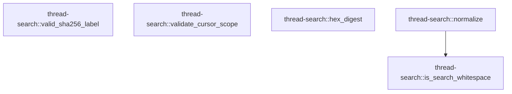

# thread-search

[Package atlas](index.md) · [Source](../../src/lib.rs)

## Declarations

Visibility is the declaration spelling; trait members and reexports require their enclosing interface. `cfg` is not evaluated.

| Symbol | Kind | Visibility | Test / cfg |
|---|---|---|---|
| [thread-search::FORMAT](../../src/lib.rs#L23) | const_item | `private` |  |
| [thread-search::INDEX_NAME](../../src/lib.rs#L24) | const_item | `private` |  |
| [thread-search::LEGACY_INDEX_NAME](../../src/lib.rs#L26) | const_item | `private` |  |
| [thread-search::MAX_QUERY_BYTES](../../src/lib.rs#L27) | const_item | `private` |  |
| [thread-search::MAX_SESSION_FILTER_BYTES](../../src/lib.rs#L28) | const_item | `private` |  |
| [thread-search::MAX_PAGE_SIZE](../../src/lib.rs#L29) | const_item | `private` |  |
| [thread-search::ArchiveVisibility](../../src/lib.rs#L33) | enum_item | `pub` |  |
| [thread-search::SearchRequest](../../src/lib.rs#L40) | struct_item | `pub` |  |
| [thread-search::MatchClass](../../src/lib.rs#L50) | enum_item | `pub` |  |
| [thread-search::SearchResult](../../src/lib.rs#L58) | struct_item | `pub` |  |
| [thread-search::IndexUse](../../src/lib.rs#L70) | struct_item | `pub` |  |
| [thread-search::SearchPage](../../src/lib.rs#L80) | struct_item | `pub` |  |
| [thread-search::ThreadSearchAuthority](../../src/lib.rs#L89) | struct_item | `pub` |  |
| [thread-search::ThreadSearchAuthority::open](../../src/lib.rs#L94) | function_item | `pub` |  |
| [thread-search::ThreadSearchAuthority::search](../../src/lib.rs#L103) | function_item | `pub` |  |
| [thread-search::ThreadSearchAuthority::rebuild_index](../../src/lib.rs#L175) | function_item | `pub` |  |
| [thread-search::ThreadSearchAuthority::scan_and_repair_indices](../../src/lib.rs#L186) | function_item | `private` |  |
| [thread-search::IndexFile](../../src/lib.rs#L226) | struct_item | `private` |  |
| [thread-search::IndexEntry](../../src/lib.rs#L234) | struct_item | `private` |  |
| [thread-search::CursorBody](../../src/lib.rs#L247) | struct_item | `private` |  |
| [thread-search::validate_request](../../src/lib.rs#L257) | function_item | `private` |  |
| [thread-search::valid_session_filter](../../src/lib.rs#L280) | function_item | `private` |  |
| [thread-search::visibility_includes](../../src/lib.rs#L289) | function_item | `private` |  |
| [thread-search::rank](../../src/lib.rs#L294) | function_item | `private` |  |
| [thread-search::SKIPPED_SESSIONS](../../src/lib.rs#L319) | static_item | `private` |  |
| [thread-search::skipped_sessions](../../src/lib.rs#L323) | function_item | `pub` |  |
| [thread-search::note_skipped](../../src/lib.rs#L327) | function_item | `private` |  |
| [thread-search::note_skipped::LOGGED](../../src/lib.rs#L328) | static_item | `private` |  |
| [thread-search::scan_sources](../../src/lib.rs#L341) | function_item | `private` |  |
| [thread-search::scan_session](../../src/lib.rs#L372) | function_item | `private` |  |
| [thread-search::superseded_sequences](../../src/lib.rs#L433) | function_item | `private` |  |
| [thread-search::validate_session_id](../../src/lib.rs#L445) | function_item | `private` |  |
| [thread-search::publish_index](../../src/lib.rs#L453) | function_item | `private` |  |
| [thread-search::same_projection](../../src/lib.rs#L467) | function_item | `private` |  |
| [thread-search::decode_index](../../src/lib.rs#L476) | function_item | `private` |  |
| [thread-search::digest_entries](../../src/lib.rs#L511) | function_item | `private` |  |
| [thread-search::encode_cursor](../../src/lib.rs#L517) | function_item | `private` |  |
| [thread-search::decode_cursor](../../src/lib.rs#L527) | function_item | `private` |  |
| [thread-search::valid_sha256_label](../../src/lib.rs#L566) | function_item | `private` |  |
| [thread-search::validate_cursor_scope](../../src/lib.rs#L574) | function_item | `private` |  |
| [thread-search::hex_digest](../../src/lib.rs#L592) | function_item | `private` |  |
| [thread-search::normalize](../../src/lib.rs#L596) | function_item | `private` |  |
| [thread-search::is_search_whitespace](../../src/lib.rs#L617) | function_item | `private` |  |
| [thread-search::SearchError](../../src/lib.rs#L635) | enum_item | `pub` |  |

## Imports / reexports

| Local name | Source path | Visibility |
|---|---|---|
| `SessionSearchHit` | `host::SessionSearchHit` | `pub` |
| `SessionSearchResults` | `host::SessionSearchResults` | `pub` |
| `BTreeSet` | `std::collections::BTreeSet` | `private` |
| `HashSet` | `std::collections::HashSet` | `private` |
| `fs` | `std::fs` | `private` |
| `Path` | `std::path::Path` | `private` |
| `PathBuf` | `std::path::PathBuf` | `private` |
| `_` | `base64::Engine` | `private` |
| `URL_SAFE_NO_PAD` | `base64::engine::general_purpose::URL_SAFE_NO_PAD` | `private` |
| `EventKind` | `schema::EventKind` | `private` |
| `Deserialize` | `serde::Deserialize` | `private` |
| `Serialize` | `serde::Serialize` | `private` |
| `Digest` | `sha2::Digest` | `private` |
| `Sha256` | `sha2::Sha256` | `private` |
| `AtomicPublisher` | `store::AtomicPublisher` | `private` |
| `NamedLock` | `store::NamedLock` | `private` |
| `ThreadStore` | `store::ThreadStore` | `private` |
| `scan_valid_prefix` | `store::scan_valid_prefix` | `private` |
| `Error` | `thiserror::Error` | `private` |
| `UnicodeNormalization` | `unicode_normalization::UnicodeNormalization` | `private` |
| `Uuid` | `uuid::Uuid` | `private` |

## Module declarations

| Module | Visibility | Attributes |
|---|---|---|
| `thread-search::host` | `private` |  |

## Function call graphs

Edges below are syntactically resolved calls only, including private functions. Graphs partition callers into groups of 20; they are not execution order. All unresolved sites are listed below and in the JSON inventory.

```mermaid
flowchart TD
  n0["store::atomic::AtomicPublisher::replace"]
  n1["store::folder::ThreadStore::open"]
  n2["store::platform::NamedLock::exclusive"]
  n3["store::platform::NamedLock::shared"]
  n4["store::tail::scan_valid_prefix"]
  n5["thread-search::ThreadSearchAuthority::search"]
  n6["thread-search::ThreadSearchAuthority::rebuild_index"]
  n7["thread-search::ThreadSearchAuthority::scan_and_repair_indices"]
  n8["thread-search::validate_request"]
  n9["thread-search::valid_session_filter"]
  n10["thread-search::visibility_includes"]
  n11["thread-search::rank"]
  n12["thread-search::skipped_sessions"]
  n13["thread-search::note_skipped"]
  n14["thread-search::scan_sources"]
  n15["thread-search::scan_session"]
  n16["thread-search::superseded_sequences"]
  n17["thread-search::validate_session_id"]
  n18["thread-search::publish_index"]
  n19["thread-search::same_projection"]
  n20["thread-search::decode_index"]
  n21["thread-search::digest_entries"]
  n22["thread-search::encode_cursor"]
  n23["thread-search::decode_cursor"]
  n24["thread-search::valid_sha256_label"]
  n25["thread-search::validate_cursor_scope"]
  n26["thread-search::hex_digest"]
  n27["thread-search::normalize"]
  n28["thread-search::is_search_whitespace"]
  n29["thread-search::ThreadSearchAuthority::open"]
  n5 --> n2
  n5 --> n3
  n5 --> n7
  n5 --> n8
  n5 --> n10
  n5 --> n11
  n5 --> n21
  n5 --> n22
  n5 --> n23
  n5 --> n25
  n5 --> n27
  n6 --> n2
  n6 --> n3
  n6 --> n14
  n6 --> n18
  n6 --> n21
  n7 --> n14
  n7 --> n18
  n7 --> n19
  n7 --> n20
  n8 --> n9
  n8 --> n27
  n8 --> n28
  n14 --> n13
  n14 --> n15
  n14 --> n17
  n15 --> n4
  n15 --> n16
  n18 --> n0
  n18 --> n21
  n20 --> n17
  n20 --> n21
  n23 --> n9
  n23 --> n17
  n23 --> n24
  n23 --> n26
  n23 --> n27
  n29 --> n1
```

Functions 1–20: 38 direct edges

Functions 21–25: 1 direct edges

## Call sites

Includes test functions (marked in declarations). Receiver-type-required sites need type analysis/manual tracing. Calls in closures are attributed to their enclosing function; their occurrence here does not mean the closure executes immediately.

| Caller | Callee expression | Source lines | Target / classification |
|---|---|---|---|
| `open` | `Ok` | [95](../../src/lib.rs#L95) | external-constructor-callback-or-unresolved |
| `open` | `ThreadStore::open` | [96](../../src/lib.rs#L96) | [store::folder::ThreadStore::open](../../../store/src/folder.rs#L36) |
| `search` | `validate_request` | [104](../../src/lib.rs#L104) | [thread-search::validate_request](../../src/lib.rs#L257) |
| `search` | `normalize` | [105](../../src/lib.rs#L105) | [thread-search::normalize](../../src/lib.rs#L596) |
| `search` | `NamedLock::exclusive` | [106](../../src/lib.rs#L106) | [store::platform::NamedLock::exclusive](../../../store/src/platform.rs#L103) |
| `search` | `self.store.root().join` | [106](../../src/lib.rs#L106), [107](../../src/lib.rs#L107), [108](../../src/lib.rs#L108) | receiver-type-required |
| `search` | `self.store.root` | [106](../../src/lib.rs#L106), [107](../../src/lib.rs#L107), [108](../../src/lib.rs#L108) | receiver-type-required |
| `search` | `NamedLock::shared` | [107](../../src/lib.rs#L107), [108](../../src/lib.rs#L108) | [store::platform::NamedLock::shared](../../../store/src/platform.rs#L99) |
| `search` | `self.scan_and_repair_indices` | [109](../../src/lib.rs#L109) | [thread-search::ThreadSearchAuthority::scan_and_repair_indices](../../src/lib.rs#L186) |
| `search` | `entries             .into_iter()             .filter(&#124;entry&#124; {                 request                     .session_filter                     .as_ref()                     .is_none_or(&#124;filter&#124; &entry.session_id == filter)             })             .filter(&#124;entry&#124; visibility_includes(request.visibility, entry.archived))             .collect::<Vec<_>>` | [110](../../src/lib.rs#L110) | receiver-type-required |
| `search` | `entries             .into_iter()             .filter(&#124;entry&#124; {                 request                     .session_filter                     .as_ref()                     .is_none_or(&#124;filter&#124; &entry.session_id == filter)             })             .filter` | [110](../../src/lib.rs#L110) | receiver-type-required |
| `search` | `entries             .into_iter()             .filter` | [110](../../src/lib.rs#L110) | receiver-type-required |
| `search` | `entries             .into_iter` | [110](../../src/lib.rs#L110) | receiver-type-required |
| `search` | `request                     .session_filter                     .as_ref()                     .is_none_or` | [113](../../src/lib.rs#L113) | receiver-type-required |
| `search` | `request                     .session_filter                     .as_ref` | [113](../../src/lib.rs#L113) | receiver-type-required |
| `search` | `visibility_includes` | [118](../../src/lib.rs#L118) | [thread-search::visibility_includes](../../src/lib.rs#L289) |
| `search` | `digest_entries` | [120](../../src/lib.rs#L120) | [thread-search::digest_entries](../../src/lib.rs#L511) |
| `search` | `scoped             .into_iter()             .filter_map(&#124;entry&#124; rank(entry, &normalized_query))             .collect::<Vec<_>>` | [122](../../src/lib.rs#L122) | receiver-type-required |
| `search` | `scoped             .into_iter()             .filter_map` | [122](../../src/lib.rs#L122) | receiver-type-required |
| `search` | `scoped             .into_iter` | [122](../../src/lib.rs#L122) | receiver-type-required |
| `search` | `rank` | [124](../../src/lib.rs#L124) | [thread-search::rank](../../src/lib.rs#L294) |
| `search` | `ranked.sort_by` | [126](../../src/lib.rs#L126) | receiver-type-required |
| `search` | `right                 .score                 .cmp(&left.score)                 .then_with` | [127](../../src/lib.rs#L127) | receiver-type-required |
| `search` | `right                 .score                 .cmp` | [127](../../src/lib.rs#L127) | receiver-type-required |
| `search` | `left.session_id.as_bytes().cmp` | [130](../../src/lib.rs#L130) | receiver-type-required |
| `search` | `left.session_id.as_bytes` | [130](../../src/lib.rs#L130) | receiver-type-required |
| `search` | `right.session_id.as_bytes` | [130](../../src/lib.rs#L130) | receiver-type-required |
| `search` | `decode_cursor` | [134](../../src/lib.rs#L134) | [thread-search::decode_cursor](../../src/lib.rs#L527) |
| `search` | `validate_cursor_scope` | [135](../../src/lib.rs#L135) | [thread-search::validate_cursor_scope](../../src/lib.rs#L574) |
| `search` | `ranked                 .iter()                 .position(&#124;candidate&#124; {                     candidate.session_id == cursor.session_id && candidate.score == cursor.score                 })                 .ok_or` | [136](../../src/lib.rs#L136) | receiver-type-required |
| `search` | `ranked                 .iter()                 .position` | [136](../../src/lib.rs#L136) | receiver-type-required |
| `search` | `ranked                 .iter` | [136](../../src/lib.rs#L136) | receiver-type-required |
| `search` | `start.saturating_add(request.limit).min` | [146](../../src/lib.rs#L146) | receiver-type-required |
| `search` | `start.saturating_add` | [146](../../src/lib.rs#L146) | receiver-type-required |
| `search` | `ranked.len` | [146](../../src/lib.rs#L146), [148](../../src/lib.rs#L148) | receiver-type-required |
| `search` | `ranked[start..end].to_vec` | [147](../../src/lib.rs#L147) | receiver-type-required |
| `search` | `(!reached_end)             .then(&#124;&#124; {                 let last = results.last().ok_or(SearchError::CursorPosition)?;                 encode_cursor(&CursorBody {                     v: FORMAT,                     session_filter: request.session_filter.clone(),                     visibility: request.visibility,                     normalized_query: normalized_query.clone(),                     catalog_digest: catalog_digest.clone(),                     score: last.score,                     session_id: last.session_id.clone(),                 })             })             .transpose` | [149](../../src/lib.rs#L149) | receiver-type-required |
| `search` | `(!reached_end)             .then` | [149](../../src/lib.rs#L149) | receiver-type-required |
| `search` | `results.last().ok_or` | [151](../../src/lib.rs#L151) | receiver-type-required |
| `search` | `results.last` | [151](../../src/lib.rs#L151) | receiver-type-required |
| `search` | `encode_cursor` | [152](../../src/lib.rs#L152) | [thread-search::encode_cursor](../../src/lib.rs#L517) |
| `search` | `request.session_filter.clone` | [154](../../src/lib.rs#L154) | receiver-type-required |
| `search` | `normalized_query.clone` | [156](../../src/lib.rs#L156) | receiver-type-required |
| `search` | `catalog_digest.clone` | [157](../../src/lib.rs#L157) | receiver-type-required |
| `search` | `last.session_id.clone` | [159](../../src/lib.rs#L159) | receiver-type-required |
| `search` | `Ok` | [163](../../src/lib.rs#L163) | external-constructor-callback-or-unresolved |
| `rebuild_index` | `NamedLock::exclusive` | [176](../../src/lib.rs#L176) | [store::platform::NamedLock::exclusive](../../../store/src/platform.rs#L103) |
| `rebuild_index` | `self.store.root().join` | [176](../../src/lib.rs#L176), [177](../../src/lib.rs#L177), [178](../../src/lib.rs#L178) | receiver-type-required |
| `rebuild_index` | `self.store.root` | [176](../../src/lib.rs#L176), [177](../../src/lib.rs#L177), [178](../../src/lib.rs#L178), [179](../../src/lib.rs#L179) | receiver-type-required |
| `rebuild_index` | `NamedLock::shared` | [177](../../src/lib.rs#L177), [178](../../src/lib.rs#L178) | [store::platform::NamedLock::shared](../../../store/src/platform.rs#L99) |
| `rebuild_index` | `scan_sources` | [179](../../src/lib.rs#L179) | [thread-search::scan_sources](../../src/lib.rs#L341) |
| `rebuild_index` | `publish_index` | [181](../../src/lib.rs#L181) | [thread-search::publish_index](../../src/lib.rs#L453) |
| `rebuild_index` | `digest_entries` | [183](../../src/lib.rs#L183) | [thread-search::digest_entries](../../src/lib.rs#L511) |
| `scan_and_repair_indices` | `scan_sources` | [187](../../src/lib.rs#L187) | [thread-search::scan_sources](../../src/lib.rs#L341) |
| `scan_and_repair_indices` | `self.store.root` | [187](../../src/lib.rs#L187) | receiver-type-required |
| `scan_and_repair_indices` | `IndexUse::default` | [188](../../src/lib.rs#L188) | external-constructor-callback-or-unresolved |
| `scan_and_repair_indices` | `Vec::with_capacity` | [189](../../src/lib.rs#L189) | external-constructor-callback-or-unresolved |
| `scan_and_repair_indices` | `sources.len` | [189](../../src/lib.rs#L189) | receiver-type-required |
| `scan_and_repair_indices` | `std::fs::remove_file` | [191](../../src/lib.rs#L191) | external-constructor-callback-or-unresolved |
| `scan_and_repair_indices` | `source.folder.join` | [191](../../src/lib.rs#L191), [192](../../src/lib.rs#L192) | receiver-type-required |
| `scan_and_repair_indices` | `fs::read` | [193](../../src/lib.rs#L193) | external-constructor-callback-or-unresolved |
| `scan_and_repair_indices` | `decode_index` | [194](../../src/lib.rs#L194) | [thread-search::decode_index](../../src/lib.rs#L476) |
| `scan_and_repair_indices` | `same_projection` | [195](../../src/lib.rs#L195) | [thread-search::same_projection](../../src/lib.rs#L467) |
| `scan_and_repair_indices` | `usable.push` | [198](../../src/lib.rs#L198), [218](../../src/lib.rs#L218) | receiver-type-required |
| `scan_and_repair_indices` | `error.kind` | [208](../../src/lib.rs#L208) | receiver-type-required |
| `scan_and_repair_indices` | `publish_index(&source).is_err` | [215](../../src/lib.rs#L215) | receiver-type-required |
| `scan_and_repair_indices` | `publish_index` | [215](../../src/lib.rs#L215) | [thread-search::publish_index](../../src/lib.rs#L453) |
| `scan_and_repair_indices` | `Ok` | [220](../../src/lib.rs#L220) | external-constructor-callback-or-unresolved |
| `validate_request` | `request         .session_filter         .as_deref()         .is_some_and` | [258](../../src/lib.rs#L258) | receiver-type-required |
| `validate_request` | `request         .session_filter         .as_deref` | [258](../../src/lib.rs#L258) | receiver-type-required |
| `validate_request` | `valid_session_filter` | [261](../../src/lib.rs#L261) | [thread-search::valid_session_filter](../../src/lib.rs#L280) |
| `validate_request` | `Err` | [263](../../src/lib.rs#L263), [272](../../src/lib.rs#L272), [275](../../src/lib.rs#L275) | external-constructor-callback-or-unresolved |
| `validate_request` | `request.query.len` | [265](../../src/lib.rs#L265) | receiver-type-required |
| `validate_request` | `request             .query             .chars()             .any` | [266](../../src/lib.rs#L266) | receiver-type-required |
| `validate_request` | `request             .query             .chars` | [266](../../src/lib.rs#L266) | receiver-type-required |
| `validate_request` | `value.is_control` | [269](../../src/lib.rs#L269) | receiver-type-required |
| `validate_request` | `is_search_whitespace` | [269](../../src/lib.rs#L269) | [thread-search::is_search_whitespace](../../src/lib.rs#L617) |
| `validate_request` | `normalize(&request.query).is_empty` | [270](../../src/lib.rs#L270) | receiver-type-required |
| `validate_request` | `normalize` | [270](../../src/lib.rs#L270) | [thread-search::normalize](../../src/lib.rs#L596) |
| `validate_request` | `(1..=MAX_PAGE_SIZE).contains` | [274](../../src/lib.rs#L274) | receiver-type-required |
| `validate_request` | `Ok` | [277](../../src/lib.rs#L277) | external-constructor-callback-or-unresolved |
| `valid_session_filter` | `value.is_empty` | [281](../../src/lib.rs#L281) | receiver-type-required |
| `valid_session_filter` | `value.len` | [282](../../src/lib.rs#L282) | receiver-type-required |
| `valid_session_filter` | `value.starts_with` | [283](../../src/lib.rs#L283) | receiver-type-required |
| `valid_session_filter` | `value             .bytes()             .all` | [284](../../src/lib.rs#L284) | receiver-type-required |
| `valid_session_filter` | `value             .bytes` | [284](../../src/lib.rs#L284) | receiver-type-required |
| `valid_session_filter` | `byte.is_ascii_alphanumeric` | [286](../../src/lib.rs#L286) | receiver-type-required |
| `rank` | `entry.normalized_title.as_deref` | [295](../../src/lib.rs#L295) | receiver-type-required |
| `rank` | `normalized.starts_with` | [298](../../src/lib.rs#L298) | receiver-type-required |
| `rank` | `query.split(' ').all` | [300](../../src/lib.rs#L300) | receiver-type-required |
| `rank` | `query.split` | [300](../../src/lib.rs#L300) | receiver-type-required |
| `rank` | `normalized.contains` | [300](../../src/lib.rs#L300) | receiver-type-required |
| `rank` | `Some` | [305](../../src/lib.rs#L305) | external-constructor-callback-or-unresolved |
| `rank` | `entry.title.expect` | [307](../../src/lib.rs#L307) | receiver-type-required |
| `SKIPPED_SESSIONS` | `std::sync::atomic::AtomicU64::new` | [319](../../src/lib.rs#L319) | external-constructor-callback-or-unresolved |
| `skipped_sessions` | `SKIPPED_SESSIONS.load` | [324](../../src/lib.rs#L324) | receiver-type-required |
| `note_skipped` | `SKIPPED_SESSIONS.fetch_add` | [330](../../src/lib.rs#L330) | receiver-type-required |
| `note_skipped` | `LOGGED         .get_or_init(Default::default)         .lock()         .unwrap_or_else(std::sync::PoisonError::into_inner)         .insert` | [331](../../src/lib.rs#L331) | receiver-type-required |
| `note_skipped` | `LOGGED         .get_or_init(Default::default)         .lock()         .unwrap_or_else` | [331](../../src/lib.rs#L331) | receiver-type-required |
| `note_skipped` | `LOGGED         .get_or_init(Default::default)         .lock` | [331](../../src/lib.rs#L331) | receiver-type-required |
| `note_skipped` | `LOGGED         .get_or_init` | [331](../../src/lib.rs#L331) | receiver-type-required |
| `note_skipped` | `session_id.to_owned` | [335](../../src/lib.rs#L335) | receiver-type-required |
| `LOGGED` | `std::sync::OnceLock::new` | [329](../../src/lib.rs#L329) | external-constructor-callback-or-unresolved |
| `scan_sources` | `Vec::new` | [342](../../src/lib.rs#L342) | external-constructor-callback-or-unresolved |
| `scan_sources` | `HashSet::new` | [343](../../src/lib.rs#L343) | external-constructor-callback-or-unresolved |
| `scan_sources` | `fs::read_dir(root.join(area))?.collect::<Result<Vec<_>, _>>` | [345](../../src/lib.rs#L345) | receiver-type-required |
| `scan_sources` | `fs::read_dir` | [345](../../src/lib.rs#L345) | external-constructor-callback-or-unresolved |
| `scan_sources` | `root.join` | [345](../../src/lib.rs#L345) | receiver-type-required |
| `scan_sources` | `folders.sort_by_key` | [346](../../src/lib.rs#L346) | receiver-type-required |
| `scan_sources` | `folder.file_type()?.is_dir` | [348](../../src/lib.rs#L348) | receiver-type-required |
| `scan_sources` | `folder.file_type` | [348](../../src/lib.rs#L348) | receiver-type-required |
| `scan_sources` | `folder.file_name().to_string_lossy().into_owned` | [351](../../src/lib.rs#L351) | receiver-type-required |
| `scan_sources` | `folder.file_name().to_string_lossy` | [351](../../src/lib.rs#L351) | receiver-type-required |
| `scan_sources` | `folder.file_name` | [351](../../src/lib.rs#L351) | receiver-type-required |
| `scan_sources` | `validate_session_id` | [352](../../src/lib.rs#L352) | [thread-search::validate_session_id](../../src/lib.rs#L445) |
| `scan_sources` | `identities.insert` | [353](../../src/lib.rs#L353) | receiver-type-required |
| `scan_sources` | `session_id.clone` | [353](../../src/lib.rs#L353), [358](../../src/lib.rs#L358) | receiver-type-required |
| `scan_sources` | `Err` | [354](../../src/lib.rs#L354), [364](../../src/lib.rs#L364) | external-constructor-callback-or-unresolved |
| `scan_sources` | `SearchError::SourceCorrupt` | [354](../../src/lib.rs#L354) | external-constructor-callback-or-unresolved |
| `scan_sources` | `scan_session` | [358](../../src/lib.rs#L358) | [thread-search::scan_session](../../src/lib.rs#L372) |
| `scan_sources` | `folder.path` | [358](../../src/lib.rs#L358) | receiver-type-required |
| `scan_sources` | `entries.push` | [359](../../src/lib.rs#L359) | receiver-type-required |
| `scan_sources` | `note_skipped` | [360](../../src/lib.rs#L360), [362](../../src/lib.rs#L362) | [thread-search::note_skipped](../../src/lib.rs#L327) |
| `scan_sources` | `error.kind` | [361](../../src/lib.rs#L361) | receiver-type-required |
| `scan_sources` | `entries.sort_by` | [368](../../src/lib.rs#L368) | receiver-type-required |
| `scan_sources` | `left.session_id.as_bytes().cmp` | [368](../../src/lib.rs#L368) | receiver-type-required |
| `scan_sources` | `left.session_id.as_bytes` | [368](../../src/lib.rs#L368) | receiver-type-required |
| `scan_sources` | `right.session_id.as_bytes` | [368](../../src/lib.rs#L368) | receiver-type-required |
| `scan_sources` | `Ok` | [369](../../src/lib.rs#L369) | external-constructor-callback-or-unresolved |
| `scan_session` | `fs::read` | [377](../../src/lib.rs#L377) | external-constructor-callback-or-unresolved |
| `scan_session` | `folder.join` | [377](../../src/lib.rs#L377) | receiver-type-required |
| `scan_session` | `scan_valid_prefix` | [378](../../src/lib.rs#L378) | [store::tail::scan_valid_prefix](../../../store/src/tail.rs#L37) |
| `scan_session` | `usize::try_from(scan.valid_bytes)         .map_err` | [379](../../src/lib.rs#L379) | receiver-type-required |
| `scan_session` | `usize::try_from` | [379](../../src/lib.rs#L379) | external-constructor-callback-or-unresolved |
| `scan_session` | `SearchError::SourceCorrupt` | [380](../../src/lib.rs#L380), [385](../../src/lib.rs#L385), [390](../../src/lib.rs#L390), [393](../../src/lib.rs#L393), [398](../../src/lib.rs#L398), [419](../../src/lib.rs#L419) | external-constructor-callback-or-unresolved |
| `scan_session` | `"valid prefix is too large".to_owned` | [380](../../src/lib.rs#L380) | receiver-type-required |
| `scan_session` | `bytes         .get(valid_len..)         .is_some_and` | [381](../../src/lib.rs#L381) | receiver-type-required |
| `scan_session` | `bytes         .get` | [381](../../src/lib.rs#L381) | receiver-type-required |
| `scan_session` | `tail.contains` | [383](../../src/lib.rs#L383) | receiver-type-required |
| `scan_session` | `Err` | [385](../../src/lib.rs#L385), [398](../../src/lib.rs#L398) | external-constructor-callback-or-unresolved |
| `scan_session` | `scan.projection.ok_or_else` | [389](../../src/lib.rs#L389) | receiver-type-required |
| `scan_session` | `projection.events.first().ok_or_else` | [392](../../src/lib.rs#L392) | receiver-type-required |
| `scan_session` | `projection.events.first` | [392](../../src/lib.rs#L392) | receiver-type-required |
| `scan_session` | `genesis.string_field` | [396](../../src/lib.rs#L396) | receiver-type-required |
| `scan_session` | `Some` | [396](../../src/lib.rs#L396) | external-constructor-callback-or-unresolved |
| `scan_session` | `session_id.as_str` | [396](../../src/lib.rs#L396) | receiver-type-required |
| `scan_session` | `superseded_sequences` | [402](../../src/lib.rs#L402) | [thread-search::superseded_sequences](../../src/lib.rs#L433) |
| `scan_session` | `projection         .events         .iter()         .rev()         .find(&#124;event&#124; {             matches!(event.kind(), EventKind::Meta)                 && event.string_field("title").is_some()                 && !superseded.contains(&event.seq())         })         .and_then(&#124;event&#124; event.string_field("title"))         .map` | [403](../../src/lib.rs#L403) | receiver-type-required |
| `scan_session` | `projection         .events         .iter()         .rev()         .find(&#124;event&#124; {             matches!(event.kind(), EventKind::Meta)                 && event.string_field("title").is_some()                 && !superseded.contains(&event.seq())         })         .and_then` | [403](../../src/lib.rs#L403) | receiver-type-required |
| `scan_session` | `projection         .events         .iter()         .rev()         .find` | [403](../../src/lib.rs#L403) | receiver-type-required |
| `scan_session` | `projection         .events         .iter()         .rev` | [403](../../src/lib.rs#L403) | receiver-type-required |
| `scan_session` | `projection         .events         .iter` | [403](../../src/lib.rs#L403) | receiver-type-required |
| `scan_session` | `event.string_field("title").is_some` | [409](../../src/lib.rs#L409) | receiver-type-required |
| `scan_session` | `event.string_field` | [409](../../src/lib.rs#L409), [412](../../src/lib.rs#L412), [417](../../src/lib.rs#L417) | receiver-type-required |
| `scan_session` | `superseded.contains` | [410](../../src/lib.rs#L410) | receiver-type-required |
| `scan_session` | `event.seq` | [410](../../src/lib.rs#L410) | receiver-type-required |
| `scan_session` | `projection         .events         .last()         .and_then(&#124;event&#124; event.string_field("ts"))         .ok_or_else(&#124;&#124; {             SearchError::SourceCorrupt(format!("session {session_id} tail lacks timestamp"))         })?         .to_owned` | [414](../../src/lib.rs#L414) | receiver-type-required |
| `scan_session` | `projection         .events         .last()         .and_then(&#124;event&#124; event.string_field("ts"))         .ok_or_else` | [414](../../src/lib.rs#L414) | receiver-type-required |
| `scan_session` | `projection         .events         .last()         .and_then` | [414](../../src/lib.rs#L414) | receiver-type-required |
| `scan_session` | `projection         .events         .last` | [414](../../src/lib.rs#L414) | receiver-type-required |
| `scan_session` | `Ok` | [422](../../src/lib.rs#L422) | external-constructor-callback-or-unresolved |
| `scan_session` | `title.as_deref().map` | [424](../../src/lib.rs#L424) | receiver-type-required |
| `scan_session` | `title.as_deref` | [424](../../src/lib.rs#L424) | receiver-type-required |
| `scan_session` | `folder.to_path_buf` | [429](../../src/lib.rs#L429) | receiver-type-required |
| `superseded_sequences` | `BTreeSet::new` | [434](../../src/lib.rs#L434) | external-constructor-callback-or-unresolved |
| `superseded_sequences` | `event.supersedes().map_err` | [436](../../src/lib.rs#L436) | receiver-type-required |
| `superseded_sequences` | `event.supersedes` | [436](../../src/lib.rs#L436) | receiver-type-required |
| `superseded_sequences` | `SearchError::SourceCorrupt` | [437](../../src/lib.rs#L437) | external-constructor-callback-or-unresolved |
| `superseded_sequences` | `superseded.extend` | [439](../../src/lib.rs#L439) | receiver-type-required |
| `superseded_sequences` | `Ok` | [442](../../src/lib.rs#L442) | external-constructor-callback-or-unresolved |
| `validate_session_id` | `Uuid::parse_str(value).map_err` | [446](../../src/lib.rs#L446) | receiver-type-required |
| `validate_session_id` | `Uuid::parse_str` | [446](../../src/lib.rs#L446) | external-constructor-callback-or-unresolved |
| `validate_session_id` | `parsed.hyphenated().to_string` | [447](../../src/lib.rs#L447) | receiver-type-required |
| `validate_session_id` | `parsed.hyphenated` | [447](../../src/lib.rs#L447) | receiver-type-required |
| `validate_session_id` | `value.to_ascii_lowercase` | [447](../../src/lib.rs#L447) | receiver-type-required |
| `validate_session_id` | `Err` | [448](../../src/lib.rs#L448) | external-constructor-callback-or-unresolved |
| `validate_session_id` | `Ok` | [450](../../src/lib.rs#L450) | external-constructor-callback-or-unresolved |
| `publish_index` | `digest_entries` | [456](../../src/lib.rs#L456) | [thread-search::digest_entries](../../src/lib.rs#L511) |
| `publish_index` | `std::slice::from_ref` | [456](../../src/lib.rs#L456) | external-constructor-callback-or-unresolved |
| `publish_index` | `entry.clone` | [457](../../src/lib.rs#L457) | receiver-type-required |
| `publish_index` | `serde_json_canonicalizer::to_vec(&value)         .map_err` | [459](../../src/lib.rs#L459) | receiver-type-required |
| `publish_index` | `serde_json_canonicalizer::to_vec` | [459](../../src/lib.rs#L459) | external-constructor-callback-or-unresolved |
| `publish_index` | `SearchError::Canonical` | [460](../../src/lib.rs#L460) | external-constructor-callback-or-unresolved |
| `publish_index` | `error.to_string` | [460](../../src/lib.rs#L460) | receiver-type-required |
| `publish_index` | `bytes.push` | [461](../../src/lib.rs#L461) | receiver-type-required |
| `publish_index` | `AtomicPublisher::replace` | [462](../../src/lib.rs#L462) | [store::atomic::AtomicPublisher::replace](../../../store/src/atomic.rs#L16) |
| `publish_index` | `entry.folder.join` | [462](../../src/lib.rs#L462), [463](../../src/lib.rs#L463) | receiver-type-required |
| `publish_index` | `std::fs::remove_file` | [463](../../src/lib.rs#L463) | external-constructor-callback-or-unresolved |
| `publish_index` | `Ok` | [464](../../src/lib.rs#L464) | external-constructor-callback-or-unresolved |
| `decode_index` | `bytes         .strip_suffix(b"\n")         .ok_or_else` | [477](../../src/lib.rs#L477) | receiver-type-required |
| `decode_index` | `bytes         .strip_suffix` | [477](../../src/lib.rs#L477) | receiver-type-required |
| `decode_index` | `SearchError::IndexCorrupt` | [479](../../src/lib.rs#L479), [481](../../src/lib.rs#L481), [486](../../src/lib.rs#L486), [488](../../src/lib.rs#L488), [497](../../src/lib.rs#L497), [504](../../src/lib.rs#L504) | external-constructor-callback-or-unresolved |
| `decode_index` | `"index lacks final LF".to_owned` | [479](../../src/lib.rs#L479) | receiver-type-required |
| `decode_index` | `line.contains` | [480](../../src/lib.rs#L480) | receiver-type-required |
| `decode_index` | `Err` | [481](../../src/lib.rs#L481), [488](../../src/lib.rs#L488), [497](../../src/lib.rs#L497), [504](../../src/lib.rs#L504) | external-constructor-callback-or-unresolved |
| `decode_index` | `"index contains multiple lines".to_owned` | [482](../../src/lib.rs#L482) | receiver-type-required |
| `decode_index` | `serde_json::from_slice(line)         .map_err` | [485](../../src/lib.rs#L485) | receiver-type-required |
| `decode_index` | `serde_json::from_slice` | [485](../../src/lib.rs#L485) | external-constructor-callback-or-unresolved |
| `decode_index` | `error.to_string` | [486](../../src/lib.rs#L486), [502](../../src/lib.rs#L502) | receiver-type-required |
| `decode_index` | `"unsupported index format".to_owned` | [489](../../src/lib.rs#L489) | receiver-type-required |
| `decode_index` | `validate_session_id` | [492](../../src/lib.rs#L492) | [thread-search::validate_session_id](../../src/lib.rs#L445) |
| `decode_index` | `index.entry.title.as_deref().map` | [494](../../src/lib.rs#L494) | receiver-type-required |
| `decode_index` | `index.entry.title.as_deref` | [494](../../src/lib.rs#L494) | receiver-type-required |
| `decode_index` | `digest_entries` | [495](../../src/lib.rs#L495) | [thread-search::digest_entries](../../src/lib.rs#L511) |
| `decode_index` | `std::slice::from_ref` | [495](../../src/lib.rs#L495) | external-constructor-callback-or-unresolved |
| `decode_index` | `"index source projection mismatch".to_owned` | [498](../../src/lib.rs#L498) | receiver-type-required |
| `decode_index` | `serde_json_canonicalizer::to_vec(&index)         .map_err` | [501](../../src/lib.rs#L501) | receiver-type-required |
| `decode_index` | `serde_json_canonicalizer::to_vec` | [501](../../src/lib.rs#L501) | external-constructor-callback-or-unresolved |
| `decode_index` | `SearchError::Canonical` | [502](../../src/lib.rs#L502) | external-constructor-callback-or-unresolved |
| `decode_index` | `"index is not canonical JSON".to_owned` | [505](../../src/lib.rs#L505) | receiver-type-required |
| `decode_index` | `Ok` | [508](../../src/lib.rs#L508) | external-constructor-callback-or-unresolved |
| `digest_entries` | `serde_json_canonicalizer::to_vec(&entries)         .map_err` | [512](../../src/lib.rs#L512) | receiver-type-required |
| `digest_entries` | `serde_json_canonicalizer::to_vec` | [512](../../src/lib.rs#L512) | external-constructor-callback-or-unresolved |
| `digest_entries` | `SearchError::Canonical` | [513](../../src/lib.rs#L513) | external-constructor-callback-or-unresolved |
| `digest_entries` | `error.to_string` | [513](../../src/lib.rs#L513) | receiver-type-required |
| `digest_entries` | `Ok` | [514](../../src/lib.rs#L514) | external-constructor-callback-or-unresolved |
| `encode_cursor` | `serde_json_canonicalizer::to_vec(cursor)         .map_err` | [518](../../src/lib.rs#L518) | receiver-type-required |
| `encode_cursor` | `serde_json_canonicalizer::to_vec` | [518](../../src/lib.rs#L518) | external-constructor-callback-or-unresolved |
| `encode_cursor` | `SearchError::Canonical` | [519](../../src/lib.rs#L519) | external-constructor-callback-or-unresolved |
| `encode_cursor` | `error.to_string` | [519](../../src/lib.rs#L519) | receiver-type-required |
| `encode_cursor` | `Ok` | [520](../../src/lib.rs#L520) | external-constructor-callback-or-unresolved |
| `decode_cursor` | `value.split` | [528](../../src/lib.rs#L528) | receiver-type-required |
| `decode_cursor` | `fields.next().ok_or` | [529](../../src/lib.rs#L529), [530](../../src/lib.rs#L530) | receiver-type-required |
| `decode_cursor` | `fields.next` | [529](../../src/lib.rs#L529), [530](../../src/lib.rs#L530), [531](../../src/lib.rs#L531) | receiver-type-required |
| `decode_cursor` | `fields.next().is_some` | [531](../../src/lib.rs#L531) | receiver-type-required |
| `decode_cursor` | `digest.len` | [532](../../src/lib.rs#L532) | receiver-type-required |
| `decode_cursor` | `digest             .bytes()             .all` | [533](../../src/lib.rs#L533) | receiver-type-required |
| `decode_cursor` | `digest             .bytes` | [533](../../src/lib.rs#L533) | receiver-type-required |
| `decode_cursor` | `byte.is_ascii_digit` | [535](../../src/lib.rs#L535) | receiver-type-required |
| `decode_cursor` | `(b'a'..=b'f').contains` | [535](../../src/lib.rs#L535) | receiver-type-required |
| `decode_cursor` | `Err` | [537](../../src/lib.rs#L537), [543](../../src/lib.rs#L543), [561](../../src/lib.rs#L561) | external-constructor-callback-or-unresolved |
| `decode_cursor` | `URL_SAFE_NO_PAD         .decode(encoded)         .map_err` | [539](../../src/lib.rs#L539) | receiver-type-required |
| `decode_cursor` | `URL_SAFE_NO_PAD         .decode` | [539](../../src/lib.rs#L539) | receiver-type-required |
| `decode_cursor` | `URL_SAFE_NO_PAD.encode` | [542](../../src/lib.rs#L542) | receiver-type-required |
| `decode_cursor` | `hex_digest` | [542](../../src/lib.rs#L542) | [thread-search::hex_digest](../../src/lib.rs#L592) |
| `decode_cursor` | `serde_json::from_slice(&bytes).map_err` | [546](../../src/lib.rs#L546) | receiver-type-required |
| `decode_cursor` | `serde_json::from_slice` | [546](../../src/lib.rs#L546) | external-constructor-callback-or-unresolved |
| `decode_cursor` | `serde_json_canonicalizer::to_vec(&cursor).map_err` | [548](../../src/lib.rs#L548) | receiver-type-required |
| `decode_cursor` | `serde_json_canonicalizer::to_vec` | [548](../../src/lib.rs#L548) | external-constructor-callback-or-unresolved |
| `decode_cursor` | `validate_session_id(&cursor.session_id).is_err` | [552](../../src/lib.rs#L552) | receiver-type-required |
| `decode_cursor` | `validate_session_id` | [552](../../src/lib.rs#L552) | [thread-search::validate_session_id](../../src/lib.rs#L445) |
| `decode_cursor` | `cursor             .session_filter             .as_deref()             .is_some_and` | [553](../../src/lib.rs#L553) | receiver-type-required |
| `decode_cursor` | `cursor             .session_filter             .as_deref` | [553](../../src/lib.rs#L553) | receiver-type-required |
| `decode_cursor` | `valid_session_filter` | [556](../../src/lib.rs#L556) | [thread-search::valid_session_filter](../../src/lib.rs#L280) |
| `decode_cursor` | `cursor.normalized_query.is_empty` | [557](../../src/lib.rs#L557) | receiver-type-required |
| `decode_cursor` | `normalize` | [558](../../src/lib.rs#L558) | [thread-search::normalize](../../src/lib.rs#L596) |
| `decode_cursor` | `valid_sha256_label` | [559](../../src/lib.rs#L559) | [thread-search::valid_sha256_label](../../src/lib.rs#L566) |
| `decode_cursor` | `Ok` | [563](../../src/lib.rs#L563) | external-constructor-callback-or-unresolved |
| `valid_sha256_label` | `value.len` | [567](../../src/lib.rs#L567) | receiver-type-required |
| `valid_sha256_label` | `value.starts_with` | [568](../../src/lib.rs#L568) | receiver-type-required |
| `valid_sha256_label` | `value[7..]             .bytes()             .all` | [569](../../src/lib.rs#L569) | receiver-type-required |
| `valid_sha256_label` | `value[7..]             .bytes` | [569](../../src/lib.rs#L569) | receiver-type-required |
| `valid_sha256_label` | `byte.is_ascii_digit` | [571](../../src/lib.rs#L571) | receiver-type-required |
| `valid_sha256_label` | `(b'a'..=b'f').contains` | [571](../../src/lib.rs#L571) | receiver-type-required |
| `validate_cursor_scope` | `Err` | [584](../../src/lib.rs#L584), [587](../../src/lib.rs#L587) | external-constructor-callback-or-unresolved |
| `validate_cursor_scope` | `Ok` | [589](../../src/lib.rs#L589) | external-constructor-callback-or-unresolved |
| `normalize` | `String::new` | [597](../../src/lib.rs#L597) | external-constructor-callback-or-unresolved |
| `normalize` | `value.nfkc` | [599](../../src/lib.rs#L599) | receiver-type-required |
| `normalize` | `is_search_whitespace` | [600](../../src/lib.rs#L600) | [thread-search::is_search_whitespace](../../src/lib.rs#L617) |
| `normalize` | `output.is_empty` | [601](../../src/lib.rs#L601) | receiver-type-required |
| `normalize` | `output.push` | [605](../../src/lib.rs#L605), [608](../../src/lib.rs#L608) | receiver-type-required |
| `normalize` | `scalar.is_ascii_uppercase` | [608](../../src/lib.rs#L608) | receiver-type-required |
| `normalize` | `scalar.to_ascii_lowercase` | [609](../../src/lib.rs#L609) | receiver-type-required |
