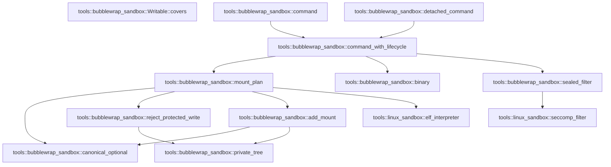

# tools::bubblewrap_sandbox

[Package atlas](index.md) · [Source](../../src/bubblewrap_sandbox.rs)

## Declarations

Visibility is the declaration spelling; trait members and reexports require their enclosing interface. `cfg` is not evaluated.

| Symbol | Kind | Visibility | Test / cfg |
|---|---|---|---|
| [tools::bubblewrap_sandbox::BACKEND](../../src/bubblewrap_sandbox.rs#L21) | const_item | `pub(crate)` |  |
| [tools::bubblewrap_sandbox::binary](../../src/bubblewrap_sandbox.rs#L26) | function_item | `pub(crate)` |  |
| [tools::bubblewrap_sandbox::command](../../src/bubblewrap_sandbox.rs#L57) | function_item | `pub(crate)` |  |
| [tools::bubblewrap_sandbox::detached_command](../../src/bubblewrap_sandbox.rs#L63) | function_item | `pub(crate)` |  |
| [tools::bubblewrap_sandbox::command_with_lifecycle](../../src/bubblewrap_sandbox.rs#L70) | function_item | `private` |  |
| [tools::bubblewrap_sandbox::Mount](../../src/bubblewrap_sandbox.rs#L160) | struct_item | `private` |  |
| [tools::bubblewrap_sandbox::MountPlan](../../src/bubblewrap_sandbox.rs#L167) | struct_item | `private` |  |
| [tools::bubblewrap_sandbox::mount_plan](../../src/bubblewrap_sandbox.rs#L172) | function_item | `private` |  |
| [tools::bubblewrap_sandbox::Writable](../../src/bubblewrap_sandbox.rs#L261) | struct_item | `private` |  |
| [tools::bubblewrap_sandbox::Writable::covers](../../src/bubblewrap_sandbox.rs#L270) | function_item | `private` |  |
| [tools::bubblewrap_sandbox::canonical_optional](../../src/bubblewrap_sandbox.rs#L282) | function_item | `private` |  |
| [tools::bubblewrap_sandbox::private_tree](../../src/bubblewrap_sandbox.rs#L297) | function_item | `private` |  |
| [tools::bubblewrap_sandbox::reject_protected_write](../../src/bubblewrap_sandbox.rs#L301) | function_item | `private` |  |
| [tools::bubblewrap_sandbox::add_mount](../../src/bubblewrap_sandbox.rs#L313) | function_item | `private` |  |
| [tools::bubblewrap_sandbox::sealed_filter](../../src/bubblewrap_sandbox.rs#L385) | function_item | `private` |  |
| [tools::bubblewrap_sandbox::tests::policy](../../src/bubblewrap_sandbox.rs#L425) | function_item | `private` | test; #[cfg(test)] |
| [tools::bubblewrap_sandbox::tests::protected_root_inside_a_writable_root_is_bound_read_only](../../src/bubblewrap_sandbox.rs#L438) | function_item | `private` | test; #[cfg(test)] |
| [tools::bubblewrap_sandbox::tests::symlinked_exception_beneath_a_protected_root_is_rejected](../../src/bubblewrap_sandbox.rs#L464) | function_item | `private` | test; #[cfg(test)] |
| [tools::bubblewrap_sandbox::tests::read_subroot_does_not_revoke_ancestor_write_grant](../../src/bubblewrap_sandbox.rs#L479) | function_item | `private` | test; #[cfg(test)] |
| [tools::bubblewrap_sandbox::tests::read_parent_keeps_readonly_siblings_of_write_subroot](../../src/bubblewrap_sandbox.rs#L498) | function_item | `private` | test; #[cfg(test)] |
| [tools::bubblewrap_sandbox::tests::root_alias_grants_the_same_canonical_object](../../src/bubblewrap_sandbox.rs#L522) | function_item | `private` | test; #[cfg(test)] |
| [tools::bubblewrap_sandbox::tests::symlink_inside_bound_parent_is_never_used_as_setup_destination](../../src/bubblewrap_sandbox.rs#L550) | function_item | `private` | test; #[cfg(test)] |
| [tools::bubblewrap_sandbox::tests::whole_host_read_root_is_rejected_even_through_an_alias](../../src/bubblewrap_sandbox.rs#L583) | function_item | `private` | test; #[cfg(test)] |
| [tools::bubblewrap_sandbox::tests::cannot_replace_private_kernel_views_with_writable_host_trees](../../src/bubblewrap_sandbox.rs#L594) | function_item | `private` | test; #[cfg(test)] |
| [tools::bubblewrap_sandbox::tests::seccomp_descriptor_is_sealed_and_cloexec_in_parent](../../src/bubblewrap_sandbox.rs#L604) | function_item | `private` | test; #[cfg(test)] |

## Imports / reexports

| Local name | Source path | Visibility |
|---|---|---|
| `BTreeMap` | `std::collections::BTreeMap` | `private` |
| `CString` | `std::ffi::CString` | `private` |
| `fs` | `std::fs` | `private` |
| `File` | `std::fs::File` | `private` |
| `io` | `std::io` | `private` |
| `Seek` | `std::io::Seek` | `private` |
| `SeekFrom` | `std::io::SeekFrom` | `private` |
| `Write` | `std::io::Write` | `private` |
| `AsRawFd` | `std::os::fd::AsRawFd` | `private` |
| `FromRawFd` | `std::os::fd::FromRawFd` | `private` |
| `MetadataExt` | `std::os::unix::fs::MetadataExt` | `private` |
| `CommandExt` | `std::os::unix::process::CommandExt` | `private` |
| `Path` | `std::path::Path` | `private` |
| `PathBuf` | `std::path::PathBuf` | `private` |
| `Command` | `std::process::Command` | `private` |
| `SYSTEM_READ_ROOTS` | `crate::linux_sandbox::SYSTEM_READ_ROOTS` | `private` |
| `elf_interpreter` | `crate::linux_sandbox::elf_interpreter` | `private` |
| `seccomp_filter` | `crate::linux_sandbox::seccomp_filter` | `private` |
| `NetworkPolicy` | `crate::sandbox::NetworkPolicy` | `private` |
| `SandboxError` | `crate::sandbox::SandboxError` | `private` |
| `SandboxPolicy` | `crate::sandbox::SandboxPolicy` | `private` |
| `*` | `super::*` | `private` |
| `symlink` | `std::os::unix::fs::symlink` | `private` |

## Module declarations

| Module | Visibility | Attributes |
|---|---|---|
| `tools::bubblewrap_sandbox::tests` | `private` | #[cfg(test)] |

## Function call graphs

Edges below are syntactically resolved calls only, including private functions. Graphs partition callers into groups of 20; they are not execution order. All unresolved sites are listed below and in the JSON inventory.

Functions 1–11: 13 direct edges

## Call sites

Includes test functions (marked in declarations). Receiver-type-required sites need type analysis/manual tracing. Calls in closures are attributed to their enclosing function; their occurrence here does not mean the closure executes immediately.

| Caller | Callee expression | Source lines | Target / classification |
|---|---|---|---|
| `binary` | `fs::canonicalize` | [28](../../src/bubblewrap_sandbox.rs#L28) | external-constructor-callback-or-unresolved |
| `binary` | `error.kind` | [30](../../src/bubblewrap_sandbox.rs#L30) | receiver-type-required |
| `binary` | `Err` | [31](../../src/bubblewrap_sandbox.rs#L31), [40](../../src/bubblewrap_sandbox.rs#L40), [48](../../src/bubblewrap_sandbox.rs#L48) | external-constructor-callback-or-unresolved |
| `binary` | `error.into` | [31](../../src/bubblewrap_sandbox.rs#L31) | receiver-type-required |
| `binary` | `fs::metadata` | [33](../../src/bubblewrap_sandbox.rs#L33), [38](../../src/bubblewrap_sandbox.rs#L38) | external-constructor-callback-or-unresolved |
| `binary` | `metadata.is_file` | [34](../../src/bubblewrap_sandbox.rs#L34) | receiver-type-required |
| `binary` | `metadata.mode` | [34](../../src/bubblewrap_sandbox.rs#L34), [39](../../src/bubblewrap_sandbox.rs#L39) | receiver-type-required |
| `binary` | `path.ancestors` | [37](../../src/bubblewrap_sandbox.rs#L37) | receiver-type-required |
| `binary` | `metadata.uid` | [39](../../src/bubblewrap_sandbox.rs#L39) | receiver-type-required |
| `binary` | `SandboxError::Unavailable` | [40](../../src/bubblewrap_sandbox.rs#L40), [48](../../src/bubblewrap_sandbox.rs#L48) | external-constructor-callback-or-unresolved |
| `binary` | `Ok` | [46](../../src/bubblewrap_sandbox.rs#L46) | external-constructor-callback-or-unresolved |
| `binary` | `"bubblewrap is not installed at /usr/bin/bwrap or /bin/bwrap".to_owned` | [49](../../src/bubblewrap_sandbox.rs#L49) | receiver-type-required |
| `command` | `command_with_lifecycle` | [58](../../src/bubblewrap_sandbox.rs#L58) | [tools::bubblewrap_sandbox::command_with_lifecycle](../../src/bubblewrap_sandbox.rs#L70) |
| `detached_command` | `command_with_lifecycle` | [67](../../src/bubblewrap_sandbox.rs#L67) | [tools::bubblewrap_sandbox::command_with_lifecycle](../../src/bubblewrap_sandbox.rs#L70) |
| `command_with_lifecycle` | `policy.validate` | [75](../../src/bubblewrap_sandbox.rs#L75) | receiver-type-required |
| `command_with_lifecycle` | `Err` | [77](../../src/bubblewrap_sandbox.rs#L77), [82](../../src/bubblewrap_sandbox.rs#L82), [87](../../src/bubblewrap_sandbox.rs#L87), [145](../../src/bubblewrap_sandbox.rs#L145), [150](../../src/bubblewrap_sandbox.rs#L150) | external-constructor-callback-or-unresolved |
| `command_with_lifecycle` | `SandboxError::Unavailable` | [77](../../src/bubblewrap_sandbox.rs#L77), [82](../../src/bubblewrap_sandbox.rs#L82) | external-constructor-callback-or-unresolved |
| `command_with_lifecycle` | `"loopback-only network cannot be enforced by the bubblewrap backend".to_owned` | [78](../../src/bubblewrap_sandbox.rs#L78) | receiver-type-required |
| `command_with_lifecycle` | `"bubblewrap cannot enforce allow_process=false for executable replacement".to_owned` | [83](../../src/bubblewrap_sandbox.rs#L83) | receiver-type-required |
| `command_with_lifecycle` | `executable.is_absolute` | [86](../../src/bubblewrap_sandbox.rs#L86) | receiver-type-required |
| `command_with_lifecycle` | `SandboxError::Invalid` | [87](../../src/bubblewrap_sandbox.rs#L87) | external-constructor-callback-or-unresolved |
| `command_with_lifecycle` | `mount_plan` | [91](../../src/bubblewrap_sandbox.rs#L91) | [tools::bubblewrap_sandbox::mount_plan](../../src/bubblewrap_sandbox.rs#L172) |
| `command_with_lifecycle` | `sealed_filter` | [92](../../src/bubblewrap_sandbox.rs#L92) | [tools::bubblewrap_sandbox::sealed_filter](../../src/bubblewrap_sandbox.rs#L385) |
| `command_with_lifecycle` | `CString::new(format!("/proc/self/fd/{}", filter.as_raw_fd()))         .expect` | [93](../../src/bubblewrap_sandbox.rs#L93) | receiver-type-required |
| `command_with_lifecycle` | `CString::new` | [93](../../src/bubblewrap_sandbox.rs#L93) | external-constructor-callback-or-unresolved |
| `command_with_lifecycle` | `Command::new` | [95](../../src/bubblewrap_sandbox.rs#L95) | external-constructor-callback-or-unresolved |
| `command_with_lifecycle` | `binary` | [95](../../src/bubblewrap_sandbox.rs#L95) | [tools::bubblewrap_sandbox::binary](../../src/bubblewrap_sandbox.rs#L26) |
| `command_with_lifecycle` | `command.args` | [96](../../src/bubblewrap_sandbox.rs#L96), [128](../../src/bubblewrap_sandbox.rs#L128) | receiver-type-required |
| `command_with_lifecycle` | `command.arg` | [105](../../src/bubblewrap_sandbox.rs#L105), [108](../../src/bubblewrap_sandbox.rs#L108) | receiver-type-required |
| `command_with_lifecycle` | `command             .arg(if mount.writable {                 "--bind"             } else {                 "--ro-bind"             })             .arg(mount.source)             .arg` | [111](../../src/bubblewrap_sandbox.rs#L111) | receiver-type-required |
| `command_with_lifecycle` | `command             .arg(if mount.writable {                 "--bind"             } else {                 "--ro-bind"             })             .arg` | [111](../../src/bubblewrap_sandbox.rs#L111) | receiver-type-required |
| `command_with_lifecycle` | `command             .arg` | [111](../../src/bubblewrap_sandbox.rs#L111), [121](../../src/bubblewrap_sandbox.rs#L121) | receiver-type-required |
| `command_with_lifecycle` | `command             .arg("--symlink")             .arg(alias.source)             .arg` | [121](../../src/bubblewrap_sandbox.rs#L121) | receiver-type-required |
| `command_with_lifecycle` | `command             .arg("--symlink")             .arg` | [121](../../src/bubblewrap_sandbox.rs#L121) | receiver-type-required |
| `command_with_lifecycle` | `command         .arg("--seccomp")         .arg(filter.as_raw_fd().to_string())         .arg("--")         .arg` | [129](../../src/bubblewrap_sandbox.rs#L129) | receiver-type-required |
| `command_with_lifecycle` | `command         .arg("--seccomp")         .arg(filter.as_raw_fd().to_string())         .arg` | [129](../../src/bubblewrap_sandbox.rs#L129) | receiver-type-required |
| `command_with_lifecycle` | `command         .arg("--seccomp")         .arg` | [129](../../src/bubblewrap_sandbox.rs#L129) | receiver-type-required |
| `command_with_lifecycle` | `command         .arg` | [129](../../src/bubblewrap_sandbox.rs#L129) | receiver-type-required |
| `command_with_lifecycle` | `filter.as_raw_fd().to_string` | [131](../../src/bubblewrap_sandbox.rs#L131) | receiver-type-required |
| `command_with_lifecycle` | `filter.as_raw_fd` | [131](../../src/bubblewrap_sandbox.rs#L131), [142](../../src/bubblewrap_sandbox.rs#L142) | receiver-type-required |
| `command_with_lifecycle` | `command.pre_exec` | [141](../../src/bubblewrap_sandbox.rs#L141) | receiver-type-required |
| `command_with_lifecycle` | `libc::open` | [143](../../src/bubblewrap_sandbox.rs#L143) | external-constructor-callback-or-unresolved |
| `command_with_lifecycle` | `descriptor_path.as_ptr` | [143](../../src/bubblewrap_sandbox.rs#L143) | receiver-type-required |
| `command_with_lifecycle` | `io::Error::last_os_error` | [145](../../src/bubblewrap_sandbox.rs#L145), [148](../../src/bubblewrap_sandbox.rs#L148) | external-constructor-callback-or-unresolved |
| `command_with_lifecycle` | `libc::dup2` | [147](../../src/bubblewrap_sandbox.rs#L147) | external-constructor-callback-or-unresolved |
| `command_with_lifecycle` | `libc::close` | [149](../../src/bubblewrap_sandbox.rs#L149), [152](../../src/bubblewrap_sandbox.rs#L152) | external-constructor-callback-or-unresolved |
| `command_with_lifecycle` | `Ok` | [153](../../src/bubblewrap_sandbox.rs#L153), [156](../../src/bubblewrap_sandbox.rs#L156) | external-constructor-callback-or-unresolved |
| `mount_plan` | `Vec::new` | [173](../../src/bubblewrap_sandbox.rs#L173), [230](../../src/bubblewrap_sandbox.rs#L230) | external-constructor-callback-or-unresolved |
| `mount_plan` | `policy.write_roots.iter().chain` | [174](../../src/bubblewrap_sandbox.rs#L174) | receiver-type-required |
| `mount_plan` | `policy.write_roots.iter` | [174](../../src/bubblewrap_sandbox.rs#L174) | receiver-type-required |
| `mount_plan` | `policy.scratch.iter` | [174](../../src/bubblewrap_sandbox.rs#L174), [204](../../src/bubblewrap_sandbox.rs#L204) | receiver-type-required |
| `mount_plan` | `reject_protected_write` | [177](../../src/bubblewrap_sandbox.rs#L177), [179](../../src/bubblewrap_sandbox.rs#L179) | [tools::bubblewrap_sandbox::reject_protected_write](../../src/bubblewrap_sandbox.rs#L301) |
| `mount_plan` | `Path::new` | [177](../../src/bubblewrap_sandbox.rs#L177), [178](../../src/bubblewrap_sandbox.rs#L178), [183](../../src/bubblewrap_sandbox.rs#L183), [198](../../src/bubblewrap_sandbox.rs#L198), [206](../../src/bubblewrap_sandbox.rs#L206), [216](../../src/bubblewrap_sandbox.rs#L216), [218](../../src/bubblewrap_sandbox.rs#L218) | external-constructor-callback-or-unresolved |
| `mount_plan` | `canonical_optional` | [178](../../src/bubblewrap_sandbox.rs#L178) | [tools::bubblewrap_sandbox::canonical_optional](../../src/bubblewrap_sandbox.rs#L282) |
| `mount_plan` | `policy.is_protected_exception` | [183](../../src/bubblewrap_sandbox.rs#L183) | receiver-type-required |
| `mount_plan` | `Err` | [184](../../src/bubblewrap_sandbox.rs#L184) | external-constructor-callback-or-unresolved |
| `mount_plan` | `SandboxError::Invalid` | [184](../../src/bubblewrap_sandbox.rs#L184) | external-constructor-callback-or-unresolved |
| `mount_plan` | `writable.push` | [188](../../src/bubblewrap_sandbox.rs#L188) | receiver-type-required |
| `mount_plan` | `BTreeMap::new` | [195](../../src/bubblewrap_sandbox.rs#L195), [196](../../src/bubblewrap_sandbox.rs#L196) | external-constructor-callback-or-unresolved |
| `mount_plan` | `add_mount` | [198](../../src/bubblewrap_sandbox.rs#L198), [206](../../src/bubblewrap_sandbox.rs#L206), [218](../../src/bubblewrap_sandbox.rs#L218), [221](../../src/bubblewrap_sandbox.rs#L221), [223](../../src/bubblewrap_sandbox.rs#L223) | [tools::bubblewrap_sandbox::add_mount](../../src/bubblewrap_sandbox.rs#L313) |
| `mount_plan` | `policy         .read_roots         .iter()         .chain(&policy.write_roots)         .chain` | [200](../../src/bubblewrap_sandbox.rs#L200) | receiver-type-required |
| `mount_plan` | `policy         .read_roots         .iter()         .chain` | [200](../../src/bubblewrap_sandbox.rs#L200) | receiver-type-required |
| `mount_plan` | `policy         .read_roots         .iter` | [200](../../src/bubblewrap_sandbox.rs#L200) | receiver-type-required |
| `mount_plan` | `writable             .roots             .iter()             .any` | [213](../../src/bubblewrap_sandbox.rs#L213) | receiver-type-required |
| `mount_plan` | `writable             .roots             .iter` | [213](../../src/bubblewrap_sandbox.rs#L213) | receiver-type-required |
| `mount_plan` | `Path::new(root).starts_with` | [216](../../src/bubblewrap_sandbox.rs#L216) | receiver-type-required |
| `mount_plan` | `elf_interpreter` | [222](../../src/bubblewrap_sandbox.rs#L222) | [tools::linux_sandbox::elf_interpreter](../../src/linux_sandbox.rs#L330) |
| `mount_plan` | `destination             .ancestors()             .skip(1)             .any` | [232](../../src/bubblewrap_sandbox.rs#L232) | receiver-type-required |
| `mount_plan` | `destination             .ancestors()             .skip` | [232](../../src/bubblewrap_sandbox.rs#L232) | receiver-type-required |
| `mount_plan` | `destination             .ancestors` | [232](../../src/bubblewrap_sandbox.rs#L232) | receiver-type-required |
| `mount_plan` | `mounts.contains_key` | [235](../../src/bubblewrap_sandbox.rs#L235) | receiver-type-required |
| `mount_plan` | `aliases.contains_key` | [235](../../src/bubblewrap_sandbox.rs#L235) | receiver-type-required |
| `mount_plan` | `needed_aliases.push` | [237](../../src/bubblewrap_sandbox.rs#L237) | receiver-type-required |
| `mount_plan` | `alias.source.clone` | [238](../../src/bubblewrap_sandbox.rs#L238) | receiver-type-required |
| `mount_plan` | `alias.destination.clone` | [239](../../src/bubblewrap_sandbox.rs#L239) | receiver-type-required |
| `mount_plan` | `mounts.into_values().collect::<Vec<_>>` | [244](../../src/bubblewrap_sandbox.rs#L244) | receiver-type-required |
| `mount_plan` | `mounts.into_values` | [244](../../src/bubblewrap_sandbox.rs#L244) | receiver-type-required |
| `mount_plan` | `mounts.sort_by` | [248](../../src/bubblewrap_sandbox.rs#L248) | receiver-type-required |
| `mount_plan` | `a.destination             .components()             .count()             .cmp(&b.destination.components().count())             .then_with` | [249](../../src/bubblewrap_sandbox.rs#L249) | receiver-type-required |
| `mount_plan` | `a.destination             .components()             .count()             .cmp` | [249](../../src/bubblewrap_sandbox.rs#L249) | receiver-type-required |
| `mount_plan` | `a.destination             .components()             .count` | [249](../../src/bubblewrap_sandbox.rs#L249) | receiver-type-required |
| `mount_plan` | `a.destination             .components` | [249](../../src/bubblewrap_sandbox.rs#L249) | receiver-type-required |
| `mount_plan` | `b.destination.components().count` | [252](../../src/bubblewrap_sandbox.rs#L252) | receiver-type-required |
| `mount_plan` | `b.destination.components` | [252](../../src/bubblewrap_sandbox.rs#L252) | receiver-type-required |
| `mount_plan` | `a.destination.cmp` | [253](../../src/bubblewrap_sandbox.rs#L253) | receiver-type-required |
| `mount_plan` | `Ok` | [255](../../src/bubblewrap_sandbox.rs#L255) | external-constructor-callback-or-unresolved |
| `covers` | `self.roots.iter().any` | [271](../../src/bubblewrap_sandbox.rs#L271) | receiver-type-required |
| `covers` | `self.roots.iter` | [271](../../src/bubblewrap_sandbox.rs#L271) | receiver-type-required |
| `covers` | `source.starts_with` | [272](../../src/bubblewrap_sandbox.rs#L272), [275](../../src/bubblewrap_sandbox.rs#L275) | receiver-type-required |
| `covers` | `self.policy.protected_roots.iter().all` | [273](../../src/bubblewrap_sandbox.rs#L273) | receiver-type-required |
| `covers` | `self.policy.protected_roots.iter` | [273](../../src/bubblewrap_sandbox.rs#L273) | receiver-type-required |
| `covers` | `Path::new` | [274](../../src/bubblewrap_sandbox.rs#L274) | external-constructor-callback-or-unresolved |
| `covers` | `root.starts_with` | [276](../../src/bubblewrap_sandbox.rs#L276) | receiver-type-required |
| `canonical_optional` | `fs::canonicalize` | [283](../../src/bubblewrap_sandbox.rs#L283) | external-constructor-callback-or-unresolved |
| `canonical_optional` | `Ok` | [284](../../src/bubblewrap_sandbox.rs#L284), [291](../../src/bubblewrap_sandbox.rs#L291) | external-constructor-callback-or-unresolved |
| `canonical_optional` | `Some` | [284](../../src/bubblewrap_sandbox.rs#L284) | external-constructor-callback-or-unresolved |
| `canonical_optional` | `Err` | [293](../../src/bubblewrap_sandbox.rs#L293) | external-constructor-callback-or-unresolved |
| `canonical_optional` | `error.into` | [293](../../src/bubblewrap_sandbox.rs#L293) | receiver-type-required |
| `private_tree` | `path.starts_with` | [298](../../src/bubblewrap_sandbox.rs#L298) | receiver-type-required |
| `reject_protected_write` | `private_tree` | [302](../../src/bubblewrap_sandbox.rs#L302) | [tools::bubblewrap_sandbox::private_tree](../../src/bubblewrap_sandbox.rs#L297) |
| `reject_protected_write` | `Path::new("/proc").starts_with` | [303](../../src/bubblewrap_sandbox.rs#L303) | receiver-type-required |
| `reject_protected_write` | `Path::new` | [303](../../src/bubblewrap_sandbox.rs#L303), [304](../../src/bubblewrap_sandbox.rs#L304) | external-constructor-callback-or-unresolved |
| `reject_protected_write` | `Path::new("/dev").starts_with` | [304](../../src/bubblewrap_sandbox.rs#L304) | receiver-type-required |
| `reject_protected_write` | `Err` | [306](../../src/bubblewrap_sandbox.rs#L306) | external-constructor-callback-or-unresolved |
| `reject_protected_write` | `SandboxError::Invalid` | [306](../../src/bubblewrap_sandbox.rs#L306) | external-constructor-callback-or-unresolved |
| `reject_protected_write` | `Ok` | [310](../../src/bubblewrap_sandbox.rs#L310) | external-constructor-callback-or-unresolved |
| `add_mount` | `Path::new` | [320](../../src/bubblewrap_sandbox.rs#L320), [347](../../src/bubblewrap_sandbox.rs#L347) | external-constructor-callback-or-unresolved |
| `add_mount` | `Err` | [321](../../src/bubblewrap_sandbox.rs#L321), [327](../../src/bubblewrap_sandbox.rs#L327), [335](../../src/bubblewrap_sandbox.rs#L335), [343](../../src/bubblewrap_sandbox.rs#L343), [348](../../src/bubblewrap_sandbox.rs#L348), [364](../../src/bubblewrap_sandbox.rs#L364) | external-constructor-callback-or-unresolved |
| `add_mount` | `SandboxError::Invalid` | [321](../../src/bubblewrap_sandbox.rs#L321), [327](../../src/bubblewrap_sandbox.rs#L327), [343](../../src/bubblewrap_sandbox.rs#L343), [348](../../src/bubblewrap_sandbox.rs#L348), [364](../../src/bubblewrap_sandbox.rs#L364) | external-constructor-callback-or-unresolved |
| `add_mount` | `private_tree` | [325](../../src/bubblewrap_sandbox.rs#L325), [342](../../src/bubblewrap_sandbox.rs#L342) | [tools::bubblewrap_sandbox::private_tree](../../src/bubblewrap_sandbox.rs#L297) |
| `add_mount` | `Ok` | [331](../../src/bubblewrap_sandbox.rs#L331), [340](../../src/bubblewrap_sandbox.rs#L340), [382](../../src/bubblewrap_sandbox.rs#L382) | external-constructor-callback-or-unresolved |
| `add_mount` | `canonical_optional` | [333](../../src/bubblewrap_sandbox.rs#L333) | [tools::bubblewrap_sandbox::canonical_optional](../../src/bubblewrap_sandbox.rs#L282) |
| `add_mount` | `SandboxError::Unavailable` | [335](../../src/bubblewrap_sandbox.rs#L335) | external-constructor-callback-or-unresolved |
| `add_mount` | `writable.covers` | [352](../../src/bubblewrap_sandbox.rs#L352) | receiver-type-required |
| `add_mount` | `candidates.push` | [358](../../src/bubblewrap_sandbox.rs#L358) | receiver-type-required |
| `add_mount` | `path.to_path_buf` | [358](../../src/bubblewrap_sandbox.rs#L358) | receiver-type-required |
| `add_mount` | `entries.get_mut` | [361](../../src/bubblewrap_sandbox.rs#L361) | receiver-type-required |
| `add_mount` | `entries.insert` | [371](../../src/bubblewrap_sandbox.rs#L371) | receiver-type-required |
| `add_mount` | `destination.clone` | [372](../../src/bubblewrap_sandbox.rs#L372) | receiver-type-required |
| `add_mount` | `source.clone` | [374](../../src/bubblewrap_sandbox.rs#L374) | receiver-type-required |
| `sealed_filter` | `seccomp_filter` | [386](../../src/bubblewrap_sandbox.rs#L386) | [tools::linux_sandbox::seccomp_filter](../../src/linux_sandbox.rs#L536) |
| `sealed_filter` | `libc::memfd_create` | [390](../../src/bubblewrap_sandbox.rs#L390) | external-constructor-callback-or-unresolved |
| `sealed_filter` | `c"tekes-sandbox-seccomp".as_ptr` | [391](../../src/bubblewrap_sandbox.rs#L391) | receiver-type-required |
| `sealed_filter` | `Err` | [396](../../src/bubblewrap_sandbox.rs#L396), [415](../../src/bubblewrap_sandbox.rs#L415) | external-constructor-callback-or-unresolved |
| `sealed_filter` | `io::Error::last_os_error().into` | [396](../../src/bubblewrap_sandbox.rs#L396), [415](../../src/bubblewrap_sandbox.rs#L415) | receiver-type-required |
| `sealed_filter` | `io::Error::last_os_error` | [396](../../src/bubblewrap_sandbox.rs#L396), [415](../../src/bubblewrap_sandbox.rs#L415) | external-constructor-callback-or-unresolved |
| `sealed_filter` | `File::from_raw_fd` | [399](../../src/bubblewrap_sandbox.rs#L399) | external-constructor-callback-or-unresolved |
| `sealed_filter` | `file.write_all` | [401](../../src/bubblewrap_sandbox.rs#L401), [402](../../src/bubblewrap_sandbox.rs#L402), [403](../../src/bubblewrap_sandbox.rs#L403) | receiver-type-required |
| `sealed_filter` | `instruction.code.to_ne_bytes` | [401](../../src/bubblewrap_sandbox.rs#L401) | receiver-type-required |
| `sealed_filter` | `instruction.k.to_ne_bytes` | [403](../../src/bubblewrap_sandbox.rs#L403) | receiver-type-required |
| `sealed_filter` | `file.seek` | [405](../../src/bubblewrap_sandbox.rs#L405) | receiver-type-required |
| `sealed_filter` | `SeekFrom::Start` | [405](../../src/bubblewrap_sandbox.rs#L405) | external-constructor-callback-or-unresolved |
| `sealed_filter` | `libc::fcntl` | [408](../../src/bubblewrap_sandbox.rs#L408) | external-constructor-callback-or-unresolved |
| `sealed_filter` | `file.as_raw_fd` | [409](../../src/bubblewrap_sandbox.rs#L409) | receiver-type-required |
| `sealed_filter` | `Ok` | [417](../../src/bubblewrap_sandbox.rs#L417) | external-constructor-callback-or-unresolved |
| `policy` | `Vec::new` | [433](../../src/bubblewrap_sandbox.rs#L433) | external-constructor-callback-or-unresolved |
| `protected_root_inside_a_writable_root_is_bound_read_only` | `tempfile::tempdir().unwrap` | [439](../../src/bubblewrap_sandbox.rs#L439) | receiver-type-required |
| `protected_root_inside_a_writable_root_is_bound_read_only` | `tempfile::tempdir` | [439](../../src/bubblewrap_sandbox.rs#L439) | external-constructor-callback-or-unresolved |
| `protected_root_inside_a_writable_root_is_bound_read_only` | `fs::canonicalize(root.path()).unwrap` | [440](../../src/bubblewrap_sandbox.rs#L440) | receiver-type-required |
| `protected_root_inside_a_writable_root_is_bound_read_only` | `fs::canonicalize` | [440](../../src/bubblewrap_sandbox.rs#L440) | external-constructor-callback-or-unresolved |
| `protected_root_inside_a_writable_root_is_bound_read_only` | `root.path` | [440](../../src/bubblewrap_sandbox.rs#L440) | receiver-type-required |
| `protected_root_inside_a_writable_root_is_bound_read_only` | `home.join` | [441](../../src/bubblewrap_sandbox.rs#L441) | receiver-type-required |
| `protected_root_inside_a_writable_root_is_bound_read_only` | `storage.join("jobs").join` | [442](../../src/bubblewrap_sandbox.rs#L442) | receiver-type-required |
| `protected_root_inside_a_writable_root_is_bound_read_only` | `storage.join` | [442](../../src/bubblewrap_sandbox.rs#L442) | receiver-type-required |
| `protected_root_inside_a_writable_root_is_bound_read_only` | `fs::create_dir_all(&job).unwrap` | [443](../../src/bubblewrap_sandbox.rs#L443) | receiver-type-required |
| `protected_root_inside_a_writable_root_is_bound_read_only` | `fs::create_dir_all` | [443](../../src/bubblewrap_sandbox.rs#L443) | external-constructor-callback-or-unresolved |
| `protected_root_inside_a_writable_root_is_bound_read_only` | `path.display().to_string` | [444](../../src/bubblewrap_sandbox.rs#L444) | receiver-type-required |
| `protected_root_inside_a_writable_root_is_bound_read_only` | `path.display` | [444](../../src/bubblewrap_sandbox.rs#L444) | receiver-type-required |
| `protected_root_inside_a_writable_root_is_bound_read_only` | `writes.sort` | [446](../../src/bubblewrap_sandbox.rs#L446) | receiver-type-required |
| `protected_root_inside_a_writable_root_is_bound_read_only` | `policy` | [447](../../src/bubblewrap_sandbox.rs#L447) | external-constructor-callback-or-unresolved |
| `protected_root_inside_a_writable_root_is_bound_read_only` | `mount_plan(&policy, Path::new("/bin/true")).unwrap` | [449](../../src/bubblewrap_sandbox.rs#L449) | receiver-type-required |
| `protected_root_inside_a_writable_root_is_bound_read_only` | `mount_plan` | [449](../../src/bubblewrap_sandbox.rs#L449) | external-constructor-callback-or-unresolved |
| `protected_root_inside_a_writable_root_is_bound_read_only` | `Path::new` | [449](../../src/bubblewrap_sandbox.rs#L449) | external-constructor-callback-or-unresolved |
| `protected_root_inside_a_writable_root_is_bound_read_only` | `mounts                 .iter()                 .position(&#124;mount&#124; mount.destination == path)                 .unwrap_or_else` | [451](../../src/bubblewrap_sandbox.rs#L451) | receiver-type-required |
| `protected_root_inside_a_writable_root_is_bound_read_only` | `mounts                 .iter()                 .position` | [451](../../src/bubblewrap_sandbox.rs#L451) | receiver-type-required |
| `protected_root_inside_a_writable_root_is_bound_read_only` | `mounts                 .iter` | [451](../../src/bubblewrap_sandbox.rs#L451) | receiver-type-required |
| `protected_root_inside_a_writable_root_is_bound_read_only` | `find` | [456](../../src/bubblewrap_sandbox.rs#L456) | external-constructor-callback-or-unresolved |
| `symlinked_exception_beneath_a_protected_root_is_rejected` | `tempfile::tempdir().unwrap` | [465](../../src/bubblewrap_sandbox.rs#L465) | receiver-type-required |
| `symlinked_exception_beneath_a_protected_root_is_rejected` | `tempfile::tempdir` | [465](../../src/bubblewrap_sandbox.rs#L465) | external-constructor-callback-or-unresolved |
| `symlinked_exception_beneath_a_protected_root_is_rejected` | `fs::canonicalize(root.path()).unwrap` | [466](../../src/bubblewrap_sandbox.rs#L466) | receiver-type-required |
| `symlinked_exception_beneath_a_protected_root_is_rejected` | `fs::canonicalize` | [466](../../src/bubblewrap_sandbox.rs#L466) | external-constructor-callback-or-unresolved |
| `symlinked_exception_beneath_a_protected_root_is_rejected` | `root.path` | [466](../../src/bubblewrap_sandbox.rs#L466) | receiver-type-required |
| `symlinked_exception_beneath_a_protected_root_is_rejected` | `home.join` | [467](../../src/bubblewrap_sandbox.rs#L467), [469](../../src/bubblewrap_sandbox.rs#L469) | receiver-type-required |
| `symlinked_exception_beneath_a_protected_root_is_rejected` | `fs::create_dir_all(storage.join("threads")).unwrap` | [468](../../src/bubblewrap_sandbox.rs#L468) | receiver-type-required |
| `symlinked_exception_beneath_a_protected_root_is_rejected` | `fs::create_dir_all` | [468](../../src/bubblewrap_sandbox.rs#L468) | external-constructor-callback-or-unresolved |
| `symlinked_exception_beneath_a_protected_root_is_rejected` | `storage.join` | [468](../../src/bubblewrap_sandbox.rs#L468), [469](../../src/bubblewrap_sandbox.rs#L469) | receiver-type-required |
| `symlinked_exception_beneath_a_protected_root_is_rejected` | `symlink(storage.join("threads"), home.join("alias")).unwrap` | [469](../../src/bubblewrap_sandbox.rs#L469) | receiver-type-required |
| `symlinked_exception_beneath_a_protected_root_is_rejected` | `symlink` | [469](../../src/bubblewrap_sandbox.rs#L469) | external-constructor-callback-or-unresolved |
| `symlinked_exception_beneath_a_protected_root_is_rejected` | `policy` | [470](../../src/bubblewrap_sandbox.rs#L470) | external-constructor-callback-or-unresolved |
| `read_subroot_does_not_revoke_ancestor_write_grant` | `tempfile::tempdir().unwrap` | [480](../../src/bubblewrap_sandbox.rs#L480) | receiver-type-required |
| `read_subroot_does_not_revoke_ancestor_write_grant` | `tempfile::tempdir` | [480](../../src/bubblewrap_sandbox.rs#L480) | external-constructor-callback-or-unresolved |
| `read_subroot_does_not_revoke_ancestor_write_grant` | `fs::canonicalize(root.path()).unwrap` | [481](../../src/bubblewrap_sandbox.rs#L481) | receiver-type-required |
| `read_subroot_does_not_revoke_ancestor_write_grant` | `fs::canonicalize` | [481](../../src/bubblewrap_sandbox.rs#L481) | external-constructor-callback-or-unresolved |
| `read_subroot_does_not_revoke_ancestor_write_grant` | `root.path` | [481](../../src/bubblewrap_sandbox.rs#L481) | receiver-type-required |
| `read_subroot_does_not_revoke_ancestor_write_grant` | `parent.join` | [482](../../src/bubblewrap_sandbox.rs#L482) | receiver-type-required |
| `read_subroot_does_not_revoke_ancestor_write_grant` | `fs::create_dir(&child).unwrap` | [483](../../src/bubblewrap_sandbox.rs#L483) | receiver-type-required |
| `read_subroot_does_not_revoke_ancestor_write_grant` | `fs::create_dir` | [483](../../src/bubblewrap_sandbox.rs#L483) | external-constructor-callback-or-unresolved |
| `read_subroot_does_not_revoke_ancestor_write_grant` | `reads.sort` | [485](../../src/bubblewrap_sandbox.rs#L485) | receiver-type-required |
| `read_subroot_does_not_revoke_ancestor_write_grant` | `policy` | [486](../../src/bubblewrap_sandbox.rs#L486) | external-constructor-callback-or-unresolved |
| `read_subroot_does_not_revoke_ancestor_write_grant` | `mount_plan(&policy, Path::new("/bin/true")).unwrap` | [487](../../src/bubblewrap_sandbox.rs#L487) | receiver-type-required |
| `read_subroot_does_not_revoke_ancestor_write_grant` | `mount_plan` | [487](../../src/bubblewrap_sandbox.rs#L487) | external-constructor-callback-or-unresolved |
| `read_subroot_does_not_revoke_ancestor_write_grant` | `Path::new` | [487](../../src/bubblewrap_sandbox.rs#L487) | external-constructor-callback-or-unresolved |
| `read_parent_keeps_readonly_siblings_of_write_subroot` | `tempfile::tempdir().unwrap` | [499](../../src/bubblewrap_sandbox.rs#L499) | receiver-type-required |
| `read_parent_keeps_readonly_siblings_of_write_subroot` | `tempfile::tempdir` | [499](../../src/bubblewrap_sandbox.rs#L499) | external-constructor-callback-or-unresolved |
| `read_parent_keeps_readonly_siblings_of_write_subroot` | `fs::canonicalize(root.path()).unwrap` | [500](../../src/bubblewrap_sandbox.rs#L500) | receiver-type-required |
| `read_parent_keeps_readonly_siblings_of_write_subroot` | `fs::canonicalize` | [500](../../src/bubblewrap_sandbox.rs#L500) | external-constructor-callback-or-unresolved |
| `read_parent_keeps_readonly_siblings_of_write_subroot` | `root.path` | [500](../../src/bubblewrap_sandbox.rs#L500) | receiver-type-required |
| `read_parent_keeps_readonly_siblings_of_write_subroot` | `parent.join` | [501](../../src/bubblewrap_sandbox.rs#L501) | receiver-type-required |
| `read_parent_keeps_readonly_siblings_of_write_subroot` | `fs::create_dir(&child).unwrap` | [502](../../src/bubblewrap_sandbox.rs#L502) | receiver-type-required |
| `read_parent_keeps_readonly_siblings_of_write_subroot` | `fs::create_dir` | [502](../../src/bubblewrap_sandbox.rs#L502) | external-constructor-callback-or-unresolved |
| `read_parent_keeps_readonly_siblings_of_write_subroot` | `policy` | [503](../../src/bubblewrap_sandbox.rs#L503) | external-constructor-callback-or-unresolved |
| `read_parent_keeps_readonly_siblings_of_write_subroot` | `mount_plan(&policy, Path::new("/bin/true")).unwrap` | [507](../../src/bubblewrap_sandbox.rs#L507) | receiver-type-required |
| `read_parent_keeps_readonly_siblings_of_write_subroot` | `mount_plan` | [507](../../src/bubblewrap_sandbox.rs#L507) | external-constructor-callback-or-unresolved |
| `read_parent_keeps_readonly_siblings_of_write_subroot` | `Path::new` | [507](../../src/bubblewrap_sandbox.rs#L507) | external-constructor-callback-or-unresolved |
| `read_parent_keeps_readonly_siblings_of_write_subroot` | `mounts             .iter()             .position(&#124;mount&#124; mount.destination == parent)             .unwrap` | [508](../../src/bubblewrap_sandbox.rs#L508) | receiver-type-required |
| `read_parent_keeps_readonly_siblings_of_write_subroot` | `mounts             .iter()             .position` | [508](../../src/bubblewrap_sandbox.rs#L508), [512](../../src/bubblewrap_sandbox.rs#L512) | receiver-type-required |
| `read_parent_keeps_readonly_siblings_of_write_subroot` | `mounts             .iter` | [508](../../src/bubblewrap_sandbox.rs#L508), [512](../../src/bubblewrap_sandbox.rs#L512) | receiver-type-required |
| `read_parent_keeps_readonly_siblings_of_write_subroot` | `mounts             .iter()             .position(&#124;mount&#124; mount.destination == child)             .unwrap` | [512](../../src/bubblewrap_sandbox.rs#L512) | receiver-type-required |
| `root_alias_grants_the_same_canonical_object` | `tempfile::tempdir().unwrap` | [523](../../src/bubblewrap_sandbox.rs#L523) | receiver-type-required |
| `root_alias_grants_the_same_canonical_object` | `tempfile::tempdir` | [523](../../src/bubblewrap_sandbox.rs#L523) | external-constructor-callback-or-unresolved |
| `root_alias_grants_the_same_canonical_object` | `fs::canonicalize(root.path()).unwrap` | [524](../../src/bubblewrap_sandbox.rs#L524) | receiver-type-required |
| `root_alias_grants_the_same_canonical_object` | `fs::canonicalize` | [524](../../src/bubblewrap_sandbox.rs#L524) | external-constructor-callback-or-unresolved |
| `root_alias_grants_the_same_canonical_object` | `root.path` | [524](../../src/bubblewrap_sandbox.rs#L524) | receiver-type-required |
| `root_alias_grants_the_same_canonical_object` | `root.join` | [525](../../src/bubblewrap_sandbox.rs#L525), [526](../../src/bubblewrap_sandbox.rs#L526) | receiver-type-required |
| `root_alias_grants_the_same_canonical_object` | `fs::create_dir(&actual).unwrap` | [527](../../src/bubblewrap_sandbox.rs#L527) | receiver-type-required |
| `root_alias_grants_the_same_canonical_object` | `fs::create_dir` | [527](../../src/bubblewrap_sandbox.rs#L527) | external-constructor-callback-or-unresolved |
| `root_alias_grants_the_same_canonical_object` | `symlink(&actual, &alias).unwrap` | [528](../../src/bubblewrap_sandbox.rs#L528) | receiver-type-required |
| `root_alias_grants_the_same_canonical_object` | `symlink` | [528](../../src/bubblewrap_sandbox.rs#L528) | external-constructor-callback-or-unresolved |
| `root_alias_grants_the_same_canonical_object` | `policy` | [529](../../src/bubblewrap_sandbox.rs#L529) | external-constructor-callback-or-unresolved |
| `root_alias_grants_the_same_canonical_object` | `mount_plan(&policy, Path::new("/bin/true")).unwrap` | [533](../../src/bubblewrap_sandbox.rs#L533) | receiver-type-required |
| `root_alias_grants_the_same_canonical_object` | `mount_plan` | [533](../../src/bubblewrap_sandbox.rs#L533) | external-constructor-callback-or-unresolved |
| `root_alias_grants_the_same_canonical_object` | `Path::new` | [533](../../src/bubblewrap_sandbox.rs#L533) | external-constructor-callback-or-unresolved |
| `root_alias_grants_the_same_canonical_object` | `plan             .mounts             .iter()             .find(&#124;mount&#124; mount.destination == actual)             .unwrap` | [534](../../src/bubblewrap_sandbox.rs#L534) | receiver-type-required |
| `root_alias_grants_the_same_canonical_object` | `plan             .mounts             .iter()             .find` | [534](../../src/bubblewrap_sandbox.rs#L534) | receiver-type-required |
| `root_alias_grants_the_same_canonical_object` | `plan             .mounts             .iter` | [534](../../src/bubblewrap_sandbox.rs#L534) | receiver-type-required |
| `root_alias_grants_the_same_canonical_object` | `plan             .aliases             .iter()             .find(&#124;mount&#124; mount.destination == alias)             .unwrap` | [541](../../src/bubblewrap_sandbox.rs#L541) | receiver-type-required |
| `root_alias_grants_the_same_canonical_object` | `plan             .aliases             .iter()             .find` | [541](../../src/bubblewrap_sandbox.rs#L541) | receiver-type-required |
| `root_alias_grants_the_same_canonical_object` | `plan             .aliases             .iter` | [541](../../src/bubblewrap_sandbox.rs#L541) | receiver-type-required |
| `symlink_inside_bound_parent_is_never_used_as_setup_destination` | `tempfile::tempdir().unwrap` | [551](../../src/bubblewrap_sandbox.rs#L551) | receiver-type-required |
| `symlink_inside_bound_parent_is_never_used_as_setup_destination` | `tempfile::tempdir` | [551](../../src/bubblewrap_sandbox.rs#L551) | external-constructor-callback-or-unresolved |
| `symlink_inside_bound_parent_is_never_used_as_setup_destination` | `fs::canonicalize(root.path()).unwrap` | [552](../../src/bubblewrap_sandbox.rs#L552) | receiver-type-required |
| `symlink_inside_bound_parent_is_never_used_as_setup_destination` | `fs::canonicalize` | [552](../../src/bubblewrap_sandbox.rs#L552) | external-constructor-callback-or-unresolved |
| `symlink_inside_bound_parent_is_never_used_as_setup_destination` | `root.path` | [552](../../src/bubblewrap_sandbox.rs#L552) | receiver-type-required |
| `symlink_inside_bound_parent_is_never_used_as_setup_destination` | `root.join` | [553](../../src/bubblewrap_sandbox.rs#L553), [554](../../src/bubblewrap_sandbox.rs#L554) | receiver-type-required |
| `symlink_inside_bound_parent_is_never_used_as_setup_destination` | `fs::create_dir(&parent).unwrap` | [555](../../src/bubblewrap_sandbox.rs#L555) | receiver-type-required |
| `symlink_inside_bound_parent_is_never_used_as_setup_destination` | `fs::create_dir` | [555](../../src/bubblewrap_sandbox.rs#L555), [556](../../src/bubblewrap_sandbox.rs#L556) | external-constructor-callback-or-unresolved |
| `symlink_inside_bound_parent_is_never_used_as_setup_destination` | `fs::create_dir(&target).unwrap` | [556](../../src/bubblewrap_sandbox.rs#L556) | receiver-type-required |
| `symlink_inside_bound_parent_is_never_used_as_setup_destination` | `parent.join` | [557](../../src/bubblewrap_sandbox.rs#L557), [561](../../src/bubblewrap_sandbox.rs#L561) | receiver-type-required |
| `symlink_inside_bound_parent_is_never_used_as_setup_destination` | `symlink(&target, &alias).unwrap` | [558](../../src/bubblewrap_sandbox.rs#L558) | receiver-type-required |
| `symlink_inside_bound_parent_is_never_used_as_setup_destination` | `symlink` | [558](../../src/bubblewrap_sandbox.rs#L558), [562](../../src/bubblewrap_sandbox.rs#L562) | external-constructor-callback-or-unresolved |
| `symlink_inside_bound_parent_is_never_used_as_setup_destination` | `symlink("/oldroot/tmp/tekes-not-created", &malicious).unwrap` | [562](../../src/bubblewrap_sandbox.rs#L562) | receiver-type-required |
| `symlink_inside_bound_parent_is_never_used_as_setup_destination` | `reads.sort` | [564](../../src/bubblewrap_sandbox.rs#L564) | receiver-type-required |
| `symlink_inside_bound_parent_is_never_used_as_setup_destination` | `policy` | [565](../../src/bubblewrap_sandbox.rs#L565) | external-constructor-callback-or-unresolved |
| `symlink_inside_bound_parent_is_never_used_as_setup_destination` | `mount_plan(&policy, Path::new("/bin/true")).unwrap` | [566](../../src/bubblewrap_sandbox.rs#L566) | receiver-type-required |
| `symlink_inside_bound_parent_is_never_used_as_setup_destination` | `mount_plan` | [566](../../src/bubblewrap_sandbox.rs#L566) | external-constructor-callback-or-unresolved |
| `symlink_inside_bound_parent_is_never_used_as_setup_destination` | `Path::new` | [566](../../src/bubblewrap_sandbox.rs#L566) | external-constructor-callback-or-unresolved |
| `whole_host_read_root_is_rejected_even_through_an_alias` | `policy` | [584](../../src/bubblewrap_sandbox.rs#L584), [589](../../src/bubblewrap_sandbox.rs#L589) | external-constructor-callback-or-unresolved |
| `whole_host_read_root_is_rejected_even_through_an_alias` | `Vec::new` | [584](../../src/bubblewrap_sandbox.rs#L584), [589](../../src/bubblewrap_sandbox.rs#L589) | external-constructor-callback-or-unresolved |
| `whole_host_read_root_is_rejected_even_through_an_alias` | `tempfile::tempdir().unwrap` | [586](../../src/bubblewrap_sandbox.rs#L586) | receiver-type-required |
| `whole_host_read_root_is_rejected_even_through_an_alias` | `tempfile::tempdir` | [586](../../src/bubblewrap_sandbox.rs#L586) | external-constructor-callback-or-unresolved |
| `whole_host_read_root_is_rejected_even_through_an_alias` | `root.path().join` | [587](../../src/bubblewrap_sandbox.rs#L587) | receiver-type-required |
| `whole_host_read_root_is_rejected_even_through_an_alias` | `root.path` | [587](../../src/bubblewrap_sandbox.rs#L587) | receiver-type-required |
| `whole_host_read_root_is_rejected_even_through_an_alias` | `symlink("/", &alias).unwrap` | [588](../../src/bubblewrap_sandbox.rs#L588) | receiver-type-required |
| `whole_host_read_root_is_rejected_even_through_an_alias` | `symlink` | [588](../../src/bubblewrap_sandbox.rs#L588) | external-constructor-callback-or-unresolved |
| `seccomp_descriptor_is_sealed_and_cloexec_in_parent` | `policy` | [605](../../src/bubblewrap_sandbox.rs#L605) | external-constructor-callback-or-unresolved |
| `seccomp_descriptor_is_sealed_and_cloexec_in_parent` | `Vec::new` | [605](../../src/bubblewrap_sandbox.rs#L605) | external-constructor-callback-or-unresolved |
| `seccomp_descriptor_is_sealed_and_cloexec_in_parent` | `sealed_filter(&policy).unwrap` | [606](../../src/bubblewrap_sandbox.rs#L606) | receiver-type-required |
| `seccomp_descriptor_is_sealed_and_cloexec_in_parent` | `sealed_filter` | [606](../../src/bubblewrap_sandbox.rs#L606) | external-constructor-callback-or-unresolved |
| `seccomp_descriptor_is_sealed_and_cloexec_in_parent` | `libc::fcntl` | [610](../../src/bubblewrap_sandbox.rs#L610) | external-constructor-callback-or-unresolved |
| `seccomp_descriptor_is_sealed_and_cloexec_in_parent` | `file.as_raw_fd` | [610](../../src/bubblewrap_sandbox.rs#L610) | receiver-type-required |
