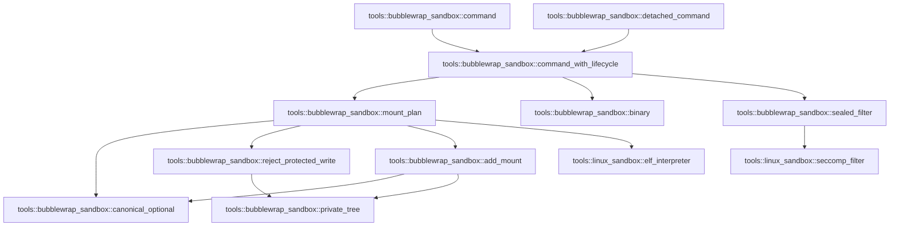

# tools::bubblewrap_sandbox

[Package atlas](index.md) · [Source](../../src/bubblewrap_sandbox.rs)

## Declarations

Visibility is the declaration spelling; trait members and reexports require their enclosing interface. `cfg` is not evaluated.

| Symbol | Kind | Visibility | Test / cfg |
|---|---|---|---|
| [tools::bubblewrap_sandbox::BACKEND](../../src/bubblewrap_sandbox.rs#L21) | const_item | `pub(crate)` |  |
| [tools::bubblewrap_sandbox::binary](../../src/bubblewrap_sandbox.rs#L26) | function_item | `pub(crate)` |  |
| [tools::bubblewrap_sandbox::command](../../src/bubblewrap_sandbox.rs#L57) | function_item | `pub(crate)` |  |
| [tools::bubblewrap_sandbox::detached_command](../../src/bubblewrap_sandbox.rs#L63) | function_item | `pub(crate)` |  |
| [tools::bubblewrap_sandbox::command_with_lifecycle](../../src/bubblewrap_sandbox.rs#L70) | function_item | `private` |  |
| [tools::bubblewrap_sandbox::Mount](../../src/bubblewrap_sandbox.rs#L160) | struct_item | `private` |  |
| [tools::bubblewrap_sandbox::MountPlan](../../src/bubblewrap_sandbox.rs#L167) | struct_item | `private` |  |
| [tools::bubblewrap_sandbox::mount_plan](../../src/bubblewrap_sandbox.rs#L172) | function_item | `private` |  |
| [tools::bubblewrap_sandbox::canonical_optional](../../src/bubblewrap_sandbox.rs#L236) | function_item | `private` |  |
| [tools::bubblewrap_sandbox::private_tree](../../src/bubblewrap_sandbox.rs#L251) | function_item | `private` |  |
| [tools::bubblewrap_sandbox::reject_protected_write](../../src/bubblewrap_sandbox.rs#L255) | function_item | `private` |  |
| [tools::bubblewrap_sandbox::add_mount](../../src/bubblewrap_sandbox.rs#L267) | function_item | `private` |  |
| [tools::bubblewrap_sandbox::sealed_filter](../../src/bubblewrap_sandbox.rs#L339) | function_item | `private` |  |
| [tools::bubblewrap_sandbox::tests::policy](../../src/bubblewrap_sandbox.rs#L379) | function_item | `private` | test; #[cfg(test)] |
| [tools::bubblewrap_sandbox::tests::read_subroot_does_not_revoke_ancestor_write_grant](../../src/bubblewrap_sandbox.rs#L391) | function_item | `private` | test; #[cfg(test)] |
| [tools::bubblewrap_sandbox::tests::read_parent_keeps_readonly_siblings_of_write_subroot](../../src/bubblewrap_sandbox.rs#L410) | function_item | `private` | test; #[cfg(test)] |
| [tools::bubblewrap_sandbox::tests::root_alias_grants_the_same_canonical_object](../../src/bubblewrap_sandbox.rs#L434) | function_item | `private` | test; #[cfg(test)] |
| [tools::bubblewrap_sandbox::tests::symlink_inside_bound_parent_is_never_used_as_setup_destination](../../src/bubblewrap_sandbox.rs#L462) | function_item | `private` | test; #[cfg(test)] |
| [tools::bubblewrap_sandbox::tests::whole_host_read_root_is_rejected_even_through_an_alias](../../src/bubblewrap_sandbox.rs#L495) | function_item | `private` | test; #[cfg(test)] |
| [tools::bubblewrap_sandbox::tests::cannot_replace_private_kernel_views_with_writable_host_trees](../../src/bubblewrap_sandbox.rs#L506) | function_item | `private` | test; #[cfg(test)] |
| [tools::bubblewrap_sandbox::tests::seccomp_descriptor_is_sealed_and_cloexec_in_parent](../../src/bubblewrap_sandbox.rs#L516) | function_item | `private` | test; #[cfg(test)] |

## Imports / reexports

| Local name | Source path | Visibility |
|---|---|---|
| `BTreeMap` | `std::collections::BTreeMap` | `private` |
| `CString` | `std::ffi::CString` | `private` |
| `fs` | `std::fs` | `private` |
| `File` | `std::fs::File` | `private` |
| `io` | `std::io` | `private` |
| `Seek` | `std::io::Seek` | `private` |
| `SeekFrom` | `std::io::SeekFrom` | `private` |
| `Write` | `std::io::Write` | `private` |
| `AsRawFd` | `std::os::fd::AsRawFd` | `private` |
| `FromRawFd` | `std::os::fd::FromRawFd` | `private` |
| `MetadataExt` | `std::os::unix::fs::MetadataExt` | `private` |
| `CommandExt` | `std::os::unix::process::CommandExt` | `private` |
| `Path` | `std::path::Path` | `private` |
| `PathBuf` | `std::path::PathBuf` | `private` |
| `Command` | `std::process::Command` | `private` |
| `SYSTEM_READ_ROOTS` | `crate::linux_sandbox::SYSTEM_READ_ROOTS` | `private` |
| `elf_interpreter` | `crate::linux_sandbox::elf_interpreter` | `private` |
| `seccomp_filter` | `crate::linux_sandbox::seccomp_filter` | `private` |
| `NetworkPolicy` | `crate::sandbox::NetworkPolicy` | `private` |
| `SandboxError` | `crate::sandbox::SandboxError` | `private` |
| `SandboxPolicy` | `crate::sandbox::SandboxPolicy` | `private` |
| `*` | `super::*` | `private` |
| `symlink` | `std::os::unix::fs::symlink` | `private` |

## Module declarations

| Module | Visibility | Attributes |
|---|---|---|
| `tools::bubblewrap_sandbox::tests` | `private` | #[cfg(test)] |

## Function call graphs

Edges below are syntactically resolved calls only, including private functions. Graphs partition callers into groups of 20; they are not execution order. All unresolved sites are listed below and in the JSON inventory.

Functions 1–10: 13 direct edges

## Call sites

Includes test functions (marked in declarations). Receiver-type-required sites need type analysis/manual tracing. Calls in closures are attributed to their enclosing function; their occurrence here does not mean the closure executes immediately.

| Caller | Callee expression | Source lines | Target / classification |
|---|---|---|---|
| `binary` | `fs::canonicalize` | [28](../../src/bubblewrap_sandbox.rs#L28) | external-constructor-callback-or-unresolved |
| `binary` | `error.kind` | [30](../../src/bubblewrap_sandbox.rs#L30) | receiver-type-required |
| `binary` | `Err` | [31](../../src/bubblewrap_sandbox.rs#L31), [40](../../src/bubblewrap_sandbox.rs#L40), [48](../../src/bubblewrap_sandbox.rs#L48) | external-constructor-callback-or-unresolved |
| `binary` | `error.into` | [31](../../src/bubblewrap_sandbox.rs#L31) | receiver-type-required |
| `binary` | `fs::metadata` | [33](../../src/bubblewrap_sandbox.rs#L33), [38](../../src/bubblewrap_sandbox.rs#L38) | external-constructor-callback-or-unresolved |
| `binary` | `metadata.is_file` | [34](../../src/bubblewrap_sandbox.rs#L34) | receiver-type-required |
| `binary` | `metadata.mode` | [34](../../src/bubblewrap_sandbox.rs#L34), [39](../../src/bubblewrap_sandbox.rs#L39) | receiver-type-required |
| `binary` | `path.ancestors` | [37](../../src/bubblewrap_sandbox.rs#L37) | receiver-type-required |
| `binary` | `metadata.uid` | [39](../../src/bubblewrap_sandbox.rs#L39) | receiver-type-required |
| `binary` | `SandboxError::Unavailable` | [40](../../src/bubblewrap_sandbox.rs#L40), [48](../../src/bubblewrap_sandbox.rs#L48) | external-constructor-callback-or-unresolved |
| `binary` | `Ok` | [46](../../src/bubblewrap_sandbox.rs#L46) | external-constructor-callback-or-unresolved |
| `binary` | `"bubblewrap is not installed at /usr/bin/bwrap or /bin/bwrap".to_owned` | [49](../../src/bubblewrap_sandbox.rs#L49) | receiver-type-required |
| `command` | `command_with_lifecycle` | [58](../../src/bubblewrap_sandbox.rs#L58) | [tools::bubblewrap_sandbox::command_with_lifecycle](../../src/bubblewrap_sandbox.rs#L70) |
| `detached_command` | `command_with_lifecycle` | [67](../../src/bubblewrap_sandbox.rs#L67) | [tools::bubblewrap_sandbox::command_with_lifecycle](../../src/bubblewrap_sandbox.rs#L70) |
| `command_with_lifecycle` | `policy.validate` | [75](../../src/bubblewrap_sandbox.rs#L75) | receiver-type-required |
| `command_with_lifecycle` | `Err` | [77](../../src/bubblewrap_sandbox.rs#L77), [82](../../src/bubblewrap_sandbox.rs#L82), [87](../../src/bubblewrap_sandbox.rs#L87), [145](../../src/bubblewrap_sandbox.rs#L145), [150](../../src/bubblewrap_sandbox.rs#L150) | external-constructor-callback-or-unresolved |
| `command_with_lifecycle` | `SandboxError::Unavailable` | [77](../../src/bubblewrap_sandbox.rs#L77), [82](../../src/bubblewrap_sandbox.rs#L82) | external-constructor-callback-or-unresolved |
| `command_with_lifecycle` | `"loopback-only network cannot be enforced by the bubblewrap backend".to_owned` | [78](../../src/bubblewrap_sandbox.rs#L78) | receiver-type-required |
| `command_with_lifecycle` | `"bubblewrap cannot enforce allow_process=false for executable replacement".to_owned` | [83](../../src/bubblewrap_sandbox.rs#L83) | receiver-type-required |
| `command_with_lifecycle` | `executable.is_absolute` | [86](../../src/bubblewrap_sandbox.rs#L86) | receiver-type-required |
| `command_with_lifecycle` | `SandboxError::Invalid` | [87](../../src/bubblewrap_sandbox.rs#L87) | external-constructor-callback-or-unresolved |
| `command_with_lifecycle` | `mount_plan` | [91](../../src/bubblewrap_sandbox.rs#L91) | [tools::bubblewrap_sandbox::mount_plan](../../src/bubblewrap_sandbox.rs#L172) |
| `command_with_lifecycle` | `sealed_filter` | [92](../../src/bubblewrap_sandbox.rs#L92) | [tools::bubblewrap_sandbox::sealed_filter](../../src/bubblewrap_sandbox.rs#L339) |
| `command_with_lifecycle` | `CString::new(format!("/proc/self/fd/{}", filter.as_raw_fd()))         .expect` | [93](../../src/bubblewrap_sandbox.rs#L93) | receiver-type-required |
| `command_with_lifecycle` | `CString::new` | [93](../../src/bubblewrap_sandbox.rs#L93) | external-constructor-callback-or-unresolved |
| `command_with_lifecycle` | `Command::new` | [95](../../src/bubblewrap_sandbox.rs#L95) | external-constructor-callback-or-unresolved |
| `command_with_lifecycle` | `binary` | [95](../../src/bubblewrap_sandbox.rs#L95) | [tools::bubblewrap_sandbox::binary](../../src/bubblewrap_sandbox.rs#L26) |
| `command_with_lifecycle` | `command.args` | [96](../../src/bubblewrap_sandbox.rs#L96), [128](../../src/bubblewrap_sandbox.rs#L128) | receiver-type-required |
| `command_with_lifecycle` | `command.arg` | [105](../../src/bubblewrap_sandbox.rs#L105), [108](../../src/bubblewrap_sandbox.rs#L108) | receiver-type-required |
| `command_with_lifecycle` | `command             .arg(if mount.writable {                 "--bind"             } else {                 "--ro-bind"             })             .arg(mount.source)             .arg` | [111](../../src/bubblewrap_sandbox.rs#L111) | receiver-type-required |
| `command_with_lifecycle` | `command             .arg(if mount.writable {                 "--bind"             } else {                 "--ro-bind"             })             .arg` | [111](../../src/bubblewrap_sandbox.rs#L111) | receiver-type-required |
| `command_with_lifecycle` | `command             .arg` | [111](../../src/bubblewrap_sandbox.rs#L111), [121](../../src/bubblewrap_sandbox.rs#L121) | receiver-type-required |
| `command_with_lifecycle` | `command             .arg("--symlink")             .arg(alias.source)             .arg` | [121](../../src/bubblewrap_sandbox.rs#L121) | receiver-type-required |
| `command_with_lifecycle` | `command             .arg("--symlink")             .arg` | [121](../../src/bubblewrap_sandbox.rs#L121) | receiver-type-required |
| `command_with_lifecycle` | `command         .arg("--seccomp")         .arg(filter.as_raw_fd().to_string())         .arg("--")         .arg` | [129](../../src/bubblewrap_sandbox.rs#L129) | receiver-type-required |
| `command_with_lifecycle` | `command         .arg("--seccomp")         .arg(filter.as_raw_fd().to_string())         .arg` | [129](../../src/bubblewrap_sandbox.rs#L129) | receiver-type-required |
| `command_with_lifecycle` | `command         .arg("--seccomp")         .arg` | [129](../../src/bubblewrap_sandbox.rs#L129) | receiver-type-required |
| `command_with_lifecycle` | `command         .arg` | [129](../../src/bubblewrap_sandbox.rs#L129) | receiver-type-required |
| `command_with_lifecycle` | `filter.as_raw_fd().to_string` | [131](../../src/bubblewrap_sandbox.rs#L131) | receiver-type-required |
| `command_with_lifecycle` | `filter.as_raw_fd` | [131](../../src/bubblewrap_sandbox.rs#L131), [142](../../src/bubblewrap_sandbox.rs#L142) | receiver-type-required |
| `command_with_lifecycle` | `command.pre_exec` | [141](../../src/bubblewrap_sandbox.rs#L141) | receiver-type-required |
| `command_with_lifecycle` | `libc::open` | [143](../../src/bubblewrap_sandbox.rs#L143) | external-constructor-callback-or-unresolved |
| `command_with_lifecycle` | `descriptor_path.as_ptr` | [143](../../src/bubblewrap_sandbox.rs#L143) | receiver-type-required |
| `command_with_lifecycle` | `io::Error::last_os_error` | [145](../../src/bubblewrap_sandbox.rs#L145), [148](../../src/bubblewrap_sandbox.rs#L148) | external-constructor-callback-or-unresolved |
| `command_with_lifecycle` | `libc::dup2` | [147](../../src/bubblewrap_sandbox.rs#L147) | external-constructor-callback-or-unresolved |
| `command_with_lifecycle` | `libc::close` | [149](../../src/bubblewrap_sandbox.rs#L149), [152](../../src/bubblewrap_sandbox.rs#L152) | external-constructor-callback-or-unresolved |
| `command_with_lifecycle` | `Ok` | [153](../../src/bubblewrap_sandbox.rs#L153), [156](../../src/bubblewrap_sandbox.rs#L156) | external-constructor-callback-or-unresolved |
| `mount_plan` | `Vec::new` | [173](../../src/bubblewrap_sandbox.rs#L173), [205](../../src/bubblewrap_sandbox.rs#L205) | external-constructor-callback-or-unresolved |
| `mount_plan` | `policy.write_roots.iter().chain` | [174](../../src/bubblewrap_sandbox.rs#L174) | receiver-type-required |
| `mount_plan` | `policy.write_roots.iter` | [174](../../src/bubblewrap_sandbox.rs#L174) | receiver-type-required |
| `mount_plan` | `policy.scratch.iter` | [174](../../src/bubblewrap_sandbox.rs#L174), [192](../../src/bubblewrap_sandbox.rs#L192) | receiver-type-required |
| `mount_plan` | `reject_protected_write` | [177](../../src/bubblewrap_sandbox.rs#L177), [179](../../src/bubblewrap_sandbox.rs#L179) | [tools::bubblewrap_sandbox::reject_protected_write](../../src/bubblewrap_sandbox.rs#L255) |
| `mount_plan` | `Path::new` | [177](../../src/bubblewrap_sandbox.rs#L177), [178](../../src/bubblewrap_sandbox.rs#L178), [186](../../src/bubblewrap_sandbox.rs#L186), [194](../../src/bubblewrap_sandbox.rs#L194) | external-constructor-callback-or-unresolved |
| `mount_plan` | `canonical_optional` | [178](../../src/bubblewrap_sandbox.rs#L178) | [tools::bubblewrap_sandbox::canonical_optional](../../src/bubblewrap_sandbox.rs#L236) |
| `mount_plan` | `writable.push` | [180](../../src/bubblewrap_sandbox.rs#L180) | receiver-type-required |
| `mount_plan` | `BTreeMap::new` | [183](../../src/bubblewrap_sandbox.rs#L183), [184](../../src/bubblewrap_sandbox.rs#L184) | external-constructor-callback-or-unresolved |
| `mount_plan` | `add_mount` | [186](../../src/bubblewrap_sandbox.rs#L186), [194](../../src/bubblewrap_sandbox.rs#L194), [196](../../src/bubblewrap_sandbox.rs#L196), [198](../../src/bubblewrap_sandbox.rs#L198) | [tools::bubblewrap_sandbox::add_mount](../../src/bubblewrap_sandbox.rs#L267) |
| `mount_plan` | `policy         .read_roots         .iter()         .chain(&policy.write_roots)         .chain` | [188](../../src/bubblewrap_sandbox.rs#L188) | receiver-type-required |
| `mount_plan` | `policy         .read_roots         .iter()         .chain` | [188](../../src/bubblewrap_sandbox.rs#L188) | receiver-type-required |
| `mount_plan` | `policy         .read_roots         .iter` | [188](../../src/bubblewrap_sandbox.rs#L188) | receiver-type-required |
| `mount_plan` | `elf_interpreter` | [197](../../src/bubblewrap_sandbox.rs#L197) | [tools::linux_sandbox::elf_interpreter](../../src/linux_sandbox.rs#L311) |
| `mount_plan` | `destination             .ancestors()             .skip(1)             .any` | [207](../../src/bubblewrap_sandbox.rs#L207) | receiver-type-required |
| `mount_plan` | `destination             .ancestors()             .skip` | [207](../../src/bubblewrap_sandbox.rs#L207) | receiver-type-required |
| `mount_plan` | `destination             .ancestors` | [207](../../src/bubblewrap_sandbox.rs#L207) | receiver-type-required |
| `mount_plan` | `mounts.contains_key` | [210](../../src/bubblewrap_sandbox.rs#L210) | receiver-type-required |
| `mount_plan` | `aliases.contains_key` | [210](../../src/bubblewrap_sandbox.rs#L210) | receiver-type-required |
| `mount_plan` | `needed_aliases.push` | [212](../../src/bubblewrap_sandbox.rs#L212) | receiver-type-required |
| `mount_plan` | `alias.source.clone` | [213](../../src/bubblewrap_sandbox.rs#L213) | receiver-type-required |
| `mount_plan` | `alias.destination.clone` | [214](../../src/bubblewrap_sandbox.rs#L214) | receiver-type-required |
| `mount_plan` | `mounts.into_values().collect::<Vec<_>>` | [219](../../src/bubblewrap_sandbox.rs#L219) | receiver-type-required |
| `mount_plan` | `mounts.into_values` | [219](../../src/bubblewrap_sandbox.rs#L219) | receiver-type-required |
| `mount_plan` | `mounts.sort_by` | [223](../../src/bubblewrap_sandbox.rs#L223) | receiver-type-required |
| `mount_plan` | `a.destination             .components()             .count()             .cmp(&b.destination.components().count())             .then_with` | [224](../../src/bubblewrap_sandbox.rs#L224) | receiver-type-required |
| `mount_plan` | `a.destination             .components()             .count()             .cmp` | [224](../../src/bubblewrap_sandbox.rs#L224) | receiver-type-required |
| `mount_plan` | `a.destination             .components()             .count` | [224](../../src/bubblewrap_sandbox.rs#L224) | receiver-type-required |
| `mount_plan` | `a.destination             .components` | [224](../../src/bubblewrap_sandbox.rs#L224) | receiver-type-required |
| `mount_plan` | `b.destination.components().count` | [227](../../src/bubblewrap_sandbox.rs#L227) | receiver-type-required |
| `mount_plan` | `b.destination.components` | [227](../../src/bubblewrap_sandbox.rs#L227) | receiver-type-required |
| `mount_plan` | `a.destination.cmp` | [228](../../src/bubblewrap_sandbox.rs#L228) | receiver-type-required |
| `mount_plan` | `Ok` | [230](../../src/bubblewrap_sandbox.rs#L230) | external-constructor-callback-or-unresolved |
| `canonical_optional` | `fs::canonicalize` | [237](../../src/bubblewrap_sandbox.rs#L237) | external-constructor-callback-or-unresolved |
| `canonical_optional` | `Ok` | [238](../../src/bubblewrap_sandbox.rs#L238), [245](../../src/bubblewrap_sandbox.rs#L245) | external-constructor-callback-or-unresolved |
| `canonical_optional` | `Some` | [238](../../src/bubblewrap_sandbox.rs#L238) | external-constructor-callback-or-unresolved |
| `canonical_optional` | `Err` | [247](../../src/bubblewrap_sandbox.rs#L247) | external-constructor-callback-or-unresolved |
| `canonical_optional` | `error.into` | [247](../../src/bubblewrap_sandbox.rs#L247) | receiver-type-required |
| `private_tree` | `path.starts_with` | [252](../../src/bubblewrap_sandbox.rs#L252) | receiver-type-required |
| `reject_protected_write` | `private_tree` | [256](../../src/bubblewrap_sandbox.rs#L256) | [tools::bubblewrap_sandbox::private_tree](../../src/bubblewrap_sandbox.rs#L251) |
| `reject_protected_write` | `Path::new("/proc").starts_with` | [257](../../src/bubblewrap_sandbox.rs#L257) | receiver-type-required |
| `reject_protected_write` | `Path::new` | [257](../../src/bubblewrap_sandbox.rs#L257), [258](../../src/bubblewrap_sandbox.rs#L258) | external-constructor-callback-or-unresolved |
| `reject_protected_write` | `Path::new("/dev").starts_with` | [258](../../src/bubblewrap_sandbox.rs#L258) | receiver-type-required |
| `reject_protected_write` | `Err` | [260](../../src/bubblewrap_sandbox.rs#L260) | external-constructor-callback-or-unresolved |
| `reject_protected_write` | `SandboxError::Invalid` | [260](../../src/bubblewrap_sandbox.rs#L260) | external-constructor-callback-or-unresolved |
| `reject_protected_write` | `Ok` | [264](../../src/bubblewrap_sandbox.rs#L264) | external-constructor-callback-or-unresolved |
| `add_mount` | `Path::new` | [274](../../src/bubblewrap_sandbox.rs#L274), [301](../../src/bubblewrap_sandbox.rs#L301) | external-constructor-callback-or-unresolved |
| `add_mount` | `Err` | [275](../../src/bubblewrap_sandbox.rs#L275), [281](../../src/bubblewrap_sandbox.rs#L281), [289](../../src/bubblewrap_sandbox.rs#L289), [297](../../src/bubblewrap_sandbox.rs#L297), [302](../../src/bubblewrap_sandbox.rs#L302), [318](../../src/bubblewrap_sandbox.rs#L318) | external-constructor-callback-or-unresolved |
| `add_mount` | `SandboxError::Invalid` | [275](../../src/bubblewrap_sandbox.rs#L275), [281](../../src/bubblewrap_sandbox.rs#L281), [297](../../src/bubblewrap_sandbox.rs#L297), [302](../../src/bubblewrap_sandbox.rs#L302), [318](../../src/bubblewrap_sandbox.rs#L318) | external-constructor-callback-or-unresolved |
| `add_mount` | `private_tree` | [279](../../src/bubblewrap_sandbox.rs#L279), [296](../../src/bubblewrap_sandbox.rs#L296) | [tools::bubblewrap_sandbox::private_tree](../../src/bubblewrap_sandbox.rs#L251) |
| `add_mount` | `Ok` | [285](../../src/bubblewrap_sandbox.rs#L285), [294](../../src/bubblewrap_sandbox.rs#L294), [336](../../src/bubblewrap_sandbox.rs#L336) | external-constructor-callback-or-unresolved |
| `add_mount` | `canonical_optional` | [287](../../src/bubblewrap_sandbox.rs#L287) | [tools::bubblewrap_sandbox::canonical_optional](../../src/bubblewrap_sandbox.rs#L236) |
| `add_mount` | `SandboxError::Unavailable` | [289](../../src/bubblewrap_sandbox.rs#L289) | external-constructor-callback-or-unresolved |
| `add_mount` | `writable.iter().any` | [306](../../src/bubblewrap_sandbox.rs#L306) | receiver-type-required |
| `add_mount` | `writable.iter` | [306](../../src/bubblewrap_sandbox.rs#L306) | receiver-type-required |
| `add_mount` | `source.starts_with` | [306](../../src/bubblewrap_sandbox.rs#L306) | receiver-type-required |
| `add_mount` | `candidates.push` | [312](../../src/bubblewrap_sandbox.rs#L312) | receiver-type-required |
| `add_mount` | `path.to_path_buf` | [312](../../src/bubblewrap_sandbox.rs#L312) | receiver-type-required |
| `add_mount` | `entries.get_mut` | [315](../../src/bubblewrap_sandbox.rs#L315) | receiver-type-required |
| `add_mount` | `entries.insert` | [325](../../src/bubblewrap_sandbox.rs#L325) | receiver-type-required |
| `add_mount` | `destination.clone` | [326](../../src/bubblewrap_sandbox.rs#L326) | receiver-type-required |
| `add_mount` | `source.clone` | [328](../../src/bubblewrap_sandbox.rs#L328) | receiver-type-required |
| `sealed_filter` | `seccomp_filter` | [340](../../src/bubblewrap_sandbox.rs#L340) | [tools::linux_sandbox::seccomp_filter](../../src/linux_sandbox.rs#L517) |
| `sealed_filter` | `libc::memfd_create` | [344](../../src/bubblewrap_sandbox.rs#L344) | external-constructor-callback-or-unresolved |
| `sealed_filter` | `c"tekes-sandbox-seccomp".as_ptr` | [345](../../src/bubblewrap_sandbox.rs#L345) | receiver-type-required |
| `sealed_filter` | `Err` | [350](../../src/bubblewrap_sandbox.rs#L350), [369](../../src/bubblewrap_sandbox.rs#L369) | external-constructor-callback-or-unresolved |
| `sealed_filter` | `io::Error::last_os_error().into` | [350](../../src/bubblewrap_sandbox.rs#L350), [369](../../src/bubblewrap_sandbox.rs#L369) | receiver-type-required |
| `sealed_filter` | `io::Error::last_os_error` | [350](../../src/bubblewrap_sandbox.rs#L350), [369](../../src/bubblewrap_sandbox.rs#L369) | external-constructor-callback-or-unresolved |
| `sealed_filter` | `File::from_raw_fd` | [353](../../src/bubblewrap_sandbox.rs#L353) | external-constructor-callback-or-unresolved |
| `sealed_filter` | `file.write_all` | [355](../../src/bubblewrap_sandbox.rs#L355), [356](../../src/bubblewrap_sandbox.rs#L356), [357](../../src/bubblewrap_sandbox.rs#L357) | receiver-type-required |
| `sealed_filter` | `instruction.code.to_ne_bytes` | [355](../../src/bubblewrap_sandbox.rs#L355) | receiver-type-required |
| `sealed_filter` | `instruction.k.to_ne_bytes` | [357](../../src/bubblewrap_sandbox.rs#L357) | receiver-type-required |
| `sealed_filter` | `file.seek` | [359](../../src/bubblewrap_sandbox.rs#L359) | receiver-type-required |
| `sealed_filter` | `SeekFrom::Start` | [359](../../src/bubblewrap_sandbox.rs#L359) | external-constructor-callback-or-unresolved |
| `sealed_filter` | `libc::fcntl` | [362](../../src/bubblewrap_sandbox.rs#L362) | external-constructor-callback-or-unresolved |
| `sealed_filter` | `file.as_raw_fd` | [363](../../src/bubblewrap_sandbox.rs#L363) | receiver-type-required |
| `sealed_filter` | `Ok` | [371](../../src/bubblewrap_sandbox.rs#L371) | external-constructor-callback-or-unresolved |
| `read_subroot_does_not_revoke_ancestor_write_grant` | `tempfile::tempdir().unwrap` | [392](../../src/bubblewrap_sandbox.rs#L392) | receiver-type-required |
| `read_subroot_does_not_revoke_ancestor_write_grant` | `tempfile::tempdir` | [392](../../src/bubblewrap_sandbox.rs#L392) | external-constructor-callback-or-unresolved |
| `read_subroot_does_not_revoke_ancestor_write_grant` | `fs::canonicalize(root.path()).unwrap` | [393](../../src/bubblewrap_sandbox.rs#L393) | receiver-type-required |
| `read_subroot_does_not_revoke_ancestor_write_grant` | `fs::canonicalize` | [393](../../src/bubblewrap_sandbox.rs#L393) | external-constructor-callback-or-unresolved |
| `read_subroot_does_not_revoke_ancestor_write_grant` | `root.path` | [393](../../src/bubblewrap_sandbox.rs#L393) | receiver-type-required |
| `read_subroot_does_not_revoke_ancestor_write_grant` | `parent.join` | [394](../../src/bubblewrap_sandbox.rs#L394) | receiver-type-required |
| `read_subroot_does_not_revoke_ancestor_write_grant` | `fs::create_dir(&child).unwrap` | [395](../../src/bubblewrap_sandbox.rs#L395) | receiver-type-required |
| `read_subroot_does_not_revoke_ancestor_write_grant` | `fs::create_dir` | [395](../../src/bubblewrap_sandbox.rs#L395) | external-constructor-callback-or-unresolved |
| `read_subroot_does_not_revoke_ancestor_write_grant` | `reads.sort` | [397](../../src/bubblewrap_sandbox.rs#L397) | receiver-type-required |
| `read_subroot_does_not_revoke_ancestor_write_grant` | `policy` | [398](../../src/bubblewrap_sandbox.rs#L398) | external-constructor-callback-or-unresolved |
| `read_subroot_does_not_revoke_ancestor_write_grant` | `mount_plan(&policy, Path::new("/bin/true")).unwrap` | [399](../../src/bubblewrap_sandbox.rs#L399) | receiver-type-required |
| `read_subroot_does_not_revoke_ancestor_write_grant` | `mount_plan` | [399](../../src/bubblewrap_sandbox.rs#L399) | external-constructor-callback-or-unresolved |
| `read_subroot_does_not_revoke_ancestor_write_grant` | `Path::new` | [399](../../src/bubblewrap_sandbox.rs#L399) | external-constructor-callback-or-unresolved |
| `read_parent_keeps_readonly_siblings_of_write_subroot` | `tempfile::tempdir().unwrap` | [411](../../src/bubblewrap_sandbox.rs#L411) | receiver-type-required |
| `read_parent_keeps_readonly_siblings_of_write_subroot` | `tempfile::tempdir` | [411](../../src/bubblewrap_sandbox.rs#L411) | external-constructor-callback-or-unresolved |
| `read_parent_keeps_readonly_siblings_of_write_subroot` | `fs::canonicalize(root.path()).unwrap` | [412](../../src/bubblewrap_sandbox.rs#L412) | receiver-type-required |
| `read_parent_keeps_readonly_siblings_of_write_subroot` | `fs::canonicalize` | [412](../../src/bubblewrap_sandbox.rs#L412) | external-constructor-callback-or-unresolved |
| `read_parent_keeps_readonly_siblings_of_write_subroot` | `root.path` | [412](../../src/bubblewrap_sandbox.rs#L412) | receiver-type-required |
| `read_parent_keeps_readonly_siblings_of_write_subroot` | `parent.join` | [413](../../src/bubblewrap_sandbox.rs#L413) | receiver-type-required |
| `read_parent_keeps_readonly_siblings_of_write_subroot` | `fs::create_dir(&child).unwrap` | [414](../../src/bubblewrap_sandbox.rs#L414) | receiver-type-required |
| `read_parent_keeps_readonly_siblings_of_write_subroot` | `fs::create_dir` | [414](../../src/bubblewrap_sandbox.rs#L414) | external-constructor-callback-or-unresolved |
| `read_parent_keeps_readonly_siblings_of_write_subroot` | `policy` | [415](../../src/bubblewrap_sandbox.rs#L415) | external-constructor-callback-or-unresolved |
| `read_parent_keeps_readonly_siblings_of_write_subroot` | `mount_plan(&policy, Path::new("/bin/true")).unwrap` | [419](../../src/bubblewrap_sandbox.rs#L419) | receiver-type-required |
| `read_parent_keeps_readonly_siblings_of_write_subroot` | `mount_plan` | [419](../../src/bubblewrap_sandbox.rs#L419) | external-constructor-callback-or-unresolved |
| `read_parent_keeps_readonly_siblings_of_write_subroot` | `Path::new` | [419](../../src/bubblewrap_sandbox.rs#L419) | external-constructor-callback-or-unresolved |
| `read_parent_keeps_readonly_siblings_of_write_subroot` | `mounts             .iter()             .position(&#124;mount&#124; mount.destination == parent)             .unwrap` | [420](../../src/bubblewrap_sandbox.rs#L420) | receiver-type-required |
| `read_parent_keeps_readonly_siblings_of_write_subroot` | `mounts             .iter()             .position` | [420](../../src/bubblewrap_sandbox.rs#L420), [424](../../src/bubblewrap_sandbox.rs#L424) | receiver-type-required |
| `read_parent_keeps_readonly_siblings_of_write_subroot` | `mounts             .iter` | [420](../../src/bubblewrap_sandbox.rs#L420), [424](../../src/bubblewrap_sandbox.rs#L424) | receiver-type-required |
| `read_parent_keeps_readonly_siblings_of_write_subroot` | `mounts             .iter()             .position(&#124;mount&#124; mount.destination == child)             .unwrap` | [424](../../src/bubblewrap_sandbox.rs#L424) | receiver-type-required |
| `root_alias_grants_the_same_canonical_object` | `tempfile::tempdir().unwrap` | [435](../../src/bubblewrap_sandbox.rs#L435) | receiver-type-required |
| `root_alias_grants_the_same_canonical_object` | `tempfile::tempdir` | [435](../../src/bubblewrap_sandbox.rs#L435) | external-constructor-callback-or-unresolved |
| `root_alias_grants_the_same_canonical_object` | `fs::canonicalize(root.path()).unwrap` | [436](../../src/bubblewrap_sandbox.rs#L436) | receiver-type-required |
| `root_alias_grants_the_same_canonical_object` | `fs::canonicalize` | [436](../../src/bubblewrap_sandbox.rs#L436) | external-constructor-callback-or-unresolved |
| `root_alias_grants_the_same_canonical_object` | `root.path` | [436](../../src/bubblewrap_sandbox.rs#L436) | receiver-type-required |
| `root_alias_grants_the_same_canonical_object` | `root.join` | [437](../../src/bubblewrap_sandbox.rs#L437), [438](../../src/bubblewrap_sandbox.rs#L438) | receiver-type-required |
| `root_alias_grants_the_same_canonical_object` | `fs::create_dir(&actual).unwrap` | [439](../../src/bubblewrap_sandbox.rs#L439) | receiver-type-required |
| `root_alias_grants_the_same_canonical_object` | `fs::create_dir` | [439](../../src/bubblewrap_sandbox.rs#L439) | external-constructor-callback-or-unresolved |
| `root_alias_grants_the_same_canonical_object` | `symlink(&actual, &alias).unwrap` | [440](../../src/bubblewrap_sandbox.rs#L440) | receiver-type-required |
| `root_alias_grants_the_same_canonical_object` | `symlink` | [440](../../src/bubblewrap_sandbox.rs#L440) | external-constructor-callback-or-unresolved |
| `root_alias_grants_the_same_canonical_object` | `policy` | [441](../../src/bubblewrap_sandbox.rs#L441) | external-constructor-callback-or-unresolved |
| `root_alias_grants_the_same_canonical_object` | `mount_plan(&policy, Path::new("/bin/true")).unwrap` | [445](../../src/bubblewrap_sandbox.rs#L445) | receiver-type-required |
| `root_alias_grants_the_same_canonical_object` | `mount_plan` | [445](../../src/bubblewrap_sandbox.rs#L445) | external-constructor-callback-or-unresolved |
| `root_alias_grants_the_same_canonical_object` | `Path::new` | [445](../../src/bubblewrap_sandbox.rs#L445) | external-constructor-callback-or-unresolved |
| `root_alias_grants_the_same_canonical_object` | `plan             .mounts             .iter()             .find(&#124;mount&#124; mount.destination == actual)             .unwrap` | [446](../../src/bubblewrap_sandbox.rs#L446) | receiver-type-required |
| `root_alias_grants_the_same_canonical_object` | `plan             .mounts             .iter()             .find` | [446](../../src/bubblewrap_sandbox.rs#L446) | receiver-type-required |
| `root_alias_grants_the_same_canonical_object` | `plan             .mounts             .iter` | [446](../../src/bubblewrap_sandbox.rs#L446) | receiver-type-required |
| `root_alias_grants_the_same_canonical_object` | `plan             .aliases             .iter()             .find(&#124;mount&#124; mount.destination == alias)             .unwrap` | [453](../../src/bubblewrap_sandbox.rs#L453) | receiver-type-required |
| `root_alias_grants_the_same_canonical_object` | `plan             .aliases             .iter()             .find` | [453](../../src/bubblewrap_sandbox.rs#L453) | receiver-type-required |
| `root_alias_grants_the_same_canonical_object` | `plan             .aliases             .iter` | [453](../../src/bubblewrap_sandbox.rs#L453) | receiver-type-required |
| `symlink_inside_bound_parent_is_never_used_as_setup_destination` | `tempfile::tempdir().unwrap` | [463](../../src/bubblewrap_sandbox.rs#L463) | receiver-type-required |
| `symlink_inside_bound_parent_is_never_used_as_setup_destination` | `tempfile::tempdir` | [463](../../src/bubblewrap_sandbox.rs#L463) | external-constructor-callback-or-unresolved |
| `symlink_inside_bound_parent_is_never_used_as_setup_destination` | `fs::canonicalize(root.path()).unwrap` | [464](../../src/bubblewrap_sandbox.rs#L464) | receiver-type-required |
| `symlink_inside_bound_parent_is_never_used_as_setup_destination` | `fs::canonicalize` | [464](../../src/bubblewrap_sandbox.rs#L464) | external-constructor-callback-or-unresolved |
| `symlink_inside_bound_parent_is_never_used_as_setup_destination` | `root.path` | [464](../../src/bubblewrap_sandbox.rs#L464) | receiver-type-required |
| `symlink_inside_bound_parent_is_never_used_as_setup_destination` | `root.join` | [465](../../src/bubblewrap_sandbox.rs#L465), [466](../../src/bubblewrap_sandbox.rs#L466) | receiver-type-required |
| `symlink_inside_bound_parent_is_never_used_as_setup_destination` | `fs::create_dir(&parent).unwrap` | [467](../../src/bubblewrap_sandbox.rs#L467) | receiver-type-required |
| `symlink_inside_bound_parent_is_never_used_as_setup_destination` | `fs::create_dir` | [467](../../src/bubblewrap_sandbox.rs#L467), [468](../../src/bubblewrap_sandbox.rs#L468) | external-constructor-callback-or-unresolved |
| `symlink_inside_bound_parent_is_never_used_as_setup_destination` | `fs::create_dir(&target).unwrap` | [468](../../src/bubblewrap_sandbox.rs#L468) | receiver-type-required |
| `symlink_inside_bound_parent_is_never_used_as_setup_destination` | `parent.join` | [469](../../src/bubblewrap_sandbox.rs#L469), [473](../../src/bubblewrap_sandbox.rs#L473) | receiver-type-required |
| `symlink_inside_bound_parent_is_never_used_as_setup_destination` | `symlink(&target, &alias).unwrap` | [470](../../src/bubblewrap_sandbox.rs#L470) | receiver-type-required |
| `symlink_inside_bound_parent_is_never_used_as_setup_destination` | `symlink` | [470](../../src/bubblewrap_sandbox.rs#L470), [474](../../src/bubblewrap_sandbox.rs#L474) | external-constructor-callback-or-unresolved |
| `symlink_inside_bound_parent_is_never_used_as_setup_destination` | `symlink("/oldroot/tmp/tekes-not-created", &malicious).unwrap` | [474](../../src/bubblewrap_sandbox.rs#L474) | receiver-type-required |
| `symlink_inside_bound_parent_is_never_used_as_setup_destination` | `reads.sort` | [476](../../src/bubblewrap_sandbox.rs#L476) | receiver-type-required |
| `symlink_inside_bound_parent_is_never_used_as_setup_destination` | `policy` | [477](../../src/bubblewrap_sandbox.rs#L477) | external-constructor-callback-or-unresolved |
| `symlink_inside_bound_parent_is_never_used_as_setup_destination` | `mount_plan(&policy, Path::new("/bin/true")).unwrap` | [478](../../src/bubblewrap_sandbox.rs#L478) | receiver-type-required |
| `symlink_inside_bound_parent_is_never_used_as_setup_destination` | `mount_plan` | [478](../../src/bubblewrap_sandbox.rs#L478) | external-constructor-callback-or-unresolved |
| `symlink_inside_bound_parent_is_never_used_as_setup_destination` | `Path::new` | [478](../../src/bubblewrap_sandbox.rs#L478) | external-constructor-callback-or-unresolved |
| `whole_host_read_root_is_rejected_even_through_an_alias` | `policy` | [496](../../src/bubblewrap_sandbox.rs#L496), [501](../../src/bubblewrap_sandbox.rs#L501) | external-constructor-callback-or-unresolved |
| `whole_host_read_root_is_rejected_even_through_an_alias` | `Vec::new` | [496](../../src/bubblewrap_sandbox.rs#L496), [501](../../src/bubblewrap_sandbox.rs#L501) | external-constructor-callback-or-unresolved |
| `whole_host_read_root_is_rejected_even_through_an_alias` | `tempfile::tempdir().unwrap` | [498](../../src/bubblewrap_sandbox.rs#L498) | receiver-type-required |
| `whole_host_read_root_is_rejected_even_through_an_alias` | `tempfile::tempdir` | [498](../../src/bubblewrap_sandbox.rs#L498) | external-constructor-callback-or-unresolved |
| `whole_host_read_root_is_rejected_even_through_an_alias` | `root.path().join` | [499](../../src/bubblewrap_sandbox.rs#L499) | receiver-type-required |
| `whole_host_read_root_is_rejected_even_through_an_alias` | `root.path` | [499](../../src/bubblewrap_sandbox.rs#L499) | receiver-type-required |
| `whole_host_read_root_is_rejected_even_through_an_alias` | `symlink("/", &alias).unwrap` | [500](../../src/bubblewrap_sandbox.rs#L500) | receiver-type-required |
| `whole_host_read_root_is_rejected_even_through_an_alias` | `symlink` | [500](../../src/bubblewrap_sandbox.rs#L500) | external-constructor-callback-or-unresolved |
| `seccomp_descriptor_is_sealed_and_cloexec_in_parent` | `policy` | [517](../../src/bubblewrap_sandbox.rs#L517) | external-constructor-callback-or-unresolved |
| `seccomp_descriptor_is_sealed_and_cloexec_in_parent` | `Vec::new` | [517](../../src/bubblewrap_sandbox.rs#L517) | external-constructor-callback-or-unresolved |
| `seccomp_descriptor_is_sealed_and_cloexec_in_parent` | `sealed_filter(&policy).unwrap` | [518](../../src/bubblewrap_sandbox.rs#L518) | receiver-type-required |
| `seccomp_descriptor_is_sealed_and_cloexec_in_parent` | `sealed_filter` | [518](../../src/bubblewrap_sandbox.rs#L518) | external-constructor-callback-or-unresolved |
| `seccomp_descriptor_is_sealed_and_cloexec_in_parent` | `libc::fcntl` | [522](../../src/bubblewrap_sandbox.rs#L522) | external-constructor-callback-or-unresolved |
| `seccomp_descriptor_is_sealed_and_cloexec_in_parent` | `file.as_raw_fd` | [522](../../src/bubblewrap_sandbox.rs#L522) | receiver-type-required |
