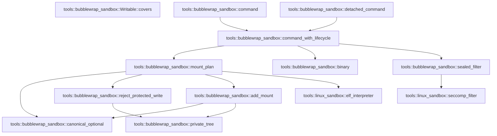

# tools::bubblewrap_sandbox

[Package atlas](index.md) · [Source](../../src/bubblewrap_sandbox.rs)

## Declarations

Visibility is the declaration spelling; trait members and reexports require their enclosing interface. `cfg` is not evaluated.

| Symbol | Kind | Visibility | Test / cfg |
|---|---|---|---|
| [tools::bubblewrap_sandbox::BACKEND](../../src/bubblewrap_sandbox.rs#L21) | const_item | `pub(crate)` |  |
| [tools::bubblewrap_sandbox::binary](../../src/bubblewrap_sandbox.rs#L26) | function_item | `pub(crate)` |  |
| [tools::bubblewrap_sandbox::command](../../src/bubblewrap_sandbox.rs#L57) | function_item | `pub(crate)` |  |
| [tools::bubblewrap_sandbox::detached_command](../../src/bubblewrap_sandbox.rs#L63) | function_item | `pub(crate)` |  |
| [tools::bubblewrap_sandbox::command_with_lifecycle](../../src/bubblewrap_sandbox.rs#L70) | function_item | `private` |  |
| [tools::bubblewrap_sandbox::Mount](../../src/bubblewrap_sandbox.rs#L160) | struct_item | `private` |  |
| [tools::bubblewrap_sandbox::MountPlan](../../src/bubblewrap_sandbox.rs#L167) | struct_item | `private` |  |
| [tools::bubblewrap_sandbox::mount_plan](../../src/bubblewrap_sandbox.rs#L172) | function_item | `private` |  |
| [tools::bubblewrap_sandbox::Writable](../../src/bubblewrap_sandbox.rs#L266) | struct_item | `private` |  |
| [tools::bubblewrap_sandbox::Writable::covers](../../src/bubblewrap_sandbox.rs#L275) | function_item | `private` |  |
| [tools::bubblewrap_sandbox::canonical_optional](../../src/bubblewrap_sandbox.rs#L287) | function_item | `private` |  |
| [tools::bubblewrap_sandbox::private_tree](../../src/bubblewrap_sandbox.rs#L302) | function_item | `private` |  |
| [tools::bubblewrap_sandbox::reject_protected_write](../../src/bubblewrap_sandbox.rs#L306) | function_item | `private` |  |
| [tools::bubblewrap_sandbox::add_mount](../../src/bubblewrap_sandbox.rs#L318) | function_item | `private` |  |
| [tools::bubblewrap_sandbox::sealed_filter](../../src/bubblewrap_sandbox.rs#L390) | function_item | `private` |  |
| [tools::bubblewrap_sandbox::tests::policy](../../src/bubblewrap_sandbox.rs#L430) | function_item | `private` | test; #[cfg(test)] |
| [tools::bubblewrap_sandbox::tests::absent_protected_root_under_writable_home_is_not_silently_skipped](../../src/bubblewrap_sandbox.rs#L443) | function_item | `private` | test; #[cfg(test)] |
| [tools::bubblewrap_sandbox::tests::protected_root_inside_a_writable_root_is_bound_read_only](../../src/bubblewrap_sandbox.rs#L457) | function_item | `private` | test; #[cfg(test)] |
| [tools::bubblewrap_sandbox::tests::symlinked_exception_beneath_a_protected_root_is_rejected](../../src/bubblewrap_sandbox.rs#L483) | function_item | `private` | test; #[cfg(test)] |
| [tools::bubblewrap_sandbox::tests::read_subroot_does_not_revoke_ancestor_write_grant](../../src/bubblewrap_sandbox.rs#L498) | function_item | `private` | test; #[cfg(test)] |
| [tools::bubblewrap_sandbox::tests::read_parent_keeps_readonly_siblings_of_write_subroot](../../src/bubblewrap_sandbox.rs#L517) | function_item | `private` | test; #[cfg(test)] |
| [tools::bubblewrap_sandbox::tests::root_alias_grants_the_same_canonical_object](../../src/bubblewrap_sandbox.rs#L541) | function_item | `private` | test; #[cfg(test)] |
| [tools::bubblewrap_sandbox::tests::symlink_inside_bound_parent_is_never_used_as_setup_destination](../../src/bubblewrap_sandbox.rs#L569) | function_item | `private` | test; #[cfg(test)] |
| [tools::bubblewrap_sandbox::tests::whole_host_read_root_is_rejected_even_through_an_alias](../../src/bubblewrap_sandbox.rs#L602) | function_item | `private` | test; #[cfg(test)] |
| [tools::bubblewrap_sandbox::tests::cannot_replace_private_kernel_views_with_writable_host_trees](../../src/bubblewrap_sandbox.rs#L613) | function_item | `private` | test; #[cfg(test)] |
| [tools::bubblewrap_sandbox::tests::seccomp_descriptor_is_sealed_and_cloexec_in_parent](../../src/bubblewrap_sandbox.rs#L623) | function_item | `private` | test; #[cfg(test)] |

## Imports / reexports

| Local name | Source path | Visibility |
|---|---|---|
| `BTreeMap` | `std::collections::BTreeMap` | `private` |
| `CString` | `std::ffi::CString` | `private` |
| `fs` | `std::fs` | `private` |
| `File` | `std::fs::File` | `private` |
| `io` | `std::io` | `private` |
| `Seek` | `std::io::Seek` | `private` |
| `SeekFrom` | `std::io::SeekFrom` | `private` |
| `Write` | `std::io::Write` | `private` |
| `AsRawFd` | `std::os::fd::AsRawFd` | `private` |
| `FromRawFd` | `std::os::fd::FromRawFd` | `private` |
| `MetadataExt` | `std::os::unix::fs::MetadataExt` | `private` |
| `CommandExt` | `std::os::unix::process::CommandExt` | `private` |
| `Path` | `std::path::Path` | `private` |
| `PathBuf` | `std::path::PathBuf` | `private` |
| `Command` | `std::process::Command` | `private` |
| `SYSTEM_READ_ROOTS` | `crate::linux_sandbox::SYSTEM_READ_ROOTS` | `private` |
| `elf_interpreter` | `crate::linux_sandbox::elf_interpreter` | `private` |
| `seccomp_filter` | `crate::linux_sandbox::seccomp_filter` | `private` |
| `NetworkPolicy` | `crate::sandbox::NetworkPolicy` | `private` |
| `SandboxError` | `crate::sandbox::SandboxError` | `private` |
| `SandboxPolicy` | `crate::sandbox::SandboxPolicy` | `private` |
| `*` | `super::*` | `private` |
| `symlink` | `std::os::unix::fs::symlink` | `private` |

## Module declarations

| Module | Visibility | Attributes |
|---|---|---|
| `tools::bubblewrap_sandbox::tests` | `private` | #[cfg(test)] |

## Function call graphs

Edges below are syntactically resolved calls only, including private functions. Graphs partition callers into groups of 20; they are not execution order. All unresolved sites are listed below and in the JSON inventory.

Functions 1–11: 13 direct edges

## Call sites

Includes test functions (marked in declarations). Receiver-type-required sites need type analysis/manual tracing. Calls in closures are attributed to their enclosing function; their occurrence here does not mean the closure executes immediately.

| Caller | Callee expression | Source lines | Target / classification |
|---|---|---|---|
| `binary` | `fs::canonicalize` | [28](../../src/bubblewrap_sandbox.rs#L28) | external-constructor-callback-or-unresolved |
| `binary` | `error.kind` | [30](../../src/bubblewrap_sandbox.rs#L30) | receiver-type-required |
| `binary` | `Err` | [31](../../src/bubblewrap_sandbox.rs#L31), [40](../../src/bubblewrap_sandbox.rs#L40), [48](../../src/bubblewrap_sandbox.rs#L48) | external-constructor-callback-or-unresolved |
| `binary` | `error.into` | [31](../../src/bubblewrap_sandbox.rs#L31) | receiver-type-required |
| `binary` | `fs::metadata` | [33](../../src/bubblewrap_sandbox.rs#L33), [38](../../src/bubblewrap_sandbox.rs#L38) | external-constructor-callback-or-unresolved |
| `binary` | `metadata.is_file` | [34](../../src/bubblewrap_sandbox.rs#L34) | receiver-type-required |
| `binary` | `metadata.mode` | [34](../../src/bubblewrap_sandbox.rs#L34), [39](../../src/bubblewrap_sandbox.rs#L39) | receiver-type-required |
| `binary` | `path.ancestors` | [37](../../src/bubblewrap_sandbox.rs#L37) | receiver-type-required |
| `binary` | `metadata.uid` | [39](../../src/bubblewrap_sandbox.rs#L39) | receiver-type-required |
| `binary` | `SandboxError::Unavailable` | [40](../../src/bubblewrap_sandbox.rs#L40), [48](../../src/bubblewrap_sandbox.rs#L48) | external-constructor-callback-or-unresolved |
| `binary` | `Ok` | [46](../../src/bubblewrap_sandbox.rs#L46) | external-constructor-callback-or-unresolved |
| `binary` | `"bubblewrap is not installed at /usr/bin/bwrap or /bin/bwrap".to_owned` | [49](../../src/bubblewrap_sandbox.rs#L49) | receiver-type-required |
| `command` | `command_with_lifecycle` | [58](../../src/bubblewrap_sandbox.rs#L58) | [tools::bubblewrap_sandbox::command_with_lifecycle](../../src/bubblewrap_sandbox.rs#L70) |
| `detached_command` | `command_with_lifecycle` | [67](../../src/bubblewrap_sandbox.rs#L67) | [tools::bubblewrap_sandbox::command_with_lifecycle](../../src/bubblewrap_sandbox.rs#L70) |
| `command_with_lifecycle` | `policy.validate` | [75](../../src/bubblewrap_sandbox.rs#L75) | receiver-type-required |
| `command_with_lifecycle` | `Err` | [77](../../src/bubblewrap_sandbox.rs#L77), [82](../../src/bubblewrap_sandbox.rs#L82), [87](../../src/bubblewrap_sandbox.rs#L87), [145](../../src/bubblewrap_sandbox.rs#L145), [150](../../src/bubblewrap_sandbox.rs#L150) | external-constructor-callback-or-unresolved |
| `command_with_lifecycle` | `SandboxError::Unavailable` | [77](../../src/bubblewrap_sandbox.rs#L77), [82](../../src/bubblewrap_sandbox.rs#L82) | external-constructor-callback-or-unresolved |
| `command_with_lifecycle` | `"loopback-only network cannot be enforced by the bubblewrap backend".to_owned` | [78](../../src/bubblewrap_sandbox.rs#L78) | receiver-type-required |
| `command_with_lifecycle` | `"bubblewrap cannot enforce allow_process=false for executable replacement".to_owned` | [83](../../src/bubblewrap_sandbox.rs#L83) | receiver-type-required |
| `command_with_lifecycle` | `executable.is_absolute` | [86](../../src/bubblewrap_sandbox.rs#L86) | receiver-type-required |
| `command_with_lifecycle` | `SandboxError::Invalid` | [87](../../src/bubblewrap_sandbox.rs#L87) | external-constructor-callback-or-unresolved |
| `command_with_lifecycle` | `mount_plan` | [91](../../src/bubblewrap_sandbox.rs#L91) | [tools::bubblewrap_sandbox::mount_plan](../../src/bubblewrap_sandbox.rs#L172) |
| `command_with_lifecycle` | `sealed_filter` | [92](../../src/bubblewrap_sandbox.rs#L92) | [tools::bubblewrap_sandbox::sealed_filter](../../src/bubblewrap_sandbox.rs#L390) |
| `command_with_lifecycle` | `CString::new(format!("/proc/self/fd/{}", filter.as_raw_fd()))         .expect` | [93](../../src/bubblewrap_sandbox.rs#L93) | receiver-type-required |
| `command_with_lifecycle` | `CString::new` | [93](../../src/bubblewrap_sandbox.rs#L93) | external-constructor-callback-or-unresolved |
| `command_with_lifecycle` | `Command::new` | [95](../../src/bubblewrap_sandbox.rs#L95) | external-constructor-callback-or-unresolved |
| `command_with_lifecycle` | `binary` | [95](../../src/bubblewrap_sandbox.rs#L95) | [tools::bubblewrap_sandbox::binary](../../src/bubblewrap_sandbox.rs#L26) |
| `command_with_lifecycle` | `command.args` | [96](../../src/bubblewrap_sandbox.rs#L96), [128](../../src/bubblewrap_sandbox.rs#L128) | receiver-type-required |
| `command_with_lifecycle` | `command.arg` | [105](../../src/bubblewrap_sandbox.rs#L105), [108](../../src/bubblewrap_sandbox.rs#L108) | receiver-type-required |
| `command_with_lifecycle` | `command             .arg(if mount.writable {                 "--bind"             } else {                 "--ro-bind"             })             .arg(mount.source)             .arg` | [111](../../src/bubblewrap_sandbox.rs#L111) | receiver-type-required |
| `command_with_lifecycle` | `command             .arg(if mount.writable {                 "--bind"             } else {                 "--ro-bind"             })             .arg` | [111](../../src/bubblewrap_sandbox.rs#L111) | receiver-type-required |
| `command_with_lifecycle` | `command             .arg` | [111](../../src/bubblewrap_sandbox.rs#L111), [121](../../src/bubblewrap_sandbox.rs#L121) | receiver-type-required |
| `command_with_lifecycle` | `command             .arg("--symlink")             .arg(alias.source)             .arg` | [121](../../src/bubblewrap_sandbox.rs#L121) | receiver-type-required |
| `command_with_lifecycle` | `command             .arg("--symlink")             .arg` | [121](../../src/bubblewrap_sandbox.rs#L121) | receiver-type-required |
| `command_with_lifecycle` | `command         .arg("--seccomp")         .arg(filter.as_raw_fd().to_string())         .arg("--")         .arg` | [129](../../src/bubblewrap_sandbox.rs#L129) | receiver-type-required |
| `command_with_lifecycle` | `command         .arg("--seccomp")         .arg(filter.as_raw_fd().to_string())         .arg` | [129](../../src/bubblewrap_sandbox.rs#L129) | receiver-type-required |
| `command_with_lifecycle` | `command         .arg("--seccomp")         .arg` | [129](../../src/bubblewrap_sandbox.rs#L129) | receiver-type-required |
| `command_with_lifecycle` | `command         .arg` | [129](../../src/bubblewrap_sandbox.rs#L129) | receiver-type-required |
| `command_with_lifecycle` | `filter.as_raw_fd().to_string` | [131](../../src/bubblewrap_sandbox.rs#L131) | receiver-type-required |
| `command_with_lifecycle` | `filter.as_raw_fd` | [131](../../src/bubblewrap_sandbox.rs#L131), [142](../../src/bubblewrap_sandbox.rs#L142) | receiver-type-required |
| `command_with_lifecycle` | `command.pre_exec` | [141](../../src/bubblewrap_sandbox.rs#L141) | receiver-type-required |
| `command_with_lifecycle` | `libc::open` | [143](../../src/bubblewrap_sandbox.rs#L143) | external-constructor-callback-or-unresolved |
| `command_with_lifecycle` | `descriptor_path.as_ptr` | [143](../../src/bubblewrap_sandbox.rs#L143) | receiver-type-required |
| `command_with_lifecycle` | `io::Error::last_os_error` | [145](../../src/bubblewrap_sandbox.rs#L145), [148](../../src/bubblewrap_sandbox.rs#L148) | external-constructor-callback-or-unresolved |
| `command_with_lifecycle` | `libc::dup2` | [147](../../src/bubblewrap_sandbox.rs#L147) | external-constructor-callback-or-unresolved |
| `command_with_lifecycle` | `libc::close` | [149](../../src/bubblewrap_sandbox.rs#L149), [152](../../src/bubblewrap_sandbox.rs#L152) | external-constructor-callback-or-unresolved |
| `command_with_lifecycle` | `Ok` | [153](../../src/bubblewrap_sandbox.rs#L153), [156](../../src/bubblewrap_sandbox.rs#L156) | external-constructor-callback-or-unresolved |
| `mount_plan` | `Vec::new` | [173](../../src/bubblewrap_sandbox.rs#L173), [235](../../src/bubblewrap_sandbox.rs#L235) | external-constructor-callback-or-unresolved |
| `mount_plan` | `policy.write_roots.iter().chain` | [174](../../src/bubblewrap_sandbox.rs#L174) | receiver-type-required |
| `mount_plan` | `policy.write_roots.iter` | [174](../../src/bubblewrap_sandbox.rs#L174) | receiver-type-required |
| `mount_plan` | `policy.scratch.iter` | [174](../../src/bubblewrap_sandbox.rs#L174), [204](../../src/bubblewrap_sandbox.rs#L204) | receiver-type-required |
| `mount_plan` | `reject_protected_write` | [177](../../src/bubblewrap_sandbox.rs#L177), [179](../../src/bubblewrap_sandbox.rs#L179) | [tools::bubblewrap_sandbox::reject_protected_write](../../src/bubblewrap_sandbox.rs#L306) |
| `mount_plan` | `Path::new` | [177](../../src/bubblewrap_sandbox.rs#L177), [178](../../src/bubblewrap_sandbox.rs#L178), [183](../../src/bubblewrap_sandbox.rs#L183), [198](../../src/bubblewrap_sandbox.rs#L198), [206](../../src/bubblewrap_sandbox.rs#L206), [216](../../src/bubblewrap_sandbox.rs#L216), [218](../../src/bubblewrap_sandbox.rs#L218), [223](../../src/bubblewrap_sandbox.rs#L223) | external-constructor-callback-or-unresolved |
| `mount_plan` | `canonical_optional` | [178](../../src/bubblewrap_sandbox.rs#L178), [218](../../src/bubblewrap_sandbox.rs#L218) | [tools::bubblewrap_sandbox::canonical_optional](../../src/bubblewrap_sandbox.rs#L287) |
| `mount_plan` | `policy.is_protected_exception` | [183](../../src/bubblewrap_sandbox.rs#L183) | receiver-type-required |
| `mount_plan` | `Err` | [184](../../src/bubblewrap_sandbox.rs#L184), [219](../../src/bubblewrap_sandbox.rs#L219) | external-constructor-callback-or-unresolved |
| `mount_plan` | `SandboxError::Invalid` | [184](../../src/bubblewrap_sandbox.rs#L184) | external-constructor-callback-or-unresolved |
| `mount_plan` | `writable.push` | [188](../../src/bubblewrap_sandbox.rs#L188) | receiver-type-required |
| `mount_plan` | `BTreeMap::new` | [195](../../src/bubblewrap_sandbox.rs#L195), [196](../../src/bubblewrap_sandbox.rs#L196) | external-constructor-callback-or-unresolved |
| `mount_plan` | `add_mount` | [198](../../src/bubblewrap_sandbox.rs#L198), [206](../../src/bubblewrap_sandbox.rs#L206), [223](../../src/bubblewrap_sandbox.rs#L223), [226](../../src/bubblewrap_sandbox.rs#L226), [228](../../src/bubblewrap_sandbox.rs#L228) | [tools::bubblewrap_sandbox::add_mount](../../src/bubblewrap_sandbox.rs#L318) |
| `mount_plan` | `policy         .read_roots         .iter()         .chain(&policy.write_roots)         .chain` | [200](../../src/bubblewrap_sandbox.rs#L200) | receiver-type-required |
| `mount_plan` | `policy         .read_roots         .iter()         .chain` | [200](../../src/bubblewrap_sandbox.rs#L200) | receiver-type-required |
| `mount_plan` | `policy         .read_roots         .iter` | [200](../../src/bubblewrap_sandbox.rs#L200) | receiver-type-required |
| `mount_plan` | `writable             .roots             .iter()             .any` | [213](../../src/bubblewrap_sandbox.rs#L213) | receiver-type-required |
| `mount_plan` | `writable             .roots             .iter` | [213](../../src/bubblewrap_sandbox.rs#L213) | receiver-type-required |
| `mount_plan` | `Path::new(root).starts_with` | [216](../../src/bubblewrap_sandbox.rs#L216) | receiver-type-required |
| `mount_plan` | `canonical_optional(Path::new(root))?.is_none` | [218](../../src/bubblewrap_sandbox.rs#L218) | receiver-type-required |
| `mount_plan` | `SandboxError::Unavailable` | [219](../../src/bubblewrap_sandbox.rs#L219) | external-constructor-callback-or-unresolved |
| `mount_plan` | `elf_interpreter` | [227](../../src/bubblewrap_sandbox.rs#L227) | [tools::linux_sandbox::elf_interpreter](../../src/linux_sandbox.rs#L330) |
| `mount_plan` | `destination             .ancestors()             .skip(1)             .any` | [237](../../src/bubblewrap_sandbox.rs#L237) | receiver-type-required |
| `mount_plan` | `destination             .ancestors()             .skip` | [237](../../src/bubblewrap_sandbox.rs#L237) | receiver-type-required |
| `mount_plan` | `destination             .ancestors` | [237](../../src/bubblewrap_sandbox.rs#L237) | receiver-type-required |
| `mount_plan` | `mounts.contains_key` | [240](../../src/bubblewrap_sandbox.rs#L240) | receiver-type-required |
| `mount_plan` | `aliases.contains_key` | [240](../../src/bubblewrap_sandbox.rs#L240) | receiver-type-required |
| `mount_plan` | `needed_aliases.push` | [242](../../src/bubblewrap_sandbox.rs#L242) | receiver-type-required |
| `mount_plan` | `alias.source.clone` | [243](../../src/bubblewrap_sandbox.rs#L243) | receiver-type-required |
| `mount_plan` | `alias.destination.clone` | [244](../../src/bubblewrap_sandbox.rs#L244) | receiver-type-required |
| `mount_plan` | `mounts.into_values().collect::<Vec<_>>` | [249](../../src/bubblewrap_sandbox.rs#L249) | receiver-type-required |
| `mount_plan` | `mounts.into_values` | [249](../../src/bubblewrap_sandbox.rs#L249) | receiver-type-required |
| `mount_plan` | `mounts.sort_by` | [253](../../src/bubblewrap_sandbox.rs#L253) | receiver-type-required |
| `mount_plan` | `a.destination             .components()             .count()             .cmp(&b.destination.components().count())             .then_with` | [254](../../src/bubblewrap_sandbox.rs#L254) | receiver-type-required |
| `mount_plan` | `a.destination             .components()             .count()             .cmp` | [254](../../src/bubblewrap_sandbox.rs#L254) | receiver-type-required |
| `mount_plan` | `a.destination             .components()             .count` | [254](../../src/bubblewrap_sandbox.rs#L254) | receiver-type-required |
| `mount_plan` | `a.destination             .components` | [254](../../src/bubblewrap_sandbox.rs#L254) | receiver-type-required |
| `mount_plan` | `b.destination.components().count` | [257](../../src/bubblewrap_sandbox.rs#L257) | receiver-type-required |
| `mount_plan` | `b.destination.components` | [257](../../src/bubblewrap_sandbox.rs#L257) | receiver-type-required |
| `mount_plan` | `a.destination.cmp` | [258](../../src/bubblewrap_sandbox.rs#L258) | receiver-type-required |
| `mount_plan` | `Ok` | [260](../../src/bubblewrap_sandbox.rs#L260) | external-constructor-callback-or-unresolved |
| `covers` | `self.roots.iter().any` | [276](../../src/bubblewrap_sandbox.rs#L276) | receiver-type-required |
| `covers` | `self.roots.iter` | [276](../../src/bubblewrap_sandbox.rs#L276) | receiver-type-required |
| `covers` | `source.starts_with` | [277](../../src/bubblewrap_sandbox.rs#L277), [280](../../src/bubblewrap_sandbox.rs#L280) | receiver-type-required |
| `covers` | `self.policy.protected_roots.iter().all` | [278](../../src/bubblewrap_sandbox.rs#L278) | receiver-type-required |
| `covers` | `self.policy.protected_roots.iter` | [278](../../src/bubblewrap_sandbox.rs#L278) | receiver-type-required |
| `covers` | `Path::new` | [279](../../src/bubblewrap_sandbox.rs#L279) | external-constructor-callback-or-unresolved |
| `covers` | `root.starts_with` | [281](../../src/bubblewrap_sandbox.rs#L281) | receiver-type-required |
| `canonical_optional` | `fs::canonicalize` | [288](../../src/bubblewrap_sandbox.rs#L288) | external-constructor-callback-or-unresolved |
| `canonical_optional` | `Ok` | [289](../../src/bubblewrap_sandbox.rs#L289), [296](../../src/bubblewrap_sandbox.rs#L296) | external-constructor-callback-or-unresolved |
| `canonical_optional` | `Some` | [289](../../src/bubblewrap_sandbox.rs#L289) | external-constructor-callback-or-unresolved |
| `canonical_optional` | `Err` | [298](../../src/bubblewrap_sandbox.rs#L298) | external-constructor-callback-or-unresolved |
| `canonical_optional` | `error.into` | [298](../../src/bubblewrap_sandbox.rs#L298) | receiver-type-required |
| `private_tree` | `path.starts_with` | [303](../../src/bubblewrap_sandbox.rs#L303) | receiver-type-required |
| `reject_protected_write` | `private_tree` | [307](../../src/bubblewrap_sandbox.rs#L307) | [tools::bubblewrap_sandbox::private_tree](../../src/bubblewrap_sandbox.rs#L302) |
| `reject_protected_write` | `Path::new("/proc").starts_with` | [308](../../src/bubblewrap_sandbox.rs#L308) | receiver-type-required |
| `reject_protected_write` | `Path::new` | [308](../../src/bubblewrap_sandbox.rs#L308), [309](../../src/bubblewrap_sandbox.rs#L309) | external-constructor-callback-or-unresolved |
| `reject_protected_write` | `Path::new("/dev").starts_with` | [309](../../src/bubblewrap_sandbox.rs#L309) | receiver-type-required |
| `reject_protected_write` | `Err` | [311](../../src/bubblewrap_sandbox.rs#L311) | external-constructor-callback-or-unresolved |
| `reject_protected_write` | `SandboxError::Invalid` | [311](../../src/bubblewrap_sandbox.rs#L311) | external-constructor-callback-or-unresolved |
| `reject_protected_write` | `Ok` | [315](../../src/bubblewrap_sandbox.rs#L315) | external-constructor-callback-or-unresolved |
| `add_mount` | `Path::new` | [325](../../src/bubblewrap_sandbox.rs#L325), [352](../../src/bubblewrap_sandbox.rs#L352) | external-constructor-callback-or-unresolved |
| `add_mount` | `Err` | [326](../../src/bubblewrap_sandbox.rs#L326), [332](../../src/bubblewrap_sandbox.rs#L332), [340](../../src/bubblewrap_sandbox.rs#L340), [348](../../src/bubblewrap_sandbox.rs#L348), [353](../../src/bubblewrap_sandbox.rs#L353), [369](../../src/bubblewrap_sandbox.rs#L369) | external-constructor-callback-or-unresolved |
| `add_mount` | `SandboxError::Invalid` | [326](../../src/bubblewrap_sandbox.rs#L326), [332](../../src/bubblewrap_sandbox.rs#L332), [348](../../src/bubblewrap_sandbox.rs#L348), [353](../../src/bubblewrap_sandbox.rs#L353), [369](../../src/bubblewrap_sandbox.rs#L369) | external-constructor-callback-or-unresolved |
| `add_mount` | `private_tree` | [330](../../src/bubblewrap_sandbox.rs#L330), [347](../../src/bubblewrap_sandbox.rs#L347) | [tools::bubblewrap_sandbox::private_tree](../../src/bubblewrap_sandbox.rs#L302) |
| `add_mount` | `Ok` | [336](../../src/bubblewrap_sandbox.rs#L336), [345](../../src/bubblewrap_sandbox.rs#L345), [387](../../src/bubblewrap_sandbox.rs#L387) | external-constructor-callback-or-unresolved |
| `add_mount` | `canonical_optional` | [338](../../src/bubblewrap_sandbox.rs#L338) | [tools::bubblewrap_sandbox::canonical_optional](../../src/bubblewrap_sandbox.rs#L287) |
| `add_mount` | `SandboxError::Unavailable` | [340](../../src/bubblewrap_sandbox.rs#L340) | external-constructor-callback-or-unresolved |
| `add_mount` | `writable.covers` | [357](../../src/bubblewrap_sandbox.rs#L357) | receiver-type-required |
| `add_mount` | `candidates.push` | [363](../../src/bubblewrap_sandbox.rs#L363) | receiver-type-required |
| `add_mount` | `path.to_path_buf` | [363](../../src/bubblewrap_sandbox.rs#L363) | receiver-type-required |
| `add_mount` | `entries.get_mut` | [366](../../src/bubblewrap_sandbox.rs#L366) | receiver-type-required |
| `add_mount` | `entries.insert` | [376](../../src/bubblewrap_sandbox.rs#L376) | receiver-type-required |
| `add_mount` | `destination.clone` | [377](../../src/bubblewrap_sandbox.rs#L377) | receiver-type-required |
| `add_mount` | `source.clone` | [379](../../src/bubblewrap_sandbox.rs#L379) | receiver-type-required |
| `sealed_filter` | `seccomp_filter` | [391](../../src/bubblewrap_sandbox.rs#L391) | [tools::linux_sandbox::seccomp_filter](../../src/linux_sandbox.rs#L536) |
| `sealed_filter` | `libc::memfd_create` | [395](../../src/bubblewrap_sandbox.rs#L395) | external-constructor-callback-or-unresolved |
| `sealed_filter` | `c"tekes-sandbox-seccomp".as_ptr` | [396](../../src/bubblewrap_sandbox.rs#L396) | receiver-type-required |
| `sealed_filter` | `Err` | [401](../../src/bubblewrap_sandbox.rs#L401), [420](../../src/bubblewrap_sandbox.rs#L420) | external-constructor-callback-or-unresolved |
| `sealed_filter` | `io::Error::last_os_error().into` | [401](../../src/bubblewrap_sandbox.rs#L401), [420](../../src/bubblewrap_sandbox.rs#L420) | receiver-type-required |
| `sealed_filter` | `io::Error::last_os_error` | [401](../../src/bubblewrap_sandbox.rs#L401), [420](../../src/bubblewrap_sandbox.rs#L420) | external-constructor-callback-or-unresolved |
| `sealed_filter` | `File::from_raw_fd` | [404](../../src/bubblewrap_sandbox.rs#L404) | external-constructor-callback-or-unresolved |
| `sealed_filter` | `file.write_all` | [406](../../src/bubblewrap_sandbox.rs#L406), [407](../../src/bubblewrap_sandbox.rs#L407), [408](../../src/bubblewrap_sandbox.rs#L408) | receiver-type-required |
| `sealed_filter` | `instruction.code.to_ne_bytes` | [406](../../src/bubblewrap_sandbox.rs#L406) | receiver-type-required |
| `sealed_filter` | `instruction.k.to_ne_bytes` | [408](../../src/bubblewrap_sandbox.rs#L408) | receiver-type-required |
| `sealed_filter` | `file.seek` | [410](../../src/bubblewrap_sandbox.rs#L410) | receiver-type-required |
| `sealed_filter` | `SeekFrom::Start` | [410](../../src/bubblewrap_sandbox.rs#L410) | external-constructor-callback-or-unresolved |
| `sealed_filter` | `libc::fcntl` | [413](../../src/bubblewrap_sandbox.rs#L413) | external-constructor-callback-or-unresolved |
| `sealed_filter` | `file.as_raw_fd` | [414](../../src/bubblewrap_sandbox.rs#L414) | receiver-type-required |
| `sealed_filter` | `Ok` | [422](../../src/bubblewrap_sandbox.rs#L422) | external-constructor-callback-or-unresolved |
| `policy` | `Vec::new` | [438](../../src/bubblewrap_sandbox.rs#L438) | external-constructor-callback-or-unresolved |
| `absent_protected_root_under_writable_home_is_not_silently_skipped` | `tempfile::tempdir().unwrap` | [444](../../src/bubblewrap_sandbox.rs#L444) | receiver-type-required |
| `absent_protected_root_under_writable_home_is_not_silently_skipped` | `tempfile::tempdir` | [444](../../src/bubblewrap_sandbox.rs#L444) | external-constructor-callback-or-unresolved |
| `absent_protected_root_under_writable_home_is_not_silently_skipped` | `fs::canonicalize(root.path()).unwrap` | [445](../../src/bubblewrap_sandbox.rs#L445) | receiver-type-required |
| `absent_protected_root_under_writable_home_is_not_silently_skipped` | `fs::canonicalize` | [445](../../src/bubblewrap_sandbox.rs#L445) | external-constructor-callback-or-unresolved |
| `absent_protected_root_under_writable_home_is_not_silently_skipped` | `root.path` | [445](../../src/bubblewrap_sandbox.rs#L445) | receiver-type-required |
| `absent_protected_root_under_writable_home_is_not_silently_skipped` | `home.display().to_string` | [446](../../src/bubblewrap_sandbox.rs#L446) | receiver-type-required |
| `absent_protected_root_under_writable_home_is_not_silently_skipped` | `home.display` | [446](../../src/bubblewrap_sandbox.rs#L446) | receiver-type-required |
| `absent_protected_root_under_writable_home_is_not_silently_skipped` | `policy` | [447](../../src/bubblewrap_sandbox.rs#L447) | external-constructor-callback-or-unresolved |
| `protected_root_inside_a_writable_root_is_bound_read_only` | `tempfile::tempdir().unwrap` | [458](../../src/bubblewrap_sandbox.rs#L458) | receiver-type-required |
| `protected_root_inside_a_writable_root_is_bound_read_only` | `tempfile::tempdir` | [458](../../src/bubblewrap_sandbox.rs#L458) | external-constructor-callback-or-unresolved |
| `protected_root_inside_a_writable_root_is_bound_read_only` | `fs::canonicalize(root.path()).unwrap` | [459](../../src/bubblewrap_sandbox.rs#L459) | receiver-type-required |
| `protected_root_inside_a_writable_root_is_bound_read_only` | `fs::canonicalize` | [459](../../src/bubblewrap_sandbox.rs#L459) | external-constructor-callback-or-unresolved |
| `protected_root_inside_a_writable_root_is_bound_read_only` | `root.path` | [459](../../src/bubblewrap_sandbox.rs#L459) | receiver-type-required |
| `protected_root_inside_a_writable_root_is_bound_read_only` | `home.join` | [460](../../src/bubblewrap_sandbox.rs#L460) | receiver-type-required |
| `protected_root_inside_a_writable_root_is_bound_read_only` | `storage.join("jobs").join` | [461](../../src/bubblewrap_sandbox.rs#L461) | receiver-type-required |
| `protected_root_inside_a_writable_root_is_bound_read_only` | `storage.join` | [461](../../src/bubblewrap_sandbox.rs#L461) | receiver-type-required |
| `protected_root_inside_a_writable_root_is_bound_read_only` | `fs::create_dir_all(&job).unwrap` | [462](../../src/bubblewrap_sandbox.rs#L462) | receiver-type-required |
| `protected_root_inside_a_writable_root_is_bound_read_only` | `fs::create_dir_all` | [462](../../src/bubblewrap_sandbox.rs#L462) | external-constructor-callback-or-unresolved |
| `protected_root_inside_a_writable_root_is_bound_read_only` | `path.display().to_string` | [463](../../src/bubblewrap_sandbox.rs#L463) | receiver-type-required |
| `protected_root_inside_a_writable_root_is_bound_read_only` | `path.display` | [463](../../src/bubblewrap_sandbox.rs#L463) | receiver-type-required |
| `protected_root_inside_a_writable_root_is_bound_read_only` | `writes.sort` | [465](../../src/bubblewrap_sandbox.rs#L465) | receiver-type-required |
| `protected_root_inside_a_writable_root_is_bound_read_only` | `policy` | [466](../../src/bubblewrap_sandbox.rs#L466) | external-constructor-callback-or-unresolved |
| `protected_root_inside_a_writable_root_is_bound_read_only` | `mount_plan(&policy, Path::new("/bin/true")).unwrap` | [468](../../src/bubblewrap_sandbox.rs#L468) | receiver-type-required |
| `protected_root_inside_a_writable_root_is_bound_read_only` | `mount_plan` | [468](../../src/bubblewrap_sandbox.rs#L468) | external-constructor-callback-or-unresolved |
| `protected_root_inside_a_writable_root_is_bound_read_only` | `Path::new` | [468](../../src/bubblewrap_sandbox.rs#L468) | external-constructor-callback-or-unresolved |
| `protected_root_inside_a_writable_root_is_bound_read_only` | `mounts                 .iter()                 .position(&#124;mount&#124; mount.destination == path)                 .unwrap_or_else` | [470](../../src/bubblewrap_sandbox.rs#L470) | receiver-type-required |
| `protected_root_inside_a_writable_root_is_bound_read_only` | `mounts                 .iter()                 .position` | [470](../../src/bubblewrap_sandbox.rs#L470) | receiver-type-required |
| `protected_root_inside_a_writable_root_is_bound_read_only` | `mounts                 .iter` | [470](../../src/bubblewrap_sandbox.rs#L470) | receiver-type-required |
| `protected_root_inside_a_writable_root_is_bound_read_only` | `find` | [475](../../src/bubblewrap_sandbox.rs#L475) | external-constructor-callback-or-unresolved |
| `symlinked_exception_beneath_a_protected_root_is_rejected` | `tempfile::tempdir().unwrap` | [484](../../src/bubblewrap_sandbox.rs#L484) | receiver-type-required |
| `symlinked_exception_beneath_a_protected_root_is_rejected` | `tempfile::tempdir` | [484](../../src/bubblewrap_sandbox.rs#L484) | external-constructor-callback-or-unresolved |
| `symlinked_exception_beneath_a_protected_root_is_rejected` | `fs::canonicalize(root.path()).unwrap` | [485](../../src/bubblewrap_sandbox.rs#L485) | receiver-type-required |
| `symlinked_exception_beneath_a_protected_root_is_rejected` | `fs::canonicalize` | [485](../../src/bubblewrap_sandbox.rs#L485) | external-constructor-callback-or-unresolved |
| `symlinked_exception_beneath_a_protected_root_is_rejected` | `root.path` | [485](../../src/bubblewrap_sandbox.rs#L485) | receiver-type-required |
| `symlinked_exception_beneath_a_protected_root_is_rejected` | `home.join` | [486](../../src/bubblewrap_sandbox.rs#L486), [488](../../src/bubblewrap_sandbox.rs#L488) | receiver-type-required |
| `symlinked_exception_beneath_a_protected_root_is_rejected` | `fs::create_dir_all(storage.join("threads")).unwrap` | [487](../../src/bubblewrap_sandbox.rs#L487) | receiver-type-required |
| `symlinked_exception_beneath_a_protected_root_is_rejected` | `fs::create_dir_all` | [487](../../src/bubblewrap_sandbox.rs#L487) | external-constructor-callback-or-unresolved |
| `symlinked_exception_beneath_a_protected_root_is_rejected` | `storage.join` | [487](../../src/bubblewrap_sandbox.rs#L487), [488](../../src/bubblewrap_sandbox.rs#L488) | receiver-type-required |
| `symlinked_exception_beneath_a_protected_root_is_rejected` | `symlink(storage.join("threads"), home.join("alias")).unwrap` | [488](../../src/bubblewrap_sandbox.rs#L488) | receiver-type-required |
| `symlinked_exception_beneath_a_protected_root_is_rejected` | `symlink` | [488](../../src/bubblewrap_sandbox.rs#L488) | external-constructor-callback-or-unresolved |
| `symlinked_exception_beneath_a_protected_root_is_rejected` | `policy` | [489](../../src/bubblewrap_sandbox.rs#L489) | external-constructor-callback-or-unresolved |
| `read_subroot_does_not_revoke_ancestor_write_grant` | `tempfile::tempdir().unwrap` | [499](../../src/bubblewrap_sandbox.rs#L499) | receiver-type-required |
| `read_subroot_does_not_revoke_ancestor_write_grant` | `tempfile::tempdir` | [499](../../src/bubblewrap_sandbox.rs#L499) | external-constructor-callback-or-unresolved |
| `read_subroot_does_not_revoke_ancestor_write_grant` | `fs::canonicalize(root.path()).unwrap` | [500](../../src/bubblewrap_sandbox.rs#L500) | receiver-type-required |
| `read_subroot_does_not_revoke_ancestor_write_grant` | `fs::canonicalize` | [500](../../src/bubblewrap_sandbox.rs#L500) | external-constructor-callback-or-unresolved |
| `read_subroot_does_not_revoke_ancestor_write_grant` | `root.path` | [500](../../src/bubblewrap_sandbox.rs#L500) | receiver-type-required |
| `read_subroot_does_not_revoke_ancestor_write_grant` | `parent.join` | [501](../../src/bubblewrap_sandbox.rs#L501) | receiver-type-required |
| `read_subroot_does_not_revoke_ancestor_write_grant` | `fs::create_dir(&child).unwrap` | [502](../../src/bubblewrap_sandbox.rs#L502) | receiver-type-required |
| `read_subroot_does_not_revoke_ancestor_write_grant` | `fs::create_dir` | [502](../../src/bubblewrap_sandbox.rs#L502) | external-constructor-callback-or-unresolved |
| `read_subroot_does_not_revoke_ancestor_write_grant` | `reads.sort` | [504](../../src/bubblewrap_sandbox.rs#L504) | receiver-type-required |
| `read_subroot_does_not_revoke_ancestor_write_grant` | `policy` | [505](../../src/bubblewrap_sandbox.rs#L505) | external-constructor-callback-or-unresolved |
| `read_subroot_does_not_revoke_ancestor_write_grant` | `mount_plan(&policy, Path::new("/bin/true")).unwrap` | [506](../../src/bubblewrap_sandbox.rs#L506) | receiver-type-required |
| `read_subroot_does_not_revoke_ancestor_write_grant` | `mount_plan` | [506](../../src/bubblewrap_sandbox.rs#L506) | external-constructor-callback-or-unresolved |
| `read_subroot_does_not_revoke_ancestor_write_grant` | `Path::new` | [506](../../src/bubblewrap_sandbox.rs#L506) | external-constructor-callback-or-unresolved |
| `read_parent_keeps_readonly_siblings_of_write_subroot` | `tempfile::tempdir().unwrap` | [518](../../src/bubblewrap_sandbox.rs#L518) | receiver-type-required |
| `read_parent_keeps_readonly_siblings_of_write_subroot` | `tempfile::tempdir` | [518](../../src/bubblewrap_sandbox.rs#L518) | external-constructor-callback-or-unresolved |
| `read_parent_keeps_readonly_siblings_of_write_subroot` | `fs::canonicalize(root.path()).unwrap` | [519](../../src/bubblewrap_sandbox.rs#L519) | receiver-type-required |
| `read_parent_keeps_readonly_siblings_of_write_subroot` | `fs::canonicalize` | [519](../../src/bubblewrap_sandbox.rs#L519) | external-constructor-callback-or-unresolved |
| `read_parent_keeps_readonly_siblings_of_write_subroot` | `root.path` | [519](../../src/bubblewrap_sandbox.rs#L519) | receiver-type-required |
| `read_parent_keeps_readonly_siblings_of_write_subroot` | `parent.join` | [520](../../src/bubblewrap_sandbox.rs#L520) | receiver-type-required |
| `read_parent_keeps_readonly_siblings_of_write_subroot` | `fs::create_dir(&child).unwrap` | [521](../../src/bubblewrap_sandbox.rs#L521) | receiver-type-required |
| `read_parent_keeps_readonly_siblings_of_write_subroot` | `fs::create_dir` | [521](../../src/bubblewrap_sandbox.rs#L521) | external-constructor-callback-or-unresolved |
| `read_parent_keeps_readonly_siblings_of_write_subroot` | `policy` | [522](../../src/bubblewrap_sandbox.rs#L522) | external-constructor-callback-or-unresolved |
| `read_parent_keeps_readonly_siblings_of_write_subroot` | `mount_plan(&policy, Path::new("/bin/true")).unwrap` | [526](../../src/bubblewrap_sandbox.rs#L526) | receiver-type-required |
| `read_parent_keeps_readonly_siblings_of_write_subroot` | `mount_plan` | [526](../../src/bubblewrap_sandbox.rs#L526) | external-constructor-callback-or-unresolved |
| `read_parent_keeps_readonly_siblings_of_write_subroot` | `Path::new` | [526](../../src/bubblewrap_sandbox.rs#L526) | external-constructor-callback-or-unresolved |
| `read_parent_keeps_readonly_siblings_of_write_subroot` | `mounts             .iter()             .position(&#124;mount&#124; mount.destination == parent)             .unwrap` | [527](../../src/bubblewrap_sandbox.rs#L527) | receiver-type-required |
| `read_parent_keeps_readonly_siblings_of_write_subroot` | `mounts             .iter()             .position` | [527](../../src/bubblewrap_sandbox.rs#L527), [531](../../src/bubblewrap_sandbox.rs#L531) | receiver-type-required |
| `read_parent_keeps_readonly_siblings_of_write_subroot` | `mounts             .iter` | [527](../../src/bubblewrap_sandbox.rs#L527), [531](../../src/bubblewrap_sandbox.rs#L531) | receiver-type-required |
| `read_parent_keeps_readonly_siblings_of_write_subroot` | `mounts             .iter()             .position(&#124;mount&#124; mount.destination == child)             .unwrap` | [531](../../src/bubblewrap_sandbox.rs#L531) | receiver-type-required |
| `root_alias_grants_the_same_canonical_object` | `tempfile::tempdir().unwrap` | [542](../../src/bubblewrap_sandbox.rs#L542) | receiver-type-required |
| `root_alias_grants_the_same_canonical_object` | `tempfile::tempdir` | [542](../../src/bubblewrap_sandbox.rs#L542) | external-constructor-callback-or-unresolved |
| `root_alias_grants_the_same_canonical_object` | `fs::canonicalize(root.path()).unwrap` | [543](../../src/bubblewrap_sandbox.rs#L543) | receiver-type-required |
| `root_alias_grants_the_same_canonical_object` | `fs::canonicalize` | [543](../../src/bubblewrap_sandbox.rs#L543) | external-constructor-callback-or-unresolved |
| `root_alias_grants_the_same_canonical_object` | `root.path` | [543](../../src/bubblewrap_sandbox.rs#L543) | receiver-type-required |
| `root_alias_grants_the_same_canonical_object` | `root.join` | [544](../../src/bubblewrap_sandbox.rs#L544), [545](../../src/bubblewrap_sandbox.rs#L545) | receiver-type-required |
| `root_alias_grants_the_same_canonical_object` | `fs::create_dir(&actual).unwrap` | [546](../../src/bubblewrap_sandbox.rs#L546) | receiver-type-required |
| `root_alias_grants_the_same_canonical_object` | `fs::create_dir` | [546](../../src/bubblewrap_sandbox.rs#L546) | external-constructor-callback-or-unresolved |
| `root_alias_grants_the_same_canonical_object` | `symlink(&actual, &alias).unwrap` | [547](../../src/bubblewrap_sandbox.rs#L547) | receiver-type-required |
| `root_alias_grants_the_same_canonical_object` | `symlink` | [547](../../src/bubblewrap_sandbox.rs#L547) | external-constructor-callback-or-unresolved |
| `root_alias_grants_the_same_canonical_object` | `policy` | [548](../../src/bubblewrap_sandbox.rs#L548) | external-constructor-callback-or-unresolved |
| `root_alias_grants_the_same_canonical_object` | `mount_plan(&policy, Path::new("/bin/true")).unwrap` | [552](../../src/bubblewrap_sandbox.rs#L552) | receiver-type-required |
| `root_alias_grants_the_same_canonical_object` | `mount_plan` | [552](../../src/bubblewrap_sandbox.rs#L552) | external-constructor-callback-or-unresolved |
| `root_alias_grants_the_same_canonical_object` | `Path::new` | [552](../../src/bubblewrap_sandbox.rs#L552) | external-constructor-callback-or-unresolved |
| `root_alias_grants_the_same_canonical_object` | `plan             .mounts             .iter()             .find(&#124;mount&#124; mount.destination == actual)             .unwrap` | [553](../../src/bubblewrap_sandbox.rs#L553) | receiver-type-required |
| `root_alias_grants_the_same_canonical_object` | `plan             .mounts             .iter()             .find` | [553](../../src/bubblewrap_sandbox.rs#L553) | receiver-type-required |
| `root_alias_grants_the_same_canonical_object` | `plan             .mounts             .iter` | [553](../../src/bubblewrap_sandbox.rs#L553) | receiver-type-required |
| `root_alias_grants_the_same_canonical_object` | `plan             .aliases             .iter()             .find(&#124;mount&#124; mount.destination == alias)             .unwrap` | [560](../../src/bubblewrap_sandbox.rs#L560) | receiver-type-required |
| `root_alias_grants_the_same_canonical_object` | `plan             .aliases             .iter()             .find` | [560](../../src/bubblewrap_sandbox.rs#L560) | receiver-type-required |
| `root_alias_grants_the_same_canonical_object` | `plan             .aliases             .iter` | [560](../../src/bubblewrap_sandbox.rs#L560) | receiver-type-required |
| `symlink_inside_bound_parent_is_never_used_as_setup_destination` | `tempfile::tempdir().unwrap` | [570](../../src/bubblewrap_sandbox.rs#L570) | receiver-type-required |
| `symlink_inside_bound_parent_is_never_used_as_setup_destination` | `tempfile::tempdir` | [570](../../src/bubblewrap_sandbox.rs#L570) | external-constructor-callback-or-unresolved |
| `symlink_inside_bound_parent_is_never_used_as_setup_destination` | `fs::canonicalize(root.path()).unwrap` | [571](../../src/bubblewrap_sandbox.rs#L571) | receiver-type-required |
| `symlink_inside_bound_parent_is_never_used_as_setup_destination` | `fs::canonicalize` | [571](../../src/bubblewrap_sandbox.rs#L571) | external-constructor-callback-or-unresolved |
| `symlink_inside_bound_parent_is_never_used_as_setup_destination` | `root.path` | [571](../../src/bubblewrap_sandbox.rs#L571) | receiver-type-required |
| `symlink_inside_bound_parent_is_never_used_as_setup_destination` | `root.join` | [572](../../src/bubblewrap_sandbox.rs#L572), [573](../../src/bubblewrap_sandbox.rs#L573) | receiver-type-required |
| `symlink_inside_bound_parent_is_never_used_as_setup_destination` | `fs::create_dir(&parent).unwrap` | [574](../../src/bubblewrap_sandbox.rs#L574) | receiver-type-required |
| `symlink_inside_bound_parent_is_never_used_as_setup_destination` | `fs::create_dir` | [574](../../src/bubblewrap_sandbox.rs#L574), [575](../../src/bubblewrap_sandbox.rs#L575) | external-constructor-callback-or-unresolved |
| `symlink_inside_bound_parent_is_never_used_as_setup_destination` | `fs::create_dir(&target).unwrap` | [575](../../src/bubblewrap_sandbox.rs#L575) | receiver-type-required |
| `symlink_inside_bound_parent_is_never_used_as_setup_destination` | `parent.join` | [576](../../src/bubblewrap_sandbox.rs#L576), [580](../../src/bubblewrap_sandbox.rs#L580) | receiver-type-required |
| `symlink_inside_bound_parent_is_never_used_as_setup_destination` | `symlink(&target, &alias).unwrap` | [577](../../src/bubblewrap_sandbox.rs#L577) | receiver-type-required |
| `symlink_inside_bound_parent_is_never_used_as_setup_destination` | `symlink` | [577](../../src/bubblewrap_sandbox.rs#L577), [581](../../src/bubblewrap_sandbox.rs#L581) | external-constructor-callback-or-unresolved |
| `symlink_inside_bound_parent_is_never_used_as_setup_destination` | `symlink("/oldroot/tmp/tekes-not-created", &malicious).unwrap` | [581](../../src/bubblewrap_sandbox.rs#L581) | receiver-type-required |
| `symlink_inside_bound_parent_is_never_used_as_setup_destination` | `reads.sort` | [583](../../src/bubblewrap_sandbox.rs#L583) | receiver-type-required |
| `symlink_inside_bound_parent_is_never_used_as_setup_destination` | `policy` | [584](../../src/bubblewrap_sandbox.rs#L584) | external-constructor-callback-or-unresolved |
| `symlink_inside_bound_parent_is_never_used_as_setup_destination` | `mount_plan(&policy, Path::new("/bin/true")).unwrap` | [585](../../src/bubblewrap_sandbox.rs#L585) | receiver-type-required |
| `symlink_inside_bound_parent_is_never_used_as_setup_destination` | `mount_plan` | [585](../../src/bubblewrap_sandbox.rs#L585) | external-constructor-callback-or-unresolved |
| `symlink_inside_bound_parent_is_never_used_as_setup_destination` | `Path::new` | [585](../../src/bubblewrap_sandbox.rs#L585) | external-constructor-callback-or-unresolved |
| `whole_host_read_root_is_rejected_even_through_an_alias` | `policy` | [603](../../src/bubblewrap_sandbox.rs#L603), [608](../../src/bubblewrap_sandbox.rs#L608) | external-constructor-callback-or-unresolved |
| `whole_host_read_root_is_rejected_even_through_an_alias` | `Vec::new` | [603](../../src/bubblewrap_sandbox.rs#L603), [608](../../src/bubblewrap_sandbox.rs#L608) | external-constructor-callback-or-unresolved |
| `whole_host_read_root_is_rejected_even_through_an_alias` | `tempfile::tempdir().unwrap` | [605](../../src/bubblewrap_sandbox.rs#L605) | receiver-type-required |
| `whole_host_read_root_is_rejected_even_through_an_alias` | `tempfile::tempdir` | [605](../../src/bubblewrap_sandbox.rs#L605) | external-constructor-callback-or-unresolved |
| `whole_host_read_root_is_rejected_even_through_an_alias` | `root.path().join` | [606](../../src/bubblewrap_sandbox.rs#L606) | receiver-type-required |
| `whole_host_read_root_is_rejected_even_through_an_alias` | `root.path` | [606](../../src/bubblewrap_sandbox.rs#L606) | receiver-type-required |
| `whole_host_read_root_is_rejected_even_through_an_alias` | `symlink("/", &alias).unwrap` | [607](../../src/bubblewrap_sandbox.rs#L607) | receiver-type-required |
| `whole_host_read_root_is_rejected_even_through_an_alias` | `symlink` | [607](../../src/bubblewrap_sandbox.rs#L607) | external-constructor-callback-or-unresolved |
| `seccomp_descriptor_is_sealed_and_cloexec_in_parent` | `policy` | [624](../../src/bubblewrap_sandbox.rs#L624) | external-constructor-callback-or-unresolved |
| `seccomp_descriptor_is_sealed_and_cloexec_in_parent` | `Vec::new` | [624](../../src/bubblewrap_sandbox.rs#L624) | external-constructor-callback-or-unresolved |
| `seccomp_descriptor_is_sealed_and_cloexec_in_parent` | `sealed_filter(&policy).unwrap` | [625](../../src/bubblewrap_sandbox.rs#L625) | receiver-type-required |
| `seccomp_descriptor_is_sealed_and_cloexec_in_parent` | `sealed_filter` | [625](../../src/bubblewrap_sandbox.rs#L625) | external-constructor-callback-or-unresolved |
| `seccomp_descriptor_is_sealed_and_cloexec_in_parent` | `libc::fcntl` | [629](../../src/bubblewrap_sandbox.rs#L629) | external-constructor-callback-or-unresolved |
| `seccomp_descriptor_is_sealed_and_cloexec_in_parent` | `file.as_raw_fd` | [629](../../src/bubblewrap_sandbox.rs#L629) | receiver-type-required |
