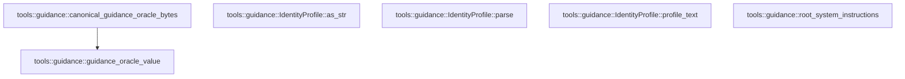

# tools::guidance

[Package atlas](index.md) · [Source](../../src/guidance.rs)

## Declarations

Visibility is the declaration spelling; trait members and reexports require their enclosing interface. `cfg` is not evaluated.

| Symbol | Kind | Visibility | Test / cfg |
|---|---|---|---|
| [tools::guidance::HARNESS_IDENTITY](../../src/guidance.rs#L20) | const_item | `pub` |  |
| [tools::guidance::GENERAL_IDENTITY](../../src/guidance.rs#L23) | const_item | `pub` |  |
| [tools::guidance::GENERAL_RULES](../../src/guidance.rs#L26) | const_item | `pub` |  |
| [tools::guidance::CODING_IDENTITY](../../src/guidance.rs#L29) | const_item | `pub` |  |
| [tools::guidance::CODING_RULES](../../src/guidance.rs#L32) | const_item | `pub` |  |
| [tools::guidance::IdentityProfile](../../src/guidance.rs#L38) | enum_item | `pub` |  |
| [tools::guidance::IdentityProfile::as_str](../../src/guidance.rs#L46) | function_item | `pub` |  |
| [tools::guidance::IdentityProfile::parse](../../src/guidance.rs#L54) | function_item | `pub` |  |
| [tools::guidance::IdentityProfile::profile_text](../../src/guidance.rs#L65) | function_item | `pub` |  |
| [tools::guidance::WORKING_DIRECTORY](../../src/guidance.rs#L79) | const_item | `pub` |  |
| [tools::guidance::root_system_instructions](../../src/guidance.rs#L85) | function_item | `pub` |  |
| [tools::guidance::guidance_oracle_value](../../src/guidance.rs#L107) | function_item | `pub` |  |
| [tools::guidance::canonical_guidance_oracle_bytes](../../src/guidance.rs#L131) | function_item | `pub` |  |
| [tools::guidance::tests::root_instructions_are_identity_profile_cwd_then_agents_text](../../src/guidance.rs#L143) | function_item | `private` | test; #[cfg(test)] |
| [tools::guidance::tests::profile_text_keeps_model_placeholder_and_identity_first](../../src/guidance.rs#L180) | function_item | `private` | test; #[cfg(test)] |

## Imports / reexports

| Local name | Source path | Visibility |
|---|---|---|
| `Deserialize` | `serde::Deserialize` | `private` |
| `Serialize` | `serde::Serialize` | `private` |
| `Value` | `serde_json::Value` | `private` |
| `json` | `serde_json::json` | `private` |
| `Digest` | `sha2::Digest` | `private` |
| `Sha256` | `sha2::Sha256` | `private` |
| `*` | `super::*` | `private` |

## Module declarations

| Module | Visibility | Attributes |
|---|---|---|
| `tools::guidance::tests` | `private` | #[cfg(test)] |

## Function call graphs

Edges below are syntactically resolved calls only, including private functions. Graphs partition callers into groups of 20; they are not execution order. All unresolved sites are listed below and in the JSON inventory.

Functions 1–6: 1 direct edges

## Call sites

Includes test functions (marked in declarations). Receiver-type-required sites need type analysis/manual tracing. Calls in closures are attributed to their enclosing function; their occurrence here does not mean the closure executes immediately.

| Caller | Callee expression | Source lines | Target / classification |
|---|---|---|---|
| `parse` | `Some` | [56](../../src/guidance.rs#L56), [57](../../src/guidance.rs#L57) | external-constructor-callback-or-unresolved |
| `profile_text` | `parts             .iter()             .map(&#124;part&#124; part.trim())             .collect::<Vec<_>>()             .join` | [70](../../src/guidance.rs#L70) | receiver-type-required |
| `profile_text` | `parts             .iter()             .map(&#124;part&#124; part.trim())             .collect::<Vec<_>>` | [70](../../src/guidance.rs#L70) | receiver-type-required |
| `profile_text` | `parts             .iter()             .map` | [70](../../src/guidance.rs#L70) | receiver-type-required |
| `profile_text` | `parts             .iter` | [70](../../src/guidance.rs#L70) | receiver-type-required |
| `profile_text` | `part.trim` | [72](../../src/guidance.rs#L72) | receiver-type-required |
| `root_system_instructions` | `sections.push` | [96](../../src/guidance.rs#L96), [100](../../src/guidance.rs#L100) | receiver-type-required |
| `root_system_instructions` | `WORKING_DIRECTORY.replace` | [96](../../src/guidance.rs#L96) | receiver-type-required |
| `root_system_instructions` | `instruction_text.trim` | [98](../../src/guidance.rs#L98) | receiver-type-required |
| `root_system_instructions` | `instruction_text.is_empty` | [99](../../src/guidance.rs#L99) | receiver-type-required |
| `root_system_instructions` | `instruction_text.to_owned` | [100](../../src/guidance.rs#L100) | receiver-type-required |
| `root_system_instructions` | `sections.join` | [102](../../src/guidance.rs#L102) | receiver-type-required |
| `guidance_oracle_value` | `serde_json_canonicalizer::to_vec(&preimage).expect` | [116](../../src/guidance.rs#L116) | receiver-type-required |
| `guidance_oracle_value` | `serde_json_canonicalizer::to_vec` | [116](../../src/guidance.rs#L116) | external-constructor-callback-or-unresolved |
| `canonical_guidance_oracle_bytes` | `serde_json_canonicalizer::to_vec(&guidance_oracle_value())         .expect` | [132](../../src/guidance.rs#L132) | receiver-type-required |
| `canonical_guidance_oracle_bytes` | `serde_json_canonicalizer::to_vec` | [132](../../src/guidance.rs#L132) | external-constructor-callback-or-unresolved |
| `canonical_guidance_oracle_bytes` | `guidance_oracle_value` | [132](../../src/guidance.rs#L132) | [tools::guidance::guidance_oracle_value](../../src/guidance.rs#L107) |
| `canonical_guidance_oracle_bytes` | `bytes.push` | [134](../../src/guidance.rs#L134) | receiver-type-required |
| `root_instructions_are_identity_profile_cwd_then_agents_text` | `root_system_instructions` | [148](../../src/guidance.rs#L148), [160](../../src/guidance.rs#L160), [170](../../src/guidance.rs#L170) | external-constructor-callback-or-unresolved |
| `root_instructions_are_identity_profile_cwd_then_agents_text` | `Some` | [151](../../src/guidance.rs#L151), [170](../../src/guidance.rs#L170) | external-constructor-callback-or-unresolved |
| `profile_text_keeps_model_placeholder_and_identity_first` | `profile.profile_text` | [182](../../src/guidance.rs#L182) | receiver-type-required |
