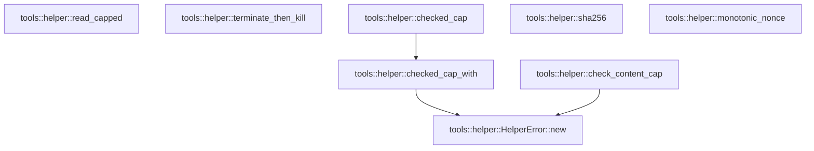

```mermaid
flowchart TD
  n0["store::platform::FullSync::full_sync"]
  n1["tools::helper::decode_terminal"]
  n2["tools::helper::from_payload"]
  n3["tools::helper::read_line_limited"]
  n4["tools::helper::valid_root_name"]
  n5["tools::helper::normalized_relative"]
  n6["tools::helper::split_parent"]
  n7["tools::helper::open_parent"]
  n8["tools::helper::create_parent"]
  n9["tools::helper::duplicate_fd"]
  n10["tools::helper::open_directory_at"]
  n11["tools::helper::open_regular_at"]
  n12["tools::helper::classify_open"]
  n13["tools::helper::read_regular"]
  n14["tools::helper::atomic_replace"]
  n15["tools::helper::rename_at"]
  n16["tools::helper::unlink_at"]
  n17["tools::helper::glob_beneath"]
  n18["tools::helper::glob_match"]
  n19["tools::helper::glob_match::matches"]
  n20["tools::helper::HelperError::new"]
  n21["tools::helper::HelperError::io"]
  n22["tools::helper::encode_helper_line"]
  n23["tools::helper::decode_helper_line"]
  n24["tools::helper::serve_stdio"]
  n1 --> n2
  n1 --> n20
  n1 --> n23
  n2 --> n20
  n3 --> n20
  n5 --> n20
  n6 --> n5
  n6 --> n20
  n7 --> n9
  n7 --> n10
  n8 --> n9
  n8 --> n10
  n8 --> n12
  n8 --> n20
  n9 --> n21
  n10 --> n12
  n10 --> n20
  n11 --> n12
  n11 --> n20
  n12 --> n20
  n12 --> n21
  n13 --> n6
  n13 --> n7
  n13 --> n11
  n13 --> n20
  n14 --> n0
  n14 --> n6
  n14 --> n7
  n14 --> n8
  n14 --> n11
  n14 --> n15
  n14 --> n16
  n14 --> n20
  n15 --> n20
  n15 --> n21
  n16 --> n20
  n16 --> n21
  n17 --> n18
  n17 --> n20
  n19 --> n19
  n24 --> n2
  n24 --> n3
  n24 --> n20
  n24 --> n22
  n24 --> n23
```

# tools::helper

[Package atlas](index.md) · [Source](../../src/helper.rs)

## Declarations

Visibility is the declaration spelling; trait members and reexports require their enclosing interface. `cfg` is not evaluated.

| Symbol | Kind | Visibility | Test / cfg |
|---|---|---|---|
| [tools::helper::HELPER_PROTOCOL](../../src/helper.rs#L32) | const_item | `pub` |  |
| [tools::helper::HELPER_VERSION](../../src/helper.rs#L33) | const_item | `pub` |  |
| [tools::helper::EX_PROTOCOL](../../src/helper.rs#L34) | const_item | `pub` |  |
| [tools::helper::HARD_BYTES](../../src/helper.rs#L35) | const_item | `private` |  |
| [tools::helper::HARD_READ_BYTES](../../src/helper.rs#L36) | const_item | `private` |  |
| [tools::helper::HARD_TIMEOUT_MS](../../src/helper.rs#L37) | const_item | `private` |  |
| [tools::helper::TERM_GRACE_MS](../../src/helper.rs#L38) | const_item | `private` |  |
| [tools::helper::HELPER_PROCESS_TIMEOUT_MS](../../src/helper.rs#L39) | const_item | `private` |  |
| [tools::helper::HELPER_PROTOCOL_STDOUT_BYTES](../../src/helper.rs#L42) | const_item | `private` |  |
| [tools::helper::HELPER_PROTOCOL_STDERR_BYTES](../../src/helper.rs#L43) | const_item | `private` |  |
| [tools::helper::ByteString](../../src/helper.rs#L47) | struct_item | `pub` |  |
| [tools::helper::ByteEncoding](../../src/helper.rs#L54) | enum_item | `pub` |  |
| [tools::helper::ByteString::from_bytes](../../src/helper.rs#L61) | function_item | `pub` |  |
| [tools::helper::ByteString::decode](../../src/helper.rs#L74) | function_item | `pub` |  |
| [tools::helper::CreateMode](../../src/helper.rs#L89) | enum_item | `pub` |  |
| [tools::helper::ExecRequest](../../src/helper.rs#L97) | struct_item | `pub` |  |
| [tools::helper::HelperPath](../../src/helper.rs#L115) | struct_item | `pub` |  |
| [tools::helper::HelperOperation](../../src/helper.rs#L122) | enum_item | `pub` |  |
| [tools::helper::HelperRequest](../../src/helper.rs#L161) | struct_item | `pub` |  |
| [tools::helper::ReadValue](../../src/helper.rs#L168) | struct_item | `pub` |  |
| [tools::helper::WriteValue](../../src/helper.rs#L176) | struct_item | `pub` |  |
| [tools::helper::ExecValue](../../src/helper.rs#L183) | struct_item | `pub` |  |
| [tools::helper::HelperValue](../../src/helper.rs#L193) | enum_item | `pub` |  |
| [tools::helper::HelperErrorClass](../../src/helper.rs#L203) | enum_item | `pub` |  |
| [tools::helper::HelperError](../../src/helper.rs#L223) | struct_item | `pub` |  |
| [tools::helper::HelperClientError](../../src/helper.rs#L230) | enum_item | `pub` |  |
| [tools::helper::HelperError::new](../../src/helper.rs#L239) | function_item | `pub` |  |
| [tools::helper::HelperError::io](../../src/helper.rs#L247) | function_item | `private` |  |
| [tools::helper::HelperError::from](../../src/helper.rs#L259) | function_item | `private` |  |
| [tools::helper::HelperResponse](../../src/helper.rs#L265) | enum_item | `pub` |  |
| [tools::helper::Hello](../../src/helper.rs#L272) | struct_item | `private` |  |
| [tools::helper::Selected](../../src/helper.rs#L280) | struct_item | `private` |  |
| [tools::helper::Reject](../../src/helper.rs#L286) | struct_item | `private` |  |
| [tools::helper::ResultPayload](../../src/helper.rs#L292) | struct_item | `private` |  |
| [tools::helper::ErrorPayload](../../src/helper.rs#L299) | struct_item | `private` |  |
| [tools::helper::encode_helper_line](../../src/helper.rs#L305) | function_item | `pub` |  |
| [tools::helper::decode_helper_line](../../src/helper.rs#L318) | function_item | `pub` |  |
| [tools::helper::RootBinding](../../src/helper.rs#L362) | struct_item | `pub` |  |
| [tools::helper::RootBinding::open](../../src/helper.rs#L369) | function_item | `pub` |  |
| [tools::helper::HelperServer](../../src/helper.rs#L409) | struct_item | `pub` |  |
| [tools::helper::HelperServer::new](../../src/helper.rs#L414) | function_item | `pub` |  |
| [tools::helper::HelperServer::execute](../../src/helper.rs#L427) | function_item | `pub` |  |
| [tools::helper::HelperServer::execute_inner](../../src/helper.rs#L441) | function_item | `private` |  |
| [tools::helper::HelperServer::root](../../src/helper.rs#L544) | function_item | `private` |  |
| [tools::helper::HelperServer::exec](../../src/helper.rs#L553) | function_item | `private` |  |
| [tools::helper::HelperClient](../../src/helper.rs#L672) | struct_item | `pub` |  |
| [tools::helper::HelperIsolation](../../src/helper.rs#L680) | enum_item | `private` |  |
| [tools::helper::HelperClient::for_execution_access](../../src/helper.rs#L691) | function_item | `pub` |  |
| [tools::helper::HelperClient::sandboxed_with_scratch](../../src/helper.rs#L712) | function_item | `pub` |  |
| [tools::helper::HelperClient::scratch_path](../../src/helper.rs#L738) | function_item | `pub` |  |
| [tools::helper::HelperClient::sandboxed](../../src/helper.rs#L745) | function_item | `pub` |  |
| [tools::helper::HelperClient::approved_unsandboxed](../../src/helper.rs#L768) | function_item | `pub` |  |
| [tools::helper::HelperClient::execute](../../src/helper.rs#L789) | function_item | `pub` |  |
| [tools::helper::HelperClient::execute_cancellable](../../src/helper.rs#L806) | function_item | `pub` |  |
| [tools::helper::serve_stdio](../../src/helper.rs#L968) | function_item | `pub` |  |
| [tools::helper::decode_terminal](../../src/helper.rs#L1022) | function_item | `private` |  |
| [tools::helper::from_payload](../../src/helper.rs#L1046) | function_item | `private` |  |
| [tools::helper::read_line_limited](../../src/helper.rs#L1051) | function_item | `private` |  |
| [tools::helper::valid_root_name](../../src/helper.rs#L1070) | function_item | `private` |  |
| [tools::helper::normalized_relative](../../src/helper.rs#L1079) | function_item | `private` |  |
| [tools::helper::split_parent](../../src/helper.rs#L1102) | function_item | `private` |  |
| [tools::helper::open_parent](../../src/helper.rs#L1124) | function_item | `private` |  |
| [tools::helper::create_parent](../../src/helper.rs#L1132) | function_item | `private` |  |
| [tools::helper::duplicate_fd](../../src/helper.rs#L1159) | function_item | `private` |  |
| [tools::helper::open_directory_at](../../src/helper.rs#L1169) | function_item | `private` |  |
| [tools::helper::open_regular_at](../../src/helper.rs#L1191) | function_item | `private` |  |
| [tools::helper::classify_open](../../src/helper.rs#L1223) | function_item | `private` |  |
| [tools::helper::read_regular](../../src/helper.rs#L1231) | function_item | `private` |  |
| [tools::helper::atomic_replace](../../src/helper.rs#L1254) | function_item | `private` |  |
| [tools::helper::rename_at](../../src/helper.rs#L1306) | function_item | `private` |  |
| [tools::helper::unlink_at](../../src/helper.rs#L1348) | function_item | `private` |  |
| [tools::helper::glob_beneath](../../src/helper.rs#L1358) | function_item | `private` |  |
| [tools::helper::glob_match](../../src/helper.rs#L1409) | function_item | `private` |  |
| [tools::helper::glob_match::matches](../../src/helper.rs#L1410) | function_item | `private` |  |
| [tools::helper::read_capped](../../src/helper.rs#L1449) | function_item | `private` |  |
| [tools::helper::terminate_then_kill](../../src/helper.rs#L1465) | function_item | `private` |  |
| [tools::helper::checked_cap](../../src/helper.rs#L1485) | function_item | `private` |  |
| [tools::helper::checked_cap_with](../../src/helper.rs#L1489) | function_item | `private` |  |
| [tools::helper::check_content_cap](../../src/helper.rs#L1501) | function_item | `private` |  |
| [tools::helper::sha256](../../src/helper.rs#L1511) | function_item | `private` |  |
| [tools::helper::monotonic_nonce](../../src/helper.rs#L1515) | function_item | `private` |  |
| [tools::helper::monotonic_nonce::NONCE](../../src/helper.rs#L1517) | static_item | `private` |  |
| [tools::helper::nested_create_tests::create_builds_parents_and_preserves_no_replace](../../src/helper.rs#L1527) | function_item | `private` | test; #[cfg(test)] |
| [tools::helper::nested_create_tests::parent_creation_is_limited_to_new_and_validates_entire_path_first](../../src/helper.rs#L1557) | function_item | `private` | test; #[cfg(test)] |
| [tools::helper::nested_create_tests::parent_creation_cannot_follow_symlinks_or_escape_root](../../src/helper.rs#L1594) | function_item | `private` | test; #[cfg(test)] |

## Imports / reexports

| Local name | Source path | Visibility |
|---|---|---|
| `BTreeMap` | `std::collections::BTreeMap` | `private` |
| `CString` | `std::ffi::CString` | `private` |
| `OsStr` | `std::ffi::OsStr` | `private` |
| `OsString` | `std::ffi::OsString` | `private` |
| `File` | `std::fs::File` | `private` |
| `Read` | `std::io::Read` | `private` |
| `Write` | `std::io::Write` | `private` |
| `AsRawFd` | `std::os::fd::AsRawFd` | `private` |
| `FromRawFd` | `std::os::fd::FromRawFd` | `private` |
| `RawFd` | `std::os::fd::RawFd` | `private` |
| `_` | `std::os::unix::ffi::OsStrExt` | `private` |
| `_` | `std::os::unix::fs::PermissionsExt` | `private` |
| `_` | `std::os::unix::process::CommandExt` | `private` |
| `Component` | `std::path::Component` | `private` |
| `Path` | `std::path::Path` | `private` |
| `PathBuf` | `std::path::PathBuf` | `private` |
| `Command` | `std::process::Command` | `private` |
| `Stdio` | `std::process::Stdio` | `private` |
| `thread` | `std::thread` | `private` |
| `Duration` | `std::time::Duration` | `private` |
| `Instant` | `std::time::Instant` | `private` |
| `_` | `base64::Engine` | `private` |
| `BASE64` | `base64::engine::general_purpose::STANDARD` | `private` |
| `DeserializeOwned` | `serde::de::DeserializeOwned` | `private` |
| `Deserialize` | `serde::Deserialize` | `private` |
| `Serialize` | `serde::Serialize` | `private` |
| `Map` | `serde_json::Map` | `private` |
| `Value` | `serde_json::Value` | `private` |
| `Digest` | `sha2::Digest` | `private` |
| `Sha256` | `sha2::Sha256` | `private` |
| `Error` | `thiserror::Error` | `private` |
| `FullSync` | `store::FullSync` | `private` |
| `ProbeStatus` | `crate::sandbox::ProbeStatus` | `private` |
| `SandboxApproval` | `crate::sandbox::SandboxApproval` | `private` |
| `SandboxPolicy` | `crate::sandbox::SandboxPolicy` | `private` |
| `policy_digest` | `crate::sandbox::policy_digest` | `private` |
| `sandbox_command` | `crate::sandbox::sandbox_command` | `private` |
| `validate_unsandboxed_approval` | `crate::sandbox::validate_unsandboxed_approval` | `private` |
| `*` | `super::*` | `private` |
| `symlink` | `std::os::unix::fs::symlink` | `private` |

## Module declarations

| Module | Visibility | Attributes |
|---|---|---|
| `tools::helper::native_grep` | `private` | #[path = "helper/native_grep.rs"] |
| `tools::helper::nested_create_tests` | `private` | #[cfg(test)] |

## Function call graphs

Edges below are syntactically resolved calls only, including private functions. Graphs partition callers into groups of 20; they are not execution order. All unresolved sites are listed below and in the JSON inventory.

```mermaid
flowchart TD
  n0["schema::ijson::IJsonValue::parse"]
  n1["tools::helper::decode_terminal"]
  n2["tools::helper::from_payload"]
  n3["tools::helper::valid_root_name"]
  n4["tools::helper::normalized_relative"]
  n5["tools::helper::open_parent"]
  n6["tools::helper::open_directory_at"]
  n7["tools::helper::read_regular"]
  n8["tools::helper::atomic_replace"]
  n9["tools::helper::glob_beneath"]
  n10["tools::helper::read_capped"]
  n11["tools::helper::terminate_then_kill"]
  n12["tools::helper::checked_cap"]
  n13["tools::helper::checked_cap_with"]
  n14["tools::helper::check_content_cap"]
  n15["tools::helper::sha256"]
  n16["tools::helper::HelperError::new"]
  n17["tools::helper::HelperError::io"]
  n18["tools::helper::HelperError::from"]
  n19["tools::helper::encode_helper_line"]
  n20["tools::helper::decode_helper_line"]
  n21["tools::helper::RootBinding::open"]
  n22["tools::helper::HelperServer::new"]
  n23["tools::helper::HelperServer::execute"]
  n24["tools::helper::HelperServer::execute_inner"]
  n25["tools::helper::HelperServer::root"]
  n26["tools::helper::HelperServer::exec"]
  n27["tools::helper::ByteString::from_bytes"]
  n28["tools::helper::HelperClient::for_execution_access"]
  n29["tools::helper::HelperClient::sandboxed_with_scratch"]
  n30["tools::helper::HelperClient::scratch_path"]
  n31["tools::helper::HelperClient::sandboxed"]
  n32["tools::helper::ByteString::decode"]
  n33["tools::helper::HelperClient::approved_unsandboxed"]
  n34["tools::helper::HelperClient::execute"]
  n35["tools::helper::HelperClient::execute_cancellable"]
  n36["tools::helper::native_grep::search"]
  n37["tools::sandbox::policy_digest"]
  n38["tools::sandbox::validate_unsandboxed_approval"]
  n39["tools::sandbox::sandbox_command"]
  n17 --> n16
  n19 --> n16
  n20 --> n0
  n20 --> n16
  n21 --> n3
  n21 --> n6
  n21 --> n16
  n22 --> n16
  n23 --> n24
  n24 --> n7
  n24 --> n8
  n24 --> n9
  n24 --> n12
  n24 --> n13
  n24 --> n14
  n24 --> n15
  n24 --> n16
  n24 --> n25
  n24 --> n26
  n24 --> n27
  n24 --> n36
  n25 --> n16
  n26 --> n4
  n26 --> n5
  n26 --> n10
  n26 --> n11
  n26 --> n12
  n26 --> n14
  n26 --> n16
  n26 --> n17
  n26 --> n25
  n26 --> n27
  n28 --> n29
  n29 --> n16
  n29 --> n31
  n31 --> n16
  n32 --> n16
  n33 --> n16
  n33 --> n37
  n33 --> n38
  n34 --> n16
  n34 --> n35
  n35 --> n1
  n35 --> n2
  n35 --> n10
  n35 --> n11
  n35 --> n16
  n35 --> n17
  n35 --> n19
  n35 --> n20
  n35 --> n39
```

Functions 1–20: 51 direct edges

Functions 21–40: 45 direct edges

Functions 41–47: 3 direct edges

## Call sites

Includes test functions (marked in declarations). Receiver-type-required sites need type analysis/manual tracing. Calls in closures are attributed to their enclosing function; their occurrence here does not mean the closure executes immediately.

| Caller | Callee expression | Source lines | Target / classification |
|---|---|---|---|
| `from_bytes` | `std::str::from_utf8` | [62](../../src/helper.rs#L62) | external-constructor-callback-or-unresolved |
| `from_bytes` | `text.to_owned` | [65](../../src/helper.rs#L65) | receiver-type-required |
| `from_bytes` | `BASE64.encode` | [69](../../src/helper.rs#L69) | receiver-type-required |
| `decode` | `Ok` | [76](../../src/helper.rs#L76) | external-constructor-callback-or-unresolved |
| `decode` | `self.data.as_bytes().to_vec` | [76](../../src/helper.rs#L76) | receiver-type-required |
| `decode` | `self.data.as_bytes` | [76](../../src/helper.rs#L76) | receiver-type-required |
| `decode` | `BASE64.decode(&self.data).map_err` | [77](../../src/helper.rs#L77) | receiver-type-required |
| `decode` | `BASE64.decode` | [77](../../src/helper.rs#L77) | receiver-type-required |
| `decode` | `HelperError::new` | [78](../../src/helper.rs#L78) | [tools::helper::HelperError::new](../../src/helper.rs#L239) |
| `new` | `message.into` | [242](../../src/helper.rs#L242) | receiver-type-required |
| `io` | `error.kind` | [248](../../src/helper.rs#L248) | receiver-type-required |
| `io` | `Self::new` | [254](../../src/helper.rs#L254) | [tools::helper::HelperError::new](../../src/helper.rs#L239) |
| `io` | `error.to_string` | [254](../../src/helper.rs#L254) | receiver-type-required |
| `from` | `Self::io` | [260](../../src/helper.rs#L260) | external-constructor-callback-or-unresolved |
| `encode_helper_line` | `Map::new` | [306](../../src/helper.rs#L306) | external-constructor-callback-or-unresolved |
| `encode_helper_line` | `object.insert` | [307](../../src/helper.rs#L307) | receiver-type-required |
| `encode_helper_line` | `key.to_owned` | [308](../../src/helper.rs#L308) | receiver-type-required |
| `encode_helper_line` | `serde_json::to_value(payload)             .map_err` | [309](../../src/helper.rs#L309) | receiver-type-required |
| `encode_helper_line` | `serde_json::to_value` | [309](../../src/helper.rs#L309) | external-constructor-callback-or-unresolved |
| `encode_helper_line` | `HelperError::new` | [310](../../src/helper.rs#L310), [313](../../src/helper.rs#L313) | [tools::helper::HelperError::new](../../src/helper.rs#L239) |
| `encode_helper_line` | `error.to_string` | [310](../../src/helper.rs#L310), [313](../../src/helper.rs#L313) | receiver-type-required |
| `encode_helper_line` | `serde_json_canonicalizer::to_vec(&Value::Object(object))         .map_err` | [312](../../src/helper.rs#L312) | receiver-type-required |
| `encode_helper_line` | `serde_json_canonicalizer::to_vec` | [312](../../src/helper.rs#L312) | external-constructor-callback-or-unresolved |
| `encode_helper_line` | `Value::Object` | [312](../../src/helper.rs#L312) | external-constructor-callback-or-unresolved |
| `encode_helper_line` | `bytes.push` | [314](../../src/helper.rs#L314) | receiver-type-required |
| `encode_helper_line` | `Ok` | [315](../../src/helper.rs#L315) | external-constructor-callback-or-unresolved |
| `decode_helper_line` | `bytes.strip_suffix` | [319](../../src/helper.rs#L319) | receiver-type-required |
| `decode_helper_line` | `Err` | [320](../../src/helper.rs#L320), [326](../../src/helper.rs#L326), [338](../../src/helper.rs#L338), [349](../../src/helper.rs#L349) | external-constructor-callback-or-unresolved |
| `decode_helper_line` | `HelperError::new` | [320](../../src/helper.rs#L320), [326](../../src/helper.rs#L326), [332](../../src/helper.rs#L332), [335](../../src/helper.rs#L335), [338](../../src/helper.rs#L338), [344](../../src/helper.rs#L344), [347](../../src/helper.rs#L347), [349](../../src/helper.rs#L349) | [tools::helper::HelperError::new](../../src/helper.rs#L239) |
| `decode_helper_line` | `body.is_empty` | [325](../../src/helper.rs#L325) | receiver-type-required |
| `decode_helper_line` | `body.contains` | [325](../../src/helper.rs#L325) | receiver-type-required |
| `decode_helper_line` | `schema::IJsonValue::parse(body)         .map_err` | [331](../../src/helper.rs#L331) | receiver-type-required |
| `decode_helper_line` | `schema::IJsonValue::parse` | [331](../../src/helper.rs#L331) | [schema::ijson::IJsonValue::parse](../../../schema/src/ijson.rs#L16) |
| `decode_helper_line` | `error.to_string` | [332](../../src/helper.rs#L332), [335](../../src/helper.rs#L335), [344](../../src/helper.rs#L344) | receiver-type-required |
| `decode_helper_line` | `parsed         .canonical_bytes()         .map_err` | [333](../../src/helper.rs#L333) | receiver-type-required |
| `decode_helper_line` | `parsed         .canonical_bytes` | [333](../../src/helper.rs#L333) | receiver-type-required |
| `decode_helper_line` | `serde_json::from_slice(body)         .map_err` | [343](../../src/helper.rs#L343) | receiver-type-required |
| `decode_helper_line` | `serde_json::from_slice` | [343](../../src/helper.rs#L343) | external-constructor-callback-or-unresolved |
| `decode_helper_line` | `value         .as_object()         .ok_or_else` | [345](../../src/helper.rs#L345) | receiver-type-required |
| `decode_helper_line` | `value         .as_object` | [345](../../src/helper.rs#L345) | receiver-type-required |
| `decode_helper_line` | `object.len` | [348](../../src/helper.rs#L348) | receiver-type-required |
| `decode_helper_line` | `Ok` | [354](../../src/helper.rs#L354) | external-constructor-callback-or-unresolved |
| `decode_helper_line` | `object         .iter()         .next()         .map(&#124;(key, value)&#124; (key.clone(), value.clone()))         .expect` | [354](../../src/helper.rs#L354) | receiver-type-required |
| `decode_helper_line` | `object         .iter()         .next()         .map` | [354](../../src/helper.rs#L354) | receiver-type-required |
| `decode_helper_line` | `object         .iter()         .next` | [354](../../src/helper.rs#L354) | receiver-type-required |
| `decode_helper_line` | `object         .iter` | [354](../../src/helper.rs#L354) | receiver-type-required |
| `decode_helper_line` | `key.clone` | [357](../../src/helper.rs#L357) | receiver-type-required |
| `decode_helper_line` | `value.clone` | [357](../../src/helper.rs#L357) | receiver-type-required |
| `open` | `name.into` | [370](../../src/helper.rs#L370) | receiver-type-required |
| `open` | `valid_root_name` | [371](../../src/helper.rs#L371) | [tools::helper::valid_root_name](../../src/helper.rs#L1070) |
| `open` | `Err` | [372](../../src/helper.rs#L372), [379](../../src/helper.rs#L379), [390](../../src/helper.rs#L390) | external-constructor-callback-or-unresolved |
| `open` | `HelperError::new` | [372](../../src/helper.rs#L372), [379](../../src/helper.rs#L379), [390](../../src/helper.rs#L390) | [tools::helper::HelperError::new](../../src/helper.rs#L239) |
| `open` | `path.as_ref` | [377](../../src/helper.rs#L377) | receiver-type-required |
| `open` | `path.is_absolute` | [378](../../src/helper.rs#L378) | receiver-type-required |
| `open` | `path.to_str().is_none` | [378](../../src/helper.rs#L378) | receiver-type-required |
| `open` | `path.to_str` | [378](../../src/helper.rs#L378) | receiver-type-required |
| `open` | `path.components().any` | [384](../../src/helper.rs#L384) | receiver-type-required |
| `open` | `path.components` | [384](../../src/helper.rs#L384) | receiver-type-required |
| `open` | `open_directory_at(libc::AT_FDCWD, path.as_os_str()).map_err` | [396](../../src/helper.rs#L396) | receiver-type-required |
| `open` | `open_directory_at` | [396](../../src/helper.rs#L396) | [tools::helper::open_directory_at](../../src/helper.rs#L1169) |
| `open` | `path.as_os_str` | [396](../../src/helper.rs#L396) | receiver-type-required |
| `open` | `Ok` | [400](../../src/helper.rs#L400) | external-constructor-callback-or-unresolved |
| `open` | `path.to_path_buf` | [402](../../src/helper.rs#L402) | receiver-type-required |
| `new` | `BTreeMap::new` | [415](../../src/helper.rs#L415) | external-constructor-callback-or-unresolved |
| `new` | `map.insert(root.name.clone(), root).is_some` | [417](../../src/helper.rs#L417) | receiver-type-required |
| `new` | `map.insert` | [417](../../src/helper.rs#L417) | receiver-type-required |
| `new` | `root.name.clone` | [417](../../src/helper.rs#L417) | receiver-type-required |
| `new` | `Err` | [418](../../src/helper.rs#L418) | external-constructor-callback-or-unresolved |
| `new` | `HelperError::new` | [418](../../src/helper.rs#L418) | [tools::helper::HelperError::new](../../src/helper.rs#L239) |
| `new` | `Ok` | [424](../../src/helper.rs#L424) | external-constructor-callback-or-unresolved |
| `execute` | `self.execute_inner` | [428](../../src/helper.rs#L428) | [tools::helper::HelperServer::execute_inner](../../src/helper.rs#L441) |
| `execute` | `request.id.clone` | [431](../../src/helper.rs#L431), [435](../../src/helper.rs#L435) | receiver-type-required |
| `execute_inner` | `request.id.is_empty` | [442](../../src/helper.rs#L442) | receiver-type-required |
| `execute_inner` | `Err` | [443](../../src/helper.rs#L443), [487](../../src/helper.rs#L487) | external-constructor-callback-or-unresolved |
| `execute_inner` | `HelperError::new` | [443](../../src/helper.rs#L443), [487](../../src/helper.rs#L487) | [tools::helper::HelperError::new](../../src/helper.rs#L239) |
| `execute_inner` | `checked_cap_with` | [454](../../src/helper.rs#L454) | [tools::helper::checked_cap_with](../../src/helper.rs#L1489) |
| `execute_inner` | `self.root` | [455](../../src/helper.rs#L455), [469](../../src/helper.rs#L469), [484](../../src/helper.rs#L484), [511](../../src/helper.rs#L511), [526](../../src/helper.rs#L526) | [tools::helper::HelperServer::root](../../src/helper.rs#L544) |
| `execute_inner` | `read_regular` | [456](../../src/helper.rs#L456), [485](../../src/helper.rs#L485) | [tools::helper::read_regular](../../src/helper.rs#L1231) |
| `execute_inner` | `root.directory.as_raw_fd` | [456](../../src/helper.rs#L456), [472](../../src/helper.rs#L472), [485](../../src/helper.rs#L485), [495](../../src/helper.rs#L495) | receiver-type-required |
| `execute_inner` | `Ok` | [457](../../src/helper.rs#L457), [473](../../src/helper.rs#L473), [500](../../src/helper.rs#L500), [513](../../src/helper.rs#L513), [540](../../src/helper.rs#L540) | external-constructor-callback-or-unresolved |
| `execute_inner` | `HelperValue::Read` | [457](../../src/helper.rs#L457) | external-constructor-callback-or-unresolved |
| `execute_inner` | `ByteString::from_bytes` | [458](../../src/helper.rs#L458) | [tools::helper::ByteString::from_bytes](../../src/helper.rs#L61) |
| `execute_inner` | `bytes.len` | [459](../../src/helper.rs#L459), [474](../../src/helper.rs#L474), [501](../../src/helper.rs#L501) | receiver-type-required |
| `execute_inner` | `sha256` | [460](../../src/helper.rs#L460), [475](../../src/helper.rs#L475), [486](../../src/helper.rs#L486), [502](../../src/helper.rs#L502) | [tools::helper::sha256](../../src/helper.rs#L1511) |
| `execute_inner` | `content.decode` | [470](../../src/helper.rs#L470) | receiver-type-required |
| `execute_inner` | `check_content_cap` | [471](../../src/helper.rs#L471), [493](../../src/helper.rs#L493) | [tools::helper::check_content_cap](../../src/helper.rs#L1501) |
| `execute_inner` | `atomic_replace` | [472](../../src/helper.rs#L472), [494](../../src/helper.rs#L494) | [tools::helper::atomic_replace](../../src/helper.rs#L1254) |
| `execute_inner` | `HelperValue::Write` | [473](../../src/helper.rs#L473) | external-constructor-callback-or-unresolved |
| `execute_inner` | `replacement.decode` | [492](../../src/helper.rs#L492) | receiver-type-required |
| `execute_inner` | `HelperValue::Patch` | [500](../../src/helper.rs#L500) | external-constructor-callback-or-unresolved |
| `execute_inner` | `checked_cap` | [510](../../src/helper.rs#L510) | [tools::helper::checked_cap](../../src/helper.rs#L1485) |
| `execute_inner` | `glob_beneath` | [512](../../src/helper.rs#L512) | [tools::helper::glob_beneath](../../src/helper.rs#L1358) |
| `execute_inner` | `native_grep::search(                     root,                     path,                     pattern,                     glob.as_deref(),                     output_mode,                     *case_insensitive,                     *context_lines,                     *stdout_bytes,                     *timeout_ms,                 )                 .map` | [527](../../src/helper.rs#L527) | receiver-type-required |
| `execute_inner` | `native_grep::search` | [527](../../src/helper.rs#L527) | [tools::helper::native_grep::search](../../src/helper/native_grep.rs#L8) |
| `execute_inner` | `glob.as_deref` | [531](../../src/helper.rs#L531) | receiver-type-required |
| `execute_inner` | `HelperValue::Exec` | [540](../../src/helper.rs#L540) | external-constructor-callback-or-unresolved |
| `execute_inner` | `self.exec` | [540](../../src/helper.rs#L540) | [tools::helper::HelperServer::exec](../../src/helper.rs#L553) |
| `root` | `self.roots.get(name).ok_or_else` | [545](../../src/helper.rs#L545) | receiver-type-required |
| `root` | `self.roots.get` | [545](../../src/helper.rs#L545) | receiver-type-required |
| `root` | `HelperError::new` | [546](../../src/helper.rs#L546) | [tools::helper::HelperError::new](../../src/helper.rs#L239) |
| `exec` | `request.argv.first().is_none_or` | [554](../../src/helper.rs#L554) | receiver-type-required |
| `exec` | `request.argv.first` | [554](../../src/helper.rs#L554) | receiver-type-required |
| `exec` | `Err` | [555](../../src/helper.rs#L555), [563](../../src/helper.rs#L563), [601](../../src/helper.rs#L601), [646](../../src/helper.rs#L646) | external-constructor-callback-or-unresolved |
| `exec` | `HelperError::new` | [555](../../src/helper.rs#L555), [563](../../src/helper.rs#L563), [619](../../src/helper.rs#L619), [628](../../src/helper.rs#L628), [632](../../src/helper.rs#L632), [646](../../src/helper.rs#L646), [655](../../src/helper.rs#L655), [659](../../src/helper.rs#L659) | [tools::helper::HelperError::new](../../src/helper.rs#L239) |
| `exec` | `checked_cap` | [560](../../src/helper.rs#L560), [561](../../src/helper.rs#L561) | [tools::helper::checked_cap](../../src/helper.rs#L1485) |
| `exec` | `Some` | [562](../../src/helper.rs#L562) | external-constructor-callback-or-unresolved |
| `exec` | `Command::new` | [568](../../src/helper.rs#L568) | external-constructor-callback-or-unresolved |
| `exec` | `command             .args(&request.argv[1..])             .env_clear()             .envs(&request.env)             .stdin(Stdio::piped())             .stdout(Stdio::piped())             .stderr` | [569](../../src/helper.rs#L569) | receiver-type-required |
| `exec` | `command             .args(&request.argv[1..])             .env_clear()             .envs(&request.env)             .stdin(Stdio::piped())             .stdout` | [569](../../src/helper.rs#L569) | receiver-type-required |
| `exec` | `command             .args(&request.argv[1..])             .env_clear()             .envs(&request.env)             .stdin` | [569](../../src/helper.rs#L569) | receiver-type-required |
| `exec` | `command             .args(&request.argv[1..])             .env_clear()             .envs` | [569](../../src/helper.rs#L569) | receiver-type-required |
| `exec` | `command             .args(&request.argv[1..])             .env_clear` | [569](../../src/helper.rs#L569) | receiver-type-required |
| `exec` | `command             .args` | [569](../../src/helper.rs#L569) | receiver-type-required |
| `exec` | `Stdio::piped` | [573](../../src/helper.rs#L573), [574](../../src/helper.rs#L574), [575](../../src/helper.rs#L575) | external-constructor-callback-or-unresolved |
| `exec` | `command.process_group` | [576](../../src/helper.rs#L576) | receiver-type-required |
| `exec` | `self.root` | [578](../../src/helper.rs#L578) | [tools::helper::HelperServer::root](../../src/helper.rs#L544) |
| `exec` | `cwd.path.is_empty` | [581](../../src/helper.rs#L581) | receiver-type-required |
| `exec` | `PathBuf::new` | [582](../../src/helper.rs#L582) | external-constructor-callback-or-unresolved |
| `exec` | `normalized_relative` | [584](../../src/helper.rs#L584) | [tools::helper::normalized_relative](../../src/helper.rs#L1079) |
| `exec` | `relative                 .components()                 .map(&#124;component&#124; match component {                     Component::Normal(name) => name.to_os_string(),                     _ => unreachable!("cwd was normalized"),                 })                 .collect::<Vec<_>>` | [586](../../src/helper.rs#L586) | receiver-type-required |
| `exec` | `relative                 .components()                 .map` | [586](../../src/helper.rs#L586) | receiver-type-required |
| `exec` | `relative                 .components` | [586](../../src/helper.rs#L586) | receiver-type-required |
| `exec` | `name.to_os_string` | [589](../../src/helper.rs#L589) | receiver-type-required |
| `exec` | `open_parent` | [593](../../src/helper.rs#L593) | [tools::helper::open_parent](../../src/helper.rs#L1124) |
| `exec` | `root.directory.as_raw_fd` | [593](../../src/helper.rs#L593) | receiver-type-required |
| `exec` | `command.pre_exec` | [599](../../src/helper.rs#L599) | receiver-type-required |
| `exec` | `libc::fchdir` | [600](../../src/helper.rs#L600) | external-constructor-callback-or-unresolved |
| `exec` | `directory.as_raw_fd` | [600](../../src/helper.rs#L600) | receiver-type-required |
| `exec` | `std::io::Error::last_os_error` | [601](../../src/helper.rs#L601) | external-constructor-callback-or-unresolved |
| `exec` | `Ok` | [603](../../src/helper.rs#L603), [661](../../src/helper.rs#L661) | external-constructor-callback-or-unresolved |
| `exec` | `command.spawn().map_err` | [608](../../src/helper.rs#L608) | receiver-type-required |
| `exec` | `command.spawn` | [608](../../src/helper.rs#L608) | receiver-type-required |
| `exec` | `HelperError::io` | [609](../../src/helper.rs#L609) | [tools::helper::HelperError::io](../../src/helper.rs#L247) |
| `exec` | `input.decode` | [614](../../src/helper.rs#L614) | receiver-type-required |
| `exec` | `check_content_cap` | [615](../../src/helper.rs#L615) | [tools::helper::check_content_cap](../../src/helper.rs#L1501) |
| `exec` | `child                 .stdin                 .take()                 .ok_or_else(&#124;&#124; HelperError::new(HelperErrorClass::Io, "child stdin missing"))?                 .write_all(&bytes)                 .map_err` | [616](../../src/helper.rs#L616) | receiver-type-required |
| `exec` | `child                 .stdin                 .take()                 .ok_or_else(&#124;&#124; HelperError::new(HelperErrorClass::Io, "child stdin missing"))?                 .write_all` | [616](../../src/helper.rs#L616) | receiver-type-required |
| `exec` | `child                 .stdin                 .take()                 .ok_or_else` | [616](../../src/helper.rs#L616) | receiver-type-required |
| `exec` | `child                 .stdin                 .take` | [616](../../src/helper.rs#L616) | receiver-type-required |
| `exec` | `drop` | [623](../../src/helper.rs#L623) | external-constructor-callback-or-unresolved |
| `exec` | `child.stdin.take` | [623](../../src/helper.rs#L623) | receiver-type-required |
| `exec` | `child             .stdout             .take()             .ok_or_else` | [625](../../src/helper.rs#L625) | receiver-type-required |
| `exec` | `child             .stdout             .take` | [625](../../src/helper.rs#L625) | receiver-type-required |
| `exec` | `child             .stderr             .take()             .ok_or_else` | [629](../../src/helper.rs#L629) | receiver-type-required |
| `exec` | `child             .stderr             .take` | [629](../../src/helper.rs#L629) | receiver-type-required |
| `exec` | `thread::spawn` | [633](../../src/helper.rs#L633), [634](../../src/helper.rs#L634) | external-constructor-callback-or-unresolved |
| `exec` | `read_capped` | [633](../../src/helper.rs#L633), [634](../../src/helper.rs#L634) | [tools::helper::read_capped](../../src/helper.rs#L1449) |
| `exec` | `request             .timeout_ms             .map` | [635](../../src/helper.rs#L635) | receiver-type-required |
| `exec` | `Instant::now` | [637](../../src/helper.rs#L637), [642](../../src/helper.rs#L642) | external-constructor-callback-or-unresolved |
| `exec` | `Duration::from_millis` | [637](../../src/helper.rs#L637), [651](../../src/helper.rs#L651) | external-constructor-callback-or-unresolved |
| `exec` | `child.try_wait().map_err` | [639](../../src/helper.rs#L639) | receiver-type-required |
| `exec` | `child.try_wait` | [639](../../src/helper.rs#L639) | receiver-type-required |
| `exec` | `deadline.is_some_and` | [642](../../src/helper.rs#L642) | receiver-type-required |
| `exec` | `terminate_then_kill` | [643](../../src/helper.rs#L643) | [tools::helper::terminate_then_kill](../../src/helper.rs#L1465) |
| `exec` | `stdout_thread.join` | [644](../../src/helper.rs#L644) | receiver-type-required |
| `exec` | `stderr_thread.join` | [645](../../src/helper.rs#L645) | receiver-type-required |
| `exec` | `thread::sleep` | [651](../../src/helper.rs#L651) | external-constructor-callback-or-unresolved |
| `exec` | `stdout_thread             .join()             .map_err(&#124;_&#124; HelperError::new(HelperErrorClass::Io, "stdout reader panicked"))?             .map_err` | [653](../../src/helper.rs#L653) | receiver-type-required |
| `exec` | `stdout_thread             .join()             .map_err` | [653](../../src/helper.rs#L653) | receiver-type-required |
| `exec` | `stdout_thread             .join` | [653](../../src/helper.rs#L653) | receiver-type-required |
| `exec` | `stderr_thread             .join()             .map_err(&#124;_&#124; HelperError::new(HelperErrorClass::Io, "stderr reader panicked"))?             .map_err` | [657](../../src/helper.rs#L657) | receiver-type-required |
| `exec` | `stderr_thread             .join()             .map_err` | [657](../../src/helper.rs#L657) | receiver-type-required |
| `exec` | `stderr_thread             .join` | [657](../../src/helper.rs#L657) | receiver-type-required |
| `exec` | `status.code().unwrap_or` | [662](../../src/helper.rs#L662) | receiver-type-required |
| `exec` | `status.code` | [662](../../src/helper.rs#L662) | receiver-type-required |
| `exec` | `ByteString::from_bytes` | [663](../../src/helper.rs#L663), [664](../../src/helper.rs#L664) | [tools::helper::ByteString::from_bytes](../../src/helper.rs#L61) |
| `for_execution_access` | `Self::sandboxed_with_scratch` | [700](../../src/helper.rs#L700) | [tools::helper::HelperClient::sandboxed_with_scratch](../../src/helper.rs#L712) |
| `for_execution_access` | `Ok` | [702](../../src/helper.rs#L702) | external-constructor-callback-or-unresolved |
| `for_execution_access` | `executable.into` | [703](../../src/helper.rs#L703) | receiver-type-required |
| `sandboxed_with_scratch` | `policy.scratch.is_some` | [718](../../src/helper.rs#L718) | receiver-type-required |
| `sandboxed_with_scratch` | `Err` | [719](../../src/helper.rs#L719) | external-constructor-callback-or-unresolved |
| `sandboxed_with_scratch` | `HelperError::new` | [719](../../src/helper.rs#L719) | [tools::helper::HelperError::new](../../src/helper.rs#L239) |
| `sandboxed_with_scratch` | `tempfile::Builder::new()             .prefix("tekes-tool-")             .permissions(std::fs::Permissions::from_mode(0o700))             .tempdir` | [724](../../src/helper.rs#L724) | receiver-type-required |
| `sandboxed_with_scratch` | `tempfile::Builder::new()             .prefix("tekes-tool-")             .permissions` | [724](../../src/helper.rs#L724) | receiver-type-required |
| `sandboxed_with_scratch` | `tempfile::Builder::new()             .prefix` | [724](../../src/helper.rs#L724) | receiver-type-required |
| `sandboxed_with_scratch` | `tempfile::Builder::new` | [724](../../src/helper.rs#L724) | external-constructor-callback-or-unresolved |
| `sandboxed_with_scratch` | `std::fs::Permissions::from_mode` | [726](../../src/helper.rs#L726) | external-constructor-callback-or-unresolved |
| `sandboxed_with_scratch` | `Some` | [728](../../src/helper.rs#L728), [734](../../src/helper.rs#L734) | external-constructor-callback-or-unresolved |
| `sandboxed_with_scratch` | `std::fs::canonicalize(scratch.path())?                 .to_string_lossy()                 .into_owned` | [729](../../src/helper.rs#L729) | receiver-type-required |
| `sandboxed_with_scratch` | `std::fs::canonicalize(scratch.path())?                 .to_string_lossy` | [729](../../src/helper.rs#L729) | receiver-type-required |
| `sandboxed_with_scratch` | `std::fs::canonicalize` | [729](../../src/helper.rs#L729) | external-constructor-callback-or-unresolved |
| `sandboxed_with_scratch` | `scratch.path` | [729](../../src/helper.rs#L729) | receiver-type-required |
| `sandboxed_with_scratch` | `Self::sandboxed` | [733](../../src/helper.rs#L733) | [tools::helper::HelperClient::sandboxed](../../src/helper.rs#L745) |
| `sandboxed_with_scratch` | `std::sync::Arc::new` | [734](../../src/helper.rs#L734) | external-constructor-callback-or-unresolved |
| `sandboxed_with_scratch` | `Ok` | [735](../../src/helper.rs#L735) | external-constructor-callback-or-unresolved |
| `scratch_path` | `policy.scratch.as_deref` | [740](../../src/helper.rs#L740) | receiver-type-required |
| `sandboxed` | `policy.validate().map_err` | [751](../../src/helper.rs#L751) | receiver-type-required |
| `sandboxed` | `policy.validate` | [751](../../src/helper.rs#L751) | receiver-type-required |
| `sandboxed` | `HelperError::new` | [752](../../src/helper.rs#L752), [755](../../src/helper.rs#L755) | [tools::helper::HelperError::new](../../src/helper.rs#L239) |
| `sandboxed` | `error.to_string` | [752](../../src/helper.rs#L752) | receiver-type-required |
| `sandboxed` | `Err` | [755](../../src/helper.rs#L755) | external-constructor-callback-or-unresolved |
| `sandboxed` | `Ok` | [760](../../src/helper.rs#L760) | external-constructor-callback-or-unresolved |
| `sandboxed` | `executable.into` | [761](../../src/helper.rs#L761) | receiver-type-required |
| `approved_unsandboxed` | `policy_digest(policy).map_err` | [776](../../src/helper.rs#L776) | receiver-type-required |
| `approved_unsandboxed` | `policy_digest` | [776](../../src/helper.rs#L776) | [tools::sandbox::policy_digest](../../src/sandbox.rs#L323) |
| `approved_unsandboxed` | `HelperError::new` | [777](../../src/helper.rs#L777), [780](../../src/helper.rs#L780) | [tools::helper::HelperError::new](../../src/helper.rs#L239) |
| `approved_unsandboxed` | `error.to_string` | [777](../../src/helper.rs#L777), [780](../../src/helper.rs#L780) | receiver-type-required |
| `approved_unsandboxed` | `validate_unsandboxed_approval(approval, run, call, &digest)             .map_err` | [779](../../src/helper.rs#L779) | receiver-type-required |
| `approved_unsandboxed` | `validate_unsandboxed_approval` | [779](../../src/helper.rs#L779) | [tools::sandbox::validate_unsandboxed_approval](../../src/sandbox.rs#L517) |
| `approved_unsandboxed` | `Ok` | [781](../../src/helper.rs#L781) | external-constructor-callback-or-unresolved |
| `approved_unsandboxed` | `executable.into` | [782](../../src/helper.rs#L782) | receiver-type-required |
| `execute` | `self.execute_cancellable(             request,             Some(Duration::from_millis(HELPER_PROCESS_TIMEOUT_MS)),             &#124;&#124; false,         )         .map_err` | [790](../../src/helper.rs#L790) | receiver-type-required |
| `execute` | `self.execute_cancellable` | [790](../../src/helper.rs#L790) | [tools::helper::HelperClient::execute_cancellable](../../src/helper.rs#L806) |
| `execute` | `Some` | [792](../../src/helper.rs#L792) | external-constructor-callback-or-unresolved |
| `execute` | `Duration::from_millis` | [792](../../src/helper.rs#L792) | external-constructor-callback-or-unresolved |
| `execute` | `HelperError::new` | [798](../../src/helper.rs#L798) | [tools::helper::HelperError::new](../../src/helper.rs#L239) |
| `execute_cancellable` | `timeout.is_some_and` | [815](../../src/helper.rs#L815) | receiver-type-required |
| `execute_cancellable` | `timeout.is_zero` | [815](../../src/helper.rs#L815) | receiver-type-required |
| `execute_cancellable` | `Err` | [816](../../src/helper.rs#L816), [861](../../src/helper.rs#L861), [865](../../src/helper.rs#L865), [870](../../src/helper.rs#L870), [876](../../src/helper.rs#L876), [890](../../src/helper.rs#L890), [896](../../src/helper.rs#L896), [909](../../src/helper.rs#L909), [923](../../src/helper.rs#L923), [930](../../src/helper.rs#L930), [946](../../src/helper.rs#L946), [952](../../src/helper.rs#L952), [962](../../src/helper.rs#L962) | external-constructor-callback-or-unresolved |
| `execute_cancellable` | `HelperError::new(                 HelperErrorClass::InvalidRequest,                 "helper process timeout is outside hard limits",             )             .into` | [816](../../src/helper.rs#L816) | receiver-type-required |
| `execute_cancellable` | `HelperError::new` | [816](../../src/helper.rs#L816), [834](../../src/helper.rs#L834), [858](../../src/helper.rs#L858), [871](../../src/helper.rs#L871), [877](../../src/helper.rs#L877), [896](../../src/helper.rs#L896), [916](../../src/helper.rs#L916), [920](../../src/helper.rs#L920), [923](../../src/helper.rs#L923), [930](../../src/helper.rs#L930), [942](../../src/helper.rs#L942), [947](../../src/helper.rs#L947), [952](../../src/helper.rs#L952), [959](../../src/helper.rs#L959), [962](../../src/helper.rs#L962) | [tools::helper::HelperError::new](../../src/helper.rs#L239) |
| `execute_cancellable` | `encode_helper_line` | [822](../../src/helper.rs#L822), [830](../../src/helper.rs#L830) | [tools::helper::encode_helper_line](../../src/helper.rs#L305) |
| `execute_cancellable` | `HELPER_PROTOCOL.to_owned` | [825](../../src/helper.rs#L825) | receiver-type-required |
| `execute_cancellable` | `sandbox_command(policy, probe, &self.executable).map_err` | [833](../../src/helper.rs#L833) | receiver-type-required |
| `execute_cancellable` | `sandbox_command` | [833](../../src/helper.rs#L833) | [tools::sandbox::sandbox_command](../../src/sandbox.rs#L543) |
| `execute_cancellable` | `error.to_string` | [834](../../src/helper.rs#L834) | receiver-type-required |
| `execute_cancellable` | `Command::new` | [837](../../src/helper.rs#L837) | external-constructor-callback-or-unresolved |
| `execute_cancellable` | `command                 .arg("--root")                 .arg` | [840](../../src/helper.rs#L840) | receiver-type-required |
| `execute_cancellable` | `command                 .arg` | [840](../../src/helper.rs#L840) | receiver-type-required |
| `execute_cancellable` | `self.roots.first` | [845](../../src/helper.rs#L845) | receiver-type-required |
| `execute_cancellable` | `command.current_dir` | [846](../../src/helper.rs#L846) | receiver-type-required |
| `execute_cancellable` | `command.process_group` | [848](../../src/helper.rs#L848) | receiver-type-required |
| `execute_cancellable` | `command             .stdin(Stdio::piped())             .stdout(Stdio::piped())             .stderr(Stdio::piped())             .spawn()             .map_err` | [849](../../src/helper.rs#L849) | receiver-type-required |
| `execute_cancellable` | `command             .stdin(Stdio::piped())             .stdout(Stdio::piped())             .stderr(Stdio::piped())             .spawn` | [849](../../src/helper.rs#L849) | receiver-type-required |
| `execute_cancellable` | `command             .stdin(Stdio::piped())             .stdout(Stdio::piped())             .stderr` | [849](../../src/helper.rs#L849) | receiver-type-required |
| `execute_cancellable` | `command             .stdin(Stdio::piped())             .stdout` | [849](../../src/helper.rs#L849) | receiver-type-required |
| `execute_cancellable` | `command             .stdin` | [849](../../src/helper.rs#L849) | receiver-type-required |
| `execute_cancellable` | `Stdio::piped` | [850](../../src/helper.rs#L850), [851](../../src/helper.rs#L851), [852](../../src/helper.rs#L852) | external-constructor-callback-or-unresolved |
| `execute_cancellable` | `child             .stdin             .take()             .ok_or_else` | [855](../../src/helper.rs#L855) | receiver-type-required |
| `execute_cancellable` | `child             .stdin             .take` | [855](../../src/helper.rs#L855) | receiver-type-required |
| `execute_cancellable` | `stdin.write_all` | [859](../../src/helper.rs#L859), [863](../../src/helper.rs#L863) | receiver-type-required |
| `execute_cancellable` | `terminate_then_kill` | [860](../../src/helper.rs#L860), [864](../../src/helper.rs#L864), [869](../../src/helper.rs#L869), [875](../../src/helper.rs#L875), [887](../../src/helper.rs#L887), [893](../../src/helper.rs#L893), [906](../../src/helper.rs#L906) | [tools::helper::terminate_then_kill](../../src/helper.rs#L1465) |
| `execute_cancellable` | `HelperError::io(error).into` | [861](../../src/helper.rs#L861), [865](../../src/helper.rs#L865), [909](../../src/helper.rs#L909) | receiver-type-required |
| `execute_cancellable` | `HelperError::io` | [861](../../src/helper.rs#L861), [865](../../src/helper.rs#L865), [909](../../src/helper.rs#L909) | [tools::helper::HelperError::io](../../src/helper.rs#L247) |
| `execute_cancellable` | `drop` | [867](../../src/helper.rs#L867) | external-constructor-callback-or-unresolved |
| `execute_cancellable` | `child.stdout.take` | [868](../../src/helper.rs#L868) | receiver-type-required |
| `execute_cancellable` | `HelperError::new(HelperErrorClass::Protocol, "helper stdout missing").into` | [871](../../src/helper.rs#L871) | receiver-type-required |
| `execute_cancellable` | `child.stderr.take` | [874](../../src/helper.rs#L874) | receiver-type-required |
| `execute_cancellable` | `HelperError::new(HelperErrorClass::Protocol, "helper stderr missing").into` | [877](../../src/helper.rs#L877) | receiver-type-required |
| `execute_cancellable` | `thread::spawn` | [881](../../src/helper.rs#L881), [883](../../src/helper.rs#L883) | external-constructor-callback-or-unresolved |
| `execute_cancellable` | `read_capped` | [881](../../src/helper.rs#L881), [883](../../src/helper.rs#L883) | [tools::helper::read_capped](../../src/helper.rs#L1449) |
| `execute_cancellable` | `timeout.map` | [884](../../src/helper.rs#L884) | receiver-type-required |
| `execute_cancellable` | `Instant::now` | [884](../../src/helper.rs#L884), [892](../../src/helper.rs#L892) | external-constructor-callback-or-unresolved |
| `execute_cancellable` | `cancelled` | [886](../../src/helper.rs#L886) | external-constructor-callback-or-unresolved |
| `execute_cancellable` | `stdout_thread.join` | [888](../../src/helper.rs#L888), [894](../../src/helper.rs#L894), [907](../../src/helper.rs#L907) | receiver-type-required |
| `execute_cancellable` | `stderr_thread.join` | [889](../../src/helper.rs#L889), [895](../../src/helper.rs#L895), [908](../../src/helper.rs#L908) | receiver-type-required |
| `execute_cancellable` | `deadline.is_some_and` | [892](../../src/helper.rs#L892) | receiver-type-required |
| `execute_cancellable` | `HelperError::new(                     HelperErrorClass::Timeout,                     "helper process timed out",                 )                 .into` | [896](../../src/helper.rs#L896) | receiver-type-required |
| `execute_cancellable` | `child.try_wait` | [902](../../src/helper.rs#L902) | receiver-type-required |
| `execute_cancellable` | `thread::sleep` | [912](../../src/helper.rs#L912) | external-constructor-callback-or-unresolved |
| `execute_cancellable` | `Duration::from_millis` | [912](../../src/helper.rs#L912) | external-constructor-callback-or-unresolved |
| `execute_cancellable` | `stdout_thread             .join()             .map_err(&#124;_&#124; HelperError::new(HelperErrorClass::Io, "helper stdout reader panicked"))?             .map_err` | [914](../../src/helper.rs#L914) | receiver-type-required |
| `execute_cancellable` | `stdout_thread             .join()             .map_err` | [914](../../src/helper.rs#L914) | receiver-type-required |
| `execute_cancellable` | `stdout_thread             .join` | [914](../../src/helper.rs#L914) | receiver-type-required |
| `execute_cancellable` | `stderr_thread             .join()             .map_err(&#124;_&#124; HelperError::new(HelperErrorClass::Io, "helper stderr reader panicked"))?             .map_err` | [918](../../src/helper.rs#L918) | receiver-type-required |
| `execute_cancellable` | `stderr_thread             .join()             .map_err` | [918](../../src/helper.rs#L918) | receiver-type-required |
| `execute_cancellable` | `stderr_thread             .join` | [918](../../src/helper.rs#L918) | receiver-type-required |
| `execute_cancellable` | `HelperError::new(                 HelperErrorClass::Limit,                 "helper protocol output exceeded its cap",             )             .into` | [923](../../src/helper.rs#L923) | receiver-type-required |
| `execute_cancellable` | `status.success` | [929](../../src/helper.rs#L929) | receiver-type-required |
| `execute_cancellable` | `HelperError::new(                 HelperErrorClass::Protocol,                 format!(                     "helper exited {}: {}",                     status.code().unwrap_or(-1),                     String::from_utf8_lossy(&stderr)                 ),             )             .into` | [930](../../src/helper.rs#L930) | receiver-type-required |
| `execute_cancellable` | `stdout.split_inclusive` | [940](../../src/helper.rs#L940) | receiver-type-required |
| `execute_cancellable` | `lines.next().ok_or_else` | [941](../../src/helper.rs#L941), [958](../../src/helper.rs#L958) | receiver-type-required |
| `execute_cancellable` | `lines.next` | [941](../../src/helper.rs#L941), [958](../../src/helper.rs#L958), [961](../../src/helper.rs#L961) | receiver-type-required |
| `execute_cancellable` | `decode_helper_line` | [944](../../src/helper.rs#L944) | [tools::helper::decode_helper_line](../../src/helper.rs#L318) |
| `execute_cancellable` | `HelperError::new(HelperErrorClass::Protocol, "expected selected response").into` | [947](../../src/helper.rs#L947) | receiver-type-required |
| `execute_cancellable` | `from_payload` | [950](../../src/helper.rs#L950) | [tools::helper::from_payload](../../src/helper.rs#L1046) |
| `execute_cancellable` | `HelperError::new(                 HelperErrorClass::Protocol,                 "helper selected unsupported version",             )             .into` | [952](../../src/helper.rs#L952) | receiver-type-required |
| `execute_cancellable` | `lines.next().is_some` | [961](../../src/helper.rs#L961) | receiver-type-required |
| `execute_cancellable` | `HelperError::new(HelperErrorClass::Protocol, "extra helper output").into` | [962](../../src/helper.rs#L962) | receiver-type-required |
| `execute_cancellable` | `Ok` | [964](../../src/helper.rs#L964) | external-constructor-callback-or-unresolved |
| `execute_cancellable` | `decode_terminal` | [964](../../src/helper.rs#L964) | [tools::helper::decode_terminal](../../src/helper.rs#L1022) |
| `serve_stdio` | `std::io::stdin().lock` | [969](../../src/helper.rs#L969) | receiver-type-required |
| `serve_stdio` | `std::io::stdin` | [969](../../src/helper.rs#L969) | external-constructor-callback-or-unresolved |
| `serve_stdio` | `std::io::stdout().lock` | [970](../../src/helper.rs#L970) | receiver-type-required |
| `serve_stdio` | `std::io::stdout` | [970](../../src/helper.rs#L970) | external-constructor-callback-or-unresolved |
| `serve_stdio` | `read_line_limited` | [971](../../src/helper.rs#L971), [1000](../../src/helper.rs#L1000) | [tools::helper::read_line_limited](../../src/helper.rs#L1051) |
| `serve_stdio` | `decode_helper_line` | [972](../../src/helper.rs#L972), [1001](../../src/helper.rs#L1001) | [tools::helper::decode_helper_line](../../src/helper.rs#L318) |
| `serve_stdio` | `Err` | [974](../../src/helper.rs#L974), [988](../../src/helper.rs#L988), [1003](../../src/helper.rs#L1003) | external-constructor-callback-or-unresolved |
| `serve_stdio` | `HelperError::new` | [974](../../src/helper.rs#L974), [988](../../src/helper.rs#L988), [1003](../../src/helper.rs#L1003) | [tools::helper::HelperError::new](../../src/helper.rs#L239) |
| `serve_stdio` | `from_payload` | [979](../../src/helper.rs#L979), [1008](../../src/helper.rs#L1008) | [tools::helper::from_payload](../../src/helper.rs#L1046) |
| `serve_stdio` | `output.write_all` | [981](../../src/helper.rs#L981), [993](../../src/helper.rs#L993), [1012](../../src/helper.rs#L1012), [1015](../../src/helper.rs#L1015) | receiver-type-required |
| `serve_stdio` | `encode_helper_line` | [981](../../src/helper.rs#L981), [993](../../src/helper.rs#L993), [1012](../../src/helper.rs#L1012), [1015](../../src/helper.rs#L1015) | [tools::helper::encode_helper_line](../../src/helper.rs#L305) |
| `serve_stdio` | `"no mutual protocol version".to_owned` | [984](../../src/helper.rs#L984) | receiver-type-required |
| `serve_stdio` | `output.flush` | [987](../../src/helper.rs#L987), [999](../../src/helper.rs#L999), [1018](../../src/helper.rs#L1018) | receiver-type-required |
| `serve_stdio` | `server.execute` | [1009](../../src/helper.rs#L1009) | receiver-type-required |
| `serve_stdio` | `Ok` | [1019](../../src/helper.rs#L1019) | external-constructor-callback-or-unresolved |
| `decode_terminal` | `decode_helper_line` | [1023](../../src/helper.rs#L1023) | [tools::helper::decode_helper_line](../../src/helper.rs#L318) |
| `decode_terminal` | `key.as_str` | [1024](../../src/helper.rs#L1024) | receiver-type-required |
| `decode_terminal` | `from_payload` | [1026](../../src/helper.rs#L1026), [1033](../../src/helper.rs#L1033) | [tools::helper::from_payload](../../src/helper.rs#L1046) |
| `decode_terminal` | `Ok` | [1027](../../src/helper.rs#L1027), [1034](../../src/helper.rs#L1034) | external-constructor-callback-or-unresolved |
| `decode_terminal` | `Err` | [1039](../../src/helper.rs#L1039) | external-constructor-callback-or-unresolved |
| `decode_terminal` | `HelperError::new` | [1039](../../src/helper.rs#L1039) | [tools::helper::HelperError::new](../../src/helper.rs#L239) |
| `from_payload` | `serde_json::from_value(value)         .map_err` | [1047](../../src/helper.rs#L1047) | receiver-type-required |
| `from_payload` | `serde_json::from_value` | [1047](../../src/helper.rs#L1047) | external-constructor-callback-or-unresolved |
| `from_payload` | `HelperError::new` | [1048](../../src/helper.rs#L1048) | [tools::helper::HelperError::new](../../src/helper.rs#L239) |
| `from_payload` | `error.to_string` | [1048](../../src/helper.rs#L1048) | receiver-type-required |
| `read_line_limited` | `Vec::new` | [1052](../../src/helper.rs#L1052) | external-constructor-callback-or-unresolved |
| `read_line_limited` | `output.len` | [1054](../../src/helper.rs#L1054) | receiver-type-required |
| `read_line_limited` | `reader.read(&mut byte).map_err` | [1055](../../src/helper.rs#L1055) | receiver-type-required |
| `read_line_limited` | `reader.read` | [1055](../../src/helper.rs#L1055) | receiver-type-required |
| `read_line_limited` | `output.push` | [1059](../../src/helper.rs#L1059) | receiver-type-required |
| `read_line_limited` | `Ok` | [1061](../../src/helper.rs#L1061) | external-constructor-callback-or-unresolved |
| `read_line_limited` | `Err` | [1064](../../src/helper.rs#L1064) | external-constructor-callback-or-unresolved |
| `read_line_limited` | `HelperError::new` | [1064](../../src/helper.rs#L1064) | [tools::helper::HelperError::new](../../src/helper.rs#L239) |
| `valid_root_name` | `name.chars` | [1071](../../src/helper.rs#L1071) | receiver-type-required |
| `valid_root_name` | `chars         .next()         .is_some_and` | [1072](../../src/helper.rs#L1072) | receiver-type-required |
| `valid_root_name` | `chars         .next` | [1072](../../src/helper.rs#L1072) | receiver-type-required |
| `valid_root_name` | `value.is_ascii_alphabetic` | [1074](../../src/helper.rs#L1074) | receiver-type-required |
| `valid_root_name` | `name.len` | [1075](../../src/helper.rs#L1075) | receiver-type-required |
| `valid_root_name` | `chars.all` | [1076](../../src/helper.rs#L1076) | receiver-type-required |
| `valid_root_name` | `value.is_ascii_alphanumeric` | [1076](../../src/helper.rs#L1076) | receiver-type-required |
| `normalized_relative` | `Path::new` | [1080](../../src/helper.rs#L1080) | external-constructor-callback-or-unresolved |
| `normalized_relative` | `path.as_os_str().is_empty` | [1081](../../src/helper.rs#L1081) | receiver-type-required |
| `normalized_relative` | `path.as_os_str` | [1081](../../src/helper.rs#L1081) | receiver-type-required |
| `normalized_relative` | `path.is_absolute` | [1081](../../src/helper.rs#L1081) | receiver-type-required |
| `normalized_relative` | `Err` | [1082](../../src/helper.rs#L1082), [1092](../../src/helper.rs#L1092) | external-constructor-callback-or-unresolved |
| `normalized_relative` | `HelperError::new` | [1082](../../src/helper.rs#L1082), [1092](../../src/helper.rs#L1092) | [tools::helper::HelperError::new](../../src/helper.rs#L239) |
| `normalized_relative` | `PathBuf::new` | [1087](../../src/helper.rs#L1087) | external-constructor-callback-or-unresolved |
| `normalized_relative` | `path.components` | [1088](../../src/helper.rs#L1088) | receiver-type-required |
| `normalized_relative` | `value.as_bytes().contains` | [1090](../../src/helper.rs#L1090) | receiver-type-required |
| `normalized_relative` | `value.as_bytes` | [1090](../../src/helper.rs#L1090) | receiver-type-required |
| `normalized_relative` | `result.push` | [1090](../../src/helper.rs#L1090) | receiver-type-required |
| `normalized_relative` | `Ok` | [1099](../../src/helper.rs#L1099) | external-constructor-callback-or-unresolved |
| `split_parent` | `normalized_relative` | [1103](../../src/helper.rs#L1103) | [tools::helper::normalized_relative](../../src/helper.rs#L1079) |
| `split_parent` | `normalized.components().collect::<Vec<_>>` | [1104](../../src/helper.rs#L1104) | receiver-type-required |
| `split_parent` | `normalized.components` | [1104](../../src/helper.rs#L1104) | receiver-type-required |
| `split_parent` | `components.pop` | [1105](../../src/helper.rs#L1105) | receiver-type-required |
| `split_parent` | `value.to_os_string` | [1106](../../src/helper.rs#L1106), [1117](../../src/helper.rs#L1117) | receiver-type-required |
| `split_parent` | `Err` | [1108](../../src/helper.rs#L1108) | external-constructor-callback-or-unresolved |
| `split_parent` | `HelperError::new` | [1108](../../src/helper.rs#L1108) | [tools::helper::HelperError::new](../../src/helper.rs#L239) |
| `split_parent` | `components         .into_iter()         .map(&#124;component&#124; match component {             Component::Normal(value) => value.to_os_string(),             _ => unreachable!("normalized components"),         })         .collect` | [1114](../../src/helper.rs#L1114) | receiver-type-required |
| `split_parent` | `components         .into_iter()         .map` | [1114](../../src/helper.rs#L1114) | receiver-type-required |
| `split_parent` | `components         .into_iter` | [1114](../../src/helper.rs#L1114) | receiver-type-required |
| `split_parent` | `Ok` | [1121](../../src/helper.rs#L1121) | external-constructor-callback-or-unresolved |
| `open_parent` | `duplicate_fd` | [1125](../../src/helper.rs#L1125) | [tools::helper::duplicate_fd](../../src/helper.rs#L1159) |
| `open_parent` | `open_directory_at` | [1127](../../src/helper.rs#L1127) | [tools::helper::open_directory_at](../../src/helper.rs#L1169) |
| `open_parent` | `current.as_raw_fd` | [1127](../../src/helper.rs#L1127) | receiver-type-required |
| `open_parent` | `component.as_os_str` | [1127](../../src/helper.rs#L1127) | receiver-type-required |
| `open_parent` | `Ok` | [1129](../../src/helper.rs#L1129) | external-constructor-callback-or-unresolved |
| `create_parent` | `duplicate_fd` | [1133](../../src/helper.rs#L1133) | [tools::helper::duplicate_fd](../../src/helper.rs#L1159) |
| `create_parent` | `open_directory_at` | [1135](../../src/helper.rs#L1135), [1149](../../src/helper.rs#L1149) | [tools::helper::open_directory_at](../../src/helper.rs#L1169) |
| `create_parent` | `current.as_raw_fd` | [1135](../../src/helper.rs#L1135), [1142](../../src/helper.rs#L1142), [1149](../../src/helper.rs#L1149) | receiver-type-required |
| `create_parent` | `component.as_os_str` | [1135](../../src/helper.rs#L1135), [1149](../../src/helper.rs#L1149) | receiver-type-required |
| `create_parent` | `CString::new(component.as_bytes()).map_err` | [1138](../../src/helper.rs#L1138) | receiver-type-required |
| `create_parent` | `CString::new` | [1138](../../src/helper.rs#L1138) | external-constructor-callback-or-unresolved |
| `create_parent` | `component.as_bytes` | [1138](../../src/helper.rs#L1138) | receiver-type-required |
| `create_parent` | `HelperError::new` | [1139](../../src/helper.rs#L1139) | [tools::helper::HelperError::new](../../src/helper.rs#L239) |
| `create_parent` | `libc::mkdirat` | [1142](../../src/helper.rs#L1142) | external-constructor-callback-or-unresolved |
| `create_parent` | `name.as_ptr` | [1142](../../src/helper.rs#L1142) | receiver-type-required |
| `create_parent` | `std::io::Error::last_os_error` | [1143](../../src/helper.rs#L1143) | external-constructor-callback-or-unresolved |
| `create_parent` | `error.raw_os_error` | [1144](../../src/helper.rs#L1144) | receiver-type-required |
| `create_parent` | `Some` | [1144](../../src/helper.rs#L1144) | external-constructor-callback-or-unresolved |
| `create_parent` | `Err` | [1145](../../src/helper.rs#L1145), [1153](../../src/helper.rs#L1153) | external-constructor-callback-or-unresolved |
| `create_parent` | `classify_open` | [1145](../../src/helper.rs#L1145) | [tools::helper::classify_open](../../src/helper.rs#L1223) |
| `create_parent` | `current.sync_all().map_err` | [1150](../../src/helper.rs#L1150) | receiver-type-required |
| `create_parent` | `current.sync_all` | [1150](../../src/helper.rs#L1150) | receiver-type-required |
| `create_parent` | `Ok` | [1156](../../src/helper.rs#L1156) | external-constructor-callback-or-unresolved |
| `duplicate_fd` | `libc::fcntl` | [1161](../../src/helper.rs#L1161) | external-constructor-callback-or-unresolved |
| `duplicate_fd` | `Err` | [1163](../../src/helper.rs#L1163) | external-constructor-callback-or-unresolved |
| `duplicate_fd` | `HelperError::io` | [1163](../../src/helper.rs#L1163) | [tools::helper::HelperError::io](../../src/helper.rs#L247) |
| `duplicate_fd` | `std::io::Error::last_os_error` | [1163](../../src/helper.rs#L1163) | external-constructor-callback-or-unresolved |
| `duplicate_fd` | `Ok` | [1166](../../src/helper.rs#L1166) | external-constructor-callback-or-unresolved |
| `duplicate_fd` | `File::from_raw_fd` | [1166](../../src/helper.rs#L1166) | external-constructor-callback-or-unresolved |
| `open_directory_at` | `CString::new(name.as_bytes())         .map_err` | [1170](../../src/helper.rs#L1170) | receiver-type-required |
| `open_directory_at` | `CString::new` | [1170](../../src/helper.rs#L1170) | external-constructor-callback-or-unresolved |
| `open_directory_at` | `name.as_bytes` | [1170](../../src/helper.rs#L1170) | receiver-type-required |
| `open_directory_at` | `HelperError::new` | [1171](../../src/helper.rs#L1171) | [tools::helper::HelperError::new](../../src/helper.rs#L239) |
| `open_directory_at` | `libc::openat` | [1174](../../src/helper.rs#L1174) | external-constructor-callback-or-unresolved |
| `open_directory_at` | `name.as_ptr` | [1176](../../src/helper.rs#L1176) | receiver-type-required |
| `open_directory_at` | `Err` | [1185](../../src/helper.rs#L1185) | external-constructor-callback-or-unresolved |
| `open_directory_at` | `classify_open` | [1185](../../src/helper.rs#L1185) | [tools::helper::classify_open](../../src/helper.rs#L1223) |
| `open_directory_at` | `std::io::Error::last_os_error` | [1185](../../src/helper.rs#L1185) | external-constructor-callback-or-unresolved |
| `open_directory_at` | `Ok` | [1188](../../src/helper.rs#L1188) | external-constructor-callback-or-unresolved |
| `open_directory_at` | `File::from_raw_fd` | [1188](../../src/helper.rs#L1188) | external-constructor-callback-or-unresolved |
| `open_regular_at` | `CString::new(leaf.as_bytes())         .map_err` | [1197](../../src/helper.rs#L1197) | receiver-type-required |
| `open_regular_at` | `CString::new` | [1197](../../src/helper.rs#L1197) | external-constructor-callback-or-unresolved |
| `open_regular_at` | `leaf.as_bytes` | [1197](../../src/helper.rs#L1197) | receiver-type-required |
| `open_regular_at` | `HelperError::new` | [1198](../../src/helper.rs#L1198), [1215](../../src/helper.rs#L1215) | [tools::helper::HelperError::new](../../src/helper.rs#L239) |
| `open_regular_at` | `libc::openat` | [1201](../../src/helper.rs#L1201) | external-constructor-callback-or-unresolved |
| `open_regular_at` | `leaf.as_ptr` | [1203](../../src/helper.rs#L1203) | receiver-type-required |
| `open_regular_at` | `Err` | [1209](../../src/helper.rs#L1209), [1215](../../src/helper.rs#L1215) | external-constructor-callback-or-unresolved |
| `open_regular_at` | `classify_open` | [1209](../../src/helper.rs#L1209) | [tools::helper::classify_open](../../src/helper.rs#L1223) |
| `open_regular_at` | `std::io::Error::last_os_error` | [1209](../../src/helper.rs#L1209) | external-constructor-callback-or-unresolved |
| `open_regular_at` | `File::from_raw_fd` | [1212](../../src/helper.rs#L1212) | external-constructor-callback-or-unresolved |
| `open_regular_at` | `file.metadata().map_err` | [1213](../../src/helper.rs#L1213) | receiver-type-required |
| `open_regular_at` | `file.metadata` | [1213](../../src/helper.rs#L1213) | receiver-type-required |
| `open_regular_at` | `metadata.file_type().is_file` | [1214](../../src/helper.rs#L1214) | receiver-type-required |
| `open_regular_at` | `metadata.file_type` | [1214](../../src/helper.rs#L1214) | receiver-type-required |
| `open_regular_at` | `Ok` | [1220](../../src/helper.rs#L1220) | external-constructor-callback-or-unresolved |
| `classify_open` | `error.raw_os_error` | [1224](../../src/helper.rs#L1224) | receiver-type-required |
| `classify_open` | `HelperError::new` | [1225](../../src/helper.rs#L1225), [1226](../../src/helper.rs#L1226) | [tools::helper::HelperError::new](../../src/helper.rs#L239) |
| `classify_open` | `error.to_string` | [1225](../../src/helper.rs#L1225), [1226](../../src/helper.rs#L1226) | receiver-type-required |
| `classify_open` | `HelperError::io` | [1227](../../src/helper.rs#L1227) | [tools::helper::HelperError::io](../../src/helper.rs#L247) |
| `read_regular` | `split_parent` | [1232](../../src/helper.rs#L1232) | [tools::helper::split_parent](../../src/helper.rs#L1102) |
| `read_regular` | `open_parent` | [1233](../../src/helper.rs#L1233) | [tools::helper::open_parent](../../src/helper.rs#L1124) |
| `read_regular` | `open_regular_at` | [1234](../../src/helper.rs#L1234) | [tools::helper::open_regular_at](../../src/helper.rs#L1191) |
| `read_regular` | `parent.as_raw_fd` | [1234](../../src/helper.rs#L1234) | receiver-type-required |
| `read_regular` | `file.metadata().map_err(HelperError::io)?.len` | [1235](../../src/helper.rs#L1235) | receiver-type-required |
| `read_regular` | `file.metadata().map_err` | [1235](../../src/helper.rs#L1235) | receiver-type-required |
| `read_regular` | `file.metadata` | [1235](../../src/helper.rs#L1235) | receiver-type-required |
| `read_regular` | `Err` | [1236](../../src/helper.rs#L1236), [1246](../../src/helper.rs#L1246) | external-constructor-callback-or-unresolved |
| `read_regular` | `HelperError::new` | [1236](../../src/helper.rs#L1236), [1246](../../src/helper.rs#L1246) | [tools::helper::HelperError::new](../../src/helper.rs#L239) |
| `read_regular` | `Vec::new` | [1241](../../src/helper.rs#L1241) | external-constructor-callback-or-unresolved |
| `read_regular` | `file.take((cap as u64) + 1)         .read_to_end(&mut bytes)         .map_err` | [1242](../../src/helper.rs#L1242) | receiver-type-required |
| `read_regular` | `file.take((cap as u64) + 1)         .read_to_end` | [1242](../../src/helper.rs#L1242) | receiver-type-required |
| `read_regular` | `file.take` | [1242](../../src/helper.rs#L1242) | receiver-type-required |
| `read_regular` | `bytes.len` | [1245](../../src/helper.rs#L1245) | receiver-type-required |
| `read_regular` | `Ok` | [1251](../../src/helper.rs#L1251) | external-constructor-callback-or-unresolved |
| `atomic_replace` | `split_parent` | [1260](../../src/helper.rs#L1260) | [tools::helper::split_parent](../../src/helper.rs#L1102) |
| `atomic_replace` | `create_parent` | [1262](../../src/helper.rs#L1262) | [tools::helper::create_parent](../../src/helper.rs#L1132) |
| `atomic_replace` | `open_parent` | [1264](../../src/helper.rs#L1264) | [tools::helper::open_parent](../../src/helper.rs#L1124) |
| `atomic_replace` | `open_regular_at` | [1266](../../src/helper.rs#L1266), [1282](../../src/helper.rs#L1282) | [tools::helper::open_regular_at](../../src/helper.rs#L1191) |
| `atomic_replace` | `parent.as_raw_fd` | [1266](../../src/helper.rs#L1266), [1283](../../src/helper.rs#L1283), [1292](../../src/helper.rs#L1292), [1301](../../src/helper.rs#L1301) | receiver-type-required |
| `atomic_replace` | `Err` | [1269](../../src/helper.rs#L1269), [1275](../../src/helper.rs#L1275), [1277](../../src/helper.rs#L1277) | external-constructor-callback-or-unresolved |
| `atomic_replace` | `HelperError::new` | [1269](../../src/helper.rs#L1269) | [tools::helper::HelperError::new](../../src/helper.rs#L239) |
| `atomic_replace` | `error.clone` | [1275](../../src/helper.rs#L1275), [1277](../../src/helper.rs#L1277) | receiver-type-required |
| `atomic_replace` | `OsStr::new` | [1281](../../src/helper.rs#L1281) | external-constructor-callback-or-unresolved |
| `atomic_replace` | `(&#124;&#124; {         temp.write_all(bytes).map_err(HelperError::io)?;         FullSync::full_sync(&temp).map_err(HelperError::io)?;         rename_at(             parent.as_raw_fd(),             temp_os,             &leaf,             create == CreateMode::New,         )?;         FullSync::full_sync(&parent).map_err(HelperError::io)?;         Ok(())     })` | [1288](../../src/helper.rs#L1288) | external-constructor-callback-or-unresolved |
| `atomic_replace` | `temp.write_all(bytes).map_err` | [1289](../../src/helper.rs#L1289) | receiver-type-required |
| `atomic_replace` | `temp.write_all` | [1289](../../src/helper.rs#L1289) | receiver-type-required |
| `atomic_replace` | `FullSync::full_sync(&temp).map_err` | [1290](../../src/helper.rs#L1290) | receiver-type-required |
| `atomic_replace` | `FullSync::full_sync` | [1290](../../src/helper.rs#L1290), [1297](../../src/helper.rs#L1297) | [store::platform::FullSync::full_sync](../../../store/src/platform.rs#L31) |
| `atomic_replace` | `rename_at` | [1291](../../src/helper.rs#L1291) | [tools::helper::rename_at](../../src/helper.rs#L1306) |
| `atomic_replace` | `FullSync::full_sync(&parent).map_err` | [1297](../../src/helper.rs#L1297) | receiver-type-required |
| `atomic_replace` | `Ok` | [1298](../../src/helper.rs#L1298) | external-constructor-callback-or-unresolved |
| `atomic_replace` | `result.is_err` | [1300](../../src/helper.rs#L1300) | receiver-type-required |
| `atomic_replace` | `unlink_at` | [1301](../../src/helper.rs#L1301) | [tools::helper::unlink_at](../../src/helper.rs#L1348) |
| `rename_at` | `CString::new(source.as_bytes())         .map_err` | [1312](../../src/helper.rs#L1312) | receiver-type-required |
| `rename_at` | `CString::new` | [1312](../../src/helper.rs#L1312), [1314](../../src/helper.rs#L1314) | external-constructor-callback-or-unresolved |
| `rename_at` | `source.as_bytes` | [1312](../../src/helper.rs#L1312) | receiver-type-required |
| `rename_at` | `HelperError::new` | [1313](../../src/helper.rs#L1313), [1315](../../src/helper.rs#L1315) | [tools::helper::HelperError::new](../../src/helper.rs#L239) |
| `rename_at` | `CString::new(destination.as_bytes())         .map_err` | [1314](../../src/helper.rs#L1314) | receiver-type-required |
| `rename_at` | `destination.as_bytes` | [1314](../../src/helper.rs#L1314) | receiver-type-required |
| `rename_at` | `libc::renameatx_np` | [1319](../../src/helper.rs#L1319) | external-constructor-callback-or-unresolved |
| `rename_at` | `source.as_ptr` | [1321](../../src/helper.rs#L1321), [1331](../../src/helper.rs#L1331), [1334](../../src/helper.rs#L1334), [1340](../../src/helper.rs#L1340) | receiver-type-required |
| `rename_at` | `destination.as_ptr` | [1323](../../src/helper.rs#L1323), [1331](../../src/helper.rs#L1331), [1340](../../src/helper.rs#L1340) | receiver-type-required |
| `rename_at` | `libc::linkat` | [1331](../../src/helper.rs#L1331) | external-constructor-callback-or-unresolved |
| `rename_at` | `libc::unlinkat` | [1334](../../src/helper.rs#L1334) | external-constructor-callback-or-unresolved |
| `rename_at` | `libc::renameat` | [1340](../../src/helper.rs#L1340) | external-constructor-callback-or-unresolved |
| `rename_at` | `Err` | [1343](../../src/helper.rs#L1343) | external-constructor-callback-or-unresolved |
| `rename_at` | `HelperError::io` | [1343](../../src/helper.rs#L1343) | [tools::helper::HelperError::io](../../src/helper.rs#L247) |
| `rename_at` | `std::io::Error::last_os_error` | [1343](../../src/helper.rs#L1343) | external-constructor-callback-or-unresolved |
| `rename_at` | `Ok` | [1345](../../src/helper.rs#L1345) | external-constructor-callback-or-unresolved |
| `unlink_at` | `CString::new(name.as_bytes())         .map_err` | [1349](../../src/helper.rs#L1349) | receiver-type-required |
| `unlink_at` | `CString::new` | [1349](../../src/helper.rs#L1349) | external-constructor-callback-or-unresolved |
| `unlink_at` | `name.as_bytes` | [1349](../../src/helper.rs#L1349) | receiver-type-required |
| `unlink_at` | `HelperError::new` | [1350](../../src/helper.rs#L1350) | [tools::helper::HelperError::new](../../src/helper.rs#L239) |
| `unlink_at` | `libc::unlinkat` | [1352](../../src/helper.rs#L1352) | external-constructor-callback-or-unresolved |
| `unlink_at` | `name.as_ptr` | [1352](../../src/helper.rs#L1352) | receiver-type-required |
| `unlink_at` | `Err` | [1353](../../src/helper.rs#L1353) | external-constructor-callback-or-unresolved |
| `unlink_at` | `HelperError::io` | [1353](../../src/helper.rs#L1353) | [tools::helper::HelperError::io](../../src/helper.rs#L247) |
| `unlink_at` | `std::io::Error::last_os_error` | [1353](../../src/helper.rs#L1353) | external-constructor-callback-or-unresolved |
| `unlink_at` | `Ok` | [1355](../../src/helper.rs#L1355) | external-constructor-callback-or-unresolved |
| `glob_beneath` | `pattern.is_empty` | [1359](../../src/helper.rs#L1359) | receiver-type-required |
| `glob_beneath` | `Path::new(pattern).is_absolute` | [1359](../../src/helper.rs#L1359) | receiver-type-required |
| `glob_beneath` | `Path::new` | [1359](../../src/helper.rs#L1359) | external-constructor-callback-or-unresolved |
| `glob_beneath` | `pattern.contains` | [1359](../../src/helper.rs#L1359) | receiver-type-required |
| `glob_beneath` | `Err` | [1360](../../src/helper.rs#L1360), [1373](../../src/helper.rs#L1373) | external-constructor-callback-or-unresolved |
| `glob_beneath` | `HelperError::new` | [1360](../../src/helper.rs#L1360), [1373](../../src/helper.rs#L1373), [1385](../../src/helper.rs#L1385) | [tools::helper::HelperError::new](../../src/helper.rs#L239) |
| `glob_beneath` | `Vec::new` | [1366](../../src/helper.rs#L1366) | external-constructor-callback-or-unresolved |
| `glob_beneath` | `stack.pop` | [1368](../../src/helper.rs#L1368) | receiver-type-required |
| `glob_beneath` | `std::fs::read_dir(&directory).map_err` | [1369](../../src/helper.rs#L1369) | receiver-type-required |
| `glob_beneath` | `std::fs::read_dir` | [1369](../../src/helper.rs#L1369) | external-constructor-callback-or-unresolved |
| `glob_beneath` | `entry.map_err` | [1370](../../src/helper.rs#L1370) | receiver-type-required |
| `glob_beneath` | `scanned.saturating_add` | [1371](../../src/helper.rs#L1371) | receiver-type-required |
| `glob_beneath` | `entry.file_type().map_err` | [1378](../../src/helper.rs#L1378) | receiver-type-required |
| `glob_beneath` | `entry.file_type` | [1378](../../src/helper.rs#L1378) | receiver-type-required |
| `glob_beneath` | `file_type.is_symlink` | [1379](../../src/helper.rs#L1379) | receiver-type-required |
| `glob_beneath` | `entry                 .path()                 .strip_prefix(root)                 .map_err(&#124;_&#124; HelperError::new(HelperErrorClass::PathEscape, "glob escaped root"))?                 .to_string_lossy()                 .replace` | [1382](../../src/helper.rs#L1382) | receiver-type-required |
| `glob_beneath` | `entry                 .path()                 .strip_prefix(root)                 .map_err(&#124;_&#124; HelperError::new(HelperErrorClass::PathEscape, "glob escaped root"))?                 .to_string_lossy` | [1382](../../src/helper.rs#L1382) | receiver-type-required |
| `glob_beneath` | `entry                 .path()                 .strip_prefix(root)                 .map_err` | [1382](../../src/helper.rs#L1382) | receiver-type-required |
| `glob_beneath` | `entry                 .path()                 .strip_prefix` | [1382](../../src/helper.rs#L1382) | receiver-type-required |
| `glob_beneath` | `entry                 .path` | [1382](../../src/helper.rs#L1382) | receiver-type-required |
| `glob_beneath` | `glob_match` | [1388](../../src/helper.rs#L1388) | [tools::helper::glob_match](../../src/helper.rs#L1409) |
| `glob_beneath` | `pattern.as_bytes` | [1388](../../src/helper.rs#L1388) | receiver-type-required |
| `glob_beneath` | `relative.as_bytes` | [1388](../../src/helper.rs#L1388) | receiver-type-required |
| `glob_beneath` | `entry                     .metadata()                     .and_then(&#124;metadata&#124; metadata.modified())                     .unwrap_or` | [1389](../../src/helper.rs#L1389) | receiver-type-required |
| `glob_beneath` | `entry                     .metadata()                     .and_then` | [1389](../../src/helper.rs#L1389) | receiver-type-required |
| `glob_beneath` | `entry                     .metadata` | [1389](../../src/helper.rs#L1389) | receiver-type-required |
| `glob_beneath` | `metadata.modified` | [1391](../../src/helper.rs#L1391) | receiver-type-required |
| `glob_beneath` | `result.push` | [1393](../../src/helper.rs#L1393) | receiver-type-required |
| `glob_beneath` | `relative.clone` | [1393](../../src/helper.rs#L1393) | receiver-type-required |
| `glob_beneath` | `file_type.is_dir` | [1395](../../src/helper.rs#L1395) | receiver-type-required |
| `glob_beneath` | `stack.push` | [1396](../../src/helper.rs#L1396) | receiver-type-required |
| `glob_beneath` | `entry.path` | [1396](../../src/helper.rs#L1396) | receiver-type-required |
| `glob_beneath` | `result.sort_by` | [1400](../../src/helper.rs#L1400) | receiver-type-required |
| `glob_beneath` | `right_time             .cmp(left_time)             .then_with` | [1401](../../src/helper.rs#L1401) | receiver-type-required |
| `glob_beneath` | `right_time             .cmp` | [1401](../../src/helper.rs#L1401) | receiver-type-required |
| `glob_beneath` | `left_path.as_bytes().cmp` | [1403](../../src/helper.rs#L1403) | receiver-type-required |
| `glob_beneath` | `left_path.as_bytes` | [1403](../../src/helper.rs#L1403) | receiver-type-required |
| `glob_beneath` | `right_path.as_bytes` | [1403](../../src/helper.rs#L1403) | receiver-type-required |
| `glob_beneath` | `result.truncate` | [1405](../../src/helper.rs#L1405) | receiver-type-required |
| `glob_beneath` | `Ok` | [1406](../../src/helper.rs#L1406) | external-constructor-callback-or-unresolved |
| `glob_beneath` | `result.into_iter().map(&#124;(_, path)&#124; path).collect` | [1406](../../src/helper.rs#L1406) | receiver-type-required |
| `glob_beneath` | `result.into_iter().map` | [1406](../../src/helper.rs#L1406) | receiver-type-required |
| `glob_beneath` | `result.into_iter` | [1406](../../src/helper.rs#L1406) | receiver-type-required |
| `glob_match` | `matches` | [1446](../../src/helper.rs#L1446) | external-constructor-callback-or-unresolved |
| `glob_match` | `BTreeMap::new` | [1446](../../src/helper.rs#L1446) | external-constructor-callback-or-unresolved |
| `matches` | `memo.get` | [1417](../../src/helper.rs#L1417) | receiver-type-required |
| `matches` | `pattern.len` | [1420](../../src/helper.rs#L1420) | receiver-type-required |
| `matches` | `text.len` | [1421](../../src/helper.rs#L1421), [1424](../../src/helper.rs#L1424), [1428](../../src/helper.rs#L1428), [1432](../../src/helper.rs#L1432), [1435](../../src/helper.rs#L1435) | receiver-type-required |
| `matches` | `pattern[pattern_index..].starts_with` | [1422](../../src/helper.rs#L1422), [1426](../../src/helper.rs#L1426) | receiver-type-required |
| `matches` | `matches` | [1423](../../src/helper.rs#L1423), [1425](../../src/helper.rs#L1425), [1427](../../src/helper.rs#L1427), [1429](../../src/helper.rs#L1429), [1431](../../src/helper.rs#L1431), [1434](../../src/helper.rs#L1434), [1439](../../src/helper.rs#L1439) | [tools::helper::glob_match::matches](../../src/helper.rs#L1410) |
| `matches` | `memo.insert` | [1443](../../src/helper.rs#L1443) | receiver-type-required |
| `read_capped` | `Vec::with_capacity` | [1450](../../src/helper.rs#L1450) | external-constructor-callback-or-unresolved |
| `read_capped` | `cap.min` | [1450](../../src/helper.rs#L1450) | receiver-type-required |
| `read_capped` | `reader.read` | [1454](../../src/helper.rs#L1454) | receiver-type-required |
| `read_capped` | `cap.saturating_sub` | [1458](../../src/helper.rs#L1458) | receiver-type-required |
| `read_capped` | `output.len` | [1458](../../src/helper.rs#L1458) | receiver-type-required |
| `read_capped` | `output.extend_from_slice` | [1459](../../src/helper.rs#L1459) | receiver-type-required |
| `read_capped` | `count.min` | [1459](../../src/helper.rs#L1459) | receiver-type-required |
| `read_capped` | `Ok` | [1462](../../src/helper.rs#L1462) | external-constructor-callback-or-unresolved |
| `terminate_then_kill` | `child.id` | [1466](../../src/helper.rs#L1466) | receiver-type-required |
| `terminate_then_kill` | `libc::kill` | [1469](../../src/helper.rs#L1469), [1480](../../src/helper.rs#L1480) | external-constructor-callback-or-unresolved |
| `terminate_then_kill` | `Instant::now` | [1471](../../src/helper.rs#L1471), [1472](../../src/helper.rs#L1472) | external-constructor-callback-or-unresolved |
| `terminate_then_kill` | `Duration::from_millis` | [1471](../../src/helper.rs#L1471), [1476](../../src/helper.rs#L1476) | external-constructor-callback-or-unresolved |
| `terminate_then_kill` | `child.try_wait().ok().flatten().is_some` | [1473](../../src/helper.rs#L1473) | receiver-type-required |
| `terminate_then_kill` | `child.try_wait().ok().flatten` | [1473](../../src/helper.rs#L1473) | receiver-type-required |
| `terminate_then_kill` | `child.try_wait().ok` | [1473](../../src/helper.rs#L1473) | receiver-type-required |
| `terminate_then_kill` | `child.try_wait` | [1473](../../src/helper.rs#L1473) | receiver-type-required |
| `terminate_then_kill` | `thread::sleep` | [1476](../../src/helper.rs#L1476) | external-constructor-callback-or-unresolved |
| `terminate_then_kill` | `child.wait` | [1482](../../src/helper.rs#L1482) | receiver-type-required |
| `checked_cap` | `checked_cap_with` | [1486](../../src/helper.rs#L1486) | [tools::helper::checked_cap_with](../../src/helper.rs#L1489) |
| `checked_cap_with` | `usize::try_from(value)         .map_err` | [1490](../../src/helper.rs#L1490) | receiver-type-required |
| `checked_cap_with` | `usize::try_from` | [1490](../../src/helper.rs#L1490) | external-constructor-callback-or-unresolved |
| `checked_cap_with` | `HelperError::new` | [1491](../../src/helper.rs#L1491), [1493](../../src/helper.rs#L1493) | [tools::helper::HelperError::new](../../src/helper.rs#L239) |
| `checked_cap_with` | `Err` | [1493](../../src/helper.rs#L1493) | external-constructor-callback-or-unresolved |
| `checked_cap_with` | `Ok` | [1498](../../src/helper.rs#L1498) | external-constructor-callback-or-unresolved |
| `check_content_cap` | `bytes.len` | [1502](../../src/helper.rs#L1502) | receiver-type-required |
| `check_content_cap` | `Err` | [1503](../../src/helper.rs#L1503) | external-constructor-callback-or-unresolved |
| `check_content_cap` | `HelperError::new` | [1503](../../src/helper.rs#L1503) | [tools::helper::HelperError::new](../../src/helper.rs#L239) |
| `check_content_cap` | `Ok` | [1508](../../src/helper.rs#L1508) | external-constructor-callback-or-unresolved |
| `monotonic_nonce` | `NONCE.fetch_add` | [1518](../../src/helper.rs#L1518) | receiver-type-required |
| `NONCE` | `AtomicU64::new` | [1517](../../src/helper.rs#L1517) | external-constructor-callback-or-unresolved |
| `create_builds_parents_and_preserves_no_replace` | `tempfile::tempdir().unwrap` | [1528](../../src/helper.rs#L1528) | receiver-type-required |
| `create_builds_parents_and_preserves_no_replace` | `tempfile::tempdir` | [1528](../../src/helper.rs#L1528) | external-constructor-callback-or-unresolved |
| `create_builds_parents_and_preserves_no_replace` | `File::open(root.path()).unwrap` | [1529](../../src/helper.rs#L1529) | receiver-type-required |
| `create_builds_parents_and_preserves_no_replace` | `File::open` | [1529](../../src/helper.rs#L1529) | external-constructor-callback-or-unresolved |
| `create_builds_parents_and_preserves_no_replace` | `root.path` | [1529](../../src/helper.rs#L1529) | receiver-type-required |
| `create_builds_parents_and_preserves_no_replace` | `atomic_replace(             directory.as_raw_fd(),             "docs/nested/file.md",             b"LIVE_OK\n",             CreateMode::New,         )         .unwrap` | [1530](../../src/helper.rs#L1530) | receiver-type-required |
| `create_builds_parents_and_preserves_no_replace` | `atomic_replace` | [1530](../../src/helper.rs#L1530) | external-constructor-callback-or-unresolved |
| `create_builds_parents_and_preserves_no_replace` | `directory.as_raw_fd` | [1531](../../src/helper.rs#L1531) | receiver-type-required |
| `parent_creation_is_limited_to_new_and_validates_entire_path_first` | `tempfile::tempdir().unwrap` | [1558](../../src/helper.rs#L1558) | receiver-type-required |
| `parent_creation_is_limited_to_new_and_validates_entire_path_first` | `tempfile::tempdir` | [1558](../../src/helper.rs#L1558) | external-constructor-callback-or-unresolved |
| `parent_creation_is_limited_to_new_and_validates_entire_path_first` | `File::open(root.path()).unwrap` | [1559](../../src/helper.rs#L1559) | receiver-type-required |
| `parent_creation_is_limited_to_new_and_validates_entire_path_first` | `File::open` | [1559](../../src/helper.rs#L1559) | external-constructor-callback-or-unresolved |
| `parent_creation_is_limited_to_new_and_validates_entire_path_first` | `root.path` | [1559](../../src/helper.rs#L1559), [1577](../../src/helper.rs#L1577) | receiver-type-required |
| `parent_creation_is_limited_to_new_and_validates_entire_path_first` | `std::fs::write(root.path().join("regular"), b"unchanged").unwrap` | [1577](../../src/helper.rs#L1577) | receiver-type-required |
| `parent_creation_is_limited_to_new_and_validates_entire_path_first` | `std::fs::write` | [1577](../../src/helper.rs#L1577) | external-constructor-callback-or-unresolved |
| `parent_creation_is_limited_to_new_and_validates_entire_path_first` | `root.path().join` | [1577](../../src/helper.rs#L1577) | receiver-type-required |
| `parent_creation_cannot_follow_symlinks_or_escape_root` | `tempfile::tempdir().unwrap` | [1595](../../src/helper.rs#L1595), [1596](../../src/helper.rs#L1596) | receiver-type-required |
| `parent_creation_cannot_follow_symlinks_or_escape_root` | `tempfile::tempdir` | [1595](../../src/helper.rs#L1595), [1596](../../src/helper.rs#L1596) | external-constructor-callback-or-unresolved |
| `parent_creation_cannot_follow_symlinks_or_escape_root` | `File::open(root.path()).unwrap` | [1597](../../src/helper.rs#L1597) | receiver-type-required |
| `parent_creation_cannot_follow_symlinks_or_escape_root` | `File::open` | [1597](../../src/helper.rs#L1597) | external-constructor-callback-or-unresolved |
| `parent_creation_cannot_follow_symlinks_or_escape_root` | `root.path` | [1597](../../src/helper.rs#L1597), [1598](../../src/helper.rs#L1598) | receiver-type-required |
| `parent_creation_cannot_follow_symlinks_or_escape_root` | `symlink(outside.path(), root.path().join("escape")).unwrap` | [1598](../../src/helper.rs#L1598) | receiver-type-required |
| `parent_creation_cannot_follow_symlinks_or_escape_root` | `symlink` | [1598](../../src/helper.rs#L1598) | external-constructor-callback-or-unresolved |
| `parent_creation_cannot_follow_symlinks_or_escape_root` | `outside.path` | [1598](../../src/helper.rs#L1598) | receiver-type-required |
| `parent_creation_cannot_follow_symlinks_or_escape_root` | `root.path().join` | [1598](../../src/helper.rs#L1598) | receiver-type-required |
