```mermaid
flowchart TD
  n0["store::platform::FullSync::full_sync"]
  n1["tools::helper::serve_stdio"]
  n2["tools::helper::decode_terminal"]
  n3["tools::helper::from_payload"]
  n4["tools::helper::read_line_limited"]
  n5["tools::helper::valid_root_name"]
  n6["tools::helper::normalized_relative"]
  n7["tools::helper::split_parent"]
  n8["tools::helper::open_parent"]
  n9["tools::helper::create_parent"]
  n10["tools::helper::duplicate_fd"]
  n11["tools::helper::open_directory_at"]
  n12["tools::helper::open_regular_at"]
  n13["tools::helper::classify_open"]
  n14["tools::helper::read_regular"]
  n15["tools::helper::atomic_replace"]
  n16["tools::helper::rename_at"]
  n17["tools::helper::unlink_at"]
  n18["tools::helper::glob_beneath"]
  n19["tools::helper::glob_match"]
  n20["tools::helper::glob_match::matches"]
  n21["tools::helper::install_termination_signals"]
  n22["tools::helper::HelperError::new"]
  n23["tools::helper::HelperError::io"]
  n24["tools::helper::encode_helper_line"]
  n25["tools::helper::decode_helper_line"]
  n1 --> n3
  n1 --> n4
  n1 --> n21
  n1 --> n22
  n1 --> n24
  n1 --> n25
  n2 --> n3
  n2 --> n22
  n2 --> n25
  n3 --> n22
  n4 --> n22
  n6 --> n22
  n7 --> n6
  n7 --> n22
  n8 --> n10
  n8 --> n11
  n9 --> n10
  n9 --> n11
  n9 --> n13
  n9 --> n22
  n10 --> n23
  n11 --> n13
  n11 --> n22
  n12 --> n13
  n12 --> n22
  n13 --> n22
  n13 --> n23
  n14 --> n7
  n14 --> n8
  n14 --> n12
  n14 --> n22
  n15 --> n0
  n15 --> n7
  n15 --> n8
  n15 --> n9
  n15 --> n12
  n15 --> n16
  n15 --> n17
  n15 --> n22
  n16 --> n22
  n16 --> n23
  n17 --> n22
  n17 --> n23
  n18 --> n19
  n18 --> n22
  n20 --> n20
```

# tools::helper

[Package atlas](index.md) · [Source](../../src/helper.rs)

## Declarations

Visibility is the declaration spelling; trait members and reexports require their enclosing interface. `cfg` is not evaluated.

| Symbol | Kind | Visibility | Test / cfg |
|---|---|---|---|
| [tools::helper::HELPER_PROTOCOL](../../src/helper.rs#L33) | const_item | `pub` |  |
| [tools::helper::HELPER_VERSION](../../src/helper.rs#L34) | const_item | `pub` |  |
| [tools::helper::EX_PROTOCOL](../../src/helper.rs#L35) | const_item | `pub` |  |
| [tools::helper::HARD_BYTES](../../src/helper.rs#L36) | const_item | `private` |  |
| [tools::helper::HARD_READ_BYTES](../../src/helper.rs#L37) | const_item | `private` |  |
| [tools::helper::HARD_TIMEOUT_MS](../../src/helper.rs#L38) | const_item | `private` |  |
| [tools::helper::TERM_GRACE_MS](../../src/helper.rs#L39) | const_item | `private` |  |
| [tools::helper::HELPER_CLIENT_TERM_GRACE_MS](../../src/helper.rs#L40) | const_item | `private` |  |
| [tools::helper::HELPER_PROCESS_TIMEOUT_MS](../../src/helper.rs#L41) | const_item | `private` |  |
| [tools::helper::HELPER_TERMINATE](../../src/helper.rs#L42) | static_item | `private` |  |
| [tools::helper::HELPER_WATCH_STDOUT](../../src/helper.rs#L43) | static_item | `private` |  |
| [tools::helper::HELPER_PROTOCOL_STDOUT_BYTES](../../src/helper.rs#L46) | const_item | `private` |  |
| [tools::helper::HELPER_PROTOCOL_STDERR_BYTES](../../src/helper.rs#L47) | const_item | `private` |  |
| [tools::helper::ByteString](../../src/helper.rs#L51) | struct_item | `pub` |  |
| [tools::helper::ByteEncoding](../../src/helper.rs#L58) | enum_item | `pub` |  |
| [tools::helper::ByteString::from_bytes](../../src/helper.rs#L65) | function_item | `pub` |  |
| [tools::helper::ByteString::decode](../../src/helper.rs#L78) | function_item | `pub` |  |
| [tools::helper::CreateMode](../../src/helper.rs#L93) | enum_item | `pub` |  |
| [tools::helper::ExecRequest](../../src/helper.rs#L101) | struct_item | `pub` |  |
| [tools::helper::HelperPath](../../src/helper.rs#L119) | struct_item | `pub` |  |
| [tools::helper::HelperOperation](../../src/helper.rs#L126) | enum_item | `pub` |  |
| [tools::helper::HelperRequest](../../src/helper.rs#L165) | struct_item | `pub` |  |
| [tools::helper::ReadValue](../../src/helper.rs#L172) | struct_item | `pub` |  |
| [tools::helper::WriteValue](../../src/helper.rs#L180) | struct_item | `pub` |  |
| [tools::helper::ExecValue](../../src/helper.rs#L187) | struct_item | `pub` |  |
| [tools::helper::HelperValue](../../src/helper.rs#L197) | enum_item | `pub` |  |
| [tools::helper::HelperErrorClass](../../src/helper.rs#L207) | enum_item | `pub` |  |
| [tools::helper::HelperError](../../src/helper.rs#L227) | struct_item | `pub` |  |
| [tools::helper::HelperClientError](../../src/helper.rs#L234) | enum_item | `pub` |  |
| [tools::helper::HelperError::new](../../src/helper.rs#L243) | function_item | `pub` |  |
| [tools::helper::HelperError::io](../../src/helper.rs#L251) | function_item | `private` |  |
| [tools::helper::HelperError::from](../../src/helper.rs#L263) | function_item | `private` |  |
| [tools::helper::HelperResponse](../../src/helper.rs#L269) | enum_item | `pub` |  |
| [tools::helper::Hello](../../src/helper.rs#L276) | struct_item | `private` |  |
| [tools::helper::Selected](../../src/helper.rs#L284) | struct_item | `private` |  |
| [tools::helper::Reject](../../src/helper.rs#L290) | struct_item | `private` |  |
| [tools::helper::ResultPayload](../../src/helper.rs#L296) | struct_item | `private` |  |
| [tools::helper::ErrorPayload](../../src/helper.rs#L303) | struct_item | `private` |  |
| [tools::helper::encode_helper_line](../../src/helper.rs#L309) | function_item | `pub` |  |
| [tools::helper::decode_helper_line](../../src/helper.rs#L322) | function_item | `pub` |  |
| [tools::helper::RootBinding](../../src/helper.rs#L366) | struct_item | `pub` |  |
| [tools::helper::RootBinding::open](../../src/helper.rs#L373) | function_item | `pub` |  |
| [tools::helper::HelperServer](../../src/helper.rs#L413) | struct_item | `pub` |  |
| [tools::helper::HelperServer::new](../../src/helper.rs#L418) | function_item | `pub` |  |
| [tools::helper::HelperServer::execute](../../src/helper.rs#L431) | function_item | `pub` |  |
| [tools::helper::HelperServer::execute_inner](../../src/helper.rs#L445) | function_item | `private` |  |
| [tools::helper::HelperServer::root](../../src/helper.rs#L548) | function_item | `private` |  |
| [tools::helper::HelperServer::exec](../../src/helper.rs#L557) | function_item | `private` |  |
| [tools::helper::HelperClient](../../src/helper.rs#L729) | struct_item | `pub` |  |
| [tools::helper::HelperIsolation](../../src/helper.rs#L737) | enum_item | `private` |  |
| [tools::helper::HelperClient::for_execution_access](../../src/helper.rs#L748) | function_item | `pub` |  |
| [tools::helper::HelperClient::sandboxed_with_scratch](../../src/helper.rs#L769) | function_item | `pub` |  |
| [tools::helper::HelperClient::scratch_path](../../src/helper.rs#L795) | function_item | `pub` |  |
| [tools::helper::HelperClient::sandboxed](../../src/helper.rs#L802) | function_item | `pub` |  |
| [tools::helper::HelperClient::approved_unsandboxed](../../src/helper.rs#L825) | function_item | `pub` |  |
| [tools::helper::HelperClient::execute](../../src/helper.rs#L846) | function_item | `pub` |  |
| [tools::helper::HelperClient::execute_cancellable](../../src/helper.rs#L863) | function_item | `pub` |  |
| [tools::helper::serve_stdio](../../src/helper.rs#L1053) | function_item | `pub` |  |
| [tools::helper::decode_terminal](../../src/helper.rs#L1110) | function_item | `private` |  |
| [tools::helper::from_payload](../../src/helper.rs#L1134) | function_item | `private` |  |
| [tools::helper::read_line_limited](../../src/helper.rs#L1139) | function_item | `private` |  |
| [tools::helper::valid_root_name](../../src/helper.rs#L1158) | function_item | `private` |  |
| [tools::helper::normalized_relative](../../src/helper.rs#L1167) | function_item | `private` |  |
| [tools::helper::split_parent](../../src/helper.rs#L1190) | function_item | `private` |  |
| [tools::helper::open_parent](../../src/helper.rs#L1212) | function_item | `private` |  |
| [tools::helper::create_parent](../../src/helper.rs#L1220) | function_item | `private` |  |
| [tools::helper::duplicate_fd](../../src/helper.rs#L1247) | function_item | `private` |  |
| [tools::helper::open_directory_at](../../src/helper.rs#L1257) | function_item | `private` |  |
| [tools::helper::open_regular_at](../../src/helper.rs#L1279) | function_item | `private` |  |
| [tools::helper::classify_open](../../src/helper.rs#L1311) | function_item | `private` |  |
| [tools::helper::read_regular](../../src/helper.rs#L1319) | function_item | `private` |  |
| [tools::helper::atomic_replace](../../src/helper.rs#L1342) | function_item | `private` |  |
| [tools::helper::rename_at](../../src/helper.rs#L1394) | function_item | `private` |  |
| [tools::helper::unlink_at](../../src/helper.rs#L1436) | function_item | `private` |  |
| [tools::helper::glob_beneath](../../src/helper.rs#L1446) | function_item | `private` |  |
| [tools::helper::glob_match](../../src/helper.rs#L1497) | function_item | `private` |  |
| [tools::helper::glob_match::matches](../../src/helper.rs#L1498) | function_item | `private` |  |
| [tools::helper::read_capped](../../src/helper.rs#L1537) | function_item | `private` |  |
| [tools::helper::helper_signal_handler](../../src/helper.rs#L1553) | function_item | `private` |  |
| [tools::helper::install_termination_signals](../../src/helper.rs#L1557) | function_item | `private` |  |
| [tools::helper::parent_pipe_closed](../../src/helper.rs#L1574) | function_item | `private` |  |
| [tools::helper::group_alive](../../src/helper.rs#L1588) | function_item | `private` |  |
| [tools::helper::terminate_process_group](../../src/helper.rs#L1596) | function_item | `private` |  |
| [tools::helper::terminate_process_group_with_state](../../src/helper.rs#L1601) | function_item | `private` |  |
| [tools::helper::checked_cap](../../src/helper.rs#L1634) | function_item | `private` |  |
| [tools::helper::checked_cap_with](../../src/helper.rs#L1638) | function_item | `private` |  |
| [tools::helper::check_content_cap](../../src/helper.rs#L1650) | function_item | `private` |  |
| [tools::helper::sha256](../../src/helper.rs#L1660) | function_item | `private` |  |
| [tools::helper::monotonic_nonce](../../src/helper.rs#L1664) | function_item | `private` |  |
| [tools::helper::monotonic_nonce::NONCE](../../src/helper.rs#L1666) | static_item | `private` |  |
| [tools::helper::nested_create_tests::create_builds_parents_and_preserves_no_replace](../../src/helper.rs#L1676) | function_item | `private` | test; #[cfg(test)] |
| [tools::helper::nested_create_tests::parent_creation_is_limited_to_new_and_validates_entire_path_first](../../src/helper.rs#L1706) | function_item | `private` | test; #[cfg(test)] |
| [tools::helper::nested_create_tests::parent_creation_cannot_follow_symlinks_or_escape_root](../../src/helper.rs#L1743) | function_item | `private` | test; #[cfg(test)] |

## Imports / reexports

| Local name | Source path | Visibility |
|---|---|---|
| `BTreeMap` | `std::collections::BTreeMap` | `private` |
| `CString` | `std::ffi::CString` | `private` |
| `OsStr` | `std::ffi::OsStr` | `private` |
| `OsString` | `std::ffi::OsString` | `private` |
| `File` | `std::fs::File` | `private` |
| `Read` | `std::io::Read` | `private` |
| `Write` | `std::io::Write` | `private` |
| `AsRawFd` | `std::os::fd::AsRawFd` | `private` |
| `FromRawFd` | `std::os::fd::FromRawFd` | `private` |
| `RawFd` | `std::os::fd::RawFd` | `private` |
| `_` | `std::os::unix::ffi::OsStrExt` | `private` |
| `_` | `std::os::unix::fs::PermissionsExt` | `private` |
| `_` | `std::os::unix::process::CommandExt` | `private` |
| `Component` | `std::path::Component` | `private` |
| `Path` | `std::path::Path` | `private` |
| `PathBuf` | `std::path::PathBuf` | `private` |
| `Command` | `std::process::Command` | `private` |
| `Stdio` | `std::process::Stdio` | `private` |
| `AtomicBool` | `std::sync::atomic::AtomicBool` | `private` |
| `Ordering` | `std::sync::atomic::Ordering` | `private` |
| `thread` | `std::thread` | `private` |
| `Duration` | `std::time::Duration` | `private` |
| `Instant` | `std::time::Instant` | `private` |
| `_` | `base64::Engine` | `private` |
| `BASE64` | `base64::engine::general_purpose::STANDARD` | `private` |
| `DeserializeOwned` | `serde::de::DeserializeOwned` | `private` |
| `Deserialize` | `serde::Deserialize` | `private` |
| `Serialize` | `serde::Serialize` | `private` |
| `Map` | `serde_json::Map` | `private` |
| `Value` | `serde_json::Value` | `private` |
| `Digest` | `sha2::Digest` | `private` |
| `Sha256` | `sha2::Sha256` | `private` |
| `Error` | `thiserror::Error` | `private` |
| `FullSync` | `store::FullSync` | `private` |
| `ProbeStatus` | `crate::sandbox::ProbeStatus` | `private` |
| `SandboxApproval` | `crate::sandbox::SandboxApproval` | `private` |
| `SandboxPolicy` | `crate::sandbox::SandboxPolicy` | `private` |
| `policy_digest` | `crate::sandbox::policy_digest` | `private` |
| `sandbox_command` | `crate::sandbox::sandbox_command` | `private` |
| `validate_unsandboxed_approval` | `crate::sandbox::validate_unsandboxed_approval` | `private` |
| `*` | `super::*` | `private` |
| `symlink` | `std::os::unix::fs::symlink` | `private` |

## Module declarations

| Module | Visibility | Attributes |
|---|---|---|
| `tools::helper::native_grep` | `private` | #[path = "helper/native_grep.rs"] |
| `tools::helper::nested_create_tests` | `private` | #[cfg(test)] |

## Function call graphs

Edges below are syntactically resolved calls only, including private functions. Graphs partition callers into groups of 20; they are not execution order. All unresolved sites are listed below and in the JSON inventory.

```mermaid
flowchart TD
  n0["schema::ijson::IJsonValue::parse"]
  n1["tools::helper::decode_terminal"]
  n2["tools::helper::from_payload"]
  n3["tools::helper::valid_root_name"]
  n4["tools::helper::normalized_relative"]
  n5["tools::helper::open_parent"]
  n6["tools::helper::open_directory_at"]
  n7["tools::helper::read_regular"]
  n8["tools::helper::atomic_replace"]
  n9["tools::helper::glob_beneath"]
  n10["tools::helper::read_capped"]
  n11["tools::helper::parent_pipe_closed"]
  n12["tools::helper::terminate_process_group"]
  n13["tools::helper::terminate_process_group_with_state"]
  n14["tools::helper::checked_cap"]
  n15["tools::helper::checked_cap_with"]
  n16["tools::helper::check_content_cap"]
  n17["tools::helper::sha256"]
  n18["tools::helper::HelperError::new"]
  n19["tools::helper::HelperError::io"]
  n20["tools::helper::HelperError::from"]
  n21["tools::helper::encode_helper_line"]
  n22["tools::helper::decode_helper_line"]
  n23["tools::helper::RootBinding::open"]
  n24["tools::helper::HelperServer::new"]
  n25["tools::helper::HelperServer::execute"]
  n26["tools::helper::HelperServer::execute_inner"]
  n27["tools::helper::HelperServer::root"]
  n28["tools::helper::HelperServer::exec"]
  n29["tools::helper::ByteString::from_bytes"]
  n30["tools::helper::HelperClient::for_execution_access"]
  n31["tools::helper::HelperClient::sandboxed_with_scratch"]
  n32["tools::helper::ByteString::decode"]
  n33["tools::helper::HelperClient::scratch_path"]
  n34["tools::helper::HelperClient::sandboxed"]
  n35["tools::helper::HelperClient::approved_unsandboxed"]
  n36["tools::helper::HelperClient::execute"]
  n37["tools::helper::HelperClient::execute_cancellable"]
  n38["tools::helper::native_grep::search"]
  n39["tools::sandbox::policy_digest"]
  n40["tools::sandbox::validate_unsandboxed_approval"]
  n41["tools::sandbox::sandbox_command"]
  n19 --> n18
  n21 --> n18
  n22 --> n0
  n22 --> n18
  n23 --> n3
  n23 --> n6
  n23 --> n18
  n24 --> n18
  n25 --> n26
  n26 --> n7
  n26 --> n8
  n26 --> n9
  n26 --> n14
  n26 --> n15
  n26 --> n16
  n26 --> n17
  n26 --> n18
  n26 --> n27
  n26 --> n28
  n26 --> n29
  n26 --> n38
  n27 --> n18
  n28 --> n4
  n28 --> n5
  n28 --> n10
  n28 --> n11
  n28 --> n13
  n28 --> n14
  n28 --> n16
  n28 --> n18
  n28 --> n19
  n28 --> n27
  n28 --> n29
  n30 --> n31
  n31 --> n18
  n31 --> n34
  n32 --> n18
  n34 --> n18
  n35 --> n18
  n35 --> n39
  n35 --> n40
  n36 --> n18
  n36 --> n37
  n37 --> n1
  n37 --> n2
  n37 --> n10
  n37 --> n12
  n37 --> n18
  n37 --> n19
  n37 --> n21
  n37 --> n22
  n37 --> n41
```

Functions 1–20: 52 direct edges

Functions 21–40: 46 direct edges

Functions 41–52: 6 direct edges

## Call sites

Includes test functions (marked in declarations). Receiver-type-required sites need type analysis/manual tracing. Calls in closures are attributed to their enclosing function; their occurrence here does not mean the closure executes immediately.

| Caller | Callee expression | Source lines | Target / classification |
|---|---|---|---|
| `HELPER_TERMINATE` | `AtomicBool::new` | [42](../../src/helper.rs#L42) | external-constructor-callback-or-unresolved |
| `HELPER_WATCH_STDOUT` | `AtomicBool::new` | [43](../../src/helper.rs#L43) | external-constructor-callback-or-unresolved |
| `from_bytes` | `std::str::from_utf8` | [66](../../src/helper.rs#L66) | external-constructor-callback-or-unresolved |
| `from_bytes` | `text.to_owned` | [69](../../src/helper.rs#L69) | receiver-type-required |
| `from_bytes` | `BASE64.encode` | [73](../../src/helper.rs#L73) | receiver-type-required |
| `decode` | `Ok` | [80](../../src/helper.rs#L80) | external-constructor-callback-or-unresolved |
| `decode` | `self.data.as_bytes().to_vec` | [80](../../src/helper.rs#L80) | receiver-type-required |
| `decode` | `self.data.as_bytes` | [80](../../src/helper.rs#L80) | receiver-type-required |
| `decode` | `BASE64.decode(&self.data).map_err` | [81](../../src/helper.rs#L81) | receiver-type-required |
| `decode` | `BASE64.decode` | [81](../../src/helper.rs#L81) | receiver-type-required |
| `decode` | `HelperError::new` | [82](../../src/helper.rs#L82) | [tools::helper::HelperError::new](../../src/helper.rs#L243) |
| `new` | `message.into` | [246](../../src/helper.rs#L246) | receiver-type-required |
| `io` | `error.kind` | [252](../../src/helper.rs#L252) | receiver-type-required |
| `io` | `Self::new` | [258](../../src/helper.rs#L258) | [tools::helper::HelperError::new](../../src/helper.rs#L243) |
| `io` | `error.to_string` | [258](../../src/helper.rs#L258) | receiver-type-required |
| `from` | `Self::io` | [264](../../src/helper.rs#L264) | external-constructor-callback-or-unresolved |
| `encode_helper_line` | `Map::new` | [310](../../src/helper.rs#L310) | external-constructor-callback-or-unresolved |
| `encode_helper_line` | `object.insert` | [311](../../src/helper.rs#L311) | receiver-type-required |
| `encode_helper_line` | `key.to_owned` | [312](../../src/helper.rs#L312) | receiver-type-required |
| `encode_helper_line` | `serde_json::to_value(payload)             .map_err` | [313](../../src/helper.rs#L313) | receiver-type-required |
| `encode_helper_line` | `serde_json::to_value` | [313](../../src/helper.rs#L313) | external-constructor-callback-or-unresolved |
| `encode_helper_line` | `HelperError::new` | [314](../../src/helper.rs#L314), [317](../../src/helper.rs#L317) | [tools::helper::HelperError::new](../../src/helper.rs#L243) |
| `encode_helper_line` | `error.to_string` | [314](../../src/helper.rs#L314), [317](../../src/helper.rs#L317) | receiver-type-required |
| `encode_helper_line` | `serde_json_canonicalizer::to_vec(&Value::Object(object))         .map_err` | [316](../../src/helper.rs#L316) | receiver-type-required |
| `encode_helper_line` | `serde_json_canonicalizer::to_vec` | [316](../../src/helper.rs#L316) | external-constructor-callback-or-unresolved |
| `encode_helper_line` | `Value::Object` | [316](../../src/helper.rs#L316) | external-constructor-callback-or-unresolved |
| `encode_helper_line` | `bytes.push` | [318](../../src/helper.rs#L318) | receiver-type-required |
| `encode_helper_line` | `Ok` | [319](../../src/helper.rs#L319) | external-constructor-callback-or-unresolved |
| `decode_helper_line` | `bytes.strip_suffix` | [323](../../src/helper.rs#L323) | receiver-type-required |
| `decode_helper_line` | `Err` | [324](../../src/helper.rs#L324), [330](../../src/helper.rs#L330), [342](../../src/helper.rs#L342), [353](../../src/helper.rs#L353) | external-constructor-callback-or-unresolved |
| `decode_helper_line` | `HelperError::new` | [324](../../src/helper.rs#L324), [330](../../src/helper.rs#L330), [336](../../src/helper.rs#L336), [339](../../src/helper.rs#L339), [342](../../src/helper.rs#L342), [348](../../src/helper.rs#L348), [351](../../src/helper.rs#L351), [353](../../src/helper.rs#L353) | [tools::helper::HelperError::new](../../src/helper.rs#L243) |
| `decode_helper_line` | `body.is_empty` | [329](../../src/helper.rs#L329) | receiver-type-required |
| `decode_helper_line` | `body.contains` | [329](../../src/helper.rs#L329) | receiver-type-required |
| `decode_helper_line` | `schema::IJsonValue::parse(body)         .map_err` | [335](../../src/helper.rs#L335) | receiver-type-required |
| `decode_helper_line` | `schema::IJsonValue::parse` | [335](../../src/helper.rs#L335) | [schema::ijson::IJsonValue::parse](../../../schema/src/ijson.rs#L16) |
| `decode_helper_line` | `error.to_string` | [336](../../src/helper.rs#L336), [339](../../src/helper.rs#L339), [348](../../src/helper.rs#L348) | receiver-type-required |
| `decode_helper_line` | `parsed         .canonical_bytes()         .map_err` | [337](../../src/helper.rs#L337) | receiver-type-required |
| `decode_helper_line` | `parsed         .canonical_bytes` | [337](../../src/helper.rs#L337) | receiver-type-required |
| `decode_helper_line` | `serde_json::from_slice(body)         .map_err` | [347](../../src/helper.rs#L347) | receiver-type-required |
| `decode_helper_line` | `serde_json::from_slice` | [347](../../src/helper.rs#L347) | external-constructor-callback-or-unresolved |
| `decode_helper_line` | `value         .as_object()         .ok_or_else` | [349](../../src/helper.rs#L349) | receiver-type-required |
| `decode_helper_line` | `value         .as_object` | [349](../../src/helper.rs#L349) | receiver-type-required |
| `decode_helper_line` | `object.len` | [352](../../src/helper.rs#L352) | receiver-type-required |
| `decode_helper_line` | `Ok` | [358](../../src/helper.rs#L358) | external-constructor-callback-or-unresolved |
| `decode_helper_line` | `object         .iter()         .next()         .map(&#124;(key, value)&#124; (key.clone(), value.clone()))         .expect` | [358](../../src/helper.rs#L358) | receiver-type-required |
| `decode_helper_line` | `object         .iter()         .next()         .map` | [358](../../src/helper.rs#L358) | receiver-type-required |
| `decode_helper_line` | `object         .iter()         .next` | [358](../../src/helper.rs#L358) | receiver-type-required |
| `decode_helper_line` | `object         .iter` | [358](../../src/helper.rs#L358) | receiver-type-required |
| `decode_helper_line` | `key.clone` | [361](../../src/helper.rs#L361) | receiver-type-required |
| `decode_helper_line` | `value.clone` | [361](../../src/helper.rs#L361) | receiver-type-required |
| `open` | `name.into` | [374](../../src/helper.rs#L374) | receiver-type-required |
| `open` | `valid_root_name` | [375](../../src/helper.rs#L375) | [tools::helper::valid_root_name](../../src/helper.rs#L1158) |
| `open` | `Err` | [376](../../src/helper.rs#L376), [383](../../src/helper.rs#L383), [394](../../src/helper.rs#L394) | external-constructor-callback-or-unresolved |
| `open` | `HelperError::new` | [376](../../src/helper.rs#L376), [383](../../src/helper.rs#L383), [394](../../src/helper.rs#L394) | [tools::helper::HelperError::new](../../src/helper.rs#L243) |
| `open` | `path.as_ref` | [381](../../src/helper.rs#L381) | receiver-type-required |
| `open` | `path.is_absolute` | [382](../../src/helper.rs#L382) | receiver-type-required |
| `open` | `path.to_str().is_none` | [382](../../src/helper.rs#L382) | receiver-type-required |
| `open` | `path.to_str` | [382](../../src/helper.rs#L382) | receiver-type-required |
| `open` | `path.components().any` | [388](../../src/helper.rs#L388) | receiver-type-required |
| `open` | `path.components` | [388](../../src/helper.rs#L388) | receiver-type-required |
| `open` | `open_directory_at(libc::AT_FDCWD, path.as_os_str()).map_err` | [400](../../src/helper.rs#L400) | receiver-type-required |
| `open` | `open_directory_at` | [400](../../src/helper.rs#L400) | [tools::helper::open_directory_at](../../src/helper.rs#L1257) |
| `open` | `path.as_os_str` | [400](../../src/helper.rs#L400) | receiver-type-required |
| `open` | `Ok` | [404](../../src/helper.rs#L404) | external-constructor-callback-or-unresolved |
| `open` | `path.to_path_buf` | [406](../../src/helper.rs#L406) | receiver-type-required |
| `new` | `BTreeMap::new` | [419](../../src/helper.rs#L419) | external-constructor-callback-or-unresolved |
| `new` | `map.insert(root.name.clone(), root).is_some` | [421](../../src/helper.rs#L421) | receiver-type-required |
| `new` | `map.insert` | [421](../../src/helper.rs#L421) | receiver-type-required |
| `new` | `root.name.clone` | [421](../../src/helper.rs#L421) | receiver-type-required |
| `new` | `Err` | [422](../../src/helper.rs#L422) | external-constructor-callback-or-unresolved |
| `new` | `HelperError::new` | [422](../../src/helper.rs#L422) | [tools::helper::HelperError::new](../../src/helper.rs#L243) |
| `new` | `Ok` | [428](../../src/helper.rs#L428) | external-constructor-callback-or-unresolved |
| `execute` | `self.execute_inner` | [432](../../src/helper.rs#L432) | [tools::helper::HelperServer::execute_inner](../../src/helper.rs#L445) |
| `execute` | `request.id.clone` | [435](../../src/helper.rs#L435), [439](../../src/helper.rs#L439) | receiver-type-required |
| `execute_inner` | `request.id.is_empty` | [446](../../src/helper.rs#L446) | receiver-type-required |
| `execute_inner` | `Err` | [447](../../src/helper.rs#L447), [491](../../src/helper.rs#L491) | external-constructor-callback-or-unresolved |
| `execute_inner` | `HelperError::new` | [447](../../src/helper.rs#L447), [491](../../src/helper.rs#L491) | [tools::helper::HelperError::new](../../src/helper.rs#L243) |
| `execute_inner` | `checked_cap_with` | [458](../../src/helper.rs#L458) | [tools::helper::checked_cap_with](../../src/helper.rs#L1638) |
| `execute_inner` | `self.root` | [459](../../src/helper.rs#L459), [473](../../src/helper.rs#L473), [488](../../src/helper.rs#L488), [515](../../src/helper.rs#L515), [530](../../src/helper.rs#L530) | [tools::helper::HelperServer::root](../../src/helper.rs#L548) |
| `execute_inner` | `read_regular` | [460](../../src/helper.rs#L460), [489](../../src/helper.rs#L489) | [tools::helper::read_regular](../../src/helper.rs#L1319) |
| `execute_inner` | `root.directory.as_raw_fd` | [460](../../src/helper.rs#L460), [476](../../src/helper.rs#L476), [489](../../src/helper.rs#L489), [499](../../src/helper.rs#L499) | receiver-type-required |
| `execute_inner` | `Ok` | [461](../../src/helper.rs#L461), [477](../../src/helper.rs#L477), [504](../../src/helper.rs#L504), [517](../../src/helper.rs#L517), [544](../../src/helper.rs#L544) | external-constructor-callback-or-unresolved |
| `execute_inner` | `HelperValue::Read` | [461](../../src/helper.rs#L461) | external-constructor-callback-or-unresolved |
| `execute_inner` | `ByteString::from_bytes` | [462](../../src/helper.rs#L462) | [tools::helper::ByteString::from_bytes](../../src/helper.rs#L65) |
| `execute_inner` | `bytes.len` | [463](../../src/helper.rs#L463), [478](../../src/helper.rs#L478), [505](../../src/helper.rs#L505) | receiver-type-required |
| `execute_inner` | `sha256` | [464](../../src/helper.rs#L464), [479](../../src/helper.rs#L479), [490](../../src/helper.rs#L490), [506](../../src/helper.rs#L506) | [tools::helper::sha256](../../src/helper.rs#L1660) |
| `execute_inner` | `content.decode` | [474](../../src/helper.rs#L474) | receiver-type-required |
| `execute_inner` | `check_content_cap` | [475](../../src/helper.rs#L475), [497](../../src/helper.rs#L497) | [tools::helper::check_content_cap](../../src/helper.rs#L1650) |
| `execute_inner` | `atomic_replace` | [476](../../src/helper.rs#L476), [498](../../src/helper.rs#L498) | [tools::helper::atomic_replace](../../src/helper.rs#L1342) |
| `execute_inner` | `HelperValue::Write` | [477](../../src/helper.rs#L477) | external-constructor-callback-or-unresolved |
| `execute_inner` | `replacement.decode` | [496](../../src/helper.rs#L496) | receiver-type-required |
| `execute_inner` | `HelperValue::Patch` | [504](../../src/helper.rs#L504) | external-constructor-callback-or-unresolved |
| `execute_inner` | `checked_cap` | [514](../../src/helper.rs#L514) | [tools::helper::checked_cap](../../src/helper.rs#L1634) |
| `execute_inner` | `glob_beneath` | [516](../../src/helper.rs#L516) | [tools::helper::glob_beneath](../../src/helper.rs#L1446) |
| `execute_inner` | `native_grep::search(                     root,                     path,                     pattern,                     glob.as_deref(),                     output_mode,                     *case_insensitive,                     *context_lines,                     *stdout_bytes,                     *timeout_ms,                 )                 .map` | [531](../../src/helper.rs#L531) | receiver-type-required |
| `execute_inner` | `native_grep::search` | [531](../../src/helper.rs#L531) | [tools::helper::native_grep::search](../../src/helper/native_grep.rs#L8) |
| `execute_inner` | `glob.as_deref` | [535](../../src/helper.rs#L535) | receiver-type-required |
| `execute_inner` | `HelperValue::Exec` | [544](../../src/helper.rs#L544) | external-constructor-callback-or-unresolved |
| `execute_inner` | `self.exec` | [544](../../src/helper.rs#L544) | [tools::helper::HelperServer::exec](../../src/helper.rs#L557) |
| `root` | `self.roots.get(name).ok_or_else` | [549](../../src/helper.rs#L549) | receiver-type-required |
| `root` | `self.roots.get` | [549](../../src/helper.rs#L549) | receiver-type-required |
| `root` | `HelperError::new` | [550](../../src/helper.rs#L550) | [tools::helper::HelperError::new](../../src/helper.rs#L243) |
| `exec` | `request.argv.first().is_none_or` | [558](../../src/helper.rs#L558) | receiver-type-required |
| `exec` | `request.argv.first` | [558](../../src/helper.rs#L558) | receiver-type-required |
| `exec` | `Err` | [559](../../src/helper.rs#L559), [567](../../src/helper.rs#L567), [605](../../src/helper.rs#L605), [668](../../src/helper.rs#L668), [690](../../src/helper.rs#L690), [703](../../src/helper.rs#L703) | external-constructor-callback-or-unresolved |
| `exec` | `HelperError::new` | [559](../../src/helper.rs#L559), [567](../../src/helper.rs#L567), [623](../../src/helper.rs#L623), [632](../../src/helper.rs#L632), [636](../../src/helper.rs#L636), [668](../../src/helper.rs#L668), [690](../../src/helper.rs#L690), [703](../../src/helper.rs#L703), [712](../../src/helper.rs#L712), [716](../../src/helper.rs#L716) | [tools::helper::HelperError::new](../../src/helper.rs#L243) |
| `exec` | `checked_cap` | [564](../../src/helper.rs#L564), [565](../../src/helper.rs#L565) | [tools::helper::checked_cap](../../src/helper.rs#L1634) |
| `exec` | `Some` | [566](../../src/helper.rs#L566), [673](../../src/helper.rs#L673) | external-constructor-callback-or-unresolved |
| `exec` | `Command::new` | [572](../../src/helper.rs#L572) | external-constructor-callback-or-unresolved |
| `exec` | `command             .args(&request.argv[1..])             .env_clear()             .envs(&request.env)             .stdin(Stdio::piped())             .stdout(Stdio::piped())             .stderr` | [573](../../src/helper.rs#L573) | receiver-type-required |
| `exec` | `command             .args(&request.argv[1..])             .env_clear()             .envs(&request.env)             .stdin(Stdio::piped())             .stdout` | [573](../../src/helper.rs#L573) | receiver-type-required |
| `exec` | `command             .args(&request.argv[1..])             .env_clear()             .envs(&request.env)             .stdin` | [573](../../src/helper.rs#L573) | receiver-type-required |
| `exec` | `command             .args(&request.argv[1..])             .env_clear()             .envs` | [573](../../src/helper.rs#L573) | receiver-type-required |
| `exec` | `command             .args(&request.argv[1..])             .env_clear` | [573](../../src/helper.rs#L573) | receiver-type-required |
| `exec` | `command             .args` | [573](../../src/helper.rs#L573) | receiver-type-required |
| `exec` | `Stdio::piped` | [577](../../src/helper.rs#L577), [578](../../src/helper.rs#L578), [579](../../src/helper.rs#L579) | external-constructor-callback-or-unresolved |
| `exec` | `command.process_group` | [580](../../src/helper.rs#L580) | receiver-type-required |
| `exec` | `self.root` | [582](../../src/helper.rs#L582) | [tools::helper::HelperServer::root](../../src/helper.rs#L548) |
| `exec` | `cwd.path.is_empty` | [585](../../src/helper.rs#L585) | receiver-type-required |
| `exec` | `PathBuf::new` | [586](../../src/helper.rs#L586) | external-constructor-callback-or-unresolved |
| `exec` | `normalized_relative` | [588](../../src/helper.rs#L588) | [tools::helper::normalized_relative](../../src/helper.rs#L1167) |
| `exec` | `relative                 .components()                 .map(&#124;component&#124; match component {                     Component::Normal(name) => name.to_os_string(),                     _ => unreachable!("cwd was normalized"),                 })                 .collect::<Vec<_>>` | [590](../../src/helper.rs#L590) | receiver-type-required |
| `exec` | `relative                 .components()                 .map` | [590](../../src/helper.rs#L590) | receiver-type-required |
| `exec` | `relative                 .components` | [590](../../src/helper.rs#L590) | receiver-type-required |
| `exec` | `name.to_os_string` | [593](../../src/helper.rs#L593) | receiver-type-required |
| `exec` | `open_parent` | [597](../../src/helper.rs#L597) | [tools::helper::open_parent](../../src/helper.rs#L1212) |
| `exec` | `root.directory.as_raw_fd` | [597](../../src/helper.rs#L597) | receiver-type-required |
| `exec` | `command.pre_exec` | [603](../../src/helper.rs#L603) | receiver-type-required |
| `exec` | `libc::fchdir` | [604](../../src/helper.rs#L604) | external-constructor-callback-or-unresolved |
| `exec` | `directory.as_raw_fd` | [604](../../src/helper.rs#L604) | receiver-type-required |
| `exec` | `std::io::Error::last_os_error` | [605](../../src/helper.rs#L605) | external-constructor-callback-or-unresolved |
| `exec` | `Ok` | [607](../../src/helper.rs#L607), [718](../../src/helper.rs#L718) | external-constructor-callback-or-unresolved |
| `exec` | `command.spawn().map_err` | [612](../../src/helper.rs#L612) | receiver-type-required |
| `exec` | `command.spawn` | [612](../../src/helper.rs#L612) | receiver-type-required |
| `exec` | `HelperError::io` | [613](../../src/helper.rs#L613) | [tools::helper::HelperError::io](../../src/helper.rs#L251) |
| `exec` | `input.decode` | [618](../../src/helper.rs#L618) | receiver-type-required |
| `exec` | `check_content_cap` | [619](../../src/helper.rs#L619) | [tools::helper::check_content_cap](../../src/helper.rs#L1650) |
| `exec` | `child                 .stdin                 .take()                 .ok_or_else(&#124;&#124; HelperError::new(HelperErrorClass::Io, "child stdin missing"))?                 .write_all(&bytes)                 .map_err` | [620](../../src/helper.rs#L620) | receiver-type-required |
| `exec` | `child                 .stdin                 .take()                 .ok_or_else(&#124;&#124; HelperError::new(HelperErrorClass::Io, "child stdin missing"))?                 .write_all` | [620](../../src/helper.rs#L620) | receiver-type-required |
| `exec` | `child                 .stdin                 .take()                 .ok_or_else` | [620](../../src/helper.rs#L620) | receiver-type-required |
| `exec` | `child                 .stdin                 .take` | [620](../../src/helper.rs#L620) | receiver-type-required |
| `exec` | `drop` | [627](../../src/helper.rs#L627) | external-constructor-callback-or-unresolved |
| `exec` | `child.stdin.take` | [627](../../src/helper.rs#L627) | receiver-type-required |
| `exec` | `child             .stdout             .take()             .ok_or_else` | [629](../../src/helper.rs#L629) | receiver-type-required |
| `exec` | `child             .stdout             .take` | [629](../../src/helper.rs#L629) | receiver-type-required |
| `exec` | `child             .stderr             .take()             .ok_or_else` | [633](../../src/helper.rs#L633) | receiver-type-required |
| `exec` | `child             .stderr             .take` | [633](../../src/helper.rs#L633) | receiver-type-required |
| `exec` | `std::sync::Arc::new` | [637](../../src/helper.rs#L637), [638](../../src/helper.rs#L638) | external-constructor-callback-or-unresolved |
| `exec` | `AtomicBool::new` | [637](../../src/helper.rs#L637), [638](../../src/helper.rs#L638) | external-constructor-callback-or-unresolved |
| `exec` | `std::sync::Arc::clone` | [639](../../src/helper.rs#L639), [640](../../src/helper.rs#L640) | external-constructor-callback-or-unresolved |
| `exec` | `thread::spawn` | [641](../../src/helper.rs#L641), [646](../../src/helper.rs#L646) | external-constructor-callback-or-unresolved |
| `exec` | `read_capped` | [642](../../src/helper.rs#L642), [647](../../src/helper.rs#L647) | [tools::helper::read_capped](../../src/helper.rs#L1537) |
| `exec` | `stdout_flag.store` | [643](../../src/helper.rs#L643) | receiver-type-required |
| `exec` | `stderr_flag.store` | [648](../../src/helper.rs#L648) | receiver-type-required |
| `exec` | `child.id` | [651](../../src/helper.rs#L651) | receiver-type-required |
| `exec` | `request             .timeout_ms             .map` | [652](../../src/helper.rs#L652) | receiver-type-required |
| `exec` | `Instant::now` | [654](../../src/helper.rs#L654), [694](../../src/helper.rs#L694) | external-constructor-callback-or-unresolved |
| `exec` | `Duration::from_millis` | [654](../../src/helper.rs#L654), [664](../../src/helper.rs#L664), [686](../../src/helper.rs#L686), [699](../../src/helper.rs#L699), [708](../../src/helper.rs#L708) | external-constructor-callback-or-unresolved |
| `exec` | `HELPER_TERMINATE.load` | [657](../../src/helper.rs#L657), [679](../../src/helper.rs#L679) | receiver-type-required |
| `exec` | `HELPER_WATCH_STDOUT.load` | [658](../../src/helper.rs#L658), [680](../../src/helper.rs#L680) | receiver-type-required |
| `exec` | `parent_pipe_closed` | [658](../../src/helper.rs#L658), [680](../../src/helper.rs#L680) | [tools::helper::parent_pipe_closed](../../src/helper.rs#L1574) |
| `exec` | `terminate_process_group_with_state` | [660](../../src/helper.rs#L660), [682](../../src/helper.rs#L682), [695](../../src/helper.rs#L695) | [tools::helper::terminate_process_group_with_state](../../src/helper.rs#L1601) |
| `exec` | `exit_status.is_some` | [663](../../src/helper.rs#L663), [698](../../src/helper.rs#L698) | receiver-type-required |
| `exec` | `stdout_thread.join` | [666](../../src/helper.rs#L666), [688](../../src/helper.rs#L688), [701](../../src/helper.rs#L701) | receiver-type-required |
| `exec` | `stderr_thread.join` | [667](../../src/helper.rs#L667), [689](../../src/helper.rs#L689), [702](../../src/helper.rs#L702) | receiver-type-required |
| `exec` | `exit_status.is_none` | [670](../../src/helper.rs#L670) | receiver-type-required |
| `exec` | `child.try_wait().map_err` | [671](../../src/helper.rs#L671) | receiver-type-required |
| `exec` | `child.try_wait` | [671](../../src/helper.rs#L671) | receiver-type-required |
| `exec` | `stdout_done.load` | [676](../../src/helper.rs#L676) | receiver-type-required |
| `exec` | `stderr_done.load` | [677](../../src/helper.rs#L677) | receiver-type-required |
| `exec` | `deadline.is_some_and` | [694](../../src/helper.rs#L694) | receiver-type-required |
| `exec` | `thread::sleep` | [708](../../src/helper.rs#L708) | external-constructor-callback-or-unresolved |
| `exec` | `stdout_thread             .join()             .map_err(&#124;_&#124; HelperError::new(HelperErrorClass::Io, "stdout reader panicked"))?             .map_err` | [710](../../src/helper.rs#L710) | receiver-type-required |
| `exec` | `stdout_thread             .join()             .map_err` | [710](../../src/helper.rs#L710) | receiver-type-required |
| `exec` | `stdout_thread             .join` | [710](../../src/helper.rs#L710) | receiver-type-required |
| `exec` | `stderr_thread             .join()             .map_err(&#124;_&#124; HelperError::new(HelperErrorClass::Io, "stderr reader panicked"))?             .map_err` | [714](../../src/helper.rs#L714) | receiver-type-required |
| `exec` | `stderr_thread             .join()             .map_err` | [714](../../src/helper.rs#L714) | receiver-type-required |
| `exec` | `stderr_thread             .join` | [714](../../src/helper.rs#L714) | receiver-type-required |
| `exec` | `status.code().unwrap_or` | [719](../../src/helper.rs#L719) | receiver-type-required |
| `exec` | `status.code` | [719](../../src/helper.rs#L719) | receiver-type-required |
| `exec` | `ByteString::from_bytes` | [720](../../src/helper.rs#L720), [721](../../src/helper.rs#L721) | [tools::helper::ByteString::from_bytes](../../src/helper.rs#L65) |
| `for_execution_access` | `Self::sandboxed_with_scratch` | [757](../../src/helper.rs#L757) | [tools::helper::HelperClient::sandboxed_with_scratch](../../src/helper.rs#L769) |
| `for_execution_access` | `Ok` | [759](../../src/helper.rs#L759) | external-constructor-callback-or-unresolved |
| `for_execution_access` | `executable.into` | [760](../../src/helper.rs#L760) | receiver-type-required |
| `sandboxed_with_scratch` | `policy.scratch.is_some` | [775](../../src/helper.rs#L775) | receiver-type-required |
| `sandboxed_with_scratch` | `Err` | [776](../../src/helper.rs#L776) | external-constructor-callback-or-unresolved |
| `sandboxed_with_scratch` | `HelperError::new` | [776](../../src/helper.rs#L776) | [tools::helper::HelperError::new](../../src/helper.rs#L243) |
| `sandboxed_with_scratch` | `tempfile::Builder::new()             .prefix("tekes-tool-")             .permissions(std::fs::Permissions::from_mode(0o700))             .tempdir` | [781](../../src/helper.rs#L781) | receiver-type-required |
| `sandboxed_with_scratch` | `tempfile::Builder::new()             .prefix("tekes-tool-")             .permissions` | [781](../../src/helper.rs#L781) | receiver-type-required |
| `sandboxed_with_scratch` | `tempfile::Builder::new()             .prefix` | [781](../../src/helper.rs#L781) | receiver-type-required |
| `sandboxed_with_scratch` | `tempfile::Builder::new` | [781](../../src/helper.rs#L781) | external-constructor-callback-or-unresolved |
| `sandboxed_with_scratch` | `std::fs::Permissions::from_mode` | [783](../../src/helper.rs#L783) | external-constructor-callback-or-unresolved |
| `sandboxed_with_scratch` | `Some` | [785](../../src/helper.rs#L785), [791](../../src/helper.rs#L791) | external-constructor-callback-or-unresolved |
| `sandboxed_with_scratch` | `std::fs::canonicalize(scratch.path())?                 .to_string_lossy()                 .into_owned` | [786](../../src/helper.rs#L786) | receiver-type-required |
| `sandboxed_with_scratch` | `std::fs::canonicalize(scratch.path())?                 .to_string_lossy` | [786](../../src/helper.rs#L786) | receiver-type-required |
| `sandboxed_with_scratch` | `std::fs::canonicalize` | [786](../../src/helper.rs#L786) | external-constructor-callback-or-unresolved |
| `sandboxed_with_scratch` | `scratch.path` | [786](../../src/helper.rs#L786) | receiver-type-required |
| `sandboxed_with_scratch` | `Self::sandboxed` | [790](../../src/helper.rs#L790) | [tools::helper::HelperClient::sandboxed](../../src/helper.rs#L802) |
| `sandboxed_with_scratch` | `std::sync::Arc::new` | [791](../../src/helper.rs#L791) | external-constructor-callback-or-unresolved |
| `sandboxed_with_scratch` | `Ok` | [792](../../src/helper.rs#L792) | external-constructor-callback-or-unresolved |
| `scratch_path` | `policy.scratch.as_deref` | [797](../../src/helper.rs#L797) | receiver-type-required |
| `sandboxed` | `policy.validate().map_err` | [808](../../src/helper.rs#L808) | receiver-type-required |
| `sandboxed` | `policy.validate` | [808](../../src/helper.rs#L808) | receiver-type-required |
| `sandboxed` | `HelperError::new` | [809](../../src/helper.rs#L809), [812](../../src/helper.rs#L812) | [tools::helper::HelperError::new](../../src/helper.rs#L243) |
| `sandboxed` | `error.to_string` | [809](../../src/helper.rs#L809) | receiver-type-required |
| `sandboxed` | `Err` | [812](../../src/helper.rs#L812) | external-constructor-callback-or-unresolved |
| `sandboxed` | `Ok` | [817](../../src/helper.rs#L817) | external-constructor-callback-or-unresolved |
| `sandboxed` | `executable.into` | [818](../../src/helper.rs#L818) | receiver-type-required |
| `approved_unsandboxed` | `policy_digest(policy).map_err` | [833](../../src/helper.rs#L833) | receiver-type-required |
| `approved_unsandboxed` | `policy_digest` | [833](../../src/helper.rs#L833) | [tools::sandbox::policy_digest](../../src/sandbox.rs#L323) |
| `approved_unsandboxed` | `HelperError::new` | [834](../../src/helper.rs#L834), [837](../../src/helper.rs#L837) | [tools::helper::HelperError::new](../../src/helper.rs#L243) |
| `approved_unsandboxed` | `error.to_string` | [834](../../src/helper.rs#L834), [837](../../src/helper.rs#L837) | receiver-type-required |
| `approved_unsandboxed` | `validate_unsandboxed_approval(approval, run, call, &digest)             .map_err` | [836](../../src/helper.rs#L836) | receiver-type-required |
| `approved_unsandboxed` | `validate_unsandboxed_approval` | [836](../../src/helper.rs#L836) | [tools::sandbox::validate_unsandboxed_approval](../../src/sandbox.rs#L518) |
| `approved_unsandboxed` | `Ok` | [838](../../src/helper.rs#L838) | external-constructor-callback-or-unresolved |
| `approved_unsandboxed` | `executable.into` | [839](../../src/helper.rs#L839) | receiver-type-required |
| `execute` | `self.execute_cancellable(             request,             Some(Duration::from_millis(HELPER_PROCESS_TIMEOUT_MS)),             &#124;&#124; false,         )         .map_err` | [847](../../src/helper.rs#L847) | receiver-type-required |
| `execute` | `self.execute_cancellable` | [847](../../src/helper.rs#L847) | [tools::helper::HelperClient::execute_cancellable](../../src/helper.rs#L863) |
| `execute` | `Some` | [849](../../src/helper.rs#L849) | external-constructor-callback-or-unresolved |
| `execute` | `Duration::from_millis` | [849](../../src/helper.rs#L849) | external-constructor-callback-or-unresolved |
| `execute` | `HelperError::new` | [855](../../src/helper.rs#L855) | [tools::helper::HelperError::new](../../src/helper.rs#L243) |
| `execute_cancellable` | `timeout.is_some_and` | [872](../../src/helper.rs#L872) | receiver-type-required |
| `execute_cancellable` | `timeout.is_zero` | [872](../../src/helper.rs#L872) | receiver-type-required |
| `execute_cancellable` | `Err` | [873](../../src/helper.rs#L873), [923](../../src/helper.rs#L923), [932](../../src/helper.rs#L932), [937](../../src/helper.rs#L937), [942](../../src/helper.rs#L942), [949](../../src/helper.rs#L949), [967](../../src/helper.rs#L967), [977](../../src/helper.rs#L977), [994](../../src/helper.rs#L994), [1008](../../src/helper.rs#L1008), [1015](../../src/helper.rs#L1015), [1031](../../src/helper.rs#L1031), [1037](../../src/helper.rs#L1037), [1047](../../src/helper.rs#L1047) | external-constructor-callback-or-unresolved |
| `execute_cancellable` | `HelperError::new(                 HelperErrorClass::InvalidRequest,                 "helper process timeout is outside hard limits",             )             .into` | [873](../../src/helper.rs#L873) | receiver-type-required |
| `execute_cancellable` | `HelperError::new` | [873](../../src/helper.rs#L873), [891](../../src/helper.rs#L891), [914](../../src/helper.rs#L914), [943](../../src/helper.rs#L943), [950](../../src/helper.rs#L950), [977](../../src/helper.rs#L977), [1001](../../src/helper.rs#L1001), [1005](../../src/helper.rs#L1005), [1008](../../src/helper.rs#L1008), [1015](../../src/helper.rs#L1015), [1027](../../src/helper.rs#L1027), [1032](../../src/helper.rs#L1032), [1037](../../src/helper.rs#L1037), [1044](../../src/helper.rs#L1044), [1047](../../src/helper.rs#L1047) | [tools::helper::HelperError::new](../../src/helper.rs#L243) |
| `execute_cancellable` | `encode_helper_line` | [879](../../src/helper.rs#L879), [887](../../src/helper.rs#L887) | [tools::helper::encode_helper_line](../../src/helper.rs#L309) |
| `execute_cancellable` | `HELPER_PROTOCOL.to_owned` | [882](../../src/helper.rs#L882) | receiver-type-required |
| `execute_cancellable` | `sandbox_command(policy, probe, &self.executable).map_err` | [890](../../src/helper.rs#L890) | receiver-type-required |
| `execute_cancellable` | `sandbox_command` | [890](../../src/helper.rs#L890) | [tools::sandbox::sandbox_command](../../src/sandbox.rs#L544) |
| `execute_cancellable` | `error.to_string` | [891](../../src/helper.rs#L891) | receiver-type-required |
| `execute_cancellable` | `Command::new` | [894](../../src/helper.rs#L894) | external-constructor-callback-or-unresolved |
| `execute_cancellable` | `command                 .arg("--root")                 .arg` | [897](../../src/helper.rs#L897) | receiver-type-required |
| `execute_cancellable` | `command                 .arg` | [897](../../src/helper.rs#L897) | receiver-type-required |
| `execute_cancellable` | `self.roots.first` | [902](../../src/helper.rs#L902) | receiver-type-required |
| `execute_cancellable` | `command.current_dir` | [903](../../src/helper.rs#L903) | receiver-type-required |
| `execute_cancellable` | `command.process_group` | [905](../../src/helper.rs#L905) | receiver-type-required |
| `execute_cancellable` | `command             .stdin(Stdio::piped())             .stdout(Stdio::piped())             .stderr(Stdio::piped())             .spawn()             .map_err` | [906](../../src/helper.rs#L906) | receiver-type-required |
| `execute_cancellable` | `command             .stdin(Stdio::piped())             .stdout(Stdio::piped())             .stderr(Stdio::piped())             .spawn` | [906](../../src/helper.rs#L906) | receiver-type-required |
| `execute_cancellable` | `command             .stdin(Stdio::piped())             .stdout(Stdio::piped())             .stderr` | [906](../../src/helper.rs#L906) | receiver-type-required |
| `execute_cancellable` | `command             .stdin(Stdio::piped())             .stdout` | [906](../../src/helper.rs#L906) | receiver-type-required |
| `execute_cancellable` | `command             .stdin` | [906](../../src/helper.rs#L906) | receiver-type-required |
| `execute_cancellable` | `Stdio::piped` | [907](../../src/helper.rs#L907), [908](../../src/helper.rs#L908), [909](../../src/helper.rs#L909) | external-constructor-callback-or-unresolved |
| `execute_cancellable` | `Some` | [913](../../src/helper.rs#L913) | external-constructor-callback-or-unresolved |
| `execute_cancellable` | `child.stdin.take().ok_or_else` | [913](../../src/helper.rs#L913) | receiver-type-required |
| `execute_cancellable` | `child.stdin.take` | [913](../../src/helper.rs#L913) | receiver-type-required |
| `execute_cancellable` | `stdin             .as_mut()             .expect("stdin present")             .write_all` | [916](../../src/helper.rs#L916), [925](../../src/helper.rs#L925) | receiver-type-required |
| `execute_cancellable` | `stdin             .as_mut()             .expect` | [916](../../src/helper.rs#L916), [925](../../src/helper.rs#L925) | receiver-type-required |
| `execute_cancellable` | `stdin             .as_mut` | [916](../../src/helper.rs#L916), [925](../../src/helper.rs#L925) | receiver-type-required |
| `execute_cancellable` | `drop` | [921](../../src/helper.rs#L921), [930](../../src/helper.rs#L930), [935](../../src/helper.rs#L935), [940](../../src/helper.rs#L940), [947](../../src/helper.rs#L947), [960](../../src/helper.rs#L960), [970](../../src/helper.rs#L970), [985](../../src/helper.rs#L985), [990](../../src/helper.rs#L990) | external-constructor-callback-or-unresolved |
| `execute_cancellable` | `stdin.take` | [921](../../src/helper.rs#L921), [930](../../src/helper.rs#L930), [935](../../src/helper.rs#L935), [940](../../src/helper.rs#L940), [947](../../src/helper.rs#L947), [960](../../src/helper.rs#L960), [970](../../src/helper.rs#L970), [985](../../src/helper.rs#L985), [990](../../src/helper.rs#L990) | receiver-type-required |
| `execute_cancellable` | `terminate_process_group` | [922](../../src/helper.rs#L922), [931](../../src/helper.rs#L931), [936](../../src/helper.rs#L936), [941](../../src/helper.rs#L941), [948](../../src/helper.rs#L948), [961](../../src/helper.rs#L961), [971](../../src/helper.rs#L971), [991](../../src/helper.rs#L991) | [tools::helper::terminate_process_group](../../src/helper.rs#L1596) |
| `execute_cancellable` | `Duration::from_millis` | [922](../../src/helper.rs#L922), [931](../../src/helper.rs#L931), [936](../../src/helper.rs#L936), [941](../../src/helper.rs#L941), [948](../../src/helper.rs#L948), [963](../../src/helper.rs#L963), [973](../../src/helper.rs#L973), [991](../../src/helper.rs#L991), [997](../../src/helper.rs#L997) | external-constructor-callback-or-unresolved |
| `execute_cancellable` | `HelperError::io(error).into` | [923](../../src/helper.rs#L923), [932](../../src/helper.rs#L932), [937](../../src/helper.rs#L937), [994](../../src/helper.rs#L994) | receiver-type-required |
| `execute_cancellable` | `HelperError::io` | [923](../../src/helper.rs#L923), [932](../../src/helper.rs#L932), [937](../../src/helper.rs#L937), [994](../../src/helper.rs#L994) | [tools::helper::HelperError::io](../../src/helper.rs#L251) |
| `execute_cancellable` | `stdin.as_mut().expect("stdin present").flush` | [934](../../src/helper.rs#L934) | receiver-type-required |
| `execute_cancellable` | `stdin.as_mut().expect` | [934](../../src/helper.rs#L934) | receiver-type-required |
| `execute_cancellable` | `stdin.as_mut` | [934](../../src/helper.rs#L934) | receiver-type-required |
| `execute_cancellable` | `child.stdout.take` | [939](../../src/helper.rs#L939) | receiver-type-required |
| `execute_cancellable` | `HelperError::new(HelperErrorClass::Protocol, "helper stdout missing").into` | [943](../../src/helper.rs#L943) | receiver-type-required |
| `execute_cancellable` | `child.stderr.take` | [946](../../src/helper.rs#L946) | receiver-type-required |
| `execute_cancellable` | `HelperError::new(HelperErrorClass::Protocol, "helper stderr missing").into` | [950](../../src/helper.rs#L950) | receiver-type-required |
| `execute_cancellable` | `thread::spawn` | [954](../../src/helper.rs#L954), [956](../../src/helper.rs#L956) | external-constructor-callback-or-unresolved |
| `execute_cancellable` | `read_capped` | [954](../../src/helper.rs#L954), [956](../../src/helper.rs#L956) | [tools::helper::read_capped](../../src/helper.rs#L1537) |
| `execute_cancellable` | `timeout.map` | [957](../../src/helper.rs#L957) | receiver-type-required |
| `execute_cancellable` | `Instant::now` | [957](../../src/helper.rs#L957), [969](../../src/helper.rs#L969) | external-constructor-callback-or-unresolved |
| `execute_cancellable` | `cancelled` | [959](../../src/helper.rs#L959) | external-constructor-callback-or-unresolved |
| `execute_cancellable` | `stdout_thread.join` | [965](../../src/helper.rs#L965), [975](../../src/helper.rs#L975), [992](../../src/helper.rs#L992) | receiver-type-required |
| `execute_cancellable` | `stderr_thread.join` | [966](../../src/helper.rs#L966), [976](../../src/helper.rs#L976), [993](../../src/helper.rs#L993) | receiver-type-required |
| `execute_cancellable` | `deadline.is_some_and` | [969](../../src/helper.rs#L969) | receiver-type-required |
| `execute_cancellable` | `HelperError::new(                     HelperErrorClass::Timeout,                     "helper process timed out",                 )                 .into` | [977](../../src/helper.rs#L977) | receiver-type-required |
| `execute_cancellable` | `child.try_wait` | [983](../../src/helper.rs#L983) | receiver-type-required |
| `execute_cancellable` | `thread::sleep` | [997](../../src/helper.rs#L997) | external-constructor-callback-or-unresolved |
| `execute_cancellable` | `stdout_thread             .join()             .map_err(&#124;_&#124; HelperError::new(HelperErrorClass::Io, "helper stdout reader panicked"))?             .map_err` | [999](../../src/helper.rs#L999) | receiver-type-required |
| `execute_cancellable` | `stdout_thread             .join()             .map_err` | [999](../../src/helper.rs#L999) | receiver-type-required |
| `execute_cancellable` | `stdout_thread             .join` | [999](../../src/helper.rs#L999) | receiver-type-required |
| `execute_cancellable` | `stderr_thread             .join()             .map_err(&#124;_&#124; HelperError::new(HelperErrorClass::Io, "helper stderr reader panicked"))?             .map_err` | [1003](../../src/helper.rs#L1003) | receiver-type-required |
| `execute_cancellable` | `stderr_thread             .join()             .map_err` | [1003](../../src/helper.rs#L1003) | receiver-type-required |
| `execute_cancellable` | `stderr_thread             .join` | [1003](../../src/helper.rs#L1003) | receiver-type-required |
| `execute_cancellable` | `HelperError::new(                 HelperErrorClass::Limit,                 "helper protocol output exceeded its cap",             )             .into` | [1008](../../src/helper.rs#L1008) | receiver-type-required |
| `execute_cancellable` | `status.success` | [1014](../../src/helper.rs#L1014) | receiver-type-required |
| `execute_cancellable` | `HelperError::new(                 HelperErrorClass::Protocol,                 format!(                     "helper exited {}: {}",                     status.code().unwrap_or(-1),                     String::from_utf8_lossy(&stderr)                 ),             )             .into` | [1015](../../src/helper.rs#L1015) | receiver-type-required |
| `execute_cancellable` | `stdout.split_inclusive` | [1025](../../src/helper.rs#L1025) | receiver-type-required |
| `execute_cancellable` | `lines.next().ok_or_else` | [1026](../../src/helper.rs#L1026), [1043](../../src/helper.rs#L1043) | receiver-type-required |
| `execute_cancellable` | `lines.next` | [1026](../../src/helper.rs#L1026), [1043](../../src/helper.rs#L1043), [1046](../../src/helper.rs#L1046) | receiver-type-required |
| `execute_cancellable` | `decode_helper_line` | [1029](../../src/helper.rs#L1029) | [tools::helper::decode_helper_line](../../src/helper.rs#L322) |
| `execute_cancellable` | `HelperError::new(HelperErrorClass::Protocol, "expected selected response").into` | [1032](../../src/helper.rs#L1032) | receiver-type-required |
| `execute_cancellable` | `from_payload` | [1035](../../src/helper.rs#L1035) | [tools::helper::from_payload](../../src/helper.rs#L1134) |
| `execute_cancellable` | `HelperError::new(                 HelperErrorClass::Protocol,                 "helper selected unsupported version",             )             .into` | [1037](../../src/helper.rs#L1037) | receiver-type-required |
| `execute_cancellable` | `lines.next().is_some` | [1046](../../src/helper.rs#L1046) | receiver-type-required |
| `execute_cancellable` | `HelperError::new(HelperErrorClass::Protocol, "extra helper output").into` | [1047](../../src/helper.rs#L1047) | receiver-type-required |
| `execute_cancellable` | `Ok` | [1049](../../src/helper.rs#L1049) | external-constructor-callback-or-unresolved |
| `execute_cancellable` | `decode_terminal` | [1049](../../src/helper.rs#L1049) | [tools::helper::decode_terminal](../../src/helper.rs#L1110) |
| `serve_stdio` | `HELPER_TERMINATE.store` | [1054](../../src/helper.rs#L1054) | receiver-type-required |
| `serve_stdio` | `HELPER_WATCH_STDOUT.store` | [1055](../../src/helper.rs#L1055) | receiver-type-required |
| `serve_stdio` | `install_termination_signals` | [1056](../../src/helper.rs#L1056) | [tools::helper::install_termination_signals](../../src/helper.rs#L1557) |
| `serve_stdio` | `std::io::stdin().lock` | [1057](../../src/helper.rs#L1057) | receiver-type-required |
| `serve_stdio` | `std::io::stdin` | [1057](../../src/helper.rs#L1057) | external-constructor-callback-or-unresolved |
| `serve_stdio` | `std::io::stdout().lock` | [1058](../../src/helper.rs#L1058) | receiver-type-required |
| `serve_stdio` | `std::io::stdout` | [1058](../../src/helper.rs#L1058) | external-constructor-callback-or-unresolved |
| `serve_stdio` | `read_line_limited` | [1059](../../src/helper.rs#L1059), [1088](../../src/helper.rs#L1088) | [tools::helper::read_line_limited](../../src/helper.rs#L1139) |
| `serve_stdio` | `decode_helper_line` | [1060](../../src/helper.rs#L1060), [1089](../../src/helper.rs#L1089) | [tools::helper::decode_helper_line](../../src/helper.rs#L322) |
| `serve_stdio` | `Err` | [1062](../../src/helper.rs#L1062), [1076](../../src/helper.rs#L1076), [1091](../../src/helper.rs#L1091) | external-constructor-callback-or-unresolved |
| `serve_stdio` | `HelperError::new` | [1062](../../src/helper.rs#L1062), [1076](../../src/helper.rs#L1076), [1091](../../src/helper.rs#L1091) | [tools::helper::HelperError::new](../../src/helper.rs#L243) |
| `serve_stdio` | `from_payload` | [1067](../../src/helper.rs#L1067), [1096](../../src/helper.rs#L1096) | [tools::helper::from_payload](../../src/helper.rs#L1134) |
| `serve_stdio` | `output.write_all` | [1069](../../src/helper.rs#L1069), [1081](../../src/helper.rs#L1081), [1100](../../src/helper.rs#L1100), [1103](../../src/helper.rs#L1103) | receiver-type-required |
| `serve_stdio` | `encode_helper_line` | [1069](../../src/helper.rs#L1069), [1081](../../src/helper.rs#L1081), [1100](../../src/helper.rs#L1100), [1103](../../src/helper.rs#L1103) | [tools::helper::encode_helper_line](../../src/helper.rs#L309) |
| `serve_stdio` | `"no mutual protocol version".to_owned` | [1072](../../src/helper.rs#L1072) | receiver-type-required |
| `serve_stdio` | `output.flush` | [1075](../../src/helper.rs#L1075), [1087](../../src/helper.rs#L1087), [1106](../../src/helper.rs#L1106) | receiver-type-required |
| `serve_stdio` | `server.execute` | [1097](../../src/helper.rs#L1097) | receiver-type-required |
| `serve_stdio` | `Ok` | [1107](../../src/helper.rs#L1107) | external-constructor-callback-or-unresolved |
| `decode_terminal` | `decode_helper_line` | [1111](../../src/helper.rs#L1111) | [tools::helper::decode_helper_line](../../src/helper.rs#L322) |
| `decode_terminal` | `key.as_str` | [1112](../../src/helper.rs#L1112) | receiver-type-required |
| `decode_terminal` | `from_payload` | [1114](../../src/helper.rs#L1114), [1121](../../src/helper.rs#L1121) | [tools::helper::from_payload](../../src/helper.rs#L1134) |
| `decode_terminal` | `Ok` | [1115](../../src/helper.rs#L1115), [1122](../../src/helper.rs#L1122) | external-constructor-callback-or-unresolved |
| `decode_terminal` | `Err` | [1127](../../src/helper.rs#L1127) | external-constructor-callback-or-unresolved |
| `decode_terminal` | `HelperError::new` | [1127](../../src/helper.rs#L1127) | [tools::helper::HelperError::new](../../src/helper.rs#L243) |
| `from_payload` | `serde_json::from_value(value)         .map_err` | [1135](../../src/helper.rs#L1135) | receiver-type-required |
| `from_payload` | `serde_json::from_value` | [1135](../../src/helper.rs#L1135) | external-constructor-callback-or-unresolved |
| `from_payload` | `HelperError::new` | [1136](../../src/helper.rs#L1136) | [tools::helper::HelperError::new](../../src/helper.rs#L243) |
| `from_payload` | `error.to_string` | [1136](../../src/helper.rs#L1136) | receiver-type-required |
| `read_line_limited` | `Vec::new` | [1140](../../src/helper.rs#L1140) | external-constructor-callback-or-unresolved |
| `read_line_limited` | `output.len` | [1142](../../src/helper.rs#L1142) | receiver-type-required |
| `read_line_limited` | `reader.read(&mut byte).map_err` | [1143](../../src/helper.rs#L1143) | receiver-type-required |
| `read_line_limited` | `reader.read` | [1143](../../src/helper.rs#L1143) | receiver-type-required |
| `read_line_limited` | `output.push` | [1147](../../src/helper.rs#L1147) | receiver-type-required |
| `read_line_limited` | `Ok` | [1149](../../src/helper.rs#L1149) | external-constructor-callback-or-unresolved |
| `read_line_limited` | `Err` | [1152](../../src/helper.rs#L1152) | external-constructor-callback-or-unresolved |
| `read_line_limited` | `HelperError::new` | [1152](../../src/helper.rs#L1152) | [tools::helper::HelperError::new](../../src/helper.rs#L243) |
| `valid_root_name` | `name.chars` | [1159](../../src/helper.rs#L1159) | receiver-type-required |
| `valid_root_name` | `chars         .next()         .is_some_and` | [1160](../../src/helper.rs#L1160) | receiver-type-required |
| `valid_root_name` | `chars         .next` | [1160](../../src/helper.rs#L1160) | receiver-type-required |
| `valid_root_name` | `value.is_ascii_alphabetic` | [1162](../../src/helper.rs#L1162) | receiver-type-required |
| `valid_root_name` | `name.len` | [1163](../../src/helper.rs#L1163) | receiver-type-required |
| `valid_root_name` | `chars.all` | [1164](../../src/helper.rs#L1164) | receiver-type-required |
| `valid_root_name` | `value.is_ascii_alphanumeric` | [1164](../../src/helper.rs#L1164) | receiver-type-required |
| `normalized_relative` | `Path::new` | [1168](../../src/helper.rs#L1168) | external-constructor-callback-or-unresolved |
| `normalized_relative` | `path.as_os_str().is_empty` | [1169](../../src/helper.rs#L1169) | receiver-type-required |
| `normalized_relative` | `path.as_os_str` | [1169](../../src/helper.rs#L1169) | receiver-type-required |
| `normalized_relative` | `path.is_absolute` | [1169](../../src/helper.rs#L1169) | receiver-type-required |
| `normalized_relative` | `Err` | [1170](../../src/helper.rs#L1170), [1180](../../src/helper.rs#L1180) | external-constructor-callback-or-unresolved |
| `normalized_relative` | `HelperError::new` | [1170](../../src/helper.rs#L1170), [1180](../../src/helper.rs#L1180) | [tools::helper::HelperError::new](../../src/helper.rs#L243) |
| `normalized_relative` | `PathBuf::new` | [1175](../../src/helper.rs#L1175) | external-constructor-callback-or-unresolved |
| `normalized_relative` | `path.components` | [1176](../../src/helper.rs#L1176) | receiver-type-required |
| `normalized_relative` | `value.as_bytes().contains` | [1178](../../src/helper.rs#L1178) | receiver-type-required |
| `normalized_relative` | `value.as_bytes` | [1178](../../src/helper.rs#L1178) | receiver-type-required |
| `normalized_relative` | `result.push` | [1178](../../src/helper.rs#L1178) | receiver-type-required |
| `normalized_relative` | `Ok` | [1187](../../src/helper.rs#L1187) | external-constructor-callback-or-unresolved |
| `split_parent` | `normalized_relative` | [1191](../../src/helper.rs#L1191) | [tools::helper::normalized_relative](../../src/helper.rs#L1167) |
| `split_parent` | `normalized.components().collect::<Vec<_>>` | [1192](../../src/helper.rs#L1192) | receiver-type-required |
| `split_parent` | `normalized.components` | [1192](../../src/helper.rs#L1192) | receiver-type-required |
| `split_parent` | `components.pop` | [1193](../../src/helper.rs#L1193) | receiver-type-required |
| `split_parent` | `value.to_os_string` | [1194](../../src/helper.rs#L1194), [1205](../../src/helper.rs#L1205) | receiver-type-required |
| `split_parent` | `Err` | [1196](../../src/helper.rs#L1196) | external-constructor-callback-or-unresolved |
| `split_parent` | `HelperError::new` | [1196](../../src/helper.rs#L1196) | [tools::helper::HelperError::new](../../src/helper.rs#L243) |
| `split_parent` | `components         .into_iter()         .map(&#124;component&#124; match component {             Component::Normal(value) => value.to_os_string(),             _ => unreachable!("normalized components"),         })         .collect` | [1202](../../src/helper.rs#L1202) | receiver-type-required |
| `split_parent` | `components         .into_iter()         .map` | [1202](../../src/helper.rs#L1202) | receiver-type-required |
| `split_parent` | `components         .into_iter` | [1202](../../src/helper.rs#L1202) | receiver-type-required |
| `split_parent` | `Ok` | [1209](../../src/helper.rs#L1209) | external-constructor-callback-or-unresolved |
| `open_parent` | `duplicate_fd` | [1213](../../src/helper.rs#L1213) | [tools::helper::duplicate_fd](../../src/helper.rs#L1247) |
| `open_parent` | `open_directory_at` | [1215](../../src/helper.rs#L1215) | [tools::helper::open_directory_at](../../src/helper.rs#L1257) |
| `open_parent` | `current.as_raw_fd` | [1215](../../src/helper.rs#L1215) | receiver-type-required |
| `open_parent` | `component.as_os_str` | [1215](../../src/helper.rs#L1215) | receiver-type-required |
| `open_parent` | `Ok` | [1217](../../src/helper.rs#L1217) | external-constructor-callback-or-unresolved |
| `create_parent` | `duplicate_fd` | [1221](../../src/helper.rs#L1221) | [tools::helper::duplicate_fd](../../src/helper.rs#L1247) |
| `create_parent` | `open_directory_at` | [1223](../../src/helper.rs#L1223), [1237](../../src/helper.rs#L1237) | [tools::helper::open_directory_at](../../src/helper.rs#L1257) |
| `create_parent` | `current.as_raw_fd` | [1223](../../src/helper.rs#L1223), [1230](../../src/helper.rs#L1230), [1237](../../src/helper.rs#L1237) | receiver-type-required |
| `create_parent` | `component.as_os_str` | [1223](../../src/helper.rs#L1223), [1237](../../src/helper.rs#L1237) | receiver-type-required |
| `create_parent` | `CString::new(component.as_bytes()).map_err` | [1226](../../src/helper.rs#L1226) | receiver-type-required |
| `create_parent` | `CString::new` | [1226](../../src/helper.rs#L1226) | external-constructor-callback-or-unresolved |
| `create_parent` | `component.as_bytes` | [1226](../../src/helper.rs#L1226) | receiver-type-required |
| `create_parent` | `HelperError::new` | [1227](../../src/helper.rs#L1227) | [tools::helper::HelperError::new](../../src/helper.rs#L243) |
| `create_parent` | `libc::mkdirat` | [1230](../../src/helper.rs#L1230) | external-constructor-callback-or-unresolved |
| `create_parent` | `name.as_ptr` | [1230](../../src/helper.rs#L1230) | receiver-type-required |
| `create_parent` | `std::io::Error::last_os_error` | [1231](../../src/helper.rs#L1231) | external-constructor-callback-or-unresolved |
| `create_parent` | `error.raw_os_error` | [1232](../../src/helper.rs#L1232) | receiver-type-required |
| `create_parent` | `Some` | [1232](../../src/helper.rs#L1232) | external-constructor-callback-or-unresolved |
| `create_parent` | `Err` | [1233](../../src/helper.rs#L1233), [1241](../../src/helper.rs#L1241) | external-constructor-callback-or-unresolved |
| `create_parent` | `classify_open` | [1233](../../src/helper.rs#L1233) | [tools::helper::classify_open](../../src/helper.rs#L1311) |
| `create_parent` | `current.sync_all().map_err` | [1238](../../src/helper.rs#L1238) | receiver-type-required |
| `create_parent` | `current.sync_all` | [1238](../../src/helper.rs#L1238) | receiver-type-required |
| `create_parent` | `Ok` | [1244](../../src/helper.rs#L1244) | external-constructor-callback-or-unresolved |
| `duplicate_fd` | `libc::fcntl` | [1249](../../src/helper.rs#L1249) | external-constructor-callback-or-unresolved |
| `duplicate_fd` | `Err` | [1251](../../src/helper.rs#L1251) | external-constructor-callback-or-unresolved |
| `duplicate_fd` | `HelperError::io` | [1251](../../src/helper.rs#L1251) | [tools::helper::HelperError::io](../../src/helper.rs#L251) |
| `duplicate_fd` | `std::io::Error::last_os_error` | [1251](../../src/helper.rs#L1251) | external-constructor-callback-or-unresolved |
| `duplicate_fd` | `Ok` | [1254](../../src/helper.rs#L1254) | external-constructor-callback-or-unresolved |
| `duplicate_fd` | `File::from_raw_fd` | [1254](../../src/helper.rs#L1254) | external-constructor-callback-or-unresolved |
| `open_directory_at` | `CString::new(name.as_bytes())         .map_err` | [1258](../../src/helper.rs#L1258) | receiver-type-required |
| `open_directory_at` | `CString::new` | [1258](../../src/helper.rs#L1258) | external-constructor-callback-or-unresolved |
| `open_directory_at` | `name.as_bytes` | [1258](../../src/helper.rs#L1258) | receiver-type-required |
| `open_directory_at` | `HelperError::new` | [1259](../../src/helper.rs#L1259) | [tools::helper::HelperError::new](../../src/helper.rs#L243) |
| `open_directory_at` | `libc::openat` | [1262](../../src/helper.rs#L1262) | external-constructor-callback-or-unresolved |
| `open_directory_at` | `name.as_ptr` | [1264](../../src/helper.rs#L1264) | receiver-type-required |
| `open_directory_at` | `Err` | [1273](../../src/helper.rs#L1273) | external-constructor-callback-or-unresolved |
| `open_directory_at` | `classify_open` | [1273](../../src/helper.rs#L1273) | [tools::helper::classify_open](../../src/helper.rs#L1311) |
| `open_directory_at` | `std::io::Error::last_os_error` | [1273](../../src/helper.rs#L1273) | external-constructor-callback-or-unresolved |
| `open_directory_at` | `Ok` | [1276](../../src/helper.rs#L1276) | external-constructor-callback-or-unresolved |
| `open_directory_at` | `File::from_raw_fd` | [1276](../../src/helper.rs#L1276) | external-constructor-callback-or-unresolved |
| `open_regular_at` | `CString::new(leaf.as_bytes())         .map_err` | [1285](../../src/helper.rs#L1285) | receiver-type-required |
| `open_regular_at` | `CString::new` | [1285](../../src/helper.rs#L1285) | external-constructor-callback-or-unresolved |
| `open_regular_at` | `leaf.as_bytes` | [1285](../../src/helper.rs#L1285) | receiver-type-required |
| `open_regular_at` | `HelperError::new` | [1286](../../src/helper.rs#L1286), [1303](../../src/helper.rs#L1303) | [tools::helper::HelperError::new](../../src/helper.rs#L243) |
| `open_regular_at` | `libc::openat` | [1289](../../src/helper.rs#L1289) | external-constructor-callback-or-unresolved |
| `open_regular_at` | `leaf.as_ptr` | [1291](../../src/helper.rs#L1291) | receiver-type-required |
| `open_regular_at` | `Err` | [1297](../../src/helper.rs#L1297), [1303](../../src/helper.rs#L1303) | external-constructor-callback-or-unresolved |
| `open_regular_at` | `classify_open` | [1297](../../src/helper.rs#L1297) | [tools::helper::classify_open](../../src/helper.rs#L1311) |
| `open_regular_at` | `std::io::Error::last_os_error` | [1297](../../src/helper.rs#L1297) | external-constructor-callback-or-unresolved |
| `open_regular_at` | `File::from_raw_fd` | [1300](../../src/helper.rs#L1300) | external-constructor-callback-or-unresolved |
| `open_regular_at` | `file.metadata().map_err` | [1301](../../src/helper.rs#L1301) | receiver-type-required |
| `open_regular_at` | `file.metadata` | [1301](../../src/helper.rs#L1301) | receiver-type-required |
| `open_regular_at` | `metadata.file_type().is_file` | [1302](../../src/helper.rs#L1302) | receiver-type-required |
| `open_regular_at` | `metadata.file_type` | [1302](../../src/helper.rs#L1302) | receiver-type-required |
| `open_regular_at` | `Ok` | [1308](../../src/helper.rs#L1308) | external-constructor-callback-or-unresolved |
| `classify_open` | `error.raw_os_error` | [1312](../../src/helper.rs#L1312) | receiver-type-required |
| `classify_open` | `HelperError::new` | [1313](../../src/helper.rs#L1313), [1314](../../src/helper.rs#L1314) | [tools::helper::HelperError::new](../../src/helper.rs#L243) |
| `classify_open` | `error.to_string` | [1313](../../src/helper.rs#L1313), [1314](../../src/helper.rs#L1314) | receiver-type-required |
| `classify_open` | `HelperError::io` | [1315](../../src/helper.rs#L1315) | [tools::helper::HelperError::io](../../src/helper.rs#L251) |
| `read_regular` | `split_parent` | [1320](../../src/helper.rs#L1320) | [tools::helper::split_parent](../../src/helper.rs#L1190) |
| `read_regular` | `open_parent` | [1321](../../src/helper.rs#L1321) | [tools::helper::open_parent](../../src/helper.rs#L1212) |
| `read_regular` | `open_regular_at` | [1322](../../src/helper.rs#L1322) | [tools::helper::open_regular_at](../../src/helper.rs#L1279) |
| `read_regular` | `parent.as_raw_fd` | [1322](../../src/helper.rs#L1322) | receiver-type-required |
| `read_regular` | `file.metadata().map_err(HelperError::io)?.len` | [1323](../../src/helper.rs#L1323) | receiver-type-required |
| `read_regular` | `file.metadata().map_err` | [1323](../../src/helper.rs#L1323) | receiver-type-required |
| `read_regular` | `file.metadata` | [1323](../../src/helper.rs#L1323) | receiver-type-required |
| `read_regular` | `Err` | [1324](../../src/helper.rs#L1324), [1334](../../src/helper.rs#L1334) | external-constructor-callback-or-unresolved |
| `read_regular` | `HelperError::new` | [1324](../../src/helper.rs#L1324), [1334](../../src/helper.rs#L1334) | [tools::helper::HelperError::new](../../src/helper.rs#L243) |
| `read_regular` | `Vec::new` | [1329](../../src/helper.rs#L1329) | external-constructor-callback-or-unresolved |
| `read_regular` | `file.take((cap as u64) + 1)         .read_to_end(&mut bytes)         .map_err` | [1330](../../src/helper.rs#L1330) | receiver-type-required |
| `read_regular` | `file.take((cap as u64) + 1)         .read_to_end` | [1330](../../src/helper.rs#L1330) | receiver-type-required |
| `read_regular` | `file.take` | [1330](../../src/helper.rs#L1330) | receiver-type-required |
| `read_regular` | `bytes.len` | [1333](../../src/helper.rs#L1333) | receiver-type-required |
| `read_regular` | `Ok` | [1339](../../src/helper.rs#L1339) | external-constructor-callback-or-unresolved |
| `atomic_replace` | `split_parent` | [1348](../../src/helper.rs#L1348) | [tools::helper::split_parent](../../src/helper.rs#L1190) |
| `atomic_replace` | `create_parent` | [1350](../../src/helper.rs#L1350) | [tools::helper::create_parent](../../src/helper.rs#L1220) |
| `atomic_replace` | `open_parent` | [1352](../../src/helper.rs#L1352) | [tools::helper::open_parent](../../src/helper.rs#L1212) |
| `atomic_replace` | `open_regular_at` | [1354](../../src/helper.rs#L1354), [1370](../../src/helper.rs#L1370) | [tools::helper::open_regular_at](../../src/helper.rs#L1279) |
| `atomic_replace` | `parent.as_raw_fd` | [1354](../../src/helper.rs#L1354), [1371](../../src/helper.rs#L1371), [1380](../../src/helper.rs#L1380), [1389](../../src/helper.rs#L1389) | receiver-type-required |
| `atomic_replace` | `Err` | [1357](../../src/helper.rs#L1357), [1363](../../src/helper.rs#L1363), [1365](../../src/helper.rs#L1365) | external-constructor-callback-or-unresolved |
| `atomic_replace` | `HelperError::new` | [1357](../../src/helper.rs#L1357) | [tools::helper::HelperError::new](../../src/helper.rs#L243) |
| `atomic_replace` | `error.clone` | [1363](../../src/helper.rs#L1363), [1365](../../src/helper.rs#L1365) | receiver-type-required |
| `atomic_replace` | `OsStr::new` | [1369](../../src/helper.rs#L1369) | external-constructor-callback-or-unresolved |
| `atomic_replace` | `(&#124;&#124; {         temp.write_all(bytes).map_err(HelperError::io)?;         FullSync::full_sync(&temp).map_err(HelperError::io)?;         rename_at(             parent.as_raw_fd(),             temp_os,             &leaf,             create == CreateMode::New,         )?;         FullSync::full_sync(&parent).map_err(HelperError::io)?;         Ok(())     })` | [1376](../../src/helper.rs#L1376) | external-constructor-callback-or-unresolved |
| `atomic_replace` | `temp.write_all(bytes).map_err` | [1377](../../src/helper.rs#L1377) | receiver-type-required |
| `atomic_replace` | `temp.write_all` | [1377](../../src/helper.rs#L1377) | receiver-type-required |
| `atomic_replace` | `FullSync::full_sync(&temp).map_err` | [1378](../../src/helper.rs#L1378) | receiver-type-required |
| `atomic_replace` | `FullSync::full_sync` | [1378](../../src/helper.rs#L1378), [1385](../../src/helper.rs#L1385) | [store::platform::FullSync::full_sync](../../../store/src/platform.rs#L31) |
| `atomic_replace` | `rename_at` | [1379](../../src/helper.rs#L1379) | [tools::helper::rename_at](../../src/helper.rs#L1394) |
| `atomic_replace` | `FullSync::full_sync(&parent).map_err` | [1385](../../src/helper.rs#L1385) | receiver-type-required |
| `atomic_replace` | `Ok` | [1386](../../src/helper.rs#L1386) | external-constructor-callback-or-unresolved |
| `atomic_replace` | `result.is_err` | [1388](../../src/helper.rs#L1388) | receiver-type-required |
| `atomic_replace` | `unlink_at` | [1389](../../src/helper.rs#L1389) | [tools::helper::unlink_at](../../src/helper.rs#L1436) |
| `rename_at` | `CString::new(source.as_bytes())         .map_err` | [1400](../../src/helper.rs#L1400) | receiver-type-required |
| `rename_at` | `CString::new` | [1400](../../src/helper.rs#L1400), [1402](../../src/helper.rs#L1402) | external-constructor-callback-or-unresolved |
| `rename_at` | `source.as_bytes` | [1400](../../src/helper.rs#L1400) | receiver-type-required |
| `rename_at` | `HelperError::new` | [1401](../../src/helper.rs#L1401), [1403](../../src/helper.rs#L1403) | [tools::helper::HelperError::new](../../src/helper.rs#L243) |
| `rename_at` | `CString::new(destination.as_bytes())         .map_err` | [1402](../../src/helper.rs#L1402) | receiver-type-required |
| `rename_at` | `destination.as_bytes` | [1402](../../src/helper.rs#L1402) | receiver-type-required |
| `rename_at` | `libc::renameatx_np` | [1407](../../src/helper.rs#L1407) | external-constructor-callback-or-unresolved |
| `rename_at` | `source.as_ptr` | [1409](../../src/helper.rs#L1409), [1419](../../src/helper.rs#L1419), [1422](../../src/helper.rs#L1422), [1428](../../src/helper.rs#L1428) | receiver-type-required |
| `rename_at` | `destination.as_ptr` | [1411](../../src/helper.rs#L1411), [1419](../../src/helper.rs#L1419), [1428](../../src/helper.rs#L1428) | receiver-type-required |
| `rename_at` | `libc::linkat` | [1419](../../src/helper.rs#L1419) | external-constructor-callback-or-unresolved |
| `rename_at` | `libc::unlinkat` | [1422](../../src/helper.rs#L1422) | external-constructor-callback-or-unresolved |
| `rename_at` | `libc::renameat` | [1428](../../src/helper.rs#L1428) | external-constructor-callback-or-unresolved |
| `rename_at` | `Err` | [1431](../../src/helper.rs#L1431) | external-constructor-callback-or-unresolved |
| `rename_at` | `HelperError::io` | [1431](../../src/helper.rs#L1431) | [tools::helper::HelperError::io](../../src/helper.rs#L251) |
| `rename_at` | `std::io::Error::last_os_error` | [1431](../../src/helper.rs#L1431) | external-constructor-callback-or-unresolved |
| `rename_at` | `Ok` | [1433](../../src/helper.rs#L1433) | external-constructor-callback-or-unresolved |
| `unlink_at` | `CString::new(name.as_bytes())         .map_err` | [1437](../../src/helper.rs#L1437) | receiver-type-required |
| `unlink_at` | `CString::new` | [1437](../../src/helper.rs#L1437) | external-constructor-callback-or-unresolved |
| `unlink_at` | `name.as_bytes` | [1437](../../src/helper.rs#L1437) | receiver-type-required |
| `unlink_at` | `HelperError::new` | [1438](../../src/helper.rs#L1438) | [tools::helper::HelperError::new](../../src/helper.rs#L243) |
| `unlink_at` | `libc::unlinkat` | [1440](../../src/helper.rs#L1440) | external-constructor-callback-or-unresolved |
| `unlink_at` | `name.as_ptr` | [1440](../../src/helper.rs#L1440) | receiver-type-required |
| `unlink_at` | `Err` | [1441](../../src/helper.rs#L1441) | external-constructor-callback-or-unresolved |
| `unlink_at` | `HelperError::io` | [1441](../../src/helper.rs#L1441) | [tools::helper::HelperError::io](../../src/helper.rs#L251) |
| `unlink_at` | `std::io::Error::last_os_error` | [1441](../../src/helper.rs#L1441) | external-constructor-callback-or-unresolved |
| `unlink_at` | `Ok` | [1443](../../src/helper.rs#L1443) | external-constructor-callback-or-unresolved |
| `glob_beneath` | `pattern.is_empty` | [1447](../../src/helper.rs#L1447) | receiver-type-required |
| `glob_beneath` | `Path::new(pattern).is_absolute` | [1447](../../src/helper.rs#L1447) | receiver-type-required |
| `glob_beneath` | `Path::new` | [1447](../../src/helper.rs#L1447) | external-constructor-callback-or-unresolved |
| `glob_beneath` | `pattern.contains` | [1447](../../src/helper.rs#L1447) | receiver-type-required |
| `glob_beneath` | `Err` | [1448](../../src/helper.rs#L1448), [1461](../../src/helper.rs#L1461) | external-constructor-callback-or-unresolved |
| `glob_beneath` | `HelperError::new` | [1448](../../src/helper.rs#L1448), [1461](../../src/helper.rs#L1461), [1473](../../src/helper.rs#L1473) | [tools::helper::HelperError::new](../../src/helper.rs#L243) |
| `glob_beneath` | `Vec::new` | [1454](../../src/helper.rs#L1454) | external-constructor-callback-or-unresolved |
| `glob_beneath` | `stack.pop` | [1456](../../src/helper.rs#L1456) | receiver-type-required |
| `glob_beneath` | `std::fs::read_dir(&directory).map_err` | [1457](../../src/helper.rs#L1457) | receiver-type-required |
| `glob_beneath` | `std::fs::read_dir` | [1457](../../src/helper.rs#L1457) | external-constructor-callback-or-unresolved |
| `glob_beneath` | `entry.map_err` | [1458](../../src/helper.rs#L1458) | receiver-type-required |
| `glob_beneath` | `scanned.saturating_add` | [1459](../../src/helper.rs#L1459) | receiver-type-required |
| `glob_beneath` | `entry.file_type().map_err` | [1466](../../src/helper.rs#L1466) | receiver-type-required |
| `glob_beneath` | `entry.file_type` | [1466](../../src/helper.rs#L1466) | receiver-type-required |
| `glob_beneath` | `file_type.is_symlink` | [1467](../../src/helper.rs#L1467) | receiver-type-required |
| `glob_beneath` | `entry                 .path()                 .strip_prefix(root)                 .map_err(&#124;_&#124; HelperError::new(HelperErrorClass::PathEscape, "glob escaped root"))?                 .to_string_lossy()                 .replace` | [1470](../../src/helper.rs#L1470) | receiver-type-required |
| `glob_beneath` | `entry                 .path()                 .strip_prefix(root)                 .map_err(&#124;_&#124; HelperError::new(HelperErrorClass::PathEscape, "glob escaped root"))?                 .to_string_lossy` | [1470](../../src/helper.rs#L1470) | receiver-type-required |
| `glob_beneath` | `entry                 .path()                 .strip_prefix(root)                 .map_err` | [1470](../../src/helper.rs#L1470) | receiver-type-required |
| `glob_beneath` | `entry                 .path()                 .strip_prefix` | [1470](../../src/helper.rs#L1470) | receiver-type-required |
| `glob_beneath` | `entry                 .path` | [1470](../../src/helper.rs#L1470) | receiver-type-required |
| `glob_beneath` | `glob_match` | [1476](../../src/helper.rs#L1476) | [tools::helper::glob_match](../../src/helper.rs#L1497) |
| `glob_beneath` | `pattern.as_bytes` | [1476](../../src/helper.rs#L1476) | receiver-type-required |
| `glob_beneath` | `relative.as_bytes` | [1476](../../src/helper.rs#L1476) | receiver-type-required |
| `glob_beneath` | `entry                     .metadata()                     .and_then(&#124;metadata&#124; metadata.modified())                     .unwrap_or` | [1477](../../src/helper.rs#L1477) | receiver-type-required |
| `glob_beneath` | `entry                     .metadata()                     .and_then` | [1477](../../src/helper.rs#L1477) | receiver-type-required |
| `glob_beneath` | `entry                     .metadata` | [1477](../../src/helper.rs#L1477) | receiver-type-required |
| `glob_beneath` | `metadata.modified` | [1479](../../src/helper.rs#L1479) | receiver-type-required |
| `glob_beneath` | `result.push` | [1481](../../src/helper.rs#L1481) | receiver-type-required |
| `glob_beneath` | `relative.clone` | [1481](../../src/helper.rs#L1481) | receiver-type-required |
| `glob_beneath` | `file_type.is_dir` | [1483](../../src/helper.rs#L1483) | receiver-type-required |
| `glob_beneath` | `stack.push` | [1484](../../src/helper.rs#L1484) | receiver-type-required |
| `glob_beneath` | `entry.path` | [1484](../../src/helper.rs#L1484) | receiver-type-required |
| `glob_beneath` | `result.sort_by` | [1488](../../src/helper.rs#L1488) | receiver-type-required |
| `glob_beneath` | `right_time             .cmp(left_time)             .then_with` | [1489](../../src/helper.rs#L1489) | receiver-type-required |
| `glob_beneath` | `right_time             .cmp` | [1489](../../src/helper.rs#L1489) | receiver-type-required |
| `glob_beneath` | `left_path.as_bytes().cmp` | [1491](../../src/helper.rs#L1491) | receiver-type-required |
| `glob_beneath` | `left_path.as_bytes` | [1491](../../src/helper.rs#L1491) | receiver-type-required |
| `glob_beneath` | `right_path.as_bytes` | [1491](../../src/helper.rs#L1491) | receiver-type-required |
| `glob_beneath` | `result.truncate` | [1493](../../src/helper.rs#L1493) | receiver-type-required |
| `glob_beneath` | `Ok` | [1494](../../src/helper.rs#L1494) | external-constructor-callback-or-unresolved |
| `glob_beneath` | `result.into_iter().map(&#124;(_, path)&#124; path).collect` | [1494](../../src/helper.rs#L1494) | receiver-type-required |
| `glob_beneath` | `result.into_iter().map` | [1494](../../src/helper.rs#L1494) | receiver-type-required |
| `glob_beneath` | `result.into_iter` | [1494](../../src/helper.rs#L1494) | receiver-type-required |
| `glob_match` | `matches` | [1534](../../src/helper.rs#L1534) | external-constructor-callback-or-unresolved |
| `glob_match` | `BTreeMap::new` | [1534](../../src/helper.rs#L1534) | external-constructor-callback-or-unresolved |
| `matches` | `memo.get` | [1505](../../src/helper.rs#L1505) | receiver-type-required |
| `matches` | `pattern.len` | [1508](../../src/helper.rs#L1508) | receiver-type-required |
| `matches` | `text.len` | [1509](../../src/helper.rs#L1509), [1512](../../src/helper.rs#L1512), [1516](../../src/helper.rs#L1516), [1520](../../src/helper.rs#L1520), [1523](../../src/helper.rs#L1523) | receiver-type-required |
| `matches` | `pattern[pattern_index..].starts_with` | [1510](../../src/helper.rs#L1510), [1514](../../src/helper.rs#L1514) | receiver-type-required |
| `matches` | `matches` | [1511](../../src/helper.rs#L1511), [1513](../../src/helper.rs#L1513), [1515](../../src/helper.rs#L1515), [1517](../../src/helper.rs#L1517), [1519](../../src/helper.rs#L1519), [1522](../../src/helper.rs#L1522), [1527](../../src/helper.rs#L1527) | [tools::helper::glob_match::matches](../../src/helper.rs#L1498) |
| `matches` | `memo.insert` | [1531](../../src/helper.rs#L1531) | receiver-type-required |
| `read_capped` | `Vec::with_capacity` | [1538](../../src/helper.rs#L1538) | external-constructor-callback-or-unresolved |
| `read_capped` | `cap.min` | [1538](../../src/helper.rs#L1538) | receiver-type-required |
| `read_capped` | `reader.read` | [1542](../../src/helper.rs#L1542) | receiver-type-required |
| `read_capped` | `cap.saturating_sub` | [1546](../../src/helper.rs#L1546) | receiver-type-required |
| `read_capped` | `output.len` | [1546](../../src/helper.rs#L1546) | receiver-type-required |
| `read_capped` | `output.extend_from_slice` | [1547](../../src/helper.rs#L1547) | receiver-type-required |
| `read_capped` | `count.min` | [1547](../../src/helper.rs#L1547) | receiver-type-required |
| `read_capped` | `Ok` | [1550](../../src/helper.rs#L1550) | external-constructor-callback-or-unresolved |
| `helper_signal_handler` | `HELPER_TERMINATE.store` | [1554](../../src/helper.rs#L1554) | receiver-type-required |
| `install_termination_signals` | `std::mem::zeroed::<libc::sigaction>` | [1561](../../src/helper.rs#L1561) | external-constructor-callback-or-unresolved |
| `install_termination_signals` | `libc::sigemptyset` | [1564](../../src/helper.rs#L1564) | external-constructor-callback-or-unresolved |
| `install_termination_signals` | `libc::sigaction` | [1566](../../src/helper.rs#L1566) | external-constructor-callback-or-unresolved |
| `install_termination_signals` | `std::ptr::null_mut` | [1566](../../src/helper.rs#L1566) | external-constructor-callback-or-unresolved |
| `install_termination_signals` | `Err` | [1567](../../src/helper.rs#L1567) | external-constructor-callback-or-unresolved |
| `install_termination_signals` | `HelperError::io` | [1567](../../src/helper.rs#L1567) | [tools::helper::HelperError::io](../../src/helper.rs#L251) |
| `install_termination_signals` | `std::io::Error::last_os_error` | [1567](../../src/helper.rs#L1567) | external-constructor-callback-or-unresolved |
| `install_termination_signals` | `Ok` | [1571](../../src/helper.rs#L1571) | external-constructor-callback-or-unresolved |
| `parent_pipe_closed` | `libc::poll` | [1581](../../src/helper.rs#L1581) | external-constructor-callback-or-unresolved |
| `parent_pipe_closed` | `std::io::Error::last_os_error().kind` | [1583](../../src/helper.rs#L1583) | receiver-type-required |
| `parent_pipe_closed` | `std::io::Error::last_os_error` | [1583](../../src/helper.rs#L1583) | external-constructor-callback-or-unresolved |
| `group_alive` | `libc::kill` | [1590](../../src/helper.rs#L1590) | external-constructor-callback-or-unresolved |
| `group_alive` | `std::io::Error::last_os_error().raw_os_error` | [1593](../../src/helper.rs#L1593) | receiver-type-required |
| `group_alive` | `std::io::Error::last_os_error` | [1593](../../src/helper.rs#L1593) | external-constructor-callback-or-unresolved |
| `group_alive` | `Some` | [1593](../../src/helper.rs#L1593) | external-constructor-callback-or-unresolved |
| `terminate_process_group` | `child.id` | [1597](../../src/helper.rs#L1597) | receiver-type-required |
| `terminate_process_group` | `terminate_process_group_with_state` | [1598](../../src/helper.rs#L1598) | [tools::helper::terminate_process_group_with_state](../../src/helper.rs#L1601) |
| `terminate_process_group_with_state` | `libc::kill` | [1609](../../src/helper.rs#L1609), [1623](../../src/helper.rs#L1623) | external-constructor-callback-or-unresolved |
| `terminate_process_group_with_state` | `Instant::now` | [1611](../../src/helper.rs#L1611), [1612](../../src/helper.rs#L1612), [1628](../../src/helper.rs#L1628), [1629](../../src/helper.rs#L1629) | external-constructor-callback-or-unresolved |
| `terminate_process_group_with_state` | `child.try_wait().ok().flatten().is_some` | [1613](../../src/helper.rs#L1613) | receiver-type-required |
| `terminate_process_group_with_state` | `child.try_wait().ok().flatten` | [1613](../../src/helper.rs#L1613) | receiver-type-required |
| `terminate_process_group_with_state` | `child.try_wait().ok` | [1613](../../src/helper.rs#L1613) | receiver-type-required |
| `terminate_process_group_with_state` | `child.try_wait` | [1613](../../src/helper.rs#L1613) | receiver-type-required |
| `terminate_process_group_with_state` | `group_alive` | [1616](../../src/helper.rs#L1616), [1629](../../src/helper.rs#L1629) | [tools::helper::group_alive](../../src/helper.rs#L1588) |
| `terminate_process_group_with_state` | `thread::sleep` | [1619](../../src/helper.rs#L1619), [1630](../../src/helper.rs#L1630) | external-constructor-callback-or-unresolved |
| `terminate_process_group_with_state` | `Duration::from_millis` | [1619](../../src/helper.rs#L1619), [1628](../../src/helper.rs#L1628), [1630](../../src/helper.rs#L1630) | external-constructor-callback-or-unresolved |
| `terminate_process_group_with_state` | `child.wait` | [1626](../../src/helper.rs#L1626) | receiver-type-required |
| `checked_cap` | `checked_cap_with` | [1635](../../src/helper.rs#L1635) | [tools::helper::checked_cap_with](../../src/helper.rs#L1638) |
| `checked_cap_with` | `usize::try_from(value)         .map_err` | [1639](../../src/helper.rs#L1639) | receiver-type-required |
| `checked_cap_with` | `usize::try_from` | [1639](../../src/helper.rs#L1639) | external-constructor-callback-or-unresolved |
| `checked_cap_with` | `HelperError::new` | [1640](../../src/helper.rs#L1640), [1642](../../src/helper.rs#L1642) | [tools::helper::HelperError::new](../../src/helper.rs#L243) |
| `checked_cap_with` | `Err` | [1642](../../src/helper.rs#L1642) | external-constructor-callback-or-unresolved |
| `checked_cap_with` | `Ok` | [1647](../../src/helper.rs#L1647) | external-constructor-callback-or-unresolved |
| `check_content_cap` | `bytes.len` | [1651](../../src/helper.rs#L1651) | receiver-type-required |
| `check_content_cap` | `Err` | [1652](../../src/helper.rs#L1652) | external-constructor-callback-or-unresolved |
| `check_content_cap` | `HelperError::new` | [1652](../../src/helper.rs#L1652) | [tools::helper::HelperError::new](../../src/helper.rs#L243) |
| `check_content_cap` | `Ok` | [1657](../../src/helper.rs#L1657) | external-constructor-callback-or-unresolved |
| `monotonic_nonce` | `NONCE.fetch_add` | [1667](../../src/helper.rs#L1667) | receiver-type-required |
| `NONCE` | `AtomicU64::new` | [1666](../../src/helper.rs#L1666) | external-constructor-callback-or-unresolved |
| `create_builds_parents_and_preserves_no_replace` | `tempfile::tempdir().unwrap` | [1677](../../src/helper.rs#L1677) | receiver-type-required |
| `create_builds_parents_and_preserves_no_replace` | `tempfile::tempdir` | [1677](../../src/helper.rs#L1677) | external-constructor-callback-or-unresolved |
| `create_builds_parents_and_preserves_no_replace` | `File::open(root.path()).unwrap` | [1678](../../src/helper.rs#L1678) | receiver-type-required |
| `create_builds_parents_and_preserves_no_replace` | `File::open` | [1678](../../src/helper.rs#L1678) | external-constructor-callback-or-unresolved |
| `create_builds_parents_and_preserves_no_replace` | `root.path` | [1678](../../src/helper.rs#L1678) | receiver-type-required |
| `create_builds_parents_and_preserves_no_replace` | `atomic_replace(             directory.as_raw_fd(),             "docs/nested/file.md",             b"LIVE_OK\n",             CreateMode::New,         )         .unwrap` | [1679](../../src/helper.rs#L1679) | receiver-type-required |
| `create_builds_parents_and_preserves_no_replace` | `atomic_replace` | [1679](../../src/helper.rs#L1679) | external-constructor-callback-or-unresolved |
| `create_builds_parents_and_preserves_no_replace` | `directory.as_raw_fd` | [1680](../../src/helper.rs#L1680) | receiver-type-required |
| `parent_creation_is_limited_to_new_and_validates_entire_path_first` | `tempfile::tempdir().unwrap` | [1707](../../src/helper.rs#L1707) | receiver-type-required |
| `parent_creation_is_limited_to_new_and_validates_entire_path_first` | `tempfile::tempdir` | [1707](../../src/helper.rs#L1707) | external-constructor-callback-or-unresolved |
| `parent_creation_is_limited_to_new_and_validates_entire_path_first` | `File::open(root.path()).unwrap` | [1708](../../src/helper.rs#L1708) | receiver-type-required |
| `parent_creation_is_limited_to_new_and_validates_entire_path_first` | `File::open` | [1708](../../src/helper.rs#L1708) | external-constructor-callback-or-unresolved |
| `parent_creation_is_limited_to_new_and_validates_entire_path_first` | `root.path` | [1708](../../src/helper.rs#L1708), [1726](../../src/helper.rs#L1726) | receiver-type-required |
| `parent_creation_is_limited_to_new_and_validates_entire_path_first` | `std::fs::write(root.path().join("regular"), b"unchanged").unwrap` | [1726](../../src/helper.rs#L1726) | receiver-type-required |
| `parent_creation_is_limited_to_new_and_validates_entire_path_first` | `std::fs::write` | [1726](../../src/helper.rs#L1726) | external-constructor-callback-or-unresolved |
| `parent_creation_is_limited_to_new_and_validates_entire_path_first` | `root.path().join` | [1726](../../src/helper.rs#L1726) | receiver-type-required |
| `parent_creation_cannot_follow_symlinks_or_escape_root` | `tempfile::tempdir().unwrap` | [1744](../../src/helper.rs#L1744), [1745](../../src/helper.rs#L1745) | receiver-type-required |
| `parent_creation_cannot_follow_symlinks_or_escape_root` | `tempfile::tempdir` | [1744](../../src/helper.rs#L1744), [1745](../../src/helper.rs#L1745) | external-constructor-callback-or-unresolved |
| `parent_creation_cannot_follow_symlinks_or_escape_root` | `File::open(root.path()).unwrap` | [1746](../../src/helper.rs#L1746) | receiver-type-required |
| `parent_creation_cannot_follow_symlinks_or_escape_root` | `File::open` | [1746](../../src/helper.rs#L1746) | external-constructor-callback-or-unresolved |
| `parent_creation_cannot_follow_symlinks_or_escape_root` | `root.path` | [1746](../../src/helper.rs#L1746), [1747](../../src/helper.rs#L1747) | receiver-type-required |
| `parent_creation_cannot_follow_symlinks_or_escape_root` | `symlink(outside.path(), root.path().join("escape")).unwrap` | [1747](../../src/helper.rs#L1747) | receiver-type-required |
| `parent_creation_cannot_follow_symlinks_or_escape_root` | `symlink` | [1747](../../src/helper.rs#L1747) | external-constructor-callback-or-unresolved |
| `parent_creation_cannot_follow_symlinks_or_escape_root` | `outside.path` | [1747](../../src/helper.rs#L1747) | receiver-type-required |
| `parent_creation_cannot_follow_symlinks_or_escape_root` | `root.path().join` | [1747](../../src/helper.rs#L1747) | receiver-type-required |
