# tools::linux_sandbox

[Package atlas](index.md) · [Source](../../src/linux_sandbox.rs)

## Declarations

Visibility is the declaration spelling; trait members and reexports require their enclosing interface. `cfg` is not evaluated.

| Symbol | Kind | Visibility | Test / cfg |
|---|---|---|---|
| [tools::linux_sandbox::BACKEND](../../src/linux_sandbox.rs#L21) | const_item | `pub(crate)` |  |
| [tools::linux_sandbox::LANDLOCK_CREATE_RULESET_VERSION](../../src/linux_sandbox.rs#L23) | const_item | `private` |  |
| [tools::linux_sandbox::LANDLOCK_RULE_PATH_BENEATH](../../src/linux_sandbox.rs#L24) | const_item | `private` |  |
| [tools::linux_sandbox::ACCESS_EXECUTE](../../src/linux_sandbox.rs#L26) | const_item | `private` |  |
| [tools::linux_sandbox::ACCESS_WRITE_FILE](../../src/linux_sandbox.rs#L27) | const_item | `private` |  |
| [tools::linux_sandbox::ACCESS_READ_FILE](../../src/linux_sandbox.rs#L28) | const_item | `private` |  |
| [tools::linux_sandbox::ACCESS_READ_DIR](../../src/linux_sandbox.rs#L29) | const_item | `private` |  |
| [tools::linux_sandbox::ACCESS_ABI_1](../../src/linux_sandbox.rs#L31) | const_item | `private` |  |
| [tools::linux_sandbox::ACCESS_REFER](../../src/linux_sandbox.rs#L32) | const_item | `private` |  |
| [tools::linux_sandbox::ACCESS_TRUNCATE](../../src/linux_sandbox.rs#L33) | const_item | `private` |  |
| [tools::linux_sandbox::ACCESS_FILE](../../src/linux_sandbox.rs#L35) | const_item | `private` |  |
| [tools::linux_sandbox::SYSTEM_READ_ROOTS](../../src/linux_sandbox.rs#L40) | const_item | `pub(crate)` |  |
| [tools::linux_sandbox::SYSTEM_DEVICES](../../src/linux_sandbox.rs#L57) | const_item | `private` |  |
| [tools::linux_sandbox::RulesetAttr](../../src/linux_sandbox.rs#L67) | struct_item | `private` |  |
| [tools::linux_sandbox::PathBeneathAttr](../../src/linux_sandbox.rs#L72) | struct_item | `private` |  |
| [tools::linux_sandbox::supported_abi](../../src/linux_sandbox.rs#L79) | function_item | `pub(crate)` |  |
| [tools::linux_sandbox::require_safe_abi](../../src/linux_sandbox.rs#L111) | function_item | `private` |  |
| [tools::linux_sandbox::confine](../../src/linux_sandbox.rs#L125) | function_item | `pub(crate)` |  |
| [tools::linux_sandbox::landlock_ruleset](../../src/linux_sandbox.rs#L170) | function_item | `private` |  |
| [tools::linux_sandbox::add_rule](../../src/linux_sandbox.rs#L250) | function_item | `private` |  |
| [tools::linux_sandbox::elf_interpreter](../../src/linux_sandbox.rs#L311) | function_item | `pub(crate)` |  |
| [tools::linux_sandbox::elf_interpreter::PT_INTERP](../../src/linux_sandbox.rs#L342) | const_item | `private` |  |
| [tools::linux_sandbox::AUDIT_ARCH](../../src/linux_sandbox.rs#L361) | const_item | `private` | #[cfg(target_arch = "x86_64")] |
| [tools::linux_sandbox::AUDIT_ARCH](../../src/linux_sandbox.rs#L363) | const_item | `private` | #[cfg(target_arch = "aarch64")] |
| [tools::linux_sandbox::SECCOMP_RET_KILL_PROCESS](../../src/linux_sandbox.rs#L365) | const_item | `private` |  |
| [tools::linux_sandbox::SECCOMP_RET_ERRNO](../../src/linux_sandbox.rs#L366) | const_item | `private` |  |
| [tools::linux_sandbox::SECCOMP_RET_ALLOW](../../src/linux_sandbox.rs#L367) | const_item | `private` |  |
| [tools::linux_sandbox::BPF_LD_W_ABS](../../src/linux_sandbox.rs#L369) | const_item | `private` |  |
| [tools::linux_sandbox::BPF_JMP_JEQ_K](../../src/linux_sandbox.rs#L370) | const_item | `private` |  |
| [tools::linux_sandbox::BPF_JMP_JGE_K](../../src/linux_sandbox.rs#L372) | const_item | `private` | #[cfg(target_arch = "x86_64")] |
| [tools::linux_sandbox::BPF_JMP_JSET_K](../../src/linux_sandbox.rs#L373) | const_item | `private` |  |
| [tools::linux_sandbox::BPF_RET_K](../../src/linux_sandbox.rs#L374) | const_item | `private` |  |
| [tools::linux_sandbox::DATA_NR](../../src/linux_sandbox.rs#L376) | const_item | `private` |  |
| [tools::linux_sandbox::DATA_ARCH](../../src/linux_sandbox.rs#L377) | const_item | `private` |  |
| [tools::linux_sandbox::data_arg](../../src/linux_sandbox.rs#L379) | function_item | `private` |  |
| [tools::linux_sandbox::CLONE_THREAD](../../src/linux_sandbox.rs#L383) | const_item | `private` |  |
| [tools::linux_sandbox::CLONE_NAMESPACES](../../src/linux_sandbox.rs#L384) | const_item | `private` |  |
| [tools::linux_sandbox::TIOCSTI](../../src/linux_sandbox.rs#L392) | const_item | `private` |  |
| [tools::linux_sandbox::TIOCLINUX](../../src/linux_sandbox.rs#L393) | const_item | `private` |  |
| [tools::linux_sandbox::SYS_FCHMODAT2](../../src/linux_sandbox.rs#L396) | const_item | `private` |  |
| [tools::linux_sandbox::SYS_SETXATTRAT](../../src/linux_sandbox.rs#L397) | const_item | `private` |  |
| [tools::linux_sandbox::SYS_REMOVEXATTRAT](../../src/linux_sandbox.rs#L398) | const_item | `private` |  |
| [tools::linux_sandbox::METADATA_DENIED](../../src/linux_sandbox.rs#L401) | const_item | `private` |  |
| [tools::linux_sandbox::DENIED](../../src/linux_sandbox.rs#L434) | const_item | `private` |  |
| [tools::linux_sandbox::Program](../../src/linux_sandbox.rs#L468) | struct_item | `private` |  |
| [tools::linux_sandbox::Program::push](../../src/linux_sandbox.rs#L471) | function_item | `private` |  |
| [tools::linux_sandbox::Program::load](../../src/linux_sandbox.rs#L475) | function_item | `private` |  |
| [tools::linux_sandbox::Program::ret](../../src/linux_sandbox.rs#L479) | function_item | `private` |  |
| [tools::linux_sandbox::Program::deny](../../src/linux_sandbox.rs#L483) | function_item | `private` |  |
| [tools::linux_sandbox::Program::deny_if_any](../../src/linux_sandbox.rs#L490) | function_item | `private` |  |
| [tools::linux_sandbox::Program::deny_unless_any](../../src/linux_sandbox.rs#L499) | function_item | `private` |  |
| [tools::linux_sandbox::Program::deny_if_equal](../../src/linux_sandbox.rs#L508) | function_item | `private` |  |
| [tools::linux_sandbox::seccomp_filter](../../src/linux_sandbox.rs#L517) | function_item | `pub(crate)` |  |
| [tools::linux_sandbox::seccomp_filter::X32_SYSCALL_BIT](../../src/linux_sandbox.rs#L528) | const_item | `private` |  |
| [tools::linux_sandbox::tests::landlock_abis_without_truncation_control_are_rejected](../../src/linux_sandbox.rs#L586) | function_item | `private` | test; #[cfg(test)] |
| [tools::linux_sandbox::tests::Fixture](../../src/linux_sandbox.rs#L597) | struct_item | `private` | test; #[cfg(test)] |
| [tools::linux_sandbox::tests::fixture](../../src/linux_sandbox.rs#L603) | function_item | `private` | test; #[cfg(test)] |
| [tools::linux_sandbox::tests::policy](../../src/linux_sandbox.rs#L619) | function_item | `private` | test; #[cfg(test)] |
| [tools::linux_sandbox::tests::run](../../src/linux_sandbox.rs#L631) | function_item | `private` | test; #[cfg(test)] |
| [tools::linux_sandbox::tests::sh](../../src/linux_sandbox.rs#L641) | function_item | `private` | test; #[cfg(test)] |
| [tools::linux_sandbox::tests::stderr](../../src/linux_sandbox.rs#L645) | function_item | `private` | test; #[cfg(test)] |
| [tools::linux_sandbox::tests::filesystem_access_is_limited_to_policy_roots](../../src/linux_sandbox.rs#L650) | function_item | `private` | test; #[cfg(test)] |
| [tools::linux_sandbox::tests::read_roots_are_not_writable](../../src/linux_sandbox.rs#L685) | function_item | `private` | test; #[cfg(test)] |
| [tools::linux_sandbox::tests::denied_network_refuses_sockets_and_all_permits_them](../../src/linux_sandbox.rs#L698) | function_item | `private` | test; #[cfg(test)] |
| [tools::linux_sandbox::tests::loopback_only_network_is_refused](../../src/linux_sandbox.rs#L726) | function_item | `private` | test; #[cfg(test)] |
| [tools::linux_sandbox::tests::without_process_permission_only_the_requested_program_runs](../../src/linux_sandbox.rs#L740) | function_item | `private` | test; #[cfg(test)] |
| [tools::linux_sandbox::tests::namespaces_and_outside_processes_are_out_of_reach](../../src/linux_sandbox.rs#L754) | function_item | `private` | test; #[cfg(test)] |

## Imports / reexports

| Local name | Source path | Visibility |
|---|---|---|
| `CString` | `std::ffi::CString` | `private` |
| `File` | `std::fs::File` | `private` |
| `io` | `std::io` | `private` |
| `Read` | `std::io::Read` | `private` |
| `AsRawFd` | `std::os::fd::AsRawFd` | `private` |
| `FromRawFd` | `std::os::fd::FromRawFd` | `private` |
| `OwnedFd` | `std::os::fd::OwnedFd` | `private` |
| `OsStrExt` | `std::os::unix::ffi::OsStrExt` | `private` |
| `CommandExt` | `std::os::unix::process::CommandExt` | `private` |
| `Path` | `std::path::Path` | `private` |
| `PathBuf` | `std::path::PathBuf` | `private` |
| `Command` | `std::process::Command` | `private` |
| `LINUX_LANDLOCK_ABI_MIN` | `crate::sandbox::LINUX_LANDLOCK_ABI_MIN` | `private` |
| `NetworkPolicy` | `crate::sandbox::NetworkPolicy` | `private` |
| `ProbeFailure` | `crate::sandbox::ProbeFailure` | `private` |
| `SandboxError` | `crate::sandbox::SandboxError` | `private` |
| `SandboxPolicy` | `crate::sandbox::SandboxPolicy` | `private` |
| `fs` | `std::fs` | `private` |
| `Path` | `std::path::Path` | `private` |
| `PathBuf` | `std::path::PathBuf` | `private` |
| `Output` | `std::process::Output` | `private` |
| `NetworkPolicy` | `crate::sandbox::NetworkPolicy` | `private` |
| `ProbeStatus` | `crate::sandbox::ProbeStatus` | `private` |
| `SandboxBackend` | `crate::sandbox::SandboxBackend` | `private` |
| `SandboxPolicy` | `crate::sandbox::SandboxPolicy` | `private` |
| `probe_backend` | `crate::sandbox::probe_backend` | `private` |
| `sandbox_command` | `crate::sandbox::sandbox_command` | `private` |

## Module declarations

| Module | Visibility | Attributes |
|---|---|---|
| `tools::linux_sandbox::tests` | `private` | #[cfg(test)] |

## Function call graphs

Edges below are syntactically resolved calls only, including private functions. Graphs partition callers into groups of 20; they are not execution order. All unresolved sites are listed below and in the JSON inventory.

```mermaid
flowchart TD
  n0["tools::linux_sandbox::require_safe_abi"]
  n1["tools::linux_sandbox::confine"]
  n2["tools::linux_sandbox::landlock_ruleset"]
  n3["tools::linux_sandbox::add_rule"]
  n4["tools::linux_sandbox::elf_interpreter"]
  n5["tools::linux_sandbox::data_arg"]
  n6["tools::linux_sandbox::Program::push"]
  n7["tools::linux_sandbox::Program::load"]
  n8["tools::linux_sandbox::Program::ret"]
  n9["tools::linux_sandbox::Program::deny"]
  n10["tools::linux_sandbox::Program::deny_if_any"]
  n11["tools::linux_sandbox::Program::deny_unless_any"]
  n12["tools::linux_sandbox::Program::deny_if_equal"]
  n13["tools::linux_sandbox::seccomp_filter"]
  n14["tools::linux_sandbox::supported_abi"]
  n1 --> n2
  n1 --> n13
  n1 --> n14
  n2 --> n3
  n2 --> n4
  n7 --> n6
  n8 --> n6
  n9 --> n6
  n9 --> n7
  n9 --> n8
  n10 --> n5
  n10 --> n6
  n10 --> n7
  n10 --> n8
  n11 --> n5
  n11 --> n6
  n11 --> n7
  n11 --> n8
  n12 --> n5
  n12 --> n6
  n12 --> n7
  n12 --> n8
  n14 --> n0
```

Functions 1–15: 23 direct edges

## Call sites

Includes test functions (marked in declarations). Receiver-type-required sites need type analysis/manual tracing. Calls in closures are attributed to their enclosing function; their occurrence here does not mean the closure executes immediately.

| Caller | Callee expression | Source lines | Target / classification |
|---|---|---|---|
| `supported_abi` | `libc::syscall` | [83](../../src/linux_sandbox.rs#L83) | external-constructor-callback-or-unresolved |
| `supported_abi` | `std::ptr::null::<RulesetAttr>` | [85](../../src/linux_sandbox.rs#L85) | external-constructor-callback-or-unresolved |
| `supported_abi` | `io::Error::last_os_error` | [91](../../src/linux_sandbox.rs#L91), [102](../../src/linux_sandbox.rs#L102) | external-constructor-callback-or-unresolved |
| `supported_abi` | `Err` | [92](../../src/linux_sandbox.rs#L92), [103](../../src/linux_sandbox.rs#L103) | external-constructor-callback-or-unresolved |
| `supported_abi` | `u32::try_from(abi)         .map_err` | [97](../../src/linux_sandbox.rs#L97) | receiver-type-required |
| `supported_abi` | `u32::try_from` | [97](../../src/linux_sandbox.rs#L97) | external-constructor-callback-or-unresolved |
| `supported_abi` | `"invalid Landlock ABI".to_owned` | [98](../../src/linux_sandbox.rs#L98) | receiver-type-required |
| `supported_abi` | `require_safe_abi` | [99](../../src/linux_sandbox.rs#L99) | [tools::linux_sandbox::require_safe_abi](../../src/linux_sandbox.rs#L111) |
| `supported_abi` | `libc::prctl` | [101](../../src/linux_sandbox.rs#L101) | external-constructor-callback-or-unresolved |
| `supported_abi` | `Ok` | [108](../../src/linux_sandbox.rs#L108) | external-constructor-callback-or-unresolved |
| `require_safe_abi` | `Err` | [113](../../src/linux_sandbox.rs#L113) | external-constructor-callback-or-unresolved |
| `require_safe_abi` | `Ok` | [120](../../src/linux_sandbox.rs#L120) | external-constructor-callback-or-unresolved |
| `confine` | `policy.validate` | [130](../../src/linux_sandbox.rs#L130) | receiver-type-required |
| `confine` | `Err` | [132](../../src/linux_sandbox.rs#L132), [146](../../src/linux_sandbox.rs#L146), [149](../../src/linux_sandbox.rs#L149), [162](../../src/linux_sandbox.rs#L162) | external-constructor-callback-or-unresolved |
| `confine` | `SandboxError::Unavailable` | [132](../../src/linux_sandbox.rs#L132), [136](../../src/linux_sandbox.rs#L136) | external-constructor-callback-or-unresolved |
| `confine` | `"loopback-only network cannot be enforced by the Linux backend".to_owned` | [133](../../src/linux_sandbox.rs#L133) | receiver-type-required |
| `confine` | `supported_abi().map_err` | [136](../../src/linux_sandbox.rs#L136) | receiver-type-required |
| `confine` | `supported_abi` | [136](../../src/linux_sandbox.rs#L136) | [tools::linux_sandbox::supported_abi](../../src/linux_sandbox.rs#L79) |
| `confine` | `landlock_ruleset` | [137](../../src/linux_sandbox.rs#L137) | [tools::linux_sandbox::landlock_ruleset](../../src/linux_sandbox.rs#L170) |
| `confine` | `seccomp_filter` | [138](../../src/linux_sandbox.rs#L138) | [tools::linux_sandbox::seccomp_filter](../../src/linux_sandbox.rs#L517) |
| `confine` | `command.pre_exec` | [144](../../src/linux_sandbox.rs#L144) | receiver-type-required |
| `confine` | `libc::prctl` | [145](../../src/linux_sandbox.rs#L145) | external-constructor-callback-or-unresolved |
| `confine` | `io::Error::last_os_error` | [146](../../src/linux_sandbox.rs#L146), [149](../../src/linux_sandbox.rs#L149), [162](../../src/linux_sandbox.rs#L162) | external-constructor-callback-or-unresolved |
| `confine` | `libc::syscall` | [148](../../src/linux_sandbox.rs#L148), [155](../../src/linux_sandbox.rs#L155) | external-constructor-callback-or-unresolved |
| `confine` | `ruleset.as_raw_fd` | [148](../../src/linux_sandbox.rs#L148) | receiver-type-required |
| `confine` | `filter.len` | [152](../../src/linux_sandbox.rs#L152) | receiver-type-required |
| `confine` | `filter.as_ptr().cast_mut` | [153](../../src/linux_sandbox.rs#L153) | receiver-type-required |
| `confine` | `filter.as_ptr` | [153](../../src/linux_sandbox.rs#L153) | receiver-type-required |
| `confine` | `Ok` | [164](../../src/linux_sandbox.rs#L164), [167](../../src/linux_sandbox.rs#L167) | external-constructor-callback-or-unresolved |
| `landlock_ruleset` | `libc::syscall` | [188](../../src/linux_sandbox.rs#L188) | external-constructor-callback-or-unresolved |
| `landlock_ruleset` | `std::mem::size_of::<RulesetAttr>` | [191](../../src/linux_sandbox.rs#L191) | external-constructor-callback-or-unresolved |
| `landlock_ruleset` | `Err` | [196](../../src/linux_sandbox.rs#L196) | external-constructor-callback-or-unresolved |
| `landlock_ruleset` | `SandboxError::Unavailable` | [196](../../src/linux_sandbox.rs#L196) | external-constructor-callback-or-unresolved |
| `landlock_ruleset` | `OwnedFd::from_raw_fd` | [202](../../src/linux_sandbox.rs#L202) | external-constructor-callback-or-unresolved |
| `landlock_ruleset` | `add_rule` | [211](../../src/linux_sandbox.rs#L211), [216](../../src/linux_sandbox.rs#L216), [219](../../src/linux_sandbox.rs#L219), [227](../../src/linux_sandbox.rs#L227), [231](../../src/linux_sandbox.rs#L231), [238](../../src/linux_sandbox.rs#L238) | [tools::linux_sandbox::add_rule](../../src/linux_sandbox.rs#L250) |
| `landlock_ruleset` | `Path::new` | [211](../../src/linux_sandbox.rs#L211), [216](../../src/linux_sandbox.rs#L216), [219](../../src/linux_sandbox.rs#L219), [227](../../src/linux_sandbox.rs#L227) | external-constructor-callback-or-unresolved |
| `landlock_ruleset` | `policy.write_roots.iter().chain` | [221](../../src/linux_sandbox.rs#L221) | receiver-type-required |
| `landlock_ruleset` | `policy.write_roots.iter` | [221](../../src/linux_sandbox.rs#L221) | receiver-type-required |
| `landlock_ruleset` | `policy.scratch.iter` | [221](../../src/linux_sandbox.rs#L221) | receiver-type-required |
| `landlock_ruleset` | `elf_interpreter` | [237](../../src/linux_sandbox.rs#L237) | [tools::linux_sandbox::elf_interpreter](../../src/linux_sandbox.rs#L311) |
| `landlock_ruleset` | `Ok` | [245](../../src/linux_sandbox.rs#L245) | external-constructor-callback-or-unresolved |
| `add_rule` | `CString::new(path.as_os_str().as_bytes())         .map_err` | [256](../../src/linux_sandbox.rs#L256) | receiver-type-required |
| `add_rule` | `CString::new` | [256](../../src/linux_sandbox.rs#L256) | external-constructor-callback-or-unresolved |
| `add_rule` | `path.as_os_str().as_bytes` | [256](../../src/linux_sandbox.rs#L256) | receiver-type-required |
| `add_rule` | `path.as_os_str` | [256](../../src/linux_sandbox.rs#L256) | receiver-type-required |
| `add_rule` | `SandboxError::Invalid` | [257](../../src/linux_sandbox.rs#L257) | external-constructor-callback-or-unresolved |
| `add_rule` | `libc::open` | [259](../../src/linux_sandbox.rs#L259) | external-constructor-callback-or-unresolved |
| `add_rule` | `c_path.as_ptr` | [259](../../src/linux_sandbox.rs#L259) | receiver-type-required |
| `add_rule` | `io::Error::last_os_error` | [261](../../src/linux_sandbox.rs#L261) | external-constructor-callback-or-unresolved |
| `add_rule` | `Ok` | [268](../../src/linux_sandbox.rs#L268), [283](../../src/linux_sandbox.rs#L283), [307](../../src/linux_sandbox.rs#L307) | external-constructor-callback-or-unresolved |
| `add_rule` | `Err` | [270](../../src/linux_sandbox.rs#L270), [301](../../src/linux_sandbox.rs#L301) | external-constructor-callback-or-unresolved |
| `add_rule` | `SandboxError::Unavailable` | [270](../../src/linux_sandbox.rs#L270), [301](../../src/linux_sandbox.rs#L301) | external-constructor-callback-or-unresolved |
| `add_rule` | `OwnedFd::from_raw_fd` | [276](../../src/linux_sandbox.rs#L276) | external-constructor-callback-or-unresolved |
| `add_rule` | `File::from(parent.try_clone()?)         .metadata()         .map(&#124;metadata&#124; metadata.is_dir())         .unwrap_or` | [277](../../src/linux_sandbox.rs#L277) | receiver-type-required |
| `add_rule` | `File::from(parent.try_clone()?)         .metadata()         .map` | [277](../../src/linux_sandbox.rs#L277) | receiver-type-required |
| `add_rule` | `File::from(parent.try_clone()?)         .metadata` | [277](../../src/linux_sandbox.rs#L277) | receiver-type-required |
| `add_rule` | `File::from` | [277](../../src/linux_sandbox.rs#L277) | external-constructor-callback-or-unresolved |
| `add_rule` | `parent.try_clone` | [277](../../src/linux_sandbox.rs#L277) | receiver-type-required |
| `add_rule` | `metadata.is_dir` | [279](../../src/linux_sandbox.rs#L279) | receiver-type-required |
| `add_rule` | `parent.as_raw_fd` | [287](../../src/linux_sandbox.rs#L287) | receiver-type-required |
| `add_rule` | `libc::syscall` | [292](../../src/linux_sandbox.rs#L292) | external-constructor-callback-or-unresolved |
| `add_rule` | `ruleset.as_raw_fd` | [294](../../src/linux_sandbox.rs#L294) | receiver-type-required |
| `elf_interpreter` | `Vec::new` | [312](../../src/linux_sandbox.rs#L312) | external-constructor-callback-or-unresolved |
| `elf_interpreter` | `File::open(executable)?         .take(64 * 1024)         .read_to_end` | [313](../../src/linux_sandbox.rs#L313) | receiver-type-required |
| `elf_interpreter` | `File::open(executable)?         .take` | [313](../../src/linux_sandbox.rs#L313) | receiver-type-required |
| `elf_interpreter` | `File::open` | [313](../../src/linux_sandbox.rs#L313) | external-constructor-callback-or-unresolved |
| `elf_interpreter` | `header.len` | [316](../../src/linux_sandbox.rs#L316) | receiver-type-required |
| `elf_interpreter` | `Ok` | [317](../../src/linux_sandbox.rs#L317), [336](../../src/linux_sandbox.rs#L336), [347](../../src/linux_sandbox.rs#L347), [352](../../src/linux_sandbox.rs#L352), [355](../../src/linux_sandbox.rs#L355), [357](../../src/linux_sandbox.rs#L357) | external-constructor-callback-or-unresolved |
| `elf_interpreter` | `header             .get(at..at + 2)             .map` | [320](../../src/linux_sandbox.rs#L320) | receiver-type-required |
| `elf_interpreter` | `header             .get` | [320](../../src/linux_sandbox.rs#L320), [325](../../src/linux_sandbox.rs#L325), [330](../../src/linux_sandbox.rs#L330) | receiver-type-required |
| `elf_interpreter` | `u16::from_le_bytes` | [322](../../src/linux_sandbox.rs#L322) | external-constructor-callback-or-unresolved |
| `elf_interpreter` | `header             .get(at..at + 4)             .map` | [325](../../src/linux_sandbox.rs#L325) | receiver-type-required |
| `elf_interpreter` | `u32::from_le_bytes` | [327](../../src/linux_sandbox.rs#L327) | external-constructor-callback-or-unresolved |
| `elf_interpreter` | `b.try_into().expect` | [327](../../src/linux_sandbox.rs#L327), [332](../../src/linux_sandbox.rs#L332) | receiver-type-required |
| `elf_interpreter` | `b.try_into` | [327](../../src/linux_sandbox.rs#L327), [332](../../src/linux_sandbox.rs#L332) | receiver-type-required |
| `elf_interpreter` | `header             .get(at..at + 8)             .map` | [330](../../src/linux_sandbox.rs#L330) | receiver-type-required |
| `elf_interpreter` | `u64::from_le_bytes` | [332](../../src/linux_sandbox.rs#L332) | external-constructor-callback-or-unresolved |
| `elf_interpreter` | `u64_at` | [334](../../src/linux_sandbox.rs#L334), [346](../../src/linux_sandbox.rs#L346) | external-constructor-callback-or-unresolved |
| `elf_interpreter` | `u16_at` | [334](../../src/linux_sandbox.rs#L334) | external-constructor-callback-or-unresolved |
| `elf_interpreter` | `usize::from` | [338](../../src/linux_sandbox.rs#L338), [341](../../src/linux_sandbox.rs#L341) | external-constructor-callback-or-unresolved |
| `elf_interpreter` | `usize::try_from(phoff)             .unwrap_or(usize::MAX)             .saturating_add` | [339](../../src/linux_sandbox.rs#L339) | receiver-type-required |
| `elf_interpreter` | `usize::try_from(phoff)             .unwrap_or` | [339](../../src/linux_sandbox.rs#L339) | receiver-type-required |
| `elf_interpreter` | `usize::try_from` | [339](../../src/linux_sandbox.rs#L339), [349](../../src/linux_sandbox.rs#L349), [350](../../src/linux_sandbox.rs#L350) | external-constructor-callback-or-unresolved |
| `elf_interpreter` | `index.saturating_mul` | [341](../../src/linux_sandbox.rs#L341) | receiver-type-required |
| `elf_interpreter` | `u32_at` | [343](../../src/linux_sandbox.rs#L343) | external-constructor-callback-or-unresolved |
| `elf_interpreter` | `Some` | [343](../../src/linux_sandbox.rs#L343), [355](../../src/linux_sandbox.rs#L355) | external-constructor-callback-or-unresolved |
| `elf_interpreter` | `usize::try_from(offset).unwrap_or` | [349](../../src/linux_sandbox.rs#L349) | receiver-type-required |
| `elf_interpreter` | `start.saturating_add` | [350](../../src/linux_sandbox.rs#L350) | receiver-type-required |
| `elf_interpreter` | `usize::try_from(size).unwrap_or` | [350](../../src/linux_sandbox.rs#L350) | receiver-type-required |
| `elf_interpreter` | `header.get` | [351](../../src/linux_sandbox.rs#L351) | receiver-type-required |
| `elf_interpreter` | `bytes.strip_suffix(b"\0").unwrap_or` | [354](../../src/linux_sandbox.rs#L354) | receiver-type-required |
| `elf_interpreter` | `bytes.strip_suffix` | [354](../../src/linux_sandbox.rs#L354) | receiver-type-required |
| `elf_interpreter` | `PathBuf::from` | [355](../../src/linux_sandbox.rs#L355) | external-constructor-callback-or-unresolved |
| `elf_interpreter` | `std::ffi::OsStr::from_bytes` | [355](../../src/linux_sandbox.rs#L355) | external-constructor-callback-or-unresolved |
| `push` | `self.0.push` | [472](../../src/linux_sandbox.rs#L472) | receiver-type-required |
| `load` | `self.push` | [476](../../src/linux_sandbox.rs#L476) | [tools::linux_sandbox::Program::push](../../src/linux_sandbox.rs#L471) |
| `ret` | `self.push` | [480](../../src/linux_sandbox.rs#L480) | [tools::linux_sandbox::Program::push](../../src/linux_sandbox.rs#L471) |
| `deny` | `self.load` | [484](../../src/linux_sandbox.rs#L484) | [tools::linux_sandbox::Program::load](../../src/linux_sandbox.rs#L475) |
| `deny` | `self.push` | [485](../../src/linux_sandbox.rs#L485) | [tools::linux_sandbox::Program::push](../../src/linux_sandbox.rs#L471) |
| `deny` | `self.ret` | [486](../../src/linux_sandbox.rs#L486) | [tools::linux_sandbox::Program::ret](../../src/linux_sandbox.rs#L479) |
| `deny_if_any` | `self.load` | [491](../../src/linux_sandbox.rs#L491), [493](../../src/linux_sandbox.rs#L493) | [tools::linux_sandbox::Program::load](../../src/linux_sandbox.rs#L475) |
| `deny_if_any` | `self.push` | [492](../../src/linux_sandbox.rs#L492), [494](../../src/linux_sandbox.rs#L494) | [tools::linux_sandbox::Program::push](../../src/linux_sandbox.rs#L471) |
| `deny_if_any` | `data_arg` | [493](../../src/linux_sandbox.rs#L493) | [tools::linux_sandbox::data_arg](../../src/linux_sandbox.rs#L379) |
| `deny_if_any` | `self.ret` | [495](../../src/linux_sandbox.rs#L495) | [tools::linux_sandbox::Program::ret](../../src/linux_sandbox.rs#L479) |
| `deny_unless_any` | `self.load` | [500](../../src/linux_sandbox.rs#L500), [502](../../src/linux_sandbox.rs#L502) | [tools::linux_sandbox::Program::load](../../src/linux_sandbox.rs#L475) |
| `deny_unless_any` | `self.push` | [501](../../src/linux_sandbox.rs#L501), [503](../../src/linux_sandbox.rs#L503) | [tools::linux_sandbox::Program::push](../../src/linux_sandbox.rs#L471) |
| `deny_unless_any` | `data_arg` | [502](../../src/linux_sandbox.rs#L502) | [tools::linux_sandbox::data_arg](../../src/linux_sandbox.rs#L379) |
| `deny_unless_any` | `self.ret` | [504](../../src/linux_sandbox.rs#L504) | [tools::linux_sandbox::Program::ret](../../src/linux_sandbox.rs#L479) |
| `deny_if_equal` | `self.load` | [509](../../src/linux_sandbox.rs#L509), [511](../../src/linux_sandbox.rs#L511) | [tools::linux_sandbox::Program::load](../../src/linux_sandbox.rs#L475) |
| `deny_if_equal` | `self.push` | [510](../../src/linux_sandbox.rs#L510), [512](../../src/linux_sandbox.rs#L512) | [tools::linux_sandbox::Program::push](../../src/linux_sandbox.rs#L471) |
| `deny_if_equal` | `data_arg` | [511](../../src/linux_sandbox.rs#L511) | [tools::linux_sandbox::data_arg](../../src/linux_sandbox.rs#L379) |
| `deny_if_equal` | `self.ret` | [513](../../src/linux_sandbox.rs#L513) | [tools::linux_sandbox::Program::ret](../../src/linux_sandbox.rs#L479) |
| `seccomp_filter` | `Program::default` | [521](../../src/linux_sandbox.rs#L521) | external-constructor-callback-or-unresolved |
| `seccomp_filter` | `program.load` | [523](../../src/linux_sandbox.rs#L523), [529](../../src/linux_sandbox.rs#L529) | receiver-type-required |
| `seccomp_filter` | `program.push` | [524](../../src/linux_sandbox.rs#L524), [530](../../src/linux_sandbox.rs#L530) | receiver-type-required |
| `seccomp_filter` | `program.ret` | [525](../../src/linux_sandbox.rs#L525), [531](../../src/linux_sandbox.rs#L531), [568](../../src/linux_sandbox.rs#L568) | receiver-type-required |
| `seccomp_filter` | `program.deny` | [534](../../src/linux_sandbox.rs#L534), [538](../../src/linux_sandbox.rs#L538), [557](../../src/linux_sandbox.rs#L557), [564](../../src/linux_sandbox.rs#L564), [565](../../src/linux_sandbox.rs#L565) | receiver-type-required |
| `seccomp_filter` | `program.deny_if_any` | [541](../../src/linux_sandbox.rs#L541) | receiver-type-required |
| `seccomp_filter` | `program.deny_if_equal` | [542](../../src/linux_sandbox.rs#L542), [543](../../src/linux_sandbox.rs#L543) | receiver-type-required |
| `seccomp_filter` | `program.deny_unless_any` | [561](../../src/linux_sandbox.rs#L561) | receiver-type-required |
| `seccomp_filter` | `program.0.len` | [569](../../src/linux_sandbox.rs#L569) | receiver-type-required |
| `seccomp_filter` | `usize::from` | [569](../../src/linux_sandbox.rs#L569) | external-constructor-callback-or-unresolved |
| `seccomp_filter` | `Err` | [570](../../src/linux_sandbox.rs#L570) | external-constructor-callback-or-unresolved |
| `seccomp_filter` | `SandboxError::Encoding` | [570](../../src/linux_sandbox.rs#L570) | external-constructor-callback-or-unresolved |
| `seccomp_filter` | `"seccomp filter too long".to_owned` | [570](../../src/linux_sandbox.rs#L570) | receiver-type-required |
| `seccomp_filter` | `Ok` | [572](../../src/linux_sandbox.rs#L572) | external-constructor-callback-or-unresolved |
| `seccomp_filter` | `program.0.into_boxed_slice` | [572](../../src/linux_sandbox.rs#L572) | receiver-type-required |
| `landlock_abis_without_truncation_control_are_rejected` | `super::require_safe_abi(abi).unwrap_err` | [588](../../src/linux_sandbox.rs#L588) | receiver-type-required |
| `landlock_abis_without_truncation_control_are_rejected` | `super::require_safe_abi` | [588](../../src/linux_sandbox.rs#L588) | [tools::linux_sandbox::require_safe_abi](../../src/linux_sandbox.rs#L111) |
| `fixture` | `tempfile::tempdir().unwrap` | [604](../../src/linux_sandbox.rs#L604) | receiver-type-required |
| `fixture` | `tempfile::tempdir` | [604](../../src/linux_sandbox.rs#L604) | external-constructor-callback-or-unresolved |
| `fixture` | `fs::canonicalize(root.path()).unwrap` | [605](../../src/linux_sandbox.rs#L605) | receiver-type-required |
| `fixture` | `fs::canonicalize` | [605](../../src/linux_sandbox.rs#L605) | external-constructor-callback-or-unresolved |
| `fixture` | `root.path` | [605](../../src/linux_sandbox.rs#L605) | receiver-type-required |
| `fixture` | `base.join` | [606](../../src/linux_sandbox.rs#L606), [607](../../src/linux_sandbox.rs#L607) | receiver-type-required |
| `fixture` | `fs::create_dir(&inside).unwrap` | [608](../../src/linux_sandbox.rs#L608) | receiver-type-required |
| `fixture` | `fs::create_dir` | [608](../../src/linux_sandbox.rs#L608), [609](../../src/linux_sandbox.rs#L609) | external-constructor-callback-or-unresolved |
| `fixture` | `fs::create_dir(&outside).unwrap` | [609](../../src/linux_sandbox.rs#L609) | receiver-type-required |
| `fixture` | `fs::write(inside.join("visible.txt"), b"visible").unwrap` | [610](../../src/linux_sandbox.rs#L610) | receiver-type-required |
| `fixture` | `fs::write` | [610](../../src/linux_sandbox.rs#L610), [611](../../src/linux_sandbox.rs#L611) | external-constructor-callback-or-unresolved |
| `fixture` | `inside.join` | [610](../../src/linux_sandbox.rs#L610) | receiver-type-required |
| `fixture` | `fs::write(outside.join("secret.txt"), b"secret").unwrap` | [611](../../src/linux_sandbox.rs#L611) | receiver-type-required |
| `fixture` | `outside.join` | [611](../../src/linux_sandbox.rs#L611) | receiver-type-required |
| `policy` | `fixture.inside.to_string_lossy().into_owned` | [620](../../src/linux_sandbox.rs#L620) | receiver-type-required |
| `policy` | `fixture.inside.to_string_lossy` | [620](../../src/linux_sandbox.rs#L620) | receiver-type-required |
| `run` | `probe_backend` | [632](../../src/linux_sandbox.rs#L632) | [tools::sandbox::probe_backend](../../src/sandbox.rs#L280) |
| `run` | `sandbox_command(policy, &probe, Path::new(executable))             .unwrap()             .args(args)             .output()             .unwrap` | [634](../../src/linux_sandbox.rs#L634) | receiver-type-required |
| `run` | `sandbox_command(policy, &probe, Path::new(executable))             .unwrap()             .args(args)             .output` | [634](../../src/linux_sandbox.rs#L634) | receiver-type-required |
| `run` | `sandbox_command(policy, &probe, Path::new(executable))             .unwrap()             .args` | [634](../../src/linux_sandbox.rs#L634) | receiver-type-required |
| `run` | `sandbox_command(policy, &probe, Path::new(executable))             .unwrap` | [634](../../src/linux_sandbox.rs#L634) | receiver-type-required |
| `run` | `sandbox_command` | [634](../../src/linux_sandbox.rs#L634) | [tools::sandbox::sandbox_command](../../src/sandbox.rs#L289) |
| `run` | `Path::new` | [634](../../src/linux_sandbox.rs#L634) | external-constructor-callback-or-unresolved |
| `sh` | `run` | [642](../../src/linux_sandbox.rs#L642) | [tools::linux_sandbox::tests::run](../../src/linux_sandbox.rs#L631) |
| `stderr` | `String::from_utf8_lossy(&output.stderr).into_owned` | [646](../../src/linux_sandbox.rs#L646) | receiver-type-required |
| `stderr` | `String::from_utf8_lossy` | [646](../../src/linux_sandbox.rs#L646) | external-constructor-callback-or-unresolved |
| `filesystem_access_is_limited_to_policy_roots` | `fixture` | [651](../../src/linux_sandbox.rs#L651) | external-constructor-callback-or-unresolved |
| `filesystem_access_is_limited_to_policy_roots` | `policy` | [652](../../src/linux_sandbox.rs#L652) | external-constructor-callback-or-unresolved |
| `filesystem_access_is_limited_to_policy_roots` | `fixture.inside.display` | [653](../../src/linux_sandbox.rs#L653) | receiver-type-required |
| `filesystem_access_is_limited_to_policy_roots` | `fixture.outside.display` | [654](../../src/linux_sandbox.rs#L654) | receiver-type-required |
| `filesystem_access_is_limited_to_policy_roots` | `sh` | [656](../../src/linux_sandbox.rs#L656), [660](../../src/linux_sandbox.rs#L660), [671](../../src/linux_sandbox.rs#L671), [675](../../src/linux_sandbox.rs#L675), [679](../../src/linux_sandbox.rs#L679) | [tools::linux_sandbox::tests::sh](../../src/linux_sandbox.rs#L641) |
| `read_roots_are_not_writable` | `fixture` | [686](../../src/linux_sandbox.rs#L686) | external-constructor-callback-or-unresolved |
| `read_roots_are_not_writable` | `policy` | [687](../../src/linux_sandbox.rs#L687) | external-constructor-callback-or-unresolved |
| `read_roots_are_not_writable` | `policy.write_roots.clear` | [688](../../src/linux_sandbox.rs#L688) | receiver-type-required |
| `read_roots_are_not_writable` | `sh` | [689](../../src/linux_sandbox.rs#L689) | [tools::linux_sandbox::tests::sh](../../src/linux_sandbox.rs#L641) |
| `denied_network_refuses_sockets_and_all_permits_them` | `fixture` | [699](../../src/linux_sandbox.rs#L699) | external-constructor-callback-or-unresolved |
| `denied_network_refuses_sockets_and_all_permits_them` | `run` | [701](../../src/linux_sandbox.rs#L701), [713](../../src/linux_sandbox.rs#L713) | [tools::linux_sandbox::tests::run](../../src/linux_sandbox.rs#L631) |
| `denied_network_refuses_sockets_and_all_permits_them` | `policy` | [702](../../src/linux_sandbox.rs#L702), [714](../../src/linux_sandbox.rs#L714) | [tools::linux_sandbox::tests::policy](../../src/linux_sandbox.rs#L619) |
| `loopback_only_network_is_refused` | `fixture` | [727](../../src/linux_sandbox.rs#L727) | external-constructor-callback-or-unresolved |
| `loopback_only_network_is_refused` | `probe_backend` | [728](../../src/linux_sandbox.rs#L728) | [tools::sandbox::probe_backend](../../src/sandbox.rs#L280) |
| `without_process_permission_only_the_requested_program_runs` | `fixture` | [741](../../src/linux_sandbox.rs#L741) | external-constructor-callback-or-unresolved |
| `without_process_permission_only_the_requested_program_runs` | `policy` | [742](../../src/linux_sandbox.rs#L742) | external-constructor-callback-or-unresolved |
| `without_process_permission_only_the_requested_program_runs` | `sh` | [743](../../src/linux_sandbox.rs#L743), [747](../../src/linux_sandbox.rs#L747), [749](../../src/linux_sandbox.rs#L749) | [tools::linux_sandbox::tests::sh](../../src/linux_sandbox.rs#L641) |
| `namespaces_and_outside_processes_are_out_of_reach` | `fixture` | [755](../../src/linux_sandbox.rs#L755) | external-constructor-callback-or-unresolved |
| `namespaces_and_outside_processes_are_out_of_reach` | `policy` | [756](../../src/linux_sandbox.rs#L756) | external-constructor-callback-or-unresolved |
| `namespaces_and_outside_processes_are_out_of_reach` | `run` | [757](../../src/linux_sandbox.rs#L757) | [tools::linux_sandbox::tests::run](../../src/linux_sandbox.rs#L631) |
| `namespaces_and_outside_processes_are_out_of_reach` | `sh` | [760](../../src/linux_sandbox.rs#L760), [762](../../src/linux_sandbox.rs#L762) | [tools::linux_sandbox::tests::sh](../../src/linux_sandbox.rs#L641) |
