# tools::linux_sandbox

[Package atlas](index.md) · [Source](../../src/linux_sandbox.rs)

## Declarations

Visibility is the declaration spelling; trait members and reexports require their enclosing interface. `cfg` is not evaluated.

| Symbol | Kind | Visibility | Test / cfg |
|---|---|---|---|
| [tools::linux_sandbox::BACKEND](../../src/linux_sandbox.rs#L21) | const_item | `pub(crate)` |  |
| [tools::linux_sandbox::LANDLOCK_CREATE_RULESET_VERSION](../../src/linux_sandbox.rs#L23) | const_item | `private` |  |
| [tools::linux_sandbox::LANDLOCK_RULE_PATH_BENEATH](../../src/linux_sandbox.rs#L24) | const_item | `private` |  |
| [tools::linux_sandbox::ACCESS_EXECUTE](../../src/linux_sandbox.rs#L26) | const_item | `private` |  |
| [tools::linux_sandbox::ACCESS_WRITE_FILE](../../src/linux_sandbox.rs#L27) | const_item | `private` |  |
| [tools::linux_sandbox::ACCESS_READ_FILE](../../src/linux_sandbox.rs#L28) | const_item | `private` |  |
| [tools::linux_sandbox::ACCESS_READ_DIR](../../src/linux_sandbox.rs#L29) | const_item | `private` |  |
| [tools::linux_sandbox::ACCESS_ABI_1](../../src/linux_sandbox.rs#L31) | const_item | `private` |  |
| [tools::linux_sandbox::ACCESS_REFER](../../src/linux_sandbox.rs#L32) | const_item | `private` |  |
| [tools::linux_sandbox::ACCESS_TRUNCATE](../../src/linux_sandbox.rs#L33) | const_item | `private` |  |
| [tools::linux_sandbox::ACCESS_FILE](../../src/linux_sandbox.rs#L35) | const_item | `private` |  |
| [tools::linux_sandbox::SYSTEM_READ_ROOTS](../../src/linux_sandbox.rs#L40) | const_item | `private` |  |
| [tools::linux_sandbox::SYSTEM_DEVICES](../../src/linux_sandbox.rs#L57) | const_item | `private` |  |
| [tools::linux_sandbox::RulesetAttr](../../src/linux_sandbox.rs#L67) | struct_item | `private` |  |
| [tools::linux_sandbox::PathBeneathAttr](../../src/linux_sandbox.rs#L72) | struct_item | `private` |  |
| [tools::linux_sandbox::supported_abi](../../src/linux_sandbox.rs#L79) | function_item | `pub(crate)` |  |
| [tools::linux_sandbox::require_safe_abi](../../src/linux_sandbox.rs#L111) | function_item | `private` |  |
| [tools::linux_sandbox::confine](../../src/linux_sandbox.rs#L125) | function_item | `pub(crate)` |  |
| [tools::linux_sandbox::landlock_ruleset](../../src/linux_sandbox.rs#L170) | function_item | `private` |  |
| [tools::linux_sandbox::add_rule](../../src/linux_sandbox.rs#L250) | function_item | `private` |  |
| [tools::linux_sandbox::elf_interpreter](../../src/linux_sandbox.rs#L311) | function_item | `private` |  |
| [tools::linux_sandbox::elf_interpreter::PT_INTERP](../../src/linux_sandbox.rs#L342) | const_item | `private` |  |
| [tools::linux_sandbox::AUDIT_ARCH](../../src/linux_sandbox.rs#L361) | const_item | `private` | #[cfg(target_arch = "x86_64")] |
| [tools::linux_sandbox::AUDIT_ARCH](../../src/linux_sandbox.rs#L363) | const_item | `private` | #[cfg(target_arch = "aarch64")] |
| [tools::linux_sandbox::SECCOMP_RET_KILL_PROCESS](../../src/linux_sandbox.rs#L365) | const_item | `private` |  |
| [tools::linux_sandbox::SECCOMP_RET_ERRNO](../../src/linux_sandbox.rs#L366) | const_item | `private` |  |
| [tools::linux_sandbox::SECCOMP_RET_ALLOW](../../src/linux_sandbox.rs#L367) | const_item | `private` |  |
| [tools::linux_sandbox::BPF_LD_W_ABS](../../src/linux_sandbox.rs#L369) | const_item | `private` |  |
| [tools::linux_sandbox::BPF_JMP_JEQ_K](../../src/linux_sandbox.rs#L370) | const_item | `private` |  |
| [tools::linux_sandbox::BPF_JMP_JGE_K](../../src/linux_sandbox.rs#L372) | const_item | `private` | #[cfg(target_arch = "x86_64")] |
| [tools::linux_sandbox::BPF_JMP_JSET_K](../../src/linux_sandbox.rs#L373) | const_item | `private` |  |
| [tools::linux_sandbox::BPF_RET_K](../../src/linux_sandbox.rs#L374) | const_item | `private` |  |
| [tools::linux_sandbox::DATA_NR](../../src/linux_sandbox.rs#L376) | const_item | `private` |  |
| [tools::linux_sandbox::DATA_ARCH](../../src/linux_sandbox.rs#L377) | const_item | `private` |  |
| [tools::linux_sandbox::data_arg](../../src/linux_sandbox.rs#L379) | function_item | `private` |  |
| [tools::linux_sandbox::CLONE_THREAD](../../src/linux_sandbox.rs#L383) | const_item | `private` |  |
| [tools::linux_sandbox::CLONE_NAMESPACES](../../src/linux_sandbox.rs#L384) | const_item | `private` |  |
| [tools::linux_sandbox::TIOCSTI](../../src/linux_sandbox.rs#L392) | const_item | `private` |  |
| [tools::linux_sandbox::TIOCLINUX](../../src/linux_sandbox.rs#L393) | const_item | `private` |  |
| [tools::linux_sandbox::SYS_FCHMODAT2](../../src/linux_sandbox.rs#L396) | const_item | `private` |  |
| [tools::linux_sandbox::SYS_SETXATTRAT](../../src/linux_sandbox.rs#L397) | const_item | `private` |  |
| [tools::linux_sandbox::SYS_REMOVEXATTRAT](../../src/linux_sandbox.rs#L398) | const_item | `private` |  |
| [tools::linux_sandbox::DENIED](../../src/linux_sandbox.rs#L403) | const_item | `private` |  |
| [tools::linux_sandbox::Program](../../src/linux_sandbox.rs#L465) | struct_item | `private` |  |
| [tools::linux_sandbox::Program::push](../../src/linux_sandbox.rs#L468) | function_item | `private` |  |
| [tools::linux_sandbox::Program::load](../../src/linux_sandbox.rs#L472) | function_item | `private` |  |
| [tools::linux_sandbox::Program::ret](../../src/linux_sandbox.rs#L476) | function_item | `private` |  |
| [tools::linux_sandbox::Program::deny](../../src/linux_sandbox.rs#L480) | function_item | `private` |  |
| [tools::linux_sandbox::Program::deny_if_any](../../src/linux_sandbox.rs#L487) | function_item | `private` |  |
| [tools::linux_sandbox::Program::deny_unless_any](../../src/linux_sandbox.rs#L496) | function_item | `private` |  |
| [tools::linux_sandbox::Program::deny_if_equal](../../src/linux_sandbox.rs#L505) | function_item | `private` |  |
| [tools::linux_sandbox::seccomp_filter](../../src/linux_sandbox.rs#L514) | function_item | `private` |  |
| [tools::linux_sandbox::seccomp_filter::X32_SYSCALL_BIT](../../src/linux_sandbox.rs#L522) | const_item | `private` |  |
| [tools::linux_sandbox::tests::landlock_abis_without_truncation_control_are_rejected](../../src/linux_sandbox.rs#L575) | function_item | `private` | test; #[cfg(test)] |
| [tools::linux_sandbox::tests::Fixture](../../src/linux_sandbox.rs#L586) | struct_item | `private` | test; #[cfg(test)] |
| [tools::linux_sandbox::tests::fixture](../../src/linux_sandbox.rs#L592) | function_item | `private` | test; #[cfg(test)] |
| [tools::linux_sandbox::tests::policy](../../src/linux_sandbox.rs#L608) | function_item | `private` | test; #[cfg(test)] |
| [tools::linux_sandbox::tests::run](../../src/linux_sandbox.rs#L620) | function_item | `private` | test; #[cfg(test)] |
| [tools::linux_sandbox::tests::sh](../../src/linux_sandbox.rs#L630) | function_item | `private` | test; #[cfg(test)] |
| [tools::linux_sandbox::tests::stderr](../../src/linux_sandbox.rs#L634) | function_item | `private` | test; #[cfg(test)] |
| [tools::linux_sandbox::tests::filesystem_access_is_limited_to_policy_roots](../../src/linux_sandbox.rs#L639) | function_item | `private` | test; #[cfg(test)] |
| [tools::linux_sandbox::tests::read_roots_are_not_writable](../../src/linux_sandbox.rs#L674) | function_item | `private` | test; #[cfg(test)] |
| [tools::linux_sandbox::tests::denied_network_refuses_sockets_and_all_permits_them](../../src/linux_sandbox.rs#L687) | function_item | `private` | test; #[cfg(test)] |
| [tools::linux_sandbox::tests::loopback_only_network_is_refused](../../src/linux_sandbox.rs#L715) | function_item | `private` | test; #[cfg(test)] |
| [tools::linux_sandbox::tests::without_process_permission_only_the_requested_program_runs](../../src/linux_sandbox.rs#L729) | function_item | `private` | test; #[cfg(test)] |
| [tools::linux_sandbox::tests::namespaces_and_outside_processes_are_out_of_reach](../../src/linux_sandbox.rs#L743) | function_item | `private` | test; #[cfg(test)] |

## Imports / reexports

| Local name | Source path | Visibility |
|---|---|---|
| `CString` | `std::ffi::CString` | `private` |
| `File` | `std::fs::File` | `private` |
| `io` | `std::io` | `private` |
| `Read` | `std::io::Read` | `private` |
| `AsRawFd` | `std::os::fd::AsRawFd` | `private` |
| `FromRawFd` | `std::os::fd::FromRawFd` | `private` |
| `OwnedFd` | `std::os::fd::OwnedFd` | `private` |
| `OsStrExt` | `std::os::unix::ffi::OsStrExt` | `private` |
| `CommandExt` | `std::os::unix::process::CommandExt` | `private` |
| `Path` | `std::path::Path` | `private` |
| `PathBuf` | `std::path::PathBuf` | `private` |
| `Command` | `std::process::Command` | `private` |
| `LINUX_LANDLOCK_ABI_MIN` | `crate::sandbox::LINUX_LANDLOCK_ABI_MIN` | `private` |
| `NetworkPolicy` | `crate::sandbox::NetworkPolicy` | `private` |
| `ProbeFailure` | `crate::sandbox::ProbeFailure` | `private` |
| `SandboxError` | `crate::sandbox::SandboxError` | `private` |
| `SandboxPolicy` | `crate::sandbox::SandboxPolicy` | `private` |
| `fs` | `std::fs` | `private` |
| `Path` | `std::path::Path` | `private` |
| `PathBuf` | `std::path::PathBuf` | `private` |
| `Output` | `std::process::Output` | `private` |
| `NetworkPolicy` | `crate::sandbox::NetworkPolicy` | `private` |
| `ProbeStatus` | `crate::sandbox::ProbeStatus` | `private` |
| `SandboxBackend` | `crate::sandbox::SandboxBackend` | `private` |
| `SandboxPolicy` | `crate::sandbox::SandboxPolicy` | `private` |
| `probe_backend` | `crate::sandbox::probe_backend` | `private` |
| `sandbox_command` | `crate::sandbox::sandbox_command` | `private` |

## Module declarations

| Module | Visibility | Attributes |
|---|---|---|
| `tools::linux_sandbox::tests` | `private` | #[cfg(test)] |

## Function call graphs

Edges below are syntactically resolved calls only, including private functions. Graphs partition callers into groups of 20; they are not execution order. All unresolved sites are listed below and in the JSON inventory.

```mermaid
flowchart TD
  n0["tools::linux_sandbox::require_safe_abi"]
  n1["tools::linux_sandbox::confine"]
  n2["tools::linux_sandbox::landlock_ruleset"]
  n3["tools::linux_sandbox::add_rule"]
  n4["tools::linux_sandbox::elf_interpreter"]
  n5["tools::linux_sandbox::data_arg"]
  n6["tools::linux_sandbox::Program::push"]
  n7["tools::linux_sandbox::Program::load"]
  n8["tools::linux_sandbox::Program::ret"]
  n9["tools::linux_sandbox::Program::deny"]
  n10["tools::linux_sandbox::Program::deny_if_any"]
  n11["tools::linux_sandbox::Program::deny_unless_any"]
  n12["tools::linux_sandbox::Program::deny_if_equal"]
  n13["tools::linux_sandbox::seccomp_filter"]
  n14["tools::linux_sandbox::supported_abi"]
  n1 --> n2
  n1 --> n13
  n1 --> n14
  n2 --> n3
  n2 --> n4
  n7 --> n6
  n8 --> n6
  n9 --> n6
  n9 --> n7
  n9 --> n8
  n10 --> n5
  n10 --> n6
  n10 --> n7
  n10 --> n8
  n11 --> n5
  n11 --> n6
  n11 --> n7
  n11 --> n8
  n12 --> n5
  n12 --> n6
  n12 --> n7
  n12 --> n8
  n14 --> n0
```

Functions 1–15: 23 direct edges

## Call sites

Includes test functions (marked in declarations). Receiver-type-required sites need type analysis/manual tracing. Calls in closures are attributed to their enclosing function; their occurrence here does not mean the closure executes immediately.

| Caller | Callee expression | Source lines | Target / classification |
|---|---|---|---|
| `supported_abi` | `libc::syscall` | [83](../../src/linux_sandbox.rs#L83) | external-constructor-callback-or-unresolved |
| `supported_abi` | `std::ptr::null::<RulesetAttr>` | [85](../../src/linux_sandbox.rs#L85) | external-constructor-callback-or-unresolved |
| `supported_abi` | `io::Error::last_os_error` | [91](../../src/linux_sandbox.rs#L91), [102](../../src/linux_sandbox.rs#L102) | external-constructor-callback-or-unresolved |
| `supported_abi` | `Err` | [92](../../src/linux_sandbox.rs#L92), [103](../../src/linux_sandbox.rs#L103) | external-constructor-callback-or-unresolved |
| `supported_abi` | `u32::try_from(abi)         .map_err` | [97](../../src/linux_sandbox.rs#L97) | receiver-type-required |
| `supported_abi` | `u32::try_from` | [97](../../src/linux_sandbox.rs#L97) | external-constructor-callback-or-unresolved |
| `supported_abi` | `"invalid Landlock ABI".to_owned` | [98](../../src/linux_sandbox.rs#L98) | receiver-type-required |
| `supported_abi` | `require_safe_abi` | [99](../../src/linux_sandbox.rs#L99) | [tools::linux_sandbox::require_safe_abi](../../src/linux_sandbox.rs#L111) |
| `supported_abi` | `libc::prctl` | [101](../../src/linux_sandbox.rs#L101) | external-constructor-callback-or-unresolved |
| `supported_abi` | `Ok` | [108](../../src/linux_sandbox.rs#L108) | external-constructor-callback-or-unresolved |
| `require_safe_abi` | `Err` | [113](../../src/linux_sandbox.rs#L113) | external-constructor-callback-or-unresolved |
| `require_safe_abi` | `Ok` | [120](../../src/linux_sandbox.rs#L120) | external-constructor-callback-or-unresolved |
| `confine` | `policy.validate` | [130](../../src/linux_sandbox.rs#L130) | receiver-type-required |
| `confine` | `Err` | [132](../../src/linux_sandbox.rs#L132), [146](../../src/linux_sandbox.rs#L146), [149](../../src/linux_sandbox.rs#L149), [162](../../src/linux_sandbox.rs#L162) | external-constructor-callback-or-unresolved |
| `confine` | `SandboxError::Unavailable` | [132](../../src/linux_sandbox.rs#L132), [136](../../src/linux_sandbox.rs#L136) | external-constructor-callback-or-unresolved |
| `confine` | `"loopback-only network cannot be enforced by the Linux backend".to_owned` | [133](../../src/linux_sandbox.rs#L133) | receiver-type-required |
| `confine` | `supported_abi().map_err` | [136](../../src/linux_sandbox.rs#L136) | receiver-type-required |
| `confine` | `supported_abi` | [136](../../src/linux_sandbox.rs#L136) | [tools::linux_sandbox::supported_abi](../../src/linux_sandbox.rs#L79) |
| `confine` | `landlock_ruleset` | [137](../../src/linux_sandbox.rs#L137) | [tools::linux_sandbox::landlock_ruleset](../../src/linux_sandbox.rs#L170) |
| `confine` | `seccomp_filter` | [138](../../src/linux_sandbox.rs#L138) | [tools::linux_sandbox::seccomp_filter](../../src/linux_sandbox.rs#L514) |
| `confine` | `command.pre_exec` | [144](../../src/linux_sandbox.rs#L144) | receiver-type-required |
| `confine` | `libc::prctl` | [145](../../src/linux_sandbox.rs#L145) | external-constructor-callback-or-unresolved |
| `confine` | `io::Error::last_os_error` | [146](../../src/linux_sandbox.rs#L146), [149](../../src/linux_sandbox.rs#L149), [162](../../src/linux_sandbox.rs#L162) | external-constructor-callback-or-unresolved |
| `confine` | `libc::syscall` | [148](../../src/linux_sandbox.rs#L148), [155](../../src/linux_sandbox.rs#L155) | external-constructor-callback-or-unresolved |
| `confine` | `ruleset.as_raw_fd` | [148](../../src/linux_sandbox.rs#L148) | receiver-type-required |
| `confine` | `filter.len` | [152](../../src/linux_sandbox.rs#L152) | receiver-type-required |
| `confine` | `filter.as_ptr().cast_mut` | [153](../../src/linux_sandbox.rs#L153) | receiver-type-required |
| `confine` | `filter.as_ptr` | [153](../../src/linux_sandbox.rs#L153) | receiver-type-required |
| `confine` | `Ok` | [164](../../src/linux_sandbox.rs#L164), [167](../../src/linux_sandbox.rs#L167) | external-constructor-callback-or-unresolved |
| `landlock_ruleset` | `libc::syscall` | [188](../../src/linux_sandbox.rs#L188) | external-constructor-callback-or-unresolved |
| `landlock_ruleset` | `std::mem::size_of::<RulesetAttr>` | [191](../../src/linux_sandbox.rs#L191) | external-constructor-callback-or-unresolved |
| `landlock_ruleset` | `Err` | [196](../../src/linux_sandbox.rs#L196) | external-constructor-callback-or-unresolved |
| `landlock_ruleset` | `SandboxError::Unavailable` | [196](../../src/linux_sandbox.rs#L196) | external-constructor-callback-or-unresolved |
| `landlock_ruleset` | `OwnedFd::from_raw_fd` | [202](../../src/linux_sandbox.rs#L202) | external-constructor-callback-or-unresolved |
| `landlock_ruleset` | `add_rule` | [211](../../src/linux_sandbox.rs#L211), [216](../../src/linux_sandbox.rs#L216), [219](../../src/linux_sandbox.rs#L219), [227](../../src/linux_sandbox.rs#L227), [231](../../src/linux_sandbox.rs#L231), [238](../../src/linux_sandbox.rs#L238) | [tools::linux_sandbox::add_rule](../../src/linux_sandbox.rs#L250) |
| `landlock_ruleset` | `Path::new` | [211](../../src/linux_sandbox.rs#L211), [216](../../src/linux_sandbox.rs#L216), [219](../../src/linux_sandbox.rs#L219), [227](../../src/linux_sandbox.rs#L227) | external-constructor-callback-or-unresolved |
| `landlock_ruleset` | `policy.write_roots.iter().chain` | [221](../../src/linux_sandbox.rs#L221) | receiver-type-required |
| `landlock_ruleset` | `policy.write_roots.iter` | [221](../../src/linux_sandbox.rs#L221) | receiver-type-required |
| `landlock_ruleset` | `policy.scratch.iter` | [221](../../src/linux_sandbox.rs#L221) | receiver-type-required |
| `landlock_ruleset` | `elf_interpreter` | [237](../../src/linux_sandbox.rs#L237) | [tools::linux_sandbox::elf_interpreter](../../src/linux_sandbox.rs#L311) |
| `landlock_ruleset` | `Ok` | [245](../../src/linux_sandbox.rs#L245) | external-constructor-callback-or-unresolved |
| `add_rule` | `CString::new(path.as_os_str().as_bytes())         .map_err` | [256](../../src/linux_sandbox.rs#L256) | receiver-type-required |
| `add_rule` | `CString::new` | [256](../../src/linux_sandbox.rs#L256) | external-constructor-callback-or-unresolved |
| `add_rule` | `path.as_os_str().as_bytes` | [256](../../src/linux_sandbox.rs#L256) | receiver-type-required |
| `add_rule` | `path.as_os_str` | [256](../../src/linux_sandbox.rs#L256) | receiver-type-required |
| `add_rule` | `SandboxError::Invalid` | [257](../../src/linux_sandbox.rs#L257) | external-constructor-callback-or-unresolved |
| `add_rule` | `libc::open` | [259](../../src/linux_sandbox.rs#L259) | external-constructor-callback-or-unresolved |
| `add_rule` | `c_path.as_ptr` | [259](../../src/linux_sandbox.rs#L259) | receiver-type-required |
| `add_rule` | `io::Error::last_os_error` | [261](../../src/linux_sandbox.rs#L261) | external-constructor-callback-or-unresolved |
| `add_rule` | `Ok` | [268](../../src/linux_sandbox.rs#L268), [283](../../src/linux_sandbox.rs#L283), [307](../../src/linux_sandbox.rs#L307) | external-constructor-callback-or-unresolved |
| `add_rule` | `Err` | [270](../../src/linux_sandbox.rs#L270), [301](../../src/linux_sandbox.rs#L301) | external-constructor-callback-or-unresolved |
| `add_rule` | `SandboxError::Unavailable` | [270](../../src/linux_sandbox.rs#L270), [301](../../src/linux_sandbox.rs#L301) | external-constructor-callback-or-unresolved |
| `add_rule` | `OwnedFd::from_raw_fd` | [276](../../src/linux_sandbox.rs#L276) | external-constructor-callback-or-unresolved |
| `add_rule` | `File::from(parent.try_clone()?)         .metadata()         .map(&#124;metadata&#124; metadata.is_dir())         .unwrap_or` | [277](../../src/linux_sandbox.rs#L277) | receiver-type-required |
| `add_rule` | `File::from(parent.try_clone()?)         .metadata()         .map` | [277](../../src/linux_sandbox.rs#L277) | receiver-type-required |
| `add_rule` | `File::from(parent.try_clone()?)         .metadata` | [277](../../src/linux_sandbox.rs#L277) | receiver-type-required |
| `add_rule` | `File::from` | [277](../../src/linux_sandbox.rs#L277) | external-constructor-callback-or-unresolved |
| `add_rule` | `parent.try_clone` | [277](../../src/linux_sandbox.rs#L277) | receiver-type-required |
| `add_rule` | `metadata.is_dir` | [279](../../src/linux_sandbox.rs#L279) | receiver-type-required |
| `add_rule` | `parent.as_raw_fd` | [287](../../src/linux_sandbox.rs#L287) | receiver-type-required |
| `add_rule` | `libc::syscall` | [292](../../src/linux_sandbox.rs#L292) | external-constructor-callback-or-unresolved |
| `add_rule` | `ruleset.as_raw_fd` | [294](../../src/linux_sandbox.rs#L294) | receiver-type-required |
| `elf_interpreter` | `Vec::new` | [312](../../src/linux_sandbox.rs#L312) | external-constructor-callback-or-unresolved |
| `elf_interpreter` | `File::open(executable)?         .take(64 * 1024)         .read_to_end` | [313](../../src/linux_sandbox.rs#L313) | receiver-type-required |
| `elf_interpreter` | `File::open(executable)?         .take` | [313](../../src/linux_sandbox.rs#L313) | receiver-type-required |
| `elf_interpreter` | `File::open` | [313](../../src/linux_sandbox.rs#L313) | external-constructor-callback-or-unresolved |
| `elf_interpreter` | `header.len` | [316](../../src/linux_sandbox.rs#L316) | receiver-type-required |
| `elf_interpreter` | `Ok` | [317](../../src/linux_sandbox.rs#L317), [336](../../src/linux_sandbox.rs#L336), [347](../../src/linux_sandbox.rs#L347), [352](../../src/linux_sandbox.rs#L352), [355](../../src/linux_sandbox.rs#L355), [357](../../src/linux_sandbox.rs#L357) | external-constructor-callback-or-unresolved |
| `elf_interpreter` | `header             .get(at..at + 2)             .map` | [320](../../src/linux_sandbox.rs#L320) | receiver-type-required |
| `elf_interpreter` | `header             .get` | [320](../../src/linux_sandbox.rs#L320), [325](../../src/linux_sandbox.rs#L325), [330](../../src/linux_sandbox.rs#L330) | receiver-type-required |
| `elf_interpreter` | `u16::from_le_bytes` | [322](../../src/linux_sandbox.rs#L322) | external-constructor-callback-or-unresolved |
| `elf_interpreter` | `header             .get(at..at + 4)             .map` | [325](../../src/linux_sandbox.rs#L325) | receiver-type-required |
| `elf_interpreter` | `u32::from_le_bytes` | [327](../../src/linux_sandbox.rs#L327) | external-constructor-callback-or-unresolved |
| `elf_interpreter` | `b.try_into().expect` | [327](../../src/linux_sandbox.rs#L327), [332](../../src/linux_sandbox.rs#L332) | receiver-type-required |
| `elf_interpreter` | `b.try_into` | [327](../../src/linux_sandbox.rs#L327), [332](../../src/linux_sandbox.rs#L332) | receiver-type-required |
| `elf_interpreter` | `header             .get(at..at + 8)             .map` | [330](../../src/linux_sandbox.rs#L330) | receiver-type-required |
| `elf_interpreter` | `u64::from_le_bytes` | [332](../../src/linux_sandbox.rs#L332) | external-constructor-callback-or-unresolved |
| `elf_interpreter` | `u64_at` | [334](../../src/linux_sandbox.rs#L334), [346](../../src/linux_sandbox.rs#L346) | external-constructor-callback-or-unresolved |
| `elf_interpreter` | `u16_at` | [334](../../src/linux_sandbox.rs#L334) | external-constructor-callback-or-unresolved |
| `elf_interpreter` | `usize::from` | [338](../../src/linux_sandbox.rs#L338), [341](../../src/linux_sandbox.rs#L341) | external-constructor-callback-or-unresolved |
| `elf_interpreter` | `usize::try_from(phoff)             .unwrap_or(usize::MAX)             .saturating_add` | [339](../../src/linux_sandbox.rs#L339) | receiver-type-required |
| `elf_interpreter` | `usize::try_from(phoff)             .unwrap_or` | [339](../../src/linux_sandbox.rs#L339) | receiver-type-required |
| `elf_interpreter` | `usize::try_from` | [339](../../src/linux_sandbox.rs#L339), [349](../../src/linux_sandbox.rs#L349), [350](../../src/linux_sandbox.rs#L350) | external-constructor-callback-or-unresolved |
| `elf_interpreter` | `index.saturating_mul` | [341](../../src/linux_sandbox.rs#L341) | receiver-type-required |
| `elf_interpreter` | `u32_at` | [343](../../src/linux_sandbox.rs#L343) | external-constructor-callback-or-unresolved |
| `elf_interpreter` | `Some` | [343](../../src/linux_sandbox.rs#L343), [355](../../src/linux_sandbox.rs#L355) | external-constructor-callback-or-unresolved |
| `elf_interpreter` | `usize::try_from(offset).unwrap_or` | [349](../../src/linux_sandbox.rs#L349) | receiver-type-required |
| `elf_interpreter` | `start.saturating_add` | [350](../../src/linux_sandbox.rs#L350) | receiver-type-required |
| `elf_interpreter` | `usize::try_from(size).unwrap_or` | [350](../../src/linux_sandbox.rs#L350) | receiver-type-required |
| `elf_interpreter` | `header.get` | [351](../../src/linux_sandbox.rs#L351) | receiver-type-required |
| `elf_interpreter` | `bytes.strip_suffix(b"\0").unwrap_or` | [354](../../src/linux_sandbox.rs#L354) | receiver-type-required |
| `elf_interpreter` | `bytes.strip_suffix` | [354](../../src/linux_sandbox.rs#L354) | receiver-type-required |
| `elf_interpreter` | `PathBuf::from` | [355](../../src/linux_sandbox.rs#L355) | external-constructor-callback-or-unresolved |
| `elf_interpreter` | `std::ffi::OsStr::from_bytes` | [355](../../src/linux_sandbox.rs#L355) | external-constructor-callback-or-unresolved |
| `push` | `self.0.push` | [469](../../src/linux_sandbox.rs#L469) | receiver-type-required |
| `load` | `self.push` | [473](../../src/linux_sandbox.rs#L473) | [tools::linux_sandbox::Program::push](../../src/linux_sandbox.rs#L468) |
| `ret` | `self.push` | [477](../../src/linux_sandbox.rs#L477) | [tools::linux_sandbox::Program::push](../../src/linux_sandbox.rs#L468) |
| `deny` | `self.load` | [481](../../src/linux_sandbox.rs#L481) | [tools::linux_sandbox::Program::load](../../src/linux_sandbox.rs#L472) |
| `deny` | `self.push` | [482](../../src/linux_sandbox.rs#L482) | [tools::linux_sandbox::Program::push](../../src/linux_sandbox.rs#L468) |
| `deny` | `self.ret` | [483](../../src/linux_sandbox.rs#L483) | [tools::linux_sandbox::Program::ret](../../src/linux_sandbox.rs#L476) |
| `deny_if_any` | `self.load` | [488](../../src/linux_sandbox.rs#L488), [490](../../src/linux_sandbox.rs#L490) | [tools::linux_sandbox::Program::load](../../src/linux_sandbox.rs#L472) |
| `deny_if_any` | `self.push` | [489](../../src/linux_sandbox.rs#L489), [491](../../src/linux_sandbox.rs#L491) | [tools::linux_sandbox::Program::push](../../src/linux_sandbox.rs#L468) |
| `deny_if_any` | `data_arg` | [490](../../src/linux_sandbox.rs#L490) | [tools::linux_sandbox::data_arg](../../src/linux_sandbox.rs#L379) |
| `deny_if_any` | `self.ret` | [492](../../src/linux_sandbox.rs#L492) | [tools::linux_sandbox::Program::ret](../../src/linux_sandbox.rs#L476) |
| `deny_unless_any` | `self.load` | [497](../../src/linux_sandbox.rs#L497), [499](../../src/linux_sandbox.rs#L499) | [tools::linux_sandbox::Program::load](../../src/linux_sandbox.rs#L472) |
| `deny_unless_any` | `self.push` | [498](../../src/linux_sandbox.rs#L498), [500](../../src/linux_sandbox.rs#L500) | [tools::linux_sandbox::Program::push](../../src/linux_sandbox.rs#L468) |
| `deny_unless_any` | `data_arg` | [499](../../src/linux_sandbox.rs#L499) | [tools::linux_sandbox::data_arg](../../src/linux_sandbox.rs#L379) |
| `deny_unless_any` | `self.ret` | [501](../../src/linux_sandbox.rs#L501) | [tools::linux_sandbox::Program::ret](../../src/linux_sandbox.rs#L476) |
| `deny_if_equal` | `self.load` | [506](../../src/linux_sandbox.rs#L506), [508](../../src/linux_sandbox.rs#L508) | [tools::linux_sandbox::Program::load](../../src/linux_sandbox.rs#L472) |
| `deny_if_equal` | `self.push` | [507](../../src/linux_sandbox.rs#L507), [509](../../src/linux_sandbox.rs#L509) | [tools::linux_sandbox::Program::push](../../src/linux_sandbox.rs#L468) |
| `deny_if_equal` | `data_arg` | [508](../../src/linux_sandbox.rs#L508) | [tools::linux_sandbox::data_arg](../../src/linux_sandbox.rs#L379) |
| `deny_if_equal` | `self.ret` | [510](../../src/linux_sandbox.rs#L510) | [tools::linux_sandbox::Program::ret](../../src/linux_sandbox.rs#L476) |
| `seccomp_filter` | `Program::default` | [515](../../src/linux_sandbox.rs#L515) | external-constructor-callback-or-unresolved |
| `seccomp_filter` | `program.load` | [517](../../src/linux_sandbox.rs#L517), [523](../../src/linux_sandbox.rs#L523) | receiver-type-required |
| `seccomp_filter` | `program.push` | [518](../../src/linux_sandbox.rs#L518), [524](../../src/linux_sandbox.rs#L524) | receiver-type-required |
| `seccomp_filter` | `program.ret` | [519](../../src/linux_sandbox.rs#L519), [525](../../src/linux_sandbox.rs#L525), [557](../../src/linux_sandbox.rs#L557) | receiver-type-required |
| `seccomp_filter` | `program.deny` | [528](../../src/linux_sandbox.rs#L528), [546](../../src/linux_sandbox.rs#L546), [553](../../src/linux_sandbox.rs#L553), [554](../../src/linux_sandbox.rs#L554) | receiver-type-required |
| `seccomp_filter` | `program.deny_if_any` | [530](../../src/linux_sandbox.rs#L530) | receiver-type-required |
| `seccomp_filter` | `program.deny_if_equal` | [531](../../src/linux_sandbox.rs#L531), [532](../../src/linux_sandbox.rs#L532) | receiver-type-required |
| `seccomp_filter` | `program.deny_unless_any` | [550](../../src/linux_sandbox.rs#L550) | receiver-type-required |
| `seccomp_filter` | `program.0.len` | [558](../../src/linux_sandbox.rs#L558) | receiver-type-required |
| `seccomp_filter` | `usize::from` | [558](../../src/linux_sandbox.rs#L558) | external-constructor-callback-or-unresolved |
| `seccomp_filter` | `Err` | [559](../../src/linux_sandbox.rs#L559) | external-constructor-callback-or-unresolved |
| `seccomp_filter` | `SandboxError::Encoding` | [559](../../src/linux_sandbox.rs#L559) | external-constructor-callback-or-unresolved |
| `seccomp_filter` | `"seccomp filter too long".to_owned` | [559](../../src/linux_sandbox.rs#L559) | receiver-type-required |
| `seccomp_filter` | `Ok` | [561](../../src/linux_sandbox.rs#L561) | external-constructor-callback-or-unresolved |
| `seccomp_filter` | `program.0.into_boxed_slice` | [561](../../src/linux_sandbox.rs#L561) | receiver-type-required |
| `landlock_abis_without_truncation_control_are_rejected` | `super::require_safe_abi(abi).unwrap_err` | [577](../../src/linux_sandbox.rs#L577) | receiver-type-required |
| `landlock_abis_without_truncation_control_are_rejected` | `super::require_safe_abi` | [577](../../src/linux_sandbox.rs#L577) | [tools::linux_sandbox::require_safe_abi](../../src/linux_sandbox.rs#L111) |
| `fixture` | `tempfile::tempdir().unwrap` | [593](../../src/linux_sandbox.rs#L593) | receiver-type-required |
| `fixture` | `tempfile::tempdir` | [593](../../src/linux_sandbox.rs#L593) | external-constructor-callback-or-unresolved |
| `fixture` | `fs::canonicalize(root.path()).unwrap` | [594](../../src/linux_sandbox.rs#L594) | receiver-type-required |
| `fixture` | `fs::canonicalize` | [594](../../src/linux_sandbox.rs#L594) | external-constructor-callback-or-unresolved |
| `fixture` | `root.path` | [594](../../src/linux_sandbox.rs#L594) | receiver-type-required |
| `fixture` | `base.join` | [595](../../src/linux_sandbox.rs#L595), [596](../../src/linux_sandbox.rs#L596) | receiver-type-required |
| `fixture` | `fs::create_dir(&inside).unwrap` | [597](../../src/linux_sandbox.rs#L597) | receiver-type-required |
| `fixture` | `fs::create_dir` | [597](../../src/linux_sandbox.rs#L597), [598](../../src/linux_sandbox.rs#L598) | external-constructor-callback-or-unresolved |
| `fixture` | `fs::create_dir(&outside).unwrap` | [598](../../src/linux_sandbox.rs#L598) | receiver-type-required |
| `fixture` | `fs::write(inside.join("visible.txt"), b"visible").unwrap` | [599](../../src/linux_sandbox.rs#L599) | receiver-type-required |
| `fixture` | `fs::write` | [599](../../src/linux_sandbox.rs#L599), [600](../../src/linux_sandbox.rs#L600) | external-constructor-callback-or-unresolved |
| `fixture` | `inside.join` | [599](../../src/linux_sandbox.rs#L599) | receiver-type-required |
| `fixture` | `fs::write(outside.join("secret.txt"), b"secret").unwrap` | [600](../../src/linux_sandbox.rs#L600) | receiver-type-required |
| `fixture` | `outside.join` | [600](../../src/linux_sandbox.rs#L600) | receiver-type-required |
| `policy` | `fixture.inside.to_string_lossy().into_owned` | [609](../../src/linux_sandbox.rs#L609) | receiver-type-required |
| `policy` | `fixture.inside.to_string_lossy` | [609](../../src/linux_sandbox.rs#L609) | receiver-type-required |
| `run` | `probe_backend` | [621](../../src/linux_sandbox.rs#L621) | [tools::sandbox::probe_backend](../../src/sandbox.rs#L238) |
| `run` | `sandbox_command(policy, &probe, Path::new(executable))             .unwrap()             .args(args)             .output()             .unwrap` | [623](../../src/linux_sandbox.rs#L623) | receiver-type-required |
| `run` | `sandbox_command(policy, &probe, Path::new(executable))             .unwrap()             .args(args)             .output` | [623](../../src/linux_sandbox.rs#L623) | receiver-type-required |
| `run` | `sandbox_command(policy, &probe, Path::new(executable))             .unwrap()             .args` | [623](../../src/linux_sandbox.rs#L623) | receiver-type-required |
| `run` | `sandbox_command(policy, &probe, Path::new(executable))             .unwrap` | [623](../../src/linux_sandbox.rs#L623) | receiver-type-required |
| `run` | `sandbox_command` | [623](../../src/linux_sandbox.rs#L623) | [tools::sandbox::sandbox_command](../../src/sandbox.rs#L245) |
| `run` | `Path::new` | [623](../../src/linux_sandbox.rs#L623) | external-constructor-callback-or-unresolved |
| `sh` | `run` | [631](../../src/linux_sandbox.rs#L631) | [tools::linux_sandbox::tests::run](../../src/linux_sandbox.rs#L620) |
| `stderr` | `String::from_utf8_lossy(&output.stderr).into_owned` | [635](../../src/linux_sandbox.rs#L635) | receiver-type-required |
| `stderr` | `String::from_utf8_lossy` | [635](../../src/linux_sandbox.rs#L635) | external-constructor-callback-or-unresolved |
| `filesystem_access_is_limited_to_policy_roots` | `fixture` | [640](../../src/linux_sandbox.rs#L640) | external-constructor-callback-or-unresolved |
| `filesystem_access_is_limited_to_policy_roots` | `policy` | [641](../../src/linux_sandbox.rs#L641) | external-constructor-callback-or-unresolved |
| `filesystem_access_is_limited_to_policy_roots` | `fixture.inside.display` | [642](../../src/linux_sandbox.rs#L642) | receiver-type-required |
| `filesystem_access_is_limited_to_policy_roots` | `fixture.outside.display` | [643](../../src/linux_sandbox.rs#L643) | receiver-type-required |
| `filesystem_access_is_limited_to_policy_roots` | `sh` | [645](../../src/linux_sandbox.rs#L645), [649](../../src/linux_sandbox.rs#L649), [660](../../src/linux_sandbox.rs#L660), [664](../../src/linux_sandbox.rs#L664), [668](../../src/linux_sandbox.rs#L668) | [tools::linux_sandbox::tests::sh](../../src/linux_sandbox.rs#L630) |
| `read_roots_are_not_writable` | `fixture` | [675](../../src/linux_sandbox.rs#L675) | external-constructor-callback-or-unresolved |
| `read_roots_are_not_writable` | `policy` | [676](../../src/linux_sandbox.rs#L676) | external-constructor-callback-or-unresolved |
| `read_roots_are_not_writable` | `policy.write_roots.clear` | [677](../../src/linux_sandbox.rs#L677) | receiver-type-required |
| `read_roots_are_not_writable` | `sh` | [678](../../src/linux_sandbox.rs#L678) | [tools::linux_sandbox::tests::sh](../../src/linux_sandbox.rs#L630) |
| `denied_network_refuses_sockets_and_all_permits_them` | `fixture` | [688](../../src/linux_sandbox.rs#L688) | external-constructor-callback-or-unresolved |
| `denied_network_refuses_sockets_and_all_permits_them` | `run` | [690](../../src/linux_sandbox.rs#L690), [702](../../src/linux_sandbox.rs#L702) | [tools::linux_sandbox::tests::run](../../src/linux_sandbox.rs#L620) |
| `denied_network_refuses_sockets_and_all_permits_them` | `policy` | [691](../../src/linux_sandbox.rs#L691), [703](../../src/linux_sandbox.rs#L703) | [tools::linux_sandbox::tests::policy](../../src/linux_sandbox.rs#L608) |
| `loopback_only_network_is_refused` | `fixture` | [716](../../src/linux_sandbox.rs#L716) | external-constructor-callback-or-unresolved |
| `loopback_only_network_is_refused` | `probe_backend` | [717](../../src/linux_sandbox.rs#L717) | [tools::sandbox::probe_backend](../../src/sandbox.rs#L238) |
| `without_process_permission_only_the_requested_program_runs` | `fixture` | [730](../../src/linux_sandbox.rs#L730) | external-constructor-callback-or-unresolved |
| `without_process_permission_only_the_requested_program_runs` | `policy` | [731](../../src/linux_sandbox.rs#L731) | external-constructor-callback-or-unresolved |
| `without_process_permission_only_the_requested_program_runs` | `sh` | [732](../../src/linux_sandbox.rs#L732), [736](../../src/linux_sandbox.rs#L736), [738](../../src/linux_sandbox.rs#L738) | [tools::linux_sandbox::tests::sh](../../src/linux_sandbox.rs#L630) |
| `namespaces_and_outside_processes_are_out_of_reach` | `fixture` | [744](../../src/linux_sandbox.rs#L744) | external-constructor-callback-or-unresolved |
| `namespaces_and_outside_processes_are_out_of_reach` | `policy` | [745](../../src/linux_sandbox.rs#L745) | external-constructor-callback-or-unresolved |
| `namespaces_and_outside_processes_are_out_of_reach` | `run` | [746](../../src/linux_sandbox.rs#L746) | [tools::linux_sandbox::tests::run](../../src/linux_sandbox.rs#L620) |
| `namespaces_and_outside_processes_are_out_of_reach` | `sh` | [749](../../src/linux_sandbox.rs#L749), [751](../../src/linux_sandbox.rs#L751) | [tools::linux_sandbox::tests::sh](../../src/linux_sandbox.rs#L630) |
