# tools::linux_sandbox

[Package atlas](index.md) · [Source](../../src/linux_sandbox.rs)

## Declarations

Visibility is the declaration spelling; trait members and reexports require their enclosing interface. `cfg` is not evaluated.

| Symbol | Kind | Visibility | Test / cfg |
|---|---|---|---|
| [tools::linux_sandbox::BACKEND](../../src/linux_sandbox.rs#L21) | const_item | `pub(crate)` |  |
| [tools::linux_sandbox::LANDLOCK_CREATE_RULESET_VERSION](../../src/linux_sandbox.rs#L23) | const_item | `private` |  |
| [tools::linux_sandbox::LANDLOCK_RULE_PATH_BENEATH](../../src/linux_sandbox.rs#L24) | const_item | `private` |  |
| [tools::linux_sandbox::ACCESS_EXECUTE](../../src/linux_sandbox.rs#L26) | const_item | `private` |  |
| [tools::linux_sandbox::ACCESS_WRITE_FILE](../../src/linux_sandbox.rs#L27) | const_item | `private` |  |
| [tools::linux_sandbox::ACCESS_READ_FILE](../../src/linux_sandbox.rs#L28) | const_item | `private` |  |
| [tools::linux_sandbox::ACCESS_READ_DIR](../../src/linux_sandbox.rs#L29) | const_item | `private` |  |
| [tools::linux_sandbox::ACCESS_ABI_1](../../src/linux_sandbox.rs#L31) | const_item | `private` |  |
| [tools::linux_sandbox::ACCESS_REFER](../../src/linux_sandbox.rs#L32) | const_item | `private` |  |
| [tools::linux_sandbox::ACCESS_TRUNCATE](../../src/linux_sandbox.rs#L33) | const_item | `private` |  |
| [tools::linux_sandbox::ACCESS_FILE](../../src/linux_sandbox.rs#L35) | const_item | `private` |  |
| [tools::linux_sandbox::SYSTEM_READ_ROOTS](../../src/linux_sandbox.rs#L40) | const_item | `pub(crate)` |  |
| [tools::linux_sandbox::SYSTEM_DEVICES](../../src/linux_sandbox.rs#L57) | const_item | `private` |  |
| [tools::linux_sandbox::RulesetAttr](../../src/linux_sandbox.rs#L67) | struct_item | `private` |  |
| [tools::linux_sandbox::PathBeneathAttr](../../src/linux_sandbox.rs#L72) | struct_item | `private` |  |
| [tools::linux_sandbox::supported_abi](../../src/linux_sandbox.rs#L79) | function_item | `pub(crate)` |  |
| [tools::linux_sandbox::require_safe_abi](../../src/linux_sandbox.rs#L111) | function_item | `private` |  |
| [tools::linux_sandbox::confine](../../src/linux_sandbox.rs#L125) | function_item | `pub(crate)` |  |
| [tools::linux_sandbox::landlock_ruleset](../../src/linux_sandbox.rs#L189) | function_item | `private` |  |
| [tools::linux_sandbox::add_rule](../../src/linux_sandbox.rs#L269) | function_item | `private` |  |
| [tools::linux_sandbox::elf_interpreter](../../src/linux_sandbox.rs#L330) | function_item | `pub(crate)` |  |
| [tools::linux_sandbox::elf_interpreter::PT_INTERP](../../src/linux_sandbox.rs#L361) | const_item | `private` |  |
| [tools::linux_sandbox::AUDIT_ARCH](../../src/linux_sandbox.rs#L380) | const_item | `private` | #[cfg(target_arch = "x86_64")] |
| [tools::linux_sandbox::AUDIT_ARCH](../../src/linux_sandbox.rs#L382) | const_item | `private` | #[cfg(target_arch = "aarch64")] |
| [tools::linux_sandbox::SECCOMP_RET_KILL_PROCESS](../../src/linux_sandbox.rs#L384) | const_item | `private` |  |
| [tools::linux_sandbox::SECCOMP_RET_ERRNO](../../src/linux_sandbox.rs#L385) | const_item | `private` |  |
| [tools::linux_sandbox::SECCOMP_RET_ALLOW](../../src/linux_sandbox.rs#L386) | const_item | `private` |  |
| [tools::linux_sandbox::BPF_LD_W_ABS](../../src/linux_sandbox.rs#L388) | const_item | `private` |  |
| [tools::linux_sandbox::BPF_JMP_JEQ_K](../../src/linux_sandbox.rs#L389) | const_item | `private` |  |
| [tools::linux_sandbox::BPF_JMP_JGE_K](../../src/linux_sandbox.rs#L391) | const_item | `private` | #[cfg(target_arch = "x86_64")] |
| [tools::linux_sandbox::BPF_JMP_JSET_K](../../src/linux_sandbox.rs#L392) | const_item | `private` |  |
| [tools::linux_sandbox::BPF_RET_K](../../src/linux_sandbox.rs#L393) | const_item | `private` |  |
| [tools::linux_sandbox::DATA_NR](../../src/linux_sandbox.rs#L395) | const_item | `private` |  |
| [tools::linux_sandbox::DATA_ARCH](../../src/linux_sandbox.rs#L396) | const_item | `private` |  |
| [tools::linux_sandbox::data_arg](../../src/linux_sandbox.rs#L398) | function_item | `private` |  |
| [tools::linux_sandbox::CLONE_THREAD](../../src/linux_sandbox.rs#L402) | const_item | `private` |  |
| [tools::linux_sandbox::CLONE_NAMESPACES](../../src/linux_sandbox.rs#L403) | const_item | `private` |  |
| [tools::linux_sandbox::TIOCSTI](../../src/linux_sandbox.rs#L411) | const_item | `private` |  |
| [tools::linux_sandbox::TIOCLINUX](../../src/linux_sandbox.rs#L412) | const_item | `private` |  |
| [tools::linux_sandbox::SYS_FCHMODAT2](../../src/linux_sandbox.rs#L415) | const_item | `private` |  |
| [tools::linux_sandbox::SYS_SETXATTRAT](../../src/linux_sandbox.rs#L416) | const_item | `private` |  |
| [tools::linux_sandbox::SYS_REMOVEXATTRAT](../../src/linux_sandbox.rs#L417) | const_item | `private` |  |
| [tools::linux_sandbox::METADATA_DENIED](../../src/linux_sandbox.rs#L420) | const_item | `private` |  |
| [tools::linux_sandbox::DENIED](../../src/linux_sandbox.rs#L453) | const_item | `private` |  |
| [tools::linux_sandbox::Program](../../src/linux_sandbox.rs#L487) | struct_item | `private` |  |
| [tools::linux_sandbox::Program::push](../../src/linux_sandbox.rs#L490) | function_item | `private` |  |
| [tools::linux_sandbox::Program::load](../../src/linux_sandbox.rs#L494) | function_item | `private` |  |
| [tools::linux_sandbox::Program::ret](../../src/linux_sandbox.rs#L498) | function_item | `private` |  |
| [tools::linux_sandbox::Program::deny](../../src/linux_sandbox.rs#L502) | function_item | `private` |  |
| [tools::linux_sandbox::Program::deny_if_any](../../src/linux_sandbox.rs#L509) | function_item | `private` |  |
| [tools::linux_sandbox::Program::deny_unless_any](../../src/linux_sandbox.rs#L518) | function_item | `private` |  |
| [tools::linux_sandbox::Program::deny_if_equal](../../src/linux_sandbox.rs#L527) | function_item | `private` |  |
| [tools::linux_sandbox::seccomp_filter](../../src/linux_sandbox.rs#L536) | function_item | `pub(crate)` |  |
| [tools::linux_sandbox::seccomp_filter::X32_SYSCALL_BIT](../../src/linux_sandbox.rs#L547) | const_item | `private` |  |
| [tools::linux_sandbox::tests::landlock_abis_without_truncation_control_are_rejected](../../src/linux_sandbox.rs#L605) | function_item | `private` | test; #[cfg(test)] |
| [tools::linux_sandbox::tests::protected_root_beneath_a_write_root_is_refused_not_exposed](../../src/linux_sandbox.rs#L617) | function_item | `private` | test; #[cfg(test)] |
| [tools::linux_sandbox::tests::Fixture](../../src/linux_sandbox.rs#L643) | struct_item | `private` | test; #[cfg(test)] |
| [tools::linux_sandbox::tests::fixture](../../src/linux_sandbox.rs#L649) | function_item | `private` | test; #[cfg(test)] |
| [tools::linux_sandbox::tests::policy](../../src/linux_sandbox.rs#L665) | function_item | `private` | test; #[cfg(test)] |
| [tools::linux_sandbox::tests::run](../../src/linux_sandbox.rs#L678) | function_item | `private` | test; #[cfg(test)] |
| [tools::linux_sandbox::tests::sh](../../src/linux_sandbox.rs#L688) | function_item | `private` | test; #[cfg(test)] |
| [tools::linux_sandbox::tests::stderr](../../src/linux_sandbox.rs#L692) | function_item | `private` | test; #[cfg(test)] |
| [tools::linux_sandbox::tests::filesystem_access_is_limited_to_policy_roots](../../src/linux_sandbox.rs#L697) | function_item | `private` | test; #[cfg(test)] |
| [tools::linux_sandbox::tests::read_roots_are_not_writable](../../src/linux_sandbox.rs#L732) | function_item | `private` | test; #[cfg(test)] |
| [tools::linux_sandbox::tests::denied_network_refuses_sockets_and_all_permits_them](../../src/linux_sandbox.rs#L745) | function_item | `private` | test; #[cfg(test)] |
| [tools::linux_sandbox::tests::loopback_only_network_is_refused](../../src/linux_sandbox.rs#L773) | function_item | `private` | test; #[cfg(test)] |
| [tools::linux_sandbox::tests::without_process_permission_only_the_requested_program_runs](../../src/linux_sandbox.rs#L787) | function_item | `private` | test; #[cfg(test)] |
| [tools::linux_sandbox::tests::namespaces_and_outside_processes_are_out_of_reach](../../src/linux_sandbox.rs#L801) | function_item | `private` | test; #[cfg(test)] |

## Imports / reexports

| Local name | Source path | Visibility |
|---|---|---|
| `CString` | `std::ffi::CString` | `private` |
| `File` | `std::fs::File` | `private` |
| `io` | `std::io` | `private` |
| `Read` | `std::io::Read` | `private` |
| `AsRawFd` | `std::os::fd::AsRawFd` | `private` |
| `FromRawFd` | `std::os::fd::FromRawFd` | `private` |
| `OwnedFd` | `std::os::fd::OwnedFd` | `private` |
| `OsStrExt` | `std::os::unix::ffi::OsStrExt` | `private` |
| `CommandExt` | `std::os::unix::process::CommandExt` | `private` |
| `Path` | `std::path::Path` | `private` |
| `PathBuf` | `std::path::PathBuf` | `private` |
| `Command` | `std::process::Command` | `private` |
| `LINUX_LANDLOCK_ABI_MIN` | `crate::sandbox::LINUX_LANDLOCK_ABI_MIN` | `private` |
| `NetworkPolicy` | `crate::sandbox::NetworkPolicy` | `private` |
| `ProbeFailure` | `crate::sandbox::ProbeFailure` | `private` |
| `SandboxError` | `crate::sandbox::SandboxError` | `private` |
| `SandboxPolicy` | `crate::sandbox::SandboxPolicy` | `private` |
| `fs` | `std::fs` | `private` |
| `Path` | `std::path::Path` | `private` |
| `PathBuf` | `std::path::PathBuf` | `private` |
| `Output` | `std::process::Output` | `private` |
| `NetworkPolicy` | `crate::sandbox::NetworkPolicy` | `private` |
| `ProbeStatus` | `crate::sandbox::ProbeStatus` | `private` |
| `SandboxBackend` | `crate::sandbox::SandboxBackend` | `private` |
| `SandboxPolicy` | `crate::sandbox::SandboxPolicy` | `private` |
| `probe_backend` | `crate::sandbox::probe_backend` | `private` |
| `sandbox_command` | `crate::sandbox::sandbox_command` | `private` |

## Module declarations

| Module | Visibility | Attributes |
|---|---|---|
| `tools::linux_sandbox::tests` | `private` | #[cfg(test)] |

## Function call graphs

Edges below are syntactically resolved calls only, including private functions. Graphs partition callers into groups of 20; they are not execution order. All unresolved sites are listed below and in the JSON inventory.

```mermaid
flowchart TD
  n0["tools::linux_sandbox::require_safe_abi"]
  n1["tools::linux_sandbox::confine"]
  n2["tools::linux_sandbox::landlock_ruleset"]
  n3["tools::linux_sandbox::add_rule"]
  n4["tools::linux_sandbox::elf_interpreter"]
  n5["tools::linux_sandbox::data_arg"]
  n6["tools::linux_sandbox::Program::push"]
  n7["tools::linux_sandbox::Program::load"]
  n8["tools::linux_sandbox::Program::ret"]
  n9["tools::linux_sandbox::Program::deny"]
  n10["tools::linux_sandbox::Program::deny_if_any"]
  n11["tools::linux_sandbox::Program::deny_unless_any"]
  n12["tools::linux_sandbox::Program::deny_if_equal"]
  n13["tools::linux_sandbox::seccomp_filter"]
  n14["tools::linux_sandbox::supported_abi"]
  n1 --> n2
  n1 --> n13
  n1 --> n14
  n2 --> n3
  n2 --> n4
  n7 --> n6
  n8 --> n6
  n9 --> n6
  n9 --> n7
  n9 --> n8
  n10 --> n5
  n10 --> n6
  n10 --> n7
  n10 --> n8
  n11 --> n5
  n11 --> n6
  n11 --> n7
  n11 --> n8
  n12 --> n5
  n12 --> n6
  n12 --> n7
  n12 --> n8
  n14 --> n0
```

Functions 1–15: 23 direct edges

## Call sites

Includes test functions (marked in declarations). Receiver-type-required sites need type analysis/manual tracing. Calls in closures are attributed to their enclosing function; their occurrence here does not mean the closure executes immediately.

| Caller | Callee expression | Source lines | Target / classification |
|---|---|---|---|
| `supported_abi` | `libc::syscall` | [83](../../src/linux_sandbox.rs#L83) | external-constructor-callback-or-unresolved |
| `supported_abi` | `std::ptr::null::<RulesetAttr>` | [85](../../src/linux_sandbox.rs#L85) | external-constructor-callback-or-unresolved |
| `supported_abi` | `io::Error::last_os_error` | [91](../../src/linux_sandbox.rs#L91), [102](../../src/linux_sandbox.rs#L102) | external-constructor-callback-or-unresolved |
| `supported_abi` | `Err` | [92](../../src/linux_sandbox.rs#L92), [103](../../src/linux_sandbox.rs#L103) | external-constructor-callback-or-unresolved |
| `supported_abi` | `u32::try_from(abi)         .map_err` | [97](../../src/linux_sandbox.rs#L97) | receiver-type-required |
| `supported_abi` | `u32::try_from` | [97](../../src/linux_sandbox.rs#L97) | external-constructor-callback-or-unresolved |
| `supported_abi` | `"invalid Landlock ABI".to_owned` | [98](../../src/linux_sandbox.rs#L98) | receiver-type-required |
| `supported_abi` | `require_safe_abi` | [99](../../src/linux_sandbox.rs#L99) | [tools::linux_sandbox::require_safe_abi](../../src/linux_sandbox.rs#L111) |
| `supported_abi` | `libc::prctl` | [101](../../src/linux_sandbox.rs#L101) | external-constructor-callback-or-unresolved |
| `supported_abi` | `Ok` | [108](../../src/linux_sandbox.rs#L108) | external-constructor-callback-or-unresolved |
| `require_safe_abi` | `Err` | [113](../../src/linux_sandbox.rs#L113) | external-constructor-callback-or-unresolved |
| `require_safe_abi` | `Ok` | [120](../../src/linux_sandbox.rs#L120) | external-constructor-callback-or-unresolved |
| `confine` | `policy.validate` | [130](../../src/linux_sandbox.rs#L130) | receiver-type-required |
| `confine` | `Err` | [132](../../src/linux_sandbox.rs#L132), [141](../../src/linux_sandbox.rs#L141), [149](../../src/linux_sandbox.rs#L149), [165](../../src/linux_sandbox.rs#L165), [168](../../src/linux_sandbox.rs#L168), [181](../../src/linux_sandbox.rs#L181) | external-constructor-callback-or-unresolved |
| `confine` | `SandboxError::Unavailable` | [132](../../src/linux_sandbox.rs#L132), [149](../../src/linux_sandbox.rs#L149), [155](../../src/linux_sandbox.rs#L155) | external-constructor-callback-or-unresolved |
| `confine` | `"loopback-only network cannot be enforced by the Linux backend".to_owned` | [133](../../src/linux_sandbox.rs#L133) | receiver-type-required |
| `confine` | `policy.write_roots.iter().chain` | [138](../../src/linux_sandbox.rs#L138) | receiver-type-required |
| `confine` | `policy.write_roots.iter` | [138](../../src/linux_sandbox.rs#L138) | receiver-type-required |
| `confine` | `policy.scratch.iter` | [138](../../src/linux_sandbox.rs#L138) | receiver-type-required |
| `confine` | `std::fs::canonicalize(root).unwrap_or_else` | [139](../../src/linux_sandbox.rs#L139) | receiver-type-required |
| `confine` | `std::fs::canonicalize` | [139](../../src/linux_sandbox.rs#L139) | external-constructor-callback-or-unresolved |
| `confine` | `PathBuf::from` | [139](../../src/linux_sandbox.rs#L139) | external-constructor-callback-or-unresolved |
| `confine` | `policy.is_protected_exception` | [140](../../src/linux_sandbox.rs#L140) | receiver-type-required |
| `confine` | `Path::new` | [140](../../src/linux_sandbox.rs#L140), [146](../../src/linux_sandbox.rs#L146) | external-constructor-callback-or-unresolved |
| `confine` | `SandboxError::Invalid` | [141](../../src/linux_sandbox.rs#L141) | external-constructor-callback-or-unresolved |
| `confine` | `policy             .exposed_protected_root(Path::new(root))             .or_else` | [145](../../src/linux_sandbox.rs#L145) | receiver-type-required |
| `confine` | `policy             .exposed_protected_root` | [145](../../src/linux_sandbox.rs#L145) | receiver-type-required |
| `confine` | `policy.exposed_protected_root` | [147](../../src/linux_sandbox.rs#L147) | receiver-type-required |
| `confine` | `supported_abi().map_err` | [155](../../src/linux_sandbox.rs#L155) | receiver-type-required |
| `confine` | `supported_abi` | [155](../../src/linux_sandbox.rs#L155) | [tools::linux_sandbox::supported_abi](../../src/linux_sandbox.rs#L79) |
| `confine` | `landlock_ruleset` | [156](../../src/linux_sandbox.rs#L156) | [tools::linux_sandbox::landlock_ruleset](../../src/linux_sandbox.rs#L189) |
| `confine` | `seccomp_filter` | [157](../../src/linux_sandbox.rs#L157) | [tools::linux_sandbox::seccomp_filter](../../src/linux_sandbox.rs#L536) |
| `confine` | `command.pre_exec` | [163](../../src/linux_sandbox.rs#L163) | receiver-type-required |
| `confine` | `libc::prctl` | [164](../../src/linux_sandbox.rs#L164) | external-constructor-callback-or-unresolved |
| `confine` | `io::Error::last_os_error` | [165](../../src/linux_sandbox.rs#L165), [168](../../src/linux_sandbox.rs#L168), [181](../../src/linux_sandbox.rs#L181) | external-constructor-callback-or-unresolved |
| `confine` | `libc::syscall` | [167](../../src/linux_sandbox.rs#L167), [174](../../src/linux_sandbox.rs#L174) | external-constructor-callback-or-unresolved |
| `confine` | `ruleset.as_raw_fd` | [167](../../src/linux_sandbox.rs#L167) | receiver-type-required |
| `confine` | `filter.len` | [171](../../src/linux_sandbox.rs#L171) | receiver-type-required |
| `confine` | `filter.as_ptr().cast_mut` | [172](../../src/linux_sandbox.rs#L172) | receiver-type-required |
| `confine` | `filter.as_ptr` | [172](../../src/linux_sandbox.rs#L172) | receiver-type-required |
| `confine` | `Ok` | [183](../../src/linux_sandbox.rs#L183), [186](../../src/linux_sandbox.rs#L186) | external-constructor-callback-or-unresolved |
| `landlock_ruleset` | `libc::syscall` | [207](../../src/linux_sandbox.rs#L207) | external-constructor-callback-or-unresolved |
| `landlock_ruleset` | `std::mem::size_of::<RulesetAttr>` | [210](../../src/linux_sandbox.rs#L210) | external-constructor-callback-or-unresolved |
| `landlock_ruleset` | `Err` | [215](../../src/linux_sandbox.rs#L215) | external-constructor-callback-or-unresolved |
| `landlock_ruleset` | `SandboxError::Unavailable` | [215](../../src/linux_sandbox.rs#L215) | external-constructor-callback-or-unresolved |
| `landlock_ruleset` | `OwnedFd::from_raw_fd` | [221](../../src/linux_sandbox.rs#L221) | external-constructor-callback-or-unresolved |
| `landlock_ruleset` | `add_rule` | [230](../../src/linux_sandbox.rs#L230), [235](../../src/linux_sandbox.rs#L235), [238](../../src/linux_sandbox.rs#L238), [246](../../src/linux_sandbox.rs#L246), [250](../../src/linux_sandbox.rs#L250), [257](../../src/linux_sandbox.rs#L257) | [tools::linux_sandbox::add_rule](../../src/linux_sandbox.rs#L269) |
| `landlock_ruleset` | `Path::new` | [230](../../src/linux_sandbox.rs#L230), [235](../../src/linux_sandbox.rs#L235), [238](../../src/linux_sandbox.rs#L238), [246](../../src/linux_sandbox.rs#L246) | external-constructor-callback-or-unresolved |
| `landlock_ruleset` | `policy.write_roots.iter().chain` | [240](../../src/linux_sandbox.rs#L240) | receiver-type-required |
| `landlock_ruleset` | `policy.write_roots.iter` | [240](../../src/linux_sandbox.rs#L240) | receiver-type-required |
| `landlock_ruleset` | `policy.scratch.iter` | [240](../../src/linux_sandbox.rs#L240) | receiver-type-required |
| `landlock_ruleset` | `elf_interpreter` | [256](../../src/linux_sandbox.rs#L256) | [tools::linux_sandbox::elf_interpreter](../../src/linux_sandbox.rs#L330) |
| `landlock_ruleset` | `Ok` | [264](../../src/linux_sandbox.rs#L264) | external-constructor-callback-or-unresolved |
| `add_rule` | `CString::new(path.as_os_str().as_bytes())         .map_err` | [275](../../src/linux_sandbox.rs#L275) | receiver-type-required |
| `add_rule` | `CString::new` | [275](../../src/linux_sandbox.rs#L275) | external-constructor-callback-or-unresolved |
| `add_rule` | `path.as_os_str().as_bytes` | [275](../../src/linux_sandbox.rs#L275) | receiver-type-required |
| `add_rule` | `path.as_os_str` | [275](../../src/linux_sandbox.rs#L275) | receiver-type-required |
| `add_rule` | `SandboxError::Invalid` | [276](../../src/linux_sandbox.rs#L276) | external-constructor-callback-or-unresolved |
| `add_rule` | `libc::open` | [278](../../src/linux_sandbox.rs#L278) | external-constructor-callback-or-unresolved |
| `add_rule` | `c_path.as_ptr` | [278](../../src/linux_sandbox.rs#L278) | receiver-type-required |
| `add_rule` | `io::Error::last_os_error` | [280](../../src/linux_sandbox.rs#L280) | external-constructor-callback-or-unresolved |
| `add_rule` | `Ok` | [287](../../src/linux_sandbox.rs#L287), [302](../../src/linux_sandbox.rs#L302), [326](../../src/linux_sandbox.rs#L326) | external-constructor-callback-or-unresolved |
| `add_rule` | `Err` | [289](../../src/linux_sandbox.rs#L289), [320](../../src/linux_sandbox.rs#L320) | external-constructor-callback-or-unresolved |
| `add_rule` | `SandboxError::Unavailable` | [289](../../src/linux_sandbox.rs#L289), [320](../../src/linux_sandbox.rs#L320) | external-constructor-callback-or-unresolved |
| `add_rule` | `OwnedFd::from_raw_fd` | [295](../../src/linux_sandbox.rs#L295) | external-constructor-callback-or-unresolved |
| `add_rule` | `File::from(parent.try_clone()?)         .metadata()         .map(&#124;metadata&#124; metadata.is_dir())         .unwrap_or` | [296](../../src/linux_sandbox.rs#L296) | receiver-type-required |
| `add_rule` | `File::from(parent.try_clone()?)         .metadata()         .map` | [296](../../src/linux_sandbox.rs#L296) | receiver-type-required |
| `add_rule` | `File::from(parent.try_clone()?)         .metadata` | [296](../../src/linux_sandbox.rs#L296) | receiver-type-required |
| `add_rule` | `File::from` | [296](../../src/linux_sandbox.rs#L296) | external-constructor-callback-or-unresolved |
| `add_rule` | `parent.try_clone` | [296](../../src/linux_sandbox.rs#L296) | receiver-type-required |
| `add_rule` | `metadata.is_dir` | [298](../../src/linux_sandbox.rs#L298) | receiver-type-required |
| `add_rule` | `parent.as_raw_fd` | [306](../../src/linux_sandbox.rs#L306) | receiver-type-required |
| `add_rule` | `libc::syscall` | [311](../../src/linux_sandbox.rs#L311) | external-constructor-callback-or-unresolved |
| `add_rule` | `ruleset.as_raw_fd` | [313](../../src/linux_sandbox.rs#L313) | receiver-type-required |
| `elf_interpreter` | `Vec::new` | [331](../../src/linux_sandbox.rs#L331) | external-constructor-callback-or-unresolved |
| `elf_interpreter` | `File::open(executable)?         .take(64 * 1024)         .read_to_end` | [332](../../src/linux_sandbox.rs#L332) | receiver-type-required |
| `elf_interpreter` | `File::open(executable)?         .take` | [332](../../src/linux_sandbox.rs#L332) | receiver-type-required |
| `elf_interpreter` | `File::open` | [332](../../src/linux_sandbox.rs#L332) | external-constructor-callback-or-unresolved |
| `elf_interpreter` | `header.len` | [335](../../src/linux_sandbox.rs#L335) | receiver-type-required |
| `elf_interpreter` | `Ok` | [336](../../src/linux_sandbox.rs#L336), [355](../../src/linux_sandbox.rs#L355), [366](../../src/linux_sandbox.rs#L366), [371](../../src/linux_sandbox.rs#L371), [374](../../src/linux_sandbox.rs#L374), [376](../../src/linux_sandbox.rs#L376) | external-constructor-callback-or-unresolved |
| `elf_interpreter` | `header             .get(at..at + 2)             .map` | [339](../../src/linux_sandbox.rs#L339) | receiver-type-required |
| `elf_interpreter` | `header             .get` | [339](../../src/linux_sandbox.rs#L339), [344](../../src/linux_sandbox.rs#L344), [349](../../src/linux_sandbox.rs#L349) | receiver-type-required |
| `elf_interpreter` | `u16::from_le_bytes` | [341](../../src/linux_sandbox.rs#L341) | external-constructor-callback-or-unresolved |
| `elf_interpreter` | `header             .get(at..at + 4)             .map` | [344](../../src/linux_sandbox.rs#L344) | receiver-type-required |
| `elf_interpreter` | `u32::from_le_bytes` | [346](../../src/linux_sandbox.rs#L346) | external-constructor-callback-or-unresolved |
| `elf_interpreter` | `b.try_into().expect` | [346](../../src/linux_sandbox.rs#L346), [351](../../src/linux_sandbox.rs#L351) | receiver-type-required |
| `elf_interpreter` | `b.try_into` | [346](../../src/linux_sandbox.rs#L346), [351](../../src/linux_sandbox.rs#L351) | receiver-type-required |
| `elf_interpreter` | `header             .get(at..at + 8)             .map` | [349](../../src/linux_sandbox.rs#L349) | receiver-type-required |
| `elf_interpreter` | `u64::from_le_bytes` | [351](../../src/linux_sandbox.rs#L351) | external-constructor-callback-or-unresolved |
| `elf_interpreter` | `u64_at` | [353](../../src/linux_sandbox.rs#L353), [365](../../src/linux_sandbox.rs#L365) | external-constructor-callback-or-unresolved |
| `elf_interpreter` | `u16_at` | [353](../../src/linux_sandbox.rs#L353) | external-constructor-callback-or-unresolved |
| `elf_interpreter` | `usize::from` | [357](../../src/linux_sandbox.rs#L357), [360](../../src/linux_sandbox.rs#L360) | external-constructor-callback-or-unresolved |
| `elf_interpreter` | `usize::try_from(phoff)             .unwrap_or(usize::MAX)             .saturating_add` | [358](../../src/linux_sandbox.rs#L358) | receiver-type-required |
| `elf_interpreter` | `usize::try_from(phoff)             .unwrap_or` | [358](../../src/linux_sandbox.rs#L358) | receiver-type-required |
| `elf_interpreter` | `usize::try_from` | [358](../../src/linux_sandbox.rs#L358), [368](../../src/linux_sandbox.rs#L368), [369](../../src/linux_sandbox.rs#L369) | external-constructor-callback-or-unresolved |
| `elf_interpreter` | `index.saturating_mul` | [360](../../src/linux_sandbox.rs#L360) | receiver-type-required |
| `elf_interpreter` | `u32_at` | [362](../../src/linux_sandbox.rs#L362) | external-constructor-callback-or-unresolved |
| `elf_interpreter` | `Some` | [362](../../src/linux_sandbox.rs#L362), [374](../../src/linux_sandbox.rs#L374) | external-constructor-callback-or-unresolved |
| `elf_interpreter` | `usize::try_from(offset).unwrap_or` | [368](../../src/linux_sandbox.rs#L368) | receiver-type-required |
| `elf_interpreter` | `start.saturating_add` | [369](../../src/linux_sandbox.rs#L369) | receiver-type-required |
| `elf_interpreter` | `usize::try_from(size).unwrap_or` | [369](../../src/linux_sandbox.rs#L369) | receiver-type-required |
| `elf_interpreter` | `header.get` | [370](../../src/linux_sandbox.rs#L370) | receiver-type-required |
| `elf_interpreter` | `bytes.strip_suffix(b"\0").unwrap_or` | [373](../../src/linux_sandbox.rs#L373) | receiver-type-required |
| `elf_interpreter` | `bytes.strip_suffix` | [373](../../src/linux_sandbox.rs#L373) | receiver-type-required |
| `elf_interpreter` | `PathBuf::from` | [374](../../src/linux_sandbox.rs#L374) | external-constructor-callback-or-unresolved |
| `elf_interpreter` | `std::ffi::OsStr::from_bytes` | [374](../../src/linux_sandbox.rs#L374) | external-constructor-callback-or-unresolved |
| `push` | `self.0.push` | [491](../../src/linux_sandbox.rs#L491) | receiver-type-required |
| `load` | `self.push` | [495](../../src/linux_sandbox.rs#L495) | [tools::linux_sandbox::Program::push](../../src/linux_sandbox.rs#L490) |
| `ret` | `self.push` | [499](../../src/linux_sandbox.rs#L499) | [tools::linux_sandbox::Program::push](../../src/linux_sandbox.rs#L490) |
| `deny` | `self.load` | [503](../../src/linux_sandbox.rs#L503) | [tools::linux_sandbox::Program::load](../../src/linux_sandbox.rs#L494) |
| `deny` | `self.push` | [504](../../src/linux_sandbox.rs#L504) | [tools::linux_sandbox::Program::push](../../src/linux_sandbox.rs#L490) |
| `deny` | `self.ret` | [505](../../src/linux_sandbox.rs#L505) | [tools::linux_sandbox::Program::ret](../../src/linux_sandbox.rs#L498) |
| `deny_if_any` | `self.load` | [510](../../src/linux_sandbox.rs#L510), [512](../../src/linux_sandbox.rs#L512) | [tools::linux_sandbox::Program::load](../../src/linux_sandbox.rs#L494) |
| `deny_if_any` | `self.push` | [511](../../src/linux_sandbox.rs#L511), [513](../../src/linux_sandbox.rs#L513) | [tools::linux_sandbox::Program::push](../../src/linux_sandbox.rs#L490) |
| `deny_if_any` | `data_arg` | [512](../../src/linux_sandbox.rs#L512) | [tools::linux_sandbox::data_arg](../../src/linux_sandbox.rs#L398) |
| `deny_if_any` | `self.ret` | [514](../../src/linux_sandbox.rs#L514) | [tools::linux_sandbox::Program::ret](../../src/linux_sandbox.rs#L498) |
| `deny_unless_any` | `self.load` | [519](../../src/linux_sandbox.rs#L519), [521](../../src/linux_sandbox.rs#L521) | [tools::linux_sandbox::Program::load](../../src/linux_sandbox.rs#L494) |
| `deny_unless_any` | `self.push` | [520](../../src/linux_sandbox.rs#L520), [522](../../src/linux_sandbox.rs#L522) | [tools::linux_sandbox::Program::push](../../src/linux_sandbox.rs#L490) |
| `deny_unless_any` | `data_arg` | [521](../../src/linux_sandbox.rs#L521) | [tools::linux_sandbox::data_arg](../../src/linux_sandbox.rs#L398) |
| `deny_unless_any` | `self.ret` | [523](../../src/linux_sandbox.rs#L523) | [tools::linux_sandbox::Program::ret](../../src/linux_sandbox.rs#L498) |
| `deny_if_equal` | `self.load` | [528](../../src/linux_sandbox.rs#L528), [530](../../src/linux_sandbox.rs#L530) | [tools::linux_sandbox::Program::load](../../src/linux_sandbox.rs#L494) |
| `deny_if_equal` | `self.push` | [529](../../src/linux_sandbox.rs#L529), [531](../../src/linux_sandbox.rs#L531) | [tools::linux_sandbox::Program::push](../../src/linux_sandbox.rs#L490) |
| `deny_if_equal` | `data_arg` | [530](../../src/linux_sandbox.rs#L530) | [tools::linux_sandbox::data_arg](../../src/linux_sandbox.rs#L398) |
| `deny_if_equal` | `self.ret` | [532](../../src/linux_sandbox.rs#L532) | [tools::linux_sandbox::Program::ret](../../src/linux_sandbox.rs#L498) |
| `seccomp_filter` | `Program::default` | [540](../../src/linux_sandbox.rs#L540) | external-constructor-callback-or-unresolved |
| `seccomp_filter` | `program.load` | [542](../../src/linux_sandbox.rs#L542), [548](../../src/linux_sandbox.rs#L548) | receiver-type-required |
| `seccomp_filter` | `program.push` | [543](../../src/linux_sandbox.rs#L543), [549](../../src/linux_sandbox.rs#L549) | receiver-type-required |
| `seccomp_filter` | `program.ret` | [544](../../src/linux_sandbox.rs#L544), [550](../../src/linux_sandbox.rs#L550), [587](../../src/linux_sandbox.rs#L587) | receiver-type-required |
| `seccomp_filter` | `program.deny` | [553](../../src/linux_sandbox.rs#L553), [557](../../src/linux_sandbox.rs#L557), [576](../../src/linux_sandbox.rs#L576), [583](../../src/linux_sandbox.rs#L583), [584](../../src/linux_sandbox.rs#L584) | receiver-type-required |
| `seccomp_filter` | `program.deny_if_any` | [560](../../src/linux_sandbox.rs#L560) | receiver-type-required |
| `seccomp_filter` | `program.deny_if_equal` | [561](../../src/linux_sandbox.rs#L561), [562](../../src/linux_sandbox.rs#L562) | receiver-type-required |
| `seccomp_filter` | `program.deny_unless_any` | [580](../../src/linux_sandbox.rs#L580) | receiver-type-required |
| `seccomp_filter` | `program.0.len` | [588](../../src/linux_sandbox.rs#L588) | receiver-type-required |
| `seccomp_filter` | `usize::from` | [588](../../src/linux_sandbox.rs#L588) | external-constructor-callback-or-unresolved |
| `seccomp_filter` | `Err` | [589](../../src/linux_sandbox.rs#L589) | external-constructor-callback-or-unresolved |
| `seccomp_filter` | `SandboxError::Encoding` | [589](../../src/linux_sandbox.rs#L589) | external-constructor-callback-or-unresolved |
| `seccomp_filter` | `"seccomp filter too long".to_owned` | [589](../../src/linux_sandbox.rs#L589) | receiver-type-required |
| `seccomp_filter` | `Ok` | [591](../../src/linux_sandbox.rs#L591) | external-constructor-callback-or-unresolved |
| `seccomp_filter` | `program.0.into_boxed_slice` | [591](../../src/linux_sandbox.rs#L591) | receiver-type-required |
| `landlock_abis_without_truncation_control_are_rejected` | `super::require_safe_abi(abi).unwrap_err` | [607](../../src/linux_sandbox.rs#L607) | receiver-type-required |
| `landlock_abis_without_truncation_control_are_rejected` | `super::require_safe_abi` | [607](../../src/linux_sandbox.rs#L607) | [tools::linux_sandbox::require_safe_abi](../../src/linux_sandbox.rs#L111) |
| `protected_root_beneath_a_write_root_is_refused_not_exposed` | `fixture` | [618](../../src/linux_sandbox.rs#L618) | external-constructor-callback-or-unresolved |
| `protected_root_beneath_a_write_root_is_refused_not_exposed` | `fixture.inside.to_string_lossy().into_owned` | [619](../../src/linux_sandbox.rs#L619) | receiver-type-required |
| `protected_root_beneath_a_write_root_is_refused_not_exposed` | `fixture.inside.to_string_lossy` | [619](../../src/linux_sandbox.rs#L619) | receiver-type-required |
| `protected_root_beneath_a_write_root_is_refused_not_exposed` | `fixture.inside.join` | [620](../../src/linux_sandbox.rs#L620) | receiver-type-required |
| `protected_root_beneath_a_write_root_is_refused_not_exposed` | `storage.join` | [621](../../src/linux_sandbox.rs#L621) | receiver-type-required |
| `protected_root_beneath_a_write_root_is_refused_not_exposed` | `fs::create_dir_all(&job).unwrap` | [622](../../src/linux_sandbox.rs#L622) | receiver-type-required |
| `protected_root_beneath_a_write_root_is_refused_not_exposed` | `fs::create_dir_all` | [622](../../src/linux_sandbox.rs#L622) | external-constructor-callback-or-unresolved |
| `protected_root_beneath_a_write_root_is_refused_not_exposed` | `policy` | [623](../../src/linux_sandbox.rs#L623) | external-constructor-callback-or-unresolved |
| `protected_root_beneath_a_write_root_is_refused_not_exposed` | `super::confine(             &mut std::process::Command::new("/bin/true"),             &policy,             Path::new("/bin/true"),         )         .unwrap_err` | [625](../../src/linux_sandbox.rs#L625) | receiver-type-required |
| `protected_root_beneath_a_write_root_is_refused_not_exposed` | `super::confine` | [625](../../src/linux_sandbox.rs#L625) | [tools::linux_sandbox::confine](../../src/linux_sandbox.rs#L125) |
| `protected_root_beneath_a_write_root_is_refused_not_exposed` | `std::process::Command::new` | [626](../../src/linux_sandbox.rs#L626) | external-constructor-callback-or-unresolved |
| `protected_root_beneath_a_write_root_is_refused_not_exposed` | `Path::new` | [628](../../src/linux_sandbox.rs#L628) | external-constructor-callback-or-unresolved |
| `fixture` | `tempfile::tempdir().unwrap` | [650](../../src/linux_sandbox.rs#L650) | receiver-type-required |
| `fixture` | `tempfile::tempdir` | [650](../../src/linux_sandbox.rs#L650) | external-constructor-callback-or-unresolved |
| `fixture` | `fs::canonicalize(root.path()).unwrap` | [651](../../src/linux_sandbox.rs#L651) | receiver-type-required |
| `fixture` | `fs::canonicalize` | [651](../../src/linux_sandbox.rs#L651) | external-constructor-callback-or-unresolved |
| `fixture` | `root.path` | [651](../../src/linux_sandbox.rs#L651) | receiver-type-required |
| `fixture` | `base.join` | [652](../../src/linux_sandbox.rs#L652), [653](../../src/linux_sandbox.rs#L653) | receiver-type-required |
| `fixture` | `fs::create_dir(&inside).unwrap` | [654](../../src/linux_sandbox.rs#L654) | receiver-type-required |
| `fixture` | `fs::create_dir` | [654](../../src/linux_sandbox.rs#L654), [655](../../src/linux_sandbox.rs#L655) | external-constructor-callback-or-unresolved |
| `fixture` | `fs::create_dir(&outside).unwrap` | [655](../../src/linux_sandbox.rs#L655) | receiver-type-required |
| `fixture` | `fs::write(inside.join("visible.txt"), b"visible").unwrap` | [656](../../src/linux_sandbox.rs#L656) | receiver-type-required |
| `fixture` | `fs::write` | [656](../../src/linux_sandbox.rs#L656), [657](../../src/linux_sandbox.rs#L657) | external-constructor-callback-or-unresolved |
| `fixture` | `inside.join` | [656](../../src/linux_sandbox.rs#L656) | receiver-type-required |
| `fixture` | `fs::write(outside.join("secret.txt"), b"secret").unwrap` | [657](../../src/linux_sandbox.rs#L657) | receiver-type-required |
| `fixture` | `outside.join` | [657](../../src/linux_sandbox.rs#L657) | receiver-type-required |
| `policy` | `fixture.inside.to_string_lossy().into_owned` | [666](../../src/linux_sandbox.rs#L666) | receiver-type-required |
| `policy` | `fixture.inside.to_string_lossy` | [666](../../src/linux_sandbox.rs#L666) | receiver-type-required |
| `policy` | `Vec::new` | [674](../../src/linux_sandbox.rs#L674) | external-constructor-callback-or-unresolved |
| `run` | `probe_backend` | [679](../../src/linux_sandbox.rs#L679) | [tools::sandbox::probe_backend](../../src/sandbox.rs#L534) |
| `run` | `sandbox_command(policy, &probe, Path::new(executable))             .unwrap()             .args(args)             .output()             .unwrap` | [681](../../src/linux_sandbox.rs#L681) | receiver-type-required |
| `run` | `sandbox_command(policy, &probe, Path::new(executable))             .unwrap()             .args(args)             .output` | [681](../../src/linux_sandbox.rs#L681) | receiver-type-required |
| `run` | `sandbox_command(policy, &probe, Path::new(executable))             .unwrap()             .args` | [681](../../src/linux_sandbox.rs#L681) | receiver-type-required |
| `run` | `sandbox_command(policy, &probe, Path::new(executable))             .unwrap` | [681](../../src/linux_sandbox.rs#L681) | receiver-type-required |
| `run` | `sandbox_command` | [681](../../src/linux_sandbox.rs#L681) | [tools::sandbox::sandbox_command](../../src/sandbox.rs#L543) |
| `run` | `Path::new` | [681](../../src/linux_sandbox.rs#L681) | external-constructor-callback-or-unresolved |
| `sh` | `run` | [689](../../src/linux_sandbox.rs#L689) | [tools::linux_sandbox::tests::run](../../src/linux_sandbox.rs#L678) |
| `stderr` | `String::from_utf8_lossy(&output.stderr).into_owned` | [693](../../src/linux_sandbox.rs#L693) | receiver-type-required |
| `stderr` | `String::from_utf8_lossy` | [693](../../src/linux_sandbox.rs#L693) | external-constructor-callback-or-unresolved |
| `filesystem_access_is_limited_to_policy_roots` | `fixture` | [698](../../src/linux_sandbox.rs#L698) | external-constructor-callback-or-unresolved |
| `filesystem_access_is_limited_to_policy_roots` | `policy` | [699](../../src/linux_sandbox.rs#L699) | external-constructor-callback-or-unresolved |
| `filesystem_access_is_limited_to_policy_roots` | `fixture.inside.display` | [700](../../src/linux_sandbox.rs#L700) | receiver-type-required |
| `filesystem_access_is_limited_to_policy_roots` | `fixture.outside.display` | [701](../../src/linux_sandbox.rs#L701) | receiver-type-required |
| `filesystem_access_is_limited_to_policy_roots` | `sh` | [703](../../src/linux_sandbox.rs#L703), [707](../../src/linux_sandbox.rs#L707), [718](../../src/linux_sandbox.rs#L718), [722](../../src/linux_sandbox.rs#L722), [726](../../src/linux_sandbox.rs#L726) | [tools::linux_sandbox::tests::sh](../../src/linux_sandbox.rs#L688) |
| `read_roots_are_not_writable` | `fixture` | [733](../../src/linux_sandbox.rs#L733) | external-constructor-callback-or-unresolved |
| `read_roots_are_not_writable` | `policy` | [734](../../src/linux_sandbox.rs#L734) | external-constructor-callback-or-unresolved |
| `read_roots_are_not_writable` | `policy.write_roots.clear` | [735](../../src/linux_sandbox.rs#L735) | receiver-type-required |
| `read_roots_are_not_writable` | `sh` | [736](../../src/linux_sandbox.rs#L736) | [tools::linux_sandbox::tests::sh](../../src/linux_sandbox.rs#L688) |
| `denied_network_refuses_sockets_and_all_permits_them` | `fixture` | [746](../../src/linux_sandbox.rs#L746) | external-constructor-callback-or-unresolved |
| `denied_network_refuses_sockets_and_all_permits_them` | `run` | [748](../../src/linux_sandbox.rs#L748), [760](../../src/linux_sandbox.rs#L760) | [tools::linux_sandbox::tests::run](../../src/linux_sandbox.rs#L678) |
| `denied_network_refuses_sockets_and_all_permits_them` | `policy` | [749](../../src/linux_sandbox.rs#L749), [761](../../src/linux_sandbox.rs#L761) | [tools::linux_sandbox::tests::policy](../../src/linux_sandbox.rs#L665) |
| `loopback_only_network_is_refused` | `fixture` | [774](../../src/linux_sandbox.rs#L774) | external-constructor-callback-or-unresolved |
| `loopback_only_network_is_refused` | `probe_backend` | [775](../../src/linux_sandbox.rs#L775) | [tools::sandbox::probe_backend](../../src/sandbox.rs#L534) |
| `without_process_permission_only_the_requested_program_runs` | `fixture` | [788](../../src/linux_sandbox.rs#L788) | external-constructor-callback-or-unresolved |
| `without_process_permission_only_the_requested_program_runs` | `policy` | [789](../../src/linux_sandbox.rs#L789) | external-constructor-callback-or-unresolved |
| `without_process_permission_only_the_requested_program_runs` | `sh` | [790](../../src/linux_sandbox.rs#L790), [794](../../src/linux_sandbox.rs#L794), [796](../../src/linux_sandbox.rs#L796) | [tools::linux_sandbox::tests::sh](../../src/linux_sandbox.rs#L688) |
| `namespaces_and_outside_processes_are_out_of_reach` | `fixture` | [802](../../src/linux_sandbox.rs#L802) | external-constructor-callback-or-unresolved |
| `namespaces_and_outside_processes_are_out_of_reach` | `policy` | [803](../../src/linux_sandbox.rs#L803) | external-constructor-callback-or-unresolved |
| `namespaces_and_outside_processes_are_out_of_reach` | `run` | [804](../../src/linux_sandbox.rs#L804) | [tools::linux_sandbox::tests::run](../../src/linux_sandbox.rs#L678) |
| `namespaces_and_outside_processes_are_out_of_reach` | `sh` | [807](../../src/linux_sandbox.rs#L807), [809](../../src/linux_sandbox.rs#L809) | [tools::linux_sandbox::tests::sh](../../src/linux_sandbox.rs#L688) |
