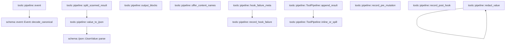

# tools::pipeline

[Package atlas](index.md) · [Source](../../src/pipeline.rs)

## Declarations

Visibility is the declaration spelling; trait members and reexports require their enclosing interface. `cfg` is not evaluated.

| Symbol | Kind | Visibility | Test / cfg |
|---|---|---|---|
| [tools::pipeline::SPILL_THRESHOLD](../../src/pipeline.rs#L11) | const_item | `private` |  |
| [tools::pipeline::ToolExecution](../../src/pipeline.rs#L14) | struct_item | `pub` |  |
| [tools::pipeline::BackendTerminal](../../src/pipeline.rs#L26) | enum_item | `pub` |  |
| [tools::pipeline::ApprovalGate](../../src/pipeline.rs#L53) | enum_item | `pub` |  |
| [tools::pipeline::DurableApprovalResponse](../../src/pipeline.rs#L64) | struct_item | `pub` |  |
| [tools::pipeline::PipelineDecision](../../src/pipeline.rs#L72) | enum_item | `pub` |  |
| [tools::pipeline::TOOL_CONTINUATION_SUBKIND](../../src/pipeline.rs#L91) | const_item | `pub` |  |
| [tools::pipeline::SecretScan](../../src/pipeline.rs#L94) | enum_item | `pub` |  |
| [tools::pipeline::SecretScanner](../../src/pipeline.rs#L101) | struct_item | `pub` |  |
| [tools::pipeline::SecretScanner::failing](../../src/pipeline.rs#L107) | function_item | `pub` |  |
| [tools::pipeline::SecretScanner::scan](../../src/pipeline.rs#L113) | function_item | `pub` |  |
| [tools::pipeline::ToolPipeline](../../src/pipeline.rs#L129) | struct_item | `pub` |  |
| [tools::pipeline::ToolPipeline::new](../../src/pipeline.rs#L138) | function_item | `pub` |  |
| [tools::pipeline::ToolPipeline::with_resume_started](../../src/pipeline.rs#L148) | function_item | `pub` |  |
| [tools::pipeline::ToolPipeline::execute](../../src/pipeline.rs#L153) | function_item | `pub` |  |
| [tools::pipeline::ToolPipeline::verify_durable_execution](../../src/pipeline.rs#L174) | function_item | `pub` |  |
| [tools::pipeline::ToolPipeline::verify_causal_offer](../../src/pipeline.rs#L237) | function_item | `pub` |  |
| [tools::pipeline::ToolPipeline::has_causal_offer](../../src/pipeline.rs#L275) | function_item | `pub` |  |
| [tools::pipeline::ToolPipeline::materialize_json_or_spill](../../src/pipeline.rs#L349) | function_item | `private` |  |
| [tools::pipeline::ToolPipeline::execute_terminal](../../src/pipeline.rs#L361) | function_item | `pub` |  |
| [tools::pipeline::ToolPipeline::execute_terminal_with_gate](../../src/pipeline.rs#L373) | function_item | `pub` |  |
| [tools::pipeline::ToolPipeline::execute_terminal_with_gate_and_resume](../../src/pipeline.rs#L399) | function_item | `pub` |  |
| [tools::pipeline::ToolPipeline::complete_terminal](../../src/pipeline.rs#L521) | function_item | `private` |  |
| [tools::pipeline::ToolPipeline::durable_approval_state](../../src/pipeline.rs#L662) | function_item | `private` |  |
| [tools::pipeline::ToolPipeline::materialize_ijson](../../src/pipeline.rs#L798) | function_item | `private` |  |
| [tools::pipeline::ToolPipeline::complete_continuation](../../src/pipeline.rs#L812) | function_item | `pub` |  |
| [tools::pipeline::ToolPipeline::append_continuation_step](../../src/pipeline.rs#L825) | function_item | `pub` |  |
| [tools::pipeline::ToolPipeline::append_execution_started](../../src/pipeline.rs#L862) | function_item | `private` |  |
| [tools::pipeline::ToolPipeline::append_effective_execution](../../src/pipeline.rs#L877) | function_item | `private` |  |
| [tools::pipeline::ToolPipeline::append_approval](../../src/pipeline.rs#L899) | function_item | `private` |  |
| [tools::pipeline::ToolPipeline::append_result](../../src/pipeline.rs#L921) | function_item | `private` |  |
| [tools::pipeline::ToolPipeline::inline_or_spill](../../src/pipeline.rs#L951) | function_item | `private` |  |
| [tools::pipeline::DurableApprovalState](../../src/pipeline.rs#L967) | enum_item | `private` |  |
| [tools::pipeline::ToolPipelineError](../../src/pipeline.rs#L989) | enum_item | `pub` |  |
| [tools::pipeline::event](../../src/pipeline.rs#L1002) | function_item | `private` |  |
| [tools::pipeline::value_to_ijson](../../src/pipeline.rs#L1008) | function_item | `private` |  |
| [tools::pipeline::split_scanned_result](../../src/pipeline.rs#L1014) | function_item | `private` |  |
| [tools::pipeline::output_blocks](../../src/pipeline.rs#L1032) | function_item | `private` |  |
| [tools::pipeline::offer_content_names](../../src/pipeline.rs#L1050) | function_item | `private` |  |
| [tools::pipeline::redact_value](../../src/pipeline.rs#L1076) | function_item | `private` |  |
| [tools::pipeline::hook_failure_meta](../../src/pipeline.rs#L1115) | function_item | `private` |  |
| [tools::pipeline::record_hook_failure](../../src/pipeline.rs#L1121) | function_item | `private` |  |
| [tools::pipeline::record_pre_mutation](../../src/pipeline.rs#L1131) | function_item | `private` |  |
| [tools::pipeline::record_post_hook](../../src/pipeline.rs#L1141) | function_item | `private` |  |
| [tools::pipeline::secret_token_boundary_tests::artifact_task_paths_survive_scanning_without_weakening_key_redaction](../../src/pipeline.rs#L1165) | function_item | `private` | test; #[cfg(test)] |

## Imports / reexports

| Local name | Source path | Visibility |
|---|---|---|
| `Event` | `schema::Event` | `private` |
| `IJsonValue` | `schema::IJsonValue` | `private` |
| `Map` | `serde_json::Map` | `private` |
| `Value` | `serde_json::Value` | `private` |
| `json` | `serde_json::json` | `private` |
| `AssetStore` | `store::AssetStore` | `private` |
| `BarrierContext` | `store::BarrierContext` | `private` |
| `LockedLedger` | `store::LockedLedger` | `private` |
| `StoreError` | `store::StoreError` | `private` |
| `Error` | `thiserror::Error` | `private` |
| `HookBinding` | `crate::hook::HookBinding` | `private` |
| `HookFailureMode` | `crate::hook::HookFailureMode` | `private` |
| `HookPhase` | `crate::hook::HookPhase` | `private` |
| `HookRequest` | `crate::hook::HookRequest` | `private` |
| `HookResponse` | `crate::hook::HookResponse` | `private` |
| `HookResultView` | `crate::hook::HookResultView` | `private` |
| `PostVerdict` | `crate::hook::PostVerdict` | `private` |
| `PreVerdict` | `crate::hook::PreVerdict` | `private` |
| `ProcessHook` | `crate::hook::ProcessHook` | `private` |
| `*` | `super::*` | `private` |

## Module declarations

| Module | Visibility | Attributes |
|---|---|---|
| `tools::pipeline::secret_token_boundary_tests` | `private` | #[cfg(test)] |

## Function call graphs

Edges below are syntactically resolved calls only, including private functions. Graphs partition callers into groups of 20; they are not execution order. All unresolved sites are listed below and in the JSON inventory.

```mermaid
flowchart TD
  n0["schema::ijson::IJsonValue::parse"]
  n1["tools::hook::ProcessHook::run"]
  n2["tools::pipeline::value_to_ijson"]
  n3["tools::pipeline::split_scanned_result"]
  n4["tools::pipeline::output_blocks"]
  n5["tools::pipeline::offer_content_names"]
  n6["tools::pipeline::redact_value"]
  n7["tools::pipeline::SecretScanner::failing"]
  n8["tools::pipeline::hook_failure_meta"]
  n9["tools::pipeline::record_hook_failure"]
  n10["tools::pipeline::record_pre_mutation"]
  n11["tools::pipeline::SecretScanner::scan"]
  n12["tools::pipeline::record_post_hook"]
  n13["tools::pipeline::ToolPipeline::new"]
  n14["tools::pipeline::ToolPipeline::with_resume_started"]
  n15["tools::pipeline::ToolPipeline::execute"]
  n16["tools::pipeline::ToolPipeline::verify_durable_execution"]
  n17["tools::pipeline::ToolPipeline::verify_causal_offer"]
  n18["tools::pipeline::ToolPipeline::has_causal_offer"]
  n19["tools::pipeline::ToolPipeline::materialize_json_or_spill"]
  n20["tools::pipeline::ToolPipeline::execute_terminal"]
  n21["tools::pipeline::ToolPipeline::execute_terminal_with_gate"]
  n22["tools::pipeline::ToolPipeline::execute_terminal_with_gate_and_resume"]
  n23["tools::pipeline::ToolPipeline::complete_terminal"]
  n24["tools::pipeline::ToolPipeline::durable_approval_state"]
  n25["tools::pipeline::ToolPipeline::materialize_ijson"]
  n26["tools::pipeline::ToolPipeline::complete_continuation"]
  n27["tools::pipeline::ToolPipeline::append_continuation_step"]
  n28["tools::pipeline::ToolPipeline::append_execution_started"]
  n29["tools::pipeline::ToolPipeline::append_effective_execution"]
  n30["tools::pipeline::ToolPipeline::append_approval"]
  n31["tools::pipeline::ToolPipeline::append_result"]
  n32["tools::pipeline::ToolPipeline::inline_or_spill"]
  n11 --> n0
  n11 --> n6
  n15 --> n20
  n16 --> n0
  n16 --> n2
  n17 --> n18
  n18 --> n5
  n18 --> n19
  n20 --> n21
  n21 --> n22
  n22 --> n1
  n22 --> n8
  n22 --> n9
  n22 --> n10
  n22 --> n23
  n22 --> n24
  n22 --> n28
  n22 --> n29
  n22 --> n30
  n22 --> n31
  n23 --> n1
  n23 --> n2
  n23 --> n3
  n23 --> n4
  n23 --> n9
  n23 --> n12
  n23 --> n27
  n23 --> n30
  n23 --> n31
  n24 --> n25
  n25 --> n0
  n25 --> n2
  n26 --> n23
  n29 --> n32
```

Functions 1–20: 34 direct edges

Functions 21–32: 6 direct edges

## Call sites

Includes test functions (marked in declarations). Receiver-type-required sites need type analysis/manual tracing. Calls in closures are attributed to their enclosing function; their occurrence here does not mean the closure executes immediately.

| Caller | Callee expression | Source lines | Target / classification |
|---|---|---|---|
| `scan` | `SecretScan::Withheld` | [115](../../src/pipeline.rs#L115) | external-constructor-callback-or-unresolved |
| `scan` | `serde_json::to_value(value).expect` | [117](../../src/pipeline.rs#L117) | receiver-type-required |
| `scan` | `serde_json::to_value` | [117](../../src/pipeline.rs#L117) | external-constructor-callback-or-unresolved |
| `scan` | `redact_value` | [118](../../src/pipeline.rs#L118) | [tools::pipeline::redact_value](../../src/pipeline.rs#L1076) |
| `scan` | `serde_json::to_vec(&value).expect` | [119](../../src/pipeline.rs#L119) | receiver-type-required |
| `scan` | `serde_json::to_vec` | [119](../../src/pipeline.rs#L119) | external-constructor-callback-or-unresolved |
| `scan` | `IJsonValue::parse(&encoded).expect` | [120](../../src/pipeline.rs#L120) | receiver-type-required |
| `scan` | `IJsonValue::parse` | [120](../../src/pipeline.rs#L120) | [schema::ijson::IJsonValue::parse](../../../schema/src/ijson.rs#L16) |
| `scan` | `SecretScan::Redacted` | [122](../../src/pipeline.rs#L122) | external-constructor-callback-or-unresolved |
| `scan` | `SecretScan::Clean` | [124](../../src/pipeline.rs#L124) | external-constructor-callback-or-unresolved |
| `execute` | `self.execute_terminal` | [162](../../src/pipeline.rs#L162) | [tools::pipeline::ToolPipeline::execute_terminal](../../src/pipeline.rs#L361) |
| `execute` | `backend` | [163](../../src/pipeline.rs#L163) | external-constructor-callback-or-unresolved |
| `execute` | `BackendTerminal::Completed` | [164](../../src/pipeline.rs#L164) | external-constructor-callback-or-unresolved |
| `execute` | `"backend_error".to_owned` | [166](../../src/pipeline.rs#L166) | receiver-type-required |
| `verify_durable_execution` | `self             .ledger             .projection()             .ok_or` | [178](../../src/pipeline.rs#L178) | receiver-type-required |
| `verify_durable_execution` | `self             .ledger             .projection` | [178](../../src/pipeline.rs#L178) | receiver-type-required |
| `verify_durable_execution` | `ToolPipelineError::DurableBinding` | [181](../../src/pipeline.rs#L181), [186](../../src/pipeline.rs#L186), [190](../../src/pipeline.rs#L190), [201](../../src/pipeline.rs#L201), [208](../../src/pipeline.rs#L208), [216](../../src/pipeline.rs#L216), [219](../../src/pipeline.rs#L219), [227](../../src/pipeline.rs#L227) | external-constructor-callback-or-unresolved |
| `verify_durable_execution` | `projection             .events             .first()             .and_then(&#124;event&#124; event.string_field("thread"))             .ok_or` | [182](../../src/pipeline.rs#L182) | receiver-type-required |
| `verify_durable_execution` | `projection             .events             .first()             .and_then` | [182](../../src/pipeline.rs#L182) | receiver-type-required |
| `verify_durable_execution` | `projection             .events             .first` | [182](../../src/pipeline.rs#L182) | receiver-type-required |
| `verify_durable_execution` | `event.string_field` | [185](../../src/pipeline.rs#L185), [199](../../src/pipeline.rs#L199) | receiver-type-required |
| `verify_durable_execution` | `Err` | [190](../../src/pipeline.rs#L190), [208](../../src/pipeline.rs#L208), [227](../../src/pipeline.rs#L227) | external-constructor-callback-or-unresolved |
| `verify_durable_execution` | `projection             .events             .iter()             .find(&#124;event&#124; {                 *event.kind() == schema::EventKind::ToolCall                     && event.string_field("call") == Some(execution.call.as_str())             })             .ok_or` | [194](../../src/pipeline.rs#L194) | receiver-type-required |
| `verify_durable_execution` | `projection             .events             .iter()             .find` | [194](../../src/pipeline.rs#L194) | receiver-type-required |
| `verify_durable_execution` | `projection             .events             .iter` | [194](../../src/pipeline.rs#L194) | receiver-type-required |
| `verify_durable_execution` | `event.kind` | [198](../../src/pipeline.rs#L198) | receiver-type-required |
| `verify_durable_execution` | `Some` | [199](../../src/pipeline.rs#L199), [204](../../src/pipeline.rs#L204), [205](../../src/pipeline.rs#L205), [206](../../src/pipeline.rs#L206) | external-constructor-callback-or-unresolved |
| `verify_durable_execution` | `execution.call.as_str` | [199](../../src/pipeline.rs#L199) | receiver-type-required |
| `verify_durable_execution` | `call.turn` | [204](../../src/pipeline.rs#L204) | receiver-type-required |
| `verify_durable_execution` | `call.string_field` | [205](../../src/pipeline.rs#L205), [206](../../src/pipeline.rs#L206) | receiver-type-required |
| `verify_durable_execution` | `execution.attempt.as_str` | [205](../../src/pipeline.rs#L205) | receiver-type-required |
| `verify_durable_execution` | `execution.name.as_str` | [206](../../src/pipeline.rs#L206) | receiver-type-required |
| `verify_durable_execution` | `serde_json::to_value(call.raw())             .map_err` | [212](../../src/pipeline.rs#L212) | receiver-type-required |
| `verify_durable_execution` | `serde_json::to_value` | [212](../../src/pipeline.rs#L212) | external-constructor-callback-or-unresolved |
| `verify_durable_execution` | `call.raw` | [212](../../src/pipeline.rs#L212) | receiver-type-required |
| `verify_durable_execution` | `ToolPipelineError::Json` | [213](../../src/pipeline.rs#L213) | external-constructor-callback-or-unresolved |
| `verify_durable_execution` | `error.to_string` | [213](../../src/pipeline.rs#L213) | receiver-type-required |
| `verify_durable_execution` | `raw             .get("args")             .ok_or` | [214](../../src/pipeline.rs#L214) | receiver-type-required |
| `verify_durable_execution` | `raw             .get` | [214](../../src/pipeline.rs#L214) | receiver-type-required |
| `verify_durable_execution` | `args.get` | [217](../../src/pipeline.rs#L217) | receiver-type-required |
| `verify_durable_execution` | `spill.get("asset").and_then(Value::as_str).ok_or` | [218](../../src/pipeline.rs#L218) | receiver-type-required |
| `verify_durable_execution` | `spill.get("asset").and_then` | [218](../../src/pipeline.rs#L218) | receiver-type-required |
| `verify_durable_execution` | `spill.get` | [218](../../src/pipeline.rs#L218) | receiver-type-required |
| `verify_durable_execution` | `self.assets.read_verified` | [221](../../src/pipeline.rs#L221) | receiver-type-required |
| `verify_durable_execution` | `IJsonValue::parse` | [222](../../src/pipeline.rs#L222) | [schema::ijson::IJsonValue::parse](../../../schema/src/ijson.rs#L16) |
| `verify_durable_execution` | `value_to_ijson` | [224](../../src/pipeline.rs#L224) | [tools::pipeline::value_to_ijson](../../src/pipeline.rs#L1008) |
| `verify_durable_execution` | `args.clone` | [224](../../src/pipeline.rs#L224) | receiver-type-required |
| `verify_durable_execution` | `Ok` | [231](../../src/pipeline.rs#L231) | external-constructor-callback-or-unresolved |
| `verify_causal_offer` | `self             .ledger             .projection()             .ok_or` | [243](../../src/pipeline.rs#L243) | receiver-type-required |
| `verify_causal_offer` | `self             .ledger             .projection` | [243](../../src/pipeline.rs#L243) | receiver-type-required |
| `verify_causal_offer` | `ToolPipelineError::DurableBinding` | [246](../../src/pipeline.rs#L246), [255](../../src/pipeline.rs#L255), [262](../../src/pipeline.rs#L262) | external-constructor-callback-or-unresolved |
| `verify_causal_offer` | `projection             .events             .iter()             .find(&#124;event&#124; {                 *event.kind() == schema::EventKind::ToolCall                     && event.string_field("call") == Some(execution.call.as_str())             })             .map(schema::Event::seq)             .ok_or` | [247](../../src/pipeline.rs#L247) | receiver-type-required |
| `verify_causal_offer` | `projection             .events             .iter()             .find(&#124;event&#124; {                 *event.kind() == schema::EventKind::ToolCall                     && event.string_field("call") == Some(execution.call.as_str())             })             .map` | [247](../../src/pipeline.rs#L247) | receiver-type-required |
| `verify_causal_offer` | `projection             .events             .iter()             .find` | [247](../../src/pipeline.rs#L247) | receiver-type-required |
| `verify_causal_offer` | `projection             .events             .iter` | [247](../../src/pipeline.rs#L247) | receiver-type-required |
| `verify_causal_offer` | `event.kind` | [251](../../src/pipeline.rs#L251) | receiver-type-required |
| `verify_causal_offer` | `event.string_field` | [252](../../src/pipeline.rs#L252) | receiver-type-required |
| `verify_causal_offer` | `Some` | [252](../../src/pipeline.rs#L252) | external-constructor-callback-or-unresolved |
| `verify_causal_offer` | `execution.call.as_str` | [252](../../src/pipeline.rs#L252) | receiver-type-required |
| `verify_causal_offer` | `self.has_causal_offer` | [259](../../src/pipeline.rs#L259) | [tools::pipeline::ToolPipeline::has_causal_offer](../../src/pipeline.rs#L275) |
| `verify_causal_offer` | `Ok` | [260](../../src/pipeline.rs#L260) | external-constructor-callback-or-unresolved |
| `verify_causal_offer` | `Err` | [262](../../src/pipeline.rs#L262) | external-constructor-callback-or-unresolved |
| `has_causal_offer` | `self             .ledger             .projection()             .ok_or` | [281](../../src/pipeline.rs#L281) | receiver-type-required |
| `has_causal_offer` | `self             .ledger             .projection` | [281](../../src/pipeline.rs#L281) | receiver-type-required |
| `has_causal_offer` | `ToolPipelineError::DurableBinding` | [284](../../src/pipeline.rs#L284) | external-constructor-callback-or-unresolved |
| `has_causal_offer` | `std::collections::BTreeSet::new` | [287](../../src/pipeline.rs#L287) | external-constructor-callback-or-unresolved |
| `has_causal_offer` | `projection             .events             .iter()             .filter` | [288](../../src/pipeline.rs#L288), [314](../../src/pipeline.rs#L314) | receiver-type-required |
| `has_causal_offer` | `projection             .events             .iter` | [288](../../src/pipeline.rs#L288), [314](../../src/pipeline.rs#L314) | receiver-type-required |
| `has_causal_offer` | `event.seq` | [291](../../src/pipeline.rs#L291), [318](../../src/pipeline.rs#L318), [326](../../src/pipeline.rs#L326), [327](../../src/pipeline.rs#L327) | receiver-type-required |
| `has_causal_offer` | `serde_json::to_value(event.raw())                 .map_err` | [293](../../src/pipeline.rs#L293) | receiver-type-required |
| `has_causal_offer` | `serde_json::to_value` | [293](../../src/pipeline.rs#L293), [333](../../src/pipeline.rs#L333) | external-constructor-callback-or-unresolved |
| `has_causal_offer` | `event.raw` | [293](../../src/pipeline.rs#L293) | receiver-type-required |
| `has_causal_offer` | `ToolPipelineError::Json` | [294](../../src/pipeline.rs#L294), [334](../../src/pipeline.rs#L334) | external-constructor-callback-or-unresolved |
| `has_causal_offer` | `error.to_string` | [294](../../src/pipeline.rs#L294), [334](../../src/pipeline.rs#L334) | receiver-type-required |
| `has_causal_offer` | `event.kind` | [296](../../src/pipeline.rs#L296), [319](../../src/pipeline.rs#L319), [328](../../src/pipeline.rs#L328) | receiver-type-required |
| `has_causal_offer` | `raw                     .get(field)                     .and_then(Value::as_array)                     .into_iter()                     .flatten` | [299](../../src/pipeline.rs#L299) | receiver-type-required |
| `has_causal_offer` | `raw                     .get(field)                     .and_then(Value::as_array)                     .into_iter` | [299](../../src/pipeline.rs#L299) | receiver-type-required |
| `has_causal_offer` | `raw                     .get(field)                     .and_then` | [299](../../src/pipeline.rs#L299) | receiver-type-required |
| `has_causal_offer` | `raw                     .get` | [299](../../src/pipeline.rs#L299) | receiver-type-required |
| `has_causal_offer` | `range.get("from").and_then` | [306](../../src/pipeline.rs#L306) | receiver-type-required |
| `has_causal_offer` | `range.get` | [306](../../src/pipeline.rs#L306), [307](../../src/pipeline.rs#L307) | receiver-type-required |
| `has_causal_offer` | `range.get("to").and_then` | [307](../../src/pipeline.rs#L307) | receiver-type-required |
| `has_causal_offer` | `hidden.extend` | [309](../../src/pipeline.rs#L309) | receiver-type-required |
| `has_causal_offer` | `projection             .events             .iter()             .filter(&#124;event&#124; {                 event.seq() < before_seq                     && *event.kind() == schema::EventKind::ToolCall                     && event.string_field("name") == Some(source_tool)             })             .filter_map(&#124;event&#124; event.string_field("call"))             .collect::<std::collections::BTreeSet<_>>` | [314](../../src/pipeline.rs#L314) | receiver-type-required |
| `has_causal_offer` | `projection             .events             .iter()             .filter(&#124;event&#124; {                 event.seq() < before_seq                     && *event.kind() == schema::EventKind::ToolCall                     && event.string_field("name") == Some(source_tool)             })             .filter_map` | [314](../../src/pipeline.rs#L314) | receiver-type-required |
| `has_causal_offer` | `event.string_field` | [320](../../src/pipeline.rs#L320), [322](../../src/pipeline.rs#L322) | receiver-type-required |
| `has_causal_offer` | `Some` | [320](../../src/pipeline.rs#L320), [335](../../src/pipeline.rs#L335) | external-constructor-callback-or-unresolved |
| `has_causal_offer` | `projection.events.iter().filter` | [325](../../src/pipeline.rs#L325) | receiver-type-required |
| `has_causal_offer` | `projection.events.iter` | [325](../../src/pipeline.rs#L325) | receiver-type-required |
| `has_causal_offer` | `hidden.contains` | [327](../../src/pipeline.rs#L327) | receiver-type-required |
| `has_causal_offer` | `event                     .string_field("call")                     .is_some_and` | [329](../../src/pipeline.rs#L329) | receiver-type-required |
| `has_causal_offer` | `event                     .string_field` | [329](../../src/pipeline.rs#L329) | receiver-type-required |
| `has_causal_offer` | `source_calls.contains` | [331](../../src/pipeline.rs#L331) | receiver-type-required |
| `has_causal_offer` | `serde_json::to_value(result.raw())                 .map_err` | [333](../../src/pipeline.rs#L333) | receiver-type-required |
| `has_causal_offer` | `result.raw` | [333](../../src/pipeline.rs#L333) | receiver-type-required |
| `has_causal_offer` | `raw.get("outcome").and_then` | [335](../../src/pipeline.rs#L335) | receiver-type-required |
| `has_causal_offer` | `raw.get` | [335](../../src/pipeline.rs#L335), [338](../../src/pipeline.rs#L338) | receiver-type-required |
| `has_causal_offer` | `self.materialize_json_or_spill` | [341](../../src/pipeline.rs#L341) | [tools::pipeline::ToolPipeline::materialize_json_or_spill](../../src/pipeline.rs#L349) |
| `has_causal_offer` | `offer_content_names` | [342](../../src/pipeline.rs#L342) | [tools::pipeline::offer_content_names](../../src/pipeline.rs#L1050) |
| `has_causal_offer` | `Ok` | [343](../../src/pipeline.rs#L343), [346](../../src/pipeline.rs#L346) | external-constructor-callback-or-unresolved |
| `materialize_json_or_spill` | `value.get` | [350](../../src/pipeline.rs#L350) | receiver-type-required |
| `materialize_json_or_spill` | `spill.get("asset").and_then(Value::as_str).ok_or` | [351](../../src/pipeline.rs#L351) | receiver-type-required |
| `materialize_json_or_spill` | `spill.get("asset").and_then` | [351](../../src/pipeline.rs#L351) | receiver-type-required |
| `materialize_json_or_spill` | `spill.get` | [351](../../src/pipeline.rs#L351) | receiver-type-required |
| `materialize_json_or_spill` | `ToolPipelineError::DurableBinding` | [352](../../src/pipeline.rs#L352) | external-constructor-callback-or-unresolved |
| `materialize_json_or_spill` | `self.assets.read_verified` | [354](../../src/pipeline.rs#L354) | receiver-type-required |
| `materialize_json_or_spill` | `serde_json::from_slice(&bytes)                 .map_err` | [355](../../src/pipeline.rs#L355) | receiver-type-required |
| `materialize_json_or_spill` | `serde_json::from_slice` | [355](../../src/pipeline.rs#L355) | external-constructor-callback-or-unresolved |
| `materialize_json_or_spill` | `ToolPipelineError::Json` | [356](../../src/pipeline.rs#L356) | external-constructor-callback-or-unresolved |
| `materialize_json_or_spill` | `error.to_string` | [356](../../src/pipeline.rs#L356) | receiver-type-required |
| `materialize_json_or_spill` | `Ok` | [358](../../src/pipeline.rs#L358) | external-constructor-callback-or-unresolved |
| `materialize_json_or_spill` | `value.clone` | [358](../../src/pipeline.rs#L358) | receiver-type-required |
| `execute_terminal` | `self.execute_terminal_with_gate` | [370](../../src/pipeline.rs#L370) | [tools::pipeline::ToolPipeline::execute_terminal_with_gate](../../src/pipeline.rs#L373) |
| `execute_terminal_with_gate` | `self.execute_terminal_with_gate_and_resume` | [384](../../src/pipeline.rs#L384) | [tools::pipeline::ToolPipeline::execute_terminal_with_gate_and_resume](../../src/pipeline.rs#L399) |
| `execute_terminal_with_gate` | `backend` | [388](../../src/pipeline.rs#L388) | external-constructor-callback-or-unresolved |
| `execute_terminal_with_gate_and_resume` | `self.durable_approval_state` | [410](../../src/pipeline.rs#L410) | [tools::pipeline::ToolPipeline::durable_approval_state](../../src/pipeline.rs#L662) |
| `execute_terminal_with_gate_and_resume` | `Ok` | [413](../../src/pipeline.rs#L413), [416](../../src/pipeline.rs#L416), [421](../../src/pipeline.rs#L421), [466](../../src/pipeline.rs#L466), [478](../../src/pipeline.rs#L478), [490](../../src/pipeline.rs#L490), [508](../../src/pipeline.rs#L508), [512](../../src/pipeline.rs#L512) | external-constructor-callback-or-unresolved |
| `execute_terminal_with_gate_and_resume` | `self.append_result` | [420](../../src/pipeline.rs#L420), [460](../../src/pipeline.rs#L460), [484](../../src/pipeline.rs#L484), [507](../../src/pipeline.rs#L507) | [tools::pipeline::ToolPipeline::append_result](../../src/pipeline.rs#L921) |
| `execute_terminal_with_gate_and_resume` | `Map::new` | [420](../../src/pipeline.rs#L420), [429](../../src/pipeline.rs#L429), [436](../../src/pipeline.rs#L436), [441](../../src/pipeline.rs#L441) | external-constructor-callback-or-unresolved |
| `execute_terminal_with_gate_and_resume` | `self.append_execution_started` | [427](../../src/pipeline.rs#L427), [516](../../src/pipeline.rs#L516) | [tools::pipeline::ToolPipeline::append_execution_started](../../src/pipeline.rs#L862) |
| `execute_terminal_with_gate_and_resume` | `backend` | [428](../../src/pipeline.rs#L428), [435](../../src/pipeline.rs#L435), [517](../../src/pipeline.rs#L517) | external-constructor-callback-or-unresolved |
| `execute_terminal_with_gate_and_resume` | `Some` | [428](../../src/pipeline.rs#L428) | external-constructor-callback-or-unresolved |
| `execute_terminal_with_gate_and_resume` | `self.complete_terminal` | [429](../../src/pipeline.rs#L429), [436](../../src/pipeline.rs#L436), [518](../../src/pipeline.rs#L518) | [tools::pipeline::ToolPipeline::complete_terminal](../../src/pipeline.rs#L521) |
| `execute_terminal_with_gate_and_resume` | `response.as_ref` | [435](../../src/pipeline.rs#L435) | receiver-type-required |
| `execute_terminal_with_gate_and_resume` | `execution.invocation.clone` | [440](../../src/pipeline.rs#L440) | receiver-type-required |
| `execute_terminal_with_gate_and_resume` | `hooks             .iter()             .filter` | [443](../../src/pipeline.rs#L443) | receiver-type-required |
| `execute_terminal_with_gate_and_resume` | `hooks             .iter` | [443](../../src/pipeline.rs#L443) | receiver-type-required |
| `execute_terminal_with_gate_and_resume` | `binding.id.clone` | [449](../../src/pipeline.rs#L449) | receiver-type-required |
| `execute_terminal_with_gate_and_resume` | `execution.call.clone` | [451](../../src/pipeline.rs#L451) | receiver-type-required |
| `execute_terminal_with_gate_and_resume` | `execution.name.clone` | [452](../../src/pipeline.rs#L452) | receiver-type-required |
| `execute_terminal_with_gate_and_resume` | `invocation.clone` | [453](../../src/pipeline.rs#L453) | receiver-type-required |
| `execute_terminal_with_gate_and_resume` | `ProcessHook::run` | [456](../../src/pipeline.rs#L456) | [tools::hook::ProcessHook::run](../../src/hook.rs#L270) |
| `execute_terminal_with_gate_and_resume` | `record_pre_mutation` | [474](../../src/pipeline.rs#L474) | [tools::pipeline::record_pre_mutation](../../src/pipeline.rs#L1131) |
| `execute_terminal_with_gate_and_resume` | `reason.as_deref` | [474](../../src/pipeline.rs#L474) | receiver-type-required |
| `execute_terminal_with_gate_and_resume` | `self.append_approval` | [477](../../src/pipeline.rs#L477), [511](../../src/pipeline.rs#L511) | [tools::pipeline::ToolPipeline::append_approval](../../src/pipeline.rs#L899) |
| `execute_terminal_with_gate_and_resume` | `Err` | [481](../../src/pipeline.rs#L481) | external-constructor-callback-or-unresolved |
| `execute_terminal_with_gate_and_resume` | `hook_failure_meta` | [488](../../src/pipeline.rs#L488) | [tools::pipeline::hook_failure_meta](../../src/pipeline.rs#L1115) |
| `execute_terminal_with_gate_and_resume` | `error.to_string` | [488](../../src/pipeline.rs#L488), [493](../../src/pipeline.rs#L493) | receiver-type-required |
| `execute_terminal_with_gate_and_resume` | `record_hook_failure` | [493](../../src/pipeline.rs#L493) | [tools::pipeline::record_hook_failure](../../src/pipeline.rs#L1121) |
| `execute_terminal_with_gate_and_resume` | `self.append_effective_execution` | [500](../../src/pipeline.rs#L500) | [tools::pipeline::ToolPipeline::append_effective_execution](../../src/pipeline.rs#L877) |
| `execute_terminal_with_gate_and_resume` | `gate` | [503](../../src/pipeline.rs#L503) | external-constructor-callback-or-unresolved |
| `complete_terminal` | `Value::String` | [530](../../src/pipeline.rs#L530), [537](../../src/pipeline.rs#L537), [631](../../src/pipeline.rs#L631) | external-constructor-callback-or-unresolved |
| `complete_terminal` | `"ok".to_owned` | [530](../../src/pipeline.rs#L530) | receiver-type-required |
| `complete_terminal` | `Ok` | [531](../../src/pipeline.rs#L531), [546](../../src/pipeline.rs#L546), [560](../../src/pipeline.rs#L560), [638](../../src/pipeline.rs#L638), [649](../../src/pipeline.rs#L649), [659](../../src/pipeline.rs#L659) | external-constructor-callback-or-unresolved |
| `complete_terminal` | `"error".to_owned` | [537](../../src/pipeline.rs#L537) | receiver-type-required |
| `complete_terminal` | `value_to_ijson` | [538](../../src/pipeline.rs#L538), [582](../../src/pipeline.rs#L582), [585](../../src/pipeline.rs#L585), [620](../../src/pipeline.rs#L620) | [tools::pipeline::value_to_ijson](../../src/pipeline.rs#L1008) |
| `complete_terminal` | `self.append_approval` | [545](../../src/pipeline.rs#L545) | [tools::pipeline::ToolPipeline::append_approval](../../src/pipeline.rs#L899) |
| `complete_terminal` | `self.append_continuation_step` | [552](../../src/pipeline.rs#L552) | [tools::pipeline::ToolPipeline::append_continuation_step](../../src/pipeline.rs#L825) |
| `complete_terminal` | `hooks             .iter()             .filter` | [570](../../src/pipeline.rs#L570) | receiver-type-required |
| `complete_terminal` | `hooks             .iter` | [570](../../src/pipeline.rs#L570) | receiver-type-required |
| `complete_terminal` | `binding.id.clone` | [576](../../src/pipeline.rs#L576) | receiver-type-required |
| `complete_terminal` | `execution.call.clone` | [578](../../src/pipeline.rs#L578) | receiver-type-required |
| `complete_terminal` | `execution.name.clone` | [579](../../src/pipeline.rs#L579) | receiver-type-required |
| `complete_terminal` | `invocation.clone` | [580](../../src/pipeline.rs#L580) | receiver-type-required |
| `complete_terminal` | `Some` | [581](../../src/pipeline.rs#L581), [583](../../src/pipeline.rs#L583), [601](../../src/pipeline.rs#L601), [604](../../src/pipeline.rs#L604), [611](../../src/pipeline.rs#L611), [656](../../src/pipeline.rs#L656) | external-constructor-callback-or-unresolved |
| `complete_terminal` | `backend_outcome.clone` | [582](../../src/pipeline.rs#L582) | receiver-type-required |
| `complete_terminal` | `transformed.clone` | [583](../../src/pipeline.rs#L583) | receiver-type-required |
| `complete_terminal` | `(!metadata.is_empty())                         .then(&#124;&#124; value_to_ijson(Value::Object(metadata.clone())))                         .transpose` | [584](../../src/pipeline.rs#L584) | receiver-type-required |
| `complete_terminal` | `(!metadata.is_empty())                         .then` | [584](../../src/pipeline.rs#L584) | receiver-type-required |
| `complete_terminal` | `metadata.is_empty` | [584](../../src/pipeline.rs#L584) | receiver-type-required |
| `complete_terminal` | `Value::Object` | [585](../../src/pipeline.rs#L585) | external-constructor-callback-or-unresolved |
| `complete_terminal` | `metadata.clone` | [585](../../src/pipeline.rs#L585) | receiver-type-required |
| `complete_terminal` | `ProcessHook::run` | [589](../../src/pipeline.rs#L589) | [tools::hook::ProcessHook::run](../../src/hook.rs#L270) |
| `complete_terminal` | `record_post_hook` | [592](../../src/pipeline.rs#L592), [598](../../src/pipeline.rs#L598) | [tools::pipeline::record_post_hook](../../src/pipeline.rs#L1141) |
| `complete_terminal` | `annotations.as_ref` | [592](../../src/pipeline.rs#L592), [602](../../src/pipeline.rs#L602) | receiver-type-required |
| `complete_terminal` | `Err` | [607](../../src/pipeline.rs#L607) | external-constructor-callback-or-unresolved |
| `complete_terminal` | `record_hook_failure` | [610](../../src/pipeline.rs#L610), [614](../../src/pipeline.rs#L614) | [tools::pipeline::record_hook_failure](../../src/pipeline.rs#L1121) |
| `complete_terminal` | `error.to_string` | [610](../../src/pipeline.rs#L610), [614](../../src/pipeline.rs#L614) | receiver-type-required |
| `complete_terminal` | `self.scanner.scan` | [624](../../src/pipeline.rs#L624) | receiver-type-required |
| `complete_terminal` | `split_scanned_result` | [626](../../src/pipeline.rs#L626), [628](../../src/pipeline.rs#L628) | [tools::pipeline::split_scanned_result](../../src/pipeline.rs#L1014) |
| `complete_terminal` | `scanned_metadata.insert` | [629](../../src/pipeline.rs#L629) | receiver-type-required |
| `complete_terminal` | `"secret_scan".to_owned` | [630](../../src/pipeline.rs#L630) | receiver-type-required |
| `complete_terminal` | `"redacted".to_owned` | [631](../../src/pipeline.rs#L631) | receiver-type-required |
| `complete_terminal` | `self.append_result` | [637](../../src/pipeline.rs#L637), [643](../../src/pipeline.rs#L643), [653](../../src/pipeline.rs#L653) | [tools::pipeline::ToolPipeline::append_result](../../src/pipeline.rs#L921) |
| `complete_terminal` | `Map::new` | [637](../../src/pipeline.rs#L637) | external-constructor-callback-or-unresolved |
| `complete_terminal` | `output_blocks` | [652](../../src/pipeline.rs#L652) | [tools::pipeline::output_blocks](../../src/pipeline.rs#L1032) |
| `durable_approval_state` | `self.ledger.projection` | [666](../../src/pipeline.rs#L666) | receiver-type-required |
| `durable_approval_state` | `Ok` | [667](../../src/pipeline.rs#L667), [737](../../src/pipeline.rs#L737), [742](../../src/pipeline.rs#L742), [747](../../src/pipeline.rs#L747), [750](../../src/pipeline.rs#L750), [771](../../src/pipeline.rs#L771), [787](../../src/pipeline.rs#L787), [792](../../src/pipeline.rs#L792) | external-constructor-callback-or-unresolved |
| `durable_approval_state` | `event.string_field` | [676](../../src/pipeline.rs#L676) | receiver-type-required |
| `durable_approval_state` | `Some` | [676](../../src/pipeline.rs#L676), [683](../../src/pipeline.rs#L683), [693](../../src/pipeline.rs#L693), [700](../../src/pipeline.rs#L700), [705](../../src/pipeline.rs#L705), [716](../../src/pipeline.rs#L716), [721](../../src/pipeline.rs#L721), [724](../../src/pipeline.rs#L724), [729](../../src/pipeline.rs#L729), [731](../../src/pipeline.rs#L731), [789](../../src/pipeline.rs#L789) | external-constructor-callback-or-unresolved |
| `durable_approval_state` | `execution.call.as_str` | [676](../../src/pipeline.rs#L676) | receiver-type-required |
| `durable_approval_state` | `serde_json::to_value(event.raw())                 .map_err` | [679](../../src/pipeline.rs#L679) | receiver-type-required |
| `durable_approval_state` | `serde_json::to_value` | [679](../../src/pipeline.rs#L679) | external-constructor-callback-or-unresolved |
| `durable_approval_state` | `event.raw` | [679](../../src/pipeline.rs#L679) | receiver-type-required |
| `durable_approval_state` | `ToolPipelineError::Json` | [680](../../src/pipeline.rs#L680) | external-constructor-callback-or-unresolved |
| `durable_approval_state` | `error.to_string` | [680](../../src/pipeline.rs#L680) | receiver-type-required |
| `durable_approval_state` | `event.kind` | [681](../../src/pipeline.rs#L681) | receiver-type-required |
| `durable_approval_state` | `event.turn` | [683](../../src/pipeline.rs#L683), [700](../../src/pipeline.rs#L700), [716](../../src/pipeline.rs#L716), [724](../../src/pipeline.rs#L724) | receiver-type-required |
| `durable_approval_state` | `Err` | [684](../../src/pipeline.rs#L684), [689](../../src/pipeline.rs#L689), [701](../../src/pipeline.rs#L701), [717](../../src/pipeline.rs#L717), [725](../../src/pipeline.rs#L725), [753](../../src/pipeline.rs#L753), [762](../../src/pipeline.rs#L762) | external-constructor-callback-or-unresolved |
| `durable_approval_state` | `ToolPipelineError::DurableBinding` | [684](../../src/pipeline.rs#L684), [689](../../src/pipeline.rs#L689), [694](../../src/pipeline.rs#L694), [701](../../src/pipeline.rs#L701), [709](../../src/pipeline.rs#L709), [717](../../src/pipeline.rs#L717), [725](../../src/pipeline.rs#L725), [753](../../src/pipeline.rs#L753), [762](../../src/pipeline.rs#L762) | external-constructor-callback-or-unresolved |
| `durable_approval_state` | `effective.is_some` | [688](../../src/pipeline.rs#L688) | receiver-type-required |
| `durable_approval_state` | `self.materialize_ijson` | [693](../../src/pipeline.rs#L693) | [tools::pipeline::ToolPipeline::materialize_ijson](../../src/pipeline.rs#L798) |
| `durable_approval_state` | `raw.get("invocation").ok_or` | [693](../../src/pipeline.rs#L693) | receiver-type-required |
| `durable_approval_state` | `raw.get` | [693](../../src/pipeline.rs#L693) | receiver-type-required |
| `durable_approval_state` | `event.seq` | [706](../../src/pipeline.rs#L706), [721](../../src/pipeline.rs#L721), [729](../../src/pipeline.rs#L729), [731](../../src/pipeline.rs#L731) | receiver-type-required |
| `durable_approval_state` | `event                             .string_field("scope")                             .ok_or(ToolPipelineError::DurableBinding(                                 "approval_request scope is missing",                             ))?                             .to_owned` | [707](../../src/pipeline.rs#L707) | receiver-type-required |
| `durable_approval_state` | `event                             .string_field("scope")                             .ok_or` | [707](../../src/pipeline.rs#L707) | receiver-type-required |
| `durable_approval_state` | `event                             .string_field` | [707](../../src/pipeline.rs#L707) | receiver-type-required |
| `durable_approval_state` | `effective.unwrap_or_else` | [739](../../src/pipeline.rs#L739) | receiver-type-required |
| `durable_approval_state` | `execution.invocation.clone` | [739](../../src/pipeline.rs#L739) | receiver-type-required |
| `durable_approval_state` | `started_seq.is_some` | [741](../../src/pipeline.rs#L741) | receiver-type-required |
| `durable_approval_state` | `response             .get("scope")             .and_then(Value::as_str)             .is_some_and` | [757](../../src/pipeline.rs#L757) | receiver-type-required |
| `durable_approval_state` | `response             .get("scope")             .and_then` | [757](../../src/pipeline.rs#L757) | receiver-type-required |
| `durable_approval_state` | `response             .get` | [757](../../src/pipeline.rs#L757), [766](../../src/pipeline.rs#L766), [775](../../src/pipeline.rs#L775) | receiver-type-required |
| `durable_approval_state` | `response             .get("grant")             .and_then(Value::as_bool)             .unwrap_or` | [766](../../src/pipeline.rs#L766) | receiver-type-required |
| `durable_approval_state` | `response             .get("grant")             .and_then` | [766](../../src/pipeline.rs#L766) | receiver-type-required |
| `durable_approval_state` | `"approval denied".to_owned` | [772](../../src/pipeline.rs#L772) | receiver-type-required |
| `durable_approval_state` | `response             .get("answer")             .cloned()             .map(value_to_ijson)             .transpose` | [775](../../src/pipeline.rs#L775) | receiver-type-required |
| `durable_approval_state` | `response             .get("answer")             .cloned()             .map` | [775](../../src/pipeline.rs#L775) | receiver-type-required |
| `durable_approval_state` | `response             .get("answer")             .cloned` | [775](../../src/pipeline.rs#L775) | receiver-type-required |
| `durable_approval_state` | `started_seq.is_some_and` | [786](../../src/pipeline.rs#L786) | receiver-type-required |
| `materialize_ijson` | `value.get` | [799](../../src/pipeline.rs#L799) | receiver-type-required |
| `materialize_ijson` | `spill.get("asset").and_then(Value::as_str).ok_or` | [800](../../src/pipeline.rs#L800) | receiver-type-required |
| `materialize_ijson` | `spill.get("asset").and_then` | [800](../../src/pipeline.rs#L800) | receiver-type-required |
| `materialize_ijson` | `spill.get` | [800](../../src/pipeline.rs#L800) | receiver-type-required |
| `materialize_ijson` | `ToolPipelineError::DurableBinding` | [801](../../src/pipeline.rs#L801) | external-constructor-callback-or-unresolved |
| `materialize_ijson` | `Ok` | [803](../../src/pipeline.rs#L803) | external-constructor-callback-or-unresolved |
| `materialize_ijson` | `IJsonValue::parse` | [803](../../src/pipeline.rs#L803) | [schema::ijson::IJsonValue::parse](../../../schema/src/ijson.rs#L16) |
| `materialize_ijson` | `self.assets.read_verified` | [803](../../src/pipeline.rs#L803) | receiver-type-required |
| `materialize_ijson` | `value_to_ijson` | [805](../../src/pipeline.rs#L805) | [tools::pipeline::value_to_ijson](../../src/pipeline.rs#L1008) |
| `materialize_ijson` | `value.clone` | [805](../../src/pipeline.rs#L805) | receiver-type-required |
| `complete_continuation` | `self.complete_terminal` | [819](../../src/pipeline.rs#L819) | [tools::pipeline::ToolPipeline::complete_terminal](../../src/pipeline.rs#L521) |
| `complete_continuation` | `Map::new` | [819](../../src/pipeline.rs#L819) | external-constructor-callback-or-unresolved |
| `append_continuation_step` | `serde_json::to_value(state).expect` | [834](../../src/pipeline.rs#L834) | receiver-type-required |
| `append_continuation_step` | `serde_json::to_value` | [834](../../src/pipeline.rs#L834) | external-constructor-callback-or-unresolved |
| `append_continuation_step` | `self.ledger.next_seq` | [835](../../src/pipeline.rs#L835) | receiver-type-required |
| `append_continuation_step` | `Value::String` | [844](../../src/pipeline.rs#L844) | external-constructor-callback-or-unresolved |
| `append_continuation_step` | `poll_after.to_owned` | [844](../../src/pipeline.rs#L844) | receiver-type-required |
| `append_continuation_step` | `Value::from` | [845](../../src/pipeline.rs#L845) | external-constructor-callback-or-unresolved |
| `append_continuation_step` | `event` | [847](../../src/pipeline.rs#L847) | external-constructor-callback-or-unresolved |
| `append_continuation_step` | `self.ledger             .append_contract` | [857](../../src/pipeline.rs#L857) | receiver-type-required |
| `append_continuation_step` | `BarrierContext::default` | [858](../../src/pipeline.rs#L858) | external-constructor-callback-or-unresolved |
| `append_continuation_step` | `Ok` | [859](../../src/pipeline.rs#L859) | external-constructor-callback-or-unresolved |
| `append_execution_started` | `event` | [866](../../src/pipeline.rs#L866) | external-constructor-callback-or-unresolved |
| `append_execution_started` | `self.ledger             .append_contract` | [872](../../src/pipeline.rs#L872) | receiver-type-required |
| `append_execution_started` | `BarrierContext::default` | [873](../../src/pipeline.rs#L873) | external-constructor-callback-or-unresolved |
| `append_execution_started` | `Ok` | [874](../../src/pipeline.rs#L874) | external-constructor-callback-or-unresolved |
| `append_effective_execution` | `serde_json::to_value(invocation).expect` | [882](../../src/pipeline.rs#L882) | receiver-type-required |
| `append_effective_execution` | `serde_json::to_value` | [882](../../src/pipeline.rs#L882) | external-constructor-callback-or-unresolved |
| `append_effective_execution` | `self.inline_or_spill` | [883](../../src/pipeline.rs#L883) | [tools::pipeline::ToolPipeline::inline_or_spill](../../src/pipeline.rs#L951) |
| `append_effective_execution` | `self.ledger.next_seq` | [884](../../src/pipeline.rs#L884) | receiver-type-required |
| `append_effective_execution` | `event` | [885](../../src/pipeline.rs#L885) | external-constructor-callback-or-unresolved |
| `append_effective_execution` | `self.ledger             .append_contract` | [894](../../src/pipeline.rs#L894) | receiver-type-required |
| `append_effective_execution` | `BarrierContext::default` | [895](../../src/pipeline.rs#L895) | external-constructor-callback-or-unresolved |
| `append_effective_execution` | `Ok` | [896](../../src/pipeline.rs#L896) | external-constructor-callback-or-unresolved |
| `append_approval` | `self.ledger.next_seq` | [905](../../src/pipeline.rs#L905) | receiver-type-required |
| `append_approval` | `event` | [906](../../src/pipeline.rs#L906) | external-constructor-callback-or-unresolved |
| `append_approval` | `self.ledger             .append_contract` | [916](../../src/pipeline.rs#L916) | receiver-type-required |
| `append_approval` | `BarrierContext::default` | [917](../../src/pipeline.rs#L917) | external-constructor-callback-or-unresolved |
| `append_approval` | `Ok` | [918](../../src/pipeline.rs#L918) | external-constructor-callback-or-unresolved |
| `append_result` | `self.ledger.next_seq` | [928](../../src/pipeline.rs#L928) | receiver-type-required |
| `append_result` | `value.as_object_mut().expect` | [938](../../src/pipeline.rs#L938) | receiver-type-required |
| `append_result` | `value.as_object_mut` | [938](../../src/pipeline.rs#L938) | receiver-type-required |
| `append_result` | `object.insert` | [940](../../src/pipeline.rs#L940), [943](../../src/pipeline.rs#L943) | receiver-type-required |
| `append_result` | `"content".to_owned` | [940](../../src/pipeline.rs#L940) | receiver-type-required |
| `append_result` | `self.inline_or_spill` | [940](../../src/pipeline.rs#L940) | [tools::pipeline::ToolPipeline::inline_or_spill](../../src/pipeline.rs#L951) |
| `append_result` | `metadata.is_empty` | [942](../../src/pipeline.rs#L942) | receiver-type-required |
| `append_result` | `"meta".to_owned` | [943](../../src/pipeline.rs#L943) | receiver-type-required |
| `append_result` | `Value::Object` | [943](../../src/pipeline.rs#L943) | external-constructor-callback-or-unresolved |
| `append_result` | `event` | [945](../../src/pipeline.rs#L945) | external-constructor-callback-or-unresolved |
| `append_result` | `self.ledger             .append_contract` | [946](../../src/pipeline.rs#L946) | receiver-type-required |
| `append_result` | `BarrierContext::default` | [947](../../src/pipeline.rs#L947) | external-constructor-callback-or-unresolved |
| `append_result` | `Ok` | [948](../../src/pipeline.rs#L948) | external-constructor-callback-or-unresolved |
| `inline_or_spill` | `serde_json_canonicalizer::to_vec(&value)             .map_err` | [952](../../src/pipeline.rs#L952) | receiver-type-required |
| `inline_or_spill` | `serde_json_canonicalizer::to_vec` | [952](../../src/pipeline.rs#L952) | external-constructor-callback-or-unresolved |
| `inline_or_spill` | `ToolPipelineError::Json` | [953](../../src/pipeline.rs#L953) | external-constructor-callback-or-unresolved |
| `inline_or_spill` | `error.to_string` | [953](../../src/pipeline.rs#L953) | receiver-type-required |
| `inline_or_spill` | `bytes.len` | [954](../../src/pipeline.rs#L954) | receiver-type-required |
| `inline_or_spill` | `Ok` | [955](../../src/pipeline.rs#L955), [958](../../src/pipeline.rs#L958) | external-constructor-callback-or-unresolved |
| `inline_or_spill` | `self.assets.publish` | [957](../../src/pipeline.rs#L957) | receiver-type-required |
| `event` | `serde_json_canonicalizer::to_vec(&value)         .map_err` | [1003](../../src/pipeline.rs#L1003) | receiver-type-required |
| `event` | `serde_json_canonicalizer::to_vec` | [1003](../../src/pipeline.rs#L1003) | external-constructor-callback-or-unresolved |
| `event` | `ToolPipelineError::Json` | [1004](../../src/pipeline.rs#L1004) | external-constructor-callback-or-unresolved |
| `event` | `error.to_string` | [1004](../../src/pipeline.rs#L1004) | receiver-type-required |
| `event` | `Ok` | [1005](../../src/pipeline.rs#L1005) | external-constructor-callback-or-unresolved |
| `event` | `Event::decode_canonical` | [1005](../../src/pipeline.rs#L1005) | [schema::event::Event::decode_canonical](../../../schema/src/event.rs#L171) |
| `value_to_ijson` | `serde_json::to_vec(&value).map_err` | [1010](../../src/pipeline.rs#L1010) | receiver-type-required |
| `value_to_ijson` | `serde_json::to_vec` | [1010](../../src/pipeline.rs#L1010) | external-constructor-callback-or-unresolved |
| `value_to_ijson` | `ToolPipelineError::Json` | [1010](../../src/pipeline.rs#L1010) | external-constructor-callback-or-unresolved |
| `value_to_ijson` | `error.to_string` | [1010](../../src/pipeline.rs#L1010) | receiver-type-required |
| `value_to_ijson` | `Ok` | [1011](../../src/pipeline.rs#L1011) | external-constructor-callback-or-unresolved |
| `value_to_ijson` | `IJsonValue::parse` | [1011](../../src/pipeline.rs#L1011) | [schema::ijson::IJsonValue::parse](../../../schema/src/ijson.rs#L16) |
| `split_scanned_result` | `serde_json::to_value(value)         .map_err(&#124;error&#124; ToolPipelineError::Json(error.to_string()))?         .as_object_mut()         .ok_or_else(&#124;&#124; ToolPipelineError::Json("secret scan changed result shape".to_owned()))?         .clone` | [1017](../../src/pipeline.rs#L1017) | receiver-type-required |
| `split_scanned_result` | `serde_json::to_value(value)         .map_err(&#124;error&#124; ToolPipelineError::Json(error.to_string()))?         .as_object_mut()         .ok_or_else` | [1017](../../src/pipeline.rs#L1017) | receiver-type-required |
| `split_scanned_result` | `serde_json::to_value(value)         .map_err(&#124;error&#124; ToolPipelineError::Json(error.to_string()))?         .as_object_mut` | [1017](../../src/pipeline.rs#L1017) | receiver-type-required |
| `split_scanned_result` | `serde_json::to_value(value)         .map_err` | [1017](../../src/pipeline.rs#L1017) | receiver-type-required |
| `split_scanned_result` | `serde_json::to_value` | [1017](../../src/pipeline.rs#L1017) | external-constructor-callback-or-unresolved |
| `split_scanned_result` | `ToolPipelineError::Json` | [1018](../../src/pipeline.rs#L1018), [1020](../../src/pipeline.rs#L1020), [1024](../../src/pipeline.rs#L1024), [1028](../../src/pipeline.rs#L1028) | external-constructor-callback-or-unresolved |
| `split_scanned_result` | `error.to_string` | [1018](../../src/pipeline.rs#L1018) | receiver-type-required |
| `split_scanned_result` | `"secret scan changed result shape".to_owned` | [1020](../../src/pipeline.rs#L1020) | receiver-type-required |
| `split_scanned_result` | `object         .remove("content")         .ok_or_else` | [1022](../../src/pipeline.rs#L1022) | receiver-type-required |
| `split_scanned_result` | `object         .remove` | [1022](../../src/pipeline.rs#L1022), [1025](../../src/pipeline.rs#L1025) | receiver-type-required |
| `split_scanned_result` | `"secret scan removed content".to_owned` | [1024](../../src/pipeline.rs#L1024) | receiver-type-required |
| `split_scanned_result` | `object         .remove("meta")         .and_then(&#124;value&#124; value.as_object().cloned())         .ok_or_else` | [1025](../../src/pipeline.rs#L1025) | receiver-type-required |
| `split_scanned_result` | `object         .remove("meta")         .and_then` | [1025](../../src/pipeline.rs#L1025) | receiver-type-required |
| `split_scanned_result` | `value.as_object().cloned` | [1027](../../src/pipeline.rs#L1027) | receiver-type-required |
| `split_scanned_result` | `value.as_object` | [1027](../../src/pipeline.rs#L1027) | receiver-type-required |
| `split_scanned_result` | `"secret scan changed metadata shape".to_owned` | [1028](../../src/pipeline.rs#L1028) | receiver-type-required |
| `split_scanned_result` | `Ok` | [1029](../../src/pipeline.rs#L1029) | external-constructor-callback-or-unresolved |
| `split_scanned_result` | `value_to_ijson` | [1029](../../src/pipeline.rs#L1029) | [tools::pipeline::value_to_ijson](../../src/pipeline.rs#L1008) |
| `output_blocks` | `serde_json::to_value(value).expect` | [1033](../../src/pipeline.rs#L1033) | receiver-type-required |
| `output_blocks` | `serde_json::to_value` | [1033](../../src/pipeline.rs#L1033) | external-constructor-callback-or-unresolved |
| `output_blocks` | `value.as_array().is_some_and` | [1034](../../src/pipeline.rs#L1034) | receiver-type-required |
| `output_blocks` | `value.as_array` | [1034](../../src/pipeline.rs#L1034) | receiver-type-required |
| `output_blocks` | `values.iter().all` | [1035](../../src/pipeline.rs#L1035) | receiver-type-required |
| `output_blocks` | `values.iter` | [1035](../../src/pipeline.rs#L1035) | receiver-type-required |
| `output_blocks` | `item.as_object()                 .and_then(&#124;object&#124; object.get("type"))                 .and_then(Value::as_str)                 .is_some` | [1036](../../src/pipeline.rs#L1036) | receiver-type-required |
| `output_blocks` | `item.as_object()                 .and_then(&#124;object&#124; object.get("type"))                 .and_then` | [1036](../../src/pipeline.rs#L1036) | receiver-type-required |
| `output_blocks` | `item.as_object()                 .and_then` | [1036](../../src/pipeline.rs#L1036) | receiver-type-required |
| `output_blocks` | `item.as_object` | [1036](../../src/pipeline.rs#L1036) | receiver-type-required |
| `output_blocks` | `object.get` | [1037](../../src/pipeline.rs#L1037) | receiver-type-required |
| `output_blocks` | `serde_json_canonicalizer::to_string(&value)             .expect` | [1044](../../src/pipeline.rs#L1044) | receiver-type-required |
| `output_blocks` | `serde_json_canonicalizer::to_string` | [1044](../../src/pipeline.rs#L1044) | external-constructor-callback-or-unresolved |
| `offer_content_names` | `content.as_array().is_some_and` | [1051](../../src/pipeline.rs#L1051) | receiver-type-required |
| `offer_content_names` | `content.as_array` | [1051](../../src/pipeline.rs#L1051) | receiver-type-required |
| `offer_content_names` | `blocks.iter().any` | [1052](../../src/pipeline.rs#L1052) | receiver-type-required |
| `offer_content_names` | `blocks.iter` | [1052](../../src/pipeline.rs#L1052) | receiver-type-required |
| `offer_content_names` | `block                 .as_object()                 .filter(&#124;object&#124; object.get("type").and_then(Value::as_str) == Some("text"))                 .and_then(&#124;object&#124; object.get("text"))                 .and_then` | [1053](../../src/pipeline.rs#L1053) | receiver-type-required |
| `offer_content_names` | `block                 .as_object()                 .filter(&#124;object&#124; object.get("type").and_then(Value::as_str) == Some("text"))                 .and_then` | [1053](../../src/pipeline.rs#L1053) | receiver-type-required |
| `offer_content_names` | `block                 .as_object()                 .filter` | [1053](../../src/pipeline.rs#L1053) | receiver-type-required |
| `offer_content_names` | `block                 .as_object` | [1053](../../src/pipeline.rs#L1053) | receiver-type-required |
| `offer_content_names` | `object.get("type").and_then` | [1055](../../src/pipeline.rs#L1055) | receiver-type-required |
| `offer_content_names` | `object.get` | [1055](../../src/pipeline.rs#L1055), [1056](../../src/pipeline.rs#L1056) | receiver-type-required |
| `offer_content_names` | `Some` | [1055](../../src/pipeline.rs#L1055), [1067](../../src/pipeline.rs#L1067) | external-constructor-callback-or-unresolved |
| `offer_content_names` | `serde_json::from_str::<Value>(text)                 .ok()                 .and_then(&#124;value&#124; value.get("items").and_then(Value::as_array).cloned())                 .is_some_and` | [1061](../../src/pipeline.rs#L1061) | receiver-type-required |
| `offer_content_names` | `serde_json::from_str::<Value>(text)                 .ok()                 .and_then` | [1061](../../src/pipeline.rs#L1061) | receiver-type-required |
| `offer_content_names` | `serde_json::from_str::<Value>(text)                 .ok` | [1061](../../src/pipeline.rs#L1061) | receiver-type-required |
| `offer_content_names` | `serde_json::from_str::<Value>` | [1061](../../src/pipeline.rs#L1061) | external-constructor-callback-or-unresolved |
| `offer_content_names` | `value.get("items").and_then(Value::as_array).cloned` | [1063](../../src/pipeline.rs#L1063) | receiver-type-required |
| `offer_content_names` | `value.get("items").and_then` | [1063](../../src/pipeline.rs#L1063) | receiver-type-required |
| `offer_content_names` | `value.get` | [1063](../../src/pipeline.rs#L1063) | receiver-type-required |
| `offer_content_names` | `items                         .iter()                         .any` | [1065](../../src/pipeline.rs#L1065) | receiver-type-required |
| `offer_content_names` | `items                         .iter` | [1065](../../src/pipeline.rs#L1065) | receiver-type-required |
| `offer_content_names` | `item.get("name").and_then` | [1067](../../src/pipeline.rs#L1067) | receiver-type-required |
| `offer_content_names` | `item.get` | [1067](../../src/pipeline.rs#L1067) | receiver-type-required |
| `redact_value` | `text[cursor..].find` | [1082](../../src/pipeline.rs#L1082) | receiver-type-required |
| `redact_value` | `text[..index]                             .chars()                             .next_back()                             .is_some_and` | [1087](../../src/pipeline.rs#L1087) | receiver-type-required |
| `redact_value` | `text[..index]                             .chars()                             .next_back` | [1087](../../src/pipeline.rs#L1087) | receiver-type-required |
| `redact_value` | `text[..index]                             .chars` | [1087](../../src/pipeline.rs#L1087) | receiver-type-required |
| `redact_value` | `c.is_alphanumeric` | [1090](../../src/pipeline.rs#L1090) | receiver-type-required |
| `redact_value` | `marker.len` | [1092](../../src/pipeline.rs#L1092) | receiver-type-required |
| `redact_value` | `text[index..]                         .find(char::is_whitespace)                         .map_or` | [1095](../../src/pipeline.rs#L1095) | receiver-type-required |
| `redact_value` | `text[index..]                         .find` | [1095](../../src/pipeline.rs#L1095) | receiver-type-required |
| `redact_value` | `text.len` | [1097](../../src/pipeline.rs#L1097) | receiver-type-required |
| `redact_value` | `text.replace_range` | [1098](../../src/pipeline.rs#L1098) | receiver-type-required |
| `redact_value` | `"[REDACTED]".len` | [1099](../../src/pipeline.rs#L1099) | receiver-type-required |
| `redact_value` | `values             .iter_mut()             .fold` | [1105](../../src/pipeline.rs#L1105) | receiver-type-required |
| `redact_value` | `values             .iter_mut` | [1105](../../src/pipeline.rs#L1105) | receiver-type-required |
| `redact_value` | `redact_value` | [1107](../../src/pipeline.rs#L1107), [1110](../../src/pipeline.rs#L1110) | [tools::pipeline::redact_value](../../src/pipeline.rs#L1076) |
| `redact_value` | `values             .values_mut()             .fold` | [1108](../../src/pipeline.rs#L1108) | receiver-type-required |
| `redact_value` | `values             .values_mut` | [1108](../../src/pipeline.rs#L1108) | receiver-type-required |
| `hook_failure_meta` | `Map::new` | [1116](../../src/pipeline.rs#L1116) | external-constructor-callback-or-unresolved |
| `hook_failure_meta` | `record_hook_failure` | [1117](../../src/pipeline.rs#L1117) | [tools::pipeline::record_hook_failure](../../src/pipeline.rs#L1121) |
| `record_hook_failure` | `metadata         .entry("hook_failures".to_owned())         .or_insert_with` | [1122](../../src/pipeline.rs#L1122) | receiver-type-required |
| `record_hook_failure` | `metadata         .entry` | [1122](../../src/pipeline.rs#L1122) | receiver-type-required |
| `record_hook_failure` | `"hook_failures".to_owned` | [1123](../../src/pipeline.rs#L1123) | receiver-type-required |
| `record_hook_failure` | `Value::Array` | [1124](../../src/pipeline.rs#L1124) | external-constructor-callback-or-unresolved |
| `record_hook_failure` | `Vec::new` | [1124](../../src/pipeline.rs#L1124) | external-constructor-callback-or-unresolved |
| `record_hook_failure` | `entry         .as_array_mut()         .expect("hook_failures is always an array")         .push` | [1125](../../src/pipeline.rs#L1125) | receiver-type-required |
| `record_hook_failure` | `entry         .as_array_mut()         .expect` | [1125](../../src/pipeline.rs#L1125) | receiver-type-required |
| `record_hook_failure` | `entry         .as_array_mut` | [1125](../../src/pipeline.rs#L1125) | receiver-type-required |
| `record_pre_mutation` | `metadata         .entry("pre_hook_mutations".to_owned())         .or_insert_with` | [1132](../../src/pipeline.rs#L1132) | receiver-type-required |
| `record_pre_mutation` | `metadata         .entry` | [1132](../../src/pipeline.rs#L1132) | receiver-type-required |
| `record_pre_mutation` | `"pre_hook_mutations".to_owned` | [1133](../../src/pipeline.rs#L1133) | receiver-type-required |
| `record_pre_mutation` | `Value::Array` | [1134](../../src/pipeline.rs#L1134) | external-constructor-callback-or-unresolved |
| `record_pre_mutation` | `Vec::new` | [1134](../../src/pipeline.rs#L1134) | external-constructor-callback-or-unresolved |
| `record_pre_mutation` | `entry         .as_array_mut()         .expect("pre_hook_mutations is always an array")         .push` | [1135](../../src/pipeline.rs#L1135) | receiver-type-required |
| `record_pre_mutation` | `entry         .as_array_mut()         .expect` | [1135](../../src/pipeline.rs#L1135) | receiver-type-required |
| `record_pre_mutation` | `entry         .as_array_mut` | [1135](../../src/pipeline.rs#L1135) | receiver-type-required |
| `record_post_hook` | `metadata         .entry("post_hooks".to_owned())         .or_insert_with` | [1147](../../src/pipeline.rs#L1147) | receiver-type-required |
| `record_post_hook` | `metadata         .entry` | [1147](../../src/pipeline.rs#L1147) | receiver-type-required |
| `record_post_hook` | `"post_hooks".to_owned` | [1148](../../src/pipeline.rs#L1148) | receiver-type-required |
| `record_post_hook` | `Value::Array` | [1149](../../src/pipeline.rs#L1149) | external-constructor-callback-or-unresolved |
| `record_post_hook` | `Vec::new` | [1149](../../src/pipeline.rs#L1149) | external-constructor-callback-or-unresolved |
| `record_post_hook` | `entry         .as_array_mut()         .expect("post_hooks is always an array")         .push` | [1150](../../src/pipeline.rs#L1150) | receiver-type-required |
| `record_post_hook` | `entry         .as_array_mut()         .expect` | [1150](../../src/pipeline.rs#L1150) | receiver-type-required |
| `record_post_hook` | `entry         .as_array_mut` | [1150](../../src/pipeline.rs#L1150) | receiver-type-required |
