# tools::preset

[Package atlas](index.md) · [Source](../../src/preset.rs)

## Declarations

Visibility is the declaration spelling; trait members and reexports require their enclosing interface. `cfg` is not evaluated.

| Symbol | Kind | Visibility | Test / cfg |
|---|---|---|---|
| [tools::preset::PRESET_FORMAT](../../src/preset.rs#L28) | const_item | `pub` |  |
| [tools::preset::PRESET_RENDER_VERSION](../../src/preset.rs#L30) | const_item | `pub` |  |
| [tools::preset::MAX_PRESET_LAYERS](../../src/preset.rs#L32) | const_item | `pub` |  |
| [tools::preset::MAX_PRESET_ID_BYTES](../../src/preset.rs#L33) | const_item | `pub` |  |
| [tools::preset::MAX_PRESET_VERSION_BYTES](../../src/preset.rs#L34) | const_item | `pub` |  |
| [tools::preset::MAX_PRESET_IDENTITY_BYTES](../../src/preset.rs#L35) | const_item | `pub` |  |
| [tools::preset::MAX_PRESET_DUTY_BYTES](../../src/preset.rs#L36) | const_item | `pub` |  |
| [tools::preset::MAX_PRESET_TEXT_BYTES](../../src/preset.rs#L38) | const_item | `pub` |  |
| [tools::preset::MAX_PRESET_TOOLS](../../src/preset.rs#L39) | const_item | `pub` |  |
| [tools::preset::MAX_PRESET_MCP_SERVERS](../../src/preset.rs#L40) | const_item | `pub` |  |
| [tools::preset::MAX_PRESET_MCP_TOOLS](../../src/preset.rs#L41) | const_item | `pub` |  |
| [tools::preset::MAX_PRESET_SKILLS](../../src/preset.rs#L42) | const_item | `pub` |  |
| [tools::preset::PresetBase](../../src/preset.rs#L47) | enum_item | `pub` |  |
| [tools::preset::PresetBase::as_str](../../src/preset.rs#L55) | function_item | `pub` |  |
| [tools::preset::PresetBase::parse](../../src/preset.rs#L63) | function_item | `pub` |  |
| [tools::preset::PresetBase::identity](../../src/preset.rs#L71) | function_item | `private` |  |
| [tools::preset::PresetBase::rules](../../src/preset.rs#L78) | function_item | `private` |  |
| [tools::preset::KernelLayer](../../src/preset.rs#L88) | struct_item | `pub` |  |
| [tools::preset::KERNEL_LAYERS](../../src/preset.rs#L96) | const_item | `pub` |  |
| [tools::preset::kernel_layer](../../src/preset.rs#L104) | function_item | `private` |  |
| [tools::preset::PresetLayer](../../src/preset.rs#L111) | enum_item | `pub` |  |
| [tools::preset::PresetLayer::id](../../src/preset.rs#L128) | function_item | `pub` |  |
| [tools::preset::PresetLayer::version](../../src/preset.rs#L135) | function_item | `pub` |  |
| [tools::preset::PresetLayer::kind](../../src/preset.rs#L142) | function_item | `pub` |  |
| [tools::preset::PresetLayer::identity](../../src/preset.rs#L149) | function_item | `private` |  |
| [tools::preset::PresetLayer::duty](../../src/preset.rs#L156) | function_item | `private` |  |
| [tools::preset::ResolvedPreset](../../src/preset.rs#L167) | struct_item | `pub` |  |
| [tools::preset::PresetMcpRef](../../src/preset.rs#L189) | struct_item | `pub` |  |
| [tools::preset::PresetEnvironment](../../src/preset.rs#L197) | trait_item | `pub` |  |
| [tools::preset::PresetEnvironment::permitted_tools](../../src/preset.rs#L199) | function_item | `private` |  |
| [tools::preset::PresetEnvironment::mcp_server_digest](../../src/preset.rs#L203) | function_item | `private` |  |
| [tools::preset::PresetEnvironment::mcp_tool_name](../../src/preset.rs#L207) | function_item | `private` |  |
| [tools::preset::PresetEnvironment::skill_known](../../src/preset.rs#L211) | function_item | `private` |  |
| [tools::preset::NoPresetEnvironment](../../src/preset.rs#L217) | struct_item | `pub` |  |
| [tools::preset::PresetInvalidReason](../../src/preset.rs#L223) | enum_item | `pub` |  |
| [tools::preset::PresetInvalidReason::as_str](../../src/preset.rs#L244) | function_item | `pub` |  |
| [tools::preset::ALL](../../src/preset.rs#L265) | const_item | `pub` |  |
| [tools::preset::PresetInvalid](../../src/preset.rs#L286) | struct_item | `pub` |  |
| [tools::preset::PresetInvalid::new](../../src/preset.rs#L295) | function_item | `private` |  |
| [tools::preset::PresetInvalid::detail](../../src/preset.rs#L305) | function_item | `pub` |  |
| [tools::preset::PresetError](../../src/preset.rs#L321) | enum_item | `pub` |  |
| [tools::preset::PresetError::from](../../src/preset.rs#L327) | function_item | `private` |  |
| [tools::preset::SECRET_KEYS](../../src/preset.rs#L335) | const_item | `private` |  |
| [tools::preset::SECRET_PREFIXES](../../src/preset.rs#L355) | const_item | `private` |  |
| [tools::preset::looks_like_secret](../../src/preset.rs#L366) | function_item | `private` |  |
| [tools::preset::find_secret](../../src/preset.rs#L383) | function_item | `private` |  |
| [tools::preset::valid_id](../../src/preset.rs#L406) | function_item | `private` |  |
| [tools::preset::valid_version](../../src/preset.rs#L415) | function_item | `private` |  |
| [tools::preset::object_members](../../src/preset.rs#L421) | function_item | `private` |  |
| [tools::preset::string_member](../../src/preset.rs#L437) | function_item | `private` |  |
| [tools::preset::RESERVED_MEMBERS](../../src/preset.rs#L453) | const_item | `private` |  |
| [tools::preset::Selection](../../src/preset.rs#L457) | struct_item | `private` |  |
| [tools::preset::string_array](../../src/preset.rs#L464) | function_item | `private` |  |
| [tools::preset::Selection::collect](../../src/preset.rs#L472) | function_item | `private` |  |
| [tools::preset::Selection::finish](../../src/preset.rs#L543) | function_item | `private` |  |
| [tools::preset::ResolvedPreset::resolve_request](../../src/preset.rs#L655) | function_item | `pub` |  |
| [tools::preset::ResolvedPreset::from_identity](../../src/preset.rs#L699) | function_item | `pub` |  |
| [tools::preset::ResolvedPreset::from_parts](../../src/preset.rs#L710) | function_item | `private` |  |
| [tools::preset::ResolvedPreset::compute_digest](../../src/preset.rs#L769) | function_item | `private` |  |
| [tools::preset::ResolvedPreset::from_genesis](../../src/preset.rs#L781) | function_item | `pub` |  |
| [tools::preset::ResolvedPreset::owned_sections](../../src/preset.rs#L808) | function_item | `private` |  |
| [tools::preset::ResolvedPreset::preset_text](../../src/preset.rs#L830) | function_item | `pub` |  |
| [tools::preset::ResolvedPreset::render](../../src/preset.rs#L841) | function_item | `pub` |  |
| [tools::preset::ResolvedPreset::summary](../../src/preset.rs#L860) | function_item | `pub` |  |
| [tools::preset::PresetReason](../../src/preset.rs#L871) | type_item | `private` |  |
| [tools::preset::resolve_layer](../../src/preset.rs#L873) | function_item | `private` |  |
| [tools::preset::describe_value](../../src/preset.rs#L989) | function_item | `pub` |  |
| [tools::preset::tests::resolve](../../src/preset.rs#L1022) | function_item | `private` | test; #[cfg(test)] |
| [tools::preset::tests::Fixture](../../src/preset.rs#L1026) | struct_item | `private` | test; #[cfg(test)] |
| [tools::preset::tests::Fixture::permitted_tools](../../src/preset.rs#L1031) | function_item | `private` | test; #[cfg(test)] |
| [tools::preset::tests::Fixture::mcp_server_digest](../../src/preset.rs#L1034) | function_item | `private` | test; #[cfg(test)] |
| [tools::preset::tests::Fixture::mcp_tool_name](../../src/preset.rs#L1037) | function_item | `private` | test; #[cfg(test)] |
| [tools::preset::tests::Fixture::skill_known](../../src/preset.rs#L1040) | function_item | `private` | test; #[cfg(test)] |
| [tools::preset::tests::resolve_in](../../src/preset.rs#L1045) | function_item | `private` | test; #[cfg(test)] |
| [tools::preset::tests::invalid](../../src/preset.rs#L1059) | function_item | `private` | test; #[cfg(test)] |
| [tools::preset::tests::sugar_renders_exactly_like_the_identity_profile](../../src/preset.rs#L1067) | function_item | `private` | test; #[cfg(test)] |
| [tools::preset::tests::blank_base_drops_identity_and_rules](../../src/preset.rs#L1085) | function_item | `private` | test; #[cfg(test)] |
| [tools::preset::tests::inline_identity_replaces_the_base_identity_but_not_its_rules](../../src/preset.rs#L1103) | function_item | `private` | test; #[cfg(test)] |
| [tools::preset::tests::inline_identity_wins_over_a_kernel_layer_identity](../../src/preset.rs#L1130) | function_item | `private` | test; #[cfg(test)] |
| [tools::preset::tests::refusals_name_reason_layer_and_field](../../src/preset.rs#L1146) | function_item | `private` | test; #[cfg(test)] |
| [tools::preset::tests::tools_mcp_and_skills_resolve_against_the_environment](../../src/preset.rs#L1199) | function_item | `private` | test; #[cfg(test)] |
| [tools::preset::tests::secrets_and_definitions_are_refused_before_shape_checks](../../src/preset.rs#L1309) | function_item | `private` | test; #[cfg(test)] |
| [tools::preset::tests::shape_errors_are_bad_requests](../../src/preset.rs#L1324) | function_item | `private` | test; #[cfg(test)] |
| [tools::preset::tests::genesis_round_trip_checks_digest_and_layers](../../src/preset.rs#L1342) | function_item | `private` | test; #[cfg(test)] |

## Imports / reexports

| Local name | Source path | Visibility |
|---|---|---|
| `BTreeMap` | `std::collections::BTreeMap` | `private` |
| `BTreeSet` | `std::collections::BTreeSet` | `private` |
| `Deserialize` | `serde::Deserialize` | `private` |
| `Serialize` | `serde::Serialize` | `private` |
| `Map` | `serde_json::Map` | `private` |
| `Value` | `serde_json::Value` | `private` |
| `json` | `serde_json::json` | `private` |
| `Digest` | `sha2::Digest` | `private` |
| `Sha256` | `sha2::Sha256` | `private` |
| `BuiltinManifest` | `crate::builtin::BuiltinManifest` | `private` |
| `CODING_IDENTITY` | `crate::guidance::CODING_IDENTITY` | `private` |
| `CODING_RULES` | `crate::guidance::CODING_RULES` | `private` |
| `GENERAL_IDENTITY` | `crate::guidance::GENERAL_IDENTITY` | `private` |
| `GENERAL_RULES` | `crate::guidance::GENERAL_RULES` | `private` |
| `HARNESS_IDENTITY` | `crate::guidance::HARNESS_IDENTITY` | `private` |
| `IdentityProfile` | `crate::guidance::IdentityProfile` | `private` |
| `WORKING_DIRECTORY` | `crate::guidance::WORKING_DIRECTORY` | `private` |
| `*` | `super::*` | `private` |
| `root_system_instructions` | `crate::guidance::root_system_instructions` | `private` |

## Module declarations

| Module | Visibility | Attributes |
|---|---|---|
| `tools::preset::tests` | `private` | #[cfg(test)] |

## Function call graphs

Edges below are syntactically resolved calls only, including private functions. Graphs partition callers into groups of 20; they are not execution order. All unresolved sites are listed below and in the JSON inventory.

Functions 1–20: 4 direct edges

Functions 21–38: 23 direct edges

```mermaid
flowchart TD
  n0["tools::builtin::BuiltinManifest::compiled"]
  n1["tools::preset::kernel_layer"]
  n2["tools::preset::PresetInvalid::new"]
  n3["tools::preset::find_secret"]
  n4["tools::preset::valid_id"]
  n5["tools::preset::valid_version"]
  n6["tools::preset::object_members"]
  n7["tools::preset::string_member"]
  n8["tools::preset::string_array"]
  n9["tools::preset::Selection::collect"]
  n10["tools::preset::Selection::finish"]
  n11["tools::preset::ResolvedPreset::resolve_request"]
  n12["tools::preset::ResolvedPreset::from_identity"]
  n13["tools::preset::ResolvedPreset::from_parts"]
  n14["tools::preset::ResolvedPreset::compute_digest"]
  n15["tools::preset::ResolvedPreset::from_genesis"]
  n16["tools::preset::ResolvedPreset::owned_sections"]
  n17["tools::preset::ResolvedPreset::preset_text"]
  n18["tools::preset::ResolvedPreset::render"]
  n19["tools::preset::ResolvedPreset::summary"]
  n20["tools::preset::resolve_layer"]
  n21["tools::preset::describe_value"]
  n9 --> n0
  n9 --> n2
  n9 --> n6
  n9 --> n7
  n9 --> n8
  n10 --> n0
  n10 --> n2
  n11 --> n2
  n11 --> n3
  n11 --> n6
  n11 --> n13
  n11 --> n20
  n12 --> n13
  n13 --> n2
  n15 --> n13
  n17 --> n16
  n18 --> n16
  n20 --> n1
  n20 --> n2
  n20 --> n4
  n20 --> n5
  n20 --> n6
  n20 --> n7
```

## Call sites

Includes test functions (marked in declarations). Receiver-type-required sites need type analysis/manual tracing. Calls in closures are attributed to their enclosing function; their occurrence here does not mean the closure executes immediately.

| Caller | Callee expression | Source lines | Target / classification |
|---|---|---|---|
| `parse` | `Some` | [65](../../src/preset.rs#L65), [66](../../src/preset.rs#L66) | external-constructor-callback-or-unresolved |
| `identity` | `Some` | [73](../../src/preset.rs#L73) | external-constructor-callback-or-unresolved |
| `rules` | `Some` | [80](../../src/preset.rs#L80) | external-constructor-callback-or-unresolved |
| `kernel_layer` | `KERNEL_LAYERS.iter().find` | [105](../../src/preset.rs#L105) | receiver-type-required |
| `kernel_layer` | `KERNEL_LAYERS.iter` | [105](../../src/preset.rs#L105) | receiver-type-required |
| `identity` | `kernel_layer(id).map` | [151](../../src/preset.rs#L151) | receiver-type-required |
| `identity` | `kernel_layer` | [151](../../src/preset.rs#L151) | [tools::preset::kernel_layer](../../src/preset.rs#L104) |
| `identity` | `identity.as_deref` | [152](../../src/preset.rs#L152) | receiver-type-required |
| `duty` | `kernel_layer(id).map` | [158](../../src/preset.rs#L158) | receiver-type-required |
| `duty` | `kernel_layer` | [158](../../src/preset.rs#L158) | [tools::preset::kernel_layer](../../src/preset.rs#L104) |
| `duty` | `duty.as_deref` | [159](../../src/preset.rs#L159) | receiver-type-required |
| `new` | `Some` | [299](../../src/preset.rs#L299) | external-constructor-callback-or-unresolved |
| `new` | `field.into` | [299](../../src/preset.rs#L299) | receiver-type-required |
| `detail` | `Map::new` | [306](../../src/preset.rs#L306) | external-constructor-callback-or-unresolved |
| `detail` | `detail.insert` | [307](../../src/preset.rs#L307), [309](../../src/preset.rs#L309), [312](../../src/preset.rs#L312) | receiver-type-required |
| `detail` | `"reason".to_owned` | [307](../../src/preset.rs#L307) | receiver-type-required |
| `detail` | `"layer".to_owned` | [309](../../src/preset.rs#L309) | receiver-type-required |
| `detail` | `"field".to_owned` | [312](../../src/preset.rs#L312) | receiver-type-required |
| `detail` | `Value::Object` | [314](../../src/preset.rs#L314) | external-constructor-callback-or-unresolved |
| `from` | `Self::Invalid` | [328](../../src/preset.rs#L328) | external-constructor-callback-or-unresolved |
| `looks_like_secret` | `text.contains` | [367](../../src/preset.rs#L367) | receiver-type-required |
| `looks_like_secret` | `text.split(&#124;ch: char&#124; ch.is_whitespace() &#124;&#124; matches!(ch, '"' &#124; '\'' &#124; ''' &#124; '(' &#124; ')' &#124; '='))         .any` | [370](../../src/preset.rs#L370) | receiver-type-required |
| `looks_like_secret` | `text.split` | [370](../../src/preset.rs#L370) | receiver-type-required |
| `looks_like_secret` | `ch.is_whitespace` | [370](../../src/preset.rs#L370) | receiver-type-required |
| `looks_like_secret` | `SECRET_PREFIXES.iter().any` | [372](../../src/preset.rs#L372) | receiver-type-required |
| `looks_like_secret` | `SECRET_PREFIXES.iter` | [372](../../src/preset.rs#L372) | receiver-type-required |
| `looks_like_secret` | `token.strip_prefix(prefix).is_some_and` | [373](../../src/preset.rs#L373) | receiver-type-required |
| `looks_like_secret` | `token.strip_prefix` | [373](../../src/preset.rs#L373) | receiver-type-required |
| `looks_like_secret` | `tail.len` | [374](../../src/preset.rs#L374) | receiver-type-required |
| `looks_like_secret` | `tail                             .chars()                             .all` | [375](../../src/preset.rs#L375) | receiver-type-required |
| `looks_like_secret` | `tail                             .chars` | [375](../../src/preset.rs#L375) | receiver-type-required |
| `looks_like_secret` | `ch.is_ascii_alphanumeric` | [377](../../src/preset.rs#L377) | receiver-type-required |
| `find_secret` | `object.iter().find_map` | [385](../../src/preset.rs#L385) | receiver-type-required |
| `find_secret` | `object.iter` | [385](../../src/preset.rs#L385) | receiver-type-required |
| `find_secret` | `path.is_empty` | [386](../../src/preset.rs#L386) | receiver-type-required |
| `find_secret` | `key.clone` | [387](../../src/preset.rs#L387) | receiver-type-required |
| `find_secret` | `SECRET_KEYS.contains` | [391](../../src/preset.rs#L391) | receiver-type-required |
| `find_secret` | `key.as_str` | [391](../../src/preset.rs#L391) | receiver-type-required |
| `find_secret` | `Some` | [392](../../src/preset.rs#L392) | external-constructor-callback-or-unresolved |
| `find_secret` | `find_secret` | [394](../../src/preset.rs#L394), [400](../../src/preset.rs#L400) | [tools::preset::find_secret](../../src/preset.rs#L383) |
| `find_secret` | `items             .iter()             .enumerate()             .find_map` | [397](../../src/preset.rs#L397) | receiver-type-required |
| `find_secret` | `items             .iter()             .enumerate` | [397](../../src/preset.rs#L397) | receiver-type-required |
| `find_secret` | `items             .iter` | [397](../../src/preset.rs#L397) | receiver-type-required |
| `find_secret` | `looks_like_secret(text).then` | [401](../../src/preset.rs#L401) | receiver-type-required |
| `find_secret` | `looks_like_secret` | [401](../../src/preset.rs#L401) | [tools::preset::looks_like_secret](../../src/preset.rs#L366) |
| `find_secret` | `path.to_owned` | [401](../../src/preset.rs#L401) | receiver-type-required |
| `valid_id` | `value.is_empty` | [407](../../src/preset.rs#L407) | receiver-type-required |
| `valid_id` | `value.len` | [408](../../src/preset.rs#L408) | receiver-type-required |
| `valid_id` | `value             .bytes()             .all` | [409](../../src/preset.rs#L409) | receiver-type-required |
| `valid_id` | `value             .bytes` | [409](../../src/preset.rs#L409) | receiver-type-required |
| `valid_id` | `byte.is_ascii_lowercase` | [411](../../src/preset.rs#L411) | receiver-type-required |
| `valid_id` | `byte.is_ascii_digit` | [411](../../src/preset.rs#L411) | receiver-type-required |
| `valid_id` | `value.as_bytes()[0].is_ascii_alphanumeric` | [412](../../src/preset.rs#L412) | receiver-type-required |
| `valid_id` | `value.as_bytes` | [412](../../src/preset.rs#L412) | receiver-type-required |
| `valid_version` | `value.is_empty` | [416](../../src/preset.rs#L416) | receiver-type-required |
| `valid_version` | `value.len` | [417](../../src/preset.rs#L417) | receiver-type-required |
| `valid_version` | `value.bytes().all` | [418](../../src/preset.rs#L418) | receiver-type-required |
| `valid_version` | `value.bytes` | [418](../../src/preset.rs#L418) | receiver-type-required |
| `valid_version` | `byte.is_ascii_graphic` | [418](../../src/preset.rs#L418) | receiver-type-required |
| `object_members` | `value         .as_object()         .ok_or_else` | [426](../../src/preset.rs#L426) | receiver-type-required |
| `object_members` | `value         .as_object` | [426](../../src/preset.rs#L426) | receiver-type-required |
| `object_members` | `PresetError::BadRequest` | [428](../../src/preset.rs#L428), [430](../../src/preset.rs#L430) | external-constructor-callback-or-unresolved |
| `object_members` | `object.keys().find` | [429](../../src/preset.rs#L429) | receiver-type-required |
| `object_members` | `object.keys` | [429](../../src/preset.rs#L429) | receiver-type-required |
| `object_members` | `allowed.contains` | [429](../../src/preset.rs#L429) | receiver-type-required |
| `object_members` | `key.as_str` | [429](../../src/preset.rs#L429) | receiver-type-required |
| `object_members` | `Err` | [430](../../src/preset.rs#L430) | external-constructor-callback-or-unresolved |
| `object_members` | `Ok` | [434](../../src/preset.rs#L434) | external-constructor-callback-or-unresolved |
| `string_member` | `object.get` | [442](../../src/preset.rs#L442) | receiver-type-required |
| `string_member` | `Ok` | [443](../../src/preset.rs#L443), [444](../../src/preset.rs#L444) | external-constructor-callback-or-unresolved |
| `string_member` | `Some` | [444](../../src/preset.rs#L444) | external-constructor-callback-or-unresolved |
| `string_member` | `Err` | [445](../../src/preset.rs#L445) | external-constructor-callback-or-unresolved |
| `string_member` | `PresetError::BadRequest` | [445](../../src/preset.rs#L445) | external-constructor-callback-or-unresolved |
| `string_array` | `value         .as_array()         .and_then(&#124;items&#124; items.iter().map(Value::as_str).collect::<Option<Vec<_>>>())         .ok_or_else` | [465](../../src/preset.rs#L465) | receiver-type-required |
| `string_array` | `value         .as_array()         .and_then` | [465](../../src/preset.rs#L465) | receiver-type-required |
| `string_array` | `value         .as_array` | [465](../../src/preset.rs#L465) | receiver-type-required |
| `string_array` | `items.iter().map(Value::as_str).collect::<Option<Vec<_>>>` | [467](../../src/preset.rs#L467) | receiver-type-required |
| `string_array` | `items.iter().map` | [467](../../src/preset.rs#L467) | receiver-type-required |
| `string_array` | `items.iter` | [467](../../src/preset.rs#L467) | receiver-type-required |
| `string_array` | `PresetError::BadRequest` | [468](../../src/preset.rs#L468) | external-constructor-callback-or-unresolved |
| `collect` | `layer.map` | [478](../../src/preset.rs#L478) | receiver-type-required |
| `collect` | `object.get` | [479](../../src/preset.rs#L479), [500](../../src/preset.rs#L500), [528](../../src/preset.rs#L528) | receiver-type-required |
| `collect` | `BuiltinManifest::compiled` | [480](../../src/preset.rs#L480) | [tools::builtin::BuiltinManifest::compiled](../../src/builtin.rs#L315) |
| `collect` | `manifest.interactive_names` | [481](../../src/preset.rs#L481) | receiver-type-required |
| `collect` | `manifest.fixed_names` | [482](../../src/preset.rs#L482) | receiver-type-required |
| `collect` | `self.builtins.get_or_insert_with` | [483](../../src/preset.rs#L483) | receiver-type-required |
| `collect` | `string_array(tools, &format!("{path}.tools"))?                 .into_iter()                 .enumerate` | [484](../../src/preset.rs#L484) | receiver-type-required |
| `collect` | `string_array(tools, &format!("{path}.tools"))?                 .into_iter` | [484](../../src/preset.rs#L484) | receiver-type-required |
| `collect` | `string_array` | [484](../../src/preset.rs#L484), [512](../../src/preset.rs#L512), [530](../../src/preset.rs#L530) | [tools::preset::string_array](../../src/preset.rs#L464) |
| `collect` | `interactive.iter().any` | [489](../../src/preset.rs#L489) | receiver-type-required |
| `collect` | `interactive.iter` | [489](../../src/preset.rs#L489) | receiver-type-required |
| `collect` | `builtins.insert` | [490](../../src/preset.rs#L490) | receiver-type-required |
| `collect` | `name.to_owned` | [490](../../src/preset.rs#L490), [535](../../src/preset.rs#L535) | receiver-type-required |
| `collect` | `fixed.contains` | [491](../../src/preset.rs#L491) | receiver-type-required |
| `collect` | `Err` | [492](../../src/preset.rs#L492), [494](../../src/preset.rs#L494), [517](../../src/preset.rs#L517) | external-constructor-callback-or-unresolved |
| `collect` | `PresetInvalid::new(PresetReason::RoleTool, label(), field).into` | [492](../../src/preset.rs#L492) | receiver-type-required |
| `collect` | `PresetInvalid::new` | [492](../../src/preset.rs#L492), [495](../../src/preset.rs#L495) | [tools::preset::PresetInvalid::new](../../src/preset.rs#L295) |
| `collect` | `label` | [492](../../src/preset.rs#L492), [495](../../src/preset.rs#L495), [524](../../src/preset.rs#L524), [536](../../src/preset.rs#L536) | external-constructor-callback-or-unresolved |
| `collect` | `PresetInvalid::new(PresetReason::UnknownTool, label(), field).into` | [495](../../src/preset.rs#L495) | receiver-type-required |
| `collect` | `mcp                 .as_array()                 .ok_or_else` | [501](../../src/preset.rs#L501) | receiver-type-required |
| `collect` | `mcp                 .as_array` | [501](../../src/preset.rs#L501) | receiver-type-required |
| `collect` | `PresetError::BadRequest` | [503](../../src/preset.rs#L503), [510](../../src/preset.rs#L510), [517](../../src/preset.rs#L517) | external-constructor-callback-or-unresolved |
| `collect` | `items.iter().enumerate` | [504](../../src/preset.rs#L504) | receiver-type-required |
| `collect` | `items.iter` | [504](../../src/preset.rs#L504) | receiver-type-required |
| `collect` | `object_members` | [506](../../src/preset.rs#L506) | [tools::preset::object_members](../../src/preset.rs#L421) |
| `collect` | `string_member(entry, "server", &item_path)?                     .filter(&#124;server&#124; !server.is_empty())                     .ok_or_else` | [507](../../src/preset.rs#L507) | receiver-type-required |
| `collect` | `string_member(entry, "server", &item_path)?                     .filter` | [507](../../src/preset.rs#L507) | receiver-type-required |
| `collect` | `string_member` | [507](../../src/preset.rs#L507) | [tools::preset::string_member](../../src/preset.rs#L437) |
| `collect` | `server.is_empty` | [508](../../src/preset.rs#L508) | receiver-type-required |
| `collect` | `entry.get("tools").unwrap_or` | [513](../../src/preset.rs#L513) | receiver-type-required |
| `collect` | `entry.get` | [513](../../src/preset.rs#L513) | receiver-type-required |
| `collect` | `tools.is_empty` | [516](../../src/preset.rs#L516) | receiver-type-required |
| `collect` | `tools.iter().any` | [516](../../src/preset.rs#L516) | receiver-type-required |
| `collect` | `tools.iter` | [516](../../src/preset.rs#L516) | receiver-type-required |
| `collect` | `tool.is_empty` | [516](../../src/preset.rs#L516) | receiver-type-required |
| `collect` | `self                     .mcp                     .entry(server.to_owned())                     .or_insert_with` | [521](../../src/preset.rs#L521) | receiver-type-required |
| `collect` | `self                     .mcp                     .entry` | [521](../../src/preset.rs#L521) | receiver-type-required |
| `collect` | `server.to_owned` | [523](../../src/preset.rs#L523) | receiver-type-required |
| `collect` | `BTreeSet::new` | [524](../../src/preset.rs#L524) | external-constructor-callback-or-unresolved |
| `collect` | `slot.0.extend` | [525](../../src/preset.rs#L525) | receiver-type-required |
| `collect` | `tools.into_iter().map` | [525](../../src/preset.rs#L525) | receiver-type-required |
| `collect` | `tools.into_iter` | [525](../../src/preset.rs#L525) | receiver-type-required |
| `collect` | `self.skills.get_or_insert_with` | [529](../../src/preset.rs#L529) | receiver-type-required |
| `collect` | `string_array(skills, &format!("{path}.skills"))?                 .into_iter()                 .enumerate` | [530](../../src/preset.rs#L530) | receiver-type-required |
| `collect` | `string_array(skills, &format!("{path}.skills"))?                 .into_iter` | [530](../../src/preset.rs#L530) | receiver-type-required |
| `collect` | `known                     .entry(name.to_owned())                     .or_insert_with` | [534](../../src/preset.rs#L534) | receiver-type-required |
| `collect` | `known                     .entry` | [534](../../src/preset.rs#L534) | receiver-type-required |
| `collect` | `Ok` | [539](../../src/preset.rs#L539) | external-constructor-callback-or-unresolved |
| `finish` | `PresetError::from` | [548](../../src/preset.rs#L548), [574](../../src/preset.rs#L574) | external-constructor-callback-or-unresolved |
| `finish` | `PresetInvalid::new` | [548](../../src/preset.rs#L548), [574](../../src/preset.rs#L574), [590](../../src/preset.rs#L590), [594](../../src/preset.rs#L594), [634](../../src/preset.rs#L634) | [tools::preset::PresetInvalid::new](../../src/preset.rs#L295) |
| `finish` | `field.to_owned` | [551](../../src/preset.rs#L551), [577](../../src/preset.rs#L577) | receiver-type-required |
| `finish` | `self             .builtins             .as_ref()             .is_some_and` | [554](../../src/preset.rs#L554) | receiver-type-required |
| `finish` | `self             .builtins             .as_ref` | [554](../../src/preset.rs#L554) | receiver-type-required |
| `finish` | `tools.len` | [557](../../src/preset.rs#L557), [586](../../src/preset.rs#L586) | receiver-type-required |
| `finish` | `Err` | [559](../../src/preset.rs#L559), [562](../../src/preset.rs#L562), [569](../../src/preset.rs#L569), [574](../../src/preset.rs#L574), [587](../../src/preset.rs#L587), [634](../../src/preset.rs#L634) | external-constructor-callback-or-unresolved |
| `finish` | `too_many` | [559](../../src/preset.rs#L559), [562](../../src/preset.rs#L562), [569](../../src/preset.rs#L569), [587](../../src/preset.rs#L587) | external-constructor-callback-or-unresolved |
| `finish` | `self.mcp.len` | [561](../../src/preset.rs#L561), [584](../../src/preset.rs#L584) | receiver-type-required |
| `finish` | `self             .skills             .as_ref()             .is_some_and` | [564](../../src/preset.rs#L564) | receiver-type-required |
| `finish` | `self             .skills             .as_ref` | [564](../../src/preset.rs#L564) | receiver-type-required |
| `finish` | `skills.len` | [567](../../src/preset.rs#L567) | receiver-type-required |
| `finish` | `environment.permitted_tools` | [571](../../src/preset.rs#L571) | receiver-type-required |
| `finish` | `permitted.is_some_and` | [573](../../src/preset.rs#L573) | receiver-type-required |
| `finish` | `permitted.contains` | [573](../../src/preset.rs#L573) | receiver-type-required |
| `finish` | `Ok` | [580](../../src/preset.rs#L580), [644](../../src/preset.rs#L644) | external-constructor-callback-or-unresolved |
| `finish` | `BTreeSet::new` | [583](../../src/preset.rs#L583) | external-constructor-callback-or-unresolved |
| `finish` | `Vec::with_capacity` | [584](../../src/preset.rs#L584) | external-constructor-callback-or-unresolved |
| `finish` | `environment.mcp_server_digest(&server).ok_or_else` | [589](../../src/preset.rs#L589) | receiver-type-required |
| `finish` | `environment.mcp_server_digest` | [589](../../src/preset.rs#L589) | receiver-type-required |
| `finish` | `layer.clone` | [590](../../src/preset.rs#L590), [594](../../src/preset.rs#L594), [596](../../src/preset.rs#L596), [636](../../src/preset.rs#L636) | receiver-type-required |
| `finish` | `field.clone` | [590](../../src/preset.rs#L590), [594](../../src/preset.rs#L594), [637](../../src/preset.rs#L637) | receiver-type-required |
| `finish` | `environment.mcp_tool_name(&server, tool).ok_or_else` | [593](../../src/preset.rs#L593) | receiver-type-required |
| `finish` | `environment.mcp_tool_name` | [593](../../src/preset.rs#L593) | receiver-type-required |
| `finish` | `check_permitted` | [596](../../src/preset.rs#L596), [609](../../src/preset.rs#L609) | external-constructor-callback-or-unresolved |
| `finish` | `projected.insert` | [597](../../src/preset.rs#L597) | receiver-type-required |
| `finish` | `references.push` | [599](../../src/preset.rs#L599) | receiver-type-required |
| `finish` | `tools.into_iter().collect` | [602](../../src/preset.rs#L602), [645](../../src/preset.rs#L645) | receiver-type-required |
| `finish` | `tools.into_iter` | [602](../../src/preset.rs#L602), [645](../../src/preset.rs#L645) | receiver-type-required |
| `finish` | `self.builtins.is_some` | [605](../../src/preset.rs#L605) | receiver-type-required |
| `finish` | `projected.is_empty` | [605](../../src/preset.rs#L605) | receiver-type-required |
| `finish` | `BuiltinManifest::compiled()                     .interactive_names()                     .into_iter()                     .collect` | [613](../../src/preset.rs#L613) | receiver-type-required |
| `finish` | `BuiltinManifest::compiled()                     .interactive_names()                     .into_iter` | [613](../../src/preset.rs#L613) | receiver-type-required |
| `finish` | `BuiltinManifest::compiled()                     .interactive_names` | [613](../../src/preset.rs#L613) | receiver-type-required |
| `finish` | `BuiltinManifest::compiled` | [613](../../src/preset.rs#L613) | [tools::builtin::BuiltinManifest::compiled](../../src/builtin.rs#L315) |
| `finish` | `Some` | [618](../../src/preset.rs#L618), [641](../../src/preset.rs#L641) | external-constructor-callback-or-unresolved |
| `finish` | `builtins                     .into_iter()                     .chain(projected)                     .collect::<BTreeSet<_>>` | [619](../../src/preset.rs#L619) | receiver-type-required |
| `finish` | `builtins                     .into_iter()                     .chain` | [619](../../src/preset.rs#L619) | receiver-type-required |
| `finish` | `builtins                     .into_iter` | [619](../../src/preset.rs#L619) | receiver-type-required |
| `finish` | `skills                     .iter()                     .find` | [630](../../src/preset.rs#L630) | receiver-type-required |
| `finish` | `skills                     .iter` | [630](../../src/preset.rs#L630) | receiver-type-required |
| `finish` | `environment.skill_known` | [632](../../src/preset.rs#L632) | receiver-type-required |
| `finish` | `PresetInvalid::new(                         PresetReason::UnknownSkill,                         layer.clone(),                         field.clone(),                     )                     .into` | [634](../../src/preset.rs#L634) | receiver-type-required |
| `finish` | `skills.into_keys().collect` | [641](../../src/preset.rs#L641) | receiver-type-required |
| `finish` | `skills.into_keys` | [641](../../src/preset.rs#L641) | receiver-type-required |
| `finish` | `tools.map` | [645](../../src/preset.rs#L645) | receiver-type-required |
| `resolve_request` | `find_secret` | [660](../../src/preset.rs#L660) | [tools::preset::find_secret](../../src/preset.rs#L383) |
| `resolve_request` | `Err` | [661](../../src/preset.rs#L661), [670](../../src/preset.rs#L670), [676](../../src/preset.rs#L676) | external-constructor-callback-or-unresolved |
| `resolve_request` | `PresetInvalid::new(PresetReason::SecretInPreset, None, field).into` | [661](../../src/preset.rs#L661) | receiver-type-required |
| `resolve_request` | `PresetInvalid::new` | [661](../../src/preset.rs#L661), [677](../../src/preset.rs#L677) | [tools::preset::PresetInvalid::new](../../src/preset.rs#L295) |
| `resolve_request` | `object_members` | [663](../../src/preset.rs#L663) | [tools::preset::object_members](../../src/preset.rs#L421) |
| `resolve_request` | `Selection::default` | [664](../../src/preset.rs#L664) | external-constructor-callback-or-unresolved |
| `resolve_request` | `selection.collect` | [665](../../src/preset.rs#L665), [684](../../src/preset.rs#L684) | receiver-type-required |
| `resolve_request` | `object.get` | [666](../../src/preset.rs#L666) | receiver-type-required |
| `resolve_request` | `items.as_slice` | [668](../../src/preset.rs#L668) | receiver-type-required |
| `resolve_request` | `PresetError::BadRequest` | [670](../../src/preset.rs#L670) | external-constructor-callback-or-unresolved |
| `resolve_request` | `"preset.layers must be an array".to_owned` | [671](../../src/preset.rs#L671) | receiver-type-required |
| `resolve_request` | `requested.len` | [675](../../src/preset.rs#L675), [680](../../src/preset.rs#L680) | receiver-type-required |
| `resolve_request` | `PresetInvalid::new(PresetReason::TooManyLayers, None, "preset.layers").into` | [677](../../src/preset.rs#L677) | receiver-type-required |
| `resolve_request` | `Vec::with_capacity` | [680](../../src/preset.rs#L680) | external-constructor-callback-or-unresolved |
| `resolve_request` | `requested.iter().enumerate` | [681](../../src/preset.rs#L681) | receiver-type-required |
| `resolve_request` | `requested.iter` | [681](../../src/preset.rs#L681) | receiver-type-required |
| `resolve_request` | `resolve_layer` | [682](../../src/preset.rs#L682) | [tools::preset::resolve_layer](../../src/preset.rs#L873) |
| `resolve_request` | `layer.as_object` | [683](../../src/preset.rs#L683) | receiver-type-required |
| `resolve_request` | `Some` | [684](../../src/preset.rs#L684) | external-constructor-callback-or-unresolved |
| `resolve_request` | `layers.push` | [686](../../src/preset.rs#L686) | receiver-type-required |
| `resolve_request` | `Self::from_parts` | [688](../../src/preset.rs#L688) | [tools::preset::ResolvedPreset::from_parts](../../src/preset.rs#L710) |
| `resolve_request` | `Vec::new` | [688](../../src/preset.rs#L688) | external-constructor-callback-or-unresolved |
| `resolve_request` | `selection.finish` | [689](../../src/preset.rs#L689) | receiver-type-required |
| `resolve_request` | `preset.compute_digest` | [693](../../src/preset.rs#L693) | receiver-type-required |
| `resolve_request` | `Ok` | [694](../../src/preset.rs#L694) | external-constructor-callback-or-unresolved |
| `from_identity` | `Vec::new` | [705](../../src/preset.rs#L705), [707](../../src/preset.rs#L707) | external-constructor-callback-or-unresolved |
| `from_identity` | `Self::from_parts(base, layers, None, Vec::new(), None).expect` | [707](../../src/preset.rs#L707) | receiver-type-required |
| `from_identity` | `Self::from_parts` | [707](../../src/preset.rs#L707) | [tools::preset::ResolvedPreset::from_parts](../../src/preset.rs#L710) |
| `from_parts` | `std::collections::BTreeSet::new` | [717](../../src/preset.rs#L717) | external-constructor-callback-or-unresolved |
| `from_parts` | `layers.iter().enumerate` | [719](../../src/preset.rs#L719) | receiver-type-required |
| `from_parts` | `layers.iter` | [719](../../src/preset.rs#L719) | receiver-type-required |
| `from_parts` | `seen.insert` | [720](../../src/preset.rs#L720) | receiver-type-required |
| `from_parts` | `layer.id().to_owned` | [720](../../src/preset.rs#L720), [723](../../src/preset.rs#L723), [739](../../src/preset.rs#L739) | receiver-type-required |
| `from_parts` | `layer.id` | [720](../../src/preset.rs#L720), [723](../../src/preset.rs#L723), [739](../../src/preset.rs#L739) | receiver-type-required |
| `from_parts` | `Err` | [721](../../src/preset.rs#L721), [737](../../src/preset.rs#L737), [762](../../src/preset.rs#L762) | external-constructor-callback-or-unresolved |
| `from_parts` | `PresetInvalid::new(                     PresetReason::DuplicateLayer,                     Some(layer.id().to_owned()),                     format!("preset.layers[{index}].id"),                 )                 .into` | [721](../../src/preset.rs#L721) | receiver-type-required |
| `from_parts` | `PresetInvalid::new` | [721](../../src/preset.rs#L721), [737](../../src/preset.rs#L737), [762](../../src/preset.rs#L762) | [tools::preset::PresetInvalid::new](../../src/preset.rs#L295) |
| `from_parts` | `Some` | [723](../../src/preset.rs#L723), [739](../../src/preset.rs#L739) | external-constructor-callback-or-unresolved |
| `from_parts` | `PresetInvalid::new(                         PresetReason::MultipleIdentity,                         Some(layer.id().to_owned()),                         format!("preset.layers[{index}]"),                     )                     .into` | [737](../../src/preset.rs#L737) | receiver-type-required |
| `from_parts` | `String::new` | [753](../../src/preset.rs#L753) | external-constructor-callback-or-unresolved |
| `from_parts` | `preset             .owned_sections()             .iter()             .map(&#124;text&#124; text.len())             .sum::<usize>` | [755](../../src/preset.rs#L755) | receiver-type-required |
| `from_parts` | `preset             .owned_sections()             .iter()             .map` | [755](../../src/preset.rs#L755) | receiver-type-required |
| `from_parts` | `preset             .owned_sections()             .iter` | [755](../../src/preset.rs#L755) | receiver-type-required |
| `from_parts` | `preset             .owned_sections` | [755](../../src/preset.rs#L755) | receiver-type-required |
| `from_parts` | `text.len` | [758](../../src/preset.rs#L758) | receiver-type-required |
| `from_parts` | `PresetInvalid::new(PresetReason::TextTooLarge, None, "preset").into` | [762](../../src/preset.rs#L762) | receiver-type-required |
| `from_parts` | `preset.compute_digest` | [764](../../src/preset.rs#L764) | receiver-type-required |
| `from_parts` | `Ok` | [765](../../src/preset.rs#L765) | external-constructor-callback-or-unresolved |
| `compute_digest` | `serde_json::to_value(self).expect` | [770](../../src/preset.rs#L770) | receiver-type-required |
| `compute_digest` | `serde_json::to_value` | [770](../../src/preset.rs#L770) | external-constructor-callback-or-unresolved |
| `compute_digest` | `preimage             .as_object_mut()             .expect("preset object")             .remove` | [771](../../src/preset.rs#L771) | receiver-type-required |
| `compute_digest` | `preimage             .as_object_mut()             .expect` | [771](../../src/preset.rs#L771) | receiver-type-required |
| `compute_digest` | `preimage             .as_object_mut` | [771](../../src/preset.rs#L771) | receiver-type-required |
| `compute_digest` | `serde_json_canonicalizer::to_vec(&preimage).expect` | [775](../../src/preset.rs#L775) | receiver-type-required |
| `compute_digest` | `serde_json_canonicalizer::to_vec` | [775](../../src/preset.rs#L775) | external-constructor-callback-or-unresolved |
| `from_genesis` | `serde_json::from_value(value.clone())             .map_err` | [782](../../src/preset.rs#L782) | receiver-type-required |
| `from_genesis` | `serde_json::from_value` | [782](../../src/preset.rs#L782) | external-constructor-callback-or-unresolved |
| `from_genesis` | `value.clone` | [782](../../src/preset.rs#L782) | receiver-type-required |
| `from_genesis` | `Err` | [785](../../src/preset.rs#L785), [790](../../src/preset.rs#L790), [801](../../src/preset.rs#L801) | external-constructor-callback-or-unresolved |
| `from_genesis` | `preset.layers.iter().find` | [787](../../src/preset.rs#L787) | receiver-type-required |
| `from_genesis` | `preset.layers.iter` | [787](../../src/preset.rs#L787) | receiver-type-required |
| `from_genesis` | `Self::from_parts(             preset.base,             preset.layers.clone(),             preset.tools.clone(),             preset.mcp.clone(),             preset.skills.clone(),         )         .map_err` | [792](../../src/preset.rs#L792) | receiver-type-required |
| `from_genesis` | `Self::from_parts` | [792](../../src/preset.rs#L792) | [tools::preset::ResolvedPreset::from_parts](../../src/preset.rs#L710) |
| `from_genesis` | `preset.layers.clone` | [794](../../src/preset.rs#L794) | receiver-type-required |
| `from_genesis` | `preset.tools.clone` | [795](../../src/preset.rs#L795) | receiver-type-required |
| `from_genesis` | `preset.mcp.clone` | [796](../../src/preset.rs#L796) | receiver-type-required |
| `from_genesis` | `preset.skills.clone` | [797](../../src/preset.rs#L797) | receiver-type-required |
| `from_genesis` | `"genesis preset digest mismatch".to_owned` | [801](../../src/preset.rs#L801) | receiver-type-required |
| `from_genesis` | `Ok` | [803](../../src/preset.rs#L803) | external-constructor-callback-or-unresolved |
| `owned_sections` | `self.layers.iter().find_map` | [811](../../src/preset.rs#L811), [816](../../src/preset.rs#L816) | receiver-type-required |
| `owned_sections` | `self.layers.iter` | [811](../../src/preset.rs#L811), [816](../../src/preset.rs#L816), [821](../../src/preset.rs#L821) | receiver-type-required |
| `owned_sections` | `identity.as_deref` | [812](../../src/preset.rs#L812) | receiver-type-required |
| `owned_sections` | `inline             .or_else(&#124;&#124; self.layers.iter().find_map(PresetLayer::identity))             .or_else` | [815](../../src/preset.rs#L815) | receiver-type-required |
| `owned_sections` | `inline             .or_else` | [815](../../src/preset.rs#L815) | receiver-type-required |
| `owned_sections` | `self.base.identity` | [817](../../src/preset.rs#L817) | receiver-type-required |
| `owned_sections` | `identity             .into_iter()             .chain(self.base.rules())             .chain(self.layers.iter().filter_map(PresetLayer::duty))             .map(str::trim)             .filter(&#124;text&#124; !text.is_empty())             .collect` | [818](../../src/preset.rs#L818) | receiver-type-required |
| `owned_sections` | `identity             .into_iter()             .chain(self.base.rules())             .chain(self.layers.iter().filter_map(PresetLayer::duty))             .map(str::trim)             .filter` | [818](../../src/preset.rs#L818) | receiver-type-required |
| `owned_sections` | `identity             .into_iter()             .chain(self.base.rules())             .chain(self.layers.iter().filter_map(PresetLayer::duty))             .map` | [818](../../src/preset.rs#L818) | receiver-type-required |
| `owned_sections` | `identity             .into_iter()             .chain(self.base.rules())             .chain` | [818](../../src/preset.rs#L818) | receiver-type-required |
| `owned_sections` | `identity             .into_iter()             .chain` | [818](../../src/preset.rs#L818) | receiver-type-required |
| `owned_sections` | `identity             .into_iter` | [818](../../src/preset.rs#L818) | receiver-type-required |
| `owned_sections` | `self.base.rules` | [820](../../src/preset.rs#L820) | receiver-type-required |
| `owned_sections` | `self.layers.iter().filter_map` | [821](../../src/preset.rs#L821) | receiver-type-required |
| `owned_sections` | `text.is_empty` | [823](../../src/preset.rs#L823) | receiver-type-required |
| `preset_text` | `std::iter::once(HARNESS_IDENTITY)             .chain(self.owned_sections())             .collect::<Vec<_>>()             .join` | [831](../../src/preset.rs#L831) | receiver-type-required |
| `preset_text` | `std::iter::once(HARNESS_IDENTITY)             .chain(self.owned_sections())             .collect::<Vec<_>>` | [831](../../src/preset.rs#L831) | receiver-type-required |
| `preset_text` | `std::iter::once(HARNESS_IDENTITY)             .chain` | [831](../../src/preset.rs#L831) | receiver-type-required |
| `preset_text` | `std::iter::once` | [831](../../src/preset.rs#L831) | external-constructor-callback-or-unresolved |
| `preset_text` | `self.owned_sections` | [832](../../src/preset.rs#L832) | [tools::preset::ResolvedPreset::owned_sections](../../src/preset.rs#L808) |
| `render` | `sections.extend` | [843](../../src/preset.rs#L843) | receiver-type-required |
| `render` | `self.owned_sections()                 .into_iter()                 .map` | [844](../../src/preset.rs#L844) | receiver-type-required |
| `render` | `self.owned_sections()                 .into_iter` | [844](../../src/preset.rs#L844) | receiver-type-required |
| `render` | `self.owned_sections` | [844](../../src/preset.rs#L844) | [tools::preset::ResolvedPreset::owned_sections](../../src/preset.rs#L808) |
| `render` | `text.replace` | [846](../../src/preset.rs#L846) | receiver-type-required |
| `render` | `sections.push` | [849](../../src/preset.rs#L849), [853](../../src/preset.rs#L853) | receiver-type-required |
| `render` | `WORKING_DIRECTORY.replace` | [849](../../src/preset.rs#L849) | receiver-type-required |
| `render` | `instruction_text.trim` | [851](../../src/preset.rs#L851) | receiver-type-required |
| `render` | `instruction_text.is_empty` | [852](../../src/preset.rs#L852) | receiver-type-required |
| `render` | `instruction_text.to_owned` | [853](../../src/preset.rs#L853) | receiver-type-required |
| `render` | `sections.join` | [855](../../src/preset.rs#L855) | receiver-type-required |
| `resolve_layer` | `layer         .as_object()         .and_then(&#124;object&#124; object.get("kind"))         .and_then(Value::as_str)         .ok_or_else` | [875](../../src/preset.rs#L875) | receiver-type-required |
| `resolve_layer` | `layer         .as_object()         .and_then(&#124;object&#124; object.get("kind"))         .and_then` | [875](../../src/preset.rs#L875) | receiver-type-required |
| `resolve_layer` | `layer         .as_object()         .and_then` | [875](../../src/preset.rs#L875) | receiver-type-required |
| `resolve_layer` | `layer         .as_object` | [875](../../src/preset.rs#L875) | receiver-type-required |
| `resolve_layer` | `object.get` | [877](../../src/preset.rs#L877) | receiver-type-required |
| `resolve_layer` | `PresetError::BadRequest` | [879](../../src/preset.rs#L879), [884](../../src/preset.rs#L884), [907](../../src/preset.rs#L907), [924](../../src/preset.rs#L924), [981](../../src/preset.rs#L981) | external-constructor-callback-or-unresolved |
| `resolve_layer` | `object_members` | [882](../../src/preset.rs#L882), [898](../../src/preset.rs#L898) | [tools::preset::object_members](../../src/preset.rs#L421) |
| `resolve_layer` | `string_member(object, "id", &path)?                 .ok_or_else` | [883](../../src/preset.rs#L883), [906](../../src/preset.rs#L906) | receiver-type-required |
| `resolve_layer` | `string_member` | [883](../../src/preset.rs#L883), [906](../../src/preset.rs#L906), [923](../../src/preset.rs#L923), [944](../../src/preset.rs#L944), [963](../../src/preset.rs#L963) | [tools::preset::string_member](../../src/preset.rs#L437) |
| `resolve_layer` | `kernel_layer(id).ok_or_else` | [885](../../src/preset.rs#L885) | receiver-type-required |
| `resolve_layer` | `kernel_layer` | [885](../../src/preset.rs#L885) | [tools::preset::kernel_layer](../../src/preset.rs#L104) |
| `resolve_layer` | `PresetInvalid::new` | [886](../../src/preset.rs#L886), [916](../../src/preset.rs#L916), [926](../../src/preset.rs#L926), [937](../../src/preset.rs#L937), [947](../../src/preset.rs#L947), [955](../../src/preset.rs#L955), [965](../../src/preset.rs#L965) | [tools::preset::PresetInvalid::new](../../src/preset.rs#L295) |
| `resolve_layer` | `Some` | [888](../../src/preset.rs#L888), [909](../../src/preset.rs#L909) | external-constructor-callback-or-unresolved |
| `resolve_layer` | `id.to_owned` | [888](../../src/preset.rs#L888), [910](../../src/preset.rs#L910), [973](../../src/preset.rs#L973) | receiver-type-required |
| `resolve_layer` | `Ok` | [892](../../src/preset.rs#L892), [972](../../src/preset.rs#L972) | external-constructor-callback-or-unresolved |
| `resolve_layer` | `known.id.to_owned` | [893](../../src/preset.rs#L893) | receiver-type-required |
| `resolve_layer` | `known.version.to_owned` | [894](../../src/preset.rs#L894) | receiver-type-required |
| `resolve_layer` | `valid_id` | [909](../../src/preset.rs#L909), [915](../../src/preset.rs#L915) | [tools::preset::valid_id](../../src/preset.rs#L406) |
| `resolve_layer` | `Err` | [916](../../src/preset.rs#L916), [926](../../src/preset.rs#L926), [937](../../src/preset.rs#L937), [947](../../src/preset.rs#L947), [955](../../src/preset.rs#L955), [965](../../src/preset.rs#L965), [981](../../src/preset.rs#L981) | external-constructor-callback-or-unresolved |
| `resolve_layer` | `PresetInvalid::new(                     PresetReason::InvalidId,                     label(),                     format!("{path}.id"),                 )                 .into` | [916](../../src/preset.rs#L916) | receiver-type-required |
| `resolve_layer` | `label` | [918](../../src/preset.rs#L918), [928](../../src/preset.rs#L928), [939](../../src/preset.rs#L939), [949](../../src/preset.rs#L949), [957](../../src/preset.rs#L957), [967](../../src/preset.rs#L967) | external-constructor-callback-or-unresolved |
| `resolve_layer` | `string_member(object, "version", &path)?                 .ok_or_else` | [923](../../src/preset.rs#L923) | receiver-type-required |
| `resolve_layer` | `valid_version` | [925](../../src/preset.rs#L925) | [tools::preset::valid_version](../../src/preset.rs#L415) |
| `resolve_layer` | `PresetInvalid::new(                     PresetReason::InvalidId,                     label(),                     format!("{path}.version"),                 )                 .into` | [926](../../src/preset.rs#L926) | receiver-type-required |
| `resolve_layer` | `RESERVED_MEMBERS                 .iter()                 .find` | [933](../../src/preset.rs#L933) | receiver-type-required |
| `resolve_layer` | `RESERVED_MEMBERS                 .iter` | [933](../../src/preset.rs#L933) | receiver-type-required |
| `resolve_layer` | `object.contains_key` | [935](../../src/preset.rs#L935) | receiver-type-required |
| `resolve_layer` | `PresetInvalid::new(                     PresetReason::UnsupportedField,                     label(),                     format!("{path}.{reserved}"),                 )                 .into` | [937](../../src/preset.rs#L937) | receiver-type-required |
| `resolve_layer` | `identity.len` | [946](../../src/preset.rs#L946) | receiver-type-required |
| `resolve_layer` | `PresetInvalid::new(                         PresetReason::TextTooLarge,                         label(),                         format!("{path}.identity"),                     )                     .into` | [947](../../src/preset.rs#L947) | receiver-type-required |
| `resolve_layer` | `identity.trim().is_empty` | [954](../../src/preset.rs#L954) | receiver-type-required |
| `resolve_layer` | `identity.trim` | [954](../../src/preset.rs#L954) | receiver-type-required |
| `resolve_layer` | `identity.trim().contains` | [954](../../src/preset.rs#L954) | receiver-type-required |
| `resolve_layer` | `PresetInvalid::new(                         PresetReason::InvalidIdentity,                         label(),                         format!("{path}.identity"),                     )                     .into` | [955](../../src/preset.rs#L955) | receiver-type-required |
| `resolve_layer` | `duty.is_some_and` | [964](../../src/preset.rs#L964) | receiver-type-required |
| `resolve_layer` | `duty.len` | [964](../../src/preset.rs#L964) | receiver-type-required |
| `resolve_layer` | `PresetInvalid::new(                     PresetReason::TextTooLarge,                     label(),                     format!("{path}.duty"),                 )                 .into` | [965](../../src/preset.rs#L965) | receiver-type-required |
| `resolve_layer` | `version.to_owned` | [974](../../src/preset.rs#L974) | receiver-type-required |
| `resolve_layer` | `identity.map` | [975](../../src/preset.rs#L975) | receiver-type-required |
| `resolve_layer` | `text.trim().to_owned` | [975](../../src/preset.rs#L975), [977](../../src/preset.rs#L977) | receiver-type-required |
| `resolve_layer` | `text.trim` | [975](../../src/preset.rs#L975), [977](../../src/preset.rs#L977) | receiver-type-required |
| `resolve_layer` | `duty                     .map(&#124;text&#124; text.trim().to_owned())                     .filter` | [976](../../src/preset.rs#L976) | receiver-type-required |
| `resolve_layer` | `duty                     .map` | [976](../../src/preset.rs#L976) | receiver-type-required |
| `resolve_layer` | `text.is_empty` | [978](../../src/preset.rs#L978) | receiver-type-required |
| `resolve` | `ResolvedPreset::resolve_request` | [1023](../../src/preset.rs#L1023) | external-constructor-callback-or-unresolved |
| `permitted_tools` | `self.permitted.as_ref` | [1032](../../src/preset.rs#L1032) | receiver-type-required |
| `mcp_server_digest` | `(server == "dxf").then` | [1035](../../src/preset.rs#L1035) | receiver-type-required |
| `mcp_server_digest` | `"sha256-dxf".to_owned` | [1035](../../src/preset.rs#L1035) | receiver-type-required |
| `mcp_tool_name` | `(!tool.contains('/')).then` | [1038](../../src/preset.rs#L1038) | receiver-type-required |
| `mcp_tool_name` | `tool.contains` | [1038](../../src/preset.rs#L1038) | receiver-type-required |
| `resolve_in` | `ResolvedPreset::resolve_request` | [1049](../../src/preset.rs#L1049) | external-constructor-callback-or-unresolved |
| `resolve_in` | `permitted                     .map` | [1053](../../src/preset.rs#L1053) | receiver-type-required |
| `resolve_in` | `names.iter().map(&#124;name&#124; (*name).to_owned()).collect` | [1054](../../src/preset.rs#L1054) | receiver-type-required |
| `resolve_in` | `names.iter().map` | [1054](../../src/preset.rs#L1054) | receiver-type-required |
| `resolve_in` | `names.iter` | [1054](../../src/preset.rs#L1054) | receiver-type-required |
| `resolve_in` | `(*name).to_owned` | [1054](../../src/preset.rs#L1054) | receiver-type-required |
| `invalid` | `resolve` | [1060](../../src/preset.rs#L1060) | [tools::preset::tests::resolve](../../src/preset.rs#L1022) |
| `sugar_renders_exactly_like_the_identity_profile` | `Some` | [1069](../../src/preset.rs#L1069), [1070](../../src/preset.rs#L1070) | external-constructor-callback-or-unresolved |
| `sugar_renders_exactly_like_the_identity_profile` | `ResolvedPreset::from_identity` | [1070](../../src/preset.rs#L1070) | external-constructor-callback-or-unresolved |
| `sugar_renders_exactly_like_the_identity_profile` | `resolve(json!({"layers":[{"kind":"kernel","id":"coding"}]})).unwrap` | [1077](../../src/preset.rs#L1077) | receiver-type-required |
| `sugar_renders_exactly_like_the_identity_profile` | `resolve` | [1077](../../src/preset.rs#L1077) | [tools::preset::tests::resolve](../../src/preset.rs#L1022) |
| `blank_base_drops_identity_and_rules` | `ResolvedPreset::from_identity` | [1086](../../src/preset.rs#L1086), [1092](../../src/preset.rs#L1092) | external-constructor-callback-or-unresolved |
| `blank_base_drops_identity_and_rules` | `Some` | [1092](../../src/preset.rs#L1092) | external-constructor-callback-or-unresolved |
| `inline_identity_replaces_the_base_identity_but_not_its_rules` | `resolve(json!({"layers":[             {"kind":"kernel","id":"coding"},             {"kind":"inline","id":"cad-expert","version":"3","duty":"Prefer DXF tools."}         ]}))         .unwrap` | [1104](../../src/preset.rs#L1104) | receiver-type-required |
| `inline_identity_replaces_the_base_identity_but_not_its_rules` | `resolve` | [1104](../../src/preset.rs#L1104), [1110](../../src/preset.rs#L1110) | [tools::preset::tests::resolve](../../src/preset.rs#L1022) |
| `inline_identity_replaces_the_base_identity_but_not_its_rules` | `resolve(json!({"layers":[{"kind":"inline","id":"cad-expert","version":"3",             "identity":"You are a CAD expert agent powered by the {model} model.","duty":"Prefer DXF tools."}]}))         .unwrap` | [1110](../../src/preset.rs#L1110) | receiver-type-required |
| `inline_identity_wins_over_a_kernel_layer_identity` | `resolve(json!({"layers":[{"kind":"kernel","id":"coding"},             {"kind":"inline","id":"cad-expert","version":"1",              "identity":"You are a CAD expert agent powered by the {model} model.","duty":"Prefer DXF tools."}]}))         .unwrap` | [1131](../../src/preset.rs#L1131) | receiver-type-required |
| `inline_identity_wins_over_a_kernel_layer_identity` | `resolve` | [1131](../../src/preset.rs#L1131) | [tools::preset::tests::resolve](../../src/preset.rs#L1022) |
| `refusals_name_reason_layer_and_field` | `invalid` | [1147](../../src/preset.rs#L1147), [1152](../../src/preset.rs#L1152), [1160](../../src/preset.rs#L1160) | [tools::preset::tests::invalid](../../src/preset.rs#L1059) |
| `refusals_name_reason_layer_and_field` | `(0..9)             .map(&#124;index&#124; json!({"kind":"inline","id":format!("l{index}"),"version":"1"}))             .collect::<Vec<_>>` | [1172](../../src/preset.rs#L1172) | receiver-type-required |
| `refusals_name_reason_layer_and_field` | `(0..9)             .map` | [1172](../../src/preset.rs#L1172) | receiver-type-required |
| `refusals_name_reason_layer_and_field` | `"x".repeat` | [1179](../../src/preset.rs#L1179) | receiver-type-required |
| `refusals_name_reason_layer_and_field` | `(0..3)             .map(&#124;index&#124; json!({"kind":"inline","id":format!("l{index}"),"version":"1","duty":"y".repeat(MAX_PRESET_DUTY_BYTES)}))             .collect::<Vec<_>>` | [1184](../../src/preset.rs#L1184) | receiver-type-required |
| `refusals_name_reason_layer_and_field` | `(0..3)             .map` | [1184](../../src/preset.rs#L1184) | receiver-type-required |
| `tools_mcp_and_skills_resolve_against_the_environment` | `resolve_in(             json!({"tools":["read"],"layers":[{"kind":"inline","id":"cad","version":"1",                 "tools":["grep"],"mcp":[{"server":"dxf","tools":["open","draw"]}],                 "skills":["drama-scene-revise"]}]}),             None,         )         .unwrap` | [1200](../../src/preset.rs#L1200) | receiver-type-required |
| `tools_mcp_and_skills_resolve_against_the_environment` | `resolve_in` | [1200](../../src/preset.rs#L1200), [1230](../../src/preset.rs#L1230), [1246](../../src/preset.rs#L1246) | [tools::preset::tests::resolve_in](../../src/preset.rs#L1045) |
| `tools_mcp_and_skills_resolve_against_the_environment` | `serde_json::to_value(&preset).unwrap` | [1225](../../src/preset.rs#L1225) | receiver-type-required |
| `tools_mcp_and_skills_resolve_against_the_environment` | `serde_json::to_value` | [1225](../../src/preset.rs#L1225) | external-constructor-callback-or-unresolved |
| `tools_mcp_and_skills_resolve_against_the_environment` | `resolve_in(json!({"mcp":[{"server":"dxf","tools":["open"]}]}), None).unwrap` | [1230](../../src/preset.rs#L1230) | receiver-type-required |
| `tools_mcp_and_skills_resolve_against_the_environment` | `mcp_only.tools.unwrap` | [1231](../../src/preset.rs#L1231) | receiver-type-required |
| `tools_mcp_and_skills_resolve_against_the_environment` | `(0..=MAX_PRESET_MCP_SERVERS)             .map(&#124;index&#124; json!({"server":format!("s{index}"),"tools":["t"]}))             .collect::<Vec<_>>` | [1285](../../src/preset.rs#L1285) | receiver-type-required |
| `tools_mcp_and_skills_resolve_against_the_environment` | `(0..=MAX_PRESET_MCP_SERVERS)             .map` | [1285](../../src/preset.rs#L1285) | receiver-type-required |
| `secrets_and_definitions_are_refused_before_shape_checks` | `invalid` | [1310](../../src/preset.rs#L1310), [1313](../../src/preset.rs#L1313) | [tools::preset::tests::invalid](../../src/preset.rs#L1059) |
| `genesis_round_trip_checks_digest_and_layers` | `resolve(json!({"layers":[{"kind":"kernel","id":"coding"},             {"kind":"inline","id":"cad","version":"1","duty":"DXF."}]}))         .unwrap` | [1343](../../src/preset.rs#L1343) | receiver-type-required |
| `genesis_round_trip_checks_digest_and_layers` | `resolve` | [1343](../../src/preset.rs#L1343) | [tools::preset::tests::resolve](../../src/preset.rs#L1022) |
| `genesis_round_trip_checks_digest_and_layers` | `serde_json::to_value(&preset).unwrap` | [1346](../../src/preset.rs#L1346) | receiver-type-required |
| `genesis_round_trip_checks_digest_and_layers` | `serde_json::to_value` | [1346](../../src/preset.rs#L1346) | external-constructor-callback-or-unresolved |
| `genesis_round_trip_checks_digest_and_layers` | `value.clone` | [1348](../../src/preset.rs#L1348) | receiver-type-required |
