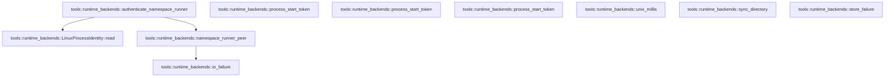

```mermaid
flowchart TD
  n0["store::atomic::AtomicPublisher::replace"]
  n1["store::platform::NamedLock::exclusive"]
  n2["store::platform::NamedLock::shared"]
  n3["tools::runtime_backends::JobBroker::read_record"]
  n4["tools::runtime_backends::JobBroker::write_record"]
  n5["tools::runtime_backends::run_job_runner"]
  n6["tools::runtime_backends::HttpLimits::default"]
  n7["tools::runtime_backends::HttpLimits::validate"]
  n8["tools::runtime_backends::BackendOutcome::enter"]
  n9["tools::runtime_backends::BoundedHttpClient::new"]
  n10["tools::runtime_backends::BoundedHttpClient::fetch"]
  n11["tools::runtime_backends::BoundedHttpClient::search"]
  n12["tools::runtime_backends::fetch_async"]
  n13["tools::runtime_backends::resolve_web_redirect"]
  n14["tools::runtime_backends::await_cancel_deadline"]
  n15["tools::runtime_backends::route_public_url"]
  n16["tools::runtime_backends::extract_web_content"]
  n17["tools::runtime_backends::require_canonical_directory"]
  n18["tools::runtime_backends::validate_job_id"]
  n19["tools::runtime_backends::drain_tail"]
  n20["tools::runtime_backends::signal_group"]
  n21["tools::runtime_backends::terminate_group"]
  n22["tools::runtime_backends::namespace_identity_channel"]
  n23["tools::runtime_backends::announce_namespace_runner"]
  n24["tools::runtime_backends::authenticate_namespace_runner"]
  n25["tools::runtime_backends::unix_millis"]
  n26["tools::runtime_backends::sync_directory"]
  n27["tools::runtime_backends::io_failure"]
  n28["tools::runtime_backends::store_failure"]
  n29["tools::runtime_backends::JobBroker::open"]
  n30["tools::runtime_backends::JobBroker::start"]
  n31["tools::runtime_backends::JobBroker::start_inner"]
  n32["tools::runtime_backends::web_fetch_status_failure"]
  n33["tools::runtime_backends::JobBroker::status"]
  n34["tools::runtime_backends::JobBroker::status_inner"]
  n35["tools::runtime_backends::JobBroker::list"]
  n36["tools::runtime_backends::JobBroker::list_inner"]
  n37["tools::runtime_backends::JobBroker::stop"]
  n38["tools::runtime_backends::JobBroker::stop_inner"]
  n39["tools::runtime_backends::JobBroker::job_directory"]
  n40["tools::runtime_backends::JobBroker::host_receipt"]
  n3 --> n2
  n3 --> n27
  n3 --> n39
  n4 --> n0
  n4 --> n1
  n4 --> n39
  n5 --> n18
  n5 --> n19
  n5 --> n23
  n5 --> n25
  n5 --> n29
  n10 --> n8
  n10 --> n12
  n11 --> n8
  n12 --> n13
  n12 --> n14
  n12 --> n15
  n12 --> n16
  n12 --> n32
  n30 --> n8
  n30 --> n18
  n30 --> n31
  n31 --> n0
  n31 --> n4
  n31 --> n17
  n31 --> n21
  n31 --> n22
  n31 --> n24
  n31 --> n25
  n31 --> n26
  n31 --> n27
  n31 --> n28
  n31 --> n39
  n33 --> n34
  n34 --> n3
  n34 --> n4
  n34 --> n18
  n34 --> n25
  n34 --> n40
  n35 --> n36
  n36 --> n18
  n36 --> n34
  n37 --> n8
  n37 --> n38
  n38 --> n4
  n38 --> n20
  n38 --> n25
  n38 --> n34
  n38 --> n40
```

```mermaid
flowchart TD
  n0["tools::runtime_backends::resolve_web_redirect"]
  n1["tools::runtime_backends::await_cancel_deadline"]
  n2["tools::runtime_backends::PublicRoute::client_builder"]
  n3["tools::runtime_backends::route_public_url"]
  n4["tools::runtime_backends::route_public_url_with"]
  n5["tools::runtime_backends::outbound_proxy_for"]
  n6["tools::runtime_backends::no_proxy_exempts"]
  n7["tools::runtime_backends::cidr_contains"]
  n8["tools::runtime_backends::is_public_internet_address"]
  n9["tools::runtime_backends::extract_web_content"]
  n10["tools::runtime_backends::decode_web_text"]
  n11["tools::runtime_backends::looks_like_html"]
  n12["tools::runtime_backends::extract_html_text"]
  n13["tools::runtime_backends::extract_html_title"]
  n14["tools::runtime_backends::is_html_block"]
  n15["tools::runtime_backends::decode_html_entities"]
  n16["tools::runtime_backends::decode_numeric_entity"]
  n17["tools::runtime_backends::collapse_web_whitespace"]
  n18["tools::runtime_backends::html_is_under_rendered"]
  n19["tools::runtime_backends::truncate_characters"]
  n3 --> n4
  n4 --> n5
  n4 --> n8
  n5 --> n6
  n6 --> n7
  n8 --> n8
  n9 --> n10
  n9 --> n11
  n9 --> n12
  n9 --> n18
  n9 --> n19
  n12 --> n13
  n12 --> n14
  n12 --> n15
  n12 --> n17
  n15 --> n16
```

# tools::runtime_backends

[Package atlas](index.md) · [Source](../../src/runtime_backends.rs)

## Declarations

Visibility is the declaration spelling; trait members and reexports require their enclosing interface. `cfg` is not evaluated.

| Symbol | Kind | Visibility | Test / cfg |
|---|---|---|---|
| [tools::runtime_backends::HARD_HELPER_BYTES](../../src/runtime_backends.rs#L30) | const_item | `pub` |  |
| [tools::runtime_backends::HARD_HELPER_READ_BYTES](../../src/runtime_backends.rs#L31) | const_item | `pub` |  |
| [tools::runtime_backends::HARD_HELPER_TIMEOUT_MS](../../src/runtime_backends.rs#L32) | const_item | `pub` |  |
| [tools::runtime_backends::HELPER_PROCESS_OVERHEAD_MS](../../src/runtime_backends.rs#L33) | const_item | `private` |  |
| [tools::runtime_backends::HARD_HTTP_BYTES](../../src/runtime_backends.rs#L34) | const_item | `pub` |  |
| [tools::runtime_backends::HARD_HTTP_TIMEOUT_MS](../../src/runtime_backends.rs#L35) | const_item | `pub` |  |
| [tools::runtime_backends::HARD_JOB_TAIL_BYTES](../../src/runtime_backends.rs#L36) | const_item | `pub` |  |
| [tools::runtime_backends::MAX_REDIRECTS](../../src/runtime_backends.rs#L37) | const_item | `pub` |  |
| [tools::runtime_backends::WEB_FETCH_ACCEPT](../../src/runtime_backends.rs#L38) | const_item | `pub` |  |
| [tools::runtime_backends::WEB_FETCH_MAX_CHARACTERS](../../src/runtime_backends.rs#L40) | const_item | `pub` |  |
| [tools::runtime_backends::WEB_FETCH_MIN_MEANINGFUL_CHARACTERS](../../src/runtime_backends.rs#L41) | const_item | `pub` |  |
| [tools::runtime_backends::WEB_FETCH_USER_AGENT](../../src/runtime_backends.rs#L42) | const_item | `pub` |  |
| [tools::runtime_backends::BackendOutcome](../../src/runtime_backends.rs#L45) | enum_item | `pub` |  |
| [tools::runtime_backends::BackendHold](../../src/runtime_backends.rs#L52) | struct_item | `pub` |  |
| [tools::runtime_backends::BackendUnavailable](../../src/runtime_backends.rs#L58) | struct_item | `pub` |  |
| [tools::runtime_backends::BackendGate](../../src/runtime_backends.rs#L64) | enum_item | `pub` |  |
| [tools::runtime_backends::web_fetch_status_failure](../../src/runtime_backends.rs#L74) | function_item | `private` |  |
| [tools::runtime_backends::BackendFailure](../../src/runtime_backends.rs#L90) | enum_item | `pub` |  |
| [tools::runtime_backends::BackendOutcome::enter](../../src/runtime_backends.rs#L118) | function_item | `private` |  |
| [tools::runtime_backends::CancellationToken](../../src/runtime_backends.rs#L128) | struct_item | `pub` |  |
| [tools::runtime_backends::CancellationToken::cancel](../../src/runtime_backends.rs#L131) | function_item | `pub` |  |
| [tools::runtime_backends::CancellationToken::is_cancelled](../../src/runtime_backends.rs#L136) | function_item | `pub` |  |
| [tools::runtime_backends::HelperInvoker](../../src/runtime_backends.rs#L141) | trait_item | `pub` |  |
| [tools::runtime_backends::HelperInvoker::invoke](../../src/runtime_backends.rs#L142) | function_signature_item | `private` |  |
| [tools::runtime_backends::HelperClient::invoke](../../src/runtime_backends.rs#L150) | function_item | `private` |  |
| [tools::runtime_backends::Arc::invoke](../../src/runtime_backends.rs#L183) | function_item | `private` |  |
| [tools::runtime_backends::BoundedHelper](../../src/runtime_backends.rs#L192) | struct_item | `pub` |  |
| [tools::runtime_backends::BoundedHelper::new](../../src/runtime_backends.rs#L198) | function_item | `pub` |  |
| [tools::runtime_backends::BoundedHelper::invoke](../../src/runtime_backends.rs#L202) | function_item | `pub` |  |
| [tools::runtime_backends::validate_helper_limits](../../src/runtime_backends.rs#L227) | function_item | `private` |  |
| [tools::runtime_backends::JobSpec](../../src/runtime_backends.rs#L294) | struct_item | `pub` |  |
| [tools::runtime_backends::JobLaunchPolicy](../../src/runtime_backends.rs#L312) | struct_item | `pub` |  |
| [tools::runtime_backends::JobLaunchPolicy::new](../../src/runtime_backends.rs#L319) | function_item | `pub` |  |
| [tools::runtime_backends::JobLaunchPolicy::primary_workspace_cwd](../../src/runtime_backends.rs#L358) | function_item | `pub` |  |
| [tools::runtime_backends::JobLaunchPolicy::base_sandbox](../../src/runtime_backends.rs#L363) | function_item | `pub` |  |
| [tools::runtime_backends::JobLaunchPolicy::permitted_write_roots](../../src/runtime_backends.rs#L368) | function_item | `pub` |  |
| [tools::runtime_backends::JobLaunchPolicy::resolve](../../src/runtime_backends.rs#L372) | function_item | `private` |  |
| [tools::runtime_backends::JobState](../../src/runtime_backends.rs#L433) | enum_item | `pub` |  |
| [tools::runtime_backends::JobRecord](../../src/runtime_backends.rs#L443) | struct_item | `pub` |  |
| [tools::runtime_backends::JobRunnerRequest](../../src/runtime_backends.rs#L458) | struct_item | `private` |  |
| [tools::runtime_backends::SandboxedJobLauncher](../../src/runtime_backends.rs#L473) | trait_item | `pub` |  |
| [tools::runtime_backends::SandboxedJobLauncher::uses_pid_namespace](../../src/runtime_backends.rs#L477) | function_item | `private` |  |
| [tools::runtime_backends::SandboxedJobLauncher::runner_command](../../src/runtime_backends.rs#L481) | function_signature_item | `private` |  |
| [tools::runtime_backends::HelperJobLauncher](../../src/runtime_backends.rs#L492) | struct_item | `pub` |  |
| [tools::runtime_backends::HelperJobLauncher::new](../../src/runtime_backends.rs#L498) | function_item | `pub` |  |
| [tools::runtime_backends::HelperJobLauncher::disabled](../../src/runtime_backends.rs#L516) | function_item | `pub` |  |
| [tools::runtime_backends::HelperJobLauncher::uses_pid_namespace](../../src/runtime_backends.rs#L534) | function_item | `private` |  |
| [tools::runtime_backends::HelperJobLauncher::runner_command](../../src/runtime_backends.rs#L539) | function_item | `private` |  |
| [tools::runtime_backends::JobBroker](../../src/runtime_backends.rs#L558) | struct_item | `pub` |  |
| [tools::runtime_backends::JobBroker::new](../../src/runtime_backends.rs#L566) | function_item | `pub` |  |
| [tools::runtime_backends::JobBroker::open](../../src/runtime_backends.rs#L570) | function_item | `private` |  |
| [tools::runtime_backends::JobBroker::start](../../src/runtime_backends.rs#L610) | function_item | `pub` |  |
| [tools::runtime_backends::JobBroker::start_inner](../../src/runtime_backends.rs#L647) | function_item | `private` |  |
| [tools::runtime_backends::JobBroker::status](../../src/runtime_backends.rs#L851) | function_item | `pub` |  |
| [tools::runtime_backends::JobBroker::status_inner](../../src/runtime_backends.rs#L855) | function_item | `private` |  |
| [tools::runtime_backends::JobBroker::list](../../src/runtime_backends.rs#L883) | function_item | `pub` |  |
| [tools::runtime_backends::JobBroker::list_inner](../../src/runtime_backends.rs#L887) | function_item | `private` |  |
| [tools::runtime_backends::JobBroker::stop](../../src/runtime_backends.rs#L902) | function_item | `pub` |  |
| [tools::runtime_backends::JobBroker::stop_inner](../../src/runtime_backends.rs#L917) | function_item | `private` |  |
| [tools::runtime_backends::JobBroker::job_directory](../../src/runtime_backends.rs#L974) | function_item | `private` |  |
| [tools::runtime_backends::JobBroker::host_receipt](../../src/runtime_backends.rs#L978) | function_item | `private` |  |
| [tools::runtime_backends::JobBroker::read_record](../../src/runtime_backends.rs#L1004) | function_item | `private` |  |
| [tools::runtime_backends::JobBroker::write_record](../../src/runtime_backends.rs#L1024) | function_item | `private` |  |
| [tools::runtime_backends::run_job_runner](../../src/runtime_backends.rs#L1036) | function_item | `pub` |  |
| [tools::runtime_backends::HttpLimits](../../src/runtime_backends.rs#L1147) | struct_item | `pub` |  |
| [tools::runtime_backends::HttpLimits::default](../../src/runtime_backends.rs#L1154) | function_item | `private` |  |
| [tools::runtime_backends::HttpLimits::validate](../../src/runtime_backends.rs#L1164) | function_item | `private` |  |
| [tools::runtime_backends::HttpFetchResult](../../src/runtime_backends.rs#L1185) | struct_item | `pub` |  |
| [tools::runtime_backends::WebExtractionKind](../../src/runtime_backends.rs#L1195) | enum_item | `pub` |  |
| [tools::runtime_backends::WebExtraction](../../src/runtime_backends.rs#L1206) | struct_item | `pub` |  |
| [tools::runtime_backends::BoundedHttpClient](../../src/runtime_backends.rs#L1214) | struct_item | `pub` |  |
| [tools::runtime_backends::BoundedHttpClient::new](../../src/runtime_backends.rs#L1219) | function_item | `pub` |  |
| [tools::runtime_backends::BoundedHttpClient::fetch](../../src/runtime_backends.rs#L1224) | function_item | `pub` |  |
| [tools::runtime_backends::BoundedHttpClient::search](../../src/runtime_backends.rs#L1257) | function_item | `pub` |  |
| [tools::runtime_backends::SearchTopic](../../src/runtime_backends.rs#L1306) | enum_item | `pub` |  |
| [tools::runtime_backends::SearchRequest](../../src/runtime_backends.rs#L1312) | struct_item | `pub` |  |
| [tools::runtime_backends::SearchHit](../../src/runtime_backends.rs#L1321) | struct_item | `pub` |  |
| [tools::runtime_backends::SearchProvider](../../src/runtime_backends.rs#L1330) | trait_item | `pub` |  |
| [tools::runtime_backends::SearchProvider::search](../../src/runtime_backends.rs#L1331) | function_signature_item | `private` |  |
| [tools::runtime_backends::fetch_async](../../src/runtime_backends.rs#L1339) | function_item | `private` |  |
| [tools::runtime_backends::resolve_web_redirect](../../src/runtime_backends.rs#L1432) | function_item | `pub` |  |
| [tools::runtime_backends::await_cancel_deadline](../../src/runtime_backends.rs#L1441) | function_item | `private` |  |
| [tools::runtime_backends::PublicRoute](../../src/runtime_backends.rs#L1467) | enum_item | `pub` |  |
| [tools::runtime_backends::PublicRoute::client_builder](../../src/runtime_backends.rs#L1479) | function_item | `pub` |  |
| [tools::runtime_backends::route_public_url](../../src/runtime_backends.rs#L1494) | function_item | `pub` |  |
| [tools::runtime_backends::route_public_url_with](../../src/runtime_backends.rs#L1499) | function_item | `pub` |  |
| [tools::runtime_backends::outbound_proxy_for](../../src/runtime_backends.rs#L1579) | function_item | `private` |  |
| [tools::runtime_backends::no_proxy_exempts](../../src/runtime_backends.rs#L1613) | function_item | `private` |  |
| [tools::runtime_backends::cidr_contains](../../src/runtime_backends.rs#L1663) | function_item | `private` |  |
| [tools::runtime_backends::is_public_internet_address](../../src/runtime_backends.rs#L1689) | function_item | `pub` |  |
| [tools::runtime_backends::extract_web_content](../../src/runtime_backends.rs#L1756) | function_item | `pub` |  |
| [tools::runtime_backends::decode_web_text](../../src/runtime_backends.rs#L1802) | function_item | `private` |  |
| [tools::runtime_backends::looks_like_html](../../src/runtime_backends.rs#L1809) | function_item | `private` |  |
| [tools::runtime_backends::extract_html_text](../../src/runtime_backends.rs#L1818) | function_item | `private` |  |
| [tools::runtime_backends::extract_html_title](../../src/runtime_backends.rs#L1880) | function_item | `private` |  |
| [tools::runtime_backends::is_html_block](../../src/runtime_backends.rs#L1897) | function_item | `private` |  |
| [tools::runtime_backends::decode_html_entities](../../src/runtime_backends.rs#L1922) | function_item | `private` |  |
| [tools::runtime_backends::decode_numeric_entity](../../src/runtime_backends.rs#L1971) | function_item | `private` |  |
| [tools::runtime_backends::collapse_web_whitespace](../../src/runtime_backends.rs#L1981) | function_item | `private` |  |
| [tools::runtime_backends::html_is_under_rendered](../../src/runtime_backends.rs#L2002) | function_item | `private` |  |
| [tools::runtime_backends::truncate_characters](../../src/runtime_backends.rs#L2014) | function_item | `private` |  |
| [tools::runtime_backends::require_canonical_directory](../../src/runtime_backends.rs#L2027) | function_item | `private` |  |
| [tools::runtime_backends::canonical_invocation_directory](../../src/runtime_backends.rs#L2054) | function_item | `private` |  |
| [tools::runtime_backends::normalize_policy_roots](../../src/runtime_backends.rs#L2089) | function_item | `private` |  |
| [tools::runtime_backends::covered_by](../../src/runtime_backends.rs#L2113) | function_item | `private` |  |
| [tools::runtime_backends::validate_job_id](../../src/runtime_backends.rs#L2119) | function_item | `private` |  |
| [tools::runtime_backends::drain_tail](../../src/runtime_backends.rs#L2133) | function_item | `private` |  |
| [tools::runtime_backends::signal_group](../../src/runtime_backends.rs#L2151) | function_item | `private` |  |
| [tools::runtime_backends::terminate_group](../../src/runtime_backends.rs#L2168) | function_item | `private` |  |
| [tools::runtime_backends::JobHostReceipt](../../src/runtime_backends.rs#L2186) | struct_item | `private` |  |
| [tools::runtime_backends::NamespaceRunnerIdentity](../../src/runtime_backends.rs#L2195) | struct_item | `private` |  |
| [tools::runtime_backends::LinuxProcessIdentity](../../src/runtime_backends.rs#L2204) | struct_item | `private` |  |
| [tools::runtime_backends::LinuxProcessIdentity::read](../../src/runtime_backends.rs#L2217) | function_item | `private` | #[cfg(target_os = "linux")] |
| [tools::runtime_backends::LinuxProcessIdentity::same_namespace](../../src/runtime_backends.rs#L2243) | function_item | `private` | #[cfg(target_os = "linux")] |
| [tools::runtime_backends::LinuxProcessIdentity::is_live](../../src/runtime_backends.rs#L2248) | function_item | `private` | #[cfg(target_os = "linux")] |
| [tools::runtime_backends::NamespaceRunnerIdentity::matches_record](../../src/runtime_backends.rs#L2259) | function_item | `private` | #[cfg(target_os = "linux")] |
| [tools::runtime_backends::NamespaceRunnerIdentity::matches_current_runner](../../src/runtime_backends.rs#L2270) | function_item | `private` | #[cfg(target_os = "linux")] |
| [tools::runtime_backends::NamespaceRunnerIdentity::namespace_is_live](../../src/runtime_backends.rs#L2278) | function_item | `private` | #[cfg(target_os = "linux")] |
| [tools::runtime_backends::NamespaceRunnerIdentity::stop_namespace](../../src/runtime_backends.rs#L2282) | function_item | `private` | #[cfg(target_os = "linux")] |
| [tools::runtime_backends::NamespaceRunnerIdentity::stop_handle](../../src/runtime_backends.rs#L2289) | function_item | `private` | #[cfg(target_os = "linux")] |
| [tools::runtime_backends::NamespaceStopHandle](../../src/runtime_backends.rs#L2342) | struct_item | `private` | #[cfg(target_os = "linux")] |
| [tools::runtime_backends::NamespaceStopHandle::kill](../../src/runtime_backends.rs#L2346) | function_item | `private` | #[cfg(target_os = "linux")] |
| [tools::runtime_backends::NamespaceStopHandle::send_signal](../../src/runtime_backends.rs#L2350) | function_item | `private` | #[cfg(target_os = "linux")] |
| [tools::runtime_backends::namespace_identity_channel](../../src/runtime_backends.rs#L2376) | function_item | `private` | #[cfg(target_os = "linux")] |
| [tools::runtime_backends::announce_namespace_runner](../../src/runtime_backends.rs#L2406) | function_item | `private` | #[cfg(target_os = "linux")] |
| [tools::runtime_backends::namespace_runner_peer](../../src/runtime_backends.rs#L2417) | function_item | `private` | #[cfg(target_os = "linux")] |
| [tools::runtime_backends::authenticate_namespace_runner](../../src/runtime_backends.rs#L2468) | function_item | `private` | #[cfg(target_os = "linux")] |
| [tools::runtime_backends::process_start_token](../../src/runtime_backends.rs#L2504) | function_item | `private` | #[cfg(target_os = "macos")] |
| [tools::runtime_backends::process_start_token](../../src/runtime_backends.rs#L2529) | function_item | `private` | #[cfg(target_os = "linux")] |
| [tools::runtime_backends::process_start_token](../../src/runtime_backends.rs#L2539) | function_item | `private` | #[cfg(not(any(target_os = "macos", target_os = "linux")))] |
| [tools::runtime_backends::unix_millis](../../src/runtime_backends.rs#L2543) | function_item | `private` |  |
| [tools::runtime_backends::sync_directory](../../src/runtime_backends.rs#L2551) | function_item | `private` |  |
| [tools::runtime_backends::io_failure](../../src/runtime_backends.rs#L2557) | function_item | `private` |  |
| [tools::runtime_backends::store_failure](../../src/runtime_backends.rs#L2561) | function_item | `private` |  |
| [tools::runtime_backends::disabled_job_launcher_tests::mcp_only_launcher_refuses_command_execution](../../src/runtime_backends.rs#L2572) | function_item | `private` | test; #[cfg(test)] |
| [tools::runtime_backends::namespace_job_identity_tests::inherited_socket_reports_kernel_sender_identity](../../src/runtime_backends.rs#L2603) | function_item | `private` | test; #[cfg(all(test, target_os = "linux"))] |
| [tools::runtime_backends::namespace_job_identity_tests::namespace_authentication_refuses_an_unrelated_sender](../../src/runtime_backends.rs#L2610) | function_item | `private` | test; #[cfg(all(test, target_os = "linux"))] |
| [tools::runtime_backends::namespace_job_identity_tests::runner_identity_requires_matching_pid_start_and_namespace](../../src/runtime_backends.rs#L2621) | function_item | `private` | test; #[cfg(all(test, target_os = "linux"))] |
| [tools::runtime_backends::namespace_job_identity_tests::stale_namespace_identity_never_signals_a_live_process](../../src/runtime_backends.rs#L2641) | function_item | `private` | test; #[cfg(all(test, target_os = "linux"))] |
| [tools::runtime_backends::namespace_job_identity_tests::forged_namespace_receipt_cannot_select_a_host_process](../../src/runtime_backends.rs#L2659) | function_item | `private` | test; #[cfg(all(test, target_os = "linux"))] |
| [tools::runtime_backends::namespace_job_identity_tests::test_record](../../src/runtime_backends.rs#L2673) | function_item | `private` | test; #[cfg(all(test, target_os = "linux"))] |
| [tools::runtime_backends::namespace_job_identity_tests::sandbox_written_pid_and_job_id_cannot_replace_host_authority](../../src/runtime_backends.rs#L2695) | function_item | `private` | test; #[cfg(all(test, target_os = "linux"))] |
| [tools::runtime_backends::namespace_job_identity_tests::writable_root_cannot_cover_private_launch_receipts](../../src/runtime_backends.rs#L2730) | function_item | `private` | test; #[cfg(all(test, target_os = "linux"))] |
| [tools::runtime_backends::namespace_job_identity_tests::writable_root_cannot_cover_private_launch_receipts::NeverLaunch](../../src/runtime_backends.rs#L2731) | struct_item | `private` | test; #[cfg(all(test, target_os = "linux"))] |
| [tools::runtime_backends::namespace_job_identity_tests::writable_root_cannot_cover_private_launch_receipts::NeverLaunch::runner_command](../../src/runtime_backends.rs#L2733) | function_item | `private` | test; #[cfg(all(test, target_os = "linux"))] |
| [tools::runtime_backends::web_fetch_status_tests::non_success_statuses_classify_by_what_the_server_said](../../src/runtime_backends.rs#L2779) | function_item | `private` | test; #[cfg(test)] |

## Imports / reexports

| Local name | Source path | Visibility |
|---|---|---|
| `BTreeMap` | `std::collections::BTreeMap` | `private` |
| `VecDeque` | `std::collections::VecDeque` | `private` |
| `fs` | `std::fs` | `private` |
| `File` | `std::fs::File` | `private` |
| `Read` | `std::io::Read` | `private` |
| `IpAddr` | `std::net::IpAddr` | `private` |
| `SocketAddr` | `std::net::SocketAddr` | `private` |
| `ToSocketAddrs` | `std::net::ToSocketAddrs` | `private` |
| `_` | `std::os::unix::process::CommandExt` | `private` |
| `Path` | `std::path::Path` | `private` |
| `PathBuf` | `std::path::PathBuf` | `private` |
| `Child` | `std::process::Child` | `private` |
| `Command` | `std::process::Command` | `private` |
| `Stdio` | `std::process::Stdio` | `private` |
| `Arc` | `std::sync::Arc` | `private` |
| `AtomicBool` | `std::sync::atomic::AtomicBool` | `private` |
| `Ordering` | `std::sync::atomic::Ordering` | `private` |
| `thread` | `std::thread` | `private` |
| `Duration` | `std::time::Duration` | `private` |
| `Instant` | `std::time::Instant` | `private` |
| `SystemTime` | `std::time::SystemTime` | `private` |
| `UNIX_EPOCH` | `std::time::UNIX_EPOCH` | `private` |
| `ACCEPT` | `reqwest::header::ACCEPT` | `private` |
| `CONTENT_LENGTH` | `reqwest::header::CONTENT_LENGTH` | `private` |
| `CONTENT_TYPE` | `reqwest::header::CONTENT_TYPE` | `private` |
| `LOCATION` | `reqwest::header::LOCATION` | `private` |
| `USER_AGENT` | `reqwest::header::USER_AGENT` | `private` |
| `Deserialize` | `serde::Deserialize` | `private` |
| `Serialize` | `serde::Serialize` | `private` |
| `AtomicPublisher` | `store::AtomicPublisher` | `private` |
| `NamedLock` | `store::NamedLock` | `private` |
| `Error` | `thiserror::Error` | `private` |
| `HelperClient` | `crate::helper::HelperClient` | `private` |
| `HelperClientError` | `crate::helper::HelperClientError` | `private` |
| `HelperErrorClass` | `crate::helper::HelperErrorClass` | `private` |
| `HelperOperation` | `crate::helper::HelperOperation` | `private` |
| `HelperRequest` | `crate::helper::HelperRequest` | `private` |
| `HelperResponse` | `crate::helper::HelperResponse` | `private` |
| `ProbeStatus` | `crate::sandbox::ProbeStatus` | `private` |
| `SandboxPolicy` | `crate::sandbox::SandboxPolicy` | `private` |
| `sandbox_command` | `crate::sandbox::sandbox_command` | `private` |
| `BackendFailure` | `super::BackendFailure` | `private` |
| `HelperJobLauncher` | `super::HelperJobLauncher` | `private` |
| `JobSpec` | `super::JobSpec` | `private` |
| `SandboxedJobLauncher` | `super::SandboxedJobLauncher` | `private` |
| `NetworkPolicy` | `crate::NetworkPolicy` | `private` |
| `SandboxPolicy` | `crate::SandboxPolicy` | `private` |
| `BTreeMap` | `std::collections::BTreeMap` | `private` |
| `*` | `super::*` | `private` |
| `Write` | `std::io::Write` | `private` |
| `BackendFailure` | `super::BackendFailure` | `private` |
| `web_fetch_status_failure` | `super::web_fetch_status_failure` | `private` |
| `StatusCode` | `reqwest::StatusCode` | `private` |

## Module declarations

| Module | Visibility | Attributes |
|---|---|---|
| `tools::runtime_backends::disabled_job_launcher_tests` | `private` | #[cfg(test)] |
| `tools::runtime_backends::namespace_job_identity_tests` | `private` | #[cfg(all(test, target_os = "linux"))] |
| `tools::runtime_backends::web_fetch_status_tests` | `private` | #[cfg(test)] |

## Function call graphs

Edges below are syntactically resolved calls only, including private functions. Graphs partition callers into groups of 20; they are not execution order. All unresolved sites are listed below and in the JSON inventory.

Functions 1–20: 11 direct edges

Functions 21–40: 49 direct edges

Functions 41–60: 16 direct edges

Functions 61–80: 12 direct edges

Functions 81–89: 3 direct edges

## Call sites

Includes test functions (marked in declarations). Receiver-type-required sites need type analysis/manual tracing. Calls in closures are attributed to their enclosing function; their occurrence here does not mean the closure executes immediately.

| Caller | Callee expression | Source lines | Target / classification |
|---|---|---|---|
| `web_fetch_status_failure` | `status.as_u16` | [75](../../src/runtime_backends.rs#L75) | receiver-type-required |
| `web_fetch_status_failure` | `BackendFailure::NotFound` | [77](../../src/runtime_backends.rs#L77) | external-constructor-callback-or-unresolved |
| `web_fetch_status_failure` | `BackendFailure::Denied` | [78](../../src/runtime_backends.rs#L78) | external-constructor-callback-or-unresolved |
| `web_fetch_status_failure` | `BackendFailure::Limit` | [80](../../src/runtime_backends.rs#L80) | external-constructor-callback-or-unresolved |
| `web_fetch_status_failure` | `status.is_client_error` | [81](../../src/runtime_backends.rs#L81) | receiver-type-required |
| `web_fetch_status_failure` | `BackendFailure::Invalid` | [81](../../src/runtime_backends.rs#L81) | external-constructor-callback-or-unresolved |
| `web_fetch_status_failure` | `status.is_server_error` | [84](../../src/runtime_backends.rs#L84) | receiver-type-required |
| `web_fetch_status_failure` | `BackendFailure::Unavailable` | [84](../../src/runtime_backends.rs#L84) | external-constructor-callback-or-unresolved |
| `web_fetch_status_failure` | `BackendFailure::Protocol` | [85](../../src/runtime_backends.rs#L85) | external-constructor-callback-or-unresolved |
| `enter` | `Ok` | [120](../../src/runtime_backends.rs#L120) | external-constructor-callback-or-unresolved |
| `enter` | `Err` | [121](../../src/runtime_backends.rs#L121), [122](../../src/runtime_backends.rs#L122) | external-constructor-callback-or-unresolved |
| `enter` | `Self::Hold` | [121](../../src/runtime_backends.rs#L121) | external-constructor-callback-or-unresolved |
| `enter` | `Self::Unavailable` | [122](../../src/runtime_backends.rs#L122) | external-constructor-callback-or-unresolved |
| `cancel` | `self.0.store` | [132](../../src/runtime_backends.rs#L132) | receiver-type-required |
| `is_cancelled` | `self.0.load` | [137](../../src/runtime_backends.rs#L137) | receiver-type-required |
| `invoke` | `exec.timeout_ms.map` | [159](../../src/runtime_backends.rs#L159) | receiver-type-required |
| `invoke` | `Duration::from_millis` | [160](../../src/runtime_backends.rs#L160) | external-constructor-callback-or-unresolved |
| `invoke` | `timeout.saturating_add` | [160](../../src/runtime_backends.rs#L160) | receiver-type-required |
| `invoke` | `Some` | [162](../../src/runtime_backends.rs#L162) | external-constructor-callback-or-unresolved |
| `invoke` | `Duration::from_secs` | [162](../../src/runtime_backends.rs#L162) | external-constructor-callback-or-unresolved |
| `invoke` | `self.execute_cancellable(request, timeout, &#124;&#124; cancellation.is_cancelled())             .map_err` | [164](../../src/runtime_backends.rs#L164) | receiver-type-required |
| `invoke` | `self.execute_cancellable` | [164](../../src/runtime_backends.rs#L164) | receiver-type-required |
| `invoke` | `cancellation.is_cancelled` | [164](../../src/runtime_backends.rs#L164) | receiver-type-required |
| `invoke` | `BackendFailure::Limit` | [169](../../src/runtime_backends.rs#L169) | external-constructor-callback-or-unresolved |
| `invoke` | `BackendFailure::Denied` | [170](../../src/runtime_backends.rs#L170) | external-constructor-callback-or-unresolved |
| `invoke` | `BackendFailure::NotFound` | [171](../../src/runtime_backends.rs#L171) | external-constructor-callback-or-unresolved |
| `invoke` | `BackendFailure::Unavailable` | [173](../../src/runtime_backends.rs#L173) | external-constructor-callback-or-unresolved |
| `invoke` | `BackendFailure::Protocol` | [175](../../src/runtime_backends.rs#L175) | external-constructor-callback-or-unresolved |
| `invoke` | `BackendFailure::Io` | [176](../../src/runtime_backends.rs#L176) | external-constructor-callback-or-unresolved |
| `invoke` | `error.to_string` | [176](../../src/runtime_backends.rs#L176) | receiver-type-required |
| `invoke` | `(**self).invoke` | [188](../../src/runtime_backends.rs#L188) | receiver-type-required |
| `invoke` | `BackendOutcome::enter` | [208](../../src/runtime_backends.rs#L208) | [tools::runtime_backends::BackendOutcome::enter](../../src/runtime_backends.rs#L118) |
| `invoke` | `cancellation.is_cancelled` | [211](../../src/runtime_backends.rs#L211) | receiver-type-required |
| `invoke` | `BackendOutcome::Completed` | [212](../../src/runtime_backends.rs#L212), [215](../../src/runtime_backends.rs#L215), [223](../../src/runtime_backends.rs#L223) | external-constructor-callback-or-unresolved |
| `invoke` | `Err` | [212](../../src/runtime_backends.rs#L212), [215](../../src/runtime_backends.rs#L215) | external-constructor-callback-or-unresolved |
| `invoke` | `validate_helper_limits` | [214](../../src/runtime_backends.rs#L214) | [tools::runtime_backends::validate_helper_limits](../../src/runtime_backends.rs#L227) |
| `invoke` | `BackendOutcome::Unavailable` | [218](../../src/runtime_backends.rs#L218) | external-constructor-callback-or-unresolved |
| `invoke` | `"exec-helper".to_owned` | [219](../../src/runtime_backends.rs#L219) | receiver-type-required |
| `invoke` | `"helper process is not configured".to_owned` | [220](../../src/runtime_backends.rs#L220) | receiver-type-required |
| `invoke` | `invoker.invoke` | [223](../../src/runtime_backends.rs#L223) | receiver-type-required |
| `validate_helper_limits` | `Err` | [230](../../src/runtime_backends.rs#L230), [251](../../src/runtime_backends.rs#L251), [259](../../src/runtime_backends.rs#L259), [270](../../src/runtime_backends.rs#L270), [282](../../src/runtime_backends.rs#L282) | external-constructor-callback-or-unresolved |
| `validate_helper_limits` | `BackendFailure::Limit` | [230](../../src/runtime_backends.rs#L230), [251](../../src/runtime_backends.rs#L251), [259](../../src/runtime_backends.rs#L259), [270](../../src/runtime_backends.rs#L270), [282](../../src/runtime_backends.rs#L282) | external-constructor-callback-or-unresolved |
| `validate_helper_limits` | `Ok` | [234](../../src/runtime_backends.rs#L234), [253](../../src/runtime_backends.rs#L253), [263](../../src/runtime_backends.rs#L263), [274](../../src/runtime_backends.rs#L274), [286](../../src/runtime_backends.rs#L286) | external-constructor-callback-or-unresolved |
| `validate_helper_limits` | `bounded` | [239](../../src/runtime_backends.rs#L239), [241](../../src/runtime_backends.rs#L241), [248](../../src/runtime_backends.rs#L248), [249](../../src/runtime_backends.rs#L249), [256](../../src/runtime_backends.rs#L256), [257](../../src/runtime_backends.rs#L257) | external-constructor-callback-or-unresolved |
| `validate_helper_limits` | `"grep context limit exceeded".into` | [251](../../src/runtime_backends.rs#L251) | receiver-type-required |
| `validate_helper_limits` | `Some` | [258](../../src/runtime_backends.rs#L258) | external-constructor-callback-or-unresolved |
| `validate_helper_limits` | `"timeout_ms must be at least 1".into` | [260](../../src/runtime_backends.rs#L260) | receiver-type-required |
| `validate_helper_limits` | `content                 .decode()                 .map_err` | [266](../../src/runtime_backends.rs#L266) | receiver-type-required |
| `validate_helper_limits` | `content                 .decode` | [266](../../src/runtime_backends.rs#L266) | receiver-type-required |
| `validate_helper_limits` | `BackendFailure::Invalid` | [268](../../src/runtime_backends.rs#L268), [280](../../src/runtime_backends.rs#L280) | external-constructor-callback-or-unresolved |
| `validate_helper_limits` | `error.to_string` | [268](../../src/runtime_backends.rs#L268), [280](../../src/runtime_backends.rs#L280) | receiver-type-required |
| `validate_helper_limits` | `bytes.len` | [269](../../src/runtime_backends.rs#L269), [281](../../src/runtime_backends.rs#L281) | receiver-type-required |
| `validate_helper_limits` | `"content exceeds helper byte limit".into` | [271](../../src/runtime_backends.rs#L271) | receiver-type-required |
| `validate_helper_limits` | `replacement                 .decode()                 .map_err` | [278](../../src/runtime_backends.rs#L278) | receiver-type-required |
| `validate_helper_limits` | `replacement                 .decode` | [278](../../src/runtime_backends.rs#L278) | receiver-type-required |
| `validate_helper_limits` | `"replacement exceeds helper byte limit".into` | [283](../../src/runtime_backends.rs#L283) | receiver-type-required |
| `new` | `base_sandbox             .validate()             .map_err` | [324](../../src/runtime_backends.rs#L324) | receiver-type-required |
| `new` | `base_sandbox             .validate` | [324](../../src/runtime_backends.rs#L324) | receiver-type-required |
| `new` | `BackendFailure::Invalid` | [326](../../src/runtime_backends.rs#L326) | external-constructor-callback-or-unresolved |
| `new` | `error.to_string` | [326](../../src/runtime_backends.rs#L326) | receiver-type-required |
| `new` | `require_canonical_directory` | [328](../../src/runtime_backends.rs#L328), [332](../../src/runtime_backends.rs#L332), [335](../../src/runtime_backends.rs#L335), [338](../../src/runtime_backends.rs#L338) | [tools::runtime_backends::require_canonical_directory](../../src/runtime_backends.rs#L2027) |
| `new` | `primary_workspace_cwd.into` | [328](../../src/runtime_backends.rs#L328) | receiver-type-required |
| `new` | `base_sandbox             .read_roots             .iter()             .map(&#124;root&#124; require_canonical_directory(root, "sandbox read root"))             .collect::<Result<Vec<_>, _>>` | [329](../../src/runtime_backends.rs#L329) | receiver-type-required |
| `new` | `base_sandbox             .read_roots             .iter()             .map` | [329](../../src/runtime_backends.rs#L329) | receiver-type-required |
| `new` | `base_sandbox             .read_roots             .iter` | [329](../../src/runtime_backends.rs#L329) | receiver-type-required |
| `new` | `covered_by` | [340](../../src/runtime_backends.rs#L340) | [tools::runtime_backends::covered_by](../../src/runtime_backends.rs#L2113) |
| `new` | `Err` | [341](../../src/runtime_backends.rs#L341) | external-constructor-callback-or-unresolved |
| `new` | `BackendFailure::Denied` | [341](../../src/runtime_backends.rs#L341) | external-constructor-callback-or-unresolved |
| `new` | `"primary workspace cwd is outside sandbox read roots".to_owned` | [342](../../src/runtime_backends.rs#L342) | receiver-type-required |
| `new` | `normalize_policy_roots` | [345](../../src/runtime_backends.rs#L345) | [tools::runtime_backends::normalize_policy_roots](../../src/runtime_backends.rs#L2089) |
| `new` | `Ok` | [350](../../src/runtime_backends.rs#L350) | external-constructor-callback-or-unresolved |
| `resolve` | `spec.working_directory.as_deref` | [373](../../src/runtime_backends.rs#L373) | receiver-type-required |
| `resolve` | `canonical_invocation_directory` | [374](../../src/runtime_backends.rs#L374), [389](../../src/runtime_backends.rs#L389) | [tools::runtime_backends::canonical_invocation_directory](../../src/runtime_backends.rs#L2054) |
| `resolve` | `self.primary_workspace_cwd.clone` | [379](../../src/runtime_backends.rs#L379) | receiver-type-required |
| `resolve` | `covered_by` | [381](../../src/runtime_backends.rs#L381), [394](../../src/runtime_backends.rs#L394) | [tools::runtime_backends::covered_by](../../src/runtime_backends.rs#L2113) |
| `resolve` | `Err` | [382](../../src/runtime_backends.rs#L382), [395](../../src/runtime_backends.rs#L395), [403](../../src/runtime_backends.rs#L403), [408](../../src/runtime_backends.rs#L408) | external-constructor-callback-or-unresolved |
| `resolve` | `BackendFailure::Denied` | [382](../../src/runtime_backends.rs#L382), [395](../../src/runtime_backends.rs#L395), [403](../../src/runtime_backends.rs#L403) | external-constructor-callback-or-unresolved |
| `resolve` | `"job working directory is outside sandbox read roots".to_owned` | [383](../../src/runtime_backends.rs#L383) | receiver-type-required |
| `resolve` | `Vec::with_capacity` | [387](../../src/runtime_backends.rs#L387) | external-constructor-callback-or-unresolved |
| `resolve` | `spec.writable_paths.len` | [387](../../src/runtime_backends.rs#L387) | receiver-type-required |
| `resolve` | `crate::protected_root_containing` | [399](../../src/runtime_backends.rs#L399) | [tools::sandbox::protected_root_containing](../../src/sandbox.rs#L213) |
| `resolve` | `Path::new` | [401](../../src/runtime_backends.rs#L401) | external-constructor-callback-or-unresolved |
| `resolve` | `requested.iter().any` | [407](../../src/runtime_backends.rs#L407) | receiver-type-required |
| `resolve` | `requested.iter` | [407](../../src/runtime_backends.rs#L407) | receiver-type-required |
| `resolve` | `BackendFailure::Invalid` | [408](../../src/runtime_backends.rs#L408), [426](../../src/runtime_backends.rs#L426) | external-constructor-callback-or-unresolved |
| `resolve` | `"job writable paths contain duplicate canonical roots".to_owned` | [409](../../src/runtime_backends.rs#L409) | receiver-type-required |
| `resolve` | `requested.push` | [412](../../src/runtime_backends.rs#L412) | receiver-type-required |
| `resolve` | `requested.sort_by` | [414](../../src/runtime_backends.rs#L414) | receiver-type-required |
| `resolve` | `left.as_bytes().cmp` | [414](../../src/runtime_backends.rs#L414), [422](../../src/runtime_backends.rs#L422) | receiver-type-required |
| `resolve` | `left.as_bytes` | [414](../../src/runtime_backends.rs#L414), [422](../../src/runtime_backends.rs#L422) | receiver-type-required |
| `resolve` | `right.as_bytes` | [414](../../src/runtime_backends.rs#L414), [422](../../src/runtime_backends.rs#L422) | receiver-type-required |
| `resolve` | `Some` | [416](../../src/runtime_backends.rs#L416) | external-constructor-callback-or-unresolved |
| `resolve` | `requested.clone` | [417](../../src/runtime_backends.rs#L417) | receiver-type-required |
| `resolve` | `self.base_sandbox.clone` | [418](../../src/runtime_backends.rs#L418) | receiver-type-required |
| `resolve` | `effective.write_roots.extend` | [419](../../src/runtime_backends.rs#L419) | receiver-type-required |
| `resolve` | `effective             .write_roots             .sort_by` | [420](../../src/runtime_backends.rs#L420) | receiver-type-required |
| `resolve` | `effective.write_roots.dedup` | [423](../../src/runtime_backends.rs#L423) | receiver-type-required |
| `resolve` | `effective             .validate()             .map_err` | [424](../../src/runtime_backends.rs#L424) | receiver-type-required |
| `resolve` | `effective             .validate` | [424](../../src/runtime_backends.rs#L424) | receiver-type-required |
| `resolve` | `error.to_string` | [426](../../src/runtime_backends.rs#L426) | receiver-type-required |
| `resolve` | `Ok` | [427](../../src/runtime_backends.rs#L427) | external-constructor-callback-or-unresolved |
| `new` | `executable.into` | [499](../../src/runtime_backends.rs#L499) | receiver-type-required |
| `new` | `executable.is_absolute` | [500](../../src/runtime_backends.rs#L500) | receiver-type-required |
| `new` | `executable.is_file` | [500](../../src/runtime_backends.rs#L500) | receiver-type-required |
| `new` | `Err` | [501](../../src/runtime_backends.rs#L501), [506](../../src/runtime_backends.rs#L506) | external-constructor-callback-or-unresolved |
| `new` | `BackendFailure::Unavailable` | [501](../../src/runtime_backends.rs#L501), [506](../../src/runtime_backends.rs#L506) | external-constructor-callback-or-unresolved |
| `new` | `"tekes-helper executable is not an absolute regular file".to_owned` | [502](../../src/runtime_backends.rs#L502) | receiver-type-required |
| `new` | `Ok` | [510](../../src/runtime_backends.rs#L510) | external-constructor-callback-or-unresolved |
| `disabled` | `executable.into` | [517](../../src/runtime_backends.rs#L517) | receiver-type-required |
| `disabled` | `executable.is_absolute` | [518](../../src/runtime_backends.rs#L518) | receiver-type-required |
| `disabled` | `executable.is_file` | [518](../../src/runtime_backends.rs#L518) | receiver-type-required |
| `disabled` | `Err` | [519](../../src/runtime_backends.rs#L519) | external-constructor-callback-or-unresolved |
| `disabled` | `BackendFailure::Unavailable` | [519](../../src/runtime_backends.rs#L519) | external-constructor-callback-or-unresolved |
| `disabled` | `"tekes-helper executable is not an absolute regular file".to_owned` | [520](../../src/runtime_backends.rs#L520) | receiver-type-required |
| `disabled` | `Ok` | [523](../../src/runtime_backends.rs#L523) | external-constructor-callback-or-unresolved |
| `disabled` | `"per-job sandbox unavailable in MCP-only App Sandbox host".to_owned` | [527](../../src/runtime_backends.rs#L527) | receiver-type-required |
| `runner_command` | `self.uses_pid_namespace` | [548](../../src/runtime_backends.rs#L548) | receiver-type-required |
| `runner_command` | `crate::bubblewrap_sandbox::detached_command(effective_policy, &self.executable)                 .map_err` | [549](../../src/runtime_backends.rs#L549) | receiver-type-required |
| `runner_command` | `crate::bubblewrap_sandbox::detached_command` | [549](../../src/runtime_backends.rs#L549) | [tools::bubblewrap_sandbox::detached_command](../../src/bubblewrap_sandbox.rs#L63) |
| `runner_command` | `BackendFailure::Unavailable` | [550](../../src/runtime_backends.rs#L550), [553](../../src/runtime_backends.rs#L553) | external-constructor-callback-or-unresolved |
| `runner_command` | `error.to_string` | [550](../../src/runtime_backends.rs#L550), [553](../../src/runtime_backends.rs#L553) | receiver-type-required |
| `runner_command` | `sandbox_command(effective_policy, &self.probe, &self.executable)             .map_err` | [552](../../src/runtime_backends.rs#L552) | receiver-type-required |
| `runner_command` | `sandbox_command` | [552](../../src/runtime_backends.rs#L552) | [tools::sandbox::sandbox_command](../../src/sandbox.rs#L515) |
| `new` | `Self::open` | [567](../../src/runtime_backends.rs#L567) | [tools::runtime_backends::JobBroker::open](../../src/runtime_backends.rs#L570) |
| `new` | `root.into` | [567](../../src/runtime_backends.rs#L567) | receiver-type-required |
| `open` | `Err` | [576](../../src/runtime_backends.rs#L576), [586](../../src/runtime_backends.rs#L586), [597](../../src/runtime_backends.rs#L597) | external-constructor-callback-or-unresolved |
| `open` | `BackendFailure::Limit` | [576](../../src/runtime_backends.rs#L576) | external-constructor-callback-or-unresolved |
| `open` | `fs::create_dir_all(&root).map_err` | [580](../../src/runtime_backends.rs#L580) | receiver-type-required |
| `open` | `fs::create_dir_all` | [580](../../src/runtime_backends.rs#L580), [591](../../src/runtime_backends.rs#L591) | external-constructor-callback-or-unresolved |
| `open` | `fs::symlink_metadata(&root)             .map_err(io_failure)?             .file_type()             .is_symlink` | [581](../../src/runtime_backends.rs#L581) | receiver-type-required |
| `open` | `fs::symlink_metadata(&root)             .map_err(io_failure)?             .file_type` | [581](../../src/runtime_backends.rs#L581) | receiver-type-required |
| `open` | `fs::symlink_metadata(&root)             .map_err` | [581](../../src/runtime_backends.rs#L581) | receiver-type-required |
| `open` | `fs::symlink_metadata` | [581](../../src/runtime_backends.rs#L581), [592](../../src/runtime_backends.rs#L592) | external-constructor-callback-or-unresolved |
| `open` | `BackendFailure::Denied` | [586](../../src/runtime_backends.rs#L586), [597](../../src/runtime_backends.rs#L597) | external-constructor-callback-or-unresolved |
| `open` | `"job root is a symlink".to_owned` | [586](../../src/runtime_backends.rs#L586) | receiver-type-required |
| `open` | `fs::canonicalize(root).map_err` | [588](../../src/runtime_backends.rs#L588) | receiver-type-required |
| `open` | `fs::canonicalize` | [588](../../src/runtime_backends.rs#L588) | external-constructor-callback-or-unresolved |
| `open` | `root.join` | [589](../../src/runtime_backends.rs#L589) | receiver-type-required |
| `open` | `fs::create_dir_all(&launch_root).map_err` | [591](../../src/runtime_backends.rs#L591) | receiver-type-required |
| `open` | `fs::symlink_metadata(&launch_root)                 .map_err(io_failure)?                 .file_type()                 .is_symlink` | [592](../../src/runtime_backends.rs#L592) | receiver-type-required |
| `open` | `fs::symlink_metadata(&launch_root)                 .map_err(io_failure)?                 .file_type` | [592](../../src/runtime_backends.rs#L592) | receiver-type-required |
| `open` | `fs::symlink_metadata(&launch_root)                 .map_err` | [592](../../src/runtime_backends.rs#L592) | receiver-type-required |
| `open` | `"job launch authority is a symlink".to_owned` | [598](../../src/runtime_backends.rs#L598) | receiver-type-required |
| `open` | `Ok` | [602](../../src/runtime_backends.rs#L602) | external-constructor-callback-or-unresolved |
| `open` | `Duration::from_millis` | [606](../../src/runtime_backends.rs#L606) | external-constructor-callback-or-unresolved |
| `start` | `BackendOutcome::enter` | [619](../../src/runtime_backends.rs#L619) | [tools::runtime_backends::BackendOutcome::enter](../../src/runtime_backends.rs#L118) |
| `start` | `cancellation.is_cancelled` | [622](../../src/runtime_backends.rs#L622) | receiver-type-required |
| `start` | `BackendOutcome::Completed` | [623](../../src/runtime_backends.rs#L623), [626](../../src/runtime_backends.rs#L626), [629](../../src/runtime_backends.rs#L629), [635](../../src/runtime_backends.rs#L635), [638](../../src/runtime_backends.rs#L638) | external-constructor-callback-or-unresolved |
| `start` | `Err` | [623](../../src/runtime_backends.rs#L623), [626](../../src/runtime_backends.rs#L626), [629](../../src/runtime_backends.rs#L629), [635](../../src/runtime_backends.rs#L635) | external-constructor-callback-or-unresolved |
| `start` | `validate_job_id` | [625](../../src/runtime_backends.rs#L625) | [tools::runtime_backends::validate_job_id](../../src/runtime_backends.rs#L2119) |
| `start` | `spec.program.is_empty` | [628](../../src/runtime_backends.rs#L628) | receiver-type-required |
| `start` | `spec.program.as_bytes().contains` | [628](../../src/runtime_backends.rs#L628) | receiver-type-required |
| `start` | `spec.program.as_bytes` | [628](../../src/runtime_backends.rs#L628) | receiver-type-required |
| `start` | `BackendFailure::Invalid` | [629](../../src/runtime_backends.rs#L629) | external-constructor-callback-or-unresolved |
| `start` | `"job program is empty or contains NUL".to_owned` | [630](../../src/runtime_backends.rs#L630) | receiver-type-required |
| `start` | `launch_policy.resolve` | [633](../../src/runtime_backends.rs#L633) | receiver-type-required |
| `start` | `self.start_inner` | [638](../../src/runtime_backends.rs#L638) | [tools::runtime_backends::JobBroker::start_inner](../../src/runtime_backends.rs#L647) |
| `start_inner` | `effective_policy             .write_roots             .iter()             .chain` | [657](../../src/runtime_backends.rs#L657) | receiver-type-required |
| `start_inner` | `effective_policy             .write_roots             .iter` | [657](../../src/runtime_backends.rs#L657) | receiver-type-required |
| `start_inner` | `effective_policy.scratch.iter` | [660](../../src/runtime_backends.rs#L660) | receiver-type-required |
| `start_inner` | `fs::canonicalize(root).map_err` | [662](../../src/runtime_backends.rs#L662) | receiver-type-required |
| `start_inner` | `fs::canonicalize` | [662](../../src/runtime_backends.rs#L662) | external-constructor-callback-or-unresolved |
| `start_inner` | `self.launch_root.starts_with` | [663](../../src/runtime_backends.rs#L663) | receiver-type-required |
| `start_inner` | `Err` | [664](../../src/runtime_backends.rs#L664), [702](../../src/runtime_backends.rs#L702), [755](../../src/runtime_backends.rs#L755), [772](../../src/runtime_backends.rs#L772), [789](../../src/runtime_backends.rs#L789), [808](../../src/runtime_backends.rs#L808), [821](../../src/runtime_backends.rs#L821), [832](../../src/runtime_backends.rs#L832), [840](../../src/runtime_backends.rs#L840) | external-constructor-callback-or-unresolved |
| `start_inner` | `BackendFailure::Denied` | [664](../../src/runtime_backends.rs#L664) | external-constructor-callback-or-unresolved |
| `start_inner` | `"job writable roots overlap private launch authority".to_owned` | [665](../../src/runtime_backends.rs#L665) | receiver-type-required |
| `start_inner` | `self.job_directory` | [669](../../src/runtime_backends.rs#L669) | [tools::runtime_backends::JobBroker::job_directory](../../src/runtime_backends.rs#L974) |
| `start_inner` | `fs::create_dir(&directory).map_err` | [670](../../src/runtime_backends.rs#L670) | receiver-type-required |
| `start_inner` | `fs::create_dir` | [670](../../src/runtime_backends.rs#L670) | external-constructor-callback-or-unresolved |
| `start_inner` | `error.kind` | [671](../../src/runtime_backends.rs#L671) | receiver-type-required |
| `start_inner` | `BackendFailure::Conflict` | [672](../../src/runtime_backends.rs#L672) | external-constructor-callback-or-unresolved |
| `start_inner` | `io_failure` | [674](../../src/runtime_backends.rs#L674) | [tools::runtime_backends::io_failure](../../src/runtime_backends.rs#L2557) |
| `start_inner` | `sync_directory` | [677](../../src/runtime_backends.rs#L677) | [tools::runtime_backends::sync_directory](../../src/runtime_backends.rs#L2551) |
| `start_inner` | `unix_millis` | [678](../../src/runtime_backends.rs#L678), [700](../../src/runtime_backends.rs#L700), [814](../../src/runtime_backends.rs#L814), [830](../../src/runtime_backends.rs#L830) | [tools::runtime_backends::unix_millis](../../src/runtime_backends.rs#L2543) |
| `start_inner` | `id.to_owned` | [681](../../src/runtime_backends.rs#L681), [708](../../src/runtime_backends.rs#L708), [793](../../src/runtime_backends.rs#L793) | receiver-type-required |
| `start_inner` | `spec.clone` | [682](../../src/runtime_backends.rs#L682), [710](../../src/runtime_backends.rs#L710) | receiver-type-required |
| `start_inner` | `"stdout.tail".to_owned` | [688](../../src/runtime_backends.rs#L688) | receiver-type-required |
| `start_inner` | `"stderr.tail".to_owned` | [689](../../src/runtime_backends.rs#L689) | receiver-type-required |
| `start_inner` | `self.write_record` | [691](../../src/runtime_backends.rs#L691), [701](../../src/runtime_backends.rs#L701), [815](../../src/runtime_backends.rs#L815), [831](../../src/runtime_backends.rs#L831) | [tools::runtime_backends::JobBroker::write_record](../../src/runtime_backends.rs#L1024) |
| `start_inner` | `AtomicPublisher::replace(directory.join(&starting.stdout_tail), b"")             .map_err` | [692](../../src/runtime_backends.rs#L692) | receiver-type-required |
| `start_inner` | `AtomicPublisher::replace` | [692](../../src/runtime_backends.rs#L692), [694](../../src/runtime_backends.rs#L694), [716](../../src/runtime_backends.rs#L716), [785](../../src/runtime_backends.rs#L785), [801](../../src/runtime_backends.rs#L801), [834](../../src/runtime_backends.rs#L834) | [store::atomic::AtomicPublisher::replace](../../../store/src/atomic.rs#L16) |
| `start_inner` | `directory.join` | [692](../../src/runtime_backends.rs#L692), [694](../../src/runtime_backends.rs#L694), [713](../../src/runtime_backends.rs#L713), [785](../../src/runtime_backends.rs#L785), [834](../../src/runtime_backends.rs#L834) | receiver-type-required |
| `start_inner` | `AtomicPublisher::replace(directory.join(&starting.stderr_tail), b"")             .map_err` | [694](../../src/runtime_backends.rs#L694) | receiver-type-required |
| `start_inner` | `cancellation.is_cancelled` | [697](../../src/runtime_backends.rs#L697), [823](../../src/runtime_backends.rs#L823) | receiver-type-required |
| `start_inner` | `self.root.to_string_lossy().into_owned` | [707](../../src/runtime_backends.rs#L707) | receiver-type-required |
| `start_inner` | `self.root.to_string_lossy` | [707](../../src/runtime_backends.rs#L707) | receiver-type-required |
| `start_inner` | `launcher.uses_pid_namespace` | [711](../../src/runtime_backends.rs#L711) | receiver-type-required |
| `start_inner` | `serde_json_canonicalizer::to_vec(&runner_request)             .map_err` | [714](../../src/runtime_backends.rs#L714) | receiver-type-required |
| `start_inner` | `serde_json_canonicalizer::to_vec` | [714](../../src/runtime_backends.rs#L714), [782](../../src/runtime_backends.rs#L782), [798](../../src/runtime_backends.rs#L798) | external-constructor-callback-or-unresolved |
| `start_inner` | `BackendFailure::Protocol` | [715](../../src/runtime_backends.rs#L715), [783](../../src/runtime_backends.rs#L783), [799](../../src/runtime_backends.rs#L799) | external-constructor-callback-or-unresolved |
| `start_inner` | `error.to_string` | [715](../../src/runtime_backends.rs#L715), [732](../../src/runtime_backends.rs#L732), [783](../../src/runtime_backends.rs#L783), [799](../../src/runtime_backends.rs#L799) | receiver-type-required |
| `start_inner` | `AtomicPublisher::replace(&request_path, &request_bytes).map_err` | [716](../../src/runtime_backends.rs#L716) | receiver-type-required |
| `start_inner` | `require_canonical_directory` | [719](../../src/runtime_backends.rs#L719) | [tools::runtime_backends::require_canonical_directory](../../src/runtime_backends.rs#L2027) |
| `start_inner` | `directory.to_string_lossy` | [719](../../src/runtime_backends.rs#L719) | receiver-type-required |
| `start_inner` | `effective_policy.read_roots.push` | [720](../../src/runtime_backends.rs#L720) | receiver-type-required |
| `start_inner` | `job_directory.clone` | [720](../../src/runtime_backends.rs#L720) | receiver-type-required |
| `start_inner` | `effective_policy.write_roots.push` | [721](../../src/runtime_backends.rs#L721) | receiver-type-required |
| `start_inner` | `effective_policy             .read_roots             .sort_by` | [722](../../src/runtime_backends.rs#L722) | receiver-type-required |
| `start_inner` | `left.as_bytes().cmp` | [724](../../src/runtime_backends.rs#L724), [728](../../src/runtime_backends.rs#L728) | receiver-type-required |
| `start_inner` | `left.as_bytes` | [724](../../src/runtime_backends.rs#L724), [728](../../src/runtime_backends.rs#L728) | receiver-type-required |
| `start_inner` | `right.as_bytes` | [724](../../src/runtime_backends.rs#L724), [728](../../src/runtime_backends.rs#L728) | receiver-type-required |
| `start_inner` | `effective_policy.read_roots.dedup` | [725](../../src/runtime_backends.rs#L725) | receiver-type-required |
| `start_inner` | `effective_policy             .write_roots             .sort_by` | [726](../../src/runtime_backends.rs#L726) | receiver-type-required |
| `start_inner` | `effective_policy.write_roots.dedup` | [729](../../src/runtime_backends.rs#L729) | receiver-type-required |
| `start_inner` | `effective_policy             .validate()             .map_err` | [730](../../src/runtime_backends.rs#L730) | receiver-type-required |
| `start_inner` | `effective_policy             .validate` | [730](../../src/runtime_backends.rs#L730) | receiver-type-required |
| `start_inner` | `BackendFailure::Invalid` | [732](../../src/runtime_backends.rs#L732) | external-constructor-callback-or-unresolved |
| `start_inner` | `launcher.runner_command` | [734](../../src/runtime_backends.rs#L734) | receiver-type-required |
| `start_inner` | `command             .arg("--job-runner")             .arg(&request_path)             .stdin(Stdio::null())             .stdout(Stdio::null())             .stderr` | [735](../../src/runtime_backends.rs#L735) | receiver-type-required |
| `start_inner` | `command             .arg("--job-runner")             .arg(&request_path)             .stdin(Stdio::null())             .stdout` | [735](../../src/runtime_backends.rs#L735) | receiver-type-required |
| `start_inner` | `command             .arg("--job-runner")             .arg(&request_path)             .stdin` | [735](../../src/runtime_backends.rs#L735) | receiver-type-required |
| `start_inner` | `command             .arg("--job-runner")             .arg` | [735](../../src/runtime_backends.rs#L735) | receiver-type-required |
| `start_inner` | `command             .arg` | [735](../../src/runtime_backends.rs#L735) | receiver-type-required |
| `start_inner` | `Stdio::null` | [738](../../src/runtime_backends.rs#L738), [739](../../src/runtime_backends.rs#L739), [740](../../src/runtime_backends.rs#L740) | external-constructor-callback-or-unresolved |
| `start_inner` | `namespace_identity_channel` | [744](../../src/runtime_backends.rs#L744) | [tools::runtime_backends::namespace_identity_channel](../../src/runtime_backends.rs#L2376) |
| `start_inner` | `command.stdin` | [745](../../src/runtime_backends.rs#L745) | receiver-type-required |
| `start_inner` | `Stdio::from` | [745](../../src/runtime_backends.rs#L745) | external-constructor-callback-or-unresolved |
| `start_inner` | `OwnedFd::from` | [745](../../src/runtime_backends.rs#L745) | external-constructor-callback-or-unresolved |
| `start_inner` | `Some` | [746](../../src/runtime_backends.rs#L746), [769](../../src/runtime_backends.rs#L769), [812](../../src/runtime_backends.rs#L812), [813](../../src/runtime_backends.rs#L813) | external-constructor-callback-or-unresolved |
| `start_inner` | `command.pre_exec` | [753](../../src/runtime_backends.rs#L753) | receiver-type-required |
| `start_inner` | `libc::setsid` | [754](../../src/runtime_backends.rs#L754) | external-constructor-callback-or-unresolved |
| `start_inner` | `std::io::Error::last_os_error` | [755](../../src/runtime_backends.rs#L755) | external-constructor-callback-or-unresolved |
| `start_inner` | `Ok` | [757](../../src/runtime_backends.rs#L757), [848](../../src/runtime_backends.rs#L848) | external-constructor-callback-or-unresolved |
| `start_inner` | `command.spawn().map_err` | [760](../../src/runtime_backends.rs#L760) | receiver-type-required |
| `start_inner` | `command.spawn` | [760](../../src/runtime_backends.rs#L760) | receiver-type-required |
| `start_inner` | `child.id` | [761](../../src/runtime_backends.rs#L761) | receiver-type-required |
| `start_inner` | `process_start_token(pid).ok_or_else` | [762](../../src/runtime_backends.rs#L762) | receiver-type-required |
| `start_inner` | `process_start_token` | [762](../../src/runtime_backends.rs#L762) | ambiguous-cfg-or-overload |
| `start_inner` | `terminate_group` | [763](../../src/runtime_backends.rs#L763), [771](../../src/runtime_backends.rs#L771), [788](../../src/runtime_backends.rs#L788), [807](../../src/runtime_backends.rs#L807), [820](../../src/runtime_backends.rs#L820), [828](../../src/runtime_backends.rs#L828), [839](../../src/runtime_backends.rs#L839) | [tools::runtime_backends::terminate_group](../../src/runtime_backends.rs#L2168) |
| `start_inner` | `Duration::from_millis` | [763](../../src/runtime_backends.rs#L763), [771](../../src/runtime_backends.rs#L771), [788](../../src/runtime_backends.rs#L788), [807](../../src/runtime_backends.rs#L807), [820](../../src/runtime_backends.rs#L820), [828](../../src/runtime_backends.rs#L828), [839](../../src/runtime_backends.rs#L839) | external-constructor-callback-or-unresolved |
| `start_inner` | `BackendFailure::Unknown` | [764](../../src/runtime_backends.rs#L764) | external-constructor-callback-or-unresolved |
| `start_inner` | `"could not obtain process start identity".to_owned` | [764](../../src/runtime_backends.rs#L764) | receiver-type-required |
| `start_inner` | `authenticate_namespace_runner` | [768](../../src/runtime_backends.rs#L768) | [tools::runtime_backends::authenticate_namespace_runner](../../src/runtime_backends.rs#L2468) |
| `start_inner` | `serde_json_canonicalizer::to_vec(identity)                 .map_err` | [782](../../src/runtime_backends.rs#L782) | receiver-type-required |
| `start_inner` | `identity.stop_namespace` | [787](../../src/runtime_backends.rs#L787), [805](../../src/runtime_backends.rs#L805), [818](../../src/runtime_backends.rs#L818), [826](../../src/runtime_backends.rs#L826), [837](../../src/runtime_backends.rs#L837) | receiver-type-required |
| `start_inner` | `store_failure` | [789](../../src/runtime_backends.rs#L789), [808](../../src/runtime_backends.rs#L808), [840](../../src/runtime_backends.rs#L840) | [tools::runtime_backends::store_failure](../../src/runtime_backends.rs#L2561) |
| `start_inner` | `token.clone` | [795](../../src/runtime_backends.rs#L795) | receiver-type-required |
| `start_inner` | `namespace_identity.clone` | [796](../../src/runtime_backends.rs#L796) | receiver-type-required |
| `start_inner` | `serde_json_canonicalizer::to_vec(&host_receipt)             .map_err` | [798](../../src/runtime_backends.rs#L798) | receiver-type-required |
| `start_inner` | `self.launch_root.join` | [801](../../src/runtime_backends.rs#L801) | receiver-type-required |
| `start_inner` | `thread::spawn` | [845](../../src/runtime_backends.rs#L845) | external-constructor-callback-or-unresolved |
| `start_inner` | `child.wait` | [846](../../src/runtime_backends.rs#L846) | receiver-type-required |
| `status` | `BackendOutcome::Completed` | [852](../../src/runtime_backends.rs#L852) | external-constructor-callback-or-unresolved |
| `status` | `self.status_inner` | [852](../../src/runtime_backends.rs#L852) | [tools::runtime_backends::JobBroker::status_inner](../../src/runtime_backends.rs#L855) |
| `status_inner` | `validate_job_id` | [856](../../src/runtime_backends.rs#L856) | [tools::runtime_backends::validate_job_id](../../src/runtime_backends.rs#L2119) |
| `status_inner` | `self.read_record` | [857](../../src/runtime_backends.rs#L857) | [tools::runtime_backends::JobBroker::read_record](../../src/runtime_backends.rs#L1004) |
| `status_inner` | `unix_millis` | [863](../../src/runtime_backends.rs#L863), [876](../../src/runtime_backends.rs#L876) | [tools::runtime_backends::unix_millis](../../src/runtime_backends.rs#L2543) |
| `status_inner` | `self.write_record` | [864](../../src/runtime_backends.rs#L864), [877](../../src/runtime_backends.rs#L877) | [tools::runtime_backends::JobBroker::write_record](../../src/runtime_backends.rs#L1024) |
| `status_inner` | `self.host_receipt` | [866](../../src/runtime_backends.rs#L866) | [tools::runtime_backends::JobBroker::host_receipt](../../src/runtime_backends.rs#L978) |
| `status_inner` | `record                     .pid                     .zip(record.process_start.as_deref())                     .is_some_and` | [868](../../src/runtime_backends.rs#L868) | receiver-type-required |
| `status_inner` | `record                     .pid                     .zip` | [868](../../src/runtime_backends.rs#L868) | receiver-type-required |
| `status_inner` | `record.process_start.as_deref` | [870](../../src/runtime_backends.rs#L870) | receiver-type-required |
| `status_inner` | `process_start_token(pid).as_deref` | [872](../../src/runtime_backends.rs#L872) | receiver-type-required |
| `status_inner` | `process_start_token` | [872](../../src/runtime_backends.rs#L872) | ambiguous-cfg-or-overload |
| `status_inner` | `Some` | [872](../../src/runtime_backends.rs#L872) | external-constructor-callback-or-unresolved |
| `status_inner` | `Ok` | [880](../../src/runtime_backends.rs#L880) | external-constructor-callback-or-unresolved |
| `list` | `BackendOutcome::Completed` | [884](../../src/runtime_backends.rs#L884) | external-constructor-callback-or-unresolved |
| `list` | `self.list_inner` | [884](../../src/runtime_backends.rs#L884) | [tools::runtime_backends::JobBroker::list_inner](../../src/runtime_backends.rs#L887) |
| `list_inner` | `Vec::new` | [888](../../src/runtime_backends.rs#L888) | external-constructor-callback-or-unresolved |
| `list_inner` | `fs::read_dir(&self.root).map_err` | [889](../../src/runtime_backends.rs#L889) | receiver-type-required |
| `list_inner` | `fs::read_dir` | [889](../../src/runtime_backends.rs#L889) | external-constructor-callback-or-unresolved |
| `list_inner` | `entry.map_err` | [890](../../src/runtime_backends.rs#L890) | receiver-type-required |
| `list_inner` | `entry.file_type().map_err(io_failure)?.is_dir` | [891](../../src/runtime_backends.rs#L891) | receiver-type-required |
| `list_inner` | `entry.file_type().map_err` | [891](../../src/runtime_backends.rs#L891) | receiver-type-required |
| `list_inner` | `entry.file_type` | [891](../../src/runtime_backends.rs#L891) | receiver-type-required |
| `list_inner` | `entry.file_name().to_str` | [892](../../src/runtime_backends.rs#L892) | receiver-type-required |
| `list_inner` | `entry.file_name` | [892](../../src/runtime_backends.rs#L892) | receiver-type-required |
| `list_inner` | `validate_job_id(id).is_ok` | [893](../../src/runtime_backends.rs#L893) | receiver-type-required |
| `list_inner` | `validate_job_id` | [893](../../src/runtime_backends.rs#L893) | [tools::runtime_backends::validate_job_id](../../src/runtime_backends.rs#L2119) |
| `list_inner` | `ids.push` | [895](../../src/runtime_backends.rs#L895) | receiver-type-required |
| `list_inner` | `id.to_owned` | [895](../../src/runtime_backends.rs#L895) | receiver-type-required |
| `list_inner` | `ids.sort_by` | [898](../../src/runtime_backends.rs#L898) | receiver-type-required |
| `list_inner` | `left.as_bytes().cmp` | [898](../../src/runtime_backends.rs#L898) | receiver-type-required |
| `list_inner` | `left.as_bytes` | [898](../../src/runtime_backends.rs#L898) | receiver-type-required |
| `list_inner` | `right.as_bytes` | [898](../../src/runtime_backends.rs#L898) | receiver-type-required |
| `list_inner` | `ids.into_iter().map(&#124;id&#124; self.status_inner(&id)).collect` | [899](../../src/runtime_backends.rs#L899) | receiver-type-required |
| `list_inner` | `ids.into_iter().map` | [899](../../src/runtime_backends.rs#L899) | receiver-type-required |
| `list_inner` | `ids.into_iter` | [899](../../src/runtime_backends.rs#L899) | receiver-type-required |
| `list_inner` | `self.status_inner` | [899](../../src/runtime_backends.rs#L899) | [tools::runtime_backends::JobBroker::status_inner](../../src/runtime_backends.rs#L855) |
| `stop` | `BackendOutcome::enter` | [908](../../src/runtime_backends.rs#L908) | [tools::runtime_backends::BackendOutcome::enter](../../src/runtime_backends.rs#L118) |
| `stop` | `cancellation.is_cancelled` | [911](../../src/runtime_backends.rs#L911) | receiver-type-required |
| `stop` | `BackendOutcome::Completed` | [912](../../src/runtime_backends.rs#L912), [914](../../src/runtime_backends.rs#L914) | external-constructor-callback-or-unresolved |
| `stop` | `Err` | [912](../../src/runtime_backends.rs#L912) | external-constructor-callback-or-unresolved |
| `stop` | `self.stop_inner` | [914](../../src/runtime_backends.rs#L914) | [tools::runtime_backends::JobBroker::stop_inner](../../src/runtime_backends.rs#L917) |
| `stop_inner` | `self.status_inner` | [922](../../src/runtime_backends.rs#L922) | [tools::runtime_backends::JobBroker::status_inner](../../src/runtime_backends.rs#L855) |
| `stop_inner` | `Ok` | [924](../../src/runtime_backends.rs#L924), [971](../../src/runtime_backends.rs#L971) | external-constructor-callback-or-unresolved |
| `stop_inner` | `Err` | [927](../../src/runtime_backends.rs#L927), [946](../../src/runtime_backends.rs#L946) | external-constructor-callback-or-unresolved |
| `stop_inner` | `BackendFailure::Unknown` | [927](../../src/runtime_backends.rs#L927) | external-constructor-callback-or-unresolved |
| `stop_inner` | `record.pid.expect` | [931](../../src/runtime_backends.rs#L931) | receiver-type-required |
| `stop_inner` | `self.host_receipt` | [933](../../src/runtime_backends.rs#L933) | [tools::runtime_backends::JobBroker::host_receipt](../../src/runtime_backends.rs#L978) |
| `stop_inner` | `namespace_identity             .as_ref()             .map(NamespaceRunnerIdentity::stop_handle)             .transpose()?             .flatten` | [935](../../src/runtime_backends.rs#L935) | receiver-type-required |
| `stop_inner` | `namespace_identity             .as_ref()             .map(NamespaceRunnerIdentity::stop_handle)             .transpose` | [935](../../src/runtime_backends.rs#L935) | receiver-type-required |
| `stop_inner` | `namespace_identity             .as_ref()             .map` | [935](../../src/runtime_backends.rs#L935) | receiver-type-required |
| `stop_inner` | `namespace_identity             .as_ref` | [935](../../src/runtime_backends.rs#L935) | receiver-type-required |
| `stop_inner` | `process_start_token(pid).as_deref` | [940](../../src/runtime_backends.rs#L940), [948](../../src/runtime_backends.rs#L948), [959](../../src/runtime_backends.rs#L959) | receiver-type-required |
| `stop_inner` | `process_start_token` | [940](../../src/runtime_backends.rs#L940), [948](../../src/runtime_backends.rs#L948), [959](../../src/runtime_backends.rs#L959) | ambiguous-cfg-or-overload |
| `stop_inner` | `record.process_start.as_deref` | [940](../../src/runtime_backends.rs#L940), [948](../../src/runtime_backends.rs#L948), [959](../../src/runtime_backends.rs#L959) | receiver-type-required |
| `stop_inner` | `signal_group` | [941](../../src/runtime_backends.rs#L941), [960](../../src/runtime_backends.rs#L960) | [tools::runtime_backends::signal_group](../../src/runtime_backends.rs#L2151) |
| `stop_inner` | `Instant::now` | [943](../../src/runtime_backends.rs#L943), [944](../../src/runtime_backends.rs#L944) | external-constructor-callback-or-unresolved |
| `stop_inner` | `cancellation.is_cancelled` | [945](../../src/runtime_backends.rs#L945) | receiver-type-required |
| `stop_inner` | `namespace_identity                     .as_ref()                     .is_some_and` | [951](../../src/runtime_backends.rs#L951) | receiver-type-required |
| `stop_inner` | `namespace_identity                     .as_ref` | [951](../../src/runtime_backends.rs#L951) | receiver-type-required |
| `stop_inner` | `identity.namespace_is_live` | [953](../../src/runtime_backends.rs#L953) | receiver-type-required |
| `stop_inner` | `thread::sleep` | [957](../../src/runtime_backends.rs#L957) | external-constructor-callback-or-unresolved |
| `stop_inner` | `Duration::from_millis` | [957](../../src/runtime_backends.rs#L957) | external-constructor-callback-or-unresolved |
| `stop_inner` | `handle.kill` | [966](../../src/runtime_backends.rs#L966) | receiver-type-required |
| `stop_inner` | `unix_millis` | [969](../../src/runtime_backends.rs#L969) | [tools::runtime_backends::unix_millis](../../src/runtime_backends.rs#L2543) |
| `stop_inner` | `self.write_record` | [970](../../src/runtime_backends.rs#L970) | [tools::runtime_backends::JobBroker::write_record](../../src/runtime_backends.rs#L1024) |
| `job_directory` | `self.root.join` | [975](../../src/runtime_backends.rs#L975) | receiver-type-required |
| `host_receipt` | `serde_json::from_slice(             &fs::read(self.launch_root.join(format!("{}.json", record.id))).map_err(io_failure)?,         )         .map_err` | [979](../../src/runtime_backends.rs#L979) | receiver-type-required |
| `host_receipt` | `serde_json::from_slice` | [979](../../src/runtime_backends.rs#L979) | external-constructor-callback-or-unresolved |
| `host_receipt` | `fs::read(self.launch_root.join(format!("{}.json", record.id))).map_err` | [980](../../src/runtime_backends.rs#L980) | receiver-type-required |
| `host_receipt` | `fs::read` | [980](../../src/runtime_backends.rs#L980) | external-constructor-callback-or-unresolved |
| `host_receipt` | `self.launch_root.join` | [980](../../src/runtime_backends.rs#L980) | receiver-type-required |
| `host_receipt` | `BackendFailure::Protocol` | [982](../../src/runtime_backends.rs#L982) | external-constructor-callback-or-unresolved |
| `host_receipt` | `error.to_string` | [982](../../src/runtime_backends.rs#L982) | receiver-type-required |
| `host_receipt` | `Some` | [984](../../src/runtime_backends.rs#L984), [985](../../src/runtime_backends.rs#L985) | external-constructor-callback-or-unresolved |
| `host_receipt` | `record.process_start.as_deref` | [985](../../src/runtime_backends.rs#L985) | receiver-type-required |
| `host_receipt` | `receipt.process_start.as_str` | [985](../../src/runtime_backends.rs#L985) | receiver-type-required |
| `host_receipt` | `Err` | [987](../../src/runtime_backends.rs#L987), [997](../../src/runtime_backends.rs#L997) | external-constructor-callback-or-unresolved |
| `host_receipt` | `BackendFailure::Conflict` | [987](../../src/runtime_backends.rs#L987), [997](../../src/runtime_backends.rs#L997) | external-constructor-callback-or-unresolved |
| `host_receipt` | `"job record does not match private launch authority".to_owned` | [988](../../src/runtime_backends.rs#L988) | receiver-type-required |
| `host_receipt` | `receipt             .namespace_identity             .as_ref()             .is_some_and` | [992](../../src/runtime_backends.rs#L992) | receiver-type-required |
| `host_receipt` | `receipt             .namespace_identity             .as_ref` | [992](../../src/runtime_backends.rs#L992) | receiver-type-required |
| `host_receipt` | `identity.matches_record` | [995](../../src/runtime_backends.rs#L995) | receiver-type-required |
| `host_receipt` | `"namespace receipt does not match private launch authority".to_owned` | [998](../../src/runtime_backends.rs#L998) | receiver-type-required |
| `host_receipt` | `Ok` | [1001](../../src/runtime_backends.rs#L1001) | external-constructor-callback-or-unresolved |
| `read_record` | `self.job_directory` | [1005](../../src/runtime_backends.rs#L1005) | [tools::runtime_backends::JobBroker::job_directory](../../src/runtime_backends.rs#L974) |
| `read_record` | `NamedLock::shared(directory.join("job.lock")).map_err` | [1006](../../src/runtime_backends.rs#L1006) | receiver-type-required |
| `read_record` | `NamedLock::shared` | [1006](../../src/runtime_backends.rs#L1006) | [store::platform::NamedLock::shared](../../../store/src/platform.rs#L99) |
| `read_record` | `directory.join` | [1006](../../src/runtime_backends.rs#L1006), [1007](../../src/runtime_backends.rs#L1007) | receiver-type-required |
| `read_record` | `fs::read(directory.join("job.json")).map_err` | [1007](../../src/runtime_backends.rs#L1007) | receiver-type-required |
| `read_record` | `fs::read` | [1007](../../src/runtime_backends.rs#L1007) | external-constructor-callback-or-unresolved |
| `read_record` | `error.kind` | [1008](../../src/runtime_backends.rs#L1008) | receiver-type-required |
| `read_record` | `BackendFailure::NotFound` | [1009](../../src/runtime_backends.rs#L1009) | external-constructor-callback-or-unresolved |
| `read_record` | `io_failure` | [1011](../../src/runtime_backends.rs#L1011) | [tools::runtime_backends::io_failure](../../src/runtime_backends.rs#L2557) |
| `read_record` | `serde_json::from_slice(&bytes)             .map_err` | [1014](../../src/runtime_backends.rs#L1014) | receiver-type-required |
| `read_record` | `serde_json::from_slice` | [1014](../../src/runtime_backends.rs#L1014) | external-constructor-callback-or-unresolved |
| `read_record` | `BackendFailure::Protocol` | [1015](../../src/runtime_backends.rs#L1015) | external-constructor-callback-or-unresolved |
| `read_record` | `error.to_string` | [1015](../../src/runtime_backends.rs#L1015) | receiver-type-required |
| `read_record` | `Err` | [1017](../../src/runtime_backends.rs#L1017) | external-constructor-callback-or-unresolved |
| `read_record` | `BackendFailure::Conflict` | [1017](../../src/runtime_backends.rs#L1017) | external-constructor-callback-or-unresolved |
| `read_record` | `"job record id does not match the requested job".to_owned` | [1018](../../src/runtime_backends.rs#L1018) | receiver-type-required |
| `read_record` | `Ok` | [1021](../../src/runtime_backends.rs#L1021) | external-constructor-callback-or-unresolved |
| `write_record` | `self.job_directory` | [1025](../../src/runtime_backends.rs#L1025) | [tools::runtime_backends::JobBroker::job_directory](../../src/runtime_backends.rs#L974) |
| `write_record` | `NamedLock::exclusive(directory.join("job.lock")).map_err` | [1026](../../src/runtime_backends.rs#L1026) | receiver-type-required |
| `write_record` | `NamedLock::exclusive` | [1026](../../src/runtime_backends.rs#L1026) | [store::platform::NamedLock::exclusive](../../../store/src/platform.rs#L103) |
| `write_record` | `directory.join` | [1026](../../src/runtime_backends.rs#L1026), [1029](../../src/runtime_backends.rs#L1029) | receiver-type-required |
| `write_record` | `serde_json_canonicalizer::to_vec(record)             .map_err` | [1027](../../src/runtime_backends.rs#L1027) | receiver-type-required |
| `write_record` | `serde_json_canonicalizer::to_vec` | [1027](../../src/runtime_backends.rs#L1027) | external-constructor-callback-or-unresolved |
| `write_record` | `BackendFailure::Protocol` | [1028](../../src/runtime_backends.rs#L1028) | external-constructor-callback-or-unresolved |
| `write_record` | `error.to_string` | [1028](../../src/runtime_backends.rs#L1028) | receiver-type-required |
| `write_record` | `AtomicPublisher::replace(directory.join("job.json"), &bytes).map_err` | [1029](../../src/runtime_backends.rs#L1029) | receiver-type-required |
| `write_record` | `AtomicPublisher::replace` | [1029](../../src/runtime_backends.rs#L1029) | [store::atomic::AtomicPublisher::replace](../../../store/src/atomic.rs#L16) |
| `run_job_runner` | `request_path.as_ref` | [1037](../../src/runtime_backends.rs#L1037) | receiver-type-required |
| `run_job_runner` | `request_path.is_absolute` | [1038](../../src/runtime_backends.rs#L1038) | receiver-type-required |
| `run_job_runner` | `Err` | [1039](../../src/runtime_backends.rs#L1039), [1045](../../src/runtime_backends.rs#L1045), [1052](../../src/runtime_backends.rs#L1052), [1060](../../src/runtime_backends.rs#L1060), [1072](../../src/runtime_backends.rs#L1072), [1091](../../src/runtime_backends.rs#L1091) | external-constructor-callback-or-unresolved |
| `run_job_runner` | `BackendFailure::Invalid` | [1039](../../src/runtime_backends.rs#L1039) | external-constructor-callback-or-unresolved |
| `run_job_runner` | `"job runner request path must be absolute".to_owned` | [1040](../../src/runtime_backends.rs#L1040) | receiver-type-required |
| `run_job_runner` | `fs::read(request_path).map_err` | [1043](../../src/runtime_backends.rs#L1043) | receiver-type-required |
| `run_job_runner` | `fs::read` | [1043](../../src/runtime_backends.rs#L1043), [1083](../../src/runtime_backends.rs#L1083) | external-constructor-callback-or-unresolved |
| `run_job_runner` | `bytes.len` | [1044](../../src/runtime_backends.rs#L1044) | receiver-type-required |
| `run_job_runner` | `BackendFailure::Limit` | [1045](../../src/runtime_backends.rs#L1045) | external-constructor-callback-or-unresolved |
| `run_job_runner` | `"job runner request exceeds 1 MiB".to_owned` | [1046](../../src/runtime_backends.rs#L1046) | receiver-type-required |
| `run_job_runner` | `serde_json::from_slice(&bytes)         .map_err` | [1049](../../src/runtime_backends.rs#L1049) | receiver-type-required |
| `run_job_runner` | `serde_json::from_slice` | [1049](../../src/runtime_backends.rs#L1049), [1082](../../src/runtime_backends.rs#L1082) | external-constructor-callback-or-unresolved |
| `run_job_runner` | `BackendFailure::Protocol` | [1050](../../src/runtime_backends.rs#L1050), [1052](../../src/runtime_backends.rs#L1052), [1085](../../src/runtime_backends.rs#L1085), [1097](../../src/runtime_backends.rs#L1097), [1112](../../src/runtime_backends.rs#L1112), [1116](../../src/runtime_backends.rs#L1116) | external-constructor-callback-or-unresolved |
| `run_job_runner` | `error.to_string` | [1050](../../src/runtime_backends.rs#L1050), [1085](../../src/runtime_backends.rs#L1085) | receiver-type-required |
| `run_job_runner` | `"unsupported job runner request format".to_owned` | [1053](../../src/runtime_backends.rs#L1053) | receiver-type-required |
| `run_job_runner` | `validate_job_id` | [1056](../../src/runtime_backends.rs#L1056) | [tools::runtime_backends::validate_job_id](../../src/runtime_backends.rs#L2119) |
| `run_job_runner` | `JobBroker::open` | [1057](../../src/runtime_backends.rs#L1057) | [tools::runtime_backends::JobBroker::open](../../src/runtime_backends.rs#L570) |
| `run_job_runner` | `PathBuf::from` | [1057](../../src/runtime_backends.rs#L1057) | external-constructor-callback-or-unresolved |
| `run_job_runner` | `broker.job_directory` | [1058](../../src/runtime_backends.rs#L1058) | receiver-type-required |
| `run_job_runner` | `directory.join` | [1059](../../src/runtime_backends.rs#L1059), [1064](../../src/runtime_backends.rs#L1064), [1083](../../src/runtime_backends.rs#L1083), [1117](../../src/runtime_backends.rs#L1117), [1118](../../src/runtime_backends.rs#L1118) | receiver-type-required |
| `run_job_runner` | `BackendFailure::Denied` | [1060](../../src/runtime_backends.rs#L1060) | external-constructor-callback-or-unresolved |
| `run_job_runner` | `"job runner request is outside its job directory".to_owned` | [1061](../../src/runtime_backends.rs#L1061) | receiver-type-required |
| `run_job_runner` | `announce_namespace_runner` | [1067](../../src/runtime_backends.rs#L1067) | [tools::runtime_backends::announce_namespace_runner](../../src/runtime_backends.rs#L2406) |
| `run_job_runner` | `Instant::now` | [1069](../../src/runtime_backends.rs#L1069), [1071](../../src/runtime_backends.rs#L1071) | external-constructor-callback-or-unresolved |
| `run_job_runner` | `Duration::from_secs` | [1069](../../src/runtime_backends.rs#L1069) | external-constructor-callback-or-unresolved |
| `run_job_runner` | `permit.is_file` | [1070](../../src/runtime_backends.rs#L1070) | receiver-type-required |
| `run_job_runner` | `thread::sleep` | [1074](../../src/runtime_backends.rs#L1074) | external-constructor-callback-or-unresolved |
| `run_job_runner` | `Duration::from_millis` | [1074](../../src/runtime_backends.rs#L1074) | external-constructor-callback-or-unresolved |
| `run_job_runner` | `broker.read_record` | [1076](../../src/runtime_backends.rs#L1076), [1132](../../src/runtime_backends.rs#L1132) | receiver-type-required |
| `run_job_runner` | `std::process::id` | [1077](../../src/runtime_backends.rs#L1077) | external-constructor-callback-or-unresolved |
| `run_job_runner` | `Some` | [1078](../../src/runtime_backends.rs#L1078) | external-constructor-callback-or-unresolved |
| `run_job_runner` | `record.process_start.as_deref` | [1079](../../src/runtime_backends.rs#L1079) | receiver-type-required |
| `run_job_runner` | `process_start_token(runner_pid).as_deref` | [1079](../../src/runtime_backends.rs#L1079) | receiver-type-required |
| `run_job_runner` | `process_start_token` | [1079](../../src/runtime_backends.rs#L1079) | ambiguous-cfg-or-overload |
| `run_job_runner` | `serde_json::from_slice(             &fs::read(directory.join("runner.identity.json")).map_err(io_failure)?,         )         .map_err` | [1082](../../src/runtime_backends.rs#L1082) | receiver-type-required |
| `run_job_runner` | `fs::read(directory.join("runner.identity.json")).map_err` | [1083](../../src/runtime_backends.rs#L1083) | receiver-type-required |
| `run_job_runner` | `identity.matches_record` | [1086](../../src/runtime_backends.rs#L1086) | receiver-type-required |
| `run_job_runner` | `identity.matches_current_runner` | [1086](../../src/runtime_backends.rs#L1086) | receiver-type-required |
| `run_job_runner` | `BackendFailure::Conflict` | [1091](../../src/runtime_backends.rs#L1091) | external-constructor-callback-or-unresolved |
| `run_job_runner` | `"job runner does not match the durable running record".to_owned` | [1092](../../src/runtime_backends.rs#L1092) | receiver-type-required |
| `run_job_runner` | `request.spec.working_directory.as_deref().ok_or_else` | [1096](../../src/runtime_backends.rs#L1096) | receiver-type-required |
| `run_job_runner` | `request.spec.working_directory.as_deref` | [1096](../../src/runtime_backends.rs#L1096) | receiver-type-required |
| `run_job_runner` | `"job runner request has no resolved working directory".to_owned` | [1097](../../src/runtime_backends.rs#L1097) | receiver-type-required |
| `run_job_runner` | `Command::new` | [1099](../../src/runtime_backends.rs#L1099) | external-constructor-callback-or-unresolved |
| `run_job_runner` | `command         .args(&request.spec.args)         .current_dir(working_directory)         .env_clear()         .envs(&request.spec.environment)         .stdin(Stdio::null())         .stdout(Stdio::piped())         .stderr` | [1100](../../src/runtime_backends.rs#L1100) | receiver-type-required |
| `run_job_runner` | `command         .args(&request.spec.args)         .current_dir(working_directory)         .env_clear()         .envs(&request.spec.environment)         .stdin(Stdio::null())         .stdout` | [1100](../../src/runtime_backends.rs#L1100) | receiver-type-required |
| `run_job_runner` | `command         .args(&request.spec.args)         .current_dir(working_directory)         .env_clear()         .envs(&request.spec.environment)         .stdin` | [1100](../../src/runtime_backends.rs#L1100) | receiver-type-required |
| `run_job_runner` | `command         .args(&request.spec.args)         .current_dir(working_directory)         .env_clear()         .envs` | [1100](../../src/runtime_backends.rs#L1100) | receiver-type-required |
| `run_job_runner` | `command         .args(&request.spec.args)         .current_dir(working_directory)         .env_clear` | [1100](../../src/runtime_backends.rs#L1100) | receiver-type-required |
| `run_job_runner` | `command         .args(&request.spec.args)         .current_dir` | [1100](../../src/runtime_backends.rs#L1100) | receiver-type-required |
| `run_job_runner` | `command         .args` | [1100](../../src/runtime_backends.rs#L1100) | receiver-type-required |
| `run_job_runner` | `Stdio::null` | [1105](../../src/runtime_backends.rs#L1105) | external-constructor-callback-or-unresolved |
| `run_job_runner` | `Stdio::piped` | [1106](../../src/runtime_backends.rs#L1106), [1107](../../src/runtime_backends.rs#L1107) | external-constructor-callback-or-unresolved |
| `run_job_runner` | `command.spawn().map_err` | [1108](../../src/runtime_backends.rs#L1108) | receiver-type-required |
| `run_job_runner` | `command.spawn` | [1108](../../src/runtime_backends.rs#L1108) | receiver-type-required |
| `run_job_runner` | `child         .stdout         .take()         .ok_or_else` | [1109](../../src/runtime_backends.rs#L1109) | receiver-type-required |
| `run_job_runner` | `child         .stdout         .take` | [1109](../../src/runtime_backends.rs#L1109) | receiver-type-required |
| `run_job_runner` | `"job stdout pipe missing".to_owned` | [1112](../../src/runtime_backends.rs#L1112) | receiver-type-required |
| `run_job_runner` | `child         .stderr         .take()         .ok_or_else` | [1113](../../src/runtime_backends.rs#L1113) | receiver-type-required |
| `run_job_runner` | `child         .stderr         .take` | [1113](../../src/runtime_backends.rs#L1113) | receiver-type-required |
| `run_job_runner` | `"job stderr pipe missing".to_owned` | [1116](../../src/runtime_backends.rs#L1116) | receiver-type-required |
| `run_job_runner` | `thread::spawn` | [1120](../../src/runtime_backends.rs#L1120), [1121](../../src/runtime_backends.rs#L1121) | external-constructor-callback-or-unresolved |
| `run_job_runner` | `drain_tail` | [1120](../../src/runtime_backends.rs#L1120), [1121](../../src/runtime_backends.rs#L1121) | [tools::runtime_backends::drain_tail](../../src/runtime_backends.rs#L2133) |
| `run_job_runner` | `child.wait().map_err` | [1122](../../src/runtime_backends.rs#L1122) | receiver-type-required |
| `run_job_runner` | `child.wait` | [1122](../../src/runtime_backends.rs#L1122) | receiver-type-required |
| `run_job_runner` | `stdout_thread         .join()         .map_err` | [1123](../../src/runtime_backends.rs#L1123) | receiver-type-required |
| `run_job_runner` | `stdout_thread         .join` | [1123](../../src/runtime_backends.rs#L1123) | receiver-type-required |
| `run_job_runner` | `BackendFailure::Unknown` | [1125](../../src/runtime_backends.rs#L1125), [1128](../../src/runtime_backends.rs#L1128) | external-constructor-callback-or-unresolved |
| `run_job_runner` | `"job stdout reader panicked".to_owned` | [1125](../../src/runtime_backends.rs#L1125) | receiver-type-required |
| `run_job_runner` | `stderr_thread         .join()         .map_err` | [1126](../../src/runtime_backends.rs#L1126) | receiver-type-required |
| `run_job_runner` | `stderr_thread         .join` | [1126](../../src/runtime_backends.rs#L1126) | receiver-type-required |
| `run_job_runner` | `"job stderr reader panicked".to_owned` | [1128](../../src/runtime_backends.rs#L1128) | receiver-type-required |
| `run_job_runner` | `status.code().unwrap_or` | [1136](../../src/runtime_backends.rs#L1136) | receiver-type-required |
| `run_job_runner` | `status.code` | [1136](../../src/runtime_backends.rs#L1136) | receiver-type-required |
| `run_job_runner` | `unix_millis` | [1140](../../src/runtime_backends.rs#L1140) | [tools::runtime_backends::unix_millis](../../src/runtime_backends.rs#L2543) |
| `run_job_runner` | `broker.write_record` | [1141](../../src/runtime_backends.rs#L1141) | receiver-type-required |
| `run_job_runner` | `Ok` | [1143](../../src/runtime_backends.rs#L1143) | external-constructor-callback-or-unresolved |
| `default` | `Duration::from_secs` | [1156](../../src/runtime_backends.rs#L1156) | external-constructor-callback-or-unresolved |
| `validate` | `self.timeout.is_zero` | [1165](../../src/runtime_backends.rs#L1165) | receiver-type-required |
| `validate` | `Duration::from_millis` | [1165](../../src/runtime_backends.rs#L1165) | external-constructor-callback-or-unresolved |
| `validate` | `Err` | [1166](../../src/runtime_backends.rs#L1166), [1171](../../src/runtime_backends.rs#L1171), [1176](../../src/runtime_backends.rs#L1176) | external-constructor-callback-or-unresolved |
| `validate` | `BackendFailure::Limit` | [1166](../../src/runtime_backends.rs#L1166), [1171](../../src/runtime_backends.rs#L1171), [1176](../../src/runtime_backends.rs#L1176) | external-constructor-callback-or-unresolved |
| `validate` | `"HTTP timeout is outside hard bounds".to_owned` | [1167](../../src/runtime_backends.rs#L1167) | receiver-type-required |
| `validate` | `"HTTP byte cap is outside hard bounds".to_owned` | [1172](../../src/runtime_backends.rs#L1172) | receiver-type-required |
| `validate` | `"HTTP redirect cap is outside hard bounds".to_owned` | [1177](../../src/runtime_backends.rs#L1177) | receiver-type-required |
| `validate` | `Ok` | [1180](../../src/runtime_backends.rs#L1180) | external-constructor-callback-or-unresolved |
| `new` | `limits.validate` | [1220](../../src/runtime_backends.rs#L1220) | receiver-type-required |
| `new` | `Ok` | [1221](../../src/runtime_backends.rs#L1221) | external-constructor-callback-or-unresolved |
| `fetch` | `BackendOutcome::enter` | [1230](../../src/runtime_backends.rs#L1230) | [tools::runtime_backends::BackendOutcome::enter](../../src/runtime_backends.rs#L118) |
| `fetch` | `cancellation.is_cancelled` | [1233](../../src/runtime_backends.rs#L1233) | receiver-type-required |
| `fetch` | `BackendOutcome::Completed` | [1234](../../src/runtime_backends.rs#L1234), [1254](../../src/runtime_backends.rs#L1254) | external-constructor-callback-or-unresolved |
| `fetch` | `Err` | [1234](../../src/runtime_backends.rs#L1234) | external-constructor-callback-or-unresolved |
| `fetch` | `url.to_owned` | [1236](../../src/runtime_backends.rs#L1236) | receiver-type-required |
| `fetch` | `self.limits.clone` | [1237](../../src/runtime_backends.rs#L1237) | receiver-type-required |
| `fetch` | `cancellation.clone` | [1238](../../src/runtime_backends.rs#L1238) | receiver-type-required |
| `fetch` | `thread::Builder::new()             .name("tekes-http-backend".to_owned())             .spawn(move &#124;&#124; {                 let runtime = tokio::runtime::Builder::new_current_thread()                     .enable_all()                     .build()                     .map_err(io_failure)?;                 runtime.block_on(fetch_async(url, limits, cancellation))             })             .map_err(io_failure)             .and_then` | [1239](../../src/runtime_backends.rs#L1239) | receiver-type-required |
| `fetch` | `thread::Builder::new()             .name("tekes-http-backend".to_owned())             .spawn(move &#124;&#124; {                 let runtime = tokio::runtime::Builder::new_current_thread()                     .enable_all()                     .build()                     .map_err(io_failure)?;                 runtime.block_on(fetch_async(url, limits, cancellation))             })             .map_err` | [1239](../../src/runtime_backends.rs#L1239) | receiver-type-required |
| `fetch` | `thread::Builder::new()             .name("tekes-http-backend".to_owned())             .spawn` | [1239](../../src/runtime_backends.rs#L1239) | receiver-type-required |
| `fetch` | `thread::Builder::new()             .name` | [1239](../../src/runtime_backends.rs#L1239) | receiver-type-required |
| `fetch` | `thread::Builder::new` | [1239](../../src/runtime_backends.rs#L1239) | external-constructor-callback-or-unresolved |
| `fetch` | `"tekes-http-backend".to_owned` | [1240](../../src/runtime_backends.rs#L1240) | receiver-type-required |
| `fetch` | `tokio::runtime::Builder::new_current_thread()                     .enable_all()                     .build()                     .map_err` | [1242](../../src/runtime_backends.rs#L1242) | receiver-type-required |
| `fetch` | `tokio::runtime::Builder::new_current_thread()                     .enable_all()                     .build` | [1242](../../src/runtime_backends.rs#L1242) | receiver-type-required |
| `fetch` | `tokio::runtime::Builder::new_current_thread()                     .enable_all` | [1242](../../src/runtime_backends.rs#L1242) | receiver-type-required |
| `fetch` | `tokio::runtime::Builder::new_current_thread` | [1242](../../src/runtime_backends.rs#L1242) | external-constructor-callback-or-unresolved |
| `fetch` | `runtime.block_on` | [1246](../../src/runtime_backends.rs#L1246) | receiver-type-required |
| `fetch` | `fetch_async` | [1246](../../src/runtime_backends.rs#L1246) | [tools::runtime_backends::fetch_async](../../src/runtime_backends.rs#L1339) |
| `fetch` | `thread                     .join()                     .map_err` | [1250](../../src/runtime_backends.rs#L1250) | receiver-type-required |
| `fetch` | `thread                     .join` | [1250](../../src/runtime_backends.rs#L1250) | receiver-type-required |
| `fetch` | `BackendFailure::Unknown` | [1252](../../src/runtime_backends.rs#L1252) | external-constructor-callback-or-unresolved |
| `fetch` | `"HTTP worker panicked".to_owned` | [1252](../../src/runtime_backends.rs#L1252) | receiver-type-required |
| `search` | `BackendOutcome::enter` | [1264](../../src/runtime_backends.rs#L1264) | [tools::runtime_backends::BackendOutcome::enter](../../src/runtime_backends.rs#L118) |
| `search` | `request.query.trim().is_empty` | [1267](../../src/runtime_backends.rs#L1267) | receiver-type-required |
| `search` | `request.query.trim` | [1267](../../src/runtime_backends.rs#L1267) | receiver-type-required |
| `search` | `(1..=10).contains` | [1267](../../src/runtime_backends.rs#L1267) | receiver-type-required |
| `search` | `BackendOutcome::Completed` | [1268](../../src/runtime_backends.rs#L1268), [1273](../../src/runtime_backends.rs#L1273), [1301](../../src/runtime_backends.rs#L1301) | external-constructor-callback-or-unresolved |
| `search` | `Err` | [1268](../../src/runtime_backends.rs#L1268), [1273](../../src/runtime_backends.rs#L1273), [1294](../../src/runtime_backends.rs#L1294) | external-constructor-callback-or-unresolved |
| `search` | `BackendFailure::Invalid` | [1268](../../src/runtime_backends.rs#L1268) | external-constructor-callback-or-unresolved |
| `search` | `"search query must be nonempty and max_results in 1..=10".to_owned` | [1269](../../src/runtime_backends.rs#L1269) | receiver-type-required |
| `search` | `cancellation.is_cancelled` | [1272](../../src/runtime_backends.rs#L1272) | receiver-type-required |
| `search` | `BackendOutcome::Unavailable` | [1276](../../src/runtime_backends.rs#L1276) | external-constructor-callback-or-unresolved |
| `search` | `"web-search-provider".to_owned` | [1277](../../src/runtime_backends.rs#L1277) | receiver-type-required |
| `search` | `"no credential-backed search provider is configured".to_owned` | [1278](../../src/runtime_backends.rs#L1278) | receiver-type-required |
| `search` | `provider             .search(request, &self.limits, cancellation)             .and_then` | [1281](../../src/runtime_backends.rs#L1281) | receiver-type-required |
| `search` | `provider             .search` | [1281](../../src/runtime_backends.rs#L1281) | receiver-type-required |
| `search` | `hits.iter().try_fold` | [1284](../../src/runtime_backends.rs#L1284) | receiver-type-required |
| `search` | `hits.iter` | [1284](../../src/runtime_backends.rs#L1284) | receiver-type-required |
| `search` | `total                         .checked_add(hit.title.len())                         .and_then(&#124;value&#124; value.checked_add(hit.url.len()))                         .and_then(&#124;value&#124; value.checked_add(hit.snippet.len()))                         .ok_or_else` | [1285](../../src/runtime_backends.rs#L1285) | receiver-type-required |
| `search` | `total                         .checked_add(hit.title.len())                         .and_then(&#124;value&#124; value.checked_add(hit.url.len()))                         .and_then` | [1285](../../src/runtime_backends.rs#L1285) | receiver-type-required |
| `search` | `total                         .checked_add(hit.title.len())                         .and_then` | [1285](../../src/runtime_backends.rs#L1285) | receiver-type-required |
| `search` | `total                         .checked_add` | [1285](../../src/runtime_backends.rs#L1285) | receiver-type-required |
| `search` | `hit.title.len` | [1286](../../src/runtime_backends.rs#L1286) | receiver-type-required |
| `search` | `value.checked_add` | [1287](../../src/runtime_backends.rs#L1287), [1288](../../src/runtime_backends.rs#L1288) | receiver-type-required |
| `search` | `hit.url.len` | [1287](../../src/runtime_backends.rs#L1287) | receiver-type-required |
| `search` | `hit.snippet.len` | [1288](../../src/runtime_backends.rs#L1288) | receiver-type-required |
| `search` | `BackendFailure::Limit` | [1290](../../src/runtime_backends.rs#L1290), [1294](../../src/runtime_backends.rs#L1294) | external-constructor-callback-or-unresolved |
| `search` | `"search result size overflow".to_owned` | [1290](../../src/runtime_backends.rs#L1290) | receiver-type-required |
| `search` | `"search results exceed the HTTP byte cap".to_owned` | [1295](../../src/runtime_backends.rs#L1295) | receiver-type-required |
| `search` | `hits.truncate` | [1298](../../src/runtime_backends.rs#L1298) | receiver-type-required |
| `search` | `request.max_results.into` | [1298](../../src/runtime_backends.rs#L1298) | receiver-type-required |
| `search` | `Ok` | [1299](../../src/runtime_backends.rs#L1299) | external-constructor-callback-or-unresolved |
| `fetch_async` | `Instant::now` | [1344](../../src/runtime_backends.rs#L1344) | external-constructor-callback-or-unresolved |
| `fetch_async` | `cancellation.is_cancelled` | [1346](../../src/runtime_backends.rs#L1346) | receiver-type-required |
| `fetch_async` | `Err` | [1347](../../src/runtime_backends.rs#L1347), [1371](../../src/runtime_backends.rs#L1371), [1385](../../src/runtime_backends.rs#L1385), [1394](../../src/runtime_backends.rs#L1394), [1411](../../src/runtime_backends.rs#L1411), [1426](../../src/runtime_backends.rs#L1426) | external-constructor-callback-or-unresolved |
| `fetch_async` | `reqwest::Url::parse(&url)             .map_err` | [1349](../../src/runtime_backends.rs#L1349) | receiver-type-required |
| `fetch_async` | `reqwest::Url::parse` | [1349](../../src/runtime_backends.rs#L1349) | external-constructor-callback-or-unresolved |
| `fetch_async` | `BackendFailure::Invalid` | [1350](../../src/runtime_backends.rs#L1350) | external-constructor-callback-or-unresolved |
| `fetch_async` | `error.to_string` | [1350](../../src/runtime_backends.rs#L1350), [1356](../../src/runtime_backends.rs#L1356), [1367](../../src/runtime_backends.rs#L1367), [1408](../../src/runtime_backends.rs#L1408) | receiver-type-required |
| `fetch_async` | `route_public_url` | [1351](../../src/runtime_backends.rs#L1351) | [tools::runtime_backends::route_public_url](../../src/runtime_backends.rs#L1494) |
| `fetch_async` | `route             .client_builder()?             .redirect(reqwest::redirect::Policy::none())             .build()             .map_err` | [1352](../../src/runtime_backends.rs#L1352) | receiver-type-required |
| `fetch_async` | `route             .client_builder()?             .redirect(reqwest::redirect::Policy::none())             .build` | [1352](../../src/runtime_backends.rs#L1352) | receiver-type-required |
| `fetch_async` | `route             .client_builder()?             .redirect` | [1352](../../src/runtime_backends.rs#L1352) | receiver-type-required |
| `fetch_async` | `route             .client_builder` | [1352](../../src/runtime_backends.rs#L1352) | receiver-type-required |
| `fetch_async` | `reqwest::redirect::Policy::none` | [1354](../../src/runtime_backends.rs#L1354) | external-constructor-callback-or-unresolved |
| `fetch_async` | `BackendFailure::Unavailable` | [1356](../../src/runtime_backends.rs#L1356) | external-constructor-callback-or-unresolved |
| `fetch_async` | `await_cancel_deadline(             client                 .get(parsed.clone())                 .header(USER_AGENT, WEB_FETCH_USER_AGENT)                 .header(ACCEPT, WEB_FETCH_ACCEPT)                 .send(),             &cancellation,             deadline,         )         .await?         .map_err` | [1357](../../src/runtime_backends.rs#L1357) | receiver-type-required |
| `fetch_async` | `await_cancel_deadline` | [1357](../../src/runtime_backends.rs#L1357), [1406](../../src/runtime_backends.rs#L1406) | [tools::runtime_backends::await_cancel_deadline](../../src/runtime_backends.rs#L1441) |
| `fetch_async` | `client                 .get(parsed.clone())                 .header(USER_AGENT, WEB_FETCH_USER_AGENT)                 .header(ACCEPT, WEB_FETCH_ACCEPT)                 .send` | [1358](../../src/runtime_backends.rs#L1358) | receiver-type-required |
| `fetch_async` | `client                 .get(parsed.clone())                 .header(USER_AGENT, WEB_FETCH_USER_AGENT)                 .header` | [1358](../../src/runtime_backends.rs#L1358) | receiver-type-required |
| `fetch_async` | `client                 .get(parsed.clone())                 .header` | [1358](../../src/runtime_backends.rs#L1358) | receiver-type-required |
| `fetch_async` | `client                 .get` | [1358](../../src/runtime_backends.rs#L1358) | receiver-type-required |
| `fetch_async` | `parsed.clone` | [1359](../../src/runtime_backends.rs#L1359) | receiver-type-required |
| `fetch_async` | `BackendFailure::Io` | [1367](../../src/runtime_backends.rs#L1367), [1408](../../src/runtime_backends.rs#L1408) | external-constructor-callback-or-unresolved |
| `fetch_async` | `response.status().is_redirection` | [1369](../../src/runtime_backends.rs#L1369) | receiver-type-required |
| `fetch_async` | `response.status` | [1369](../../src/runtime_backends.rs#L1369), [1384](../../src/runtime_backends.rs#L1384), [1385](../../src/runtime_backends.rs#L1385), [1398](../../src/runtime_backends.rs#L1398) | receiver-type-required |
| `fetch_async` | `BackendFailure::Limit` | [1371](../../src/runtime_backends.rs#L1371), [1394](../../src/runtime_backends.rs#L1394), [1411](../../src/runtime_backends.rs#L1411), [1426](../../src/runtime_backends.rs#L1426) | external-constructor-callback-or-unresolved |
| `fetch_async` | `"redirect limit exceeded".to_owned` | [1371](../../src/runtime_backends.rs#L1371), [1426](../../src/runtime_backends.rs#L1426) | receiver-type-required |
| `fetch_async` | `response                 .headers()                 .get(LOCATION)                 .ok_or_else(&#124;&#124; BackendFailure::Protocol("redirect has no Location".to_owned()))?                 .to_str()                 .map_err` | [1373](../../src/runtime_backends.rs#L1373) | receiver-type-required |
| `fetch_async` | `response                 .headers()                 .get(LOCATION)                 .ok_or_else(&#124;&#124; BackendFailure::Protocol("redirect has no Location".to_owned()))?                 .to_str` | [1373](../../src/runtime_backends.rs#L1373) | receiver-type-required |
| `fetch_async` | `response                 .headers()                 .get(LOCATION)                 .ok_or_else` | [1373](../../src/runtime_backends.rs#L1373) | receiver-type-required |
| `fetch_async` | `response                 .headers()                 .get` | [1373](../../src/runtime_backends.rs#L1373) | receiver-type-required |
| `fetch_async` | `response                 .headers` | [1373](../../src/runtime_backends.rs#L1373) | receiver-type-required |
| `fetch_async` | `BackendFailure::Protocol` | [1376](../../src/runtime_backends.rs#L1376), [1379](../../src/runtime_backends.rs#L1379) | external-constructor-callback-or-unresolved |
| `fetch_async` | `"redirect has no Location".to_owned` | [1376](../../src/runtime_backends.rs#L1376) | receiver-type-required |
| `fetch_async` | `"redirect Location is not UTF-8".to_owned` | [1379](../../src/runtime_backends.rs#L1379) | receiver-type-required |
| `fetch_async` | `resolve_web_redirect` | [1381](../../src/runtime_backends.rs#L1381) | [tools::runtime_backends::resolve_web_redirect](../../src/runtime_backends.rs#L1432) |
| `fetch_async` | `parsed.as_str` | [1381](../../src/runtime_backends.rs#L1381) | receiver-type-required |
| `fetch_async` | `response.status().is_success` | [1384](../../src/runtime_backends.rs#L1384) | receiver-type-required |
| `fetch_async` | `web_fetch_status_failure` | [1385](../../src/runtime_backends.rs#L1385) | [tools::runtime_backends::web_fetch_status_failure](../../src/runtime_backends.rs#L74) |
| `fetch_async` | `response             .headers()             .get(CONTENT_LENGTH)             .and_then(&#124;value&#124; value.to_str().ok())             .and_then(&#124;value&#124; value.parse::<usize>().ok())             .is_some_and` | [1387](../../src/runtime_backends.rs#L1387) | receiver-type-required |
| `fetch_async` | `response             .headers()             .get(CONTENT_LENGTH)             .and_then(&#124;value&#124; value.to_str().ok())             .and_then` | [1387](../../src/runtime_backends.rs#L1387) | receiver-type-required |
| `fetch_async` | `response             .headers()             .get(CONTENT_LENGTH)             .and_then` | [1387](../../src/runtime_backends.rs#L1387) | receiver-type-required |
| `fetch_async` | `response             .headers()             .get` | [1387](../../src/runtime_backends.rs#L1387), [1399](../../src/runtime_backends.rs#L1399) | receiver-type-required |
| `fetch_async` | `response             .headers` | [1387](../../src/runtime_backends.rs#L1387), [1399](../../src/runtime_backends.rs#L1399) | receiver-type-required |
| `fetch_async` | `value.to_str().ok` | [1390](../../src/runtime_backends.rs#L1390), [1402](../../src/runtime_backends.rs#L1402) | receiver-type-required |
| `fetch_async` | `value.to_str` | [1390](../../src/runtime_backends.rs#L1390), [1402](../../src/runtime_backends.rs#L1402) | receiver-type-required |
| `fetch_async` | `value.parse::<usize>().ok` | [1391](../../src/runtime_backends.rs#L1391) | receiver-type-required |
| `fetch_async` | `value.parse::<usize>` | [1391](../../src/runtime_backends.rs#L1391) | receiver-type-required |
| `fetch_async` | `"response Content-Length exceeds cap".to_owned` | [1395](../../src/runtime_backends.rs#L1395) | receiver-type-required |
| `fetch_async` | `response.status().as_u16` | [1398](../../src/runtime_backends.rs#L1398) | receiver-type-required |
| `fetch_async` | `response             .headers()             .get(CONTENT_TYPE)             .and_then(&#124;value&#124; value.to_str().ok())             .map` | [1399](../../src/runtime_backends.rs#L1399) | receiver-type-required |
| `fetch_async` | `response             .headers()             .get(CONTENT_TYPE)             .and_then` | [1399](../../src/runtime_backends.rs#L1399) | receiver-type-required |
| `fetch_async` | `Vec::new` | [1405](../../src/runtime_backends.rs#L1405) | external-constructor-callback-or-unresolved |
| `fetch_async` | `await_cancel_deadline(response.chunk(), &cancellation, deadline)             .await?             .map_err` | [1406](../../src/runtime_backends.rs#L1406) | receiver-type-required |
| `fetch_async` | `response.chunk` | [1406](../../src/runtime_backends.rs#L1406) | receiver-type-required |
| `fetch_async` | `body.len().saturating_add` | [1410](../../src/runtime_backends.rs#L1410) | receiver-type-required |
| `fetch_async` | `body.len` | [1410](../../src/runtime_backends.rs#L1410) | receiver-type-required |
| `fetch_async` | `chunk.len` | [1410](../../src/runtime_backends.rs#L1410) | receiver-type-required |
| `fetch_async` | `"response body exceeds cap".to_owned` | [1412](../../src/runtime_backends.rs#L1412) | receiver-type-required |
| `fetch_async` | `body.extend_from_slice` | [1415](../../src/runtime_backends.rs#L1415) | receiver-type-required |
| `fetch_async` | `extract_web_content` | [1417](../../src/runtime_backends.rs#L1417) | [tools::runtime_backends::extract_web_content](../../src/runtime_backends.rs#L1756) |
| `fetch_async` | `content_type.as_deref` | [1417](../../src/runtime_backends.rs#L1417) | receiver-type-required |
| `fetch_async` | `Ok` | [1418](../../src/runtime_backends.rs#L1418) | external-constructor-callback-or-unresolved |
| `fetch_async` | `parsed.to_string` | [1419](../../src/runtime_backends.rs#L1419) | receiver-type-required |
| `resolve_web_redirect` | `reqwest::Url::parse(current)         .map_err` | [1433](../../src/runtime_backends.rs#L1433) | receiver-type-required |
| `resolve_web_redirect` | `reqwest::Url::parse` | [1433](../../src/runtime_backends.rs#L1433) | external-constructor-callback-or-unresolved |
| `resolve_web_redirect` | `BackendFailure::Protocol` | [1434](../../src/runtime_backends.rs#L1434), [1438](../../src/runtime_backends.rs#L1438) | external-constructor-callback-or-unresolved |
| `resolve_web_redirect` | `error.to_string` | [1434](../../src/runtime_backends.rs#L1434), [1438](../../src/runtime_backends.rs#L1438) | receiver-type-required |
| `resolve_web_redirect` | `current         .join(location)         .map(&#124;url&#124; url.to_string())         .map_err` | [1435](../../src/runtime_backends.rs#L1435) | receiver-type-required |
| `resolve_web_redirect` | `current         .join(location)         .map` | [1435](../../src/runtime_backends.rs#L1435) | receiver-type-required |
| `resolve_web_redirect` | `current         .join` | [1435](../../src/runtime_backends.rs#L1435) | receiver-type-required |
| `resolve_web_redirect` | `url.to_string` | [1437](../../src/runtime_backends.rs#L1437) | receiver-type-required |
| `await_cancel_deadline` | `cancellation.is_cancelled` | [1448](../../src/runtime_backends.rs#L1448) | receiver-type-required |
| `await_cancel_deadline` | `Err` | [1449](../../src/runtime_backends.rs#L1449), [1452](../../src/runtime_backends.rs#L1452) | external-constructor-callback-or-unresolved |
| `await_cancel_deadline` | `deadline.checked_duration_since` | [1451](../../src/runtime_backends.rs#L1451) | receiver-type-required |
| `await_cancel_deadline` | `Instant::now` | [1451](../../src/runtime_backends.rs#L1451) | external-constructor-callback-or-unresolved |
| `client_builder` | `reqwest::Client::builder().no_proxy` | [1480](../../src/runtime_backends.rs#L1480) | receiver-type-required |
| `client_builder` | `reqwest::Client::builder` | [1480](../../src/runtime_backends.rs#L1480) | external-constructor-callback-or-unresolved |
| `client_builder` | `Ok` | [1481](../../src/runtime_backends.rs#L1481) | external-constructor-callback-or-unresolved |
| `client_builder` | `builder.resolve` | [1482](../../src/runtime_backends.rs#L1482) | receiver-type-required |
| `client_builder` | `builder.proxy` | [1483](../../src/runtime_backends.rs#L1483) | receiver-type-required |
| `client_builder` | `reqwest::Proxy::all(proxy.clone())                     .map_err` | [1484](../../src/runtime_backends.rs#L1484) | receiver-type-required |
| `client_builder` | `reqwest::Proxy::all` | [1484](../../src/runtime_backends.rs#L1484) | external-constructor-callback-or-unresolved |
| `client_builder` | `proxy.clone` | [1484](../../src/runtime_backends.rs#L1484) | receiver-type-required |
| `client_builder` | `BackendFailure::Unavailable` | [1485](../../src/runtime_backends.rs#L1485) | external-constructor-callback-or-unresolved |
| `client_builder` | `error.to_string` | [1485](../../src/runtime_backends.rs#L1485) | receiver-type-required |
| `route_public_url` | `route_public_url_with` | [1495](../../src/runtime_backends.rs#L1495) | [tools::runtime_backends::route_public_url_with](../../src/runtime_backends.rs#L1499) |
| `route_public_url` | `std::env::var(name).ok` | [1495](../../src/runtime_backends.rs#L1495) | receiver-type-required |
| `route_public_url` | `std::env::var` | [1495](../../src/runtime_backends.rs#L1495) | external-constructor-callback-or-unresolved |
| `route_public_url_with` | `Err` | [1504](../../src/runtime_backends.rs#L1504), [1509](../../src/runtime_backends.rs#L1509), [1523](../../src/runtime_backends.rs#L1523), [1538](../../src/runtime_backends.rs#L1538), [1556](../../src/runtime_backends.rs#L1556), [1564](../../src/runtime_backends.rs#L1564) | external-constructor-callback-or-unresolved |
| `route_public_url_with` | `BackendFailure::Denied` | [1504](../../src/runtime_backends.rs#L1504), [1509](../../src/runtime_backends.rs#L1509), [1523](../../src/runtime_backends.rs#L1523), [1538](../../src/runtime_backends.rs#L1538), [1564](../../src/runtime_backends.rs#L1564) | external-constructor-callback-or-unresolved |
| `route_public_url_with` | `"only HTTP(S) URLs are allowed".to_owned` | [1505](../../src/runtime_backends.rs#L1505) | receiver-type-required |
| `route_public_url_with` | `url.username().is_empty` | [1508](../../src/runtime_backends.rs#L1508) | receiver-type-required |
| `route_public_url_with` | `url.username` | [1508](../../src/runtime_backends.rs#L1508) | receiver-type-required |
| `route_public_url_with` | `url.password().is_some` | [1508](../../src/runtime_backends.rs#L1508) | receiver-type-required |
| `route_public_url_with` | `url.password` | [1508](../../src/runtime_backends.rs#L1508) | receiver-type-required |
| `route_public_url_with` | `"URL userinfo is forbidden".to_owned` | [1510](../../src/runtime_backends.rs#L1510) | receiver-type-required |
| `route_public_url_with` | `url         .host_str()         .ok_or_else(&#124;&#124; BackendFailure::Invalid("URL has no host".to_owned()))?         .trim_end_matches('.')         .to_ascii_lowercase` | [1513](../../src/runtime_backends.rs#L1513) | receiver-type-required |
| `route_public_url_with` | `url         .host_str()         .ok_or_else(&#124;&#124; BackendFailure::Invalid("URL has no host".to_owned()))?         .trim_end_matches` | [1513](../../src/runtime_backends.rs#L1513) | receiver-type-required |
| `route_public_url_with` | `url         .host_str()         .ok_or_else` | [1513](../../src/runtime_backends.rs#L1513) | receiver-type-required |
| `route_public_url_with` | `url         .host_str` | [1513](../../src/runtime_backends.rs#L1513) | receiver-type-required |
| `route_public_url_with` | `BackendFailure::Invalid` | [1515](../../src/runtime_backends.rs#L1515), [1529](../../src/runtime_backends.rs#L1529) | external-constructor-callback-or-unresolved |
| `route_public_url_with` | `"URL has no host".to_owned` | [1515](../../src/runtime_backends.rs#L1515) | receiver-type-required |
| `route_public_url_with` | `host.ends_with` | [1519](../../src/runtime_backends.rs#L1519), [1520](../../src/runtime_backends.rs#L1520), [1521](../../src/runtime_backends.rs#L1521) | receiver-type-required |
| `route_public_url_with` | `"local hostnames are forbidden".to_owned` | [1524](../../src/runtime_backends.rs#L1524) | receiver-type-required |
| `route_public_url_with` | `url         .port_or_known_default()         .ok_or_else` | [1527](../../src/runtime_backends.rs#L1527) | receiver-type-required |
| `route_public_url_with` | `url         .port_or_known_default` | [1527](../../src/runtime_backends.rs#L1527) | receiver-type-required |
| `route_public_url_with` | `"URL has no usable port".to_owned` | [1529](../../src/runtime_backends.rs#L1529) | receiver-type-required |
| `route_public_url_with` | `host         .strip_prefix('[')         .and_then(&#124;value&#124; value.strip_suffix(']'))         .unwrap_or` | [1530](../../src/runtime_backends.rs#L1530) | receiver-type-required |
| `route_public_url_with` | `host         .strip_prefix('[')         .and_then` | [1530](../../src/runtime_backends.rs#L1530) | receiver-type-required |
| `route_public_url_with` | `host         .strip_prefix` | [1530](../../src/runtime_backends.rs#L1530) | receiver-type-required |
| `route_public_url_with` | `value.strip_suffix` | [1532](../../src/runtime_backends.rs#L1532) | receiver-type-required |
| `route_public_url_with` | `address_literal.parse::<IpAddr>().ok` | [1534](../../src/runtime_backends.rs#L1534) | receiver-type-required |
| `route_public_url_with` | `address_literal.parse::<IpAddr>` | [1534](../../src/runtime_backends.rs#L1534) | receiver-type-required |
| `route_public_url_with` | `is_public_internet_address` | [1536](../../src/runtime_backends.rs#L1536), [1562](../../src/runtime_backends.rs#L1562) | [tools::runtime_backends::is_public_internet_address](../../src/runtime_backends.rs#L1689) |
| `route_public_url_with` | `"URL names a non-public address".to_owned` | [1539](../../src/runtime_backends.rs#L1539) | receiver-type-required |
| `route_public_url_with` | `outbound_proxy_for` | [1542](../../src/runtime_backends.rs#L1542) | [tools::runtime_backends::outbound_proxy_for](../../src/runtime_backends.rs#L1579) |
| `route_public_url_with` | `url.scheme` | [1542](../../src/runtime_backends.rs#L1542) | receiver-type-required |
| `route_public_url_with` | `Ok` | [1543](../../src/runtime_backends.rs#L1543), [1546](../../src/runtime_backends.rs#L1546), [1568](../../src/runtime_backends.rs#L1568) | external-constructor-callback-or-unresolved |
| `route_public_url_with` | `address_literal.to_owned` | [1547](../../src/runtime_backends.rs#L1547) | receiver-type-required |
| `route_public_url_with` | `SocketAddr::new` | [1548](../../src/runtime_backends.rs#L1548) | external-constructor-callback-or-unresolved |
| `route_public_url_with` | `(host.as_str(), port)         .to_socket_addrs()         .map_err(&#124;error&#124; BackendFailure::Unavailable(error.to_string()))?         .collect` | [1551](../../src/runtime_backends.rs#L1551) | receiver-type-required |
| `route_public_url_with` | `(host.as_str(), port)         .to_socket_addrs()         .map_err` | [1551](../../src/runtime_backends.rs#L1551) | receiver-type-required |
| `route_public_url_with` | `(host.as_str(), port)         .to_socket_addrs` | [1551](../../src/runtime_backends.rs#L1551) | receiver-type-required |
| `route_public_url_with` | `host.as_str` | [1551](../../src/runtime_backends.rs#L1551) | receiver-type-required |
| `route_public_url_with` | `BackendFailure::Unavailable` | [1553](../../src/runtime_backends.rs#L1553), [1556](../../src/runtime_backends.rs#L1556) | external-constructor-callback-or-unresolved |
| `route_public_url_with` | `error.to_string` | [1553](../../src/runtime_backends.rs#L1553) | receiver-type-required |
| `route_public_url_with` | `addresses.is_empty` | [1555](../../src/runtime_backends.rs#L1555) | receiver-type-required |
| `route_public_url_with` | `"DNS returned no address".to_owned` | [1557](../../src/runtime_backends.rs#L1557) | receiver-type-required |
| `route_public_url_with` | `addresses         .iter()         .any` | [1560](../../src/runtime_backends.rs#L1560) | receiver-type-required |
| `route_public_url_with` | `addresses         .iter` | [1560](../../src/runtime_backends.rs#L1560) | receiver-type-required |
| `route_public_url_with` | `address.ip` | [1562](../../src/runtime_backends.rs#L1562) | receiver-type-required |
| `route_public_url_with` | `"DNS resolved to a non-public address".to_owned` | [1565](../../src/runtime_backends.rs#L1565) | receiver-type-required |
| `outbound_proxy_for` | `env(name)             .map(&#124;v&#124; v.trim().to_owned())             .filter` | [1586](../../src/runtime_backends.rs#L1586) | receiver-type-required |
| `outbound_proxy_for` | `env(name)             .map` | [1586](../../src/runtime_backends.rs#L1586) | receiver-type-required |
| `outbound_proxy_for` | `env` | [1586](../../src/runtime_backends.rs#L1586) | external-constructor-callback-or-unresolved |
| `outbound_proxy_for` | `v.trim().to_owned` | [1587](../../src/runtime_backends.rs#L1587) | receiver-type-required |
| `outbound_proxy_for` | `v.trim` | [1587](../../src/runtime_backends.rs#L1587) | receiver-type-required |
| `outbound_proxy_for` | `v.is_empty` | [1588](../../src/runtime_backends.rs#L1588) | receiver-type-required |
| `outbound_proxy_for` | `names.iter().find_map` | [1595](../../src/runtime_backends.rs#L1595) | receiver-type-required |
| `outbound_proxy_for` | `names.iter` | [1595](../../src/runtime_backends.rs#L1595) | receiver-type-required |
| `outbound_proxy_for` | `read` | [1595](../../src/runtime_backends.rs#L1595), [1600](../../src/runtime_backends.rs#L1600), [1601](../../src/runtime_backends.rs#L1601) | external-constructor-callback-or-unresolved |
| `outbound_proxy_for` | `reqwest::Url::parse(&proxy).ok` | [1596](../../src/runtime_backends.rs#L1596) | receiver-type-required |
| `outbound_proxy_for` | `reqwest::Url::parse` | [1596](../../src/runtime_backends.rs#L1596) | external-constructor-callback-or-unresolved |
| `outbound_proxy_for` | `proxy.host_str().is_none` | [1597](../../src/runtime_backends.rs#L1597) | receiver-type-required |
| `outbound_proxy_for` | `proxy.host_str` | [1597](../../src/runtime_backends.rs#L1597) | receiver-type-required |
| `outbound_proxy_for` | `read("NO_PROXY")         .or_else(&#124;&#124; read("no_proxy"))         .unwrap_or_default` | [1600](../../src/runtime_backends.rs#L1600) | receiver-type-required |
| `outbound_proxy_for` | `read("NO_PROXY")         .or_else` | [1600](../../src/runtime_backends.rs#L1600) | receiver-type-required |
| `outbound_proxy_for` | `no_proxy_exempts` | [1603](../../src/runtime_backends.rs#L1603) | [tools::runtime_backends::no_proxy_exempts](../../src/runtime_backends.rs#L1613) |
| `outbound_proxy_for` | `Some` | [1606](../../src/runtime_backends.rs#L1606) | external-constructor-callback-or-unresolved |
| `no_proxy_exempts` | `host.trim_end_matches('.').to_ascii_lowercase` | [1614](../../src/runtime_backends.rs#L1614) | receiver-type-required |
| `no_proxy_exempts` | `host.trim_end_matches` | [1614](../../src/runtime_backends.rs#L1614) | receiver-type-required |
| `no_proxy_exempts` | `no_proxy.split` | [1615](../../src/runtime_backends.rs#L1615) | receiver-type-required |
| `no_proxy_exempts` | `c.is_whitespace` | [1615](../../src/runtime_backends.rs#L1615) | receiver-type-required |
| `no_proxy_exempts` | `raw.trim().to_ascii_lowercase` | [1616](../../src/runtime_backends.rs#L1616) | receiver-type-required |
| `no_proxy_exempts` | `raw.trim` | [1616](../../src/runtime_backends.rs#L1616) | receiver-type-required |
| `no_proxy_exempts` | `entry.is_empty` | [1617](../../src/runtime_backends.rs#L1617), [1642](../../src/runtime_backends.rs#L1642) | receiver-type-required |
| `no_proxy_exempts` | `entry.split_once` | [1623](../../src/runtime_backends.rs#L1623) | receiver-type-required |
| `no_proxy_exempts` | `network.parse::<IpAddr>` | [1625](../../src/runtime_backends.rs#L1625) | receiver-type-required |
| `no_proxy_exempts` | `bits.parse::<u32>` | [1625](../../src/runtime_backends.rs#L1625) | receiver-type-required |
| `no_proxy_exempts` | `cidr_contains` | [1626](../../src/runtime_backends.rs#L1626) | [tools::runtime_backends::cidr_contains](../../src/runtime_backends.rs#L1663) |
| `no_proxy_exempts` | `entry.trim_start_matches("*.").trim_start_matches` | [1632](../../src/runtime_backends.rs#L1632) | receiver-type-required |
| `no_proxy_exempts` | `entry.trim_start_matches` | [1632](../../src/runtime_backends.rs#L1632) | receiver-type-required |
| `no_proxy_exempts` | `entry.rsplit_once` | [1633](../../src/runtime_backends.rs#L1633) | receiver-type-required |
| `no_proxy_exempts` | `name.contains` | [1635](../../src/runtime_backends.rs#L1635) | receiver-type-required |
| `no_proxy_exempts` | `port.chars().all` | [1635](../../src/runtime_backends.rs#L1635) | receiver-type-required |
| `no_proxy_exempts` | `port.chars` | [1635](../../src/runtime_backends.rs#L1635) | receiver-type-required |
| `no_proxy_exempts` | `c.is_ascii_digit` | [1635](../../src/runtime_backends.rs#L1635) | receiver-type-required |
| `no_proxy_exempts` | `entry.trim_end_matches` | [1641](../../src/runtime_backends.rs#L1641) | receiver-type-required |
| `no_proxy_exempts` | `entry                 .trim_matches(&#124;c&#124; c == '[' &#124;&#124; c == ']')                 .parse::<IpAddr>` | [1647](../../src/runtime_backends.rs#L1647) | receiver-type-required |
| `no_proxy_exempts` | `entry                 .trim_matches` | [1647](../../src/runtime_backends.rs#L1647) | receiver-type-required |
| `no_proxy_exempts` | `host.ends_with` | [1656](../../src/runtime_backends.rs#L1656) | receiver-type-required |
| `cidr_contains` | `u32::from` | [1671](../../src/runtime_backends.rs#L1671) | external-constructor-callback-or-unresolved |
| `cidr_contains` | `u128::from` | [1679](../../src/runtime_backends.rs#L1679) | external-constructor-callback-or-unresolved |
| `is_public_internet_address` | `ip.octets` | [1692](../../src/runtime_backends.rs#L1692), [1713](../../src/runtime_backends.rs#L1713) | receiver-type-required |
| `is_public_internet_address` | `(64..=127).contains` | [1696](../../src/runtime_backends.rs#L1696) | receiver-type-required |
| `is_public_internet_address` | `(16..=31).contains` | [1698](../../src/runtime_backends.rs#L1698) | receiver-type-required |
| `is_public_internet_address` | `ip.segments` | [1709](../../src/runtime_backends.rs#L1709) | receiver-type-required |
| `is_public_internet_address` | `ip.to_ipv4_mapped` | [1710](../../src/runtime_backends.rs#L1710) | receiver-type-required |
| `is_public_internet_address` | `is_public_internet_address` | [1711](../../src/runtime_backends.rs#L1711), [1715](../../src/runtime_backends.rs#L1715), [1722](../../src/runtime_backends.rs#L1722) | [tools::runtime_backends::is_public_internet_address](../../src/runtime_backends.rs#L1689) |
| `is_public_internet_address` | `IpAddr::V4` | [1711](../../src/runtime_backends.rs#L1711), [1715](../../src/runtime_backends.rs#L1715), [1722](../../src/runtime_backends.rs#L1722) | external-constructor-callback-or-unresolved |
| `is_public_internet_address` | `octets[..12].iter().all` | [1714](../../src/runtime_backends.rs#L1714) | receiver-type-required |
| `is_public_internet_address` | `octets[..12].iter` | [1714](../../src/runtime_backends.rs#L1714) | receiver-type-required |
| `is_public_internet_address` | `std::net::Ipv4Addr::new` | [1715](../../src/runtime_backends.rs#L1715), [1722](../../src/runtime_backends.rs#L1722) | external-constructor-callback-or-unresolved |
| `is_public_internet_address` | `octets[4..12].iter().all` | [1720](../../src/runtime_backends.rs#L1720) | receiver-type-required |
| `is_public_internet_address` | `octets[4..12].iter` | [1720](../../src/runtime_backends.rs#L1720) | receiver-type-required |
| `is_public_internet_address` | `ip.is_unspecified` | [1729](../../src/runtime_backends.rs#L1729) | receiver-type-required |
| `is_public_internet_address` | `ip.is_loopback` | [1730](../../src/runtime_backends.rs#L1730) | receiver-type-required |
| `is_public_internet_address` | `ip.is_multicast` | [1731](../../src/runtime_backends.rs#L1731) | receiver-type-required |
| `extract_web_content` | `content_type.unwrap_or_default().to_ascii_lowercase` | [1757](../../src/runtime_backends.rs#L1757) | receiver-type-required |
| `extract_web_content` | `content_type.unwrap_or_default` | [1757](../../src/runtime_backends.rs#L1757) | receiver-type-required |
| `extract_web_content` | `normalized_type.is_empty` | [1758](../../src/runtime_backends.rs#L1758), [1782](../../src/runtime_backends.rs#L1782) | receiver-type-required |
| `extract_web_content` | `normalized_type.contains` | [1759](../../src/runtime_backends.rs#L1759), [1761](../../src/runtime_backends.rs#L1761), [1762](../../src/runtime_backends.rs#L1762), [1763](../../src/runtime_backends.rs#L1763), [1782](../../src/runtime_backends.rs#L1782) | receiver-type-required |
| `extract_web_content` | `normalized_type.starts_with` | [1760](../../src/runtime_backends.rs#L1760) | receiver-type-required |
| `extract_web_content` | `decode_web_text` | [1780](../../src/runtime_backends.rs#L1780) | [tools::runtime_backends::decode_web_text](../../src/runtime_backends.rs#L1802) |
| `extract_web_content` | `looks_like_html` | [1782](../../src/runtime_backends.rs#L1782) | [tools::runtime_backends::looks_like_html](../../src/runtime_backends.rs#L1809) |
| `extract_web_content` | `extract_html_text` | [1784](../../src/runtime_backends.rs#L1784) | [tools::runtime_backends::extract_html_text](../../src/runtime_backends.rs#L1818) |
| `extract_web_content` | `raw.trim().to_owned` | [1786](../../src/runtime_backends.rs#L1786) | receiver-type-required |
| `extract_web_content` | `raw.trim` | [1786](../../src/runtime_backends.rs#L1786) | receiver-type-required |
| `extract_web_content` | `html_is_under_rendered` | [1788](../../src/runtime_backends.rs#L1788) | [tools::runtime_backends::html_is_under_rendered](../../src/runtime_backends.rs#L2002) |
| `extract_web_content` | `truncate_characters` | [1789](../../src/runtime_backends.rs#L1789) | [tools::runtime_backends::truncate_characters](../../src/runtime_backends.rs#L2014) |
| `decode_web_text` | `std::str::from_utf8(bytes).map_or_else` | [1803](../../src/runtime_backends.rs#L1803) | receiver-type-required |
| `decode_web_text` | `std::str::from_utf8` | [1803](../../src/runtime_backends.rs#L1803) | external-constructor-callback-or-unresolved |
| `decode_web_text` | `bytes.iter().map(&#124;byte&#124; char::from(*byte)).collect` | [1804](../../src/runtime_backends.rs#L1804) | receiver-type-required |
| `decode_web_text` | `bytes.iter().map` | [1804](../../src/runtime_backends.rs#L1804) | receiver-type-required |
| `decode_web_text` | `bytes.iter` | [1804](../../src/runtime_backends.rs#L1804) | receiver-type-required |
| `decode_web_text` | `char::from` | [1804](../../src/runtime_backends.rs#L1804) | external-constructor-callback-or-unresolved |
| `looks_like_html` | `value         .chars()         .take(512)         .collect::<String>()         .to_ascii_lowercase` | [1810](../../src/runtime_backends.rs#L1810) | receiver-type-required |
| `looks_like_html` | `value         .chars()         .take(512)         .collect::<String>` | [1810](../../src/runtime_backends.rs#L1810) | receiver-type-required |
| `looks_like_html` | `value         .chars()         .take` | [1810](../../src/runtime_backends.rs#L1810) | receiver-type-required |
| `looks_like_html` | `value         .chars` | [1810](../../src/runtime_backends.rs#L1810) | receiver-type-required |
| `looks_like_html` | `head.contains` | [1815](../../src/runtime_backends.rs#L1815) | receiver-type-required |
| `extract_html_text` | `String::with_capacity` | [1819](../../src/runtime_backends.rs#L1819) | external-constructor-callback-or-unresolved |
| `extract_html_text` | `html.len` | [1819](../../src/runtime_backends.rs#L1819) | receiver-type-required |
| `extract_html_text` | `extract_html_title` | [1820](../../src/runtime_backends.rs#L1820) | [tools::runtime_backends::extract_html_title](../../src/runtime_backends.rs#L1880) |
| `extract_html_text` | `Vec::new` | [1821](../../src/runtime_backends.rs#L1821) | external-constructor-callback-or-unresolved |
| `extract_html_text` | `html.as_bytes` | [1822](../../src/runtime_backends.rs#L1822) | receiver-type-required |
| `extract_html_text` | `bytes.len` | [1824](../../src/runtime_backends.rs#L1824), [1829](../../src/runtime_backends.rs#L1829), [1839](../../src/runtime_backends.rs#L1839) | receiver-type-required |
| `extract_html_text` | `bytes[cursor..]                 .iter()                 .position(&#124;byte&#124; *byte == b'<')                 .map_or` | [1826](../../src/runtime_backends.rs#L1826) | receiver-type-required |
| `extract_html_text` | `bytes[cursor..]                 .iter()                 .position` | [1826](../../src/runtime_backends.rs#L1826) | receiver-type-required |
| `extract_html_text` | `bytes[cursor..]                 .iter` | [1826](../../src/runtime_backends.rs#L1826) | receiver-type-required |
| `extract_html_text` | `suppressed.is_empty` | [1830](../../src/runtime_backends.rs#L1830), [1858](../../src/runtime_backends.rs#L1858), [1863](../../src/runtime_backends.rs#L1863) | receiver-type-required |
| `extract_html_text` | `output.push_str` | [1831](../../src/runtime_backends.rs#L1831), [1859](../../src/runtime_backends.rs#L1859), [1866](../../src/runtime_backends.rs#L1866) | receiver-type-required |
| `extract_html_text` | `html[cursor..].starts_with` | [1836](../../src/runtime_backends.rs#L1836) | receiver-type-required |
| `extract_html_text` | `html[cursor + 4..]                 .find("-->")                 .map_or` | [1837](../../src/runtime_backends.rs#L1837) | receiver-type-required |
| `extract_html_text` | `html[cursor + 4..]                 .find` | [1837](../../src/runtime_backends.rs#L1837) | receiver-type-required |
| `extract_html_text` | `html[cursor..].find` | [1842](../../src/runtime_backends.rs#L1842) | receiver-type-required |
| `extract_html_text` | `html[cursor + 1..end].trim` | [1846](../../src/runtime_backends.rs#L1846) | receiver-type-required |
| `extract_html_text` | `raw_tag.starts_with` | [1847](../../src/runtime_backends.rs#L1847) | receiver-type-required |
| `extract_html_text` | `raw_tag             .trim_start_matches('/')             .split(&#124;character: char&#124; character.is_ascii_whitespace() &#124;&#124; character == '/')             .next()             .unwrap_or_default()             .to_ascii_lowercase` | [1848](../../src/runtime_backends.rs#L1848) | receiver-type-required |
| `extract_html_text` | `raw_tag             .trim_start_matches('/')             .split(&#124;character: char&#124; character.is_ascii_whitespace() &#124;&#124; character == '/')             .next()             .unwrap_or_default` | [1848](../../src/runtime_backends.rs#L1848) | receiver-type-required |
| `extract_html_text` | `raw_tag             .trim_start_matches('/')             .split(&#124;character: char&#124; character.is_ascii_whitespace() &#124;&#124; character == '/')             .next` | [1848](../../src/runtime_backends.rs#L1848) | receiver-type-required |
| `extract_html_text` | `raw_tag             .trim_start_matches('/')             .split` | [1848](../../src/runtime_backends.rs#L1848) | receiver-type-required |
| `extract_html_text` | `raw_tag             .trim_start_matches` | [1848](../../src/runtime_backends.rs#L1848) | receiver-type-required |
| `extract_html_text` | `character.is_ascii_whitespace` | [1850](../../src/runtime_backends.rs#L1850) | receiver-type-required |
| `extract_html_text` | `suppressed.last().is_some_and` | [1855](../../src/runtime_backends.rs#L1855) | receiver-type-required |
| `extract_html_text` | `suppressed.last` | [1855](../../src/runtime_backends.rs#L1855) | receiver-type-required |
| `extract_html_text` | `suppressed.pop` | [1856](../../src/runtime_backends.rs#L1856) | receiver-type-required |
| `extract_html_text` | `is_html_block` | [1858](../../src/runtime_backends.rs#L1858) | [tools::runtime_backends::is_html_block](../../src/runtime_backends.rs#L1897) |
| `extract_html_text` | `suppressed.push` | [1862](../../src/runtime_backends.rs#L1862) | receiver-type-required |
| `extract_html_text` | `name.clone` | [1862](../../src/runtime_backends.rs#L1862) | receiver-type-required |
| `extract_html_text` | `name.as_str` | [1864](../../src/runtime_backends.rs#L1864) | receiver-type-required |
| `extract_html_text` | `output.push` | [1865](../../src/runtime_backends.rs#L1865) | receiver-type-required |
| `extract_html_text` | `collapse_web_whitespace` | [1872](../../src/runtime_backends.rs#L1872), [1873](../../src/runtime_backends.rs#L1873) | [tools::runtime_backends::collapse_web_whitespace](../../src/runtime_backends.rs#L1981) |
| `extract_html_text` | `decode_html_entities` | [1872](../../src/runtime_backends.rs#L1872), [1873](../../src/runtime_backends.rs#L1873) | [tools::runtime_backends::decode_html_entities](../../src/runtime_backends.rs#L1922) |
| `extract_html_text` | `title.is_empty` | [1874](../../src/runtime_backends.rs#L1874) | receiver-type-required |
| `extract_html_text` | `body.starts_with` | [1874](../../src/runtime_backends.rs#L1874) | receiver-type-required |
| `extract_html_title` | `html.to_ascii_lowercase` | [1881](../../src/runtime_backends.rs#L1881) | receiver-type-required |
| `extract_html_title` | `lower.find` | [1882](../../src/runtime_backends.rs#L1882) | receiver-type-required |
| `extract_html_title` | `String::new` | [1883](../../src/runtime_backends.rs#L1883), [1886](../../src/runtime_backends.rs#L1886), [1892](../../src/runtime_backends.rs#L1892) | external-constructor-callback-or-unresolved |
| `extract_html_title` | `lower[open..].find('>').map` | [1885](../../src/runtime_backends.rs#L1885) | receiver-type-required |
| `extract_html_title` | `lower[open..].find` | [1885](../../src/runtime_backends.rs#L1885) | receiver-type-required |
| `extract_html_title` | `lower[open_end..]         .find("</title>")         .map` | [1888](../../src/runtime_backends.rs#L1888) | receiver-type-required |
| `extract_html_title` | `lower[open_end..]         .find` | [1888](../../src/runtime_backends.rs#L1888) | receiver-type-required |
| `extract_html_title` | `html[open_end..close].to_owned` | [1894](../../src/runtime_backends.rs#L1894) | receiver-type-required |
| `decode_html_entities` | `String::with_capacity` | [1923](../../src/runtime_backends.rs#L1923) | external-constructor-callback-or-unresolved |
| `decode_html_entities` | `value.len` | [1923](../../src/runtime_backends.rs#L1923) | receiver-type-required |
| `decode_html_entities` | `value.as_bytes` | [1924](../../src/runtime_backends.rs#L1924) | receiver-type-required |
| `decode_html_entities` | `bytes.len` | [1926](../../src/runtime_backends.rs#L1926) | receiver-type-required |
| `decode_html_entities` | `value[cursor..].chars().next().expect` | [1928](../../src/runtime_backends.rs#L1928) | receiver-type-required |
| `decode_html_entities` | `value[cursor..].chars().next` | [1928](../../src/runtime_backends.rs#L1928) | receiver-type-required |
| `decode_html_entities` | `value[cursor..].chars` | [1928](../../src/runtime_backends.rs#L1928) | receiver-type-required |
| `decode_html_entities` | `output.push` | [1929](../../src/runtime_backends.rs#L1929), [1934](../../src/runtime_backends.rs#L1934), [1964](../../src/runtime_backends.rs#L1964) | receiver-type-required |
| `decode_html_entities` | `character.len_utf8` | [1930](../../src/runtime_backends.rs#L1930) | receiver-type-required |
| `decode_html_entities` | `value[cursor..].find` | [1933](../../src/runtime_backends.rs#L1933) | receiver-type-required |
| `decode_html_entities` | `Some` | [1941](../../src/runtime_backends.rs#L1941), [1942](../../src/runtime_backends.rs#L1942), [1943](../../src/runtime_backends.rs#L1943), [1944](../../src/runtime_backends.rs#L1944), [1945](../../src/runtime_backends.rs#L1945), [1946](../../src/runtime_backends.rs#L1946), [1947](../../src/runtime_backends.rs#L1947), [1948](../../src/runtime_backends.rs#L1948), [1949](../../src/runtime_backends.rs#L1949), [1950](../../src/runtime_backends.rs#L1950), [1951](../../src/runtime_backends.rs#L1951), [1952](../../src/runtime_backends.rs#L1952), [1953](../../src/runtime_backends.rs#L1953), [1954](../../src/runtime_backends.rs#L1954), [1955](../../src/runtime_backends.rs#L1955), [1956](../../src/runtime_backends.rs#L1956), [1957](../../src/runtime_backends.rs#L1957) | external-constructor-callback-or-unresolved |
| `decode_html_entities` | `"&".to_owned` | [1941](../../src/runtime_backends.rs#L1941) | receiver-type-required |
| `decode_html_entities` | `"<".to_owned` | [1942](../../src/runtime_backends.rs#L1942) | receiver-type-required |
| `decode_html_entities` | `">".to_owned` | [1943](../../src/runtime_backends.rs#L1943) | receiver-type-required |
| `decode_html_entities` | `"\"".to_owned` | [1944](../../src/runtime_backends.rs#L1944) | receiver-type-required |
| `decode_html_entities` | `"'".to_owned` | [1945](../../src/runtime_backends.rs#L1945) | receiver-type-required |
| `decode_html_entities` | `" ".to_owned` | [1946](../../src/runtime_backends.rs#L1946) | receiver-type-required |
| `decode_html_entities` | `"—".to_owned` | [1947](../../src/runtime_backends.rs#L1947) | receiver-type-required |
| `decode_html_entities` | `"–".to_owned` | [1948](../../src/runtime_backends.rs#L1948) | receiver-type-required |
| `decode_html_entities` | `"…".to_owned` | [1949](../../src/runtime_backends.rs#L1949) | receiver-type-required |
| `decode_html_entities` | `"©".to_owned` | [1950](../../src/runtime_backends.rs#L1950) | receiver-type-required |
| `decode_html_entities` | `"®".to_owned` | [1951](../../src/runtime_backends.rs#L1951) | receiver-type-required |
| `decode_html_entities` | `"™".to_owned` | [1952](../../src/runtime_backends.rs#L1952) | receiver-type-required |
| `decode_html_entities` | `"’".to_owned` | [1953](../../src/runtime_backends.rs#L1953) | receiver-type-required |
| `decode_html_entities` | `"‘".to_owned` | [1954](../../src/runtime_backends.rs#L1954) | receiver-type-required |
| `decode_html_entities` | `"“".to_owned` | [1955](../../src/runtime_backends.rs#L1955) | receiver-type-required |
| `decode_html_entities` | `"”".to_owned` | [1956](../../src/runtime_backends.rs#L1956) | receiver-type-required |
| `decode_html_entities` | `"·".to_owned` | [1957](../../src/runtime_backends.rs#L1957) | receiver-type-required |
| `decode_html_entities` | `decode_numeric_entity` | [1958](../../src/runtime_backends.rs#L1958) | [tools::runtime_backends::decode_numeric_entity](../../src/runtime_backends.rs#L1971) |
| `decode_html_entities` | `output.push_str` | [1961](../../src/runtime_backends.rs#L1961) | receiver-type-required |
| `decode_numeric_entity` | `entity.strip_prefix("&#")?.strip_suffix` | [1972](../../src/runtime_backends.rs#L1972) | receiver-type-required |
| `decode_numeric_entity` | `entity.strip_prefix` | [1972](../../src/runtime_backends.rs#L1972) | receiver-type-required |
| `decode_numeric_entity` | `body         .strip_prefix('x')         .or_else(&#124;&#124; body.strip_prefix('X'))         .map_or_else(&#124;&#124; body.parse::<u32>(), &#124;hex&#124; u32::from_str_radix(hex, 16))         .ok` | [1973](../../src/runtime_backends.rs#L1973) | receiver-type-required |
| `decode_numeric_entity` | `body         .strip_prefix('x')         .or_else(&#124;&#124; body.strip_prefix('X'))         .map_or_else` | [1973](../../src/runtime_backends.rs#L1973) | receiver-type-required |
| `decode_numeric_entity` | `body         .strip_prefix('x')         .or_else` | [1973](../../src/runtime_backends.rs#L1973) | receiver-type-required |
| `decode_numeric_entity` | `body         .strip_prefix` | [1973](../../src/runtime_backends.rs#L1973) | receiver-type-required |
| `decode_numeric_entity` | `body.strip_prefix` | [1975](../../src/runtime_backends.rs#L1975) | receiver-type-required |
| `decode_numeric_entity` | `body.parse::<u32>` | [1976](../../src/runtime_backends.rs#L1976) | receiver-type-required |
| `decode_numeric_entity` | `u32::from_str_radix` | [1976](../../src/runtime_backends.rs#L1976) | external-constructor-callback-or-unresolved |
| `decode_numeric_entity` | `char::from_u32(value).map` | [1978](../../src/runtime_backends.rs#L1978) | receiver-type-required |
| `decode_numeric_entity` | `char::from_u32` | [1978](../../src/runtime_backends.rs#L1978) | external-constructor-callback-or-unresolved |
| `decode_numeric_entity` | `value.to_string` | [1978](../../src/runtime_backends.rs#L1978) | receiver-type-required |
| `collapse_web_whitespace` | `Vec::new` | [1982](../../src/runtime_backends.rs#L1982) | external-constructor-callback-or-unresolved |
| `collapse_web_whitespace` | `value.lines` | [1984](../../src/runtime_backends.rs#L1984) | receiver-type-required |
| `collapse_web_whitespace` | `raw.split_whitespace().collect::<Vec<_>>().join` | [1985](../../src/runtime_backends.rs#L1985) | receiver-type-required |
| `collapse_web_whitespace` | `raw.split_whitespace().collect::<Vec<_>>` | [1985](../../src/runtime_backends.rs#L1985) | receiver-type-required |
| `collapse_web_whitespace` | `raw.split_whitespace` | [1985](../../src/runtime_backends.rs#L1985) | receiver-type-required |
| `collapse_web_whitespace` | `line.is_empty` | [1986](../../src/runtime_backends.rs#L1986) | receiver-type-required |
| `collapse_web_whitespace` | `lines.is_empty` | [1987](../../src/runtime_backends.rs#L1987) | receiver-type-required |
| `collapse_web_whitespace` | `lines.push` | [1988](../../src/runtime_backends.rs#L1988), [1992](../../src/runtime_backends.rs#L1992) | receiver-type-required |
| `collapse_web_whitespace` | `String::new` | [1988](../../src/runtime_backends.rs#L1988) | external-constructor-callback-or-unresolved |
| `collapse_web_whitespace` | `lines.last().is_some_and` | [1996](../../src/runtime_backends.rs#L1996) | receiver-type-required |
| `collapse_web_whitespace` | `lines.last` | [1996](../../src/runtime_backends.rs#L1996) | receiver-type-required |
| `collapse_web_whitespace` | `lines.pop` | [1997](../../src/runtime_backends.rs#L1997) | receiver-type-required |
| `collapse_web_whitespace` | `lines.join` | [1999](../../src/runtime_backends.rs#L1999) | receiver-type-required |
| `html_is_under_rendered` | `value         .strip_prefix("Title:")         .and_then(&#124;value&#124; value.split_once('\n').map(&#124;(_, body)&#124; body))         .unwrap_or(value)         .trim` | [2003](../../src/runtime_backends.rs#L2003) | receiver-type-required |
| `html_is_under_rendered` | `value         .strip_prefix("Title:")         .and_then(&#124;value&#124; value.split_once('\n').map(&#124;(_, body)&#124; body))         .unwrap_or` | [2003](../../src/runtime_backends.rs#L2003) | receiver-type-required |
| `html_is_under_rendered` | `value         .strip_prefix("Title:")         .and_then` | [2003](../../src/runtime_backends.rs#L2003) | receiver-type-required |
| `html_is_under_rendered` | `value         .strip_prefix` | [2003](../../src/runtime_backends.rs#L2003) | receiver-type-required |
| `html_is_under_rendered` | `value.split_once('\n').map` | [2005](../../src/runtime_backends.rs#L2005) | receiver-type-required |
| `html_is_under_rendered` | `value.split_once` | [2005](../../src/runtime_backends.rs#L2005) | receiver-type-required |
| `html_is_under_rendered` | `meaningful.to_ascii_lowercase` | [2008](../../src/runtime_backends.rs#L2008) | receiver-type-required |
| `html_is_under_rendered` | `meaningful.chars().count` | [2009](../../src/runtime_backends.rs#L2009) | receiver-type-required |
| `html_is_under_rendered` | `meaningful.chars` | [2009](../../src/runtime_backends.rs#L2009) | receiver-type-required |
| `html_is_under_rendered` | `lower.contains` | [2010](../../src/runtime_backends.rs#L2010), [2011](../../src/runtime_backends.rs#L2011) | receiver-type-required |
| `truncate_characters` | `value.chars` | [2015](../../src/runtime_backends.rs#L2015) | receiver-type-required |
| `truncate_characters` | `characters.by_ref().take(limit).collect::<String>` | [2016](../../src/runtime_backends.rs#L2016) | receiver-type-required |
| `truncate_characters` | `characters.by_ref().take` | [2016](../../src/runtime_backends.rs#L2016) | receiver-type-required |
| `truncate_characters` | `characters.by_ref` | [2016](../../src/runtime_backends.rs#L2016) | receiver-type-required |
| `truncate_characters` | `characters.next().is_none` | [2017](../../src/runtime_backends.rs#L2017) | receiver-type-required |
| `truncate_characters` | `characters.next` | [2017](../../src/runtime_backends.rs#L2017) | receiver-type-required |
| `require_canonical_directory` | `Path::new` | [2028](../../src/runtime_backends.rs#L2028) | external-constructor-callback-or-unresolved |
| `require_canonical_directory` | `value.is_empty` | [2029](../../src/runtime_backends.rs#L2029) | receiver-type-required |
| `require_canonical_directory` | `path.is_absolute` | [2030](../../src/runtime_backends.rs#L2030) | receiver-type-required |
| `require_canonical_directory` | `value.contains` | [2031](../../src/runtime_backends.rs#L2031) | receiver-type-required |
| `require_canonical_directory` | `value.chars().any` | [2032](../../src/runtime_backends.rs#L2032) | receiver-type-required |
| `require_canonical_directory` | `value.chars` | [2032](../../src/runtime_backends.rs#L2032) | receiver-type-required |
| `require_canonical_directory` | `path             .components()             .any` | [2033](../../src/runtime_backends.rs#L2033) | receiver-type-required |
| `require_canonical_directory` | `path             .components` | [2033](../../src/runtime_backends.rs#L2033) | receiver-type-required |
| `require_canonical_directory` | `Err` | [2037](../../src/runtime_backends.rs#L2037), [2044](../../src/runtime_backends.rs#L2044) | external-constructor-callback-or-unresolved |
| `require_canonical_directory` | `BackendFailure::Invalid` | [2037](../../src/runtime_backends.rs#L2037), [2042](../../src/runtime_backends.rs#L2042), [2044](../../src/runtime_backends.rs#L2044), [2051](../../src/runtime_backends.rs#L2051) | external-constructor-callback-or-unresolved |
| `require_canonical_directory` | `fs::canonicalize(path)         .map_err` | [2041](../../src/runtime_backends.rs#L2041) | receiver-type-required |
| `require_canonical_directory` | `fs::canonicalize` | [2041](../../src/runtime_backends.rs#L2041) | external-constructor-callback-or-unresolved |
| `require_canonical_directory` | `canonical.is_dir` | [2043](../../src/runtime_backends.rs#L2043) | receiver-type-required |
| `require_canonical_directory` | `canonical         .to_str()         .map(ToOwned::to_owned)         .ok_or_else` | [2048](../../src/runtime_backends.rs#L2048) | receiver-type-required |
| `require_canonical_directory` | `canonical         .to_str()         .map` | [2048](../../src/runtime_backends.rs#L2048) | receiver-type-required |
| `require_canonical_directory` | `canonical         .to_str` | [2048](../../src/runtime_backends.rs#L2048) | receiver-type-required |
| `canonical_invocation_directory` | `Path::new` | [2059](../../src/runtime_backends.rs#L2059), [2074](../../src/runtime_backends.rs#L2074) | external-constructor-callback-or-unresolved |
| `canonical_invocation_directory` | `value.is_empty` | [2060](../../src/runtime_backends.rs#L2060) | receiver-type-required |
| `canonical_invocation_directory` | `value.contains` | [2061](../../src/runtime_backends.rs#L2061) | receiver-type-required |
| `canonical_invocation_directory` | `value.chars().any` | [2062](../../src/runtime_backends.rs#L2062) | receiver-type-required |
| `canonical_invocation_directory` | `value.chars` | [2062](../../src/runtime_backends.rs#L2062) | receiver-type-required |
| `canonical_invocation_directory` | `path             .components()             .any` | [2063](../../src/runtime_backends.rs#L2063) | receiver-type-required |
| `canonical_invocation_directory` | `path             .components` | [2063](../../src/runtime_backends.rs#L2063) | receiver-type-required |
| `canonical_invocation_directory` | `Err` | [2067](../../src/runtime_backends.rs#L2067), [2079](../../src/runtime_backends.rs#L2079) | external-constructor-callback-or-unresolved |
| `canonical_invocation_directory` | `BackendFailure::Invalid` | [2067](../../src/runtime_backends.rs#L2067), [2077](../../src/runtime_backends.rs#L2077), [2079](../../src/runtime_backends.rs#L2079), [2086](../../src/runtime_backends.rs#L2086) | external-constructor-callback-or-unresolved |
| `canonical_invocation_directory` | `path.is_absolute` | [2071](../../src/runtime_backends.rs#L2071) | receiver-type-required |
| `canonical_invocation_directory` | `path.to_path_buf` | [2072](../../src/runtime_backends.rs#L2072) | receiver-type-required |
| `canonical_invocation_directory` | `Path::new(primary_workspace_cwd).join` | [2074](../../src/runtime_backends.rs#L2074) | receiver-type-required |
| `canonical_invocation_directory` | `fs::canonicalize(&resolved)         .map_err` | [2076](../../src/runtime_backends.rs#L2076) | receiver-type-required |
| `canonical_invocation_directory` | `fs::canonicalize` | [2076](../../src/runtime_backends.rs#L2076) | external-constructor-callback-or-unresolved |
| `canonical_invocation_directory` | `canonical.is_dir` | [2078](../../src/runtime_backends.rs#L2078) | receiver-type-required |
| `canonical_invocation_directory` | `canonical         .to_str()         .map(ToOwned::to_owned)         .ok_or_else` | [2083](../../src/runtime_backends.rs#L2083) | receiver-type-required |
| `canonical_invocation_directory` | `canonical         .to_str()         .map` | [2083](../../src/runtime_backends.rs#L2083) | receiver-type-required |
| `canonical_invocation_directory` | `canonical         .to_str` | [2083](../../src/runtime_backends.rs#L2083) | receiver-type-required |
| `normalize_policy_roots` | `Vec::with_capacity` | [2094](../../src/runtime_backends.rs#L2094) | external-constructor-callback-or-unresolved |
| `normalize_policy_roots` | `values.len` | [2094](../../src/runtime_backends.rs#L2094) | receiver-type-required |
| `normalize_policy_roots` | `require_canonical_directory` | [2096](../../src/runtime_backends.rs#L2096) | [tools::runtime_backends::require_canonical_directory](../../src/runtime_backends.rs#L2027) |
| `normalize_policy_roots` | `covered_by` | [2097](../../src/runtime_backends.rs#L2097) | [tools::runtime_backends::covered_by](../../src/runtime_backends.rs#L2113) |
| `normalize_policy_roots` | `Err` | [2098](../../src/runtime_backends.rs#L2098), [2103](../../src/runtime_backends.rs#L2103) | external-constructor-callback-or-unresolved |
| `normalize_policy_roots` | `BackendFailure::Denied` | [2098](../../src/runtime_backends.rs#L2098) | external-constructor-callback-or-unresolved |
| `normalize_policy_roots` | `roots.iter().any` | [2102](../../src/runtime_backends.rs#L2102) | receiver-type-required |
| `normalize_policy_roots` | `roots.iter` | [2102](../../src/runtime_backends.rs#L2102) | receiver-type-required |
| `normalize_policy_roots` | `BackendFailure::Invalid` | [2103](../../src/runtime_backends.rs#L2103) | external-constructor-callback-or-unresolved |
| `normalize_policy_roots` | `roots.push` | [2107](../../src/runtime_backends.rs#L2107) | receiver-type-required |
| `normalize_policy_roots` | `roots.sort_by` | [2109](../../src/runtime_backends.rs#L2109) | receiver-type-required |
| `normalize_policy_roots` | `left.as_bytes().cmp` | [2109](../../src/runtime_backends.rs#L2109) | receiver-type-required |
| `normalize_policy_roots` | `left.as_bytes` | [2109](../../src/runtime_backends.rs#L2109) | receiver-type-required |
| `normalize_policy_roots` | `right.as_bytes` | [2109](../../src/runtime_backends.rs#L2109) | receiver-type-required |
| `normalize_policy_roots` | `Ok` | [2110](../../src/runtime_backends.rs#L2110) | external-constructor-callback-or-unresolved |
| `covered_by` | `roots         .iter()         .any` | [2114](../../src/runtime_backends.rs#L2114) | receiver-type-required |
| `covered_by` | `roots         .iter` | [2114](../../src/runtime_backends.rs#L2114) | receiver-type-required |
| `covered_by` | `Path::new(path).starts_with` | [2116](../../src/runtime_backends.rs#L2116) | receiver-type-required |
| `covered_by` | `Path::new` | [2116](../../src/runtime_backends.rs#L2116) | external-constructor-callback-or-unresolved |
| `validate_job_id` | `id.is_empty` | [2120](../../src/runtime_backends.rs#L2120) | receiver-type-required |
| `validate_job_id` | `id.len` | [2121](../../src/runtime_backends.rs#L2121) | receiver-type-required |
| `validate_job_id` | `id             .bytes()             .all` | [2122](../../src/runtime_backends.rs#L2122) | receiver-type-required |
| `validate_job_id` | `id             .bytes` | [2122](../../src/runtime_backends.rs#L2122) | receiver-type-required |
| `validate_job_id` | `byte.is_ascii_alphanumeric` | [2124](../../src/runtime_backends.rs#L2124) | receiver-type-required |
| `validate_job_id` | `Err` | [2126](../../src/runtime_backends.rs#L2126) | external-constructor-callback-or-unresolved |
| `validate_job_id` | `BackendFailure::Invalid` | [2126](../../src/runtime_backends.rs#L2126) | external-constructor-callback-or-unresolved |
| `validate_job_id` | `"job id must match [A-Za-z0-9_-]{1,128}".to_owned` | [2127](../../src/runtime_backends.rs#L2127) | receiver-type-required |
| `validate_job_id` | `Ok` | [2130](../../src/runtime_backends.rs#L2130) | external-constructor-callback-or-unresolved |
| `drain_tail` | `VecDeque::with_capacity` | [2134](../../src/runtime_backends.rs#L2134) | external-constructor-callback-or-unresolved |
| `drain_tail` | `cap.min` | [2134](../../src/runtime_backends.rs#L2134) | receiver-type-required |
| `drain_tail` | `reader.read(&mut buffer).map_err` | [2137](../../src/runtime_backends.rs#L2137) | receiver-type-required |
| `drain_tail` | `reader.read` | [2137](../../src/runtime_backends.rs#L2137) | receiver-type-required |
| `drain_tail` | `tail.extend` | [2141](../../src/runtime_backends.rs#L2141) | receiver-type-required |
| `drain_tail` | `tail.len` | [2142](../../src/runtime_backends.rs#L2142) | receiver-type-required |
| `drain_tail` | `tail.pop_front` | [2143](../../src/runtime_backends.rs#L2143) | receiver-type-required |
| `drain_tail` | `tail.iter().copied().collect` | [2145](../../src/runtime_backends.rs#L2145) | receiver-type-required |
| `drain_tail` | `tail.iter().copied` | [2145](../../src/runtime_backends.rs#L2145) | receiver-type-required |
| `drain_tail` | `tail.iter` | [2145](../../src/runtime_backends.rs#L2145) | receiver-type-required |
| `drain_tail` | `AtomicPublisher::replace(path, &bytes).map_err` | [2146](../../src/runtime_backends.rs#L2146) | receiver-type-required |
| `drain_tail` | `AtomicPublisher::replace` | [2146](../../src/runtime_backends.rs#L2146) | [store::atomic::AtomicPublisher::replace](../../../store/src/atomic.rs#L16) |
| `drain_tail` | `Ok` | [2148](../../src/runtime_backends.rs#L2148) | external-constructor-callback-or-unresolved |
| `signal_group` | `i32::try_from(pid).map_err` | [2152](../../src/runtime_backends.rs#L2152) | receiver-type-required |
| `signal_group` | `i32::try_from` | [2152](../../src/runtime_backends.rs#L2152) | external-constructor-callback-or-unresolved |
| `signal_group` | `BackendFailure::Invalid` | [2152](../../src/runtime_backends.rs#L2152) | external-constructor-callback-or-unresolved |
| `signal_group` | `"pid overflow".to_owned` | [2152](../../src/runtime_backends.rs#L2152) | receiver-type-required |
| `signal_group` | `libc::kill` | [2155](../../src/runtime_backends.rs#L2155) | external-constructor-callback-or-unresolved |
| `signal_group` | `Ok` | [2157](../../src/runtime_backends.rs#L2157), [2161](../../src/runtime_backends.rs#L2161) | external-constructor-callback-or-unresolved |
| `signal_group` | `std::io::Error::last_os_error` | [2159](../../src/runtime_backends.rs#L2159) | external-constructor-callback-or-unresolved |
| `signal_group` | `error.raw_os_error` | [2160](../../src/runtime_backends.rs#L2160) | receiver-type-required |
| `signal_group` | `Some` | [2160](../../src/runtime_backends.rs#L2160) | external-constructor-callback-or-unresolved |
| `signal_group` | `Err` | [2163](../../src/runtime_backends.rs#L2163) | external-constructor-callback-or-unresolved |
| `signal_group` | `io_failure` | [2163](../../src/runtime_backends.rs#L2163) | [tools::runtime_backends::io_failure](../../src/runtime_backends.rs#L2557) |
| `terminate_group` | `signal_group` | [2169](../../src/runtime_backends.rs#L2169), [2177](../../src/runtime_backends.rs#L2177) | [tools::runtime_backends::signal_group](../../src/runtime_backends.rs#L2151) |
| `terminate_group` | `child.id` | [2169](../../src/runtime_backends.rs#L2169), [2177](../../src/runtime_backends.rs#L2177) | receiver-type-required |
| `terminate_group` | `Instant::now` | [2170](../../src/runtime_backends.rs#L2170), [2171](../../src/runtime_backends.rs#L2171) | external-constructor-callback-or-unresolved |
| `terminate_group` | `child.try_wait().ok().flatten().is_some` | [2172](../../src/runtime_backends.rs#L2172) | receiver-type-required |
| `terminate_group` | `child.try_wait().ok().flatten` | [2172](../../src/runtime_backends.rs#L2172) | receiver-type-required |
| `terminate_group` | `child.try_wait().ok` | [2172](../../src/runtime_backends.rs#L2172) | receiver-type-required |
| `terminate_group` | `child.try_wait` | [2172](../../src/runtime_backends.rs#L2172) | receiver-type-required |
| `terminate_group` | `thread::sleep` | [2175](../../src/runtime_backends.rs#L2175) | external-constructor-callback-or-unresolved |
| `terminate_group` | `Duration::from_millis` | [2175](../../src/runtime_backends.rs#L2175) | external-constructor-callback-or-unresolved |
| `terminate_group` | `child.wait` | [2178](../../src/runtime_backends.rs#L2178) | receiver-type-required |
| `read` | `fs::read_to_string(format!("/proc/{pid}/stat")).ok` | [2219](../../src/runtime_backends.rs#L2219) | receiver-type-required |
| `read` | `fs::read_to_string` | [2219](../../src/runtime_backends.rs#L2219), [2222](../../src/runtime_backends.rs#L2222) | external-constructor-callback-or-unresolved |
| `read` | `stat.rfind` | [2220](../../src/runtime_backends.rs#L2220) | receiver-type-required |
| `read` | `stat.get(end + 2..)?.split_whitespace().collect` | [2221](../../src/runtime_backends.rs#L2221) | receiver-type-required |
| `read` | `stat.get(end + 2..)?.split_whitespace` | [2221](../../src/runtime_backends.rs#L2221) | receiver-type-required |
| `read` | `stat.get` | [2221](../../src/runtime_backends.rs#L2221) | receiver-type-required |
| `read` | `fs::read_to_string(format!("/proc/{pid}/status")).ok` | [2222](../../src/runtime_backends.rs#L2222) | receiver-type-required |
| `read` | `status.lines().find_map` | [2223](../../src/runtime_backends.rs#L2223) | receiver-type-required |
| `read` | `status.lines` | [2223](../../src/runtime_backends.rs#L2223) | receiver-type-required |
| `read` | `line.strip_prefix("NSpid:")?                 .split_whitespace()                 .last()?                 .parse()                 .ok` | [2224](../../src/runtime_backends.rs#L2224) | receiver-type-required |
| `read` | `line.strip_prefix("NSpid:")?                 .split_whitespace()                 .last()?                 .parse` | [2224](../../src/runtime_backends.rs#L2224) | receiver-type-required |
| `read` | `line.strip_prefix("NSpid:")?                 .split_whitespace()                 .last` | [2224](../../src/runtime_backends.rs#L2224) | receiver-type-required |
| `read` | `line.strip_prefix("NSpid:")?                 .split_whitespace` | [2224](../../src/runtime_backends.rs#L2224) | receiver-type-required |
| `read` | `line.strip_prefix` | [2224](../../src/runtime_backends.rs#L2224) | receiver-type-required |
| `read` | `fs::metadata(format!("/proc/{pid}/ns/pid")).ok` | [2230](../../src/runtime_backends.rs#L2230) | receiver-type-required |
| `read` | `fs::metadata` | [2230](../../src/runtime_backends.rs#L2230) | external-constructor-callback-or-unresolved |
| `read` | `Some` | [2231](../../src/runtime_backends.rs#L2231) | external-constructor-callback-or-unresolved |
| `read` | `fields.get(1)?.parse().ok` | [2233](../../src/runtime_backends.rs#L2233) | receiver-type-required |
| `read` | `fields.get(1)?.parse` | [2233](../../src/runtime_backends.rs#L2233) | receiver-type-required |
| `read` | `fields.get` | [2233](../../src/runtime_backends.rs#L2233), [2234](../../src/runtime_backends.rs#L2234), [2235](../../src/runtime_backends.rs#L2235), [2236](../../src/runtime_backends.rs#L2236) | receiver-type-required |
| `read` | `fields.get(2)?.parse().ok` | [2234](../../src/runtime_backends.rs#L2234) | receiver-type-required |
| `read` | `fields.get(2)?.parse` | [2234](../../src/runtime_backends.rs#L2234) | receiver-type-required |
| `read` | `fields.get(3)?.parse().ok` | [2235](../../src/runtime_backends.rs#L2235) | receiver-type-required |
| `read` | `fields.get(3)?.parse` | [2235](../../src/runtime_backends.rs#L2235) | receiver-type-required |
| `read` | `fields.get(19)?.to_string` | [2236](../../src/runtime_backends.rs#L2236) | receiver-type-required |
| `read` | `namespace.dev` | [2238](../../src/runtime_backends.rs#L2238) | receiver-type-required |
| `read` | `namespace.ino` | [2239](../../src/runtime_backends.rs#L2239) | receiver-type-required |
| `is_live` | `Self::read(self.pid).is_some_and` | [2249](../../src/runtime_backends.rs#L2249) | receiver-type-required |
| `is_live` | `Self::read` | [2249](../../src/runtime_backends.rs#L2249) | [tools::runtime_backends::LinuxProcessIdentity::read](../../src/runtime_backends.rs#L2217) |
| `is_live` | `current.same_namespace` | [2252](../../src/runtime_backends.rs#L2252) | receiver-type-required |
| `matches_record` | `Some` | [2260](../../src/runtime_backends.rs#L2260), [2261](../../src/runtime_backends.rs#L2261) | external-constructor-callback-or-unresolved |
| `matches_record` | `record.process_start.as_deref` | [2261](../../src/runtime_backends.rs#L2261) | receiver-type-required |
| `matches_record` | `self.wrapper_start.as_str` | [2261](../../src/runtime_backends.rs#L2261) | receiver-type-required |
| `matches_record` | `self.runner.same_namespace` | [2262](../../src/runtime_backends.rs#L2262) | receiver-type-required |
| `matches_current_runner` | `LinuxProcessIdentity::read(std::process::id()).is_some_and` | [2271](../../src/runtime_backends.rs#L2271) | receiver-type-required |
| `matches_current_runner` | `LinuxProcessIdentity::read` | [2271](../../src/runtime_backends.rs#L2271) | [tools::runtime_backends::LinuxProcessIdentity::read](../../src/runtime_backends.rs#L2217) |
| `matches_current_runner` | `std::process::id` | [2271](../../src/runtime_backends.rs#L2271) | external-constructor-callback-or-unresolved |
| `matches_current_runner` | `current.same_namespace` | [2274](../../src/runtime_backends.rs#L2274) | receiver-type-required |
| `namespace_is_live` | `self.init.is_live` | [2279](../../src/runtime_backends.rs#L2279) | receiver-type-required |
| `stop_namespace` | `self.stop_handle` | [2283](../../src/runtime_backends.rs#L2283) | [tools::runtime_backends::NamespaceRunnerIdentity::stop_handle](../../src/runtime_backends.rs#L2289) |
| `stop_namespace` | `handle.kill` | [2284](../../src/runtime_backends.rs#L2284) | receiver-type-required |
| `stop_namespace` | `Ok` | [2286](../../src/runtime_backends.rs#L2286) | external-constructor-callback-or-unresolved |
| `stop_handle` | `self.init.is_live` | [2291](../../src/runtime_backends.rs#L2291), [2318](../../src/runtime_backends.rs#L2318) | receiver-type-required |
| `stop_handle` | `Ok` | [2292](../../src/runtime_backends.rs#L2292), [2300](../../src/runtime_backends.rs#L2300), [2321](../../src/runtime_backends.rs#L2321), [2337](../../src/runtime_backends.rs#L2337) | external-constructor-callback-or-unresolved |
| `stop_handle` | `libc::syscall` | [2296](../../src/runtime_backends.rs#L2296) | external-constructor-callback-or-unresolved |
| `stop_handle` | `std::io::Error::last_os_error` | [2298](../../src/runtime_backends.rs#L2298) | external-constructor-callback-or-unresolved |
| `stop_handle` | `error.raw_os_error` | [2299](../../src/runtime_backends.rs#L2299) | receiver-type-required |
| `stop_handle` | `Some` | [2299](../../src/runtime_backends.rs#L2299), [2337](../../src/runtime_backends.rs#L2337) | external-constructor-callback-or-unresolved |
| `stop_handle` | `Err` | [2302](../../src/runtime_backends.rs#L2302), [2319](../../src/runtime_backends.rs#L2319), [2334](../../src/runtime_backends.rs#L2334) | external-constructor-callback-or-unresolved |
| `stop_handle` | `BackendFailure::Unavailable` | [2302](../../src/runtime_backends.rs#L2302) | external-constructor-callback-or-unresolved |
| `stop_handle` | `NamespaceStopHandle` | [2307](../../src/runtime_backends.rs#L2307) | external-constructor-callback-or-unresolved |
| `stop_handle` | `std::os::fd::OwnedFd::from_raw_fd` | [2307](../../src/runtime_backends.rs#L2307) | external-constructor-callback-or-unresolved |
| `stop_handle` | `BackendFailure::Unknown` | [2309](../../src/runtime_backends.rs#L2309) | external-constructor-callback-or-unresolved |
| `stop_handle` | `"namespace launch lineage is no longer verifiable".to_owned` | [2309](../../src/runtime_backends.rs#L2309) | receiver-type-required |
| `stop_handle` | `LinuxProcessIdentity::read` | [2312](../../src/runtime_backends.rs#L2312), [2313](../../src/runtime_backends.rs#L2313), [2314](../../src/runtime_backends.rs#L2314) | [tools::runtime_backends::LinuxProcessIdentity::read](../../src/runtime_backends.rs#L2217) |
| `stop_handle` | `std::process::id` | [2314](../../src/runtime_backends.rs#L2314) | external-constructor-callback-or-unresolved |
| `stop_handle` | `invalid` | [2319](../../src/runtime_backends.rs#L2319), [2334](../../src/runtime_backends.rs#L2334) | external-constructor-callback-or-unresolved |
| `stop_handle` | `init.same_namespace` | [2330](../../src/runtime_backends.rs#L2330), [2331](../../src/runtime_backends.rs#L2331) | receiver-type-required |
| `stop_handle` | `wrapper.same_namespace` | [2332](../../src/runtime_backends.rs#L2332) | receiver-type-required |
| `stop_handle` | `handle.send_signal` | [2336](../../src/runtime_backends.rs#L2336) | receiver-type-required |
| `kill` | `self.send_signal` | [2347](../../src/runtime_backends.rs#L2347) | [tools::runtime_backends::NamespaceStopHandle::send_signal](../../src/runtime_backends.rs#L2350) |
| `send_signal` | `libc::syscall` | [2355](../../src/runtime_backends.rs#L2355) | external-constructor-callback-or-unresolved |
| `send_signal` | `self.0.as_raw_fd` | [2357](../../src/runtime_backends.rs#L2357) | receiver-type-required |
| `send_signal` | `std::ptr::null::<libc::siginfo_t>` | [2359](../../src/runtime_backends.rs#L2359) | external-constructor-callback-or-unresolved |
| `send_signal` | `Ok` | [2364](../../src/runtime_backends.rs#L2364), [2368](../../src/runtime_backends.rs#L2368) | external-constructor-callback-or-unresolved |
| `send_signal` | `std::io::Error::last_os_error` | [2366](../../src/runtime_backends.rs#L2366) | external-constructor-callback-or-unresolved |
| `send_signal` | `error.raw_os_error` | [2367](../../src/runtime_backends.rs#L2367) | receiver-type-required |
| `send_signal` | `Some` | [2367](../../src/runtime_backends.rs#L2367) | external-constructor-callback-or-unresolved |
| `send_signal` | `Err` | [2370](../../src/runtime_backends.rs#L2370) | external-constructor-callback-or-unresolved |
| `send_signal` | `io_failure` | [2370](../../src/runtime_backends.rs#L2370) | [tools::runtime_backends::io_failure](../../src/runtime_backends.rs#L2557) |
| `namespace_identity_channel` | `std::os::unix::net::UnixStream::pair().map_err` | [2384](../../src/runtime_backends.rs#L2384) | receiver-type-required |
| `namespace_identity_channel` | `std::os::unix::net::UnixStream::pair` | [2384](../../src/runtime_backends.rs#L2384) | external-constructor-callback-or-unresolved |
| `namespace_identity_channel` | `broker         .set_read_timeout(Some(Duration::from_secs(10)))         .map_err` | [2385](../../src/runtime_backends.rs#L2385) | receiver-type-required |
| `namespace_identity_channel` | `broker         .set_read_timeout` | [2385](../../src/runtime_backends.rs#L2385) | receiver-type-required |
| `namespace_identity_channel` | `Some` | [2386](../../src/runtime_backends.rs#L2386) | external-constructor-callback-or-unresolved |
| `namespace_identity_channel` | `Duration::from_secs` | [2386](../../src/runtime_backends.rs#L2386) | external-constructor-callback-or-unresolved |
| `namespace_identity_channel` | `libc::setsockopt` | [2391](../../src/runtime_backends.rs#L2391) | external-constructor-callback-or-unresolved |
| `namespace_identity_channel` | `broker.as_raw_fd` | [2392](../../src/runtime_backends.rs#L2392) | receiver-type-required |
| `namespace_identity_channel` | `(&enabled as *const libc::c_int).cast` | [2395](../../src/runtime_backends.rs#L2395) | receiver-type-required |
| `namespace_identity_channel` | `std::mem::size_of_val` | [2396](../../src/runtime_backends.rs#L2396) | external-constructor-callback-or-unresolved |
| `namespace_identity_channel` | `Err` | [2400](../../src/runtime_backends.rs#L2400) | external-constructor-callback-or-unresolved |
| `namespace_identity_channel` | `io_failure` | [2400](../../src/runtime_backends.rs#L2400) | [tools::runtime_backends::io_failure](../../src/runtime_backends.rs#L2557) |
| `namespace_identity_channel` | `std::io::Error::last_os_error` | [2400](../../src/runtime_backends.rs#L2400) | external-constructor-callback-or-unresolved |
| `namespace_identity_channel` | `Ok` | [2402](../../src/runtime_backends.rs#L2402) | external-constructor-callback-or-unresolved |
| `announce_namespace_runner` | `File::from_raw_fd` | [2412](../../src/runtime_backends.rs#L2412) | external-constructor-callback-or-unresolved |
| `announce_namespace_runner` | `stdin.write_all(&[0xa1]).map_err` | [2413](../../src/runtime_backends.rs#L2413) | receiver-type-required |
| `announce_namespace_runner` | `stdin.write_all` | [2413](../../src/runtime_backends.rs#L2413) | receiver-type-required |
| `namespace_runner_peer` | `byte.as_mut_ptr().cast` | [2421](../../src/runtime_backends.rs#L2421) | receiver-type-required |
| `namespace_runner_peer` | `byte.as_mut_ptr` | [2421](../../src/runtime_backends.rs#L2421) | receiver-type-required |
| `namespace_runner_peer` | `byte.len` | [2422](../../src/runtime_backends.rs#L2422) | receiver-type-required |
| `namespace_runner_peer` | `std::mem::zeroed` | [2428](../../src/runtime_backends.rs#L2428) | external-constructor-callback-or-unresolved |
| `namespace_runner_peer` | `control.as_mut_ptr().cast` | [2431](../../src/runtime_backends.rs#L2431) | receiver-type-required |
| `namespace_runner_peer` | `control.as_mut_ptr` | [2431](../../src/runtime_backends.rs#L2431) | receiver-type-required |
| `namespace_runner_peer` | `std::mem::size_of_val` | [2432](../../src/runtime_backends.rs#L2432) | external-constructor-callback-or-unresolved |
| `namespace_runner_peer` | `libc::recvmsg` | [2434](../../src/runtime_backends.rs#L2434) | external-constructor-callback-or-unresolved |
| `namespace_runner_peer` | `channel.as_raw_fd` | [2434](../../src/runtime_backends.rs#L2434) | receiver-type-required |
| `namespace_runner_peer` | `Err` | [2436](../../src/runtime_backends.rs#L2436), [2439](../../src/runtime_backends.rs#L2439), [2462](../../src/runtime_backends.rs#L2462) | external-constructor-callback-or-unresolved |
| `namespace_runner_peer` | `io_failure` | [2436](../../src/runtime_backends.rs#L2436) | [tools::runtime_backends::io_failure](../../src/runtime_backends.rs#L2557) |
| `namespace_runner_peer` | `std::io::Error::last_os_error` | [2436](../../src/runtime_backends.rs#L2436) | external-constructor-callback-or-unresolved |
| `namespace_runner_peer` | `BackendFailure::Protocol` | [2439](../../src/runtime_backends.rs#L2439) | external-constructor-callback-or-unresolved |
| `namespace_runner_peer` | `"missing namespace runner credentials".to_owned` | [2440](../../src/runtime_backends.rs#L2440) | receiver-type-required |
| `namespace_runner_peer` | `libc::CMSG_FIRSTHDR` | [2446](../../src/runtime_backends.rs#L2446) | external-constructor-callback-or-unresolved |
| `namespace_runner_peer` | `header.is_null` | [2447](../../src/runtime_backends.rs#L2447) | receiver-type-required |
| `namespace_runner_peer` | `libc::CMSG_LEN` | [2451](../../src/runtime_backends.rs#L2451) | external-constructor-callback-or-unresolved |
| `namespace_runner_peer` | `std::mem::size_of::<libc::ucred>` | [2451](../../src/runtime_backends.rs#L2451) | external-constructor-callback-or-unresolved |
| `namespace_runner_peer` | `std::ptr::read_unaligned` | [2454](../../src/runtime_backends.rs#L2454) | external-constructor-callback-or-unresolved |
| `namespace_runner_peer` | `libc::CMSG_DATA(header).cast::<libc::ucred>` | [2454](../../src/runtime_backends.rs#L2454) | receiver-type-required |
| `namespace_runner_peer` | `libc::CMSG_DATA` | [2454](../../src/runtime_backends.rs#L2454) | external-constructor-callback-or-unresolved |
| `namespace_runner_peer` | `libc::geteuid` | [2455](../../src/runtime_backends.rs#L2455) | external-constructor-callback-or-unresolved |
| `namespace_runner_peer` | `Ok` | [2456](../../src/runtime_backends.rs#L2456) | external-constructor-callback-or-unresolved |
| `namespace_runner_peer` | `libc::CMSG_NXTHDR` | [2459](../../src/runtime_backends.rs#L2459) | external-constructor-callback-or-unresolved |
| `namespace_runner_peer` | `BackendFailure::Denied` | [2462](../../src/runtime_backends.rs#L2462) | external-constructor-callback-or-unresolved |
| `namespace_runner_peer` | `"namespace runner credentials do not match the launching user".to_owned` | [2463](../../src/runtime_backends.rs#L2463) | receiver-type-required |
| `authenticate_namespace_runner` | `namespace_runner_peer` | [2473](../../src/runtime_backends.rs#L2473) | [tools::runtime_backends::namespace_runner_peer](../../src/runtime_backends.rs#L2417) |
| `authenticate_namespace_runner` | `BackendFailure::Conflict` | [2475](../../src/runtime_backends.rs#L2475) | external-constructor-callback-or-unresolved |
| `authenticate_namespace_runner` | `"namespace runner is not a child of the verified launch".to_owned` | [2476](../../src/runtime_backends.rs#L2476) | receiver-type-required |
| `authenticate_namespace_runner` | `LinuxProcessIdentity::read(peer).ok_or_else` | [2479](../../src/runtime_backends.rs#L2479) | receiver-type-required |
| `authenticate_namespace_runner` | `LinuxProcessIdentity::read` | [2479](../../src/runtime_backends.rs#L2479), [2480](../../src/runtime_backends.rs#L2480) | [tools::runtime_backends::LinuxProcessIdentity::read](../../src/runtime_backends.rs#L2217) |
| `authenticate_namespace_runner` | `LinuxProcessIdentity::read(runner.parent).ok_or_else` | [2480](../../src/runtime_backends.rs#L2480) | receiver-type-required |
| `authenticate_namespace_runner` | `runner.same_namespace` | [2485](../../src/runtime_backends.rs#L2485) | receiver-type-required |
| `authenticate_namespace_runner` | `process_start_token(wrapper_pid).as_deref` | [2487](../../src/runtime_backends.rs#L2487) | receiver-type-required |
| `authenticate_namespace_runner` | `process_start_token` | [2487](../../src/runtime_backends.rs#L2487) | ambiguous-cfg-or-overload |
| `authenticate_namespace_runner` | `Some` | [2487](../../src/runtime_backends.rs#L2487) | external-constructor-callback-or-unresolved |
| `authenticate_namespace_runner` | `Err` | [2489](../../src/runtime_backends.rs#L2489) | external-constructor-callback-or-unresolved |
| `authenticate_namespace_runner` | `invalid` | [2489](../../src/runtime_backends.rs#L2489) | external-constructor-callback-or-unresolved |
| `authenticate_namespace_runner` | `wrapper_start.to_owned` | [2493](../../src/runtime_backends.rs#L2493) | receiver-type-required |
| `authenticate_namespace_runner` | `identity.stop_handle()?.ok_or_else` | [2499](../../src/runtime_backends.rs#L2499) | receiver-type-required |
| `authenticate_namespace_runner` | `identity.stop_handle` | [2499](../../src/runtime_backends.rs#L2499) | receiver-type-required |
| `authenticate_namespace_runner` | `Ok` | [2500](../../src/runtime_backends.rs#L2500) | external-constructor-callback-or-unresolved |
| `process_start_token` | `std::mem::MaybeUninit::<libc::proc_bsdinfo>::zeroed` | [2505](../../src/runtime_backends.rs#L2505) | external-constructor-callback-or-unresolved |
| `process_start_token` | `libc::proc_pidinfo` | [2509](../../src/runtime_backends.rs#L2509) | external-constructor-callback-or-unresolved |
| `process_start_token` | `i32::try_from(pid).ok` | [2510](../../src/runtime_backends.rs#L2510) | receiver-type-required |
| `process_start_token` | `i32::try_from` | [2510](../../src/runtime_backends.rs#L2510), [2514](../../src/runtime_backends.rs#L2514) | external-constructor-callback-or-unresolved |
| `process_start_token` | `info.as_mut_ptr().cast` | [2513](../../src/runtime_backends.rs#L2513) | receiver-type-required |
| `process_start_token` | `info.as_mut_ptr` | [2513](../../src/runtime_backends.rs#L2513) | receiver-type-required |
| `process_start_token` | `i32::try_from(std::mem::size_of::<libc::proc_bsdinfo>()).ok` | [2514](../../src/runtime_backends.rs#L2514) | receiver-type-required |
| `process_start_token` | `std::mem::size_of::<libc::proc_bsdinfo>` | [2514](../../src/runtime_backends.rs#L2514), [2517](../../src/runtime_backends.rs#L2517) | external-constructor-callback-or-unresolved |
| `process_start_token` | `usize::try_from(count).ok` | [2517](../../src/runtime_backends.rs#L2517) | receiver-type-required |
| `process_start_token` | `usize::try_from` | [2517](../../src/runtime_backends.rs#L2517) | external-constructor-callback-or-unresolved |
| `process_start_token` | `info.assume_init` | [2521](../../src/runtime_backends.rs#L2521) | receiver-type-required |
| `process_start_token` | `Some` | [2522](../../src/runtime_backends.rs#L2522) | external-constructor-callback-or-unresolved |
| `process_start_token` | `fs::read_to_string(format!("/proc/{pid}/stat")).ok` | [2530](../../src/runtime_backends.rs#L2530) | receiver-type-required |
| `process_start_token` | `fs::read_to_string` | [2530](../../src/runtime_backends.rs#L2530) | external-constructor-callback-or-unresolved |
| `process_start_token` | `stat.rfind` | [2531](../../src/runtime_backends.rs#L2531) | receiver-type-required |
| `process_start_token` | `stat[end + 2..]         .split_whitespace()         .nth(19)         .map` | [2532](../../src/runtime_backends.rs#L2532) | receiver-type-required |
| `process_start_token` | `stat[end + 2..]         .split_whitespace()         .nth` | [2532](../../src/runtime_backends.rs#L2532) | receiver-type-required |
| `process_start_token` | `stat[end + 2..]         .split_whitespace` | [2532](../../src/runtime_backends.rs#L2532) | receiver-type-required |
| `unix_millis` | `SystemTime::now()         .duration_since(UNIX_EPOCH)         .map_err(&#124;error&#124; BackendFailure::Io(error.to_string()))?         .as_millis` | [2544](../../src/runtime_backends.rs#L2544) | receiver-type-required |
| `unix_millis` | `SystemTime::now()         .duration_since(UNIX_EPOCH)         .map_err` | [2544](../../src/runtime_backends.rs#L2544) | receiver-type-required |
| `unix_millis` | `SystemTime::now()         .duration_since` | [2544](../../src/runtime_backends.rs#L2544) | receiver-type-required |
| `unix_millis` | `SystemTime::now` | [2544](../../src/runtime_backends.rs#L2544) | external-constructor-callback-or-unresolved |
| `unix_millis` | `BackendFailure::Io` | [2546](../../src/runtime_backends.rs#L2546) | external-constructor-callback-or-unresolved |
| `unix_millis` | `error.to_string` | [2546](../../src/runtime_backends.rs#L2546) | receiver-type-required |
| `unix_millis` | `u64::try_from(millis).map_err` | [2548](../../src/runtime_backends.rs#L2548) | receiver-type-required |
| `unix_millis` | `u64::try_from` | [2548](../../src/runtime_backends.rs#L2548) | external-constructor-callback-or-unresolved |
| `unix_millis` | `BackendFailure::Limit` | [2548](../../src/runtime_backends.rs#L2548) | external-constructor-callback-or-unresolved |
| `unix_millis` | `"clock overflow".to_owned` | [2548](../../src/runtime_backends.rs#L2548) | receiver-type-required |
| `sync_directory` | `File::open(path)         .and_then(&#124;file&#124; file.sync_all())         .map_err` | [2552](../../src/runtime_backends.rs#L2552) | receiver-type-required |
| `sync_directory` | `File::open(path)         .and_then` | [2552](../../src/runtime_backends.rs#L2552) | receiver-type-required |
| `sync_directory` | `File::open` | [2552](../../src/runtime_backends.rs#L2552) | external-constructor-callback-or-unresolved |
| `sync_directory` | `file.sync_all` | [2553](../../src/runtime_backends.rs#L2553) | receiver-type-required |
| `io_failure` | `BackendFailure::Io` | [2558](../../src/runtime_backends.rs#L2558) | external-constructor-callback-or-unresolved |
| `io_failure` | `error.to_string` | [2558](../../src/runtime_backends.rs#L2558) | receiver-type-required |
| `store_failure` | `BackendFailure::Io` | [2562](../../src/runtime_backends.rs#L2562) | external-constructor-callback-or-unresolved |
| `store_failure` | `error.to_string` | [2562](../../src/runtime_backends.rs#L2562) | receiver-type-required |
| `mcp_only_launcher_refuses_command_execution` | `HelperJobLauncher::disabled(std::env::current_exe().unwrap()).unwrap` | [2573](../../src/runtime_backends.rs#L2573) | receiver-type-required |
| `mcp_only_launcher_refuses_command_execution` | `HelperJobLauncher::disabled` | [2573](../../src/runtime_backends.rs#L2573) | [tools::runtime_backends::HelperJobLauncher::disabled](../../src/runtime_backends.rs#L516) |
| `mcp_only_launcher_refuses_command_execution` | `std::env::current_exe().unwrap` | [2573](../../src/runtime_backends.rs#L2573) | receiver-type-required |
| `mcp_only_launcher_refuses_command_execution` | `std::env::current_exe` | [2573](../../src/runtime_backends.rs#L2573) | external-constructor-callback-or-unresolved |
| `mcp_only_launcher_refuses_command_execution` | `"/bin/true".to_owned` | [2575](../../src/runtime_backends.rs#L2575) | receiver-type-required |
| `mcp_only_launcher_refuses_command_execution` | `Vec::new` | [2576](../../src/runtime_backends.rs#L2576), [2578](../../src/runtime_backends.rs#L2578), [2584](../../src/runtime_backends.rs#L2584), [2588](../../src/runtime_backends.rs#L2588) | external-constructor-callback-or-unresolved |
| `mcp_only_launcher_refuses_command_execution` | `BTreeMap::new` | [2579](../../src/runtime_backends.rs#L2579) | external-constructor-callback-or-unresolved |
| `inherited_socket_reports_kernel_sender_identity` | `namespace_identity_channel().unwrap` | [2604](../../src/runtime_backends.rs#L2604) | receiver-type-required |
| `inherited_socket_reports_kernel_sender_identity` | `namespace_identity_channel` | [2604](../../src/runtime_backends.rs#L2604) | external-constructor-callback-or-unresolved |
| `inherited_socket_reports_kernel_sender_identity` | `runner.write_all(&[0xa1]).unwrap` | [2605](../../src/runtime_backends.rs#L2605) | receiver-type-required |
| `inherited_socket_reports_kernel_sender_identity` | `runner.write_all` | [2605](../../src/runtime_backends.rs#L2605) | receiver-type-required |
| `namespace_authentication_refuses_an_unrelated_sender` | `namespace_identity_channel().unwrap` | [2611](../../src/runtime_backends.rs#L2611) | receiver-type-required |
| `namespace_authentication_refuses_an_unrelated_sender` | `namespace_identity_channel` | [2611](../../src/runtime_backends.rs#L2611) | external-constructor-callback-or-unresolved |
| `namespace_authentication_refuses_an_unrelated_sender` | `runner.write_all(&[0xa1]).unwrap` | [2612](../../src/runtime_backends.rs#L2612) | receiver-type-required |
| `namespace_authentication_refuses_an_unrelated_sender` | `runner.write_all` | [2612](../../src/runtime_backends.rs#L2612) | receiver-type-required |
| `namespace_authentication_refuses_an_unrelated_sender` | `std::process::id` | [2613](../../src/runtime_backends.rs#L2613) | external-constructor-callback-or-unresolved |
| `runner_identity_requires_matching_pid_start_and_namespace` | `LinuxProcessIdentity::read(std::process::id()).unwrap` | [2622](../../src/runtime_backends.rs#L2622) | receiver-type-required |
| `runner_identity_requires_matching_pid_start_and_namespace` | `LinuxProcessIdentity::read` | [2622](../../src/runtime_backends.rs#L2622) | external-constructor-callback-or-unresolved |
| `runner_identity_requires_matching_pid_start_and_namespace` | `std::process::id` | [2622](../../src/runtime_backends.rs#L2622) | external-constructor-callback-or-unresolved |
| `runner_identity_requires_matching_pid_start_and_namespace` | `"irrelevant-to-runner-check".to_owned` | [2625](../../src/runtime_backends.rs#L2625) | receiver-type-required |
| `runner_identity_requires_matching_pid_start_and_namespace` | `current.clone` | [2626](../../src/runtime_backends.rs#L2626) | receiver-type-required |
| `runner_identity_requires_matching_pid_start_and_namespace` | `identity.runner.start.push` | [2630](../../src/runtime_backends.rs#L2630) | receiver-type-required |
| `runner_identity_requires_matching_pid_start_and_namespace` | `identity.runner.start.pop` | [2632](../../src/runtime_backends.rs#L2632) | receiver-type-required |
| `stale_namespace_identity_never_signals_a_live_process` | `Command::new("/bin/sleep").arg("10").spawn().unwrap` | [2642](../../src/runtime_backends.rs#L2642) | receiver-type-required |
| `stale_namespace_identity_never_signals_a_live_process` | `Command::new("/bin/sleep").arg("10").spawn` | [2642](../../src/runtime_backends.rs#L2642) | receiver-type-required |
| `stale_namespace_identity_never_signals_a_live_process` | `Command::new("/bin/sleep").arg` | [2642](../../src/runtime_backends.rs#L2642) | receiver-type-required |
| `stale_namespace_identity_never_signals_a_live_process` | `Command::new` | [2642](../../src/runtime_backends.rs#L2642) | external-constructor-callback-or-unresolved |
| `stale_namespace_identity_never_signals_a_live_process` | `LinuxProcessIdentity::read(child.id()).unwrap` | [2643](../../src/runtime_backends.rs#L2643) | receiver-type-required |
| `stale_namespace_identity_never_signals_a_live_process` | `LinuxProcessIdentity::read` | [2643](../../src/runtime_backends.rs#L2643) | external-constructor-callback-or-unresolved |
| `stale_namespace_identity_never_signals_a_live_process` | `child.id` | [2643](../../src/runtime_backends.rs#L2643) | receiver-type-required |
| `stale_namespace_identity_never_signals_a_live_process` | `std::process::id` | [2645](../../src/runtime_backends.rs#L2645) | external-constructor-callback-or-unresolved |
| `stale_namespace_identity_never_signals_a_live_process` | `"unused".to_owned` | [2646](../../src/runtime_backends.rs#L2646) | receiver-type-required |
| `stale_namespace_identity_never_signals_a_live_process` | `current.clone` | [2647](../../src/runtime_backends.rs#L2647) | receiver-type-required |
| `stale_namespace_identity_never_signals_a_live_process` | `identity.init.start.push` | [2650](../../src/runtime_backends.rs#L2650) | receiver-type-required |
| `stale_namespace_identity_never_signals_a_live_process` | `identity.stop_namespace().unwrap` | [2651](../../src/runtime_backends.rs#L2651) | receiver-type-required |
| `stale_namespace_identity_never_signals_a_live_process` | `identity.stop_namespace` | [2651](../../src/runtime_backends.rs#L2651) | receiver-type-required |
| `stale_namespace_identity_never_signals_a_live_process` | `child.try_wait().unwrap().is_none` | [2652](../../src/runtime_backends.rs#L2652) | receiver-type-required |
| `stale_namespace_identity_never_signals_a_live_process` | `child.try_wait().unwrap` | [2652](../../src/runtime_backends.rs#L2652) | receiver-type-required |
| `stale_namespace_identity_never_signals_a_live_process` | `child.try_wait` | [2652](../../src/runtime_backends.rs#L2652) | receiver-type-required |
| `stale_namespace_identity_never_signals_a_live_process` | `child.kill().unwrap` | [2653](../../src/runtime_backends.rs#L2653) | receiver-type-required |
| `stale_namespace_identity_never_signals_a_live_process` | `child.kill` | [2653](../../src/runtime_backends.rs#L2653) | receiver-type-required |
| `stale_namespace_identity_never_signals_a_live_process` | `child.wait().unwrap` | [2654](../../src/runtime_backends.rs#L2654) | receiver-type-required |
| `stale_namespace_identity_never_signals_a_live_process` | `child.wait` | [2654](../../src/runtime_backends.rs#L2654) | receiver-type-required |
| `forged_namespace_receipt_cannot_select_a_host_process` | `LinuxProcessIdentity::read(std::process::id()).unwrap` | [2660](../../src/runtime_backends.rs#L2660) | receiver-type-required |
| `forged_namespace_receipt_cannot_select_a_host_process` | `LinuxProcessIdentity::read` | [2660](../../src/runtime_backends.rs#L2660) | external-constructor-callback-or-unresolved |
| `forged_namespace_receipt_cannot_select_a_host_process` | `std::process::id` | [2660](../../src/runtime_backends.rs#L2660) | external-constructor-callback-or-unresolved |
| `forged_namespace_receipt_cannot_select_a_host_process` | `current.start.clone` | [2663](../../src/runtime_backends.rs#L2663) | receiver-type-required |
| `forged_namespace_receipt_cannot_select_a_host_process` | `current.clone` | [2664](../../src/runtime_backends.rs#L2664) | receiver-type-required |
| `test_record` | `id.to_owned` | [2676](../../src/runtime_backends.rs#L2676) | receiver-type-required |
| `test_record` | `"/bin/true".to_owned` | [2678](../../src/runtime_backends.rs#L2678) | receiver-type-required |
| `test_record` | `BTreeMap::new` | [2682](../../src/runtime_backends.rs#L2682) | external-constructor-callback-or-unresolved |
| `test_record` | `Some` | [2685](../../src/runtime_backends.rs#L2685) | external-constructor-callback-or-unresolved |
| `test_record` | `std::process::id` | [2685](../../src/runtime_backends.rs#L2685), [2686](../../src/runtime_backends.rs#L2686) | external-constructor-callback-or-unresolved |
| `test_record` | `process_start_token` | [2686](../../src/runtime_backends.rs#L2686) | external-constructor-callback-or-unresolved |
| `test_record` | `"stdout.tail".to_owned` | [2689](../../src/runtime_backends.rs#L2689) | receiver-type-required |
| `test_record` | `"stderr.tail".to_owned` | [2690](../../src/runtime_backends.rs#L2690) | receiver-type-required |
| `sandbox_written_pid_and_job_id_cannot_replace_host_authority` | `tempfile::tempdir().unwrap` | [2696](../../src/runtime_backends.rs#L2696) | receiver-type-required |
| `sandbox_written_pid_and_job_id_cannot_replace_host_authority` | `tempfile::tempdir` | [2696](../../src/runtime_backends.rs#L2696) | external-constructor-callback-or-unresolved |
| `sandbox_written_pid_and_job_id_cannot_replace_host_authority` | `JobBroker::new(directory.path(), 4096).unwrap` | [2697](../../src/runtime_backends.rs#L2697) | receiver-type-required |
| `sandbox_written_pid_and_job_id_cannot_replace_host_authority` | `JobBroker::new` | [2697](../../src/runtime_backends.rs#L2697) | external-constructor-callback-or-unresolved |
| `sandbox_written_pid_and_job_id_cannot_replace_host_authority` | `directory.path` | [2697](../../src/runtime_backends.rs#L2697) | receiver-type-required |
| `sandbox_written_pid_and_job_id_cannot_replace_host_authority` | `test_record` | [2698](../../src/runtime_backends.rs#L2698), [2717](../../src/runtime_backends.rs#L2717) | [tools::runtime_backends::namespace_job_identity_tests::test_record](../../src/runtime_backends.rs#L2673) |
| `sandbox_written_pid_and_job_id_cannot_replace_host_authority` | `fs::create_dir(broker.job_directory("owned")).unwrap` | [2699](../../src/runtime_backends.rs#L2699) | receiver-type-required |
| `sandbox_written_pid_and_job_id_cannot_replace_host_authority` | `fs::create_dir` | [2699](../../src/runtime_backends.rs#L2699) | external-constructor-callback-or-unresolved |
| `sandbox_written_pid_and_job_id_cannot_replace_host_authority` | `broker.job_directory` | [2699](../../src/runtime_backends.rs#L2699), [2719](../../src/runtime_backends.rs#L2719) | receiver-type-required |
| `sandbox_written_pid_and_job_id_cannot_replace_host_authority` | `record.id.clone` | [2701](../../src/runtime_backends.rs#L2701) | receiver-type-required |
| `sandbox_written_pid_and_job_id_cannot_replace_host_authority` | `record.pid.unwrap` | [2702](../../src/runtime_backends.rs#L2702), [2712](../../src/runtime_backends.rs#L2712) | receiver-type-required |
| `sandbox_written_pid_and_job_id_cannot_replace_host_authority` | `record.process_start.clone().unwrap` | [2703](../../src/runtime_backends.rs#L2703) | receiver-type-required |
| `sandbox_written_pid_and_job_id_cannot_replace_host_authority` | `record.process_start.clone` | [2703](../../src/runtime_backends.rs#L2703) | receiver-type-required |
| `sandbox_written_pid_and_job_id_cannot_replace_host_authority` | `fs::write(             broker.launch_root.join("owned.json"),             serde_json::to_vec(&receipt).unwrap(),         )         .unwrap` | [2706](../../src/runtime_backends.rs#L2706) | receiver-type-required |
| `sandbox_written_pid_and_job_id_cannot_replace_host_authority` | `fs::write` | [2706](../../src/runtime_backends.rs#L2706), [2718](../../src/runtime_backends.rs#L2718) | external-constructor-callback-or-unresolved |
| `sandbox_written_pid_and_job_id_cannot_replace_host_authority` | `broker.launch_root.join` | [2707](../../src/runtime_backends.rs#L2707) | receiver-type-required |
| `sandbox_written_pid_and_job_id_cannot_replace_host_authority` | `serde_json::to_vec(&receipt).unwrap` | [2708](../../src/runtime_backends.rs#L2708) | receiver-type-required |
| `sandbox_written_pid_and_job_id_cannot_replace_host_authority` | `serde_json::to_vec` | [2708](../../src/runtime_backends.rs#L2708), [2720](../../src/runtime_backends.rs#L2720) | external-constructor-callback-or-unresolved |
| `sandbox_written_pid_and_job_id_cannot_replace_host_authority` | `broker.host_receipt(&record).unwrap` | [2711](../../src/runtime_backends.rs#L2711) | receiver-type-required |
| `sandbox_written_pid_and_job_id_cannot_replace_host_authority` | `broker.host_receipt` | [2711](../../src/runtime_backends.rs#L2711) | receiver-type-required |
| `sandbox_written_pid_and_job_id_cannot_replace_host_authority` | `Some` | [2712](../../src/runtime_backends.rs#L2712) | external-constructor-callback-or-unresolved |
| `sandbox_written_pid_and_job_id_cannot_replace_host_authority` | `fs::write(             broker.job_directory("owned").join("job.json"),             serde_json::to_vec(&record).unwrap(),         )         .unwrap` | [2718](../../src/runtime_backends.rs#L2718) | receiver-type-required |
| `sandbox_written_pid_and_job_id_cannot_replace_host_authority` | `broker.job_directory("owned").join` | [2719](../../src/runtime_backends.rs#L2719) | receiver-type-required |
| `sandbox_written_pid_and_job_id_cannot_replace_host_authority` | `serde_json::to_vec(&record).unwrap` | [2720](../../src/runtime_backends.rs#L2720) | receiver-type-required |
| `writable_root_cannot_cover_private_launch_receipts` | `tempfile::tempdir().unwrap` | [2741](../../src/runtime_backends.rs#L2741) | receiver-type-required |
| `writable_root_cannot_cover_private_launch_receipts` | `tempfile::tempdir` | [2741](../../src/runtime_backends.rs#L2741) | external-constructor-callback-or-unresolved |
| `writable_root_cannot_cover_private_launch_receipts` | `JobBroker::new(directory.path(), 4096).unwrap` | [2742](../../src/runtime_backends.rs#L2742) | receiver-type-required |
| `writable_root_cannot_cover_private_launch_receipts` | `JobBroker::new` | [2742](../../src/runtime_backends.rs#L2742) | external-constructor-callback-or-unresolved |
| `writable_root_cannot_cover_private_launch_receipts` | `directory.path` | [2742](../../src/runtime_backends.rs#L2742), [2743](../../src/runtime_backends.rs#L2743) | receiver-type-required |
| `writable_root_cannot_cover_private_launch_receipts` | `fs::canonicalize(directory.path())             .unwrap()             .to_string_lossy()             .into_owned` | [2743](../../src/runtime_backends.rs#L2743) | receiver-type-required |
| `writable_root_cannot_cover_private_launch_receipts` | `fs::canonicalize(directory.path())             .unwrap()             .to_string_lossy` | [2743](../../src/runtime_backends.rs#L2743) | receiver-type-required |
| `writable_root_cannot_cover_private_launch_receipts` | `fs::canonicalize(directory.path())             .unwrap` | [2743](../../src/runtime_backends.rs#L2743) | receiver-type-required |
| `writable_root_cannot_cover_private_launch_receipts` | `fs::canonicalize` | [2743](../../src/runtime_backends.rs#L2743) | external-constructor-callback-or-unresolved |
| `writable_root_cannot_cover_private_launch_receipts` | `Vec::new` | [2754](../../src/runtime_backends.rs#L2754) | external-constructor-callback-or-unresolved |
