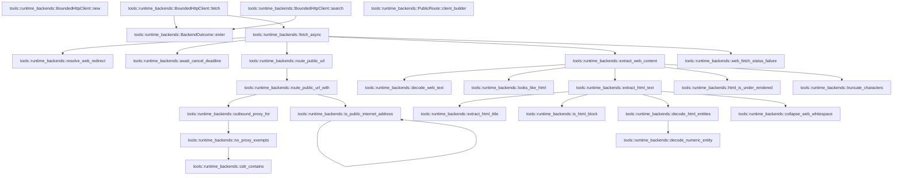

```mermaid
flowchart TD
  n0["store::atomic::AtomicPublisher::replace"]
  n1["store::platform::NamedLock::exclusive"]
  n2["store::platform::NamedLock::shared"]
  n3["tools::bubblewrap_sandbox::detached_command"]
  n4["tools::runtime_backends::JobBroker::job_directory"]
  n5["tools::runtime_backends::JobBroker::host_receipt"]
  n6["tools::runtime_backends::JobBroker::read_record"]
  n7["tools::runtime_backends::JobBroker::write_record"]
  n8["tools::runtime_backends::run_job_runner"]
  n9["tools::runtime_backends::BackendOutcome::enter"]
  n10["tools::runtime_backends::HttpLimits::default"]
  n11["tools::runtime_backends::HttpLimits::validate"]
  n12["tools::runtime_backends::require_canonical_directory"]
  n13["tools::runtime_backends::validate_job_id"]
  n14["tools::runtime_backends::drain_tail"]
  n15["tools::runtime_backends::signal_group"]
  n16["tools::runtime_backends::terminate_group"]
  n17["tools::runtime_backends::namespace_identity_channel"]
  n18["tools::runtime_backends::announce_namespace_runner"]
  n19["tools::runtime_backends::authenticate_namespace_runner"]
  n20["tools::runtime_backends::unix_millis"]
  n21["tools::runtime_backends::sync_directory"]
  n22["tools::runtime_backends::io_failure"]
  n23["tools::runtime_backends::store_failure"]
  n24["tools::runtime_backends::HelperJobLauncher::execution_access"]
  n25["tools::runtime_backends::HelperJobLauncher::uses_pid_namespace"]
  n26["tools::runtime_backends::HelperJobLauncher::runner_command"]
  n27["tools::runtime_backends::JobBroker::new"]
  n28["tools::runtime_backends::JobBroker::open"]
  n29["tools::runtime_backends::JobBroker::start"]
  n30["tools::runtime_backends::JobBroker::start_inner"]
  n31["tools::runtime_backends::JobBroker::status"]
  n32["tools::runtime_backends::JobBroker::status_inner"]
  n33["tools::runtime_backends::JobBroker::list"]
  n34["tools::runtime_backends::JobBroker::list_inner"]
  n35["tools::runtime_backends::JobBroker::stop"]
  n36["tools::runtime_backends::JobBroker::stop_inner"]
  n37["tools::sandbox::sandbox_command"]
  n6 --> n2
  n6 --> n4
  n6 --> n22
  n7 --> n0
  n7 --> n1
  n7 --> n4
  n8 --> n13
  n8 --> n14
  n8 --> n18
  n8 --> n20
  n8 --> n28
  n26 --> n3
  n26 --> n37
  n27 --> n28
  n29 --> n9
  n29 --> n13
  n29 --> n30
  n30 --> n0
  n30 --> n4
  n30 --> n7
  n30 --> n12
  n30 --> n16
  n30 --> n17
  n30 --> n19
  n30 --> n20
  n30 --> n21
  n30 --> n22
  n30 --> n23
  n31 --> n32
  n32 --> n5
  n32 --> n6
  n32 --> n7
  n32 --> n13
  n32 --> n20
  n33 --> n34
  n34 --> n13
  n34 --> n32
  n35 --> n9
  n35 --> n36
  n36 --> n5
  n36 --> n7
  n36 --> n15
  n36 --> n20
  n36 --> n32
```

# tools::runtime_backends

[Package atlas](index.md) · [Source](../../src/runtime_backends.rs)

## Declarations

Visibility is the declaration spelling; trait members and reexports require their enclosing interface. `cfg` is not evaluated.

| Symbol | Kind | Visibility | Test / cfg |
|---|---|---|---|
| [tools::runtime_backends::HARD_HELPER_BYTES](../../src/runtime_backends.rs#L30) | const_item | `pub` |  |
| [tools::runtime_backends::HARD_HELPER_READ_BYTES](../../src/runtime_backends.rs#L31) | const_item | `pub` |  |
| [tools::runtime_backends::HARD_HELPER_TIMEOUT_MS](../../src/runtime_backends.rs#L32) | const_item | `pub` |  |
| [tools::runtime_backends::HELPER_PROCESS_OVERHEAD_MS](../../src/runtime_backends.rs#L33) | const_item | `private` |  |
| [tools::runtime_backends::HARD_HTTP_BYTES](../../src/runtime_backends.rs#L34) | const_item | `pub` |  |
| [tools::runtime_backends::HARD_HTTP_TIMEOUT_MS](../../src/runtime_backends.rs#L35) | const_item | `pub` |  |
| [tools::runtime_backends::HARD_JOB_TAIL_BYTES](../../src/runtime_backends.rs#L36) | const_item | `pub` |  |
| [tools::runtime_backends::MAX_REDIRECTS](../../src/runtime_backends.rs#L37) | const_item | `pub` |  |
| [tools::runtime_backends::WEB_FETCH_ACCEPT](../../src/runtime_backends.rs#L38) | const_item | `pub` |  |
| [tools::runtime_backends::WEB_FETCH_MAX_CHARACTERS](../../src/runtime_backends.rs#L40) | const_item | `pub` |  |
| [tools::runtime_backends::WEB_FETCH_MIN_MEANINGFUL_CHARACTERS](../../src/runtime_backends.rs#L41) | const_item | `pub` |  |
| [tools::runtime_backends::WEB_FETCH_USER_AGENT](../../src/runtime_backends.rs#L42) | const_item | `pub` |  |
| [tools::runtime_backends::BackendOutcome](../../src/runtime_backends.rs#L45) | enum_item | `pub` |  |
| [tools::runtime_backends::BackendHold](../../src/runtime_backends.rs#L52) | struct_item | `pub` |  |
| [tools::runtime_backends::BackendUnavailable](../../src/runtime_backends.rs#L58) | struct_item | `pub` |  |
| [tools::runtime_backends::BackendGate](../../src/runtime_backends.rs#L64) | enum_item | `pub` |  |
| [tools::runtime_backends::web_fetch_status_failure](../../src/runtime_backends.rs#L74) | function_item | `private` |  |
| [tools::runtime_backends::BackendFailure](../../src/runtime_backends.rs#L90) | enum_item | `pub` |  |
| [tools::runtime_backends::BackendOutcome::enter](../../src/runtime_backends.rs#L118) | function_item | `private` |  |
| [tools::runtime_backends::CancellationToken](../../src/runtime_backends.rs#L128) | struct_item | `pub` |  |
| [tools::runtime_backends::CancellationToken::cancel](../../src/runtime_backends.rs#L131) | function_item | `pub` |  |
| [tools::runtime_backends::CancellationToken::is_cancelled](../../src/runtime_backends.rs#L136) | function_item | `pub` |  |
| [tools::runtime_backends::HelperInvoker](../../src/runtime_backends.rs#L141) | trait_item | `pub` |  |
| [tools::runtime_backends::HelperInvoker::invoke](../../src/runtime_backends.rs#L142) | function_signature_item | `private` |  |
| [tools::runtime_backends::HelperClient::invoke](../../src/runtime_backends.rs#L150) | function_item | `private` |  |
| [tools::runtime_backends::Arc::invoke](../../src/runtime_backends.rs#L183) | function_item | `private` |  |
| [tools::runtime_backends::BoundedHelper](../../src/runtime_backends.rs#L192) | struct_item | `pub` |  |
| [tools::runtime_backends::BoundedHelper::new](../../src/runtime_backends.rs#L198) | function_item | `pub` |  |
| [tools::runtime_backends::BoundedHelper::invoke](../../src/runtime_backends.rs#L202) | function_item | `pub` |  |
| [tools::runtime_backends::validate_helper_limits](../../src/runtime_backends.rs#L227) | function_item | `private` |  |
| [tools::runtime_backends::JobSpec](../../src/runtime_backends.rs#L294) | struct_item | `pub` |  |
| [tools::runtime_backends::JobLaunchPolicy](../../src/runtime_backends.rs#L312) | struct_item | `pub` |  |
| [tools::runtime_backends::JobLaunchPolicy::new](../../src/runtime_backends.rs#L320) | function_item | `pub` |  |
| [tools::runtime_backends::JobLaunchPolicy::full_access](../../src/runtime_backends.rs#L360) | function_item | `pub` |  |
| [tools::runtime_backends::JobLaunchPolicy::primary_workspace_cwd](../../src/runtime_backends.rs#L368) | function_item | `pub` |  |
| [tools::runtime_backends::JobLaunchPolicy::base_sandbox](../../src/runtime_backends.rs#L373) | function_item | `pub` |  |
| [tools::runtime_backends::JobLaunchPolicy::permitted_write_roots](../../src/runtime_backends.rs#L378) | function_item | `pub` |  |
| [tools::runtime_backends::JobLaunchPolicy::resolve](../../src/runtime_backends.rs#L382) | function_item | `private` |  |
| [tools::runtime_backends::JobState](../../src/runtime_backends.rs#L443) | enum_item | `pub` |  |
| [tools::runtime_backends::JobRecord](../../src/runtime_backends.rs#L453) | struct_item | `pub` |  |
| [tools::runtime_backends::JobRunnerRequest](../../src/runtime_backends.rs#L468) | struct_item | `private` |  |
| [tools::runtime_backends::SandboxedJobLauncher](../../src/runtime_backends.rs#L481) | trait_item | `pub` |  |
| [tools::runtime_backends::SandboxedJobLauncher::execution_access](../../src/runtime_backends.rs#L482) | function_item | `private` |  |
| [tools::runtime_backends::SandboxedJobLauncher::uses_pid_namespace](../../src/runtime_backends.rs#L489) | function_item | `private` |  |
| [tools::runtime_backends::SandboxedJobLauncher::runner_command](../../src/runtime_backends.rs#L493) | function_signature_item | `private` |  |
| [tools::runtime_backends::HelperJobLauncher](../../src/runtime_backends.rs#L504) | struct_item | `pub` |  |
| [tools::runtime_backends::HelperJobLauncher::new](../../src/runtime_backends.rs#L511) | function_item | `pub` |  |
| [tools::runtime_backends::HelperJobLauncher::for_execution_access](../../src/runtime_backends.rs#L531) | function_item | `pub` |  |
| [tools::runtime_backends::HelperJobLauncher::disabled](../../src/runtime_backends.rs#L555) | function_item | `pub` |  |
| [tools::runtime_backends::HelperJobLauncher::execution_access](../../src/runtime_backends.rs#L574) | function_item | `private` |  |
| [tools::runtime_backends::HelperJobLauncher::uses_pid_namespace](../../src/runtime_backends.rs#L578) | function_item | `private` |  |
| [tools::runtime_backends::HelperJobLauncher::runner_command](../../src/runtime_backends.rs#L584) | function_item | `private` |  |
| [tools::runtime_backends::JobBroker](../../src/runtime_backends.rs#L606) | struct_item | `pub` |  |
| [tools::runtime_backends::JobBroker::new](../../src/runtime_backends.rs#L614) | function_item | `pub` |  |
| [tools::runtime_backends::JobBroker::open](../../src/runtime_backends.rs#L618) | function_item | `private` |  |
| [tools::runtime_backends::JobBroker::start](../../src/runtime_backends.rs#L658) | function_item | `pub` |  |
| [tools::runtime_backends::JobBroker::start_inner](../../src/runtime_backends.rs#L700) | function_item | `private` |  |
| [tools::runtime_backends::JobBroker::status](../../src/runtime_backends.rs#L906) | function_item | `pub` |  |
| [tools::runtime_backends::JobBroker::status_inner](../../src/runtime_backends.rs#L910) | function_item | `private` |  |
| [tools::runtime_backends::JobBroker::list](../../src/runtime_backends.rs#L938) | function_item | `pub` |  |
| [tools::runtime_backends::JobBroker::list_inner](../../src/runtime_backends.rs#L942) | function_item | `private` |  |
| [tools::runtime_backends::JobBroker::stop](../../src/runtime_backends.rs#L957) | function_item | `pub` |  |
| [tools::runtime_backends::JobBroker::stop_inner](../../src/runtime_backends.rs#L972) | function_item | `private` |  |
| [tools::runtime_backends::JobBroker::job_directory](../../src/runtime_backends.rs#L1029) | function_item | `private` |  |
| [tools::runtime_backends::JobBroker::host_receipt](../../src/runtime_backends.rs#L1033) | function_item | `private` |  |
| [tools::runtime_backends::JobBroker::read_record](../../src/runtime_backends.rs#L1059) | function_item | `private` |  |
| [tools::runtime_backends::JobBroker::write_record](../../src/runtime_backends.rs#L1079) | function_item | `private` |  |
| [tools::runtime_backends::run_job_runner](../../src/runtime_backends.rs#L1091) | function_item | `pub` |  |
| [tools::runtime_backends::HttpLimits](../../src/runtime_backends.rs#L1202) | struct_item | `pub` |  |
| [tools::runtime_backends::HttpLimits::default](../../src/runtime_backends.rs#L1209) | function_item | `private` |  |
| [tools::runtime_backends::HttpLimits::validate](../../src/runtime_backends.rs#L1219) | function_item | `private` |  |
| [tools::runtime_backends::HttpFetchResult](../../src/runtime_backends.rs#L1240) | struct_item | `pub` |  |
| [tools::runtime_backends::WebExtractionKind](../../src/runtime_backends.rs#L1250) | enum_item | `pub` |  |
| [tools::runtime_backends::WebExtraction](../../src/runtime_backends.rs#L1261) | struct_item | `pub` |  |
| [tools::runtime_backends::BoundedHttpClient](../../src/runtime_backends.rs#L1269) | struct_item | `pub` |  |
| [tools::runtime_backends::BoundedHttpClient::new](../../src/runtime_backends.rs#L1274) | function_item | `pub` |  |
| [tools::runtime_backends::BoundedHttpClient::fetch](../../src/runtime_backends.rs#L1279) | function_item | `pub` |  |
| [tools::runtime_backends::BoundedHttpClient::search](../../src/runtime_backends.rs#L1312) | function_item | `pub` |  |
| [tools::runtime_backends::SearchTopic](../../src/runtime_backends.rs#L1361) | enum_item | `pub` |  |
| [tools::runtime_backends::SearchRequest](../../src/runtime_backends.rs#L1367) | struct_item | `pub` |  |
| [tools::runtime_backends::SearchHit](../../src/runtime_backends.rs#L1376) | struct_item | `pub` |  |
| [tools::runtime_backends::SearchProvider](../../src/runtime_backends.rs#L1385) | trait_item | `pub` |  |
| [tools::runtime_backends::SearchProvider::search](../../src/runtime_backends.rs#L1386) | function_signature_item | `private` |  |
| [tools::runtime_backends::fetch_async](../../src/runtime_backends.rs#L1394) | function_item | `private` |  |
| [tools::runtime_backends::resolve_web_redirect](../../src/runtime_backends.rs#L1487) | function_item | `pub` |  |
| [tools::runtime_backends::await_cancel_deadline](../../src/runtime_backends.rs#L1496) | function_item | `private` |  |
| [tools::runtime_backends::PublicRoute](../../src/runtime_backends.rs#L1522) | enum_item | `pub` |  |
| [tools::runtime_backends::PublicRoute::client_builder](../../src/runtime_backends.rs#L1534) | function_item | `pub` |  |
| [tools::runtime_backends::route_public_url](../../src/runtime_backends.rs#L1549) | function_item | `pub` |  |
| [tools::runtime_backends::route_public_url_with](../../src/runtime_backends.rs#L1554) | function_item | `pub` |  |
| [tools::runtime_backends::outbound_proxy_for](../../src/runtime_backends.rs#L1634) | function_item | `private` |  |
| [tools::runtime_backends::no_proxy_exempts](../../src/runtime_backends.rs#L1668) | function_item | `private` |  |
| [tools::runtime_backends::cidr_contains](../../src/runtime_backends.rs#L1718) | function_item | `private` |  |
| [tools::runtime_backends::is_public_internet_address](../../src/runtime_backends.rs#L1744) | function_item | `pub` |  |
| [tools::runtime_backends::extract_web_content](../../src/runtime_backends.rs#L1811) | function_item | `pub` |  |
| [tools::runtime_backends::decode_web_text](../../src/runtime_backends.rs#L1857) | function_item | `private` |  |
| [tools::runtime_backends::looks_like_html](../../src/runtime_backends.rs#L1864) | function_item | `private` |  |
| [tools::runtime_backends::extract_html_text](../../src/runtime_backends.rs#L1873) | function_item | `private` |  |
| [tools::runtime_backends::extract_html_title](../../src/runtime_backends.rs#L1935) | function_item | `private` |  |
| [tools::runtime_backends::is_html_block](../../src/runtime_backends.rs#L1952) | function_item | `private` |  |
| [tools::runtime_backends::decode_html_entities](../../src/runtime_backends.rs#L1977) | function_item | `private` |  |
| [tools::runtime_backends::decode_numeric_entity](../../src/runtime_backends.rs#L2026) | function_item | `private` |  |
| [tools::runtime_backends::collapse_web_whitespace](../../src/runtime_backends.rs#L2036) | function_item | `private` |  |
| [tools::runtime_backends::html_is_under_rendered](../../src/runtime_backends.rs#L2057) | function_item | `private` |  |
| [tools::runtime_backends::truncate_characters](../../src/runtime_backends.rs#L2069) | function_item | `private` |  |
| [tools::runtime_backends::require_canonical_directory](../../src/runtime_backends.rs#L2082) | function_item | `private` |  |
| [tools::runtime_backends::canonical_invocation_directory](../../src/runtime_backends.rs#L2109) | function_item | `private` |  |
| [tools::runtime_backends::normalize_policy_roots](../../src/runtime_backends.rs#L2144) | function_item | `private` |  |
| [tools::runtime_backends::covered_by](../../src/runtime_backends.rs#L2168) | function_item | `private` |  |
| [tools::runtime_backends::validate_job_id](../../src/runtime_backends.rs#L2174) | function_item | `private` |  |
| [tools::runtime_backends::drain_tail](../../src/runtime_backends.rs#L2188) | function_item | `private` |  |
| [tools::runtime_backends::signal_group](../../src/runtime_backends.rs#L2206) | function_item | `private` |  |
| [tools::runtime_backends::terminate_group](../../src/runtime_backends.rs#L2223) | function_item | `private` |  |
| [tools::runtime_backends::JobHostReceipt](../../src/runtime_backends.rs#L2241) | struct_item | `private` |  |
| [tools::runtime_backends::NamespaceRunnerIdentity](../../src/runtime_backends.rs#L2250) | struct_item | `private` |  |
| [tools::runtime_backends::LinuxProcessIdentity](../../src/runtime_backends.rs#L2259) | struct_item | `private` |  |
| [tools::runtime_backends::LinuxProcessIdentity::read](../../src/runtime_backends.rs#L2272) | function_item | `private` | #[cfg(target_os = "linux")] |
| [tools::runtime_backends::LinuxProcessIdentity::same_namespace](../../src/runtime_backends.rs#L2298) | function_item | `private` | #[cfg(target_os = "linux")] |
| [tools::runtime_backends::LinuxProcessIdentity::is_live](../../src/runtime_backends.rs#L2303) | function_item | `private` | #[cfg(target_os = "linux")] |
| [tools::runtime_backends::NamespaceRunnerIdentity::matches_record](../../src/runtime_backends.rs#L2314) | function_item | `private` | #[cfg(target_os = "linux")] |
| [tools::runtime_backends::NamespaceRunnerIdentity::matches_current_runner](../../src/runtime_backends.rs#L2325) | function_item | `private` | #[cfg(target_os = "linux")] |
| [tools::runtime_backends::NamespaceRunnerIdentity::namespace_is_live](../../src/runtime_backends.rs#L2333) | function_item | `private` | #[cfg(target_os = "linux")] |
| [tools::runtime_backends::NamespaceRunnerIdentity::stop_namespace](../../src/runtime_backends.rs#L2337) | function_item | `private` | #[cfg(target_os = "linux")] |
| [tools::runtime_backends::NamespaceRunnerIdentity::stop_handle](../../src/runtime_backends.rs#L2344) | function_item | `private` | #[cfg(target_os = "linux")] |
| [tools::runtime_backends::NamespaceStopHandle](../../src/runtime_backends.rs#L2397) | struct_item | `private` | #[cfg(target_os = "linux")] |
| [tools::runtime_backends::NamespaceStopHandle::kill](../../src/runtime_backends.rs#L2401) | function_item | `private` | #[cfg(target_os = "linux")] |
| [tools::runtime_backends::NamespaceStopHandle::send_signal](../../src/runtime_backends.rs#L2405) | function_item | `private` | #[cfg(target_os = "linux")] |
| [tools::runtime_backends::namespace_identity_channel](../../src/runtime_backends.rs#L2431) | function_item | `private` | #[cfg(target_os = "linux")] |
| [tools::runtime_backends::announce_namespace_runner](../../src/runtime_backends.rs#L2461) | function_item | `private` | #[cfg(target_os = "linux")] |
| [tools::runtime_backends::namespace_runner_peer](../../src/runtime_backends.rs#L2472) | function_item | `private` | #[cfg(target_os = "linux")] |
| [tools::runtime_backends::authenticate_namespace_runner](../../src/runtime_backends.rs#L2523) | function_item | `private` | #[cfg(target_os = "linux")] |
| [tools::runtime_backends::process_start_token](../../src/runtime_backends.rs#L2559) | function_item | `private` | #[cfg(target_os = "macos")] |
| [tools::runtime_backends::process_start_token](../../src/runtime_backends.rs#L2584) | function_item | `private` | #[cfg(target_os = "linux")] |
| [tools::runtime_backends::process_start_token](../../src/runtime_backends.rs#L2594) | function_item | `private` | #[cfg(not(any(target_os = "macos", target_os = "linux")))] |
| [tools::runtime_backends::unix_millis](../../src/runtime_backends.rs#L2598) | function_item | `private` |  |
| [tools::runtime_backends::sync_directory](../../src/runtime_backends.rs#L2606) | function_item | `private` |  |
| [tools::runtime_backends::io_failure](../../src/runtime_backends.rs#L2612) | function_item | `private` |  |
| [tools::runtime_backends::store_failure](../../src/runtime_backends.rs#L2616) | function_item | `private` |  |
| [tools::runtime_backends::disabled_job_launcher_tests::mcp_only_launcher_refuses_command_execution](../../src/runtime_backends.rs#L2627) | function_item | `private` | test; #[cfg(test)] |
| [tools::runtime_backends::namespace_job_identity_tests::inherited_socket_reports_kernel_sender_identity](../../src/runtime_backends.rs#L2658) | function_item | `private` | test; #[cfg(all(test, target_os = "linux"))] |
| [tools::runtime_backends::namespace_job_identity_tests::namespace_authentication_refuses_an_unrelated_sender](../../src/runtime_backends.rs#L2665) | function_item | `private` | test; #[cfg(all(test, target_os = "linux"))] |
| [tools::runtime_backends::namespace_job_identity_tests::runner_identity_requires_matching_pid_start_and_namespace](../../src/runtime_backends.rs#L2676) | function_item | `private` | test; #[cfg(all(test, target_os = "linux"))] |
| [tools::runtime_backends::namespace_job_identity_tests::stale_namespace_identity_never_signals_a_live_process](../../src/runtime_backends.rs#L2696) | function_item | `private` | test; #[cfg(all(test, target_os = "linux"))] |
| [tools::runtime_backends::namespace_job_identity_tests::forged_namespace_receipt_cannot_select_a_host_process](../../src/runtime_backends.rs#L2714) | function_item | `private` | test; #[cfg(all(test, target_os = "linux"))] |
| [tools::runtime_backends::namespace_job_identity_tests::test_record](../../src/runtime_backends.rs#L2728) | function_item | `private` | test; #[cfg(all(test, target_os = "linux"))] |
| [tools::runtime_backends::namespace_job_identity_tests::sandbox_written_pid_and_job_id_cannot_replace_host_authority](../../src/runtime_backends.rs#L2750) | function_item | `private` | test; #[cfg(all(test, target_os = "linux"))] |
| [tools::runtime_backends::namespace_job_identity_tests::writable_root_cannot_cover_private_launch_receipts](../../src/runtime_backends.rs#L2785) | function_item | `private` | test; #[cfg(all(test, target_os = "linux"))] |
| [tools::runtime_backends::namespace_job_identity_tests::writable_root_cannot_cover_private_launch_receipts::NeverLaunch](../../src/runtime_backends.rs#L2786) | struct_item | `private` | test; #[cfg(all(test, target_os = "linux"))] |
| [tools::runtime_backends::namespace_job_identity_tests::writable_root_cannot_cover_private_launch_receipts::NeverLaunch::runner_command](../../src/runtime_backends.rs#L2788) | function_item | `private` | test; #[cfg(all(test, target_os = "linux"))] |
| [tools::runtime_backends::web_fetch_status_tests::non_success_statuses_classify_by_what_the_server_said](../../src/runtime_backends.rs#L2834) | function_item | `private` | test; #[cfg(test)] |

## Imports / reexports

| Local name | Source path | Visibility |
|---|---|---|
| `BTreeMap` | `std::collections::BTreeMap` | `private` |
| `VecDeque` | `std::collections::VecDeque` | `private` |
| `fs` | `std::fs` | `private` |
| `File` | `std::fs::File` | `private` |
| `Read` | `std::io::Read` | `private` |
| `IpAddr` | `std::net::IpAddr` | `private` |
| `SocketAddr` | `std::net::SocketAddr` | `private` |
| `ToSocketAddrs` | `std::net::ToSocketAddrs` | `private` |
| `_` | `std::os::unix::process::CommandExt` | `private` |
| `Path` | `std::path::Path` | `private` |
| `PathBuf` | `std::path::PathBuf` | `private` |
| `Child` | `std::process::Child` | `private` |
| `Command` | `std::process::Command` | `private` |
| `Stdio` | `std::process::Stdio` | `private` |
| `Arc` | `std::sync::Arc` | `private` |
| `AtomicBool` | `std::sync::atomic::AtomicBool` | `private` |
| `Ordering` | `std::sync::atomic::Ordering` | `private` |
| `thread` | `std::thread` | `private` |
| `Duration` | `std::time::Duration` | `private` |
| `Instant` | `std::time::Instant` | `private` |
| `SystemTime` | `std::time::SystemTime` | `private` |
| `UNIX_EPOCH` | `std::time::UNIX_EPOCH` | `private` |
| `ACCEPT` | `reqwest::header::ACCEPT` | `private` |
| `CONTENT_LENGTH` | `reqwest::header::CONTENT_LENGTH` | `private` |
| `CONTENT_TYPE` | `reqwest::header::CONTENT_TYPE` | `private` |
| `LOCATION` | `reqwest::header::LOCATION` | `private` |
| `USER_AGENT` | `reqwest::header::USER_AGENT` | `private` |
| `Deserialize` | `serde::Deserialize` | `private` |
| `Serialize` | `serde::Serialize` | `private` |
| `AtomicPublisher` | `store::AtomicPublisher` | `private` |
| `NamedLock` | `store::NamedLock` | `private` |
| `Error` | `thiserror::Error` | `private` |
| `HelperClient` | `crate::helper::HelperClient` | `private` |
| `HelperClientError` | `crate::helper::HelperClientError` | `private` |
| `HelperErrorClass` | `crate::helper::HelperErrorClass` | `private` |
| `HelperOperation` | `crate::helper::HelperOperation` | `private` |
| `HelperRequest` | `crate::helper::HelperRequest` | `private` |
| `HelperResponse` | `crate::helper::HelperResponse` | `private` |
| `ProbeStatus` | `crate::sandbox::ProbeStatus` | `private` |
| `SandboxPolicy` | `crate::sandbox::SandboxPolicy` | `private` |
| `sandbox_command` | `crate::sandbox::sandbox_command` | `private` |
| `BackendFailure` | `super::BackendFailure` | `private` |
| `HelperJobLauncher` | `super::HelperJobLauncher` | `private` |
| `JobSpec` | `super::JobSpec` | `private` |
| `SandboxedJobLauncher` | `super::SandboxedJobLauncher` | `private` |
| `NetworkPolicy` | `crate::NetworkPolicy` | `private` |
| `SandboxPolicy` | `crate::SandboxPolicy` | `private` |
| `BTreeMap` | `std::collections::BTreeMap` | `private` |
| `*` | `super::*` | `private` |
| `Write` | `std::io::Write` | `private` |
| `BackendFailure` | `super::BackendFailure` | `private` |
| `web_fetch_status_failure` | `super::web_fetch_status_failure` | `private` |
| `StatusCode` | `reqwest::StatusCode` | `private` |

## Module declarations

| Module | Visibility | Attributes |
|---|---|---|
| `tools::runtime_backends::disabled_job_launcher_tests` | `private` | #[cfg(test)] |
| `tools::runtime_backends::namespace_job_identity_tests` | `private` | #[cfg(all(test, target_os = "linux"))] |
| `tools::runtime_backends::web_fetch_status_tests` | `private` | #[cfg(test)] |

## Function call graphs

Edges below are syntactically resolved calls only, including private functions. Graphs partition callers into groups of 20; they are not execution order. All unresolved sites are listed below and in the JSON inventory.

Functions 1–20: 9 direct edges

Functions 21–40: 44 direct edges

Functions 41–60: 24 direct edges

Functions 61–80: 9 direct edges

Functions 81–93: 6 direct edges

```mermaid
flowchart TD
  n0["tools::runtime_backends::LinuxProcessIdentity::read"]
  n1["tools::runtime_backends::NamespaceStopHandle::kill"]
  n2["tools::runtime_backends::NamespaceStopHandle::send_signal"]
  n3["tools::runtime_backends::namespace_identity_channel"]
  n4["tools::runtime_backends::announce_namespace_runner"]
  n5["tools::runtime_backends::namespace_runner_peer"]
  n6["tools::runtime_backends::authenticate_namespace_runner"]
  n7["tools::runtime_backends::process_start_token"]
  n8["tools::runtime_backends::process_start_token"]
  n9["tools::runtime_backends::process_start_token"]
  n10["tools::runtime_backends::unix_millis"]
  n11["tools::runtime_backends::sync_directory"]
  n12["tools::runtime_backends::io_failure"]
  n13["tools::runtime_backends::store_failure"]
  n1 --> n2
  n2 --> n12
  n3 --> n12
  n5 --> n12
  n6 --> n0
  n6 --> n5
```

## Call sites

Includes test functions (marked in declarations). Receiver-type-required sites need type analysis/manual tracing. Calls in closures are attributed to their enclosing function; their occurrence here does not mean the closure executes immediately.

| Caller | Callee expression | Source lines | Target / classification |
|---|---|---|---|
| `web_fetch_status_failure` | `status.as_u16` | [75](../../src/runtime_backends.rs#L75) | receiver-type-required |
| `web_fetch_status_failure` | `BackendFailure::NotFound` | [77](../../src/runtime_backends.rs#L77) | external-constructor-callback-or-unresolved |
| `web_fetch_status_failure` | `BackendFailure::Denied` | [78](../../src/runtime_backends.rs#L78) | external-constructor-callback-or-unresolved |
| `web_fetch_status_failure` | `BackendFailure::Limit` | [80](../../src/runtime_backends.rs#L80) | external-constructor-callback-or-unresolved |
| `web_fetch_status_failure` | `status.is_client_error` | [81](../../src/runtime_backends.rs#L81) | receiver-type-required |
| `web_fetch_status_failure` | `BackendFailure::Invalid` | [81](../../src/runtime_backends.rs#L81) | external-constructor-callback-or-unresolved |
| `web_fetch_status_failure` | `status.is_server_error` | [84](../../src/runtime_backends.rs#L84) | receiver-type-required |
| `web_fetch_status_failure` | `BackendFailure::Unavailable` | [84](../../src/runtime_backends.rs#L84) | external-constructor-callback-or-unresolved |
| `web_fetch_status_failure` | `BackendFailure::Protocol` | [85](../../src/runtime_backends.rs#L85) | external-constructor-callback-or-unresolved |
| `enter` | `Ok` | [120](../../src/runtime_backends.rs#L120) | external-constructor-callback-or-unresolved |
| `enter` | `Err` | [121](../../src/runtime_backends.rs#L121), [122](../../src/runtime_backends.rs#L122) | external-constructor-callback-or-unresolved |
| `enter` | `Self::Hold` | [121](../../src/runtime_backends.rs#L121) | external-constructor-callback-or-unresolved |
| `enter` | `Self::Unavailable` | [122](../../src/runtime_backends.rs#L122) | external-constructor-callback-or-unresolved |
| `cancel` | `self.0.store` | [132](../../src/runtime_backends.rs#L132) | receiver-type-required |
| `is_cancelled` | `self.0.load` | [137](../../src/runtime_backends.rs#L137) | receiver-type-required |
| `invoke` | `exec.timeout_ms.map` | [159](../../src/runtime_backends.rs#L159) | receiver-type-required |
| `invoke` | `Duration::from_millis` | [160](../../src/runtime_backends.rs#L160) | external-constructor-callback-or-unresolved |
| `invoke` | `timeout.saturating_add` | [160](../../src/runtime_backends.rs#L160) | receiver-type-required |
| `invoke` | `Some` | [162](../../src/runtime_backends.rs#L162) | external-constructor-callback-or-unresolved |
| `invoke` | `Duration::from_secs` | [162](../../src/runtime_backends.rs#L162) | external-constructor-callback-or-unresolved |
| `invoke` | `self.execute_cancellable(request, timeout, &#124;&#124; cancellation.is_cancelled())             .map_err` | [164](../../src/runtime_backends.rs#L164) | receiver-type-required |
| `invoke` | `self.execute_cancellable` | [164](../../src/runtime_backends.rs#L164) | receiver-type-required |
| `invoke` | `cancellation.is_cancelled` | [164](../../src/runtime_backends.rs#L164) | receiver-type-required |
| `invoke` | `BackendFailure::Limit` | [169](../../src/runtime_backends.rs#L169) | external-constructor-callback-or-unresolved |
| `invoke` | `BackendFailure::Denied` | [170](../../src/runtime_backends.rs#L170) | external-constructor-callback-or-unresolved |
| `invoke` | `BackendFailure::NotFound` | [171](../../src/runtime_backends.rs#L171) | external-constructor-callback-or-unresolved |
| `invoke` | `BackendFailure::Unavailable` | [173](../../src/runtime_backends.rs#L173) | external-constructor-callback-or-unresolved |
| `invoke` | `BackendFailure::Protocol` | [175](../../src/runtime_backends.rs#L175) | external-constructor-callback-or-unresolved |
| `invoke` | `BackendFailure::Io` | [176](../../src/runtime_backends.rs#L176) | external-constructor-callback-or-unresolved |
| `invoke` | `error.to_string` | [176](../../src/runtime_backends.rs#L176) | receiver-type-required |
| `invoke` | `(**self).invoke` | [188](../../src/runtime_backends.rs#L188) | receiver-type-required |
| `invoke` | `BackendOutcome::enter` | [208](../../src/runtime_backends.rs#L208) | [tools::runtime_backends::BackendOutcome::enter](../../src/runtime_backends.rs#L118) |
| `invoke` | `cancellation.is_cancelled` | [211](../../src/runtime_backends.rs#L211) | receiver-type-required |
| `invoke` | `BackendOutcome::Completed` | [212](../../src/runtime_backends.rs#L212), [215](../../src/runtime_backends.rs#L215), [223](../../src/runtime_backends.rs#L223) | external-constructor-callback-or-unresolved |
| `invoke` | `Err` | [212](../../src/runtime_backends.rs#L212), [215](../../src/runtime_backends.rs#L215) | external-constructor-callback-or-unresolved |
| `invoke` | `validate_helper_limits` | [214](../../src/runtime_backends.rs#L214) | [tools::runtime_backends::validate_helper_limits](../../src/runtime_backends.rs#L227) |
| `invoke` | `BackendOutcome::Unavailable` | [218](../../src/runtime_backends.rs#L218) | external-constructor-callback-or-unresolved |
| `invoke` | `"exec-helper".to_owned` | [219](../../src/runtime_backends.rs#L219) | receiver-type-required |
| `invoke` | `"helper process is not configured".to_owned` | [220](../../src/runtime_backends.rs#L220) | receiver-type-required |
| `invoke` | `invoker.invoke` | [223](../../src/runtime_backends.rs#L223) | receiver-type-required |
| `validate_helper_limits` | `Err` | [230](../../src/runtime_backends.rs#L230), [251](../../src/runtime_backends.rs#L251), [259](../../src/runtime_backends.rs#L259), [270](../../src/runtime_backends.rs#L270), [282](../../src/runtime_backends.rs#L282) | external-constructor-callback-or-unresolved |
| `validate_helper_limits` | `BackendFailure::Limit` | [230](../../src/runtime_backends.rs#L230), [251](../../src/runtime_backends.rs#L251), [259](../../src/runtime_backends.rs#L259), [270](../../src/runtime_backends.rs#L270), [282](../../src/runtime_backends.rs#L282) | external-constructor-callback-or-unresolved |
| `validate_helper_limits` | `Ok` | [234](../../src/runtime_backends.rs#L234), [253](../../src/runtime_backends.rs#L253), [263](../../src/runtime_backends.rs#L263), [274](../../src/runtime_backends.rs#L274), [286](../../src/runtime_backends.rs#L286) | external-constructor-callback-or-unresolved |
| `validate_helper_limits` | `bounded` | [239](../../src/runtime_backends.rs#L239), [241](../../src/runtime_backends.rs#L241), [248](../../src/runtime_backends.rs#L248), [249](../../src/runtime_backends.rs#L249), [256](../../src/runtime_backends.rs#L256), [257](../../src/runtime_backends.rs#L257) | external-constructor-callback-or-unresolved |
| `validate_helper_limits` | `"grep context limit exceeded".into` | [251](../../src/runtime_backends.rs#L251) | receiver-type-required |
| `validate_helper_limits` | `Some` | [258](../../src/runtime_backends.rs#L258) | external-constructor-callback-or-unresolved |
| `validate_helper_limits` | `"timeout_ms must be at least 1".into` | [260](../../src/runtime_backends.rs#L260) | receiver-type-required |
| `validate_helper_limits` | `content                 .decode()                 .map_err` | [266](../../src/runtime_backends.rs#L266) | receiver-type-required |
| `validate_helper_limits` | `content                 .decode` | [266](../../src/runtime_backends.rs#L266) | receiver-type-required |
| `validate_helper_limits` | `BackendFailure::Invalid` | [268](../../src/runtime_backends.rs#L268), [280](../../src/runtime_backends.rs#L280) | external-constructor-callback-or-unresolved |
| `validate_helper_limits` | `error.to_string` | [268](../../src/runtime_backends.rs#L268), [280](../../src/runtime_backends.rs#L280) | receiver-type-required |
| `validate_helper_limits` | `bytes.len` | [269](../../src/runtime_backends.rs#L269), [281](../../src/runtime_backends.rs#L281) | receiver-type-required |
| `validate_helper_limits` | `"content exceeds helper byte limit".into` | [271](../../src/runtime_backends.rs#L271) | receiver-type-required |
| `validate_helper_limits` | `replacement                 .decode()                 .map_err` | [278](../../src/runtime_backends.rs#L278) | receiver-type-required |
| `validate_helper_limits` | `replacement                 .decode` | [278](../../src/runtime_backends.rs#L278) | receiver-type-required |
| `validate_helper_limits` | `"replacement exceeds helper byte limit".into` | [283](../../src/runtime_backends.rs#L283) | receiver-type-required |
| `new` | `base_sandbox             .validate()             .map_err` | [325](../../src/runtime_backends.rs#L325) | receiver-type-required |
| `new` | `base_sandbox             .validate` | [325](../../src/runtime_backends.rs#L325) | receiver-type-required |
| `new` | `BackendFailure::Invalid` | [327](../../src/runtime_backends.rs#L327) | external-constructor-callback-or-unresolved |
| `new` | `error.to_string` | [327](../../src/runtime_backends.rs#L327) | receiver-type-required |
| `new` | `require_canonical_directory` | [329](../../src/runtime_backends.rs#L329), [333](../../src/runtime_backends.rs#L333), [336](../../src/runtime_backends.rs#L336), [339](../../src/runtime_backends.rs#L339) | [tools::runtime_backends::require_canonical_directory](../../src/runtime_backends.rs#L2082) |
| `new` | `primary_workspace_cwd.into` | [329](../../src/runtime_backends.rs#L329) | receiver-type-required |
| `new` | `base_sandbox             .read_roots             .iter()             .map(&#124;root&#124; require_canonical_directory(root, "sandbox read root"))             .collect::<Result<Vec<_>, _>>` | [330](../../src/runtime_backends.rs#L330) | receiver-type-required |
| `new` | `base_sandbox             .read_roots             .iter()             .map` | [330](../../src/runtime_backends.rs#L330) | receiver-type-required |
| `new` | `base_sandbox             .read_roots             .iter` | [330](../../src/runtime_backends.rs#L330) | receiver-type-required |
| `new` | `covered_by` | [341](../../src/runtime_backends.rs#L341) | [tools::runtime_backends::covered_by](../../src/runtime_backends.rs#L2168) |
| `new` | `Err` | [342](../../src/runtime_backends.rs#L342) | external-constructor-callback-or-unresolved |
| `new` | `BackendFailure::Denied` | [342](../../src/runtime_backends.rs#L342) | external-constructor-callback-or-unresolved |
| `new` | `"primary workspace cwd is outside sandbox read roots".to_owned` | [343](../../src/runtime_backends.rs#L343) | receiver-type-required |
| `new` | `normalize_policy_roots` | [346](../../src/runtime_backends.rs#L346) | [tools::runtime_backends::normalize_policy_roots](../../src/runtime_backends.rs#L2144) |
| `new` | `Ok` | [351](../../src/runtime_backends.rs#L351) | external-constructor-callback-or-unresolved |
| `full_access` | `crate::ExecutionAccess::FullAccess.policy` | [361](../../src/runtime_backends.rs#L361) | receiver-type-required |
| `resolve` | `spec.working_directory.as_deref` | [383](../../src/runtime_backends.rs#L383) | receiver-type-required |
| `resolve` | `canonical_invocation_directory` | [384](../../src/runtime_backends.rs#L384), [399](../../src/runtime_backends.rs#L399) | [tools::runtime_backends::canonical_invocation_directory](../../src/runtime_backends.rs#L2109) |
| `resolve` | `self.primary_workspace_cwd.clone` | [389](../../src/runtime_backends.rs#L389) | receiver-type-required |
| `resolve` | `covered_by` | [391](../../src/runtime_backends.rs#L391), [404](../../src/runtime_backends.rs#L404) | [tools::runtime_backends::covered_by](../../src/runtime_backends.rs#L2168) |
| `resolve` | `Err` | [392](../../src/runtime_backends.rs#L392), [405](../../src/runtime_backends.rs#L405), [413](../../src/runtime_backends.rs#L413), [418](../../src/runtime_backends.rs#L418) | external-constructor-callback-or-unresolved |
| `resolve` | `BackendFailure::Denied` | [392](../../src/runtime_backends.rs#L392), [405](../../src/runtime_backends.rs#L405), [413](../../src/runtime_backends.rs#L413) | external-constructor-callback-or-unresolved |
| `resolve` | `"job working directory is outside sandbox read roots".to_owned` | [393](../../src/runtime_backends.rs#L393) | receiver-type-required |
| `resolve` | `Vec::with_capacity` | [397](../../src/runtime_backends.rs#L397) | external-constructor-callback-or-unresolved |
| `resolve` | `spec.writable_paths.len` | [397](../../src/runtime_backends.rs#L397) | receiver-type-required |
| `resolve` | `crate::protected_root_containing` | [409](../../src/runtime_backends.rs#L409) | [tools::sandbox::protected_root_containing](../../src/sandbox.rs#L241) |
| `resolve` | `Path::new` | [411](../../src/runtime_backends.rs#L411) | external-constructor-callback-or-unresolved |
| `resolve` | `requested.iter().any` | [417](../../src/runtime_backends.rs#L417) | receiver-type-required |
| `resolve` | `requested.iter` | [417](../../src/runtime_backends.rs#L417) | receiver-type-required |
| `resolve` | `BackendFailure::Invalid` | [418](../../src/runtime_backends.rs#L418), [436](../../src/runtime_backends.rs#L436) | external-constructor-callback-or-unresolved |
| `resolve` | `"job writable paths contain duplicate canonical roots".to_owned` | [419](../../src/runtime_backends.rs#L419) | receiver-type-required |
| `resolve` | `requested.push` | [422](../../src/runtime_backends.rs#L422) | receiver-type-required |
| `resolve` | `requested.sort_by` | [424](../../src/runtime_backends.rs#L424) | receiver-type-required |
| `resolve` | `left.as_bytes().cmp` | [424](../../src/runtime_backends.rs#L424), [432](../../src/runtime_backends.rs#L432) | receiver-type-required |
| `resolve` | `left.as_bytes` | [424](../../src/runtime_backends.rs#L424), [432](../../src/runtime_backends.rs#L432) | receiver-type-required |
| `resolve` | `right.as_bytes` | [424](../../src/runtime_backends.rs#L424), [432](../../src/runtime_backends.rs#L432) | receiver-type-required |
| `resolve` | `Some` | [426](../../src/runtime_backends.rs#L426) | external-constructor-callback-or-unresolved |
| `resolve` | `requested.clone` | [427](../../src/runtime_backends.rs#L427) | receiver-type-required |
| `resolve` | `self.base_sandbox.clone` | [428](../../src/runtime_backends.rs#L428) | receiver-type-required |
| `resolve` | `effective.write_roots.extend` | [429](../../src/runtime_backends.rs#L429) | receiver-type-required |
| `resolve` | `effective             .write_roots             .sort_by` | [430](../../src/runtime_backends.rs#L430) | receiver-type-required |
| `resolve` | `effective.write_roots.dedup` | [433](../../src/runtime_backends.rs#L433) | receiver-type-required |
| `resolve` | `effective             .validate()             .map_err` | [434](../../src/runtime_backends.rs#L434) | receiver-type-required |
| `resolve` | `effective             .validate` | [434](../../src/runtime_backends.rs#L434) | receiver-type-required |
| `resolve` | `error.to_string` | [436](../../src/runtime_backends.rs#L436) | receiver-type-required |
| `resolve` | `Ok` | [437](../../src/runtime_backends.rs#L437) | external-constructor-callback-or-unresolved |
| `new` | `executable.into` | [512](../../src/runtime_backends.rs#L512) | receiver-type-required |
| `new` | `executable.is_absolute` | [513](../../src/runtime_backends.rs#L513) | receiver-type-required |
| `new` | `executable.is_file` | [513](../../src/runtime_backends.rs#L513) | receiver-type-required |
| `new` | `Err` | [514](../../src/runtime_backends.rs#L514), [519](../../src/runtime_backends.rs#L519) | external-constructor-callback-or-unresolved |
| `new` | `BackendFailure::Unavailable` | [514](../../src/runtime_backends.rs#L514), [519](../../src/runtime_backends.rs#L519) | external-constructor-callback-or-unresolved |
| `new` | `"tekes-helper executable is not an absolute regular file".to_owned` | [515](../../src/runtime_backends.rs#L515) | receiver-type-required |
| `new` | `Ok` | [523](../../src/runtime_backends.rs#L523) | external-constructor-callback-or-unresolved |
| `for_execution_access` | `executable.into` | [536](../../src/runtime_backends.rs#L536) | receiver-type-required |
| `for_execution_access` | `Self::new` | [538](../../src/runtime_backends.rs#L538) | [tools::runtime_backends::HelperJobLauncher::new](../../src/runtime_backends.rs#L511) |
| `for_execution_access` | `executable.is_absolute` | [540](../../src/runtime_backends.rs#L540) | receiver-type-required |
| `for_execution_access` | `executable.is_file` | [540](../../src/runtime_backends.rs#L540) | receiver-type-required |
| `for_execution_access` | `Err` | [541](../../src/runtime_backends.rs#L541) | external-constructor-callback-or-unresolved |
| `for_execution_access` | `BackendFailure::Unavailable` | [541](../../src/runtime_backends.rs#L541) | external-constructor-callback-or-unresolved |
| `for_execution_access` | `"tekes-helper executable is not an absolute regular file".to_owned` | [542](../../src/runtime_backends.rs#L542) | receiver-type-required |
| `for_execution_access` | `Ok` | [545](../../src/runtime_backends.rs#L545) | external-constructor-callback-or-unresolved |
| `disabled` | `executable.into` | [556](../../src/runtime_backends.rs#L556) | receiver-type-required |
| `disabled` | `executable.is_absolute` | [557](../../src/runtime_backends.rs#L557) | receiver-type-required |
| `disabled` | `executable.is_file` | [557](../../src/runtime_backends.rs#L557) | receiver-type-required |
| `disabled` | `Err` | [558](../../src/runtime_backends.rs#L558) | external-constructor-callback-or-unresolved |
| `disabled` | `BackendFailure::Unavailable` | [558](../../src/runtime_backends.rs#L558) | external-constructor-callback-or-unresolved |
| `disabled` | `"tekes-helper executable is not an absolute regular file".to_owned` | [559](../../src/runtime_backends.rs#L559) | receiver-type-required |
| `disabled` | `Ok` | [562](../../src/runtime_backends.rs#L562) | external-constructor-callback-or-unresolved |
| `disabled` | `"per-job sandbox unavailable in MCP-only App Sandbox host".to_owned` | [567](../../src/runtime_backends.rs#L567) | receiver-type-required |
| `runner_command` | `Ok` | [590](../../src/runtime_backends.rs#L590) | external-constructor-callback-or-unresolved |
| `runner_command` | `Command::new` | [590](../../src/runtime_backends.rs#L590) | external-constructor-callback-or-unresolved |
| `runner_command` | `self.uses_pid_namespace` | [596](../../src/runtime_backends.rs#L596) | receiver-type-required |
| `runner_command` | `crate::bubblewrap_sandbox::detached_command(effective_policy, &self.executable)                 .map_err` | [597](../../src/runtime_backends.rs#L597) | receiver-type-required |
| `runner_command` | `crate::bubblewrap_sandbox::detached_command` | [597](../../src/runtime_backends.rs#L597) | [tools::bubblewrap_sandbox::detached_command](../../src/bubblewrap_sandbox.rs#L63) |
| `runner_command` | `BackendFailure::Unavailable` | [598](../../src/runtime_backends.rs#L598), [601](../../src/runtime_backends.rs#L601) | external-constructor-callback-or-unresolved |
| `runner_command` | `error.to_string` | [598](../../src/runtime_backends.rs#L598), [601](../../src/runtime_backends.rs#L601) | receiver-type-required |
| `runner_command` | `sandbox_command(effective_policy, &self.probe, &self.executable)             .map_err` | [600](../../src/runtime_backends.rs#L600) | receiver-type-required |
| `runner_command` | `sandbox_command` | [600](../../src/runtime_backends.rs#L600) | [tools::sandbox::sandbox_command](../../src/sandbox.rs#L543) |
| `new` | `Self::open` | [615](../../src/runtime_backends.rs#L615) | [tools::runtime_backends::JobBroker::open](../../src/runtime_backends.rs#L618) |
| `new` | `root.into` | [615](../../src/runtime_backends.rs#L615) | receiver-type-required |
| `open` | `Err` | [624](../../src/runtime_backends.rs#L624), [634](../../src/runtime_backends.rs#L634), [645](../../src/runtime_backends.rs#L645) | external-constructor-callback-or-unresolved |
| `open` | `BackendFailure::Limit` | [624](../../src/runtime_backends.rs#L624) | external-constructor-callback-or-unresolved |
| `open` | `fs::create_dir_all(&root).map_err` | [628](../../src/runtime_backends.rs#L628) | receiver-type-required |
| `open` | `fs::create_dir_all` | [628](../../src/runtime_backends.rs#L628), [639](../../src/runtime_backends.rs#L639) | external-constructor-callback-or-unresolved |
| `open` | `fs::symlink_metadata(&root)             .map_err(io_failure)?             .file_type()             .is_symlink` | [629](../../src/runtime_backends.rs#L629) | receiver-type-required |
| `open` | `fs::symlink_metadata(&root)             .map_err(io_failure)?             .file_type` | [629](../../src/runtime_backends.rs#L629) | receiver-type-required |
| `open` | `fs::symlink_metadata(&root)             .map_err` | [629](../../src/runtime_backends.rs#L629) | receiver-type-required |
| `open` | `fs::symlink_metadata` | [629](../../src/runtime_backends.rs#L629), [640](../../src/runtime_backends.rs#L640) | external-constructor-callback-or-unresolved |
| `open` | `BackendFailure::Denied` | [634](../../src/runtime_backends.rs#L634), [645](../../src/runtime_backends.rs#L645) | external-constructor-callback-or-unresolved |
| `open` | `"job root is a symlink".to_owned` | [634](../../src/runtime_backends.rs#L634) | receiver-type-required |
| `open` | `fs::canonicalize(root).map_err` | [636](../../src/runtime_backends.rs#L636) | receiver-type-required |
| `open` | `fs::canonicalize` | [636](../../src/runtime_backends.rs#L636) | external-constructor-callback-or-unresolved |
| `open` | `root.join` | [637](../../src/runtime_backends.rs#L637) | receiver-type-required |
| `open` | `fs::create_dir_all(&launch_root).map_err` | [639](../../src/runtime_backends.rs#L639) | receiver-type-required |
| `open` | `fs::symlink_metadata(&launch_root)                 .map_err(io_failure)?                 .file_type()                 .is_symlink` | [640](../../src/runtime_backends.rs#L640) | receiver-type-required |
| `open` | `fs::symlink_metadata(&launch_root)                 .map_err(io_failure)?                 .file_type` | [640](../../src/runtime_backends.rs#L640) | receiver-type-required |
| `open` | `fs::symlink_metadata(&launch_root)                 .map_err` | [640](../../src/runtime_backends.rs#L640) | receiver-type-required |
| `open` | `"job launch authority is a symlink".to_owned` | [646](../../src/runtime_backends.rs#L646) | receiver-type-required |
| `open` | `Ok` | [650](../../src/runtime_backends.rs#L650) | external-constructor-callback-or-unresolved |
| `open` | `Duration::from_millis` | [654](../../src/runtime_backends.rs#L654) | external-constructor-callback-or-unresolved |
| `start` | `BackendOutcome::enter` | [667](../../src/runtime_backends.rs#L667) | [tools::runtime_backends::BackendOutcome::enter](../../src/runtime_backends.rs#L118) |
| `start` | `cancellation.is_cancelled` | [670](../../src/runtime_backends.rs#L670) | receiver-type-required |
| `start` | `BackendOutcome::Completed` | [671](../../src/runtime_backends.rs#L671), [674](../../src/runtime_backends.rs#L674), [677](../../src/runtime_backends.rs#L677), [682](../../src/runtime_backends.rs#L682), [688](../../src/runtime_backends.rs#L688), [691](../../src/runtime_backends.rs#L691) | external-constructor-callback-or-unresolved |
| `start` | `Err` | [671](../../src/runtime_backends.rs#L671), [674](../../src/runtime_backends.rs#L674), [677](../../src/runtime_backends.rs#L677), [682](../../src/runtime_backends.rs#L682), [688](../../src/runtime_backends.rs#L688) | external-constructor-callback-or-unresolved |
| `start` | `validate_job_id` | [673](../../src/runtime_backends.rs#L673) | [tools::runtime_backends::validate_job_id](../../src/runtime_backends.rs#L2174) |
| `start` | `spec.program.is_empty` | [676](../../src/runtime_backends.rs#L676) | receiver-type-required |
| `start` | `spec.program.as_bytes().contains` | [676](../../src/runtime_backends.rs#L676) | receiver-type-required |
| `start` | `spec.program.as_bytes` | [676](../../src/runtime_backends.rs#L676) | receiver-type-required |
| `start` | `BackendFailure::Invalid` | [677](../../src/runtime_backends.rs#L677) | external-constructor-callback-or-unresolved |
| `start` | `"job program is empty or contains NUL".to_owned` | [678](../../src/runtime_backends.rs#L678) | receiver-type-required |
| `start` | `launcher.execution_access` | [681](../../src/runtime_backends.rs#L681) | receiver-type-required |
| `start` | `BackendFailure::Denied` | [682](../../src/runtime_backends.rs#L682) | external-constructor-callback-or-unresolved |
| `start` | `"job policy and launcher execution access differ".to_owned` | [683](../../src/runtime_backends.rs#L683) | receiver-type-required |
| `start` | `launch_policy.resolve` | [686](../../src/runtime_backends.rs#L686) | receiver-type-required |
| `start` | `self.start_inner` | [691](../../src/runtime_backends.rs#L691) | [tools::runtime_backends::JobBroker::start_inner](../../src/runtime_backends.rs#L700) |
| `start_inner` | `effective_policy             .write_roots             .iter()             .chain` | [710](../../src/runtime_backends.rs#L710) | receiver-type-required |
| `start_inner` | `effective_policy             .write_roots             .iter` | [710](../../src/runtime_backends.rs#L710) | receiver-type-required |
| `start_inner` | `effective_policy.scratch.iter` | [713](../../src/runtime_backends.rs#L713) | receiver-type-required |
| `start_inner` | `fs::canonicalize(root).map_err` | [715](../../src/runtime_backends.rs#L715) | receiver-type-required |
| `start_inner` | `fs::canonicalize` | [715](../../src/runtime_backends.rs#L715) | external-constructor-callback-or-unresolved |
| `start_inner` | `launcher.execution_access` | [716](../../src/runtime_backends.rs#L716) | receiver-type-required |
| `start_inner` | `self.launch_root.starts_with` | [717](../../src/runtime_backends.rs#L717) | receiver-type-required |
| `start_inner` | `Err` | [719](../../src/runtime_backends.rs#L719), [757](../../src/runtime_backends.rs#L757), [810](../../src/runtime_backends.rs#L810), [827](../../src/runtime_backends.rs#L827), [844](../../src/runtime_backends.rs#L844), [863](../../src/runtime_backends.rs#L863), [876](../../src/runtime_backends.rs#L876), [887](../../src/runtime_backends.rs#L887), [895](../../src/runtime_backends.rs#L895) | external-constructor-callback-or-unresolved |
| `start_inner` | `BackendFailure::Denied` | [719](../../src/runtime_backends.rs#L719) | external-constructor-callback-or-unresolved |
| `start_inner` | `"job writable roots overlap private launch authority".to_owned` | [720](../../src/runtime_backends.rs#L720) | receiver-type-required |
| `start_inner` | `self.job_directory` | [724](../../src/runtime_backends.rs#L724) | [tools::runtime_backends::JobBroker::job_directory](../../src/runtime_backends.rs#L1029) |
| `start_inner` | `fs::create_dir(&directory).map_err` | [725](../../src/runtime_backends.rs#L725) | receiver-type-required |
| `start_inner` | `fs::create_dir` | [725](../../src/runtime_backends.rs#L725) | external-constructor-callback-or-unresolved |
| `start_inner` | `error.kind` | [726](../../src/runtime_backends.rs#L726) | receiver-type-required |
| `start_inner` | `BackendFailure::Conflict` | [727](../../src/runtime_backends.rs#L727) | external-constructor-callback-or-unresolved |
| `start_inner` | `io_failure` | [729](../../src/runtime_backends.rs#L729) | [tools::runtime_backends::io_failure](../../src/runtime_backends.rs#L2612) |
| `start_inner` | `sync_directory` | [732](../../src/runtime_backends.rs#L732) | [tools::runtime_backends::sync_directory](../../src/runtime_backends.rs#L2606) |
| `start_inner` | `unix_millis` | [733](../../src/runtime_backends.rs#L733), [755](../../src/runtime_backends.rs#L755), [869](../../src/runtime_backends.rs#L869), [885](../../src/runtime_backends.rs#L885) | [tools::runtime_backends::unix_millis](../../src/runtime_backends.rs#L2598) |
| `start_inner` | `id.to_owned` | [736](../../src/runtime_backends.rs#L736), [763](../../src/runtime_backends.rs#L763), [848](../../src/runtime_backends.rs#L848) | receiver-type-required |
| `start_inner` | `spec.clone` | [737](../../src/runtime_backends.rs#L737), [765](../../src/runtime_backends.rs#L765) | receiver-type-required |
| `start_inner` | `"stdout.tail".to_owned` | [743](../../src/runtime_backends.rs#L743) | receiver-type-required |
| `start_inner` | `"stderr.tail".to_owned` | [744](../../src/runtime_backends.rs#L744) | receiver-type-required |
| `start_inner` | `self.write_record` | [746](../../src/runtime_backends.rs#L746), [756](../../src/runtime_backends.rs#L756), [870](../../src/runtime_backends.rs#L870), [886](../../src/runtime_backends.rs#L886) | [tools::runtime_backends::JobBroker::write_record](../../src/runtime_backends.rs#L1079) |
| `start_inner` | `AtomicPublisher::replace(directory.join(&starting.stdout_tail), b"")             .map_err` | [747](../../src/runtime_backends.rs#L747) | receiver-type-required |
| `start_inner` | `AtomicPublisher::replace` | [747](../../src/runtime_backends.rs#L747), [749](../../src/runtime_backends.rs#L749), [771](../../src/runtime_backends.rs#L771), [840](../../src/runtime_backends.rs#L840), [856](../../src/runtime_backends.rs#L856), [889](../../src/runtime_backends.rs#L889) | [store::atomic::AtomicPublisher::replace](../../../store/src/atomic.rs#L16) |
| `start_inner` | `directory.join` | [747](../../src/runtime_backends.rs#L747), [749](../../src/runtime_backends.rs#L749), [768](../../src/runtime_backends.rs#L768), [840](../../src/runtime_backends.rs#L840), [889](../../src/runtime_backends.rs#L889) | receiver-type-required |
| `start_inner` | `AtomicPublisher::replace(directory.join(&starting.stderr_tail), b"")             .map_err` | [749](../../src/runtime_backends.rs#L749) | receiver-type-required |
| `start_inner` | `cancellation.is_cancelled` | [752](../../src/runtime_backends.rs#L752), [878](../../src/runtime_backends.rs#L878) | receiver-type-required |
| `start_inner` | `self.root.to_string_lossy().into_owned` | [762](../../src/runtime_backends.rs#L762) | receiver-type-required |
| `start_inner` | `self.root.to_string_lossy` | [762](../../src/runtime_backends.rs#L762) | receiver-type-required |
| `start_inner` | `launcher.uses_pid_namespace` | [766](../../src/runtime_backends.rs#L766) | receiver-type-required |
| `start_inner` | `serde_json_canonicalizer::to_vec(&runner_request)             .map_err` | [769](../../src/runtime_backends.rs#L769) | receiver-type-required |
| `start_inner` | `serde_json_canonicalizer::to_vec` | [769](../../src/runtime_backends.rs#L769), [837](../../src/runtime_backends.rs#L837), [853](../../src/runtime_backends.rs#L853) | external-constructor-callback-or-unresolved |
| `start_inner` | `BackendFailure::Protocol` | [770](../../src/runtime_backends.rs#L770), [838](../../src/runtime_backends.rs#L838), [854](../../src/runtime_backends.rs#L854) | external-constructor-callback-or-unresolved |
| `start_inner` | `error.to_string` | [770](../../src/runtime_backends.rs#L770), [787](../../src/runtime_backends.rs#L787), [838](../../src/runtime_backends.rs#L838), [854](../../src/runtime_backends.rs#L854) | receiver-type-required |
| `start_inner` | `AtomicPublisher::replace(&request_path, &request_bytes).map_err` | [771](../../src/runtime_backends.rs#L771) | receiver-type-required |
| `start_inner` | `require_canonical_directory` | [774](../../src/runtime_backends.rs#L774) | [tools::runtime_backends::require_canonical_directory](../../src/runtime_backends.rs#L2082) |
| `start_inner` | `directory.to_string_lossy` | [774](../../src/runtime_backends.rs#L774) | receiver-type-required |
| `start_inner` | `effective_policy.read_roots.push` | [775](../../src/runtime_backends.rs#L775) | receiver-type-required |
| `start_inner` | `job_directory.clone` | [775](../../src/runtime_backends.rs#L775) | receiver-type-required |
| `start_inner` | `effective_policy.write_roots.push` | [776](../../src/runtime_backends.rs#L776) | receiver-type-required |
| `start_inner` | `effective_policy             .read_roots             .sort_by` | [777](../../src/runtime_backends.rs#L777) | receiver-type-required |
| `start_inner` | `left.as_bytes().cmp` | [779](../../src/runtime_backends.rs#L779), [783](../../src/runtime_backends.rs#L783) | receiver-type-required |
| `start_inner` | `left.as_bytes` | [779](../../src/runtime_backends.rs#L779), [783](../../src/runtime_backends.rs#L783) | receiver-type-required |
| `start_inner` | `right.as_bytes` | [779](../../src/runtime_backends.rs#L779), [783](../../src/runtime_backends.rs#L783) | receiver-type-required |
| `start_inner` | `effective_policy.read_roots.dedup` | [780](../../src/runtime_backends.rs#L780) | receiver-type-required |
| `start_inner` | `effective_policy             .write_roots             .sort_by` | [781](../../src/runtime_backends.rs#L781) | receiver-type-required |
| `start_inner` | `effective_policy.write_roots.dedup` | [784](../../src/runtime_backends.rs#L784) | receiver-type-required |
| `start_inner` | `effective_policy             .validate()             .map_err` | [785](../../src/runtime_backends.rs#L785) | receiver-type-required |
| `start_inner` | `effective_policy             .validate` | [785](../../src/runtime_backends.rs#L785) | receiver-type-required |
| `start_inner` | `BackendFailure::Invalid` | [787](../../src/runtime_backends.rs#L787) | external-constructor-callback-or-unresolved |
| `start_inner` | `launcher.runner_command` | [789](../../src/runtime_backends.rs#L789) | receiver-type-required |
| `start_inner` | `command             .arg("--job-runner")             .arg(&request_path)             .stdin(Stdio::null())             .stdout(Stdio::null())             .stderr` | [790](../../src/runtime_backends.rs#L790) | receiver-type-required |
| `start_inner` | `command             .arg("--job-runner")             .arg(&request_path)             .stdin(Stdio::null())             .stdout` | [790](../../src/runtime_backends.rs#L790) | receiver-type-required |
| `start_inner` | `command             .arg("--job-runner")             .arg(&request_path)             .stdin` | [790](../../src/runtime_backends.rs#L790) | receiver-type-required |
| `start_inner` | `command             .arg("--job-runner")             .arg` | [790](../../src/runtime_backends.rs#L790) | receiver-type-required |
| `start_inner` | `command             .arg` | [790](../../src/runtime_backends.rs#L790) | receiver-type-required |
| `start_inner` | `Stdio::null` | [793](../../src/runtime_backends.rs#L793), [794](../../src/runtime_backends.rs#L794), [795](../../src/runtime_backends.rs#L795) | external-constructor-callback-or-unresolved |
| `start_inner` | `namespace_identity_channel` | [799](../../src/runtime_backends.rs#L799) | [tools::runtime_backends::namespace_identity_channel](../../src/runtime_backends.rs#L2431) |
| `start_inner` | `command.stdin` | [800](../../src/runtime_backends.rs#L800) | receiver-type-required |
| `start_inner` | `Stdio::from` | [800](../../src/runtime_backends.rs#L800) | external-constructor-callback-or-unresolved |
| `start_inner` | `OwnedFd::from` | [800](../../src/runtime_backends.rs#L800) | external-constructor-callback-or-unresolved |
| `start_inner` | `Some` | [801](../../src/runtime_backends.rs#L801), [824](../../src/runtime_backends.rs#L824), [867](../../src/runtime_backends.rs#L867), [868](../../src/runtime_backends.rs#L868) | external-constructor-callback-or-unresolved |
| `start_inner` | `command.pre_exec` | [808](../../src/runtime_backends.rs#L808) | receiver-type-required |
| `start_inner` | `libc::setsid` | [809](../../src/runtime_backends.rs#L809) | external-constructor-callback-or-unresolved |
| `start_inner` | `std::io::Error::last_os_error` | [810](../../src/runtime_backends.rs#L810) | external-constructor-callback-or-unresolved |
| `start_inner` | `Ok` | [812](../../src/runtime_backends.rs#L812), [903](../../src/runtime_backends.rs#L903) | external-constructor-callback-or-unresolved |
| `start_inner` | `command.spawn().map_err` | [815](../../src/runtime_backends.rs#L815) | receiver-type-required |
| `start_inner` | `command.spawn` | [815](../../src/runtime_backends.rs#L815) | receiver-type-required |
| `start_inner` | `child.id` | [816](../../src/runtime_backends.rs#L816) | receiver-type-required |
| `start_inner` | `process_start_token(pid).ok_or_else` | [817](../../src/runtime_backends.rs#L817) | receiver-type-required |
| `start_inner` | `process_start_token` | [817](../../src/runtime_backends.rs#L817) | ambiguous-cfg-or-overload |
| `start_inner` | `terminate_group` | [818](../../src/runtime_backends.rs#L818), [826](../../src/runtime_backends.rs#L826), [843](../../src/runtime_backends.rs#L843), [862](../../src/runtime_backends.rs#L862), [875](../../src/runtime_backends.rs#L875), [883](../../src/runtime_backends.rs#L883), [894](../../src/runtime_backends.rs#L894) | [tools::runtime_backends::terminate_group](../../src/runtime_backends.rs#L2223) |
| `start_inner` | `Duration::from_millis` | [818](../../src/runtime_backends.rs#L818), [826](../../src/runtime_backends.rs#L826), [843](../../src/runtime_backends.rs#L843), [862](../../src/runtime_backends.rs#L862), [875](../../src/runtime_backends.rs#L875), [883](../../src/runtime_backends.rs#L883), [894](../../src/runtime_backends.rs#L894) | external-constructor-callback-or-unresolved |
| `start_inner` | `BackendFailure::Unknown` | [819](../../src/runtime_backends.rs#L819) | external-constructor-callback-or-unresolved |
| `start_inner` | `"could not obtain process start identity".to_owned` | [819](../../src/runtime_backends.rs#L819) | receiver-type-required |
| `start_inner` | `authenticate_namespace_runner` | [823](../../src/runtime_backends.rs#L823) | [tools::runtime_backends::authenticate_namespace_runner](../../src/runtime_backends.rs#L2523) |
| `start_inner` | `serde_json_canonicalizer::to_vec(identity)                 .map_err` | [837](../../src/runtime_backends.rs#L837) | receiver-type-required |
| `start_inner` | `identity.stop_namespace` | [842](../../src/runtime_backends.rs#L842), [860](../../src/runtime_backends.rs#L860), [873](../../src/runtime_backends.rs#L873), [881](../../src/runtime_backends.rs#L881), [892](../../src/runtime_backends.rs#L892) | receiver-type-required |
| `start_inner` | `store_failure` | [844](../../src/runtime_backends.rs#L844), [863](../../src/runtime_backends.rs#L863), [895](../../src/runtime_backends.rs#L895) | [tools::runtime_backends::store_failure](../../src/runtime_backends.rs#L2616) |
| `start_inner` | `token.clone` | [850](../../src/runtime_backends.rs#L850) | receiver-type-required |
| `start_inner` | `namespace_identity.clone` | [851](../../src/runtime_backends.rs#L851) | receiver-type-required |
| `start_inner` | `serde_json_canonicalizer::to_vec(&host_receipt)             .map_err` | [853](../../src/runtime_backends.rs#L853) | receiver-type-required |
| `start_inner` | `self.launch_root.join` | [856](../../src/runtime_backends.rs#L856) | receiver-type-required |
| `start_inner` | `thread::spawn` | [900](../../src/runtime_backends.rs#L900) | external-constructor-callback-or-unresolved |
| `start_inner` | `child.wait` | [901](../../src/runtime_backends.rs#L901) | receiver-type-required |
| `status` | `BackendOutcome::Completed` | [907](../../src/runtime_backends.rs#L907) | external-constructor-callback-or-unresolved |
| `status` | `self.status_inner` | [907](../../src/runtime_backends.rs#L907) | [tools::runtime_backends::JobBroker::status_inner](../../src/runtime_backends.rs#L910) |
| `status_inner` | `validate_job_id` | [911](../../src/runtime_backends.rs#L911) | [tools::runtime_backends::validate_job_id](../../src/runtime_backends.rs#L2174) |
| `status_inner` | `self.read_record` | [912](../../src/runtime_backends.rs#L912) | [tools::runtime_backends::JobBroker::read_record](../../src/runtime_backends.rs#L1059) |
| `status_inner` | `unix_millis` | [918](../../src/runtime_backends.rs#L918), [931](../../src/runtime_backends.rs#L931) | [tools::runtime_backends::unix_millis](../../src/runtime_backends.rs#L2598) |
| `status_inner` | `self.write_record` | [919](../../src/runtime_backends.rs#L919), [932](../../src/runtime_backends.rs#L932) | [tools::runtime_backends::JobBroker::write_record](../../src/runtime_backends.rs#L1079) |
| `status_inner` | `self.host_receipt` | [921](../../src/runtime_backends.rs#L921) | [tools::runtime_backends::JobBroker::host_receipt](../../src/runtime_backends.rs#L1033) |
| `status_inner` | `record                     .pid                     .zip(record.process_start.as_deref())                     .is_some_and` | [923](../../src/runtime_backends.rs#L923) | receiver-type-required |
| `status_inner` | `record                     .pid                     .zip` | [923](../../src/runtime_backends.rs#L923) | receiver-type-required |
| `status_inner` | `record.process_start.as_deref` | [925](../../src/runtime_backends.rs#L925) | receiver-type-required |
| `status_inner` | `process_start_token(pid).as_deref` | [927](../../src/runtime_backends.rs#L927) | receiver-type-required |
| `status_inner` | `process_start_token` | [927](../../src/runtime_backends.rs#L927) | ambiguous-cfg-or-overload |
| `status_inner` | `Some` | [927](../../src/runtime_backends.rs#L927) | external-constructor-callback-or-unresolved |
| `status_inner` | `Ok` | [935](../../src/runtime_backends.rs#L935) | external-constructor-callback-or-unresolved |
| `list` | `BackendOutcome::Completed` | [939](../../src/runtime_backends.rs#L939) | external-constructor-callback-or-unresolved |
| `list` | `self.list_inner` | [939](../../src/runtime_backends.rs#L939) | [tools::runtime_backends::JobBroker::list_inner](../../src/runtime_backends.rs#L942) |
| `list_inner` | `Vec::new` | [943](../../src/runtime_backends.rs#L943) | external-constructor-callback-or-unresolved |
| `list_inner` | `fs::read_dir(&self.root).map_err` | [944](../../src/runtime_backends.rs#L944) | receiver-type-required |
| `list_inner` | `fs::read_dir` | [944](../../src/runtime_backends.rs#L944) | external-constructor-callback-or-unresolved |
| `list_inner` | `entry.map_err` | [945](../../src/runtime_backends.rs#L945) | receiver-type-required |
| `list_inner` | `entry.file_type().map_err(io_failure)?.is_dir` | [946](../../src/runtime_backends.rs#L946) | receiver-type-required |
| `list_inner` | `entry.file_type().map_err` | [946](../../src/runtime_backends.rs#L946) | receiver-type-required |
| `list_inner` | `entry.file_type` | [946](../../src/runtime_backends.rs#L946) | receiver-type-required |
| `list_inner` | `entry.file_name().to_str` | [947](../../src/runtime_backends.rs#L947) | receiver-type-required |
| `list_inner` | `entry.file_name` | [947](../../src/runtime_backends.rs#L947) | receiver-type-required |
| `list_inner` | `validate_job_id(id).is_ok` | [948](../../src/runtime_backends.rs#L948) | receiver-type-required |
| `list_inner` | `validate_job_id` | [948](../../src/runtime_backends.rs#L948) | [tools::runtime_backends::validate_job_id](../../src/runtime_backends.rs#L2174) |
| `list_inner` | `ids.push` | [950](../../src/runtime_backends.rs#L950) | receiver-type-required |
| `list_inner` | `id.to_owned` | [950](../../src/runtime_backends.rs#L950) | receiver-type-required |
| `list_inner` | `ids.sort_by` | [953](../../src/runtime_backends.rs#L953) | receiver-type-required |
| `list_inner` | `left.as_bytes().cmp` | [953](../../src/runtime_backends.rs#L953) | receiver-type-required |
| `list_inner` | `left.as_bytes` | [953](../../src/runtime_backends.rs#L953) | receiver-type-required |
| `list_inner` | `right.as_bytes` | [953](../../src/runtime_backends.rs#L953) | receiver-type-required |
| `list_inner` | `ids.into_iter().map(&#124;id&#124; self.status_inner(&id)).collect` | [954](../../src/runtime_backends.rs#L954) | receiver-type-required |
| `list_inner` | `ids.into_iter().map` | [954](../../src/runtime_backends.rs#L954) | receiver-type-required |
| `list_inner` | `ids.into_iter` | [954](../../src/runtime_backends.rs#L954) | receiver-type-required |
| `list_inner` | `self.status_inner` | [954](../../src/runtime_backends.rs#L954) | [tools::runtime_backends::JobBroker::status_inner](../../src/runtime_backends.rs#L910) |
| `stop` | `BackendOutcome::enter` | [963](../../src/runtime_backends.rs#L963) | [tools::runtime_backends::BackendOutcome::enter](../../src/runtime_backends.rs#L118) |
| `stop` | `cancellation.is_cancelled` | [966](../../src/runtime_backends.rs#L966) | receiver-type-required |
| `stop` | `BackendOutcome::Completed` | [967](../../src/runtime_backends.rs#L967), [969](../../src/runtime_backends.rs#L969) | external-constructor-callback-or-unresolved |
| `stop` | `Err` | [967](../../src/runtime_backends.rs#L967) | external-constructor-callback-or-unresolved |
| `stop` | `self.stop_inner` | [969](../../src/runtime_backends.rs#L969) | [tools::runtime_backends::JobBroker::stop_inner](../../src/runtime_backends.rs#L972) |
| `stop_inner` | `self.status_inner` | [977](../../src/runtime_backends.rs#L977) | [tools::runtime_backends::JobBroker::status_inner](../../src/runtime_backends.rs#L910) |
| `stop_inner` | `Ok` | [979](../../src/runtime_backends.rs#L979), [1026](../../src/runtime_backends.rs#L1026) | external-constructor-callback-or-unresolved |
| `stop_inner` | `Err` | [982](../../src/runtime_backends.rs#L982), [1001](../../src/runtime_backends.rs#L1001) | external-constructor-callback-or-unresolved |
| `stop_inner` | `BackendFailure::Unknown` | [982](../../src/runtime_backends.rs#L982) | external-constructor-callback-or-unresolved |
| `stop_inner` | `record.pid.expect` | [986](../../src/runtime_backends.rs#L986) | receiver-type-required |
| `stop_inner` | `self.host_receipt` | [988](../../src/runtime_backends.rs#L988) | [tools::runtime_backends::JobBroker::host_receipt](../../src/runtime_backends.rs#L1033) |
| `stop_inner` | `namespace_identity             .as_ref()             .map(NamespaceRunnerIdentity::stop_handle)             .transpose()?             .flatten` | [990](../../src/runtime_backends.rs#L990) | receiver-type-required |
| `stop_inner` | `namespace_identity             .as_ref()             .map(NamespaceRunnerIdentity::stop_handle)             .transpose` | [990](../../src/runtime_backends.rs#L990) | receiver-type-required |
| `stop_inner` | `namespace_identity             .as_ref()             .map` | [990](../../src/runtime_backends.rs#L990) | receiver-type-required |
| `stop_inner` | `namespace_identity             .as_ref` | [990](../../src/runtime_backends.rs#L990) | receiver-type-required |
| `stop_inner` | `process_start_token(pid).as_deref` | [995](../../src/runtime_backends.rs#L995), [1003](../../src/runtime_backends.rs#L1003), [1014](../../src/runtime_backends.rs#L1014) | receiver-type-required |
| `stop_inner` | `process_start_token` | [995](../../src/runtime_backends.rs#L995), [1003](../../src/runtime_backends.rs#L1003), [1014](../../src/runtime_backends.rs#L1014) | ambiguous-cfg-or-overload |
| `stop_inner` | `record.process_start.as_deref` | [995](../../src/runtime_backends.rs#L995), [1003](../../src/runtime_backends.rs#L1003), [1014](../../src/runtime_backends.rs#L1014) | receiver-type-required |
| `stop_inner` | `signal_group` | [996](../../src/runtime_backends.rs#L996), [1015](../../src/runtime_backends.rs#L1015) | [tools::runtime_backends::signal_group](../../src/runtime_backends.rs#L2206) |
| `stop_inner` | `Instant::now` | [998](../../src/runtime_backends.rs#L998), [999](../../src/runtime_backends.rs#L999) | external-constructor-callback-or-unresolved |
| `stop_inner` | `cancellation.is_cancelled` | [1000](../../src/runtime_backends.rs#L1000) | receiver-type-required |
| `stop_inner` | `namespace_identity                     .as_ref()                     .is_some_and` | [1006](../../src/runtime_backends.rs#L1006) | receiver-type-required |
| `stop_inner` | `namespace_identity                     .as_ref` | [1006](../../src/runtime_backends.rs#L1006) | receiver-type-required |
| `stop_inner` | `identity.namespace_is_live` | [1008](../../src/runtime_backends.rs#L1008) | receiver-type-required |
| `stop_inner` | `thread::sleep` | [1012](../../src/runtime_backends.rs#L1012) | external-constructor-callback-or-unresolved |
| `stop_inner` | `Duration::from_millis` | [1012](../../src/runtime_backends.rs#L1012) | external-constructor-callback-or-unresolved |
| `stop_inner` | `handle.kill` | [1021](../../src/runtime_backends.rs#L1021) | receiver-type-required |
| `stop_inner` | `unix_millis` | [1024](../../src/runtime_backends.rs#L1024) | [tools::runtime_backends::unix_millis](../../src/runtime_backends.rs#L2598) |
| `stop_inner` | `self.write_record` | [1025](../../src/runtime_backends.rs#L1025) | [tools::runtime_backends::JobBroker::write_record](../../src/runtime_backends.rs#L1079) |
| `job_directory` | `self.root.join` | [1030](../../src/runtime_backends.rs#L1030) | receiver-type-required |
| `host_receipt` | `serde_json::from_slice(             &fs::read(self.launch_root.join(format!("{}.json", record.id))).map_err(io_failure)?,         )         .map_err` | [1034](../../src/runtime_backends.rs#L1034) | receiver-type-required |
| `host_receipt` | `serde_json::from_slice` | [1034](../../src/runtime_backends.rs#L1034) | external-constructor-callback-or-unresolved |
| `host_receipt` | `fs::read(self.launch_root.join(format!("{}.json", record.id))).map_err` | [1035](../../src/runtime_backends.rs#L1035) | receiver-type-required |
| `host_receipt` | `fs::read` | [1035](../../src/runtime_backends.rs#L1035) | external-constructor-callback-or-unresolved |
| `host_receipt` | `self.launch_root.join` | [1035](../../src/runtime_backends.rs#L1035) | receiver-type-required |
| `host_receipt` | `BackendFailure::Protocol` | [1037](../../src/runtime_backends.rs#L1037) | external-constructor-callback-or-unresolved |
| `host_receipt` | `error.to_string` | [1037](../../src/runtime_backends.rs#L1037) | receiver-type-required |
| `host_receipt` | `Some` | [1039](../../src/runtime_backends.rs#L1039), [1040](../../src/runtime_backends.rs#L1040) | external-constructor-callback-or-unresolved |
| `host_receipt` | `record.process_start.as_deref` | [1040](../../src/runtime_backends.rs#L1040) | receiver-type-required |
| `host_receipt` | `receipt.process_start.as_str` | [1040](../../src/runtime_backends.rs#L1040) | receiver-type-required |
| `host_receipt` | `Err` | [1042](../../src/runtime_backends.rs#L1042), [1052](../../src/runtime_backends.rs#L1052) | external-constructor-callback-or-unresolved |
| `host_receipt` | `BackendFailure::Conflict` | [1042](../../src/runtime_backends.rs#L1042), [1052](../../src/runtime_backends.rs#L1052) | external-constructor-callback-or-unresolved |
| `host_receipt` | `"job record does not match private launch authority".to_owned` | [1043](../../src/runtime_backends.rs#L1043) | receiver-type-required |
| `host_receipt` | `receipt             .namespace_identity             .as_ref()             .is_some_and` | [1047](../../src/runtime_backends.rs#L1047) | receiver-type-required |
| `host_receipt` | `receipt             .namespace_identity             .as_ref` | [1047](../../src/runtime_backends.rs#L1047) | receiver-type-required |
| `host_receipt` | `identity.matches_record` | [1050](../../src/runtime_backends.rs#L1050) | receiver-type-required |
| `host_receipt` | `"namespace receipt does not match private launch authority".to_owned` | [1053](../../src/runtime_backends.rs#L1053) | receiver-type-required |
| `host_receipt` | `Ok` | [1056](../../src/runtime_backends.rs#L1056) | external-constructor-callback-or-unresolved |
| `read_record` | `self.job_directory` | [1060](../../src/runtime_backends.rs#L1060) | [tools::runtime_backends::JobBroker::job_directory](../../src/runtime_backends.rs#L1029) |
| `read_record` | `NamedLock::shared(directory.join("job.lock")).map_err` | [1061](../../src/runtime_backends.rs#L1061) | receiver-type-required |
| `read_record` | `NamedLock::shared` | [1061](../../src/runtime_backends.rs#L1061) | [store::platform::NamedLock::shared](../../../store/src/platform.rs#L99) |
| `read_record` | `directory.join` | [1061](../../src/runtime_backends.rs#L1061), [1062](../../src/runtime_backends.rs#L1062) | receiver-type-required |
| `read_record` | `fs::read(directory.join("job.json")).map_err` | [1062](../../src/runtime_backends.rs#L1062) | receiver-type-required |
| `read_record` | `fs::read` | [1062](../../src/runtime_backends.rs#L1062) | external-constructor-callback-or-unresolved |
| `read_record` | `error.kind` | [1063](../../src/runtime_backends.rs#L1063) | receiver-type-required |
| `read_record` | `BackendFailure::NotFound` | [1064](../../src/runtime_backends.rs#L1064) | external-constructor-callback-or-unresolved |
| `read_record` | `io_failure` | [1066](../../src/runtime_backends.rs#L1066) | [tools::runtime_backends::io_failure](../../src/runtime_backends.rs#L2612) |
| `read_record` | `serde_json::from_slice(&bytes)             .map_err` | [1069](../../src/runtime_backends.rs#L1069) | receiver-type-required |
| `read_record` | `serde_json::from_slice` | [1069](../../src/runtime_backends.rs#L1069) | external-constructor-callback-or-unresolved |
| `read_record` | `BackendFailure::Protocol` | [1070](../../src/runtime_backends.rs#L1070) | external-constructor-callback-or-unresolved |
| `read_record` | `error.to_string` | [1070](../../src/runtime_backends.rs#L1070) | receiver-type-required |
| `read_record` | `Err` | [1072](../../src/runtime_backends.rs#L1072) | external-constructor-callback-or-unresolved |
| `read_record` | `BackendFailure::Conflict` | [1072](../../src/runtime_backends.rs#L1072) | external-constructor-callback-or-unresolved |
| `read_record` | `"job record id does not match the requested job".to_owned` | [1073](../../src/runtime_backends.rs#L1073) | receiver-type-required |
| `read_record` | `Ok` | [1076](../../src/runtime_backends.rs#L1076) | external-constructor-callback-or-unresolved |
| `write_record` | `self.job_directory` | [1080](../../src/runtime_backends.rs#L1080) | [tools::runtime_backends::JobBroker::job_directory](../../src/runtime_backends.rs#L1029) |
| `write_record` | `NamedLock::exclusive(directory.join("job.lock")).map_err` | [1081](../../src/runtime_backends.rs#L1081) | receiver-type-required |
| `write_record` | `NamedLock::exclusive` | [1081](../../src/runtime_backends.rs#L1081) | [store::platform::NamedLock::exclusive](../../../store/src/platform.rs#L103) |
| `write_record` | `directory.join` | [1081](../../src/runtime_backends.rs#L1081), [1084](../../src/runtime_backends.rs#L1084) | receiver-type-required |
| `write_record` | `serde_json_canonicalizer::to_vec(record)             .map_err` | [1082](../../src/runtime_backends.rs#L1082) | receiver-type-required |
| `write_record` | `serde_json_canonicalizer::to_vec` | [1082](../../src/runtime_backends.rs#L1082) | external-constructor-callback-or-unresolved |
| `write_record` | `BackendFailure::Protocol` | [1083](../../src/runtime_backends.rs#L1083) | external-constructor-callback-or-unresolved |
| `write_record` | `error.to_string` | [1083](../../src/runtime_backends.rs#L1083) | receiver-type-required |
| `write_record` | `AtomicPublisher::replace(directory.join("job.json"), &bytes).map_err` | [1084](../../src/runtime_backends.rs#L1084) | receiver-type-required |
| `write_record` | `AtomicPublisher::replace` | [1084](../../src/runtime_backends.rs#L1084) | [store::atomic::AtomicPublisher::replace](../../../store/src/atomic.rs#L16) |
| `run_job_runner` | `request_path.as_ref` | [1092](../../src/runtime_backends.rs#L1092) | receiver-type-required |
| `run_job_runner` | `request_path.is_absolute` | [1093](../../src/runtime_backends.rs#L1093) | receiver-type-required |
| `run_job_runner` | `Err` | [1094](../../src/runtime_backends.rs#L1094), [1100](../../src/runtime_backends.rs#L1100), [1107](../../src/runtime_backends.rs#L1107), [1115](../../src/runtime_backends.rs#L1115), [1127](../../src/runtime_backends.rs#L1127), [1146](../../src/runtime_backends.rs#L1146) | external-constructor-callback-or-unresolved |
| `run_job_runner` | `BackendFailure::Invalid` | [1094](../../src/runtime_backends.rs#L1094) | external-constructor-callback-or-unresolved |
| `run_job_runner` | `"job runner request path must be absolute".to_owned` | [1095](../../src/runtime_backends.rs#L1095) | receiver-type-required |
| `run_job_runner` | `fs::read(request_path).map_err` | [1098](../../src/runtime_backends.rs#L1098) | receiver-type-required |
| `run_job_runner` | `fs::read` | [1098](../../src/runtime_backends.rs#L1098), [1138](../../src/runtime_backends.rs#L1138) | external-constructor-callback-or-unresolved |
| `run_job_runner` | `bytes.len` | [1099](../../src/runtime_backends.rs#L1099) | receiver-type-required |
| `run_job_runner` | `BackendFailure::Limit` | [1100](../../src/runtime_backends.rs#L1100) | external-constructor-callback-or-unresolved |
| `run_job_runner` | `"job runner request exceeds 1 MiB".to_owned` | [1101](../../src/runtime_backends.rs#L1101) | receiver-type-required |
| `run_job_runner` | `serde_json::from_slice(&bytes)         .map_err` | [1104](../../src/runtime_backends.rs#L1104) | receiver-type-required |
| `run_job_runner` | `serde_json::from_slice` | [1104](../../src/runtime_backends.rs#L1104), [1137](../../src/runtime_backends.rs#L1137) | external-constructor-callback-or-unresolved |
| `run_job_runner` | `BackendFailure::Protocol` | [1105](../../src/runtime_backends.rs#L1105), [1107](../../src/runtime_backends.rs#L1107), [1140](../../src/runtime_backends.rs#L1140), [1152](../../src/runtime_backends.rs#L1152), [1167](../../src/runtime_backends.rs#L1167), [1171](../../src/runtime_backends.rs#L1171) | external-constructor-callback-or-unresolved |
| `run_job_runner` | `error.to_string` | [1105](../../src/runtime_backends.rs#L1105), [1140](../../src/runtime_backends.rs#L1140) | receiver-type-required |
| `run_job_runner` | `"unsupported job runner request format".to_owned` | [1108](../../src/runtime_backends.rs#L1108) | receiver-type-required |
| `run_job_runner` | `validate_job_id` | [1111](../../src/runtime_backends.rs#L1111) | [tools::runtime_backends::validate_job_id](../../src/runtime_backends.rs#L2174) |
| `run_job_runner` | `JobBroker::open` | [1112](../../src/runtime_backends.rs#L1112) | [tools::runtime_backends::JobBroker::open](../../src/runtime_backends.rs#L618) |
| `run_job_runner` | `PathBuf::from` | [1112](../../src/runtime_backends.rs#L1112) | external-constructor-callback-or-unresolved |
| `run_job_runner` | `broker.job_directory` | [1113](../../src/runtime_backends.rs#L1113) | receiver-type-required |
| `run_job_runner` | `directory.join` | [1114](../../src/runtime_backends.rs#L1114), [1119](../../src/runtime_backends.rs#L1119), [1138](../../src/runtime_backends.rs#L1138), [1172](../../src/runtime_backends.rs#L1172), [1173](../../src/runtime_backends.rs#L1173) | receiver-type-required |
| `run_job_runner` | `BackendFailure::Denied` | [1115](../../src/runtime_backends.rs#L1115) | external-constructor-callback-or-unresolved |
| `run_job_runner` | `"job runner request is outside its job directory".to_owned` | [1116](../../src/runtime_backends.rs#L1116) | receiver-type-required |
| `run_job_runner` | `announce_namespace_runner` | [1122](../../src/runtime_backends.rs#L1122) | [tools::runtime_backends::announce_namespace_runner](../../src/runtime_backends.rs#L2461) |
| `run_job_runner` | `Instant::now` | [1124](../../src/runtime_backends.rs#L1124), [1126](../../src/runtime_backends.rs#L1126) | external-constructor-callback-or-unresolved |
| `run_job_runner` | `Duration::from_secs` | [1124](../../src/runtime_backends.rs#L1124) | external-constructor-callback-or-unresolved |
| `run_job_runner` | `permit.is_file` | [1125](../../src/runtime_backends.rs#L1125) | receiver-type-required |
| `run_job_runner` | `thread::sleep` | [1129](../../src/runtime_backends.rs#L1129) | external-constructor-callback-or-unresolved |
| `run_job_runner` | `Duration::from_millis` | [1129](../../src/runtime_backends.rs#L1129) | external-constructor-callback-or-unresolved |
| `run_job_runner` | `broker.read_record` | [1131](../../src/runtime_backends.rs#L1131), [1187](../../src/runtime_backends.rs#L1187) | receiver-type-required |
| `run_job_runner` | `std::process::id` | [1132](../../src/runtime_backends.rs#L1132) | external-constructor-callback-or-unresolved |
| `run_job_runner` | `Some` | [1133](../../src/runtime_backends.rs#L1133) | external-constructor-callback-or-unresolved |
| `run_job_runner` | `record.process_start.as_deref` | [1134](../../src/runtime_backends.rs#L1134) | receiver-type-required |
| `run_job_runner` | `process_start_token(runner_pid).as_deref` | [1134](../../src/runtime_backends.rs#L1134) | receiver-type-required |
| `run_job_runner` | `process_start_token` | [1134](../../src/runtime_backends.rs#L1134) | ambiguous-cfg-or-overload |
| `run_job_runner` | `serde_json::from_slice(             &fs::read(directory.join("runner.identity.json")).map_err(io_failure)?,         )         .map_err` | [1137](../../src/runtime_backends.rs#L1137) | receiver-type-required |
| `run_job_runner` | `fs::read(directory.join("runner.identity.json")).map_err` | [1138](../../src/runtime_backends.rs#L1138) | receiver-type-required |
| `run_job_runner` | `identity.matches_record` | [1141](../../src/runtime_backends.rs#L1141) | receiver-type-required |
| `run_job_runner` | `identity.matches_current_runner` | [1141](../../src/runtime_backends.rs#L1141) | receiver-type-required |
| `run_job_runner` | `BackendFailure::Conflict` | [1146](../../src/runtime_backends.rs#L1146) | external-constructor-callback-or-unresolved |
| `run_job_runner` | `"job runner does not match the durable running record".to_owned` | [1147](../../src/runtime_backends.rs#L1147) | receiver-type-required |
| `run_job_runner` | `request.spec.working_directory.as_deref().ok_or_else` | [1151](../../src/runtime_backends.rs#L1151) | receiver-type-required |
| `run_job_runner` | `request.spec.working_directory.as_deref` | [1151](../../src/runtime_backends.rs#L1151) | receiver-type-required |
| `run_job_runner` | `"job runner request has no resolved working directory".to_owned` | [1152](../../src/runtime_backends.rs#L1152) | receiver-type-required |
| `run_job_runner` | `Command::new` | [1154](../../src/runtime_backends.rs#L1154) | external-constructor-callback-or-unresolved |
| `run_job_runner` | `command         .args(&request.spec.args)         .current_dir(working_directory)         .env_clear()         .envs(&request.spec.environment)         .stdin(Stdio::null())         .stdout(Stdio::piped())         .stderr` | [1155](../../src/runtime_backends.rs#L1155) | receiver-type-required |
| `run_job_runner` | `command         .args(&request.spec.args)         .current_dir(working_directory)         .env_clear()         .envs(&request.spec.environment)         .stdin(Stdio::null())         .stdout` | [1155](../../src/runtime_backends.rs#L1155) | receiver-type-required |
| `run_job_runner` | `command         .args(&request.spec.args)         .current_dir(working_directory)         .env_clear()         .envs(&request.spec.environment)         .stdin` | [1155](../../src/runtime_backends.rs#L1155) | receiver-type-required |
| `run_job_runner` | `command         .args(&request.spec.args)         .current_dir(working_directory)         .env_clear()         .envs` | [1155](../../src/runtime_backends.rs#L1155) | receiver-type-required |
| `run_job_runner` | `command         .args(&request.spec.args)         .current_dir(working_directory)         .env_clear` | [1155](../../src/runtime_backends.rs#L1155) | receiver-type-required |
| `run_job_runner` | `command         .args(&request.spec.args)         .current_dir` | [1155](../../src/runtime_backends.rs#L1155) | receiver-type-required |
| `run_job_runner` | `command         .args` | [1155](../../src/runtime_backends.rs#L1155) | receiver-type-required |
| `run_job_runner` | `Stdio::null` | [1160](../../src/runtime_backends.rs#L1160) | external-constructor-callback-or-unresolved |
| `run_job_runner` | `Stdio::piped` | [1161](../../src/runtime_backends.rs#L1161), [1162](../../src/runtime_backends.rs#L1162) | external-constructor-callback-or-unresolved |
| `run_job_runner` | `command.spawn().map_err` | [1163](../../src/runtime_backends.rs#L1163) | receiver-type-required |
| `run_job_runner` | `command.spawn` | [1163](../../src/runtime_backends.rs#L1163) | receiver-type-required |
| `run_job_runner` | `child         .stdout         .take()         .ok_or_else` | [1164](../../src/runtime_backends.rs#L1164) | receiver-type-required |
| `run_job_runner` | `child         .stdout         .take` | [1164](../../src/runtime_backends.rs#L1164) | receiver-type-required |
| `run_job_runner` | `"job stdout pipe missing".to_owned` | [1167](../../src/runtime_backends.rs#L1167) | receiver-type-required |
| `run_job_runner` | `child         .stderr         .take()         .ok_or_else` | [1168](../../src/runtime_backends.rs#L1168) | receiver-type-required |
| `run_job_runner` | `child         .stderr         .take` | [1168](../../src/runtime_backends.rs#L1168) | receiver-type-required |
| `run_job_runner` | `"job stderr pipe missing".to_owned` | [1171](../../src/runtime_backends.rs#L1171) | receiver-type-required |
| `run_job_runner` | `thread::spawn` | [1175](../../src/runtime_backends.rs#L1175), [1176](../../src/runtime_backends.rs#L1176) | external-constructor-callback-or-unresolved |
| `run_job_runner` | `drain_tail` | [1175](../../src/runtime_backends.rs#L1175), [1176](../../src/runtime_backends.rs#L1176) | [tools::runtime_backends::drain_tail](../../src/runtime_backends.rs#L2188) |
| `run_job_runner` | `child.wait().map_err` | [1177](../../src/runtime_backends.rs#L1177) | receiver-type-required |
| `run_job_runner` | `child.wait` | [1177](../../src/runtime_backends.rs#L1177) | receiver-type-required |
| `run_job_runner` | `stdout_thread         .join()         .map_err` | [1178](../../src/runtime_backends.rs#L1178) | receiver-type-required |
| `run_job_runner` | `stdout_thread         .join` | [1178](../../src/runtime_backends.rs#L1178) | receiver-type-required |
| `run_job_runner` | `BackendFailure::Unknown` | [1180](../../src/runtime_backends.rs#L1180), [1183](../../src/runtime_backends.rs#L1183) | external-constructor-callback-or-unresolved |
| `run_job_runner` | `"job stdout reader panicked".to_owned` | [1180](../../src/runtime_backends.rs#L1180) | receiver-type-required |
| `run_job_runner` | `stderr_thread         .join()         .map_err` | [1181](../../src/runtime_backends.rs#L1181) | receiver-type-required |
| `run_job_runner` | `stderr_thread         .join` | [1181](../../src/runtime_backends.rs#L1181) | receiver-type-required |
| `run_job_runner` | `"job stderr reader panicked".to_owned` | [1183](../../src/runtime_backends.rs#L1183) | receiver-type-required |
| `run_job_runner` | `status.code().unwrap_or` | [1191](../../src/runtime_backends.rs#L1191) | receiver-type-required |
| `run_job_runner` | `status.code` | [1191](../../src/runtime_backends.rs#L1191) | receiver-type-required |
| `run_job_runner` | `unix_millis` | [1195](../../src/runtime_backends.rs#L1195) | [tools::runtime_backends::unix_millis](../../src/runtime_backends.rs#L2598) |
| `run_job_runner` | `broker.write_record` | [1196](../../src/runtime_backends.rs#L1196) | receiver-type-required |
| `run_job_runner` | `Ok` | [1198](../../src/runtime_backends.rs#L1198) | external-constructor-callback-or-unresolved |
| `default` | `Duration::from_secs` | [1211](../../src/runtime_backends.rs#L1211) | external-constructor-callback-or-unresolved |
| `validate` | `self.timeout.is_zero` | [1220](../../src/runtime_backends.rs#L1220) | receiver-type-required |
| `validate` | `Duration::from_millis` | [1220](../../src/runtime_backends.rs#L1220) | external-constructor-callback-or-unresolved |
| `validate` | `Err` | [1221](../../src/runtime_backends.rs#L1221), [1226](../../src/runtime_backends.rs#L1226), [1231](../../src/runtime_backends.rs#L1231) | external-constructor-callback-or-unresolved |
| `validate` | `BackendFailure::Limit` | [1221](../../src/runtime_backends.rs#L1221), [1226](../../src/runtime_backends.rs#L1226), [1231](../../src/runtime_backends.rs#L1231) | external-constructor-callback-or-unresolved |
| `validate` | `"HTTP timeout is outside hard bounds".to_owned` | [1222](../../src/runtime_backends.rs#L1222) | receiver-type-required |
| `validate` | `"HTTP byte cap is outside hard bounds".to_owned` | [1227](../../src/runtime_backends.rs#L1227) | receiver-type-required |
| `validate` | `"HTTP redirect cap is outside hard bounds".to_owned` | [1232](../../src/runtime_backends.rs#L1232) | receiver-type-required |
| `validate` | `Ok` | [1235](../../src/runtime_backends.rs#L1235) | external-constructor-callback-or-unresolved |
| `new` | `limits.validate` | [1275](../../src/runtime_backends.rs#L1275) | receiver-type-required |
| `new` | `Ok` | [1276](../../src/runtime_backends.rs#L1276) | external-constructor-callback-or-unresolved |
| `fetch` | `BackendOutcome::enter` | [1285](../../src/runtime_backends.rs#L1285) | [tools::runtime_backends::BackendOutcome::enter](../../src/runtime_backends.rs#L118) |
| `fetch` | `cancellation.is_cancelled` | [1288](../../src/runtime_backends.rs#L1288) | receiver-type-required |
| `fetch` | `BackendOutcome::Completed` | [1289](../../src/runtime_backends.rs#L1289), [1309](../../src/runtime_backends.rs#L1309) | external-constructor-callback-or-unresolved |
| `fetch` | `Err` | [1289](../../src/runtime_backends.rs#L1289) | external-constructor-callback-or-unresolved |
| `fetch` | `url.to_owned` | [1291](../../src/runtime_backends.rs#L1291) | receiver-type-required |
| `fetch` | `self.limits.clone` | [1292](../../src/runtime_backends.rs#L1292) | receiver-type-required |
| `fetch` | `cancellation.clone` | [1293](../../src/runtime_backends.rs#L1293) | receiver-type-required |
| `fetch` | `thread::Builder::new()             .name("tekes-http-backend".to_owned())             .spawn(move &#124;&#124; {                 let runtime = tokio::runtime::Builder::new_current_thread()                     .enable_all()                     .build()                     .map_err(io_failure)?;                 runtime.block_on(fetch_async(url, limits, cancellation))             })             .map_err(io_failure)             .and_then` | [1294](../../src/runtime_backends.rs#L1294) | receiver-type-required |
| `fetch` | `thread::Builder::new()             .name("tekes-http-backend".to_owned())             .spawn(move &#124;&#124; {                 let runtime = tokio::runtime::Builder::new_current_thread()                     .enable_all()                     .build()                     .map_err(io_failure)?;                 runtime.block_on(fetch_async(url, limits, cancellation))             })             .map_err` | [1294](../../src/runtime_backends.rs#L1294) | receiver-type-required |
| `fetch` | `thread::Builder::new()             .name("tekes-http-backend".to_owned())             .spawn` | [1294](../../src/runtime_backends.rs#L1294) | receiver-type-required |
| `fetch` | `thread::Builder::new()             .name` | [1294](../../src/runtime_backends.rs#L1294) | receiver-type-required |
| `fetch` | `thread::Builder::new` | [1294](../../src/runtime_backends.rs#L1294) | external-constructor-callback-or-unresolved |
| `fetch` | `"tekes-http-backend".to_owned` | [1295](../../src/runtime_backends.rs#L1295) | receiver-type-required |
| `fetch` | `tokio::runtime::Builder::new_current_thread()                     .enable_all()                     .build()                     .map_err` | [1297](../../src/runtime_backends.rs#L1297) | receiver-type-required |
| `fetch` | `tokio::runtime::Builder::new_current_thread()                     .enable_all()                     .build` | [1297](../../src/runtime_backends.rs#L1297) | receiver-type-required |
| `fetch` | `tokio::runtime::Builder::new_current_thread()                     .enable_all` | [1297](../../src/runtime_backends.rs#L1297) | receiver-type-required |
| `fetch` | `tokio::runtime::Builder::new_current_thread` | [1297](../../src/runtime_backends.rs#L1297) | external-constructor-callback-or-unresolved |
| `fetch` | `runtime.block_on` | [1301](../../src/runtime_backends.rs#L1301) | receiver-type-required |
| `fetch` | `fetch_async` | [1301](../../src/runtime_backends.rs#L1301) | [tools::runtime_backends::fetch_async](../../src/runtime_backends.rs#L1394) |
| `fetch` | `thread                     .join()                     .map_err` | [1305](../../src/runtime_backends.rs#L1305) | receiver-type-required |
| `fetch` | `thread                     .join` | [1305](../../src/runtime_backends.rs#L1305) | receiver-type-required |
| `fetch` | `BackendFailure::Unknown` | [1307](../../src/runtime_backends.rs#L1307) | external-constructor-callback-or-unresolved |
| `fetch` | `"HTTP worker panicked".to_owned` | [1307](../../src/runtime_backends.rs#L1307) | receiver-type-required |
| `search` | `BackendOutcome::enter` | [1319](../../src/runtime_backends.rs#L1319) | [tools::runtime_backends::BackendOutcome::enter](../../src/runtime_backends.rs#L118) |
| `search` | `request.query.trim().is_empty` | [1322](../../src/runtime_backends.rs#L1322) | receiver-type-required |
| `search` | `request.query.trim` | [1322](../../src/runtime_backends.rs#L1322) | receiver-type-required |
| `search` | `(1..=10).contains` | [1322](../../src/runtime_backends.rs#L1322) | receiver-type-required |
| `search` | `BackendOutcome::Completed` | [1323](../../src/runtime_backends.rs#L1323), [1328](../../src/runtime_backends.rs#L1328), [1356](../../src/runtime_backends.rs#L1356) | external-constructor-callback-or-unresolved |
| `search` | `Err` | [1323](../../src/runtime_backends.rs#L1323), [1328](../../src/runtime_backends.rs#L1328), [1349](../../src/runtime_backends.rs#L1349) | external-constructor-callback-or-unresolved |
| `search` | `BackendFailure::Invalid` | [1323](../../src/runtime_backends.rs#L1323) | external-constructor-callback-or-unresolved |
| `search` | `"search query must be nonempty and max_results in 1..=10".to_owned` | [1324](../../src/runtime_backends.rs#L1324) | receiver-type-required |
| `search` | `cancellation.is_cancelled` | [1327](../../src/runtime_backends.rs#L1327) | receiver-type-required |
| `search` | `BackendOutcome::Unavailable` | [1331](../../src/runtime_backends.rs#L1331) | external-constructor-callback-or-unresolved |
| `search` | `"web-search-provider".to_owned` | [1332](../../src/runtime_backends.rs#L1332) | receiver-type-required |
| `search` | `"no credential-backed search provider is configured".to_owned` | [1333](../../src/runtime_backends.rs#L1333) | receiver-type-required |
| `search` | `provider             .search(request, &self.limits, cancellation)             .and_then` | [1336](../../src/runtime_backends.rs#L1336) | receiver-type-required |
| `search` | `provider             .search` | [1336](../../src/runtime_backends.rs#L1336) | receiver-type-required |
| `search` | `hits.iter().try_fold` | [1339](../../src/runtime_backends.rs#L1339) | receiver-type-required |
| `search` | `hits.iter` | [1339](../../src/runtime_backends.rs#L1339) | receiver-type-required |
| `search` | `total                         .checked_add(hit.title.len())                         .and_then(&#124;value&#124; value.checked_add(hit.url.len()))                         .and_then(&#124;value&#124; value.checked_add(hit.snippet.len()))                         .ok_or_else` | [1340](../../src/runtime_backends.rs#L1340) | receiver-type-required |
| `search` | `total                         .checked_add(hit.title.len())                         .and_then(&#124;value&#124; value.checked_add(hit.url.len()))                         .and_then` | [1340](../../src/runtime_backends.rs#L1340) | receiver-type-required |
| `search` | `total                         .checked_add(hit.title.len())                         .and_then` | [1340](../../src/runtime_backends.rs#L1340) | receiver-type-required |
| `search` | `total                         .checked_add` | [1340](../../src/runtime_backends.rs#L1340) | receiver-type-required |
| `search` | `hit.title.len` | [1341](../../src/runtime_backends.rs#L1341) | receiver-type-required |
| `search` | `value.checked_add` | [1342](../../src/runtime_backends.rs#L1342), [1343](../../src/runtime_backends.rs#L1343) | receiver-type-required |
| `search` | `hit.url.len` | [1342](../../src/runtime_backends.rs#L1342) | receiver-type-required |
| `search` | `hit.snippet.len` | [1343](../../src/runtime_backends.rs#L1343) | receiver-type-required |
| `search` | `BackendFailure::Limit` | [1345](../../src/runtime_backends.rs#L1345), [1349](../../src/runtime_backends.rs#L1349) | external-constructor-callback-or-unresolved |
| `search` | `"search result size overflow".to_owned` | [1345](../../src/runtime_backends.rs#L1345) | receiver-type-required |
| `search` | `"search results exceed the HTTP byte cap".to_owned` | [1350](../../src/runtime_backends.rs#L1350) | receiver-type-required |
| `search` | `hits.truncate` | [1353](../../src/runtime_backends.rs#L1353) | receiver-type-required |
| `search` | `request.max_results.into` | [1353](../../src/runtime_backends.rs#L1353) | receiver-type-required |
| `search` | `Ok` | [1354](../../src/runtime_backends.rs#L1354) | external-constructor-callback-or-unresolved |
| `fetch_async` | `Instant::now` | [1399](../../src/runtime_backends.rs#L1399) | external-constructor-callback-or-unresolved |
| `fetch_async` | `cancellation.is_cancelled` | [1401](../../src/runtime_backends.rs#L1401) | receiver-type-required |
| `fetch_async` | `Err` | [1402](../../src/runtime_backends.rs#L1402), [1426](../../src/runtime_backends.rs#L1426), [1440](../../src/runtime_backends.rs#L1440), [1449](../../src/runtime_backends.rs#L1449), [1466](../../src/runtime_backends.rs#L1466), [1481](../../src/runtime_backends.rs#L1481) | external-constructor-callback-or-unresolved |
| `fetch_async` | `reqwest::Url::parse(&url)             .map_err` | [1404](../../src/runtime_backends.rs#L1404) | receiver-type-required |
| `fetch_async` | `reqwest::Url::parse` | [1404](../../src/runtime_backends.rs#L1404) | external-constructor-callback-or-unresolved |
| `fetch_async` | `BackendFailure::Invalid` | [1405](../../src/runtime_backends.rs#L1405) | external-constructor-callback-or-unresolved |
| `fetch_async` | `error.to_string` | [1405](../../src/runtime_backends.rs#L1405), [1411](../../src/runtime_backends.rs#L1411), [1422](../../src/runtime_backends.rs#L1422), [1463](../../src/runtime_backends.rs#L1463) | receiver-type-required |
| `fetch_async` | `route_public_url` | [1406](../../src/runtime_backends.rs#L1406) | [tools::runtime_backends::route_public_url](../../src/runtime_backends.rs#L1549) |
| `fetch_async` | `route             .client_builder()?             .redirect(reqwest::redirect::Policy::none())             .build()             .map_err` | [1407](../../src/runtime_backends.rs#L1407) | receiver-type-required |
| `fetch_async` | `route             .client_builder()?             .redirect(reqwest::redirect::Policy::none())             .build` | [1407](../../src/runtime_backends.rs#L1407) | receiver-type-required |
| `fetch_async` | `route             .client_builder()?             .redirect` | [1407](../../src/runtime_backends.rs#L1407) | receiver-type-required |
| `fetch_async` | `route             .client_builder` | [1407](../../src/runtime_backends.rs#L1407) | receiver-type-required |
| `fetch_async` | `reqwest::redirect::Policy::none` | [1409](../../src/runtime_backends.rs#L1409) | external-constructor-callback-or-unresolved |
| `fetch_async` | `BackendFailure::Unavailable` | [1411](../../src/runtime_backends.rs#L1411) | external-constructor-callback-or-unresolved |
| `fetch_async` | `await_cancel_deadline(             client                 .get(parsed.clone())                 .header(USER_AGENT, WEB_FETCH_USER_AGENT)                 .header(ACCEPT, WEB_FETCH_ACCEPT)                 .send(),             &cancellation,             deadline,         )         .await?         .map_err` | [1412](../../src/runtime_backends.rs#L1412) | receiver-type-required |
| `fetch_async` | `await_cancel_deadline` | [1412](../../src/runtime_backends.rs#L1412), [1461](../../src/runtime_backends.rs#L1461) | [tools::runtime_backends::await_cancel_deadline](../../src/runtime_backends.rs#L1496) |
| `fetch_async` | `client                 .get(parsed.clone())                 .header(USER_AGENT, WEB_FETCH_USER_AGENT)                 .header(ACCEPT, WEB_FETCH_ACCEPT)                 .send` | [1413](../../src/runtime_backends.rs#L1413) | receiver-type-required |
| `fetch_async` | `client                 .get(parsed.clone())                 .header(USER_AGENT, WEB_FETCH_USER_AGENT)                 .header` | [1413](../../src/runtime_backends.rs#L1413) | receiver-type-required |
| `fetch_async` | `client                 .get(parsed.clone())                 .header` | [1413](../../src/runtime_backends.rs#L1413) | receiver-type-required |
| `fetch_async` | `client                 .get` | [1413](../../src/runtime_backends.rs#L1413) | receiver-type-required |
| `fetch_async` | `parsed.clone` | [1414](../../src/runtime_backends.rs#L1414) | receiver-type-required |
| `fetch_async` | `BackendFailure::Io` | [1422](../../src/runtime_backends.rs#L1422), [1463](../../src/runtime_backends.rs#L1463) | external-constructor-callback-or-unresolved |
| `fetch_async` | `response.status().is_redirection` | [1424](../../src/runtime_backends.rs#L1424) | receiver-type-required |
| `fetch_async` | `response.status` | [1424](../../src/runtime_backends.rs#L1424), [1439](../../src/runtime_backends.rs#L1439), [1440](../../src/runtime_backends.rs#L1440), [1453](../../src/runtime_backends.rs#L1453) | receiver-type-required |
| `fetch_async` | `BackendFailure::Limit` | [1426](../../src/runtime_backends.rs#L1426), [1449](../../src/runtime_backends.rs#L1449), [1466](../../src/runtime_backends.rs#L1466), [1481](../../src/runtime_backends.rs#L1481) | external-constructor-callback-or-unresolved |
| `fetch_async` | `"redirect limit exceeded".to_owned` | [1426](../../src/runtime_backends.rs#L1426), [1481](../../src/runtime_backends.rs#L1481) | receiver-type-required |
| `fetch_async` | `response                 .headers()                 .get(LOCATION)                 .ok_or_else(&#124;&#124; BackendFailure::Protocol("redirect has no Location".to_owned()))?                 .to_str()                 .map_err` | [1428](../../src/runtime_backends.rs#L1428) | receiver-type-required |
| `fetch_async` | `response                 .headers()                 .get(LOCATION)                 .ok_or_else(&#124;&#124; BackendFailure::Protocol("redirect has no Location".to_owned()))?                 .to_str` | [1428](../../src/runtime_backends.rs#L1428) | receiver-type-required |
| `fetch_async` | `response                 .headers()                 .get(LOCATION)                 .ok_or_else` | [1428](../../src/runtime_backends.rs#L1428) | receiver-type-required |
| `fetch_async` | `response                 .headers()                 .get` | [1428](../../src/runtime_backends.rs#L1428) | receiver-type-required |
| `fetch_async` | `response                 .headers` | [1428](../../src/runtime_backends.rs#L1428) | receiver-type-required |
| `fetch_async` | `BackendFailure::Protocol` | [1431](../../src/runtime_backends.rs#L1431), [1434](../../src/runtime_backends.rs#L1434) | external-constructor-callback-or-unresolved |
| `fetch_async` | `"redirect has no Location".to_owned` | [1431](../../src/runtime_backends.rs#L1431) | receiver-type-required |
| `fetch_async` | `"redirect Location is not UTF-8".to_owned` | [1434](../../src/runtime_backends.rs#L1434) | receiver-type-required |
| `fetch_async` | `resolve_web_redirect` | [1436](../../src/runtime_backends.rs#L1436) | [tools::runtime_backends::resolve_web_redirect](../../src/runtime_backends.rs#L1487) |
| `fetch_async` | `parsed.as_str` | [1436](../../src/runtime_backends.rs#L1436) | receiver-type-required |
| `fetch_async` | `response.status().is_success` | [1439](../../src/runtime_backends.rs#L1439) | receiver-type-required |
| `fetch_async` | `web_fetch_status_failure` | [1440](../../src/runtime_backends.rs#L1440) | [tools::runtime_backends::web_fetch_status_failure](../../src/runtime_backends.rs#L74) |
| `fetch_async` | `response             .headers()             .get(CONTENT_LENGTH)             .and_then(&#124;value&#124; value.to_str().ok())             .and_then(&#124;value&#124; value.parse::<usize>().ok())             .is_some_and` | [1442](../../src/runtime_backends.rs#L1442) | receiver-type-required |
| `fetch_async` | `response             .headers()             .get(CONTENT_LENGTH)             .and_then(&#124;value&#124; value.to_str().ok())             .and_then` | [1442](../../src/runtime_backends.rs#L1442) | receiver-type-required |
| `fetch_async` | `response             .headers()             .get(CONTENT_LENGTH)             .and_then` | [1442](../../src/runtime_backends.rs#L1442) | receiver-type-required |
| `fetch_async` | `response             .headers()             .get` | [1442](../../src/runtime_backends.rs#L1442), [1454](../../src/runtime_backends.rs#L1454) | receiver-type-required |
| `fetch_async` | `response             .headers` | [1442](../../src/runtime_backends.rs#L1442), [1454](../../src/runtime_backends.rs#L1454) | receiver-type-required |
| `fetch_async` | `value.to_str().ok` | [1445](../../src/runtime_backends.rs#L1445), [1457](../../src/runtime_backends.rs#L1457) | receiver-type-required |
| `fetch_async` | `value.to_str` | [1445](../../src/runtime_backends.rs#L1445), [1457](../../src/runtime_backends.rs#L1457) | receiver-type-required |
| `fetch_async` | `value.parse::<usize>().ok` | [1446](../../src/runtime_backends.rs#L1446) | receiver-type-required |
| `fetch_async` | `value.parse::<usize>` | [1446](../../src/runtime_backends.rs#L1446) | receiver-type-required |
| `fetch_async` | `"response Content-Length exceeds cap".to_owned` | [1450](../../src/runtime_backends.rs#L1450) | receiver-type-required |
| `fetch_async` | `response.status().as_u16` | [1453](../../src/runtime_backends.rs#L1453) | receiver-type-required |
| `fetch_async` | `response             .headers()             .get(CONTENT_TYPE)             .and_then(&#124;value&#124; value.to_str().ok())             .map` | [1454](../../src/runtime_backends.rs#L1454) | receiver-type-required |
| `fetch_async` | `response             .headers()             .get(CONTENT_TYPE)             .and_then` | [1454](../../src/runtime_backends.rs#L1454) | receiver-type-required |
| `fetch_async` | `Vec::new` | [1460](../../src/runtime_backends.rs#L1460) | external-constructor-callback-or-unresolved |
| `fetch_async` | `await_cancel_deadline(response.chunk(), &cancellation, deadline)             .await?             .map_err` | [1461](../../src/runtime_backends.rs#L1461) | receiver-type-required |
| `fetch_async` | `response.chunk` | [1461](../../src/runtime_backends.rs#L1461) | receiver-type-required |
| `fetch_async` | `body.len().saturating_add` | [1465](../../src/runtime_backends.rs#L1465) | receiver-type-required |
| `fetch_async` | `body.len` | [1465](../../src/runtime_backends.rs#L1465) | receiver-type-required |
| `fetch_async` | `chunk.len` | [1465](../../src/runtime_backends.rs#L1465) | receiver-type-required |
| `fetch_async` | `"response body exceeds cap".to_owned` | [1467](../../src/runtime_backends.rs#L1467) | receiver-type-required |
| `fetch_async` | `body.extend_from_slice` | [1470](../../src/runtime_backends.rs#L1470) | receiver-type-required |
| `fetch_async` | `extract_web_content` | [1472](../../src/runtime_backends.rs#L1472) | [tools::runtime_backends::extract_web_content](../../src/runtime_backends.rs#L1811) |
| `fetch_async` | `content_type.as_deref` | [1472](../../src/runtime_backends.rs#L1472) | receiver-type-required |
| `fetch_async` | `Ok` | [1473](../../src/runtime_backends.rs#L1473) | external-constructor-callback-or-unresolved |
| `fetch_async` | `parsed.to_string` | [1474](../../src/runtime_backends.rs#L1474) | receiver-type-required |
| `resolve_web_redirect` | `reqwest::Url::parse(current)         .map_err` | [1488](../../src/runtime_backends.rs#L1488) | receiver-type-required |
| `resolve_web_redirect` | `reqwest::Url::parse` | [1488](../../src/runtime_backends.rs#L1488) | external-constructor-callback-or-unresolved |
| `resolve_web_redirect` | `BackendFailure::Protocol` | [1489](../../src/runtime_backends.rs#L1489), [1493](../../src/runtime_backends.rs#L1493) | external-constructor-callback-or-unresolved |
| `resolve_web_redirect` | `error.to_string` | [1489](../../src/runtime_backends.rs#L1489), [1493](../../src/runtime_backends.rs#L1493) | receiver-type-required |
| `resolve_web_redirect` | `current         .join(location)         .map(&#124;url&#124; url.to_string())         .map_err` | [1490](../../src/runtime_backends.rs#L1490) | receiver-type-required |
| `resolve_web_redirect` | `current         .join(location)         .map` | [1490](../../src/runtime_backends.rs#L1490) | receiver-type-required |
| `resolve_web_redirect` | `current         .join` | [1490](../../src/runtime_backends.rs#L1490) | receiver-type-required |
| `resolve_web_redirect` | `url.to_string` | [1492](../../src/runtime_backends.rs#L1492) | receiver-type-required |
| `await_cancel_deadline` | `cancellation.is_cancelled` | [1503](../../src/runtime_backends.rs#L1503) | receiver-type-required |
| `await_cancel_deadline` | `Err` | [1504](../../src/runtime_backends.rs#L1504), [1507](../../src/runtime_backends.rs#L1507) | external-constructor-callback-or-unresolved |
| `await_cancel_deadline` | `deadline.checked_duration_since` | [1506](../../src/runtime_backends.rs#L1506) | receiver-type-required |
| `await_cancel_deadline` | `Instant::now` | [1506](../../src/runtime_backends.rs#L1506) | external-constructor-callback-or-unresolved |
| `client_builder` | `reqwest::Client::builder().no_proxy` | [1535](../../src/runtime_backends.rs#L1535) | receiver-type-required |
| `client_builder` | `reqwest::Client::builder` | [1535](../../src/runtime_backends.rs#L1535) | external-constructor-callback-or-unresolved |
| `client_builder` | `Ok` | [1536](../../src/runtime_backends.rs#L1536) | external-constructor-callback-or-unresolved |
| `client_builder` | `builder.resolve` | [1537](../../src/runtime_backends.rs#L1537) | receiver-type-required |
| `client_builder` | `builder.proxy` | [1538](../../src/runtime_backends.rs#L1538) | receiver-type-required |
| `client_builder` | `reqwest::Proxy::all(proxy.clone())                     .map_err` | [1539](../../src/runtime_backends.rs#L1539) | receiver-type-required |
| `client_builder` | `reqwest::Proxy::all` | [1539](../../src/runtime_backends.rs#L1539) | external-constructor-callback-or-unresolved |
| `client_builder` | `proxy.clone` | [1539](../../src/runtime_backends.rs#L1539) | receiver-type-required |
| `client_builder` | `BackendFailure::Unavailable` | [1540](../../src/runtime_backends.rs#L1540) | external-constructor-callback-or-unresolved |
| `client_builder` | `error.to_string` | [1540](../../src/runtime_backends.rs#L1540) | receiver-type-required |
| `route_public_url` | `route_public_url_with` | [1550](../../src/runtime_backends.rs#L1550) | [tools::runtime_backends::route_public_url_with](../../src/runtime_backends.rs#L1554) |
| `route_public_url` | `std::env::var(name).ok` | [1550](../../src/runtime_backends.rs#L1550) | receiver-type-required |
| `route_public_url` | `std::env::var` | [1550](../../src/runtime_backends.rs#L1550) | external-constructor-callback-or-unresolved |
| `route_public_url_with` | `Err` | [1559](../../src/runtime_backends.rs#L1559), [1564](../../src/runtime_backends.rs#L1564), [1578](../../src/runtime_backends.rs#L1578), [1593](../../src/runtime_backends.rs#L1593), [1611](../../src/runtime_backends.rs#L1611), [1619](../../src/runtime_backends.rs#L1619) | external-constructor-callback-or-unresolved |
| `route_public_url_with` | `BackendFailure::Denied` | [1559](../../src/runtime_backends.rs#L1559), [1564](../../src/runtime_backends.rs#L1564), [1578](../../src/runtime_backends.rs#L1578), [1593](../../src/runtime_backends.rs#L1593), [1619](../../src/runtime_backends.rs#L1619) | external-constructor-callback-or-unresolved |
| `route_public_url_with` | `"only HTTP(S) URLs are allowed".to_owned` | [1560](../../src/runtime_backends.rs#L1560) | receiver-type-required |
| `route_public_url_with` | `url.username().is_empty` | [1563](../../src/runtime_backends.rs#L1563) | receiver-type-required |
| `route_public_url_with` | `url.username` | [1563](../../src/runtime_backends.rs#L1563) | receiver-type-required |
| `route_public_url_with` | `url.password().is_some` | [1563](../../src/runtime_backends.rs#L1563) | receiver-type-required |
| `route_public_url_with` | `url.password` | [1563](../../src/runtime_backends.rs#L1563) | receiver-type-required |
| `route_public_url_with` | `"URL userinfo is forbidden".to_owned` | [1565](../../src/runtime_backends.rs#L1565) | receiver-type-required |
| `route_public_url_with` | `url         .host_str()         .ok_or_else(&#124;&#124; BackendFailure::Invalid("URL has no host".to_owned()))?         .trim_end_matches('.')         .to_ascii_lowercase` | [1568](../../src/runtime_backends.rs#L1568) | receiver-type-required |
| `route_public_url_with` | `url         .host_str()         .ok_or_else(&#124;&#124; BackendFailure::Invalid("URL has no host".to_owned()))?         .trim_end_matches` | [1568](../../src/runtime_backends.rs#L1568) | receiver-type-required |
| `route_public_url_with` | `url         .host_str()         .ok_or_else` | [1568](../../src/runtime_backends.rs#L1568) | receiver-type-required |
| `route_public_url_with` | `url         .host_str` | [1568](../../src/runtime_backends.rs#L1568) | receiver-type-required |
| `route_public_url_with` | `BackendFailure::Invalid` | [1570](../../src/runtime_backends.rs#L1570), [1584](../../src/runtime_backends.rs#L1584) | external-constructor-callback-or-unresolved |
| `route_public_url_with` | `"URL has no host".to_owned` | [1570](../../src/runtime_backends.rs#L1570) | receiver-type-required |
| `route_public_url_with` | `host.ends_with` | [1574](../../src/runtime_backends.rs#L1574), [1575](../../src/runtime_backends.rs#L1575), [1576](../../src/runtime_backends.rs#L1576) | receiver-type-required |
| `route_public_url_with` | `"local hostnames are forbidden".to_owned` | [1579](../../src/runtime_backends.rs#L1579) | receiver-type-required |
| `route_public_url_with` | `url         .port_or_known_default()         .ok_or_else` | [1582](../../src/runtime_backends.rs#L1582) | receiver-type-required |
| `route_public_url_with` | `url         .port_or_known_default` | [1582](../../src/runtime_backends.rs#L1582) | receiver-type-required |
| `route_public_url_with` | `"URL has no usable port".to_owned` | [1584](../../src/runtime_backends.rs#L1584) | receiver-type-required |
| `route_public_url_with` | `host         .strip_prefix('[')         .and_then(&#124;value&#124; value.strip_suffix(']'))         .unwrap_or` | [1585](../../src/runtime_backends.rs#L1585) | receiver-type-required |
| `route_public_url_with` | `host         .strip_prefix('[')         .and_then` | [1585](../../src/runtime_backends.rs#L1585) | receiver-type-required |
| `route_public_url_with` | `host         .strip_prefix` | [1585](../../src/runtime_backends.rs#L1585) | receiver-type-required |
| `route_public_url_with` | `value.strip_suffix` | [1587](../../src/runtime_backends.rs#L1587) | receiver-type-required |
| `route_public_url_with` | `address_literal.parse::<IpAddr>().ok` | [1589](../../src/runtime_backends.rs#L1589) | receiver-type-required |
| `route_public_url_with` | `address_literal.parse::<IpAddr>` | [1589](../../src/runtime_backends.rs#L1589) | receiver-type-required |
| `route_public_url_with` | `is_public_internet_address` | [1591](../../src/runtime_backends.rs#L1591), [1617](../../src/runtime_backends.rs#L1617) | [tools::runtime_backends::is_public_internet_address](../../src/runtime_backends.rs#L1744) |
| `route_public_url_with` | `"URL names a non-public address".to_owned` | [1594](../../src/runtime_backends.rs#L1594) | receiver-type-required |
| `route_public_url_with` | `outbound_proxy_for` | [1597](../../src/runtime_backends.rs#L1597) | [tools::runtime_backends::outbound_proxy_for](../../src/runtime_backends.rs#L1634) |
| `route_public_url_with` | `url.scheme` | [1597](../../src/runtime_backends.rs#L1597) | receiver-type-required |
| `route_public_url_with` | `Ok` | [1598](../../src/runtime_backends.rs#L1598), [1601](../../src/runtime_backends.rs#L1601), [1623](../../src/runtime_backends.rs#L1623) | external-constructor-callback-or-unresolved |
| `route_public_url_with` | `address_literal.to_owned` | [1602](../../src/runtime_backends.rs#L1602) | receiver-type-required |
| `route_public_url_with` | `SocketAddr::new` | [1603](../../src/runtime_backends.rs#L1603) | external-constructor-callback-or-unresolved |
| `route_public_url_with` | `(host.as_str(), port)         .to_socket_addrs()         .map_err(&#124;error&#124; BackendFailure::Unavailable(error.to_string()))?         .collect` | [1606](../../src/runtime_backends.rs#L1606) | receiver-type-required |
| `route_public_url_with` | `(host.as_str(), port)         .to_socket_addrs()         .map_err` | [1606](../../src/runtime_backends.rs#L1606) | receiver-type-required |
| `route_public_url_with` | `(host.as_str(), port)         .to_socket_addrs` | [1606](../../src/runtime_backends.rs#L1606) | receiver-type-required |
| `route_public_url_with` | `host.as_str` | [1606](../../src/runtime_backends.rs#L1606) | receiver-type-required |
| `route_public_url_with` | `BackendFailure::Unavailable` | [1608](../../src/runtime_backends.rs#L1608), [1611](../../src/runtime_backends.rs#L1611) | external-constructor-callback-or-unresolved |
| `route_public_url_with` | `error.to_string` | [1608](../../src/runtime_backends.rs#L1608) | receiver-type-required |
| `route_public_url_with` | `addresses.is_empty` | [1610](../../src/runtime_backends.rs#L1610) | receiver-type-required |
| `route_public_url_with` | `"DNS returned no address".to_owned` | [1612](../../src/runtime_backends.rs#L1612) | receiver-type-required |
| `route_public_url_with` | `addresses         .iter()         .any` | [1615](../../src/runtime_backends.rs#L1615) | receiver-type-required |
| `route_public_url_with` | `addresses         .iter` | [1615](../../src/runtime_backends.rs#L1615) | receiver-type-required |
| `route_public_url_with` | `address.ip` | [1617](../../src/runtime_backends.rs#L1617) | receiver-type-required |
| `route_public_url_with` | `"DNS resolved to a non-public address".to_owned` | [1620](../../src/runtime_backends.rs#L1620) | receiver-type-required |
| `outbound_proxy_for` | `env(name)             .map(&#124;v&#124; v.trim().to_owned())             .filter` | [1641](../../src/runtime_backends.rs#L1641) | receiver-type-required |
| `outbound_proxy_for` | `env(name)             .map` | [1641](../../src/runtime_backends.rs#L1641) | receiver-type-required |
| `outbound_proxy_for` | `env` | [1641](../../src/runtime_backends.rs#L1641) | external-constructor-callback-or-unresolved |
| `outbound_proxy_for` | `v.trim().to_owned` | [1642](../../src/runtime_backends.rs#L1642) | receiver-type-required |
| `outbound_proxy_for` | `v.trim` | [1642](../../src/runtime_backends.rs#L1642) | receiver-type-required |
| `outbound_proxy_for` | `v.is_empty` | [1643](../../src/runtime_backends.rs#L1643) | receiver-type-required |
| `outbound_proxy_for` | `names.iter().find_map` | [1650](../../src/runtime_backends.rs#L1650) | receiver-type-required |
| `outbound_proxy_for` | `names.iter` | [1650](../../src/runtime_backends.rs#L1650) | receiver-type-required |
| `outbound_proxy_for` | `read` | [1650](../../src/runtime_backends.rs#L1650), [1655](../../src/runtime_backends.rs#L1655), [1656](../../src/runtime_backends.rs#L1656) | external-constructor-callback-or-unresolved |
| `outbound_proxy_for` | `reqwest::Url::parse(&proxy).ok` | [1651](../../src/runtime_backends.rs#L1651) | receiver-type-required |
| `outbound_proxy_for` | `reqwest::Url::parse` | [1651](../../src/runtime_backends.rs#L1651) | external-constructor-callback-or-unresolved |
| `outbound_proxy_for` | `proxy.host_str().is_none` | [1652](../../src/runtime_backends.rs#L1652) | receiver-type-required |
| `outbound_proxy_for` | `proxy.host_str` | [1652](../../src/runtime_backends.rs#L1652) | receiver-type-required |
| `outbound_proxy_for` | `read("NO_PROXY")         .or_else(&#124;&#124; read("no_proxy"))         .unwrap_or_default` | [1655](../../src/runtime_backends.rs#L1655) | receiver-type-required |
| `outbound_proxy_for` | `read("NO_PROXY")         .or_else` | [1655](../../src/runtime_backends.rs#L1655) | receiver-type-required |
| `outbound_proxy_for` | `no_proxy_exempts` | [1658](../../src/runtime_backends.rs#L1658) | [tools::runtime_backends::no_proxy_exempts](../../src/runtime_backends.rs#L1668) |
| `outbound_proxy_for` | `Some` | [1661](../../src/runtime_backends.rs#L1661) | external-constructor-callback-or-unresolved |
| `no_proxy_exempts` | `host.trim_end_matches('.').to_ascii_lowercase` | [1669](../../src/runtime_backends.rs#L1669) | receiver-type-required |
| `no_proxy_exempts` | `host.trim_end_matches` | [1669](../../src/runtime_backends.rs#L1669) | receiver-type-required |
| `no_proxy_exempts` | `no_proxy.split` | [1670](../../src/runtime_backends.rs#L1670) | receiver-type-required |
| `no_proxy_exempts` | `c.is_whitespace` | [1670](../../src/runtime_backends.rs#L1670) | receiver-type-required |
| `no_proxy_exempts` | `raw.trim().to_ascii_lowercase` | [1671](../../src/runtime_backends.rs#L1671) | receiver-type-required |
| `no_proxy_exempts` | `raw.trim` | [1671](../../src/runtime_backends.rs#L1671) | receiver-type-required |
| `no_proxy_exempts` | `entry.is_empty` | [1672](../../src/runtime_backends.rs#L1672), [1697](../../src/runtime_backends.rs#L1697) | receiver-type-required |
| `no_proxy_exempts` | `entry.split_once` | [1678](../../src/runtime_backends.rs#L1678) | receiver-type-required |
| `no_proxy_exempts` | `network.parse::<IpAddr>` | [1680](../../src/runtime_backends.rs#L1680) | receiver-type-required |
| `no_proxy_exempts` | `bits.parse::<u32>` | [1680](../../src/runtime_backends.rs#L1680) | receiver-type-required |
| `no_proxy_exempts` | `cidr_contains` | [1681](../../src/runtime_backends.rs#L1681) | [tools::runtime_backends::cidr_contains](../../src/runtime_backends.rs#L1718) |
| `no_proxy_exempts` | `entry.trim_start_matches("*.").trim_start_matches` | [1687](../../src/runtime_backends.rs#L1687) | receiver-type-required |
| `no_proxy_exempts` | `entry.trim_start_matches` | [1687](../../src/runtime_backends.rs#L1687) | receiver-type-required |
| `no_proxy_exempts` | `entry.rsplit_once` | [1688](../../src/runtime_backends.rs#L1688) | receiver-type-required |
| `no_proxy_exempts` | `name.contains` | [1690](../../src/runtime_backends.rs#L1690) | receiver-type-required |
| `no_proxy_exempts` | `port.chars().all` | [1690](../../src/runtime_backends.rs#L1690) | receiver-type-required |
| `no_proxy_exempts` | `port.chars` | [1690](../../src/runtime_backends.rs#L1690) | receiver-type-required |
| `no_proxy_exempts` | `c.is_ascii_digit` | [1690](../../src/runtime_backends.rs#L1690) | receiver-type-required |
| `no_proxy_exempts` | `entry.trim_end_matches` | [1696](../../src/runtime_backends.rs#L1696) | receiver-type-required |
| `no_proxy_exempts` | `entry                 .trim_matches(&#124;c&#124; c == '[' &#124;&#124; c == ']')                 .parse::<IpAddr>` | [1702](../../src/runtime_backends.rs#L1702) | receiver-type-required |
| `no_proxy_exempts` | `entry                 .trim_matches` | [1702](../../src/runtime_backends.rs#L1702) | receiver-type-required |
| `no_proxy_exempts` | `host.ends_with` | [1711](../../src/runtime_backends.rs#L1711) | receiver-type-required |
| `cidr_contains` | `u32::from` | [1726](../../src/runtime_backends.rs#L1726) | external-constructor-callback-or-unresolved |
| `cidr_contains` | `u128::from` | [1734](../../src/runtime_backends.rs#L1734) | external-constructor-callback-or-unresolved |
| `is_public_internet_address` | `ip.octets` | [1747](../../src/runtime_backends.rs#L1747), [1768](../../src/runtime_backends.rs#L1768) | receiver-type-required |
| `is_public_internet_address` | `(64..=127).contains` | [1751](../../src/runtime_backends.rs#L1751) | receiver-type-required |
| `is_public_internet_address` | `(16..=31).contains` | [1753](../../src/runtime_backends.rs#L1753) | receiver-type-required |
| `is_public_internet_address` | `ip.segments` | [1764](../../src/runtime_backends.rs#L1764) | receiver-type-required |
| `is_public_internet_address` | `ip.to_ipv4_mapped` | [1765](../../src/runtime_backends.rs#L1765) | receiver-type-required |
| `is_public_internet_address` | `is_public_internet_address` | [1766](../../src/runtime_backends.rs#L1766), [1770](../../src/runtime_backends.rs#L1770), [1777](../../src/runtime_backends.rs#L1777) | [tools::runtime_backends::is_public_internet_address](../../src/runtime_backends.rs#L1744) |
| `is_public_internet_address` | `IpAddr::V4` | [1766](../../src/runtime_backends.rs#L1766), [1770](../../src/runtime_backends.rs#L1770), [1777](../../src/runtime_backends.rs#L1777) | external-constructor-callback-or-unresolved |
| `is_public_internet_address` | `octets[..12].iter().all` | [1769](../../src/runtime_backends.rs#L1769) | receiver-type-required |
| `is_public_internet_address` | `octets[..12].iter` | [1769](../../src/runtime_backends.rs#L1769) | receiver-type-required |
| `is_public_internet_address` | `std::net::Ipv4Addr::new` | [1770](../../src/runtime_backends.rs#L1770), [1777](../../src/runtime_backends.rs#L1777) | external-constructor-callback-or-unresolved |
| `is_public_internet_address` | `octets[4..12].iter().all` | [1775](../../src/runtime_backends.rs#L1775) | receiver-type-required |
| `is_public_internet_address` | `octets[4..12].iter` | [1775](../../src/runtime_backends.rs#L1775) | receiver-type-required |
| `is_public_internet_address` | `ip.is_unspecified` | [1784](../../src/runtime_backends.rs#L1784) | receiver-type-required |
| `is_public_internet_address` | `ip.is_loopback` | [1785](../../src/runtime_backends.rs#L1785) | receiver-type-required |
| `is_public_internet_address` | `ip.is_multicast` | [1786](../../src/runtime_backends.rs#L1786) | receiver-type-required |
| `extract_web_content` | `content_type.unwrap_or_default().to_ascii_lowercase` | [1812](../../src/runtime_backends.rs#L1812) | receiver-type-required |
| `extract_web_content` | `content_type.unwrap_or_default` | [1812](../../src/runtime_backends.rs#L1812) | receiver-type-required |
| `extract_web_content` | `normalized_type.is_empty` | [1813](../../src/runtime_backends.rs#L1813), [1837](../../src/runtime_backends.rs#L1837) | receiver-type-required |
| `extract_web_content` | `normalized_type.contains` | [1814](../../src/runtime_backends.rs#L1814), [1816](../../src/runtime_backends.rs#L1816), [1817](../../src/runtime_backends.rs#L1817), [1818](../../src/runtime_backends.rs#L1818), [1837](../../src/runtime_backends.rs#L1837) | receiver-type-required |
| `extract_web_content` | `normalized_type.starts_with` | [1815](../../src/runtime_backends.rs#L1815) | receiver-type-required |
| `extract_web_content` | `decode_web_text` | [1835](../../src/runtime_backends.rs#L1835) | [tools::runtime_backends::decode_web_text](../../src/runtime_backends.rs#L1857) |
| `extract_web_content` | `looks_like_html` | [1837](../../src/runtime_backends.rs#L1837) | [tools::runtime_backends::looks_like_html](../../src/runtime_backends.rs#L1864) |
| `extract_web_content` | `extract_html_text` | [1839](../../src/runtime_backends.rs#L1839) | [tools::runtime_backends::extract_html_text](../../src/runtime_backends.rs#L1873) |
| `extract_web_content` | `raw.trim().to_owned` | [1841](../../src/runtime_backends.rs#L1841) | receiver-type-required |
| `extract_web_content` | `raw.trim` | [1841](../../src/runtime_backends.rs#L1841) | receiver-type-required |
| `extract_web_content` | `html_is_under_rendered` | [1843](../../src/runtime_backends.rs#L1843) | [tools::runtime_backends::html_is_under_rendered](../../src/runtime_backends.rs#L2057) |
| `extract_web_content` | `truncate_characters` | [1844](../../src/runtime_backends.rs#L1844) | [tools::runtime_backends::truncate_characters](../../src/runtime_backends.rs#L2069) |
| `decode_web_text` | `std::str::from_utf8(bytes).map_or_else` | [1858](../../src/runtime_backends.rs#L1858) | receiver-type-required |
| `decode_web_text` | `std::str::from_utf8` | [1858](../../src/runtime_backends.rs#L1858) | external-constructor-callback-or-unresolved |
| `decode_web_text` | `bytes.iter().map(&#124;byte&#124; char::from(*byte)).collect` | [1859](../../src/runtime_backends.rs#L1859) | receiver-type-required |
| `decode_web_text` | `bytes.iter().map` | [1859](../../src/runtime_backends.rs#L1859) | receiver-type-required |
| `decode_web_text` | `bytes.iter` | [1859](../../src/runtime_backends.rs#L1859) | receiver-type-required |
| `decode_web_text` | `char::from` | [1859](../../src/runtime_backends.rs#L1859) | external-constructor-callback-or-unresolved |
| `looks_like_html` | `value         .chars()         .take(512)         .collect::<String>()         .to_ascii_lowercase` | [1865](../../src/runtime_backends.rs#L1865) | receiver-type-required |
| `looks_like_html` | `value         .chars()         .take(512)         .collect::<String>` | [1865](../../src/runtime_backends.rs#L1865) | receiver-type-required |
| `looks_like_html` | `value         .chars()         .take` | [1865](../../src/runtime_backends.rs#L1865) | receiver-type-required |
| `looks_like_html` | `value         .chars` | [1865](../../src/runtime_backends.rs#L1865) | receiver-type-required |
| `looks_like_html` | `head.contains` | [1870](../../src/runtime_backends.rs#L1870) | receiver-type-required |
| `extract_html_text` | `String::with_capacity` | [1874](../../src/runtime_backends.rs#L1874) | external-constructor-callback-or-unresolved |
| `extract_html_text` | `html.len` | [1874](../../src/runtime_backends.rs#L1874) | receiver-type-required |
| `extract_html_text` | `extract_html_title` | [1875](../../src/runtime_backends.rs#L1875) | [tools::runtime_backends::extract_html_title](../../src/runtime_backends.rs#L1935) |
| `extract_html_text` | `Vec::new` | [1876](../../src/runtime_backends.rs#L1876) | external-constructor-callback-or-unresolved |
| `extract_html_text` | `html.as_bytes` | [1877](../../src/runtime_backends.rs#L1877) | receiver-type-required |
| `extract_html_text` | `bytes.len` | [1879](../../src/runtime_backends.rs#L1879), [1884](../../src/runtime_backends.rs#L1884), [1894](../../src/runtime_backends.rs#L1894) | receiver-type-required |
| `extract_html_text` | `bytes[cursor..]                 .iter()                 .position(&#124;byte&#124; *byte == b'<')                 .map_or` | [1881](../../src/runtime_backends.rs#L1881) | receiver-type-required |
| `extract_html_text` | `bytes[cursor..]                 .iter()                 .position` | [1881](../../src/runtime_backends.rs#L1881) | receiver-type-required |
| `extract_html_text` | `bytes[cursor..]                 .iter` | [1881](../../src/runtime_backends.rs#L1881) | receiver-type-required |
| `extract_html_text` | `suppressed.is_empty` | [1885](../../src/runtime_backends.rs#L1885), [1913](../../src/runtime_backends.rs#L1913), [1918](../../src/runtime_backends.rs#L1918) | receiver-type-required |
| `extract_html_text` | `output.push_str` | [1886](../../src/runtime_backends.rs#L1886), [1914](../../src/runtime_backends.rs#L1914), [1921](../../src/runtime_backends.rs#L1921) | receiver-type-required |
| `extract_html_text` | `html[cursor..].starts_with` | [1891](../../src/runtime_backends.rs#L1891) | receiver-type-required |
| `extract_html_text` | `html[cursor + 4..]                 .find("-->")                 .map_or` | [1892](../../src/runtime_backends.rs#L1892) | receiver-type-required |
| `extract_html_text` | `html[cursor + 4..]                 .find` | [1892](../../src/runtime_backends.rs#L1892) | receiver-type-required |
| `extract_html_text` | `html[cursor..].find` | [1897](../../src/runtime_backends.rs#L1897) | receiver-type-required |
| `extract_html_text` | `html[cursor + 1..end].trim` | [1901](../../src/runtime_backends.rs#L1901) | receiver-type-required |
| `extract_html_text` | `raw_tag.starts_with` | [1902](../../src/runtime_backends.rs#L1902) | receiver-type-required |
| `extract_html_text` | `raw_tag             .trim_start_matches('/')             .split(&#124;character: char&#124; character.is_ascii_whitespace() &#124;&#124; character == '/')             .next()             .unwrap_or_default()             .to_ascii_lowercase` | [1903](../../src/runtime_backends.rs#L1903) | receiver-type-required |
| `extract_html_text` | `raw_tag             .trim_start_matches('/')             .split(&#124;character: char&#124; character.is_ascii_whitespace() &#124;&#124; character == '/')             .next()             .unwrap_or_default` | [1903](../../src/runtime_backends.rs#L1903) | receiver-type-required |
| `extract_html_text` | `raw_tag             .trim_start_matches('/')             .split(&#124;character: char&#124; character.is_ascii_whitespace() &#124;&#124; character == '/')             .next` | [1903](../../src/runtime_backends.rs#L1903) | receiver-type-required |
| `extract_html_text` | `raw_tag             .trim_start_matches('/')             .split` | [1903](../../src/runtime_backends.rs#L1903) | receiver-type-required |
| `extract_html_text` | `raw_tag             .trim_start_matches` | [1903](../../src/runtime_backends.rs#L1903) | receiver-type-required |
| `extract_html_text` | `character.is_ascii_whitespace` | [1905](../../src/runtime_backends.rs#L1905) | receiver-type-required |
| `extract_html_text` | `suppressed.last().is_some_and` | [1910](../../src/runtime_backends.rs#L1910) | receiver-type-required |
| `extract_html_text` | `suppressed.last` | [1910](../../src/runtime_backends.rs#L1910) | receiver-type-required |
| `extract_html_text` | `suppressed.pop` | [1911](../../src/runtime_backends.rs#L1911) | receiver-type-required |
| `extract_html_text` | `is_html_block` | [1913](../../src/runtime_backends.rs#L1913) | [tools::runtime_backends::is_html_block](../../src/runtime_backends.rs#L1952) |
| `extract_html_text` | `suppressed.push` | [1917](../../src/runtime_backends.rs#L1917) | receiver-type-required |
| `extract_html_text` | `name.clone` | [1917](../../src/runtime_backends.rs#L1917) | receiver-type-required |
| `extract_html_text` | `name.as_str` | [1919](../../src/runtime_backends.rs#L1919) | receiver-type-required |
| `extract_html_text` | `output.push` | [1920](../../src/runtime_backends.rs#L1920) | receiver-type-required |
| `extract_html_text` | `collapse_web_whitespace` | [1927](../../src/runtime_backends.rs#L1927), [1928](../../src/runtime_backends.rs#L1928) | [tools::runtime_backends::collapse_web_whitespace](../../src/runtime_backends.rs#L2036) |
| `extract_html_text` | `decode_html_entities` | [1927](../../src/runtime_backends.rs#L1927), [1928](../../src/runtime_backends.rs#L1928) | [tools::runtime_backends::decode_html_entities](../../src/runtime_backends.rs#L1977) |
| `extract_html_text` | `title.is_empty` | [1929](../../src/runtime_backends.rs#L1929) | receiver-type-required |
| `extract_html_text` | `body.starts_with` | [1929](../../src/runtime_backends.rs#L1929) | receiver-type-required |
| `extract_html_title` | `html.to_ascii_lowercase` | [1936](../../src/runtime_backends.rs#L1936) | receiver-type-required |
| `extract_html_title` | `lower.find` | [1937](../../src/runtime_backends.rs#L1937) | receiver-type-required |
| `extract_html_title` | `String::new` | [1938](../../src/runtime_backends.rs#L1938), [1941](../../src/runtime_backends.rs#L1941), [1947](../../src/runtime_backends.rs#L1947) | external-constructor-callback-or-unresolved |
| `extract_html_title` | `lower[open..].find('>').map` | [1940](../../src/runtime_backends.rs#L1940) | receiver-type-required |
| `extract_html_title` | `lower[open..].find` | [1940](../../src/runtime_backends.rs#L1940) | receiver-type-required |
| `extract_html_title` | `lower[open_end..]         .find("</title>")         .map` | [1943](../../src/runtime_backends.rs#L1943) | receiver-type-required |
| `extract_html_title` | `lower[open_end..]         .find` | [1943](../../src/runtime_backends.rs#L1943) | receiver-type-required |
| `extract_html_title` | `html[open_end..close].to_owned` | [1949](../../src/runtime_backends.rs#L1949) | receiver-type-required |
| `decode_html_entities` | `String::with_capacity` | [1978](../../src/runtime_backends.rs#L1978) | external-constructor-callback-or-unresolved |
| `decode_html_entities` | `value.len` | [1978](../../src/runtime_backends.rs#L1978) | receiver-type-required |
| `decode_html_entities` | `value.as_bytes` | [1979](../../src/runtime_backends.rs#L1979) | receiver-type-required |
| `decode_html_entities` | `bytes.len` | [1981](../../src/runtime_backends.rs#L1981) | receiver-type-required |
| `decode_html_entities` | `value[cursor..].chars().next().expect` | [1983](../../src/runtime_backends.rs#L1983) | receiver-type-required |
| `decode_html_entities` | `value[cursor..].chars().next` | [1983](../../src/runtime_backends.rs#L1983) | receiver-type-required |
| `decode_html_entities` | `value[cursor..].chars` | [1983](../../src/runtime_backends.rs#L1983) | receiver-type-required |
| `decode_html_entities` | `output.push` | [1984](../../src/runtime_backends.rs#L1984), [1989](../../src/runtime_backends.rs#L1989), [2019](../../src/runtime_backends.rs#L2019) | receiver-type-required |
| `decode_html_entities` | `character.len_utf8` | [1985](../../src/runtime_backends.rs#L1985) | receiver-type-required |
| `decode_html_entities` | `value[cursor..].find` | [1988](../../src/runtime_backends.rs#L1988) | receiver-type-required |
| `decode_html_entities` | `Some` | [1996](../../src/runtime_backends.rs#L1996), [1997](../../src/runtime_backends.rs#L1997), [1998](../../src/runtime_backends.rs#L1998), [1999](../../src/runtime_backends.rs#L1999), [2000](../../src/runtime_backends.rs#L2000), [2001](../../src/runtime_backends.rs#L2001), [2002](../../src/runtime_backends.rs#L2002), [2003](../../src/runtime_backends.rs#L2003), [2004](../../src/runtime_backends.rs#L2004), [2005](../../src/runtime_backends.rs#L2005), [2006](../../src/runtime_backends.rs#L2006), [2007](../../src/runtime_backends.rs#L2007), [2008](../../src/runtime_backends.rs#L2008), [2009](../../src/runtime_backends.rs#L2009), [2010](../../src/runtime_backends.rs#L2010), [2011](../../src/runtime_backends.rs#L2011), [2012](../../src/runtime_backends.rs#L2012) | external-constructor-callback-or-unresolved |
| `decode_html_entities` | `"&".to_owned` | [1996](../../src/runtime_backends.rs#L1996) | receiver-type-required |
| `decode_html_entities` | `"<".to_owned` | [1997](../../src/runtime_backends.rs#L1997) | receiver-type-required |
| `decode_html_entities` | `">".to_owned` | [1998](../../src/runtime_backends.rs#L1998) | receiver-type-required |
| `decode_html_entities` | `"\"".to_owned` | [1999](../../src/runtime_backends.rs#L1999) | receiver-type-required |
| `decode_html_entities` | `"'".to_owned` | [2000](../../src/runtime_backends.rs#L2000) | receiver-type-required |
| `decode_html_entities` | `" ".to_owned` | [2001](../../src/runtime_backends.rs#L2001) | receiver-type-required |
| `decode_html_entities` | `"—".to_owned` | [2002](../../src/runtime_backends.rs#L2002) | receiver-type-required |
| `decode_html_entities` | `"–".to_owned` | [2003](../../src/runtime_backends.rs#L2003) | receiver-type-required |
| `decode_html_entities` | `"…".to_owned` | [2004](../../src/runtime_backends.rs#L2004) | receiver-type-required |
| `decode_html_entities` | `"©".to_owned` | [2005](../../src/runtime_backends.rs#L2005) | receiver-type-required |
| `decode_html_entities` | `"®".to_owned` | [2006](../../src/runtime_backends.rs#L2006) | receiver-type-required |
| `decode_html_entities` | `"™".to_owned` | [2007](../../src/runtime_backends.rs#L2007) | receiver-type-required |
| `decode_html_entities` | `"’".to_owned` | [2008](../../src/runtime_backends.rs#L2008) | receiver-type-required |
| `decode_html_entities` | `"‘".to_owned` | [2009](../../src/runtime_backends.rs#L2009) | receiver-type-required |
| `decode_html_entities` | `"“".to_owned` | [2010](../../src/runtime_backends.rs#L2010) | receiver-type-required |
| `decode_html_entities` | `"”".to_owned` | [2011](../../src/runtime_backends.rs#L2011) | receiver-type-required |
| `decode_html_entities` | `"·".to_owned` | [2012](../../src/runtime_backends.rs#L2012) | receiver-type-required |
| `decode_html_entities` | `decode_numeric_entity` | [2013](../../src/runtime_backends.rs#L2013) | [tools::runtime_backends::decode_numeric_entity](../../src/runtime_backends.rs#L2026) |
| `decode_html_entities` | `output.push_str` | [2016](../../src/runtime_backends.rs#L2016) | receiver-type-required |
| `decode_numeric_entity` | `entity.strip_prefix("&#")?.strip_suffix` | [2027](../../src/runtime_backends.rs#L2027) | receiver-type-required |
| `decode_numeric_entity` | `entity.strip_prefix` | [2027](../../src/runtime_backends.rs#L2027) | receiver-type-required |
| `decode_numeric_entity` | `body         .strip_prefix('x')         .or_else(&#124;&#124; body.strip_prefix('X'))         .map_or_else(&#124;&#124; body.parse::<u32>(), &#124;hex&#124; u32::from_str_radix(hex, 16))         .ok` | [2028](../../src/runtime_backends.rs#L2028) | receiver-type-required |
| `decode_numeric_entity` | `body         .strip_prefix('x')         .or_else(&#124;&#124; body.strip_prefix('X'))         .map_or_else` | [2028](../../src/runtime_backends.rs#L2028) | receiver-type-required |
| `decode_numeric_entity` | `body         .strip_prefix('x')         .or_else` | [2028](../../src/runtime_backends.rs#L2028) | receiver-type-required |
| `decode_numeric_entity` | `body         .strip_prefix` | [2028](../../src/runtime_backends.rs#L2028) | receiver-type-required |
| `decode_numeric_entity` | `body.strip_prefix` | [2030](../../src/runtime_backends.rs#L2030) | receiver-type-required |
| `decode_numeric_entity` | `body.parse::<u32>` | [2031](../../src/runtime_backends.rs#L2031) | receiver-type-required |
| `decode_numeric_entity` | `u32::from_str_radix` | [2031](../../src/runtime_backends.rs#L2031) | external-constructor-callback-or-unresolved |
| `decode_numeric_entity` | `char::from_u32(value).map` | [2033](../../src/runtime_backends.rs#L2033) | receiver-type-required |
| `decode_numeric_entity` | `char::from_u32` | [2033](../../src/runtime_backends.rs#L2033) | external-constructor-callback-or-unresolved |
| `decode_numeric_entity` | `value.to_string` | [2033](../../src/runtime_backends.rs#L2033) | receiver-type-required |
| `collapse_web_whitespace` | `Vec::new` | [2037](../../src/runtime_backends.rs#L2037) | external-constructor-callback-or-unresolved |
| `collapse_web_whitespace` | `value.lines` | [2039](../../src/runtime_backends.rs#L2039) | receiver-type-required |
| `collapse_web_whitespace` | `raw.split_whitespace().collect::<Vec<_>>().join` | [2040](../../src/runtime_backends.rs#L2040) | receiver-type-required |
| `collapse_web_whitespace` | `raw.split_whitespace().collect::<Vec<_>>` | [2040](../../src/runtime_backends.rs#L2040) | receiver-type-required |
| `collapse_web_whitespace` | `raw.split_whitespace` | [2040](../../src/runtime_backends.rs#L2040) | receiver-type-required |
| `collapse_web_whitespace` | `line.is_empty` | [2041](../../src/runtime_backends.rs#L2041) | receiver-type-required |
| `collapse_web_whitespace` | `lines.is_empty` | [2042](../../src/runtime_backends.rs#L2042) | receiver-type-required |
| `collapse_web_whitespace` | `lines.push` | [2043](../../src/runtime_backends.rs#L2043), [2047](../../src/runtime_backends.rs#L2047) | receiver-type-required |
| `collapse_web_whitespace` | `String::new` | [2043](../../src/runtime_backends.rs#L2043) | external-constructor-callback-or-unresolved |
| `collapse_web_whitespace` | `lines.last().is_some_and` | [2051](../../src/runtime_backends.rs#L2051) | receiver-type-required |
| `collapse_web_whitespace` | `lines.last` | [2051](../../src/runtime_backends.rs#L2051) | receiver-type-required |
| `collapse_web_whitespace` | `lines.pop` | [2052](../../src/runtime_backends.rs#L2052) | receiver-type-required |
| `collapse_web_whitespace` | `lines.join` | [2054](../../src/runtime_backends.rs#L2054) | receiver-type-required |
| `html_is_under_rendered` | `value         .strip_prefix("Title:")         .and_then(&#124;value&#124; value.split_once('\n').map(&#124;(_, body)&#124; body))         .unwrap_or(value)         .trim` | [2058](../../src/runtime_backends.rs#L2058) | receiver-type-required |
| `html_is_under_rendered` | `value         .strip_prefix("Title:")         .and_then(&#124;value&#124; value.split_once('\n').map(&#124;(_, body)&#124; body))         .unwrap_or` | [2058](../../src/runtime_backends.rs#L2058) | receiver-type-required |
| `html_is_under_rendered` | `value         .strip_prefix("Title:")         .and_then` | [2058](../../src/runtime_backends.rs#L2058) | receiver-type-required |
| `html_is_under_rendered` | `value         .strip_prefix` | [2058](../../src/runtime_backends.rs#L2058) | receiver-type-required |
| `html_is_under_rendered` | `value.split_once('\n').map` | [2060](../../src/runtime_backends.rs#L2060) | receiver-type-required |
| `html_is_under_rendered` | `value.split_once` | [2060](../../src/runtime_backends.rs#L2060) | receiver-type-required |
| `html_is_under_rendered` | `meaningful.to_ascii_lowercase` | [2063](../../src/runtime_backends.rs#L2063) | receiver-type-required |
| `html_is_under_rendered` | `meaningful.chars().count` | [2064](../../src/runtime_backends.rs#L2064) | receiver-type-required |
| `html_is_under_rendered` | `meaningful.chars` | [2064](../../src/runtime_backends.rs#L2064) | receiver-type-required |
| `html_is_under_rendered` | `lower.contains` | [2065](../../src/runtime_backends.rs#L2065), [2066](../../src/runtime_backends.rs#L2066) | receiver-type-required |
| `truncate_characters` | `value.chars` | [2070](../../src/runtime_backends.rs#L2070) | receiver-type-required |
| `truncate_characters` | `characters.by_ref().take(limit).collect::<String>` | [2071](../../src/runtime_backends.rs#L2071) | receiver-type-required |
| `truncate_characters` | `characters.by_ref().take` | [2071](../../src/runtime_backends.rs#L2071) | receiver-type-required |
| `truncate_characters` | `characters.by_ref` | [2071](../../src/runtime_backends.rs#L2071) | receiver-type-required |
| `truncate_characters` | `characters.next().is_none` | [2072](../../src/runtime_backends.rs#L2072) | receiver-type-required |
| `truncate_characters` | `characters.next` | [2072](../../src/runtime_backends.rs#L2072) | receiver-type-required |
| `require_canonical_directory` | `Path::new` | [2083](../../src/runtime_backends.rs#L2083) | external-constructor-callback-or-unresolved |
| `require_canonical_directory` | `value.is_empty` | [2084](../../src/runtime_backends.rs#L2084) | receiver-type-required |
| `require_canonical_directory` | `path.is_absolute` | [2085](../../src/runtime_backends.rs#L2085) | receiver-type-required |
| `require_canonical_directory` | `value.contains` | [2086](../../src/runtime_backends.rs#L2086) | receiver-type-required |
| `require_canonical_directory` | `value.chars().any` | [2087](../../src/runtime_backends.rs#L2087) | receiver-type-required |
| `require_canonical_directory` | `value.chars` | [2087](../../src/runtime_backends.rs#L2087) | receiver-type-required |
| `require_canonical_directory` | `path             .components()             .any` | [2088](../../src/runtime_backends.rs#L2088) | receiver-type-required |
| `require_canonical_directory` | `path             .components` | [2088](../../src/runtime_backends.rs#L2088) | receiver-type-required |
| `require_canonical_directory` | `Err` | [2092](../../src/runtime_backends.rs#L2092), [2099](../../src/runtime_backends.rs#L2099) | external-constructor-callback-or-unresolved |
| `require_canonical_directory` | `BackendFailure::Invalid` | [2092](../../src/runtime_backends.rs#L2092), [2097](../../src/runtime_backends.rs#L2097), [2099](../../src/runtime_backends.rs#L2099), [2106](../../src/runtime_backends.rs#L2106) | external-constructor-callback-or-unresolved |
| `require_canonical_directory` | `fs::canonicalize(path)         .map_err` | [2096](../../src/runtime_backends.rs#L2096) | receiver-type-required |
| `require_canonical_directory` | `fs::canonicalize` | [2096](../../src/runtime_backends.rs#L2096) | external-constructor-callback-or-unresolved |
| `require_canonical_directory` | `canonical.is_dir` | [2098](../../src/runtime_backends.rs#L2098) | receiver-type-required |
| `require_canonical_directory` | `canonical         .to_str()         .map(ToOwned::to_owned)         .ok_or_else` | [2103](../../src/runtime_backends.rs#L2103) | receiver-type-required |
| `require_canonical_directory` | `canonical         .to_str()         .map` | [2103](../../src/runtime_backends.rs#L2103) | receiver-type-required |
| `require_canonical_directory` | `canonical         .to_str` | [2103](../../src/runtime_backends.rs#L2103) | receiver-type-required |
| `canonical_invocation_directory` | `Path::new` | [2114](../../src/runtime_backends.rs#L2114), [2129](../../src/runtime_backends.rs#L2129) | external-constructor-callback-or-unresolved |
| `canonical_invocation_directory` | `value.is_empty` | [2115](../../src/runtime_backends.rs#L2115) | receiver-type-required |
| `canonical_invocation_directory` | `value.contains` | [2116](../../src/runtime_backends.rs#L2116) | receiver-type-required |
| `canonical_invocation_directory` | `value.chars().any` | [2117](../../src/runtime_backends.rs#L2117) | receiver-type-required |
| `canonical_invocation_directory` | `value.chars` | [2117](../../src/runtime_backends.rs#L2117) | receiver-type-required |
| `canonical_invocation_directory` | `path             .components()             .any` | [2118](../../src/runtime_backends.rs#L2118) | receiver-type-required |
| `canonical_invocation_directory` | `path             .components` | [2118](../../src/runtime_backends.rs#L2118) | receiver-type-required |
| `canonical_invocation_directory` | `Err` | [2122](../../src/runtime_backends.rs#L2122), [2134](../../src/runtime_backends.rs#L2134) | external-constructor-callback-or-unresolved |
| `canonical_invocation_directory` | `BackendFailure::Invalid` | [2122](../../src/runtime_backends.rs#L2122), [2132](../../src/runtime_backends.rs#L2132), [2134](../../src/runtime_backends.rs#L2134), [2141](../../src/runtime_backends.rs#L2141) | external-constructor-callback-or-unresolved |
| `canonical_invocation_directory` | `path.is_absolute` | [2126](../../src/runtime_backends.rs#L2126) | receiver-type-required |
| `canonical_invocation_directory` | `path.to_path_buf` | [2127](../../src/runtime_backends.rs#L2127) | receiver-type-required |
| `canonical_invocation_directory` | `Path::new(primary_workspace_cwd).join` | [2129](../../src/runtime_backends.rs#L2129) | receiver-type-required |
| `canonical_invocation_directory` | `fs::canonicalize(&resolved)         .map_err` | [2131](../../src/runtime_backends.rs#L2131) | receiver-type-required |
| `canonical_invocation_directory` | `fs::canonicalize` | [2131](../../src/runtime_backends.rs#L2131) | external-constructor-callback-or-unresolved |
| `canonical_invocation_directory` | `canonical.is_dir` | [2133](../../src/runtime_backends.rs#L2133) | receiver-type-required |
| `canonical_invocation_directory` | `canonical         .to_str()         .map(ToOwned::to_owned)         .ok_or_else` | [2138](../../src/runtime_backends.rs#L2138) | receiver-type-required |
| `canonical_invocation_directory` | `canonical         .to_str()         .map` | [2138](../../src/runtime_backends.rs#L2138) | receiver-type-required |
| `canonical_invocation_directory` | `canonical         .to_str` | [2138](../../src/runtime_backends.rs#L2138) | receiver-type-required |
| `normalize_policy_roots` | `Vec::with_capacity` | [2149](../../src/runtime_backends.rs#L2149) | external-constructor-callback-or-unresolved |
| `normalize_policy_roots` | `values.len` | [2149](../../src/runtime_backends.rs#L2149) | receiver-type-required |
| `normalize_policy_roots` | `require_canonical_directory` | [2151](../../src/runtime_backends.rs#L2151) | [tools::runtime_backends::require_canonical_directory](../../src/runtime_backends.rs#L2082) |
| `normalize_policy_roots` | `covered_by` | [2152](../../src/runtime_backends.rs#L2152) | [tools::runtime_backends::covered_by](../../src/runtime_backends.rs#L2168) |
| `normalize_policy_roots` | `Err` | [2153](../../src/runtime_backends.rs#L2153), [2158](../../src/runtime_backends.rs#L2158) | external-constructor-callback-or-unresolved |
| `normalize_policy_roots` | `BackendFailure::Denied` | [2153](../../src/runtime_backends.rs#L2153) | external-constructor-callback-or-unresolved |
| `normalize_policy_roots` | `roots.iter().any` | [2157](../../src/runtime_backends.rs#L2157) | receiver-type-required |
| `normalize_policy_roots` | `roots.iter` | [2157](../../src/runtime_backends.rs#L2157) | receiver-type-required |
| `normalize_policy_roots` | `BackendFailure::Invalid` | [2158](../../src/runtime_backends.rs#L2158) | external-constructor-callback-or-unresolved |
| `normalize_policy_roots` | `roots.push` | [2162](../../src/runtime_backends.rs#L2162) | receiver-type-required |
| `normalize_policy_roots` | `roots.sort_by` | [2164](../../src/runtime_backends.rs#L2164) | receiver-type-required |
| `normalize_policy_roots` | `left.as_bytes().cmp` | [2164](../../src/runtime_backends.rs#L2164) | receiver-type-required |
| `normalize_policy_roots` | `left.as_bytes` | [2164](../../src/runtime_backends.rs#L2164) | receiver-type-required |
| `normalize_policy_roots` | `right.as_bytes` | [2164](../../src/runtime_backends.rs#L2164) | receiver-type-required |
| `normalize_policy_roots` | `Ok` | [2165](../../src/runtime_backends.rs#L2165) | external-constructor-callback-or-unresolved |
| `covered_by` | `roots         .iter()         .any` | [2169](../../src/runtime_backends.rs#L2169) | receiver-type-required |
| `covered_by` | `roots         .iter` | [2169](../../src/runtime_backends.rs#L2169) | receiver-type-required |
| `covered_by` | `Path::new(path).starts_with` | [2171](../../src/runtime_backends.rs#L2171) | receiver-type-required |
| `covered_by` | `Path::new` | [2171](../../src/runtime_backends.rs#L2171) | external-constructor-callback-or-unresolved |
| `validate_job_id` | `id.is_empty` | [2175](../../src/runtime_backends.rs#L2175) | receiver-type-required |
| `validate_job_id` | `id.len` | [2176](../../src/runtime_backends.rs#L2176) | receiver-type-required |
| `validate_job_id` | `id             .bytes()             .all` | [2177](../../src/runtime_backends.rs#L2177) | receiver-type-required |
| `validate_job_id` | `id             .bytes` | [2177](../../src/runtime_backends.rs#L2177) | receiver-type-required |
| `validate_job_id` | `byte.is_ascii_alphanumeric` | [2179](../../src/runtime_backends.rs#L2179) | receiver-type-required |
| `validate_job_id` | `Err` | [2181](../../src/runtime_backends.rs#L2181) | external-constructor-callback-or-unresolved |
| `validate_job_id` | `BackendFailure::Invalid` | [2181](../../src/runtime_backends.rs#L2181) | external-constructor-callback-or-unresolved |
| `validate_job_id` | `"job id must match [A-Za-z0-9_-]{1,128}".to_owned` | [2182](../../src/runtime_backends.rs#L2182) | receiver-type-required |
| `validate_job_id` | `Ok` | [2185](../../src/runtime_backends.rs#L2185) | external-constructor-callback-or-unresolved |
| `drain_tail` | `VecDeque::with_capacity` | [2189](../../src/runtime_backends.rs#L2189) | external-constructor-callback-or-unresolved |
| `drain_tail` | `cap.min` | [2189](../../src/runtime_backends.rs#L2189) | receiver-type-required |
| `drain_tail` | `reader.read(&mut buffer).map_err` | [2192](../../src/runtime_backends.rs#L2192) | receiver-type-required |
| `drain_tail` | `reader.read` | [2192](../../src/runtime_backends.rs#L2192) | receiver-type-required |
| `drain_tail` | `tail.extend` | [2196](../../src/runtime_backends.rs#L2196) | receiver-type-required |
| `drain_tail` | `tail.len` | [2197](../../src/runtime_backends.rs#L2197) | receiver-type-required |
| `drain_tail` | `tail.pop_front` | [2198](../../src/runtime_backends.rs#L2198) | receiver-type-required |
| `drain_tail` | `tail.iter().copied().collect` | [2200](../../src/runtime_backends.rs#L2200) | receiver-type-required |
| `drain_tail` | `tail.iter().copied` | [2200](../../src/runtime_backends.rs#L2200) | receiver-type-required |
| `drain_tail` | `tail.iter` | [2200](../../src/runtime_backends.rs#L2200) | receiver-type-required |
| `drain_tail` | `AtomicPublisher::replace(path, &bytes).map_err` | [2201](../../src/runtime_backends.rs#L2201) | receiver-type-required |
| `drain_tail` | `AtomicPublisher::replace` | [2201](../../src/runtime_backends.rs#L2201) | [store::atomic::AtomicPublisher::replace](../../../store/src/atomic.rs#L16) |
| `drain_tail` | `Ok` | [2203](../../src/runtime_backends.rs#L2203) | external-constructor-callback-or-unresolved |
| `signal_group` | `i32::try_from(pid).map_err` | [2207](../../src/runtime_backends.rs#L2207) | receiver-type-required |
| `signal_group` | `i32::try_from` | [2207](../../src/runtime_backends.rs#L2207) | external-constructor-callback-or-unresolved |
| `signal_group` | `BackendFailure::Invalid` | [2207](../../src/runtime_backends.rs#L2207) | external-constructor-callback-or-unresolved |
| `signal_group` | `"pid overflow".to_owned` | [2207](../../src/runtime_backends.rs#L2207) | receiver-type-required |
| `signal_group` | `libc::kill` | [2210](../../src/runtime_backends.rs#L2210) | external-constructor-callback-or-unresolved |
| `signal_group` | `Ok` | [2212](../../src/runtime_backends.rs#L2212), [2216](../../src/runtime_backends.rs#L2216) | external-constructor-callback-or-unresolved |
| `signal_group` | `std::io::Error::last_os_error` | [2214](../../src/runtime_backends.rs#L2214) | external-constructor-callback-or-unresolved |
| `signal_group` | `error.raw_os_error` | [2215](../../src/runtime_backends.rs#L2215) | receiver-type-required |
| `signal_group` | `Some` | [2215](../../src/runtime_backends.rs#L2215) | external-constructor-callback-or-unresolved |
| `signal_group` | `Err` | [2218](../../src/runtime_backends.rs#L2218) | external-constructor-callback-or-unresolved |
| `signal_group` | `io_failure` | [2218](../../src/runtime_backends.rs#L2218) | [tools::runtime_backends::io_failure](../../src/runtime_backends.rs#L2612) |
| `terminate_group` | `signal_group` | [2224](../../src/runtime_backends.rs#L2224), [2232](../../src/runtime_backends.rs#L2232) | [tools::runtime_backends::signal_group](../../src/runtime_backends.rs#L2206) |
| `terminate_group` | `child.id` | [2224](../../src/runtime_backends.rs#L2224), [2232](../../src/runtime_backends.rs#L2232) | receiver-type-required |
| `terminate_group` | `Instant::now` | [2225](../../src/runtime_backends.rs#L2225), [2226](../../src/runtime_backends.rs#L2226) | external-constructor-callback-or-unresolved |
| `terminate_group` | `child.try_wait().ok().flatten().is_some` | [2227](../../src/runtime_backends.rs#L2227) | receiver-type-required |
| `terminate_group` | `child.try_wait().ok().flatten` | [2227](../../src/runtime_backends.rs#L2227) | receiver-type-required |
| `terminate_group` | `child.try_wait().ok` | [2227](../../src/runtime_backends.rs#L2227) | receiver-type-required |
| `terminate_group` | `child.try_wait` | [2227](../../src/runtime_backends.rs#L2227) | receiver-type-required |
| `terminate_group` | `thread::sleep` | [2230](../../src/runtime_backends.rs#L2230) | external-constructor-callback-or-unresolved |
| `terminate_group` | `Duration::from_millis` | [2230](../../src/runtime_backends.rs#L2230) | external-constructor-callback-or-unresolved |
| `terminate_group` | `child.wait` | [2233](../../src/runtime_backends.rs#L2233) | receiver-type-required |
| `read` | `fs::read_to_string(format!("/proc/{pid}/stat")).ok` | [2274](../../src/runtime_backends.rs#L2274) | receiver-type-required |
| `read` | `fs::read_to_string` | [2274](../../src/runtime_backends.rs#L2274), [2277](../../src/runtime_backends.rs#L2277) | external-constructor-callback-or-unresolved |
| `read` | `stat.rfind` | [2275](../../src/runtime_backends.rs#L2275) | receiver-type-required |
| `read` | `stat.get(end + 2..)?.split_whitespace().collect` | [2276](../../src/runtime_backends.rs#L2276) | receiver-type-required |
| `read` | `stat.get(end + 2..)?.split_whitespace` | [2276](../../src/runtime_backends.rs#L2276) | receiver-type-required |
| `read` | `stat.get` | [2276](../../src/runtime_backends.rs#L2276) | receiver-type-required |
| `read` | `fs::read_to_string(format!("/proc/{pid}/status")).ok` | [2277](../../src/runtime_backends.rs#L2277) | receiver-type-required |
| `read` | `status.lines().find_map` | [2278](../../src/runtime_backends.rs#L2278) | receiver-type-required |
| `read` | `status.lines` | [2278](../../src/runtime_backends.rs#L2278) | receiver-type-required |
| `read` | `line.strip_prefix("NSpid:")?                 .split_whitespace()                 .last()?                 .parse()                 .ok` | [2279](../../src/runtime_backends.rs#L2279) | receiver-type-required |
| `read` | `line.strip_prefix("NSpid:")?                 .split_whitespace()                 .last()?                 .parse` | [2279](../../src/runtime_backends.rs#L2279) | receiver-type-required |
| `read` | `line.strip_prefix("NSpid:")?                 .split_whitespace()                 .last` | [2279](../../src/runtime_backends.rs#L2279) | receiver-type-required |
| `read` | `line.strip_prefix("NSpid:")?                 .split_whitespace` | [2279](../../src/runtime_backends.rs#L2279) | receiver-type-required |
| `read` | `line.strip_prefix` | [2279](../../src/runtime_backends.rs#L2279) | receiver-type-required |
| `read` | `fs::metadata(format!("/proc/{pid}/ns/pid")).ok` | [2285](../../src/runtime_backends.rs#L2285) | receiver-type-required |
| `read` | `fs::metadata` | [2285](../../src/runtime_backends.rs#L2285) | external-constructor-callback-or-unresolved |
| `read` | `Some` | [2286](../../src/runtime_backends.rs#L2286) | external-constructor-callback-or-unresolved |
| `read` | `fields.get(1)?.parse().ok` | [2288](../../src/runtime_backends.rs#L2288) | receiver-type-required |
| `read` | `fields.get(1)?.parse` | [2288](../../src/runtime_backends.rs#L2288) | receiver-type-required |
| `read` | `fields.get` | [2288](../../src/runtime_backends.rs#L2288), [2289](../../src/runtime_backends.rs#L2289), [2290](../../src/runtime_backends.rs#L2290), [2291](../../src/runtime_backends.rs#L2291) | receiver-type-required |
| `read` | `fields.get(2)?.parse().ok` | [2289](../../src/runtime_backends.rs#L2289) | receiver-type-required |
| `read` | `fields.get(2)?.parse` | [2289](../../src/runtime_backends.rs#L2289) | receiver-type-required |
| `read` | `fields.get(3)?.parse().ok` | [2290](../../src/runtime_backends.rs#L2290) | receiver-type-required |
| `read` | `fields.get(3)?.parse` | [2290](../../src/runtime_backends.rs#L2290) | receiver-type-required |
| `read` | `fields.get(19)?.to_string` | [2291](../../src/runtime_backends.rs#L2291) | receiver-type-required |
| `read` | `namespace.dev` | [2293](../../src/runtime_backends.rs#L2293) | receiver-type-required |
| `read` | `namespace.ino` | [2294](../../src/runtime_backends.rs#L2294) | receiver-type-required |
| `is_live` | `Self::read(self.pid).is_some_and` | [2304](../../src/runtime_backends.rs#L2304) | receiver-type-required |
| `is_live` | `Self::read` | [2304](../../src/runtime_backends.rs#L2304) | [tools::runtime_backends::LinuxProcessIdentity::read](../../src/runtime_backends.rs#L2272) |
| `is_live` | `current.same_namespace` | [2307](../../src/runtime_backends.rs#L2307) | receiver-type-required |
| `matches_record` | `Some` | [2315](../../src/runtime_backends.rs#L2315), [2316](../../src/runtime_backends.rs#L2316) | external-constructor-callback-or-unresolved |
| `matches_record` | `record.process_start.as_deref` | [2316](../../src/runtime_backends.rs#L2316) | receiver-type-required |
| `matches_record` | `self.wrapper_start.as_str` | [2316](../../src/runtime_backends.rs#L2316) | receiver-type-required |
| `matches_record` | `self.runner.same_namespace` | [2317](../../src/runtime_backends.rs#L2317) | receiver-type-required |
| `matches_current_runner` | `LinuxProcessIdentity::read(std::process::id()).is_some_and` | [2326](../../src/runtime_backends.rs#L2326) | receiver-type-required |
| `matches_current_runner` | `LinuxProcessIdentity::read` | [2326](../../src/runtime_backends.rs#L2326) | [tools::runtime_backends::LinuxProcessIdentity::read](../../src/runtime_backends.rs#L2272) |
| `matches_current_runner` | `std::process::id` | [2326](../../src/runtime_backends.rs#L2326) | external-constructor-callback-or-unresolved |
| `matches_current_runner` | `current.same_namespace` | [2329](../../src/runtime_backends.rs#L2329) | receiver-type-required |
| `namespace_is_live` | `self.init.is_live` | [2334](../../src/runtime_backends.rs#L2334) | receiver-type-required |
| `stop_namespace` | `self.stop_handle` | [2338](../../src/runtime_backends.rs#L2338) | [tools::runtime_backends::NamespaceRunnerIdentity::stop_handle](../../src/runtime_backends.rs#L2344) |
| `stop_namespace` | `handle.kill` | [2339](../../src/runtime_backends.rs#L2339) | receiver-type-required |
| `stop_namespace` | `Ok` | [2341](../../src/runtime_backends.rs#L2341) | external-constructor-callback-or-unresolved |
| `stop_handle` | `self.init.is_live` | [2346](../../src/runtime_backends.rs#L2346), [2373](../../src/runtime_backends.rs#L2373) | receiver-type-required |
| `stop_handle` | `Ok` | [2347](../../src/runtime_backends.rs#L2347), [2355](../../src/runtime_backends.rs#L2355), [2376](../../src/runtime_backends.rs#L2376), [2392](../../src/runtime_backends.rs#L2392) | external-constructor-callback-or-unresolved |
| `stop_handle` | `libc::syscall` | [2351](../../src/runtime_backends.rs#L2351) | external-constructor-callback-or-unresolved |
| `stop_handle` | `std::io::Error::last_os_error` | [2353](../../src/runtime_backends.rs#L2353) | external-constructor-callback-or-unresolved |
| `stop_handle` | `error.raw_os_error` | [2354](../../src/runtime_backends.rs#L2354) | receiver-type-required |
| `stop_handle` | `Some` | [2354](../../src/runtime_backends.rs#L2354), [2392](../../src/runtime_backends.rs#L2392) | external-constructor-callback-or-unresolved |
| `stop_handle` | `Err` | [2357](../../src/runtime_backends.rs#L2357), [2374](../../src/runtime_backends.rs#L2374), [2389](../../src/runtime_backends.rs#L2389) | external-constructor-callback-or-unresolved |
| `stop_handle` | `BackendFailure::Unavailable` | [2357](../../src/runtime_backends.rs#L2357) | external-constructor-callback-or-unresolved |
| `stop_handle` | `NamespaceStopHandle` | [2362](../../src/runtime_backends.rs#L2362) | external-constructor-callback-or-unresolved |
| `stop_handle` | `std::os::fd::OwnedFd::from_raw_fd` | [2362](../../src/runtime_backends.rs#L2362) | external-constructor-callback-or-unresolved |
| `stop_handle` | `BackendFailure::Unknown` | [2364](../../src/runtime_backends.rs#L2364) | external-constructor-callback-or-unresolved |
| `stop_handle` | `"namespace launch lineage is no longer verifiable".to_owned` | [2364](../../src/runtime_backends.rs#L2364) | receiver-type-required |
| `stop_handle` | `LinuxProcessIdentity::read` | [2367](../../src/runtime_backends.rs#L2367), [2368](../../src/runtime_backends.rs#L2368), [2369](../../src/runtime_backends.rs#L2369) | [tools::runtime_backends::LinuxProcessIdentity::read](../../src/runtime_backends.rs#L2272) |
| `stop_handle` | `std::process::id` | [2369](../../src/runtime_backends.rs#L2369) | external-constructor-callback-or-unresolved |
| `stop_handle` | `invalid` | [2374](../../src/runtime_backends.rs#L2374), [2389](../../src/runtime_backends.rs#L2389) | external-constructor-callback-or-unresolved |
| `stop_handle` | `init.same_namespace` | [2385](../../src/runtime_backends.rs#L2385), [2386](../../src/runtime_backends.rs#L2386) | receiver-type-required |
| `stop_handle` | `wrapper.same_namespace` | [2387](../../src/runtime_backends.rs#L2387) | receiver-type-required |
| `stop_handle` | `handle.send_signal` | [2391](../../src/runtime_backends.rs#L2391) | receiver-type-required |
| `kill` | `self.send_signal` | [2402](../../src/runtime_backends.rs#L2402) | [tools::runtime_backends::NamespaceStopHandle::send_signal](../../src/runtime_backends.rs#L2405) |
| `send_signal` | `libc::syscall` | [2410](../../src/runtime_backends.rs#L2410) | external-constructor-callback-or-unresolved |
| `send_signal` | `self.0.as_raw_fd` | [2412](../../src/runtime_backends.rs#L2412) | receiver-type-required |
| `send_signal` | `std::ptr::null::<libc::siginfo_t>` | [2414](../../src/runtime_backends.rs#L2414) | external-constructor-callback-or-unresolved |
| `send_signal` | `Ok` | [2419](../../src/runtime_backends.rs#L2419), [2423](../../src/runtime_backends.rs#L2423) | external-constructor-callback-or-unresolved |
| `send_signal` | `std::io::Error::last_os_error` | [2421](../../src/runtime_backends.rs#L2421) | external-constructor-callback-or-unresolved |
| `send_signal` | `error.raw_os_error` | [2422](../../src/runtime_backends.rs#L2422) | receiver-type-required |
| `send_signal` | `Some` | [2422](../../src/runtime_backends.rs#L2422) | external-constructor-callback-or-unresolved |
| `send_signal` | `Err` | [2425](../../src/runtime_backends.rs#L2425) | external-constructor-callback-or-unresolved |
| `send_signal` | `io_failure` | [2425](../../src/runtime_backends.rs#L2425) | [tools::runtime_backends::io_failure](../../src/runtime_backends.rs#L2612) |
| `namespace_identity_channel` | `std::os::unix::net::UnixStream::pair().map_err` | [2439](../../src/runtime_backends.rs#L2439) | receiver-type-required |
| `namespace_identity_channel` | `std::os::unix::net::UnixStream::pair` | [2439](../../src/runtime_backends.rs#L2439) | external-constructor-callback-or-unresolved |
| `namespace_identity_channel` | `broker         .set_read_timeout(Some(Duration::from_secs(10)))         .map_err` | [2440](../../src/runtime_backends.rs#L2440) | receiver-type-required |
| `namespace_identity_channel` | `broker         .set_read_timeout` | [2440](../../src/runtime_backends.rs#L2440) | receiver-type-required |
| `namespace_identity_channel` | `Some` | [2441](../../src/runtime_backends.rs#L2441) | external-constructor-callback-or-unresolved |
| `namespace_identity_channel` | `Duration::from_secs` | [2441](../../src/runtime_backends.rs#L2441) | external-constructor-callback-or-unresolved |
| `namespace_identity_channel` | `libc::setsockopt` | [2446](../../src/runtime_backends.rs#L2446) | external-constructor-callback-or-unresolved |
| `namespace_identity_channel` | `broker.as_raw_fd` | [2447](../../src/runtime_backends.rs#L2447) | receiver-type-required |
| `namespace_identity_channel` | `(&enabled as *const libc::c_int).cast` | [2450](../../src/runtime_backends.rs#L2450) | receiver-type-required |
| `namespace_identity_channel` | `std::mem::size_of_val` | [2451](../../src/runtime_backends.rs#L2451) | external-constructor-callback-or-unresolved |
| `namespace_identity_channel` | `Err` | [2455](../../src/runtime_backends.rs#L2455) | external-constructor-callback-or-unresolved |
| `namespace_identity_channel` | `io_failure` | [2455](../../src/runtime_backends.rs#L2455) | [tools::runtime_backends::io_failure](../../src/runtime_backends.rs#L2612) |
| `namespace_identity_channel` | `std::io::Error::last_os_error` | [2455](../../src/runtime_backends.rs#L2455) | external-constructor-callback-or-unresolved |
| `namespace_identity_channel` | `Ok` | [2457](../../src/runtime_backends.rs#L2457) | external-constructor-callback-or-unresolved |
| `announce_namespace_runner` | `File::from_raw_fd` | [2467](../../src/runtime_backends.rs#L2467) | external-constructor-callback-or-unresolved |
| `announce_namespace_runner` | `stdin.write_all(&[0xa1]).map_err` | [2468](../../src/runtime_backends.rs#L2468) | receiver-type-required |
| `announce_namespace_runner` | `stdin.write_all` | [2468](../../src/runtime_backends.rs#L2468) | receiver-type-required |
| `namespace_runner_peer` | `byte.as_mut_ptr().cast` | [2476](../../src/runtime_backends.rs#L2476) | receiver-type-required |
| `namespace_runner_peer` | `byte.as_mut_ptr` | [2476](../../src/runtime_backends.rs#L2476) | receiver-type-required |
| `namespace_runner_peer` | `byte.len` | [2477](../../src/runtime_backends.rs#L2477) | receiver-type-required |
| `namespace_runner_peer` | `std::mem::zeroed` | [2483](../../src/runtime_backends.rs#L2483) | external-constructor-callback-or-unresolved |
| `namespace_runner_peer` | `control.as_mut_ptr().cast` | [2486](../../src/runtime_backends.rs#L2486) | receiver-type-required |
| `namespace_runner_peer` | `control.as_mut_ptr` | [2486](../../src/runtime_backends.rs#L2486) | receiver-type-required |
| `namespace_runner_peer` | `std::mem::size_of_val` | [2487](../../src/runtime_backends.rs#L2487) | external-constructor-callback-or-unresolved |
| `namespace_runner_peer` | `libc::recvmsg` | [2489](../../src/runtime_backends.rs#L2489) | external-constructor-callback-or-unresolved |
| `namespace_runner_peer` | `channel.as_raw_fd` | [2489](../../src/runtime_backends.rs#L2489) | receiver-type-required |
| `namespace_runner_peer` | `Err` | [2491](../../src/runtime_backends.rs#L2491), [2494](../../src/runtime_backends.rs#L2494), [2517](../../src/runtime_backends.rs#L2517) | external-constructor-callback-or-unresolved |
| `namespace_runner_peer` | `io_failure` | [2491](../../src/runtime_backends.rs#L2491) | [tools::runtime_backends::io_failure](../../src/runtime_backends.rs#L2612) |
| `namespace_runner_peer` | `std::io::Error::last_os_error` | [2491](../../src/runtime_backends.rs#L2491) | external-constructor-callback-or-unresolved |
| `namespace_runner_peer` | `BackendFailure::Protocol` | [2494](../../src/runtime_backends.rs#L2494) | external-constructor-callback-or-unresolved |
| `namespace_runner_peer` | `"missing namespace runner credentials".to_owned` | [2495](../../src/runtime_backends.rs#L2495) | receiver-type-required |
| `namespace_runner_peer` | `libc::CMSG_FIRSTHDR` | [2501](../../src/runtime_backends.rs#L2501) | external-constructor-callback-or-unresolved |
| `namespace_runner_peer` | `header.is_null` | [2502](../../src/runtime_backends.rs#L2502) | receiver-type-required |
| `namespace_runner_peer` | `libc::CMSG_LEN` | [2506](../../src/runtime_backends.rs#L2506) | external-constructor-callback-or-unresolved |
| `namespace_runner_peer` | `std::mem::size_of::<libc::ucred>` | [2506](../../src/runtime_backends.rs#L2506) | external-constructor-callback-or-unresolved |
| `namespace_runner_peer` | `std::ptr::read_unaligned` | [2509](../../src/runtime_backends.rs#L2509) | external-constructor-callback-or-unresolved |
| `namespace_runner_peer` | `libc::CMSG_DATA(header).cast::<libc::ucred>` | [2509](../../src/runtime_backends.rs#L2509) | receiver-type-required |
| `namespace_runner_peer` | `libc::CMSG_DATA` | [2509](../../src/runtime_backends.rs#L2509) | external-constructor-callback-or-unresolved |
| `namespace_runner_peer` | `libc::geteuid` | [2510](../../src/runtime_backends.rs#L2510) | external-constructor-callback-or-unresolved |
| `namespace_runner_peer` | `Ok` | [2511](../../src/runtime_backends.rs#L2511) | external-constructor-callback-or-unresolved |
| `namespace_runner_peer` | `libc::CMSG_NXTHDR` | [2514](../../src/runtime_backends.rs#L2514) | external-constructor-callback-or-unresolved |
| `namespace_runner_peer` | `BackendFailure::Denied` | [2517](../../src/runtime_backends.rs#L2517) | external-constructor-callback-or-unresolved |
| `namespace_runner_peer` | `"namespace runner credentials do not match the launching user".to_owned` | [2518](../../src/runtime_backends.rs#L2518) | receiver-type-required |
| `authenticate_namespace_runner` | `namespace_runner_peer` | [2528](../../src/runtime_backends.rs#L2528) | [tools::runtime_backends::namespace_runner_peer](../../src/runtime_backends.rs#L2472) |
| `authenticate_namespace_runner` | `BackendFailure::Conflict` | [2530](../../src/runtime_backends.rs#L2530) | external-constructor-callback-or-unresolved |
| `authenticate_namespace_runner` | `"namespace runner is not a child of the verified launch".to_owned` | [2531](../../src/runtime_backends.rs#L2531) | receiver-type-required |
| `authenticate_namespace_runner` | `LinuxProcessIdentity::read(peer).ok_or_else` | [2534](../../src/runtime_backends.rs#L2534) | receiver-type-required |
| `authenticate_namespace_runner` | `LinuxProcessIdentity::read` | [2534](../../src/runtime_backends.rs#L2534), [2535](../../src/runtime_backends.rs#L2535) | [tools::runtime_backends::LinuxProcessIdentity::read](../../src/runtime_backends.rs#L2272) |
| `authenticate_namespace_runner` | `LinuxProcessIdentity::read(runner.parent).ok_or_else` | [2535](../../src/runtime_backends.rs#L2535) | receiver-type-required |
| `authenticate_namespace_runner` | `runner.same_namespace` | [2540](../../src/runtime_backends.rs#L2540) | receiver-type-required |
| `authenticate_namespace_runner` | `process_start_token(wrapper_pid).as_deref` | [2542](../../src/runtime_backends.rs#L2542) | receiver-type-required |
| `authenticate_namespace_runner` | `process_start_token` | [2542](../../src/runtime_backends.rs#L2542) | ambiguous-cfg-or-overload |
| `authenticate_namespace_runner` | `Some` | [2542](../../src/runtime_backends.rs#L2542) | external-constructor-callback-or-unresolved |
| `authenticate_namespace_runner` | `Err` | [2544](../../src/runtime_backends.rs#L2544) | external-constructor-callback-or-unresolved |
| `authenticate_namespace_runner` | `invalid` | [2544](../../src/runtime_backends.rs#L2544) | external-constructor-callback-or-unresolved |
| `authenticate_namespace_runner` | `wrapper_start.to_owned` | [2548](../../src/runtime_backends.rs#L2548) | receiver-type-required |
| `authenticate_namespace_runner` | `identity.stop_handle()?.ok_or_else` | [2554](../../src/runtime_backends.rs#L2554) | receiver-type-required |
| `authenticate_namespace_runner` | `identity.stop_handle` | [2554](../../src/runtime_backends.rs#L2554) | receiver-type-required |
| `authenticate_namespace_runner` | `Ok` | [2555](../../src/runtime_backends.rs#L2555) | external-constructor-callback-or-unresolved |
| `process_start_token` | `std::mem::MaybeUninit::<libc::proc_bsdinfo>::zeroed` | [2560](../../src/runtime_backends.rs#L2560) | external-constructor-callback-or-unresolved |
| `process_start_token` | `libc::proc_pidinfo` | [2564](../../src/runtime_backends.rs#L2564) | external-constructor-callback-or-unresolved |
| `process_start_token` | `i32::try_from(pid).ok` | [2565](../../src/runtime_backends.rs#L2565) | receiver-type-required |
| `process_start_token` | `i32::try_from` | [2565](../../src/runtime_backends.rs#L2565), [2569](../../src/runtime_backends.rs#L2569) | external-constructor-callback-or-unresolved |
| `process_start_token` | `info.as_mut_ptr().cast` | [2568](../../src/runtime_backends.rs#L2568) | receiver-type-required |
| `process_start_token` | `info.as_mut_ptr` | [2568](../../src/runtime_backends.rs#L2568) | receiver-type-required |
| `process_start_token` | `i32::try_from(std::mem::size_of::<libc::proc_bsdinfo>()).ok` | [2569](../../src/runtime_backends.rs#L2569) | receiver-type-required |
| `process_start_token` | `std::mem::size_of::<libc::proc_bsdinfo>` | [2569](../../src/runtime_backends.rs#L2569), [2572](../../src/runtime_backends.rs#L2572) | external-constructor-callback-or-unresolved |
| `process_start_token` | `usize::try_from(count).ok` | [2572](../../src/runtime_backends.rs#L2572) | receiver-type-required |
| `process_start_token` | `usize::try_from` | [2572](../../src/runtime_backends.rs#L2572) | external-constructor-callback-or-unresolved |
| `process_start_token` | `info.assume_init` | [2576](../../src/runtime_backends.rs#L2576) | receiver-type-required |
| `process_start_token` | `Some` | [2577](../../src/runtime_backends.rs#L2577) | external-constructor-callback-or-unresolved |
| `process_start_token` | `fs::read_to_string(format!("/proc/{pid}/stat")).ok` | [2585](../../src/runtime_backends.rs#L2585) | receiver-type-required |
| `process_start_token` | `fs::read_to_string` | [2585](../../src/runtime_backends.rs#L2585) | external-constructor-callback-or-unresolved |
| `process_start_token` | `stat.rfind` | [2586](../../src/runtime_backends.rs#L2586) | receiver-type-required |
| `process_start_token` | `stat[end + 2..]         .split_whitespace()         .nth(19)         .map` | [2587](../../src/runtime_backends.rs#L2587) | receiver-type-required |
| `process_start_token` | `stat[end + 2..]         .split_whitespace()         .nth` | [2587](../../src/runtime_backends.rs#L2587) | receiver-type-required |
| `process_start_token` | `stat[end + 2..]         .split_whitespace` | [2587](../../src/runtime_backends.rs#L2587) | receiver-type-required |
| `unix_millis` | `SystemTime::now()         .duration_since(UNIX_EPOCH)         .map_err(&#124;error&#124; BackendFailure::Io(error.to_string()))?         .as_millis` | [2599](../../src/runtime_backends.rs#L2599) | receiver-type-required |
| `unix_millis` | `SystemTime::now()         .duration_since(UNIX_EPOCH)         .map_err` | [2599](../../src/runtime_backends.rs#L2599) | receiver-type-required |
| `unix_millis` | `SystemTime::now()         .duration_since` | [2599](../../src/runtime_backends.rs#L2599) | receiver-type-required |
| `unix_millis` | `SystemTime::now` | [2599](../../src/runtime_backends.rs#L2599) | external-constructor-callback-or-unresolved |
| `unix_millis` | `BackendFailure::Io` | [2601](../../src/runtime_backends.rs#L2601) | external-constructor-callback-or-unresolved |
| `unix_millis` | `error.to_string` | [2601](../../src/runtime_backends.rs#L2601) | receiver-type-required |
| `unix_millis` | `u64::try_from(millis).map_err` | [2603](../../src/runtime_backends.rs#L2603) | receiver-type-required |
| `unix_millis` | `u64::try_from` | [2603](../../src/runtime_backends.rs#L2603) | external-constructor-callback-or-unresolved |
| `unix_millis` | `BackendFailure::Limit` | [2603](../../src/runtime_backends.rs#L2603) | external-constructor-callback-or-unresolved |
| `unix_millis` | `"clock overflow".to_owned` | [2603](../../src/runtime_backends.rs#L2603) | receiver-type-required |
| `sync_directory` | `File::open(path)         .and_then(&#124;file&#124; file.sync_all())         .map_err` | [2607](../../src/runtime_backends.rs#L2607) | receiver-type-required |
| `sync_directory` | `File::open(path)         .and_then` | [2607](../../src/runtime_backends.rs#L2607) | receiver-type-required |
| `sync_directory` | `File::open` | [2607](../../src/runtime_backends.rs#L2607) | external-constructor-callback-or-unresolved |
| `sync_directory` | `file.sync_all` | [2608](../../src/runtime_backends.rs#L2608) | receiver-type-required |
| `io_failure` | `BackendFailure::Io` | [2613](../../src/runtime_backends.rs#L2613) | external-constructor-callback-or-unresolved |
| `io_failure` | `error.to_string` | [2613](../../src/runtime_backends.rs#L2613) | receiver-type-required |
| `store_failure` | `BackendFailure::Io` | [2617](../../src/runtime_backends.rs#L2617) | external-constructor-callback-or-unresolved |
| `store_failure` | `error.to_string` | [2617](../../src/runtime_backends.rs#L2617) | receiver-type-required |
| `mcp_only_launcher_refuses_command_execution` | `HelperJobLauncher::disabled(std::env::current_exe().unwrap()).unwrap` | [2628](../../src/runtime_backends.rs#L2628) | receiver-type-required |
| `mcp_only_launcher_refuses_command_execution` | `HelperJobLauncher::disabled` | [2628](../../src/runtime_backends.rs#L2628) | [tools::runtime_backends::HelperJobLauncher::disabled](../../src/runtime_backends.rs#L555) |
| `mcp_only_launcher_refuses_command_execution` | `std::env::current_exe().unwrap` | [2628](../../src/runtime_backends.rs#L2628) | receiver-type-required |
| `mcp_only_launcher_refuses_command_execution` | `std::env::current_exe` | [2628](../../src/runtime_backends.rs#L2628) | external-constructor-callback-or-unresolved |
| `mcp_only_launcher_refuses_command_execution` | `"/bin/true".to_owned` | [2630](../../src/runtime_backends.rs#L2630) | receiver-type-required |
| `mcp_only_launcher_refuses_command_execution` | `Vec::new` | [2631](../../src/runtime_backends.rs#L2631), [2633](../../src/runtime_backends.rs#L2633), [2639](../../src/runtime_backends.rs#L2639), [2643](../../src/runtime_backends.rs#L2643) | external-constructor-callback-or-unresolved |
| `mcp_only_launcher_refuses_command_execution` | `BTreeMap::new` | [2634](../../src/runtime_backends.rs#L2634) | external-constructor-callback-or-unresolved |
| `inherited_socket_reports_kernel_sender_identity` | `namespace_identity_channel().unwrap` | [2659](../../src/runtime_backends.rs#L2659) | receiver-type-required |
| `inherited_socket_reports_kernel_sender_identity` | `namespace_identity_channel` | [2659](../../src/runtime_backends.rs#L2659) | external-constructor-callback-or-unresolved |
| `inherited_socket_reports_kernel_sender_identity` | `runner.write_all(&[0xa1]).unwrap` | [2660](../../src/runtime_backends.rs#L2660) | receiver-type-required |
| `inherited_socket_reports_kernel_sender_identity` | `runner.write_all` | [2660](../../src/runtime_backends.rs#L2660) | receiver-type-required |
| `namespace_authentication_refuses_an_unrelated_sender` | `namespace_identity_channel().unwrap` | [2666](../../src/runtime_backends.rs#L2666) | receiver-type-required |
| `namespace_authentication_refuses_an_unrelated_sender` | `namespace_identity_channel` | [2666](../../src/runtime_backends.rs#L2666) | external-constructor-callback-or-unresolved |
| `namespace_authentication_refuses_an_unrelated_sender` | `runner.write_all(&[0xa1]).unwrap` | [2667](../../src/runtime_backends.rs#L2667) | receiver-type-required |
| `namespace_authentication_refuses_an_unrelated_sender` | `runner.write_all` | [2667](../../src/runtime_backends.rs#L2667) | receiver-type-required |
| `namespace_authentication_refuses_an_unrelated_sender` | `std::process::id` | [2668](../../src/runtime_backends.rs#L2668) | external-constructor-callback-or-unresolved |
| `runner_identity_requires_matching_pid_start_and_namespace` | `LinuxProcessIdentity::read(std::process::id()).unwrap` | [2677](../../src/runtime_backends.rs#L2677) | receiver-type-required |
| `runner_identity_requires_matching_pid_start_and_namespace` | `LinuxProcessIdentity::read` | [2677](../../src/runtime_backends.rs#L2677) | external-constructor-callback-or-unresolved |
| `runner_identity_requires_matching_pid_start_and_namespace` | `std::process::id` | [2677](../../src/runtime_backends.rs#L2677) | external-constructor-callback-or-unresolved |
| `runner_identity_requires_matching_pid_start_and_namespace` | `"irrelevant-to-runner-check".to_owned` | [2680](../../src/runtime_backends.rs#L2680) | receiver-type-required |
| `runner_identity_requires_matching_pid_start_and_namespace` | `current.clone` | [2681](../../src/runtime_backends.rs#L2681) | receiver-type-required |
| `runner_identity_requires_matching_pid_start_and_namespace` | `identity.runner.start.push` | [2685](../../src/runtime_backends.rs#L2685) | receiver-type-required |
| `runner_identity_requires_matching_pid_start_and_namespace` | `identity.runner.start.pop` | [2687](../../src/runtime_backends.rs#L2687) | receiver-type-required |
| `stale_namespace_identity_never_signals_a_live_process` | `Command::new("/bin/sleep").arg("10").spawn().unwrap` | [2697](../../src/runtime_backends.rs#L2697) | receiver-type-required |
| `stale_namespace_identity_never_signals_a_live_process` | `Command::new("/bin/sleep").arg("10").spawn` | [2697](../../src/runtime_backends.rs#L2697) | receiver-type-required |
| `stale_namespace_identity_never_signals_a_live_process` | `Command::new("/bin/sleep").arg` | [2697](../../src/runtime_backends.rs#L2697) | receiver-type-required |
| `stale_namespace_identity_never_signals_a_live_process` | `Command::new` | [2697](../../src/runtime_backends.rs#L2697) | external-constructor-callback-or-unresolved |
| `stale_namespace_identity_never_signals_a_live_process` | `LinuxProcessIdentity::read(child.id()).unwrap` | [2698](../../src/runtime_backends.rs#L2698) | receiver-type-required |
| `stale_namespace_identity_never_signals_a_live_process` | `LinuxProcessIdentity::read` | [2698](../../src/runtime_backends.rs#L2698) | external-constructor-callback-or-unresolved |
| `stale_namespace_identity_never_signals_a_live_process` | `child.id` | [2698](../../src/runtime_backends.rs#L2698) | receiver-type-required |
| `stale_namespace_identity_never_signals_a_live_process` | `std::process::id` | [2700](../../src/runtime_backends.rs#L2700) | external-constructor-callback-or-unresolved |
| `stale_namespace_identity_never_signals_a_live_process` | `"unused".to_owned` | [2701](../../src/runtime_backends.rs#L2701) | receiver-type-required |
| `stale_namespace_identity_never_signals_a_live_process` | `current.clone` | [2702](../../src/runtime_backends.rs#L2702) | receiver-type-required |
| `stale_namespace_identity_never_signals_a_live_process` | `identity.init.start.push` | [2705](../../src/runtime_backends.rs#L2705) | receiver-type-required |
| `stale_namespace_identity_never_signals_a_live_process` | `identity.stop_namespace().unwrap` | [2706](../../src/runtime_backends.rs#L2706) | receiver-type-required |
| `stale_namespace_identity_never_signals_a_live_process` | `identity.stop_namespace` | [2706](../../src/runtime_backends.rs#L2706) | receiver-type-required |
| `stale_namespace_identity_never_signals_a_live_process` | `child.try_wait().unwrap().is_none` | [2707](../../src/runtime_backends.rs#L2707) | receiver-type-required |
| `stale_namespace_identity_never_signals_a_live_process` | `child.try_wait().unwrap` | [2707](../../src/runtime_backends.rs#L2707) | receiver-type-required |
| `stale_namespace_identity_never_signals_a_live_process` | `child.try_wait` | [2707](../../src/runtime_backends.rs#L2707) | receiver-type-required |
| `stale_namespace_identity_never_signals_a_live_process` | `child.kill().unwrap` | [2708](../../src/runtime_backends.rs#L2708) | receiver-type-required |
| `stale_namespace_identity_never_signals_a_live_process` | `child.kill` | [2708](../../src/runtime_backends.rs#L2708) | receiver-type-required |
| `stale_namespace_identity_never_signals_a_live_process` | `child.wait().unwrap` | [2709](../../src/runtime_backends.rs#L2709) | receiver-type-required |
| `stale_namespace_identity_never_signals_a_live_process` | `child.wait` | [2709](../../src/runtime_backends.rs#L2709) | receiver-type-required |
| `forged_namespace_receipt_cannot_select_a_host_process` | `LinuxProcessIdentity::read(std::process::id()).unwrap` | [2715](../../src/runtime_backends.rs#L2715) | receiver-type-required |
| `forged_namespace_receipt_cannot_select_a_host_process` | `LinuxProcessIdentity::read` | [2715](../../src/runtime_backends.rs#L2715) | external-constructor-callback-or-unresolved |
| `forged_namespace_receipt_cannot_select_a_host_process` | `std::process::id` | [2715](../../src/runtime_backends.rs#L2715) | external-constructor-callback-or-unresolved |
| `forged_namespace_receipt_cannot_select_a_host_process` | `current.start.clone` | [2718](../../src/runtime_backends.rs#L2718) | receiver-type-required |
| `forged_namespace_receipt_cannot_select_a_host_process` | `current.clone` | [2719](../../src/runtime_backends.rs#L2719) | receiver-type-required |
| `test_record` | `id.to_owned` | [2731](../../src/runtime_backends.rs#L2731) | receiver-type-required |
| `test_record` | `"/bin/true".to_owned` | [2733](../../src/runtime_backends.rs#L2733) | receiver-type-required |
| `test_record` | `BTreeMap::new` | [2737](../../src/runtime_backends.rs#L2737) | external-constructor-callback-or-unresolved |
| `test_record` | `Some` | [2740](../../src/runtime_backends.rs#L2740) | external-constructor-callback-or-unresolved |
| `test_record` | `std::process::id` | [2740](../../src/runtime_backends.rs#L2740), [2741](../../src/runtime_backends.rs#L2741) | external-constructor-callback-or-unresolved |
| `test_record` | `process_start_token` | [2741](../../src/runtime_backends.rs#L2741) | external-constructor-callback-or-unresolved |
| `test_record` | `"stdout.tail".to_owned` | [2744](../../src/runtime_backends.rs#L2744) | receiver-type-required |
| `test_record` | `"stderr.tail".to_owned` | [2745](../../src/runtime_backends.rs#L2745) | receiver-type-required |
| `sandbox_written_pid_and_job_id_cannot_replace_host_authority` | `tempfile::tempdir().unwrap` | [2751](../../src/runtime_backends.rs#L2751) | receiver-type-required |
| `sandbox_written_pid_and_job_id_cannot_replace_host_authority` | `tempfile::tempdir` | [2751](../../src/runtime_backends.rs#L2751) | external-constructor-callback-or-unresolved |
| `sandbox_written_pid_and_job_id_cannot_replace_host_authority` | `JobBroker::new(directory.path(), 4096).unwrap` | [2752](../../src/runtime_backends.rs#L2752) | receiver-type-required |
| `sandbox_written_pid_and_job_id_cannot_replace_host_authority` | `JobBroker::new` | [2752](../../src/runtime_backends.rs#L2752) | external-constructor-callback-or-unresolved |
| `sandbox_written_pid_and_job_id_cannot_replace_host_authority` | `directory.path` | [2752](../../src/runtime_backends.rs#L2752) | receiver-type-required |
| `sandbox_written_pid_and_job_id_cannot_replace_host_authority` | `test_record` | [2753](../../src/runtime_backends.rs#L2753), [2772](../../src/runtime_backends.rs#L2772) | [tools::runtime_backends::namespace_job_identity_tests::test_record](../../src/runtime_backends.rs#L2728) |
| `sandbox_written_pid_and_job_id_cannot_replace_host_authority` | `fs::create_dir(broker.job_directory("owned")).unwrap` | [2754](../../src/runtime_backends.rs#L2754) | receiver-type-required |
| `sandbox_written_pid_and_job_id_cannot_replace_host_authority` | `fs::create_dir` | [2754](../../src/runtime_backends.rs#L2754) | external-constructor-callback-or-unresolved |
| `sandbox_written_pid_and_job_id_cannot_replace_host_authority` | `broker.job_directory` | [2754](../../src/runtime_backends.rs#L2754), [2774](../../src/runtime_backends.rs#L2774) | receiver-type-required |
| `sandbox_written_pid_and_job_id_cannot_replace_host_authority` | `record.id.clone` | [2756](../../src/runtime_backends.rs#L2756) | receiver-type-required |
| `sandbox_written_pid_and_job_id_cannot_replace_host_authority` | `record.pid.unwrap` | [2757](../../src/runtime_backends.rs#L2757), [2767](../../src/runtime_backends.rs#L2767) | receiver-type-required |
| `sandbox_written_pid_and_job_id_cannot_replace_host_authority` | `record.process_start.clone().unwrap` | [2758](../../src/runtime_backends.rs#L2758) | receiver-type-required |
| `sandbox_written_pid_and_job_id_cannot_replace_host_authority` | `record.process_start.clone` | [2758](../../src/runtime_backends.rs#L2758) | receiver-type-required |
| `sandbox_written_pid_and_job_id_cannot_replace_host_authority` | `fs::write(             broker.launch_root.join("owned.json"),             serde_json::to_vec(&receipt).unwrap(),         )         .unwrap` | [2761](../../src/runtime_backends.rs#L2761) | receiver-type-required |
| `sandbox_written_pid_and_job_id_cannot_replace_host_authority` | `fs::write` | [2761](../../src/runtime_backends.rs#L2761), [2773](../../src/runtime_backends.rs#L2773) | external-constructor-callback-or-unresolved |
| `sandbox_written_pid_and_job_id_cannot_replace_host_authority` | `broker.launch_root.join` | [2762](../../src/runtime_backends.rs#L2762) | receiver-type-required |
| `sandbox_written_pid_and_job_id_cannot_replace_host_authority` | `serde_json::to_vec(&receipt).unwrap` | [2763](../../src/runtime_backends.rs#L2763) | receiver-type-required |
| `sandbox_written_pid_and_job_id_cannot_replace_host_authority` | `serde_json::to_vec` | [2763](../../src/runtime_backends.rs#L2763), [2775](../../src/runtime_backends.rs#L2775) | external-constructor-callback-or-unresolved |
| `sandbox_written_pid_and_job_id_cannot_replace_host_authority` | `broker.host_receipt(&record).unwrap` | [2766](../../src/runtime_backends.rs#L2766) | receiver-type-required |
| `sandbox_written_pid_and_job_id_cannot_replace_host_authority` | `broker.host_receipt` | [2766](../../src/runtime_backends.rs#L2766) | receiver-type-required |
| `sandbox_written_pid_and_job_id_cannot_replace_host_authority` | `Some` | [2767](../../src/runtime_backends.rs#L2767) | external-constructor-callback-or-unresolved |
| `sandbox_written_pid_and_job_id_cannot_replace_host_authority` | `fs::write(             broker.job_directory("owned").join("job.json"),             serde_json::to_vec(&record).unwrap(),         )         .unwrap` | [2773](../../src/runtime_backends.rs#L2773) | receiver-type-required |
| `sandbox_written_pid_and_job_id_cannot_replace_host_authority` | `broker.job_directory("owned").join` | [2774](../../src/runtime_backends.rs#L2774) | receiver-type-required |
| `sandbox_written_pid_and_job_id_cannot_replace_host_authority` | `serde_json::to_vec(&record).unwrap` | [2775](../../src/runtime_backends.rs#L2775) | receiver-type-required |
| `writable_root_cannot_cover_private_launch_receipts` | `tempfile::tempdir().unwrap` | [2796](../../src/runtime_backends.rs#L2796) | receiver-type-required |
| `writable_root_cannot_cover_private_launch_receipts` | `tempfile::tempdir` | [2796](../../src/runtime_backends.rs#L2796) | external-constructor-callback-or-unresolved |
| `writable_root_cannot_cover_private_launch_receipts` | `JobBroker::new(directory.path(), 4096).unwrap` | [2797](../../src/runtime_backends.rs#L2797) | receiver-type-required |
| `writable_root_cannot_cover_private_launch_receipts` | `JobBroker::new` | [2797](../../src/runtime_backends.rs#L2797) | external-constructor-callback-or-unresolved |
| `writable_root_cannot_cover_private_launch_receipts` | `directory.path` | [2797](../../src/runtime_backends.rs#L2797), [2798](../../src/runtime_backends.rs#L2798) | receiver-type-required |
| `writable_root_cannot_cover_private_launch_receipts` | `fs::canonicalize(directory.path())             .unwrap()             .to_string_lossy()             .into_owned` | [2798](../../src/runtime_backends.rs#L2798) | receiver-type-required |
| `writable_root_cannot_cover_private_launch_receipts` | `fs::canonicalize(directory.path())             .unwrap()             .to_string_lossy` | [2798](../../src/runtime_backends.rs#L2798) | receiver-type-required |
| `writable_root_cannot_cover_private_launch_receipts` | `fs::canonicalize(directory.path())             .unwrap` | [2798](../../src/runtime_backends.rs#L2798) | receiver-type-required |
| `writable_root_cannot_cover_private_launch_receipts` | `fs::canonicalize` | [2798](../../src/runtime_backends.rs#L2798) | external-constructor-callback-or-unresolved |
| `writable_root_cannot_cover_private_launch_receipts` | `Vec::new` | [2809](../../src/runtime_backends.rs#L2809) | external-constructor-callback-or-unresolved |
