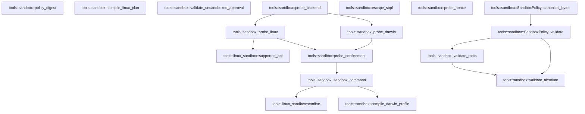

# tools::sandbox

[Package atlas](index.md) · [Source](../../src/sandbox.rs)

## Declarations

Visibility is the declaration spelling; trait members and reexports require their enclosing interface. `cfg` is not evaluated.

| Symbol | Kind | Visibility | Test / cfg |
|---|---|---|---|
| [tools::sandbox::LINUX_LANDLOCK_ABI_MIN](../../src/sandbox.rs#L13) | const_item | `pub(crate)` |  |
| [tools::sandbox::NetworkPolicy](../../src/sandbox.rs#L17) | enum_item | `pub` |  |
| [tools::sandbox::SandboxPolicy](../../src/sandbox.rs#L25) | struct_item | `pub` |  |
| [tools::sandbox::SandboxPolicy::validate](../../src/sandbox.rs#L36) | function_item | `pub` |  |
| [tools::sandbox::SandboxPolicy::canonical_bytes](../../src/sandbox.rs#L59) | function_item | `pub` |  |
| [tools::sandbox::SandboxBackend](../../src/sandbox.rs#L68) | enum_item | `pub` |  |
| [tools::sandbox::ProbeStatus](../../src/sandbox.rs#L75) | enum_item | `pub` |  |
| [tools::sandbox::ProbeFailure](../../src/sandbox.rs#L82) | enum_item | `pub` |  |
| [tools::sandbox::SandboxApproval](../../src/sandbox.rs#L90) | struct_item | `pub` |  |
| [tools::sandbox::SandboxError](../../src/sandbox.rs#L98) | enum_item | `pub` |  |
| [tools::sandbox::policy_digest](../../src/sandbox.rs#L113) | function_item | `pub` |  |
| [tools::sandbox::compile_darwin_profile](../../src/sandbox.rs#L120) | function_item | `pub` |  |
| [tools::sandbox::compile_linux_plan](../../src/sandbox.rs#L195) | function_item | `pub` |  |
| [tools::sandbox::validate_unsandboxed_approval](../../src/sandbox.rs#L221) | function_item | `pub` |  |
| [tools::sandbox::probe_backend](../../src/sandbox.rs#L238) | function_item | `pub` |  |
| [tools::sandbox::sandbox_command](../../src/sandbox.rs#L245) | function_item | `pub(crate)` |  |
| [tools::sandbox::probe_darwin](../../src/sandbox.rs#L297) | function_item | `private` |  |
| [tools::sandbox::probe_linux](../../src/sandbox.rs#L320) | function_item | `private` |  |
| [tools::sandbox::probe_confinement](../../src/sandbox.rs#L355) | function_item | `private` | #[cfg(any(     target_os = "macos",     all(         target_os = "linux",         any(target_arch = "x86_64", target_arch = "aarch64")     ) ))] |
| [tools::sandbox::validate_roots](../../src/sandbox.rs#L411) | function_item | `private` |  |
| [tools::sandbox::validate_absolute](../../src/sandbox.rs#L428) | function_item | `private` |  |
| [tools::sandbox::escape_sbpl](../../src/sandbox.rs#L444) | function_item | `private` |  |
| [tools::sandbox::probe_nonce](../../src/sandbox.rs#L460) | function_item | `private` | #[cfg(any(     target_os = "macos",     all(         target_os = "linux",         any(target_arch = "x86_64", target_arch = "aarch64")     ) ))] |
| [tools::sandbox::probe_nonce::NONCE](../../src/sandbox.rs#L462) | static_item | `private` | #[cfg(any(     target_os = "macos",     all(         target_os = "linux",         any(target_arch = "x86_64", target_arch = "aarch64")     ) ))] |

## Imports / reexports

| Local name | Source path | Visibility |
|---|---|---|
| `BTreeSet` | `std::collections::BTreeSet` | `private` |
| `fs` | `std::fs` | `private` |
| `Path` | `std::path::Path` | `private` |
| `Command` | `std::process::Command` | `private` |
| `Deserialize` | `serde::Deserialize` | `private` |
| `Serialize` | `serde::Serialize` | `private` |
| `json` | `serde_json::json` | `private` |
| `Digest` | `sha2::Digest` | `private` |
| `Sha256` | `sha2::Sha256` | `private` |
| `Error` | `thiserror::Error` | `private` |

## Module declarations

| Module | Visibility | Attributes |
|---|---|---|

## Function call graphs

Edges below are syntactically resolved calls only, including private functions. Graphs partition callers into groups of 20; they are not execution order. All unresolved sites are listed below and in the JSON inventory.

Functions 1–15: 12 direct edges

## Call sites

Includes test functions (marked in declarations). Receiver-type-required sites need type analysis/manual tracing. Calls in closures are attributed to their enclosing function; their occurrence here does not mean the closure executes immediately.

| Caller | Callee expression | Source lines | Target / classification |
|---|---|---|---|
| `validate` | `Err` | [38](../../src/sandbox.rs#L38), [51](../../src/sandbox.rs#L51) | external-constructor-callback-or-unresolved |
| `validate` | `SandboxError::Invalid` | [38](../../src/sandbox.rs#L38), [51](../../src/sandbox.rs#L51) | external-constructor-callback-or-unresolved |
| `validate` | `validate_roots` | [40](../../src/sandbox.rs#L40), [41](../../src/sandbox.rs#L41) | [tools::sandbox::validate_roots](../../src/sandbox.rs#L411) |
| `validate` | `validate_absolute` | [43](../../src/sandbox.rs#L43) | [tools::sandbox::validate_absolute](../../src/sandbox.rs#L428) |
| `validate` | `self                 .read_roots                 .iter()                 .any` | [46](../../src/sandbox.rs#L46) | receiver-type-required |
| `validate` | `self                 .read_roots                 .iter` | [46](../../src/sandbox.rs#L46) | receiver-type-required |
| `validate` | `Path::new(root).starts_with` | [49](../../src/sandbox.rs#L49) | receiver-type-required |
| `validate` | `Path::new` | [49](../../src/sandbox.rs#L49) | external-constructor-callback-or-unresolved |
| `validate` | `Ok` | [56](../../src/sandbox.rs#L56) | external-constructor-callback-or-unresolved |
| `canonical_bytes` | `self.validate` | [60](../../src/sandbox.rs#L60) | [tools::sandbox::SandboxPolicy::validate](../../src/sandbox.rs#L36) |
| `canonical_bytes` | `serde_json_canonicalizer::to_vec(self)             .map_err` | [61](../../src/sandbox.rs#L61) | receiver-type-required |
| `canonical_bytes` | `serde_json_canonicalizer::to_vec` | [61](../../src/sandbox.rs#L61) | external-constructor-callback-or-unresolved |
| `canonical_bytes` | `SandboxError::Encoding` | [62](../../src/sandbox.rs#L62) | external-constructor-callback-or-unresolved |
| `canonical_bytes` | `error.to_string` | [62](../../src/sandbox.rs#L62) | receiver-type-required |
| `policy_digest` | `Ok` | [114](../../src/sandbox.rs#L114) | external-constructor-callback-or-unresolved |
| `compile_darwin_profile` | `policy.validate` | [121](../../src/sandbox.rs#L121) | receiver-type-required |
| `compile_darwin_profile` | `policy         .read_roots         .iter()         .chain(&policy.write_roots)         .chain(policy.scratch.iter())         .flat_map(&#124;root&#124; Path::new(root).ancestors().skip(1))         .filter_map(Path::to_str)         .collect::<BTreeSet<_>>` | [130](../../src/sandbox.rs#L130) | receiver-type-required |
| `compile_darwin_profile` | `policy         .read_roots         .iter()         .chain(&policy.write_roots)         .chain(policy.scratch.iter())         .flat_map(&#124;root&#124; Path::new(root).ancestors().skip(1))         .filter_map` | [130](../../src/sandbox.rs#L130) | receiver-type-required |
| `compile_darwin_profile` | `policy         .read_roots         .iter()         .chain(&policy.write_roots)         .chain(policy.scratch.iter())         .flat_map` | [130](../../src/sandbox.rs#L130) | receiver-type-required |
| `compile_darwin_profile` | `policy         .read_roots         .iter()         .chain(&policy.write_roots)         .chain` | [130](../../src/sandbox.rs#L130) | receiver-type-required |
| `compile_darwin_profile` | `policy         .read_roots         .iter()         .chain` | [130](../../src/sandbox.rs#L130) | receiver-type-required |
| `compile_darwin_profile` | `policy         .read_roots         .iter` | [130](../../src/sandbox.rs#L130) | receiver-type-required |
| `compile_darwin_profile` | `policy.scratch.iter` | [134](../../src/sandbox.rs#L134) | receiver-type-required |
| `compile_darwin_profile` | `Path::new(root).ancestors().skip` | [135](../../src/sandbox.rs#L135) | receiver-type-required |
| `compile_darwin_profile` | `Path::new(root).ancestors` | [135](../../src/sandbox.rs#L135) | receiver-type-required |
| `compile_darwin_profile` | `Path::new` | [135](../../src/sandbox.rs#L135) | external-constructor-callback-or-unresolved |
| `compile_darwin_profile` | `lines.push` | [139](../../src/sandbox.rs#L139), [147](../../src/sandbox.rs#L147), [148](../../src/sandbox.rs#L148), [162](../../src/sandbox.rs#L162), [168](../../src/sandbox.rs#L168), [174](../../src/sandbox.rs#L174), [180](../../src/sandbox.rs#L180), [185](../../src/sandbox.rs#L185), [186](../../src/sandbox.rs#L186), [188](../../src/sandbox.rs#L188) | receiver-type-required |
| `compile_darwin_profile` | `"(allow file-read-metadata (literal \"/Applications\"))".to_owned` | [147](../../src/sandbox.rs#L147) | receiver-type-required |
| `compile_darwin_profile` | `"(allow file-read-metadata (literal \"/Library\"))".to_owned` | [148](../../src/sandbox.rs#L148) | receiver-type-required |
| `compile_darwin_profile` | `[         "/System",         "/usr",         "/bin",         "/sbin",         "/private/var/select",         "/Applications/Xcode.app",         "/Library/Developer/CommandLineTools",     ]     .into_iter()     .map(ToOwned::to_owned)     .chain` | [149](../../src/sandbox.rs#L149) | receiver-type-required |
| `compile_darwin_profile` | `[         "/System",         "/usr",         "/bin",         "/sbin",         "/private/var/select",         "/Applications/Xcode.app",         "/Library/Developer/CommandLineTools",     ]     .into_iter()     .map` | [149](../../src/sandbox.rs#L149) | receiver-type-required |
| `compile_darwin_profile` | `[         "/System",         "/usr",         "/bin",         "/sbin",         "/private/var/select",         "/Applications/Xcode.app",         "/Library/Developer/CommandLineTools",     ]     .into_iter` | [149](../../src/sandbox.rs#L149) | receiver-type-required |
| `compile_darwin_profile` | `policy.read_roots.iter().cloned` | [160](../../src/sandbox.rs#L160) | receiver-type-required |
| `compile_darwin_profile` | `policy.read_roots.iter` | [160](../../src/sandbox.rs#L160) | receiver-type-required |
| `compile_darwin_profile` | `"(allow process-exec process-fork)".to_owned` | [180](../../src/sandbox.rs#L180) | receiver-type-required |
| `compile_darwin_profile` | `"(allow network* (local ip \"localhost:*\"))".to_owned` | [185](../../src/sandbox.rs#L185) | receiver-type-required |
| `compile_darwin_profile` | `"(allow network* (remote ip \"localhost:*\"))".to_owned` | [186](../../src/sandbox.rs#L186) | receiver-type-required |
| `compile_darwin_profile` | `"(allow network*)".to_owned` | [188](../../src/sandbox.rs#L188) | receiver-type-required |
| `compile_darwin_profile` | `lines.join("\n").into_bytes` | [190](../../src/sandbox.rs#L190) | receiver-type-required |
| `compile_darwin_profile` | `lines.join` | [190](../../src/sandbox.rs#L190) | receiver-type-required |
| `compile_darwin_profile` | `bytes.push` | [191](../../src/sandbox.rs#L191) | receiver-type-required |
| `compile_darwin_profile` | `Ok` | [192](../../src/sandbox.rs#L192) | external-constructor-callback-or-unresolved |
| `compile_linux_plan` | `policy.validate` | [196](../../src/sandbox.rs#L196) | receiver-type-required |
| `compile_linux_plan` | `plan.as_object_mut()             .expect("plan object")             .insert` | [211](../../src/sandbox.rs#L211) | receiver-type-required |
| `compile_linux_plan` | `plan.as_object_mut()             .expect` | [211](../../src/sandbox.rs#L211) | receiver-type-required |
| `compile_linux_plan` | `plan.as_object_mut` | [211](../../src/sandbox.rs#L211) | receiver-type-required |
| `compile_linux_plan` | `"scratch".to_owned` | [213](../../src/sandbox.rs#L213) | receiver-type-required |
| `compile_linux_plan` | `serde_json_canonicalizer::to_vec(&plan)         .map_err` | [215](../../src/sandbox.rs#L215) | receiver-type-required |
| `compile_linux_plan` | `serde_json_canonicalizer::to_vec` | [215](../../src/sandbox.rs#L215) | external-constructor-callback-or-unresolved |
| `compile_linux_plan` | `SandboxError::Encoding` | [216](../../src/sandbox.rs#L216) | external-constructor-callback-or-unresolved |
| `compile_linux_plan` | `error.to_string` | [216](../../src/sandbox.rs#L216) | receiver-type-required |
| `compile_linux_plan` | `bytes.push` | [217](../../src/sandbox.rs#L217) | receiver-type-required |
| `compile_linux_plan` | `Ok` | [218](../../src/sandbox.rs#L218) | external-constructor-callback-or-unresolved |
| `validate_unsandboxed_approval` | `Ok` | [232](../../src/sandbox.rs#L232) | external-constructor-callback-or-unresolved |
| `validate_unsandboxed_approval` | `Err` | [234](../../src/sandbox.rs#L234) | external-constructor-callback-or-unresolved |
| `probe_backend` | `probe_darwin` | [240](../../src/sandbox.rs#L240) | [tools::sandbox::probe_darwin](../../src/sandbox.rs#L297) |
| `probe_backend` | `probe_linux` | [241](../../src/sandbox.rs#L241) | [tools::sandbox::probe_linux](../../src/sandbox.rs#L320) |
| `sandbox_command` | `Err` | [251](../../src/sandbox.rs#L251), [258](../../src/sandbox.rs#L258), [274](../../src/sandbox.rs#L274), [291](../../src/sandbox.rs#L291) | external-constructor-callback-or-unresolved |
| `sandbox_command` | `SandboxError::Unavailable` | [251](../../src/sandbox.rs#L251), [258](../../src/sandbox.rs#L258), [274](../../src/sandbox.rs#L274), [291](../../src/sandbox.rs#L291) | external-constructor-callback-or-unresolved |
| `sandbox_command` | `"sandbox probe did not report available".to_owned` | [252](../../src/sandbox.rs#L252) | receiver-type-required |
| `sandbox_command` | `String::from_utf8(compile_darwin_profile(policy)?)             .map_err` | [262](../../src/sandbox.rs#L262) | receiver-type-required |
| `sandbox_command` | `String::from_utf8` | [262](../../src/sandbox.rs#L262) | external-constructor-callback-or-unresolved |
| `sandbox_command` | `compile_darwin_profile` | [262](../../src/sandbox.rs#L262) | [tools::sandbox::compile_darwin_profile](../../src/sandbox.rs#L120) |
| `sandbox_command` | `SandboxError::Encoding` | [263](../../src/sandbox.rs#L263) | external-constructor-callback-or-unresolved |
| `sandbox_command` | `"profile is not UTF-8".to_owned` | [263](../../src/sandbox.rs#L263) | receiver-type-required |
| `sandbox_command` | `Command::new` | [264](../../src/sandbox.rs#L264), [278](../../src/sandbox.rs#L278) | external-constructor-callback-or-unresolved |
| `sandbox_command` | `command.arg("-p").arg(profile).arg` | [265](../../src/sandbox.rs#L265) | receiver-type-required |
| `sandbox_command` | `command.arg("-p").arg` | [265](../../src/sandbox.rs#L265) | receiver-type-required |
| `sandbox_command` | `command.arg` | [265](../../src/sandbox.rs#L265) | receiver-type-required |
| `sandbox_command` | `Ok` | [266](../../src/sandbox.rs#L266), [280](../../src/sandbox.rs#L280) | external-constructor-callback-or-unresolved |
| `sandbox_command` | `crate::linux_sandbox::confine` | [279](../../src/sandbox.rs#L279) | [tools::linux_sandbox::confine](../../src/linux_sandbox.rs#L125) |
| `sandbox_command` | `"no applied sandbox launcher on this platform".to_owned` | [292](../../src/sandbox.rs#L292) | receiver-type-required |
| `probe_darwin` | `"Seatbelt requested on a non-macOS host".to_owned` | [302](../../src/sandbox.rs#L302) | receiver-type-required |
| `probe_darwin` | `Path::new("/usr/bin/sandbox-exec").is_file` | [307](../../src/sandbox.rs#L307) | receiver-type-required |
| `probe_darwin` | `Path::new` | [307](../../src/sandbox.rs#L307) | external-constructor-callback-or-unresolved |
| `probe_darwin` | `"sandbox-exec is missing".to_owned` | [310](../../src/sandbox.rs#L310) | receiver-type-required |
| `probe_darwin` | `probe_confinement` | [313](../../src/sandbox.rs#L313) | [tools::sandbox::probe_confinement](../../src/sandbox.rs#L355) |
| `probe_darwin` | `"darwin-seatbelt".to_owned` | [314](../../src/sandbox.rs#L314) | receiver-type-required |
| `probe_darwin` | `std::env::consts::OS.to_owned` | [315](../../src/sandbox.rs#L315) | receiver-type-required |
| `probe_linux` | `"Landlock/seccomp requires Linux on x86_64 or aarch64".to_owned` | [328](../../src/sandbox.rs#L328) | receiver-type-required |
| `probe_linux` | `crate::linux_sandbox::supported_abi` | [336](../../src/sandbox.rs#L336) | [tools::linux_sandbox::supported_abi](../../src/linux_sandbox.rs#L79) |
| `probe_linux` | `probe_confinement` | [337](../../src/sandbox.rs#L337) | [tools::sandbox::probe_confinement](../../src/sandbox.rs#L355) |
| `probe_linux` | `crate::linux_sandbox::BACKEND.to_owned` | [338](../../src/sandbox.rs#L338) | receiver-type-required |
| `probe_confinement` | `std::env::temp_dir().join` | [356](../../src/sandbox.rs#L356) | receiver-type-required |
| `probe_confinement` | `std::env::temp_dir` | [356](../../src/sandbox.rs#L356) | external-constructor-callback-or-unresolved |
| `probe_confinement` | `unresolved_root.join` | [361](../../src/sandbox.rs#L361), [362](../../src/sandbox.rs#L362) | receiver-type-required |
| `probe_confinement` | `(&#124;&#124; -> Result<(), SandboxError> {         fs::create_dir_all(&allowed_unresolved)?;         fs::create_dir_all(&outside_unresolved)?;         let root = fs::canonicalize(&unresolved_root)?;         let allowed = root.join("allowed");         let outside = root.join("outside");         fs::write(allowed.join("read.txt"), b"ok")?;         let policy = SandboxPolicy {             format: 1,             read_roots: vec![allowed.to_string_lossy().into_owned()],             write_roots: vec![allowed.to_string_lossy().into_owned()],             network: NetworkPolicy::Deny,             allow_process: true,             scratch: None,         };         let read = sandbox_command(&policy, &candidate, Path::new("/bin/cat"))?             .arg(allowed.join("read.txt"))             .output()?;         let denied = sandbox_command(&policy, &candidate, Path::new("/usr/bin/touch"))?             .arg(outside.join("denied.txt"))             .output()?;         if read.status.success()             && read.stdout == b"ok"             && !denied.status.success()             && !outside.join("denied.txt").exists()         {             Ok(())         } else {             Err(SandboxError::Probe(format!(                 "read_status={:?} read_stderr={} denied_status={:?} denied_stderr={} outside_exists={}",                 read.status.code(),                 String::from_utf8_lossy(&read.stderr),                 denied.status.code(),                 String::from_utf8_lossy(&denied.stderr),                 outside.join("denied.txt").exists()             )))         }     })` | [363](../../src/sandbox.rs#L363) | external-constructor-callback-or-unresolved |
| `probe_confinement` | `fs::create_dir_all` | [364](../../src/sandbox.rs#L364), [365](../../src/sandbox.rs#L365) | external-constructor-callback-or-unresolved |
| `probe_confinement` | `fs::canonicalize` | [366](../../src/sandbox.rs#L366) | external-constructor-callback-or-unresolved |
| `probe_confinement` | `root.join` | [367](../../src/sandbox.rs#L367), [368](../../src/sandbox.rs#L368) | receiver-type-required |
| `probe_confinement` | `fs::write` | [369](../../src/sandbox.rs#L369) | external-constructor-callback-or-unresolved |
| `probe_confinement` | `allowed.join` | [369](../../src/sandbox.rs#L369), [379](../../src/sandbox.rs#L379) | receiver-type-required |
| `probe_confinement` | `sandbox_command(&policy, &candidate, Path::new("/bin/cat"))?             .arg(allowed.join("read.txt"))             .output` | [378](../../src/sandbox.rs#L378) | receiver-type-required |
| `probe_confinement` | `sandbox_command(&policy, &candidate, Path::new("/bin/cat"))?             .arg` | [378](../../src/sandbox.rs#L378) | receiver-type-required |
| `probe_confinement` | `sandbox_command` | [378](../../src/sandbox.rs#L378), [381](../../src/sandbox.rs#L381) | [tools::sandbox::sandbox_command](../../src/sandbox.rs#L245) |
| `probe_confinement` | `Path::new` | [378](../../src/sandbox.rs#L378), [381](../../src/sandbox.rs#L381) | external-constructor-callback-or-unresolved |
| `probe_confinement` | `sandbox_command(&policy, &candidate, Path::new("/usr/bin/touch"))?             .arg(outside.join("denied.txt"))             .output` | [381](../../src/sandbox.rs#L381) | receiver-type-required |
| `probe_confinement` | `sandbox_command(&policy, &candidate, Path::new("/usr/bin/touch"))?             .arg` | [381](../../src/sandbox.rs#L381) | receiver-type-required |
| `probe_confinement` | `outside.join` | [382](../../src/sandbox.rs#L382), [387](../../src/sandbox.rs#L387) | receiver-type-required |
| `probe_confinement` | `read.status.success` | [384](../../src/sandbox.rs#L384) | receiver-type-required |
| `probe_confinement` | `denied.status.success` | [386](../../src/sandbox.rs#L386) | receiver-type-required |
| `probe_confinement` | `outside.join("denied.txt").exists` | [387](../../src/sandbox.rs#L387) | receiver-type-required |
| `probe_confinement` | `Ok` | [389](../../src/sandbox.rs#L389) | external-constructor-callback-or-unresolved |
| `probe_confinement` | `Err` | [391](../../src/sandbox.rs#L391) | external-constructor-callback-or-unresolved |
| `probe_confinement` | `SandboxError::Probe` | [391](../../src/sandbox.rs#L391) | external-constructor-callback-or-unresolved |
| `probe_confinement` | `fs::remove_dir_all` | [401](../../src/sandbox.rs#L401) | external-constructor-callback-or-unresolved |
| `probe_confinement` | `error.to_string` | [406](../../src/sandbox.rs#L406) | receiver-type-required |
| `validate_roots` | `BTreeSet::new` | [413](../../src/sandbox.rs#L413) | external-constructor-callback-or-unresolved |
| `validate_roots` | `validate_absolute` | [415](../../src/sandbox.rs#L415) | [tools::sandbox::validate_absolute](../../src/sandbox.rs#L428) |
| `validate_roots` | `previous.is_some_and` | [416](../../src/sandbox.rs#L416) | receiver-type-required |
| `validate_roots` | `last.as_bytes` | [416](../../src/sandbox.rs#L416) | receiver-type-required |
| `validate_roots` | `value.as_bytes` | [416](../../src/sandbox.rs#L416) | receiver-type-required |
| `validate_roots` | `unique.insert` | [417](../../src/sandbox.rs#L417) | receiver-type-required |
| `validate_roots` | `value.as_str` | [417](../../src/sandbox.rs#L417) | receiver-type-required |
| `validate_roots` | `Err` | [419](../../src/sandbox.rs#L419) | external-constructor-callback-or-unresolved |
| `validate_roots` | `SandboxError::Invalid` | [419](../../src/sandbox.rs#L419) | external-constructor-callback-or-unresolved |
| `validate_roots` | `Some` | [423](../../src/sandbox.rs#L423) | external-constructor-callback-or-unresolved |
| `validate_roots` | `Ok` | [425](../../src/sandbox.rs#L425) | external-constructor-callback-or-unresolved |
| `validate_absolute` | `Path::new` | [429](../../src/sandbox.rs#L429) | external-constructor-callback-or-unresolved |
| `validate_absolute` | `path.is_absolute` | [430](../../src/sandbox.rs#L430) | receiver-type-required |
| `validate_absolute` | `value.contains` | [431](../../src/sandbox.rs#L431) | receiver-type-required |
| `validate_absolute` | `value.chars().any` | [432](../../src/sandbox.rs#L432) | receiver-type-required |
| `validate_absolute` | `value.chars` | [432](../../src/sandbox.rs#L432) | receiver-type-required |
| `validate_absolute` | `path             .components()             .any` | [433](../../src/sandbox.rs#L433) | receiver-type-required |
| `validate_absolute` | `path             .components` | [433](../../src/sandbox.rs#L433) | receiver-type-required |
| `validate_absolute` | `Err` | [437](../../src/sandbox.rs#L437) | external-constructor-callback-or-unresolved |
| `validate_absolute` | `SandboxError::Invalid` | [437](../../src/sandbox.rs#L437) | external-constructor-callback-or-unresolved |
| `validate_absolute` | `Ok` | [441](../../src/sandbox.rs#L441) | external-constructor-callback-or-unresolved |
| `escape_sbpl` | `value.chars().any` | [445](../../src/sandbox.rs#L445) | receiver-type-required |
| `escape_sbpl` | `value.chars` | [445](../../src/sandbox.rs#L445) | receiver-type-required |
| `escape_sbpl` | `Err` | [446](../../src/sandbox.rs#L446) | external-constructor-callback-or-unresolved |
| `escape_sbpl` | `SandboxError::Invalid` | [446](../../src/sandbox.rs#L446) | external-constructor-callback-or-unresolved |
| `escape_sbpl` | `Ok` | [450](../../src/sandbox.rs#L450) | external-constructor-callback-or-unresolved |
| `escape_sbpl` | `value.replace('\\', "\\\\").replace` | [450](../../src/sandbox.rs#L450) | receiver-type-required |
| `escape_sbpl` | `value.replace` | [450](../../src/sandbox.rs#L450) | receiver-type-required |
| `probe_nonce` | `NONCE.fetch_add` | [463](../../src/sandbox.rs#L463) | receiver-type-required |
| `NONCE` | `AtomicU64::new` | [462](../../src/sandbox.rs#L462) | external-constructor-callback-or-unresolved |
