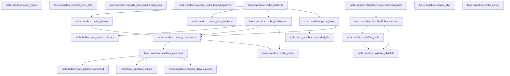

# tools::sandbox

[Package atlas](index.md) · [Source](../../src/sandbox.rs)

## Declarations

Visibility is the declaration spelling; trait members and reexports require their enclosing interface. `cfg` is not evaluated.

| Symbol | Kind | Visibility | Test / cfg |
|---|---|---|---|
| [tools::sandbox::LINUX_LANDLOCK_ABI_MIN](../../src/sandbox.rs#L13) | const_item | `pub(crate)` |  |
| [tools::sandbox::NetworkPolicy](../../src/sandbox.rs#L17) | enum_item | `pub` |  |
| [tools::sandbox::SandboxPolicy](../../src/sandbox.rs#L25) | struct_item | `pub` |  |
| [tools::sandbox::SandboxPolicy::validate](../../src/sandbox.rs#L36) | function_item | `pub` |  |
| [tools::sandbox::SandboxPolicy::canonical_bytes](../../src/sandbox.rs#L59) | function_item | `pub` |  |
| [tools::sandbox::SandboxBackend](../../src/sandbox.rs#L68) | enum_item | `pub` |  |
| [tools::sandbox::ProbeStatus](../../src/sandbox.rs#L78) | enum_item | `pub` |  |
| [tools::sandbox::ProbeFailure](../../src/sandbox.rs#L85) | enum_item | `pub` |  |
| [tools::sandbox::SandboxApproval](../../src/sandbox.rs#L93) | struct_item | `pub` |  |
| [tools::sandbox::SandboxError](../../src/sandbox.rs#L101) | enum_item | `pub` |  |
| [tools::sandbox::policy_digest](../../src/sandbox.rs#L116) | function_item | `pub` |  |
| [tools::sandbox::compile_darwin_profile](../../src/sandbox.rs#L123) | function_item | `pub` |  |
| [tools::sandbox::compile_linux_plan](../../src/sandbox.rs#L198) | function_item | `pub` |  |
| [tools::sandbox::compile_linux_bubblewrap_plan](../../src/sandbox.rs#L226) | function_item | `pub` |  |
| [tools::sandbox::validate_unsandboxed_approval](../../src/sandbox.rs#L263) | function_item | `pub` |  |
| [tools::sandbox::probe_backend](../../src/sandbox.rs#L280) | function_item | `pub` |  |
| [tools::sandbox::sandbox_command](../../src/sandbox.rs#L289) | function_item | `pub(crate)` |  |
| [tools::sandbox::probe_darwin](../../src/sandbox.rs#L344) | function_item | `private` |  |
| [tools::sandbox::select_linux_backend](../../src/sandbox.rs#L367) | function_item | `private` |  |
| [tools::sandbox::probe_bubblewrap](../../src/sandbox.rs#L387) | function_item | `private` |  |
| [tools::sandbox::probe_linux](../../src/sandbox.rs#L430) | function_item | `private` |  |
| [tools::sandbox::probe_confinement](../../src/sandbox.rs#L465) | function_item | `private` | #[cfg(any(     target_os = "macos",     all(         target_os = "linux",         any(target_arch = "x86_64", target_arch = "aarch64")     ) ))] |
| [tools::sandbox::probe_output](../../src/sandbox.rs#L542) | function_item | `private` | #[cfg(any(     target_os = "macos",     all(         target_os = "linux",         any(target_arch = "x86_64", target_arch = "aarch64")     ) ))] |
| [tools::sandbox::validate_roots](../../src/sandbox.rs#L568) | function_item | `private` |  |
| [tools::sandbox::validate_absolute](../../src/sandbox.rs#L585) | function_item | `private` |  |
| [tools::sandbox::escape_sbpl](../../src/sandbox.rs#L601) | function_item | `private` |  |
| [tools::sandbox::probe_nonce](../../src/sandbox.rs#L617) | function_item | `private` | #[cfg(any(     target_os = "macos",     all(         target_os = "linux",         any(target_arch = "x86_64", target_arch = "aarch64")     ) ))] |
| [tools::sandbox::probe_nonce::NONCE](../../src/sandbox.rs#L619) | static_item | `private` | #[cfg(any(     target_os = "macos",     all(         target_os = "linux",         any(target_arch = "x86_64", target_arch = "aarch64")     ) ))] |
| [tools::sandbox::tests::available](../../src/sandbox.rs#L626) | function_item | `private` | test; #[cfg(test)] |
| [tools::sandbox::tests::missing](../../src/sandbox.rs#L632) | function_item | `private` | test; #[cfg(test)] |
| [tools::sandbox::tests::linux_auto_prefers_bubblewrap_without_probing_landlock](../../src/sandbox.rs#L639) | function_item | `private` | test; #[cfg(test)] |
| [tools::sandbox::tests::linux_auto_falls_back_only_to_available_landlock](../../src/sandbox.rs#L648) | function_item | `private` | test; #[cfg(test)] |
| [tools::sandbox::tests::bubblewrap_plan_matches_golden_bytes](../../src/sandbox.rs#L659) | function_item | `private` | test; #[cfg(test)] |

## Imports / reexports

| Local name | Source path | Visibility |
|---|---|---|
| `BTreeSet` | `std::collections::BTreeSet` | `private` |
| `fs` | `std::fs` | `private` |
| `Path` | `std::path::Path` | `private` |
| `Command` | `std::process::Command` | `private` |
| `Deserialize` | `serde::Deserialize` | `private` |
| `Serialize` | `serde::Serialize` | `private` |
| `json` | `serde_json::json` | `private` |
| `Digest` | `sha2::Digest` | `private` |
| `Sha256` | `sha2::Sha256` | `private` |
| `Error` | `thiserror::Error` | `private` |
| `*` | `super::*` | `private` |

## Module declarations

| Module | Visibility | Attributes |
|---|---|---|
| `tools::sandbox::tests` | `private` | #[cfg(test)] |

## Function call graphs

Edges below are syntactically resolved calls only, including private functions. Graphs partition callers into groups of 20; they are not execution order. All unresolved sites are listed below and in the JSON inventory.

Functions 1–19: 19 direct edges

## Call sites

Includes test functions (marked in declarations). Receiver-type-required sites need type analysis/manual tracing. Calls in closures are attributed to their enclosing function; their occurrence here does not mean the closure executes immediately.

| Caller | Callee expression | Source lines | Target / classification |
|---|---|---|---|
| `validate` | `Err` | [38](../../src/sandbox.rs#L38), [51](../../src/sandbox.rs#L51) | external-constructor-callback-or-unresolved |
| `validate` | `SandboxError::Invalid` | [38](../../src/sandbox.rs#L38), [51](../../src/sandbox.rs#L51) | external-constructor-callback-or-unresolved |
| `validate` | `validate_roots` | [40](../../src/sandbox.rs#L40), [41](../../src/sandbox.rs#L41) | [tools::sandbox::validate_roots](../../src/sandbox.rs#L568) |
| `validate` | `validate_absolute` | [43](../../src/sandbox.rs#L43) | [tools::sandbox::validate_absolute](../../src/sandbox.rs#L585) |
| `validate` | `self                 .read_roots                 .iter()                 .any` | [46](../../src/sandbox.rs#L46) | receiver-type-required |
| `validate` | `self                 .read_roots                 .iter` | [46](../../src/sandbox.rs#L46) | receiver-type-required |
| `validate` | `Path::new(root).starts_with` | [49](../../src/sandbox.rs#L49) | receiver-type-required |
| `validate` | `Path::new` | [49](../../src/sandbox.rs#L49) | external-constructor-callback-or-unresolved |
| `validate` | `Ok` | [56](../../src/sandbox.rs#L56) | external-constructor-callback-or-unresolved |
| `canonical_bytes` | `self.validate` | [60](../../src/sandbox.rs#L60) | [tools::sandbox::SandboxPolicy::validate](../../src/sandbox.rs#L36) |
| `canonical_bytes` | `serde_json_canonicalizer::to_vec(self)             .map_err` | [61](../../src/sandbox.rs#L61) | receiver-type-required |
| `canonical_bytes` | `serde_json_canonicalizer::to_vec` | [61](../../src/sandbox.rs#L61) | external-constructor-callback-or-unresolved |
| `canonical_bytes` | `SandboxError::Encoding` | [62](../../src/sandbox.rs#L62) | external-constructor-callback-or-unresolved |
| `canonical_bytes` | `error.to_string` | [62](../../src/sandbox.rs#L62) | receiver-type-required |
| `policy_digest` | `Ok` | [117](../../src/sandbox.rs#L117) | external-constructor-callback-or-unresolved |
| `compile_darwin_profile` | `policy.validate` | [124](../../src/sandbox.rs#L124) | receiver-type-required |
| `compile_darwin_profile` | `policy         .read_roots         .iter()         .chain(&policy.write_roots)         .chain(policy.scratch.iter())         .flat_map(&#124;root&#124; Path::new(root).ancestors().skip(1))         .filter_map(Path::to_str)         .collect::<BTreeSet<_>>` | [133](../../src/sandbox.rs#L133) | receiver-type-required |
| `compile_darwin_profile` | `policy         .read_roots         .iter()         .chain(&policy.write_roots)         .chain(policy.scratch.iter())         .flat_map(&#124;root&#124; Path::new(root).ancestors().skip(1))         .filter_map` | [133](../../src/sandbox.rs#L133) | receiver-type-required |
| `compile_darwin_profile` | `policy         .read_roots         .iter()         .chain(&policy.write_roots)         .chain(policy.scratch.iter())         .flat_map` | [133](../../src/sandbox.rs#L133) | receiver-type-required |
| `compile_darwin_profile` | `policy         .read_roots         .iter()         .chain(&policy.write_roots)         .chain` | [133](../../src/sandbox.rs#L133) | receiver-type-required |
| `compile_darwin_profile` | `policy         .read_roots         .iter()         .chain` | [133](../../src/sandbox.rs#L133) | receiver-type-required |
| `compile_darwin_profile` | `policy         .read_roots         .iter` | [133](../../src/sandbox.rs#L133) | receiver-type-required |
| `compile_darwin_profile` | `policy.scratch.iter` | [137](../../src/sandbox.rs#L137) | receiver-type-required |
| `compile_darwin_profile` | `Path::new(root).ancestors().skip` | [138](../../src/sandbox.rs#L138) | receiver-type-required |
| `compile_darwin_profile` | `Path::new(root).ancestors` | [138](../../src/sandbox.rs#L138) | receiver-type-required |
| `compile_darwin_profile` | `Path::new` | [138](../../src/sandbox.rs#L138) | external-constructor-callback-or-unresolved |
| `compile_darwin_profile` | `lines.push` | [142](../../src/sandbox.rs#L142), [150](../../src/sandbox.rs#L150), [151](../../src/sandbox.rs#L151), [165](../../src/sandbox.rs#L165), [171](../../src/sandbox.rs#L171), [177](../../src/sandbox.rs#L177), [183](../../src/sandbox.rs#L183), [188](../../src/sandbox.rs#L188), [189](../../src/sandbox.rs#L189), [191](../../src/sandbox.rs#L191) | receiver-type-required |
| `compile_darwin_profile` | `"(allow file-read-metadata (literal \"/Applications\"))".to_owned` | [150](../../src/sandbox.rs#L150) | receiver-type-required |
| `compile_darwin_profile` | `"(allow file-read-metadata (literal \"/Library\"))".to_owned` | [151](../../src/sandbox.rs#L151) | receiver-type-required |
| `compile_darwin_profile` | `[         "/System",         "/usr",         "/bin",         "/sbin",         "/private/var/select",         "/Applications/Xcode.app",         "/Library/Developer/CommandLineTools",     ]     .into_iter()     .map(ToOwned::to_owned)     .chain` | [152](../../src/sandbox.rs#L152) | receiver-type-required |
| `compile_darwin_profile` | `[         "/System",         "/usr",         "/bin",         "/sbin",         "/private/var/select",         "/Applications/Xcode.app",         "/Library/Developer/CommandLineTools",     ]     .into_iter()     .map` | [152](../../src/sandbox.rs#L152) | receiver-type-required |
| `compile_darwin_profile` | `[         "/System",         "/usr",         "/bin",         "/sbin",         "/private/var/select",         "/Applications/Xcode.app",         "/Library/Developer/CommandLineTools",     ]     .into_iter` | [152](../../src/sandbox.rs#L152) | receiver-type-required |
| `compile_darwin_profile` | `policy.read_roots.iter().cloned` | [163](../../src/sandbox.rs#L163) | receiver-type-required |
| `compile_darwin_profile` | `policy.read_roots.iter` | [163](../../src/sandbox.rs#L163) | receiver-type-required |
| `compile_darwin_profile` | `"(allow process-exec process-fork)".to_owned` | [183](../../src/sandbox.rs#L183) | receiver-type-required |
| `compile_darwin_profile` | `"(allow network* (local ip \"localhost:*\"))".to_owned` | [188](../../src/sandbox.rs#L188) | receiver-type-required |
| `compile_darwin_profile` | `"(allow network* (remote ip \"localhost:*\"))".to_owned` | [189](../../src/sandbox.rs#L189) | receiver-type-required |
| `compile_darwin_profile` | `"(allow network*)".to_owned` | [191](../../src/sandbox.rs#L191) | receiver-type-required |
| `compile_darwin_profile` | `lines.join("\n").into_bytes` | [193](../../src/sandbox.rs#L193) | receiver-type-required |
| `compile_darwin_profile` | `lines.join` | [193](../../src/sandbox.rs#L193) | receiver-type-required |
| `compile_darwin_profile` | `bytes.push` | [194](../../src/sandbox.rs#L194) | receiver-type-required |
| `compile_darwin_profile` | `Ok` | [195](../../src/sandbox.rs#L195) | external-constructor-callback-or-unresolved |
| `compile_linux_plan` | `policy.validate` | [199](../../src/sandbox.rs#L199) | receiver-type-required |
| `compile_linux_plan` | `plan.as_object_mut()             .expect("plan object")             .insert` | [214](../../src/sandbox.rs#L214) | receiver-type-required |
| `compile_linux_plan` | `plan.as_object_mut()             .expect` | [214](../../src/sandbox.rs#L214) | receiver-type-required |
| `compile_linux_plan` | `plan.as_object_mut` | [214](../../src/sandbox.rs#L214) | receiver-type-required |
| `compile_linux_plan` | `"scratch".to_owned` | [216](../../src/sandbox.rs#L216) | receiver-type-required |
| `compile_linux_plan` | `serde_json_canonicalizer::to_vec(&plan)         .map_err` | [218](../../src/sandbox.rs#L218) | receiver-type-required |
| `compile_linux_plan` | `serde_json_canonicalizer::to_vec` | [218](../../src/sandbox.rs#L218) | external-constructor-callback-or-unresolved |
| `compile_linux_plan` | `SandboxError::Encoding` | [219](../../src/sandbox.rs#L219) | external-constructor-callback-or-unresolved |
| `compile_linux_plan` | `error.to_string` | [219](../../src/sandbox.rs#L219) | receiver-type-required |
| `compile_linux_plan` | `bytes.push` | [220](../../src/sandbox.rs#L220) | receiver-type-required |
| `compile_linux_plan` | `Ok` | [221](../../src/sandbox.rs#L221) | external-constructor-callback-or-unresolved |
| `compile_linux_bubblewrap_plan` | `policy.validate` | [227](../../src/sandbox.rs#L227) | receiver-type-required |
| `compile_linux_bubblewrap_plan` | `Err` | [229](../../src/sandbox.rs#L229) | external-constructor-callback-or-unresolved |
| `compile_linux_bubblewrap_plan` | `SandboxError::Unavailable` | [229](../../src/sandbox.rs#L229) | external-constructor-callback-or-unresolved |
| `compile_linux_bubblewrap_plan` | `"bubblewrap requires allow_process=true and network=deny or all".to_owned` | [230](../../src/sandbox.rs#L230) | receiver-type-required |
| `compile_linux_bubblewrap_plan` | `namespaces.push` | [235](../../src/sandbox.rs#L235) | receiver-type-required |
| `compile_linux_bubblewrap_plan` | `namespaces.sort_unstable` | [236](../../src/sandbox.rs#L236) | receiver-type-required |
| `compile_linux_bubblewrap_plan` | `plan.as_object_mut()             .expect("plan object")             .insert` | [253](../../src/sandbox.rs#L253) | receiver-type-required |
| `compile_linux_bubblewrap_plan` | `plan.as_object_mut()             .expect` | [253](../../src/sandbox.rs#L253) | receiver-type-required |
| `compile_linux_bubblewrap_plan` | `plan.as_object_mut` | [253](../../src/sandbox.rs#L253) | receiver-type-required |
| `compile_linux_bubblewrap_plan` | `"scratch".to_owned` | [255](../../src/sandbox.rs#L255) | receiver-type-required |
| `compile_linux_bubblewrap_plan` | `serde_json_canonicalizer::to_vec(&plan)         .map_err` | [257](../../src/sandbox.rs#L257) | receiver-type-required |
| `compile_linux_bubblewrap_plan` | `serde_json_canonicalizer::to_vec` | [257](../../src/sandbox.rs#L257) | external-constructor-callback-or-unresolved |
| `compile_linux_bubblewrap_plan` | `SandboxError::Encoding` | [258](../../src/sandbox.rs#L258) | external-constructor-callback-or-unresolved |
| `compile_linux_bubblewrap_plan` | `error.to_string` | [258](../../src/sandbox.rs#L258) | receiver-type-required |
| `compile_linux_bubblewrap_plan` | `bytes.push` | [259](../../src/sandbox.rs#L259) | receiver-type-required |
| `compile_linux_bubblewrap_plan` | `Ok` | [260](../../src/sandbox.rs#L260) | external-constructor-callback-or-unresolved |
| `validate_unsandboxed_approval` | `Ok` | [274](../../src/sandbox.rs#L274) | external-constructor-callback-or-unresolved |
| `validate_unsandboxed_approval` | `Err` | [276](../../src/sandbox.rs#L276) | external-constructor-callback-or-unresolved |
| `probe_backend` | `probe_darwin` | [282](../../src/sandbox.rs#L282) | [tools::sandbox::probe_darwin](../../src/sandbox.rs#L344) |
| `probe_backend` | `select_linux_backend` | [283](../../src/sandbox.rs#L283) | [tools::sandbox::select_linux_backend](../../src/sandbox.rs#L367) |
| `probe_backend` | `probe_bubblewrap` | [283](../../src/sandbox.rs#L283), [284](../../src/sandbox.rs#L284) | [tools::sandbox::probe_bubblewrap](../../src/sandbox.rs#L387) |
| `probe_backend` | `probe_linux` | [285](../../src/sandbox.rs#L285) | [tools::sandbox::probe_linux](../../src/sandbox.rs#L430) |
| `sandbox_command` | `Err` | [295](../../src/sandbox.rs#L295), [302](../../src/sandbox.rs#L302), [321](../../src/sandbox.rs#L321), [338](../../src/sandbox.rs#L338) | external-constructor-callback-or-unresolved |
| `sandbox_command` | `SandboxError::Unavailable` | [295](../../src/sandbox.rs#L295), [302](../../src/sandbox.rs#L302), [321](../../src/sandbox.rs#L321), [338](../../src/sandbox.rs#L338) | external-constructor-callback-or-unresolved |
| `sandbox_command` | `"sandbox probe did not report available".to_owned` | [296](../../src/sandbox.rs#L296) | receiver-type-required |
| `sandbox_command` | `String::from_utf8(compile_darwin_profile(policy)?)             .map_err` | [306](../../src/sandbox.rs#L306) | receiver-type-required |
| `sandbox_command` | `String::from_utf8` | [306](../../src/sandbox.rs#L306) | external-constructor-callback-or-unresolved |
| `sandbox_command` | `compile_darwin_profile` | [306](../../src/sandbox.rs#L306) | [tools::sandbox::compile_darwin_profile](../../src/sandbox.rs#L123) |
| `sandbox_command` | `SandboxError::Encoding` | [307](../../src/sandbox.rs#L307) | external-constructor-callback-or-unresolved |
| `sandbox_command` | `"profile is not UTF-8".to_owned` | [307](../../src/sandbox.rs#L307) | receiver-type-required |
| `sandbox_command` | `Command::new` | [308](../../src/sandbox.rs#L308), [325](../../src/sandbox.rs#L325) | external-constructor-callback-or-unresolved |
| `sandbox_command` | `command.arg("-p").arg(profile).arg` | [309](../../src/sandbox.rs#L309) | receiver-type-required |
| `sandbox_command` | `command.arg("-p").arg` | [309](../../src/sandbox.rs#L309) | receiver-type-required |
| `sandbox_command` | `command.arg` | [309](../../src/sandbox.rs#L309) | receiver-type-required |
| `sandbox_command` | `Ok` | [310](../../src/sandbox.rs#L310), [327](../../src/sandbox.rs#L327) | external-constructor-callback-or-unresolved |
| `sandbox_command` | `crate::bubblewrap_sandbox::command` | [318](../../src/sandbox.rs#L318) | [tools::bubblewrap_sandbox::command](../../src/bubblewrap_sandbox.rs#L57) |
| `sandbox_command` | `crate::linux_sandbox::confine` | [326](../../src/sandbox.rs#L326) | [tools::linux_sandbox::confine](../../src/linux_sandbox.rs#L125) |
| `sandbox_command` | `"no applied sandbox launcher on this platform".to_owned` | [339](../../src/sandbox.rs#L339) | receiver-type-required |
| `probe_darwin` | `"Seatbelt requested on a non-macOS host".to_owned` | [349](../../src/sandbox.rs#L349) | receiver-type-required |
| `probe_darwin` | `Path::new("/usr/bin/sandbox-exec").is_file` | [354](../../src/sandbox.rs#L354) | receiver-type-required |
| `probe_darwin` | `Path::new` | [354](../../src/sandbox.rs#L354) | external-constructor-callback-or-unresolved |
| `probe_darwin` | `"sandbox-exec is missing".to_owned` | [357](../../src/sandbox.rs#L357) | receiver-type-required |
| `probe_darwin` | `probe_confinement` | [360](../../src/sandbox.rs#L360) | [tools::sandbox::probe_confinement](../../src/sandbox.rs#L465) |
| `probe_darwin` | `"darwin-seatbelt".to_owned` | [361](../../src/sandbox.rs#L361) | receiver-type-required |
| `probe_darwin` | `std::env::consts::OS.to_owned` | [362](../../src/sandbox.rs#L362) | receiver-type-required |
| `select_linux_backend` | `landlock` | [374](../../src/sandbox.rs#L374) | external-constructor-callback-or-unresolved |
| `probe_bubblewrap` | `"bubblewrap/seccomp requires Linux on x86_64 or aarch64".to_owned` | [395](../../src/sandbox.rs#L395) | receiver-type-required |
| `probe_bubblewrap` | `crate::bubblewrap_sandbox::binary` | [403](../../src/sandbox.rs#L403) | [tools::bubblewrap_sandbox::binary](../../src/bubblewrap_sandbox.rs#L26) |
| `probe_bubblewrap` | `error.to_string` | [408](../../src/sandbox.rs#L408) | receiver-type-required |
| `probe_bubblewrap` | `probe_output` | [412](../../src/sandbox.rs#L412) | [tools::sandbox::probe_output](../../src/sandbox.rs#L542) |
| `probe_bubblewrap` | `Command::new(binary).arg` | [412](../../src/sandbox.rs#L412) | receiver-type-required |
| `probe_bubblewrap` | `Command::new` | [412](../../src/sandbox.rs#L412) | external-constructor-callback-or-unresolved |
| `probe_bubblewrap` | `output.status.success` | [413](../../src/sandbox.rs#L413) | receiver-type-required |
| `probe_bubblewrap` | `String::from_utf8_lossy(&output.stdout).trim().to_owned` | [414](../../src/sandbox.rs#L414) | receiver-type-required |
| `probe_bubblewrap` | `String::from_utf8_lossy(&output.stdout).trim` | [414](../../src/sandbox.rs#L414) | receiver-type-required |
| `probe_bubblewrap` | `String::from_utf8_lossy` | [414](../../src/sandbox.rs#L414) | external-constructor-callback-or-unresolved |
| `probe_bubblewrap` | `probe_confinement` | [423](../../src/sandbox.rs#L423) | [tools::sandbox::probe_confinement](../../src/sandbox.rs#L465) |
| `probe_bubblewrap` | `crate::bubblewrap_sandbox::BACKEND.to_owned` | [424](../../src/sandbox.rs#L424) | receiver-type-required |
| `probe_linux` | `"Landlock/seccomp requires Linux on x86_64 or aarch64".to_owned` | [438](../../src/sandbox.rs#L438) | receiver-type-required |
| `probe_linux` | `crate::linux_sandbox::supported_abi` | [446](../../src/sandbox.rs#L446) | [tools::linux_sandbox::supported_abi](../../src/linux_sandbox.rs#L79) |
| `probe_linux` | `probe_confinement` | [447](../../src/sandbox.rs#L447) | [tools::sandbox::probe_confinement](../../src/sandbox.rs#L465) |
| `probe_linux` | `crate::linux_sandbox::BACKEND.to_owned` | [448](../../src/sandbox.rs#L448) | receiver-type-required |
| `probe_confinement` | `std::env::temp_dir().join` | [466](../../src/sandbox.rs#L466) | receiver-type-required |
| `probe_confinement` | `std::env::temp_dir` | [466](../../src/sandbox.rs#L466) | external-constructor-callback-or-unresolved |
| `probe_confinement` | `unresolved_root.join` | [471](../../src/sandbox.rs#L471), [472](../../src/sandbox.rs#L472) | receiver-type-required |
| `probe_confinement` | `(&#124;&#124; -> Result<(), SandboxError> {         fs::create_dir_all(&allowed_unresolved)?;         fs::create_dir_all(&outside_unresolved)?;         let root = fs::canonicalize(&unresolved_root)?;         let allowed = root.join("allowed");         let outside = root.join("outside");         fs::write(allowed.join("read.txt"), b"ok")?;         let policy = SandboxPolicy {             format: 1,             read_roots: vec![allowed.to_string_lossy().into_owned()],             write_roots: vec![allowed.to_string_lossy().into_owned()],             network: NetworkPolicy::Deny,             allow_process: true,             scratch: None,         };         let read = probe_output(             sandbox_command(&policy, &candidate, Path::new("/bin/cat"))?                 .current_dir(&allowed)                 .arg(allowed.join("read.txt")),         )?;         let write = probe_output(             sandbox_command(&policy, &candidate, Path::new("/bin/sh"))?                 .current_dir(&allowed)                 .args(["-c", "printf ok > write.txt"]),         )?;         let denied = probe_output(             sandbox_command(&policy, &candidate, Path::new("/bin/sh"))?                 .current_dir(&allowed)                 .args(["-c", "printf denied > \"$1\"", "probe"])                 .arg(outside.join("denied.txt")),         )?;         if read.status.success()             && read.stdout == b"ok"             && write.status.success()             && fs::read(allowed.join("write.txt"))? == b"ok"             && !denied.status.success()             && !outside.join("denied.txt").exists()         {             Ok(())         } else {             Err(SandboxError::Probe(format!(                 "read_status={:?} read_stderr={} denied_status={:?} denied_stderr={} outside_exists={}",                 read.status.code(),                 String::from_utf8_lossy(&read.stderr),                 denied.status.code(),                 String::from_utf8_lossy(&denied.stderr),                 outside.join("denied.txt").exists()             )))         }     })` | [473](../../src/sandbox.rs#L473) | external-constructor-callback-or-unresolved |
| `probe_confinement` | `fs::create_dir_all` | [474](../../src/sandbox.rs#L474), [475](../../src/sandbox.rs#L475) | external-constructor-callback-or-unresolved |
| `probe_confinement` | `fs::canonicalize` | [476](../../src/sandbox.rs#L476) | external-constructor-callback-or-unresolved |
| `probe_confinement` | `root.join` | [477](../../src/sandbox.rs#L477), [478](../../src/sandbox.rs#L478) | receiver-type-required |
| `probe_confinement` | `fs::write` | [479](../../src/sandbox.rs#L479) | external-constructor-callback-or-unresolved |
| `probe_confinement` | `allowed.join` | [479](../../src/sandbox.rs#L479), [491](../../src/sandbox.rs#L491), [507](../../src/sandbox.rs#L507) | receiver-type-required |
| `probe_confinement` | `probe_output` | [488](../../src/sandbox.rs#L488), [493](../../src/sandbox.rs#L493), [498](../../src/sandbox.rs#L498) | [tools::sandbox::probe_output](../../src/sandbox.rs#L542) |
| `probe_confinement` | `sandbox_command(&policy, &candidate, Path::new("/bin/cat"))?                 .current_dir(&allowed)                 .arg` | [489](../../src/sandbox.rs#L489) | receiver-type-required |
| `probe_confinement` | `sandbox_command(&policy, &candidate, Path::new("/bin/cat"))?                 .current_dir` | [489](../../src/sandbox.rs#L489) | receiver-type-required |
| `probe_confinement` | `sandbox_command` | [489](../../src/sandbox.rs#L489), [494](../../src/sandbox.rs#L494), [499](../../src/sandbox.rs#L499) | [tools::sandbox::sandbox_command](../../src/sandbox.rs#L289) |
| `probe_confinement` | `Path::new` | [489](../../src/sandbox.rs#L489), [494](../../src/sandbox.rs#L494), [499](../../src/sandbox.rs#L499) | external-constructor-callback-or-unresolved |
| `probe_confinement` | `sandbox_command(&policy, &candidate, Path::new("/bin/sh"))?                 .current_dir(&allowed)                 .args` | [494](../../src/sandbox.rs#L494), [499](../../src/sandbox.rs#L499) | receiver-type-required |
| `probe_confinement` | `sandbox_command(&policy, &candidate, Path::new("/bin/sh"))?                 .current_dir` | [494](../../src/sandbox.rs#L494), [499](../../src/sandbox.rs#L499) | receiver-type-required |
| `probe_confinement` | `sandbox_command(&policy, &candidate, Path::new("/bin/sh"))?                 .current_dir(&allowed)                 .args(["-c", "printf denied > \"$1\"", "probe"])                 .arg` | [499](../../src/sandbox.rs#L499) | receiver-type-required |
| `probe_confinement` | `outside.join` | [502](../../src/sandbox.rs#L502), [509](../../src/sandbox.rs#L509) | receiver-type-required |
| `probe_confinement` | `read.status.success` | [504](../../src/sandbox.rs#L504) | receiver-type-required |
| `probe_confinement` | `write.status.success` | [506](../../src/sandbox.rs#L506) | receiver-type-required |
| `probe_confinement` | `fs::read` | [507](../../src/sandbox.rs#L507) | external-constructor-callback-or-unresolved |
| `probe_confinement` | `denied.status.success` | [508](../../src/sandbox.rs#L508) | receiver-type-required |
| `probe_confinement` | `outside.join("denied.txt").exists` | [509](../../src/sandbox.rs#L509) | receiver-type-required |
| `probe_confinement` | `Ok` | [511](../../src/sandbox.rs#L511) | external-constructor-callback-or-unresolved |
| `probe_confinement` | `Err` | [513](../../src/sandbox.rs#L513) | external-constructor-callback-or-unresolved |
| `probe_confinement` | `SandboxError::Probe` | [513](../../src/sandbox.rs#L513) | external-constructor-callback-or-unresolved |
| `probe_confinement` | `fs::remove_dir_all` | [523](../../src/sandbox.rs#L523) | external-constructor-callback-or-unresolved |
| `probe_confinement` | `error.to_string` | [528](../../src/sandbox.rs#L528) | receiver-type-required |
| `probe_output` | `command         .process_group(0)         .stdin(Stdio::null())         .stdout(Stdio::piped())         .stderr(Stdio::piped())         .spawn` | [546](../../src/sandbox.rs#L546) | receiver-type-required |
| `probe_output` | `command         .process_group(0)         .stdin(Stdio::null())         .stdout(Stdio::piped())         .stderr` | [546](../../src/sandbox.rs#L546) | receiver-type-required |
| `probe_output` | `command         .process_group(0)         .stdin(Stdio::null())         .stdout` | [546](../../src/sandbox.rs#L546) | receiver-type-required |
| `probe_output` | `command         .process_group(0)         .stdin` | [546](../../src/sandbox.rs#L546) | receiver-type-required |
| `probe_output` | `command         .process_group` | [546](../../src/sandbox.rs#L546) | receiver-type-required |
| `probe_output` | `Stdio::null` | [548](../../src/sandbox.rs#L548) | external-constructor-callback-or-unresolved |
| `probe_output` | `Stdio::piped` | [549](../../src/sandbox.rs#L549), [550](../../src/sandbox.rs#L550) | external-constructor-callback-or-unresolved |
| `probe_output` | `Instant::now` | [552](../../src/sandbox.rs#L552), [554](../../src/sandbox.rs#L554) | external-constructor-callback-or-unresolved |
| `probe_output` | `Duration::from_secs` | [552](../../src/sandbox.rs#L552) | external-constructor-callback-or-unresolved |
| `probe_output` | `child.try_wait()?.is_none` | [553](../../src/sandbox.rs#L553) | receiver-type-required |
| `probe_output` | `child.try_wait` | [553](../../src/sandbox.rs#L553) | receiver-type-required |
| `probe_output` | `libc::kill` | [557](../../src/sandbox.rs#L557) | external-constructor-callback-or-unresolved |
| `probe_output` | `child.id` | [557](../../src/sandbox.rs#L557) | receiver-type-required |
| `probe_output` | `child.kill` | [559](../../src/sandbox.rs#L559) | receiver-type-required |
| `probe_output` | `child.wait` | [560](../../src/sandbox.rs#L560) | receiver-type-required |
| `probe_output` | `Err` | [561](../../src/sandbox.rs#L561) | external-constructor-callback-or-unresolved |
| `probe_output` | `SandboxError::Probe` | [561](../../src/sandbox.rs#L561) | external-constructor-callback-or-unresolved |
| `probe_output` | `"sandbox probe timed out".to_owned` | [561](../../src/sandbox.rs#L561) | receiver-type-required |
| `probe_output` | `std::thread::sleep` | [563](../../src/sandbox.rs#L563) | external-constructor-callback-or-unresolved |
| `probe_output` | `Duration::from_millis` | [563](../../src/sandbox.rs#L563) | external-constructor-callback-or-unresolved |
| `probe_output` | `Ok` | [565](../../src/sandbox.rs#L565) | external-constructor-callback-or-unresolved |
| `probe_output` | `child.wait_with_output` | [565](../../src/sandbox.rs#L565) | receiver-type-required |
| `validate_roots` | `BTreeSet::new` | [570](../../src/sandbox.rs#L570) | external-constructor-callback-or-unresolved |
| `validate_roots` | `validate_absolute` | [572](../../src/sandbox.rs#L572) | [tools::sandbox::validate_absolute](../../src/sandbox.rs#L585) |
| `validate_roots` | `previous.is_some_and` | [573](../../src/sandbox.rs#L573) | receiver-type-required |
| `validate_roots` | `last.as_bytes` | [573](../../src/sandbox.rs#L573) | receiver-type-required |
| `validate_roots` | `value.as_bytes` | [573](../../src/sandbox.rs#L573) | receiver-type-required |
| `validate_roots` | `unique.insert` | [574](../../src/sandbox.rs#L574) | receiver-type-required |
| `validate_roots` | `value.as_str` | [574](../../src/sandbox.rs#L574) | receiver-type-required |
| `validate_roots` | `Err` | [576](../../src/sandbox.rs#L576) | external-constructor-callback-or-unresolved |
| `validate_roots` | `SandboxError::Invalid` | [576](../../src/sandbox.rs#L576) | external-constructor-callback-or-unresolved |
| `validate_roots` | `Some` | [580](../../src/sandbox.rs#L580) | external-constructor-callback-or-unresolved |
| `validate_roots` | `Ok` | [582](../../src/sandbox.rs#L582) | external-constructor-callback-or-unresolved |
| `validate_absolute` | `Path::new` | [586](../../src/sandbox.rs#L586) | external-constructor-callback-or-unresolved |
| `validate_absolute` | `path.is_absolute` | [587](../../src/sandbox.rs#L587) | receiver-type-required |
| `validate_absolute` | `value.contains` | [588](../../src/sandbox.rs#L588) | receiver-type-required |
| `validate_absolute` | `value.chars().any` | [589](../../src/sandbox.rs#L589) | receiver-type-required |
| `validate_absolute` | `value.chars` | [589](../../src/sandbox.rs#L589) | receiver-type-required |
| `validate_absolute` | `path             .components()             .any` | [590](../../src/sandbox.rs#L590) | receiver-type-required |
| `validate_absolute` | `path             .components` | [590](../../src/sandbox.rs#L590) | receiver-type-required |
| `validate_absolute` | `Err` | [594](../../src/sandbox.rs#L594) | external-constructor-callback-or-unresolved |
| `validate_absolute` | `SandboxError::Invalid` | [594](../../src/sandbox.rs#L594) | external-constructor-callback-or-unresolved |
| `validate_absolute` | `Ok` | [598](../../src/sandbox.rs#L598) | external-constructor-callback-or-unresolved |
| `escape_sbpl` | `value.chars().any` | [602](../../src/sandbox.rs#L602) | receiver-type-required |
| `escape_sbpl` | `value.chars` | [602](../../src/sandbox.rs#L602) | receiver-type-required |
| `escape_sbpl` | `Err` | [603](../../src/sandbox.rs#L603) | external-constructor-callback-or-unresolved |
| `escape_sbpl` | `SandboxError::Invalid` | [603](../../src/sandbox.rs#L603) | external-constructor-callback-or-unresolved |
| `escape_sbpl` | `Ok` | [607](../../src/sandbox.rs#L607) | external-constructor-callback-or-unresolved |
| `escape_sbpl` | `value.replace('\\', "\\\\").replace` | [607](../../src/sandbox.rs#L607) | receiver-type-required |
| `escape_sbpl` | `value.replace` | [607](../../src/sandbox.rs#L607) | receiver-type-required |
| `probe_nonce` | `NONCE.fetch_add` | [620](../../src/sandbox.rs#L620) | receiver-type-required |
| `NONCE` | `AtomicU64::new` | [619](../../src/sandbox.rs#L619) | external-constructor-callback-or-unresolved |
| `available` | `backend.to_owned` | [628](../../src/sandbox.rs#L628) | receiver-type-required |
| `available` | `"test".to_owned` | [629](../../src/sandbox.rs#L629) | receiver-type-required |
| `missing` | `"missing".to_owned` | [635](../../src/sandbox.rs#L635) | receiver-type-required |
| `bubblewrap_plan_matches_golden_bytes` | `serde_json::from_str(include_str!(             "../../../fixtures/sandbox/policy.canonical.json"         ))         .unwrap` | [660](../../src/sandbox.rs#L660) | receiver-type-required |
| `bubblewrap_plan_matches_golden_bytes` | `serde_json::from_str` | [660](../../src/sandbox.rs#L660) | external-constructor-callback-or-unresolved |
