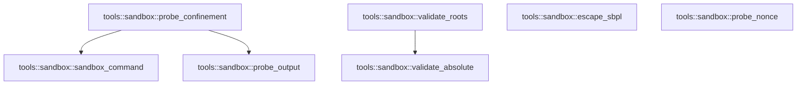

# tools::sandbox

[Package atlas](index.md) · [Source](../../src/sandbox.rs)

## Declarations

Visibility is the declaration spelling; trait members and reexports require their enclosing interface. `cfg` is not evaluated.

| Symbol | Kind | Visibility | Test / cfg |
|---|---|---|---|
| [tools::sandbox::LINUX_LANDLOCK_ABI_MIN](../../src/sandbox.rs#L13) | const_item | `pub(crate)` |  |
| [tools::sandbox::NetworkPolicy](../../src/sandbox.rs#L17) | enum_item | `pub` |  |
| [tools::sandbox::SandboxPolicy](../../src/sandbox.rs#L25) | struct_item | `pub` |  |
| [tools::sandbox::SandboxPolicy::validate](../../src/sandbox.rs#L43) | function_item | `pub` |  |
| [tools::sandbox::SandboxPolicy::is_protected_exception](../../src/sandbox.rs#L70) | function_item | `pub` |  |
| [tools::sandbox::SandboxPolicy::exposed_protected_root](../../src/sandbox.rs#L79) | function_item | `pub` |  |
| [tools::sandbox::SandboxPolicy::canonical_bytes](../../src/sandbox.rs#L89) | function_item | `pub` |  |
| [tools::sandbox::SandboxBackend](../../src/sandbox.rs#L98) | enum_item | `pub` |  |
| [tools::sandbox::ProbeStatus](../../src/sandbox.rs#L108) | enum_item | `pub` |  |
| [tools::sandbox::ProbeFailure](../../src/sandbox.rs#L115) | enum_item | `pub` |  |
| [tools::sandbox::SandboxApproval](../../src/sandbox.rs#L123) | struct_item | `pub` |  |
| [tools::sandbox::SandboxError](../../src/sandbox.rs#L131) | enum_item | `pub` |  |
| [tools::sandbox::kernel_protected_roots](../../src/sandbox.rs#L150) | function_item | `pub` |  |
| [tools::sandbox::exposed_protected_roots](../../src/sandbox.rs#L173) | function_item | `pub` |  |
| [tools::sandbox::protected_root_containing](../../src/sandbox.rs#L199) | function_item | `pub` |  |
| [tools::sandbox::canonical_text](../../src/sandbox.rs#L230) | function_item | `private` |  |
| [tools::sandbox::service_user_home](../../src/sandbox.rs#L239) | function_item | `private` |  |
| [tools::sandbox::policy_digest](../../src/sandbox.rs#L266) | function_item | `pub` |  |
| [tools::sandbox::compile_darwin_profile](../../src/sandbox.rs#L273) | function_item | `pub` |  |
| [tools::sandbox::compile_linux_plan](../../src/sandbox.rs#L385) | function_item | `pub` |  |
| [tools::sandbox::compile_linux_bubblewrap_plan](../../src/sandbox.rs#L418) | function_item | `pub` |  |
| [tools::sandbox::validate_unsandboxed_approval](../../src/sandbox.rs#L460) | function_item | `pub` |  |
| [tools::sandbox::probe_backend](../../src/sandbox.rs#L477) | function_item | `pub` |  |
| [tools::sandbox::sandbox_command](../../src/sandbox.rs#L486) | function_item | `pub(crate)` |  |
| [tools::sandbox::probe_darwin](../../src/sandbox.rs#L541) | function_item | `private` |  |
| [tools::sandbox::select_linux_backend](../../src/sandbox.rs#L564) | function_item | `private` |  |
| [tools::sandbox::probe_bubblewrap](../../src/sandbox.rs#L584) | function_item | `private` |  |
| [tools::sandbox::probe_linux](../../src/sandbox.rs#L627) | function_item | `private` |  |
| [tools::sandbox::probe_confinement](../../src/sandbox.rs#L662) | function_item | `private` | #[cfg(any(     target_os = "macos",     all(         target_os = "linux",         any(target_arch = "x86_64", target_arch = "aarch64")     ) ))] |
| [tools::sandbox::probe_output](../../src/sandbox.rs#L740) | function_item | `private` | #[cfg(any(     target_os = "macos",     all(         target_os = "linux",         any(target_arch = "x86_64", target_arch = "aarch64")     ) ))] |
| [tools::sandbox::validate_roots](../../src/sandbox.rs#L766) | function_item | `private` |  |
| [tools::sandbox::validate_absolute](../../src/sandbox.rs#L783) | function_item | `private` |  |
| [tools::sandbox::escape_sbpl](../../src/sandbox.rs#L799) | function_item | `private` |  |
| [tools::sandbox::probe_nonce](../../src/sandbox.rs#L815) | function_item | `private` | #[cfg(any(     target_os = "macos",     all(         target_os = "linux",         any(target_arch = "x86_64", target_arch = "aarch64")     ) ))] |
| [tools::sandbox::probe_nonce::NONCE](../../src/sandbox.rs#L817) | static_item | `private` | #[cfg(any(     target_os = "macos",     all(         target_os = "linux",         any(target_arch = "x86_64", target_arch = "aarch64")     ) ))] |
| [tools::sandbox::tests::available](../../src/sandbox.rs#L824) | function_item | `private` | test; #[cfg(test)] |
| [tools::sandbox::tests::missing](../../src/sandbox.rs#L830) | function_item | `private` | test; #[cfg(test)] |
| [tools::sandbox::tests::linux_auto_prefers_bubblewrap_without_probing_landlock](../../src/sandbox.rs#L837) | function_item | `private` | test; #[cfg(test)] |
| [tools::sandbox::tests::linux_auto_falls_back_only_to_available_landlock](../../src/sandbox.rs#L846) | function_item | `private` | test; #[cfg(test)] |
| [tools::sandbox::tests::bubblewrap_plan_matches_golden_bytes](../../src/sandbox.rs#L857) | function_item | `private` | test; #[cfg(test)] |
| [tools::sandbox::tests::protected_policy](../../src/sandbox.rs#L868) | function_item | `private` | test; #[cfg(test)] |
| [tools::sandbox::tests::protected_roots_are_omitted_from_serialization_when_empty](../../src/sandbox.rs#L881) | function_item | `private` | test; #[cfg(test)] |
| [tools::sandbox::tests::darwin_profile_denies_protected_root_and_its_writable_ancestors](../../src/sandbox.rs#L896) | function_item | `private` | test; #[cfg(test)] |
| [tools::sandbox::tests::protected_exceptions_must_be_strictly_beneath](../../src/sandbox.rs#L929) | function_item | `private` | test; #[cfg(test)] |
| [tools::sandbox::tests::unsorted_protected_roots_are_rejected](../../src/sandbox.rs#L944) | function_item | `private` | test; #[cfg(test)] |
| [tools::sandbox::tests::exposed_roots_keep_only_protected_roots_inside_write_roots](../../src/sandbox.rs#L953) | function_item | `private` | test; #[cfg(test)] |
| [tools::sandbox::tests::protected_root_lookup_resolves_symlinked_aliases](../../src/sandbox.rs#L967) | function_item | `private` | test; #[cfg(test)] |
| [tools::sandbox::tests::seatbelt_keeps_protected_root_read_only_beneath_a_writable_home](../../src/sandbox.rs#L993) | function_item | `private` | test; #[cfg(test)] #[cfg(target_os = "macos")] |

## Imports / reexports

| Local name | Source path | Visibility |
|---|---|---|
| `BTreeSet` | `std::collections::BTreeSet` | `private` |
| `fs` | `std::fs` | `private` |
| `Path` | `std::path::Path` | `private` |
| `Command` | `std::process::Command` | `private` |
| `Deserialize` | `serde::Deserialize` | `private` |
| `Serialize` | `serde::Serialize` | `private` |
| `json` | `serde_json::json` | `private` |
| `Digest` | `sha2::Digest` | `private` |
| `Sha256` | `sha2::Sha256` | `private` |
| `Error` | `thiserror::Error` | `private` |
| `*` | `super::*` | `private` |

## Module declarations

| Module | Visibility | Attributes |
|---|---|---|
| `tools::sandbox::tests` | `private` | #[cfg(test)] |

## Function call graphs

Edges below are syntactically resolved calls only, including private functions. Graphs partition callers into groups of 20; they are not execution order. All unresolved sites are listed below and in the JSON inventory.

```mermaid
flowchart TD
  n0["tools::bubblewrap_sandbox::binary"]
  n1["tools::bubblewrap_sandbox::command"]
  n2["tools::linux_sandbox::confine"]
  n3["tools::linux_sandbox::supported_abi"]
  n4["tools::sandbox::kernel_protected_roots"]
  n5["tools::sandbox::exposed_protected_roots"]
  n6["tools::sandbox::protected_root_containing"]
  n7["tools::sandbox::canonical_text"]
  n8["tools::sandbox::service_user_home"]
  n9["tools::sandbox::policy_digest"]
  n10["tools::sandbox::compile_darwin_profile"]
  n11["tools::sandbox::compile_linux_plan"]
  n12["tools::sandbox::compile_linux_bubblewrap_plan"]
  n13["tools::sandbox::SandboxPolicy::validate"]
  n14["tools::sandbox::validate_unsandboxed_approval"]
  n15["tools::sandbox::probe_backend"]
  n16["tools::sandbox::sandbox_command"]
  n17["tools::sandbox::probe_darwin"]
  n18["tools::sandbox::select_linux_backend"]
  n19["tools::sandbox::probe_bubblewrap"]
  n20["tools::sandbox::probe_linux"]
  n21["tools::sandbox::probe_confinement"]
  n22["tools::sandbox::SandboxPolicy::is_protected_exception"]
  n23["tools::sandbox::probe_output"]
  n24["tools::sandbox::validate_roots"]
  n25["tools::sandbox::validate_absolute"]
  n26["tools::sandbox::SandboxPolicy::exposed_protected_root"]
  n27["tools::sandbox::SandboxPolicy::canonical_bytes"]
  n4 --> n7
  n4 --> n8
  n5 --> n7
  n13 --> n24
  n13 --> n25
  n15 --> n17
  n15 --> n18
  n15 --> n19
  n15 --> n20
  n16 --> n1
  n16 --> n2
  n16 --> n10
  n17 --> n21
  n19 --> n0
  n19 --> n21
  n19 --> n23
  n20 --> n3
  n20 --> n21
  n26 --> n22
  n27 --> n13
```

Functions 1–20: 20 direct edges

Functions 21–26: 3 direct edges

## Call sites

Includes test functions (marked in declarations). Receiver-type-required sites need type analysis/manual tracing. Calls in closures are attributed to their enclosing function; their occurrence here does not mean the closure executes immediately.

| Caller | Callee expression | Source lines | Target / classification |
|---|---|---|---|
| `validate` | `Err` | [45](../../src/sandbox.rs#L45), [59](../../src/sandbox.rs#L59) | external-constructor-callback-or-unresolved |
| `validate` | `SandboxError::Invalid` | [45](../../src/sandbox.rs#L45), [59](../../src/sandbox.rs#L59) | external-constructor-callback-or-unresolved |
| `validate` | `validate_roots` | [47](../../src/sandbox.rs#L47), [48](../../src/sandbox.rs#L48), [49](../../src/sandbox.rs#L49) | [tools::sandbox::validate_roots](../../src/sandbox.rs#L766) |
| `validate` | `validate_absolute` | [51](../../src/sandbox.rs#L51) | [tools::sandbox::validate_absolute](../../src/sandbox.rs#L783) |
| `validate` | `self                 .read_roots                 .iter()                 .any` | [54](../../src/sandbox.rs#L54) | receiver-type-required |
| `validate` | `self                 .read_roots                 .iter` | [54](../../src/sandbox.rs#L54) | receiver-type-required |
| `validate` | `Path::new(root).starts_with` | [57](../../src/sandbox.rs#L57) | receiver-type-required |
| `validate` | `Path::new` | [57](../../src/sandbox.rs#L57) | external-constructor-callback-or-unresolved |
| `validate` | `Ok` | [64](../../src/sandbox.rs#L64) | external-constructor-callback-or-unresolved |
| `is_protected_exception` | `self.protected_roots             .iter()             .any` | [71](../../src/sandbox.rs#L71) | receiver-type-required |
| `is_protected_exception` | `self.protected_roots             .iter` | [71](../../src/sandbox.rs#L71) | receiver-type-required |
| `is_protected_exception` | `Path::new` | [73](../../src/sandbox.rs#L73) | external-constructor-callback-or-unresolved |
| `is_protected_exception` | `root.starts_with` | [73](../../src/sandbox.rs#L73) | receiver-type-required |
| `exposed_protected_root` | `self.is_protected_exception` | [80](../../src/sandbox.rs#L80) | [tools::sandbox::SandboxPolicy::is_protected_exception](../../src/sandbox.rs#L70) |
| `exposed_protected_root` | `self.protected_roots             .iter()             .find(&#124;protected&#124; Path::new(protected).starts_with(root))             .map` | [83](../../src/sandbox.rs#L83) | receiver-type-required |
| `exposed_protected_root` | `self.protected_roots             .iter()             .find` | [83](../../src/sandbox.rs#L83) | receiver-type-required |
| `exposed_protected_root` | `self.protected_roots             .iter` | [83](../../src/sandbox.rs#L83) | receiver-type-required |
| `exposed_protected_root` | `Path::new(protected).starts_with` | [85](../../src/sandbox.rs#L85) | receiver-type-required |
| `exposed_protected_root` | `Path::new` | [85](../../src/sandbox.rs#L85) | external-constructor-callback-or-unresolved |
| `canonical_bytes` | `self.validate` | [90](../../src/sandbox.rs#L90) | [tools::sandbox::SandboxPolicy::validate](../../src/sandbox.rs#L43) |
| `canonical_bytes` | `serde_json_canonicalizer::to_vec(self)             .map_err` | [91](../../src/sandbox.rs#L91) | receiver-type-required |
| `canonical_bytes` | `serde_json_canonicalizer::to_vec` | [91](../../src/sandbox.rs#L91) | external-constructor-callback-or-unresolved |
| `canonical_bytes` | `SandboxError::Encoding` | [92](../../src/sandbox.rs#L92) | external-constructor-callback-or-unresolved |
| `canonical_bytes` | `error.to_string` | [92](../../src/sandbox.rs#L92) | receiver-type-required |
| `kernel_protected_roots` | `Vec::new` | [151](../../src/sandbox.rs#L151) | external-constructor-callback-or-unresolved |
| `kernel_protected_roots` | `roots.push` | [152](../../src/sandbox.rs#L152), [160](../../src/sandbox.rs#L160) | receiver-type-required |
| `kernel_protected_roots` | `canonical_text` | [152](../../src/sandbox.rs#L152) | [tools::sandbox::canonical_text](../../src/sandbox.rs#L230) |
| `kernel_protected_roots` | `service_user_home` | [153](../../src/sandbox.rs#L153) | [tools::sandbox::service_user_home](../../src/sandbox.rs#L239) |
| `kernel_protected_roots` | `home.join` | [155](../../src/sandbox.rs#L155), [157](../../src/sandbox.rs#L157) | receiver-type-required |
| `kernel_protected_roots` | `store.canonicalize` | [159](../../src/sandbox.rs#L159) | receiver-type-required |
| `kernel_protected_roots` | `canonical.to_string_lossy().into_owned` | [160](../../src/sandbox.rs#L160) | receiver-type-required |
| `kernel_protected_roots` | `canonical.to_string_lossy` | [160](../../src/sandbox.rs#L160) | receiver-type-required |
| `kernel_protected_roots` | `roots.sort` | [164](../../src/sandbox.rs#L164) | receiver-type-required |
| `kernel_protected_roots` | `roots.dedup` | [165](../../src/sandbox.rs#L165) | receiver-type-required |
| `exposed_protected_roots` | `write_roots         .iter()         .flat_map(&#124;root&#124; {             let canonical = canonical_text(Path::new(root));             [root.clone(), canonical]         })         .collect::<Vec<_>>` | [174](../../src/sandbox.rs#L174) | receiver-type-required |
| `exposed_protected_roots` | `write_roots         .iter()         .flat_map` | [174](../../src/sandbox.rs#L174) | receiver-type-required |
| `exposed_protected_roots` | `write_roots         .iter` | [174](../../src/sandbox.rs#L174) | receiver-type-required |
| `exposed_protected_roots` | `canonical_text` | [177](../../src/sandbox.rs#L177) | [tools::sandbox::canonical_text](../../src/sandbox.rs#L230) |
| `exposed_protected_roots` | `Path::new` | [177](../../src/sandbox.rs#L177), [186](../../src/sandbox.rs#L186) | external-constructor-callback-or-unresolved |
| `exposed_protected_roots` | `root.clone` | [178](../../src/sandbox.rs#L178) | receiver-type-required |
| `exposed_protected_roots` | `protected         .iter()         .filter(&#124;root&#124; {             writes                 .iter()                 .any(&#124;write&#124; Path::new(root).starts_with(write))         })         .cloned()         .collect::<Vec<_>>` | [181](../../src/sandbox.rs#L181) | receiver-type-required |
| `exposed_protected_roots` | `protected         .iter()         .filter(&#124;root&#124; {             writes                 .iter()                 .any(&#124;write&#124; Path::new(root).starts_with(write))         })         .cloned` | [181](../../src/sandbox.rs#L181) | receiver-type-required |
| `exposed_protected_roots` | `protected         .iter()         .filter` | [181](../../src/sandbox.rs#L181) | receiver-type-required |
| `exposed_protected_roots` | `protected         .iter` | [181](../../src/sandbox.rs#L181) | receiver-type-required |
| `exposed_protected_roots` | `writes                 .iter()                 .any` | [184](../../src/sandbox.rs#L184) | receiver-type-required |
| `exposed_protected_roots` | `writes                 .iter` | [184](../../src/sandbox.rs#L184) | receiver-type-required |
| `exposed_protected_roots` | `Path::new(root).starts_with` | [186](../../src/sandbox.rs#L186) | receiver-type-required |
| `exposed_protected_roots` | `exposed.sort` | [190](../../src/sandbox.rs#L190) | receiver-type-required |
| `exposed_protected_roots` | `exposed.dedup` | [191](../../src/sandbox.rs#L191) | receiver-type-required |
| `protected_root_containing` | `Vec::new` | [201](../../src/sandbox.rs#L201) | external-constructor-callback-or-unresolved |
| `protected_root_containing` | `existing.canonicalize` | [203](../../src/sandbox.rs#L203) | receiver-type-required |
| `protected_root_containing` | `Some` | [204](../../src/sandbox.rs#L204) | external-constructor-callback-or-unresolved |
| `protected_root_containing` | `suffix                     .iter()                     .rev()                     .fold` | [205](../../src/sandbox.rs#L205) | receiver-type-required |
| `protected_root_containing` | `suffix                     .iter()                     .rev` | [205](../../src/sandbox.rs#L205) | receiver-type-required |
| `protected_root_containing` | `suffix                     .iter` | [205](../../src/sandbox.rs#L205) | receiver-type-required |
| `protected_root_containing` | `base.join` | [208](../../src/sandbox.rs#L208) | receiver-type-required |
| `protected_root_containing` | `existing.parent` | [211](../../src/sandbox.rs#L211) | receiver-type-required |
| `protected_root_containing` | `existing.file_name` | [211](../../src/sandbox.rs#L211) | receiver-type-required |
| `protected_root_containing` | `suffix.push` | [213](../../src/sandbox.rs#L213) | receiver-type-required |
| `protected_root_containing` | `name.to_owned` | [213](../../src/sandbox.rs#L213) | receiver-type-required |
| `protected_root_containing` | `protected         .iter()         .find(&#124;root&#124; {             path.starts_with(root)                 &#124;&#124; resolved                     .as_deref()                     .is_some_and(&#124;resolved&#124; resolved.starts_with(root))         })         .map` | [219](../../src/sandbox.rs#L219) | receiver-type-required |
| `protected_root_containing` | `protected         .iter()         .find` | [219](../../src/sandbox.rs#L219) | receiver-type-required |
| `protected_root_containing` | `protected         .iter` | [219](../../src/sandbox.rs#L219) | receiver-type-required |
| `protected_root_containing` | `path.starts_with` | [222](../../src/sandbox.rs#L222) | receiver-type-required |
| `protected_root_containing` | `resolved                     .as_deref()                     .is_some_and` | [223](../../src/sandbox.rs#L223) | receiver-type-required |
| `protected_root_containing` | `resolved                     .as_deref` | [223](../../src/sandbox.rs#L223) | receiver-type-required |
| `protected_root_containing` | `resolved.starts_with` | [225](../../src/sandbox.rs#L225) | receiver-type-required |
| `canonical_text` | `path.canonicalize()         .unwrap_or_else(&#124;_&#124; path.to_path_buf())         .to_string_lossy()         .into_owned` | [231](../../src/sandbox.rs#L231) | receiver-type-required |
| `canonical_text` | `path.canonicalize()         .unwrap_or_else(&#124;_&#124; path.to_path_buf())         .to_string_lossy` | [231](../../src/sandbox.rs#L231) | receiver-type-required |
| `canonical_text` | `path.canonicalize()         .unwrap_or_else` | [231](../../src/sandbox.rs#L231) | receiver-type-required |
| `canonical_text` | `path.canonicalize` | [231](../../src/sandbox.rs#L231) | receiver-type-required |
| `canonical_text` | `path.to_path_buf` | [232](../../src/sandbox.rs#L232) | receiver-type-required |
| `service_user_home` | `std::mem::zeroed` | [244](../../src/sandbox.rs#L244) | external-constructor-callback-or-unresolved |
| `service_user_home` | `std::ptr::null_mut` | [245](../../src/sandbox.rs#L245) | external-constructor-callback-or-unresolved |
| `service_user_home` | `libc::getpwuid_r` | [249](../../src/sandbox.rs#L249) | external-constructor-callback-or-unresolved |
| `service_user_home` | `libc::geteuid` | [250](../../src/sandbox.rs#L250) | external-constructor-callback-or-unresolved |
| `service_user_home` | `buffer.as_mut_ptr().cast` | [252](../../src/sandbox.rs#L252) | receiver-type-required |
| `service_user_home` | `buffer.as_mut_ptr` | [252](../../src/sandbox.rs#L252) | receiver-type-required |
| `service_user_home` | `buffer.len` | [253](../../src/sandbox.rs#L253) | receiver-type-required |
| `service_user_home` | `result.is_null` | [257](../../src/sandbox.rs#L257) | receiver-type-required |
| `service_user_home` | `entry.pw_dir.is_null` | [257](../../src/sandbox.rs#L257) | receiver-type-required |
| `service_user_home` | `CStr::from_ptr` | [261](../../src/sandbox.rs#L261) | external-constructor-callback-or-unresolved |
| `service_user_home` | `Path::new` | [262](../../src/sandbox.rs#L262) | external-constructor-callback-or-unresolved |
| `service_user_home` | `std::ffi::OsStr::from_bytes` | [262](../../src/sandbox.rs#L262) | external-constructor-callback-or-unresolved |
| `service_user_home` | `home.to_bytes` | [262](../../src/sandbox.rs#L262) | receiver-type-required |
| `service_user_home` | `home.is_absolute().then` | [263](../../src/sandbox.rs#L263) | receiver-type-required |
| `service_user_home` | `home.is_absolute` | [263](../../src/sandbox.rs#L263) | receiver-type-required |
| `service_user_home` | `home.to_path_buf` | [263](../../src/sandbox.rs#L263) | receiver-type-required |
| `policy_digest` | `Ok` | [267](../../src/sandbox.rs#L267) | external-constructor-callback-or-unresolved |
| `compile_darwin_profile` | `policy.validate` | [274](../../src/sandbox.rs#L274) | receiver-type-required |
| `compile_darwin_profile` | `policy         .read_roots         .iter()         .chain(&policy.write_roots)         .chain(policy.scratch.iter())         .flat_map(&#124;root&#124; Path::new(root).ancestors().skip(1))         .filter_map(Path::to_str)         .collect::<BTreeSet<_>>` | [283](../../src/sandbox.rs#L283) | receiver-type-required |
| `compile_darwin_profile` | `policy         .read_roots         .iter()         .chain(&policy.write_roots)         .chain(policy.scratch.iter())         .flat_map(&#124;root&#124; Path::new(root).ancestors().skip(1))         .filter_map` | [283](../../src/sandbox.rs#L283) | receiver-type-required |
| `compile_darwin_profile` | `policy         .read_roots         .iter()         .chain(&policy.write_roots)         .chain(policy.scratch.iter())         .flat_map` | [283](../../src/sandbox.rs#L283) | receiver-type-required |
| `compile_darwin_profile` | `policy         .read_roots         .iter()         .chain(&policy.write_roots)         .chain` | [283](../../src/sandbox.rs#L283) | receiver-type-required |
| `compile_darwin_profile` | `policy         .read_roots         .iter()         .chain` | [283](../../src/sandbox.rs#L283) | receiver-type-required |
| `compile_darwin_profile` | `policy         .read_roots         .iter` | [283](../../src/sandbox.rs#L283) | receiver-type-required |
| `compile_darwin_profile` | `policy.scratch.iter` | [287](../../src/sandbox.rs#L287), [340](../../src/sandbox.rs#L340) | receiver-type-required |
| `compile_darwin_profile` | `Path::new(root).ancestors().skip` | [288](../../src/sandbox.rs#L288) | receiver-type-required |
| `compile_darwin_profile` | `Path::new(root).ancestors` | [288](../../src/sandbox.rs#L288) | receiver-type-required |
| `compile_darwin_profile` | `Path::new` | [288](../../src/sandbox.rs#L288), [348](../../src/sandbox.rs#L348), [362](../../src/sandbox.rs#L362) | external-constructor-callback-or-unresolved |
| `compile_darwin_profile` | `lines.push` | [292](../../src/sandbox.rs#L292), [300](../../src/sandbox.rs#L300), [301](../../src/sandbox.rs#L301), [315](../../src/sandbox.rs#L315), [321](../../src/sandbox.rs#L321), [327](../../src/sandbox.rs#L327), [344](../../src/sandbox.rs#L344), [355](../../src/sandbox.rs#L355), [364](../../src/sandbox.rs#L364), [370](../../src/sandbox.rs#L370), [375](../../src/sandbox.rs#L375), [376](../../src/sandbox.rs#L376), [378](../../src/sandbox.rs#L378) | receiver-type-required |
| `compile_darwin_profile` | `"(allow file-read-metadata (literal \"/Applications\"))".to_owned` | [300](../../src/sandbox.rs#L300) | receiver-type-required |
| `compile_darwin_profile` | `"(allow file-read-metadata (literal \"/Library\"))".to_owned` | [301](../../src/sandbox.rs#L301) | receiver-type-required |
| `compile_darwin_profile` | `[         "/System",         "/usr",         "/bin",         "/sbin",         "/private/var/select",         "/Applications/Xcode.app",         "/Library/Developer/CommandLineTools",     ]     .into_iter()     .map(ToOwned::to_owned)     .chain` | [302](../../src/sandbox.rs#L302) | receiver-type-required |
| `compile_darwin_profile` | `[         "/System",         "/usr",         "/bin",         "/sbin",         "/private/var/select",         "/Applications/Xcode.app",         "/Library/Developer/CommandLineTools",     ]     .into_iter()     .map` | [302](../../src/sandbox.rs#L302) | receiver-type-required |
| `compile_darwin_profile` | `[         "/System",         "/usr",         "/bin",         "/sbin",         "/private/var/select",         "/Applications/Xcode.app",         "/Library/Developer/CommandLineTools",     ]     .into_iter` | [302](../../src/sandbox.rs#L302) | receiver-type-required |
| `compile_darwin_profile` | `policy.read_roots.iter().cloned` | [313](../../src/sandbox.rs#L313) | receiver-type-required |
| `compile_darwin_profile` | `policy.read_roots.iter` | [313](../../src/sandbox.rs#L313) | receiver-type-required |
| `compile_darwin_profile` | `policy         .write_roots         .iter()         .chain(policy.scratch.iter())         .collect::<Vec<_>>` | [337](../../src/sandbox.rs#L337) | receiver-type-required |
| `compile_darwin_profile` | `policy         .write_roots         .iter()         .chain` | [337](../../src/sandbox.rs#L337) | receiver-type-required |
| `compile_darwin_profile` | `policy         .write_roots         .iter` | [337](../../src/sandbox.rs#L337) | receiver-type-required |
| `compile_darwin_profile` | `BTreeSet::new` | [342](../../src/sandbox.rs#L342) | external-constructor-callback-or-unresolved |
| `compile_darwin_profile` | `Path::new(protected).ancestors().skip` | [348](../../src/sandbox.rs#L348) | receiver-type-required |
| `compile_darwin_profile` | `Path::new(protected).ancestors` | [348](../../src/sandbox.rs#L348) | receiver-type-required |
| `compile_darwin_profile` | `grants.iter().any` | [349](../../src/sandbox.rs#L349) | receiver-type-required |
| `compile_darwin_profile` | `grants.iter` | [349](../../src/sandbox.rs#L349) | receiver-type-required |
| `compile_darwin_profile` | `ancestor.starts_with` | [349](../../src/sandbox.rs#L349) | receiver-type-required |
| `compile_darwin_profile` | `denied_ancestors.extend` | [350](../../src/sandbox.rs#L350) | receiver-type-required |
| `compile_darwin_profile` | `ancestor.to_str` | [350](../../src/sandbox.rs#L350) | receiver-type-required |
| `compile_darwin_profile` | `grants         .iter()         .filter` | [360](../../src/sandbox.rs#L360) | receiver-type-required |
| `compile_darwin_profile` | `grants         .iter` | [360](../../src/sandbox.rs#L360) | receiver-type-required |
| `compile_darwin_profile` | `policy.is_protected_exception` | [362](../../src/sandbox.rs#L362) | receiver-type-required |
| `compile_darwin_profile` | `"(allow process-exec process-fork)".to_owned` | [370](../../src/sandbox.rs#L370) | receiver-type-required |
| `compile_darwin_profile` | `"(allow network* (local ip \"localhost:*\"))".to_owned` | [375](../../src/sandbox.rs#L375) | receiver-type-required |
| `compile_darwin_profile` | `"(allow network* (remote ip \"localhost:*\"))".to_owned` | [376](../../src/sandbox.rs#L376) | receiver-type-required |
| `compile_darwin_profile` | `"(allow network*)".to_owned` | [378](../../src/sandbox.rs#L378) | receiver-type-required |
| `compile_darwin_profile` | `lines.join("\n").into_bytes` | [380](../../src/sandbox.rs#L380) | receiver-type-required |
| `compile_darwin_profile` | `lines.join` | [380](../../src/sandbox.rs#L380) | receiver-type-required |
| `compile_darwin_profile` | `bytes.push` | [381](../../src/sandbox.rs#L381) | receiver-type-required |
| `compile_darwin_profile` | `Ok` | [382](../../src/sandbox.rs#L382) | external-constructor-callback-or-unresolved |
| `compile_linux_plan` | `policy.validate` | [386](../../src/sandbox.rs#L386) | receiver-type-required |
| `compile_linux_plan` | `plan.as_object_mut()             .expect("plan object")             .insert` | [401](../../src/sandbox.rs#L401), [406](../../src/sandbox.rs#L406) | receiver-type-required |
| `compile_linux_plan` | `plan.as_object_mut()             .expect` | [401](../../src/sandbox.rs#L401), [406](../../src/sandbox.rs#L406) | receiver-type-required |
| `compile_linux_plan` | `plan.as_object_mut` | [401](../../src/sandbox.rs#L401), [406](../../src/sandbox.rs#L406) | receiver-type-required |
| `compile_linux_plan` | `"scratch".to_owned` | [403](../../src/sandbox.rs#L403) | receiver-type-required |
| `compile_linux_plan` | `policy.protected_roots.is_empty` | [405](../../src/sandbox.rs#L405) | receiver-type-required |
| `compile_linux_plan` | `"protected_roots".to_owned` | [408](../../src/sandbox.rs#L408) | receiver-type-required |
| `compile_linux_plan` | `serde_json_canonicalizer::to_vec(&plan)         .map_err` | [410](../../src/sandbox.rs#L410) | receiver-type-required |
| `compile_linux_plan` | `serde_json_canonicalizer::to_vec` | [410](../../src/sandbox.rs#L410) | external-constructor-callback-or-unresolved |
| `compile_linux_plan` | `SandboxError::Encoding` | [411](../../src/sandbox.rs#L411) | external-constructor-callback-or-unresolved |
| `compile_linux_plan` | `error.to_string` | [411](../../src/sandbox.rs#L411) | receiver-type-required |
| `compile_linux_plan` | `bytes.push` | [412](../../src/sandbox.rs#L412) | receiver-type-required |
| `compile_linux_plan` | `Ok` | [413](../../src/sandbox.rs#L413) | external-constructor-callback-or-unresolved |
| `compile_linux_bubblewrap_plan` | `policy.validate` | [419](../../src/sandbox.rs#L419) | receiver-type-required |
| `compile_linux_bubblewrap_plan` | `Err` | [421](../../src/sandbox.rs#L421) | external-constructor-callback-or-unresolved |
| `compile_linux_bubblewrap_plan` | `SandboxError::Unavailable` | [421](../../src/sandbox.rs#L421) | external-constructor-callback-or-unresolved |
| `compile_linux_bubblewrap_plan` | `"bubblewrap requires allow_process=true and network=deny or all".to_owned` | [422](../../src/sandbox.rs#L422) | receiver-type-required |
| `compile_linux_bubblewrap_plan` | `namespaces.push` | [427](../../src/sandbox.rs#L427) | receiver-type-required |
| `compile_linux_bubblewrap_plan` | `namespaces.sort_unstable` | [428](../../src/sandbox.rs#L428) | receiver-type-required |
| `compile_linux_bubblewrap_plan` | `plan.as_object_mut()             .expect("plan object")             .insert` | [445](../../src/sandbox.rs#L445), [450](../../src/sandbox.rs#L450) | receiver-type-required |
| `compile_linux_bubblewrap_plan` | `plan.as_object_mut()             .expect` | [445](../../src/sandbox.rs#L445), [450](../../src/sandbox.rs#L450) | receiver-type-required |
| `compile_linux_bubblewrap_plan` | `plan.as_object_mut` | [445](../../src/sandbox.rs#L445), [450](../../src/sandbox.rs#L450) | receiver-type-required |
| `compile_linux_bubblewrap_plan` | `"scratch".to_owned` | [447](../../src/sandbox.rs#L447) | receiver-type-required |
| `compile_linux_bubblewrap_plan` | `policy.protected_roots.is_empty` | [449](../../src/sandbox.rs#L449) | receiver-type-required |
| `compile_linux_bubblewrap_plan` | `"protected_roots".to_owned` | [452](../../src/sandbox.rs#L452) | receiver-type-required |
| `compile_linux_bubblewrap_plan` | `serde_json_canonicalizer::to_vec(&plan)         .map_err` | [454](../../src/sandbox.rs#L454) | receiver-type-required |
| `compile_linux_bubblewrap_plan` | `serde_json_canonicalizer::to_vec` | [454](../../src/sandbox.rs#L454) | external-constructor-callback-or-unresolved |
| `compile_linux_bubblewrap_plan` | `SandboxError::Encoding` | [455](../../src/sandbox.rs#L455) | external-constructor-callback-or-unresolved |
| `compile_linux_bubblewrap_plan` | `error.to_string` | [455](../../src/sandbox.rs#L455) | receiver-type-required |
| `compile_linux_bubblewrap_plan` | `bytes.push` | [456](../../src/sandbox.rs#L456) | receiver-type-required |
| `compile_linux_bubblewrap_plan` | `Ok` | [457](../../src/sandbox.rs#L457) | external-constructor-callback-or-unresolved |
| `validate_unsandboxed_approval` | `Ok` | [471](../../src/sandbox.rs#L471) | external-constructor-callback-or-unresolved |
| `validate_unsandboxed_approval` | `Err` | [473](../../src/sandbox.rs#L473) | external-constructor-callback-or-unresolved |
| `probe_backend` | `probe_darwin` | [479](../../src/sandbox.rs#L479) | [tools::sandbox::probe_darwin](../../src/sandbox.rs#L541) |
| `probe_backend` | `select_linux_backend` | [480](../../src/sandbox.rs#L480) | [tools::sandbox::select_linux_backend](../../src/sandbox.rs#L564) |
| `probe_backend` | `probe_bubblewrap` | [480](../../src/sandbox.rs#L480), [481](../../src/sandbox.rs#L481) | [tools::sandbox::probe_bubblewrap](../../src/sandbox.rs#L584) |
| `probe_backend` | `probe_linux` | [482](../../src/sandbox.rs#L482) | [tools::sandbox::probe_linux](../../src/sandbox.rs#L627) |
| `sandbox_command` | `Err` | [492](../../src/sandbox.rs#L492), [499](../../src/sandbox.rs#L499), [518](../../src/sandbox.rs#L518), [535](../../src/sandbox.rs#L535) | external-constructor-callback-or-unresolved |
| `sandbox_command` | `SandboxError::Unavailable` | [492](../../src/sandbox.rs#L492), [499](../../src/sandbox.rs#L499), [518](../../src/sandbox.rs#L518), [535](../../src/sandbox.rs#L535) | external-constructor-callback-or-unresolved |
| `sandbox_command` | `"sandbox probe did not report available".to_owned` | [493](../../src/sandbox.rs#L493) | receiver-type-required |
| `sandbox_command` | `String::from_utf8(compile_darwin_profile(policy)?)             .map_err` | [503](../../src/sandbox.rs#L503) | receiver-type-required |
| `sandbox_command` | `String::from_utf8` | [503](../../src/sandbox.rs#L503) | external-constructor-callback-or-unresolved |
| `sandbox_command` | `compile_darwin_profile` | [503](../../src/sandbox.rs#L503) | [tools::sandbox::compile_darwin_profile](../../src/sandbox.rs#L273) |
| `sandbox_command` | `SandboxError::Encoding` | [504](../../src/sandbox.rs#L504) | external-constructor-callback-or-unresolved |
| `sandbox_command` | `"profile is not UTF-8".to_owned` | [504](../../src/sandbox.rs#L504) | receiver-type-required |
| `sandbox_command` | `Command::new` | [505](../../src/sandbox.rs#L505), [522](../../src/sandbox.rs#L522) | external-constructor-callback-or-unresolved |
| `sandbox_command` | `command.arg("-p").arg(profile).arg` | [506](../../src/sandbox.rs#L506) | receiver-type-required |
| `sandbox_command` | `command.arg("-p").arg` | [506](../../src/sandbox.rs#L506) | receiver-type-required |
| `sandbox_command` | `command.arg` | [506](../../src/sandbox.rs#L506) | receiver-type-required |
| `sandbox_command` | `Ok` | [507](../../src/sandbox.rs#L507), [524](../../src/sandbox.rs#L524) | external-constructor-callback-or-unresolved |
| `sandbox_command` | `crate::bubblewrap_sandbox::command` | [515](../../src/sandbox.rs#L515) | [tools::bubblewrap_sandbox::command](../../src/bubblewrap_sandbox.rs#L57) |
| `sandbox_command` | `crate::linux_sandbox::confine` | [523](../../src/sandbox.rs#L523) | [tools::linux_sandbox::confine](../../src/linux_sandbox.rs#L125) |
| `sandbox_command` | `"no applied sandbox launcher on this platform".to_owned` | [536](../../src/sandbox.rs#L536) | receiver-type-required |
| `probe_darwin` | `"Seatbelt requested on a non-macOS host".to_owned` | [546](../../src/sandbox.rs#L546) | receiver-type-required |
| `probe_darwin` | `Path::new("/usr/bin/sandbox-exec").is_file` | [551](../../src/sandbox.rs#L551) | receiver-type-required |
| `probe_darwin` | `Path::new` | [551](../../src/sandbox.rs#L551) | external-constructor-callback-or-unresolved |
| `probe_darwin` | `"sandbox-exec is missing".to_owned` | [554](../../src/sandbox.rs#L554) | receiver-type-required |
| `probe_darwin` | `probe_confinement` | [557](../../src/sandbox.rs#L557) | [tools::sandbox::probe_confinement](../../src/sandbox.rs#L662) |
| `probe_darwin` | `"darwin-seatbelt".to_owned` | [558](../../src/sandbox.rs#L558) | receiver-type-required |
| `probe_darwin` | `std::env::consts::OS.to_owned` | [559](../../src/sandbox.rs#L559) | receiver-type-required |
| `select_linux_backend` | `landlock` | [571](../../src/sandbox.rs#L571) | external-constructor-callback-or-unresolved |
| `probe_bubblewrap` | `"bubblewrap/seccomp requires Linux on x86_64 or aarch64".to_owned` | [592](../../src/sandbox.rs#L592) | receiver-type-required |
| `probe_bubblewrap` | `crate::bubblewrap_sandbox::binary` | [600](../../src/sandbox.rs#L600) | [tools::bubblewrap_sandbox::binary](../../src/bubblewrap_sandbox.rs#L26) |
| `probe_bubblewrap` | `error.to_string` | [605](../../src/sandbox.rs#L605) | receiver-type-required |
| `probe_bubblewrap` | `probe_output` | [609](../../src/sandbox.rs#L609) | [tools::sandbox::probe_output](../../src/sandbox.rs#L740) |
| `probe_bubblewrap` | `Command::new(binary).arg` | [609](../../src/sandbox.rs#L609) | receiver-type-required |
| `probe_bubblewrap` | `Command::new` | [609](../../src/sandbox.rs#L609) | external-constructor-callback-or-unresolved |
| `probe_bubblewrap` | `output.status.success` | [610](../../src/sandbox.rs#L610) | receiver-type-required |
| `probe_bubblewrap` | `String::from_utf8_lossy(&output.stdout).trim().to_owned` | [611](../../src/sandbox.rs#L611) | receiver-type-required |
| `probe_bubblewrap` | `String::from_utf8_lossy(&output.stdout).trim` | [611](../../src/sandbox.rs#L611) | receiver-type-required |
| `probe_bubblewrap` | `String::from_utf8_lossy` | [611](../../src/sandbox.rs#L611) | external-constructor-callback-or-unresolved |
| `probe_bubblewrap` | `probe_confinement` | [620](../../src/sandbox.rs#L620) | [tools::sandbox::probe_confinement](../../src/sandbox.rs#L662) |
| `probe_bubblewrap` | `crate::bubblewrap_sandbox::BACKEND.to_owned` | [621](../../src/sandbox.rs#L621) | receiver-type-required |
| `probe_linux` | `"Landlock/seccomp requires Linux on x86_64 or aarch64".to_owned` | [635](../../src/sandbox.rs#L635) | receiver-type-required |
| `probe_linux` | `crate::linux_sandbox::supported_abi` | [643](../../src/sandbox.rs#L643) | [tools::linux_sandbox::supported_abi](../../src/linux_sandbox.rs#L79) |
| `probe_linux` | `probe_confinement` | [644](../../src/sandbox.rs#L644) | [tools::sandbox::probe_confinement](../../src/sandbox.rs#L662) |
| `probe_linux` | `crate::linux_sandbox::BACKEND.to_owned` | [645](../../src/sandbox.rs#L645) | receiver-type-required |
| `probe_confinement` | `std::env::temp_dir().join` | [663](../../src/sandbox.rs#L663) | receiver-type-required |
| `probe_confinement` | `std::env::temp_dir` | [663](../../src/sandbox.rs#L663) | external-constructor-callback-or-unresolved |
| `probe_confinement` | `unresolved_root.join` | [668](../../src/sandbox.rs#L668), [669](../../src/sandbox.rs#L669) | receiver-type-required |
| `probe_confinement` | `(&#124;&#124; -> Result<(), SandboxError> {         fs::create_dir_all(&allowed_unresolved)?;         fs::create_dir_all(&outside_unresolved)?;         let root = fs::canonicalize(&unresolved_root)?;         let allowed = root.join("allowed");         let outside = root.join("outside");         fs::write(allowed.join("read.txt"), b"ok")?;         let policy = SandboxPolicy {             format: 1,             read_roots: vec![allowed.to_string_lossy().into_owned()],             write_roots: vec![allowed.to_string_lossy().into_owned()],             network: NetworkPolicy::Deny,             allow_process: true,             scratch: None,             protected_roots: Vec::new(),         };         let read = probe_output(             sandbox_command(&policy, &candidate, Path::new("/bin/cat"))?                 .current_dir(&allowed)                 .arg(allowed.join("read.txt")),         )?;         let write = probe_output(             sandbox_command(&policy, &candidate, Path::new("/bin/sh"))?                 .current_dir(&allowed)                 .args(["-c", "printf ok > write.txt"]),         )?;         let denied = probe_output(             sandbox_command(&policy, &candidate, Path::new("/bin/sh"))?                 .current_dir(&allowed)                 .args(["-c", "printf denied > \"$1\"", "probe"])                 .arg(outside.join("denied.txt")),         )?;         if read.status.success()             && read.stdout == b"ok"             && write.status.success()             && fs::read(allowed.join("write.txt"))? == b"ok"             && !denied.status.success()             && !outside.join("denied.txt").exists()         {             Ok(())         } else {             Err(SandboxError::Probe(format!(                 "read_status={:?} read_stderr={} denied_status={:?} denied_stderr={} outside_exists={}",                 read.status.code(),                 String::from_utf8_lossy(&read.stderr),                 denied.status.code(),                 String::from_utf8_lossy(&denied.stderr),                 outside.join("denied.txt").exists()             )))         }     })` | [670](../../src/sandbox.rs#L670) | external-constructor-callback-or-unresolved |
| `probe_confinement` | `fs::create_dir_all` | [671](../../src/sandbox.rs#L671), [672](../../src/sandbox.rs#L672) | external-constructor-callback-or-unresolved |
| `probe_confinement` | `fs::canonicalize` | [673](../../src/sandbox.rs#L673) | external-constructor-callback-or-unresolved |
| `probe_confinement` | `root.join` | [674](../../src/sandbox.rs#L674), [675](../../src/sandbox.rs#L675) | receiver-type-required |
| `probe_confinement` | `fs::write` | [676](../../src/sandbox.rs#L676) | external-constructor-callback-or-unresolved |
| `probe_confinement` | `allowed.join` | [676](../../src/sandbox.rs#L676), [689](../../src/sandbox.rs#L689), [705](../../src/sandbox.rs#L705) | receiver-type-required |
| `probe_confinement` | `Vec::new` | [684](../../src/sandbox.rs#L684) | external-constructor-callback-or-unresolved |
| `probe_confinement` | `probe_output` | [686](../../src/sandbox.rs#L686), [691](../../src/sandbox.rs#L691), [696](../../src/sandbox.rs#L696) | [tools::sandbox::probe_output](../../src/sandbox.rs#L740) |
| `probe_confinement` | `sandbox_command(&policy, &candidate, Path::new("/bin/cat"))?                 .current_dir(&allowed)                 .arg` | [687](../../src/sandbox.rs#L687) | receiver-type-required |
| `probe_confinement` | `sandbox_command(&policy, &candidate, Path::new("/bin/cat"))?                 .current_dir` | [687](../../src/sandbox.rs#L687) | receiver-type-required |
| `probe_confinement` | `sandbox_command` | [687](../../src/sandbox.rs#L687), [692](../../src/sandbox.rs#L692), [697](../../src/sandbox.rs#L697) | [tools::sandbox::sandbox_command](../../src/sandbox.rs#L486) |
| `probe_confinement` | `Path::new` | [687](../../src/sandbox.rs#L687), [692](../../src/sandbox.rs#L692), [697](../../src/sandbox.rs#L697) | external-constructor-callback-or-unresolved |
| `probe_confinement` | `sandbox_command(&policy, &candidate, Path::new("/bin/sh"))?                 .current_dir(&allowed)                 .args` | [692](../../src/sandbox.rs#L692), [697](../../src/sandbox.rs#L697) | receiver-type-required |
| `probe_confinement` | `sandbox_command(&policy, &candidate, Path::new("/bin/sh"))?                 .current_dir` | [692](../../src/sandbox.rs#L692), [697](../../src/sandbox.rs#L697) | receiver-type-required |
| `probe_confinement` | `sandbox_command(&policy, &candidate, Path::new("/bin/sh"))?                 .current_dir(&allowed)                 .args(["-c", "printf denied > \"$1\"", "probe"])                 .arg` | [697](../../src/sandbox.rs#L697) | receiver-type-required |
| `probe_confinement` | `outside.join` | [700](../../src/sandbox.rs#L700), [707](../../src/sandbox.rs#L707) | receiver-type-required |
| `probe_confinement` | `read.status.success` | [702](../../src/sandbox.rs#L702) | receiver-type-required |
| `probe_confinement` | `write.status.success` | [704](../../src/sandbox.rs#L704) | receiver-type-required |
| `probe_confinement` | `fs::read` | [705](../../src/sandbox.rs#L705) | external-constructor-callback-or-unresolved |
| `probe_confinement` | `denied.status.success` | [706](../../src/sandbox.rs#L706) | receiver-type-required |
| `probe_confinement` | `outside.join("denied.txt").exists` | [707](../../src/sandbox.rs#L707) | receiver-type-required |
| `probe_confinement` | `Ok` | [709](../../src/sandbox.rs#L709) | external-constructor-callback-or-unresolved |
| `probe_confinement` | `Err` | [711](../../src/sandbox.rs#L711) | external-constructor-callback-or-unresolved |
| `probe_confinement` | `SandboxError::Probe` | [711](../../src/sandbox.rs#L711) | external-constructor-callback-or-unresolved |
| `probe_confinement` | `fs::remove_dir_all` | [721](../../src/sandbox.rs#L721) | external-constructor-callback-or-unresolved |
| `probe_confinement` | `error.to_string` | [726](../../src/sandbox.rs#L726) | receiver-type-required |
| `probe_output` | `command         .process_group(0)         .stdin(Stdio::null())         .stdout(Stdio::piped())         .stderr(Stdio::piped())         .spawn` | [744](../../src/sandbox.rs#L744) | receiver-type-required |
| `probe_output` | `command         .process_group(0)         .stdin(Stdio::null())         .stdout(Stdio::piped())         .stderr` | [744](../../src/sandbox.rs#L744) | receiver-type-required |
| `probe_output` | `command         .process_group(0)         .stdin(Stdio::null())         .stdout` | [744](../../src/sandbox.rs#L744) | receiver-type-required |
| `probe_output` | `command         .process_group(0)         .stdin` | [744](../../src/sandbox.rs#L744) | receiver-type-required |
| `probe_output` | `command         .process_group` | [744](../../src/sandbox.rs#L744) | receiver-type-required |
| `probe_output` | `Stdio::null` | [746](../../src/sandbox.rs#L746) | external-constructor-callback-or-unresolved |
| `probe_output` | `Stdio::piped` | [747](../../src/sandbox.rs#L747), [748](../../src/sandbox.rs#L748) | external-constructor-callback-or-unresolved |
| `probe_output` | `Instant::now` | [750](../../src/sandbox.rs#L750), [752](../../src/sandbox.rs#L752) | external-constructor-callback-or-unresolved |
| `probe_output` | `Duration::from_secs` | [750](../../src/sandbox.rs#L750) | external-constructor-callback-or-unresolved |
| `probe_output` | `child.try_wait()?.is_none` | [751](../../src/sandbox.rs#L751) | receiver-type-required |
| `probe_output` | `child.try_wait` | [751](../../src/sandbox.rs#L751) | receiver-type-required |
| `probe_output` | `libc::kill` | [755](../../src/sandbox.rs#L755) | external-constructor-callback-or-unresolved |
| `probe_output` | `child.id` | [755](../../src/sandbox.rs#L755) | receiver-type-required |
| `probe_output` | `child.kill` | [757](../../src/sandbox.rs#L757) | receiver-type-required |
| `probe_output` | `child.wait` | [758](../../src/sandbox.rs#L758) | receiver-type-required |
| `probe_output` | `Err` | [759](../../src/sandbox.rs#L759) | external-constructor-callback-or-unresolved |
| `probe_output` | `SandboxError::Probe` | [759](../../src/sandbox.rs#L759) | external-constructor-callback-or-unresolved |
| `probe_output` | `"sandbox probe timed out".to_owned` | [759](../../src/sandbox.rs#L759) | receiver-type-required |
| `probe_output` | `std::thread::sleep` | [761](../../src/sandbox.rs#L761) | external-constructor-callback-or-unresolved |
| `probe_output` | `Duration::from_millis` | [761](../../src/sandbox.rs#L761) | external-constructor-callback-or-unresolved |
| `probe_output` | `Ok` | [763](../../src/sandbox.rs#L763) | external-constructor-callback-or-unresolved |
| `probe_output` | `child.wait_with_output` | [763](../../src/sandbox.rs#L763) | receiver-type-required |
| `validate_roots` | `BTreeSet::new` | [768](../../src/sandbox.rs#L768) | external-constructor-callback-or-unresolved |
| `validate_roots` | `validate_absolute` | [770](../../src/sandbox.rs#L770) | [tools::sandbox::validate_absolute](../../src/sandbox.rs#L783) |
| `validate_roots` | `previous.is_some_and` | [771](../../src/sandbox.rs#L771) | receiver-type-required |
| `validate_roots` | `last.as_bytes` | [771](../../src/sandbox.rs#L771) | receiver-type-required |
| `validate_roots` | `value.as_bytes` | [771](../../src/sandbox.rs#L771) | receiver-type-required |
| `validate_roots` | `unique.insert` | [772](../../src/sandbox.rs#L772) | receiver-type-required |
| `validate_roots` | `value.as_str` | [772](../../src/sandbox.rs#L772) | receiver-type-required |
| `validate_roots` | `Err` | [774](../../src/sandbox.rs#L774) | external-constructor-callback-or-unresolved |
| `validate_roots` | `SandboxError::Invalid` | [774](../../src/sandbox.rs#L774) | external-constructor-callback-or-unresolved |
| `validate_roots` | `Some` | [778](../../src/sandbox.rs#L778) | external-constructor-callback-or-unresolved |
| `validate_roots` | `Ok` | [780](../../src/sandbox.rs#L780) | external-constructor-callback-or-unresolved |
| `validate_absolute` | `Path::new` | [784](../../src/sandbox.rs#L784) | external-constructor-callback-or-unresolved |
| `validate_absolute` | `path.is_absolute` | [785](../../src/sandbox.rs#L785) | receiver-type-required |
| `validate_absolute` | `value.contains` | [786](../../src/sandbox.rs#L786) | receiver-type-required |
| `validate_absolute` | `value.chars().any` | [787](../../src/sandbox.rs#L787) | receiver-type-required |
| `validate_absolute` | `value.chars` | [787](../../src/sandbox.rs#L787) | receiver-type-required |
| `validate_absolute` | `path             .components()             .any` | [788](../../src/sandbox.rs#L788) | receiver-type-required |
| `validate_absolute` | `path             .components` | [788](../../src/sandbox.rs#L788) | receiver-type-required |
| `validate_absolute` | `Err` | [792](../../src/sandbox.rs#L792) | external-constructor-callback-or-unresolved |
| `validate_absolute` | `SandboxError::Invalid` | [792](../../src/sandbox.rs#L792) | external-constructor-callback-or-unresolved |
| `validate_absolute` | `Ok` | [796](../../src/sandbox.rs#L796) | external-constructor-callback-or-unresolved |
| `escape_sbpl` | `value.chars().any` | [800](../../src/sandbox.rs#L800) | receiver-type-required |
| `escape_sbpl` | `value.chars` | [800](../../src/sandbox.rs#L800) | receiver-type-required |
| `escape_sbpl` | `Err` | [801](../../src/sandbox.rs#L801) | external-constructor-callback-or-unresolved |
| `escape_sbpl` | `SandboxError::Invalid` | [801](../../src/sandbox.rs#L801) | external-constructor-callback-or-unresolved |
| `escape_sbpl` | `Ok` | [805](../../src/sandbox.rs#L805) | external-constructor-callback-or-unresolved |
| `escape_sbpl` | `value.replace('\\', "\\\\").replace` | [805](../../src/sandbox.rs#L805) | receiver-type-required |
| `escape_sbpl` | `value.replace` | [805](../../src/sandbox.rs#L805) | receiver-type-required |
| `probe_nonce` | `NONCE.fetch_add` | [818](../../src/sandbox.rs#L818) | receiver-type-required |
| `NONCE` | `AtomicU64::new` | [817](../../src/sandbox.rs#L817) | external-constructor-callback-or-unresolved |
| `available` | `backend.to_owned` | [826](../../src/sandbox.rs#L826) | receiver-type-required |
| `available` | `"test".to_owned` | [827](../../src/sandbox.rs#L827) | receiver-type-required |
| `missing` | `"missing".to_owned` | [833](../../src/sandbox.rs#L833) | receiver-type-required |
| `bubblewrap_plan_matches_golden_bytes` | `serde_json::from_str(include_str!(             "../../../fixtures/sandbox/policy.canonical.json"         ))         .unwrap` | [858](../../src/sandbox.rs#L858) | receiver-type-required |
| `bubblewrap_plan_matches_golden_bytes` | `serde_json::from_str` | [858](../../src/sandbox.rs#L858) | external-constructor-callback-or-unresolved |
| `protected_policy` | `writes.iter().map(&#124;root&#124; (*root).to_owned()).collect` | [872](../../src/sandbox.rs#L872) | receiver-type-required |
| `protected_policy` | `writes.iter().map` | [872](../../src/sandbox.rs#L872) | receiver-type-required |
| `protected_policy` | `writes.iter` | [872](../../src/sandbox.rs#L872) | receiver-type-required |
| `protected_policy` | `(*root).to_owned` | [872](../../src/sandbox.rs#L872) | receiver-type-required |
| `protected_roots_are_omitted_from_serialization_when_empty` | `serde_json::from_str(include_str!(             "../../../fixtures/sandbox/policy.canonical.json"         ))         .unwrap` | [882](../../src/sandbox.rs#L882) | receiver-type-required |
| `protected_roots_are_omitted_from_serialization_when_empty` | `serde_json::from_str` | [882](../../src/sandbox.rs#L882) | external-constructor-callback-or-unresolved |
| `darwin_profile_denies_protected_root_and_its_writable_ancestors` | `protected_policy` | [897](../../src/sandbox.rs#L897) | [tools::sandbox::tests::protected_policy](../../src/sandbox.rs#L868) |
| `darwin_profile_denies_protected_root_and_its_writable_ancestors` | `String::from_utf8(compile_darwin_profile(&policy).unwrap()).unwrap` | [902](../../src/sandbox.rs#L902) | receiver-type-required |
| `darwin_profile_denies_protected_root_and_its_writable_ancestors` | `String::from_utf8` | [902](../../src/sandbox.rs#L902) | external-constructor-callback-or-unresolved |
| `darwin_profile_denies_protected_root_and_its_writable_ancestors` | `compile_darwin_profile(&policy).unwrap` | [902](../../src/sandbox.rs#L902) | receiver-type-required |
| `darwin_profile_denies_protected_root_and_its_writable_ancestors` | `compile_darwin_profile` | [902](../../src/sandbox.rs#L902) | external-constructor-callback-or-unresolved |
| `darwin_profile_denies_protected_root_and_its_writable_ancestors` | `profile.lines().collect::<Vec<_>>` | [903](../../src/sandbox.rs#L903) | receiver-type-required |
| `darwin_profile_denies_protected_root_and_its_writable_ancestors` | `profile.lines` | [903](../../src/sandbox.rs#L903) | receiver-type-required |
| `darwin_profile_denies_protected_root_and_its_writable_ancestors` | `lines                 .iter()                 .position(&#124;candidate&#124; *candidate == line)                 .unwrap_or_else` | [905](../../src/sandbox.rs#L905) | receiver-type-required |
| `darwin_profile_denies_protected_root_and_its_writable_ancestors` | `lines                 .iter()                 .position` | [905](../../src/sandbox.rs#L905) | receiver-type-required |
| `darwin_profile_denies_protected_root_and_its_writable_ancestors` | `lines                 .iter` | [905](../../src/sandbox.rs#L905) | receiver-type-required |
| `darwin_profile_denies_protected_root_and_its_writable_ancestors` | `position` | [910](../../src/sandbox.rs#L910), [911](../../src/sandbox.rs#L911), [912](../../src/sandbox.rs#L912), [913](../../src/sandbox.rs#L913) | external-constructor-callback-or-unresolved |
| `darwin_profile_denies_protected_root_and_its_writable_ancestors` | `lines             .iter()             .rposition(&#124;line&#124; {                 *line == "(allow file-write* (subpath \"/Users/u/Library/Kernel/jobs/j1\"))"             })             .unwrap` | [914](../../src/sandbox.rs#L914) | receiver-type-required |
| `darwin_profile_denies_protected_root_and_its_writable_ancestors` | `lines             .iter()             .rposition` | [914](../../src/sandbox.rs#L914) | receiver-type-required |
| `darwin_profile_denies_protected_root_and_its_writable_ancestors` | `lines             .iter` | [914](../../src/sandbox.rs#L914) | receiver-type-required |
| `protected_exceptions_must_be_strictly_beneath` | `protected_policy` | [930](../../src/sandbox.rs#L930) | [tools::sandbox::tests::protected_policy](../../src/sandbox.rs#L868) |
| `unsorted_protected_roots_are_rejected` | `protected_policy` | [945](../../src/sandbox.rs#L945) | [tools::sandbox::tests::protected_policy](../../src/sandbox.rs#L868) |
| `protected_root_lookup_resolves_symlinked_aliases` | `tempfile::tempdir().unwrap` | [968](../../src/sandbox.rs#L968) | receiver-type-required |
| `protected_root_lookup_resolves_symlinked_aliases` | `tempfile::tempdir` | [968](../../src/sandbox.rs#L968) | external-constructor-callback-or-unresolved |
| `protected_root_lookup_resolves_symlinked_aliases` | `root.path().canonicalize().unwrap` | [969](../../src/sandbox.rs#L969) | receiver-type-required |
| `protected_root_lookup_resolves_symlinked_aliases` | `root.path().canonicalize` | [969](../../src/sandbox.rs#L969) | receiver-type-required |
| `protected_root_lookup_resolves_symlinked_aliases` | `root.path` | [969](../../src/sandbox.rs#L969) | receiver-type-required |
| `protected_root_lookup_resolves_symlinked_aliases` | `base.join` | [970](../../src/sandbox.rs#L970), [972](../../src/sandbox.rs#L972), [978](../../src/sandbox.rs#L978), [979](../../src/sandbox.rs#L979) | receiver-type-required |
| `protected_root_lookup_resolves_symlinked_aliases` | `fs::create_dir_all(storage.join("threads")).unwrap` | [971](../../src/sandbox.rs#L971) | receiver-type-required |
| `protected_root_lookup_resolves_symlinked_aliases` | `fs::create_dir_all` | [971](../../src/sandbox.rs#L971) | external-constructor-callback-or-unresolved |
| `protected_root_lookup_resolves_symlinked_aliases` | `storage.join` | [971](../../src/sandbox.rs#L971), [977](../../src/sandbox.rs#L977) | receiver-type-required |
| `protected_root_lookup_resolves_symlinked_aliases` | `std::os::unix::fs::symlink(&storage, base.join("alias")).unwrap` | [972](../../src/sandbox.rs#L972) | receiver-type-required |
| `protected_root_lookup_resolves_symlinked_aliases` | `std::os::unix::fs::symlink` | [972](../../src/sandbox.rs#L972) | external-constructor-callback-or-unresolved |
| `protected_root_lookup_resolves_symlinked_aliases` | `kernel_protected_roots` | [973](../../src/sandbox.rs#L973) | external-constructor-callback-or-unresolved |
| `protected_root_lookup_resolves_symlinked_aliases` | `storage.clone` | [976](../../src/sandbox.rs#L976) | receiver-type-required |
| `seatbelt_keeps_protected_root_read_only_beneath_a_writable_home` | `tempfile::tempdir().unwrap` | [994](../../src/sandbox.rs#L994) | receiver-type-required |
| `seatbelt_keeps_protected_root_read_only_beneath_a_writable_home` | `tempfile::tempdir` | [994](../../src/sandbox.rs#L994) | external-constructor-callback-or-unresolved |
| `seatbelt_keeps_protected_root_read_only_beneath_a_writable_home` | `root.path().canonicalize().unwrap` | [995](../../src/sandbox.rs#L995) | receiver-type-required |
| `seatbelt_keeps_protected_root_read_only_beneath_a_writable_home` | `root.path().canonicalize` | [995](../../src/sandbox.rs#L995) | receiver-type-required |
| `seatbelt_keeps_protected_root_read_only_beneath_a_writable_home` | `root.path` | [995](../../src/sandbox.rs#L995) | receiver-type-required |
| `seatbelt_keeps_protected_root_read_only_beneath_a_writable_home` | `home.join` | [996](../../src/sandbox.rs#L996), [999](../../src/sandbox.rs#L999) | receiver-type-required |
| `seatbelt_keeps_protected_root_read_only_beneath_a_writable_home` | `storage.join` | [997](../../src/sandbox.rs#L997), [1000](../../src/sandbox.rs#L1000) | receiver-type-required |
| `seatbelt_keeps_protected_root_read_only_beneath_a_writable_home` | `fs::create_dir_all(&job).unwrap` | [998](../../src/sandbox.rs#L998) | receiver-type-required |
| `seatbelt_keeps_protected_root_read_only_beneath_a_writable_home` | `fs::create_dir_all` | [998](../../src/sandbox.rs#L998), [999](../../src/sandbox.rs#L999) | external-constructor-callback-or-unresolved |
| `seatbelt_keeps_protected_root_read_only_beneath_a_writable_home` | `fs::create_dir_all(home.join("project")).unwrap` | [999](../../src/sandbox.rs#L999) | receiver-type-required |
| `seatbelt_keeps_protected_root_read_only_beneath_a_writable_home` | `fs::write(storage.join("ledger"), b"original").unwrap` | [1000](../../src/sandbox.rs#L1000) | receiver-type-required |
| `seatbelt_keeps_protected_root_read_only_beneath_a_writable_home` | `fs::write` | [1000](../../src/sandbox.rs#L1000) | external-constructor-callback-or-unresolved |
| `seatbelt_keeps_protected_root_read_only_beneath_a_writable_home` | `path.to_string_lossy().into_owned` | [1001](../../src/sandbox.rs#L1001) | receiver-type-required |
| `seatbelt_keeps_protected_root_read_only_beneath_a_writable_home` | `path.to_string_lossy` | [1001](../../src/sandbox.rs#L1001) | receiver-type-required |
| `seatbelt_keeps_protected_root_read_only_beneath_a_writable_home` | `writes.sort` | [1003](../../src/sandbox.rs#L1003) | receiver-type-required |
| `seatbelt_keeps_protected_root_read_only_beneath_a_writable_home` | `available` | [1013](../../src/sandbox.rs#L1013) | [tools::sandbox::tests::available](../../src/sandbox.rs#L824) |
| `seatbelt_keeps_protected_root_read_only_beneath_a_writable_home` | `sandbox_command(&policy, &status, Path::new("/bin/sh"))                 .unwrap()                 .args(["-c", script])                 .current_dir(&home)                 .env_clear()                 .output()                 .unwrap()                 .status                 .success` | [1015](../../src/sandbox.rs#L1015) | receiver-type-required |
| `seatbelt_keeps_protected_root_read_only_beneath_a_writable_home` | `sandbox_command(&policy, &status, Path::new("/bin/sh"))                 .unwrap()                 .args(["-c", script])                 .current_dir(&home)                 .env_clear()                 .output()                 .unwrap` | [1015](../../src/sandbox.rs#L1015) | receiver-type-required |
| `seatbelt_keeps_protected_root_read_only_beneath_a_writable_home` | `sandbox_command(&policy, &status, Path::new("/bin/sh"))                 .unwrap()                 .args(["-c", script])                 .current_dir(&home)                 .env_clear()                 .output` | [1015](../../src/sandbox.rs#L1015) | receiver-type-required |
| `seatbelt_keeps_protected_root_read_only_beneath_a_writable_home` | `sandbox_command(&policy, &status, Path::new("/bin/sh"))                 .unwrap()                 .args(["-c", script])                 .current_dir(&home)                 .env_clear` | [1015](../../src/sandbox.rs#L1015) | receiver-type-required |
| `seatbelt_keeps_protected_root_read_only_beneath_a_writable_home` | `sandbox_command(&policy, &status, Path::new("/bin/sh"))                 .unwrap()                 .args(["-c", script])                 .current_dir` | [1015](../../src/sandbox.rs#L1015) | receiver-type-required |
| `seatbelt_keeps_protected_root_read_only_beneath_a_writable_home` | `sandbox_command(&policy, &status, Path::new("/bin/sh"))                 .unwrap()                 .args` | [1015](../../src/sandbox.rs#L1015) | receiver-type-required |
| `seatbelt_keeps_protected_root_read_only_beneath_a_writable_home` | `sandbox_command(&policy, &status, Path::new("/bin/sh"))                 .unwrap` | [1015](../../src/sandbox.rs#L1015) | receiver-type-required |
| `seatbelt_keeps_protected_root_read_only_beneath_a_writable_home` | `sandbox_command` | [1015](../../src/sandbox.rs#L1015) | external-constructor-callback-or-unresolved |
| `seatbelt_keeps_protected_root_read_only_beneath_a_writable_home` | `Path::new` | [1015](../../src/sandbox.rs#L1015) | external-constructor-callback-or-unresolved |
