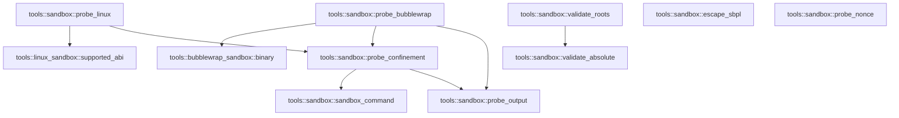

# tools::sandbox

[Package atlas](index.md) · [Source](../../src/sandbox.rs)

## Declarations

Visibility is the declaration spelling; trait members and reexports require their enclosing interface. `cfg` is not evaluated.

| Symbol | Kind | Visibility | Test / cfg |
|---|---|---|---|
| [tools::sandbox::LINUX_LANDLOCK_ABI_MIN](../../src/sandbox.rs#L13) | const_item | `pub(crate)` |  |
| [tools::sandbox::ExecutionAccess](../../src/sandbox.rs#L18) | enum_item | `pub` |  |
| [tools::sandbox::ExecutionAccess::policy](../../src/sandbox.rs#L27) | function_item | `pub` |  |
| [tools::sandbox::NetworkPolicy](../../src/sandbox.rs#L45) | enum_item | `pub` |  |
| [tools::sandbox::SandboxPolicy](../../src/sandbox.rs#L53) | struct_item | `pub` |  |
| [tools::sandbox::SandboxPolicy::validate](../../src/sandbox.rs#L71) | function_item | `pub` |  |
| [tools::sandbox::SandboxPolicy::is_protected_exception](../../src/sandbox.rs#L98) | function_item | `pub` |  |
| [tools::sandbox::SandboxPolicy::exposed_protected_root](../../src/sandbox.rs#L107) | function_item | `pub` |  |
| [tools::sandbox::SandboxPolicy::canonical_bytes](../../src/sandbox.rs#L117) | function_item | `pub` |  |
| [tools::sandbox::SandboxBackend](../../src/sandbox.rs#L126) | enum_item | `pub` |  |
| [tools::sandbox::ProbeStatus](../../src/sandbox.rs#L136) | enum_item | `pub` |  |
| [tools::sandbox::ProbeFailure](../../src/sandbox.rs#L143) | enum_item | `pub` |  |
| [tools::sandbox::SandboxApproval](../../src/sandbox.rs#L151) | struct_item | `pub` |  |
| [tools::sandbox::SandboxError](../../src/sandbox.rs#L159) | enum_item | `pub` |  |
| [tools::sandbox::kernel_protected_roots](../../src/sandbox.rs#L179) | function_item | `pub` |  |
| [tools::sandbox::kernel_protected_roots_with_user_agent_dir](../../src/sandbox.rs#L200) | function_item | `pub` |  |
| [tools::sandbox::exposed_protected_roots](../../src/sandbox.rs#L215) | function_item | `pub` |  |
| [tools::sandbox::protected_root_containing](../../src/sandbox.rs#L241) | function_item | `pub` |  |
| [tools::sandbox::canonical_text](../../src/sandbox.rs#L272) | function_item | `private` |  |
| [tools::sandbox::service_user_home](../../src/sandbox.rs#L296) | function_item | `private` |  |
| [tools::sandbox::policy_digest](../../src/sandbox.rs#L323) | function_item | `pub` |  |
| [tools::sandbox::compile_darwin_profile](../../src/sandbox.rs#L330) | function_item | `pub` |  |
| [tools::sandbox::compile_linux_plan](../../src/sandbox.rs#L442) | function_item | `pub` |  |
| [tools::sandbox::compile_linux_bubblewrap_plan](../../src/sandbox.rs#L475) | function_item | `pub` |  |
| [tools::sandbox::validate_unsandboxed_approval](../../src/sandbox.rs#L517) | function_item | `pub` |  |
| [tools::sandbox::probe_backend](../../src/sandbox.rs#L534) | function_item | `pub` |  |
| [tools::sandbox::sandbox_command](../../src/sandbox.rs#L543) | function_item | `pub(crate)` |  |
| [tools::sandbox::probe_darwin](../../src/sandbox.rs#L598) | function_item | `private` |  |
| [tools::sandbox::select_linux_backend](../../src/sandbox.rs#L621) | function_item | `private` |  |
| [tools::sandbox::probe_bubblewrap](../../src/sandbox.rs#L641) | function_item | `private` |  |
| [tools::sandbox::probe_linux](../../src/sandbox.rs#L684) | function_item | `private` |  |
| [tools::sandbox::probe_confinement](../../src/sandbox.rs#L719) | function_item | `private` | #[cfg(any(     target_os = "macos",     all(         target_os = "linux",         any(target_arch = "x86_64", target_arch = "aarch64")     ) ))] |
| [tools::sandbox::probe_output](../../src/sandbox.rs#L797) | function_item | `private` | #[cfg(any(     target_os = "macos",     all(         target_os = "linux",         any(target_arch = "x86_64", target_arch = "aarch64")     ) ))] |
| [tools::sandbox::validate_roots](../../src/sandbox.rs#L831) | function_item | `private` |  |
| [tools::sandbox::validate_absolute](../../src/sandbox.rs#L848) | function_item | `private` |  |
| [tools::sandbox::escape_sbpl](../../src/sandbox.rs#L864) | function_item | `private` |  |
| [tools::sandbox::probe_nonce](../../src/sandbox.rs#L880) | function_item | `private` | #[cfg(any(     target_os = "macos",     all(         target_os = "linux",         any(target_arch = "x86_64", target_arch = "aarch64")     ) ))] |
| [tools::sandbox::probe_nonce::NONCE](../../src/sandbox.rs#L882) | static_item | `private` | #[cfg(any(     target_os = "macos",     all(         target_os = "linux",         any(target_arch = "x86_64", target_arch = "aarch64")     ) ))] |
| [tools::sandbox::tests::available](../../src/sandbox.rs#L889) | function_item | `private` | test; #[cfg(test)] |
| [tools::sandbox::tests::missing](../../src/sandbox.rs#L895) | function_item | `private` | test; #[cfg(test)] |
| [tools::sandbox::tests::probe_output_reaps_completed_child_and_preserves_both_streams](../../src/sandbox.rs#L909) | function_item | `private` | test; #[cfg(test)] #[cfg(any(         target_os = "macos",         all(             target_os = "linux",             any(target_arch = "x86_64", target_arch = "aarch64")         )     ))] |
| [tools::sandbox::tests::linux_auto_prefers_bubblewrap_without_probing_landlock](../../src/sandbox.rs#L919) | function_item | `private` | test; #[cfg(test)] |
| [tools::sandbox::tests::linux_auto_falls_back_only_to_available_landlock](../../src/sandbox.rs#L928) | function_item | `private` | test; #[cfg(test)] |
| [tools::sandbox::tests::bubblewrap_plan_matches_golden_bytes](../../src/sandbox.rs#L939) | function_item | `private` | test; #[cfg(test)] |
| [tools::sandbox::tests::protected_policy](../../src/sandbox.rs#L950) | function_item | `private` | test; #[cfg(test)] |
| [tools::sandbox::tests::protected_roots_are_omitted_from_serialization_when_empty](../../src/sandbox.rs#L963) | function_item | `private` | test; #[cfg(test)] |
| [tools::sandbox::tests::darwin_profile_denies_protected_root_and_its_writable_ancestors](../../src/sandbox.rs#L978) | function_item | `private` | test; #[cfg(test)] |
| [tools::sandbox::tests::protected_exceptions_must_be_strictly_beneath](../../src/sandbox.rs#L1011) | function_item | `private` | test; #[cfg(test)] |
| [tools::sandbox::tests::unsorted_protected_roots_are_rejected](../../src/sandbox.rs#L1026) | function_item | `private` | test; #[cfg(test)] |
| [tools::sandbox::tests::exposed_roots_keep_only_protected_roots_inside_write_roots](../../src/sandbox.rs#L1035) | function_item | `private` | test; #[cfg(test)] |
| [tools::sandbox::tests::protected_root_lookup_resolves_symlinked_aliases](../../src/sandbox.rs#L1049) | function_item | `private` | test; #[cfg(test)] |
| [tools::sandbox::tests::user_instructions_stay_protected_through_absent_paths_and_aliases](../../src/sandbox.rs#L1075) | function_item | `private` | test; #[cfg(test)] #[cfg(target_os = "macos")] |
| [tools::sandbox::tests::seatbelt_keeps_protected_root_read_only_beneath_a_writable_home](../../src/sandbox.rs#L1135) | function_item | `private` | test; #[cfg(test)] #[cfg(target_os = "macos")] |

## Imports / reexports

| Local name | Source path | Visibility |
|---|---|---|
| `BTreeSet` | `std::collections::BTreeSet` | `private` |
| `fs` | `std::fs` | `private` |
| `Path` | `std::path::Path` | `private` |
| `Command` | `std::process::Command` | `private` |
| `Deserialize` | `serde::Deserialize` | `private` |
| `Serialize` | `serde::Serialize` | `private` |
| `json` | `serde_json::json` | `private` |
| `Digest` | `sha2::Digest` | `private` |
| `Sha256` | `sha2::Sha256` | `private` |
| `Error` | `thiserror::Error` | `private` |
| `*` | `super::*` | `private` |

## Module declarations

| Module | Visibility | Attributes |
|---|---|---|
| `tools::sandbox::tests` | `private` | #[cfg(test)] |

## Function call graphs

Edges below are syntactically resolved calls only, including private functions. Graphs partition callers into groups of 20; they are not execution order. All unresolved sites are listed below and in the JSON inventory.

```mermaid
flowchart TD
  n0["tools::bubblewrap_sandbox::command"]
  n1["tools::linux_sandbox::confine"]
  n2["tools::sandbox::SandboxPolicy::exposed_protected_root"]
  n3["tools::sandbox::SandboxPolicy::canonical_bytes"]
  n4["tools::sandbox::kernel_protected_roots"]
  n5["tools::sandbox::kernel_protected_roots_with_user_agent_dir"]
  n6["tools::sandbox::exposed_protected_roots"]
  n7["tools::sandbox::protected_root_containing"]
  n8["tools::sandbox::canonical_text"]
  n9["tools::sandbox::ExecutionAccess::policy"]
  n10["tools::sandbox::service_user_home"]
  n11["tools::sandbox::policy_digest"]
  n12["tools::sandbox::compile_darwin_profile"]
  n13["tools::sandbox::compile_linux_plan"]
  n14["tools::sandbox::compile_linux_bubblewrap_plan"]
  n15["tools::sandbox::validate_unsandboxed_approval"]
  n16["tools::sandbox::probe_backend"]
  n17["tools::sandbox::sandbox_command"]
  n18["tools::sandbox::probe_darwin"]
  n19["tools::sandbox::select_linux_backend"]
  n20["tools::sandbox::probe_bubblewrap"]
  n21["tools::sandbox::probe_linux"]
  n22["tools::sandbox::probe_confinement"]
  n23["tools::sandbox::SandboxPolicy::validate"]
  n24["tools::sandbox::validate_roots"]
  n25["tools::sandbox::validate_absolute"]
  n26["tools::sandbox::SandboxPolicy::is_protected_exception"]
  n2 --> n26
  n3 --> n23
  n4 --> n8
  n4 --> n10
  n5 --> n4
  n5 --> n8
  n6 --> n8
  n16 --> n18
  n16 --> n19
  n16 --> n20
  n16 --> n21
  n17 --> n0
  n17 --> n1
  n17 --> n12
  n18 --> n22
  n23 --> n24
  n23 --> n25
```

Functions 1–20: 17 direct edges

Functions 21–28: 8 direct edges

## Call sites

Includes test functions (marked in declarations). Receiver-type-required sites need type analysis/manual tracing. Calls in closures are attributed to their enclosing function; their occurrence here does not mean the closure executes immediately.

| Caller | Callee expression | Source lines | Target / classification |
|---|---|---|---|
| `policy` | `Vec::new` | [37](../../src/sandbox.rs#L37) | external-constructor-callback-or-unresolved |
| `validate` | `Err` | [73](../../src/sandbox.rs#L73), [87](../../src/sandbox.rs#L87) | external-constructor-callback-or-unresolved |
| `validate` | `SandboxError::Invalid` | [73](../../src/sandbox.rs#L73), [87](../../src/sandbox.rs#L87) | external-constructor-callback-or-unresolved |
| `validate` | `validate_roots` | [75](../../src/sandbox.rs#L75), [76](../../src/sandbox.rs#L76), [77](../../src/sandbox.rs#L77) | [tools::sandbox::validate_roots](../../src/sandbox.rs#L831) |
| `validate` | `validate_absolute` | [79](../../src/sandbox.rs#L79) | [tools::sandbox::validate_absolute](../../src/sandbox.rs#L848) |
| `validate` | `self                 .read_roots                 .iter()                 .any` | [82](../../src/sandbox.rs#L82) | receiver-type-required |
| `validate` | `self                 .read_roots                 .iter` | [82](../../src/sandbox.rs#L82) | receiver-type-required |
| `validate` | `Path::new(root).starts_with` | [85](../../src/sandbox.rs#L85) | receiver-type-required |
| `validate` | `Path::new` | [85](../../src/sandbox.rs#L85) | external-constructor-callback-or-unresolved |
| `validate` | `Ok` | [92](../../src/sandbox.rs#L92) | external-constructor-callback-or-unresolved |
| `is_protected_exception` | `self.protected_roots             .iter()             .any` | [99](../../src/sandbox.rs#L99) | receiver-type-required |
| `is_protected_exception` | `self.protected_roots             .iter` | [99](../../src/sandbox.rs#L99) | receiver-type-required |
| `is_protected_exception` | `Path::new` | [101](../../src/sandbox.rs#L101) | external-constructor-callback-or-unresolved |
| `is_protected_exception` | `root.starts_with` | [101](../../src/sandbox.rs#L101) | receiver-type-required |
| `exposed_protected_root` | `self.is_protected_exception` | [108](../../src/sandbox.rs#L108) | [tools::sandbox::SandboxPolicy::is_protected_exception](../../src/sandbox.rs#L98) |
| `exposed_protected_root` | `self.protected_roots             .iter()             .find(&#124;protected&#124; Path::new(protected).starts_with(root))             .map` | [111](../../src/sandbox.rs#L111) | receiver-type-required |
| `exposed_protected_root` | `self.protected_roots             .iter()             .find` | [111](../../src/sandbox.rs#L111) | receiver-type-required |
| `exposed_protected_root` | `self.protected_roots             .iter` | [111](../../src/sandbox.rs#L111) | receiver-type-required |
| `exposed_protected_root` | `Path::new(protected).starts_with` | [113](../../src/sandbox.rs#L113) | receiver-type-required |
| `exposed_protected_root` | `Path::new` | [113](../../src/sandbox.rs#L113) | external-constructor-callback-or-unresolved |
| `canonical_bytes` | `self.validate` | [118](../../src/sandbox.rs#L118) | [tools::sandbox::SandboxPolicy::validate](../../src/sandbox.rs#L71) |
| `canonical_bytes` | `serde_json_canonicalizer::to_vec(self)             .map_err` | [119](../../src/sandbox.rs#L119) | receiver-type-required |
| `canonical_bytes` | `serde_json_canonicalizer::to_vec` | [119](../../src/sandbox.rs#L119) | external-constructor-callback-or-unresolved |
| `canonical_bytes` | `SandboxError::Encoding` | [120](../../src/sandbox.rs#L120) | external-constructor-callback-or-unresolved |
| `canonical_bytes` | `error.to_string` | [120](../../src/sandbox.rs#L120) | receiver-type-required |
| `kernel_protected_roots` | `Vec::new` | [180](../../src/sandbox.rs#L180) | external-constructor-callback-or-unresolved |
| `kernel_protected_roots` | `roots.push` | [181](../../src/sandbox.rs#L181), [183](../../src/sandbox.rs#L183), [189](../../src/sandbox.rs#L189) | receiver-type-required |
| `kernel_protected_roots` | `canonical_text` | [181](../../src/sandbox.rs#L181), [183](../../src/sandbox.rs#L183), [189](../../src/sandbox.rs#L189) | [tools::sandbox::canonical_text](../../src/sandbox.rs#L272) |
| `kernel_protected_roots` | `service_user_home` | [182](../../src/sandbox.rs#L182) | [tools::sandbox::service_user_home](../../src/sandbox.rs#L296) |
| `kernel_protected_roots` | `home.join` | [183](../../src/sandbox.rs#L183), [185](../../src/sandbox.rs#L185), [187](../../src/sandbox.rs#L187) | receiver-type-required |
| `kernel_protected_roots` | `roots.sort` | [192](../../src/sandbox.rs#L192) | receiver-type-required |
| `kernel_protected_roots` | `roots.dedup` | [193](../../src/sandbox.rs#L193) | receiver-type-required |
| `kernel_protected_roots_with_user_agent_dir` | `kernel_protected_roots` | [204](../../src/sandbox.rs#L204) | [tools::sandbox::kernel_protected_roots](../../src/sandbox.rs#L179) |
| `kernel_protected_roots_with_user_agent_dir` | `roots.push` | [205](../../src/sandbox.rs#L205) | receiver-type-required |
| `kernel_protected_roots_with_user_agent_dir` | `canonical_text` | [205](../../src/sandbox.rs#L205) | [tools::sandbox::canonical_text](../../src/sandbox.rs#L272) |
| `kernel_protected_roots_with_user_agent_dir` | `roots.sort` | [206](../../src/sandbox.rs#L206) | receiver-type-required |
| `kernel_protected_roots_with_user_agent_dir` | `roots.dedup` | [207](../../src/sandbox.rs#L207) | receiver-type-required |
| `exposed_protected_roots` | `write_roots         .iter()         .flat_map(&#124;root&#124; {             let canonical = canonical_text(Path::new(root));             [root.clone(), canonical]         })         .collect::<Vec<_>>` | [216](../../src/sandbox.rs#L216) | receiver-type-required |
| `exposed_protected_roots` | `write_roots         .iter()         .flat_map` | [216](../../src/sandbox.rs#L216) | receiver-type-required |
| `exposed_protected_roots` | `write_roots         .iter` | [216](../../src/sandbox.rs#L216) | receiver-type-required |
| `exposed_protected_roots` | `canonical_text` | [219](../../src/sandbox.rs#L219) | [tools::sandbox::canonical_text](../../src/sandbox.rs#L272) |
| `exposed_protected_roots` | `Path::new` | [219](../../src/sandbox.rs#L219), [228](../../src/sandbox.rs#L228) | external-constructor-callback-or-unresolved |
| `exposed_protected_roots` | `root.clone` | [220](../../src/sandbox.rs#L220) | receiver-type-required |
| `exposed_protected_roots` | `protected         .iter()         .filter(&#124;root&#124; {             writes                 .iter()                 .any(&#124;write&#124; Path::new(root).starts_with(write))         })         .cloned()         .collect::<Vec<_>>` | [223](../../src/sandbox.rs#L223) | receiver-type-required |
| `exposed_protected_roots` | `protected         .iter()         .filter(&#124;root&#124; {             writes                 .iter()                 .any(&#124;write&#124; Path::new(root).starts_with(write))         })         .cloned` | [223](../../src/sandbox.rs#L223) | receiver-type-required |
| `exposed_protected_roots` | `protected         .iter()         .filter` | [223](../../src/sandbox.rs#L223) | receiver-type-required |
| `exposed_protected_roots` | `protected         .iter` | [223](../../src/sandbox.rs#L223) | receiver-type-required |
| `exposed_protected_roots` | `writes                 .iter()                 .any` | [226](../../src/sandbox.rs#L226) | receiver-type-required |
| `exposed_protected_roots` | `writes                 .iter` | [226](../../src/sandbox.rs#L226) | receiver-type-required |
| `exposed_protected_roots` | `Path::new(root).starts_with` | [228](../../src/sandbox.rs#L228) | receiver-type-required |
| `exposed_protected_roots` | `exposed.sort` | [232](../../src/sandbox.rs#L232) | receiver-type-required |
| `exposed_protected_roots` | `exposed.dedup` | [233](../../src/sandbox.rs#L233) | receiver-type-required |
| `protected_root_containing` | `Vec::new` | [243](../../src/sandbox.rs#L243) | external-constructor-callback-or-unresolved |
| `protected_root_containing` | `existing.canonicalize` | [245](../../src/sandbox.rs#L245) | receiver-type-required |
| `protected_root_containing` | `Some` | [246](../../src/sandbox.rs#L246) | external-constructor-callback-or-unresolved |
| `protected_root_containing` | `suffix                     .iter()                     .rev()                     .fold` | [247](../../src/sandbox.rs#L247) | receiver-type-required |
| `protected_root_containing` | `suffix                     .iter()                     .rev` | [247](../../src/sandbox.rs#L247) | receiver-type-required |
| `protected_root_containing` | `suffix                     .iter` | [247](../../src/sandbox.rs#L247) | receiver-type-required |
| `protected_root_containing` | `base.join` | [250](../../src/sandbox.rs#L250) | receiver-type-required |
| `protected_root_containing` | `existing.parent` | [253](../../src/sandbox.rs#L253) | receiver-type-required |
| `protected_root_containing` | `existing.file_name` | [253](../../src/sandbox.rs#L253) | receiver-type-required |
| `protected_root_containing` | `suffix.push` | [255](../../src/sandbox.rs#L255) | receiver-type-required |
| `protected_root_containing` | `name.to_owned` | [255](../../src/sandbox.rs#L255) | receiver-type-required |
| `protected_root_containing` | `protected         .iter()         .find(&#124;root&#124; {             path.starts_with(root)                 &#124;&#124; resolved                     .as_deref()                     .is_some_and(&#124;resolved&#124; resolved.starts_with(root))         })         .map` | [261](../../src/sandbox.rs#L261) | receiver-type-required |
| `protected_root_containing` | `protected         .iter()         .find` | [261](../../src/sandbox.rs#L261) | receiver-type-required |
| `protected_root_containing` | `protected         .iter` | [261](../../src/sandbox.rs#L261) | receiver-type-required |
| `protected_root_containing` | `path.starts_with` | [264](../../src/sandbox.rs#L264) | receiver-type-required |
| `protected_root_containing` | `resolved                     .as_deref()                     .is_some_and` | [265](../../src/sandbox.rs#L265) | receiver-type-required |
| `protected_root_containing` | `resolved                     .as_deref` | [265](../../src/sandbox.rs#L265) | receiver-type-required |
| `protected_root_containing` | `resolved.starts_with` | [267](../../src/sandbox.rs#L267) | receiver-type-required |
| `canonical_text` | `Vec::new` | [274](../../src/sandbox.rs#L274) | external-constructor-callback-or-unresolved |
| `canonical_text` | `existing.canonicalize` | [276](../../src/sandbox.rs#L276) | receiver-type-required |
| `canonical_text` | `suffix                 .iter()                 .rev()                 .fold(canonical, &#124;base, part&#124; base.join(part))                 .to_string_lossy()                 .into_owned` | [277](../../src/sandbox.rs#L277) | receiver-type-required |
| `canonical_text` | `suffix                 .iter()                 .rev()                 .fold(canonical, &#124;base, part&#124; base.join(part))                 .to_string_lossy` | [277](../../src/sandbox.rs#L277) | receiver-type-required |
| `canonical_text` | `suffix                 .iter()                 .rev()                 .fold` | [277](../../src/sandbox.rs#L277) | receiver-type-required |
| `canonical_text` | `suffix                 .iter()                 .rev` | [277](../../src/sandbox.rs#L277) | receiver-type-required |
| `canonical_text` | `suffix                 .iter` | [277](../../src/sandbox.rs#L277) | receiver-type-required |
| `canonical_text` | `base.join` | [280](../../src/sandbox.rs#L280) | receiver-type-required |
| `canonical_text` | `existing.parent` | [284](../../src/sandbox.rs#L284) | receiver-type-required |
| `canonical_text` | `existing.file_name` | [284](../../src/sandbox.rs#L284) | receiver-type-required |
| `canonical_text` | `suffix.push` | [286](../../src/sandbox.rs#L286) | receiver-type-required |
| `canonical_text` | `name.to_owned` | [286](../../src/sandbox.rs#L286) | receiver-type-required |
| `canonical_text` | `path.to_string_lossy().into_owned` | [289](../../src/sandbox.rs#L289) | receiver-type-required |
| `canonical_text` | `path.to_string_lossy` | [289](../../src/sandbox.rs#L289) | receiver-type-required |
| `service_user_home` | `std::mem::zeroed` | [301](../../src/sandbox.rs#L301) | external-constructor-callback-or-unresolved |
| `service_user_home` | `std::ptr::null_mut` | [302](../../src/sandbox.rs#L302) | external-constructor-callback-or-unresolved |
| `service_user_home` | `libc::getpwuid_r` | [306](../../src/sandbox.rs#L306) | external-constructor-callback-or-unresolved |
| `service_user_home` | `libc::geteuid` | [307](../../src/sandbox.rs#L307) | external-constructor-callback-or-unresolved |
| `service_user_home` | `buffer.as_mut_ptr().cast` | [309](../../src/sandbox.rs#L309) | receiver-type-required |
| `service_user_home` | `buffer.as_mut_ptr` | [309](../../src/sandbox.rs#L309) | receiver-type-required |
| `service_user_home` | `buffer.len` | [310](../../src/sandbox.rs#L310) | receiver-type-required |
| `service_user_home` | `result.is_null` | [314](../../src/sandbox.rs#L314) | receiver-type-required |
| `service_user_home` | `entry.pw_dir.is_null` | [314](../../src/sandbox.rs#L314) | receiver-type-required |
| `service_user_home` | `CStr::from_ptr` | [318](../../src/sandbox.rs#L318) | external-constructor-callback-or-unresolved |
| `service_user_home` | `Path::new` | [319](../../src/sandbox.rs#L319) | external-constructor-callback-or-unresolved |
| `service_user_home` | `std::ffi::OsStr::from_bytes` | [319](../../src/sandbox.rs#L319) | external-constructor-callback-or-unresolved |
| `service_user_home` | `home.to_bytes` | [319](../../src/sandbox.rs#L319) | receiver-type-required |
| `service_user_home` | `home.is_absolute().then` | [320](../../src/sandbox.rs#L320) | receiver-type-required |
| `service_user_home` | `home.is_absolute` | [320](../../src/sandbox.rs#L320) | receiver-type-required |
| `service_user_home` | `home.to_path_buf` | [320](../../src/sandbox.rs#L320) | receiver-type-required |
| `policy_digest` | `Ok` | [324](../../src/sandbox.rs#L324) | external-constructor-callback-or-unresolved |
| `compile_darwin_profile` | `policy.validate` | [331](../../src/sandbox.rs#L331) | receiver-type-required |
| `compile_darwin_profile` | `policy         .read_roots         .iter()         .chain(&policy.write_roots)         .chain(policy.scratch.iter())         .flat_map(&#124;root&#124; Path::new(root).ancestors().skip(1))         .filter_map(Path::to_str)         .collect::<BTreeSet<_>>` | [340](../../src/sandbox.rs#L340) | receiver-type-required |
| `compile_darwin_profile` | `policy         .read_roots         .iter()         .chain(&policy.write_roots)         .chain(policy.scratch.iter())         .flat_map(&#124;root&#124; Path::new(root).ancestors().skip(1))         .filter_map` | [340](../../src/sandbox.rs#L340) | receiver-type-required |
| `compile_darwin_profile` | `policy         .read_roots         .iter()         .chain(&policy.write_roots)         .chain(policy.scratch.iter())         .flat_map` | [340](../../src/sandbox.rs#L340) | receiver-type-required |
| `compile_darwin_profile` | `policy         .read_roots         .iter()         .chain(&policy.write_roots)         .chain` | [340](../../src/sandbox.rs#L340) | receiver-type-required |
| `compile_darwin_profile` | `policy         .read_roots         .iter()         .chain` | [340](../../src/sandbox.rs#L340) | receiver-type-required |
| `compile_darwin_profile` | `policy         .read_roots         .iter` | [340](../../src/sandbox.rs#L340) | receiver-type-required |
| `compile_darwin_profile` | `policy.scratch.iter` | [344](../../src/sandbox.rs#L344), [397](../../src/sandbox.rs#L397) | receiver-type-required |
| `compile_darwin_profile` | `Path::new(root).ancestors().skip` | [345](../../src/sandbox.rs#L345) | receiver-type-required |
| `compile_darwin_profile` | `Path::new(root).ancestors` | [345](../../src/sandbox.rs#L345) | receiver-type-required |
| `compile_darwin_profile` | `Path::new` | [345](../../src/sandbox.rs#L345), [405](../../src/sandbox.rs#L405), [419](../../src/sandbox.rs#L419) | external-constructor-callback-or-unresolved |
| `compile_darwin_profile` | `lines.push` | [349](../../src/sandbox.rs#L349), [357](../../src/sandbox.rs#L357), [358](../../src/sandbox.rs#L358), [372](../../src/sandbox.rs#L372), [378](../../src/sandbox.rs#L378), [384](../../src/sandbox.rs#L384), [401](../../src/sandbox.rs#L401), [412](../../src/sandbox.rs#L412), [421](../../src/sandbox.rs#L421), [427](../../src/sandbox.rs#L427), [432](../../src/sandbox.rs#L432), [433](../../src/sandbox.rs#L433), [435](../../src/sandbox.rs#L435) | receiver-type-required |
| `compile_darwin_profile` | `"(allow file-read-metadata (literal \"/Applications\"))".to_owned` | [357](../../src/sandbox.rs#L357) | receiver-type-required |
| `compile_darwin_profile` | `"(allow file-read-metadata (literal \"/Library\"))".to_owned` | [358](../../src/sandbox.rs#L358) | receiver-type-required |
| `compile_darwin_profile` | `[         "/System",         "/usr",         "/bin",         "/sbin",         "/private/var/select",         "/Applications/Xcode.app",         "/Library/Developer/CommandLineTools",     ]     .into_iter()     .map(ToOwned::to_owned)     .chain` | [359](../../src/sandbox.rs#L359) | receiver-type-required |
| `compile_darwin_profile` | `[         "/System",         "/usr",         "/bin",         "/sbin",         "/private/var/select",         "/Applications/Xcode.app",         "/Library/Developer/CommandLineTools",     ]     .into_iter()     .map` | [359](../../src/sandbox.rs#L359) | receiver-type-required |
| `compile_darwin_profile` | `[         "/System",         "/usr",         "/bin",         "/sbin",         "/private/var/select",         "/Applications/Xcode.app",         "/Library/Developer/CommandLineTools",     ]     .into_iter` | [359](../../src/sandbox.rs#L359) | receiver-type-required |
| `compile_darwin_profile` | `policy.read_roots.iter().cloned` | [370](../../src/sandbox.rs#L370) | receiver-type-required |
| `compile_darwin_profile` | `policy.read_roots.iter` | [370](../../src/sandbox.rs#L370) | receiver-type-required |
| `compile_darwin_profile` | `policy         .write_roots         .iter()         .chain(policy.scratch.iter())         .collect::<Vec<_>>` | [394](../../src/sandbox.rs#L394) | receiver-type-required |
| `compile_darwin_profile` | `policy         .write_roots         .iter()         .chain` | [394](../../src/sandbox.rs#L394) | receiver-type-required |
| `compile_darwin_profile` | `policy         .write_roots         .iter` | [394](../../src/sandbox.rs#L394) | receiver-type-required |
| `compile_darwin_profile` | `BTreeSet::new` | [399](../../src/sandbox.rs#L399) | external-constructor-callback-or-unresolved |
| `compile_darwin_profile` | `Path::new(protected).ancestors().skip` | [405](../../src/sandbox.rs#L405) | receiver-type-required |
| `compile_darwin_profile` | `Path::new(protected).ancestors` | [405](../../src/sandbox.rs#L405) | receiver-type-required |
| `compile_darwin_profile` | `grants.iter().any` | [406](../../src/sandbox.rs#L406) | receiver-type-required |
| `compile_darwin_profile` | `grants.iter` | [406](../../src/sandbox.rs#L406) | receiver-type-required |
| `compile_darwin_profile` | `ancestor.starts_with` | [406](../../src/sandbox.rs#L406) | receiver-type-required |
| `compile_darwin_profile` | `denied_ancestors.extend` | [407](../../src/sandbox.rs#L407) | receiver-type-required |
| `compile_darwin_profile` | `ancestor.to_str` | [407](../../src/sandbox.rs#L407) | receiver-type-required |
| `compile_darwin_profile` | `grants         .iter()         .filter` | [417](../../src/sandbox.rs#L417) | receiver-type-required |
| `compile_darwin_profile` | `grants         .iter` | [417](../../src/sandbox.rs#L417) | receiver-type-required |
| `compile_darwin_profile` | `policy.is_protected_exception` | [419](../../src/sandbox.rs#L419) | receiver-type-required |
| `compile_darwin_profile` | `"(allow process-exec process-fork)".to_owned` | [427](../../src/sandbox.rs#L427) | receiver-type-required |
| `compile_darwin_profile` | `"(allow network* (local ip \"localhost:*\"))".to_owned` | [432](../../src/sandbox.rs#L432) | receiver-type-required |
| `compile_darwin_profile` | `"(allow network* (remote ip \"localhost:*\"))".to_owned` | [433](../../src/sandbox.rs#L433) | receiver-type-required |
| `compile_darwin_profile` | `"(allow network*)".to_owned` | [435](../../src/sandbox.rs#L435) | receiver-type-required |
| `compile_darwin_profile` | `lines.join("\n").into_bytes` | [437](../../src/sandbox.rs#L437) | receiver-type-required |
| `compile_darwin_profile` | `lines.join` | [437](../../src/sandbox.rs#L437) | receiver-type-required |
| `compile_darwin_profile` | `bytes.push` | [438](../../src/sandbox.rs#L438) | receiver-type-required |
| `compile_darwin_profile` | `Ok` | [439](../../src/sandbox.rs#L439) | external-constructor-callback-or-unresolved |
| `compile_linux_plan` | `policy.validate` | [443](../../src/sandbox.rs#L443) | receiver-type-required |
| `compile_linux_plan` | `plan.as_object_mut()             .expect("plan object")             .insert` | [458](../../src/sandbox.rs#L458), [463](../../src/sandbox.rs#L463) | receiver-type-required |
| `compile_linux_plan` | `plan.as_object_mut()             .expect` | [458](../../src/sandbox.rs#L458), [463](../../src/sandbox.rs#L463) | receiver-type-required |
| `compile_linux_plan` | `plan.as_object_mut` | [458](../../src/sandbox.rs#L458), [463](../../src/sandbox.rs#L463) | receiver-type-required |
| `compile_linux_plan` | `"scratch".to_owned` | [460](../../src/sandbox.rs#L460) | receiver-type-required |
| `compile_linux_plan` | `policy.protected_roots.is_empty` | [462](../../src/sandbox.rs#L462) | receiver-type-required |
| `compile_linux_plan` | `"protected_roots".to_owned` | [465](../../src/sandbox.rs#L465) | receiver-type-required |
| `compile_linux_plan` | `serde_json_canonicalizer::to_vec(&plan)         .map_err` | [467](../../src/sandbox.rs#L467) | receiver-type-required |
| `compile_linux_plan` | `serde_json_canonicalizer::to_vec` | [467](../../src/sandbox.rs#L467) | external-constructor-callback-or-unresolved |
| `compile_linux_plan` | `SandboxError::Encoding` | [468](../../src/sandbox.rs#L468) | external-constructor-callback-or-unresolved |
| `compile_linux_plan` | `error.to_string` | [468](../../src/sandbox.rs#L468) | receiver-type-required |
| `compile_linux_plan` | `bytes.push` | [469](../../src/sandbox.rs#L469) | receiver-type-required |
| `compile_linux_plan` | `Ok` | [470](../../src/sandbox.rs#L470) | external-constructor-callback-or-unresolved |
| `compile_linux_bubblewrap_plan` | `policy.validate` | [476](../../src/sandbox.rs#L476) | receiver-type-required |
| `compile_linux_bubblewrap_plan` | `Err` | [478](../../src/sandbox.rs#L478) | external-constructor-callback-or-unresolved |
| `compile_linux_bubblewrap_plan` | `SandboxError::Unavailable` | [478](../../src/sandbox.rs#L478) | external-constructor-callback-or-unresolved |
| `compile_linux_bubblewrap_plan` | `"bubblewrap requires allow_process=true and network=deny or all".to_owned` | [479](../../src/sandbox.rs#L479) | receiver-type-required |
| `compile_linux_bubblewrap_plan` | `namespaces.push` | [484](../../src/sandbox.rs#L484) | receiver-type-required |
| `compile_linux_bubblewrap_plan` | `namespaces.sort_unstable` | [485](../../src/sandbox.rs#L485) | receiver-type-required |
| `compile_linux_bubblewrap_plan` | `plan.as_object_mut()             .expect("plan object")             .insert` | [502](../../src/sandbox.rs#L502), [507](../../src/sandbox.rs#L507) | receiver-type-required |
| `compile_linux_bubblewrap_plan` | `plan.as_object_mut()             .expect` | [502](../../src/sandbox.rs#L502), [507](../../src/sandbox.rs#L507) | receiver-type-required |
| `compile_linux_bubblewrap_plan` | `plan.as_object_mut` | [502](../../src/sandbox.rs#L502), [507](../../src/sandbox.rs#L507) | receiver-type-required |
| `compile_linux_bubblewrap_plan` | `"scratch".to_owned` | [504](../../src/sandbox.rs#L504) | receiver-type-required |
| `compile_linux_bubblewrap_plan` | `policy.protected_roots.is_empty` | [506](../../src/sandbox.rs#L506) | receiver-type-required |
| `compile_linux_bubblewrap_plan` | `"protected_roots".to_owned` | [509](../../src/sandbox.rs#L509) | receiver-type-required |
| `compile_linux_bubblewrap_plan` | `serde_json_canonicalizer::to_vec(&plan)         .map_err` | [511](../../src/sandbox.rs#L511) | receiver-type-required |
| `compile_linux_bubblewrap_plan` | `serde_json_canonicalizer::to_vec` | [511](../../src/sandbox.rs#L511) | external-constructor-callback-or-unresolved |
| `compile_linux_bubblewrap_plan` | `SandboxError::Encoding` | [512](../../src/sandbox.rs#L512) | external-constructor-callback-or-unresolved |
| `compile_linux_bubblewrap_plan` | `error.to_string` | [512](../../src/sandbox.rs#L512) | receiver-type-required |
| `compile_linux_bubblewrap_plan` | `bytes.push` | [513](../../src/sandbox.rs#L513) | receiver-type-required |
| `compile_linux_bubblewrap_plan` | `Ok` | [514](../../src/sandbox.rs#L514) | external-constructor-callback-or-unresolved |
| `validate_unsandboxed_approval` | `Ok` | [528](../../src/sandbox.rs#L528) | external-constructor-callback-or-unresolved |
| `validate_unsandboxed_approval` | `Err` | [530](../../src/sandbox.rs#L530) | external-constructor-callback-or-unresolved |
| `probe_backend` | `probe_darwin` | [536](../../src/sandbox.rs#L536) | [tools::sandbox::probe_darwin](../../src/sandbox.rs#L598) |
| `probe_backend` | `select_linux_backend` | [537](../../src/sandbox.rs#L537) | [tools::sandbox::select_linux_backend](../../src/sandbox.rs#L621) |
| `probe_backend` | `probe_bubblewrap` | [537](../../src/sandbox.rs#L537), [538](../../src/sandbox.rs#L538) | [tools::sandbox::probe_bubblewrap](../../src/sandbox.rs#L641) |
| `probe_backend` | `probe_linux` | [539](../../src/sandbox.rs#L539) | [tools::sandbox::probe_linux](../../src/sandbox.rs#L684) |
| `sandbox_command` | `Err` | [549](../../src/sandbox.rs#L549), [556](../../src/sandbox.rs#L556), [575](../../src/sandbox.rs#L575), [592](../../src/sandbox.rs#L592) | external-constructor-callback-or-unresolved |
| `sandbox_command` | `SandboxError::Unavailable` | [549](../../src/sandbox.rs#L549), [556](../../src/sandbox.rs#L556), [575](../../src/sandbox.rs#L575), [592](../../src/sandbox.rs#L592) | external-constructor-callback-or-unresolved |
| `sandbox_command` | `"sandbox probe did not report available".to_owned` | [550](../../src/sandbox.rs#L550) | receiver-type-required |
| `sandbox_command` | `String::from_utf8(compile_darwin_profile(policy)?)             .map_err` | [560](../../src/sandbox.rs#L560) | receiver-type-required |
| `sandbox_command` | `String::from_utf8` | [560](../../src/sandbox.rs#L560) | external-constructor-callback-or-unresolved |
| `sandbox_command` | `compile_darwin_profile` | [560](../../src/sandbox.rs#L560) | [tools::sandbox::compile_darwin_profile](../../src/sandbox.rs#L330) |
| `sandbox_command` | `SandboxError::Encoding` | [561](../../src/sandbox.rs#L561) | external-constructor-callback-or-unresolved |
| `sandbox_command` | `"profile is not UTF-8".to_owned` | [561](../../src/sandbox.rs#L561) | receiver-type-required |
| `sandbox_command` | `Command::new` | [562](../../src/sandbox.rs#L562), [579](../../src/sandbox.rs#L579) | external-constructor-callback-or-unresolved |
| `sandbox_command` | `command.arg("-p").arg(profile).arg` | [563](../../src/sandbox.rs#L563) | receiver-type-required |
| `sandbox_command` | `command.arg("-p").arg` | [563](../../src/sandbox.rs#L563) | receiver-type-required |
| `sandbox_command` | `command.arg` | [563](../../src/sandbox.rs#L563) | receiver-type-required |
| `sandbox_command` | `Ok` | [564](../../src/sandbox.rs#L564), [581](../../src/sandbox.rs#L581) | external-constructor-callback-or-unresolved |
| `sandbox_command` | `crate::bubblewrap_sandbox::command` | [572](../../src/sandbox.rs#L572) | [tools::bubblewrap_sandbox::command](../../src/bubblewrap_sandbox.rs#L57) |
| `sandbox_command` | `crate::linux_sandbox::confine` | [580](../../src/sandbox.rs#L580) | [tools::linux_sandbox::confine](../../src/linux_sandbox.rs#L125) |
| `sandbox_command` | `"no applied sandbox launcher on this platform".to_owned` | [593](../../src/sandbox.rs#L593) | receiver-type-required |
| `probe_darwin` | `"Seatbelt requested on a non-macOS host".to_owned` | [603](../../src/sandbox.rs#L603) | receiver-type-required |
| `probe_darwin` | `Path::new("/usr/bin/sandbox-exec").is_file` | [608](../../src/sandbox.rs#L608) | receiver-type-required |
| `probe_darwin` | `Path::new` | [608](../../src/sandbox.rs#L608) | external-constructor-callback-or-unresolved |
| `probe_darwin` | `"sandbox-exec is missing".to_owned` | [611](../../src/sandbox.rs#L611) | receiver-type-required |
| `probe_darwin` | `probe_confinement` | [614](../../src/sandbox.rs#L614) | [tools::sandbox::probe_confinement](../../src/sandbox.rs#L719) |
| `probe_darwin` | `"darwin-seatbelt".to_owned` | [615](../../src/sandbox.rs#L615) | receiver-type-required |
| `probe_darwin` | `std::env::consts::OS.to_owned` | [616](../../src/sandbox.rs#L616) | receiver-type-required |
| `select_linux_backend` | `landlock` | [628](../../src/sandbox.rs#L628) | external-constructor-callback-or-unresolved |
| `probe_bubblewrap` | `"bubblewrap/seccomp requires Linux on x86_64 or aarch64".to_owned` | [649](../../src/sandbox.rs#L649) | receiver-type-required |
| `probe_bubblewrap` | `crate::bubblewrap_sandbox::binary` | [657](../../src/sandbox.rs#L657) | [tools::bubblewrap_sandbox::binary](../../src/bubblewrap_sandbox.rs#L26) |
| `probe_bubblewrap` | `error.to_string` | [662](../../src/sandbox.rs#L662) | receiver-type-required |
| `probe_bubblewrap` | `probe_output` | [666](../../src/sandbox.rs#L666) | [tools::sandbox::probe_output](../../src/sandbox.rs#L797) |
| `probe_bubblewrap` | `Command::new(binary).arg` | [666](../../src/sandbox.rs#L666) | receiver-type-required |
| `probe_bubblewrap` | `Command::new` | [666](../../src/sandbox.rs#L666) | external-constructor-callback-or-unresolved |
| `probe_bubblewrap` | `output.status.success` | [667](../../src/sandbox.rs#L667) | receiver-type-required |
| `probe_bubblewrap` | `String::from_utf8_lossy(&output.stdout).trim().to_owned` | [668](../../src/sandbox.rs#L668) | receiver-type-required |
| `probe_bubblewrap` | `String::from_utf8_lossy(&output.stdout).trim` | [668](../../src/sandbox.rs#L668) | receiver-type-required |
| `probe_bubblewrap` | `String::from_utf8_lossy` | [668](../../src/sandbox.rs#L668) | external-constructor-callback-or-unresolved |
| `probe_bubblewrap` | `probe_confinement` | [677](../../src/sandbox.rs#L677) | [tools::sandbox::probe_confinement](../../src/sandbox.rs#L719) |
| `probe_bubblewrap` | `crate::bubblewrap_sandbox::BACKEND.to_owned` | [678](../../src/sandbox.rs#L678) | receiver-type-required |
| `probe_linux` | `"Landlock/seccomp requires Linux on x86_64 or aarch64".to_owned` | [692](../../src/sandbox.rs#L692) | receiver-type-required |
| `probe_linux` | `crate::linux_sandbox::supported_abi` | [700](../../src/sandbox.rs#L700) | [tools::linux_sandbox::supported_abi](../../src/linux_sandbox.rs#L79) |
| `probe_linux` | `probe_confinement` | [701](../../src/sandbox.rs#L701) | [tools::sandbox::probe_confinement](../../src/sandbox.rs#L719) |
| `probe_linux` | `crate::linux_sandbox::BACKEND.to_owned` | [702](../../src/sandbox.rs#L702) | receiver-type-required |
| `probe_confinement` | `std::env::temp_dir().join` | [720](../../src/sandbox.rs#L720) | receiver-type-required |
| `probe_confinement` | `std::env::temp_dir` | [720](../../src/sandbox.rs#L720) | external-constructor-callback-or-unresolved |
| `probe_confinement` | `unresolved_root.join` | [725](../../src/sandbox.rs#L725), [726](../../src/sandbox.rs#L726) | receiver-type-required |
| `probe_confinement` | `(&#124;&#124; -> Result<(), SandboxError> {         fs::create_dir_all(&allowed_unresolved)?;         fs::create_dir_all(&outside_unresolved)?;         let root = fs::canonicalize(&unresolved_root)?;         let allowed = root.join("allowed");         let outside = root.join("outside");         fs::write(allowed.join("read.txt"), b"ok")?;         let policy = SandboxPolicy {             format: 1,             read_roots: vec![allowed.to_string_lossy().into_owned()],             write_roots: vec![allowed.to_string_lossy().into_owned()],             network: NetworkPolicy::Deny,             allow_process: true,             scratch: None,             protected_roots: Vec::new(),         };         let read = probe_output(             sandbox_command(&policy, &candidate, Path::new("/bin/cat"))?                 .current_dir(&allowed)                 .arg(allowed.join("read.txt")),         )?;         let write = probe_output(             sandbox_command(&policy, &candidate, Path::new("/bin/sh"))?                 .current_dir(&allowed)                 .args(["-c", "printf ok > write.txt"]),         )?;         let denied = probe_output(             sandbox_command(&policy, &candidate, Path::new("/bin/sh"))?                 .current_dir(&allowed)                 .args(["-c", "printf denied > \"$1\"", "probe"])                 .arg(outside.join("denied.txt")),         )?;         if read.status.success()             && read.stdout == b"ok"             && write.status.success()             && fs::read(allowed.join("write.txt"))? == b"ok"             && !denied.status.success()             && !outside.join("denied.txt").exists()         {             Ok(())         } else {             Err(SandboxError::Probe(format!(                 "read_status={:?} read_stderr={} denied_status={:?} denied_stderr={} outside_exists={}",                 read.status.code(),                 String::from_utf8_lossy(&read.stderr),                 denied.status.code(),                 String::from_utf8_lossy(&denied.stderr),                 outside.join("denied.txt").exists()             )))         }     })` | [727](../../src/sandbox.rs#L727) | external-constructor-callback-or-unresolved |
| `probe_confinement` | `fs::create_dir_all` | [728](../../src/sandbox.rs#L728), [729](../../src/sandbox.rs#L729) | external-constructor-callback-or-unresolved |
| `probe_confinement` | `fs::canonicalize` | [730](../../src/sandbox.rs#L730) | external-constructor-callback-or-unresolved |
| `probe_confinement` | `root.join` | [731](../../src/sandbox.rs#L731), [732](../../src/sandbox.rs#L732) | receiver-type-required |
| `probe_confinement` | `fs::write` | [733](../../src/sandbox.rs#L733) | external-constructor-callback-or-unresolved |
| `probe_confinement` | `allowed.join` | [733](../../src/sandbox.rs#L733), [746](../../src/sandbox.rs#L746), [762](../../src/sandbox.rs#L762) | receiver-type-required |
| `probe_confinement` | `Vec::new` | [741](../../src/sandbox.rs#L741) | external-constructor-callback-or-unresolved |
| `probe_confinement` | `probe_output` | [743](../../src/sandbox.rs#L743), [748](../../src/sandbox.rs#L748), [753](../../src/sandbox.rs#L753) | [tools::sandbox::probe_output](../../src/sandbox.rs#L797) |
| `probe_confinement` | `sandbox_command(&policy, &candidate, Path::new("/bin/cat"))?                 .current_dir(&allowed)                 .arg` | [744](../../src/sandbox.rs#L744) | receiver-type-required |
| `probe_confinement` | `sandbox_command(&policy, &candidate, Path::new("/bin/cat"))?                 .current_dir` | [744](../../src/sandbox.rs#L744) | receiver-type-required |
| `probe_confinement` | `sandbox_command` | [744](../../src/sandbox.rs#L744), [749](../../src/sandbox.rs#L749), [754](../../src/sandbox.rs#L754) | [tools::sandbox::sandbox_command](../../src/sandbox.rs#L543) |
| `probe_confinement` | `Path::new` | [744](../../src/sandbox.rs#L744), [749](../../src/sandbox.rs#L749), [754](../../src/sandbox.rs#L754) | external-constructor-callback-or-unresolved |
| `probe_confinement` | `sandbox_command(&policy, &candidate, Path::new("/bin/sh"))?                 .current_dir(&allowed)                 .args` | [749](../../src/sandbox.rs#L749), [754](../../src/sandbox.rs#L754) | receiver-type-required |
| `probe_confinement` | `sandbox_command(&policy, &candidate, Path::new("/bin/sh"))?                 .current_dir` | [749](../../src/sandbox.rs#L749), [754](../../src/sandbox.rs#L754) | receiver-type-required |
| `probe_confinement` | `sandbox_command(&policy, &candidate, Path::new("/bin/sh"))?                 .current_dir(&allowed)                 .args(["-c", "printf denied > \"$1\"", "probe"])                 .arg` | [754](../../src/sandbox.rs#L754) | receiver-type-required |
| `probe_confinement` | `outside.join` | [757](../../src/sandbox.rs#L757), [764](../../src/sandbox.rs#L764) | receiver-type-required |
| `probe_confinement` | `read.status.success` | [759](../../src/sandbox.rs#L759) | receiver-type-required |
| `probe_confinement` | `write.status.success` | [761](../../src/sandbox.rs#L761) | receiver-type-required |
| `probe_confinement` | `fs::read` | [762](../../src/sandbox.rs#L762) | external-constructor-callback-or-unresolved |
| `probe_confinement` | `denied.status.success` | [763](../../src/sandbox.rs#L763) | receiver-type-required |
| `probe_confinement` | `outside.join("denied.txt").exists` | [764](../../src/sandbox.rs#L764) | receiver-type-required |
| `probe_confinement` | `Ok` | [766](../../src/sandbox.rs#L766) | external-constructor-callback-or-unresolved |
| `probe_confinement` | `Err` | [768](../../src/sandbox.rs#L768) | external-constructor-callback-or-unresolved |
| `probe_confinement` | `SandboxError::Probe` | [768](../../src/sandbox.rs#L768) | external-constructor-callback-or-unresolved |
| `probe_confinement` | `fs::remove_dir_all` | [778](../../src/sandbox.rs#L778) | external-constructor-callback-or-unresolved |
| `probe_confinement` | `error.to_string` | [783](../../src/sandbox.rs#L783) | receiver-type-required |
| `probe_output` | `command         .process_group(0)         .stdin(Stdio::null())         .stdout(Stdio::piped())         .stderr(Stdio::piped())         .spawn` | [801](../../src/sandbox.rs#L801) | receiver-type-required |
| `probe_output` | `command         .process_group(0)         .stdin(Stdio::null())         .stdout(Stdio::piped())         .stderr` | [801](../../src/sandbox.rs#L801) | receiver-type-required |
| `probe_output` | `command         .process_group(0)         .stdin(Stdio::null())         .stdout` | [801](../../src/sandbox.rs#L801) | receiver-type-required |
| `probe_output` | `command         .process_group(0)         .stdin` | [801](../../src/sandbox.rs#L801) | receiver-type-required |
| `probe_output` | `command         .process_group` | [801](../../src/sandbox.rs#L801) | receiver-type-required |
| `probe_output` | `Stdio::null` | [803](../../src/sandbox.rs#L803) | external-constructor-callback-or-unresolved |
| `probe_output` | `Stdio::piped` | [804](../../src/sandbox.rs#L804), [805](../../src/sandbox.rs#L805) | external-constructor-callback-or-unresolved |
| `probe_output` | `Instant::now` | [807](../../src/sandbox.rs#L807), [809](../../src/sandbox.rs#L809), [824](../../src/sandbox.rs#L824) | external-constructor-callback-or-unresolved |
| `probe_output` | `Duration::from_secs` | [807](../../src/sandbox.rs#L807) | external-constructor-callback-or-unresolved |
| `probe_output` | `child.try_wait()?.is_none` | [808](../../src/sandbox.rs#L808) | receiver-type-required |
| `probe_output` | `child.try_wait` | [808](../../src/sandbox.rs#L808) | receiver-type-required |
| `probe_output` | `libc::kill` | [812](../../src/sandbox.rs#L812) | external-constructor-callback-or-unresolved |
| `probe_output` | `child.id` | [812](../../src/sandbox.rs#L812) | receiver-type-required |
| `probe_output` | `child.kill` | [814](../../src/sandbox.rs#L814) | receiver-type-required |
| `probe_output` | `child.wait` | [815](../../src/sandbox.rs#L815) | receiver-type-required |
| `probe_output` | `Err` | [816](../../src/sandbox.rs#L816) | external-constructor-callback-or-unresolved |
| `probe_output` | `SandboxError::Probe` | [816](../../src/sandbox.rs#L816) | external-constructor-callback-or-unresolved |
| `probe_output` | `"sandbox probe timed out".to_owned` | [816](../../src/sandbox.rs#L816) | receiver-type-required |
| `probe_output` | `std::thread::sleep` | [822](../../src/sandbox.rs#L822) | external-constructor-callback-or-unresolved |
| `probe_output` | `deadline                 .saturating_duration_since(Instant::now())                 .min` | [823](../../src/sandbox.rs#L823) | receiver-type-required |
| `probe_output` | `deadline                 .saturating_duration_since` | [823](../../src/sandbox.rs#L823) | receiver-type-required |
| `probe_output` | `Duration::from_millis` | [825](../../src/sandbox.rs#L825) | external-constructor-callback-or-unresolved |
| `probe_output` | `Ok` | [828](../../src/sandbox.rs#L828) | external-constructor-callback-or-unresolved |
| `probe_output` | `child.wait_with_output` | [828](../../src/sandbox.rs#L828) | receiver-type-required |
| `validate_roots` | `BTreeSet::new` | [833](../../src/sandbox.rs#L833) | external-constructor-callback-or-unresolved |
| `validate_roots` | `validate_absolute` | [835](../../src/sandbox.rs#L835) | [tools::sandbox::validate_absolute](../../src/sandbox.rs#L848) |
| `validate_roots` | `previous.is_some_and` | [836](../../src/sandbox.rs#L836) | receiver-type-required |
| `validate_roots` | `last.as_bytes` | [836](../../src/sandbox.rs#L836) | receiver-type-required |
| `validate_roots` | `value.as_bytes` | [836](../../src/sandbox.rs#L836) | receiver-type-required |
| `validate_roots` | `unique.insert` | [837](../../src/sandbox.rs#L837) | receiver-type-required |
| `validate_roots` | `value.as_str` | [837](../../src/sandbox.rs#L837) | receiver-type-required |
| `validate_roots` | `Err` | [839](../../src/sandbox.rs#L839) | external-constructor-callback-or-unresolved |
| `validate_roots` | `SandboxError::Invalid` | [839](../../src/sandbox.rs#L839) | external-constructor-callback-or-unresolved |
| `validate_roots` | `Some` | [843](../../src/sandbox.rs#L843) | external-constructor-callback-or-unresolved |
| `validate_roots` | `Ok` | [845](../../src/sandbox.rs#L845) | external-constructor-callback-or-unresolved |
| `validate_absolute` | `Path::new` | [849](../../src/sandbox.rs#L849) | external-constructor-callback-or-unresolved |
| `validate_absolute` | `path.is_absolute` | [850](../../src/sandbox.rs#L850) | receiver-type-required |
| `validate_absolute` | `value.contains` | [851](../../src/sandbox.rs#L851) | receiver-type-required |
| `validate_absolute` | `value.chars().any` | [852](../../src/sandbox.rs#L852) | receiver-type-required |
| `validate_absolute` | `value.chars` | [852](../../src/sandbox.rs#L852) | receiver-type-required |
| `validate_absolute` | `path             .components()             .any` | [853](../../src/sandbox.rs#L853) | receiver-type-required |
| `validate_absolute` | `path             .components` | [853](../../src/sandbox.rs#L853) | receiver-type-required |
| `validate_absolute` | `Err` | [857](../../src/sandbox.rs#L857) | external-constructor-callback-or-unresolved |
| `validate_absolute` | `SandboxError::Invalid` | [857](../../src/sandbox.rs#L857) | external-constructor-callback-or-unresolved |
| `validate_absolute` | `Ok` | [861](../../src/sandbox.rs#L861) | external-constructor-callback-or-unresolved |
| `escape_sbpl` | `value.chars().any` | [865](../../src/sandbox.rs#L865) | receiver-type-required |
| `escape_sbpl` | `value.chars` | [865](../../src/sandbox.rs#L865) | receiver-type-required |
| `escape_sbpl` | `Err` | [866](../../src/sandbox.rs#L866) | external-constructor-callback-or-unresolved |
| `escape_sbpl` | `SandboxError::Invalid` | [866](../../src/sandbox.rs#L866) | external-constructor-callback-or-unresolved |
| `escape_sbpl` | `Ok` | [870](../../src/sandbox.rs#L870) | external-constructor-callback-or-unresolved |
| `escape_sbpl` | `value.replace('\\', "\\\\").replace` | [870](../../src/sandbox.rs#L870) | receiver-type-required |
| `escape_sbpl` | `value.replace` | [870](../../src/sandbox.rs#L870) | receiver-type-required |
| `probe_nonce` | `NONCE.fetch_add` | [883](../../src/sandbox.rs#L883) | receiver-type-required |
| `NONCE` | `AtomicU64::new` | [882](../../src/sandbox.rs#L882) | external-constructor-callback-or-unresolved |
| `available` | `backend.to_owned` | [891](../../src/sandbox.rs#L891) | receiver-type-required |
| `available` | `"test".to_owned` | [892](../../src/sandbox.rs#L892) | receiver-type-required |
| `missing` | `"missing".to_owned` | [898](../../src/sandbox.rs#L898) | receiver-type-required |
| `probe_output_reaps_completed_child_and_preserves_both_streams` | `probe_output(             Command::new("/bin/sh").args(["-c", "printf probe-out; printf probe-err >&2"]),         )         .unwrap` | [910](../../src/sandbox.rs#L910) | receiver-type-required |
| `probe_output_reaps_completed_child_and_preserves_both_streams` | `probe_output` | [910](../../src/sandbox.rs#L910) | external-constructor-callback-or-unresolved |
| `probe_output_reaps_completed_child_and_preserves_both_streams` | `Command::new("/bin/sh").args` | [911](../../src/sandbox.rs#L911) | receiver-type-required |
| `probe_output_reaps_completed_child_and_preserves_both_streams` | `Command::new` | [911](../../src/sandbox.rs#L911) | external-constructor-callback-or-unresolved |
| `bubblewrap_plan_matches_golden_bytes` | `serde_json::from_str(include_str!(             "../../../fixtures/sandbox/policy.canonical.json"         ))         .unwrap` | [940](../../src/sandbox.rs#L940) | receiver-type-required |
| `bubblewrap_plan_matches_golden_bytes` | `serde_json::from_str` | [940](../../src/sandbox.rs#L940) | external-constructor-callback-or-unresolved |
| `protected_policy` | `writes.iter().map(&#124;root&#124; (*root).to_owned()).collect` | [954](../../src/sandbox.rs#L954) | receiver-type-required |
| `protected_policy` | `writes.iter().map` | [954](../../src/sandbox.rs#L954) | receiver-type-required |
| `protected_policy` | `writes.iter` | [954](../../src/sandbox.rs#L954) | receiver-type-required |
| `protected_policy` | `(*root).to_owned` | [954](../../src/sandbox.rs#L954) | receiver-type-required |
| `protected_roots_are_omitted_from_serialization_when_empty` | `serde_json::from_str(include_str!(             "../../../fixtures/sandbox/policy.canonical.json"         ))         .unwrap` | [964](../../src/sandbox.rs#L964) | receiver-type-required |
| `protected_roots_are_omitted_from_serialization_when_empty` | `serde_json::from_str` | [964](../../src/sandbox.rs#L964) | external-constructor-callback-or-unresolved |
| `darwin_profile_denies_protected_root_and_its_writable_ancestors` | `protected_policy` | [979](../../src/sandbox.rs#L979) | [tools::sandbox::tests::protected_policy](../../src/sandbox.rs#L950) |
| `darwin_profile_denies_protected_root_and_its_writable_ancestors` | `String::from_utf8(compile_darwin_profile(&policy).unwrap()).unwrap` | [984](../../src/sandbox.rs#L984) | receiver-type-required |
| `darwin_profile_denies_protected_root_and_its_writable_ancestors` | `String::from_utf8` | [984](../../src/sandbox.rs#L984) | external-constructor-callback-or-unresolved |
| `darwin_profile_denies_protected_root_and_its_writable_ancestors` | `compile_darwin_profile(&policy).unwrap` | [984](../../src/sandbox.rs#L984) | receiver-type-required |
| `darwin_profile_denies_protected_root_and_its_writable_ancestors` | `compile_darwin_profile` | [984](../../src/sandbox.rs#L984) | external-constructor-callback-or-unresolved |
| `darwin_profile_denies_protected_root_and_its_writable_ancestors` | `profile.lines().collect::<Vec<_>>` | [985](../../src/sandbox.rs#L985) | receiver-type-required |
| `darwin_profile_denies_protected_root_and_its_writable_ancestors` | `profile.lines` | [985](../../src/sandbox.rs#L985) | receiver-type-required |
| `darwin_profile_denies_protected_root_and_its_writable_ancestors` | `lines                 .iter()                 .position(&#124;candidate&#124; *candidate == line)                 .unwrap_or_else` | [987](../../src/sandbox.rs#L987) | receiver-type-required |
| `darwin_profile_denies_protected_root_and_its_writable_ancestors` | `lines                 .iter()                 .position` | [987](../../src/sandbox.rs#L987) | receiver-type-required |
| `darwin_profile_denies_protected_root_and_its_writable_ancestors` | `lines                 .iter` | [987](../../src/sandbox.rs#L987) | receiver-type-required |
| `darwin_profile_denies_protected_root_and_its_writable_ancestors` | `position` | [992](../../src/sandbox.rs#L992), [993](../../src/sandbox.rs#L993), [994](../../src/sandbox.rs#L994), [995](../../src/sandbox.rs#L995) | external-constructor-callback-or-unresolved |
| `darwin_profile_denies_protected_root_and_its_writable_ancestors` | `lines             .iter()             .rposition(&#124;line&#124; {                 *line == "(allow file-write* (subpath \"/Users/u/Library/Kernel/jobs/j1\"))"             })             .unwrap` | [996](../../src/sandbox.rs#L996) | receiver-type-required |
| `darwin_profile_denies_protected_root_and_its_writable_ancestors` | `lines             .iter()             .rposition` | [996](../../src/sandbox.rs#L996) | receiver-type-required |
| `darwin_profile_denies_protected_root_and_its_writable_ancestors` | `lines             .iter` | [996](../../src/sandbox.rs#L996) | receiver-type-required |
| `protected_exceptions_must_be_strictly_beneath` | `protected_policy` | [1012](../../src/sandbox.rs#L1012) | [tools::sandbox::tests::protected_policy](../../src/sandbox.rs#L950) |
| `unsorted_protected_roots_are_rejected` | `protected_policy` | [1027](../../src/sandbox.rs#L1027) | [tools::sandbox::tests::protected_policy](../../src/sandbox.rs#L950) |
| `protected_root_lookup_resolves_symlinked_aliases` | `tempfile::tempdir().unwrap` | [1050](../../src/sandbox.rs#L1050) | receiver-type-required |
| `protected_root_lookup_resolves_symlinked_aliases` | `tempfile::tempdir` | [1050](../../src/sandbox.rs#L1050) | external-constructor-callback-or-unresolved |
| `protected_root_lookup_resolves_symlinked_aliases` | `root.path().canonicalize().unwrap` | [1051](../../src/sandbox.rs#L1051) | receiver-type-required |
| `protected_root_lookup_resolves_symlinked_aliases` | `root.path().canonicalize` | [1051](../../src/sandbox.rs#L1051) | receiver-type-required |
| `protected_root_lookup_resolves_symlinked_aliases` | `root.path` | [1051](../../src/sandbox.rs#L1051) | receiver-type-required |
| `protected_root_lookup_resolves_symlinked_aliases` | `base.join` | [1052](../../src/sandbox.rs#L1052), [1054](../../src/sandbox.rs#L1054), [1060](../../src/sandbox.rs#L1060), [1061](../../src/sandbox.rs#L1061) | receiver-type-required |
| `protected_root_lookup_resolves_symlinked_aliases` | `fs::create_dir_all(storage.join("threads")).unwrap` | [1053](../../src/sandbox.rs#L1053) | receiver-type-required |
| `protected_root_lookup_resolves_symlinked_aliases` | `fs::create_dir_all` | [1053](../../src/sandbox.rs#L1053) | external-constructor-callback-or-unresolved |
| `protected_root_lookup_resolves_symlinked_aliases` | `storage.join` | [1053](../../src/sandbox.rs#L1053), [1059](../../src/sandbox.rs#L1059) | receiver-type-required |
| `protected_root_lookup_resolves_symlinked_aliases` | `std::os::unix::fs::symlink(&storage, base.join("alias")).unwrap` | [1054](../../src/sandbox.rs#L1054) | receiver-type-required |
| `protected_root_lookup_resolves_symlinked_aliases` | `std::os::unix::fs::symlink` | [1054](../../src/sandbox.rs#L1054) | external-constructor-callback-or-unresolved |
| `protected_root_lookup_resolves_symlinked_aliases` | `kernel_protected_roots` | [1055](../../src/sandbox.rs#L1055) | external-constructor-callback-or-unresolved |
| `protected_root_lookup_resolves_symlinked_aliases` | `storage.clone` | [1058](../../src/sandbox.rs#L1058) | receiver-type-required |
| `user_instructions_stay_protected_through_absent_paths_and_aliases` | `tempfile::tempdir().unwrap` | [1076](../../src/sandbox.rs#L1076) | receiver-type-required |
| `user_instructions_stay_protected_through_absent_paths_and_aliases` | `tempfile::tempdir` | [1076](../../src/sandbox.rs#L1076) | external-constructor-callback-or-unresolved |
| `user_instructions_stay_protected_through_absent_paths_and_aliases` | `root.path().canonicalize().unwrap` | [1077](../../src/sandbox.rs#L1077) | receiver-type-required |
| `user_instructions_stay_protected_through_absent_paths_and_aliases` | `root.path().canonicalize` | [1077](../../src/sandbox.rs#L1077) | receiver-type-required |
| `user_instructions_stay_protected_through_absent_paths_and_aliases` | `root.path` | [1077](../../src/sandbox.rs#L1077) | receiver-type-required |
| `user_instructions_stay_protected_through_absent_paths_and_aliases` | `home.join` | [1078](../../src/sandbox.rs#L1078), [1079](../../src/sandbox.rs#L1079), [1082](../../src/sandbox.rs#L1082), [1083](../../src/sandbox.rs#L1083) | receiver-type-required |
| `user_instructions_stay_protected_through_absent_paths_and_aliases` | `fs::create_dir_all(&storage).unwrap` | [1080](../../src/sandbox.rs#L1080) | receiver-type-required |
| `user_instructions_stay_protected_through_absent_paths_and_aliases` | `fs::create_dir_all` | [1080](../../src/sandbox.rs#L1080), [1081](../../src/sandbox.rs#L1081), [1094](../../src/sandbox.rs#L1094) | external-constructor-callback-or-unresolved |
| `user_instructions_stay_protected_through_absent_paths_and_aliases` | `fs::create_dir_all(&authored).unwrap` | [1081](../../src/sandbox.rs#L1081) | receiver-type-required |
| `user_instructions_stay_protected_through_absent_paths_and_aliases` | `std::os::unix::fs::symlink(&authored, home.join("alias")).unwrap` | [1082](../../src/sandbox.rs#L1082) | receiver-type-required |
| `user_instructions_stay_protected_through_absent_paths_and_aliases` | `std::os::unix::fs::symlink` | [1082](../../src/sandbox.rs#L1082) | external-constructor-callback-or-unresolved |
| `user_instructions_stay_protected_through_absent_paths_and_aliases` | `kernel_protected_roots_with_user_agent_dir` | [1084](../../src/sandbox.rs#L1084) | external-constructor-callback-or-unresolved |
| `user_instructions_stay_protected_through_absent_paths_and_aliases` | `authored.join` | [1085](../../src/sandbox.rs#L1085) | receiver-type-required |
| `user_instructions_stay_protected_through_absent_paths_and_aliases` | `fs::create_dir_all(&canonical_user).unwrap` | [1094](../../src/sandbox.rs#L1094) | receiver-type-required |
| `user_instructions_stay_protected_through_absent_paths_and_aliases` | `fs::write(canonical_user.join("original"), b"original").unwrap` | [1095](../../src/sandbox.rs#L1095) | receiver-type-required |
| `user_instructions_stay_protected_through_absent_paths_and_aliases` | `fs::write` | [1095](../../src/sandbox.rs#L1095) | external-constructor-callback-or-unresolved |
| `user_instructions_stay_protected_through_absent_paths_and_aliases` | `canonical_user.join` | [1095](../../src/sandbox.rs#L1095) | receiver-type-required |
| `user_instructions_stay_protected_through_absent_paths_and_aliases` | `path.to_string_lossy().into_owned` | [1096](../../src/sandbox.rs#L1096) | receiver-type-required |
| `user_instructions_stay_protected_through_absent_paths_and_aliases` | `path.to_string_lossy` | [1096](../../src/sandbox.rs#L1096) | receiver-type-required |
| `user_instructions_stay_protected_through_absent_paths_and_aliases` | `exposed_protected_roots` | [1104](../../src/sandbox.rs#L1104) | external-constructor-callback-or-unresolved |
| `user_instructions_stay_protected_through_absent_paths_and_aliases` | `text` | [1104](../../src/sandbox.rs#L1104) | external-constructor-callback-or-unresolved |
| `user_instructions_stay_protected_through_absent_paths_and_aliases` | `sandbox_command(&policy, &available("darwin-seatbelt"), Path::new("/bin/sh"))                 .unwrap()                 .args(["-c", script])                 .current_dir(&home)                 .env_clear()                 .output()                 .unwrap()                 .status                 .success` | [1107](../../src/sandbox.rs#L1107) | receiver-type-required |
| `user_instructions_stay_protected_through_absent_paths_and_aliases` | `sandbox_command(&policy, &available("darwin-seatbelt"), Path::new("/bin/sh"))                 .unwrap()                 .args(["-c", script])                 .current_dir(&home)                 .env_clear()                 .output()                 .unwrap` | [1107](../../src/sandbox.rs#L1107) | receiver-type-required |
| `user_instructions_stay_protected_through_absent_paths_and_aliases` | `sandbox_command(&policy, &available("darwin-seatbelt"), Path::new("/bin/sh"))                 .unwrap()                 .args(["-c", script])                 .current_dir(&home)                 .env_clear()                 .output` | [1107](../../src/sandbox.rs#L1107) | receiver-type-required |
| `user_instructions_stay_protected_through_absent_paths_and_aliases` | `sandbox_command(&policy, &available("darwin-seatbelt"), Path::new("/bin/sh"))                 .unwrap()                 .args(["-c", script])                 .current_dir(&home)                 .env_clear` | [1107](../../src/sandbox.rs#L1107) | receiver-type-required |
| `user_instructions_stay_protected_through_absent_paths_and_aliases` | `sandbox_command(&policy, &available("darwin-seatbelt"), Path::new("/bin/sh"))                 .unwrap()                 .args(["-c", script])                 .current_dir` | [1107](../../src/sandbox.rs#L1107) | receiver-type-required |
| `user_instructions_stay_protected_through_absent_paths_and_aliases` | `sandbox_command(&policy, &available("darwin-seatbelt"), Path::new("/bin/sh"))                 .unwrap()                 .args` | [1107](../../src/sandbox.rs#L1107) | receiver-type-required |
| `user_instructions_stay_protected_through_absent_paths_and_aliases` | `sandbox_command(&policy, &available("darwin-seatbelt"), Path::new("/bin/sh"))                 .unwrap` | [1107](../../src/sandbox.rs#L1107) | receiver-type-required |
| `user_instructions_stay_protected_through_absent_paths_and_aliases` | `sandbox_command` | [1107](../../src/sandbox.rs#L1107) | external-constructor-callback-or-unresolved |
| `user_instructions_stay_protected_through_absent_paths_and_aliases` | `available` | [1107](../../src/sandbox.rs#L1107) | [tools::sandbox::tests::available](../../src/sandbox.rs#L889) |
| `user_instructions_stay_protected_through_absent_paths_and_aliases` | `Path::new` | [1107](../../src/sandbox.rs#L1107) | external-constructor-callback-or-unresolved |
| `seatbelt_keeps_protected_root_read_only_beneath_a_writable_home` | `tempfile::tempdir().unwrap` | [1136](../../src/sandbox.rs#L1136) | receiver-type-required |
| `seatbelt_keeps_protected_root_read_only_beneath_a_writable_home` | `tempfile::tempdir` | [1136](../../src/sandbox.rs#L1136) | external-constructor-callback-or-unresolved |
| `seatbelt_keeps_protected_root_read_only_beneath_a_writable_home` | `root.path().canonicalize().unwrap` | [1137](../../src/sandbox.rs#L1137) | receiver-type-required |
| `seatbelt_keeps_protected_root_read_only_beneath_a_writable_home` | `root.path().canonicalize` | [1137](../../src/sandbox.rs#L1137) | receiver-type-required |
| `seatbelt_keeps_protected_root_read_only_beneath_a_writable_home` | `root.path` | [1137](../../src/sandbox.rs#L1137) | receiver-type-required |
| `seatbelt_keeps_protected_root_read_only_beneath_a_writable_home` | `home.join` | [1138](../../src/sandbox.rs#L1138), [1141](../../src/sandbox.rs#L1141) | receiver-type-required |
| `seatbelt_keeps_protected_root_read_only_beneath_a_writable_home` | `storage.join` | [1139](../../src/sandbox.rs#L1139), [1142](../../src/sandbox.rs#L1142) | receiver-type-required |
| `seatbelt_keeps_protected_root_read_only_beneath_a_writable_home` | `fs::create_dir_all(&job).unwrap` | [1140](../../src/sandbox.rs#L1140) | receiver-type-required |
| `seatbelt_keeps_protected_root_read_only_beneath_a_writable_home` | `fs::create_dir_all` | [1140](../../src/sandbox.rs#L1140), [1141](../../src/sandbox.rs#L1141) | external-constructor-callback-or-unresolved |
| `seatbelt_keeps_protected_root_read_only_beneath_a_writable_home` | `fs::create_dir_all(home.join("project")).unwrap` | [1141](../../src/sandbox.rs#L1141) | receiver-type-required |
| `seatbelt_keeps_protected_root_read_only_beneath_a_writable_home` | `fs::write(storage.join("ledger"), b"original").unwrap` | [1142](../../src/sandbox.rs#L1142) | receiver-type-required |
| `seatbelt_keeps_protected_root_read_only_beneath_a_writable_home` | `fs::write` | [1142](../../src/sandbox.rs#L1142) | external-constructor-callback-or-unresolved |
| `seatbelt_keeps_protected_root_read_only_beneath_a_writable_home` | `path.to_string_lossy().into_owned` | [1143](../../src/sandbox.rs#L1143) | receiver-type-required |
| `seatbelt_keeps_protected_root_read_only_beneath_a_writable_home` | `path.to_string_lossy` | [1143](../../src/sandbox.rs#L1143) | receiver-type-required |
| `seatbelt_keeps_protected_root_read_only_beneath_a_writable_home` | `writes.sort` | [1145](../../src/sandbox.rs#L1145) | receiver-type-required |
| `seatbelt_keeps_protected_root_read_only_beneath_a_writable_home` | `available` | [1155](../../src/sandbox.rs#L1155) | [tools::sandbox::tests::available](../../src/sandbox.rs#L889) |
| `seatbelt_keeps_protected_root_read_only_beneath_a_writable_home` | `sandbox_command(&policy, &status, Path::new("/bin/sh"))                 .unwrap()                 .args(["-c", script])                 .current_dir(&home)                 .env_clear()                 .output()                 .unwrap()                 .status                 .success` | [1157](../../src/sandbox.rs#L1157) | receiver-type-required |
| `seatbelt_keeps_protected_root_read_only_beneath_a_writable_home` | `sandbox_command(&policy, &status, Path::new("/bin/sh"))                 .unwrap()                 .args(["-c", script])                 .current_dir(&home)                 .env_clear()                 .output()                 .unwrap` | [1157](../../src/sandbox.rs#L1157) | receiver-type-required |
| `seatbelt_keeps_protected_root_read_only_beneath_a_writable_home` | `sandbox_command(&policy, &status, Path::new("/bin/sh"))                 .unwrap()                 .args(["-c", script])                 .current_dir(&home)                 .env_clear()                 .output` | [1157](../../src/sandbox.rs#L1157) | receiver-type-required |
| `seatbelt_keeps_protected_root_read_only_beneath_a_writable_home` | `sandbox_command(&policy, &status, Path::new("/bin/sh"))                 .unwrap()                 .args(["-c", script])                 .current_dir(&home)                 .env_clear` | [1157](../../src/sandbox.rs#L1157) | receiver-type-required |
| `seatbelt_keeps_protected_root_read_only_beneath_a_writable_home` | `sandbox_command(&policy, &status, Path::new("/bin/sh"))                 .unwrap()                 .args(["-c", script])                 .current_dir` | [1157](../../src/sandbox.rs#L1157) | receiver-type-required |
| `seatbelt_keeps_protected_root_read_only_beneath_a_writable_home` | `sandbox_command(&policy, &status, Path::new("/bin/sh"))                 .unwrap()                 .args` | [1157](../../src/sandbox.rs#L1157) | receiver-type-required |
| `seatbelt_keeps_protected_root_read_only_beneath_a_writable_home` | `sandbox_command(&policy, &status, Path::new("/bin/sh"))                 .unwrap` | [1157](../../src/sandbox.rs#L1157) | receiver-type-required |
| `seatbelt_keeps_protected_root_read_only_beneath_a_writable_home` | `sandbox_command` | [1157](../../src/sandbox.rs#L1157) | external-constructor-callback-or-unresolved |
| `seatbelt_keeps_protected_root_read_only_beneath_a_writable_home` | `Path::new` | [1157](../../src/sandbox.rs#L1157) | external-constructor-callback-or-unresolved |
