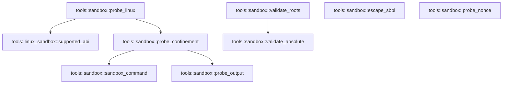

# tools::sandbox

[Package atlas](index.md) · [Source](../../src/sandbox.rs)

## Declarations

Visibility is the declaration spelling; trait members and reexports require their enclosing interface. `cfg` is not evaluated.

| Symbol | Kind | Visibility | Test / cfg |
|---|---|---|---|
| [tools::sandbox::LINUX_LANDLOCK_ABI_MIN](../../src/sandbox.rs#L13) | const_item | `pub(crate)` |  |
| [tools::sandbox::NetworkPolicy](../../src/sandbox.rs#L17) | enum_item | `pub` |  |
| [tools::sandbox::SandboxPolicy](../../src/sandbox.rs#L25) | struct_item | `pub` |  |
| [tools::sandbox::SandboxPolicy::validate](../../src/sandbox.rs#L43) | function_item | `pub` |  |
| [tools::sandbox::SandboxPolicy::is_protected_exception](../../src/sandbox.rs#L70) | function_item | `pub` |  |
| [tools::sandbox::SandboxPolicy::exposed_protected_root](../../src/sandbox.rs#L79) | function_item | `pub` |  |
| [tools::sandbox::SandboxPolicy::canonical_bytes](../../src/sandbox.rs#L89) | function_item | `pub` |  |
| [tools::sandbox::SandboxBackend](../../src/sandbox.rs#L98) | enum_item | `pub` |  |
| [tools::sandbox::ProbeStatus](../../src/sandbox.rs#L108) | enum_item | `pub` |  |
| [tools::sandbox::ProbeFailure](../../src/sandbox.rs#L115) | enum_item | `pub` |  |
| [tools::sandbox::SandboxApproval](../../src/sandbox.rs#L123) | struct_item | `pub` |  |
| [tools::sandbox::SandboxError](../../src/sandbox.rs#L131) | enum_item | `pub` |  |
| [tools::sandbox::kernel_protected_roots](../../src/sandbox.rs#L151) | function_item | `pub` |  |
| [tools::sandbox::kernel_protected_roots_with_user_agent_dir](../../src/sandbox.rs#L172) | function_item | `pub` |  |
| [tools::sandbox::exposed_protected_roots](../../src/sandbox.rs#L187) | function_item | `pub` |  |
| [tools::sandbox::protected_root_containing](../../src/sandbox.rs#L213) | function_item | `pub` |  |
| [tools::sandbox::canonical_text](../../src/sandbox.rs#L244) | function_item | `private` |  |
| [tools::sandbox::service_user_home](../../src/sandbox.rs#L268) | function_item | `private` |  |
| [tools::sandbox::policy_digest](../../src/sandbox.rs#L295) | function_item | `pub` |  |
| [tools::sandbox::compile_darwin_profile](../../src/sandbox.rs#L302) | function_item | `pub` |  |
| [tools::sandbox::compile_linux_plan](../../src/sandbox.rs#L414) | function_item | `pub` |  |
| [tools::sandbox::compile_linux_bubblewrap_plan](../../src/sandbox.rs#L447) | function_item | `pub` |  |
| [tools::sandbox::validate_unsandboxed_approval](../../src/sandbox.rs#L489) | function_item | `pub` |  |
| [tools::sandbox::probe_backend](../../src/sandbox.rs#L506) | function_item | `pub` |  |
| [tools::sandbox::sandbox_command](../../src/sandbox.rs#L515) | function_item | `pub(crate)` |  |
| [tools::sandbox::probe_darwin](../../src/sandbox.rs#L570) | function_item | `private` |  |
| [tools::sandbox::select_linux_backend](../../src/sandbox.rs#L593) | function_item | `private` |  |
| [tools::sandbox::probe_bubblewrap](../../src/sandbox.rs#L613) | function_item | `private` |  |
| [tools::sandbox::probe_linux](../../src/sandbox.rs#L656) | function_item | `private` |  |
| [tools::sandbox::probe_confinement](../../src/sandbox.rs#L691) | function_item | `private` | #[cfg(any(     target_os = "macos",     all(         target_os = "linux",         any(target_arch = "x86_64", target_arch = "aarch64")     ) ))] |
| [tools::sandbox::probe_output](../../src/sandbox.rs#L769) | function_item | `private` | #[cfg(any(     target_os = "macos",     all(         target_os = "linux",         any(target_arch = "x86_64", target_arch = "aarch64")     ) ))] |
| [tools::sandbox::validate_roots](../../src/sandbox.rs#L795) | function_item | `private` |  |
| [tools::sandbox::validate_absolute](../../src/sandbox.rs#L812) | function_item | `private` |  |
| [tools::sandbox::escape_sbpl](../../src/sandbox.rs#L828) | function_item | `private` |  |
| [tools::sandbox::probe_nonce](../../src/sandbox.rs#L844) | function_item | `private` | #[cfg(any(     target_os = "macos",     all(         target_os = "linux",         any(target_arch = "x86_64", target_arch = "aarch64")     ) ))] |
| [tools::sandbox::probe_nonce::NONCE](../../src/sandbox.rs#L846) | static_item | `private` | #[cfg(any(     target_os = "macos",     all(         target_os = "linux",         any(target_arch = "x86_64", target_arch = "aarch64")     ) ))] |
| [tools::sandbox::tests::available](../../src/sandbox.rs#L853) | function_item | `private` | test; #[cfg(test)] |
| [tools::sandbox::tests::missing](../../src/sandbox.rs#L859) | function_item | `private` | test; #[cfg(test)] |
| [tools::sandbox::tests::linux_auto_prefers_bubblewrap_without_probing_landlock](../../src/sandbox.rs#L866) | function_item | `private` | test; #[cfg(test)] |
| [tools::sandbox::tests::linux_auto_falls_back_only_to_available_landlock](../../src/sandbox.rs#L875) | function_item | `private` | test; #[cfg(test)] |
| [tools::sandbox::tests::bubblewrap_plan_matches_golden_bytes](../../src/sandbox.rs#L886) | function_item | `private` | test; #[cfg(test)] |
| [tools::sandbox::tests::protected_policy](../../src/sandbox.rs#L897) | function_item | `private` | test; #[cfg(test)] |
| [tools::sandbox::tests::protected_roots_are_omitted_from_serialization_when_empty](../../src/sandbox.rs#L910) | function_item | `private` | test; #[cfg(test)] |
| [tools::sandbox::tests::darwin_profile_denies_protected_root_and_its_writable_ancestors](../../src/sandbox.rs#L925) | function_item | `private` | test; #[cfg(test)] |
| [tools::sandbox::tests::protected_exceptions_must_be_strictly_beneath](../../src/sandbox.rs#L958) | function_item | `private` | test; #[cfg(test)] |
| [tools::sandbox::tests::unsorted_protected_roots_are_rejected](../../src/sandbox.rs#L973) | function_item | `private` | test; #[cfg(test)] |
| [tools::sandbox::tests::exposed_roots_keep_only_protected_roots_inside_write_roots](../../src/sandbox.rs#L982) | function_item | `private` | test; #[cfg(test)] |
| [tools::sandbox::tests::protected_root_lookup_resolves_symlinked_aliases](../../src/sandbox.rs#L996) | function_item | `private` | test; #[cfg(test)] |
| [tools::sandbox::tests::user_instructions_stay_protected_through_absent_paths_and_aliases](../../src/sandbox.rs#L1022) | function_item | `private` | test; #[cfg(test)] #[cfg(target_os = "macos")] |
| [tools::sandbox::tests::seatbelt_keeps_protected_root_read_only_beneath_a_writable_home](../../src/sandbox.rs#L1082) | function_item | `private` | test; #[cfg(test)] #[cfg(target_os = "macos")] |

## Imports / reexports

| Local name | Source path | Visibility |
|---|---|---|
| `BTreeSet` | `std::collections::BTreeSet` | `private` |
| `fs` | `std::fs` | `private` |
| `Path` | `std::path::Path` | `private` |
| `Command` | `std::process::Command` | `private` |
| `Deserialize` | `serde::Deserialize` | `private` |
| `Serialize` | `serde::Serialize` | `private` |
| `json` | `serde_json::json` | `private` |
| `Digest` | `sha2::Digest` | `private` |
| `Sha256` | `sha2::Sha256` | `private` |
| `Error` | `thiserror::Error` | `private` |
| `*` | `super::*` | `private` |

## Module declarations

| Module | Visibility | Attributes |
|---|---|---|
| `tools::sandbox::tests` | `private` | #[cfg(test)] |

## Function call graphs

Edges below are syntactically resolved calls only, including private functions. Graphs partition callers into groups of 20; they are not execution order. All unresolved sites are listed below and in the JSON inventory.

```mermaid
flowchart TD
  n0["tools::bubblewrap_sandbox::binary"]
  n1["tools::bubblewrap_sandbox::command"]
  n2["tools::linux_sandbox::confine"]
  n3["tools::sandbox::kernel_protected_roots"]
  n4["tools::sandbox::kernel_protected_roots_with_user_agent_dir"]
  n5["tools::sandbox::exposed_protected_roots"]
  n6["tools::sandbox::protected_root_containing"]
  n7["tools::sandbox::canonical_text"]
  n8["tools::sandbox::service_user_home"]
  n9["tools::sandbox::policy_digest"]
  n10["tools::sandbox::compile_darwin_profile"]
  n11["tools::sandbox::compile_linux_plan"]
  n12["tools::sandbox::SandboxPolicy::validate"]
  n13["tools::sandbox::compile_linux_bubblewrap_plan"]
  n14["tools::sandbox::validate_unsandboxed_approval"]
  n15["tools::sandbox::probe_backend"]
  n16["tools::sandbox::sandbox_command"]
  n17["tools::sandbox::probe_darwin"]
  n18["tools::sandbox::select_linux_backend"]
  n19["tools::sandbox::probe_bubblewrap"]
  n20["tools::sandbox::probe_linux"]
  n21["tools::sandbox::probe_confinement"]
  n22["tools::sandbox::SandboxPolicy::is_protected_exception"]
  n23["tools::sandbox::probe_output"]
  n24["tools::sandbox::validate_roots"]
  n25["tools::sandbox::SandboxPolicy::exposed_protected_root"]
  n26["tools::sandbox::validate_absolute"]
  n27["tools::sandbox::SandboxPolicy::canonical_bytes"]
  n3 --> n7
  n3 --> n8
  n4 --> n3
  n4 --> n7
  n5 --> n7
  n12 --> n24
  n12 --> n26
  n15 --> n17
  n15 --> n18
  n15 --> n19
  n15 --> n20
  n16 --> n1
  n16 --> n2
  n16 --> n10
  n17 --> n21
  n19 --> n0
  n19 --> n21
  n19 --> n23
  n25 --> n22
  n27 --> n12
```

Functions 1–20: 20 direct edges

Functions 21–27: 5 direct edges

## Call sites

Includes test functions (marked in declarations). Receiver-type-required sites need type analysis/manual tracing. Calls in closures are attributed to their enclosing function; their occurrence here does not mean the closure executes immediately.

| Caller | Callee expression | Source lines | Target / classification |
|---|---|---|---|
| `validate` | `Err` | [45](../../src/sandbox.rs#L45), [59](../../src/sandbox.rs#L59) | external-constructor-callback-or-unresolved |
| `validate` | `SandboxError::Invalid` | [45](../../src/sandbox.rs#L45), [59](../../src/sandbox.rs#L59) | external-constructor-callback-or-unresolved |
| `validate` | `validate_roots` | [47](../../src/sandbox.rs#L47), [48](../../src/sandbox.rs#L48), [49](../../src/sandbox.rs#L49) | [tools::sandbox::validate_roots](../../src/sandbox.rs#L795) |
| `validate` | `validate_absolute` | [51](../../src/sandbox.rs#L51) | [tools::sandbox::validate_absolute](../../src/sandbox.rs#L812) |
| `validate` | `self                 .read_roots                 .iter()                 .any` | [54](../../src/sandbox.rs#L54) | receiver-type-required |
| `validate` | `self                 .read_roots                 .iter` | [54](../../src/sandbox.rs#L54) | receiver-type-required |
| `validate` | `Path::new(root).starts_with` | [57](../../src/sandbox.rs#L57) | receiver-type-required |
| `validate` | `Path::new` | [57](../../src/sandbox.rs#L57) | external-constructor-callback-or-unresolved |
| `validate` | `Ok` | [64](../../src/sandbox.rs#L64) | external-constructor-callback-or-unresolved |
| `is_protected_exception` | `self.protected_roots             .iter()             .any` | [71](../../src/sandbox.rs#L71) | receiver-type-required |
| `is_protected_exception` | `self.protected_roots             .iter` | [71](../../src/sandbox.rs#L71) | receiver-type-required |
| `is_protected_exception` | `Path::new` | [73](../../src/sandbox.rs#L73) | external-constructor-callback-or-unresolved |
| `is_protected_exception` | `root.starts_with` | [73](../../src/sandbox.rs#L73) | receiver-type-required |
| `exposed_protected_root` | `self.is_protected_exception` | [80](../../src/sandbox.rs#L80) | [tools::sandbox::SandboxPolicy::is_protected_exception](../../src/sandbox.rs#L70) |
| `exposed_protected_root` | `self.protected_roots             .iter()             .find(&#124;protected&#124; Path::new(protected).starts_with(root))             .map` | [83](../../src/sandbox.rs#L83) | receiver-type-required |
| `exposed_protected_root` | `self.protected_roots             .iter()             .find` | [83](../../src/sandbox.rs#L83) | receiver-type-required |
| `exposed_protected_root` | `self.protected_roots             .iter` | [83](../../src/sandbox.rs#L83) | receiver-type-required |
| `exposed_protected_root` | `Path::new(protected).starts_with` | [85](../../src/sandbox.rs#L85) | receiver-type-required |
| `exposed_protected_root` | `Path::new` | [85](../../src/sandbox.rs#L85) | external-constructor-callback-or-unresolved |
| `canonical_bytes` | `self.validate` | [90](../../src/sandbox.rs#L90) | [tools::sandbox::SandboxPolicy::validate](../../src/sandbox.rs#L43) |
| `canonical_bytes` | `serde_json_canonicalizer::to_vec(self)             .map_err` | [91](../../src/sandbox.rs#L91) | receiver-type-required |
| `canonical_bytes` | `serde_json_canonicalizer::to_vec` | [91](../../src/sandbox.rs#L91) | external-constructor-callback-or-unresolved |
| `canonical_bytes` | `SandboxError::Encoding` | [92](../../src/sandbox.rs#L92) | external-constructor-callback-or-unresolved |
| `canonical_bytes` | `error.to_string` | [92](../../src/sandbox.rs#L92) | receiver-type-required |
| `kernel_protected_roots` | `Vec::new` | [152](../../src/sandbox.rs#L152) | external-constructor-callback-or-unresolved |
| `kernel_protected_roots` | `roots.push` | [153](../../src/sandbox.rs#L153), [155](../../src/sandbox.rs#L155), [161](../../src/sandbox.rs#L161) | receiver-type-required |
| `kernel_protected_roots` | `canonical_text` | [153](../../src/sandbox.rs#L153), [155](../../src/sandbox.rs#L155), [161](../../src/sandbox.rs#L161) | [tools::sandbox::canonical_text](../../src/sandbox.rs#L244) |
| `kernel_protected_roots` | `service_user_home` | [154](../../src/sandbox.rs#L154) | [tools::sandbox::service_user_home](../../src/sandbox.rs#L268) |
| `kernel_protected_roots` | `home.join` | [155](../../src/sandbox.rs#L155), [157](../../src/sandbox.rs#L157), [159](../../src/sandbox.rs#L159) | receiver-type-required |
| `kernel_protected_roots` | `roots.sort` | [164](../../src/sandbox.rs#L164) | receiver-type-required |
| `kernel_protected_roots` | `roots.dedup` | [165](../../src/sandbox.rs#L165) | receiver-type-required |
| `kernel_protected_roots_with_user_agent_dir` | `kernel_protected_roots` | [176](../../src/sandbox.rs#L176) | [tools::sandbox::kernel_protected_roots](../../src/sandbox.rs#L151) |
| `kernel_protected_roots_with_user_agent_dir` | `roots.push` | [177](../../src/sandbox.rs#L177) | receiver-type-required |
| `kernel_protected_roots_with_user_agent_dir` | `canonical_text` | [177](../../src/sandbox.rs#L177) | [tools::sandbox::canonical_text](../../src/sandbox.rs#L244) |
| `kernel_protected_roots_with_user_agent_dir` | `roots.sort` | [178](../../src/sandbox.rs#L178) | receiver-type-required |
| `kernel_protected_roots_with_user_agent_dir` | `roots.dedup` | [179](../../src/sandbox.rs#L179) | receiver-type-required |
| `exposed_protected_roots` | `write_roots         .iter()         .flat_map(&#124;root&#124; {             let canonical = canonical_text(Path::new(root));             [root.clone(), canonical]         })         .collect::<Vec<_>>` | [188](../../src/sandbox.rs#L188) | receiver-type-required |
| `exposed_protected_roots` | `write_roots         .iter()         .flat_map` | [188](../../src/sandbox.rs#L188) | receiver-type-required |
| `exposed_protected_roots` | `write_roots         .iter` | [188](../../src/sandbox.rs#L188) | receiver-type-required |
| `exposed_protected_roots` | `canonical_text` | [191](../../src/sandbox.rs#L191) | [tools::sandbox::canonical_text](../../src/sandbox.rs#L244) |
| `exposed_protected_roots` | `Path::new` | [191](../../src/sandbox.rs#L191), [200](../../src/sandbox.rs#L200) | external-constructor-callback-or-unresolved |
| `exposed_protected_roots` | `root.clone` | [192](../../src/sandbox.rs#L192) | receiver-type-required |
| `exposed_protected_roots` | `protected         .iter()         .filter(&#124;root&#124; {             writes                 .iter()                 .any(&#124;write&#124; Path::new(root).starts_with(write))         })         .cloned()         .collect::<Vec<_>>` | [195](../../src/sandbox.rs#L195) | receiver-type-required |
| `exposed_protected_roots` | `protected         .iter()         .filter(&#124;root&#124; {             writes                 .iter()                 .any(&#124;write&#124; Path::new(root).starts_with(write))         })         .cloned` | [195](../../src/sandbox.rs#L195) | receiver-type-required |
| `exposed_protected_roots` | `protected         .iter()         .filter` | [195](../../src/sandbox.rs#L195) | receiver-type-required |
| `exposed_protected_roots` | `protected         .iter` | [195](../../src/sandbox.rs#L195) | receiver-type-required |
| `exposed_protected_roots` | `writes                 .iter()                 .any` | [198](../../src/sandbox.rs#L198) | receiver-type-required |
| `exposed_protected_roots` | `writes                 .iter` | [198](../../src/sandbox.rs#L198) | receiver-type-required |
| `exposed_protected_roots` | `Path::new(root).starts_with` | [200](../../src/sandbox.rs#L200) | receiver-type-required |
| `exposed_protected_roots` | `exposed.sort` | [204](../../src/sandbox.rs#L204) | receiver-type-required |
| `exposed_protected_roots` | `exposed.dedup` | [205](../../src/sandbox.rs#L205) | receiver-type-required |
| `protected_root_containing` | `Vec::new` | [215](../../src/sandbox.rs#L215) | external-constructor-callback-or-unresolved |
| `protected_root_containing` | `existing.canonicalize` | [217](../../src/sandbox.rs#L217) | receiver-type-required |
| `protected_root_containing` | `Some` | [218](../../src/sandbox.rs#L218) | external-constructor-callback-or-unresolved |
| `protected_root_containing` | `suffix                     .iter()                     .rev()                     .fold` | [219](../../src/sandbox.rs#L219) | receiver-type-required |
| `protected_root_containing` | `suffix                     .iter()                     .rev` | [219](../../src/sandbox.rs#L219) | receiver-type-required |
| `protected_root_containing` | `suffix                     .iter` | [219](../../src/sandbox.rs#L219) | receiver-type-required |
| `protected_root_containing` | `base.join` | [222](../../src/sandbox.rs#L222) | receiver-type-required |
| `protected_root_containing` | `existing.parent` | [225](../../src/sandbox.rs#L225) | receiver-type-required |
| `protected_root_containing` | `existing.file_name` | [225](../../src/sandbox.rs#L225) | receiver-type-required |
| `protected_root_containing` | `suffix.push` | [227](../../src/sandbox.rs#L227) | receiver-type-required |
| `protected_root_containing` | `name.to_owned` | [227](../../src/sandbox.rs#L227) | receiver-type-required |
| `protected_root_containing` | `protected         .iter()         .find(&#124;root&#124; {             path.starts_with(root)                 &#124;&#124; resolved                     .as_deref()                     .is_some_and(&#124;resolved&#124; resolved.starts_with(root))         })         .map` | [233](../../src/sandbox.rs#L233) | receiver-type-required |
| `protected_root_containing` | `protected         .iter()         .find` | [233](../../src/sandbox.rs#L233) | receiver-type-required |
| `protected_root_containing` | `protected         .iter` | [233](../../src/sandbox.rs#L233) | receiver-type-required |
| `protected_root_containing` | `path.starts_with` | [236](../../src/sandbox.rs#L236) | receiver-type-required |
| `protected_root_containing` | `resolved                     .as_deref()                     .is_some_and` | [237](../../src/sandbox.rs#L237) | receiver-type-required |
| `protected_root_containing` | `resolved                     .as_deref` | [237](../../src/sandbox.rs#L237) | receiver-type-required |
| `protected_root_containing` | `resolved.starts_with` | [239](../../src/sandbox.rs#L239) | receiver-type-required |
| `canonical_text` | `Vec::new` | [246](../../src/sandbox.rs#L246) | external-constructor-callback-or-unresolved |
| `canonical_text` | `existing.canonicalize` | [248](../../src/sandbox.rs#L248) | receiver-type-required |
| `canonical_text` | `suffix                 .iter()                 .rev()                 .fold(canonical, &#124;base, part&#124; base.join(part))                 .to_string_lossy()                 .into_owned` | [249](../../src/sandbox.rs#L249) | receiver-type-required |
| `canonical_text` | `suffix                 .iter()                 .rev()                 .fold(canonical, &#124;base, part&#124; base.join(part))                 .to_string_lossy` | [249](../../src/sandbox.rs#L249) | receiver-type-required |
| `canonical_text` | `suffix                 .iter()                 .rev()                 .fold` | [249](../../src/sandbox.rs#L249) | receiver-type-required |
| `canonical_text` | `suffix                 .iter()                 .rev` | [249](../../src/sandbox.rs#L249) | receiver-type-required |
| `canonical_text` | `suffix                 .iter` | [249](../../src/sandbox.rs#L249) | receiver-type-required |
| `canonical_text` | `base.join` | [252](../../src/sandbox.rs#L252) | receiver-type-required |
| `canonical_text` | `existing.parent` | [256](../../src/sandbox.rs#L256) | receiver-type-required |
| `canonical_text` | `existing.file_name` | [256](../../src/sandbox.rs#L256) | receiver-type-required |
| `canonical_text` | `suffix.push` | [258](../../src/sandbox.rs#L258) | receiver-type-required |
| `canonical_text` | `name.to_owned` | [258](../../src/sandbox.rs#L258) | receiver-type-required |
| `canonical_text` | `path.to_string_lossy().into_owned` | [261](../../src/sandbox.rs#L261) | receiver-type-required |
| `canonical_text` | `path.to_string_lossy` | [261](../../src/sandbox.rs#L261) | receiver-type-required |
| `service_user_home` | `std::mem::zeroed` | [273](../../src/sandbox.rs#L273) | external-constructor-callback-or-unresolved |
| `service_user_home` | `std::ptr::null_mut` | [274](../../src/sandbox.rs#L274) | external-constructor-callback-or-unresolved |
| `service_user_home` | `libc::getpwuid_r` | [278](../../src/sandbox.rs#L278) | external-constructor-callback-or-unresolved |
| `service_user_home` | `libc::geteuid` | [279](../../src/sandbox.rs#L279) | external-constructor-callback-or-unresolved |
| `service_user_home` | `buffer.as_mut_ptr().cast` | [281](../../src/sandbox.rs#L281) | receiver-type-required |
| `service_user_home` | `buffer.as_mut_ptr` | [281](../../src/sandbox.rs#L281) | receiver-type-required |
| `service_user_home` | `buffer.len` | [282](../../src/sandbox.rs#L282) | receiver-type-required |
| `service_user_home` | `result.is_null` | [286](../../src/sandbox.rs#L286) | receiver-type-required |
| `service_user_home` | `entry.pw_dir.is_null` | [286](../../src/sandbox.rs#L286) | receiver-type-required |
| `service_user_home` | `CStr::from_ptr` | [290](../../src/sandbox.rs#L290) | external-constructor-callback-or-unresolved |
| `service_user_home` | `Path::new` | [291](../../src/sandbox.rs#L291) | external-constructor-callback-or-unresolved |
| `service_user_home` | `std::ffi::OsStr::from_bytes` | [291](../../src/sandbox.rs#L291) | external-constructor-callback-or-unresolved |
| `service_user_home` | `home.to_bytes` | [291](../../src/sandbox.rs#L291) | receiver-type-required |
| `service_user_home` | `home.is_absolute().then` | [292](../../src/sandbox.rs#L292) | receiver-type-required |
| `service_user_home` | `home.is_absolute` | [292](../../src/sandbox.rs#L292) | receiver-type-required |
| `service_user_home` | `home.to_path_buf` | [292](../../src/sandbox.rs#L292) | receiver-type-required |
| `policy_digest` | `Ok` | [296](../../src/sandbox.rs#L296) | external-constructor-callback-or-unresolved |
| `compile_darwin_profile` | `policy.validate` | [303](../../src/sandbox.rs#L303) | receiver-type-required |
| `compile_darwin_profile` | `policy         .read_roots         .iter()         .chain(&policy.write_roots)         .chain(policy.scratch.iter())         .flat_map(&#124;root&#124; Path::new(root).ancestors().skip(1))         .filter_map(Path::to_str)         .collect::<BTreeSet<_>>` | [312](../../src/sandbox.rs#L312) | receiver-type-required |
| `compile_darwin_profile` | `policy         .read_roots         .iter()         .chain(&policy.write_roots)         .chain(policy.scratch.iter())         .flat_map(&#124;root&#124; Path::new(root).ancestors().skip(1))         .filter_map` | [312](../../src/sandbox.rs#L312) | receiver-type-required |
| `compile_darwin_profile` | `policy         .read_roots         .iter()         .chain(&policy.write_roots)         .chain(policy.scratch.iter())         .flat_map` | [312](../../src/sandbox.rs#L312) | receiver-type-required |
| `compile_darwin_profile` | `policy         .read_roots         .iter()         .chain(&policy.write_roots)         .chain` | [312](../../src/sandbox.rs#L312) | receiver-type-required |
| `compile_darwin_profile` | `policy         .read_roots         .iter()         .chain` | [312](../../src/sandbox.rs#L312) | receiver-type-required |
| `compile_darwin_profile` | `policy         .read_roots         .iter` | [312](../../src/sandbox.rs#L312) | receiver-type-required |
| `compile_darwin_profile` | `policy.scratch.iter` | [316](../../src/sandbox.rs#L316), [369](../../src/sandbox.rs#L369) | receiver-type-required |
| `compile_darwin_profile` | `Path::new(root).ancestors().skip` | [317](../../src/sandbox.rs#L317) | receiver-type-required |
| `compile_darwin_profile` | `Path::new(root).ancestors` | [317](../../src/sandbox.rs#L317) | receiver-type-required |
| `compile_darwin_profile` | `Path::new` | [317](../../src/sandbox.rs#L317), [377](../../src/sandbox.rs#L377), [391](../../src/sandbox.rs#L391) | external-constructor-callback-or-unresolved |
| `compile_darwin_profile` | `lines.push` | [321](../../src/sandbox.rs#L321), [329](../../src/sandbox.rs#L329), [330](../../src/sandbox.rs#L330), [344](../../src/sandbox.rs#L344), [350](../../src/sandbox.rs#L350), [356](../../src/sandbox.rs#L356), [373](../../src/sandbox.rs#L373), [384](../../src/sandbox.rs#L384), [393](../../src/sandbox.rs#L393), [399](../../src/sandbox.rs#L399), [404](../../src/sandbox.rs#L404), [405](../../src/sandbox.rs#L405), [407](../../src/sandbox.rs#L407) | receiver-type-required |
| `compile_darwin_profile` | `"(allow file-read-metadata (literal \"/Applications\"))".to_owned` | [329](../../src/sandbox.rs#L329) | receiver-type-required |
| `compile_darwin_profile` | `"(allow file-read-metadata (literal \"/Library\"))".to_owned` | [330](../../src/sandbox.rs#L330) | receiver-type-required |
| `compile_darwin_profile` | `[         "/System",         "/usr",         "/bin",         "/sbin",         "/private/var/select",         "/Applications/Xcode.app",         "/Library/Developer/CommandLineTools",     ]     .into_iter()     .map(ToOwned::to_owned)     .chain` | [331](../../src/sandbox.rs#L331) | receiver-type-required |
| `compile_darwin_profile` | `[         "/System",         "/usr",         "/bin",         "/sbin",         "/private/var/select",         "/Applications/Xcode.app",         "/Library/Developer/CommandLineTools",     ]     .into_iter()     .map` | [331](../../src/sandbox.rs#L331) | receiver-type-required |
| `compile_darwin_profile` | `[         "/System",         "/usr",         "/bin",         "/sbin",         "/private/var/select",         "/Applications/Xcode.app",         "/Library/Developer/CommandLineTools",     ]     .into_iter` | [331](../../src/sandbox.rs#L331) | receiver-type-required |
| `compile_darwin_profile` | `policy.read_roots.iter().cloned` | [342](../../src/sandbox.rs#L342) | receiver-type-required |
| `compile_darwin_profile` | `policy.read_roots.iter` | [342](../../src/sandbox.rs#L342) | receiver-type-required |
| `compile_darwin_profile` | `policy         .write_roots         .iter()         .chain(policy.scratch.iter())         .collect::<Vec<_>>` | [366](../../src/sandbox.rs#L366) | receiver-type-required |
| `compile_darwin_profile` | `policy         .write_roots         .iter()         .chain` | [366](../../src/sandbox.rs#L366) | receiver-type-required |
| `compile_darwin_profile` | `policy         .write_roots         .iter` | [366](../../src/sandbox.rs#L366) | receiver-type-required |
| `compile_darwin_profile` | `BTreeSet::new` | [371](../../src/sandbox.rs#L371) | external-constructor-callback-or-unresolved |
| `compile_darwin_profile` | `Path::new(protected).ancestors().skip` | [377](../../src/sandbox.rs#L377) | receiver-type-required |
| `compile_darwin_profile` | `Path::new(protected).ancestors` | [377](../../src/sandbox.rs#L377) | receiver-type-required |
| `compile_darwin_profile` | `grants.iter().any` | [378](../../src/sandbox.rs#L378) | receiver-type-required |
| `compile_darwin_profile` | `grants.iter` | [378](../../src/sandbox.rs#L378) | receiver-type-required |
| `compile_darwin_profile` | `ancestor.starts_with` | [378](../../src/sandbox.rs#L378) | receiver-type-required |
| `compile_darwin_profile` | `denied_ancestors.extend` | [379](../../src/sandbox.rs#L379) | receiver-type-required |
| `compile_darwin_profile` | `ancestor.to_str` | [379](../../src/sandbox.rs#L379) | receiver-type-required |
| `compile_darwin_profile` | `grants         .iter()         .filter` | [389](../../src/sandbox.rs#L389) | receiver-type-required |
| `compile_darwin_profile` | `grants         .iter` | [389](../../src/sandbox.rs#L389) | receiver-type-required |
| `compile_darwin_profile` | `policy.is_protected_exception` | [391](../../src/sandbox.rs#L391) | receiver-type-required |
| `compile_darwin_profile` | `"(allow process-exec process-fork)".to_owned` | [399](../../src/sandbox.rs#L399) | receiver-type-required |
| `compile_darwin_profile` | `"(allow network* (local ip \"localhost:*\"))".to_owned` | [404](../../src/sandbox.rs#L404) | receiver-type-required |
| `compile_darwin_profile` | `"(allow network* (remote ip \"localhost:*\"))".to_owned` | [405](../../src/sandbox.rs#L405) | receiver-type-required |
| `compile_darwin_profile` | `"(allow network*)".to_owned` | [407](../../src/sandbox.rs#L407) | receiver-type-required |
| `compile_darwin_profile` | `lines.join("\n").into_bytes` | [409](../../src/sandbox.rs#L409) | receiver-type-required |
| `compile_darwin_profile` | `lines.join` | [409](../../src/sandbox.rs#L409) | receiver-type-required |
| `compile_darwin_profile` | `bytes.push` | [410](../../src/sandbox.rs#L410) | receiver-type-required |
| `compile_darwin_profile` | `Ok` | [411](../../src/sandbox.rs#L411) | external-constructor-callback-or-unresolved |
| `compile_linux_plan` | `policy.validate` | [415](../../src/sandbox.rs#L415) | receiver-type-required |
| `compile_linux_plan` | `plan.as_object_mut()             .expect("plan object")             .insert` | [430](../../src/sandbox.rs#L430), [435](../../src/sandbox.rs#L435) | receiver-type-required |
| `compile_linux_plan` | `plan.as_object_mut()             .expect` | [430](../../src/sandbox.rs#L430), [435](../../src/sandbox.rs#L435) | receiver-type-required |
| `compile_linux_plan` | `plan.as_object_mut` | [430](../../src/sandbox.rs#L430), [435](../../src/sandbox.rs#L435) | receiver-type-required |
| `compile_linux_plan` | `"scratch".to_owned` | [432](../../src/sandbox.rs#L432) | receiver-type-required |
| `compile_linux_plan` | `policy.protected_roots.is_empty` | [434](../../src/sandbox.rs#L434) | receiver-type-required |
| `compile_linux_plan` | `"protected_roots".to_owned` | [437](../../src/sandbox.rs#L437) | receiver-type-required |
| `compile_linux_plan` | `serde_json_canonicalizer::to_vec(&plan)         .map_err` | [439](../../src/sandbox.rs#L439) | receiver-type-required |
| `compile_linux_plan` | `serde_json_canonicalizer::to_vec` | [439](../../src/sandbox.rs#L439) | external-constructor-callback-or-unresolved |
| `compile_linux_plan` | `SandboxError::Encoding` | [440](../../src/sandbox.rs#L440) | external-constructor-callback-or-unresolved |
| `compile_linux_plan` | `error.to_string` | [440](../../src/sandbox.rs#L440) | receiver-type-required |
| `compile_linux_plan` | `bytes.push` | [441](../../src/sandbox.rs#L441) | receiver-type-required |
| `compile_linux_plan` | `Ok` | [442](../../src/sandbox.rs#L442) | external-constructor-callback-or-unresolved |
| `compile_linux_bubblewrap_plan` | `policy.validate` | [448](../../src/sandbox.rs#L448) | receiver-type-required |
| `compile_linux_bubblewrap_plan` | `Err` | [450](../../src/sandbox.rs#L450) | external-constructor-callback-or-unresolved |
| `compile_linux_bubblewrap_plan` | `SandboxError::Unavailable` | [450](../../src/sandbox.rs#L450) | external-constructor-callback-or-unresolved |
| `compile_linux_bubblewrap_plan` | `"bubblewrap requires allow_process=true and network=deny or all".to_owned` | [451](../../src/sandbox.rs#L451) | receiver-type-required |
| `compile_linux_bubblewrap_plan` | `namespaces.push` | [456](../../src/sandbox.rs#L456) | receiver-type-required |
| `compile_linux_bubblewrap_plan` | `namespaces.sort_unstable` | [457](../../src/sandbox.rs#L457) | receiver-type-required |
| `compile_linux_bubblewrap_plan` | `plan.as_object_mut()             .expect("plan object")             .insert` | [474](../../src/sandbox.rs#L474), [479](../../src/sandbox.rs#L479) | receiver-type-required |
| `compile_linux_bubblewrap_plan` | `plan.as_object_mut()             .expect` | [474](../../src/sandbox.rs#L474), [479](../../src/sandbox.rs#L479) | receiver-type-required |
| `compile_linux_bubblewrap_plan` | `plan.as_object_mut` | [474](../../src/sandbox.rs#L474), [479](../../src/sandbox.rs#L479) | receiver-type-required |
| `compile_linux_bubblewrap_plan` | `"scratch".to_owned` | [476](../../src/sandbox.rs#L476) | receiver-type-required |
| `compile_linux_bubblewrap_plan` | `policy.protected_roots.is_empty` | [478](../../src/sandbox.rs#L478) | receiver-type-required |
| `compile_linux_bubblewrap_plan` | `"protected_roots".to_owned` | [481](../../src/sandbox.rs#L481) | receiver-type-required |
| `compile_linux_bubblewrap_plan` | `serde_json_canonicalizer::to_vec(&plan)         .map_err` | [483](../../src/sandbox.rs#L483) | receiver-type-required |
| `compile_linux_bubblewrap_plan` | `serde_json_canonicalizer::to_vec` | [483](../../src/sandbox.rs#L483) | external-constructor-callback-or-unresolved |
| `compile_linux_bubblewrap_plan` | `SandboxError::Encoding` | [484](../../src/sandbox.rs#L484) | external-constructor-callback-or-unresolved |
| `compile_linux_bubblewrap_plan` | `error.to_string` | [484](../../src/sandbox.rs#L484) | receiver-type-required |
| `compile_linux_bubblewrap_plan` | `bytes.push` | [485](../../src/sandbox.rs#L485) | receiver-type-required |
| `compile_linux_bubblewrap_plan` | `Ok` | [486](../../src/sandbox.rs#L486) | external-constructor-callback-or-unresolved |
| `validate_unsandboxed_approval` | `Ok` | [500](../../src/sandbox.rs#L500) | external-constructor-callback-or-unresolved |
| `validate_unsandboxed_approval` | `Err` | [502](../../src/sandbox.rs#L502) | external-constructor-callback-or-unresolved |
| `probe_backend` | `probe_darwin` | [508](../../src/sandbox.rs#L508) | [tools::sandbox::probe_darwin](../../src/sandbox.rs#L570) |
| `probe_backend` | `select_linux_backend` | [509](../../src/sandbox.rs#L509) | [tools::sandbox::select_linux_backend](../../src/sandbox.rs#L593) |
| `probe_backend` | `probe_bubblewrap` | [509](../../src/sandbox.rs#L509), [510](../../src/sandbox.rs#L510) | [tools::sandbox::probe_bubblewrap](../../src/sandbox.rs#L613) |
| `probe_backend` | `probe_linux` | [511](../../src/sandbox.rs#L511) | [tools::sandbox::probe_linux](../../src/sandbox.rs#L656) |
| `sandbox_command` | `Err` | [521](../../src/sandbox.rs#L521), [528](../../src/sandbox.rs#L528), [547](../../src/sandbox.rs#L547), [564](../../src/sandbox.rs#L564) | external-constructor-callback-or-unresolved |
| `sandbox_command` | `SandboxError::Unavailable` | [521](../../src/sandbox.rs#L521), [528](../../src/sandbox.rs#L528), [547](../../src/sandbox.rs#L547), [564](../../src/sandbox.rs#L564) | external-constructor-callback-or-unresolved |
| `sandbox_command` | `"sandbox probe did not report available".to_owned` | [522](../../src/sandbox.rs#L522) | receiver-type-required |
| `sandbox_command` | `String::from_utf8(compile_darwin_profile(policy)?)             .map_err` | [532](../../src/sandbox.rs#L532) | receiver-type-required |
| `sandbox_command` | `String::from_utf8` | [532](../../src/sandbox.rs#L532) | external-constructor-callback-or-unresolved |
| `sandbox_command` | `compile_darwin_profile` | [532](../../src/sandbox.rs#L532) | [tools::sandbox::compile_darwin_profile](../../src/sandbox.rs#L302) |
| `sandbox_command` | `SandboxError::Encoding` | [533](../../src/sandbox.rs#L533) | external-constructor-callback-or-unresolved |
| `sandbox_command` | `"profile is not UTF-8".to_owned` | [533](../../src/sandbox.rs#L533) | receiver-type-required |
| `sandbox_command` | `Command::new` | [534](../../src/sandbox.rs#L534), [551](../../src/sandbox.rs#L551) | external-constructor-callback-or-unresolved |
| `sandbox_command` | `command.arg("-p").arg(profile).arg` | [535](../../src/sandbox.rs#L535) | receiver-type-required |
| `sandbox_command` | `command.arg("-p").arg` | [535](../../src/sandbox.rs#L535) | receiver-type-required |
| `sandbox_command` | `command.arg` | [535](../../src/sandbox.rs#L535) | receiver-type-required |
| `sandbox_command` | `Ok` | [536](../../src/sandbox.rs#L536), [553](../../src/sandbox.rs#L553) | external-constructor-callback-or-unresolved |
| `sandbox_command` | `crate::bubblewrap_sandbox::command` | [544](../../src/sandbox.rs#L544) | [tools::bubblewrap_sandbox::command](../../src/bubblewrap_sandbox.rs#L57) |
| `sandbox_command` | `crate::linux_sandbox::confine` | [552](../../src/sandbox.rs#L552) | [tools::linux_sandbox::confine](../../src/linux_sandbox.rs#L125) |
| `sandbox_command` | `"no applied sandbox launcher on this platform".to_owned` | [565](../../src/sandbox.rs#L565) | receiver-type-required |
| `probe_darwin` | `"Seatbelt requested on a non-macOS host".to_owned` | [575](../../src/sandbox.rs#L575) | receiver-type-required |
| `probe_darwin` | `Path::new("/usr/bin/sandbox-exec").is_file` | [580](../../src/sandbox.rs#L580) | receiver-type-required |
| `probe_darwin` | `Path::new` | [580](../../src/sandbox.rs#L580) | external-constructor-callback-or-unresolved |
| `probe_darwin` | `"sandbox-exec is missing".to_owned` | [583](../../src/sandbox.rs#L583) | receiver-type-required |
| `probe_darwin` | `probe_confinement` | [586](../../src/sandbox.rs#L586) | [tools::sandbox::probe_confinement](../../src/sandbox.rs#L691) |
| `probe_darwin` | `"darwin-seatbelt".to_owned` | [587](../../src/sandbox.rs#L587) | receiver-type-required |
| `probe_darwin` | `std::env::consts::OS.to_owned` | [588](../../src/sandbox.rs#L588) | receiver-type-required |
| `select_linux_backend` | `landlock` | [600](../../src/sandbox.rs#L600) | external-constructor-callback-or-unresolved |
| `probe_bubblewrap` | `"bubblewrap/seccomp requires Linux on x86_64 or aarch64".to_owned` | [621](../../src/sandbox.rs#L621) | receiver-type-required |
| `probe_bubblewrap` | `crate::bubblewrap_sandbox::binary` | [629](../../src/sandbox.rs#L629) | [tools::bubblewrap_sandbox::binary](../../src/bubblewrap_sandbox.rs#L26) |
| `probe_bubblewrap` | `error.to_string` | [634](../../src/sandbox.rs#L634) | receiver-type-required |
| `probe_bubblewrap` | `probe_output` | [638](../../src/sandbox.rs#L638) | [tools::sandbox::probe_output](../../src/sandbox.rs#L769) |
| `probe_bubblewrap` | `Command::new(binary).arg` | [638](../../src/sandbox.rs#L638) | receiver-type-required |
| `probe_bubblewrap` | `Command::new` | [638](../../src/sandbox.rs#L638) | external-constructor-callback-or-unresolved |
| `probe_bubblewrap` | `output.status.success` | [639](../../src/sandbox.rs#L639) | receiver-type-required |
| `probe_bubblewrap` | `String::from_utf8_lossy(&output.stdout).trim().to_owned` | [640](../../src/sandbox.rs#L640) | receiver-type-required |
| `probe_bubblewrap` | `String::from_utf8_lossy(&output.stdout).trim` | [640](../../src/sandbox.rs#L640) | receiver-type-required |
| `probe_bubblewrap` | `String::from_utf8_lossy` | [640](../../src/sandbox.rs#L640) | external-constructor-callback-or-unresolved |
| `probe_bubblewrap` | `probe_confinement` | [649](../../src/sandbox.rs#L649) | [tools::sandbox::probe_confinement](../../src/sandbox.rs#L691) |
| `probe_bubblewrap` | `crate::bubblewrap_sandbox::BACKEND.to_owned` | [650](../../src/sandbox.rs#L650) | receiver-type-required |
| `probe_linux` | `"Landlock/seccomp requires Linux on x86_64 or aarch64".to_owned` | [664](../../src/sandbox.rs#L664) | receiver-type-required |
| `probe_linux` | `crate::linux_sandbox::supported_abi` | [672](../../src/sandbox.rs#L672) | [tools::linux_sandbox::supported_abi](../../src/linux_sandbox.rs#L79) |
| `probe_linux` | `probe_confinement` | [673](../../src/sandbox.rs#L673) | [tools::sandbox::probe_confinement](../../src/sandbox.rs#L691) |
| `probe_linux` | `crate::linux_sandbox::BACKEND.to_owned` | [674](../../src/sandbox.rs#L674) | receiver-type-required |
| `probe_confinement` | `std::env::temp_dir().join` | [692](../../src/sandbox.rs#L692) | receiver-type-required |
| `probe_confinement` | `std::env::temp_dir` | [692](../../src/sandbox.rs#L692) | external-constructor-callback-or-unresolved |
| `probe_confinement` | `unresolved_root.join` | [697](../../src/sandbox.rs#L697), [698](../../src/sandbox.rs#L698) | receiver-type-required |
| `probe_confinement` | `(&#124;&#124; -> Result<(), SandboxError> {         fs::create_dir_all(&allowed_unresolved)?;         fs::create_dir_all(&outside_unresolved)?;         let root = fs::canonicalize(&unresolved_root)?;         let allowed = root.join("allowed");         let outside = root.join("outside");         fs::write(allowed.join("read.txt"), b"ok")?;         let policy = SandboxPolicy {             format: 1,             read_roots: vec![allowed.to_string_lossy().into_owned()],             write_roots: vec![allowed.to_string_lossy().into_owned()],             network: NetworkPolicy::Deny,             allow_process: true,             scratch: None,             protected_roots: Vec::new(),         };         let read = probe_output(             sandbox_command(&policy, &candidate, Path::new("/bin/cat"))?                 .current_dir(&allowed)                 .arg(allowed.join("read.txt")),         )?;         let write = probe_output(             sandbox_command(&policy, &candidate, Path::new("/bin/sh"))?                 .current_dir(&allowed)                 .args(["-c", "printf ok > write.txt"]),         )?;         let denied = probe_output(             sandbox_command(&policy, &candidate, Path::new("/bin/sh"))?                 .current_dir(&allowed)                 .args(["-c", "printf denied > \"$1\"", "probe"])                 .arg(outside.join("denied.txt")),         )?;         if read.status.success()             && read.stdout == b"ok"             && write.status.success()             && fs::read(allowed.join("write.txt"))? == b"ok"             && !denied.status.success()             && !outside.join("denied.txt").exists()         {             Ok(())         } else {             Err(SandboxError::Probe(format!(                 "read_status={:?} read_stderr={} denied_status={:?} denied_stderr={} outside_exists={}",                 read.status.code(),                 String::from_utf8_lossy(&read.stderr),                 denied.status.code(),                 String::from_utf8_lossy(&denied.stderr),                 outside.join("denied.txt").exists()             )))         }     })` | [699](../../src/sandbox.rs#L699) | external-constructor-callback-or-unresolved |
| `probe_confinement` | `fs::create_dir_all` | [700](../../src/sandbox.rs#L700), [701](../../src/sandbox.rs#L701) | external-constructor-callback-or-unresolved |
| `probe_confinement` | `fs::canonicalize` | [702](../../src/sandbox.rs#L702) | external-constructor-callback-or-unresolved |
| `probe_confinement` | `root.join` | [703](../../src/sandbox.rs#L703), [704](../../src/sandbox.rs#L704) | receiver-type-required |
| `probe_confinement` | `fs::write` | [705](../../src/sandbox.rs#L705) | external-constructor-callback-or-unresolved |
| `probe_confinement` | `allowed.join` | [705](../../src/sandbox.rs#L705), [718](../../src/sandbox.rs#L718), [734](../../src/sandbox.rs#L734) | receiver-type-required |
| `probe_confinement` | `Vec::new` | [713](../../src/sandbox.rs#L713) | external-constructor-callback-or-unresolved |
| `probe_confinement` | `probe_output` | [715](../../src/sandbox.rs#L715), [720](../../src/sandbox.rs#L720), [725](../../src/sandbox.rs#L725) | [tools::sandbox::probe_output](../../src/sandbox.rs#L769) |
| `probe_confinement` | `sandbox_command(&policy, &candidate, Path::new("/bin/cat"))?                 .current_dir(&allowed)                 .arg` | [716](../../src/sandbox.rs#L716) | receiver-type-required |
| `probe_confinement` | `sandbox_command(&policy, &candidate, Path::new("/bin/cat"))?                 .current_dir` | [716](../../src/sandbox.rs#L716) | receiver-type-required |
| `probe_confinement` | `sandbox_command` | [716](../../src/sandbox.rs#L716), [721](../../src/sandbox.rs#L721), [726](../../src/sandbox.rs#L726) | [tools::sandbox::sandbox_command](../../src/sandbox.rs#L515) |
| `probe_confinement` | `Path::new` | [716](../../src/sandbox.rs#L716), [721](../../src/sandbox.rs#L721), [726](../../src/sandbox.rs#L726) | external-constructor-callback-or-unresolved |
| `probe_confinement` | `sandbox_command(&policy, &candidate, Path::new("/bin/sh"))?                 .current_dir(&allowed)                 .args` | [721](../../src/sandbox.rs#L721), [726](../../src/sandbox.rs#L726) | receiver-type-required |
| `probe_confinement` | `sandbox_command(&policy, &candidate, Path::new("/bin/sh"))?                 .current_dir` | [721](../../src/sandbox.rs#L721), [726](../../src/sandbox.rs#L726) | receiver-type-required |
| `probe_confinement` | `sandbox_command(&policy, &candidate, Path::new("/bin/sh"))?                 .current_dir(&allowed)                 .args(["-c", "printf denied > \"$1\"", "probe"])                 .arg` | [726](../../src/sandbox.rs#L726) | receiver-type-required |
| `probe_confinement` | `outside.join` | [729](../../src/sandbox.rs#L729), [736](../../src/sandbox.rs#L736) | receiver-type-required |
| `probe_confinement` | `read.status.success` | [731](../../src/sandbox.rs#L731) | receiver-type-required |
| `probe_confinement` | `write.status.success` | [733](../../src/sandbox.rs#L733) | receiver-type-required |
| `probe_confinement` | `fs::read` | [734](../../src/sandbox.rs#L734) | external-constructor-callback-or-unresolved |
| `probe_confinement` | `denied.status.success` | [735](../../src/sandbox.rs#L735) | receiver-type-required |
| `probe_confinement` | `outside.join("denied.txt").exists` | [736](../../src/sandbox.rs#L736) | receiver-type-required |
| `probe_confinement` | `Ok` | [738](../../src/sandbox.rs#L738) | external-constructor-callback-or-unresolved |
| `probe_confinement` | `Err` | [740](../../src/sandbox.rs#L740) | external-constructor-callback-or-unresolved |
| `probe_confinement` | `SandboxError::Probe` | [740](../../src/sandbox.rs#L740) | external-constructor-callback-or-unresolved |
| `probe_confinement` | `fs::remove_dir_all` | [750](../../src/sandbox.rs#L750) | external-constructor-callback-or-unresolved |
| `probe_confinement` | `error.to_string` | [755](../../src/sandbox.rs#L755) | receiver-type-required |
| `probe_output` | `command         .process_group(0)         .stdin(Stdio::null())         .stdout(Stdio::piped())         .stderr(Stdio::piped())         .spawn` | [773](../../src/sandbox.rs#L773) | receiver-type-required |
| `probe_output` | `command         .process_group(0)         .stdin(Stdio::null())         .stdout(Stdio::piped())         .stderr` | [773](../../src/sandbox.rs#L773) | receiver-type-required |
| `probe_output` | `command         .process_group(0)         .stdin(Stdio::null())         .stdout` | [773](../../src/sandbox.rs#L773) | receiver-type-required |
| `probe_output` | `command         .process_group(0)         .stdin` | [773](../../src/sandbox.rs#L773) | receiver-type-required |
| `probe_output` | `command         .process_group` | [773](../../src/sandbox.rs#L773) | receiver-type-required |
| `probe_output` | `Stdio::null` | [775](../../src/sandbox.rs#L775) | external-constructor-callback-or-unresolved |
| `probe_output` | `Stdio::piped` | [776](../../src/sandbox.rs#L776), [777](../../src/sandbox.rs#L777) | external-constructor-callback-or-unresolved |
| `probe_output` | `Instant::now` | [779](../../src/sandbox.rs#L779), [781](../../src/sandbox.rs#L781) | external-constructor-callback-or-unresolved |
| `probe_output` | `Duration::from_secs` | [779](../../src/sandbox.rs#L779) | external-constructor-callback-or-unresolved |
| `probe_output` | `child.try_wait()?.is_none` | [780](../../src/sandbox.rs#L780) | receiver-type-required |
| `probe_output` | `child.try_wait` | [780](../../src/sandbox.rs#L780) | receiver-type-required |
| `probe_output` | `libc::kill` | [784](../../src/sandbox.rs#L784) | external-constructor-callback-or-unresolved |
| `probe_output` | `child.id` | [784](../../src/sandbox.rs#L784) | receiver-type-required |
| `probe_output` | `child.kill` | [786](../../src/sandbox.rs#L786) | receiver-type-required |
| `probe_output` | `child.wait` | [787](../../src/sandbox.rs#L787) | receiver-type-required |
| `probe_output` | `Err` | [788](../../src/sandbox.rs#L788) | external-constructor-callback-or-unresolved |
| `probe_output` | `SandboxError::Probe` | [788](../../src/sandbox.rs#L788) | external-constructor-callback-or-unresolved |
| `probe_output` | `"sandbox probe timed out".to_owned` | [788](../../src/sandbox.rs#L788) | receiver-type-required |
| `probe_output` | `std::thread::sleep` | [790](../../src/sandbox.rs#L790) | external-constructor-callback-or-unresolved |
| `probe_output` | `Duration::from_millis` | [790](../../src/sandbox.rs#L790) | external-constructor-callback-or-unresolved |
| `probe_output` | `Ok` | [792](../../src/sandbox.rs#L792) | external-constructor-callback-or-unresolved |
| `probe_output` | `child.wait_with_output` | [792](../../src/sandbox.rs#L792) | receiver-type-required |
| `validate_roots` | `BTreeSet::new` | [797](../../src/sandbox.rs#L797) | external-constructor-callback-or-unresolved |
| `validate_roots` | `validate_absolute` | [799](../../src/sandbox.rs#L799) | [tools::sandbox::validate_absolute](../../src/sandbox.rs#L812) |
| `validate_roots` | `previous.is_some_and` | [800](../../src/sandbox.rs#L800) | receiver-type-required |
| `validate_roots` | `last.as_bytes` | [800](../../src/sandbox.rs#L800) | receiver-type-required |
| `validate_roots` | `value.as_bytes` | [800](../../src/sandbox.rs#L800) | receiver-type-required |
| `validate_roots` | `unique.insert` | [801](../../src/sandbox.rs#L801) | receiver-type-required |
| `validate_roots` | `value.as_str` | [801](../../src/sandbox.rs#L801) | receiver-type-required |
| `validate_roots` | `Err` | [803](../../src/sandbox.rs#L803) | external-constructor-callback-or-unresolved |
| `validate_roots` | `SandboxError::Invalid` | [803](../../src/sandbox.rs#L803) | external-constructor-callback-or-unresolved |
| `validate_roots` | `Some` | [807](../../src/sandbox.rs#L807) | external-constructor-callback-or-unresolved |
| `validate_roots` | `Ok` | [809](../../src/sandbox.rs#L809) | external-constructor-callback-or-unresolved |
| `validate_absolute` | `Path::new` | [813](../../src/sandbox.rs#L813) | external-constructor-callback-or-unresolved |
| `validate_absolute` | `path.is_absolute` | [814](../../src/sandbox.rs#L814) | receiver-type-required |
| `validate_absolute` | `value.contains` | [815](../../src/sandbox.rs#L815) | receiver-type-required |
| `validate_absolute` | `value.chars().any` | [816](../../src/sandbox.rs#L816) | receiver-type-required |
| `validate_absolute` | `value.chars` | [816](../../src/sandbox.rs#L816) | receiver-type-required |
| `validate_absolute` | `path             .components()             .any` | [817](../../src/sandbox.rs#L817) | receiver-type-required |
| `validate_absolute` | `path             .components` | [817](../../src/sandbox.rs#L817) | receiver-type-required |
| `validate_absolute` | `Err` | [821](../../src/sandbox.rs#L821) | external-constructor-callback-or-unresolved |
| `validate_absolute` | `SandboxError::Invalid` | [821](../../src/sandbox.rs#L821) | external-constructor-callback-or-unresolved |
| `validate_absolute` | `Ok` | [825](../../src/sandbox.rs#L825) | external-constructor-callback-or-unresolved |
| `escape_sbpl` | `value.chars().any` | [829](../../src/sandbox.rs#L829) | receiver-type-required |
| `escape_sbpl` | `value.chars` | [829](../../src/sandbox.rs#L829) | receiver-type-required |
| `escape_sbpl` | `Err` | [830](../../src/sandbox.rs#L830) | external-constructor-callback-or-unresolved |
| `escape_sbpl` | `SandboxError::Invalid` | [830](../../src/sandbox.rs#L830) | external-constructor-callback-or-unresolved |
| `escape_sbpl` | `Ok` | [834](../../src/sandbox.rs#L834) | external-constructor-callback-or-unresolved |
| `escape_sbpl` | `value.replace('\\', "\\\\").replace` | [834](../../src/sandbox.rs#L834) | receiver-type-required |
| `escape_sbpl` | `value.replace` | [834](../../src/sandbox.rs#L834) | receiver-type-required |
| `probe_nonce` | `NONCE.fetch_add` | [847](../../src/sandbox.rs#L847) | receiver-type-required |
| `NONCE` | `AtomicU64::new` | [846](../../src/sandbox.rs#L846) | external-constructor-callback-or-unresolved |
| `available` | `backend.to_owned` | [855](../../src/sandbox.rs#L855) | receiver-type-required |
| `available` | `"test".to_owned` | [856](../../src/sandbox.rs#L856) | receiver-type-required |
| `missing` | `"missing".to_owned` | [862](../../src/sandbox.rs#L862) | receiver-type-required |
| `bubblewrap_plan_matches_golden_bytes` | `serde_json::from_str(include_str!(             "../../../fixtures/sandbox/policy.canonical.json"         ))         .unwrap` | [887](../../src/sandbox.rs#L887) | receiver-type-required |
| `bubblewrap_plan_matches_golden_bytes` | `serde_json::from_str` | [887](../../src/sandbox.rs#L887) | external-constructor-callback-or-unresolved |
| `protected_policy` | `writes.iter().map(&#124;root&#124; (*root).to_owned()).collect` | [901](../../src/sandbox.rs#L901) | receiver-type-required |
| `protected_policy` | `writes.iter().map` | [901](../../src/sandbox.rs#L901) | receiver-type-required |
| `protected_policy` | `writes.iter` | [901](../../src/sandbox.rs#L901) | receiver-type-required |
| `protected_policy` | `(*root).to_owned` | [901](../../src/sandbox.rs#L901) | receiver-type-required |
| `protected_roots_are_omitted_from_serialization_when_empty` | `serde_json::from_str(include_str!(             "../../../fixtures/sandbox/policy.canonical.json"         ))         .unwrap` | [911](../../src/sandbox.rs#L911) | receiver-type-required |
| `protected_roots_are_omitted_from_serialization_when_empty` | `serde_json::from_str` | [911](../../src/sandbox.rs#L911) | external-constructor-callback-or-unresolved |
| `darwin_profile_denies_protected_root_and_its_writable_ancestors` | `protected_policy` | [926](../../src/sandbox.rs#L926) | [tools::sandbox::tests::protected_policy](../../src/sandbox.rs#L897) |
| `darwin_profile_denies_protected_root_and_its_writable_ancestors` | `String::from_utf8(compile_darwin_profile(&policy).unwrap()).unwrap` | [931](../../src/sandbox.rs#L931) | receiver-type-required |
| `darwin_profile_denies_protected_root_and_its_writable_ancestors` | `String::from_utf8` | [931](../../src/sandbox.rs#L931) | external-constructor-callback-or-unresolved |
| `darwin_profile_denies_protected_root_and_its_writable_ancestors` | `compile_darwin_profile(&policy).unwrap` | [931](../../src/sandbox.rs#L931) | receiver-type-required |
| `darwin_profile_denies_protected_root_and_its_writable_ancestors` | `compile_darwin_profile` | [931](../../src/sandbox.rs#L931) | external-constructor-callback-or-unresolved |
| `darwin_profile_denies_protected_root_and_its_writable_ancestors` | `profile.lines().collect::<Vec<_>>` | [932](../../src/sandbox.rs#L932) | receiver-type-required |
| `darwin_profile_denies_protected_root_and_its_writable_ancestors` | `profile.lines` | [932](../../src/sandbox.rs#L932) | receiver-type-required |
| `darwin_profile_denies_protected_root_and_its_writable_ancestors` | `lines                 .iter()                 .position(&#124;candidate&#124; *candidate == line)                 .unwrap_or_else` | [934](../../src/sandbox.rs#L934) | receiver-type-required |
| `darwin_profile_denies_protected_root_and_its_writable_ancestors` | `lines                 .iter()                 .position` | [934](../../src/sandbox.rs#L934) | receiver-type-required |
| `darwin_profile_denies_protected_root_and_its_writable_ancestors` | `lines                 .iter` | [934](../../src/sandbox.rs#L934) | receiver-type-required |
| `darwin_profile_denies_protected_root_and_its_writable_ancestors` | `position` | [939](../../src/sandbox.rs#L939), [940](../../src/sandbox.rs#L940), [941](../../src/sandbox.rs#L941), [942](../../src/sandbox.rs#L942) | external-constructor-callback-or-unresolved |
| `darwin_profile_denies_protected_root_and_its_writable_ancestors` | `lines             .iter()             .rposition(&#124;line&#124; {                 *line == "(allow file-write* (subpath \"/Users/u/Library/Kernel/jobs/j1\"))"             })             .unwrap` | [943](../../src/sandbox.rs#L943) | receiver-type-required |
| `darwin_profile_denies_protected_root_and_its_writable_ancestors` | `lines             .iter()             .rposition` | [943](../../src/sandbox.rs#L943) | receiver-type-required |
| `darwin_profile_denies_protected_root_and_its_writable_ancestors` | `lines             .iter` | [943](../../src/sandbox.rs#L943) | receiver-type-required |
| `protected_exceptions_must_be_strictly_beneath` | `protected_policy` | [959](../../src/sandbox.rs#L959) | [tools::sandbox::tests::protected_policy](../../src/sandbox.rs#L897) |
| `unsorted_protected_roots_are_rejected` | `protected_policy` | [974](../../src/sandbox.rs#L974) | [tools::sandbox::tests::protected_policy](../../src/sandbox.rs#L897) |
| `protected_root_lookup_resolves_symlinked_aliases` | `tempfile::tempdir().unwrap` | [997](../../src/sandbox.rs#L997) | receiver-type-required |
| `protected_root_lookup_resolves_symlinked_aliases` | `tempfile::tempdir` | [997](../../src/sandbox.rs#L997) | external-constructor-callback-or-unresolved |
| `protected_root_lookup_resolves_symlinked_aliases` | `root.path().canonicalize().unwrap` | [998](../../src/sandbox.rs#L998) | receiver-type-required |
| `protected_root_lookup_resolves_symlinked_aliases` | `root.path().canonicalize` | [998](../../src/sandbox.rs#L998) | receiver-type-required |
| `protected_root_lookup_resolves_symlinked_aliases` | `root.path` | [998](../../src/sandbox.rs#L998) | receiver-type-required |
| `protected_root_lookup_resolves_symlinked_aliases` | `base.join` | [999](../../src/sandbox.rs#L999), [1001](../../src/sandbox.rs#L1001), [1007](../../src/sandbox.rs#L1007), [1008](../../src/sandbox.rs#L1008) | receiver-type-required |
| `protected_root_lookup_resolves_symlinked_aliases` | `fs::create_dir_all(storage.join("threads")).unwrap` | [1000](../../src/sandbox.rs#L1000) | receiver-type-required |
| `protected_root_lookup_resolves_symlinked_aliases` | `fs::create_dir_all` | [1000](../../src/sandbox.rs#L1000) | external-constructor-callback-or-unresolved |
| `protected_root_lookup_resolves_symlinked_aliases` | `storage.join` | [1000](../../src/sandbox.rs#L1000), [1006](../../src/sandbox.rs#L1006) | receiver-type-required |
| `protected_root_lookup_resolves_symlinked_aliases` | `std::os::unix::fs::symlink(&storage, base.join("alias")).unwrap` | [1001](../../src/sandbox.rs#L1001) | receiver-type-required |
| `protected_root_lookup_resolves_symlinked_aliases` | `std::os::unix::fs::symlink` | [1001](../../src/sandbox.rs#L1001) | external-constructor-callback-or-unresolved |
| `protected_root_lookup_resolves_symlinked_aliases` | `kernel_protected_roots` | [1002](../../src/sandbox.rs#L1002) | external-constructor-callback-or-unresolved |
| `protected_root_lookup_resolves_symlinked_aliases` | `storage.clone` | [1005](../../src/sandbox.rs#L1005) | receiver-type-required |
| `user_instructions_stay_protected_through_absent_paths_and_aliases` | `tempfile::tempdir().unwrap` | [1023](../../src/sandbox.rs#L1023) | receiver-type-required |
| `user_instructions_stay_protected_through_absent_paths_and_aliases` | `tempfile::tempdir` | [1023](../../src/sandbox.rs#L1023) | external-constructor-callback-or-unresolved |
| `user_instructions_stay_protected_through_absent_paths_and_aliases` | `root.path().canonicalize().unwrap` | [1024](../../src/sandbox.rs#L1024) | receiver-type-required |
| `user_instructions_stay_protected_through_absent_paths_and_aliases` | `root.path().canonicalize` | [1024](../../src/sandbox.rs#L1024) | receiver-type-required |
| `user_instructions_stay_protected_through_absent_paths_and_aliases` | `root.path` | [1024](../../src/sandbox.rs#L1024) | receiver-type-required |
| `user_instructions_stay_protected_through_absent_paths_and_aliases` | `home.join` | [1025](../../src/sandbox.rs#L1025), [1026](../../src/sandbox.rs#L1026), [1029](../../src/sandbox.rs#L1029), [1030](../../src/sandbox.rs#L1030) | receiver-type-required |
| `user_instructions_stay_protected_through_absent_paths_and_aliases` | `fs::create_dir_all(&storage).unwrap` | [1027](../../src/sandbox.rs#L1027) | receiver-type-required |
| `user_instructions_stay_protected_through_absent_paths_and_aliases` | `fs::create_dir_all` | [1027](../../src/sandbox.rs#L1027), [1028](../../src/sandbox.rs#L1028), [1041](../../src/sandbox.rs#L1041) | external-constructor-callback-or-unresolved |
| `user_instructions_stay_protected_through_absent_paths_and_aliases` | `fs::create_dir_all(&authored).unwrap` | [1028](../../src/sandbox.rs#L1028) | receiver-type-required |
| `user_instructions_stay_protected_through_absent_paths_and_aliases` | `std::os::unix::fs::symlink(&authored, home.join("alias")).unwrap` | [1029](../../src/sandbox.rs#L1029) | receiver-type-required |
| `user_instructions_stay_protected_through_absent_paths_and_aliases` | `std::os::unix::fs::symlink` | [1029](../../src/sandbox.rs#L1029) | external-constructor-callback-or-unresolved |
| `user_instructions_stay_protected_through_absent_paths_and_aliases` | `kernel_protected_roots_with_user_agent_dir` | [1031](../../src/sandbox.rs#L1031) | external-constructor-callback-or-unresolved |
| `user_instructions_stay_protected_through_absent_paths_and_aliases` | `authored.join` | [1032](../../src/sandbox.rs#L1032) | receiver-type-required |
| `user_instructions_stay_protected_through_absent_paths_and_aliases` | `fs::create_dir_all(&canonical_user).unwrap` | [1041](../../src/sandbox.rs#L1041) | receiver-type-required |
| `user_instructions_stay_protected_through_absent_paths_and_aliases` | `fs::write(canonical_user.join("original"), b"original").unwrap` | [1042](../../src/sandbox.rs#L1042) | receiver-type-required |
| `user_instructions_stay_protected_through_absent_paths_and_aliases` | `fs::write` | [1042](../../src/sandbox.rs#L1042) | external-constructor-callback-or-unresolved |
| `user_instructions_stay_protected_through_absent_paths_and_aliases` | `canonical_user.join` | [1042](../../src/sandbox.rs#L1042) | receiver-type-required |
| `user_instructions_stay_protected_through_absent_paths_and_aliases` | `path.to_string_lossy().into_owned` | [1043](../../src/sandbox.rs#L1043) | receiver-type-required |
| `user_instructions_stay_protected_through_absent_paths_and_aliases` | `path.to_string_lossy` | [1043](../../src/sandbox.rs#L1043) | receiver-type-required |
| `user_instructions_stay_protected_through_absent_paths_and_aliases` | `exposed_protected_roots` | [1051](../../src/sandbox.rs#L1051) | external-constructor-callback-or-unresolved |
| `user_instructions_stay_protected_through_absent_paths_and_aliases` | `text` | [1051](../../src/sandbox.rs#L1051) | external-constructor-callback-or-unresolved |
| `user_instructions_stay_protected_through_absent_paths_and_aliases` | `sandbox_command(&policy, &available("darwin-seatbelt"), Path::new("/bin/sh"))                 .unwrap()                 .args(["-c", script])                 .current_dir(&home)                 .env_clear()                 .output()                 .unwrap()                 .status                 .success` | [1054](../../src/sandbox.rs#L1054) | receiver-type-required |
| `user_instructions_stay_protected_through_absent_paths_and_aliases` | `sandbox_command(&policy, &available("darwin-seatbelt"), Path::new("/bin/sh"))                 .unwrap()                 .args(["-c", script])                 .current_dir(&home)                 .env_clear()                 .output()                 .unwrap` | [1054](../../src/sandbox.rs#L1054) | receiver-type-required |
| `user_instructions_stay_protected_through_absent_paths_and_aliases` | `sandbox_command(&policy, &available("darwin-seatbelt"), Path::new("/bin/sh"))                 .unwrap()                 .args(["-c", script])                 .current_dir(&home)                 .env_clear()                 .output` | [1054](../../src/sandbox.rs#L1054) | receiver-type-required |
| `user_instructions_stay_protected_through_absent_paths_and_aliases` | `sandbox_command(&policy, &available("darwin-seatbelt"), Path::new("/bin/sh"))                 .unwrap()                 .args(["-c", script])                 .current_dir(&home)                 .env_clear` | [1054](../../src/sandbox.rs#L1054) | receiver-type-required |
| `user_instructions_stay_protected_through_absent_paths_and_aliases` | `sandbox_command(&policy, &available("darwin-seatbelt"), Path::new("/bin/sh"))                 .unwrap()                 .args(["-c", script])                 .current_dir` | [1054](../../src/sandbox.rs#L1054) | receiver-type-required |
| `user_instructions_stay_protected_through_absent_paths_and_aliases` | `sandbox_command(&policy, &available("darwin-seatbelt"), Path::new("/bin/sh"))                 .unwrap()                 .args` | [1054](../../src/sandbox.rs#L1054) | receiver-type-required |
| `user_instructions_stay_protected_through_absent_paths_and_aliases` | `sandbox_command(&policy, &available("darwin-seatbelt"), Path::new("/bin/sh"))                 .unwrap` | [1054](../../src/sandbox.rs#L1054) | receiver-type-required |
| `user_instructions_stay_protected_through_absent_paths_and_aliases` | `sandbox_command` | [1054](../../src/sandbox.rs#L1054) | external-constructor-callback-or-unresolved |
| `user_instructions_stay_protected_through_absent_paths_and_aliases` | `available` | [1054](../../src/sandbox.rs#L1054) | [tools::sandbox::tests::available](../../src/sandbox.rs#L853) |
| `user_instructions_stay_protected_through_absent_paths_and_aliases` | `Path::new` | [1054](../../src/sandbox.rs#L1054) | external-constructor-callback-or-unresolved |
| `seatbelt_keeps_protected_root_read_only_beneath_a_writable_home` | `tempfile::tempdir().unwrap` | [1083](../../src/sandbox.rs#L1083) | receiver-type-required |
| `seatbelt_keeps_protected_root_read_only_beneath_a_writable_home` | `tempfile::tempdir` | [1083](../../src/sandbox.rs#L1083) | external-constructor-callback-or-unresolved |
| `seatbelt_keeps_protected_root_read_only_beneath_a_writable_home` | `root.path().canonicalize().unwrap` | [1084](../../src/sandbox.rs#L1084) | receiver-type-required |
| `seatbelt_keeps_protected_root_read_only_beneath_a_writable_home` | `root.path().canonicalize` | [1084](../../src/sandbox.rs#L1084) | receiver-type-required |
| `seatbelt_keeps_protected_root_read_only_beneath_a_writable_home` | `root.path` | [1084](../../src/sandbox.rs#L1084) | receiver-type-required |
| `seatbelt_keeps_protected_root_read_only_beneath_a_writable_home` | `home.join` | [1085](../../src/sandbox.rs#L1085), [1088](../../src/sandbox.rs#L1088) | receiver-type-required |
| `seatbelt_keeps_protected_root_read_only_beneath_a_writable_home` | `storage.join` | [1086](../../src/sandbox.rs#L1086), [1089](../../src/sandbox.rs#L1089) | receiver-type-required |
| `seatbelt_keeps_protected_root_read_only_beneath_a_writable_home` | `fs::create_dir_all(&job).unwrap` | [1087](../../src/sandbox.rs#L1087) | receiver-type-required |
| `seatbelt_keeps_protected_root_read_only_beneath_a_writable_home` | `fs::create_dir_all` | [1087](../../src/sandbox.rs#L1087), [1088](../../src/sandbox.rs#L1088) | external-constructor-callback-or-unresolved |
| `seatbelt_keeps_protected_root_read_only_beneath_a_writable_home` | `fs::create_dir_all(home.join("project")).unwrap` | [1088](../../src/sandbox.rs#L1088) | receiver-type-required |
| `seatbelt_keeps_protected_root_read_only_beneath_a_writable_home` | `fs::write(storage.join("ledger"), b"original").unwrap` | [1089](../../src/sandbox.rs#L1089) | receiver-type-required |
| `seatbelt_keeps_protected_root_read_only_beneath_a_writable_home` | `fs::write` | [1089](../../src/sandbox.rs#L1089) | external-constructor-callback-or-unresolved |
| `seatbelt_keeps_protected_root_read_only_beneath_a_writable_home` | `path.to_string_lossy().into_owned` | [1090](../../src/sandbox.rs#L1090) | receiver-type-required |
| `seatbelt_keeps_protected_root_read_only_beneath_a_writable_home` | `path.to_string_lossy` | [1090](../../src/sandbox.rs#L1090) | receiver-type-required |
| `seatbelt_keeps_protected_root_read_only_beneath_a_writable_home` | `writes.sort` | [1092](../../src/sandbox.rs#L1092) | receiver-type-required |
| `seatbelt_keeps_protected_root_read_only_beneath_a_writable_home` | `available` | [1102](../../src/sandbox.rs#L1102) | [tools::sandbox::tests::available](../../src/sandbox.rs#L853) |
| `seatbelt_keeps_protected_root_read_only_beneath_a_writable_home` | `sandbox_command(&policy, &status, Path::new("/bin/sh"))                 .unwrap()                 .args(["-c", script])                 .current_dir(&home)                 .env_clear()                 .output()                 .unwrap()                 .status                 .success` | [1104](../../src/sandbox.rs#L1104) | receiver-type-required |
| `seatbelt_keeps_protected_root_read_only_beneath_a_writable_home` | `sandbox_command(&policy, &status, Path::new("/bin/sh"))                 .unwrap()                 .args(["-c", script])                 .current_dir(&home)                 .env_clear()                 .output()                 .unwrap` | [1104](../../src/sandbox.rs#L1104) | receiver-type-required |
| `seatbelt_keeps_protected_root_read_only_beneath_a_writable_home` | `sandbox_command(&policy, &status, Path::new("/bin/sh"))                 .unwrap()                 .args(["-c", script])                 .current_dir(&home)                 .env_clear()                 .output` | [1104](../../src/sandbox.rs#L1104) | receiver-type-required |
| `seatbelt_keeps_protected_root_read_only_beneath_a_writable_home` | `sandbox_command(&policy, &status, Path::new("/bin/sh"))                 .unwrap()                 .args(["-c", script])                 .current_dir(&home)                 .env_clear` | [1104](../../src/sandbox.rs#L1104) | receiver-type-required |
| `seatbelt_keeps_protected_root_read_only_beneath_a_writable_home` | `sandbox_command(&policy, &status, Path::new("/bin/sh"))                 .unwrap()                 .args(["-c", script])                 .current_dir` | [1104](../../src/sandbox.rs#L1104) | receiver-type-required |
| `seatbelt_keeps_protected_root_read_only_beneath_a_writable_home` | `sandbox_command(&policy, &status, Path::new("/bin/sh"))                 .unwrap()                 .args` | [1104](../../src/sandbox.rs#L1104) | receiver-type-required |
| `seatbelt_keeps_protected_root_read_only_beneath_a_writable_home` | `sandbox_command(&policy, &status, Path::new("/bin/sh"))                 .unwrap` | [1104](../../src/sandbox.rs#L1104) | receiver-type-required |
| `seatbelt_keeps_protected_root_read_only_beneath_a_writable_home` | `sandbox_command` | [1104](../../src/sandbox.rs#L1104) | external-constructor-callback-or-unresolved |
| `seatbelt_keeps_protected_root_read_only_beneath_a_writable_home` | `Path::new` | [1104](../../src/sandbox.rs#L1104) | external-constructor-callback-or-unresolved |
