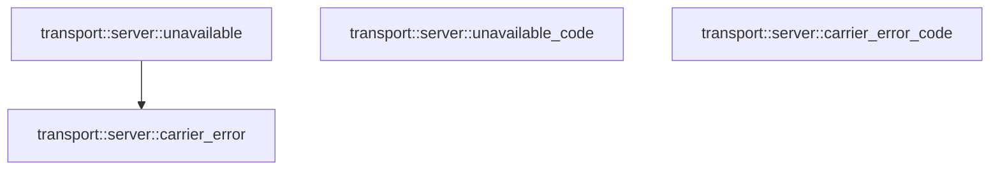

```mermaid
flowchart TD
  n0["endpoint::host::DurableHandoffSignal::new"]
  n1["endpoint::mux::SessionMuxGeneration::new"]
  n2["endpoint::rpc::validate_response"]
  n3["endpoint::rpc::validate_rpc_id"]
  n4["transport::server::acquire"]
  n5["transport::server::read_json_body"]
  n6["transport::server::decode_strict"]
  n7["transport::server::call_context"]
  n8["transport::server::json_response"]
  n9["transport::server::accepted_but_not_confirmed"]
  n10["transport::server::host_failure"]
  n11["transport::server::unavailable"]
  n12["transport::server::unavailable_code"]
  n13["transport::server::carrier_error_code"]
  n14["transport::server::carrier_error"]
  n15["transport::server::AccessSpan::new"]
  n16["transport::server::file_changes"]
  n17["transport::server::file_prepare"]
  n18["transport::server::file_lease"]
  n19["transport::server::file_read"]
  n20["transport::server::file_release"]
  n21["transport::server::WebClientService::router"]
  n22["transport::server::WebClientService::serve"]
  n23["transport::server::web_index"]
  n24["transport::server::web_css"]
  n25["transport::server::web_js"]
  n26["transport::server::live"]
  n27["transport::server::ready"]
  n28["transport::server::readiness_error"]
  n29["transport::server::canonical_json"]
  n30["transport::server::unary"]
  n31["transport::server::web_unary"]
  n32["transport::server::unary_inner"]
  n33["transport::server::remote_mux"]
  n34["transport::server::web_remote_mux"]
  n35["transport::server::remote_mux_inner"]
  n36["transport::server::remote_mux_loop"]
  n37["transport::web::static_response"]
  n38["transport::web::index_response"]
  n39["transport::web::index_unauthorized"]
  n16 --> n4
  n16 --> n11
  n17 --> n4
  n17 --> n11
  n17 --> n29
  n19 --> n18
  n20 --> n18
  n22 --> n21
  n23 --> n38
  n23 --> n39
  n24 --> n37
  n25 --> n37
  n26 --> n29
  n27 --> n14
  n27 --> n28
  n27 --> n29
  n28 --> n14
  n28 --> n29
  n30 --> n32
  n31 --> n32
  n32 --> n0
  n32 --> n2
  n32 --> n3
  n32 --> n4
  n32 --> n5
  n32 --> n6
  n32 --> n7
  n32 --> n8
  n32 --> n9
  n32 --> n10
  n32 --> n11
  n32 --> n12
  n32 --> n13
  n32 --> n14
  n32 --> n15
  n33 --> n35
  n34 --> n35
  n35 --> n1
  n35 --> n4
  n35 --> n11
  n35 --> n36
```

```mermaid
flowchart TD
  n0["endpoint::client_wire::client_mux_frames"]
  n1["endpoint::host::DrainSignal::new"]
  n2["schema::ijson::IJsonValue::parse"]
  n3["schema::ijson::IJsonValue::parse_str"]
  n4["transport::server::send_mux"]
  n5["transport::server::send_mux_error"]
  n6["transport::server::send_mux_error_with_details"]
  n7["transport::server::close_mux_protocol"]
  n8["transport::server::acquire"]
  n9["transport::server::read_json_body"]
  n10["transport::server::decode_strict"]
  n11["transport::server::json_content_type"]
  n12["transport::server::call_context"]
  n13["transport::server::json_response"]
  n14["transport::server::accepted_but_not_confirmed"]
  n15["transport::server::host_failure"]
  n16["transport::server::fallback"]
  n17["transport::server::method_not_allowed"]
  n18["transport::server::request_security"]
  n19["transport::server::web_request_security"]
  n20["transport::server::is_api_path"]
  n21["transport::server::is_web_data_path"]
  n22["transport::server::unauthorized"]
  n23["transport::server::unavailable"]
  n24["transport::server::unavailable_code"]
  n25["transport::server::carrier_error"]
  n26["transport::server::remote_mux_loop"]
  n4 --> n0
  n5 --> n6
  n6 --> n3
  n6 --> n4
  n7 --> n5
  n8 --> n25
  n9 --> n11
  n9 --> n25
  n10 --> n2
  n12 --> n1
  n13 --> n25
  n14 --> n2
  n15 --> n23
  n15 --> n24
  n15 --> n25
  n16 --> n25
  n17 --> n25
  n18 --> n20
  n18 --> n22
  n18 --> n25
  n19 --> n21
  n19 --> n22
  n19 --> n25
  n22 --> n25
  n26 --> n4
```

# transport::server

[Package atlas](index.md) · [Source](../../src/server.rs)

## Declarations

Visibility is the declaration spelling; trait members and reexports require their enclosing interface. `cfg` is not evaluated.

| Symbol | Kind | Visibility | Test / cfg |
|---|---|---|---|
| [transport::server::MAX_REQUEST_BYTES](../../src/server.rs#L36) | const_item | `pub` |  |
| [transport::server::DRAIN_ANNOUNCEMENT_INTERVAL](../../src/server.rs#L41) | const_item | `private` |  |
| [transport::server::ROUTE_REGISTRY](../../src/server.rs#L43) | const_item | `pub` |  |
| [transport::server::TransportLimits](../../src/server.rs#L61) | struct_item | `pub` |  |
| [transport::server::TransportLimits::default](../../src/server.rs#L70) | function_item | `private` |  |
| [transport::server::OriginPolicy](../../src/server.rs#L82) | struct_item | `pub` |  |
| [transport::server::OriginPolicy::permits](../../src/server.rs#L85) | function_item | `private` |  |
| [transport::server::TransportConfig](../../src/server.rs#L91) | struct_item | `pub` |  |
| [transport::server::ReadinessIdentity](../../src/server.rs#L101) | struct_item | `private` |  |
| [transport::server::TransportConfig::loopback](../../src/server.rs#L108) | function_item | `pub` |  |
| [transport::server::TransportConfig::with_access_log](../../src/server.rs#L120) | function_item | `pub` |  |
| [transport::server::TransportConfig::with_readiness_identity](../../src/server.rs#L129) | function_item | `pub` |  |
| [transport::server::TransportConfig::validate](../../src/server.rs#L137) | function_item | `pub` |  |
| [transport::server::Shared](../../src/server.rs#L161) | struct_item | `private` |  |
| [transport::server::WebShared](../../src/server.rs#L175) | struct_item | `private` |  |
| [transport::server::AccessSpan](../../src/server.rs#L180) | struct_item | `private` |  |
| [transport::server::AccessSpan::new](../../src/server.rs#L189) | function_item | `private` |  |
| [transport::server::AccessSpan::bind_rpc_id](../../src/server.rs#L202) | function_item | `private` |  |
| [transport::server::AccessSpan::finish](../../src/server.rs#L206) | function_item | `private` |  |
| [transport::server::TransportHandle](../../src/server.rs#L225) | struct_item | `pub` |  |
| [transport::server::TransportHandle::begin_drain](../../src/server.rs#L231) | function_item | `pub` |  |
| [transport::server::TransportHandle::is_draining](../../src/server.rs#L237) | function_item | `pub` |  |
| [transport::server::TransportServer](../../src/server.rs#L242) | struct_item | `pub` |  |
| [transport::server::FileTransferAuthority](../../src/server.rs#L248) | trait_item | `pub` |  |
| [transport::server::FileTransferAuthority::prepare](../../src/server.rs#L249) | function_signature_item | `private` |  |
| [transport::server::FileTransferAuthority::read](../../src/server.rs#L250) | function_signature_item | `private` |  |
| [transport::server::FileTransferAuthority::release](../../src/server.rs#L251) | function_signature_item | `private` |  |
| [transport::server::FileChangeFeed](../../src/server.rs#L254) | trait_item | `pub` |  |
| [transport::server::FileChangeFeed::poll](../../src/server.rs#L255) | function_signature_item | `private` |  |
| [transport::server::FileChangeAuthority](../../src/server.rs#L258) | trait_item | `pub` |  |
| [transport::server::FileChangeAuthority::open](../../src/server.rs#L259) | function_signature_item | `private` |  |
| [transport::server::WebClientConfig](../../src/server.rs#L263) | struct_item | `pub` |  |
| [transport::server::WebClientConfig::loopback](../../src/server.rs#L269) | function_item | `pub` |  |
| [transport::server::WebClientConfig::validate](../../src/server.rs#L273) | function_item | `private` |  |
| [transport::server::WebClientService](../../src/server.rs#L287) | struct_item | `pub` |  |
| [transport::server::TransportServer::new](../../src/server.rs#L293) | function_item | `pub` |  |
| [transport::server::TransportServer::with_file_transfer](../../src/server.rs#L340) | function_item | `pub` |  |
| [transport::server::TransportServer::set_file_changes](../../src/server.rs#L347) | function_item | `pub` |  |
| [transport::server::TransportServer::handle](../../src/server.rs#L354) | function_item | `pub` |  |
| [transport::server::TransportServer::router](../../src/server.rs#L360) | function_item | `pub` |  |
| [transport::server::TransportServer::web_client](../../src/server.rs#L383) | function_item | `pub` |  |
| [transport::server::TransportServer::serve](../../src/server.rs#L397) | function_item | `pub` |  |
| [transport::server::FileChangesQuery](../../src/server.rs#L430) | struct_item | `private` |  |
| [transport::server::file_changes](../../src/server.rs#L434) | function_item | `private` |  |
| [transport::server::file_prepare](../../src/server.rs#L483) | function_item | `private` |  |
| [transport::server::file_lease](../../src/server.rs#L519) | function_item | `private` |  |
| [transport::server::file_read](../../src/server.rs#L532) | function_item | `private` |  |
| [transport::server::file_release](../../src/server.rs#L554) | function_item | `private` |  |
| [transport::server::WebClientService::router](../../src/server.rs#L566) | function_item | `pub` |  |
| [transport::server::WebClientService::serve](../../src/server.rs#L581) | function_item | `pub` |  |
| [transport::server::web_index](../../src/server.rs#L609) | function_item | `private` |  |
| [transport::server::web_css](../../src/server.rs#L617) | function_item | `private` |  |
| [transport::server::web_js](../../src/server.rs#L621) | function_item | `private` |  |
| [transport::server::live](../../src/server.rs#L625) | function_item | `private` |  |
| [transport::server::ready](../../src/server.rs#L633) | function_item | `private` |  |
| [transport::server::readiness_error](../../src/server.rs#L660) | function_item | `private` |  |
| [transport::server::canonical_json](../../src/server.rs#L674) | function_item | `private` |  |
| [transport::server::unary](../../src/server.rs#L685) | function_item | `private` |  |
| [transport::server::web_unary](../../src/server.rs#L693) | function_item | `private` |  |
| [transport::server::unary_inner](../../src/server.rs#L701) | function_item | `private` |  |
| [transport::server::remote_mux](../../src/server.rs#L795) | function_item | `private` |  |
| [transport::server::web_remote_mux](../../src/server.rs#L799) | function_item | `private` |  |
| [transport::server::remote_mux_inner](../../src/server.rs#L806) | function_item | `private` |  |
| [transport::server::remote_mux_loop](../../src/server.rs#L828) | function_item | `private` |  |
| [transport::server::send_mux](../../src/server.rs#L1060) | function_item | `private` |  |
| [transport::server::send_mux_error](../../src/server.rs#L1075) | function_item | `private` |  |
| [transport::server::send_mux_error_with_details](../../src/server.rs#L1086) | function_item | `private` |  |
| [transport::server::close_mux_protocol](../../src/server.rs#L1112) | function_item | `private` |  |
| [transport::server::acquire](../../src/server.rs#L1132) | function_item | `private` |  |
| [transport::server::read_json_body](../../src/server.rs#L1142) | function_item | `private` |  |
| [transport::server::decode_strict](../../src/server.rs#L1170) | function_item | `private` |  |
| [transport::server::json_content_type](../../src/server.rs#L1175) | function_item | `private` |  |
| [transport::server::call_context](../../src/server.rs#L1187) | function_item | `private` |  |
| [transport::server::json_response](../../src/server.rs#L1195) | function_item | `private` |  |
| [transport::server::accepted_but_not_confirmed](../../src/server.rs#L1211) | function_item | `private` |  |
| [transport::server::host_failure](../../src/server.rs#L1233) | function_item | `private` |  |
| [transport::server::fallback](../../src/server.rs#L1261) | function_item | `private` |  |
| [transport::server::method_not_allowed](../../src/server.rs#L1277) | function_item | `private` |  |
| [transport::server::request_security](../../src/server.rs#L1285) | function_item | `private` |  |
| [transport::server::web_request_security](../../src/server.rs#L1306) | function_item | `private` |  |
| [transport::server::is_api_path](../../src/server.rs#L1324) | function_item | `private` |  |
| [transport::server::is_web_data_path](../../src/server.rs#L1328) | function_item | `private` |  |
| [transport::server::unauthorized](../../src/server.rs#L1332) | function_item | `private` |  |
| [transport::server::unavailable](../../src/server.rs#L1340) | function_item | `private` |  |
| [transport::server::unavailable_code](../../src/server.rs#L1356) | function_item | `private` |  |
| [transport::server::carrier_error_code](../../src/server.rs#L1364) | function_item | `private` |  |
| [transport::server::carrier_error](../../src/server.rs#L1379) | function_item | `private` |  |
| [transport::server::carrier_error::ErrorBody](../../src/server.rs#L1381) | struct_item | `private` |  |
| [transport::server::carrier_error::ErrorValue](../../src/server.rs#L1385) | struct_item | `private` |  |
| [transport::server::carrier_error::EmptyDetails](../../src/server.rs#L1391) | struct_item | `private` |  |
| [transport::server::TransportConfigError](../../src/server.rs#L1410) | enum_item | `pub` |  |

## Imports / reexports

| Local name | Source path | Visibility |
|---|---|---|
| `BTreeMap` | `std::collections::BTreeMap` | `private` |
| `BTreeSet` | `std::collections::BTreeSet` | `private` |
| `IpAddr` | `std::net::IpAddr` | `private` |
| `SocketAddr` | `std::net::SocketAddr` | `private` |
| `Arc` | `std::sync::Arc` | `private` |
| `AtomicBool` | `std::sync::atomic::AtomicBool` | `private` |
| `AtomicU64` | `std::sync::atomic::AtomicU64` | `private` |
| `Ordering` | `std::sync::atomic::Ordering` | `private` |
| `Duration` | `std::time::Duration` | `private` |
| `Instant` | `std::time::Instant` | `private` |
| `Router` | `axum::Router` | `private` |
| `Body` | `axum::body::Body` | `private` |
| `CloseFrame` | `axum::extract::ws::CloseFrame` | `private` |
| `Message` | `axum::extract::ws::Message` | `private` |
| `WebSocket` | `axum::extract::ws::WebSocket` | `private` |
| `WebSocketUpgrade` | `axum::extract::ws::WebSocketUpgrade` | `private` |
| `Path` | `axum::extract::Path` | `private` |
| `Request` | `axum::extract::Request` | `private` |
| `State` | `axum::extract::State` | `private` |
| `CONTENT_TYPE` | `axum::http::header::CONTENT_TYPE` | `private` |
| `ORIGIN` | `axum::http::header::ORIGIN` | `private` |
| `HeaderMap` | `axum::http::HeaderMap` | `private` |
| `Method` | `axum::http::Method` | `private` |
| `StatusCode` | `axum::http::StatusCode` | `private` |
| `middleware` | `axum::middleware` | `private` |
| `Next` | `axum::middleware::Next` | `private` |
| `IntoResponse` | `axum::response::IntoResponse` | `private` |
| `Response` | `axum::response::Response` | `private` |
| `get` | `axum::routing::get` | `private` |
| `post` | `axum::routing::post` | `private` |
| `CallContext` | `endpoint::CallContext` | `private` |
| `ClientRequest` | `endpoint::ClientRequest` | `private` |
| `DrainSignal` | `endpoint::DrainSignal` | `private` |
| `DurableHandoffSignal` | `endpoint::DurableHandoffSignal` | `private` |
| `EndpointCarrierHost` | `endpoint::EndpointCarrierHost` | `private` |
| `HostFailure` | `endpoint::HostFailure` | `private` |
| `HostReadiness` | `endpoint::HostReadiness` | `private` |
| `MethodClass` | `endpoint::MethodClass` | `private` |
| `RpcError` | `endpoint::RpcError` | `private` |
| `RpcResult` | `endpoint::RpcResult` | `private` |
| `ServerResponse` | `endpoint::ServerResponse` | `private` |
| `SessionErrorCategory` | `endpoint::SessionErrorCategory` | `private` |
| `SessionMuxClientFrame` | `endpoint::SessionMuxClientFrame` | `private` |
| `SessionMuxGeneration` | `endpoint::SessionMuxGeneration` | `private` |
| `SessionMuxServerFrame` | `endpoint::SessionMuxServerFrame` | `private` |
| `SessionRemoteError` | `endpoint::SessionRemoteError` | `private` |
| `StreamErrorCode` | `endpoint::StreamErrorCode` | `private` |
| `validate_response` | `endpoint::validate_response` | `private` |
| `validate_rpc_id` | `endpoint::validate_rpc_id` | `private` |
| `IJsonValue` | `schema::IJsonValue` | `private` |
| `Serialize` | `serde::Serialize` | `private` |
| `DeserializeOwned` | `serde::de::DeserializeOwned` | `private` |
| `Error` | `thiserror::Error` | `private` |
| `TcpListener` | `tokio::net::TcpListener` | `private` |
| `OwnedSemaphorePermit` | `tokio::sync::OwnedSemaphorePermit` | `private` |
| `Semaphore` | `tokio::sync::Semaphore` | `private` |
| `mpsc` | `tokio::sync::mpsc` | `private` |
| `watch` | `tokio::sync::watch` | `private` |
| `JoinHandle` | `tokio::task::JoinHandle` | `private` |
| `sleep` | `tokio::time::sleep` | `private` |
| `timeout` | `tokio::time::timeout` | `private` |
| `APP_CSS` | `crate::web::APP_CSS` | `private` |
| `APP_JS` | `crate::web::APP_JS` | `private` |
| `BrowserAccess` | `crate::web::BrowserAccess` | `private` |
| `index_response` | `crate::web::index_response` | `private` |
| `index_unauthorized` | `crate::web::index_unauthorized` | `private` |
| `static_response` | `crate::web::static_response` | `private` |
| `AccessLogRecord` | `crate::AccessLogRecord` | `private` |
| `AccessLogSink` | `crate::AccessLogSink` | `private` |
| `BearerToken` | `crate::BearerToken` | `private` |

## Module declarations

| Module | Visibility | Attributes |
|---|---|---|

## Function call graphs

Edges below are syntactically resolved calls only, including private functions. Graphs partition callers into groups of 20; they are not execution order. All unresolved sites are listed below and in the JSON inventory.

Functions 1–20: 3 direct edges

Functions 21–40: 41 direct edges

Functions 41–60: 25 direct edges

Functions 61–64: 1 direct edges

## Call sites

Includes test functions (marked in declarations). Receiver-type-required sites need type analysis/manual tracing. Calls in closures are attributed to their enclosing function; their occurrence here does not mean the closure executes immediately.

| Caller | Callee expression | Source lines | Target / classification |
|---|---|---|---|
| `DRAIN_ANNOUNCEMENT_INTERVAL` | `Duration::from_millis` | [41](../../src/server.rs#L41) | external-constructor-callback-or-unresolved |
| `default` | `Duration::from_secs` | [75](../../src/server.rs#L75), [76](../../src/server.rs#L76) | external-constructor-callback-or-unresolved |
| `permits` | `headers.contains_key` | [86](../../src/server.rs#L86) | receiver-type-required |
| `loopback` | `TransportLimits::default` | [111](../../src/server.rs#L111) | external-constructor-callback-or-unresolved |
| `loopback` | `crate::access::noop` | [114](../../src/server.rs#L114) | [transport::access::noop](../../src/access.rs#L34) |
| `with_readiness_identity` | `Some` | [130](../../src/server.rs#L130) | external-constructor-callback-or-unresolved |
| `with_readiness_identity` | `build.into` | [131](../../src/server.rs#L131) | receiver-type-required |
| `validate` | `self.bind.ip().is_loopback` | [138](../../src/server.rs#L138) | receiver-type-required |
| `validate` | `self.bind.ip` | [138](../../src/server.rs#L138), [139](../../src/server.rs#L139) | receiver-type-required |
| `validate` | `Err` | [139](../../src/server.rs#L139), [146](../../src/server.rs#L146), [155](../../src/server.rs#L155) | external-constructor-callback-or-unresolved |
| `validate` | `TransportConfigError::NonLoopback` | [139](../../src/server.rs#L139) | external-constructor-callback-or-unresolved |
| `validate` | `self             .readiness_identity             .as_ref()             .is_some_and` | [141](../../src/server.rs#L141) | receiver-type-required |
| `validate` | `self             .readiness_identity             .as_ref` | [141](../../src/server.rs#L141) | receiver-type-required |
| `validate` | `identity.build.is_empty` | [144](../../src/server.rs#L144) | receiver-type-required |
| `validate` | `Duration::from_secs` | [152](../../src/server.rs#L152), [153](../../src/server.rs#L153) | external-constructor-callback-or-unresolved |
| `validate` | `Ok` | [157](../../src/server.rs#L157) | external-constructor-callback-or-unresolved |
| `new` | `shared             .next_transport_request             .fetch_add` | [190](../../src/server.rs#L190) | receiver-type-required |
| `new` | `Instant::now` | [195](../../src/server.rs#L195) | external-constructor-callback-or-unresolved |
| `new` | `operation.to_owned` | [197](../../src/server.rs#L197) | receiver-type-required |
| `new` | `path.to_owned` | [198](../../src/server.rs#L198) | receiver-type-required |
| `bind_rpc_id` | `rpc_id.to_owned` | [203](../../src/server.rs#L203) | receiver-type-required |
| `finish` | `self.started.elapsed().as_millis` | [207](../../src/server.rs#L207) | receiver-type-required |
| `finish` | `self.started.elapsed` | [207](../../src/server.rs#L207) | receiver-type-required |
| `finish` | `u64::try_from(elapsed)             .unwrap_or(9_007_199_254_740_991)             .min` | [208](../../src/server.rs#L208) | receiver-type-required |
| `finish` | `u64::try_from(elapsed)             .unwrap_or` | [208](../../src/server.rs#L208) | receiver-type-required |
| `finish` | `u64::try_from` | [208](../../src/server.rs#L208) | external-constructor-callback-or-unresolved |
| `finish` | `self.shared.config.access_log.record` | [211](../../src/server.rs#L211) | receiver-type-required |
| `finish` | `self.request_id.clone` | [213](../../src/server.rs#L213) | receiver-type-required |
| `finish` | `self.operation.clone` | [214](../../src/server.rs#L214) | receiver-type-required |
| `finish` | `self.path.clone` | [215](../../src/server.rs#L215) | receiver-type-required |
| `finish` | `response.status().as_u16` | [216](../../src/server.rs#L216) | receiver-type-required |
| `finish` | `response.status` | [216](../../src/server.rs#L216) | receiver-type-required |
| `finish` | `error_code.map` | [218](../../src/server.rs#L218) | receiver-type-required |
| `begin_drain` | `self.shared.draining.store` | [232](../../src/server.rs#L232) | receiver-type-required |
| `begin_drain` | `self.shared.drain.send_replace` | [233](../../src/server.rs#L233) | receiver-type-required |
| `is_draining` | `self.shared.draining.load` | [238](../../src/server.rs#L238) | receiver-type-required |
| `validate` | `self.bind.ip().is_loopback` | [274](../../src/server.rs#L274) | receiver-type-required |
| `validate` | `self.bind.ip` | [274](../../src/server.rs#L274), [275](../../src/server.rs#L275) | receiver-type-required |
| `validate` | `Err` | [275](../../src/server.rs#L275) | external-constructor-callback-or-unresolved |
| `validate` | `TransportConfigError::NonLoopback` | [275](../../src/server.rs#L275) | external-constructor-callback-or-unresolved |
| `validate` | `Ok` | [277](../../src/server.rs#L277) | external-constructor-callback-or-unresolved |
| `new` | `config.validate` | [297](../../src/server.rs#L297) | receiver-type-required |
| `new` | `ROUTE_REGISTRY.iter().map(ToString::to_string).collect` | [298](../../src/server.rs#L298) | receiver-type-required |
| `new` | `ROUTE_REGISTRY.iter().map` | [298](../../src/server.rs#L298) | receiver-type-required |
| `new` | `ROUTE_REGISTRY.iter` | [298](../../src/server.rs#L298) | receiver-type-required |
| `new` | `host.advertised_extension_methods` | [299](../../src/server.rs#L299) | receiver-type-required |
| `new` | `expected.intersection(&extensions).next` | [300](../../src/server.rs#L300) | receiver-type-required |
| `new` | `expected.intersection` | [300](../../src/server.rs#L300) | receiver-type-required |
| `new` | `Err` | [301](../../src/server.rs#L301), [307](../../src/server.rs#L307), [317](../../src/server.rs#L317) | external-constructor-callback-or-unresolved |
| `new` | `TransportConfigError::ExtensionCollision` | [301](../../src/server.rs#L301) | external-constructor-callback-or-unresolved |
| `new` | `method.clone` | [301](../../src/server.rs#L301), [308](../../src/server.rs#L308) | receiver-type-required |
| `new` | `extensions             .iter()             .find` | [303](../../src/server.rs#L303) | receiver-type-required |
| `new` | `extensions             .iter` | [303](../../src/server.rs#L303) | receiver-type-required |
| `new` | `host.classify_method` | [305](../../src/server.rs#L305) | receiver-type-required |
| `new` | `TransportConfigError::InvalidExtensionRegistration` | [307](../../src/server.rs#L307) | external-constructor-callback-or-unresolved |
| `new` | `expected             .union(&extensions)             .cloned()             .collect::<BTreeSet<_>>` | [311](../../src/server.rs#L311) | receiver-type-required |
| `new` | `expected             .union(&extensions)             .cloned` | [311](../../src/server.rs#L311) | receiver-type-required |
| `new` | `expected             .union` | [311](../../src/server.rs#L311) | receiver-type-required |
| `new` | `host.registered_methods` | [315](../../src/server.rs#L315) | receiver-type-required |
| `new` | `expected.difference(&registered).cloned().collect` | [318](../../src/server.rs#L318) | receiver-type-required |
| `new` | `expected.difference(&registered).cloned` | [318](../../src/server.rs#L318) | receiver-type-required |
| `new` | `expected.difference` | [318](../../src/server.rs#L318) | receiver-type-required |
| `new` | `registered.difference(&expected).cloned().collect` | [319](../../src/server.rs#L319) | receiver-type-required |
| `new` | `registered.difference(&expected).cloned` | [319](../../src/server.rs#L319) | receiver-type-required |
| `new` | `registered.difference` | [319](../../src/server.rs#L319) | receiver-type-required |
| `new` | `Ok` | [322](../../src/server.rs#L322) | external-constructor-callback-or-unresolved |
| `new` | `Arc::new` | [323](../../src/server.rs#L323), [326](../../src/server.rs#L326), [327](../../src/server.rs#L327), [330](../../src/server.rs#L330) | external-constructor-callback-or-unresolved |
| `new` | `Semaphore::new` | [326](../../src/server.rs#L326), [327](../../src/server.rs#L327) | external-constructor-callback-or-unresolved |
| `new` | `AtomicBool::new` | [330](../../src/server.rs#L330) | external-constructor-callback-or-unresolved |
| `new` | `watch::channel` | [331](../../src/server.rs#L331) | external-constructor-callback-or-unresolved |
| `new` | `AtomicU64::new` | [332](../../src/server.rs#L332), [333](../../src/server.rs#L333) | external-constructor-callback-or-unresolved |
| `with_file_transfer` | `Arc::get_mut(&mut self.shared)             .expect` | [341](../../src/server.rs#L341) | receiver-type-required |
| `with_file_transfer` | `Arc::get_mut` | [341](../../src/server.rs#L341) | external-constructor-callback-or-unresolved |
| `with_file_transfer` | `Some` | [343](../../src/server.rs#L343) | external-constructor-callback-or-unresolved |
| `set_file_changes` | `Arc::get_mut(&mut self.shared)             .expect` | [348](../../src/server.rs#L348) | receiver-type-required |
| `set_file_changes` | `Arc::get_mut` | [348](../../src/server.rs#L348) | external-constructor-callback-or-unresolved |
| `set_file_changes` | `Some` | [350](../../src/server.rs#L350) | external-constructor-callback-or-unresolved |
| `handle` | `Arc::clone` | [356](../../src/server.rs#L356) | external-constructor-callback-or-unresolved |
| `router` | `Arc::clone` | [361](../../src/server.rs#L361), [379](../../src/server.rs#L379) | external-constructor-callback-or-unresolved |
| `router` | `Router::new()             .route("/health/live", get(live))             .route("/health/ready", get(ready))             .route("/api/remote.mux", get(remote_mux))             .route("/api/session.files.changes", get(file_changes))             .route(                 "/api/tekesWorkspace.fileTransfer/prepare",                 post(file_prepare),             )             .route("/api/tekesWorkspace.fileTransfer/read", get(file_read))             .route(                 "/api/tekesWorkspace.fileTransfer/release",                 post(file_release),             )             .route("/api/{*method}", post(unary))             .method_not_allowed_fallback(method_not_allowed)             .fallback(fallback)             .with_state(Arc::clone(&state))             .layer` | [362](../../src/server.rs#L362) | receiver-type-required |
| `router` | `Router::new()             .route("/health/live", get(live))             .route("/health/ready", get(ready))             .route("/api/remote.mux", get(remote_mux))             .route("/api/session.files.changes", get(file_changes))             .route(                 "/api/tekesWorkspace.fileTransfer/prepare",                 post(file_prepare),             )             .route("/api/tekesWorkspace.fileTransfer/read", get(file_read))             .route(                 "/api/tekesWorkspace.fileTransfer/release",                 post(file_release),             )             .route("/api/{*method}", post(unary))             .method_not_allowed_fallback(method_not_allowed)             .fallback(fallback)             .with_state` | [362](../../src/server.rs#L362) | receiver-type-required |
| `router` | `Router::new()             .route("/health/live", get(live))             .route("/health/ready", get(ready))             .route("/api/remote.mux", get(remote_mux))             .route("/api/session.files.changes", get(file_changes))             .route(                 "/api/tekesWorkspace.fileTransfer/prepare",                 post(file_prepare),             )             .route("/api/tekesWorkspace.fileTransfer/read", get(file_read))             .route(                 "/api/tekesWorkspace.fileTransfer/release",                 post(file_release),             )             .route("/api/{*method}", post(unary))             .method_not_allowed_fallback(method_not_allowed)             .fallback` | [362](../../src/server.rs#L362) | receiver-type-required |
| `router` | `Router::new()             .route("/health/live", get(live))             .route("/health/ready", get(ready))             .route("/api/remote.mux", get(remote_mux))             .route("/api/session.files.changes", get(file_changes))             .route(                 "/api/tekesWorkspace.fileTransfer/prepare",                 post(file_prepare),             )             .route("/api/tekesWorkspace.fileTransfer/read", get(file_read))             .route(                 "/api/tekesWorkspace.fileTransfer/release",                 post(file_release),             )             .route("/api/{*method}", post(unary))             .method_not_allowed_fallback` | [362](../../src/server.rs#L362) | receiver-type-required |
| `router` | `Router::new()             .route("/health/live", get(live))             .route("/health/ready", get(ready))             .route("/api/remote.mux", get(remote_mux))             .route("/api/session.files.changes", get(file_changes))             .route(                 "/api/tekesWorkspace.fileTransfer/prepare",                 post(file_prepare),             )             .route("/api/tekesWorkspace.fileTransfer/read", get(file_read))             .route(                 "/api/tekesWorkspace.fileTransfer/release",                 post(file_release),             )             .route` | [362](../../src/server.rs#L362) | receiver-type-required |
| `router` | `Router::new()             .route("/health/live", get(live))             .route("/health/ready", get(ready))             .route("/api/remote.mux", get(remote_mux))             .route("/api/session.files.changes", get(file_changes))             .route(                 "/api/tekesWorkspace.fileTransfer/prepare",                 post(file_prepare),             )             .route("/api/tekesWorkspace.fileTransfer/read", get(file_read))             .route` | [362](../../src/server.rs#L362) | receiver-type-required |
| `router` | `Router::new()             .route("/health/live", get(live))             .route("/health/ready", get(ready))             .route("/api/remote.mux", get(remote_mux))             .route("/api/session.files.changes", get(file_changes))             .route(                 "/api/tekesWorkspace.fileTransfer/prepare",                 post(file_prepare),             )             .route` | [362](../../src/server.rs#L362) | receiver-type-required |
| `router` | `Router::new()             .route("/health/live", get(live))             .route("/health/ready", get(ready))             .route("/api/remote.mux", get(remote_mux))             .route("/api/session.files.changes", get(file_changes))             .route` | [362](../../src/server.rs#L362) | receiver-type-required |
| `router` | `Router::new()             .route("/health/live", get(live))             .route("/health/ready", get(ready))             .route("/api/remote.mux", get(remote_mux))             .route` | [362](../../src/server.rs#L362) | receiver-type-required |
| `router` | `Router::new()             .route("/health/live", get(live))             .route("/health/ready", get(ready))             .route` | [362](../../src/server.rs#L362) | receiver-type-required |
| `router` | `Router::new()             .route("/health/live", get(live))             .route` | [362](../../src/server.rs#L362) | receiver-type-required |
| `router` | `Router::new()             .route` | [362](../../src/server.rs#L362) | receiver-type-required |
| `router` | `Router::new` | [362](../../src/server.rs#L362) | external-constructor-callback-or-unresolved |
| `router` | `get` | [363](../../src/server.rs#L363), [364](../../src/server.rs#L364), [365](../../src/server.rs#L365), [366](../../src/server.rs#L366), [371](../../src/server.rs#L371) | external-constructor-callback-or-unresolved |
| `router` | `post` | [369](../../src/server.rs#L369), [374](../../src/server.rs#L374), [376](../../src/server.rs#L376) | external-constructor-callback-or-unresolved |
| `router` | `middleware::from_fn_with_state` | [380](../../src/server.rs#L380) | external-constructor-callback-or-unresolved |
| `web_client` | `config.validate` | [387](../../src/server.rs#L387) | receiver-type-required |
| `web_client` | `Ok` | [388](../../src/server.rs#L388) | external-constructor-callback-or-unresolved |
| `web_client` | `Arc::new` | [389](../../src/server.rs#L389) | external-constructor-callback-or-unresolved |
| `web_client` | `Arc::clone` | [390](../../src/server.rs#L390) | external-constructor-callback-or-unresolved |
| `web_client` | `BrowserAccess::new` | [391](../../src/server.rs#L391) | [transport::web::BrowserAccess::new](../../src/web.rs#L26) |
| `serve` | `listener.local_addr` | [398](../../src/server.rs#L398) | receiver-type-required |
| `serve` | `actual.ip().is_loopback` | [399](../../src/server.rs#L399) | receiver-type-required |
| `serve` | `actual.ip` | [399](../../src/server.rs#L399), [400](../../src/server.rs#L400), [403](../../src/server.rs#L403) | receiver-type-required |
| `serve` | `Err` | [400](../../src/server.rs#L400), [406](../../src/server.rs#L406) | external-constructor-callback-or-unresolved |
| `serve` | `TransportConfigError::NonLoopback` | [400](../../src/server.rs#L400) | external-constructor-callback-or-unresolved |
| `serve` | `configured.ip` | [403](../../src/server.rs#L403) | receiver-type-required |
| `serve` | `configured.port` | [404](../../src/server.rs#L404) | receiver-type-required |
| `serve` | `actual.port` | [404](../../src/server.rs#L404) | receiver-type-required |
| `serve` | `self.router` | [408](../../src/server.rs#L408) | [transport::server::TransportServer::router](../../src/server.rs#L360) |
| `serve` | `Arc::clone` | [409](../../src/server.rs#L409) | external-constructor-callback-or-unresolved |
| `serve` | `axum::serve(listener, router)             .with_graceful_shutdown` | [410](../../src/server.rs#L410) | receiver-type-required |
| `serve` | `axum::serve` | [410](../../src/server.rs#L410) | external-constructor-callback-or-unresolved |
| `serve` | `shared.drain.subscribe` | [412](../../src/server.rs#L412) | receiver-type-required |
| `serve` | `drain.borrow` | [413](../../src/server.rs#L413) | receiver-type-required |
| `serve` | `drain.changed().await.is_err` | [414](../../src/server.rs#L414) | receiver-type-required |
| `serve` | `drain.changed` | [414](../../src/server.rs#L414) | receiver-type-required |
| `serve` | `sleep` | [421](../../src/server.rs#L421) | external-constructor-callback-or-unresolved |
| `serve` | `Ok` | [424](../../src/server.rs#L424) | external-constructor-callback-or-unresolved |
| `file_changes` | `shared.file_changes.clone` | [439](../../src/server.rs#L439) | receiver-type-required |
| `file_changes` | `StatusCode::NOT_FOUND.into_response` | [440](../../src/server.rs#L440) | receiver-type-required |
| `file_changes` | `shared.draining.load` | [442](../../src/server.rs#L442) | receiver-type-required |
| `file_changes` | `shared.host.readiness` | [442](../../src/server.rs#L442) | receiver-type-required |
| `file_changes` | `unavailable` | [443](../../src/server.rs#L443) | [transport::server::unavailable](../../src/server.rs#L1340) |
| `file_changes` | `acquire` | [445](../../src/server.rs#L445) | [transport::server::acquire](../../src/server.rs#L1132) |
| `file_changes` | `tokio::task::spawn_blocking` | [449](../../src/server.rs#L449) | external-constructor-callback-or-unresolved |
| `file_changes` | `authority.open` | [449](../../src/server.rs#L449) | receiver-type-required |
| `file_changes` | `StatusCode::BAD_REQUEST.into_response` | [451](../../src/server.rs#L451) | receiver-type-required |
| `file_changes` | `upgrade.on_upgrade(move &#124;mut socket&#124; async move {         let _permit = permit;         let mut feed = feed;         let mut drain = shared.drain.subscribe();         let mut interval = tokio::time::interval(Duration::from_millis(250));         loop {             tokio::select! {                 _ = drain.changed() => break,                 message = socket.recv() => match message {                     Some(Ok(Message::Ping(bytes))) => { if socket.send(Message::Pong(bytes)).await.is_err() { break; } },                     Some(Ok(Message::Pong(_))) => {},                     _ => break,                 },                 _ = interval.tick() => {                     let result = tokio::task::spawn_blocking(move &#124;&#124; { let result = feed.poll(); (feed, result) }).await;                     let Ok((returned, Ok(frames))) = result else { break; };                     feed = returned;                     let mut failed = false;                     for frame in frames {                         let Ok(encoded) = serde_json::to_string(&frame) else { failed = true; break; };                         if socket.send(Message::Text(encoded.into())).await.is_err() { failed = true; break; }                     }                     if failed { break; }                 }             }         }         let _ = socket.send(Message::Close(None)).await;     }).into_response` | [453](../../src/server.rs#L453) | receiver-type-required |
| `file_changes` | `upgrade.on_upgrade` | [453](../../src/server.rs#L453) | receiver-type-required |
| `file_changes` | `shared.drain.subscribe` | [456](../../src/server.rs#L456) | receiver-type-required |
| `file_changes` | `tokio::time::interval` | [457](../../src/server.rs#L457) | external-constructor-callback-or-unresolved |
| `file_changes` | `Duration::from_millis` | [457](../../src/server.rs#L457) | external-constructor-callback-or-unresolved |
| `file_changes` | `socket.send` | [479](../../src/server.rs#L479) | receiver-type-required |
| `file_changes` | `Message::Close` | [479](../../src/server.rs#L479) | external-constructor-callback-or-unresolved |
| `file_prepare` | `shared.file_transfer.clone` | [484](../../src/server.rs#L484) | receiver-type-required |
| `file_prepare` | `StatusCode::NOT_FOUND.into_response` | [485](../../src/server.rs#L485) | receiver-type-required |
| `file_prepare` | `shared.draining.load` | [487](../../src/server.rs#L487) | receiver-type-required |
| `file_prepare` | `shared.host.readiness` | [487](../../src/server.rs#L487) | receiver-type-required |
| `file_prepare` | `unavailable` | [488](../../src/server.rs#L488) | [transport::server::unavailable](../../src/server.rs#L1340) |
| `file_prepare` | `acquire` | [490](../../src/server.rs#L490) | [transport::server::acquire](../../src/server.rs#L1132) |
| `file_prepare` | `timeout` | [494](../../src/server.rs#L494), [512](../../src/server.rs#L512) | external-constructor-callback-or-unresolved |
| `file_prepare` | `axum::body::to_bytes` | [496](../../src/server.rs#L496) | external-constructor-callback-or-unresolved |
| `file_prepare` | `request.into_body` | [496](../../src/server.rs#L496) | receiver-type-required |
| `file_prepare` | `StatusCode::BAD_REQUEST.into_response` | [501](../../src/server.rs#L501), [505](../../src/server.rs#L505), [514](../../src/server.rs#L514) | receiver-type-required |
| `file_prepare` | `serde_json::from_slice` | [503](../../src/server.rs#L503) | external-constructor-callback-or-unresolved |
| `file_prepare` | `tokio::task::spawn_blocking` | [508](../../src/server.rs#L508) | external-constructor-callback-or-unresolved |
| `file_prepare` | `authority.prepare` | [510](../../src/server.rs#L510) | receiver-type-required |
| `file_prepare` | `canonical_json` | [513](../../src/server.rs#L513) | [transport::server::canonical_json](../../src/server.rs#L674) |
| `file_prepare` | `StatusCode::SERVICE_UNAVAILABLE.into_response` | [515](../../src/server.rs#L515) | receiver-type-required |
| `file_lease` | `headers         .get("X-Tekes-File-Lease")?         .to_str()         .ok()         .filter` | [520](../../src/server.rs#L520) | receiver-type-required |
| `file_lease` | `headers         .get("X-Tekes-File-Lease")?         .to_str()         .ok` | [520](../../src/server.rs#L520) | receiver-type-required |
| `file_lease` | `headers         .get("X-Tekes-File-Lease")?         .to_str` | [520](../../src/server.rs#L520) | receiver-type-required |
| `file_lease` | `headers         .get` | [520](../../src/server.rs#L520) | receiver-type-required |
| `file_lease` | `id.len` | [525](../../src/server.rs#L525) | receiver-type-required |
| `file_lease` | `id                     .bytes()                     .all` | [526](../../src/server.rs#L526) | receiver-type-required |
| `file_lease` | `id                     .bytes` | [526](../../src/server.rs#L526) | receiver-type-required |
| `file_lease` | `b.is_ascii_alphanumeric` | [528](../../src/server.rs#L528) | receiver-type-required |
| `file_read` | `StatusCode::NOT_FOUND.into_response` | [534](../../src/server.rs#L534), [550](../../src/server.rs#L550) | receiver-type-required |
| `file_read` | `file_lease` | [536](../../src/server.rs#L536) | [transport::server::file_lease](../../src/server.rs#L519) |
| `file_read` | `StatusCode::BAD_REQUEST.into_response` | [537](../../src/server.rs#L537) | receiver-type-required |
| `file_read` | `authority.read` | [539](../../src/server.rs#L539) | receiver-type-required |
| `file_read` | `(             [                 (CONTENT_TYPE, "application/octet-stream"),                 (axum::http::header::CACHE_CONTROL, "no-store"),             ],             axum::body::Bytes::from_owner(bytes),         )             .into_response` | [542](../../src/server.rs#L542) | receiver-type-required |
| `file_read` | `axum::body::Bytes::from_owner` | [547](../../src/server.rs#L547) | external-constructor-callback-or-unresolved |
| `file_release` | `StatusCode::NOT_FOUND.into_response` | [556](../../src/server.rs#L556) | receiver-type-required |
| `file_release` | `file_lease` | [558](../../src/server.rs#L558) | [transport::server::file_lease](../../src/server.rs#L519) |
| `file_release` | `StatusCode::BAD_REQUEST.into_response` | [559](../../src/server.rs#L559) | receiver-type-required |
| `file_release` | `authority.release` | [561](../../src/server.rs#L561) | receiver-type-required |
| `file_release` | `StatusCode::NO_CONTENT.into_response` | [562](../../src/server.rs#L562) | receiver-type-required |
| `router` | `Arc::clone` | [567](../../src/server.rs#L567), [577](../../src/server.rs#L577) | external-constructor-callback-or-unresolved |
| `router` | `Router::new()             .route("/", get(web_index))             .route("/index.html", get(web_index))             .route("/web/assets/app.css", get(web_css))             .route("/web/assets/app.js", get(web_js))             .route("/web/remote.mux", get(web_remote_mux))             .route("/web/api/{*method}", post(web_unary))             .method_not_allowed_fallback(method_not_allowed)             .fallback(fallback)             .with_state(Arc::clone(&state))             .layer` | [568](../../src/server.rs#L568) | receiver-type-required |
| `router` | `Router::new()             .route("/", get(web_index))             .route("/index.html", get(web_index))             .route("/web/assets/app.css", get(web_css))             .route("/web/assets/app.js", get(web_js))             .route("/web/remote.mux", get(web_remote_mux))             .route("/web/api/{*method}", post(web_unary))             .method_not_allowed_fallback(method_not_allowed)             .fallback(fallback)             .with_state` | [568](../../src/server.rs#L568) | receiver-type-required |
| `router` | `Router::new()             .route("/", get(web_index))             .route("/index.html", get(web_index))             .route("/web/assets/app.css", get(web_css))             .route("/web/assets/app.js", get(web_js))             .route("/web/remote.mux", get(web_remote_mux))             .route("/web/api/{*method}", post(web_unary))             .method_not_allowed_fallback(method_not_allowed)             .fallback` | [568](../../src/server.rs#L568) | receiver-type-required |
| `router` | `Router::new()             .route("/", get(web_index))             .route("/index.html", get(web_index))             .route("/web/assets/app.css", get(web_css))             .route("/web/assets/app.js", get(web_js))             .route("/web/remote.mux", get(web_remote_mux))             .route("/web/api/{*method}", post(web_unary))             .method_not_allowed_fallback` | [568](../../src/server.rs#L568) | receiver-type-required |
| `router` | `Router::new()             .route("/", get(web_index))             .route("/index.html", get(web_index))             .route("/web/assets/app.css", get(web_css))             .route("/web/assets/app.js", get(web_js))             .route("/web/remote.mux", get(web_remote_mux))             .route` | [568](../../src/server.rs#L568) | receiver-type-required |
| `router` | `Router::new()             .route("/", get(web_index))             .route("/index.html", get(web_index))             .route("/web/assets/app.css", get(web_css))             .route("/web/assets/app.js", get(web_js))             .route` | [568](../../src/server.rs#L568) | receiver-type-required |
| `router` | `Router::new()             .route("/", get(web_index))             .route("/index.html", get(web_index))             .route("/web/assets/app.css", get(web_css))             .route` | [568](../../src/server.rs#L568) | receiver-type-required |
| `router` | `Router::new()             .route("/", get(web_index))             .route("/index.html", get(web_index))             .route` | [568](../../src/server.rs#L568) | receiver-type-required |
| `router` | `Router::new()             .route("/", get(web_index))             .route` | [568](../../src/server.rs#L568) | receiver-type-required |
| `router` | `Router::new()             .route` | [568](../../src/server.rs#L568) | receiver-type-required |
| `router` | `Router::new` | [568](../../src/server.rs#L568) | external-constructor-callback-or-unresolved |
| `router` | `get` | [569](../../src/server.rs#L569), [570](../../src/server.rs#L570), [571](../../src/server.rs#L571), [572](../../src/server.rs#L572), [573](../../src/server.rs#L573) | external-constructor-callback-or-unresolved |
| `router` | `post` | [574](../../src/server.rs#L574) | external-constructor-callback-or-unresolved |
| `router` | `middleware::from_fn_with_state` | [578](../../src/server.rs#L578) | external-constructor-callback-or-unresolved |
| `serve` | `listener.local_addr` | [582](../../src/server.rs#L582) | receiver-type-required |
| `serve` | `actual.ip().is_loopback` | [583](../../src/server.rs#L583) | receiver-type-required |
| `serve` | `actual.ip` | [583](../../src/server.rs#L583), [584](../../src/server.rs#L584), [587](../../src/server.rs#L587) | receiver-type-required |
| `serve` | `Err` | [584](../../src/server.rs#L584), [590](../../src/server.rs#L590) | external-constructor-callback-or-unresolved |
| `serve` | `TransportConfigError::NonLoopback` | [584](../../src/server.rs#L584) | external-constructor-callback-or-unresolved |
| `serve` | `configured.ip` | [587](../../src/server.rs#L587) | receiver-type-required |
| `serve` | `configured.port` | [588](../../src/server.rs#L588) | receiver-type-required |
| `serve` | `actual.port` | [588](../../src/server.rs#L588) | receiver-type-required |
| `serve` | `self.router` | [592](../../src/server.rs#L592) | [transport::server::WebClientService::router](../../src/server.rs#L566) |
| `serve` | `Arc::clone` | [593](../../src/server.rs#L593) | external-constructor-callback-or-unresolved |
| `serve` | `axum::serve(listener, router)             .with_graceful_shutdown` | [594](../../src/server.rs#L594) | receiver-type-required |
| `serve` | `axum::serve` | [594](../../src/server.rs#L594) | external-constructor-callback-or-unresolved |
| `serve` | `endpoint.drain.subscribe` | [596](../../src/server.rs#L596) | receiver-type-required |
| `serve` | `drain.borrow` | [597](../../src/server.rs#L597) | receiver-type-required |
| `serve` | `drain.changed().await.is_err` | [598](../../src/server.rs#L598) | receiver-type-required |
| `serve` | `drain.changed` | [598](../../src/server.rs#L598) | receiver-type-required |
| `serve` | `sleep` | [602](../../src/server.rs#L602) | external-constructor-callback-or-unresolved |
| `serve` | `Ok` | [605](../../src/server.rs#L605) | external-constructor-callback-or-unresolved |
| `web_index` | `shared.browser.permits_host` | [610](../../src/server.rs#L610) | receiver-type-required |
| `web_index` | `request.headers` | [610](../../src/server.rs#L610) | receiver-type-required |
| `web_index` | `index_response` | [611](../../src/server.rs#L611) | [transport::web::index_response](../../src/web.rs#L74) |
| `web_index` | `index_unauthorized` | [613](../../src/server.rs#L613) | [transport::web::index_unauthorized](../../src/web.rs#L91) |
| `web_css` | `static_response` | [618](../../src/server.rs#L618) | [transport::web::static_response](../../src/web.rs#L63) |
| `web_js` | `static_response` | [622](../../src/server.rs#L622) | [transport::web::static_response](../../src/web.rs#L63) |
| `live` | `shared.config.readiness_identity.is_some` | [626](../../src/server.rs#L626) | receiver-type-required |
| `live` | `canonical_json` | [627](../../src/server.rs#L627) | [transport::server::canonical_json](../../src/server.rs#L674) |
| `live` | `StatusCode::NO_CONTENT.into_response` | [629](../../src/server.rs#L629) | receiver-type-required |
| `ready` | `shared.draining.load` | [634](../../src/server.rs#L634) | receiver-type-required |
| `ready` | `readiness_error` | [635](../../src/server.rs#L635), [638](../../src/server.rs#L638) | [transport::server::readiness_error](../../src/server.rs#L660) |
| `ready` | `shared.host.readiness` | [636](../../src/server.rs#L636) | receiver-type-required |
| `ready` | `shared.config.readiness_identity.is_some` | [637](../../src/server.rs#L637) | receiver-type-required |
| `ready` | `carrier_error` | [640](../../src/server.rs#L640) | [transport::server::carrier_error](../../src/server.rs#L1379) |
| `ready` | `shared.config.readiness_identity.as_ref` | [646](../../src/server.rs#L646) | receiver-type-required |
| `ready` | `canonical_json` | [647](../../src/server.rs#L647) | [transport::server::canonical_json](../../src/server.rs#L674) |
| `ready` | `StatusCode::NO_CONTENT.into_response` | [656](../../src/server.rs#L656) | receiver-type-required |
| `readiness_error` | `shared.config.readiness_identity.is_some` | [661](../../src/server.rs#L661) | receiver-type-required |
| `readiness_error` | `canonical_json` | [662](../../src/server.rs#L662) | [transport::server::canonical_json](../../src/server.rs#L674) |
| `readiness_error` | `carrier_error` | [670](../../src/server.rs#L670) | [transport::server::carrier_error](../../src/server.rs#L1379) |
| `canonical_json` | `serde_json_canonicalizer::to_vec(value)         .expect` | [675](../../src/server.rs#L675) | receiver-type-required |
| `canonical_json` | `serde_json_canonicalizer::to_vec` | [675](../../src/server.rs#L675) | external-constructor-callback-or-unresolved |
| `canonical_json` | `Response::builder()         .status(status)         .header(CONTENT_TYPE, "application/json")         .header(axum::http::header::CONTENT_LENGTH, bytes.len().to_string())         .body(Body::from(bytes))         .expect` | [677](../../src/server.rs#L677) | receiver-type-required |
| `canonical_json` | `Response::builder()         .status(status)         .header(CONTENT_TYPE, "application/json")         .header(axum::http::header::CONTENT_LENGTH, bytes.len().to_string())         .body` | [677](../../src/server.rs#L677) | receiver-type-required |
| `canonical_json` | `Response::builder()         .status(status)         .header(CONTENT_TYPE, "application/json")         .header` | [677](../../src/server.rs#L677) | receiver-type-required |
| `canonical_json` | `Response::builder()         .status(status)         .header` | [677](../../src/server.rs#L677) | receiver-type-required |
| `canonical_json` | `Response::builder()         .status` | [677](../../src/server.rs#L677) | receiver-type-required |
| `canonical_json` | `Response::builder` | [677](../../src/server.rs#L677) | external-constructor-callback-or-unresolved |
| `canonical_json` | `bytes.len().to_string` | [680](../../src/server.rs#L680) | receiver-type-required |
| `canonical_json` | `bytes.len` | [680](../../src/server.rs#L680) | receiver-type-required |
| `canonical_json` | `Body::from` | [681](../../src/server.rs#L681) | external-constructor-callback-or-unresolved |
| `unary` | `unary_inner` | [690](../../src/server.rs#L690) | [transport::server::unary_inner](../../src/server.rs#L701) |
| `web_unary` | `unary_inner` | [698](../../src/server.rs#L698) | [transport::server::unary_inner](../../src/server.rs#L701) |
| `web_unary` | `Arc::clone` | [698](../../src/server.rs#L698) | external-constructor-callback-or-unresolved |
| `unary_inner` | `request.uri().path().to_owned` | [702](../../src/server.rs#L702) | receiver-type-required |
| `unary_inner` | `request.uri().path` | [702](../../src/server.rs#L702) | receiver-type-required |
| `unary_inner` | `request.uri` | [702](../../src/server.rs#L702) | receiver-type-required |
| `unary_inner` | `AccessSpan::new` | [703](../../src/server.rs#L703) | [transport::server::AccessSpan::new](../../src/server.rs#L189) |
| `unary_inner` | `acquire` | [704](../../src/server.rs#L704) | [transport::server::acquire](../../src/server.rs#L1132) |
| `unary_inner` | `access.finish` | [706](../../src/server.rs#L706), [710](../../src/server.rs#L710), [715](../../src/server.rs#L715), [724](../../src/server.rs#L724), [730](../../src/server.rs#L730), [745](../../src/server.rs#L745), [758](../../src/server.rs#L758), [775](../../src/server.rs#L775), [779](../../src/server.rs#L779), [781](../../src/server.rs#L781), [790](../../src/server.rs#L790) | receiver-type-required |
| `unary_inner` | `Some` | [706](../../src/server.rs#L706), [710](../../src/server.rs#L710), [717](../../src/server.rs#L717), [724](../../src/server.rs#L724), [736](../../src/server.rs#L736), [751](../../src/server.rs#L751), [758](../../src/server.rs#L758), [779](../../src/server.rs#L779), [786](../../src/server.rs#L786), [790](../../src/server.rs#L790) | external-constructor-callback-or-unresolved |
| `unary_inner` | `shared.host.readiness` | [708](../../src/server.rs#L708) | receiver-type-required |
| `unary_inner` | `unavailable_code` | [709](../../src/server.rs#L709), [757](../../src/server.rs#L757), [789](../../src/server.rs#L789) | [transport::server::unavailable_code](../../src/server.rs#L1356) |
| `unary_inner` | `unavailable` | [710](../../src/server.rs#L710), [758](../../src/server.rs#L758), [790](../../src/server.rs#L790) | [transport::server::unavailable](../../src/server.rs#L1340) |
| `unary_inner` | `ROUTE_REGISTRY.contains` | [712](../../src/server.rs#L712) | receiver-type-required |
| `unary_inner` | `path_method.as_str` | [712](../../src/server.rs#L712) | receiver-type-required |
| `unary_inner` | `shared.extension_routes.contains` | [713](../../src/server.rs#L713) | receiver-type-required |
| `unary_inner` | `carrier_error` | [716](../../src/server.rs#L716), [731](../../src/server.rs#L731), [746](../../src/server.rs#L746) | [transport::server::carrier_error](../../src/server.rs#L1379) |
| `unary_inner` | `read_json_body` | [720](../../src/server.rs#L720) | [transport::server::read_json_body](../../src/server.rs#L1142) |
| `unary_inner` | `carrier_error_code` | [723](../../src/server.rs#L723) | [transport::server::carrier_error_code](../../src/server.rs#L1364) |
| `unary_inner` | `response.status` | [723](../../src/server.rs#L723) | receiver-type-required |
| `unary_inner` | `decode_strict` | [727](../../src/server.rs#L727) | [transport::server::decode_strict](../../src/server.rs#L1170) |
| `unary_inner` | `access.bind_rpc_id` | [740](../../src/server.rs#L740) | receiver-type-required |
| `unary_inner` | `validate_rpc_id(&request.rpc_id).is_err` | [741](../../src/server.rs#L741) | receiver-type-required |
| `unary_inner` | `validate_rpc_id` | [741](../../src/server.rs#L741) | [endpoint::rpc::validate_rpc_id](../../../endpoint/src/rpc.rs#L186) |
| `unary_inner` | `shared.draining.load` | [754](../../src/server.rs#L754) | receiver-type-required |
| `unary_inner` | `shared.host.classify_method` | [755](../../src/server.rs#L755) | receiver-type-required |
| `unary_inner` | `DurableHandoffSignal::new` | [760](../../src/server.rs#L760) | [endpoint::host::DurableHandoffSignal::new](../../../endpoint/src/host.rs#L202) |
| `unary_inner` | `call_context` | [761](../../src/server.rs#L761) | [transport::server::call_context](../../src/server.rs#L1187) |
| `unary_inner` | `handoff.clone` | [761](../../src/server.rs#L761) | receiver-type-required |
| `unary_inner` | `timeout` | [762](../../src/server.rs#L762) | external-constructor-callback-or-unresolved |
| `unary_inner` | `shared.host.unary` | [764](../../src/server.rs#L764) | receiver-type-required |
| `unary_inner` | `request.clone` | [764](../../src/server.rs#L764) | receiver-type-required |
| `unary_inner` | `drop` | [767](../../src/server.rs#L767) | external-constructor-callback-or-unresolved |
| `unary_inner` | `validate_response(&response, &request.rpc_id).is_ok` | [769](../../src/server.rs#L769) | receiver-type-required |
| `unary_inner` | `validate_response` | [769](../../src/server.rs#L769) | [endpoint::rpc::validate_response](../../../endpoint/src/rpc.rs#L159) |
| `unary_inner` | `response                 .result                 .error                 .as_ref()                 .map` | [770](../../src/server.rs#L770) | receiver-type-required |
| `unary_inner` | `response                 .result                 .error                 .as_ref` | [770](../../src/server.rs#L770) | receiver-type-required |
| `unary_inner` | `error.code.as_str` | [774](../../src/server.rs#L774) | receiver-type-required |
| `unary_inner` | `json_response` | [775](../../src/server.rs#L775), [782](../../src/server.rs#L782) | [transport::server::json_response](../../src/server.rs#L1195) |
| `unary_inner` | `host_failure` | [778](../../src/server.rs#L778) | [transport::server::host_failure](../../src/server.rs#L1233) |
| `unary_inner` | `handoff.is_durable` | [781](../../src/server.rs#L781) | receiver-type-required |
| `unary_inner` | `accepted_but_not_confirmed` | [782](../../src/server.rs#L782) | [transport::server::accepted_but_not_confirmed](../../src/server.rs#L1211) |
| `remote_mux` | `remote_mux_inner` | [796](../../src/server.rs#L796) | [transport::server::remote_mux_inner](../../src/server.rs#L806) |
| `web_remote_mux` | `remote_mux_inner` | [803](../../src/server.rs#L803) | [transport::server::remote_mux_inner](../../src/server.rs#L806) |
| `web_remote_mux` | `Arc::clone` | [803](../../src/server.rs#L803) | external-constructor-callback-or-unresolved |
| `remote_mux_inner` | `shared.draining.load` | [807](../../src/server.rs#L807) | receiver-type-required |
| `remote_mux_inner` | `shared.host.readiness` | [807](../../src/server.rs#L807) | receiver-type-required |
| `remote_mux_inner` | `unavailable` | [808](../../src/server.rs#L808), [816](../../src/server.rs#L816), [820](../../src/server.rs#L820) | [transport::server::unavailable](../../src/server.rs#L1340) |
| `remote_mux_inner` | `acquire` | [810](../../src/server.rs#L810) | [transport::server::acquire](../../src/server.rs#L1132) |
| `remote_mux_inner` | `shared.next_mux_generation.fetch_add` | [814](../../src/server.rs#L814) | receiver-type-required |
| `remote_mux_inner` | `SessionMuxGeneration::new` | [815](../../src/server.rs#L815) | [endpoint::mux::SessionMuxGeneration::new](../../../endpoint/src/mux.rs#L547) |
| `remote_mux_inner` | `shared.host.mux_description` | [818](../../src/server.rs#L818) | receiver-type-required |
| `remote_mux_inner` | `host.validate().is_ok` | [819](../../src/server.rs#L819) | receiver-type-required |
| `remote_mux_inner` | `host.validate` | [819](../../src/server.rs#L819) | receiver-type-required |
| `remote_mux_inner` | `upgrade         .max_message_size(MAX_REQUEST_BYTES + 1)         .max_frame_size(MAX_REQUEST_BYTES + 1)         .on_upgrade` | [822](../../src/server.rs#L822) | receiver-type-required |
| `remote_mux_inner` | `upgrade         .max_message_size(MAX_REQUEST_BYTES + 1)         .max_frame_size` | [822](../../src/server.rs#L822) | receiver-type-required |
| `remote_mux_inner` | `upgrade         .max_message_size` | [822](../../src/server.rs#L822) | receiver-type-required |
| `remote_mux_inner` | `remote_mux_loop` | [825](../../src/server.rs#L825) | [transport::server::remote_mux_loop](../../src/server.rs#L828) |
| `remote_mux_loop` | `generation.generation` | [836](../../src/server.rs#L836) | receiver-type-required |
| `remote_mux_loop` | `send_mux(&mut socket, &ready).await.is_err` | [839](../../src/server.rs#L839) | receiver-type-required |
| `remote_mux_loop` | `send_mux` | [839](../../src/server.rs#L839) | [transport::server::send_mux](../../src/server.rs#L1060) |
| `remote_mux_loop` | `mpsc::channel` | [842](../../src/server.rs#L842) | external-constructor-callback-or-unresolved |
| `remote_mux_loop` | `BTreeMap::<String, (u64, JoinHandle<()>)>::new` | [846](../../src/server.rs#L846) | external-constructor-callback-or-unresolved |
| `remote_mux_loop` | `shared.drain.subscribe` | [848](../../src/server.rs#L848) | receiver-type-required |
| `send_mux` | `endpoint::client_mux_frames(frame).map_err` | [1061](../../src/server.rs#L1061) | receiver-type-required |
| `send_mux` | `endpoint::client_mux_frames` | [1061](../../src/server.rs#L1061) | [endpoint::client_wire::client_mux_frames](../../../endpoint/src/client_wire.rs#L107) |
| `send_mux` | `serde_json_canonicalizer::to_vec(&frame).map_err` | [1062](../../src/server.rs#L1062) | receiver-type-required |
| `send_mux` | `serde_json_canonicalizer::to_vec` | [1062](../../src/server.rs#L1062) | external-constructor-callback-or-unresolved |
| `send_mux` | `bytes.len` | [1063](../../src/server.rs#L1063) | receiver-type-required |
| `send_mux` | `Err` | [1064](../../src/server.rs#L1064) | external-constructor-callback-or-unresolved |
| `send_mux` | `String::from_utf8(bytes).map_err` | [1066](../../src/server.rs#L1066) | receiver-type-required |
| `send_mux` | `String::from_utf8` | [1066](../../src/server.rs#L1066) | external-constructor-callback-or-unresolved |
| `send_mux` | `socket             .send(Message::Text(text.into()))             .await             .map_err` | [1067](../../src/server.rs#L1067) | receiver-type-required |
| `send_mux` | `socket             .send` | [1067](../../src/server.rs#L1067) | receiver-type-required |
| `send_mux` | `Message::Text` | [1068](../../src/server.rs#L1068) | external-constructor-callback-or-unresolved |
| `send_mux` | `text.into` | [1068](../../src/server.rs#L1068) | receiver-type-required |
| `send_mux` | `Ok` | [1072](../../src/server.rs#L1072) | external-constructor-callback-or-unresolved |
| `send_mux_error` | `send_mux_error_with_details` | [1083](../../src/server.rs#L1083) | [transport::server::send_mux_error_with_details](../../src/server.rs#L1086) |
| `send_mux_error_with_details` | `send_mux` | [1095](../../src/server.rs#L1095) | [transport::server::send_mux](../../src/server.rs#L1060) |
| `send_mux_error_with_details` | `code.to_owned` | [1102](../../src/server.rs#L1102) | receiver-type-required |
| `send_mux_error_with_details` | `message.to_owned` | [1103](../../src/server.rs#L1103) | receiver-type-required |
| `send_mux_error_with_details` | `IJsonValue::parse_str(details).map_err` | [1104](../../src/server.rs#L1104) | receiver-type-required |
| `send_mux_error_with_details` | `IJsonValue::parse_str` | [1104](../../src/server.rs#L1104) | [schema::ijson::IJsonValue::parse_str](../../../schema/src/ijson.rs#L23) |
| `close_mux_protocol` | `send_mux_error` | [1113](../../src/server.rs#L1113) | [transport::server::send_mux_error](../../src/server.rs#L1075) |
| `close_mux_protocol` | `socket         .send` | [1122](../../src/server.rs#L1122) | receiver-type-required |
| `close_mux_protocol` | `Message::Close` | [1123](../../src/server.rs#L1123) | external-constructor-callback-or-unresolved |
| `close_mux_protocol` | `Some` | [1123](../../src/server.rs#L1123) | external-constructor-callback-or-unresolved |
| `close_mux_protocol` | `StreamErrorCode::ProtocolError.close_code` | [1124](../../src/server.rs#L1124) | receiver-type-required |
| `close_mux_protocol` | `"protocol-error".into` | [1125](../../src/server.rs#L1125) | receiver-type-required |
| `acquire` | `Arc::clone(semaphore).try_acquire_owned().map_err` | [1133](../../src/server.rs#L1133) | receiver-type-required |
| `acquire` | `Arc::clone(semaphore).try_acquire_owned` | [1133](../../src/server.rs#L1133) | receiver-type-required |
| `acquire` | `Arc::clone` | [1133](../../src/server.rs#L1133) | external-constructor-callback-or-unresolved |
| `acquire` | `carrier_error` | [1134](../../src/server.rs#L1134) | [transport::server::carrier_error](../../src/server.rs#L1379) |
| `read_json_body` | `json_content_type` | [1143](../../src/server.rs#L1143) | [transport::server::json_content_type](../../src/server.rs#L1175) |
| `read_json_body` | `request.headers` | [1143](../../src/server.rs#L1143) | receiver-type-required |
| `read_json_body` | `Err` | [1144](../../src/server.rs#L1144), [1157](../../src/server.rs#L1157), [1162](../../src/server.rs#L1162) | external-constructor-callback-or-unresolved |
| `read_json_body` | `carrier_error` | [1144](../../src/server.rs#L1144), [1157](../../src/server.rs#L1157), [1162](../../src/server.rs#L1162) | [transport::server::carrier_error](../../src/server.rs#L1379) |
| `read_json_body` | `timeout` | [1150](../../src/server.rs#L1150) | external-constructor-callback-or-unresolved |
| `read_json_body` | `axum::body::to_bytes` | [1152](../../src/server.rs#L1152) | external-constructor-callback-or-unresolved |
| `read_json_body` | `request.into_body` | [1152](../../src/server.rs#L1152) | receiver-type-required |
| `read_json_body` | `Ok` | [1156](../../src/server.rs#L1156) | external-constructor-callback-or-unresolved |
| `read_json_body` | `bytes.to_vec` | [1156](../../src/server.rs#L1156) | receiver-type-required |
| `decode_strict` | `IJsonValue::parse(bytes).map_err` | [1171](../../src/server.rs#L1171) | receiver-type-required |
| `decode_strict` | `IJsonValue::parse` | [1171](../../src/server.rs#L1171) | [schema::ijson::IJsonValue::parse](../../../schema/src/ijson.rs#L16) |
| `decode_strict` | `serde_json::from_slice(bytes).map_err` | [1172](../../src/server.rs#L1172) | receiver-type-required |
| `decode_strict` | `serde_json::from_slice` | [1172](../../src/server.rs#L1172) | external-constructor-callback-or-unresolved |
| `json_content_type` | `headers         .get(CONTENT_TYPE)         .and_then(&#124;value&#124; value.to_str().ok())         .is_some_and` | [1176](../../src/server.rs#L1176) | receiver-type-required |
| `json_content_type` | `headers         .get(CONTENT_TYPE)         .and_then` | [1176](../../src/server.rs#L1176) | receiver-type-required |
| `json_content_type` | `headers         .get` | [1176](../../src/server.rs#L1176) | receiver-type-required |
| `json_content_type` | `value.to_str().ok` | [1178](../../src/server.rs#L1178) | receiver-type-required |
| `json_content_type` | `value.to_str` | [1178](../../src/server.rs#L1178) | receiver-type-required |
| `json_content_type` | `value                 .split(';')                 .next()                 .is_some_and` | [1180](../../src/server.rs#L1180) | receiver-type-required |
| `json_content_type` | `value                 .split(';')                 .next` | [1180](../../src/server.rs#L1180) | receiver-type-required |
| `json_content_type` | `value                 .split` | [1180](../../src/server.rs#L1180) | receiver-type-required |
| `json_content_type` | `mime.trim().eq_ignore_ascii_case` | [1183](../../src/server.rs#L1183) | receiver-type-required |
| `json_content_type` | `mime.trim` | [1183](../../src/server.rs#L1183) | receiver-type-required |
| `call_context` | `Instant::now` | [1189](../../src/server.rs#L1189) | external-constructor-callback-or-unresolved |
| `call_context` | `DrainSignal::new` | [1190](../../src/server.rs#L1190) | [endpoint::host::DrainSignal::new](../../../endpoint/src/host.rs#L175) |
| `call_context` | `Arc::clone` | [1190](../../src/server.rs#L1190) | external-constructor-callback-or-unresolved |
| `json_response` | `serde_json_canonicalizer::to_vec` | [1196](../../src/server.rs#L1196) | external-constructor-callback-or-unresolved |
| `json_response` | `Response::builder()             .status(StatusCode::OK)             .header(CONTENT_TYPE, "application/json")             .header("content-length", bytes.len().to_string())             .body(Body::from(bytes))             .expect` | [1197](../../src/server.rs#L1197) | receiver-type-required |
| `json_response` | `Response::builder()             .status(StatusCode::OK)             .header(CONTENT_TYPE, "application/json")             .header("content-length", bytes.len().to_string())             .body` | [1197](../../src/server.rs#L1197) | receiver-type-required |
| `json_response` | `Response::builder()             .status(StatusCode::OK)             .header(CONTENT_TYPE, "application/json")             .header` | [1197](../../src/server.rs#L1197) | receiver-type-required |
| `json_response` | `Response::builder()             .status(StatusCode::OK)             .header` | [1197](../../src/server.rs#L1197) | receiver-type-required |
| `json_response` | `Response::builder()             .status` | [1197](../../src/server.rs#L1197) | receiver-type-required |
| `json_response` | `Response::builder` | [1197](../../src/server.rs#L1197) | external-constructor-callback-or-unresolved |
| `json_response` | `bytes.len().to_string` | [1200](../../src/server.rs#L1200) | receiver-type-required |
| `json_response` | `bytes.len` | [1200](../../src/server.rs#L1200) | receiver-type-required |
| `json_response` | `Body::from` | [1201](../../src/server.rs#L1201) | external-constructor-callback-or-unresolved |
| `json_response` | `carrier_error` | [1203](../../src/server.rs#L1203) | [transport::server::carrier_error](../../src/server.rs#L1379) |
| `accepted_but_not_confirmed` | `serde_json::to_vec(&serde_json::json!({         "rpcId": rpc_id,         "operation": operation,     }))     .expect` | [1212](../../src/server.rs#L1212) | receiver-type-required |
| `accepted_but_not_confirmed` | `serde_json::to_vec` | [1212](../../src/server.rs#L1212) | external-constructor-callback-or-unresolved |
| `accepted_but_not_confirmed` | `"server-response".to_owned` | [1218](../../src/server.rs#L1218) | receiver-type-required |
| `accepted_but_not_confirmed` | `rpc_id.to_owned` | [1219](../../src/server.rs#L1219) | receiver-type-required |
| `accepted_but_not_confirmed` | `Some` | [1223](../../src/server.rs#L1223) | external-constructor-callback-or-unresolved |
| `accepted_but_not_confirmed` | `"accepted-but-not-confirmed".to_owned` | [1224](../../src/server.rs#L1224) | receiver-type-required |
| `accepted_but_not_confirmed` | `"Mutation was accepted but its receipt was not confirmed".to_owned` | [1225](../../src/server.rs#L1225) | receiver-type-required |
| `accepted_but_not_confirmed` | `IJsonValue::parse(&details)                     .expect` | [1226](../../src/server.rs#L1226) | receiver-type-required |
| `accepted_but_not_confirmed` | `IJsonValue::parse` | [1226](../../src/server.rs#L1226) | [schema::ijson::IJsonValue::parse](../../../schema/src/ijson.rs#L16) |
| `host_failure` | `carrier_error` | [1236](../../src/server.rs#L1236), [1244](../../src/server.rs#L1244) | [transport::server::carrier_error](../../src/server.rs#L1379) |
| `host_failure` | `unavailable` | [1257](../../src/server.rs#L1257) | [transport::server::unavailable](../../src/server.rs#L1340) |
| `host_failure` | `unavailable_code` | [1257](../../src/server.rs#L1257) | [transport::server::unavailable_code](../../src/server.rs#L1356) |
| `fallback` | `request.uri().path().starts_with` | [1262](../../src/server.rs#L1262) | receiver-type-required |
| `fallback` | `request.uri().path` | [1262](../../src/server.rs#L1262) | receiver-type-required |
| `fallback` | `request.uri` | [1262](../../src/server.rs#L1262) | receiver-type-required |
| `fallback` | `request.method` | [1262](../../src/server.rs#L1262) | receiver-type-required |
| `fallback` | `carrier_error` | [1268](../../src/server.rs#L1268), [1273](../../src/server.rs#L1273) | [transport::server::carrier_error](../../src/server.rs#L1379) |
| `method_not_allowed` | `carrier_error` | [1278](../../src/server.rs#L1278) | [transport::server::carrier_error](../../src/server.rs#L1379) |
| `request_security` | `is_api_path` | [1290](../../src/server.rs#L1290) | [transport::server::is_api_path](../../src/server.rs#L1324) |
| `request_security` | `request.uri().path` | [1290](../../src/server.rs#L1290) | receiver-type-required |
| `request_security` | `request.uri` | [1290](../../src/server.rs#L1290) | receiver-type-required |
| `request_security` | `next.run` | [1291](../../src/server.rs#L1291), [1303](../../src/server.rs#L1303) | receiver-type-required |
| `request_security` | `shared.config.bearer_token.authenticates` | [1293](../../src/server.rs#L1293) | receiver-type-required |
| `request_security` | `request.headers` | [1293](../../src/server.rs#L1293), [1296](../../src/server.rs#L1296) | receiver-type-required |
| `request_security` | `unauthorized` | [1294](../../src/server.rs#L1294) | [transport::server::unauthorized](../../src/server.rs#L1332) |
| `request_security` | `shared.config.origins.permits` | [1296](../../src/server.rs#L1296) | receiver-type-required |
| `request_security` | `carrier_error` | [1297](../../src/server.rs#L1297) | [transport::server::carrier_error](../../src/server.rs#L1379) |
| `web_request_security` | `shared.browser.permits_host` | [1311](../../src/server.rs#L1311) | receiver-type-required |
| `web_request_security` | `request.headers` | [1311](../../src/server.rs#L1311), [1314](../../src/server.rs#L1314) | receiver-type-required |
| `web_request_security` | `unauthorized` | [1312](../../src/server.rs#L1312) | [transport::server::unauthorized](../../src/server.rs#L1332) |
| `web_request_security` | `is_web_data_path` | [1314](../../src/server.rs#L1314) | [transport::server::is_web_data_path](../../src/server.rs#L1328) |
| `web_request_security` | `request.uri().path` | [1314](../../src/server.rs#L1314) | receiver-type-required |
| `web_request_security` | `request.uri` | [1314](../../src/server.rs#L1314) | receiver-type-required |
| `web_request_security` | `shared.browser.permits_origin` | [1314](../../src/server.rs#L1314) | receiver-type-required |
| `web_request_security` | `carrier_error` | [1315](../../src/server.rs#L1315) | [transport::server::carrier_error](../../src/server.rs#L1379) |
| `web_request_security` | `next.run` | [1321](../../src/server.rs#L1321) | receiver-type-required |
| `is_api_path` | `path.starts_with` | [1325](../../src/server.rs#L1325) | receiver-type-required |
| `is_web_data_path` | `path.starts_with` | [1329](../../src/server.rs#L1329) | receiver-type-required |
| `unauthorized` | `carrier_error` | [1333](../../src/server.rs#L1333) | [transport::server::carrier_error](../../src/server.rs#L1379) |
| `unavailable` | `shared.draining.load` | [1341](../../src/server.rs#L1341) | receiver-type-required |
| `unavailable` | `carrier_error` | [1342](../../src/server.rs#L1342), [1348](../../src/server.rs#L1348) | [transport::server::carrier_error](../../src/server.rs#L1379) |
| `unavailable_code` | `shared.draining.load` | [1357](../../src/server.rs#L1357) | receiver-type-required |
| `carrier_error` | `serde_json_canonicalizer::to_vec(&ErrorBody {         error: ErrorValue {             code,             details: EmptyDetails {},             message,         },     })     .expect` | [1393](../../src/server.rs#L1393) | receiver-type-required |
| `carrier_error` | `serde_json_canonicalizer::to_vec` | [1393](../../src/server.rs#L1393) | external-constructor-callback-or-unresolved |
| `carrier_error` | `Response::builder()         .status(status)         .header(CONTENT_TYPE, "application/json")         .header("content-length", bytes.len().to_string())         .body(Body::from(bytes))         .expect` | [1401](../../src/server.rs#L1401) | receiver-type-required |
| `carrier_error` | `Response::builder()         .status(status)         .header(CONTENT_TYPE, "application/json")         .header("content-length", bytes.len().to_string())         .body` | [1401](../../src/server.rs#L1401) | receiver-type-required |
| `carrier_error` | `Response::builder()         .status(status)         .header(CONTENT_TYPE, "application/json")         .header` | [1401](../../src/server.rs#L1401) | receiver-type-required |
| `carrier_error` | `Response::builder()         .status(status)         .header` | [1401](../../src/server.rs#L1401) | receiver-type-required |
| `carrier_error` | `Response::builder()         .status` | [1401](../../src/server.rs#L1401) | receiver-type-required |
| `carrier_error` | `Response::builder` | [1401](../../src/server.rs#L1401) | external-constructor-callback-or-unresolved |
| `carrier_error` | `bytes.len().to_string` | [1404](../../src/server.rs#L1404) | receiver-type-required |
| `carrier_error` | `bytes.len` | [1404](../../src/server.rs#L1404) | receiver-type-required |
| `carrier_error` | `Body::from` | [1405](../../src/server.rs#L1405) | external-constructor-callback-or-unresolved |
