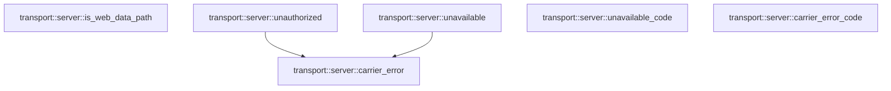

```mermaid
flowchart TD
  n0["endpoint::client_wire::client_mux_frames"]
  n1["endpoint::host::DrainSignal::new"]
  n2["endpoint::mux::SessionMuxGeneration::new"]
  n3["schema::ijson::IJsonValue::parse"]
  n4["schema::ijson::IJsonValue::parse_str"]
  n5["transport::server::send_mux"]
  n6["transport::server::send_mux_error"]
  n7["transport::server::send_mux_error_with_details"]
  n8["transport::server::close_mux_protocol"]
  n9["transport::server::acquire"]
  n10["transport::server::read_json_body"]
  n11["transport::server::decode_strict"]
  n12["transport::server::json_content_type"]
  n13["transport::server::call_context"]
  n14["transport::server::json_response"]
  n15["transport::server::accepted_but_not_confirmed"]
  n16["transport::server::host_failure"]
  n17["transport::server::fallback"]
  n18["transport::server::method_not_allowed"]
  n19["transport::server::request_security"]
  n20["transport::server::web_request_security"]
  n21["transport::server::is_api_path"]
  n22["transport::server::is_web_data_path"]
  n23["transport::server::unauthorized"]
  n24["transport::server::unavailable"]
  n25["transport::server::unavailable_code"]
  n26["transport::server::carrier_error"]
  n27["transport::server::web_remote_mux"]
  n28["transport::server::remote_mux_inner"]
  n29["transport::server::remote_mux_loop"]
  n5 --> n0
  n6 --> n7
  n7 --> n4
  n7 --> n5
  n8 --> n6
  n9 --> n26
  n10 --> n12
  n10 --> n26
  n11 --> n3
  n13 --> n1
  n14 --> n26
  n15 --> n3
  n16 --> n24
  n16 --> n25
  n16 --> n26
  n17 --> n26
  n18 --> n26
  n19 --> n21
  n19 --> n23
  n19 --> n26
  n20 --> n22
  n20 --> n23
  n20 --> n26
  n27 --> n28
  n28 --> n2
  n28 --> n9
  n28 --> n24
  n28 --> n29
  n29 --> n5
```

# transport::server

[Package atlas](index.md) · [Source](../../src/server.rs)

## Declarations

Visibility is the declaration spelling; trait members and reexports require their enclosing interface. `cfg` is not evaluated.

| Symbol | Kind | Visibility | Test / cfg |
|---|---|---|---|
| [transport::server::MAX_REQUEST_BYTES](../../src/server.rs#L36) | const_item | `pub` |  |
| [transport::server::DRAIN_ANNOUNCEMENT_INTERVAL](../../src/server.rs#L41) | const_item | `private` |  |
| [transport::server::ROUTE_REGISTRY](../../src/server.rs#L43) | const_item | `pub` |  |
| [transport::server::TransportLimits](../../src/server.rs#L61) | struct_item | `pub` |  |
| [transport::server::TransportLimits::default](../../src/server.rs#L70) | function_item | `private` |  |
| [transport::server::OriginPolicy](../../src/server.rs#L82) | struct_item | `pub` |  |
| [transport::server::OriginPolicy::permits](../../src/server.rs#L85) | function_item | `private` |  |
| [transport::server::TransportConfig](../../src/server.rs#L91) | struct_item | `pub` |  |
| [transport::server::ReadinessIdentity](../../src/server.rs#L101) | struct_item | `private` |  |
| [transport::server::TransportConfig::loopback](../../src/server.rs#L108) | function_item | `pub` |  |
| [transport::server::TransportConfig::with_access_log](../../src/server.rs#L120) | function_item | `pub` |  |
| [transport::server::TransportConfig::with_readiness_identity](../../src/server.rs#L129) | function_item | `pub` |  |
| [transport::server::TransportConfig::validate](../../src/server.rs#L137) | function_item | `pub` |  |
| [transport::server::Shared](../../src/server.rs#L161) | struct_item | `private` |  |
| [transport::server::WebShared](../../src/server.rs#L176) | struct_item | `private` |  |
| [transport::server::AccessSpan](../../src/server.rs#L181) | struct_item | `private` |  |
| [transport::server::AccessSpan::new](../../src/server.rs#L190) | function_item | `private` |  |
| [transport::server::AccessSpan::bind_rpc_id](../../src/server.rs#L203) | function_item | `private` |  |
| [transport::server::AccessSpan::finish](../../src/server.rs#L207) | function_item | `private` |  |
| [transport::server::TransportHandle](../../src/server.rs#L226) | struct_item | `pub` |  |
| [transport::server::TransportHandle::begin_drain](../../src/server.rs#L232) | function_item | `pub` |  |
| [transport::server::TransportHandle::is_draining](../../src/server.rs#L238) | function_item | `pub` |  |
| [transport::server::TransportServer](../../src/server.rs#L243) | struct_item | `pub` |  |
| [transport::server::HostStdioChannelAuthority](../../src/server.rs#L249) | trait_item | `pub` |  |
| [transport::server::HostStdioChannelAuthority::register](../../src/server.rs#L250) | function_signature_item | `private` |  |
| [transport::server::HostStdioChannelError](../../src/server.rs#L258) | enum_item | `pub` |  |
| [transport::server::FileTransferAuthority](../../src/server.rs#L265) | trait_item | `pub` |  |
| [transport::server::FileTransferAuthority::prepare](../../src/server.rs#L266) | function_signature_item | `private` |  |
| [transport::server::FileTransferAuthority::read](../../src/server.rs#L267) | function_signature_item | `private` |  |
| [transport::server::FileTransferAuthority::release](../../src/server.rs#L268) | function_signature_item | `private` |  |
| [transport::server::FileChangeFeed](../../src/server.rs#L271) | trait_item | `pub` |  |
| [transport::server::FileChangeFeed::poll](../../src/server.rs#L272) | function_signature_item | `private` |  |
| [transport::server::FileChangeAuthority](../../src/server.rs#L275) | trait_item | `pub` |  |
| [transport::server::FileChangeAuthority::open](../../src/server.rs#L276) | function_signature_item | `private` |  |
| [transport::server::WebClientConfig](../../src/server.rs#L280) | struct_item | `pub` |  |
| [transport::server::WebClientConfig::loopback](../../src/server.rs#L286) | function_item | `pub` |  |
| [transport::server::WebClientConfig::validate](../../src/server.rs#L290) | function_item | `private` |  |
| [transport::server::WebClientService](../../src/server.rs#L304) | struct_item | `pub` |  |
| [transport::server::TransportServer::new](../../src/server.rs#L310) | function_item | `pub` |  |
| [transport::server::TransportServer::with_host_stdio_channels](../../src/server.rs#L358) | function_item | `pub` |  |
| [transport::server::TransportServer::with_file_transfer](../../src/server.rs#L369) | function_item | `pub` |  |
| [transport::server::TransportServer::set_file_changes](../../src/server.rs#L376) | function_item | `pub` |  |
| [transport::server::TransportServer::handle](../../src/server.rs#L383) | function_item | `pub` |  |
| [transport::server::TransportServer::router](../../src/server.rs#L389) | function_item | `pub` |  |
| [transport::server::TransportServer::web_client](../../src/server.rs#L416) | function_item | `pub` |  |
| [transport::server::TransportServer::serve](../../src/server.rs#L430) | function_item | `pub` |  |
| [transport::server::FileChangesQuery](../../src/server.rs#L463) | struct_item | `private` |  |
| [transport::server::file_changes](../../src/server.rs#L467) | function_item | `private` |  |
| [transport::server::host_stdio_register](../../src/server.rs#L516) | function_item | `private` |  |
| [transport::server::host_stdio_register::Registration](../../src/server.rs#L533) | struct_item | `private` |  |
| [transport::server::file_prepare](../../src/server.rs#L573) | function_item | `private` |  |
| [transport::server::file_lease](../../src/server.rs#L609) | function_item | `private` |  |
| [transport::server::file_read](../../src/server.rs#L622) | function_item | `private` |  |
| [transport::server::file_release](../../src/server.rs#L644) | function_item | `private` |  |
| [transport::server::WebClientService::router](../../src/server.rs#L656) | function_item | `pub` |  |
| [transport::server::WebClientService::serve](../../src/server.rs#L671) | function_item | `pub` |  |
| [transport::server::web_index](../../src/server.rs#L699) | function_item | `private` |  |
| [transport::server::web_css](../../src/server.rs#L707) | function_item | `private` |  |
| [transport::server::web_js](../../src/server.rs#L711) | function_item | `private` |  |
| [transport::server::live](../../src/server.rs#L715) | function_item | `private` |  |
| [transport::server::ready](../../src/server.rs#L723) | function_item | `private` |  |
| [transport::server::readiness_error](../../src/server.rs#L750) | function_item | `private` |  |
| [transport::server::canonical_json](../../src/server.rs#L764) | function_item | `private` |  |
| [transport::server::unary](../../src/server.rs#L775) | function_item | `private` |  |
| [transport::server::web_unary](../../src/server.rs#L783) | function_item | `private` |  |
| [transport::server::unary_inner](../../src/server.rs#L791) | function_item | `private` |  |
| [transport::server::remote_mux](../../src/server.rs#L885) | function_item | `private` |  |
| [transport::server::web_remote_mux](../../src/server.rs#L889) | function_item | `private` |  |
| [transport::server::remote_mux_inner](../../src/server.rs#L896) | function_item | `private` |  |
| [transport::server::remote_mux_loop](../../src/server.rs#L918) | function_item | `private` |  |
| [transport::server::send_mux](../../src/server.rs#L1150) | function_item | `private` |  |
| [transport::server::send_mux_error](../../src/server.rs#L1165) | function_item | `private` |  |
| [transport::server::send_mux_error_with_details](../../src/server.rs#L1176) | function_item | `private` |  |
| [transport::server::close_mux_protocol](../../src/server.rs#L1202) | function_item | `private` |  |
| [transport::server::acquire](../../src/server.rs#L1222) | function_item | `private` |  |
| [transport::server::read_json_body](../../src/server.rs#L1232) | function_item | `private` |  |
| [transport::server::decode_strict](../../src/server.rs#L1260) | function_item | `private` |  |
| [transport::server::json_content_type](../../src/server.rs#L1265) | function_item | `private` |  |
| [transport::server::call_context](../../src/server.rs#L1277) | function_item | `private` |  |
| [transport::server::json_response](../../src/server.rs#L1285) | function_item | `private` |  |
| [transport::server::accepted_but_not_confirmed](../../src/server.rs#L1301) | function_item | `private` |  |
| [transport::server::host_failure](../../src/server.rs#L1323) | function_item | `private` |  |
| [transport::server::fallback](../../src/server.rs#L1351) | function_item | `private` |  |
| [transport::server::method_not_allowed](../../src/server.rs#L1367) | function_item | `private` |  |
| [transport::server::request_security](../../src/server.rs#L1375) | function_item | `private` |  |
| [transport::server::web_request_security](../../src/server.rs#L1396) | function_item | `private` |  |
| [transport::server::is_api_path](../../src/server.rs#L1414) | function_item | `private` |  |
| [transport::server::is_web_data_path](../../src/server.rs#L1418) | function_item | `private` |  |
| [transport::server::unauthorized](../../src/server.rs#L1422) | function_item | `private` |  |
| [transport::server::unavailable](../../src/server.rs#L1430) | function_item | `private` |  |
| [transport::server::unavailable_code](../../src/server.rs#L1446) | function_item | `private` |  |
| [transport::server::carrier_error_code](../../src/server.rs#L1454) | function_item | `private` |  |
| [transport::server::carrier_error](../../src/server.rs#L1469) | function_item | `private` |  |
| [transport::server::carrier_error::ErrorBody](../../src/server.rs#L1471) | struct_item | `private` |  |
| [transport::server::carrier_error::ErrorValue](../../src/server.rs#L1475) | struct_item | `private` |  |
| [transport::server::carrier_error::EmptyDetails](../../src/server.rs#L1481) | struct_item | `private` |  |
| [transport::server::TransportConfigError](../../src/server.rs#L1500) | enum_item | `pub` |  |

## Imports / reexports

| Local name | Source path | Visibility |
|---|---|---|
| `BTreeMap` | `std::collections::BTreeMap` | `private` |
| `BTreeSet` | `std::collections::BTreeSet` | `private` |
| `IpAddr` | `std::net::IpAddr` | `private` |
| `SocketAddr` | `std::net::SocketAddr` | `private` |
| `Arc` | `std::sync::Arc` | `private` |
| `AtomicBool` | `std::sync::atomic::AtomicBool` | `private` |
| `AtomicU64` | `std::sync::atomic::AtomicU64` | `private` |
| `Ordering` | `std::sync::atomic::Ordering` | `private` |
| `Duration` | `std::time::Duration` | `private` |
| `Instant` | `std::time::Instant` | `private` |
| `Router` | `axum::Router` | `private` |
| `Body` | `axum::body::Body` | `private` |
| `CloseFrame` | `axum::extract::ws::CloseFrame` | `private` |
| `Message` | `axum::extract::ws::Message` | `private` |
| `WebSocket` | `axum::extract::ws::WebSocket` | `private` |
| `WebSocketUpgrade` | `axum::extract::ws::WebSocketUpgrade` | `private` |
| `Path` | `axum::extract::Path` | `private` |
| `Request` | `axum::extract::Request` | `private` |
| `State` | `axum::extract::State` | `private` |
| `CONTENT_TYPE` | `axum::http::header::CONTENT_TYPE` | `private` |
| `ORIGIN` | `axum::http::header::ORIGIN` | `private` |
| `HeaderMap` | `axum::http::HeaderMap` | `private` |
| `Method` | `axum::http::Method` | `private` |
| `StatusCode` | `axum::http::StatusCode` | `private` |
| `middleware` | `axum::middleware` | `private` |
| `Next` | `axum::middleware::Next` | `private` |
| `IntoResponse` | `axum::response::IntoResponse` | `private` |
| `Response` | `axum::response::Response` | `private` |
| `get` | `axum::routing::get` | `private` |
| `post` | `axum::routing::post` | `private` |
| `CallContext` | `endpoint::CallContext` | `private` |
| `ClientRequest` | `endpoint::ClientRequest` | `private` |
| `DrainSignal` | `endpoint::DrainSignal` | `private` |
| `DurableHandoffSignal` | `endpoint::DurableHandoffSignal` | `private` |
| `EndpointCarrierHost` | `endpoint::EndpointCarrierHost` | `private` |
| `HostFailure` | `endpoint::HostFailure` | `private` |
| `HostReadiness` | `endpoint::HostReadiness` | `private` |
| `MethodClass` | `endpoint::MethodClass` | `private` |
| `RpcError` | `endpoint::RpcError` | `private` |
| `RpcResult` | `endpoint::RpcResult` | `private` |
| `ServerResponse` | `endpoint::ServerResponse` | `private` |
| `SessionErrorCategory` | `endpoint::SessionErrorCategory` | `private` |
| `SessionMuxClientFrame` | `endpoint::SessionMuxClientFrame` | `private` |
| `SessionMuxGeneration` | `endpoint::SessionMuxGeneration` | `private` |
| `SessionMuxServerFrame` | `endpoint::SessionMuxServerFrame` | `private` |
| `SessionRemoteError` | `endpoint::SessionRemoteError` | `private` |
| `StreamErrorCode` | `endpoint::StreamErrorCode` | `private` |
| `validate_response` | `endpoint::validate_response` | `private` |
| `validate_rpc_id` | `endpoint::validate_rpc_id` | `private` |
| `IJsonValue` | `schema::IJsonValue` | `private` |
| `Serialize` | `serde::Serialize` | `private` |
| `DeserializeOwned` | `serde::de::DeserializeOwned` | `private` |
| `Error` | `thiserror::Error` | `private` |
| `TcpListener` | `tokio::net::TcpListener` | `private` |
| `OwnedSemaphorePermit` | `tokio::sync::OwnedSemaphorePermit` | `private` |
| `Semaphore` | `tokio::sync::Semaphore` | `private` |
| `mpsc` | `tokio::sync::mpsc` | `private` |
| `watch` | `tokio::sync::watch` | `private` |
| `JoinHandle` | `tokio::task::JoinHandle` | `private` |
| `sleep` | `tokio::time::sleep` | `private` |
| `timeout` | `tokio::time::timeout` | `private` |
| `APP_CSS` | `crate::web::APP_CSS` | `private` |
| `APP_JS` | `crate::web::APP_JS` | `private` |
| `BrowserAccess` | `crate::web::BrowserAccess` | `private` |
| `index_response` | `crate::web::index_response` | `private` |
| `index_unauthorized` | `crate::web::index_unauthorized` | `private` |
| `static_response` | `crate::web::static_response` | `private` |
| `AccessLogRecord` | `crate::AccessLogRecord` | `private` |
| `AccessLogSink` | `crate::AccessLogSink` | `private` |
| `BearerToken` | `crate::BearerToken` | `private` |

## Module declarations

| Module | Visibility | Attributes |
|---|---|---|

## Function call graphs

Edges below are syntactically resolved calls only, including private functions. Graphs partition callers into groups of 20; they are not execution order. All unresolved sites are listed below and in the JSON inventory.

Functions 1–20: 2 direct edges

Functions 21–40: 43 direct edges

Functions 41–60: 29 direct edges

Functions 61–66: 2 direct edges

## Call sites

Includes test functions (marked in declarations). Receiver-type-required sites need type analysis/manual tracing. Calls in closures are attributed to their enclosing function; their occurrence here does not mean the closure executes immediately.

| Caller | Callee expression | Source lines | Target / classification |
|---|---|---|---|
| `DRAIN_ANNOUNCEMENT_INTERVAL` | `Duration::from_millis` | [41](../../src/server.rs#L41) | external-constructor-callback-or-unresolved |
| `default` | `Duration::from_secs` | [75](../../src/server.rs#L75), [76](../../src/server.rs#L76) | external-constructor-callback-or-unresolved |
| `permits` | `headers.contains_key` | [86](../../src/server.rs#L86) | receiver-type-required |
| `loopback` | `TransportLimits::default` | [111](../../src/server.rs#L111) | external-constructor-callback-or-unresolved |
| `loopback` | `crate::access::noop` | [114](../../src/server.rs#L114) | [transport::access::noop](../../src/access.rs#L34) |
| `with_readiness_identity` | `Some` | [130](../../src/server.rs#L130) | external-constructor-callback-or-unresolved |
| `with_readiness_identity` | `build.into` | [131](../../src/server.rs#L131) | receiver-type-required |
| `validate` | `self.bind.ip().is_loopback` | [138](../../src/server.rs#L138) | receiver-type-required |
| `validate` | `self.bind.ip` | [138](../../src/server.rs#L138), [139](../../src/server.rs#L139) | receiver-type-required |
| `validate` | `Err` | [139](../../src/server.rs#L139), [146](../../src/server.rs#L146), [155](../../src/server.rs#L155) | external-constructor-callback-or-unresolved |
| `validate` | `TransportConfigError::NonLoopback` | [139](../../src/server.rs#L139) | external-constructor-callback-or-unresolved |
| `validate` | `self             .readiness_identity             .as_ref()             .is_some_and` | [141](../../src/server.rs#L141) | receiver-type-required |
| `validate` | `self             .readiness_identity             .as_ref` | [141](../../src/server.rs#L141) | receiver-type-required |
| `validate` | `identity.build.is_empty` | [144](../../src/server.rs#L144) | receiver-type-required |
| `validate` | `Duration::from_secs` | [152](../../src/server.rs#L152), [153](../../src/server.rs#L153) | external-constructor-callback-or-unresolved |
| `validate` | `Ok` | [157](../../src/server.rs#L157) | external-constructor-callback-or-unresolved |
| `new` | `shared             .next_transport_request             .fetch_add` | [191](../../src/server.rs#L191) | receiver-type-required |
| `new` | `Instant::now` | [196](../../src/server.rs#L196) | external-constructor-callback-or-unresolved |
| `new` | `operation.to_owned` | [198](../../src/server.rs#L198) | receiver-type-required |
| `new` | `path.to_owned` | [199](../../src/server.rs#L199) | receiver-type-required |
| `bind_rpc_id` | `rpc_id.to_owned` | [204](../../src/server.rs#L204) | receiver-type-required |
| `finish` | `self.started.elapsed().as_millis` | [208](../../src/server.rs#L208) | receiver-type-required |
| `finish` | `self.started.elapsed` | [208](../../src/server.rs#L208) | receiver-type-required |
| `finish` | `u64::try_from(elapsed)             .unwrap_or(9_007_199_254_740_991)             .min` | [209](../../src/server.rs#L209) | receiver-type-required |
| `finish` | `u64::try_from(elapsed)             .unwrap_or` | [209](../../src/server.rs#L209) | receiver-type-required |
| `finish` | `u64::try_from` | [209](../../src/server.rs#L209) | external-constructor-callback-or-unresolved |
| `finish` | `self.shared.config.access_log.record` | [212](../../src/server.rs#L212) | receiver-type-required |
| `finish` | `self.request_id.clone` | [214](../../src/server.rs#L214) | receiver-type-required |
| `finish` | `self.operation.clone` | [215](../../src/server.rs#L215) | receiver-type-required |
| `finish` | `self.path.clone` | [216](../../src/server.rs#L216) | receiver-type-required |
| `finish` | `response.status().as_u16` | [217](../../src/server.rs#L217) | receiver-type-required |
| `finish` | `response.status` | [217](../../src/server.rs#L217) | receiver-type-required |
| `finish` | `error_code.map` | [219](../../src/server.rs#L219) | receiver-type-required |
| `begin_drain` | `self.shared.draining.store` | [233](../../src/server.rs#L233) | receiver-type-required |
| `begin_drain` | `self.shared.drain.send_replace` | [234](../../src/server.rs#L234) | receiver-type-required |
| `is_draining` | `self.shared.draining.load` | [239](../../src/server.rs#L239) | receiver-type-required |
| `validate` | `self.bind.ip().is_loopback` | [291](../../src/server.rs#L291) | receiver-type-required |
| `validate` | `self.bind.ip` | [291](../../src/server.rs#L291), [292](../../src/server.rs#L292) | receiver-type-required |
| `validate` | `Err` | [292](../../src/server.rs#L292) | external-constructor-callback-or-unresolved |
| `validate` | `TransportConfigError::NonLoopback` | [292](../../src/server.rs#L292) | external-constructor-callback-or-unresolved |
| `validate` | `Ok` | [294](../../src/server.rs#L294) | external-constructor-callback-or-unresolved |
| `new` | `config.validate` | [314](../../src/server.rs#L314) | receiver-type-required |
| `new` | `ROUTE_REGISTRY.iter().map(ToString::to_string).collect` | [315](../../src/server.rs#L315) | receiver-type-required |
| `new` | `ROUTE_REGISTRY.iter().map` | [315](../../src/server.rs#L315) | receiver-type-required |
| `new` | `ROUTE_REGISTRY.iter` | [315](../../src/server.rs#L315) | receiver-type-required |
| `new` | `host.advertised_extension_methods` | [316](../../src/server.rs#L316) | receiver-type-required |
| `new` | `expected.intersection(&extensions).next` | [317](../../src/server.rs#L317) | receiver-type-required |
| `new` | `expected.intersection` | [317](../../src/server.rs#L317) | receiver-type-required |
| `new` | `Err` | [318](../../src/server.rs#L318), [324](../../src/server.rs#L324), [334](../../src/server.rs#L334) | external-constructor-callback-or-unresolved |
| `new` | `TransportConfigError::ExtensionCollision` | [318](../../src/server.rs#L318) | external-constructor-callback-or-unresolved |
| `new` | `method.clone` | [318](../../src/server.rs#L318), [325](../../src/server.rs#L325) | receiver-type-required |
| `new` | `extensions             .iter()             .find` | [320](../../src/server.rs#L320) | receiver-type-required |
| `new` | `extensions             .iter` | [320](../../src/server.rs#L320) | receiver-type-required |
| `new` | `host.classify_method` | [322](../../src/server.rs#L322) | receiver-type-required |
| `new` | `TransportConfigError::InvalidExtensionRegistration` | [324](../../src/server.rs#L324) | external-constructor-callback-or-unresolved |
| `new` | `expected             .union(&extensions)             .cloned()             .collect::<BTreeSet<_>>` | [328](../../src/server.rs#L328) | receiver-type-required |
| `new` | `expected             .union(&extensions)             .cloned` | [328](../../src/server.rs#L328) | receiver-type-required |
| `new` | `expected             .union` | [328](../../src/server.rs#L328) | receiver-type-required |
| `new` | `host.registered_methods` | [332](../../src/server.rs#L332) | receiver-type-required |
| `new` | `expected.difference(&registered).cloned().collect` | [335](../../src/server.rs#L335) | receiver-type-required |
| `new` | `expected.difference(&registered).cloned` | [335](../../src/server.rs#L335) | receiver-type-required |
| `new` | `expected.difference` | [335](../../src/server.rs#L335) | receiver-type-required |
| `new` | `registered.difference(&expected).cloned().collect` | [336](../../src/server.rs#L336) | receiver-type-required |
| `new` | `registered.difference(&expected).cloned` | [336](../../src/server.rs#L336) | receiver-type-required |
| `new` | `registered.difference` | [336](../../src/server.rs#L336) | receiver-type-required |
| `new` | `Ok` | [339](../../src/server.rs#L339) | external-constructor-callback-or-unresolved |
| `new` | `Arc::new` | [340](../../src/server.rs#L340), [344](../../src/server.rs#L344), [345](../../src/server.rs#L345), [348](../../src/server.rs#L348) | external-constructor-callback-or-unresolved |
| `new` | `Semaphore::new` | [344](../../src/server.rs#L344), [345](../../src/server.rs#L345) | external-constructor-callback-or-unresolved |
| `new` | `AtomicBool::new` | [348](../../src/server.rs#L348) | external-constructor-callback-or-unresolved |
| `new` | `watch::channel` | [349](../../src/server.rs#L349) | external-constructor-callback-or-unresolved |
| `new` | `AtomicU64::new` | [350](../../src/server.rs#L350), [351](../../src/server.rs#L351) | external-constructor-callback-or-unresolved |
| `with_host_stdio_channels` | `Arc::get_mut(&mut self.shared)             .expect` | [362](../../src/server.rs#L362) | receiver-type-required |
| `with_host_stdio_channels` | `Arc::get_mut` | [362](../../src/server.rs#L362) | external-constructor-callback-or-unresolved |
| `with_host_stdio_channels` | `Some` | [364](../../src/server.rs#L364) | external-constructor-callback-or-unresolved |
| `with_file_transfer` | `Arc::get_mut(&mut self.shared)             .expect` | [370](../../src/server.rs#L370) | receiver-type-required |
| `with_file_transfer` | `Arc::get_mut` | [370](../../src/server.rs#L370) | external-constructor-callback-or-unresolved |
| `with_file_transfer` | `Some` | [372](../../src/server.rs#L372) | external-constructor-callback-or-unresolved |
| `set_file_changes` | `Arc::get_mut(&mut self.shared)             .expect` | [377](../../src/server.rs#L377) | receiver-type-required |
| `set_file_changes` | `Arc::get_mut` | [377](../../src/server.rs#L377) | external-constructor-callback-or-unresolved |
| `set_file_changes` | `Some` | [379](../../src/server.rs#L379) | external-constructor-callback-or-unresolved |
| `handle` | `Arc::clone` | [385](../../src/server.rs#L385) | external-constructor-callback-or-unresolved |
| `router` | `Arc::clone` | [390](../../src/server.rs#L390), [412](../../src/server.rs#L412) | external-constructor-callback-or-unresolved |
| `router` | `Router::new()             .route("/health/live", get(live))             .route("/health/ready", get(ready))             .route("/api/remote.mux", get(remote_mux))             .route(                 "/api/host.stdioChannels.register",                 post(host_stdio_register),             )             .route("/api/session.files.changes", get(file_changes))             .route(                 "/api/tekesWorkspace.fileTransfer/prepare",                 post(file_prepare),             )             .route("/api/tekesWorkspace.fileTransfer/read", get(file_read))             .route(                 "/api/tekesWorkspace.fileTransfer/release",                 post(file_release),             )             .route("/api/{*method}", post(unary))             .method_not_allowed_fallback(method_not_allowed)             .fallback(fallback)             .with_state(Arc::clone(&state))             .layer` | [391](../../src/server.rs#L391) | receiver-type-required |
| `router` | `Router::new()             .route("/health/live", get(live))             .route("/health/ready", get(ready))             .route("/api/remote.mux", get(remote_mux))             .route(                 "/api/host.stdioChannels.register",                 post(host_stdio_register),             )             .route("/api/session.files.changes", get(file_changes))             .route(                 "/api/tekesWorkspace.fileTransfer/prepare",                 post(file_prepare),             )             .route("/api/tekesWorkspace.fileTransfer/read", get(file_read))             .route(                 "/api/tekesWorkspace.fileTransfer/release",                 post(file_release),             )             .route("/api/{*method}", post(unary))             .method_not_allowed_fallback(method_not_allowed)             .fallback(fallback)             .with_state` | [391](../../src/server.rs#L391) | receiver-type-required |
| `router` | `Router::new()             .route("/health/live", get(live))             .route("/health/ready", get(ready))             .route("/api/remote.mux", get(remote_mux))             .route(                 "/api/host.stdioChannels.register",                 post(host_stdio_register),             )             .route("/api/session.files.changes", get(file_changes))             .route(                 "/api/tekesWorkspace.fileTransfer/prepare",                 post(file_prepare),             )             .route("/api/tekesWorkspace.fileTransfer/read", get(file_read))             .route(                 "/api/tekesWorkspace.fileTransfer/release",                 post(file_release),             )             .route("/api/{*method}", post(unary))             .method_not_allowed_fallback(method_not_allowed)             .fallback` | [391](../../src/server.rs#L391) | receiver-type-required |
| `router` | `Router::new()             .route("/health/live", get(live))             .route("/health/ready", get(ready))             .route("/api/remote.mux", get(remote_mux))             .route(                 "/api/host.stdioChannels.register",                 post(host_stdio_register),             )             .route("/api/session.files.changes", get(file_changes))             .route(                 "/api/tekesWorkspace.fileTransfer/prepare",                 post(file_prepare),             )             .route("/api/tekesWorkspace.fileTransfer/read", get(file_read))             .route(                 "/api/tekesWorkspace.fileTransfer/release",                 post(file_release),             )             .route("/api/{*method}", post(unary))             .method_not_allowed_fallback` | [391](../../src/server.rs#L391) | receiver-type-required |
| `router` | `Router::new()             .route("/health/live", get(live))             .route("/health/ready", get(ready))             .route("/api/remote.mux", get(remote_mux))             .route(                 "/api/host.stdioChannels.register",                 post(host_stdio_register),             )             .route("/api/session.files.changes", get(file_changes))             .route(                 "/api/tekesWorkspace.fileTransfer/prepare",                 post(file_prepare),             )             .route("/api/tekesWorkspace.fileTransfer/read", get(file_read))             .route(                 "/api/tekesWorkspace.fileTransfer/release",                 post(file_release),             )             .route` | [391](../../src/server.rs#L391) | receiver-type-required |
| `router` | `Router::new()             .route("/health/live", get(live))             .route("/health/ready", get(ready))             .route("/api/remote.mux", get(remote_mux))             .route(                 "/api/host.stdioChannels.register",                 post(host_stdio_register),             )             .route("/api/session.files.changes", get(file_changes))             .route(                 "/api/tekesWorkspace.fileTransfer/prepare",                 post(file_prepare),             )             .route("/api/tekesWorkspace.fileTransfer/read", get(file_read))             .route` | [391](../../src/server.rs#L391) | receiver-type-required |
| `router` | `Router::new()             .route("/health/live", get(live))             .route("/health/ready", get(ready))             .route("/api/remote.mux", get(remote_mux))             .route(                 "/api/host.stdioChannels.register",                 post(host_stdio_register),             )             .route("/api/session.files.changes", get(file_changes))             .route(                 "/api/tekesWorkspace.fileTransfer/prepare",                 post(file_prepare),             )             .route` | [391](../../src/server.rs#L391) | receiver-type-required |
| `router` | `Router::new()             .route("/health/live", get(live))             .route("/health/ready", get(ready))             .route("/api/remote.mux", get(remote_mux))             .route(                 "/api/host.stdioChannels.register",                 post(host_stdio_register),             )             .route("/api/session.files.changes", get(file_changes))             .route` | [391](../../src/server.rs#L391) | receiver-type-required |
| `router` | `Router::new()             .route("/health/live", get(live))             .route("/health/ready", get(ready))             .route("/api/remote.mux", get(remote_mux))             .route(                 "/api/host.stdioChannels.register",                 post(host_stdio_register),             )             .route` | [391](../../src/server.rs#L391) | receiver-type-required |
| `router` | `Router::new()             .route("/health/live", get(live))             .route("/health/ready", get(ready))             .route("/api/remote.mux", get(remote_mux))             .route` | [391](../../src/server.rs#L391) | receiver-type-required |
| `router` | `Router::new()             .route("/health/live", get(live))             .route("/health/ready", get(ready))             .route` | [391](../../src/server.rs#L391) | receiver-type-required |
| `router` | `Router::new()             .route("/health/live", get(live))             .route` | [391](../../src/server.rs#L391) | receiver-type-required |
| `router` | `Router::new()             .route` | [391](../../src/server.rs#L391) | receiver-type-required |
| `router` | `Router::new` | [391](../../src/server.rs#L391) | external-constructor-callback-or-unresolved |
| `router` | `get` | [392](../../src/server.rs#L392), [393](../../src/server.rs#L393), [394](../../src/server.rs#L394), [399](../../src/server.rs#L399), [404](../../src/server.rs#L404) | external-constructor-callback-or-unresolved |
| `router` | `post` | [397](../../src/server.rs#L397), [402](../../src/server.rs#L402), [407](../../src/server.rs#L407), [409](../../src/server.rs#L409) | external-constructor-callback-or-unresolved |
| `router` | `middleware::from_fn_with_state` | [413](../../src/server.rs#L413) | external-constructor-callback-or-unresolved |
| `web_client` | `config.validate` | [420](../../src/server.rs#L420) | receiver-type-required |
| `web_client` | `Ok` | [421](../../src/server.rs#L421) | external-constructor-callback-or-unresolved |
| `web_client` | `Arc::new` | [422](../../src/server.rs#L422) | external-constructor-callback-or-unresolved |
| `web_client` | `Arc::clone` | [423](../../src/server.rs#L423) | external-constructor-callback-or-unresolved |
| `web_client` | `BrowserAccess::new` | [424](../../src/server.rs#L424) | [transport::web::BrowserAccess::new](../../src/web.rs#L26) |
| `serve` | `listener.local_addr` | [431](../../src/server.rs#L431) | receiver-type-required |
| `serve` | `actual.ip().is_loopback` | [432](../../src/server.rs#L432) | receiver-type-required |
| `serve` | `actual.ip` | [432](../../src/server.rs#L432), [433](../../src/server.rs#L433), [436](../../src/server.rs#L436) | receiver-type-required |
| `serve` | `Err` | [433](../../src/server.rs#L433), [439](../../src/server.rs#L439) | external-constructor-callback-or-unresolved |
| `serve` | `TransportConfigError::NonLoopback` | [433](../../src/server.rs#L433) | external-constructor-callback-or-unresolved |
| `serve` | `configured.ip` | [436](../../src/server.rs#L436) | receiver-type-required |
| `serve` | `configured.port` | [437](../../src/server.rs#L437) | receiver-type-required |
| `serve` | `actual.port` | [437](../../src/server.rs#L437) | receiver-type-required |
| `serve` | `self.router` | [441](../../src/server.rs#L441) | [transport::server::TransportServer::router](../../src/server.rs#L389) |
| `serve` | `Arc::clone` | [442](../../src/server.rs#L442) | external-constructor-callback-or-unresolved |
| `serve` | `axum::serve(listener, router)             .with_graceful_shutdown` | [443](../../src/server.rs#L443) | receiver-type-required |
| `serve` | `axum::serve` | [443](../../src/server.rs#L443) | external-constructor-callback-or-unresolved |
| `serve` | `shared.drain.subscribe` | [445](../../src/server.rs#L445) | receiver-type-required |
| `serve` | `drain.borrow` | [446](../../src/server.rs#L446) | receiver-type-required |
| `serve` | `drain.changed().await.is_err` | [447](../../src/server.rs#L447) | receiver-type-required |
| `serve` | `drain.changed` | [447](../../src/server.rs#L447) | receiver-type-required |
| `serve` | `sleep` | [454](../../src/server.rs#L454) | external-constructor-callback-or-unresolved |
| `serve` | `Ok` | [457](../../src/server.rs#L457) | external-constructor-callback-or-unresolved |
| `file_changes` | `shared.file_changes.clone` | [472](../../src/server.rs#L472) | receiver-type-required |
| `file_changes` | `StatusCode::NOT_FOUND.into_response` | [473](../../src/server.rs#L473) | receiver-type-required |
| `file_changes` | `shared.draining.load` | [475](../../src/server.rs#L475) | receiver-type-required |
| `file_changes` | `shared.host.readiness` | [475](../../src/server.rs#L475) | receiver-type-required |
| `file_changes` | `unavailable` | [476](../../src/server.rs#L476) | [transport::server::unavailable](../../src/server.rs#L1430) |
| `file_changes` | `acquire` | [478](../../src/server.rs#L478) | [transport::server::acquire](../../src/server.rs#L1222) |
| `file_changes` | `tokio::task::spawn_blocking` | [482](../../src/server.rs#L482) | external-constructor-callback-or-unresolved |
| `file_changes` | `authority.open` | [482](../../src/server.rs#L482) | receiver-type-required |
| `file_changes` | `StatusCode::BAD_REQUEST.into_response` | [484](../../src/server.rs#L484) | receiver-type-required |
| `file_changes` | `upgrade.on_upgrade(move &#124;mut socket&#124; async move {         let _permit = permit;         let mut feed = feed;         let mut drain = shared.drain.subscribe();         let mut interval = tokio::time::interval(Duration::from_millis(250));         loop {             tokio::select! {                 _ = drain.changed() => break,                 message = socket.recv() => match message {                     Some(Ok(Message::Ping(bytes))) => { if socket.send(Message::Pong(bytes)).await.is_err() { break; } },                     Some(Ok(Message::Pong(_))) => {},                     _ => break,                 },                 _ = interval.tick() => {                     let result = tokio::task::spawn_blocking(move &#124;&#124; { let result = feed.poll(); (feed, result) }).await;                     let Ok((returned, Ok(frames))) = result else { break; };                     feed = returned;                     let mut failed = false;                     for frame in frames {                         let Ok(encoded) = serde_json::to_string(&frame) else { failed = true; break; };                         if socket.send(Message::Text(encoded.into())).await.is_err() { failed = true; break; }                     }                     if failed { break; }                 }             }         }         let _ = socket.send(Message::Close(None)).await;     }).into_response` | [486](../../src/server.rs#L486) | receiver-type-required |
| `file_changes` | `upgrade.on_upgrade` | [486](../../src/server.rs#L486) | receiver-type-required |
| `file_changes` | `shared.drain.subscribe` | [489](../../src/server.rs#L489) | receiver-type-required |
| `file_changes` | `tokio::time::interval` | [490](../../src/server.rs#L490) | external-constructor-callback-or-unresolved |
| `file_changes` | `Duration::from_millis` | [490](../../src/server.rs#L490) | external-constructor-callback-or-unresolved |
| `file_changes` | `socket.send` | [512](../../src/server.rs#L512) | receiver-type-required |
| `file_changes` | `Message::Close` | [512](../../src/server.rs#L512) | external-constructor-callback-or-unresolved |
| `host_stdio_register` | `shared.host_stdio_channels.clone` | [517](../../src/server.rs#L517) | receiver-type-required |
| `host_stdio_register` | `carrier_error` | [518](../../src/server.rs#L518), [540](../../src/server.rs#L540), [555](../../src/server.rs#L555), [560](../../src/server.rs#L560), [565](../../src/server.rs#L565) | [transport::server::carrier_error](../../src/server.rs#L1469) |
| `host_stdio_register` | `shared.draining.load` | [520](../../src/server.rs#L520) | receiver-type-required |
| `host_stdio_register` | `shared.host.readiness` | [520](../../src/server.rs#L520) | receiver-type-required |
| `host_stdio_register` | `unavailable` | [521](../../src/server.rs#L521) | [transport::server::unavailable](../../src/server.rs#L1430) |
| `host_stdio_register` | `acquire` | [523](../../src/server.rs#L523) | [transport::server::acquire](../../src/server.rs#L1222) |
| `host_stdio_register` | `read_json_body` | [527](../../src/server.rs#L527) | [transport::server::read_json_body](../../src/server.rs#L1232) |
| `host_stdio_register` | `decode_strict` | [537](../../src/server.rs#L537) | [transport::server::decode_strict](../../src/server.rs#L1260) |
| `host_stdio_register` | `tokio::task::spawn_blocking` | [549](../../src/server.rs#L549) | external-constructor-callback-or-unresolved |
| `host_stdio_register` | `authority.register` | [551](../../src/server.rs#L551) | receiver-type-required |
| `host_stdio_register` | `timeout` | [553](../../src/server.rs#L553) | external-constructor-callback-or-unresolved |
| `host_stdio_register` | `canonical_json` | [554](../../src/server.rs#L554) | [transport::server::canonical_json](../../src/server.rs#L764) |
| `file_prepare` | `shared.file_transfer.clone` | [574](../../src/server.rs#L574) | receiver-type-required |
| `file_prepare` | `StatusCode::NOT_FOUND.into_response` | [575](../../src/server.rs#L575) | receiver-type-required |
| `file_prepare` | `shared.draining.load` | [577](../../src/server.rs#L577) | receiver-type-required |
| `file_prepare` | `shared.host.readiness` | [577](../../src/server.rs#L577) | receiver-type-required |
| `file_prepare` | `unavailable` | [578](../../src/server.rs#L578) | [transport::server::unavailable](../../src/server.rs#L1430) |
| `file_prepare` | `acquire` | [580](../../src/server.rs#L580) | [transport::server::acquire](../../src/server.rs#L1222) |
| `file_prepare` | `timeout` | [584](../../src/server.rs#L584), [602](../../src/server.rs#L602) | external-constructor-callback-or-unresolved |
| `file_prepare` | `axum::body::to_bytes` | [586](../../src/server.rs#L586) | external-constructor-callback-or-unresolved |
| `file_prepare` | `request.into_body` | [586](../../src/server.rs#L586) | receiver-type-required |
| `file_prepare` | `StatusCode::BAD_REQUEST.into_response` | [591](../../src/server.rs#L591), [595](../../src/server.rs#L595), [604](../../src/server.rs#L604) | receiver-type-required |
| `file_prepare` | `serde_json::from_slice` | [593](../../src/server.rs#L593) | external-constructor-callback-or-unresolved |
| `file_prepare` | `tokio::task::spawn_blocking` | [598](../../src/server.rs#L598) | external-constructor-callback-or-unresolved |
| `file_prepare` | `authority.prepare` | [600](../../src/server.rs#L600) | receiver-type-required |
| `file_prepare` | `canonical_json` | [603](../../src/server.rs#L603) | [transport::server::canonical_json](../../src/server.rs#L764) |
| `file_prepare` | `StatusCode::SERVICE_UNAVAILABLE.into_response` | [605](../../src/server.rs#L605) | receiver-type-required |
| `file_lease` | `headers         .get("X-Tekes-File-Lease")?         .to_str()         .ok()         .filter` | [610](../../src/server.rs#L610) | receiver-type-required |
| `file_lease` | `headers         .get("X-Tekes-File-Lease")?         .to_str()         .ok` | [610](../../src/server.rs#L610) | receiver-type-required |
| `file_lease` | `headers         .get("X-Tekes-File-Lease")?         .to_str` | [610](../../src/server.rs#L610) | receiver-type-required |
| `file_lease` | `headers         .get` | [610](../../src/server.rs#L610) | receiver-type-required |
| `file_lease` | `id.len` | [615](../../src/server.rs#L615) | receiver-type-required |
| `file_lease` | `id                     .bytes()                     .all` | [616](../../src/server.rs#L616) | receiver-type-required |
| `file_lease` | `id                     .bytes` | [616](../../src/server.rs#L616) | receiver-type-required |
| `file_lease` | `b.is_ascii_alphanumeric` | [618](../../src/server.rs#L618) | receiver-type-required |
| `file_read` | `StatusCode::NOT_FOUND.into_response` | [624](../../src/server.rs#L624), [640](../../src/server.rs#L640) | receiver-type-required |
| `file_read` | `file_lease` | [626](../../src/server.rs#L626) | [transport::server::file_lease](../../src/server.rs#L609) |
| `file_read` | `StatusCode::BAD_REQUEST.into_response` | [627](../../src/server.rs#L627) | receiver-type-required |
| `file_read` | `authority.read` | [629](../../src/server.rs#L629) | receiver-type-required |
| `file_read` | `(             [                 (CONTENT_TYPE, "application/octet-stream"),                 (axum::http::header::CACHE_CONTROL, "no-store"),             ],             axum::body::Bytes::from_owner(bytes),         )             .into_response` | [632](../../src/server.rs#L632) | receiver-type-required |
| `file_read` | `axum::body::Bytes::from_owner` | [637](../../src/server.rs#L637) | external-constructor-callback-or-unresolved |
| `file_release` | `StatusCode::NOT_FOUND.into_response` | [646](../../src/server.rs#L646) | receiver-type-required |
| `file_release` | `file_lease` | [648](../../src/server.rs#L648) | [transport::server::file_lease](../../src/server.rs#L609) |
| `file_release` | `StatusCode::BAD_REQUEST.into_response` | [649](../../src/server.rs#L649) | receiver-type-required |
| `file_release` | `authority.release` | [651](../../src/server.rs#L651) | receiver-type-required |
| `file_release` | `StatusCode::NO_CONTENT.into_response` | [652](../../src/server.rs#L652) | receiver-type-required |
| `router` | `Arc::clone` | [657](../../src/server.rs#L657), [667](../../src/server.rs#L667) | external-constructor-callback-or-unresolved |
| `router` | `Router::new()             .route("/", get(web_index))             .route("/index.html", get(web_index))             .route("/web/assets/app.css", get(web_css))             .route("/web/assets/app.js", get(web_js))             .route("/web/remote.mux", get(web_remote_mux))             .route("/web/api/{*method}", post(web_unary))             .method_not_allowed_fallback(method_not_allowed)             .fallback(fallback)             .with_state(Arc::clone(&state))             .layer` | [658](../../src/server.rs#L658) | receiver-type-required |
| `router` | `Router::new()             .route("/", get(web_index))             .route("/index.html", get(web_index))             .route("/web/assets/app.css", get(web_css))             .route("/web/assets/app.js", get(web_js))             .route("/web/remote.mux", get(web_remote_mux))             .route("/web/api/{*method}", post(web_unary))             .method_not_allowed_fallback(method_not_allowed)             .fallback(fallback)             .with_state` | [658](../../src/server.rs#L658) | receiver-type-required |
| `router` | `Router::new()             .route("/", get(web_index))             .route("/index.html", get(web_index))             .route("/web/assets/app.css", get(web_css))             .route("/web/assets/app.js", get(web_js))             .route("/web/remote.mux", get(web_remote_mux))             .route("/web/api/{*method}", post(web_unary))             .method_not_allowed_fallback(method_not_allowed)             .fallback` | [658](../../src/server.rs#L658) | receiver-type-required |
| `router` | `Router::new()             .route("/", get(web_index))             .route("/index.html", get(web_index))             .route("/web/assets/app.css", get(web_css))             .route("/web/assets/app.js", get(web_js))             .route("/web/remote.mux", get(web_remote_mux))             .route("/web/api/{*method}", post(web_unary))             .method_not_allowed_fallback` | [658](../../src/server.rs#L658) | receiver-type-required |
| `router` | `Router::new()             .route("/", get(web_index))             .route("/index.html", get(web_index))             .route("/web/assets/app.css", get(web_css))             .route("/web/assets/app.js", get(web_js))             .route("/web/remote.mux", get(web_remote_mux))             .route` | [658](../../src/server.rs#L658) | receiver-type-required |
| `router` | `Router::new()             .route("/", get(web_index))             .route("/index.html", get(web_index))             .route("/web/assets/app.css", get(web_css))             .route("/web/assets/app.js", get(web_js))             .route` | [658](../../src/server.rs#L658) | receiver-type-required |
| `router` | `Router::new()             .route("/", get(web_index))             .route("/index.html", get(web_index))             .route("/web/assets/app.css", get(web_css))             .route` | [658](../../src/server.rs#L658) | receiver-type-required |
| `router` | `Router::new()             .route("/", get(web_index))             .route("/index.html", get(web_index))             .route` | [658](../../src/server.rs#L658) | receiver-type-required |
| `router` | `Router::new()             .route("/", get(web_index))             .route` | [658](../../src/server.rs#L658) | receiver-type-required |
| `router` | `Router::new()             .route` | [658](../../src/server.rs#L658) | receiver-type-required |
| `router` | `Router::new` | [658](../../src/server.rs#L658) | external-constructor-callback-or-unresolved |
| `router` | `get` | [659](../../src/server.rs#L659), [660](../../src/server.rs#L660), [661](../../src/server.rs#L661), [662](../../src/server.rs#L662), [663](../../src/server.rs#L663) | external-constructor-callback-or-unresolved |
| `router` | `post` | [664](../../src/server.rs#L664) | external-constructor-callback-or-unresolved |
| `router` | `middleware::from_fn_with_state` | [668](../../src/server.rs#L668) | external-constructor-callback-or-unresolved |
| `serve` | `listener.local_addr` | [672](../../src/server.rs#L672) | receiver-type-required |
| `serve` | `actual.ip().is_loopback` | [673](../../src/server.rs#L673) | receiver-type-required |
| `serve` | `actual.ip` | [673](../../src/server.rs#L673), [674](../../src/server.rs#L674), [677](../../src/server.rs#L677) | receiver-type-required |
| `serve` | `Err` | [674](../../src/server.rs#L674), [680](../../src/server.rs#L680) | external-constructor-callback-or-unresolved |
| `serve` | `TransportConfigError::NonLoopback` | [674](../../src/server.rs#L674) | external-constructor-callback-or-unresolved |
| `serve` | `configured.ip` | [677](../../src/server.rs#L677) | receiver-type-required |
| `serve` | `configured.port` | [678](../../src/server.rs#L678) | receiver-type-required |
| `serve` | `actual.port` | [678](../../src/server.rs#L678) | receiver-type-required |
| `serve` | `self.router` | [682](../../src/server.rs#L682) | [transport::server::WebClientService::router](../../src/server.rs#L656) |
| `serve` | `Arc::clone` | [683](../../src/server.rs#L683) | external-constructor-callback-or-unresolved |
| `serve` | `axum::serve(listener, router)             .with_graceful_shutdown` | [684](../../src/server.rs#L684) | receiver-type-required |
| `serve` | `axum::serve` | [684](../../src/server.rs#L684) | external-constructor-callback-or-unresolved |
| `serve` | `endpoint.drain.subscribe` | [686](../../src/server.rs#L686) | receiver-type-required |
| `serve` | `drain.borrow` | [687](../../src/server.rs#L687) | receiver-type-required |
| `serve` | `drain.changed().await.is_err` | [688](../../src/server.rs#L688) | receiver-type-required |
| `serve` | `drain.changed` | [688](../../src/server.rs#L688) | receiver-type-required |
| `serve` | `sleep` | [692](../../src/server.rs#L692) | external-constructor-callback-or-unresolved |
| `serve` | `Ok` | [695](../../src/server.rs#L695) | external-constructor-callback-or-unresolved |
| `web_index` | `shared.browser.permits_host` | [700](../../src/server.rs#L700) | receiver-type-required |
| `web_index` | `request.headers` | [700](../../src/server.rs#L700) | receiver-type-required |
| `web_index` | `index_response` | [701](../../src/server.rs#L701) | [transport::web::index_response](../../src/web.rs#L74) |
| `web_index` | `index_unauthorized` | [703](../../src/server.rs#L703) | [transport::web::index_unauthorized](../../src/web.rs#L91) |
| `web_css` | `static_response` | [708](../../src/server.rs#L708) | [transport::web::static_response](../../src/web.rs#L63) |
| `web_js` | `static_response` | [712](../../src/server.rs#L712) | [transport::web::static_response](../../src/web.rs#L63) |
| `live` | `shared.config.readiness_identity.is_some` | [716](../../src/server.rs#L716) | receiver-type-required |
| `live` | `canonical_json` | [717](../../src/server.rs#L717) | [transport::server::canonical_json](../../src/server.rs#L764) |
| `live` | `StatusCode::NO_CONTENT.into_response` | [719](../../src/server.rs#L719) | receiver-type-required |
| `ready` | `shared.draining.load` | [724](../../src/server.rs#L724) | receiver-type-required |
| `ready` | `readiness_error` | [725](../../src/server.rs#L725), [728](../../src/server.rs#L728) | [transport::server::readiness_error](../../src/server.rs#L750) |
| `ready` | `shared.host.readiness` | [726](../../src/server.rs#L726) | receiver-type-required |
| `ready` | `shared.config.readiness_identity.is_some` | [727](../../src/server.rs#L727) | receiver-type-required |
| `ready` | `carrier_error` | [730](../../src/server.rs#L730) | [transport::server::carrier_error](../../src/server.rs#L1469) |
| `ready` | `shared.config.readiness_identity.as_ref` | [736](../../src/server.rs#L736) | receiver-type-required |
| `ready` | `canonical_json` | [737](../../src/server.rs#L737) | [transport::server::canonical_json](../../src/server.rs#L764) |
| `ready` | `StatusCode::NO_CONTENT.into_response` | [746](../../src/server.rs#L746) | receiver-type-required |
| `readiness_error` | `shared.config.readiness_identity.is_some` | [751](../../src/server.rs#L751) | receiver-type-required |
| `readiness_error` | `canonical_json` | [752](../../src/server.rs#L752) | [transport::server::canonical_json](../../src/server.rs#L764) |
| `readiness_error` | `carrier_error` | [760](../../src/server.rs#L760) | [transport::server::carrier_error](../../src/server.rs#L1469) |
| `canonical_json` | `serde_json_canonicalizer::to_vec(value)         .expect` | [765](../../src/server.rs#L765) | receiver-type-required |
| `canonical_json` | `serde_json_canonicalizer::to_vec` | [765](../../src/server.rs#L765) | external-constructor-callback-or-unresolved |
| `canonical_json` | `Response::builder()         .status(status)         .header(CONTENT_TYPE, "application/json")         .header(axum::http::header::CONTENT_LENGTH, bytes.len().to_string())         .body(Body::from(bytes))         .expect` | [767](../../src/server.rs#L767) | receiver-type-required |
| `canonical_json` | `Response::builder()         .status(status)         .header(CONTENT_TYPE, "application/json")         .header(axum::http::header::CONTENT_LENGTH, bytes.len().to_string())         .body` | [767](../../src/server.rs#L767) | receiver-type-required |
| `canonical_json` | `Response::builder()         .status(status)         .header(CONTENT_TYPE, "application/json")         .header` | [767](../../src/server.rs#L767) | receiver-type-required |
| `canonical_json` | `Response::builder()         .status(status)         .header` | [767](../../src/server.rs#L767) | receiver-type-required |
| `canonical_json` | `Response::builder()         .status` | [767](../../src/server.rs#L767) | receiver-type-required |
| `canonical_json` | `Response::builder` | [767](../../src/server.rs#L767) | external-constructor-callback-or-unresolved |
| `canonical_json` | `bytes.len().to_string` | [770](../../src/server.rs#L770) | receiver-type-required |
| `canonical_json` | `bytes.len` | [770](../../src/server.rs#L770) | receiver-type-required |
| `canonical_json` | `Body::from` | [771](../../src/server.rs#L771) | external-constructor-callback-or-unresolved |
| `unary` | `unary_inner` | [780](../../src/server.rs#L780) | [transport::server::unary_inner](../../src/server.rs#L791) |
| `web_unary` | `unary_inner` | [788](../../src/server.rs#L788) | [transport::server::unary_inner](../../src/server.rs#L791) |
| `web_unary` | `Arc::clone` | [788](../../src/server.rs#L788) | external-constructor-callback-or-unresolved |
| `unary_inner` | `request.uri().path().to_owned` | [792](../../src/server.rs#L792) | receiver-type-required |
| `unary_inner` | `request.uri().path` | [792](../../src/server.rs#L792) | receiver-type-required |
| `unary_inner` | `request.uri` | [792](../../src/server.rs#L792) | receiver-type-required |
| `unary_inner` | `AccessSpan::new` | [793](../../src/server.rs#L793) | [transport::server::AccessSpan::new](../../src/server.rs#L190) |
| `unary_inner` | `acquire` | [794](../../src/server.rs#L794) | [transport::server::acquire](../../src/server.rs#L1222) |
| `unary_inner` | `access.finish` | [796](../../src/server.rs#L796), [800](../../src/server.rs#L800), [805](../../src/server.rs#L805), [814](../../src/server.rs#L814), [820](../../src/server.rs#L820), [835](../../src/server.rs#L835), [848](../../src/server.rs#L848), [865](../../src/server.rs#L865), [869](../../src/server.rs#L869), [871](../../src/server.rs#L871), [880](../../src/server.rs#L880) | receiver-type-required |
| `unary_inner` | `Some` | [796](../../src/server.rs#L796), [800](../../src/server.rs#L800), [807](../../src/server.rs#L807), [814](../../src/server.rs#L814), [826](../../src/server.rs#L826), [841](../../src/server.rs#L841), [848](../../src/server.rs#L848), [869](../../src/server.rs#L869), [876](../../src/server.rs#L876), [880](../../src/server.rs#L880) | external-constructor-callback-or-unresolved |
| `unary_inner` | `shared.host.readiness` | [798](../../src/server.rs#L798) | receiver-type-required |
| `unary_inner` | `unavailable_code` | [799](../../src/server.rs#L799), [847](../../src/server.rs#L847), [879](../../src/server.rs#L879) | [transport::server::unavailable_code](../../src/server.rs#L1446) |
| `unary_inner` | `unavailable` | [800](../../src/server.rs#L800), [848](../../src/server.rs#L848), [880](../../src/server.rs#L880) | [transport::server::unavailable](../../src/server.rs#L1430) |
| `unary_inner` | `ROUTE_REGISTRY.contains` | [802](../../src/server.rs#L802) | receiver-type-required |
| `unary_inner` | `path_method.as_str` | [802](../../src/server.rs#L802) | receiver-type-required |
| `unary_inner` | `shared.extension_routes.contains` | [803](../../src/server.rs#L803) | receiver-type-required |
| `unary_inner` | `carrier_error` | [806](../../src/server.rs#L806), [821](../../src/server.rs#L821), [836](../../src/server.rs#L836) | [transport::server::carrier_error](../../src/server.rs#L1469) |
| `unary_inner` | `read_json_body` | [810](../../src/server.rs#L810) | [transport::server::read_json_body](../../src/server.rs#L1232) |
| `unary_inner` | `carrier_error_code` | [813](../../src/server.rs#L813) | [transport::server::carrier_error_code](../../src/server.rs#L1454) |
| `unary_inner` | `response.status` | [813](../../src/server.rs#L813) | receiver-type-required |
| `unary_inner` | `decode_strict` | [817](../../src/server.rs#L817) | [transport::server::decode_strict](../../src/server.rs#L1260) |
| `unary_inner` | `access.bind_rpc_id` | [830](../../src/server.rs#L830) | receiver-type-required |
| `unary_inner` | `validate_rpc_id(&request.rpc_id).is_err` | [831](../../src/server.rs#L831) | receiver-type-required |
| `unary_inner` | `validate_rpc_id` | [831](../../src/server.rs#L831) | [endpoint::rpc::validate_rpc_id](../../../endpoint/src/rpc.rs#L186) |
| `unary_inner` | `shared.draining.load` | [844](../../src/server.rs#L844) | receiver-type-required |
| `unary_inner` | `shared.host.classify_method` | [845](../../src/server.rs#L845) | receiver-type-required |
| `unary_inner` | `DurableHandoffSignal::new` | [850](../../src/server.rs#L850) | [endpoint::host::DurableHandoffSignal::new](../../../endpoint/src/host.rs#L202) |
| `unary_inner` | `call_context` | [851](../../src/server.rs#L851) | [transport::server::call_context](../../src/server.rs#L1277) |
| `unary_inner` | `handoff.clone` | [851](../../src/server.rs#L851) | receiver-type-required |
| `unary_inner` | `timeout` | [852](../../src/server.rs#L852) | external-constructor-callback-or-unresolved |
| `unary_inner` | `shared.host.unary` | [854](../../src/server.rs#L854) | receiver-type-required |
| `unary_inner` | `request.clone` | [854](../../src/server.rs#L854) | receiver-type-required |
| `unary_inner` | `drop` | [857](../../src/server.rs#L857) | external-constructor-callback-or-unresolved |
| `unary_inner` | `validate_response(&response, &request.rpc_id).is_ok` | [859](../../src/server.rs#L859) | receiver-type-required |
| `unary_inner` | `validate_response` | [859](../../src/server.rs#L859) | [endpoint::rpc::validate_response](../../../endpoint/src/rpc.rs#L159) |
| `unary_inner` | `response                 .result                 .error                 .as_ref()                 .map` | [860](../../src/server.rs#L860) | receiver-type-required |
| `unary_inner` | `response                 .result                 .error                 .as_ref` | [860](../../src/server.rs#L860) | receiver-type-required |
| `unary_inner` | `error.code.as_str` | [864](../../src/server.rs#L864) | receiver-type-required |
| `unary_inner` | `json_response` | [865](../../src/server.rs#L865), [872](../../src/server.rs#L872) | [transport::server::json_response](../../src/server.rs#L1285) |
| `unary_inner` | `host_failure` | [868](../../src/server.rs#L868) | [transport::server::host_failure](../../src/server.rs#L1323) |
| `unary_inner` | `handoff.is_durable` | [871](../../src/server.rs#L871) | receiver-type-required |
| `unary_inner` | `accepted_but_not_confirmed` | [872](../../src/server.rs#L872) | [transport::server::accepted_but_not_confirmed](../../src/server.rs#L1301) |
| `remote_mux` | `remote_mux_inner` | [886](../../src/server.rs#L886) | [transport::server::remote_mux_inner](../../src/server.rs#L896) |
| `web_remote_mux` | `remote_mux_inner` | [893](../../src/server.rs#L893) | [transport::server::remote_mux_inner](../../src/server.rs#L896) |
| `web_remote_mux` | `Arc::clone` | [893](../../src/server.rs#L893) | external-constructor-callback-or-unresolved |
| `remote_mux_inner` | `shared.draining.load` | [897](../../src/server.rs#L897) | receiver-type-required |
| `remote_mux_inner` | `shared.host.readiness` | [897](../../src/server.rs#L897) | receiver-type-required |
| `remote_mux_inner` | `unavailable` | [898](../../src/server.rs#L898), [906](../../src/server.rs#L906), [910](../../src/server.rs#L910) | [transport::server::unavailable](../../src/server.rs#L1430) |
| `remote_mux_inner` | `acquire` | [900](../../src/server.rs#L900) | [transport::server::acquire](../../src/server.rs#L1222) |
| `remote_mux_inner` | `shared.next_mux_generation.fetch_add` | [904](../../src/server.rs#L904) | receiver-type-required |
| `remote_mux_inner` | `SessionMuxGeneration::new` | [905](../../src/server.rs#L905) | [endpoint::mux::SessionMuxGeneration::new](../../../endpoint/src/mux.rs#L547) |
| `remote_mux_inner` | `shared.host.mux_description` | [908](../../src/server.rs#L908) | receiver-type-required |
| `remote_mux_inner` | `host.validate().is_ok` | [909](../../src/server.rs#L909) | receiver-type-required |
| `remote_mux_inner` | `host.validate` | [909](../../src/server.rs#L909) | receiver-type-required |
| `remote_mux_inner` | `upgrade         .max_message_size(MAX_REQUEST_BYTES + 1)         .max_frame_size(MAX_REQUEST_BYTES + 1)         .on_upgrade` | [912](../../src/server.rs#L912) | receiver-type-required |
| `remote_mux_inner` | `upgrade         .max_message_size(MAX_REQUEST_BYTES + 1)         .max_frame_size` | [912](../../src/server.rs#L912) | receiver-type-required |
| `remote_mux_inner` | `upgrade         .max_message_size` | [912](../../src/server.rs#L912) | receiver-type-required |
| `remote_mux_inner` | `remote_mux_loop` | [915](../../src/server.rs#L915) | [transport::server::remote_mux_loop](../../src/server.rs#L918) |
| `remote_mux_loop` | `generation.generation` | [926](../../src/server.rs#L926) | receiver-type-required |
| `remote_mux_loop` | `send_mux(&mut socket, &ready).await.is_err` | [929](../../src/server.rs#L929) | receiver-type-required |
| `remote_mux_loop` | `send_mux` | [929](../../src/server.rs#L929) | [transport::server::send_mux](../../src/server.rs#L1150) |
| `remote_mux_loop` | `mpsc::channel` | [932](../../src/server.rs#L932) | external-constructor-callback-or-unresolved |
| `remote_mux_loop` | `BTreeMap::<String, (u64, JoinHandle<()>)>::new` | [936](../../src/server.rs#L936) | external-constructor-callback-or-unresolved |
| `remote_mux_loop` | `shared.drain.subscribe` | [938](../../src/server.rs#L938) | receiver-type-required |
| `send_mux` | `endpoint::client_mux_frames(frame).map_err` | [1151](../../src/server.rs#L1151) | receiver-type-required |
| `send_mux` | `endpoint::client_mux_frames` | [1151](../../src/server.rs#L1151) | [endpoint::client_wire::client_mux_frames](../../../endpoint/src/client_wire.rs#L107) |
| `send_mux` | `serde_json_canonicalizer::to_vec(&frame).map_err` | [1152](../../src/server.rs#L1152) | receiver-type-required |
| `send_mux` | `serde_json_canonicalizer::to_vec` | [1152](../../src/server.rs#L1152) | external-constructor-callback-or-unresolved |
| `send_mux` | `bytes.len` | [1153](../../src/server.rs#L1153) | receiver-type-required |
| `send_mux` | `Err` | [1154](../../src/server.rs#L1154) | external-constructor-callback-or-unresolved |
| `send_mux` | `String::from_utf8(bytes).map_err` | [1156](../../src/server.rs#L1156) | receiver-type-required |
| `send_mux` | `String::from_utf8` | [1156](../../src/server.rs#L1156) | external-constructor-callback-or-unresolved |
| `send_mux` | `socket             .send(Message::Text(text.into()))             .await             .map_err` | [1157](../../src/server.rs#L1157) | receiver-type-required |
| `send_mux` | `socket             .send` | [1157](../../src/server.rs#L1157) | receiver-type-required |
| `send_mux` | `Message::Text` | [1158](../../src/server.rs#L1158) | external-constructor-callback-or-unresolved |
| `send_mux` | `text.into` | [1158](../../src/server.rs#L1158) | receiver-type-required |
| `send_mux` | `Ok` | [1162](../../src/server.rs#L1162) | external-constructor-callback-or-unresolved |
| `send_mux_error` | `send_mux_error_with_details` | [1173](../../src/server.rs#L1173) | [transport::server::send_mux_error_with_details](../../src/server.rs#L1176) |
| `send_mux_error_with_details` | `send_mux` | [1185](../../src/server.rs#L1185) | [transport::server::send_mux](../../src/server.rs#L1150) |
| `send_mux_error_with_details` | `code.to_owned` | [1192](../../src/server.rs#L1192) | receiver-type-required |
| `send_mux_error_with_details` | `message.to_owned` | [1193](../../src/server.rs#L1193) | receiver-type-required |
| `send_mux_error_with_details` | `IJsonValue::parse_str(details).map_err` | [1194](../../src/server.rs#L1194) | receiver-type-required |
| `send_mux_error_with_details` | `IJsonValue::parse_str` | [1194](../../src/server.rs#L1194) | [schema::ijson::IJsonValue::parse_str](../../../schema/src/ijson.rs#L23) |
| `close_mux_protocol` | `send_mux_error` | [1203](../../src/server.rs#L1203) | [transport::server::send_mux_error](../../src/server.rs#L1165) |
| `close_mux_protocol` | `socket         .send` | [1212](../../src/server.rs#L1212) | receiver-type-required |
| `close_mux_protocol` | `Message::Close` | [1213](../../src/server.rs#L1213) | external-constructor-callback-or-unresolved |
| `close_mux_protocol` | `Some` | [1213](../../src/server.rs#L1213) | external-constructor-callback-or-unresolved |
| `close_mux_protocol` | `StreamErrorCode::ProtocolError.close_code` | [1214](../../src/server.rs#L1214) | receiver-type-required |
| `close_mux_protocol` | `"protocol-error".into` | [1215](../../src/server.rs#L1215) | receiver-type-required |
| `acquire` | `Arc::clone(semaphore).try_acquire_owned().map_err` | [1223](../../src/server.rs#L1223) | receiver-type-required |
| `acquire` | `Arc::clone(semaphore).try_acquire_owned` | [1223](../../src/server.rs#L1223) | receiver-type-required |
| `acquire` | `Arc::clone` | [1223](../../src/server.rs#L1223) | external-constructor-callback-or-unresolved |
| `acquire` | `carrier_error` | [1224](../../src/server.rs#L1224) | [transport::server::carrier_error](../../src/server.rs#L1469) |
| `read_json_body` | `json_content_type` | [1233](../../src/server.rs#L1233) | [transport::server::json_content_type](../../src/server.rs#L1265) |
| `read_json_body` | `request.headers` | [1233](../../src/server.rs#L1233) | receiver-type-required |
| `read_json_body` | `Err` | [1234](../../src/server.rs#L1234), [1247](../../src/server.rs#L1247), [1252](../../src/server.rs#L1252) | external-constructor-callback-or-unresolved |
| `read_json_body` | `carrier_error` | [1234](../../src/server.rs#L1234), [1247](../../src/server.rs#L1247), [1252](../../src/server.rs#L1252) | [transport::server::carrier_error](../../src/server.rs#L1469) |
| `read_json_body` | `timeout` | [1240](../../src/server.rs#L1240) | external-constructor-callback-or-unresolved |
| `read_json_body` | `axum::body::to_bytes` | [1242](../../src/server.rs#L1242) | external-constructor-callback-or-unresolved |
| `read_json_body` | `request.into_body` | [1242](../../src/server.rs#L1242) | receiver-type-required |
| `read_json_body` | `Ok` | [1246](../../src/server.rs#L1246) | external-constructor-callback-or-unresolved |
| `read_json_body` | `bytes.to_vec` | [1246](../../src/server.rs#L1246) | receiver-type-required |
| `decode_strict` | `IJsonValue::parse(bytes).map_err` | [1261](../../src/server.rs#L1261) | receiver-type-required |
| `decode_strict` | `IJsonValue::parse` | [1261](../../src/server.rs#L1261) | [schema::ijson::IJsonValue::parse](../../../schema/src/ijson.rs#L16) |
| `decode_strict` | `serde_json::from_slice(bytes).map_err` | [1262](../../src/server.rs#L1262) | receiver-type-required |
| `decode_strict` | `serde_json::from_slice` | [1262](../../src/server.rs#L1262) | external-constructor-callback-or-unresolved |
| `json_content_type` | `headers         .get(CONTENT_TYPE)         .and_then(&#124;value&#124; value.to_str().ok())         .is_some_and` | [1266](../../src/server.rs#L1266) | receiver-type-required |
| `json_content_type` | `headers         .get(CONTENT_TYPE)         .and_then` | [1266](../../src/server.rs#L1266) | receiver-type-required |
| `json_content_type` | `headers         .get` | [1266](../../src/server.rs#L1266) | receiver-type-required |
| `json_content_type` | `value.to_str().ok` | [1268](../../src/server.rs#L1268) | receiver-type-required |
| `json_content_type` | `value.to_str` | [1268](../../src/server.rs#L1268) | receiver-type-required |
| `json_content_type` | `value                 .split(';')                 .next()                 .is_some_and` | [1270](../../src/server.rs#L1270) | receiver-type-required |
| `json_content_type` | `value                 .split(';')                 .next` | [1270](../../src/server.rs#L1270) | receiver-type-required |
| `json_content_type` | `value                 .split` | [1270](../../src/server.rs#L1270) | receiver-type-required |
| `json_content_type` | `mime.trim().eq_ignore_ascii_case` | [1273](../../src/server.rs#L1273) | receiver-type-required |
| `json_content_type` | `mime.trim` | [1273](../../src/server.rs#L1273) | receiver-type-required |
| `call_context` | `Instant::now` | [1279](../../src/server.rs#L1279) | external-constructor-callback-or-unresolved |
| `call_context` | `DrainSignal::new` | [1280](../../src/server.rs#L1280) | [endpoint::host::DrainSignal::new](../../../endpoint/src/host.rs#L175) |
| `call_context` | `Arc::clone` | [1280](../../src/server.rs#L1280) | external-constructor-callback-or-unresolved |
| `json_response` | `serde_json_canonicalizer::to_vec` | [1286](../../src/server.rs#L1286) | external-constructor-callback-or-unresolved |
| `json_response` | `Response::builder()             .status(StatusCode::OK)             .header(CONTENT_TYPE, "application/json")             .header("content-length", bytes.len().to_string())             .body(Body::from(bytes))             .expect` | [1287](../../src/server.rs#L1287) | receiver-type-required |
| `json_response` | `Response::builder()             .status(StatusCode::OK)             .header(CONTENT_TYPE, "application/json")             .header("content-length", bytes.len().to_string())             .body` | [1287](../../src/server.rs#L1287) | receiver-type-required |
| `json_response` | `Response::builder()             .status(StatusCode::OK)             .header(CONTENT_TYPE, "application/json")             .header` | [1287](../../src/server.rs#L1287) | receiver-type-required |
| `json_response` | `Response::builder()             .status(StatusCode::OK)             .header` | [1287](../../src/server.rs#L1287) | receiver-type-required |
| `json_response` | `Response::builder()             .status` | [1287](../../src/server.rs#L1287) | receiver-type-required |
| `json_response` | `Response::builder` | [1287](../../src/server.rs#L1287) | external-constructor-callback-or-unresolved |
| `json_response` | `bytes.len().to_string` | [1290](../../src/server.rs#L1290) | receiver-type-required |
| `json_response` | `bytes.len` | [1290](../../src/server.rs#L1290) | receiver-type-required |
| `json_response` | `Body::from` | [1291](../../src/server.rs#L1291) | external-constructor-callback-or-unresolved |
| `json_response` | `carrier_error` | [1293](../../src/server.rs#L1293) | [transport::server::carrier_error](../../src/server.rs#L1469) |
| `accepted_but_not_confirmed` | `serde_json::to_vec(&serde_json::json!({         "rpcId": rpc_id,         "operation": operation,     }))     .expect` | [1302](../../src/server.rs#L1302) | receiver-type-required |
| `accepted_but_not_confirmed` | `serde_json::to_vec` | [1302](../../src/server.rs#L1302) | external-constructor-callback-or-unresolved |
| `accepted_but_not_confirmed` | `"server-response".to_owned` | [1308](../../src/server.rs#L1308) | receiver-type-required |
| `accepted_but_not_confirmed` | `rpc_id.to_owned` | [1309](../../src/server.rs#L1309) | receiver-type-required |
| `accepted_but_not_confirmed` | `Some` | [1313](../../src/server.rs#L1313) | external-constructor-callback-or-unresolved |
| `accepted_but_not_confirmed` | `"accepted-but-not-confirmed".to_owned` | [1314](../../src/server.rs#L1314) | receiver-type-required |
| `accepted_but_not_confirmed` | `"Mutation was accepted but its receipt was not confirmed".to_owned` | [1315](../../src/server.rs#L1315) | receiver-type-required |
| `accepted_but_not_confirmed` | `IJsonValue::parse(&details)                     .expect` | [1316](../../src/server.rs#L1316) | receiver-type-required |
| `accepted_but_not_confirmed` | `IJsonValue::parse` | [1316](../../src/server.rs#L1316) | [schema::ijson::IJsonValue::parse](../../../schema/src/ijson.rs#L16) |
| `host_failure` | `carrier_error` | [1326](../../src/server.rs#L1326), [1334](../../src/server.rs#L1334) | [transport::server::carrier_error](../../src/server.rs#L1469) |
| `host_failure` | `unavailable` | [1347](../../src/server.rs#L1347) | [transport::server::unavailable](../../src/server.rs#L1430) |
| `host_failure` | `unavailable_code` | [1347](../../src/server.rs#L1347) | [transport::server::unavailable_code](../../src/server.rs#L1446) |
| `fallback` | `request.uri().path().starts_with` | [1352](../../src/server.rs#L1352) | receiver-type-required |
| `fallback` | `request.uri().path` | [1352](../../src/server.rs#L1352) | receiver-type-required |
| `fallback` | `request.uri` | [1352](../../src/server.rs#L1352) | receiver-type-required |
| `fallback` | `request.method` | [1352](../../src/server.rs#L1352) | receiver-type-required |
| `fallback` | `carrier_error` | [1358](../../src/server.rs#L1358), [1363](../../src/server.rs#L1363) | [transport::server::carrier_error](../../src/server.rs#L1469) |
| `method_not_allowed` | `carrier_error` | [1368](../../src/server.rs#L1368) | [transport::server::carrier_error](../../src/server.rs#L1469) |
| `request_security` | `is_api_path` | [1380](../../src/server.rs#L1380) | [transport::server::is_api_path](../../src/server.rs#L1414) |
| `request_security` | `request.uri().path` | [1380](../../src/server.rs#L1380) | receiver-type-required |
| `request_security` | `request.uri` | [1380](../../src/server.rs#L1380) | receiver-type-required |
| `request_security` | `next.run` | [1381](../../src/server.rs#L1381), [1393](../../src/server.rs#L1393) | receiver-type-required |
| `request_security` | `shared.config.bearer_token.authenticates` | [1383](../../src/server.rs#L1383) | receiver-type-required |
| `request_security` | `request.headers` | [1383](../../src/server.rs#L1383), [1386](../../src/server.rs#L1386) | receiver-type-required |
| `request_security` | `unauthorized` | [1384](../../src/server.rs#L1384) | [transport::server::unauthorized](../../src/server.rs#L1422) |
| `request_security` | `shared.config.origins.permits` | [1386](../../src/server.rs#L1386) | receiver-type-required |
| `request_security` | `carrier_error` | [1387](../../src/server.rs#L1387) | [transport::server::carrier_error](../../src/server.rs#L1469) |
| `web_request_security` | `shared.browser.permits_host` | [1401](../../src/server.rs#L1401) | receiver-type-required |
| `web_request_security` | `request.headers` | [1401](../../src/server.rs#L1401), [1404](../../src/server.rs#L1404) | receiver-type-required |
| `web_request_security` | `unauthorized` | [1402](../../src/server.rs#L1402) | [transport::server::unauthorized](../../src/server.rs#L1422) |
| `web_request_security` | `is_web_data_path` | [1404](../../src/server.rs#L1404) | [transport::server::is_web_data_path](../../src/server.rs#L1418) |
| `web_request_security` | `request.uri().path` | [1404](../../src/server.rs#L1404) | receiver-type-required |
| `web_request_security` | `request.uri` | [1404](../../src/server.rs#L1404) | receiver-type-required |
| `web_request_security` | `shared.browser.permits_origin` | [1404](../../src/server.rs#L1404) | receiver-type-required |
| `web_request_security` | `carrier_error` | [1405](../../src/server.rs#L1405) | [transport::server::carrier_error](../../src/server.rs#L1469) |
| `web_request_security` | `next.run` | [1411](../../src/server.rs#L1411) | receiver-type-required |
| `is_api_path` | `path.starts_with` | [1415](../../src/server.rs#L1415) | receiver-type-required |
| `is_web_data_path` | `path.starts_with` | [1419](../../src/server.rs#L1419) | receiver-type-required |
| `unauthorized` | `carrier_error` | [1423](../../src/server.rs#L1423) | [transport::server::carrier_error](../../src/server.rs#L1469) |
| `unavailable` | `shared.draining.load` | [1431](../../src/server.rs#L1431) | receiver-type-required |
| `unavailable` | `carrier_error` | [1432](../../src/server.rs#L1432), [1438](../../src/server.rs#L1438) | [transport::server::carrier_error](../../src/server.rs#L1469) |
| `unavailable_code` | `shared.draining.load` | [1447](../../src/server.rs#L1447) | receiver-type-required |
| `carrier_error` | `serde_json_canonicalizer::to_vec(&ErrorBody {         error: ErrorValue {             code,             details: EmptyDetails {},             message,         },     })     .expect` | [1483](../../src/server.rs#L1483) | receiver-type-required |
| `carrier_error` | `serde_json_canonicalizer::to_vec` | [1483](../../src/server.rs#L1483) | external-constructor-callback-or-unresolved |
| `carrier_error` | `Response::builder()         .status(status)         .header(CONTENT_TYPE, "application/json")         .header("content-length", bytes.len().to_string())         .body(Body::from(bytes))         .expect` | [1491](../../src/server.rs#L1491) | receiver-type-required |
| `carrier_error` | `Response::builder()         .status(status)         .header(CONTENT_TYPE, "application/json")         .header("content-length", bytes.len().to_string())         .body` | [1491](../../src/server.rs#L1491) | receiver-type-required |
| `carrier_error` | `Response::builder()         .status(status)         .header(CONTENT_TYPE, "application/json")         .header` | [1491](../../src/server.rs#L1491) | receiver-type-required |
| `carrier_error` | `Response::builder()         .status(status)         .header` | [1491](../../src/server.rs#L1491) | receiver-type-required |
| `carrier_error` | `Response::builder()         .status` | [1491](../../src/server.rs#L1491) | receiver-type-required |
| `carrier_error` | `Response::builder` | [1491](../../src/server.rs#L1491) | external-constructor-callback-or-unresolved |
| `carrier_error` | `bytes.len().to_string` | [1494](../../src/server.rs#L1494) | receiver-type-required |
| `carrier_error` | `bytes.len` | [1494](../../src/server.rs#L1494) | receiver-type-required |
| `carrier_error` | `Body::from` | [1495](../../src/server.rs#L1495) | external-constructor-callback-or-unresolved |
