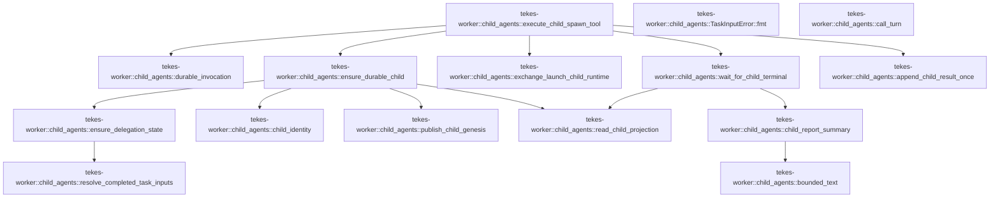

# tekes-worker::child_agents

[Package atlas](index.md) · [Source](../../src/child_agents.rs)

## Declarations

Visibility is the declaration spelling; trait members and reexports require their enclosing interface. `cfg` is not evaluated.

| Symbol | Kind | Visibility | Test / cfg |
|---|---|---|---|
| [tekes-worker::child_agents::ChildSpawnExecution](../../src/child_agents.rs#L3) | struct_item | `pub(crate)` |  |
| [tekes-worker::child_agents::DurableChildSpawn](../../src/child_agents.rs#L16) | struct_item | `pub(crate)` |  |
| [tekes-worker::child_agents::ChildTerminal](../../src/child_agents.rs#L24) | struct_item | `pub(crate)` |  |
| [tekes-worker::child_agents::execute_child_spawn_tool](../../src/child_agents.rs#L29) | function_item | `pub(crate)` |  |
| [tekes-worker::child_agents::durable_invocation](../../src/child_agents.rs#L191) | function_item | `private` |  |
| [tekes-worker::child_agents::ensure_durable_child](../../src/child_agents.rs#L213) | function_item | `pub(crate)` |  |
| [tekes-worker::child_agents::ensure_delegation_state](../../src/child_agents.rs#L339) | function_item | `pub(crate)` |  |
| [tekes-worker::child_agents::TaskInputError](../../src/child_agents.rs#L386) | struct_item | `pub(crate)` |  |
| [tekes-worker::child_agents::TaskInputError::fmt](../../src/child_agents.rs#L388) | function_item | `private` |  |
| [tekes-worker::child_agents::resolve_completed_task_inputs](../../src/child_agents.rs#L398) | function_item | `pub(crate)` |  |
| [tekes-worker::child_agents::child_identity](../../src/child_agents.rs#L473) | function_item | `pub(crate)` |  |
| [tekes-worker::child_agents::call_turn](../../src/child_agents.rs#L502) | function_item | `private` |  |
| [tekes-worker::child_agents::publish_child_genesis](../../src/child_agents.rs#L514) | function_item | `pub(crate)` |  |
| [tekes-worker::child_agents::exchange_launch_child_runtime](../../src/child_agents.rs#L548) | function_item | `pub(crate)` |  |
| [tekes-worker::child_agents::wait_for_child_terminal](../../src/child_agents.rs#L598) | function_item | `pub(crate)` |  |
| [tekes-worker::child_agents::read_child_projection](../../src/child_agents.rs#L647) | function_item | `pub(crate)` |  |
| [tekes-worker::child_agents::child_report_summary](../../src/child_agents.rs#L656) | function_item | `private` |  |
| [tekes-worker::child_agents::bounded_text](../../src/child_agents.rs#L696) | function_item | `private` |  |
| [tekes-worker::child_agents::append_child_result_once](../../src/child_agents.rs#L707) | function_item | `pub(crate)` |  |

## Imports / reexports

| Local name | Source path | Visibility |
|---|---|---|
| `*` | `super::*` | `private` |

## Module declarations

| Module | Visibility | Attributes |
|---|---|---|

## Function call graphs

Edges below are syntactically resolved calls only, including private functions. Graphs partition callers into groups of 20; they are not execution order. All unresolved sites are listed below and in the JSON inventory.

Functions 1–15: 13 direct edges

## Call sites

Includes test functions (marked in declarations). Receiver-type-required sites need type analysis/manual tracing. Calls in closures are attributed to their enclosing function; their occurrence here does not mean the closure executes immediately.

| Caller | Callee expression | Source lines | Target / classification |
|---|---|---|---|
| `execute_child_spawn_tool` | `effective_allowed_tools(profile).contains` | [50](../../src/child_agents.rs#L50) | receiver-type-required |
| `execute_child_spawn_tool` | `effective_allowed_tools` | [50](../../src/child_agents.rs#L50) | external-constructor-callback-or-unresolved |
| `execute_child_spawn_tool` | `Err` | [51](../../src/child_agents.rs#L51), [94](../../src/child_agents.rs#L94), [108](../../src/child_agents.rs#L108), [185](../../src/child_agents.rs#L185), [187](../../src/child_agents.rs#L187) | external-constructor-callback-or-unresolved |
| `execute_child_spawn_tool` | `format!("child-spawn tool {} is not allowed", call.name).into` | [51](../../src/child_agents.rs#L51) | receiver-type-required |
| `execute_child_spawn_tool` | `ledger         .projection()         .and_then(&#124;projection&#124; projection.events.first())         .and_then(&#124;genesis&#124; genesis.string_field("thread"))         .ok_or("genesis thread binding is missing")?         .to_owned` | [53](../../src/child_agents.rs#L53) | receiver-type-required |
| `execute_child_spawn_tool` | `ledger         .projection()         .and_then(&#124;projection&#124; projection.events.first())         .and_then(&#124;genesis&#124; genesis.string_field("thread"))         .ok_or` | [53](../../src/child_agents.rs#L53) | receiver-type-required |
| `execute_child_spawn_tool` | `ledger         .projection()         .and_then(&#124;projection&#124; projection.events.first())         .and_then` | [53](../../src/child_agents.rs#L53) | receiver-type-required |
| `execute_child_spawn_tool` | `ledger         .projection()         .and_then` | [53](../../src/child_agents.rs#L53) | receiver-type-required |
| `execute_child_spawn_tool` | `ledger         .projection` | [53](../../src/child_agents.rs#L53) | receiver-type-required |
| `execute_child_spawn_tool` | `projection.events.first` | [55](../../src/child_agents.rs#L55) | receiver-type-required |
| `execute_child_spawn_tool` | `genesis.string_field` | [56](../../src/child_agents.rs#L56) | receiver-type-required |
| `execute_child_spawn_tool` | `thread.clone` | [60](../../src/child_agents.rs#L60) | receiver-type-required |
| `execute_child_spawn_tool` | `attempt.to_owned` | [62](../../src/child_agents.rs#L62) | receiver-type-required |
| `execute_child_spawn_tool` | `call.call_id.clone` | [63](../../src/child_agents.rs#L63), [121](../../src/child_agents.rs#L121) | receiver-type-required |
| `execute_child_spawn_tool` | `call.name.clone` | [64](../../src/child_agents.rs#L64), [122](../../src/child_agents.rs#L122) | receiver-type-required |
| `execute_child_spawn_tool` | `IJsonValue::parse` | [65](../../src/child_agents.rs#L65) | external-constructor-callback-or-unresolved |
| `execute_child_spawn_tool` | `serde_json::to_vec` | [65](../../src/child_agents.rs#L65) | external-constructor-callback-or-unresolved |
| `execute_child_spawn_tool` | `options.event_timestamp().clone` | [66](../../src/child_agents.rs#L66) | receiver-type-required |
| `execute_child_spawn_tool` | `options.event_timestamp` | [66](../../src/child_agents.rs#L66) | receiver-type-required |
| `execute_child_spawn_tool` | `tool_catalog_context` | [68](../../src/child_agents.rs#L68) | external-constructor-callback-or-unresolved |
| `execute_child_spawn_tool` | `ToolDispatcher::new` | [69](../../src/child_agents.rs#L69) | external-constructor-callback-or-unresolved |
| `execute_child_spawn_tool` | `AssetStore::new` | [70](../../src/child_agents.rs#L70), [160](../../src/child_agents.rs#L160) | external-constructor-callback-or-unresolved |
| `execute_child_spawn_tool` | `ledger             .path()             .parent()             .ok_or("worker ledger has no thread folder")?             .join` | [71](../../src/child_agents.rs#L71), [161](../../src/child_agents.rs#L161) | receiver-type-required |
| `execute_child_spawn_tool` | `ledger             .path()             .parent()             .ok_or` | [71](../../src/child_agents.rs#L71), [78](../../src/child_agents.rs#L78), [161](../../src/child_agents.rs#L161), [168](../../src/child_agents.rs#L168) | receiver-type-required |
| `execute_child_spawn_tool` | `ledger             .path()             .parent` | [71](../../src/child_agents.rs#L71), [78](../../src/child_agents.rs#L78), [161](../../src/child_agents.rs#L161), [168](../../src/child_agents.rs#L168) | receiver-type-required |
| `execute_child_spawn_tool` | `ledger             .path` | [71](../../src/child_agents.rs#L71), [78](../../src/child_agents.rs#L78), [161](../../src/child_agents.rs#L161), [168](../../src/child_agents.rs#L168) | receiver-type-required |
| `execute_child_spawn_tool` | `session_permission_policy` | [77](../../src/child_agents.rs#L77), [167](../../src/child_agents.rs#L167) | external-constructor-callback-or-unresolved |
| `execute_child_spawn_tool` | `ToolPipeline::new` | [83](../../src/child_agents.rs#L83), [173](../../src/child_agents.rs#L173) | external-constructor-callback-or-unresolved |
| `execute_child_spawn_tool` | `SecretScanner::default` | [83](../../src/child_agents.rs#L83), [173](../../src/child_agents.rs#L173) | external-constructor-callback-or-unresolved |
| `execute_child_spawn_tool` | `dispatcher.dispatch` | [85](../../src/child_agents.rs#L85), [175](../../src/child_agents.rs#L175) | receiver-type-required |
| `execute_child_spawn_tool` | `Ok` | [92](../../src/child_agents.rs#L92), [97](../../src/child_agents.rs#L97), [106](../../src/child_agents.rs#L106), [182](../../src/child_agents.rs#L182), [183](../../src/child_agents.rs#L183) | external-constructor-callback-or-unresolved |
| `execute_child_spawn_tool` | `"child spawn backend cannot report a remote continuation".into` | [94](../../src/child_agents.rs#L94) | receiver-type-required |
| `execute_child_spawn_tool` | `drop` | [99](../../src/child_agents.rs#L99) | external-constructor-callback-or-unresolved |
| `execute_child_spawn_tool` | `durable_invocation` | [101](../../src/child_agents.rs#L101) | [tekes-worker::child_agents::durable_invocation](../../src/child_agents.rs#L191) |
| `execute_child_spawn_tool` | `ensure_durable_child` | [102](../../src/child_agents.rs#L102) | [tekes-worker::child_agents::ensure_durable_child](../../src/child_agents.rs#L213) |
| `execute_child_spawn_tool` | `error.downcast_ref::<TaskInputError>().is_some` | [104](../../src/child_agents.rs#L104) | receiver-type-required |
| `execute_child_spawn_tool` | `error.downcast_ref::<TaskInputError>` | [104](../../src/child_agents.rs#L104) | receiver-type-required |
| `execute_child_spawn_tool` | `append_tool_validation_error` | [105](../../src/child_agents.rs#L105) | external-constructor-callback-or-unresolved |
| `execute_child_spawn_tool` | `error.to_string` | [105](../../src/child_agents.rs#L105) | receiver-type-required |
| `execute_child_spawn_tool` | `ledger         .path()         .parent()         .and_then(&#124;folder&#124; folder.file_name())         .and_then(&#124;name&#124; name.to_str())         .ok_or("thread folder has no UTF-8 session UUID")?         .to_owned` | [110](../../src/child_agents.rs#L110) | receiver-type-required |
| `execute_child_spawn_tool` | `ledger         .path()         .parent()         .and_then(&#124;folder&#124; folder.file_name())         .and_then(&#124;name&#124; name.to_str())         .ok_or` | [110](../../src/child_agents.rs#L110) | receiver-type-required |
| `execute_child_spawn_tool` | `ledger         .path()         .parent()         .and_then(&#124;folder&#124; folder.file_name())         .and_then` | [110](../../src/child_agents.rs#L110) | receiver-type-required |
| `execute_child_spawn_tool` | `ledger         .path()         .parent()         .and_then` | [110](../../src/child_agents.rs#L110) | receiver-type-required |
| `execute_child_spawn_tool` | `ledger         .path()         .parent` | [110](../../src/child_agents.rs#L110) | receiver-type-required |
| `execute_child_spawn_tool` | `ledger         .path` | [110](../../src/child_agents.rs#L110) | receiver-type-required |
| `execute_child_spawn_tool` | `folder.file_name` | [113](../../src/child_agents.rs#L113) | receiver-type-required |
| `execute_child_spawn_tool` | `name.to_str` | [114](../../src/child_agents.rs#L114) | receiver-type-required |
| `execute_child_spawn_tool` | `ToolControl::new` | [117](../../src/child_agents.rs#L117) | external-constructor-callback-or-unresolved |
| `execute_child_spawn_tool` | `exchange_tool_control_runtime` | [125](../../src/child_agents.rs#L125) | external-constructor-callback-or-unresolved |
| `execute_child_spawn_tool` | `control.error.is_some` | [127](../../src/child_agents.rs#L127) | receiver-type-required |
| `execute_child_spawn_tool` | `append_child_result_once` | [128](../../src/child_agents.rs#L128), [142](../../src/child_agents.rs#L142), [156](../../src/child_agents.rs#L156) | [tekes-worker::child_agents::append_child_result_once](../../src/child_agents.rs#L707) |
| `execute_child_spawn_tool` | `"failed".to_owned` | [135](../../src/child_agents.rs#L135), [149](../../src/child_agents.rs#L149) | receiver-type-required |
| `execute_child_spawn_tool` | `control.error.as_ref().map` | [136](../../src/child_agents.rs#L136) | receiver-type-required |
| `execute_child_spawn_tool` | `control.error.as_ref` | [136](../../src/child_agents.rs#L136) | receiver-type-required |
| `execute_child_spawn_tool` | `error.message.clone` | [136](../../src/child_agents.rs#L136) | receiver-type-required |
| `execute_child_spawn_tool` | `exchange_launch_child_runtime` | [140](../../src/child_agents.rs#L140) | [tekes-worker::child_agents::exchange_launch_child_runtime](../../src/child_agents.rs#L548) |
| `execute_child_spawn_tool` | `wait_for_child_terminal` | [155](../../src/child_agents.rs#L155) | [tekes-worker::child_agents::wait_for_child_terminal](../../src/child_agents.rs#L598) |
| `execute_child_spawn_tool` | `"child result backend cannot report a remote continuation".into` | [185](../../src/child_agents.rs#L185) | receiver-type-required |
| `execute_child_spawn_tool` | `"child result backend deferred unexpectedly".into` | [187](../../src/child_agents.rs#L187) | receiver-type-required |
| `durable_invocation` | `ledger.projection().and_then` | [196](../../src/child_agents.rs#L196) | receiver-type-required |
| `durable_invocation` | `ledger.projection` | [196](../../src/child_agents.rs#L196) | receiver-type-required |
| `durable_invocation` | `projection.events.iter().find` | [197](../../src/child_agents.rs#L197) | receiver-type-required |
| `durable_invocation` | `projection.events.iter` | [197](../../src/child_agents.rs#L197) | receiver-type-required |
| `durable_invocation` | `event.kind` | [198](../../src/child_agents.rs#L198) | receiver-type-required |
| `durable_invocation` | `event.string_field` | [199](../../src/child_agents.rs#L199) | receiver-type-required |
| `durable_invocation` | `Some` | [199](../../src/child_agents.rs#L199) | external-constructor-callback-or-unresolved |
| `durable_invocation` | `Ok` | [202](../../src/child_agents.rs#L202), [208](../../src/child_agents.rs#L208) | external-constructor-callback-or-unresolved |
| `durable_invocation` | `original.clone` | [202](../../src/child_agents.rs#L202) | receiver-type-required |
| `durable_invocation` | `serde_json::to_value` | [204](../../src/child_agents.rs#L204) | external-constructor-callback-or-unresolved |
| `durable_invocation` | `event.raw` | [204](../../src/child_agents.rs#L204) | receiver-type-required |
| `durable_invocation` | `raw         .get("invocation")         .ok_or` | [205](../../src/child_agents.rs#L205) | receiver-type-required |
| `durable_invocation` | `raw         .get` | [205](../../src/child_agents.rs#L205) | receiver-type-required |
| `durable_invocation` | `IJsonValue::parse` | [208](../../src/child_agents.rs#L208) | external-constructor-callback-or-unresolved |
| `durable_invocation` | `serde_json::to_vec` | [208](../../src/child_agents.rs#L208) | external-constructor-callback-or-unresolved |
| `durable_invocation` | `materialize_json` | [208](../../src/child_agents.rs#L208) | external-constructor-callback-or-unresolved |
| `ensure_durable_child` | `ledger.projection().and_then` | [220](../../src/child_agents.rs#L220) | receiver-type-required |
| `ensure_durable_child` | `ledger.projection` | [220](../../src/child_agents.rs#L220) | receiver-type-required |
| `ensure_durable_child` | `projection.events.iter().find` | [221](../../src/child_agents.rs#L221) | receiver-type-required |
| `ensure_durable_child` | `projection.events.iter` | [221](../../src/child_agents.rs#L221) | receiver-type-required |
| `ensure_durable_child` | `event.kind` | [222](../../src/child_agents.rs#L222) | receiver-type-required |
| `ensure_durable_child` | `event.string_field` | [223](../../src/child_agents.rs#L223) | receiver-type-required |
| `ensure_durable_child` | `Some` | [223](../../src/child_agents.rs#L223), [244](../../src/child_agents.rs#L244) | external-constructor-callback-or-unresolved |
| `ensure_durable_child` | `call.call_id.as_str` | [223](../../src/child_agents.rs#L223) | receiver-type-required |
| `ensure_durable_child` | `serde_json::to_value` | [226](../../src/child_agents.rs#L226), [310](../../src/child_agents.rs#L310) | external-constructor-callback-or-unresolved |
| `ensure_durable_child` | `spawn.raw` | [226](../../src/child_agents.rs#L226) | receiver-type-required |
| `ensure_durable_child` | `spawn             .string_field("child")             .ok_or("spawn child is missing")?             .to_owned` | [227](../../src/child_agents.rs#L227) | receiver-type-required |
| `ensure_durable_child` | `spawn             .string_field("child")             .ok_or` | [227](../../src/child_agents.rs#L227) | receiver-type-required |
| `ensure_durable_child` | `spawn             .string_field` | [227](../../src/child_agents.rs#L227) | receiver-type-required |
| `ensure_durable_child` | `ledger             .path()             .parent()             .ok_or("parent ledger has no folder")?             .join` | [231](../../src/child_agents.rs#L231) | receiver-type-required |
| `ensure_durable_child` | `ledger             .path()             .parent()             .ok_or` | [231](../../src/child_agents.rs#L231) | receiver-type-required |
| `ensure_durable_child` | `ledger             .path()             .parent` | [231](../../src/child_agents.rs#L231) | receiver-type-required |
| `ensure_durable_child` | `ledger             .path` | [231](../../src/child_agents.rs#L231) | receiver-type-required |
| `ensure_durable_child` | `child_path             .file_stem()             .and_then(&#124;name&#124; name.to_str())             .ok_or("spawn child file has no UTF-8 stem")?             .to_owned` | [236](../../src/child_agents.rs#L236) | receiver-type-required |
| `ensure_durable_child` | `child_path             .file_stem()             .and_then(&#124;name&#124; name.to_str())             .ok_or` | [236](../../src/child_agents.rs#L236) | receiver-type-required |
| `ensure_durable_child` | `child_path             .file_stem()             .and_then` | [236](../../src/child_agents.rs#L236) | receiver-type-required |
| `ensure_durable_child` | `child_path             .file_stem` | [236](../../src/child_agents.rs#L236) | receiver-type-required |
| `ensure_durable_child` | `name.to_str` | [238](../../src/child_agents.rs#L238), [288](../../src/child_agents.rs#L288) | receiver-type-required |
| `ensure_durable_child` | `child_path.exists` | [241](../../src/child_agents.rs#L241) | receiver-type-required |
| `ensure_durable_child` | `read_child_projection` | [242](../../src/child_agents.rs#L242) | [tekes-worker::child_agents::read_child_projection](../../src/child_agents.rs#L647) |
| `ensure_durable_child` | `child.events.first().ok_or` | [243](../../src/child_agents.rs#L243) | receiver-type-required |
| `ensure_durable_child` | `child.events.first` | [243](../../src/child_agents.rs#L243) | receiver-type-required |
| `ensure_durable_child` | `genesis.string_field` | [244](../../src/child_agents.rs#L244), [268](../../src/child_agents.rs#L268) | receiver-type-required |
| `ensure_durable_child` | `child_line.as_str` | [244](../../src/child_agents.rs#L244) | receiver-type-required |
| `ensure_durable_child` | `Err` | [245](../../src/child_agents.rs#L245) | external-constructor-callback-or-unresolved |
| `ensure_durable_child` | `"spawn child file does not match child genesis".into` | [245](../../src/child_agents.rs#L245) | receiver-type-required |
| `ensure_durable_child` | `Ok` | [248](../../src/child_agents.rs#L248), [331](../../src/child_agents.rs#L331) | external-constructor-callback-or-unresolved |
| `ensure_durable_child` | `spawn                 .string_field("spawn_id")                 .ok_or("spawn id is missing")?                 .to_owned` | [251](../../src/child_agents.rs#L251) | receiver-type-required |
| `ensure_durable_child` | `spawn                 .string_field("spawn_id")                 .ok_or` | [251](../../src/child_agents.rs#L251) | receiver-type-required |
| `ensure_durable_child` | `spawn                 .string_field` | [251](../../src/child_agents.rs#L251) | receiver-type-required |
| `ensure_durable_child` | `serde_json::from_value` | [255](../../src/child_agents.rs#L255) | external-constructor-callback-or-unresolved |
| `ensure_durable_child` | `raw.get("resume")                     .cloned()                     .ok_or` | [256](../../src/child_agents.rs#L256) | receiver-type-required |
| `ensure_durable_child` | `raw.get("resume")                     .cloned` | [256](../../src/child_agents.rs#L256) | receiver-type-required |
| `ensure_durable_child` | `raw.get` | [256](../../src/child_agents.rs#L256) | receiver-type-required |
| `ensure_durable_child` | `ensure_delegation_state` | [263](../../src/child_agents.rs#L263) | [tekes-worker::child_agents::ensure_delegation_state](../../src/child_agents.rs#L339) |
| `ensure_durable_child` | `ledger.next_seq` | [264](../../src/child_agents.rs#L264) | receiver-type-required |
| `ensure_durable_child` | `ledger         .projection()         .and_then(&#124;projection&#124; projection.events.first())         .and_then(&#124;genesis&#124; genesis.string_field("thread"))         .ok_or` | [265](../../src/child_agents.rs#L265) | receiver-type-required |
| `ensure_durable_child` | `ledger         .projection()         .and_then(&#124;projection&#124; projection.events.first())         .and_then` | [265](../../src/child_agents.rs#L265) | receiver-type-required |
| `ensure_durable_child` | `ledger         .projection()         .and_then` | [265](../../src/child_agents.rs#L265) | receiver-type-required |
| `ensure_durable_child` | `ledger         .projection` | [265](../../src/child_agents.rs#L265) | receiver-type-required |
| `ensure_durable_child` | `projection.events.first` | [267](../../src/child_agents.rs#L267) | receiver-type-required |
| `ensure_durable_child` | `child_identity` | [270](../../src/child_agents.rs#L270) | [tekes-worker::child_agents::child_identity](../../src/child_agents.rs#L473) |
| `ensure_durable_child` | `ResumePolicy::Bounded` | [272](../../src/child_agents.rs#L272) | external-constructor-callback-or-unresolved |
| `ensure_durable_child` | `delegation.canonical_bytes` | [273](../../src/child_agents.rs#L273) | receiver-type-required |
| `ensure_durable_child` | `seed_bytes.push` | [274](../../src/child_agents.rs#L274) | receiver-type-required |
| `ensure_durable_child` | `ledger         .path()         .parent()         .ok_or` | [275](../../src/child_agents.rs#L275) | receiver-type-required |
| `ensure_durable_child` | `ledger         .path()         .parent` | [275](../../src/child_agents.rs#L275) | receiver-type-required |
| `ensure_durable_child` | `ledger         .path` | [275](../../src/child_agents.rs#L275), [285](../../src/child_agents.rs#L285) | receiver-type-required |
| `ensure_durable_child` | `AssetStore::new` | [279](../../src/child_agents.rs#L279) | external-constructor-callback-or-unresolved |
| `ensure_durable_child` | `folder.join` | [279](../../src/child_agents.rs#L279) | receiver-type-required |
| `ensure_durable_child` | `assets.publish` | [280](../../src/child_agents.rs#L280) | receiver-type-required |
| `ensure_durable_child` | `seed         .asset         .strip_prefix("sha256-")         .ok_or` | [281](../../src/child_agents.rs#L281) | receiver-type-required |
| `ensure_durable_child` | `seed         .asset         .strip_prefix` | [281](../../src/child_agents.rs#L281) | receiver-type-required |
| `ensure_durable_child` | `ledger         .path()         .file_name()         .and_then(&#124;name&#124; name.to_str())         .ok_or` | [285](../../src/child_agents.rs#L285) | receiver-type-required |
| `ensure_durable_child` | `ledger         .path()         .file_name()         .and_then` | [285](../../src/child_agents.rs#L285) | receiver-type-required |
| `ensure_durable_child` | `ledger         .path()         .file_name` | [285](../../src/child_agents.rs#L285) | receiver-type-required |
| `ensure_durable_child` | `identity::genesis_preset` | [307](../../src/child_agents.rs#L307) | external-constructor-callback-or-unresolved |
| `ensure_durable_child` | `genesis.as_object_mut().expect` | [308](../../src/child_agents.rs#L308), [318](../../src/child_agents.rs#L318) | receiver-type-required |
| `ensure_durable_child` | `genesis.as_object_mut` | [308](../../src/child_agents.rs#L308), [318](../../src/child_agents.rs#L318) | receiver-type-required |
| `ensure_durable_child` | `object.insert` | [309](../../src/child_agents.rs#L309), [310](../../src/child_agents.rs#L310) | receiver-type-required |
| `ensure_durable_child` | `"min_reader".to_owned` | [309](../../src/child_agents.rs#L309) | receiver-type-required |
| `ensure_durable_child` | `"preset".to_owned` | [310](../../src/child_agents.rs#L310) | receiver-type-required |
| `ensure_durable_child` | `identity::selected` | [311](../../src/child_agents.rs#L311) | external-constructor-callback-or-unresolved |
| `ensure_durable_child` | `genesis             .as_object_mut()             .expect("genesis object")             .insert` | [312](../../src/child_agents.rs#L312) | receiver-type-required |
| `ensure_durable_child` | `genesis             .as_object_mut()             .expect` | [312](../../src/child_agents.rs#L312) | receiver-type-required |
| `ensure_durable_child` | `genesis             .as_object_mut` | [312](../../src/child_agents.rs#L312) | receiver-type-required |
| `ensure_durable_child` | `"identity_profile".to_owned` | [315](../../src/child_agents.rs#L315) | receiver-type-required |
| `ensure_durable_child` | `options.instruction_digest.is_empty` | [317](../../src/child_agents.rs#L317) | receiver-type-required |
| `ensure_durable_child` | `genesis.as_object_mut().expect("genesis object").insert` | [318](../../src/child_agents.rs#L318) | receiver-type-required |
| `ensure_durable_child` | `"instruction".to_owned` | [319](../../src/child_agents.rs#L319) | receiver-type-required |
| `ensure_durable_child` | `publish_child_genesis` | [323](../../src/child_agents.rs#L323) | [tekes-worker::child_agents::publish_child_genesis](../../src/child_agents.rs#L514) |
| `ensure_durable_child` | `make_event` | [323](../../src/child_agents.rs#L323), [324](../../src/child_agents.rs#L324) | external-constructor-callback-or-unresolved |
| `ensure_durable_child` | `ledger.append_contract` | [330](../../src/child_agents.rs#L330) | receiver-type-required |
| `ensure_durable_child` | `BarrierContext::default` | [330](../../src/child_agents.rs#L330) | external-constructor-callback-or-unresolved |
| `ensure_delegation_state` | `serde_json::to_value` | [345](../../src/child_agents.rs#L345), [353](../../src/child_agents.rs#L353), [365](../../src/child_agents.rs#L365) | external-constructor-callback-or-unresolved |
| `ensure_delegation_state` | `ledger.projection().and_then` | [346](../../src/child_agents.rs#L346) | receiver-type-required |
| `ensure_delegation_state` | `ledger.projection` | [346](../../src/child_agents.rs#L346) | receiver-type-required |
| `ensure_delegation_state` | `projection.events.iter().find` | [347](../../src/child_agents.rs#L347) | receiver-type-required |
| `ensure_delegation_state` | `projection.events.iter` | [347](../../src/child_agents.rs#L347) | receiver-type-required |
| `ensure_delegation_state` | `event.kind` | [348](../../src/child_agents.rs#L348) | receiver-type-required |
| `ensure_delegation_state` | `event.string_field` | [349](../../src/child_agents.rs#L349) | receiver-type-required |
| `ensure_delegation_state` | `Some` | [349](../../src/child_agents.rs#L349), [362](../../src/child_agents.rs#L362), [366](../../src/child_agents.rs#L366), [367](../../src/child_agents.rs#L367) | external-constructor-callback-or-unresolved |
| `ensure_delegation_state` | `serde_json::to_value(event.raw())                 .ok()                 .and_then(&#124;value&#124; {                     value                         .pointer("/payload/call")                         .and_then(Value::as_str)                         .map(str::to_owned)                 })                 .as_deref` | [353](../../src/child_agents.rs#L353) | receiver-type-required |
| `ensure_delegation_state` | `serde_json::to_value(event.raw())                 .ok()                 .and_then` | [353](../../src/child_agents.rs#L353) | receiver-type-required |
| `ensure_delegation_state` | `serde_json::to_value(event.raw())                 .ok` | [353](../../src/child_agents.rs#L353) | receiver-type-required |
| `ensure_delegation_state` | `event.raw` | [353](../../src/child_agents.rs#L353) | receiver-type-required |
| `ensure_delegation_state` | `value                         .pointer("/payload/call")                         .and_then(Value::as_str)                         .map` | [356](../../src/child_agents.rs#L356) | receiver-type-required |
| `ensure_delegation_state` | `value                         .pointer("/payload/call")                         .and_then` | [356](../../src/child_agents.rs#L356) | receiver-type-required |
| `ensure_delegation_state` | `value                         .pointer` | [356](../../src/child_agents.rs#L356) | receiver-type-required |
| `ensure_delegation_state` | `call.call_id.as_str` | [362](../../src/child_agents.rs#L362) | receiver-type-required |
| `ensure_delegation_state` | `existing.raw` | [365](../../src/child_agents.rs#L365) | receiver-type-required |
| `ensure_delegation_state` | `raw.pointer("/payload/name").and_then` | [366](../../src/child_agents.rs#L366) | receiver-type-required |
| `ensure_delegation_state` | `raw.pointer` | [366](../../src/child_agents.rs#L366), [367](../../src/child_agents.rs#L367) | receiver-type-required |
| `ensure_delegation_state` | `call.name.as_str` | [366](../../src/child_agents.rs#L366) | receiver-type-required |
| `ensure_delegation_state` | `Err` | [369](../../src/child_agents.rs#L369) | external-constructor-callback-or-unresolved |
| `ensure_delegation_state` | `"durable delegation state does not match effective invocation".into` | [369](../../src/child_agents.rs#L369) | receiver-type-required |
| `ensure_delegation_state` | `Ok` | [371](../../src/child_agents.rs#L371), [382](../../src/child_agents.rs#L382) | external-constructor-callback-or-unresolved |
| `ensure_delegation_state` | `existing.clone` | [371](../../src/child_agents.rs#L371) | receiver-type-required |
| `ensure_delegation_state` | `resolve_completed_task_inputs` | [374](../../src/child_agents.rs#L374) | [tekes-worker::child_agents::resolve_completed_task_inputs](../../src/child_agents.rs#L398) |
| `ensure_delegation_state` | `make_event` | [375](../../src/child_agents.rs#L375) | external-constructor-callback-or-unresolved |
| `ensure_delegation_state` | `ledger.append_contract` | [381](../../src/child_agents.rs#L381) | receiver-type-required |
| `ensure_delegation_state` | `event.clone` | [381](../../src/child_agents.rs#L381) | receiver-type-required |
| `ensure_delegation_state` | `BarrierContext::default` | [381](../../src/child_agents.rs#L381) | external-constructor-callback-or-unresolved |
| `fmt` | `formatter.write_str` | [389](../../src/child_agents.rs#L389) | receiver-type-required |
| `resolve_completed_task_inputs` | `invocation.get("input_sources").and_then` | [403](../../src/child_agents.rs#L403) | receiver-type-required |
| `resolve_completed_task_inputs` | `invocation.get` | [403](../../src/child_agents.rs#L403) | receiver-type-required |
| `resolve_completed_task_inputs` | `Ok` | [404](../../src/child_agents.rs#L404), [470](../../src/child_agents.rs#L470) | external-constructor-callback-or-unresolved |
| `resolve_completed_task_inputs` | `ledger.projection().ok_or` | [406](../../src/child_agents.rs#L406) | receiver-type-required |
| `resolve_completed_task_inputs` | `ledger.projection` | [406](../../src/child_agents.rs#L406) | receiver-type-required |
| `resolve_completed_task_inputs` | `projection         .events         .iter()         .find(&#124;event&#124; {             event.kind() == &EventKind::ToolCall && event.string_field("call") == Some(current_call)         })         .map(Event::seq)         .ok_or` | [407](../../src/child_agents.rs#L407) | receiver-type-required |
| `resolve_completed_task_inputs` | `projection         .events         .iter()         .find(&#124;event&#124; {             event.kind() == &EventKind::ToolCall && event.string_field("call") == Some(current_call)         })         .map` | [407](../../src/child_agents.rs#L407) | receiver-type-required |
| `resolve_completed_task_inputs` | `projection         .events         .iter()         .find` | [407](../../src/child_agents.rs#L407) | receiver-type-required |
| `resolve_completed_task_inputs` | `projection         .events         .iter` | [407](../../src/child_agents.rs#L407) | receiver-type-required |
| `resolve_completed_task_inputs` | `event.kind` | [411](../../src/child_agents.rs#L411), [423](../../src/child_agents.rs#L423), [448](../../src/child_agents.rs#L448) | receiver-type-required |
| `resolve_completed_task_inputs` | `event.string_field` | [411](../../src/child_agents.rs#L411), [424](../../src/child_agents.rs#L424), [449](../../src/child_agents.rs#L449), [450](../../src/child_agents.rs#L450) | receiver-type-required |
| `resolve_completed_task_inputs` | `Some` | [411](../../src/child_agents.rs#L411), [424](../../src/child_agents.rs#L424), [428](../../src/child_agents.rs#L428), [432](../../src/child_agents.rs#L432), [449](../../src/child_agents.rs#L449), [450](../../src/child_agents.rs#L450) | external-constructor-callback-or-unresolved |
| `resolve_completed_task_inputs` | `Vec::new` | [415](../../src/child_agents.rs#L415) | external-constructor-callback-or-unresolved |
| `resolve_completed_task_inputs` | `source.as_str().ok_or` | [417](../../src/child_agents.rs#L417) | receiver-type-required |
| `resolve_completed_task_inputs` | `source.as_str` | [417](../../src/child_agents.rs#L417) | receiver-type-required |
| `resolve_completed_task_inputs` | `projection             .events             .iter()             .filter(&#124;event&#124; {                 event.seq() < current_seq                     && event.kind() == &EventKind::State                     && event.string_field("subkind") == Some("delegation")             })             .filter_map(&#124;event&#124; {                 let raw = serde_json::to_value(event.raw()).ok()?;                 (raw.pointer("/payload/name").and_then(Value::as_str) == Some("task")                     && raw                         .pointer("/payload/invocation/task_name")                         .and_then(Value::as_str)                         == Some(source))                 .then_some((event, raw))             })             .collect::<Vec<_>>` | [418](../../src/child_agents.rs#L418) | receiver-type-required |
| `resolve_completed_task_inputs` | `projection             .events             .iter()             .filter(&#124;event&#124; {                 event.seq() < current_seq                     && event.kind() == &EventKind::State                     && event.string_field("subkind") == Some("delegation")             })             .filter_map` | [418](../../src/child_agents.rs#L418) | receiver-type-required |
| `resolve_completed_task_inputs` | `projection             .events             .iter()             .filter` | [418](../../src/child_agents.rs#L418) | receiver-type-required |
| `resolve_completed_task_inputs` | `projection             .events             .iter` | [418](../../src/child_agents.rs#L418) | receiver-type-required |
| `resolve_completed_task_inputs` | `event.seq` | [422](../../src/child_agents.rs#L422), [447](../../src/child_agents.rs#L447) | receiver-type-required |
| `resolve_completed_task_inputs` | `serde_json::to_value(event.raw()).ok` | [427](../../src/child_agents.rs#L427) | receiver-type-required |
| `resolve_completed_task_inputs` | `serde_json::to_value` | [427](../../src/child_agents.rs#L427) | external-constructor-callback-or-unresolved |
| `resolve_completed_task_inputs` | `event.raw` | [427](../../src/child_agents.rs#L427) | receiver-type-required |
| `resolve_completed_task_inputs` | `(raw.pointer("/payload/name").and_then(Value::as_str) == Some("task")                     && raw                         .pointer("/payload/invocation/task_name")                         .and_then(Value::as_str)                         == Some(source))                 .then_some` | [428](../../src/child_agents.rs#L428) | receiver-type-required |
| `resolve_completed_task_inputs` | `raw.pointer("/payload/name").and_then` | [428](../../src/child_agents.rs#L428) | receiver-type-required |
| `resolve_completed_task_inputs` | `raw.pointer` | [428](../../src/child_agents.rs#L428) | receiver-type-required |
| `resolve_completed_task_inputs` | `raw                         .pointer("/payload/invocation/task_name")                         .and_then` | [429](../../src/child_agents.rs#L429) | receiver-type-required |
| `resolve_completed_task_inputs` | `raw                         .pointer` | [429](../../src/child_agents.rs#L429) | receiver-type-required |
| `resolve_completed_task_inputs` | `matches.is_empty` | [436](../../src/child_agents.rs#L436) | receiver-type-required |
| `resolve_completed_task_inputs` | `matches.last().expect` | [441](../../src/child_agents.rs#L441) | receiver-type-required |
| `resolve_completed_task_inputs` | `matches.last` | [441](../../src/child_agents.rs#L441) | receiver-type-required |
| `resolve_completed_task_inputs` | `raw             .pointer("/payload/call")             .and_then(Value::as_str)             .ok_or` | [442](../../src/child_agents.rs#L442) | receiver-type-required |
| `resolve_completed_task_inputs` | `raw             .pointer("/payload/call")             .and_then` | [442](../../src/child_agents.rs#L442) | receiver-type-required |
| `resolve_completed_task_inputs` | `raw             .pointer` | [442](../../src/child_agents.rs#L442), [457](../../src/child_agents.rs#L457) | receiver-type-required |
| `resolve_completed_task_inputs` | `projection.events.iter().find` | [446](../../src/child_agents.rs#L446) | receiver-type-required |
| `resolve_completed_task_inputs` | `projection.events.iter` | [446](../../src/child_agents.rs#L446) | receiver-type-required |
| `resolve_completed_task_inputs` | `Err` | [453](../../src/child_agents.rs#L453) | external-constructor-callback-or-unresolved |
| `resolve_completed_task_inputs` | `Box::new` | [453](../../src/child_agents.rs#L453) | external-constructor-callback-or-unresolved |
| `resolve_completed_task_inputs` | `TaskInputError` | [453](../../src/child_agents.rs#L453) | external-constructor-callback-or-unresolved |
| `resolve_completed_task_inputs` | `raw             .pointer("/payload/invocation/output")             .cloned()             .ok_or` | [457](../../src/child_agents.rs#L457) | receiver-type-required |
| `resolve_completed_task_inputs` | `raw             .pointer("/payload/invocation/output")             .cloned` | [457](../../src/child_agents.rs#L457) | receiver-type-required |
| `resolve_completed_task_inputs` | `output             .get("path")             .and_then(Value::as_str)             .ok_or` | [461](../../src/child_agents.rs#L461) | receiver-type-required |
| `resolve_completed_task_inputs` | `output             .get("path")             .and_then` | [461](../../src/child_agents.rs#L461) | receiver-type-required |
| `resolve_completed_task_inputs` | `output             .get` | [461](../../src/child_agents.rs#L461) | receiver-type-required |
| `resolve_completed_task_inputs` | `resolved.push` | [465](../../src/child_agents.rs#L465) | receiver-type-required |
| `resolve_completed_task_inputs` | `Value::Array` | [470](../../src/child_agents.rs#L470) | external-constructor-callback-or-unresolved |
| `child_identity` | `Sha256::new` | [474](../../src/child_agents.rs#L474) | external-constructor-callback-or-unresolved |
| `child_identity` | `hasher.update` | [475](../../src/child_agents.rs#L475), [476](../../src/child_agents.rs#L476), [477](../../src/child_agents.rs#L477), [478](../../src/child_agents.rs#L478), [479](../../src/child_agents.rs#L479), [480](../../src/child_agents.rs#L480) | receiver-type-required |
| `child_identity` | `parent.as_bytes` | [476](../../src/child_agents.rs#L476) | receiver-type-required |
| `child_identity` | `call.as_bytes` | [478](../../src/child_agents.rs#L478) | receiver-type-required |
| `child_identity` | `spawn_seq.to_string().as_bytes` | [480](../../src/child_agents.rs#L480) | receiver-type-required |
| `child_identity` | `spawn_seq.to_string` | [480](../../src/child_agents.rs#L480) | receiver-type-required |
| `child_identity` | `hasher.finalize().into` | [481](../../src/child_agents.rs#L481) | receiver-type-required |
| `child_identity` | `hasher.finalize` | [481](../../src/child_agents.rs#L481) | receiver-type-required |
| `child_identity` | `bytes.copy_from_slice` | [483](../../src/child_agents.rs#L483) | receiver-type-required |
| `child_identity` | `String::with_capacity` | [486](../../src/child_agents.rs#L486) | external-constructor-callback-or-unresolved |
| `child_identity` | `write!(&mut hex, "{byte:02x}").expect` | [489](../../src/child_agents.rs#L489) | receiver-type-required |
| `call_turn` | `ledger         .projection()         .and_then(&#124;projection&#124; {             projection.events.iter().find(&#124;event&#124; {                 event.kind() == &EventKind::ToolCall && event.string_field("call") == Some(call)             })         })         .and_then(Event::turn)         .ok_or_else` | [503](../../src/child_agents.rs#L503) | receiver-type-required |
| `call_turn` | `ledger         .projection()         .and_then(&#124;projection&#124; {             projection.events.iter().find(&#124;event&#124; {                 event.kind() == &EventKind::ToolCall && event.string_field("call") == Some(call)             })         })         .and_then` | [503](../../src/child_agents.rs#L503) | receiver-type-required |
| `call_turn` | `ledger         .projection()         .and_then` | [503](../../src/child_agents.rs#L503) | receiver-type-required |
| `call_turn` | `ledger         .projection` | [503](../../src/child_agents.rs#L503) | receiver-type-required |
| `call_turn` | `projection.events.iter().find` | [506](../../src/child_agents.rs#L506) | receiver-type-required |
| `call_turn` | `projection.events.iter` | [506](../../src/child_agents.rs#L506) | receiver-type-required |
| `call_turn` | `event.kind` | [507](../../src/child_agents.rs#L507) | receiver-type-required |
| `call_turn` | `event.string_field` | [507](../../src/child_agents.rs#L507) | receiver-type-required |
| `call_turn` | `Some` | [507](../../src/child_agents.rs#L507) | external-constructor-callback-or-unresolved |
| `call_turn` | `"tool_call turn is missing".into` | [511](../../src/child_agents.rs#L511) | receiver-type-required |
| `publish_child_genesis` | `folder.join` | [519](../../src/child_agents.rs#L519), [528](../../src/child_agents.rs#L528) | receiver-type-required |
| `publish_child_genesis` | `genesis.canonical_bytes` | [520](../../src/child_agents.rs#L520) | receiver-type-required |
| `publish_child_genesis` | `expected.push` | [521](../../src/child_agents.rs#L521) | receiver-type-required |
| `publish_child_genesis` | `destination.exists` | [522](../../src/child_agents.rs#L522) | receiver-type-required |
| `publish_child_genesis` | `fs::read` | [523](../../src/child_agents.rs#L523) | external-constructor-callback-or-unresolved |
| `publish_child_genesis` | `Ok` | [524](../../src/child_agents.rs#L524), [540](../../src/child_agents.rs#L540) | external-constructor-callback-or-unresolved |
| `publish_child_genesis` | `Err` | [526](../../src/child_agents.rs#L526) | external-constructor-callback-or-unresolved |
| `publish_child_genesis` | `format!("child file {child_file} exists with different genesis").into` | [526](../../src/child_agents.rs#L526) | receiver-type-required |
| `publish_child_genesis` | `OpenOptions::new()         .write(true)         .create_new(true)         .mode(0o600)         .open` | [529](../../src/child_agents.rs#L529) | receiver-type-required |
| `publish_child_genesis` | `OpenOptions::new()         .write(true)         .create_new(true)         .mode` | [529](../../src/child_agents.rs#L529) | receiver-type-required |
| `publish_child_genesis` | `OpenOptions::new()         .write(true)         .create_new` | [529](../../src/child_agents.rs#L529) | receiver-type-required |
| `publish_child_genesis` | `OpenOptions::new()         .write` | [529](../../src/child_agents.rs#L529) | receiver-type-required |
| `publish_child_genesis` | `OpenOptions::new` | [529](../../src/child_agents.rs#L529) | external-constructor-callback-or-unresolved |
| `publish_child_genesis` | `(&#124;&#124; -> Result<(), Box<dyn std::error::Error>> {         file.write_all(&expected)?;         file.sync_all()?;         drop(file);         fs::rename(&temp, &destination)?;         File::open(folder)?.sync_all()?;         Ok(())     })` | [534](../../src/child_agents.rs#L534) | external-constructor-callback-or-unresolved |
| `publish_child_genesis` | `file.write_all` | [535](../../src/child_agents.rs#L535) | receiver-type-required |
| `publish_child_genesis` | `file.sync_all` | [536](../../src/child_agents.rs#L536) | receiver-type-required |
| `publish_child_genesis` | `drop` | [537](../../src/child_agents.rs#L537) | external-constructor-callback-or-unresolved |
| `publish_child_genesis` | `fs::rename` | [538](../../src/child_agents.rs#L538) | external-constructor-callback-or-unresolved |
| `publish_child_genesis` | `File::open(folder)?.sync_all` | [539](../../src/child_agents.rs#L539) | receiver-type-required |
| `publish_child_genesis` | `File::open` | [539](../../src/child_agents.rs#L539) | external-constructor-callback-or-unresolved |
| `publish_child_genesis` | `result.is_err` | [542](../../src/child_agents.rs#L542) | receiver-type-required |
| `publish_child_genesis` | `fs::remove_file` | [543](../../src/child_agents.rs#L543) | external-constructor-callback-or-unresolved |
| `exchange_launch_child_runtime` | `stdout.write_all` | [558](../../src/child_agents.rs#L558), [579](../../src/child_agents.rs#L579) | receiver-type-required |
| `exchange_launch_child_runtime` | `encode_line` | [558](../../src/child_agents.rs#L558), [579](../../src/child_agents.rs#L579) | external-constructor-callback-or-unresolved |
| `exchange_launch_child_runtime` | `spawn.child.clone` | [561](../../src/child_agents.rs#L561) | receiver-type-required |
| `exchange_launch_child_runtime` | `spawn.spawn_id.clone` | [562](../../src/child_agents.rs#L562) | receiver-type-required |
| `exchange_launch_child_runtime` | `stdout.flush` | [566](../../src/child_agents.rs#L566), [580](../../src/child_agents.rs#L580) | receiver-type-required |
| `exchange_launch_child_runtime` | `lines.next().ok_or_else` | [568](../../src/child_agents.rs#L568) | receiver-type-required |
| `exchange_launch_child_runtime` | `lines.next` | [568](../../src/child_agents.rs#L568) | receiver-type-required |
| `exchange_launch_child_runtime` | `cancellation.cancel` | [569](../../src/child_agents.rs#L569), [583](../../src/child_agents.rs#L583) | receiver-type-required |
| `exchange_launch_child_runtime` | `ProtocolFailure` | [570](../../src/child_agents.rs#L570), [590](../../src/child_agents.rs#L590) | external-constructor-callback-or-unresolved |
| `exchange_launch_child_runtime` | `"supervisor EOF while awaiting launch_result".to_owned` | [570](../../src/child_agents.rs#L570) | receiver-type-required |
| `exchange_launch_child_runtime` | `decode_supervisor` | [572](../../src/child_agents.rs#L572) | external-constructor-callback-or-unresolved |
| `exchange_launch_child_runtime` | `line.as_bytes` | [572](../../src/child_agents.rs#L572) | receiver-type-required |
| `exchange_launch_child_runtime` | `Ok` | [576](../../src/child_agents.rs#L576) | external-constructor-callback-or-unresolved |
| `exchange_launch_child_runtime` | `cancellation.defer` | [584](../../src/child_agents.rs#L584) | receiver-type-required |
| `exchange_launch_child_runtime` | `Err` | [585](../../src/child_agents.rs#L585), [590](../../src/child_agents.rs#L590) | external-constructor-callback-or-unresolved |
| `exchange_launch_child_runtime` | `"child launch cancelled by stop".into` | [585](../../src/child_agents.rs#L585) | receiver-type-required |
| `exchange_launch_child_runtime` | `cancellation.park_delivery` | [587](../../src/child_agents.rs#L587) | receiver-type-required |
| `exchange_launch_child_runtime` | `cancellation.mark_protocol_failed` | [589](../../src/child_agents.rs#L589) | receiver-type-required |
| `exchange_launch_child_runtime` | `Box::new` | [590](../../src/child_agents.rs#L590) | external-constructor-callback-or-unresolved |
| `exchange_launch_child_runtime` | `"unexpected supervisor message while awaiting launch_result".to_owned` | [591](../../src/child_agents.rs#L591) | receiver-type-required |
| `wait_for_child_terminal` | `parent         .path()         .parent()         .ok_or("parent ledger has no folder")?         .join` | [606](../../src/child_agents.rs#L606) | receiver-type-required |
| `wait_for_child_terminal` | `parent         .path()         .parent()         .ok_or` | [606](../../src/child_agents.rs#L606) | receiver-type-required |
| `wait_for_child_terminal` | `parent         .path()         .parent` | [606](../../src/child_agents.rs#L606) | receiver-type-required |
| `wait_for_child_terminal` | `parent         .path` | [606](../../src/child_agents.rs#L606) | receiver-type-required |
| `wait_for_child_terminal` | `cancellation.stop_requested` | [612](../../src/child_agents.rs#L612) | receiver-type-required |
| `wait_for_child_terminal` | `Err` | [613](../../src/child_agents.rs#L613), [616](../../src/child_agents.rs#L616), [636](../../src/child_agents.rs#L636) | external-constructor-callback-or-unresolved |
| `wait_for_child_terminal` | `"child wait cancelled by stop".into` | [613](../../src/child_agents.rs#L613) | receiver-type-required |
| `wait_for_child_terminal` | `cancellation.supervisor_lost` | [615](../../src/child_agents.rs#L615) | receiver-type-required |
| `wait_for_child_terminal` | `Box::new` | [616](../../src/child_agents.rs#L616) | external-constructor-callback-or-unresolved |
| `wait_for_child_terminal` | `ProtocolFailure` | [616](../../src/child_agents.rs#L616) | external-constructor-callback-or-unresolved |
| `wait_for_child_terminal` | `"supervisor EOF while waiting for child".to_owned` | [617](../../src/child_agents.rs#L617) | receiver-type-required |
| `wait_for_child_terminal` | `drain_parked_deliveries` | [622](../../src/child_agents.rs#L622) | external-constructor-callback-or-unresolved |
| `wait_for_child_terminal` | `read_child_projection` | [623](../../src/child_agents.rs#L623) | [tekes-worker::child_agents::read_child_projection](../../src/child_agents.rs#L647) |
| `wait_for_child_terminal` | `projection                 .events                 .iter()                 .rev()                 .find(&#124;event&#124; event.kind() == &EventKind::Settle)                 .ok_or` | [625](../../src/child_agents.rs#L625) | receiver-type-required |
| `wait_for_child_terminal` | `projection                 .events                 .iter()                 .rev()                 .find` | [625](../../src/child_agents.rs#L625) | receiver-type-required |
| `wait_for_child_terminal` | `projection                 .events                 .iter()                 .rev` | [625](../../src/child_agents.rs#L625) | receiver-type-required |
| `wait_for_child_terminal` | `projection                 .events                 .iter` | [625](../../src/child_agents.rs#L625) | receiver-type-required |
| `wait_for_child_terminal` | `event.kind` | [629](../../src/child_agents.rs#L629) | receiver-type-required |
| `wait_for_child_terminal` | `serde_json::to_value` | [631](../../src/child_agents.rs#L631) | external-constructor-callback-or-unresolved |
| `wait_for_child_terminal` | `settle.raw` | [631](../../src/child_agents.rs#L631) | receiver-type-required |
| `wait_for_child_terminal` | `raw.get("outcome").and_then` | [632](../../src/child_agents.rs#L632) | receiver-type-required |
| `wait_for_child_terminal` | `raw.get` | [632](../../src/child_agents.rs#L632) | receiver-type-required |
| `wait_for_child_terminal` | `"child settle has unknown outcome".into` | [636](../../src/child_agents.rs#L636) | receiver-type-required |
| `wait_for_child_terminal` | `Ok` | [638](../../src/child_agents.rs#L638) | external-constructor-callback-or-unresolved |
| `wait_for_child_terminal` | `outcome.to_owned` | [639](../../src/child_agents.rs#L639) | receiver-type-required |
| `wait_for_child_terminal` | `child_report_summary` | [640](../../src/child_agents.rs#L640) | [tekes-worker::child_agents::child_report_summary](../../src/child_agents.rs#L656) |
| `wait_for_child_terminal` | `std::thread::sleep` | [643](../../src/child_agents.rs#L643) | external-constructor-callback-or-unresolved |
| `wait_for_child_terminal` | `Duration::from_millis` | [643](../../src/child_agents.rs#L643) | external-constructor-callback-or-unresolved |
| `read_child_projection` | `fs::read` | [650](../../src/child_agents.rs#L650) | external-constructor-callback-or-unresolved |
| `read_child_projection` | `scan_valid_prefix(&bytes, schema::READER_VERSION)         .projection         .ok_or_else` | [651](../../src/child_agents.rs#L651) | receiver-type-required |
| `read_child_projection` | `scan_valid_prefix` | [651](../../src/child_agents.rs#L651) | external-constructor-callback-or-unresolved |
| `read_child_projection` | `"child ledger has no projection".into` | [653](../../src/child_agents.rs#L653) | receiver-type-required |
| `child_report_summary` | `AssetStore::new` | [660](../../src/child_agents.rs#L660) | external-constructor-callback-or-unresolved |
| `child_report_summary` | `path.parent()             .ok_or("child ledger has no folder")?             .join` | [661](../../src/child_agents.rs#L661) | receiver-type-required |
| `child_report_summary` | `path.parent()             .ok_or` | [661](../../src/child_agents.rs#L661) | receiver-type-required |
| `child_report_summary` | `path.parent` | [661](../../src/child_agents.rs#L661) | receiver-type-required |
| `child_report_summary` | `projection.events.iter().rev` | [665](../../src/child_agents.rs#L665) | receiver-type-required |
| `child_report_summary` | `projection.events.iter` | [665](../../src/child_agents.rs#L665), [670](../../src/child_agents.rs#L670) | receiver-type-required |
| `child_report_summary` | `event.kind` | [666](../../src/child_agents.rs#L666) | receiver-type-required |
| `child_report_summary` | `event.string_field` | [666](../../src/child_agents.rs#L666), [674](../../src/child_agents.rs#L674) | receiver-type-required |
| `child_report_summary` | `Some` | [666](../../src/child_agents.rs#L666), [675](../../src/child_agents.rs#L675), [690](../../src/child_agents.rs#L690) | external-constructor-callback-or-unresolved |
| `child_report_summary` | `event.turn` | [669](../../src/child_agents.rs#L669), [673](../../src/child_agents.rs#L673) | receiver-type-required |
| `child_report_summary` | `projection.events.iter().any` | [670](../../src/child_agents.rs#L670) | receiver-type-required |
| `child_report_summary` | `result.kind` | [671](../../src/child_agents.rs#L671) | receiver-type-required |
| `child_report_summary` | `result.seq` | [672](../../src/child_agents.rs#L672) | receiver-type-required |
| `child_report_summary` | `event.seq` | [672](../../src/child_agents.rs#L672) | receiver-type-required |
| `child_report_summary` | `result.turn` | [673](../../src/child_agents.rs#L673) | receiver-type-required |
| `child_report_summary` | `result.string_field` | [674](../../src/child_agents.rs#L674), [675](../../src/child_agents.rs#L675) | receiver-type-required |
| `child_report_summary` | `serde_json::to_value` | [680](../../src/child_agents.rs#L680) | external-constructor-callback-or-unresolved |
| `child_report_summary` | `event.raw` | [680](../../src/child_agents.rs#L680) | receiver-type-required |
| `child_report_summary` | `raw.get("args").cloned().ok_or` | [681](../../src/child_agents.rs#L681) | receiver-type-required |
| `child_report_summary` | `raw.get("args").cloned` | [681](../../src/child_agents.rs#L681) | receiver-type-required |
| `child_report_summary` | `raw.get` | [681](../../src/child_agents.rs#L681) | receiver-type-required |
| `child_report_summary` | `args             .get("$spill")             .and_then(&#124;spill&#124; spill.get("asset"))             .and_then` | [682](../../src/child_agents.rs#L682) | receiver-type-required |
| `child_report_summary` | `args             .get("$spill")             .and_then` | [682](../../src/child_agents.rs#L682) | receiver-type-required |
| `child_report_summary` | `args             .get` | [682](../../src/child_agents.rs#L682) | receiver-type-required |
| `child_report_summary` | `spill.get` | [684](../../src/child_agents.rs#L684) | receiver-type-required |
| `child_report_summary` | `serde_json::from_slice` | [687](../../src/child_agents.rs#L687) | external-constructor-callback-or-unresolved |
| `child_report_summary` | `assets.read_verified` | [687](../../src/child_agents.rs#L687) | receiver-type-required |
| `child_report_summary` | `args.get("result").and_then` | [689](../../src/child_agents.rs#L689) | receiver-type-required |
| `child_report_summary` | `args.get` | [689](../../src/child_agents.rs#L689) | receiver-type-required |
| `child_report_summary` | `Ok` | [690](../../src/child_agents.rs#L690), [693](../../src/child_agents.rs#L693) | external-constructor-callback-or-unresolved |
| `child_report_summary` | `bounded_text` | [690](../../src/child_agents.rs#L690) | [tekes-worker::child_agents::bounded_text](../../src/child_agents.rs#L696) |
| `bounded_text` | `value.len` | [697](../../src/child_agents.rs#L697) | receiver-type-required |
| `bounded_text` | `value.to_owned` | [698](../../src/child_agents.rs#L698) | receiver-type-required |
| `bounded_text` | `value.is_char_boundary` | [701](../../src/child_agents.rs#L701) | receiver-type-required |
| `append_child_result_once` | `ledger.projection().and_then` | [715](../../src/child_agents.rs#L715) | receiver-type-required |
| `append_child_result_once` | `ledger.projection` | [715](../../src/child_agents.rs#L715) | receiver-type-required |
| `append_child_result_once` | `projection.events.iter().find` | [716](../../src/child_agents.rs#L716) | receiver-type-required |
| `append_child_result_once` | `projection.events.iter` | [716](../../src/child_agents.rs#L716) | receiver-type-required |
| `append_child_result_once` | `event.kind` | [717](../../src/child_agents.rs#L717) | receiver-type-required |
| `append_child_result_once` | `event.string_field` | [718](../../src/child_agents.rs#L718) | receiver-type-required |
| `append_child_result_once` | `Some` | [718](../../src/child_agents.rs#L718), [721](../../src/child_agents.rs#L721), [722](../../src/child_agents.rs#L722) | external-constructor-callback-or-unresolved |
| `append_child_result_once` | `call.call_id.as_str` | [718](../../src/child_agents.rs#L718) | receiver-type-required |
| `append_child_result_once` | `existing.string_field` | [721](../../src/child_agents.rs#L721), [722](../../src/child_agents.rs#L722) | receiver-type-required |
| `append_child_result_once` | `spawn.child_file.as_str` | [721](../../src/child_agents.rs#L721) | receiver-type-required |
| `append_child_result_once` | `spawn.spawn_id.as_str` | [722](../../src/child_agents.rs#L722) | receiver-type-required |
| `append_child_result_once` | `Ok` | [724](../../src/child_agents.rs#L724), [740](../../src/child_agents.rs#L740) | external-constructor-callback-or-unresolved |
| `append_child_result_once` | `Err` | [726](../../src/child_agents.rs#L726) | external-constructor-callback-or-unresolved |
| `append_child_result_once` | `"existing child_result does not match spawn".into` | [726](../../src/child_agents.rs#L726) | receiver-type-required |
| `append_child_result_once` | `value             .as_object_mut()             .expect("child_result object")             .insert` | [734](../../src/child_agents.rs#L734) | receiver-type-required |
| `append_child_result_once` | `value             .as_object_mut()             .expect` | [734](../../src/child_agents.rs#L734) | receiver-type-required |
| `append_child_result_once` | `value             .as_object_mut` | [734](../../src/child_agents.rs#L734) | receiver-type-required |
| `append_child_result_once` | `"summary".to_owned` | [737](../../src/child_agents.rs#L737) | receiver-type-required |
| `append_child_result_once` | `Value::String` | [737](../../src/child_agents.rs#L737) | external-constructor-callback-or-unresolved |
| `append_child_result_once` | `summary.clone` | [737](../../src/child_agents.rs#L737) | receiver-type-required |
| `append_child_result_once` | `ledger.append_contract` | [739](../../src/child_agents.rs#L739) | receiver-type-required |
| `append_child_result_once` | `make_event` | [739](../../src/child_agents.rs#L739) | external-constructor-callback-or-unresolved |
| `append_child_result_once` | `BarrierContext::default` | [739](../../src/child_agents.rs#L739) | external-constructor-callback-or-unresolved |
