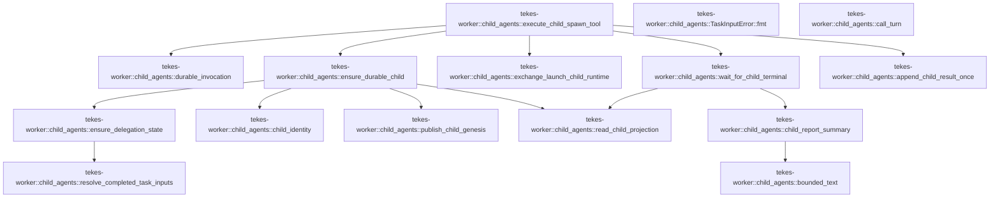

# tekes-worker::child_agents

[Package atlas](index.md) · [Source](../../src/child_agents.rs)

## Declarations

Visibility is the declaration spelling; trait members and reexports require their enclosing interface. `cfg` is not evaluated.

| Symbol | Kind | Visibility | Test / cfg |
|---|---|---|---|
| [tekes-worker::child_agents::ChildSpawnExecution](../../src/child_agents.rs#L3) | struct_item | `pub(crate)` |  |
| [tekes-worker::child_agents::DurableChildSpawn](../../src/child_agents.rs#L16) | struct_item | `pub(crate)` |  |
| [tekes-worker::child_agents::ChildTerminal](../../src/child_agents.rs#L24) | struct_item | `pub(crate)` |  |
| [tekes-worker::child_agents::execute_child_spawn_tool](../../src/child_agents.rs#L29) | function_item | `pub(crate)` |  |
| [tekes-worker::child_agents::durable_invocation](../../src/child_agents.rs#L191) | function_item | `private` |  |
| [tekes-worker::child_agents::ensure_durable_child](../../src/child_agents.rs#L213) | function_item | `pub(crate)` |  |
| [tekes-worker::child_agents::ensure_delegation_state](../../src/child_agents.rs#L338) | function_item | `pub(crate)` |  |
| [tekes-worker::child_agents::TaskInputError](../../src/child_agents.rs#L385) | struct_item | `pub(crate)` |  |
| [tekes-worker::child_agents::TaskInputError::fmt](../../src/child_agents.rs#L387) | function_item | `private` |  |
| [tekes-worker::child_agents::resolve_completed_task_inputs](../../src/child_agents.rs#L397) | function_item | `pub(crate)` |  |
| [tekes-worker::child_agents::child_identity](../../src/child_agents.rs#L472) | function_item | `pub(crate)` |  |
| [tekes-worker::child_agents::call_turn](../../src/child_agents.rs#L501) | function_item | `private` |  |
| [tekes-worker::child_agents::publish_child_genesis](../../src/child_agents.rs#L513) | function_item | `pub(crate)` |  |
| [tekes-worker::child_agents::exchange_launch_child_runtime](../../src/child_agents.rs#L547) | function_item | `pub(crate)` |  |
| [tekes-worker::child_agents::wait_for_child_terminal](../../src/child_agents.rs#L597) | function_item | `pub(crate)` |  |
| [tekes-worker::child_agents::read_child_projection](../../src/child_agents.rs#L646) | function_item | `pub(crate)` |  |
| [tekes-worker::child_agents::child_report_summary](../../src/child_agents.rs#L655) | function_item | `private` |  |
| [tekes-worker::child_agents::bounded_text](../../src/child_agents.rs#L695) | function_item | `private` |  |
| [tekes-worker::child_agents::append_child_result_once](../../src/child_agents.rs#L706) | function_item | `pub(crate)` |  |

## Imports / reexports

| Local name | Source path | Visibility |
|---|---|---|
| `*` | `super::*` | `private` |

## Module declarations

| Module | Visibility | Attributes |
|---|---|---|

## Function call graphs

Edges below are syntactically resolved calls only, including private functions. Graphs partition callers into groups of 20; they are not execution order. All unresolved sites are listed below and in the JSON inventory.

Functions 1–15: 13 direct edges

## Call sites

Includes test functions (marked in declarations). Receiver-type-required sites need type analysis/manual tracing. Calls in closures are attributed to their enclosing function; their occurrence here does not mean the closure executes immediately.

| Caller | Callee expression | Source lines | Target / classification |
|---|---|---|---|
| `execute_child_spawn_tool` | `effective_allowed_tools(profile).contains` | [50](../../src/child_agents.rs#L50) | receiver-type-required |
| `execute_child_spawn_tool` | `effective_allowed_tools` | [50](../../src/child_agents.rs#L50) | external-constructor-callback-or-unresolved |
| `execute_child_spawn_tool` | `Err` | [51](../../src/child_agents.rs#L51), [94](../../src/child_agents.rs#L94), [108](../../src/child_agents.rs#L108), [185](../../src/child_agents.rs#L185), [187](../../src/child_agents.rs#L187) | external-constructor-callback-or-unresolved |
| `execute_child_spawn_tool` | `format!("child-spawn tool {} is not allowed", call.name).into` | [51](../../src/child_agents.rs#L51) | receiver-type-required |
| `execute_child_spawn_tool` | `ledger         .projection()         .and_then(&#124;projection&#124; projection.events.first())         .and_then(&#124;genesis&#124; genesis.string_field("thread"))         .ok_or("genesis thread binding is missing")?         .to_owned` | [53](../../src/child_agents.rs#L53) | receiver-type-required |
| `execute_child_spawn_tool` | `ledger         .projection()         .and_then(&#124;projection&#124; projection.events.first())         .and_then(&#124;genesis&#124; genesis.string_field("thread"))         .ok_or` | [53](../../src/child_agents.rs#L53) | receiver-type-required |
| `execute_child_spawn_tool` | `ledger         .projection()         .and_then(&#124;projection&#124; projection.events.first())         .and_then` | [53](../../src/child_agents.rs#L53) | receiver-type-required |
| `execute_child_spawn_tool` | `ledger         .projection()         .and_then` | [53](../../src/child_agents.rs#L53) | receiver-type-required |
| `execute_child_spawn_tool` | `ledger         .projection` | [53](../../src/child_agents.rs#L53) | receiver-type-required |
| `execute_child_spawn_tool` | `projection.events.first` | [55](../../src/child_agents.rs#L55) | receiver-type-required |
| `execute_child_spawn_tool` | `genesis.string_field` | [56](../../src/child_agents.rs#L56) | receiver-type-required |
| `execute_child_spawn_tool` | `thread.clone` | [60](../../src/child_agents.rs#L60) | receiver-type-required |
| `execute_child_spawn_tool` | `attempt.to_owned` | [62](../../src/child_agents.rs#L62) | receiver-type-required |
| `execute_child_spawn_tool` | `call.call_id.clone` | [63](../../src/child_agents.rs#L63), [121](../../src/child_agents.rs#L121) | receiver-type-required |
| `execute_child_spawn_tool` | `call.name.clone` | [64](../../src/child_agents.rs#L64), [122](../../src/child_agents.rs#L122) | receiver-type-required |
| `execute_child_spawn_tool` | `IJsonValue::parse` | [65](../../src/child_agents.rs#L65) | external-constructor-callback-or-unresolved |
| `execute_child_spawn_tool` | `serde_json::to_vec` | [65](../../src/child_agents.rs#L65) | external-constructor-callback-or-unresolved |
| `execute_child_spawn_tool` | `options.event_timestamp().clone` | [66](../../src/child_agents.rs#L66) | receiver-type-required |
| `execute_child_spawn_tool` | `options.event_timestamp` | [66](../../src/child_agents.rs#L66) | receiver-type-required |
| `execute_child_spawn_tool` | `tool_catalog_context` | [68](../../src/child_agents.rs#L68) | external-constructor-callback-or-unresolved |
| `execute_child_spawn_tool` | `ToolDispatcher::new` | [69](../../src/child_agents.rs#L69) | external-constructor-callback-or-unresolved |
| `execute_child_spawn_tool` | `AssetStore::new` | [70](../../src/child_agents.rs#L70), [160](../../src/child_agents.rs#L160) | external-constructor-callback-or-unresolved |
| `execute_child_spawn_tool` | `ledger             .path()             .parent()             .ok_or("worker ledger has no thread folder")?             .join` | [71](../../src/child_agents.rs#L71), [161](../../src/child_agents.rs#L161) | receiver-type-required |
| `execute_child_spawn_tool` | `ledger             .path()             .parent()             .ok_or` | [71](../../src/child_agents.rs#L71), [78](../../src/child_agents.rs#L78), [161](../../src/child_agents.rs#L161), [168](../../src/child_agents.rs#L168) | receiver-type-required |
| `execute_child_spawn_tool` | `ledger             .path()             .parent` | [71](../../src/child_agents.rs#L71), [78](../../src/child_agents.rs#L78), [161](../../src/child_agents.rs#L161), [168](../../src/child_agents.rs#L168) | receiver-type-required |
| `execute_child_spawn_tool` | `ledger             .path` | [71](../../src/child_agents.rs#L71), [78](../../src/child_agents.rs#L78), [161](../../src/child_agents.rs#L161), [168](../../src/child_agents.rs#L168) | receiver-type-required |
| `execute_child_spawn_tool` | `session_permission_policy` | [77](../../src/child_agents.rs#L77), [167](../../src/child_agents.rs#L167) | external-constructor-callback-or-unresolved |
| `execute_child_spawn_tool` | `ToolPipeline::new` | [83](../../src/child_agents.rs#L83), [173](../../src/child_agents.rs#L173) | external-constructor-callback-or-unresolved |
| `execute_child_spawn_tool` | `SecretScanner::default` | [83](../../src/child_agents.rs#L83), [173](../../src/child_agents.rs#L173) | external-constructor-callback-or-unresolved |
| `execute_child_spawn_tool` | `dispatcher.dispatch` | [85](../../src/child_agents.rs#L85), [175](../../src/child_agents.rs#L175) | receiver-type-required |
| `execute_child_spawn_tool` | `Ok` | [92](../../src/child_agents.rs#L92), [97](../../src/child_agents.rs#L97), [106](../../src/child_agents.rs#L106), [182](../../src/child_agents.rs#L182), [183](../../src/child_agents.rs#L183) | external-constructor-callback-or-unresolved |
| `execute_child_spawn_tool` | `"child spawn backend cannot report a remote continuation".into` | [94](../../src/child_agents.rs#L94) | receiver-type-required |
| `execute_child_spawn_tool` | `drop` | [99](../../src/child_agents.rs#L99) | external-constructor-callback-or-unresolved |
| `execute_child_spawn_tool` | `durable_invocation` | [101](../../src/child_agents.rs#L101) | [tekes-worker::child_agents::durable_invocation](../../src/child_agents.rs#L191) |
| `execute_child_spawn_tool` | `ensure_durable_child` | [102](../../src/child_agents.rs#L102) | [tekes-worker::child_agents::ensure_durable_child](../../src/child_agents.rs#L213) |
| `execute_child_spawn_tool` | `error.downcast_ref::<TaskInputError>().is_some` | [104](../../src/child_agents.rs#L104) | receiver-type-required |
| `execute_child_spawn_tool` | `error.downcast_ref::<TaskInputError>` | [104](../../src/child_agents.rs#L104) | receiver-type-required |
| `execute_child_spawn_tool` | `append_tool_validation_error` | [105](../../src/child_agents.rs#L105) | external-constructor-callback-or-unresolved |
| `execute_child_spawn_tool` | `error.to_string` | [105](../../src/child_agents.rs#L105) | receiver-type-required |
| `execute_child_spawn_tool` | `ledger         .path()         .parent()         .and_then(&#124;folder&#124; folder.file_name())         .and_then(&#124;name&#124; name.to_str())         .ok_or("thread folder has no UTF-8 session UUID")?         .to_owned` | [110](../../src/child_agents.rs#L110) | receiver-type-required |
| `execute_child_spawn_tool` | `ledger         .path()         .parent()         .and_then(&#124;folder&#124; folder.file_name())         .and_then(&#124;name&#124; name.to_str())         .ok_or` | [110](../../src/child_agents.rs#L110) | receiver-type-required |
| `execute_child_spawn_tool` | `ledger         .path()         .parent()         .and_then(&#124;folder&#124; folder.file_name())         .and_then` | [110](../../src/child_agents.rs#L110) | receiver-type-required |
| `execute_child_spawn_tool` | `ledger         .path()         .parent()         .and_then` | [110](../../src/child_agents.rs#L110) | receiver-type-required |
| `execute_child_spawn_tool` | `ledger         .path()         .parent` | [110](../../src/child_agents.rs#L110) | receiver-type-required |
| `execute_child_spawn_tool` | `ledger         .path` | [110](../../src/child_agents.rs#L110) | receiver-type-required |
| `execute_child_spawn_tool` | `folder.file_name` | [113](../../src/child_agents.rs#L113) | receiver-type-required |
| `execute_child_spawn_tool` | `name.to_str` | [114](../../src/child_agents.rs#L114) | receiver-type-required |
| `execute_child_spawn_tool` | `ToolControl::new` | [117](../../src/child_agents.rs#L117) | external-constructor-callback-or-unresolved |
| `execute_child_spawn_tool` | `exchange_tool_control_runtime` | [125](../../src/child_agents.rs#L125) | external-constructor-callback-or-unresolved |
| `execute_child_spawn_tool` | `control.error.is_some` | [127](../../src/child_agents.rs#L127) | receiver-type-required |
| `execute_child_spawn_tool` | `append_child_result_once` | [128](../../src/child_agents.rs#L128), [142](../../src/child_agents.rs#L142), [156](../../src/child_agents.rs#L156) | [tekes-worker::child_agents::append_child_result_once](../../src/child_agents.rs#L706) |
| `execute_child_spawn_tool` | `"failed".to_owned` | [135](../../src/child_agents.rs#L135), [149](../../src/child_agents.rs#L149) | receiver-type-required |
| `execute_child_spawn_tool` | `control.error.as_ref().map` | [136](../../src/child_agents.rs#L136) | receiver-type-required |
| `execute_child_spawn_tool` | `control.error.as_ref` | [136](../../src/child_agents.rs#L136) | receiver-type-required |
| `execute_child_spawn_tool` | `error.message.clone` | [136](../../src/child_agents.rs#L136) | receiver-type-required |
| `execute_child_spawn_tool` | `exchange_launch_child_runtime` | [140](../../src/child_agents.rs#L140) | [tekes-worker::child_agents::exchange_launch_child_runtime](../../src/child_agents.rs#L547) |
| `execute_child_spawn_tool` | `wait_for_child_terminal` | [155](../../src/child_agents.rs#L155) | [tekes-worker::child_agents::wait_for_child_terminal](../../src/child_agents.rs#L597) |
| `execute_child_spawn_tool` | `"child result backend cannot report a remote continuation".into` | [185](../../src/child_agents.rs#L185) | receiver-type-required |
| `execute_child_spawn_tool` | `"child result backend deferred unexpectedly".into` | [187](../../src/child_agents.rs#L187) | receiver-type-required |
| `durable_invocation` | `ledger.projection().and_then` | [196](../../src/child_agents.rs#L196) | receiver-type-required |
| `durable_invocation` | `ledger.projection` | [196](../../src/child_agents.rs#L196) | receiver-type-required |
| `durable_invocation` | `projection.events.iter().find` | [197](../../src/child_agents.rs#L197) | receiver-type-required |
| `durable_invocation` | `projection.events.iter` | [197](../../src/child_agents.rs#L197) | receiver-type-required |
| `durable_invocation` | `event.kind` | [198](../../src/child_agents.rs#L198) | receiver-type-required |
| `durable_invocation` | `event.string_field` | [199](../../src/child_agents.rs#L199) | receiver-type-required |
| `durable_invocation` | `Some` | [199](../../src/child_agents.rs#L199) | external-constructor-callback-or-unresolved |
| `durable_invocation` | `Ok` | [202](../../src/child_agents.rs#L202), [208](../../src/child_agents.rs#L208) | external-constructor-callback-or-unresolved |
| `durable_invocation` | `original.clone` | [202](../../src/child_agents.rs#L202) | receiver-type-required |
| `durable_invocation` | `serde_json::to_value` | [204](../../src/child_agents.rs#L204) | external-constructor-callback-or-unresolved |
| `durable_invocation` | `event.raw` | [204](../../src/child_agents.rs#L204) | receiver-type-required |
| `durable_invocation` | `raw         .get("invocation")         .ok_or` | [205](../../src/child_agents.rs#L205) | receiver-type-required |
| `durable_invocation` | `raw         .get` | [205](../../src/child_agents.rs#L205) | receiver-type-required |
| `durable_invocation` | `IJsonValue::parse` | [208](../../src/child_agents.rs#L208) | external-constructor-callback-or-unresolved |
| `durable_invocation` | `serde_json::to_vec` | [208](../../src/child_agents.rs#L208) | external-constructor-callback-or-unresolved |
| `durable_invocation` | `materialize_json` | [208](../../src/child_agents.rs#L208) | external-constructor-callback-or-unresolved |
| `ensure_durable_child` | `ledger.projection().and_then` | [220](../../src/child_agents.rs#L220) | receiver-type-required |
| `ensure_durable_child` | `ledger.projection` | [220](../../src/child_agents.rs#L220) | receiver-type-required |
| `ensure_durable_child` | `projection.events.iter().find` | [221](../../src/child_agents.rs#L221) | receiver-type-required |
| `ensure_durable_child` | `projection.events.iter` | [221](../../src/child_agents.rs#L221) | receiver-type-required |
| `ensure_durable_child` | `event.kind` | [222](../../src/child_agents.rs#L222) | receiver-type-required |
| `ensure_durable_child` | `event.string_field` | [223](../../src/child_agents.rs#L223) | receiver-type-required |
| `ensure_durable_child` | `Some` | [223](../../src/child_agents.rs#L223), [244](../../src/child_agents.rs#L244) | external-constructor-callback-or-unresolved |
| `ensure_durable_child` | `call.call_id.as_str` | [223](../../src/child_agents.rs#L223) | receiver-type-required |
| `ensure_durable_child` | `serde_json::to_value` | [226](../../src/child_agents.rs#L226) | external-constructor-callback-or-unresolved |
| `ensure_durable_child` | `spawn.raw` | [226](../../src/child_agents.rs#L226) | receiver-type-required |
| `ensure_durable_child` | `spawn             .string_field("child")             .ok_or("spawn child is missing")?             .to_owned` | [227](../../src/child_agents.rs#L227) | receiver-type-required |
| `ensure_durable_child` | `spawn             .string_field("child")             .ok_or` | [227](../../src/child_agents.rs#L227) | receiver-type-required |
| `ensure_durable_child` | `spawn             .string_field` | [227](../../src/child_agents.rs#L227) | receiver-type-required |
| `ensure_durable_child` | `ledger             .path()             .parent()             .ok_or("parent ledger has no folder")?             .join` | [231](../../src/child_agents.rs#L231) | receiver-type-required |
| `ensure_durable_child` | `ledger             .path()             .parent()             .ok_or` | [231](../../src/child_agents.rs#L231) | receiver-type-required |
| `ensure_durable_child` | `ledger             .path()             .parent` | [231](../../src/child_agents.rs#L231) | receiver-type-required |
| `ensure_durable_child` | `ledger             .path` | [231](../../src/child_agents.rs#L231) | receiver-type-required |
| `ensure_durable_child` | `child_path             .file_stem()             .and_then(&#124;name&#124; name.to_str())             .ok_or("spawn child file has no UTF-8 stem")?             .to_owned` | [236](../../src/child_agents.rs#L236) | receiver-type-required |
| `ensure_durable_child` | `child_path             .file_stem()             .and_then(&#124;name&#124; name.to_str())             .ok_or` | [236](../../src/child_agents.rs#L236) | receiver-type-required |
| `ensure_durable_child` | `child_path             .file_stem()             .and_then` | [236](../../src/child_agents.rs#L236) | receiver-type-required |
| `ensure_durable_child` | `child_path             .file_stem` | [236](../../src/child_agents.rs#L236) | receiver-type-required |
| `ensure_durable_child` | `name.to_str` | [238](../../src/child_agents.rs#L238), [288](../../src/child_agents.rs#L288) | receiver-type-required |
| `ensure_durable_child` | `child_path.exists` | [241](../../src/child_agents.rs#L241) | receiver-type-required |
| `ensure_durable_child` | `read_child_projection` | [242](../../src/child_agents.rs#L242) | [tekes-worker::child_agents::read_child_projection](../../src/child_agents.rs#L646) |
| `ensure_durable_child` | `child.events.first().ok_or` | [243](../../src/child_agents.rs#L243) | receiver-type-required |
| `ensure_durable_child` | `child.events.first` | [243](../../src/child_agents.rs#L243) | receiver-type-required |
| `ensure_durable_child` | `genesis.string_field` | [244](../../src/child_agents.rs#L244), [268](../../src/child_agents.rs#L268) | receiver-type-required |
| `ensure_durable_child` | `child_line.as_str` | [244](../../src/child_agents.rs#L244) | receiver-type-required |
| `ensure_durable_child` | `Err` | [245](../../src/child_agents.rs#L245) | external-constructor-callback-or-unresolved |
| `ensure_durable_child` | `"spawn child file does not match child genesis".into` | [245](../../src/child_agents.rs#L245) | receiver-type-required |
| `ensure_durable_child` | `Ok` | [248](../../src/child_agents.rs#L248), [330](../../src/child_agents.rs#L330) | external-constructor-callback-or-unresolved |
| `ensure_durable_child` | `spawn                 .string_field("spawn_id")                 .ok_or("spawn id is missing")?                 .to_owned` | [251](../../src/child_agents.rs#L251) | receiver-type-required |
| `ensure_durable_child` | `spawn                 .string_field("spawn_id")                 .ok_or` | [251](../../src/child_agents.rs#L251) | receiver-type-required |
| `ensure_durable_child` | `spawn                 .string_field` | [251](../../src/child_agents.rs#L251) | receiver-type-required |
| `ensure_durable_child` | `serde_json::from_value` | [255](../../src/child_agents.rs#L255) | external-constructor-callback-or-unresolved |
| `ensure_durable_child` | `raw.get("resume")                     .cloned()                     .ok_or` | [256](../../src/child_agents.rs#L256) | receiver-type-required |
| `ensure_durable_child` | `raw.get("resume")                     .cloned` | [256](../../src/child_agents.rs#L256) | receiver-type-required |
| `ensure_durable_child` | `raw.get` | [256](../../src/child_agents.rs#L256) | receiver-type-required |
| `ensure_durable_child` | `ensure_delegation_state` | [263](../../src/child_agents.rs#L263) | [tekes-worker::child_agents::ensure_delegation_state](../../src/child_agents.rs#L338) |
| `ensure_durable_child` | `ledger.next_seq` | [264](../../src/child_agents.rs#L264) | receiver-type-required |
| `ensure_durable_child` | `ledger         .projection()         .and_then(&#124;projection&#124; projection.events.first())         .and_then(&#124;genesis&#124; genesis.string_field("thread"))         .ok_or` | [265](../../src/child_agents.rs#L265) | receiver-type-required |
| `ensure_durable_child` | `ledger         .projection()         .and_then(&#124;projection&#124; projection.events.first())         .and_then` | [265](../../src/child_agents.rs#L265) | receiver-type-required |
| `ensure_durable_child` | `ledger         .projection()         .and_then` | [265](../../src/child_agents.rs#L265) | receiver-type-required |
| `ensure_durable_child` | `ledger         .projection` | [265](../../src/child_agents.rs#L265) | receiver-type-required |
| `ensure_durable_child` | `projection.events.first` | [267](../../src/child_agents.rs#L267) | receiver-type-required |
| `ensure_durable_child` | `child_identity` | [270](../../src/child_agents.rs#L270) | [tekes-worker::child_agents::child_identity](../../src/child_agents.rs#L472) |
| `ensure_durable_child` | `ResumePolicy::Bounded` | [272](../../src/child_agents.rs#L272) | external-constructor-callback-or-unresolved |
| `ensure_durable_child` | `delegation.canonical_bytes` | [273](../../src/child_agents.rs#L273) | receiver-type-required |
| `ensure_durable_child` | `seed_bytes.push` | [274](../../src/child_agents.rs#L274) | receiver-type-required |
| `ensure_durable_child` | `ledger         .path()         .parent()         .ok_or` | [275](../../src/child_agents.rs#L275) | receiver-type-required |
| `ensure_durable_child` | `ledger         .path()         .parent` | [275](../../src/child_agents.rs#L275) | receiver-type-required |
| `ensure_durable_child` | `ledger         .path` | [275](../../src/child_agents.rs#L275), [285](../../src/child_agents.rs#L285) | receiver-type-required |
| `ensure_durable_child` | `AssetStore::new` | [279](../../src/child_agents.rs#L279) | external-constructor-callback-or-unresolved |
| `ensure_durable_child` | `folder.join` | [279](../../src/child_agents.rs#L279) | receiver-type-required |
| `ensure_durable_child` | `assets.publish` | [280](../../src/child_agents.rs#L280) | receiver-type-required |
| `ensure_durable_child` | `seed         .asset         .strip_prefix("sha256-")         .ok_or` | [281](../../src/child_agents.rs#L281) | receiver-type-required |
| `ensure_durable_child` | `seed         .asset         .strip_prefix` | [281](../../src/child_agents.rs#L281) | receiver-type-required |
| `ensure_durable_child` | `ledger         .path()         .file_name()         .and_then(&#124;name&#124; name.to_str())         .ok_or` | [285](../../src/child_agents.rs#L285) | receiver-type-required |
| `ensure_durable_child` | `ledger         .path()         .file_name()         .and_then` | [285](../../src/child_agents.rs#L285) | receiver-type-required |
| `ensure_durable_child` | `ledger         .path()         .file_name` | [285](../../src/child_agents.rs#L285) | receiver-type-required |
| `ensure_durable_child` | `genesis         .as_object_mut()         .expect("genesis object")         .extend` | [306](../../src/child_agents.rs#L306) | receiver-type-required |
| `ensure_durable_child` | `genesis         .as_object_mut()         .expect` | [306](../../src/child_agents.rs#L306) | receiver-type-required |
| `ensure_durable_child` | `genesis         .as_object_mut` | [306](../../src/child_agents.rs#L306) | receiver-type-required |
| `ensure_durable_child` | `identity::inherited_opening` | [309](../../src/child_agents.rs#L309) | external-constructor-callback-or-unresolved |
| `ensure_durable_child` | `genesis.get("execution").is_some` | [310](../../src/child_agents.rs#L310) | receiver-type-required |
| `ensure_durable_child` | `genesis.get` | [310](../../src/child_agents.rs#L310) | receiver-type-required |
| `ensure_durable_child` | `genesis             .as_object_mut()             .expect("genesis")             .remove` | [311](../../src/child_agents.rs#L311) | receiver-type-required |
| `ensure_durable_child` | `genesis             .as_object_mut()             .expect` | [311](../../src/child_agents.rs#L311) | receiver-type-required |
| `ensure_durable_child` | `genesis             .as_object_mut` | [311](../../src/child_agents.rs#L311) | receiver-type-required |
| `ensure_durable_child` | `options.instruction_digest.is_empty` | [316](../../src/child_agents.rs#L316) | receiver-type-required |
| `ensure_durable_child` | `genesis.as_object_mut().expect("genesis object").insert` | [317](../../src/child_agents.rs#L317) | receiver-type-required |
| `ensure_durable_child` | `genesis.as_object_mut().expect` | [317](../../src/child_agents.rs#L317) | receiver-type-required |
| `ensure_durable_child` | `genesis.as_object_mut` | [317](../../src/child_agents.rs#L317) | receiver-type-required |
| `ensure_durable_child` | `"instruction".to_owned` | [318](../../src/child_agents.rs#L318) | receiver-type-required |
| `ensure_durable_child` | `publish_child_genesis` | [322](../../src/child_agents.rs#L322) | [tekes-worker::child_agents::publish_child_genesis](../../src/child_agents.rs#L513) |
| `ensure_durable_child` | `make_event` | [322](../../src/child_agents.rs#L322), [323](../../src/child_agents.rs#L323) | external-constructor-callback-or-unresolved |
| `ensure_durable_child` | `ledger.append_contract` | [329](../../src/child_agents.rs#L329) | receiver-type-required |
| `ensure_durable_child` | `BarrierContext::default` | [329](../../src/child_agents.rs#L329) | external-constructor-callback-or-unresolved |
| `ensure_delegation_state` | `serde_json::to_value` | [344](../../src/child_agents.rs#L344), [352](../../src/child_agents.rs#L352), [364](../../src/child_agents.rs#L364) | external-constructor-callback-or-unresolved |
| `ensure_delegation_state` | `ledger.projection().and_then` | [345](../../src/child_agents.rs#L345) | receiver-type-required |
| `ensure_delegation_state` | `ledger.projection` | [345](../../src/child_agents.rs#L345) | receiver-type-required |
| `ensure_delegation_state` | `projection.events.iter().find` | [346](../../src/child_agents.rs#L346) | receiver-type-required |
| `ensure_delegation_state` | `projection.events.iter` | [346](../../src/child_agents.rs#L346) | receiver-type-required |
| `ensure_delegation_state` | `event.kind` | [347](../../src/child_agents.rs#L347) | receiver-type-required |
| `ensure_delegation_state` | `event.string_field` | [348](../../src/child_agents.rs#L348) | receiver-type-required |
| `ensure_delegation_state` | `Some` | [348](../../src/child_agents.rs#L348), [361](../../src/child_agents.rs#L361), [365](../../src/child_agents.rs#L365), [366](../../src/child_agents.rs#L366) | external-constructor-callback-or-unresolved |
| `ensure_delegation_state` | `serde_json::to_value(event.raw())                 .ok()                 .and_then(&#124;value&#124; {                     value                         .pointer("/payload/call")                         .and_then(Value::as_str)                         .map(str::to_owned)                 })                 .as_deref` | [352](../../src/child_agents.rs#L352) | receiver-type-required |
| `ensure_delegation_state` | `serde_json::to_value(event.raw())                 .ok()                 .and_then` | [352](../../src/child_agents.rs#L352) | receiver-type-required |
| `ensure_delegation_state` | `serde_json::to_value(event.raw())                 .ok` | [352](../../src/child_agents.rs#L352) | receiver-type-required |
| `ensure_delegation_state` | `event.raw` | [352](../../src/child_agents.rs#L352) | receiver-type-required |
| `ensure_delegation_state` | `value                         .pointer("/payload/call")                         .and_then(Value::as_str)                         .map` | [355](../../src/child_agents.rs#L355) | receiver-type-required |
| `ensure_delegation_state` | `value                         .pointer("/payload/call")                         .and_then` | [355](../../src/child_agents.rs#L355) | receiver-type-required |
| `ensure_delegation_state` | `value                         .pointer` | [355](../../src/child_agents.rs#L355) | receiver-type-required |
| `ensure_delegation_state` | `call.call_id.as_str` | [361](../../src/child_agents.rs#L361) | receiver-type-required |
| `ensure_delegation_state` | `existing.raw` | [364](../../src/child_agents.rs#L364) | receiver-type-required |
| `ensure_delegation_state` | `raw.pointer("/payload/name").and_then` | [365](../../src/child_agents.rs#L365) | receiver-type-required |
| `ensure_delegation_state` | `raw.pointer` | [365](../../src/child_agents.rs#L365), [366](../../src/child_agents.rs#L366) | receiver-type-required |
| `ensure_delegation_state` | `call.name.as_str` | [365](../../src/child_agents.rs#L365) | receiver-type-required |
| `ensure_delegation_state` | `Err` | [368](../../src/child_agents.rs#L368) | external-constructor-callback-or-unresolved |
| `ensure_delegation_state` | `"durable delegation state does not match effective invocation".into` | [368](../../src/child_agents.rs#L368) | receiver-type-required |
| `ensure_delegation_state` | `Ok` | [370](../../src/child_agents.rs#L370), [381](../../src/child_agents.rs#L381) | external-constructor-callback-or-unresolved |
| `ensure_delegation_state` | `existing.clone` | [370](../../src/child_agents.rs#L370) | receiver-type-required |
| `ensure_delegation_state` | `resolve_completed_task_inputs` | [373](../../src/child_agents.rs#L373) | [tekes-worker::child_agents::resolve_completed_task_inputs](../../src/child_agents.rs#L397) |
| `ensure_delegation_state` | `make_event` | [374](../../src/child_agents.rs#L374) | external-constructor-callback-or-unresolved |
| `ensure_delegation_state` | `ledger.append_contract` | [380](../../src/child_agents.rs#L380) | receiver-type-required |
| `ensure_delegation_state` | `event.clone` | [380](../../src/child_agents.rs#L380) | receiver-type-required |
| `ensure_delegation_state` | `BarrierContext::default` | [380](../../src/child_agents.rs#L380) | external-constructor-callback-or-unresolved |
| `fmt` | `formatter.write_str` | [388](../../src/child_agents.rs#L388) | receiver-type-required |
| `resolve_completed_task_inputs` | `invocation.get("input_sources").and_then` | [402](../../src/child_agents.rs#L402) | receiver-type-required |
| `resolve_completed_task_inputs` | `invocation.get` | [402](../../src/child_agents.rs#L402) | receiver-type-required |
| `resolve_completed_task_inputs` | `Ok` | [403](../../src/child_agents.rs#L403), [469](../../src/child_agents.rs#L469) | external-constructor-callback-or-unresolved |
| `resolve_completed_task_inputs` | `ledger.projection().ok_or` | [405](../../src/child_agents.rs#L405) | receiver-type-required |
| `resolve_completed_task_inputs` | `ledger.projection` | [405](../../src/child_agents.rs#L405) | receiver-type-required |
| `resolve_completed_task_inputs` | `projection         .events         .iter()         .find(&#124;event&#124; {             event.kind() == &EventKind::ToolCall && event.string_field("call") == Some(current_call)         })         .map(Event::seq)         .ok_or` | [406](../../src/child_agents.rs#L406) | receiver-type-required |
| `resolve_completed_task_inputs` | `projection         .events         .iter()         .find(&#124;event&#124; {             event.kind() == &EventKind::ToolCall && event.string_field("call") == Some(current_call)         })         .map` | [406](../../src/child_agents.rs#L406) | receiver-type-required |
| `resolve_completed_task_inputs` | `projection         .events         .iter()         .find` | [406](../../src/child_agents.rs#L406) | receiver-type-required |
| `resolve_completed_task_inputs` | `projection         .events         .iter` | [406](../../src/child_agents.rs#L406) | receiver-type-required |
| `resolve_completed_task_inputs` | `event.kind` | [410](../../src/child_agents.rs#L410), [422](../../src/child_agents.rs#L422), [447](../../src/child_agents.rs#L447) | receiver-type-required |
| `resolve_completed_task_inputs` | `event.string_field` | [410](../../src/child_agents.rs#L410), [423](../../src/child_agents.rs#L423), [448](../../src/child_agents.rs#L448), [449](../../src/child_agents.rs#L449) | receiver-type-required |
| `resolve_completed_task_inputs` | `Some` | [410](../../src/child_agents.rs#L410), [423](../../src/child_agents.rs#L423), [427](../../src/child_agents.rs#L427), [431](../../src/child_agents.rs#L431), [448](../../src/child_agents.rs#L448), [449](../../src/child_agents.rs#L449) | external-constructor-callback-or-unresolved |
| `resolve_completed_task_inputs` | `Vec::new` | [414](../../src/child_agents.rs#L414) | external-constructor-callback-or-unresolved |
| `resolve_completed_task_inputs` | `source.as_str().ok_or` | [416](../../src/child_agents.rs#L416) | receiver-type-required |
| `resolve_completed_task_inputs` | `source.as_str` | [416](../../src/child_agents.rs#L416) | receiver-type-required |
| `resolve_completed_task_inputs` | `projection             .events             .iter()             .filter(&#124;event&#124; {                 event.seq() < current_seq                     && event.kind() == &EventKind::State                     && event.string_field("subkind") == Some("delegation")             })             .filter_map(&#124;event&#124; {                 let raw = serde_json::to_value(event.raw()).ok()?;                 (raw.pointer("/payload/name").and_then(Value::as_str) == Some("task")                     && raw                         .pointer("/payload/invocation/task_name")                         .and_then(Value::as_str)                         == Some(source))                 .then_some((event, raw))             })             .collect::<Vec<_>>` | [417](../../src/child_agents.rs#L417) | receiver-type-required |
| `resolve_completed_task_inputs` | `projection             .events             .iter()             .filter(&#124;event&#124; {                 event.seq() < current_seq                     && event.kind() == &EventKind::State                     && event.string_field("subkind") == Some("delegation")             })             .filter_map` | [417](../../src/child_agents.rs#L417) | receiver-type-required |
| `resolve_completed_task_inputs` | `projection             .events             .iter()             .filter` | [417](../../src/child_agents.rs#L417) | receiver-type-required |
| `resolve_completed_task_inputs` | `projection             .events             .iter` | [417](../../src/child_agents.rs#L417) | receiver-type-required |
| `resolve_completed_task_inputs` | `event.seq` | [421](../../src/child_agents.rs#L421), [446](../../src/child_agents.rs#L446) | receiver-type-required |
| `resolve_completed_task_inputs` | `serde_json::to_value(event.raw()).ok` | [426](../../src/child_agents.rs#L426) | receiver-type-required |
| `resolve_completed_task_inputs` | `serde_json::to_value` | [426](../../src/child_agents.rs#L426) | external-constructor-callback-or-unresolved |
| `resolve_completed_task_inputs` | `event.raw` | [426](../../src/child_agents.rs#L426) | receiver-type-required |
| `resolve_completed_task_inputs` | `(raw.pointer("/payload/name").and_then(Value::as_str) == Some("task")                     && raw                         .pointer("/payload/invocation/task_name")                         .and_then(Value::as_str)                         == Some(source))                 .then_some` | [427](../../src/child_agents.rs#L427) | receiver-type-required |
| `resolve_completed_task_inputs` | `raw.pointer("/payload/name").and_then` | [427](../../src/child_agents.rs#L427) | receiver-type-required |
| `resolve_completed_task_inputs` | `raw.pointer` | [427](../../src/child_agents.rs#L427) | receiver-type-required |
| `resolve_completed_task_inputs` | `raw                         .pointer("/payload/invocation/task_name")                         .and_then` | [428](../../src/child_agents.rs#L428) | receiver-type-required |
| `resolve_completed_task_inputs` | `raw                         .pointer` | [428](../../src/child_agents.rs#L428) | receiver-type-required |
| `resolve_completed_task_inputs` | `matches.is_empty` | [435](../../src/child_agents.rs#L435) | receiver-type-required |
| `resolve_completed_task_inputs` | `matches.last().expect` | [440](../../src/child_agents.rs#L440) | receiver-type-required |
| `resolve_completed_task_inputs` | `matches.last` | [440](../../src/child_agents.rs#L440) | receiver-type-required |
| `resolve_completed_task_inputs` | `raw             .pointer("/payload/call")             .and_then(Value::as_str)             .ok_or` | [441](../../src/child_agents.rs#L441) | receiver-type-required |
| `resolve_completed_task_inputs` | `raw             .pointer("/payload/call")             .and_then` | [441](../../src/child_agents.rs#L441) | receiver-type-required |
| `resolve_completed_task_inputs` | `raw             .pointer` | [441](../../src/child_agents.rs#L441), [456](../../src/child_agents.rs#L456) | receiver-type-required |
| `resolve_completed_task_inputs` | `projection.events.iter().find` | [445](../../src/child_agents.rs#L445) | receiver-type-required |
| `resolve_completed_task_inputs` | `projection.events.iter` | [445](../../src/child_agents.rs#L445) | receiver-type-required |
| `resolve_completed_task_inputs` | `Err` | [452](../../src/child_agents.rs#L452) | external-constructor-callback-or-unresolved |
| `resolve_completed_task_inputs` | `Box::new` | [452](../../src/child_agents.rs#L452) | external-constructor-callback-or-unresolved |
| `resolve_completed_task_inputs` | `TaskInputError` | [452](../../src/child_agents.rs#L452) | external-constructor-callback-or-unresolved |
| `resolve_completed_task_inputs` | `raw             .pointer("/payload/invocation/output")             .cloned()             .ok_or` | [456](../../src/child_agents.rs#L456) | receiver-type-required |
| `resolve_completed_task_inputs` | `raw             .pointer("/payload/invocation/output")             .cloned` | [456](../../src/child_agents.rs#L456) | receiver-type-required |
| `resolve_completed_task_inputs` | `output             .get("path")             .and_then(Value::as_str)             .ok_or` | [460](../../src/child_agents.rs#L460) | receiver-type-required |
| `resolve_completed_task_inputs` | `output             .get("path")             .and_then` | [460](../../src/child_agents.rs#L460) | receiver-type-required |
| `resolve_completed_task_inputs` | `output             .get` | [460](../../src/child_agents.rs#L460) | receiver-type-required |
| `resolve_completed_task_inputs` | `resolved.push` | [464](../../src/child_agents.rs#L464) | receiver-type-required |
| `resolve_completed_task_inputs` | `Value::Array` | [469](../../src/child_agents.rs#L469) | external-constructor-callback-or-unresolved |
| `child_identity` | `Sha256::new` | [473](../../src/child_agents.rs#L473) | external-constructor-callback-or-unresolved |
| `child_identity` | `hasher.update` | [474](../../src/child_agents.rs#L474), [475](../../src/child_agents.rs#L475), [476](../../src/child_agents.rs#L476), [477](../../src/child_agents.rs#L477), [478](../../src/child_agents.rs#L478), [479](../../src/child_agents.rs#L479) | receiver-type-required |
| `child_identity` | `parent.as_bytes` | [475](../../src/child_agents.rs#L475) | receiver-type-required |
| `child_identity` | `call.as_bytes` | [477](../../src/child_agents.rs#L477) | receiver-type-required |
| `child_identity` | `spawn_seq.to_string().as_bytes` | [479](../../src/child_agents.rs#L479) | receiver-type-required |
| `child_identity` | `spawn_seq.to_string` | [479](../../src/child_agents.rs#L479) | receiver-type-required |
| `child_identity` | `hasher.finalize().into` | [480](../../src/child_agents.rs#L480) | receiver-type-required |
| `child_identity` | `hasher.finalize` | [480](../../src/child_agents.rs#L480) | receiver-type-required |
| `child_identity` | `bytes.copy_from_slice` | [482](../../src/child_agents.rs#L482) | receiver-type-required |
| `child_identity` | `String::with_capacity` | [485](../../src/child_agents.rs#L485) | external-constructor-callback-or-unresolved |
| `child_identity` | `write!(&mut hex, "{byte:02x}").expect` | [488](../../src/child_agents.rs#L488) | receiver-type-required |
| `call_turn` | `ledger         .projection()         .and_then(&#124;projection&#124; {             projection.events.iter().find(&#124;event&#124; {                 event.kind() == &EventKind::ToolCall && event.string_field("call") == Some(call)             })         })         .and_then(Event::turn)         .ok_or_else` | [502](../../src/child_agents.rs#L502) | receiver-type-required |
| `call_turn` | `ledger         .projection()         .and_then(&#124;projection&#124; {             projection.events.iter().find(&#124;event&#124; {                 event.kind() == &EventKind::ToolCall && event.string_field("call") == Some(call)             })         })         .and_then` | [502](../../src/child_agents.rs#L502) | receiver-type-required |
| `call_turn` | `ledger         .projection()         .and_then` | [502](../../src/child_agents.rs#L502) | receiver-type-required |
| `call_turn` | `ledger         .projection` | [502](../../src/child_agents.rs#L502) | receiver-type-required |
| `call_turn` | `projection.events.iter().find` | [505](../../src/child_agents.rs#L505) | receiver-type-required |
| `call_turn` | `projection.events.iter` | [505](../../src/child_agents.rs#L505) | receiver-type-required |
| `call_turn` | `event.kind` | [506](../../src/child_agents.rs#L506) | receiver-type-required |
| `call_turn` | `event.string_field` | [506](../../src/child_agents.rs#L506) | receiver-type-required |
| `call_turn` | `Some` | [506](../../src/child_agents.rs#L506) | external-constructor-callback-or-unresolved |
| `call_turn` | `"tool_call turn is missing".into` | [510](../../src/child_agents.rs#L510) | receiver-type-required |
| `publish_child_genesis` | `folder.join` | [518](../../src/child_agents.rs#L518), [527](../../src/child_agents.rs#L527) | receiver-type-required |
| `publish_child_genesis` | `genesis.canonical_bytes` | [519](../../src/child_agents.rs#L519) | receiver-type-required |
| `publish_child_genesis` | `expected.push` | [520](../../src/child_agents.rs#L520) | receiver-type-required |
| `publish_child_genesis` | `destination.exists` | [521](../../src/child_agents.rs#L521) | receiver-type-required |
| `publish_child_genesis` | `fs::read` | [522](../../src/child_agents.rs#L522) | external-constructor-callback-or-unresolved |
| `publish_child_genesis` | `Ok` | [523](../../src/child_agents.rs#L523), [539](../../src/child_agents.rs#L539) | external-constructor-callback-or-unresolved |
| `publish_child_genesis` | `Err` | [525](../../src/child_agents.rs#L525) | external-constructor-callback-or-unresolved |
| `publish_child_genesis` | `format!("child file {child_file} exists with different genesis").into` | [525](../../src/child_agents.rs#L525) | receiver-type-required |
| `publish_child_genesis` | `OpenOptions::new()         .write(true)         .create_new(true)         .mode(0o600)         .open` | [528](../../src/child_agents.rs#L528) | receiver-type-required |
| `publish_child_genesis` | `OpenOptions::new()         .write(true)         .create_new(true)         .mode` | [528](../../src/child_agents.rs#L528) | receiver-type-required |
| `publish_child_genesis` | `OpenOptions::new()         .write(true)         .create_new` | [528](../../src/child_agents.rs#L528) | receiver-type-required |
| `publish_child_genesis` | `OpenOptions::new()         .write` | [528](../../src/child_agents.rs#L528) | receiver-type-required |
| `publish_child_genesis` | `OpenOptions::new` | [528](../../src/child_agents.rs#L528) | external-constructor-callback-or-unresolved |
| `publish_child_genesis` | `(&#124;&#124; -> Result<(), Box<dyn std::error::Error>> {         file.write_all(&expected)?;         file.sync_all()?;         drop(file);         fs::rename(&temp, &destination)?;         File::open(folder)?.sync_all()?;         Ok(())     })` | [533](../../src/child_agents.rs#L533) | external-constructor-callback-or-unresolved |
| `publish_child_genesis` | `file.write_all` | [534](../../src/child_agents.rs#L534) | receiver-type-required |
| `publish_child_genesis` | `file.sync_all` | [535](../../src/child_agents.rs#L535) | receiver-type-required |
| `publish_child_genesis` | `drop` | [536](../../src/child_agents.rs#L536) | external-constructor-callback-or-unresolved |
| `publish_child_genesis` | `fs::rename` | [537](../../src/child_agents.rs#L537) | external-constructor-callback-or-unresolved |
| `publish_child_genesis` | `File::open(folder)?.sync_all` | [538](../../src/child_agents.rs#L538) | receiver-type-required |
| `publish_child_genesis` | `File::open` | [538](../../src/child_agents.rs#L538) | external-constructor-callback-or-unresolved |
| `publish_child_genesis` | `result.is_err` | [541](../../src/child_agents.rs#L541) | receiver-type-required |
| `publish_child_genesis` | `fs::remove_file` | [542](../../src/child_agents.rs#L542) | external-constructor-callback-or-unresolved |
| `exchange_launch_child_runtime` | `stdout.write_all` | [557](../../src/child_agents.rs#L557), [578](../../src/child_agents.rs#L578) | receiver-type-required |
| `exchange_launch_child_runtime` | `encode_line` | [557](../../src/child_agents.rs#L557), [578](../../src/child_agents.rs#L578) | external-constructor-callback-or-unresolved |
| `exchange_launch_child_runtime` | `spawn.child.clone` | [560](../../src/child_agents.rs#L560) | receiver-type-required |
| `exchange_launch_child_runtime` | `spawn.spawn_id.clone` | [561](../../src/child_agents.rs#L561) | receiver-type-required |
| `exchange_launch_child_runtime` | `stdout.flush` | [565](../../src/child_agents.rs#L565), [579](../../src/child_agents.rs#L579) | receiver-type-required |
| `exchange_launch_child_runtime` | `lines.next().ok_or_else` | [567](../../src/child_agents.rs#L567) | receiver-type-required |
| `exchange_launch_child_runtime` | `lines.next` | [567](../../src/child_agents.rs#L567) | receiver-type-required |
| `exchange_launch_child_runtime` | `cancellation.cancel` | [568](../../src/child_agents.rs#L568), [582](../../src/child_agents.rs#L582) | receiver-type-required |
| `exchange_launch_child_runtime` | `ProtocolFailure` | [569](../../src/child_agents.rs#L569), [589](../../src/child_agents.rs#L589) | external-constructor-callback-or-unresolved |
| `exchange_launch_child_runtime` | `"supervisor EOF while awaiting launch_result".to_owned` | [569](../../src/child_agents.rs#L569) | receiver-type-required |
| `exchange_launch_child_runtime` | `decode_supervisor` | [571](../../src/child_agents.rs#L571) | external-constructor-callback-or-unresolved |
| `exchange_launch_child_runtime` | `line.as_bytes` | [571](../../src/child_agents.rs#L571) | receiver-type-required |
| `exchange_launch_child_runtime` | `Ok` | [575](../../src/child_agents.rs#L575) | external-constructor-callback-or-unresolved |
| `exchange_launch_child_runtime` | `cancellation.defer` | [583](../../src/child_agents.rs#L583) | receiver-type-required |
| `exchange_launch_child_runtime` | `Err` | [584](../../src/child_agents.rs#L584), [589](../../src/child_agents.rs#L589) | external-constructor-callback-or-unresolved |
| `exchange_launch_child_runtime` | `"child launch cancelled by stop".into` | [584](../../src/child_agents.rs#L584) | receiver-type-required |
| `exchange_launch_child_runtime` | `cancellation.park_delivery` | [586](../../src/child_agents.rs#L586) | receiver-type-required |
| `exchange_launch_child_runtime` | `cancellation.mark_protocol_failed` | [588](../../src/child_agents.rs#L588) | receiver-type-required |
| `exchange_launch_child_runtime` | `Box::new` | [589](../../src/child_agents.rs#L589) | external-constructor-callback-or-unresolved |
| `exchange_launch_child_runtime` | `"unexpected supervisor message while awaiting launch_result".to_owned` | [590](../../src/child_agents.rs#L590) | receiver-type-required |
| `wait_for_child_terminal` | `parent         .path()         .parent()         .ok_or("parent ledger has no folder")?         .join` | [605](../../src/child_agents.rs#L605) | receiver-type-required |
| `wait_for_child_terminal` | `parent         .path()         .parent()         .ok_or` | [605](../../src/child_agents.rs#L605) | receiver-type-required |
| `wait_for_child_terminal` | `parent         .path()         .parent` | [605](../../src/child_agents.rs#L605) | receiver-type-required |
| `wait_for_child_terminal` | `parent         .path` | [605](../../src/child_agents.rs#L605) | receiver-type-required |
| `wait_for_child_terminal` | `cancellation.stop_requested` | [611](../../src/child_agents.rs#L611) | receiver-type-required |
| `wait_for_child_terminal` | `Err` | [612](../../src/child_agents.rs#L612), [615](../../src/child_agents.rs#L615), [635](../../src/child_agents.rs#L635) | external-constructor-callback-or-unresolved |
| `wait_for_child_terminal` | `"child wait cancelled by stop".into` | [612](../../src/child_agents.rs#L612) | receiver-type-required |
| `wait_for_child_terminal` | `cancellation.supervisor_lost` | [614](../../src/child_agents.rs#L614) | receiver-type-required |
| `wait_for_child_terminal` | `Box::new` | [615](../../src/child_agents.rs#L615) | external-constructor-callback-or-unresolved |
| `wait_for_child_terminal` | `ProtocolFailure` | [615](../../src/child_agents.rs#L615) | external-constructor-callback-or-unresolved |
| `wait_for_child_terminal` | `"supervisor EOF while waiting for child".to_owned` | [616](../../src/child_agents.rs#L616) | receiver-type-required |
| `wait_for_child_terminal` | `drain_parked_deliveries` | [621](../../src/child_agents.rs#L621) | external-constructor-callback-or-unresolved |
| `wait_for_child_terminal` | `read_child_projection` | [622](../../src/child_agents.rs#L622) | [tekes-worker::child_agents::read_child_projection](../../src/child_agents.rs#L646) |
| `wait_for_child_terminal` | `projection                 .events                 .iter()                 .rev()                 .find(&#124;event&#124; event.kind() == &EventKind::Settle)                 .ok_or` | [624](../../src/child_agents.rs#L624) | receiver-type-required |
| `wait_for_child_terminal` | `projection                 .events                 .iter()                 .rev()                 .find` | [624](../../src/child_agents.rs#L624) | receiver-type-required |
| `wait_for_child_terminal` | `projection                 .events                 .iter()                 .rev` | [624](../../src/child_agents.rs#L624) | receiver-type-required |
| `wait_for_child_terminal` | `projection                 .events                 .iter` | [624](../../src/child_agents.rs#L624) | receiver-type-required |
| `wait_for_child_terminal` | `event.kind` | [628](../../src/child_agents.rs#L628) | receiver-type-required |
| `wait_for_child_terminal` | `serde_json::to_value` | [630](../../src/child_agents.rs#L630) | external-constructor-callback-or-unresolved |
| `wait_for_child_terminal` | `settle.raw` | [630](../../src/child_agents.rs#L630) | receiver-type-required |
| `wait_for_child_terminal` | `raw.get("outcome").and_then` | [631](../../src/child_agents.rs#L631) | receiver-type-required |
| `wait_for_child_terminal` | `raw.get` | [631](../../src/child_agents.rs#L631) | receiver-type-required |
| `wait_for_child_terminal` | `"child settle has unknown outcome".into` | [635](../../src/child_agents.rs#L635) | receiver-type-required |
| `wait_for_child_terminal` | `Ok` | [637](../../src/child_agents.rs#L637) | external-constructor-callback-or-unresolved |
| `wait_for_child_terminal` | `outcome.to_owned` | [638](../../src/child_agents.rs#L638) | receiver-type-required |
| `wait_for_child_terminal` | `child_report_summary` | [639](../../src/child_agents.rs#L639) | [tekes-worker::child_agents::child_report_summary](../../src/child_agents.rs#L655) |
| `wait_for_child_terminal` | `std::thread::sleep` | [642](../../src/child_agents.rs#L642) | external-constructor-callback-or-unresolved |
| `wait_for_child_terminal` | `Duration::from_millis` | [642](../../src/child_agents.rs#L642) | external-constructor-callback-or-unresolved |
| `read_child_projection` | `fs::read` | [649](../../src/child_agents.rs#L649) | external-constructor-callback-or-unresolved |
| `read_child_projection` | `scan_valid_prefix(&bytes, schema::READER_VERSION)         .projection         .ok_or_else` | [650](../../src/child_agents.rs#L650) | receiver-type-required |
| `read_child_projection` | `scan_valid_prefix` | [650](../../src/child_agents.rs#L650) | external-constructor-callback-or-unresolved |
| `read_child_projection` | `"child ledger has no projection".into` | [652](../../src/child_agents.rs#L652) | receiver-type-required |
| `child_report_summary` | `AssetStore::new` | [659](../../src/child_agents.rs#L659) | external-constructor-callback-or-unresolved |
| `child_report_summary` | `path.parent()             .ok_or("child ledger has no folder")?             .join` | [660](../../src/child_agents.rs#L660) | receiver-type-required |
| `child_report_summary` | `path.parent()             .ok_or` | [660](../../src/child_agents.rs#L660) | receiver-type-required |
| `child_report_summary` | `path.parent` | [660](../../src/child_agents.rs#L660) | receiver-type-required |
| `child_report_summary` | `projection.events.iter().rev` | [664](../../src/child_agents.rs#L664) | receiver-type-required |
| `child_report_summary` | `projection.events.iter` | [664](../../src/child_agents.rs#L664), [669](../../src/child_agents.rs#L669) | receiver-type-required |
| `child_report_summary` | `event.kind` | [665](../../src/child_agents.rs#L665) | receiver-type-required |
| `child_report_summary` | `event.string_field` | [665](../../src/child_agents.rs#L665), [673](../../src/child_agents.rs#L673) | receiver-type-required |
| `child_report_summary` | `Some` | [665](../../src/child_agents.rs#L665), [674](../../src/child_agents.rs#L674), [689](../../src/child_agents.rs#L689) | external-constructor-callback-or-unresolved |
| `child_report_summary` | `event.turn` | [668](../../src/child_agents.rs#L668), [672](../../src/child_agents.rs#L672) | receiver-type-required |
| `child_report_summary` | `projection.events.iter().any` | [669](../../src/child_agents.rs#L669) | receiver-type-required |
| `child_report_summary` | `result.kind` | [670](../../src/child_agents.rs#L670) | receiver-type-required |
| `child_report_summary` | `result.seq` | [671](../../src/child_agents.rs#L671) | receiver-type-required |
| `child_report_summary` | `event.seq` | [671](../../src/child_agents.rs#L671) | receiver-type-required |
| `child_report_summary` | `result.turn` | [672](../../src/child_agents.rs#L672) | receiver-type-required |
| `child_report_summary` | `result.string_field` | [673](../../src/child_agents.rs#L673), [674](../../src/child_agents.rs#L674) | receiver-type-required |
| `child_report_summary` | `serde_json::to_value` | [679](../../src/child_agents.rs#L679) | external-constructor-callback-or-unresolved |
| `child_report_summary` | `event.raw` | [679](../../src/child_agents.rs#L679) | receiver-type-required |
| `child_report_summary` | `raw.get("args").cloned().ok_or` | [680](../../src/child_agents.rs#L680) | receiver-type-required |
| `child_report_summary` | `raw.get("args").cloned` | [680](../../src/child_agents.rs#L680) | receiver-type-required |
| `child_report_summary` | `raw.get` | [680](../../src/child_agents.rs#L680) | receiver-type-required |
| `child_report_summary` | `args             .get("$spill")             .and_then(&#124;spill&#124; spill.get("asset"))             .and_then` | [681](../../src/child_agents.rs#L681) | receiver-type-required |
| `child_report_summary` | `args             .get("$spill")             .and_then` | [681](../../src/child_agents.rs#L681) | receiver-type-required |
| `child_report_summary` | `args             .get` | [681](../../src/child_agents.rs#L681) | receiver-type-required |
| `child_report_summary` | `spill.get` | [683](../../src/child_agents.rs#L683) | receiver-type-required |
| `child_report_summary` | `serde_json::from_slice` | [686](../../src/child_agents.rs#L686) | external-constructor-callback-or-unresolved |
| `child_report_summary` | `assets.read_verified` | [686](../../src/child_agents.rs#L686) | receiver-type-required |
| `child_report_summary` | `args.get("result").and_then` | [688](../../src/child_agents.rs#L688) | receiver-type-required |
| `child_report_summary` | `args.get` | [688](../../src/child_agents.rs#L688) | receiver-type-required |
| `child_report_summary` | `Ok` | [689](../../src/child_agents.rs#L689), [692](../../src/child_agents.rs#L692) | external-constructor-callback-or-unresolved |
| `child_report_summary` | `bounded_text` | [689](../../src/child_agents.rs#L689) | [tekes-worker::child_agents::bounded_text](../../src/child_agents.rs#L695) |
| `bounded_text` | `value.len` | [696](../../src/child_agents.rs#L696) | receiver-type-required |
| `bounded_text` | `value.to_owned` | [697](../../src/child_agents.rs#L697) | receiver-type-required |
| `bounded_text` | `value.is_char_boundary` | [700](../../src/child_agents.rs#L700) | receiver-type-required |
| `append_child_result_once` | `ledger.projection().and_then` | [714](../../src/child_agents.rs#L714) | receiver-type-required |
| `append_child_result_once` | `ledger.projection` | [714](../../src/child_agents.rs#L714) | receiver-type-required |
| `append_child_result_once` | `projection.events.iter().find` | [715](../../src/child_agents.rs#L715) | receiver-type-required |
| `append_child_result_once` | `projection.events.iter` | [715](../../src/child_agents.rs#L715) | receiver-type-required |
| `append_child_result_once` | `event.kind` | [716](../../src/child_agents.rs#L716) | receiver-type-required |
| `append_child_result_once` | `event.string_field` | [717](../../src/child_agents.rs#L717) | receiver-type-required |
| `append_child_result_once` | `Some` | [717](../../src/child_agents.rs#L717), [720](../../src/child_agents.rs#L720), [721](../../src/child_agents.rs#L721) | external-constructor-callback-or-unresolved |
| `append_child_result_once` | `call.call_id.as_str` | [717](../../src/child_agents.rs#L717) | receiver-type-required |
| `append_child_result_once` | `existing.string_field` | [720](../../src/child_agents.rs#L720), [721](../../src/child_agents.rs#L721) | receiver-type-required |
| `append_child_result_once` | `spawn.child_file.as_str` | [720](../../src/child_agents.rs#L720) | receiver-type-required |
| `append_child_result_once` | `spawn.spawn_id.as_str` | [721](../../src/child_agents.rs#L721) | receiver-type-required |
| `append_child_result_once` | `Ok` | [723](../../src/child_agents.rs#L723), [739](../../src/child_agents.rs#L739) | external-constructor-callback-or-unresolved |
| `append_child_result_once` | `Err` | [725](../../src/child_agents.rs#L725) | external-constructor-callback-or-unresolved |
| `append_child_result_once` | `"existing child_result does not match spawn".into` | [725](../../src/child_agents.rs#L725) | receiver-type-required |
| `append_child_result_once` | `value             .as_object_mut()             .expect("child_result object")             .insert` | [733](../../src/child_agents.rs#L733) | receiver-type-required |
| `append_child_result_once` | `value             .as_object_mut()             .expect` | [733](../../src/child_agents.rs#L733) | receiver-type-required |
| `append_child_result_once` | `value             .as_object_mut` | [733](../../src/child_agents.rs#L733) | receiver-type-required |
| `append_child_result_once` | `"summary".to_owned` | [736](../../src/child_agents.rs#L736) | receiver-type-required |
| `append_child_result_once` | `Value::String` | [736](../../src/child_agents.rs#L736) | external-constructor-callback-or-unresolved |
| `append_child_result_once` | `summary.clone` | [736](../../src/child_agents.rs#L736) | receiver-type-required |
| `append_child_result_once` | `ledger.append_contract` | [738](../../src/child_agents.rs#L738) | receiver-type-required |
| `append_child_result_once` | `make_event` | [738](../../src/child_agents.rs#L738) | external-constructor-callback-or-unresolved |
| `append_child_result_once` | `BarrierContext::default` | [738](../../src/child_agents.rs#L738) | external-constructor-callback-or-unresolved |
