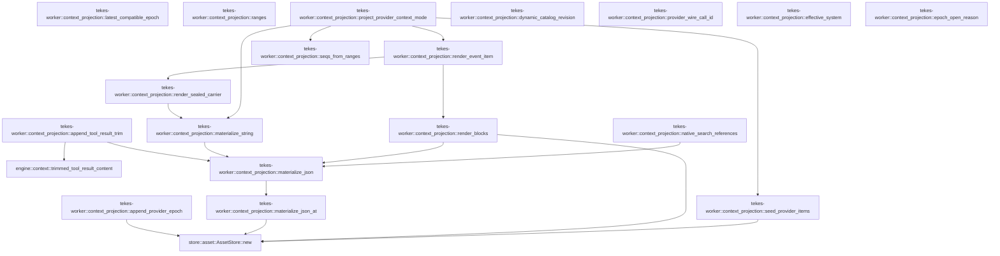

# tekes-worker::context_projection

[Package atlas](index.md) · [Source](../../src/context_projection.rs)

## Declarations

Visibility is the declaration spelling; trait members and reexports require their enclosing interface. `cfg` is not evaluated.

| Symbol | Kind | Visibility | Test / cfg |
|---|---|---|---|
| [tekes-worker::context_projection::dynamic_catalog_revision](../../src/context_projection.rs#L4) | function_item | `pub(crate)` |  |
| [tekes-worker::context_projection::native_search_references](../../src/context_projection.rs#L20) | function_item | `pub(crate)` |  |
| [tekes-worker::context_projection::project_provider_context](../../src/context_projection.rs#L94) | function_item | `pub(crate)` | test; #[cfg(test)] |
| [tekes-worker::context_projection::project_provider_context_mode](../../src/context_projection.rs#L104) | function_item | `pub(crate)` |  |
| [tekes-worker::context_projection::seed_provider_items](../../src/context_projection.rs#L517) | function_item | `pub(crate)` |  |
| [tekes-worker::context_projection::provider_wire_call_id](../../src/context_projection.rs#L620) | function_item | `private` |  |
| [tekes-worker::context_projection::render_sealed_carrier](../../src/context_projection.rs#L634) | function_item | `private` |  |
| [tekes-worker::context_projection::render_event_item](../../src/context_projection.rs#L661) | function_item | `pub(crate)` |  |
| [tekes-worker::context_projection::render_blocks](../../src/context_projection.rs#L745) | function_item | `pub(crate)` |  |
| [tekes-worker::context_projection::materialize_json](../../src/context_projection.rs#L796) | function_item | `pub(crate)` |  |
| [tekes-worker::context_projection::materialize_json_at](../../src/context_projection.rs#L803) | function_item | `pub(crate)` |  |
| [tekes-worker::context_projection::materialize_string](../../src/context_projection.rs#L824) | function_item | `pub(crate)` |  |
| [tekes-worker::context_projection::seqs_from_ranges](../../src/context_projection.rs#L835) | function_item | `private` |  |
| [tekes-worker::context_projection::effective_system](../../src/context_projection.rs#L851) | function_item | `pub(crate)` |  |
| [tekes-worker::context_projection::EpochAppend](../../src/context_projection.rs#L863) | struct_item | `pub(crate)` |  |
| [tekes-worker::context_projection::epoch_open_reason](../../src/context_projection.rs#L878) | function_item | `pub(crate)` |  |
| [tekes-worker::context_projection::append_tool_result_trim](../../src/context_projection.rs#L918) | function_item | `pub(crate)` |  |
| [tekes-worker::context_projection::append_provider_epoch](../../src/context_projection.rs#L958) | function_item | `pub(crate)` |  |
| [tekes-worker::context_projection::latest_compatible_epoch](../../src/context_projection.rs#L1004) | function_item | `pub(crate)` |  |
| [tekes-worker::context_projection::ranges](../../src/context_projection.rs#L1039) | function_item | `pub(crate)` |  |

## Imports / reexports

| Local name | Source path | Visibility |
|---|---|---|
| `*` | `super::*` | `private` |

## Module declarations

| Module | Visibility | Attributes |
|---|---|---|

## Function call graphs

Edges below are syntactically resolved calls only, including private functions. Graphs partition callers into groups of 20; they are not execution order. All unresolved sites are listed below and in the JSON inventory.

Functions 1–18: 17 direct edges

## Call sites

Includes test functions (marked in declarations). Receiver-type-required sites need type analysis/manual tracing. Calls in closures are attributed to their enclosing function; their occurrence here does not mean the closure executes immediately.

| Caller | Callee expression | Source lines | Target / classification |
|---|---|---|---|
| `dynamic_catalog_revision` | `Sha256::new` | [5](../../src/context_projection.rs#L5) | external-constructor-callback-or-unresolved |
| `dynamic_catalog_revision` | `digest.update` | [6](../../src/context_projection.rs#L6), [8](../../src/context_projection.rs#L8), [9](../../src/context_projection.rs#L9), [10](../../src/context_projection.rs#L10), [11](../../src/context_projection.rs#L11) | receiver-type-required |
| `dynamic_catalog_revision` | `entry.name.as_bytes` | [8](../../src/context_projection.rs#L8) | receiver-type-required |
| `dynamic_catalog_revision` | `entry.schema_digest.as_bytes` | [10](../../src/context_projection.rs#L10) | receiver-type-required |
| `native_search_references` | `ledger.projection().ok_or` | [27](../../src/context_projection.rs#L27) | receiver-type-required |
| `native_search_references` | `ledger.projection` | [27](../../src/context_projection.rs#L27) | receiver-type-required |
| `native_search_references` | `projection         .events         .iter()         .filter(&#124;event&#124; {             event.seq() < before_seq                 && event.turn() == Some(turn)                 && *event.kind() == EventKind::ToolCall                 && event.string_field("name") == Some("tool_search")         })         .filter_map(&#124;event&#124; event.string_field("call").map(str::to_owned))         .collect::<Vec<_>>` | [28](../../src/context_projection.rs#L28) | receiver-type-required |
| `native_search_references` | `projection         .events         .iter()         .filter(&#124;event&#124; {             event.seq() < before_seq                 && event.turn() == Some(turn)                 && *event.kind() == EventKind::ToolCall                 && event.string_field("name") == Some("tool_search")         })         .filter_map` | [28](../../src/context_projection.rs#L28) | receiver-type-required |
| `native_search_references` | `projection         .events         .iter()         .filter` | [28](../../src/context_projection.rs#L28) | receiver-type-required |
| `native_search_references` | `projection         .events         .iter` | [28](../../src/context_projection.rs#L28) | receiver-type-required |
| `native_search_references` | `event.seq` | [32](../../src/context_projection.rs#L32), [43](../../src/context_projection.rs#L43) | receiver-type-required |
| `native_search_references` | `event.turn` | [33](../../src/context_projection.rs#L33) | receiver-type-required |
| `native_search_references` | `Some` | [33](../../src/context_projection.rs#L33), [35](../../src/context_projection.rs#L35), [45](../../src/context_projection.rs#L45), [50](../../src/context_projection.rs#L50) | external-constructor-callback-or-unresolved |
| `native_search_references` | `event.kind` | [34](../../src/context_projection.rs#L34), [44](../../src/context_projection.rs#L44) | receiver-type-required |
| `native_search_references` | `event.string_field` | [35](../../src/context_projection.rs#L35), [37](../../src/context_projection.rs#L37), [45](../../src/context_projection.rs#L45) | receiver-type-required |
| `native_search_references` | `event.string_field("call").map` | [37](../../src/context_projection.rs#L37) | receiver-type-required |
| `native_search_references` | `Vec::new` | [39](../../src/context_projection.rs#L39) | external-constructor-callback-or-unresolved |
| `native_search_references` | `BTreeSet::new` | [40](../../src/context_projection.rs#L40) | external-constructor-callback-or-unresolved |
| `native_search_references` | `projection.events.iter().find` | [42](../../src/context_projection.rs#L42) | receiver-type-required |
| `native_search_references` | `projection.events.iter` | [42](../../src/context_projection.rs#L42) | receiver-type-required |
| `native_search_references` | `call.as_str` | [45](../../src/context_projection.rs#L45) | receiver-type-required |
| `native_search_references` | `serde_json::to_value` | [49](../../src/context_projection.rs#L49) | external-constructor-callback-or-unresolved |
| `native_search_references` | `result.raw` | [49](../../src/context_projection.rs#L49) | receiver-type-required |
| `native_search_references` | `raw.get("outcome").and_then` | [50](../../src/context_projection.rs#L50) | receiver-type-required |
| `native_search_references` | `raw.get` | [50](../../src/context_projection.rs#L50), [53](../../src/context_projection.rs#L53) | receiver-type-required |
| `native_search_references` | `materialize_json` | [56](../../src/context_projection.rs#L56) | [tekes-worker::context_projection::materialize_json](../../src/context_projection.rs#L796) |
| `native_search_references` | `content.as_array().into_iter().flatten` | [57](../../src/context_projection.rs#L57) | receiver-type-required |
| `native_search_references` | `content.as_array().into_iter` | [57](../../src/context_projection.rs#L57) | receiver-type-required |
| `native_search_references` | `content.as_array` | [57](../../src/context_projection.rs#L57) | receiver-type-required |
| `native_search_references` | `block.get("text").and_then` | [58](../../src/context_projection.rs#L58) | receiver-type-required |
| `native_search_references` | `block.get` | [58](../../src/context_projection.rs#L58) | receiver-type-required |
| `native_search_references` | `serde_json::from_str::<Value>` | [61](../../src/context_projection.rs#L61) | external-constructor-callback-or-unresolved |
| `native_search_references` | `offer                 .get("items")                 .and_then(Value::as_array)                 .into_iter()                 .flatten` | [64](../../src/context_projection.rs#L64) | receiver-type-required |
| `native_search_references` | `offer                 .get("items")                 .and_then(Value::as_array)                 .into_iter` | [64](../../src/context_projection.rs#L64) | receiver-type-required |
| `native_search_references` | `offer                 .get("items")                 .and_then` | [64](../../src/context_projection.rs#L64) | receiver-type-required |
| `native_search_references` | `offer                 .get` | [64](../../src/context_projection.rs#L64) | receiver-type-required |
| `native_search_references` | `item.get("name").and_then` | [71](../../src/context_projection.rs#L71) | receiver-type-required |
| `native_search_references` | `item.get` | [71](../../src/context_projection.rs#L71), [72](../../src/context_projection.rs#L72) | receiver-type-required |
| `native_search_references` | `item.get("schema_digest").and_then` | [72](../../src/context_projection.rs#L72) | receiver-type-required |
| `native_search_references` | `deferred                     .iter()                     .any` | [76](../../src/context_projection.rs#L76) | receiver-type-required |
| `native_search_references` | `deferred                     .iter` | [76](../../src/context_projection.rs#L76) | receiver-type-required |
| `native_search_references` | `seen.insert` | [79](../../src/context_projection.rs#L79) | receiver-type-required |
| `native_search_references` | `call.clone` | [79](../../src/context_projection.rs#L79), [84](../../src/context_projection.rs#L84) | receiver-type-required |
| `native_search_references` | `name.to_owned` | [79](../../src/context_projection.rs#L79), [81](../../src/context_projection.rs#L81) | receiver-type-required |
| `native_search_references` | `references.push` | [80](../../src/context_projection.rs#L80) | receiver-type-required |
| `native_search_references` | `digest.to_owned` | [82](../../src/context_projection.rs#L82) | receiver-type-required |
| `native_search_references` | `catalog_revision.to_owned` | [83](../../src/context_projection.rs#L83) | receiver-type-required |
| `native_search_references` | `Ok` | [90](../../src/context_projection.rs#L90) | external-constructor-callback-or-unresolved |
| `project_provider_context` | `project_provider_context_mode` | [100](../../src/context_projection.rs#L100) | [tekes-worker::context_projection::project_provider_context_mode](../../src/context_projection.rs#L104) |
| `project_provider_context_mode` | `ledger.projection().ok_or` | [111](../../src/context_projection.rs#L111) | receiver-type-required |
| `project_provider_context_mode` | `ledger.projection` | [111](../../src/context_projection.rs#L111) | receiver-type-required |
| `project_provider_context_mode` | `std::collections::BTreeMap::<String, String>::new` | [112](../../src/context_projection.rs#L112), [122](../../src/context_projection.rs#L122), [128](../../src/context_projection.rs#L128) | external-constructor-callback-or-unresolved |
| `project_provider_context_mode` | `std::collections::BTreeMap::<String, Vec<u64>>::new` | [113](../../src/context_projection.rs#L113) | external-constructor-callback-or-unresolved |
| `project_provider_context_mode` | `std::collections::BTreeSet::<String>::new` | [114](../../src/context_projection.rs#L114), [118](../../src/context_projection.rs#L118), [131](../../src/context_projection.rs#L131) | external-constructor-callback-or-unresolved |
| `project_provider_context_mode` | `std::collections::BTreeMap::<String, u64>::new` | [121](../../src/context_projection.rs#L121), [127](../../src/context_projection.rs#L127), [130](../../src/context_projection.rs#L130) | external-constructor-callback-or-unresolved |
| `project_provider_context_mode` | `std::collections::BTreeSet::<u64>::new` | [123](../../src/context_projection.rs#L123), [124](../../src/context_projection.rs#L124), [135](../../src/context_projection.rs#L135) | external-constructor-callback-or-unresolved |
| `project_provider_context_mode` | `std::collections::BTreeMap::<u64, u64>::new` | [125](../../src/context_projection.rs#L125), [126](../../src/context_projection.rs#L126), [311](../../src/context_projection.rs#L311), [356](../../src/context_projection.rs#L356) | external-constructor-callback-or-unresolved |
| `project_provider_context_mode` | `Vec::<u64>::new` | [129](../../src/context_projection.rs#L129) | external-constructor-callback-or-unresolved |
| `project_provider_context_mode` | `serde_json::to_value` | [138](../../src/context_projection.rs#L138), [282](../../src/context_projection.rs#L282), [316](../../src/context_projection.rs#L316), [405](../../src/context_projection.rs#L405) | external-constructor-callback-or-unresolved |
| `project_provider_context_mode` | `event.raw` | [138](../../src/context_projection.rs#L138), [282](../../src/context_projection.rs#L282), [316](../../src/context_projection.rs#L316), [405](../../src/context_projection.rs#L405) | receiver-type-required |
| `project_provider_context_mode` | `raw.as_object().ok_or` | [139](../../src/context_projection.rs#L139), [283](../../src/context_projection.rs#L283), [317](../../src/context_projection.rs#L317), [406](../../src/context_projection.rs#L406) | receiver-type-required |
| `project_provider_context_mode` | `raw.as_object` | [139](../../src/context_projection.rs#L139), [283](../../src/context_projection.rs#L283), [317](../../src/context_projection.rs#L317), [406](../../src/context_projection.rs#L406) | receiver-type-required |
| `project_provider_context_mode` | `seqs_from_ranges` | [140](../../src/context_projection.rs#L140), [144](../../src/context_projection.rs#L144), [199](../../src/context_projection.rs#L199), [318](../../src/context_projection.rs#L318) | [tekes-worker::context_projection::seqs_from_ranges](../../src/context_projection.rs#L835) |
| `project_provider_context_mode` | `object.get` | [140](../../src/context_projection.rs#L140), [144](../../src/context_projection.rs#L144), [181](../../src/context_projection.rs#L181), [199](../../src/context_projection.rs#L199), [286](../../src/context_projection.rs#L286), [318](../../src/context_projection.rs#L318), [453](../../src/context_projection.rs#L453) | receiver-type-required |
| `project_provider_context_mode` | `superseded.insert` | [141](../../src/context_projection.rs#L141) | receiver-type-required |
| `project_provider_context_mode` | `event.kind` | [143](../../src/context_projection.rs#L143), [148](../../src/context_projection.rs#L148), [276](../../src/context_projection.rs#L276), [313](../../src/context_projection.rs#L313), [369](../../src/context_projection.rs#L369), [413](../../src/context_projection.rs#L413), [426](../../src/context_projection.rs#L426), [436](../../src/context_projection.rs#L436), [451](../../src/context_projection.rs#L451), [467](../../src/context_projection.rs#L467) | receiver-type-required |
| `project_provider_context_mode` | `compacted.insert` | [145](../../src/context_projection.rs#L145) | receiver-type-required |
| `project_provider_context_mode` | `event.string_field` | [149](../../src/context_projection.rs#L149), [228](../../src/context_projection.rs#L228), [229](../../src/context_projection.rs#L229), [337](../../src/context_projection.rs#L337), [378](../../src/context_projection.rs#L378), [436](../../src/context_projection.rs#L436), [488](../../src/context_projection.rs#L488) | receiver-type-required |
| `project_provider_context_mode` | `Some` | [149](../../src/context_projection.rs#L149), [150](../../src/context_projection.rs#L150), [165](../../src/context_projection.rs#L165), [181](../../src/context_projection.rs#L181), [385](../../src/context_projection.rs#L385), [436](../../src/context_projection.rs#L436), [453](../../src/context_projection.rs#L453), [476](../../src/context_projection.rs#L476) | external-constructor-callback-or-unresolved |
| `project_provider_context_mode` | `event.seq` | [150](../../src/context_projection.rs#L150), [175](../../src/context_projection.rs#L175), [182](../../src/context_projection.rs#L182), [184](../../src/context_projection.rs#L184), [208](../../src/context_projection.rs#L208), [225](../../src/context_projection.rs#L225), [233](../../src/context_projection.rs#L233), [277](../../src/context_projection.rs#L277), [278](../../src/context_projection.rs#L278), [298](../../src/context_projection.rs#L298), [322](../../src/context_projection.rs#L322), [336](../../src/context_projection.rs#L336), [341](../../src/context_projection.rs#L341), [368](../../src/context_projection.rs#L368), [400](../../src/context_projection.rs#L400), [401](../../src/context_projection.rs#L401), [407](../../src/context_projection.rs#L407), [408](../../src/context_projection.rs#L408), [452](../../src/context_projection.rs#L452), [454](../../src/context_projection.rs#L454), [469](../../src/context_projection.rs#L469), [479](../../src/context_projection.rs#L479), [482](../../src/context_projection.rs#L482), [501](../../src/context_projection.rs#L501), [502](../../src/context_projection.rs#L502) | receiver-type-required |
| `project_provider_context_mode` | `object                     .get("pending")                     .and_then(Value::as_object)                     .into_iter()                     .flat_map(&#124;pending&#124; [pending.get("eligible"), pending.get("withheld")])                     .flatten()                     .flat_map(&#124;value&#124; value.as_array().into_iter().flatten())                     .filter_map` | [151](../../src/context_projection.rs#L151) | receiver-type-required |
| `project_provider_context_mode` | `object                     .get("pending")                     .and_then(Value::as_object)                     .into_iter()                     .flat_map(&#124;pending&#124; [pending.get("eligible"), pending.get("withheld")])                     .flatten()                     .flat_map` | [151](../../src/context_projection.rs#L151) | receiver-type-required |
| `project_provider_context_mode` | `object                     .get("pending")                     .and_then(Value::as_object)                     .into_iter()                     .flat_map(&#124;pending&#124; [pending.get("eligible"), pending.get("withheld")])                     .flatten` | [151](../../src/context_projection.rs#L151) | receiver-type-required |
| `project_provider_context_mode` | `object                     .get("pending")                     .and_then(Value::as_object)                     .into_iter()                     .flat_map` | [151](../../src/context_projection.rs#L151) | receiver-type-required |
| `project_provider_context_mode` | `object                     .get("pending")                     .and_then(Value::as_object)                     .into_iter` | [151](../../src/context_projection.rs#L151) | receiver-type-required |
| `project_provider_context_mode` | `object                     .get("pending")                     .and_then` | [151](../../src/context_projection.rs#L151) | receiver-type-required |
| `project_provider_context_mode` | `object                     .get` | [151](../../src/context_projection.rs#L151), [166](../../src/context_projection.rs#L166) | receiver-type-required |
| `project_provider_context_mode` | `pending.get` | [155](../../src/context_projection.rs#L155) | receiver-type-required |
| `project_provider_context_mode` | `value.as_array().into_iter().flatten` | [157](../../src/context_projection.rs#L157) | receiver-type-required |
| `project_provider_context_mode` | `value.as_array().into_iter` | [157](../../src/context_projection.rs#L157) | receiver-type-required |
| `project_provider_context_mode` | `value.as_array` | [157](../../src/context_projection.rs#L157) | receiver-type-required |
| `project_provider_context_mode` | `epoch_pending.insert` | [160](../../src/context_projection.rs#L160) | receiver-type-required |
| `project_provider_context_mode` | `event.turn().ok_or` | [164](../../src/context_projection.rs#L164), [232](../../src/context_projection.rs#L232) | receiver-type-required |
| `project_provider_context_mode` | `event.turn` | [164](../../src/context_projection.rs#L164), [178](../../src/context_projection.rs#L178), [232](../../src/context_projection.rs#L232), [464](../../src/context_projection.rs#L464), [476](../../src/context_projection.rs#L476) | receiver-type-required |
| `project_provider_context_mode` | `object                     .get("trigger")                     .and_then(&#124;trigger&#124; trigger.get("inputs"))                     .and_then(Value::as_array)                     .into_iter()                     .flatten()                     .filter_map` | [166](../../src/context_projection.rs#L166) | receiver-type-required |
| `project_provider_context_mode` | `object                     .get("trigger")                     .and_then(&#124;trigger&#124; trigger.get("inputs"))                     .and_then(Value::as_array)                     .into_iter()                     .flatten` | [166](../../src/context_projection.rs#L166) | receiver-type-required |
| `project_provider_context_mode` | `object                     .get("trigger")                     .and_then(&#124;trigger&#124; trigger.get("inputs"))                     .and_then(Value::as_array)                     .into_iter` | [166](../../src/context_projection.rs#L166) | receiver-type-required |
| `project_provider_context_mode` | `object                     .get("trigger")                     .and_then(&#124;trigger&#124; trigger.get("inputs"))                     .and_then` | [166](../../src/context_projection.rs#L166) | receiver-type-required |
| `project_provider_context_mode` | `object                     .get("trigger")                     .and_then` | [166](../../src/context_projection.rs#L166) | receiver-type-required |
| `project_provider_context_mode` | `trigger.get` | [168](../../src/context_projection.rs#L168) | receiver-type-required |
| `project_provider_context_mode` | `input_turn.insert` | [174](../../src/context_projection.rs#L174), [184](../../src/context_projection.rs#L184) | receiver-type-required |
| `project_provider_context_mode` | `input_position.insert` | [175](../../src/context_projection.rs#L175) | receiver-type-required |
| `project_provider_context_mode` | `object.get("steer").and_then` | [181](../../src/context_projection.rs#L181), [453](../../src/context_projection.rs#L453) | receiver-type-required |
| `project_provider_context_mode` | `steer_seqs.push` | [182](../../src/context_projection.rs#L182) | receiver-type-required |
| `project_provider_context_mode` | `event                     .string_field("attempt")                     .ok_or("attempt lacks id")?                     .to_owned` | [188](../../src/context_projection.rs#L188) | receiver-type-required |
| `project_provider_context_mode` | `event                     .string_field("attempt")                     .ok_or` | [188](../../src/context_projection.rs#L188), [202](../../src/context_projection.rs#L202), [219](../../src/context_projection.rs#L219) | receiver-type-required |
| `project_provider_context_mode` | `event                     .string_field` | [188](../../src/context_projection.rs#L188), [202](../../src/context_projection.rs#L202), [219](../../src/context_projection.rs#L219) | receiver-type-required |
| `project_provider_context_mode` | `attempt_epoch.insert` | [192](../../src/context_projection.rs#L192) | receiver-type-required |
| `project_provider_context_mode` | `id.clone` | [193](../../src/context_projection.rs#L193) | receiver-type-required |
| `project_provider_context_mode` | `event                         .string_field("epoch")                         .ok_or("attempt lacks epoch")?                         .to_owned` | [194](../../src/context_projection.rs#L194) | receiver-type-required |
| `project_provider_context_mode` | `event                         .string_field("epoch")                         .ok_or` | [194](../../src/context_projection.rs#L194) | receiver-type-required |
| `project_provider_context_mode` | `event                         .string_field` | [194](../../src/context_projection.rs#L194), [236](../../src/context_projection.rs#L236), [244](../../src/context_projection.rs#L244) | receiver-type-required |
| `project_provider_context_mode` | `attempt_admits.insert` | [199](../../src/context_projection.rs#L199) | receiver-type-required |
| `project_provider_context_mode` | `settled_outputs.insert` | [205](../../src/context_projection.rs#L205) | receiver-type-required |
| `project_provider_context_mode` | `attempt.to_owned` | [205](../../src/context_projection.rs#L205), [207](../../src/context_projection.rs#L207), [222](../../src/context_projection.rs#L222), [224](../../src/context_projection.rs#L224), [230](../../src/context_projection.rs#L230) | receiver-type-required |
| `project_provider_context_mode` | `output_positions                     .entry(attempt.to_owned())                     .or_insert` | [206](../../src/context_projection.rs#L206), [223](../../src/context_projection.rs#L223) | receiver-type-required |
| `project_provider_context_mode` | `output_positions                     .entry` | [206](../../src/context_projection.rs#L206), [223](../../src/context_projection.rs#L223) | receiver-type-required |
| `project_provider_context_mode` | `attempt_epoch.get(attempt).is_some_and` | [209](../../src/context_projection.rs#L209) | receiver-type-required |
| `project_provider_context_mode` | `attempt_epoch.get` | [209](../../src/context_projection.rs#L209), [263](../../src/context_projection.rs#L263) | receiver-type-required |
| `project_provider_context_mode` | `object                         .get("continuation")                         .and_then(&#124;continuation&#124; continuation.get("id"))                         .and_then(Value::as_str)                         .map(str::to_owned)                         .or` | [210](../../src/context_projection.rs#L210) | receiver-type-required |
| `project_provider_context_mode` | `object                         .get("continuation")                         .and_then(&#124;continuation&#124; continuation.get("id"))                         .and_then(Value::as_str)                         .map` | [210](../../src/context_projection.rs#L210) | receiver-type-required |
| `project_provider_context_mode` | `object                         .get("continuation")                         .and_then(&#124;continuation&#124; continuation.get("id"))                         .and_then` | [210](../../src/context_projection.rs#L210) | receiver-type-required |
| `project_provider_context_mode` | `object                         .get("continuation")                         .and_then` | [210](../../src/context_projection.rs#L210) | receiver-type-required |
| `project_provider_context_mode` | `object                         .get` | [210](../../src/context_projection.rs#L210) | receiver-type-required |
| `project_provider_context_mode` | `continuation.get` | [212](../../src/context_projection.rs#L212) | receiver-type-required |
| `project_provider_context_mode` | `object.contains_key` | [218](../../src/context_projection.rs#L218), [414](../../src/context_projection.rs#L414) | receiver-type-required |
| `project_provider_context_mode` | `partial_carriers.insert` | [222](../../src/context_projection.rs#L222) | receiver-type-required |
| `project_provider_context_mode` | `event.string_field("call").ok_or` | [228](../../src/context_projection.rs#L228) | receiver-type-required |
| `project_provider_context_mode` | `call_attempts.insert` | [230](../../src/context_projection.rs#L230) | receiver-type-required |
| `project_provider_context_mode` | `call.to_owned` | [230](../../src/context_projection.rs#L230), [232](../../src/context_projection.rs#L232), [233](../../src/context_projection.rs#L233), [235](../../src/context_projection.rs#L235) | receiver-type-required |
| `project_provider_context_mode` | `call_turn.insert` | [232](../../src/context_projection.rs#L232) | receiver-type-required |
| `project_provider_context_mode` | `call_seqs.insert` | [233](../../src/context_projection.rs#L233) | receiver-type-required |
| `project_provider_context_mode` | `call_name.insert` | [234](../../src/context_projection.rs#L234) | receiver-type-required |
| `project_provider_context_mode` | `event                         .string_field("name")                         .ok_or("tool_call lacks name")?                         .to_owned` | [236](../../src/context_projection.rs#L236) | receiver-type-required |
| `project_provider_context_mode` | `event                         .string_field("name")                         .ok_or` | [236](../../src/context_projection.rs#L236) | receiver-type-required |
| `project_provider_context_mode` | `spawned_calls.insert` | [243](../../src/context_projection.rs#L243) | receiver-type-required |
| `project_provider_context_mode` | `event                         .string_field("call")                         .ok_or("spawn lacks call")?                         .to_owned` | [244](../../src/context_projection.rs#L244) | receiver-type-required |
| `project_provider_context_mode` | `event                         .string_field("call")                         .ok_or` | [244](../../src/context_projection.rs#L244) | receiver-type-required |
| `project_provider_context_mode` | `attempt_admits         .iter()         .filter(&#124;(attempt, _)&#124; settled_outputs.contains(*attempt))         .flat_map(&#124;(_, seqs)&#124; seqs.iter().copied())         .collect::<std::collections::BTreeSet<_>>` | [254](../../src/context_projection.rs#L254) | receiver-type-required |
| `project_provider_context_mode` | `attempt_admits         .iter()         .filter(&#124;(attempt, _)&#124; settled_outputs.contains(*attempt))         .flat_map` | [254](../../src/context_projection.rs#L254) | receiver-type-required |
| `project_provider_context_mode` | `attempt_admits         .iter()         .filter` | [254](../../src/context_projection.rs#L254), [259](../../src/context_projection.rs#L259) | receiver-type-required |
| `project_provider_context_mode` | `attempt_admits         .iter` | [254](../../src/context_projection.rs#L254), [259](../../src/context_projection.rs#L259) | receiver-type-required |
| `project_provider_context_mode` | `settled_outputs.contains` | [256](../../src/context_projection.rs#L256), [262](../../src/context_projection.rs#L262), [489](../../src/context_projection.rs#L489) | receiver-type-required |
| `project_provider_context_mode` | `seqs.iter().copied` | [257](../../src/context_projection.rs#L257), [265](../../src/context_projection.rs#L265) | receiver-type-required |
| `project_provider_context_mode` | `seqs.iter` | [257](../../src/context_projection.rs#L257), [265](../../src/context_projection.rs#L265) | receiver-type-required |
| `project_provider_context_mode` | `attempt_admits         .iter()         .filter(&#124;(attempt, _)&#124; {             settled_outputs.contains(*attempt)                 && attempt_epoch.get(*attempt).is_some_and(&#124;id&#124; id == epoch_id)         })         .flat_map(&#124;(_, seqs)&#124; seqs.iter().copied())         .collect::<std::collections::BTreeSet<_>>` | [259](../../src/context_projection.rs#L259) | receiver-type-required |
| `project_provider_context_mode` | `attempt_admits         .iter()         .filter(&#124;(attempt, _)&#124; {             settled_outputs.contains(*attempt)                 && attempt_epoch.get(*attempt).is_some_and(&#124;id&#124; id == epoch_id)         })         .flat_map` | [259](../../src/context_projection.rs#L259) | receiver-type-required |
| `project_provider_context_mode` | `attempt_epoch.get(*attempt).is_some_and` | [263](../../src/context_projection.rs#L263) | receiver-type-required |
| `project_provider_context_mode` | `dialect.server_managed` | [267](../../src/context_projection.rs#L267) | receiver-type-required |
| `project_provider_context_mode` | `continuation_id.is_some` | [268](../../src/context_projection.rs#L268) | receiver-type-required |
| `project_provider_context_mode` | `epoch_seq.ok_or` | [269](../../src/context_projection.rs#L269) | receiver-type-required |
| `project_provider_context_mode` | `Vec::new` | [270](../../src/context_projection.rs#L270), [300](../../src/context_projection.rs#L300) | external-constructor-callback-or-unresolved |
| `project_provider_context_mode` | `items.extend` | [272](../../src/context_projection.rs#L272) | receiver-type-required |
| `project_provider_context_mode` | `seed_provider_items` | [272](../../src/context_projection.rs#L272) | [tekes-worker::context_projection::seed_provider_items](../../src/context_projection.rs#L517) |
| `project_provider_context_mode` | `superseded.contains` | [277](../../src/context_projection.rs#L277), [360](../../src/context_projection.rs#L360), [368](../../src/context_projection.rs#L368), [408](../../src/context_projection.rs#L408) | receiver-type-required |
| `project_provider_context_mode` | `compacted.contains` | [278](../../src/context_projection.rs#L278), [408](../../src/context_projection.rs#L408) | receiver-type-required |
| `project_provider_context_mode` | `materialize_string` | [284](../../src/context_projection.rs#L284) | [tekes-worker::context_projection::materialize_string](../../src/context_projection.rs#L824) |
| `project_provider_context_mode` | `object.get("summary").ok_or` | [286](../../src/context_projection.rs#L286) | receiver-type-required |
| `project_provider_context_mode` | `items.push` | [288](../../src/context_projection.rs#L288), [504](../../src/context_projection.rs#L504) | receiver-type-required |
| `project_provider_context_mode` | `ijson` | [288](../../src/context_projection.rs#L288), [504](../../src/context_projection.rs#L504) | external-constructor-callback-or-unresolved |
| `project_provider_context_mode` | `projection         .events         .partition_point` | [296](../../src/context_projection.rs#L296) | receiver-type-required |
| `project_provider_context_mode` | `compaction_anchor_sequences` | [299](../../src/context_projection.rs#L299) | external-constructor-callback-or-unresolved |
| `project_provider_context_mode` | `seqs_from_ranges(object.get("supersedes"))?             .into_iter()             .max` | [318](../../src/context_projection.rs#L318) | receiver-type-required |
| `project_provider_context_mode` | `seqs_from_ranges(object.get("supersedes"))?             .into_iter` | [318](../../src/context_projection.rs#L318) | receiver-type-required |
| `project_provider_context_mode` | `replaced_result.insert` | [322](../../src/context_projection.rs#L322) | receiver-type-required |
| `project_provider_context_mode` | `replaced_result.get` | [327](../../src/context_projection.rs#L327) | receiver-type-required |
| `project_provider_context_mode` | `render_anchor` | [336](../../src/context_projection.rs#L336), [341](../../src/context_projection.rs#L341) | external-constructor-callback-or-unresolved |
| `project_provider_context_mode` | `output_positions.get` | [337](../../src/context_projection.rs#L337), [383](../../src/context_projection.rs#L383) | receiver-type-required |
| `project_provider_context_mode` | `call_attempts.get` | [337](../../src/context_projection.rs#L337) | receiver-type-required |
| `project_provider_context_mode` | `(*output > anchor).then_some` | [338](../../src/context_projection.rs#L338) | receiver-type-required |
| `project_provider_context_mode` | `input_position.get` | [342](../../src/context_projection.rs#L342) | receiver-type-required |
| `project_provider_context_mode` | `deferred_result_position` | [344](../../src/context_projection.rs#L344) | external-constructor-callback-or-unresolved |
| `project_provider_context_mode` | `steer_seqs         .iter()         .copied()         .filter(&#124;seq&#124; !superseded.contains(seq) && !input_position.contains_key(seq))         .collect::<Vec<_>>` | [357](../../src/context_projection.rs#L357) | receiver-type-required |
| `project_provider_context_mode` | `steer_seqs         .iter()         .copied()         .filter` | [357](../../src/context_projection.rs#L357) | receiver-type-required |
| `project_provider_context_mode` | `steer_seqs         .iter()         .copied` | [357](../../src/context_projection.rs#L357) | receiver-type-required |
| `project_provider_context_mode` | `steer_seqs         .iter` | [357](../../src/context_projection.rs#L357) | receiver-type-required |
| `project_provider_context_mode` | `input_position.contains_key` | [360](../../src/context_projection.rs#L360) | receiver-type-required |
| `project_provider_context_mode` | `steers.is_empty` | [362](../../src/context_projection.rs#L362) | receiver-type-required |
| `project_provider_context_mode` | `projection             .events             .iter()             .filter(&#124;event&#124; {                 !superseded.contains(&event.seq())                     && match event.kind() {                         EventKind::ChildResult => true,                         EventKind::ToolResult => event                             .string_field("call")                             .is_some_and(&#124;call&#124; !spawned_calls.contains(call)),                         _ => false,                     }             })             .filter_map(&#124;event&#124; {                 let call = event.string_field("call")?;                 // An attempt's sealed output carries its calls; before one                 // exists the call renders at its own event.                 let call_position = call_attempts                     .get(call)                     .and_then(&#124;attempt&#124; output_positions.get(attempt))                     .or_else(&#124;&#124; call_seqs.get(call))?;                 Some((*call_position, base_key(event).0))             })             .collect::<Vec<_>>` | [364](../../src/context_projection.rs#L364) | receiver-type-required |
| `project_provider_context_mode` | `projection             .events             .iter()             .filter(&#124;event&#124; {                 !superseded.contains(&event.seq())                     && match event.kind() {                         EventKind::ChildResult => true,                         EventKind::ToolResult => event                             .string_field("call")                             .is_some_and(&#124;call&#124; !spawned_calls.contains(call)),                         _ => false,                     }             })             .filter_map` | [364](../../src/context_projection.rs#L364) | receiver-type-required |
| `project_provider_context_mode` | `projection             .events             .iter()             .filter` | [364](../../src/context_projection.rs#L364) | receiver-type-required |
| `project_provider_context_mode` | `projection             .events             .iter` | [364](../../src/context_projection.rs#L364) | receiver-type-required |
| `project_provider_context_mode` | `event                             .string_field("call")                             .is_some_and` | [371](../../src/context_projection.rs#L371) | receiver-type-required |
| `project_provider_context_mode` | `event                             .string_field` | [371](../../src/context_projection.rs#L371) | receiver-type-required |
| `project_provider_context_mode` | `spawned_calls.contains` | [373](../../src/context_projection.rs#L373), [429](../../src/context_projection.rs#L429) | receiver-type-required |
| `project_provider_context_mode` | `call_attempts                     .get(call)                     .and_then(&#124;attempt&#124; output_positions.get(attempt))                     .or_else` | [381](../../src/context_projection.rs#L381) | receiver-type-required |
| `project_provider_context_mode` | `call_attempts                     .get(call)                     .and_then` | [381](../../src/context_projection.rs#L381) | receiver-type-required |
| `project_provider_context_mode` | `call_attempts                     .get` | [381](../../src/context_projection.rs#L381) | receiver-type-required |
| `project_provider_context_mode` | `call_seqs.get` | [384](../../src/context_projection.rs#L384) | receiver-type-required |
| `project_provider_context_mode` | `base_key` | [385](../../src/context_projection.rs#L385), [402](../../src/context_projection.rs#L402) | external-constructor-callback-or-unresolved |
| `project_provider_context_mode` | `spans                 .iter()                 .filter(&#124;(call, result)&#124; *call < steer && steer < *result)                 .map(&#124;(_, result)&#124; *result)                 .max` | [389](../../src/context_projection.rs#L389) | receiver-type-required |
| `project_provider_context_mode` | `spans                 .iter()                 .filter(&#124;(call, result)&#124; *call < steer && steer < *result)                 .map` | [389](../../src/context_projection.rs#L389) | receiver-type-required |
| `project_provider_context_mode` | `spans                 .iter()                 .filter` | [389](../../src/context_projection.rs#L389) | receiver-type-required |
| `project_provider_context_mode` | `spans                 .iter` | [389](../../src/context_projection.rs#L389) | receiver-type-required |
| `project_provider_context_mode` | `steer_anchor.insert` | [395](../../src/context_projection.rs#L395) | receiver-type-required |
| `project_provider_context_mode` | `projection.events.iter().collect::<Vec<_>>` | [399](../../src/context_projection.rs#L399) | receiver-type-required |
| `project_provider_context_mode` | `projection.events.iter` | [399](../../src/context_projection.rs#L399) | receiver-type-required |
| `project_provider_context_mode` | `ordered_events.sort_by_key` | [400](../../src/context_projection.rs#L400) | receiver-type-required |
| `project_provider_context_mode` | `steer_anchor.get` | [400](../../src/context_projection.rs#L400) | receiver-type-required |
| `project_provider_context_mode` | `semantic_anchors.contains` | [407](../../src/context_projection.rs#L407) | receiver-type-required |
| `project_provider_context_mode` | `event                 .string_field("attempt")                 .is_some_and` | [415](../../src/context_projection.rs#L415) | receiver-type-required |
| `project_provider_context_mode` | `event                 .string_field` | [415](../../src/context_projection.rs#L415), [427](../../src/context_projection.rs#L427) | receiver-type-required |
| `project_provider_context_mode` | `partial_carriers.contains` | [417](../../src/context_projection.rs#L417), [489](../../src/context_projection.rs#L489) | receiver-type-required |
| `project_provider_context_mode` | `event                 .string_field("call")                 .is_some_and` | [427](../../src/context_projection.rs#L427) | receiver-type-required |
| `project_provider_context_mode` | `input_turn.get(&event.seq()).is_some_and` | [452](../../src/context_projection.rs#L452) | receiver-type-required |
| `project_provider_context_mode` | `input_turn.get` | [452](../../src/context_projection.rs#L452) | receiver-type-required |
| `project_provider_context_mode` | `admitted_all.contains` | [454](../../src/context_projection.rs#L454) | receiver-type-required |
| `project_provider_context_mode` | `object                 .get("call")                 .and_then(Value::as_str)                 .and_then(&#124;call&#124; call_turn.get(call))                 .is_some_and` | [459](../../src/context_projection.rs#L459), [471](../../src/context_projection.rs#L471) | receiver-type-required |
| `project_provider_context_mode` | `object                 .get("call")                 .and_then(Value::as_str)                 .and_then` | [459](../../src/context_projection.rs#L459), [471](../../src/context_projection.rs#L471) | receiver-type-required |
| `project_provider_context_mode` | `object                 .get("call")                 .and_then` | [459](../../src/context_projection.rs#L459), [471](../../src/context_projection.rs#L471) | receiver-type-required |
| `project_provider_context_mode` | `object                 .get` | [459](../../src/context_projection.rs#L459), [471](../../src/context_projection.rs#L471) | receiver-type-required |
| `project_provider_context_mode` | `call_turn.get` | [462](../../src/context_projection.rs#L462), [474](../../src/context_projection.rs#L474) | receiver-type-required |
| `project_provider_context_mode` | `event.turn().is_none_or` | [464](../../src/context_projection.rs#L464) | receiver-type-required |
| `project_provider_context_mode` | `input_turn                 .get(&event.seq())                 .is_some_and` | [468](../../src/context_projection.rs#L468) | receiver-type-required |
| `project_provider_context_mode` | `input_turn                 .get` | [468](../../src/context_projection.rs#L468) | receiver-type-required |
| `project_provider_context_mode` | `epoch_pending.contains` | [479](../../src/context_projection.rs#L479) | receiver-type-required |
| `project_provider_context_mode` | `admitted.contains` | [482](../../src/context_projection.rs#L482), [501](../../src/context_projection.rs#L501) | receiver-type-required |
| `project_provider_context_mode` | `event.string_field("attempt").is_some_and` | [488](../../src/context_projection.rs#L488) | receiver-type-required |
| `project_provider_context_mode` | `render_event_item(ledger, event, object, &call_name, dialect)?.ok_or_else` | [495](../../src/context_projection.rs#L495) | receiver-type-required |
| `project_provider_context_mode` | `render_event_item` | [495](../../src/context_projection.rs#L495) | [tekes-worker::context_projection::render_event_item](../../src/context_projection.rs#L661) |
| `project_provider_context_mode` | `admits.push` | [502](../../src/context_projection.rs#L502) | receiver-type-required |
| `project_provider_context_mode` | `admits.sort_unstable` | [506](../../src/context_projection.rs#L506) | receiver-type-required |
| `project_provider_context_mode` | `admits.dedup` | [507](../../src/context_projection.rs#L507) | receiver-type-required |
| `project_provider_context_mode` | `Ok` | [508](../../src/context_projection.rs#L508) | external-constructor-callback-or-unresolved |
| `project_provider_context_mode` | `incremental_continuation             .then_some(continuation_id)             .flatten` | [511](../../src/context_projection.rs#L511) | receiver-type-required |
| `project_provider_context_mode` | `incremental_continuation             .then_some` | [511](../../src/context_projection.rs#L511) | receiver-type-required |
| `seed_provider_items` | `ledger.projection().ok_or` | [520](../../src/context_projection.rs#L520) | receiver-type-required |
| `seed_provider_items` | `ledger.projection` | [520](../../src/context_projection.rs#L520) | receiver-type-required |
| `seed_provider_items` | `projection.events.first` | [521](../../src/context_projection.rs#L521) | receiver-type-required |
| `seed_provider_items` | `Ok` | [522](../../src/context_projection.rs#L522), [526](../../src/context_projection.rs#L526), [617](../../src/context_projection.rs#L617) | external-constructor-callback-or-unresolved |
| `seed_provider_items` | `Vec::new` | [522](../../src/context_projection.rs#L522), [526](../../src/context_projection.rs#L526), [530](../../src/context_projection.rs#L530) | external-constructor-callback-or-unresolved |
| `seed_provider_items` | `serde_json::to_value` | [524](../../src/context_projection.rs#L524), [543](../../src/context_projection.rs#L543) | external-constructor-callback-or-unresolved |
| `seed_provider_items` | `genesis.raw` | [524](../../src/context_projection.rs#L524) | receiver-type-required |
| `seed_provider_items` | `raw.pointer("/seed/snapshot/asset").and_then` | [525](../../src/context_projection.rs#L525) | receiver-type-required |
| `seed_provider_items` | `raw.pointer` | [525](../../src/context_projection.rs#L525) | receiver-type-required |
| `seed_provider_items` | `ledger.path().parent().ok_or` | [528](../../src/context_projection.rs#L528) | receiver-type-required |
| `seed_provider_items` | `ledger.path().parent` | [528](../../src/context_projection.rs#L528) | receiver-type-required |
| `seed_provider_items` | `ledger.path` | [528](../../src/context_projection.rs#L528) | receiver-type-required |
| `seed_provider_items` | `store::AssetStore::new(folder.join("assets"))?.read_verified` | [529](../../src/context_projection.rs#L529) | receiver-type-required |
| `seed_provider_items` | `store::AssetStore::new` | [529](../../src/context_projection.rs#L529) | [store::asset::AssetStore::new](../../../store/src/asset.rs#L27) |
| `seed_provider_items` | `folder.join` | [529](../../src/context_projection.rs#L529) | receiver-type-required |
| `seed_provider_items` | `bytes.split_inclusive` | [531](../../src/context_projection.rs#L531) | receiver-type-required |
| `seed_provider_items` | `line.strip_suffix(b"\n").ok_or` | [532](../../src/context_projection.rs#L532) | receiver-type-required |
| `seed_provider_items` | `line.strip_suffix` | [532](../../src/context_projection.rs#L532) | receiver-type-required |
| `seed_provider_items` | `canonical.is_empty` | [533](../../src/context_projection.rs#L533) | receiver-type-required |
| `seed_provider_items` | `Err` | [534](../../src/context_projection.rs#L534), [608](../../src/context_projection.rs#L608) | external-constructor-callback-or-unresolved |
| `seed_provider_items` | `"seed snapshot has an empty line".into` | [534](../../src/context_projection.rs#L534) | receiver-type-required |
| `seed_provider_items` | `Event::decode_canonical` | [536](../../src/context_projection.rs#L536) | external-constructor-callback-or-unresolved |
| `seed_provider_items` | `event.raw` | [543](../../src/context_projection.rs#L543) | receiver-type-required |
| `seed_provider_items` | `raw.as_object().ok_or` | [544](../../src/context_projection.rs#L544) | receiver-type-required |
| `seed_provider_items` | `raw.as_object` | [544](../../src/context_projection.rs#L544) | receiver-type-required |
| `seed_provider_items` | `event.kind` | [545](../../src/context_projection.rs#L545) | receiver-type-required |
| `seed_provider_items` | `event                     .string_field("call")                     .ok_or` | [559](../../src/context_projection.rs#L559) | receiver-type-required |
| `seed_provider_items` | `event                     .string_field` | [559](../../src/context_projection.rs#L559) | receiver-type-required |
| `seed_provider_items` | `object                     .get("outcome")                     .ok_or` | [562](../../src/context_projection.rs#L562) | receiver-type-required |
| `seed_provider_items` | `object                     .get` | [562](../../src/context_projection.rs#L562), [584](../../src/context_projection.rs#L584) | receiver-type-required |
| `seed_provider_items` | `event.string_field` | [583](../../src/context_projection.rs#L583) | receiver-type-required |
| `seed_provider_items` | `Some` | [583](../../src/context_projection.rs#L583) | external-constructor-callback-or-unresolved |
| `seed_provider_items` | `object                     .get("payload")                     .and_then(Value::as_object)                     .ok_or` | [584](../../src/context_projection.rs#L584) | receiver-type-required |
| `seed_provider_items` | `object                     .get("payload")                     .and_then` | [584](../../src/context_projection.rs#L584) | receiver-type-required |
| `seed_provider_items` | `format!(                     "model-visible seed kind {} has no provider projection",                     other.as_str()                 )                 .into` | [608](../../src/context_projection.rs#L608) | receiver-type-required |
| `seed_provider_items` | `items.push` | [615](../../src/context_projection.rs#L615) | receiver-type-required |
| `seed_provider_items` | `ijson` | [615](../../src/context_projection.rs#L615) | external-constructor-callback-or-unresolved |
| `provider_wire_call_id` | `ledger         .projection()         .and_then(&#124;projection&#124; {             projection.events.iter().find(&#124;event&#124; {                 *event.kind() == EventKind::ToolCall && event.string_field("call") == Some(call)             })         })         .and_then(&#124;event&#124; event.string_field("provider_call"))         .unwrap_or` | [621](../../src/context_projection.rs#L621) | receiver-type-required |
| `provider_wire_call_id` | `ledger         .projection()         .and_then(&#124;projection&#124; {             projection.events.iter().find(&#124;event&#124; {                 *event.kind() == EventKind::ToolCall && event.string_field("call") == Some(call)             })         })         .and_then` | [621](../../src/context_projection.rs#L621) | receiver-type-required |
| `provider_wire_call_id` | `ledger         .projection()         .and_then` | [621](../../src/context_projection.rs#L621) | receiver-type-required |
| `provider_wire_call_id` | `ledger         .projection` | [621](../../src/context_projection.rs#L621) | receiver-type-required |
| `provider_wire_call_id` | `projection.events.iter().find` | [624](../../src/context_projection.rs#L624) | receiver-type-required |
| `provider_wire_call_id` | `projection.events.iter` | [624](../../src/context_projection.rs#L624) | receiver-type-required |
| `provider_wire_call_id` | `event.kind` | [625](../../src/context_projection.rs#L625) | receiver-type-required |
| `provider_wire_call_id` | `event.string_field` | [625](../../src/context_projection.rs#L625), [628](../../src/context_projection.rs#L628) | receiver-type-required |
| `provider_wire_call_id` | `Some` | [625](../../src/context_projection.rs#L625) | external-constructor-callback-or-unresolved |
| `render_sealed_carrier` | `object         .get("sealed")         .and_then(Value::as_object)         .ok_or_else` | [640](../../src/context_projection.rs#L640) | receiver-type-required |
| `render_sealed_carrier` | `object         .get("sealed")         .and_then` | [640](../../src/context_projection.rs#L640) | receiver-type-required |
| `render_sealed_carrier` | `object         .get` | [640](../../src/context_projection.rs#L640) | receiver-type-required |
| `render_sealed_carrier` | `sealed.get("version").and_then` | [644](../../src/context_projection.rs#L644) | receiver-type-required |
| `render_sealed_carrier` | `sealed.get` | [644](../../src/context_projection.rs#L644), [645](../../src/context_projection.rs#L645) | receiver-type-required |
| `render_sealed_carrier` | `Some` | [644](../../src/context_projection.rs#L644), [645](../../src/context_projection.rs#L645) | external-constructor-callback-or-unresolved |
| `render_sealed_carrier` | `sealed.get("adapter").and_then` | [645](../../src/context_projection.rs#L645) | receiver-type-required |
| `render_sealed_carrier` | `dialect.as_str` | [645](../../src/context_projection.rs#L645) | receiver-type-required |
| `render_sealed_carrier` | `Err` | [647](../../src/context_projection.rs#L647) | external-constructor-callback-or-unresolved |
| `render_sealed_carrier` | `format!("{kind} sealed carrier is incompatible with the active adapter").into` | [648](../../src/context_projection.rs#L648) | receiver-type-required |
| `render_sealed_carrier` | `materialize_string` | [651](../../src/context_projection.rs#L651) | [tekes-worker::context_projection::materialize_string](../../src/context_projection.rs#L824) |
| `render_sealed_carrier` | `sealed             .get("fragments")             .ok_or` | [653](../../src/context_projection.rs#L653) | receiver-type-required |
| `render_sealed_carrier` | `sealed             .get` | [653](../../src/context_projection.rs#L653) | receiver-type-required |
| `render_sealed_carrier` | `serde_json::to_value` | [657](../../src/context_projection.rs#L657) | external-constructor-callback-or-unresolved |
| `render_sealed_carrier` | `IJsonValue::parse` | [657](../../src/context_projection.rs#L657) | external-constructor-callback-or-unresolved |
| `render_sealed_carrier` | `fragments.as_bytes` | [657](../../src/context_projection.rs#L657) | receiver-type-required |
| `render_sealed_carrier` | `Ok` | [658](../../src/context_projection.rs#L658) | external-constructor-callback-or-unresolved |
| `render_event_item` | `event.kind` | [668](../../src/context_projection.rs#L668) | receiver-type-required |
| `render_event_item` | `render_sealed_carrier` | [673](../../src/context_projection.rs#L673), [676](../../src/context_projection.rs#L676) | [tekes-worker::context_projection::render_sealed_carrier](../../src/context_projection.rs#L634) |
| `render_event_item` | `object.contains_key` | [675](../../src/context_projection.rs#L675) | receiver-type-required |
| `render_event_item` | `event.string_field("call").ok_or` | [692](../../src/context_projection.rs#L692) | receiver-type-required |
| `render_event_item` | `event.string_field` | [692](../../src/context_projection.rs#L692) | receiver-type-required |
| `render_event_item` | `object.get("outcome").ok_or` | [693](../../src/context_projection.rs#L693) | receiver-type-required |
| `render_event_item` | `object.get` | [693](../../src/context_projection.rs#L693), [695](../../src/context_projection.rs#L695) | receiver-type-required |
| `render_event_item` | `call_names.get(call).map(String::as_str).unwrap_or` | [694](../../src/context_projection.rs#L694) | receiver-type-required |
| `render_event_item` | `call_names.get(call).map` | [694](../../src/context_projection.rs#L694) | receiver-type-required |
| `render_event_item` | `call_names.get` | [694](../../src/context_projection.rs#L694) | receiver-type-required |
| `render_event_item` | `render_blocks` | [696](../../src/context_projection.rs#L696) | [tekes-worker::context_projection::render_blocks](../../src/context_projection.rs#L745) |
| `render_event_item` | `blocks.as_mut_slice` | [699](../../src/context_projection.rs#L699) | receiver-type-required |
| `render_event_item` | `block                         .get("text")                         .and_then(Value::as_str)                         .filter(&#124;_&#124; block.get("type").and_then(Value::as_str) == Some("text"))                         .and_then` | [700](../../src/context_projection.rs#L700) | receiver-type-required |
| `render_event_item` | `block                         .get("text")                         .and_then(Value::as_str)                         .filter` | [700](../../src/context_projection.rs#L700) | receiver-type-required |
| `render_event_item` | `block                         .get("text")                         .and_then` | [700](../../src/context_projection.rs#L700) | receiver-type-required |
| `render_event_item` | `block                         .get` | [700](../../src/context_projection.rs#L700) | receiver-type-required |
| `render_event_item` | `block.get("type").and_then` | [703](../../src/context_projection.rs#L703) | receiver-type-required |
| `render_event_item` | `block.get` | [703](../../src/context_projection.rs#L703) | receiver-type-required |
| `render_event_item` | `Some` | [703](../../src/context_projection.rs#L703), [742](../../src/context_projection.rs#L742) | external-constructor-callback-or-unresolved |
| `render_event_item` | `result_presentation::present` | [704](../../src/context_projection.rs#L704) | external-constructor-callback-or-unresolved |
| `render_event_item` | `Value::Array` | [708](../../src/context_projection.rs#L708) | external-constructor-callback-or-unresolved |
| `render_event_item` | `event                 .string_field("call")                 .ok_or` | [723](../../src/context_projection.rs#L723) | receiver-type-required |
| `render_event_item` | `event                 .string_field` | [723](../../src/context_projection.rs#L723) | receiver-type-required |
| `render_event_item` | `Ok` | [740](../../src/context_projection.rs#L740), [742](../../src/context_projection.rs#L742) | external-constructor-callback-or-unresolved |
| `render_blocks` | `materialize_json` | [749](../../src/context_projection.rs#L749) | [tekes-worker::context_projection::materialize_json](../../src/context_projection.rs#L796) |
| `render_blocks` | `value.as_array().ok_or` | [750](../../src/context_projection.rs#L750) | receiver-type-required |
| `render_blocks` | `value.as_array` | [750](../../src/context_projection.rs#L750) | receiver-type-required |
| `render_blocks` | `blocks         .iter()         .map(&#124;block&#124; {             let object = block.as_object().ok_or("block is not an object")?;             Ok(match object.get("type").and_then(Value::as_str) {                 Some("text") => json!({"type":"text","text":object.get("text").and_then(Value::as_str).ok_or("text block lacks text")?}),                 Some("reasoning") => json!({"type":"reasoning","text":object.get("text").and_then(Value::as_str).ok_or("reasoning block lacks text")?}),                 Some("image") => {                     let asset = object.get("asset").and_then(Value::as_str).ok_or("image block lacks asset")?;                     let folder = ledger.path().parent().ok_or("ledger has no folder")?;                     let bytes = store::AssetStore::new(folder.join("assets"))?.read_verified(asset)?;                     json!({                         "type":"file","name":asset,                         "data":base64::engine::general_purpose::STANDARD.encode(bytes),                         "mime":object.get("mime").and_then(Value::as_str).ok_or("image block lacks mime")?                     })                 },                 Some("file") => {                     let asset = object.get("asset").and_then(Value::as_str).ok_or("file block lacks asset")?;                     let folder = ledger.path().parent().ok_or("ledger has no folder")?;                     let bytes = store::AssetStore::new(folder.join("assets"))?.read_verified(asset)?;                     json!({                         "type":"file",                         "name":object.get("name").and_then(Value::as_str).ok_or("file block lacks name")?,                         "mime":object.get("mime").and_then(Value::as_str).ok_or("file block lacks mime")?,                         "bytes":bytes.len(),                         "data":base64::engine::general_purpose::STANDARD.encode(bytes)                     })                 },                 Some("tool-call") => json!({                     "type":"tool_call","call_id":object.get("call").and_then(Value::as_str).ok_or("nested call lacks id")?,                     "name":object.get("name").and_then(Value::as_str).ok_or("nested call lacks name")?,                     "arguments":object.get("args").cloned().ok_or("nested call lacks args")?                 }),                 Some("tool-result") => json!({                     "type":"tool_result","call_id":object.get("call").and_then(Value::as_str).ok_or("nested result lacks call")?,                     "name":"tool","result":object.get("content").cloned().ok_or("nested result lacks content")?,                     "error":object.get("error").and_then(Value::as_bool).unwrap_or(false)                 }),                 _ => return Err("unknown block kind".into()),             })         })         .collect` | [751](../../src/context_projection.rs#L751) | receiver-type-required |
| `render_blocks` | `blocks         .iter()         .map` | [751](../../src/context_projection.rs#L751) | receiver-type-required |
| `render_blocks` | `blocks         .iter` | [751](../../src/context_projection.rs#L751) | receiver-type-required |
| `render_blocks` | `block.as_object().ok_or` | [754](../../src/context_projection.rs#L754) | receiver-type-required |
| `render_blocks` | `block.as_object` | [754](../../src/context_projection.rs#L754) | receiver-type-required |
| `render_blocks` | `Ok` | [755](../../src/context_projection.rs#L755) | external-constructor-callback-or-unresolved |
| `render_blocks` | `object.get("type").and_then` | [755](../../src/context_projection.rs#L755) | receiver-type-required |
| `render_blocks` | `object.get` | [755](../../src/context_projection.rs#L755), [759](../../src/context_projection.rs#L759), [769](../../src/context_projection.rs#L769) | receiver-type-required |
| `render_blocks` | `object.get("asset").and_then(Value::as_str).ok_or` | [759](../../src/context_projection.rs#L759), [769](../../src/context_projection.rs#L769) | receiver-type-required |
| `render_blocks` | `object.get("asset").and_then` | [759](../../src/context_projection.rs#L759), [769](../../src/context_projection.rs#L769) | receiver-type-required |
| `render_blocks` | `ledger.path().parent().ok_or` | [760](../../src/context_projection.rs#L760), [770](../../src/context_projection.rs#L770) | receiver-type-required |
| `render_blocks` | `ledger.path().parent` | [760](../../src/context_projection.rs#L760), [770](../../src/context_projection.rs#L770) | receiver-type-required |
| `render_blocks` | `ledger.path` | [760](../../src/context_projection.rs#L760), [770](../../src/context_projection.rs#L770) | receiver-type-required |
| `render_blocks` | `store::AssetStore::new(folder.join("assets"))?.read_verified` | [761](../../src/context_projection.rs#L761), [771](../../src/context_projection.rs#L771) | receiver-type-required |
| `render_blocks` | `store::AssetStore::new` | [761](../../src/context_projection.rs#L761), [771](../../src/context_projection.rs#L771) | [store::asset::AssetStore::new](../../../store/src/asset.rs#L27) |
| `render_blocks` | `folder.join` | [761](../../src/context_projection.rs#L761), [771](../../src/context_projection.rs#L771) | receiver-type-required |
| `render_blocks` | `Err` | [790](../../src/context_projection.rs#L790) | external-constructor-callback-or-unresolved |
| `render_blocks` | `"unknown block kind".into` | [790](../../src/context_projection.rs#L790) | receiver-type-required |
| `materialize_json` | `materialize_json_at` | [800](../../src/context_projection.rs#L800) | [tekes-worker::context_projection::materialize_json_at](../../src/context_projection.rs#L803) |
| `materialize_json` | `ledger.path` | [800](../../src/context_projection.rs#L800) | receiver-type-required |
| `materialize_json_at` | `value         .as_object()         .filter(&#124;object&#124; object.len() == 1)         .and_then(&#124;object&#124; object.get("$spill"))         .and_then` | [807](../../src/context_projection.rs#L807) | receiver-type-required |
| `materialize_json_at` | `value         .as_object()         .filter(&#124;object&#124; object.len() == 1)         .and_then` | [807](../../src/context_projection.rs#L807) | receiver-type-required |
| `materialize_json_at` | `value         .as_object()         .filter` | [807](../../src/context_projection.rs#L807) | receiver-type-required |
| `materialize_json_at` | `value         .as_object` | [807](../../src/context_projection.rs#L807) | receiver-type-required |
| `materialize_json_at` | `object.len` | [809](../../src/context_projection.rs#L809) | receiver-type-required |
| `materialize_json_at` | `object.get` | [810](../../src/context_projection.rs#L810) | receiver-type-required |
| `materialize_json_at` | `Ok` | [813](../../src/context_projection.rs#L813), [821](../../src/context_projection.rs#L821) | external-constructor-callback-or-unresolved |
| `materialize_json_at` | `value.clone` | [813](../../src/context_projection.rs#L813) | receiver-type-required |
| `materialize_json_at` | `spill         .get("asset")         .and_then(Value::as_str)         .ok_or` | [815](../../src/context_projection.rs#L815) | receiver-type-required |
| `materialize_json_at` | `spill         .get("asset")         .and_then` | [815](../../src/context_projection.rs#L815) | receiver-type-required |
| `materialize_json_at` | `spill         .get` | [815](../../src/context_projection.rs#L815) | receiver-type-required |
| `materialize_json_at` | `ledger_path.parent().ok_or` | [819](../../src/context_projection.rs#L819) | receiver-type-required |
| `materialize_json_at` | `ledger_path.parent` | [819](../../src/context_projection.rs#L819) | receiver-type-required |
| `materialize_json_at` | `store::AssetStore::new(folder.join("assets"))?.read_verified` | [820](../../src/context_projection.rs#L820) | receiver-type-required |
| `materialize_json_at` | `store::AssetStore::new` | [820](../../src/context_projection.rs#L820) | [store::asset::AssetStore::new](../../../store/src/asset.rs#L27) |
| `materialize_json_at` | `folder.join` | [820](../../src/context_projection.rs#L820) | receiver-type-required |
| `materialize_json_at` | `serde_json::to_value` | [821](../../src/context_projection.rs#L821) | external-constructor-callback-or-unresolved |
| `materialize_json_at` | `IJsonValue::parse` | [821](../../src/context_projection.rs#L821) | external-constructor-callback-or-unresolved |
| `materialize_string` | `materialize_json` | [828](../../src/context_projection.rs#L828) | [tekes-worker::context_projection::materialize_json](../../src/context_projection.rs#L796) |
| `materialize_string` | `value         .as_str()         .map(str::to_owned)         .ok_or_else` | [829](../../src/context_projection.rs#L829) | receiver-type-required |
| `materialize_string` | `value         .as_str()         .map` | [829](../../src/context_projection.rs#L829) | receiver-type-required |
| `materialize_string` | `value         .as_str` | [829](../../src/context_projection.rs#L829) | receiver-type-required |
| `materialize_string` | `"spilled value is not a string".into` | [832](../../src/context_projection.rs#L832) | receiver-type-required |
| `seqs_from_ranges` | `Vec::new` | [836](../../src/context_projection.rs#L836) | external-constructor-callback-or-unresolved |
| `seqs_from_ranges` | `value.and_then(Value::as_array).into_iter().flatten` | [837](../../src/context_projection.rs#L837) | receiver-type-required |
| `seqs_from_ranges` | `value.and_then(Value::as_array).into_iter` | [837](../../src/context_projection.rs#L837) | receiver-type-required |
| `seqs_from_ranges` | `value.and_then` | [837](../../src/context_projection.rs#L837) | receiver-type-required |
| `seqs_from_ranges` | `range             .get("from")             .and_then(Value::as_u64)             .ok_or` | [838](../../src/context_projection.rs#L838) | receiver-type-required |
| `seqs_from_ranges` | `range             .get("from")             .and_then` | [838](../../src/context_projection.rs#L838) | receiver-type-required |
| `seqs_from_ranges` | `range             .get` | [838](../../src/context_projection.rs#L838), [842](../../src/context_projection.rs#L842) | receiver-type-required |
| `seqs_from_ranges` | `range             .get("to")             .and_then(Value::as_u64)             .ok_or` | [842](../../src/context_projection.rs#L842) | receiver-type-required |
| `seqs_from_ranges` | `range             .get("to")             .and_then` | [842](../../src/context_projection.rs#L842) | receiver-type-required |
| `seqs_from_ranges` | `seqs.extend` | [846](../../src/context_projection.rs#L846) | receiver-type-required |
| `seqs_from_ranges` | `Ok` | [848](../../src/context_projection.rs#L848) | external-constructor-callback-or-unresolved |
| `effective_system` | `instruction         .effective         .agents         .iter()         .filter_map(&#124;index&#124; instruction.sources.get(*index as usize))         .filter(&#124;source&#124; source.kind == InstructionKind::Agents)         .map(&#124;source&#124; source.content.as_str())         .collect::<Vec<_>>()         .join` | [852](../../src/context_projection.rs#L852) | receiver-type-required |
| `effective_system` | `instruction         .effective         .agents         .iter()         .filter_map(&#124;index&#124; instruction.sources.get(*index as usize))         .filter(&#124;source&#124; source.kind == InstructionKind::Agents)         .map(&#124;source&#124; source.content.as_str())         .collect::<Vec<_>>` | [852](../../src/context_projection.rs#L852) | receiver-type-required |
| `effective_system` | `instruction         .effective         .agents         .iter()         .filter_map(&#124;index&#124; instruction.sources.get(*index as usize))         .filter(&#124;source&#124; source.kind == InstructionKind::Agents)         .map` | [852](../../src/context_projection.rs#L852) | receiver-type-required |
| `effective_system` | `instruction         .effective         .agents         .iter()         .filter_map(&#124;index&#124; instruction.sources.get(*index as usize))         .filter` | [852](../../src/context_projection.rs#L852) | receiver-type-required |
| `effective_system` | `instruction         .effective         .agents         .iter()         .filter_map` | [852](../../src/context_projection.rs#L852) | receiver-type-required |
| `effective_system` | `instruction         .effective         .agents         .iter` | [852](../../src/context_projection.rs#L852) | receiver-type-required |
| `effective_system` | `instruction.sources.get` | [856](../../src/context_projection.rs#L856) | receiver-type-required |
| `effective_system` | `source.content.as_str` | [858](../../src/context_projection.rs#L858) | receiver-type-required |
| `epoch_open_reason` | `previous.integer_field` | [894](../../src/context_projection.rs#L894) | receiver-type-required |
| `epoch_open_reason` | `Some` | [894](../../src/context_projection.rs#L894), [905](../../src/context_projection.rs#L905), [908](../../src/context_projection.rs#L908) | external-constructor-callback-or-unresolved |
| `epoch_open_reason` | `serde_json::to_value(previous.raw()).ok` | [897](../../src/context_projection.rs#L897) | receiver-type-required |
| `epoch_open_reason` | `serde_json::to_value` | [897](../../src/context_projection.rs#L897) | external-constructor-callback-or-unresolved |
| `epoch_open_reason` | `previous.raw` | [897](../../src/context_projection.rs#L897) | receiver-type-required |
| `epoch_open_reason` | `head.as_ref().and_then` | [899](../../src/context_projection.rs#L899) | receiver-type-required |
| `epoch_open_reason` | `head.as_ref` | [899](../../src/context_projection.rs#L899) | receiver-type-required |
| `epoch_open_reason` | `raw.pointer(pointer)                 .and_then(Value::as_str)                 .map` | [900](../../src/context_projection.rs#L900) | receiver-type-required |
| `epoch_open_reason` | `raw.pointer(pointer)                 .and_then` | [900](../../src/context_projection.rs#L900) | receiver-type-required |
| `epoch_open_reason` | `raw.pointer` | [900](../../src/context_projection.rs#L900) | receiver-type-required |
| `epoch_open_reason` | `field("/tools/digest").as_deref` | [905](../../src/context_projection.rs#L905) | receiver-type-required |
| `epoch_open_reason` | `field` | [905](../../src/context_projection.rs#L905), [908](../../src/context_projection.rs#L908) | external-constructor-callback-or-unresolved |
| `epoch_open_reason` | `field("/system/digest").as_deref` | [908](../../src/context_projection.rs#L908) | receiver-type-required |
| `append_tool_result_trim` | `ledger.projection().ok_or` | [924](../../src/context_projection.rs#L924) | receiver-type-required |
| `append_tool_result_trim` | `ledger.projection` | [924](../../src/context_projection.rs#L924) | receiver-type-required |
| `append_tool_result_trim` | `projection         .events         .iter()         .find(&#124;event&#124; event.seq() == trim.seq)         .ok_or` | [925](../../src/context_projection.rs#L925) | receiver-type-required |
| `append_tool_result_trim` | `projection         .events         .iter()         .find` | [925](../../src/context_projection.rs#L925) | receiver-type-required |
| `append_tool_result_trim` | `projection         .events         .iter` | [925](../../src/context_projection.rs#L925) | receiver-type-required |
| `append_tool_result_trim` | `event.seq` | [928](../../src/context_projection.rs#L928) | receiver-type-required |
| `append_tool_result_trim` | `serde_json::to_value` | [930](../../src/context_projection.rs#L930) | external-constructor-callback-or-unresolved |
| `append_tool_result_trim` | `original.raw` | [930](../../src/context_projection.rs#L930) | receiver-type-required |
| `append_tool_result_trim` | `raw.as_object().ok_or` | [931](../../src/context_projection.rs#L931) | receiver-type-required |
| `append_tool_result_trim` | `raw.as_object` | [931](../../src/context_projection.rs#L931) | receiver-type-required |
| `append_tool_result_trim` | `materialize_json` | [936](../../src/context_projection.rs#L936) | [tekes-worker::context_projection::materialize_json](../../src/context_projection.rs#L796) |
| `append_tool_result_trim` | `object.get("content").ok_or` | [938](../../src/context_projection.rs#L938) | receiver-type-required |
| `append_tool_result_trim` | `object.get` | [938](../../src/context_projection.rs#L938), [948](../../src/context_projection.rs#L948) | receiver-type-required |
| `append_tool_result_trim` | `engine::trimmed_tool_result_content` | [940](../../src/context_projection.rs#L940) | [engine::context::trimmed_tool_result_content](../../../engine/src/context.rs#L502) |
| `append_tool_result_trim` | `replacement             .as_object_mut()             .expect("replacement object")             .insert` | [949](../../src/context_projection.rs#L949) | receiver-type-required |
| `append_tool_result_trim` | `replacement             .as_object_mut()             .expect` | [949](../../src/context_projection.rs#L949) | receiver-type-required |
| `append_tool_result_trim` | `replacement             .as_object_mut` | [949](../../src/context_projection.rs#L949) | receiver-type-required |
| `append_tool_result_trim` | `"meta".to_owned` | [952](../../src/context_projection.rs#L952) | receiver-type-required |
| `append_tool_result_trim` | `meta.clone` | [952](../../src/context_projection.rs#L952) | receiver-type-required |
| `append_tool_result_trim` | `ledger.append_contract` | [954](../../src/context_projection.rs#L954) | receiver-type-required |
| `append_tool_result_trim` | `make_event` | [954](../../src/context_projection.rs#L954) | external-constructor-callback-or-unresolved |
| `append_tool_result_trim` | `BarrierContext::default` | [954](../../src/context_projection.rs#L954) | external-constructor-callback-or-unresolved |
| `append_tool_result_trim` | `Ok` | [955](../../src/context_projection.rs#L955) | external-constructor-callback-or-unresolved |
| `append_provider_epoch` | `ledger.path().parent().ok_or` | [972](../../src/context_projection.rs#L972) | receiver-type-required |
| `append_provider_epoch` | `ledger.path().parent` | [972](../../src/context_projection.rs#L972) | receiver-type-required |
| `append_provider_epoch` | `ledger.path` | [972](../../src/context_projection.rs#L972) | receiver-type-required |
| `append_provider_epoch` | `store::AssetStore::new` | [973](../../src/context_projection.rs#L973) | [store::asset::AssetStore::new](../../../store/src/asset.rs#L27) |
| `append_provider_epoch` | `folder.join` | [973](../../src/context_projection.rs#L973) | receiver-type-required |
| `append_provider_epoch` | `profile.canonical_bytes` | [974](../../src/context_projection.rs#L974) | receiver-type-required |
| `append_provider_epoch` | `assets.publish` | [975](../../src/context_projection.rs#L975), [979](../../src/context_projection.rs#L979) | receiver-type-required |
| `append_provider_epoch` | `tools.canonical_bytes` | [978](../../src/context_projection.rs#L978) | receiver-type-required |
| `append_provider_epoch` | `make_event` | [980](../../src/context_projection.rs#L980) | external-constructor-callback-or-unresolved |
| `append_provider_epoch` | `ledger.append_contract` | [1000](../../src/context_projection.rs#L1000) | receiver-type-required |
| `append_provider_epoch` | `BarrierContext::default` | [1000](../../src/context_projection.rs#L1000) | external-constructor-callback-or-unresolved |
| `append_provider_epoch` | `Ok` | [1001](../../src/context_projection.rs#L1001) | external-constructor-callback-or-unresolved |
| `latest_compatible_epoch` | `ledger         .projection()?         .events         .iter()         .rev()         .find` | [1015](../../src/context_projection.rs#L1015) | receiver-type-required |
| `latest_compatible_epoch` | `ledger         .projection()?         .events         .iter()         .rev` | [1015](../../src/context_projection.rs#L1015) | receiver-type-required |
| `latest_compatible_epoch` | `ledger         .projection()?         .events         .iter` | [1015](../../src/context_projection.rs#L1015), [1021](../../src/context_projection.rs#L1021) | receiver-type-required |
| `latest_compatible_epoch` | `ledger         .projection` | [1015](../../src/context_projection.rs#L1015), [1021](../../src/context_projection.rs#L1021) | receiver-type-required |
| `latest_compatible_epoch` | `event.kind` | [1020](../../src/context_projection.rs#L1020) | receiver-type-required |
| `latest_compatible_epoch` | `ledger         .projection()?         .events         .iter()         .any` | [1021](../../src/context_projection.rs#L1021) | receiver-type-required |
| `latest_compatible_epoch` | `later.seq` | [1025](../../src/context_projection.rs#L1025) | receiver-type-required |
| `latest_compatible_epoch` | `event.seq` | [1025](../../src/context_projection.rs#L1025) | receiver-type-required |
| `latest_compatible_epoch` | `later.kind` | [1025](../../src/context_projection.rs#L1025) | receiver-type-required |
| `latest_compatible_epoch` | `serde_json::to_value(event.raw()).ok` | [1029](../../src/context_projection.rs#L1029) | receiver-type-required |
| `latest_compatible_epoch` | `serde_json::to_value` | [1029](../../src/context_projection.rs#L1029) | external-constructor-callback-or-unresolved |
| `latest_compatible_epoch` | `event.raw` | [1029](../../src/context_projection.rs#L1029) | receiver-type-required |
| `latest_compatible_epoch` | `(event.string_field("adapter") == Some(dialect.as_str())         && event.string_field("model") == Some(model)         && raw.pointer("/system/digest").and_then(Value::as_str) == Some(system_digest)         && raw.pointer("/tools/digest").and_then(Value::as_str) == Some(tools_digest)         && event.integer_field("renderer") == Some(renderer))     .then(&#124;&#124; event.string_field("id").map(str::to_owned))     .flatten` | [1030](../../src/context_projection.rs#L1030) | receiver-type-required |
| `latest_compatible_epoch` | `(event.string_field("adapter") == Some(dialect.as_str())         && event.string_field("model") == Some(model)         && raw.pointer("/system/digest").and_then(Value::as_str) == Some(system_digest)         && raw.pointer("/tools/digest").and_then(Value::as_str) == Some(tools_digest)         && event.integer_field("renderer") == Some(renderer))     .then` | [1030](../../src/context_projection.rs#L1030) | receiver-type-required |
| `latest_compatible_epoch` | `event.string_field` | [1030](../../src/context_projection.rs#L1030), [1031](../../src/context_projection.rs#L1031), [1035](../../src/context_projection.rs#L1035) | receiver-type-required |
| `latest_compatible_epoch` | `Some` | [1030](../../src/context_projection.rs#L1030), [1031](../../src/context_projection.rs#L1031), [1032](../../src/context_projection.rs#L1032), [1033](../../src/context_projection.rs#L1033), [1034](../../src/context_projection.rs#L1034) | external-constructor-callback-or-unresolved |
| `latest_compatible_epoch` | `dialect.as_str` | [1030](../../src/context_projection.rs#L1030) | receiver-type-required |
| `latest_compatible_epoch` | `raw.pointer("/system/digest").and_then` | [1032](../../src/context_projection.rs#L1032) | receiver-type-required |
| `latest_compatible_epoch` | `raw.pointer` | [1032](../../src/context_projection.rs#L1032), [1033](../../src/context_projection.rs#L1033) | receiver-type-required |
| `latest_compatible_epoch` | `raw.pointer("/tools/digest").and_then` | [1033](../../src/context_projection.rs#L1033) | receiver-type-required |
| `latest_compatible_epoch` | `event.integer_field` | [1034](../../src/context_projection.rs#L1034) | receiver-type-required |
| `latest_compatible_epoch` | `event.string_field("id").map` | [1035](../../src/context_projection.rs#L1035) | receiver-type-required |
| `ranges` | `Vec::new` | [1040](../../src/context_projection.rs#L1040) | external-constructor-callback-or-unresolved |
| `ranges` | `ranges.last_mut().and_then` | [1042](../../src/context_projection.rs#L1042) | receiver-type-required |
| `ranges` | `ranges.last_mut` | [1042](../../src/context_projection.rs#L1042) | receiver-type-required |
| `ranges` | `range.get("to").and_then` | [1044](../../src/context_projection.rs#L1044) | receiver-type-required |
| `ranges` | `range.get` | [1044](../../src/context_projection.rs#L1044) | receiver-type-required |
| `ranges` | `Some` | [1044](../../src/context_projection.rs#L1044) | external-constructor-callback-or-unresolved |
| `ranges` | `seq.saturating_sub` | [1044](../../src/context_projection.rs#L1044) | receiver-type-required |
| `ranges` | `range.insert` | [1046](../../src/context_projection.rs#L1046) | receiver-type-required |
| `ranges` | `"to".to_owned` | [1046](../../src/context_projection.rs#L1046) | receiver-type-required |
| `ranges` | `Value::from` | [1046](../../src/context_projection.rs#L1046) | external-constructor-callback-or-unresolved |
| `ranges` | `ranges.push` | [1048](../../src/context_projection.rs#L1048) | receiver-type-required |
