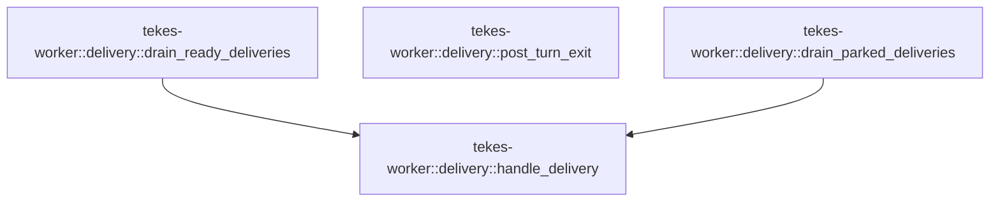

# tekes-worker::delivery

[Package atlas](index.md) · [Source](../../src/delivery.rs)

## Declarations

Visibility is the declaration spelling; trait members and reexports require their enclosing interface. `cfg` is not evaluated.

| Symbol | Kind | Visibility | Test / cfg |
|---|---|---|---|
| [tekes-worker::delivery::drain_ready_deliveries](../../src/delivery.rs#L10) | function_item | `pub(crate)` |  |
| [tekes-worker::delivery::drain_parked_deliveries](../../src/delivery.rs#L31) | function_item | `pub(crate)` |  |
| [tekes-worker::delivery::handle_delivery](../../src/delivery.rs#L52) | function_item | `pub(crate)` |  |
| [tekes-worker::delivery::post_turn_exit](../../src/delivery.rs#L207) | function_item | `pub(crate)` |  |

## Imports / reexports

| Local name | Source path | Visibility |
|---|---|---|
| `*` | `super::*` | `private` |

## Module declarations

| Module | Visibility | Attributes |
|---|---|---|

## Function call graphs

Edges below are syntactically resolved calls only, including private functions. Graphs partition callers into groups of 20; they are not execution order. All unresolved sites are listed below and in the JSON inventory.

Functions 1–4: 2 direct edges

## Call sites

Includes test functions (marked in declarations). Receiver-type-required sites need type analysis/manual tracing. Calls in closures are attributed to their enclosing function; their occurrence here does not mean the closure executes immediately.

| Caller | Callee expression | Source lines | Target / classification |
|---|---|---|---|
| `drain_ready_deliveries` | `lines.drain_ready` | [17](../../src/delivery.rs#L17) | receiver-type-required |
| `drain_ready_deliveries` | `decode_supervisor` | [18](../../src/delivery.rs#L18) | external-constructor-callback-or-unresolved |
| `drain_ready_deliveries` | `line.as_bytes` | [18](../../src/delivery.rs#L18) | receiver-type-required |
| `drain_ready_deliveries` | `Err` | [19](../../src/delivery.rs#L19) | external-constructor-callback-or-unresolved |
| `drain_ready_deliveries` | `Box::new` | [19](../../src/delivery.rs#L19) | external-constructor-callback-or-unresolved |
| `drain_ready_deliveries` | `ProtocolFailure` | [19](../../src/delivery.rs#L19) | external-constructor-callback-or-unresolved |
| `drain_ready_deliveries` | `"undecodable supervisor line at a yield point".to_owned` | [20](../../src/delivery.rs#L20) | receiver-type-required |
| `drain_ready_deliveries` | `handle_delivery` | [23](../../src/delivery.rs#L23) | [tekes-worker::delivery::handle_delivery](../../src/delivery.rs#L52) |
| `drain_ready_deliveries` | `Ok` | [25](../../src/delivery.rs#L25) | external-constructor-callback-or-unresolved |
| `drain_parked_deliveries` | `cancellation.take_parked_deliveries` | [38](../../src/delivery.rs#L38) | receiver-type-required |
| `drain_parked_deliveries` | `decode_supervisor` | [39](../../src/delivery.rs#L39) | external-constructor-callback-or-unresolved |
| `drain_parked_deliveries` | `line.as_bytes` | [39](../../src/delivery.rs#L39) | receiver-type-required |
| `drain_parked_deliveries` | `Err` | [40](../../src/delivery.rs#L40) | external-constructor-callback-or-unresolved |
| `drain_parked_deliveries` | `Box::new` | [40](../../src/delivery.rs#L40) | external-constructor-callback-or-unresolved |
| `drain_parked_deliveries` | `ProtocolFailure` | [40](../../src/delivery.rs#L40) | external-constructor-callback-or-unresolved |
| `drain_parked_deliveries` | `"undecodable supervisor delivery at a yield point".to_owned` | [41](../../src/delivery.rs#L41) | receiver-type-required |
| `drain_parked_deliveries` | `handle_delivery` | [44](../../src/delivery.rs#L44) | [tekes-worker::delivery::handle_delivery](../../src/delivery.rs#L52) |
| `drain_parked_deliveries` | `Ok` | [46](../../src/delivery.rs#L46) | external-constructor-callback-or-unresolved |
| `handle_delivery` | `require_version` | [59](../../src/delivery.rs#L59) | external-constructor-callback-or-unresolved |
| `handle_delivery` | `ledger.projection` | [62](../../src/delivery.rs#L62) | receiver-type-required |
| `handle_delivery` | `projection.origin_tuples.contains_key` | [63](../../src/delivery.rs#L63) | receiver-type-required |
| `handle_delivery` | `Some` | [64](../../src/delivery.rs#L64), [73](../../src/delivery.rs#L73) | external-constructor-callback-or-unresolved |
| `handle_delivery` | `projection.lifecycle.steer_window_open` | [65](../../src/delivery.rs#L65) | receiver-type-required |
| `handle_delivery` | `stdout.write_all` | [67](../../src/delivery.rs#L67), [183](../../src/delivery.rs#L183), [188](../../src/delivery.rs#L188) | receiver-type-required |
| `handle_delivery` | `encode_line` | [67](../../src/delivery.rs#L67), [188](../../src/delivery.rs#L188) | external-constructor-callback-or-unresolved |
| `handle_delivery` | `"steer-unavailable".to_owned` | [73](../../src/delivery.rs#L73) | receiver-type-required |
| `handle_delivery` | `stdout.flush` | [76](../../src/delivery.rs#L76), [184](../../src/delivery.rs#L184), [189](../../src/delivery.rs#L189) | receiver-type-required |
| `handle_delivery` | `Ok` | [77](../../src/delivery.rs#L77), [190](../../src/delivery.rs#L190), [194](../../src/delivery.rs#L194) | external-constructor-callback-or-unresolved |
| `handle_delivery` | `origin_event` | [80](../../src/delivery.rs#L80), [94](../../src/delivery.rs#L94), [117](../../src/delivery.rs#L117), [130](../../src/delivery.rs#L130), [140](../../src/delivery.rs#L140) | external-constructor-callback-or-unresolved |
| `handle_delivery` | `options.event_timestamp` | [80](../../src/delivery.rs#L80), [96](../../src/delivery.rs#L96), [119](../../src/delivery.rs#L119), [132](../../src/delivery.rs#L132), [140](../../src/delivery.rs#L140), [182](../../src/delivery.rs#L182) | receiver-type-required |
| `handle_delivery` | `object.insert` | [81](../../src/delivery.rs#L81), [83](../../src/delivery.rs#L83), [86](../../src/delivery.rs#L86), [89](../../src/delivery.rs#L89), [100](../../src/delivery.rs#L100), [109](../../src/delivery.rs#L109), [110](../../src/delivery.rs#L110), [112](../../src/delivery.rs#L112), [123](../../src/delivery.rs#L123), [136](../../src/delivery.rs#L136), [142](../../src/delivery.rs#L142), [145](../../src/delivery.rs#L145), [173](../../src/delivery.rs#L173), [174](../../src/delivery.rs#L174) | receiver-type-required |
| `handle_delivery` | `"content".to_owned` | [81](../../src/delivery.rs#L81) | receiver-type-required |
| `handle_delivery` | `serde_json::to_value` | [81](../../src/delivery.rs#L81), [83](../../src/delivery.rs#L83), [89](../../src/delivery.rs#L89), [112](../../src/delivery.rs#L112), [125](../../src/delivery.rs#L125), [145](../../src/delivery.rs#L145), [176](../../src/delivery.rs#L176) | external-constructor-callback-or-unresolved |
| `handle_delivery` | `"submission".to_owned` | [83](../../src/delivery.rs#L83) | receiver-type-required |
| `handle_delivery` | `"steer".to_owned` | [86](../../src/delivery.rs#L86) | receiver-type-required |
| `handle_delivery` | `Value::Bool` | [86](../../src/delivery.rs#L86), [110](../../src/delivery.rs#L110) | external-constructor-callback-or-unresolved |
| `handle_delivery` | `"assets".to_owned` | [89](../../src/delivery.rs#L89) | receiver-type-required |
| `handle_delivery` | `append_and_receipt` | [91](../../src/delivery.rs#L91), [114](../../src/delivery.rs#L114), [127](../../src/delivery.rs#L127), [137](../../src/delivery.rs#L137), [147](../../src/delivery.rs#L147), [154](../../src/delivery.rs#L154), [178](../../src/delivery.rs#L178) | external-constructor-callback-or-unresolved |
| `handle_delivery` | `"turn".to_owned` | [101](../../src/delivery.rs#L101) | receiver-type-required |
| `handle_delivery` | `Value::from` | [102](../../src/delivery.rs#L102), [136](../../src/delivery.rs#L136) | external-constructor-callback-or-unresolved |
| `handle_delivery` | `ledger                         .projection()                         .and_then(&#124;projection&#124; projection.latest_turn)                         .ok_or` | [103](../../src/delivery.rs#L103) | receiver-type-required |
| `handle_delivery` | `ledger                         .projection()                         .and_then` | [103](../../src/delivery.rs#L103) | receiver-type-required |
| `handle_delivery` | `ledger                         .projection` | [103](../../src/delivery.rs#L103) | receiver-type-required |
| `handle_delivery` | `"call".to_owned` | [109](../../src/delivery.rs#L109) | receiver-type-required |
| `handle_delivery` | `Value::String` | [109](../../src/delivery.rs#L109), [142](../../src/delivery.rs#L142) | external-constructor-callback-or-unresolved |
| `handle_delivery` | `"grant".to_owned` | [110](../../src/delivery.rs#L110) | receiver-type-required |
| `handle_delivery` | `"answer".to_owned` | [112](../../src/delivery.rs#L112) | receiver-type-required |
| `handle_delivery` | `"supersedes".to_owned` | [124](../../src/delivery.rs#L124) | receiver-type-required |
| `handle_delivery` | `"generation".to_owned` | [136](../../src/delivery.rs#L136) | receiver-type-required |
| `handle_delivery` | `"title".to_owned` | [142](../../src/delivery.rs#L142) | receiver-type-required |
| `handle_delivery` | `"labels".to_owned` | [145](../../src/delivery.rs#L145) | receiver-type-required |
| `handle_delivery` | `ledger                 .projection()                 .is_some_and` | [150](../../src/delivery.rs#L150) | receiver-type-required |
| `handle_delivery` | `ledger                 .projection` | [150](../../src/delivery.rs#L150), [162](../../src/delivery.rs#L162) | receiver-type-required |
| `handle_delivery` | `p.origin_tuples.contains_key` | [152](../../src/delivery.rs#L152) | receiver-type-required |
| `handle_delivery` | `Map::new` | [159](../../src/delivery.rs#L159) | external-constructor-callback-or-unresolved |
| `handle_delivery` | `ledger                 .projection()                 .ok_or` | [162](../../src/delivery.rs#L162) | receiver-type-required |
| `handle_delivery` | `projection                 .latest_turn                 .unwrap_or(0)                 .saturating_add` | [165](../../src/delivery.rs#L165) | receiver-type-required |
| `handle_delivery` | `projection                 .latest_turn                 .unwrap_or` | [165](../../src/delivery.rs#L165) | receiver-type-required |
| `handle_delivery` | `u64::from` | [168](../../src/delivery.rs#L168) | external-constructor-callback-or-unresolved |
| `handle_delivery` | `projection.latest_turn.is_none` | [169](../../src/delivery.rs#L169) | receiver-type-required |
| `handle_delivery` | `build_compaction_event(ledger, options, turn, true, None)?                 .ok_or` | [171](../../src/delivery.rs#L171) | receiver-type-required |
| `handle_delivery` | `build_compaction_event` | [171](../../src/delivery.rs#L171) | external-constructor-callback-or-unresolved |
| `handle_delivery` | `"origin_key".into` | [173](../../src/delivery.rs#L173) | receiver-type-required |
| `handle_delivery` | `"origin_tuple".into` | [175](../../src/delivery.rs#L175) | receiver-type-required |
| `handle_delivery` | `execute_queue_transaction` | [182](../../src/delivery.rs#L182) | external-constructor-callback-or-unresolved |
| `handle_delivery` | `encode_queue_transaction_result` | [183](../../src/delivery.rs#L183) | external-constructor-callback-or-unresolved |
| `handle_delivery` | `announce_appended` | [185](../../src/delivery.rs#L185) | external-constructor-callback-or-unresolved |
| `post_turn_exit` | `ledger         .projection()         .ok_or("post-turn ledger has no projection")?         .lifecycle         .clone` | [213](../../src/delivery.rs#L213) | receiver-type-required |
| `post_turn_exit` | `ledger         .projection()         .ok_or` | [213](../../src/delivery.rs#L213) | receiver-type-required |
| `post_turn_exit` | `ledger         .projection` | [213](../../src/delivery.rs#L213) | receiver-type-required |
| `post_turn_exit` | `announce_appended` | [219](../../src/delivery.rs#L219), [228](../../src/delivery.rs#L228), [232](../../src/delivery.rs#L232), [237](../../src/delivery.rs#L237), [250](../../src/delivery.rs#L250), [253](../../src/delivery.rs#L253) | external-constructor-callback-or-unresolved |
| `post_turn_exit` | `Ok` | [220](../../src/delivery.rs#L220), [229](../../src/delivery.rs#L229), [233](../../src/delivery.rs#L233), [241](../../src/delivery.rs#L241), [251](../../src/delivery.rs#L251), [262](../../src/delivery.rs#L262) | external-constructor-callback-or-unresolved |
| `post_turn_exit` | `facts.continuation_wait_until.is_some` | [222](../../src/delivery.rs#L222) | receiver-type-required |
| `post_turn_exit` | `cancellation.stop_requested` | [223](../../src/delivery.rs#L223), [235](../../src/delivery.rs#L235) | receiver-type-required |
| `post_turn_exit` | `append_settle` | [243](../../src/delivery.rs#L243) | external-constructor-callback-or-unresolved |
| `post_turn_exit` | `options.event_timestamp` | [245](../../src/delivery.rs#L245) | receiver-type-required |
| `post_turn_exit` | `Some` | [248](../../src/delivery.rs#L248) | external-constructor-callback-or-unresolved |
