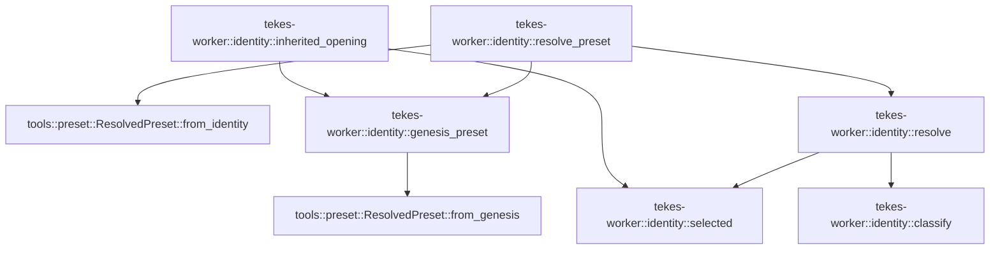

# tekes-worker::identity

[Package atlas](index.md) · [Source](../../src/identity.rs)

## Declarations

Visibility is the declaration spelling; trait members and reexports require their enclosing interface. `cfg` is not evaluated.

| Symbol | Kind | Visibility | Test / cfg |
|---|---|---|---|
| [tekes-worker::identity::SELECTED_SUBKIND](../../src/identity.rs#L3) | const_item | `private` |  |
| [tekes-worker::identity::selected](../../src/identity.rs#L7) | function_item | `pub(super)` |  |
| [tekes-worker::identity::genesis_preset](../../src/identity.rs#L43) | function_item | `pub(super)` |  |
| [tekes-worker::identity::inherited_opening](../../src/identity.rs#L57) | function_item | `pub(super)` |  |
| [tekes-worker::identity::resolve_preset](../../src/identity.rs#L83) | function_item | `pub(super)` |  |
| [tekes-worker::identity::resolve](../../src/identity.rs#L98) | function_item | `pub(super)` |  |
| [tekes-worker::identity::classify](../../src/identity.rs#L148) | function_item | `private` |  |
| [tekes-worker::identity::tests::auto_ledger](../../src/identity.rs#L295) | function_item | `private` | test; #[cfg(test)] |
| [tekes-worker::identity::tests::ledger_with](../../src/identity.rs#L299) | function_item | `private` | test; #[cfg(test)] |
| [tekes-worker::identity::tests::a_genesis_preset_renders_without_classifying](../../src/identity.rs#L339) | function_item | `private` | test; #[cfg(test)] |
| [tekes-worker::identity::tests::a_delegated_child_inherits_the_parent_opening](../../src/identity.rs#L372) | function_item | `private` | test; #[cfg(test)] |
| [tekes-worker::identity::tests::classifies_first_user_request_without_model_work](../../src/identity.rs#L397) | function_item | `private` | test; #[cfg(test)] |
| [tekes-worker::identity::tests::selection_is_durable_and_runtime_only](../../src/identity.rs#L455) | function_item | `private` | test; #[cfg(test)] |
| [tekes-worker::identity::tests::explicit_identity_is_stable_without_a_selection_event](../../src/identity.rs#L499) | function_item | `private` | test; #[cfg(test)] |

## Imports / reexports

| Local name | Source path | Visibility |
|---|---|---|
| `*` | `super::*` | `private` |
| `*` | `super::*` | `private` |

## Module declarations

| Module | Visibility | Attributes |
|---|---|---|
| `tekes-worker::identity::tests` | `private` | #[cfg(test)] |

## Function call graphs

Edges below are syntactically resolved calls only, including private functions. Graphs partition callers into groups of 20; they are not execution order. All unresolved sites are listed below and in the JSON inventory.

Functions 1–6: 8 direct edges

## Call sites

Includes test functions (marked in declarations). Receiver-type-required sites need type analysis/manual tracing. Calls in closures are attributed to their enclosing function; their occurrence here does not mean the closure executes immediately.

| Caller | Callee expression | Source lines | Target / classification |
|---|---|---|---|
| `selected` | `ledger.projection().ok_or` | [10](../../src/identity.rs#L10) | receiver-type-required |
| `selected` | `ledger.projection` | [10](../../src/identity.rs#L10) | receiver-type-required |
| `selected` | `projection.events.first().ok_or` | [11](../../src/identity.rs#L11) | receiver-type-required |
| `selected` | `projection.events.first` | [11](../../src/identity.rs#L11) | receiver-type-required |
| `selected` | `genesis.string_field` | [12](../../src/identity.rs#L12) | receiver-type-required |
| `selected` | `Ok` | [13](../../src/identity.rs#L13), [14](../../src/identity.rs#L14), [35](../../src/identity.rs#L35) | external-constructor-callback-or-unresolved |
| `selected` | `Some` | [13](../../src/identity.rs#L13), [14](../../src/identity.rs#L14), [19](../../src/identity.rs#L19), [33](../../src/identity.rs#L33) | external-constructor-callback-or-unresolved |
| `selected` | `event.kind` | [18](../../src/identity.rs#L18) | receiver-type-required |
| `selected` | `event.string_field` | [19](../../src/identity.rs#L19) | receiver-type-required |
| `selected` | `choice.is_some` | [23](../../src/identity.rs#L23) | receiver-type-required |
| `selected` | `Err` | [24](../../src/identity.rs#L24), [37](../../src/identity.rs#L37) | external-constructor-callback-or-unresolved |
| `selected` | `"duplicate identity selection".into` | [24](../../src/identity.rs#L24) | receiver-type-required |
| `selected` | `serde_json::to_value` | [26](../../src/identity.rs#L26) | external-constructor-callback-or-unresolved |
| `selected` | `event.raw` | [26](../../src/identity.rs#L26) | receiver-type-required |
| `selected` | `raw                     .get("payload")                     .and_then(&#124;payload&#124; payload.get("profile"))                     .and_then(Value::as_str)                     .and_then(tools::IdentityProfile::parse)                     .ok_or` | [27](../../src/identity.rs#L27) | receiver-type-required |
| `selected` | `raw                     .get("payload")                     .and_then(&#124;payload&#124; payload.get("profile"))                     .and_then(Value::as_str)                     .and_then` | [27](../../src/identity.rs#L27) | receiver-type-required |
| `selected` | `raw                     .get("payload")                     .and_then(&#124;payload&#124; payload.get("profile"))                     .and_then` | [27](../../src/identity.rs#L27) | receiver-type-required |
| `selected` | `raw                     .get("payload")                     .and_then` | [27](../../src/identity.rs#L27) | receiver-type-required |
| `selected` | `raw                     .get` | [27](../../src/identity.rs#L27) | receiver-type-required |
| `selected` | `payload.get` | [29](../../src/identity.rs#L29) | receiver-type-required |
| `selected` | `"invalid session identity profile".into` | [37](../../src/identity.rs#L37) | receiver-type-required |
| `genesis_preset` | `ledger.projection().ok_or` | [46](../../src/identity.rs#L46) | receiver-type-required |
| `genesis_preset` | `ledger.projection` | [46](../../src/identity.rs#L46) | receiver-type-required |
| `genesis_preset` | `projection.events.first().ok_or` | [47](../../src/identity.rs#L47) | receiver-type-required |
| `genesis_preset` | `projection.events.first` | [47](../../src/identity.rs#L47) | receiver-type-required |
| `genesis_preset` | `serde_json::to_value` | [48](../../src/identity.rs#L48) | external-constructor-callback-or-unresolved |
| `genesis_preset` | `genesis.raw` | [48](../../src/identity.rs#L48) | receiver-type-required |
| `genesis_preset` | `raw.get("preset")         .map(&#124;preset&#124; tools::ResolvedPreset::from_genesis(preset).map_err(Into::into))         .transpose` | [49](../../src/identity.rs#L49) | receiver-type-required |
| `genesis_preset` | `raw.get("preset")         .map` | [49](../../src/identity.rs#L49) | receiver-type-required |
| `genesis_preset` | `raw.get` | [49](../../src/identity.rs#L49) | receiver-type-required |
| `genesis_preset` | `tools::ResolvedPreset::from_genesis(preset).map_err` | [50](../../src/identity.rs#L50) | receiver-type-required |
| `genesis_preset` | `tools::ResolvedPreset::from_genesis` | [50](../../src/identity.rs#L50) | [tools::preset::ResolvedPreset::from_genesis](../../../tools/src/preset.rs#L855) |
| `inherited_opening` | `serde_json::Map::new` | [60](../../src/identity.rs#L60) | external-constructor-callback-or-unresolved |
| `inherited_opening` | `genesis_preset` | [61](../../src/identity.rs#L61) | [tekes-worker::identity::genesis_preset](../../src/identity.rs#L43) |
| `inherited_opening` | `opening.insert` | [62](../../src/identity.rs#L62), [63](../../src/identity.rs#L63), [65](../../src/identity.rs#L65), [73](../../src/identity.rs#L73), [74](../../src/identity.rs#L74), [75](../../src/identity.rs#L75) | receiver-type-required |
| `inherited_opening` | `"min_reader".to_owned` | [62](../../src/identity.rs#L62), [75](../../src/identity.rs#L75) | receiver-type-required |
| `inherited_opening` | `"preset".to_owned` | [63](../../src/identity.rs#L63) | receiver-type-required |
| `inherited_opening` | `serde_json::to_value` | [63](../../src/identity.rs#L63), [71](../../src/identity.rs#L71) | external-constructor-callback-or-unresolved |
| `inherited_opening` | `selected` | [64](../../src/identity.rs#L64) | [tekes-worker::identity::selected](../../src/identity.rs#L7) |
| `inherited_opening` | `"identity_profile".to_owned` | [65](../../src/identity.rs#L65) | receiver-type-required |
| `inherited_opening` | `ledger         .projection()         .and_then` | [67](../../src/identity.rs#L67) | receiver-type-required |
| `inherited_opening` | `ledger         .projection` | [67](../../src/identity.rs#L67) | receiver-type-required |
| `inherited_opening` | `projection.events.first` | [69](../../src/identity.rs#L69) | receiver-type-required |
| `inherited_opening` | `genesis.raw` | [71](../../src/identity.rs#L71) | receiver-type-required |
| `inherited_opening` | `raw.get` | [72](../../src/identity.rs#L72) | receiver-type-required |
| `inherited_opening` | `"execution".to_owned` | [73](../../src/identity.rs#L73) | receiver-type-required |
| `inherited_opening` | `execution.clone` | [73](../../src/identity.rs#L73) | receiver-type-required |
| `inherited_opening` | `"cwd".to_owned` | [74](../../src/identity.rs#L74) | receiver-type-required |
| `inherited_opening` | `execution["cwd"].clone` | [74](../../src/identity.rs#L74) | receiver-type-required |
| `inherited_opening` | `Ok` | [78](../../src/identity.rs#L78) | external-constructor-callback-or-unresolved |
| `resolve_preset` | `genesis_preset` | [88](../../src/identity.rs#L88) | [tekes-worker::identity::genesis_preset](../../src/identity.rs#L43) |
| `resolve_preset` | `Ok` | [89](../../src/identity.rs#L89), [92](../../src/identity.rs#L92) | external-constructor-callback-or-unresolved |
| `resolve_preset` | `resolve` | [91](../../src/identity.rs#L91) | [tekes-worker::identity::resolve](../../src/identity.rs#L98) |
| `resolve_preset` | `tools::ResolvedPreset::from_identity` | [92](../../src/identity.rs#L92) | [tools::preset::ResolvedPreset::from_identity](../../../tools/src/preset.rs#L770) |
| `resolve_preset` | `Some` | [93](../../src/identity.rs#L93) | external-constructor-callback-or-unresolved |
| `resolve` | `selected` | [103](../../src/identity.rs#L103) | [tekes-worker::identity::selected](../../src/identity.rs#L7) |
| `resolve` | `Ok` | [104](../../src/identity.rs#L104), [142](../../src/identity.rs#L142) | external-constructor-callback-or-unresolved |
| `resolve` | `current_turn_inputs(ledger, turn)?         .first()         .ok_or` | [106](../../src/identity.rs#L106) | receiver-type-required |
| `resolve` | `current_turn_inputs(ledger, turn)?         .first` | [106](../../src/identity.rs#L106) | receiver-type-required |
| `resolve` | `current_turn_inputs` | [106](../../src/identity.rs#L106) | external-constructor-callback-or-unresolved |
| `resolve` | `ledger         .projection()         .ok_or("ledger projection missing")?         .events         .iter()         .find(&#124;event&#124; event.kind() == &EventKind::Input && event.seq() == input_seq)         .ok_or` | [109](../../src/identity.rs#L109) | receiver-type-required |
| `resolve` | `ledger         .projection()         .ok_or("ledger projection missing")?         .events         .iter()         .find` | [109](../../src/identity.rs#L109) | receiver-type-required |
| `resolve` | `ledger         .projection()         .ok_or("ledger projection missing")?         .events         .iter` | [109](../../src/identity.rs#L109) | receiver-type-required |
| `resolve` | `ledger         .projection()         .ok_or` | [109](../../src/identity.rs#L109) | receiver-type-required |
| `resolve` | `ledger         .projection` | [109](../../src/identity.rs#L109) | receiver-type-required |
| `resolve` | `event.kind` | [114](../../src/identity.rs#L114) | receiver-type-required |
| `resolve` | `event.seq` | [114](../../src/identity.rs#L114) | receiver-type-required |
| `resolve` | `serde_json::to_value` | [116](../../src/identity.rs#L116) | external-constructor-callback-or-unresolved |
| `resolve` | `first_input.raw` | [116](../../src/identity.rs#L116) | receiver-type-required |
| `resolve` | `materialize_json` | [117](../../src/identity.rs#L117) | external-constructor-callback-or-unresolved |
| `resolve` | `raw.get("content").ok_or` | [119](../../src/identity.rs#L119) | receiver-type-required |
| `resolve` | `raw.get` | [119](../../src/identity.rs#L119) | receiver-type-required |
| `resolve` | `content         .as_array()         .ok_or("first input content is not an array")?         .iter()         .filter_map(&#124;block&#124; {             (block.get("type").and_then(Value::as_str) == Some("text"))                 .then(&#124;&#124; block.get("text").and_then(Value::as_str))                 .flatten()         })         .collect::<Vec<_>>()         .join` | [121](../../src/identity.rs#L121) | receiver-type-required |
| `resolve` | `content         .as_array()         .ok_or("first input content is not an array")?         .iter()         .filter_map(&#124;block&#124; {             (block.get("type").and_then(Value::as_str) == Some("text"))                 .then(&#124;&#124; block.get("text").and_then(Value::as_str))                 .flatten()         })         .collect::<Vec<_>>` | [121](../../src/identity.rs#L121) | receiver-type-required |
| `resolve` | `content         .as_array()         .ok_or("first input content is not an array")?         .iter()         .filter_map` | [121](../../src/identity.rs#L121) | receiver-type-required |
| `resolve` | `content         .as_array()         .ok_or("first input content is not an array")?         .iter` | [121](../../src/identity.rs#L121) | receiver-type-required |
| `resolve` | `content         .as_array()         .ok_or` | [121](../../src/identity.rs#L121) | receiver-type-required |
| `resolve` | `content         .as_array` | [121](../../src/identity.rs#L121) | receiver-type-required |
| `resolve` | `(block.get("type").and_then(Value::as_str) == Some("text"))                 .then(&#124;&#124; block.get("text").and_then(Value::as_str))                 .flatten` | [126](../../src/identity.rs#L126) | receiver-type-required |
| `resolve` | `(block.get("type").and_then(Value::as_str) == Some("text"))                 .then` | [126](../../src/identity.rs#L126) | receiver-type-required |
| `resolve` | `block.get("type").and_then` | [126](../../src/identity.rs#L126) | receiver-type-required |
| `resolve` | `block.get` | [126](../../src/identity.rs#L126), [127](../../src/identity.rs#L127) | receiver-type-required |
| `resolve` | `Some` | [126](../../src/identity.rs#L126) | external-constructor-callback-or-unresolved |
| `resolve` | `block.get("text").and_then` | [127](../../src/identity.rs#L127) | receiver-type-required |
| `resolve` | `classify` | [132](../../src/identity.rs#L132) | [tekes-worker::identity::classify](../../src/identity.rs#L148) |
| `resolve` | `ledger.next_seq` | [133](../../src/identity.rs#L133) | receiver-type-required |
| `resolve` | `ledger.append_contract` | [134](../../src/identity.rs#L134) | receiver-type-required |
| `resolve` | `make_event` | [135](../../src/identity.rs#L135) | external-constructor-callback-or-unresolved |
| `resolve` | `BarrierContext::default` | [140](../../src/identity.rs#L140) | external-constructor-callback-or-unresolved |
| `classify` | `text.to_lowercase` | [149](../../src/identity.rs#L149) | receiver-type-required |
| `classify` | `lower         .split(&#124;ch: char&#124; !ch.is_ascii_alphanumeric() && ch != '_')         .filter(&#124;word&#124; !word.is_empty())         .collect::<Vec<_>>` | [150](../../src/identity.rs#L150) | receiver-type-required |
| `classify` | `lower         .split(&#124;ch: char&#124; !ch.is_ascii_alphanumeric() && ch != '_')         .filter` | [150](../../src/identity.rs#L150) | receiver-type-required |
| `classify` | `lower         .split` | [150](../../src/identity.rs#L150) | receiver-type-required |
| `classify` | `ch.is_ascii_alphanumeric` | [151](../../src/identity.rs#L151) | receiver-type-required |
| `classify` | `word.is_empty` | [152](../../src/identity.rs#L152) | receiver-type-required |
| `classify` | `words.iter().any` | [230](../../src/identity.rs#L230), [232](../../src/identity.rs#L232), [234](../../src/identity.rs#L234), [282](../../src/identity.rs#L282) | receiver-type-required |
| `classify` | `words.iter` | [230](../../src/identity.rs#L230), [232](../../src/identity.rs#L232), [234](../../src/identity.rs#L234), [282](../../src/identity.rs#L282) | receiver-type-required |
| `classify` | `creative_words.contains` | [230](../../src/identity.rs#L230) | receiver-type-required |
| `classify` | `creative_han.iter().any` | [231](../../src/identity.rs#L231) | receiver-type-required |
| `classify` | `creative_han.iter` | [231](../../src/identity.rs#L231) | receiver-type-required |
| `classify` | `lower.contains` | [231](../../src/identity.rs#L231), [233](../../src/identity.rs#L233), [235](../../src/identity.rs#L235), [236](../../src/identity.rs#L236), [237](../../src/identity.rs#L237), [283](../../src/identity.rs#L283) | receiver-type-required |
| `classify` | `ambiguous_words.contains` | [232](../../src/identity.rs#L232) | receiver-type-required |
| `classify` | `ambiguous_han.iter().any` | [233](../../src/identity.rs#L233) | receiver-type-required |
| `classify` | `ambiguous_han.iter` | [233](../../src/identity.rs#L233) | receiver-type-required |
| `classify` | `code_words.contains` | [234](../../src/identity.rs#L234) | receiver-type-required |
| `classify` | `code_han.iter().any` | [235](../../src/identity.rs#L235) | receiver-type-required |
| `classify` | `code_han.iter` | [235](../../src/identity.rs#L235) | receiver-type-required |
| `classify` | `code_suffixes.iter().any` | [236](../../src/identity.rs#L236) | receiver-type-required |
| `classify` | `code_suffixes.iter` | [236](../../src/identity.rs#L236) | receiver-type-required |
| `classify` | `general_words.contains` | [282](../../src/identity.rs#L282) | receiver-type-required |
| `classify` | `general_han.iter().any` | [283](../../src/identity.rs#L283) | receiver-type-required |
| `classify` | `general_han.iter` | [283](../../src/identity.rs#L283) | receiver-type-required |
| `auto_ledger` | `ledger_with` | [296](../../src/identity.rs#L296) | [tekes-worker::identity::tests::ledger_with](../../src/identity.rs#L299) |
| `ledger_with` | `tempfile::tempdir().unwrap` | [300](../../src/identity.rs#L300) | receiver-type-required |
| `ledger_with` | `tempfile::tempdir` | [300](../../src/identity.rs#L300) | external-constructor-callback-or-unresolved |
| `ledger_with` | `directory.path().join` | [301](../../src/identity.rs#L301) | receiver-type-required |
| `ledger_with` | `directory.path` | [301](../../src/identity.rs#L301) | receiver-type-required |
| `ledger_with` | `genesis             .as_object_mut()             .unwrap()             .extend` | [308](../../src/identity.rs#L308) | receiver-type-required |
| `ledger_with` | `genesis             .as_object_mut()             .unwrap` | [308](../../src/identity.rs#L308) | receiver-type-required |
| `ledger_with` | `genesis             .as_object_mut` | [308](../../src/identity.rs#L308) | receiver-type-required |
| `ledger_with` | `opening.as_object().unwrap().clone` | [311](../../src/identity.rs#L311) | receiver-type-required |
| `ledger_with` | `opening.as_object().unwrap` | [311](../../src/identity.rs#L311) | receiver-type-required |
| `ledger_with` | `opening.as_object` | [311](../../src/identity.rs#L311) | receiver-type-required |
| `ledger_with` | `Vec::new` | [325](../../src/identity.rs#L325) | external-constructor-callback-or-unresolved |
| `ledger_with` | `make_event(event).unwrap` | [327](../../src/identity.rs#L327) | receiver-type-required |
| `ledger_with` | `make_event` | [327](../../src/identity.rs#L327) | external-constructor-callback-or-unresolved |
| `ledger_with` | `bytes.extend` | [328](../../src/identity.rs#L328) | receiver-type-required |
| `ledger_with` | `event.canonical_bytes().unwrap` | [328](../../src/identity.rs#L328) | receiver-type-required |
| `ledger_with` | `event.canonical_bytes` | [328](../../src/identity.rs#L328) | receiver-type-required |
| `ledger_with` | `bytes.push` | [329](../../src/identity.rs#L329) | receiver-type-required |
| `ledger_with` | `std::fs::write(&path, bytes).unwrap` | [331](../../src/identity.rs#L331) | receiver-type-required |
| `ledger_with` | `std::fs::write` | [331](../../src/identity.rs#L331) | external-constructor-callback-or-unresolved |
| `ledger_with` | `LockedLedger::open(&path, schema::READER_VERSION).unwrap` | [334](../../src/identity.rs#L334) | receiver-type-required |
| `ledger_with` | `LockedLedger::open` | [334](../../src/identity.rs#L334) | external-constructor-callback-or-unresolved |
| `a_genesis_preset_renders_without_classifying` | `tools::ResolvedPreset::resolve_request(             &json!({"layers":[{"kind":"inline","id":"creator","version":"1",                 "identity":"You are a story writing agent powered by the {model} model."}]}),             tools::PresetBase::General,             &tools::NoPresetEnvironment,         )         .unwrap` | [340](../../src/identity.rs#L340) | receiver-type-required |
| `a_genesis_preset_renders_without_classifying` | `tools::ResolvedPreset::resolve_request` | [340](../../src/identity.rs#L340) | [tools::preset::ResolvedPreset::resolve_request](../../../tools/src/preset.rs#L721) |
| `a_genesis_preset_renders_without_classifying` | `ledger_with` | [347](../../src/identity.rs#L347), [361](../../src/identity.rs#L361) | [tekes-worker::identity::tests::ledger_with](../../src/identity.rs#L299) |
| `a_genesis_preset_renders_without_classifying` | `ledger.projection().unwrap().events.len` | [351](../../src/identity.rs#L351) | receiver-type-required |
| `a_genesis_preset_renders_without_classifying` | `ledger.projection().unwrap` | [351](../../src/identity.rs#L351) | receiver-type-required |
| `a_genesis_preset_renders_without_classifying` | `ledger.projection` | [351](../../src/identity.rs#L351) | receiver-type-required |
| `a_genesis_preset_renders_without_classifying` | `resolve_preset(&mut ledger, "2026-09-27T00:00:04.000Z", 1).unwrap` | [352](../../src/identity.rs#L352) | receiver-type-required |
| `a_genesis_preset_renders_without_classifying` | `resolve_preset` | [352](../../src/identity.rs#L352) | external-constructor-callback-or-unresolved |
| `a_delegated_child_inherits_the_parent_opening` | `tools::ResolvedPreset::resolve_request(             &json!({"layers":[{"kind":"kernel","id":"coding"}],"tools":["read"]}),             tools::PresetBase::General,             &tools::NoPresetEnvironment,         )         .unwrap` | [373](../../src/identity.rs#L373) | receiver-type-required |
| `a_delegated_child_inherits_the_parent_opening` | `tools::ResolvedPreset::resolve_request` | [373](../../src/identity.rs#L373) | [tools::preset::ResolvedPreset::resolve_request](../../../tools/src/preset.rs#L721) |
| `a_delegated_child_inherits_the_parent_opening` | `ledger_with` | [380](../../src/identity.rs#L380), [386](../../src/identity.rs#L386) | [tekes-worker::identity::tests::ledger_with](../../src/identity.rs#L299) |
| `a_delegated_child_inherits_the_parent_opening` | `inherited_opening(&with_preset).unwrap` | [381](../../src/identity.rs#L381) | receiver-type-required |
| `a_delegated_child_inherits_the_parent_opening` | `inherited_opening` | [381](../../src/identity.rs#L381) | external-constructor-callback-or-unresolved |
| `a_delegated_child_inherits_the_parent_opening` | `auto_ledger` | [392](../../src/identity.rs#L392) | [tekes-worker::identity::tests::auto_ledger](../../src/identity.rs#L295) |
| `selection_is_durable_and_runtime_only` | `auto_ledger` | [456](../../src/identity.rs#L456) | [tekes-worker::identity::tests::auto_ledger](../../src/identity.rs#L295) |
| `selection_is_durable_and_runtime_only` | `ledger.projection().unwrap().events.len` | [462](../../src/identity.rs#L462) | receiver-type-required |
| `selection_is_durable_and_runtime_only` | `ledger.projection().unwrap` | [462](../../src/identity.rs#L462), [468](../../src/identity.rs#L468) | receiver-type-required |
| `selection_is_durable_and_runtime_only` | `ledger.projection` | [462](../../src/identity.rs#L462), [468](../../src/identity.rs#L468) | receiver-type-required |
| `selection_is_durable_and_runtime_only` | `ledger.projection().unwrap().events.last().unwrap` | [468](../../src/identity.rs#L468) | receiver-type-required |
| `selection_is_durable_and_runtime_only` | `ledger.projection().unwrap().events.last` | [468](../../src/identity.rs#L468) | receiver-type-required |
| `selection_is_durable_and_runtime_only` | `tools::root_system_instructions` | [474](../../src/identity.rs#L474) | [tools::guidance::root_system_instructions](../../../tools/src/guidance.rs#L85) |
| `selection_is_durable_and_runtime_only` | `selected(&ledger).unwrap().unwrap` | [475](../../src/identity.rs#L475) | receiver-type-required |
| `selection_is_durable_and_runtime_only` | `selected(&ledger).unwrap` | [475](../../src/identity.rs#L475) | receiver-type-required |
| `selection_is_durable_and_runtime_only` | `selected` | [475](../../src/identity.rs#L475) | external-constructor-callback-or-unresolved |
| `selection_is_durable_and_runtime_only` | `Some` | [477](../../src/identity.rs#L477) | external-constructor-callback-or-unresolved |
| `selection_is_durable_and_runtime_only` | `ledger.path().to_owned` | [480](../../src/identity.rs#L480) | receiver-type-required |
| `selection_is_durable_and_runtime_only` | `ledger.path` | [480](../../src/identity.rs#L480) | receiver-type-required |
| `selection_is_durable_and_runtime_only` | `drop` | [481](../../src/identity.rs#L481) | external-constructor-callback-or-unresolved |
| `selection_is_durable_and_runtime_only` | `LockedLedger::open(&path, schema::READER_VERSION).unwrap` | [482](../../src/identity.rs#L482) | receiver-type-required |
| `selection_is_durable_and_runtime_only` | `LockedLedger::open` | [482](../../src/identity.rs#L482) | external-constructor-callback-or-unresolved |
| `explicit_identity_is_stable_without_a_selection_event` | `auto_ledger` | [500](../../src/identity.rs#L500) | [tekes-worker::identity::tests::auto_ledger](../../src/identity.rs#L295) |
| `explicit_identity_is_stable_without_a_selection_event` | `ledger.path().to_owned` | [502](../../src/identity.rs#L502) | receiver-type-required |
| `explicit_identity_is_stable_without_a_selection_event` | `ledger.path` | [502](../../src/identity.rs#L502) | receiver-type-required |
| `explicit_identity_is_stable_without_a_selection_event` | `drop` | [503](../../src/identity.rs#L503) | external-constructor-callback-or-unresolved |
| `explicit_identity_is_stable_without_a_selection_event` | `std::fs::read(&path).unwrap` | [504](../../src/identity.rs#L504) | receiver-type-required |
| `explicit_identity_is_stable_without_a_selection_event` | `std::fs::read` | [504](../../src/identity.rs#L504) | external-constructor-callback-or-unresolved |
| `explicit_identity_is_stable_without_a_selection_event` | `String::from_utf8(bytes).unwrap().replace` | [505](../../src/identity.rs#L505) | receiver-type-required |
| `explicit_identity_is_stable_without_a_selection_event` | `String::from_utf8(bytes).unwrap` | [505](../../src/identity.rs#L505) | receiver-type-required |
| `explicit_identity_is_stable_without_a_selection_event` | `String::from_utf8` | [505](../../src/identity.rs#L505) | external-constructor-callback-or-unresolved |
| `explicit_identity_is_stable_without_a_selection_event` | `std::fs::write(&path, text).unwrap` | [509](../../src/identity.rs#L509) | receiver-type-required |
| `explicit_identity_is_stable_without_a_selection_event` | `std::fs::write` | [509](../../src/identity.rs#L509) | external-constructor-callback-or-unresolved |
| `explicit_identity_is_stable_without_a_selection_event` | `LockedLedger::open(&path, schema::READER_VERSION).unwrap` | [510](../../src/identity.rs#L510) | receiver-type-required |
| `explicit_identity_is_stable_without_a_selection_event` | `LockedLedger::open` | [510](../../src/identity.rs#L510) | external-constructor-callback-or-unresolved |
