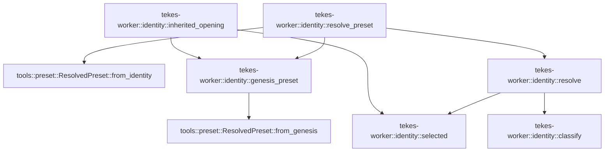

# tekes-worker::identity

[Package atlas](index.md) · [Source](../../src/identity.rs)

## Declarations

Visibility is the declaration spelling; trait members and reexports require their enclosing interface. `cfg` is not evaluated.

| Symbol | Kind | Visibility | Test / cfg |
|---|---|---|---|
| [tekes-worker::identity::SELECTED_SUBKIND](../../src/identity.rs#L3) | const_item | `private` |  |
| [tekes-worker::identity::selected](../../src/identity.rs#L7) | function_item | `pub(super)` |  |
| [tekes-worker::identity::genesis_preset](../../src/identity.rs#L43) | function_item | `pub(super)` |  |
| [tekes-worker::identity::inherited_opening](../../src/identity.rs#L57) | function_item | `pub(super)` |  |
| [tekes-worker::identity::resolve_preset](../../src/identity.rs#L72) | function_item | `pub(super)` |  |
| [tekes-worker::identity::resolve](../../src/identity.rs#L87) | function_item | `pub(super)` |  |
| [tekes-worker::identity::classify](../../src/identity.rs#L137) | function_item | `private` |  |
| [tekes-worker::identity::tests::auto_ledger](../../src/identity.rs#L284) | function_item | `private` | test; #[cfg(test)] |
| [tekes-worker::identity::tests::ledger_with](../../src/identity.rs#L288) | function_item | `private` | test; #[cfg(test)] |
| [tekes-worker::identity::tests::a_genesis_preset_renders_without_classifying](../../src/identity.rs#L328) | function_item | `private` | test; #[cfg(test)] |
| [tekes-worker::identity::tests::a_delegated_child_inherits_the_parent_opening](../../src/identity.rs#L361) | function_item | `private` | test; #[cfg(test)] |
| [tekes-worker::identity::tests::classifies_first_user_request_without_model_work](../../src/identity.rs#L386) | function_item | `private` | test; #[cfg(test)] |
| [tekes-worker::identity::tests::selection_is_durable_and_runtime_only](../../src/identity.rs#L444) | function_item | `private` | test; #[cfg(test)] |
| [tekes-worker::identity::tests::explicit_identity_is_stable_without_a_selection_event](../../src/identity.rs#L488) | function_item | `private` | test; #[cfg(test)] |

## Imports / reexports

| Local name | Source path | Visibility |
|---|---|---|
| `*` | `super::*` | `private` |
| `*` | `super::*` | `private` |

## Module declarations

| Module | Visibility | Attributes |
|---|---|---|
| `tekes-worker::identity::tests` | `private` | #[cfg(test)] |

## Function call graphs

Edges below are syntactically resolved calls only, including private functions. Graphs partition callers into groups of 20; they are not execution order. All unresolved sites are listed below and in the JSON inventory.

Functions 1–6: 8 direct edges

## Call sites

Includes test functions (marked in declarations). Receiver-type-required sites need type analysis/manual tracing. Calls in closures are attributed to their enclosing function; their occurrence here does not mean the closure executes immediately.

| Caller | Callee expression | Source lines | Target / classification |
|---|---|---|---|
| `selected` | `ledger.projection().ok_or` | [10](../../src/identity.rs#L10) | receiver-type-required |
| `selected` | `ledger.projection` | [10](../../src/identity.rs#L10) | receiver-type-required |
| `selected` | `projection.events.first().ok_or` | [11](../../src/identity.rs#L11) | receiver-type-required |
| `selected` | `projection.events.first` | [11](../../src/identity.rs#L11) | receiver-type-required |
| `selected` | `genesis.string_field` | [12](../../src/identity.rs#L12) | receiver-type-required |
| `selected` | `Ok` | [13](../../src/identity.rs#L13), [14](../../src/identity.rs#L14), [35](../../src/identity.rs#L35) | external-constructor-callback-or-unresolved |
| `selected` | `Some` | [13](../../src/identity.rs#L13), [14](../../src/identity.rs#L14), [19](../../src/identity.rs#L19), [33](../../src/identity.rs#L33) | external-constructor-callback-or-unresolved |
| `selected` | `event.kind` | [18](../../src/identity.rs#L18) | receiver-type-required |
| `selected` | `event.string_field` | [19](../../src/identity.rs#L19) | receiver-type-required |
| `selected` | `choice.is_some` | [23](../../src/identity.rs#L23) | receiver-type-required |
| `selected` | `Err` | [24](../../src/identity.rs#L24), [37](../../src/identity.rs#L37) | external-constructor-callback-or-unresolved |
| `selected` | `"duplicate identity selection".into` | [24](../../src/identity.rs#L24) | receiver-type-required |
| `selected` | `serde_json::to_value` | [26](../../src/identity.rs#L26) | external-constructor-callback-or-unresolved |
| `selected` | `event.raw` | [26](../../src/identity.rs#L26) | receiver-type-required |
| `selected` | `raw                     .get("payload")                     .and_then(&#124;payload&#124; payload.get("profile"))                     .and_then(Value::as_str)                     .and_then(tools::IdentityProfile::parse)                     .ok_or` | [27](../../src/identity.rs#L27) | receiver-type-required |
| `selected` | `raw                     .get("payload")                     .and_then(&#124;payload&#124; payload.get("profile"))                     .and_then(Value::as_str)                     .and_then` | [27](../../src/identity.rs#L27) | receiver-type-required |
| `selected` | `raw                     .get("payload")                     .and_then(&#124;payload&#124; payload.get("profile"))                     .and_then` | [27](../../src/identity.rs#L27) | receiver-type-required |
| `selected` | `raw                     .get("payload")                     .and_then` | [27](../../src/identity.rs#L27) | receiver-type-required |
| `selected` | `raw                     .get` | [27](../../src/identity.rs#L27) | receiver-type-required |
| `selected` | `payload.get` | [29](../../src/identity.rs#L29) | receiver-type-required |
| `selected` | `"invalid session identity profile".into` | [37](../../src/identity.rs#L37) | receiver-type-required |
| `genesis_preset` | `ledger.projection().ok_or` | [46](../../src/identity.rs#L46) | receiver-type-required |
| `genesis_preset` | `ledger.projection` | [46](../../src/identity.rs#L46) | receiver-type-required |
| `genesis_preset` | `projection.events.first().ok_or` | [47](../../src/identity.rs#L47) | receiver-type-required |
| `genesis_preset` | `projection.events.first` | [47](../../src/identity.rs#L47) | receiver-type-required |
| `genesis_preset` | `serde_json::to_value` | [48](../../src/identity.rs#L48) | external-constructor-callback-or-unresolved |
| `genesis_preset` | `genesis.raw` | [48](../../src/identity.rs#L48) | receiver-type-required |
| `genesis_preset` | `raw.get("preset")         .map(&#124;preset&#124; tools::ResolvedPreset::from_genesis(preset).map_err(Into::into))         .transpose` | [49](../../src/identity.rs#L49) | receiver-type-required |
| `genesis_preset` | `raw.get("preset")         .map` | [49](../../src/identity.rs#L49) | receiver-type-required |
| `genesis_preset` | `raw.get` | [49](../../src/identity.rs#L49) | receiver-type-required |
| `genesis_preset` | `tools::ResolvedPreset::from_genesis(preset).map_err` | [50](../../src/identity.rs#L50) | receiver-type-required |
| `genesis_preset` | `tools::ResolvedPreset::from_genesis` | [50](../../src/identity.rs#L50) | [tools::preset::ResolvedPreset::from_genesis](../../../tools/src/preset.rs#L855) |
| `inherited_opening` | `serde_json::Map::new` | [60](../../src/identity.rs#L60) | external-constructor-callback-or-unresolved |
| `inherited_opening` | `genesis_preset` | [61](../../src/identity.rs#L61) | [tekes-worker::identity::genesis_preset](../../src/identity.rs#L43) |
| `inherited_opening` | `opening.insert` | [62](../../src/identity.rs#L62), [63](../../src/identity.rs#L63), [65](../../src/identity.rs#L65) | receiver-type-required |
| `inherited_opening` | `"min_reader".to_owned` | [62](../../src/identity.rs#L62) | receiver-type-required |
| `inherited_opening` | `"preset".to_owned` | [63](../../src/identity.rs#L63) | receiver-type-required |
| `inherited_opening` | `serde_json::to_value` | [63](../../src/identity.rs#L63) | external-constructor-callback-or-unresolved |
| `inherited_opening` | `selected` | [64](../../src/identity.rs#L64) | [tekes-worker::identity::selected](../../src/identity.rs#L7) |
| `inherited_opening` | `"identity_profile".to_owned` | [65](../../src/identity.rs#L65) | receiver-type-required |
| `inherited_opening` | `Ok` | [67](../../src/identity.rs#L67) | external-constructor-callback-or-unresolved |
| `resolve_preset` | `genesis_preset` | [77](../../src/identity.rs#L77) | [tekes-worker::identity::genesis_preset](../../src/identity.rs#L43) |
| `resolve_preset` | `Ok` | [78](../../src/identity.rs#L78), [81](../../src/identity.rs#L81) | external-constructor-callback-or-unresolved |
| `resolve_preset` | `resolve` | [80](../../src/identity.rs#L80) | [tekes-worker::identity::resolve](../../src/identity.rs#L87) |
| `resolve_preset` | `tools::ResolvedPreset::from_identity` | [81](../../src/identity.rs#L81) | [tools::preset::ResolvedPreset::from_identity](../../../tools/src/preset.rs#L770) |
| `resolve_preset` | `Some` | [82](../../src/identity.rs#L82) | external-constructor-callback-or-unresolved |
| `resolve` | `selected` | [92](../../src/identity.rs#L92) | [tekes-worker::identity::selected](../../src/identity.rs#L7) |
| `resolve` | `Ok` | [93](../../src/identity.rs#L93), [131](../../src/identity.rs#L131) | external-constructor-callback-or-unresolved |
| `resolve` | `current_turn_inputs(ledger, turn)?         .first()         .ok_or` | [95](../../src/identity.rs#L95) | receiver-type-required |
| `resolve` | `current_turn_inputs(ledger, turn)?         .first` | [95](../../src/identity.rs#L95) | receiver-type-required |
| `resolve` | `current_turn_inputs` | [95](../../src/identity.rs#L95) | external-constructor-callback-or-unresolved |
| `resolve` | `ledger         .projection()         .ok_or("ledger projection missing")?         .events         .iter()         .find(&#124;event&#124; event.kind() == &EventKind::Input && event.seq() == input_seq)         .ok_or` | [98](../../src/identity.rs#L98) | receiver-type-required |
| `resolve` | `ledger         .projection()         .ok_or("ledger projection missing")?         .events         .iter()         .find` | [98](../../src/identity.rs#L98) | receiver-type-required |
| `resolve` | `ledger         .projection()         .ok_or("ledger projection missing")?         .events         .iter` | [98](../../src/identity.rs#L98) | receiver-type-required |
| `resolve` | `ledger         .projection()         .ok_or` | [98](../../src/identity.rs#L98) | receiver-type-required |
| `resolve` | `ledger         .projection` | [98](../../src/identity.rs#L98) | receiver-type-required |
| `resolve` | `event.kind` | [103](../../src/identity.rs#L103) | receiver-type-required |
| `resolve` | `event.seq` | [103](../../src/identity.rs#L103) | receiver-type-required |
| `resolve` | `serde_json::to_value` | [105](../../src/identity.rs#L105) | external-constructor-callback-or-unresolved |
| `resolve` | `first_input.raw` | [105](../../src/identity.rs#L105) | receiver-type-required |
| `resolve` | `materialize_json` | [106](../../src/identity.rs#L106) | external-constructor-callback-or-unresolved |
| `resolve` | `raw.get("content").ok_or` | [108](../../src/identity.rs#L108) | receiver-type-required |
| `resolve` | `raw.get` | [108](../../src/identity.rs#L108) | receiver-type-required |
| `resolve` | `content         .as_array()         .ok_or("first input content is not an array")?         .iter()         .filter_map(&#124;block&#124; {             (block.get("type").and_then(Value::as_str) == Some("text"))                 .then(&#124;&#124; block.get("text").and_then(Value::as_str))                 .flatten()         })         .collect::<Vec<_>>()         .join` | [110](../../src/identity.rs#L110) | receiver-type-required |
| `resolve` | `content         .as_array()         .ok_or("first input content is not an array")?         .iter()         .filter_map(&#124;block&#124; {             (block.get("type").and_then(Value::as_str) == Some("text"))                 .then(&#124;&#124; block.get("text").and_then(Value::as_str))                 .flatten()         })         .collect::<Vec<_>>` | [110](../../src/identity.rs#L110) | receiver-type-required |
| `resolve` | `content         .as_array()         .ok_or("first input content is not an array")?         .iter()         .filter_map` | [110](../../src/identity.rs#L110) | receiver-type-required |
| `resolve` | `content         .as_array()         .ok_or("first input content is not an array")?         .iter` | [110](../../src/identity.rs#L110) | receiver-type-required |
| `resolve` | `content         .as_array()         .ok_or` | [110](../../src/identity.rs#L110) | receiver-type-required |
| `resolve` | `content         .as_array` | [110](../../src/identity.rs#L110) | receiver-type-required |
| `resolve` | `(block.get("type").and_then(Value::as_str) == Some("text"))                 .then(&#124;&#124; block.get("text").and_then(Value::as_str))                 .flatten` | [115](../../src/identity.rs#L115) | receiver-type-required |
| `resolve` | `(block.get("type").and_then(Value::as_str) == Some("text"))                 .then` | [115](../../src/identity.rs#L115) | receiver-type-required |
| `resolve` | `block.get("type").and_then` | [115](../../src/identity.rs#L115) | receiver-type-required |
| `resolve` | `block.get` | [115](../../src/identity.rs#L115), [116](../../src/identity.rs#L116) | receiver-type-required |
| `resolve` | `Some` | [115](../../src/identity.rs#L115) | external-constructor-callback-or-unresolved |
| `resolve` | `block.get("text").and_then` | [116](../../src/identity.rs#L116) | receiver-type-required |
| `resolve` | `classify` | [121](../../src/identity.rs#L121) | [tekes-worker::identity::classify](../../src/identity.rs#L137) |
| `resolve` | `ledger.next_seq` | [122](../../src/identity.rs#L122) | receiver-type-required |
| `resolve` | `ledger.append_contract` | [123](../../src/identity.rs#L123) | receiver-type-required |
| `resolve` | `make_event` | [124](../../src/identity.rs#L124) | external-constructor-callback-or-unresolved |
| `resolve` | `BarrierContext::default` | [129](../../src/identity.rs#L129) | external-constructor-callback-or-unresolved |
| `classify` | `text.to_lowercase` | [138](../../src/identity.rs#L138) | receiver-type-required |
| `classify` | `lower         .split(&#124;ch: char&#124; !ch.is_ascii_alphanumeric() && ch != '_')         .filter(&#124;word&#124; !word.is_empty())         .collect::<Vec<_>>` | [139](../../src/identity.rs#L139) | receiver-type-required |
| `classify` | `lower         .split(&#124;ch: char&#124; !ch.is_ascii_alphanumeric() && ch != '_')         .filter` | [139](../../src/identity.rs#L139) | receiver-type-required |
| `classify` | `lower         .split` | [139](../../src/identity.rs#L139) | receiver-type-required |
| `classify` | `ch.is_ascii_alphanumeric` | [140](../../src/identity.rs#L140) | receiver-type-required |
| `classify` | `word.is_empty` | [141](../../src/identity.rs#L141) | receiver-type-required |
| `classify` | `words.iter().any` | [219](../../src/identity.rs#L219), [221](../../src/identity.rs#L221), [223](../../src/identity.rs#L223), [271](../../src/identity.rs#L271) | receiver-type-required |
| `classify` | `words.iter` | [219](../../src/identity.rs#L219), [221](../../src/identity.rs#L221), [223](../../src/identity.rs#L223), [271](../../src/identity.rs#L271) | receiver-type-required |
| `classify` | `creative_words.contains` | [219](../../src/identity.rs#L219) | receiver-type-required |
| `classify` | `creative_han.iter().any` | [220](../../src/identity.rs#L220) | receiver-type-required |
| `classify` | `creative_han.iter` | [220](../../src/identity.rs#L220) | receiver-type-required |
| `classify` | `lower.contains` | [220](../../src/identity.rs#L220), [222](../../src/identity.rs#L222), [224](../../src/identity.rs#L224), [225](../../src/identity.rs#L225), [226](../../src/identity.rs#L226), [272](../../src/identity.rs#L272) | receiver-type-required |
| `classify` | `ambiguous_words.contains` | [221](../../src/identity.rs#L221) | receiver-type-required |
| `classify` | `ambiguous_han.iter().any` | [222](../../src/identity.rs#L222) | receiver-type-required |
| `classify` | `ambiguous_han.iter` | [222](../../src/identity.rs#L222) | receiver-type-required |
| `classify` | `code_words.contains` | [223](../../src/identity.rs#L223) | receiver-type-required |
| `classify` | `code_han.iter().any` | [224](../../src/identity.rs#L224) | receiver-type-required |
| `classify` | `code_han.iter` | [224](../../src/identity.rs#L224) | receiver-type-required |
| `classify` | `code_suffixes.iter().any` | [225](../../src/identity.rs#L225) | receiver-type-required |
| `classify` | `code_suffixes.iter` | [225](../../src/identity.rs#L225) | receiver-type-required |
| `classify` | `general_words.contains` | [271](../../src/identity.rs#L271) | receiver-type-required |
| `classify` | `general_han.iter().any` | [272](../../src/identity.rs#L272) | receiver-type-required |
| `classify` | `general_han.iter` | [272](../../src/identity.rs#L272) | receiver-type-required |
| `auto_ledger` | `ledger_with` | [285](../../src/identity.rs#L285) | [tekes-worker::identity::tests::ledger_with](../../src/identity.rs#L288) |
| `ledger_with` | `tempfile::tempdir().unwrap` | [289](../../src/identity.rs#L289) | receiver-type-required |
| `ledger_with` | `tempfile::tempdir` | [289](../../src/identity.rs#L289) | external-constructor-callback-or-unresolved |
| `ledger_with` | `directory.path().join` | [290](../../src/identity.rs#L290) | receiver-type-required |
| `ledger_with` | `directory.path` | [290](../../src/identity.rs#L290) | receiver-type-required |
| `ledger_with` | `genesis             .as_object_mut()             .unwrap()             .extend` | [297](../../src/identity.rs#L297) | receiver-type-required |
| `ledger_with` | `genesis             .as_object_mut()             .unwrap` | [297](../../src/identity.rs#L297) | receiver-type-required |
| `ledger_with` | `genesis             .as_object_mut` | [297](../../src/identity.rs#L297) | receiver-type-required |
| `ledger_with` | `opening.as_object().unwrap().clone` | [300](../../src/identity.rs#L300) | receiver-type-required |
| `ledger_with` | `opening.as_object().unwrap` | [300](../../src/identity.rs#L300) | receiver-type-required |
| `ledger_with` | `opening.as_object` | [300](../../src/identity.rs#L300) | receiver-type-required |
| `ledger_with` | `Vec::new` | [314](../../src/identity.rs#L314) | external-constructor-callback-or-unresolved |
| `ledger_with` | `make_event(event).unwrap` | [316](../../src/identity.rs#L316) | receiver-type-required |
| `ledger_with` | `make_event` | [316](../../src/identity.rs#L316) | external-constructor-callback-or-unresolved |
| `ledger_with` | `bytes.extend` | [317](../../src/identity.rs#L317) | receiver-type-required |
| `ledger_with` | `event.canonical_bytes().unwrap` | [317](../../src/identity.rs#L317) | receiver-type-required |
| `ledger_with` | `event.canonical_bytes` | [317](../../src/identity.rs#L317) | receiver-type-required |
| `ledger_with` | `bytes.push` | [318](../../src/identity.rs#L318) | receiver-type-required |
| `ledger_with` | `std::fs::write(&path, bytes).unwrap` | [320](../../src/identity.rs#L320) | receiver-type-required |
| `ledger_with` | `std::fs::write` | [320](../../src/identity.rs#L320) | external-constructor-callback-or-unresolved |
| `ledger_with` | `LockedLedger::open(&path, schema::READER_VERSION).unwrap` | [323](../../src/identity.rs#L323) | receiver-type-required |
| `ledger_with` | `LockedLedger::open` | [323](../../src/identity.rs#L323) | external-constructor-callback-or-unresolved |
| `a_genesis_preset_renders_without_classifying` | `tools::ResolvedPreset::resolve_request(             &json!({"layers":[{"kind":"inline","id":"creator","version":"1",                 "identity":"You are a story writing agent powered by the {model} model."}]}),             tools::PresetBase::General,             &tools::NoPresetEnvironment,         )         .unwrap` | [329](../../src/identity.rs#L329) | receiver-type-required |
| `a_genesis_preset_renders_without_classifying` | `tools::ResolvedPreset::resolve_request` | [329](../../src/identity.rs#L329) | [tools::preset::ResolvedPreset::resolve_request](../../../tools/src/preset.rs#L721) |
| `a_genesis_preset_renders_without_classifying` | `ledger_with` | [336](../../src/identity.rs#L336), [350](../../src/identity.rs#L350) | [tekes-worker::identity::tests::ledger_with](../../src/identity.rs#L288) |
| `a_genesis_preset_renders_without_classifying` | `ledger.projection().unwrap().events.len` | [340](../../src/identity.rs#L340) | receiver-type-required |
| `a_genesis_preset_renders_without_classifying` | `ledger.projection().unwrap` | [340](../../src/identity.rs#L340) | receiver-type-required |
| `a_genesis_preset_renders_without_classifying` | `ledger.projection` | [340](../../src/identity.rs#L340) | receiver-type-required |
| `a_genesis_preset_renders_without_classifying` | `resolve_preset(&mut ledger, "2026-09-27T00:00:04.000Z", 1).unwrap` | [341](../../src/identity.rs#L341) | receiver-type-required |
| `a_genesis_preset_renders_without_classifying` | `resolve_preset` | [341](../../src/identity.rs#L341) | external-constructor-callback-or-unresolved |
| `a_delegated_child_inherits_the_parent_opening` | `tools::ResolvedPreset::resolve_request(             &json!({"layers":[{"kind":"kernel","id":"coding"}],"tools":["read"]}),             tools::PresetBase::General,             &tools::NoPresetEnvironment,         )         .unwrap` | [362](../../src/identity.rs#L362) | receiver-type-required |
| `a_delegated_child_inherits_the_parent_opening` | `tools::ResolvedPreset::resolve_request` | [362](../../src/identity.rs#L362) | [tools::preset::ResolvedPreset::resolve_request](../../../tools/src/preset.rs#L721) |
| `a_delegated_child_inherits_the_parent_opening` | `ledger_with` | [369](../../src/identity.rs#L369), [375](../../src/identity.rs#L375) | [tekes-worker::identity::tests::ledger_with](../../src/identity.rs#L288) |
| `a_delegated_child_inherits_the_parent_opening` | `inherited_opening(&with_preset).unwrap` | [370](../../src/identity.rs#L370) | receiver-type-required |
| `a_delegated_child_inherits_the_parent_opening` | `inherited_opening` | [370](../../src/identity.rs#L370) | external-constructor-callback-or-unresolved |
| `a_delegated_child_inherits_the_parent_opening` | `auto_ledger` | [381](../../src/identity.rs#L381) | [tekes-worker::identity::tests::auto_ledger](../../src/identity.rs#L284) |
| `selection_is_durable_and_runtime_only` | `auto_ledger` | [445](../../src/identity.rs#L445) | [tekes-worker::identity::tests::auto_ledger](../../src/identity.rs#L284) |
| `selection_is_durable_and_runtime_only` | `ledger.projection().unwrap().events.len` | [451](../../src/identity.rs#L451) | receiver-type-required |
| `selection_is_durable_and_runtime_only` | `ledger.projection().unwrap` | [451](../../src/identity.rs#L451), [457](../../src/identity.rs#L457) | receiver-type-required |
| `selection_is_durable_and_runtime_only` | `ledger.projection` | [451](../../src/identity.rs#L451), [457](../../src/identity.rs#L457) | receiver-type-required |
| `selection_is_durable_and_runtime_only` | `ledger.projection().unwrap().events.last().unwrap` | [457](../../src/identity.rs#L457) | receiver-type-required |
| `selection_is_durable_and_runtime_only` | `ledger.projection().unwrap().events.last` | [457](../../src/identity.rs#L457) | receiver-type-required |
| `selection_is_durable_and_runtime_only` | `tools::root_system_instructions` | [463](../../src/identity.rs#L463) | [tools::guidance::root_system_instructions](../../../tools/src/guidance.rs#L85) |
| `selection_is_durable_and_runtime_only` | `selected(&ledger).unwrap().unwrap` | [464](../../src/identity.rs#L464) | receiver-type-required |
| `selection_is_durable_and_runtime_only` | `selected(&ledger).unwrap` | [464](../../src/identity.rs#L464) | receiver-type-required |
| `selection_is_durable_and_runtime_only` | `selected` | [464](../../src/identity.rs#L464) | external-constructor-callback-or-unresolved |
| `selection_is_durable_and_runtime_only` | `Some` | [466](../../src/identity.rs#L466) | external-constructor-callback-or-unresolved |
| `selection_is_durable_and_runtime_only` | `ledger.path().to_owned` | [469](../../src/identity.rs#L469) | receiver-type-required |
| `selection_is_durable_and_runtime_only` | `ledger.path` | [469](../../src/identity.rs#L469) | receiver-type-required |
| `selection_is_durable_and_runtime_only` | `drop` | [470](../../src/identity.rs#L470) | external-constructor-callback-or-unresolved |
| `selection_is_durable_and_runtime_only` | `LockedLedger::open(&path, schema::READER_VERSION).unwrap` | [471](../../src/identity.rs#L471) | receiver-type-required |
| `selection_is_durable_and_runtime_only` | `LockedLedger::open` | [471](../../src/identity.rs#L471) | external-constructor-callback-or-unresolved |
| `explicit_identity_is_stable_without_a_selection_event` | `auto_ledger` | [489](../../src/identity.rs#L489) | [tekes-worker::identity::tests::auto_ledger](../../src/identity.rs#L284) |
| `explicit_identity_is_stable_without_a_selection_event` | `ledger.path().to_owned` | [491](../../src/identity.rs#L491) | receiver-type-required |
| `explicit_identity_is_stable_without_a_selection_event` | `ledger.path` | [491](../../src/identity.rs#L491) | receiver-type-required |
| `explicit_identity_is_stable_without_a_selection_event` | `drop` | [492](../../src/identity.rs#L492) | external-constructor-callback-or-unresolved |
| `explicit_identity_is_stable_without_a_selection_event` | `std::fs::read(&path).unwrap` | [493](../../src/identity.rs#L493) | receiver-type-required |
| `explicit_identity_is_stable_without_a_selection_event` | `std::fs::read` | [493](../../src/identity.rs#L493) | external-constructor-callback-or-unresolved |
| `explicit_identity_is_stable_without_a_selection_event` | `String::from_utf8(bytes).unwrap().replace` | [494](../../src/identity.rs#L494) | receiver-type-required |
| `explicit_identity_is_stable_without_a_selection_event` | `String::from_utf8(bytes).unwrap` | [494](../../src/identity.rs#L494) | receiver-type-required |
| `explicit_identity_is_stable_without_a_selection_event` | `String::from_utf8` | [494](../../src/identity.rs#L494) | external-constructor-callback-or-unresolved |
| `explicit_identity_is_stable_without_a_selection_event` | `std::fs::write(&path, text).unwrap` | [498](../../src/identity.rs#L498) | receiver-type-required |
| `explicit_identity_is_stable_without_a_selection_event` | `std::fs::write` | [498](../../src/identity.rs#L498) | external-constructor-callback-or-unresolved |
| `explicit_identity_is_stable_without_a_selection_event` | `LockedLedger::open(&path, schema::READER_VERSION).unwrap` | [499](../../src/identity.rs#L499) | receiver-type-required |
| `explicit_identity_is_stable_without_a_selection_event` | `LockedLedger::open` | [499](../../src/identity.rs#L499) | external-constructor-callback-or-unresolved |
