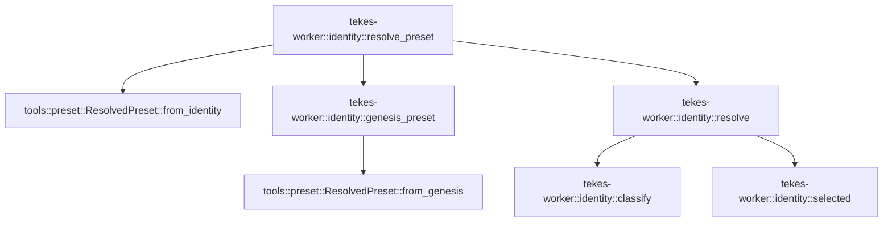

# tekes-worker::identity

[Package atlas](index.md) · [Source](../../src/identity.rs)

## Declarations

Visibility is the declaration spelling; trait members and reexports require their enclosing interface. `cfg` is not evaluated.

| Symbol | Kind | Visibility | Test / cfg |
|---|---|---|---|
| [tekes-worker::identity::SELECTED_SUBKIND](../../src/identity.rs#L3) | const_item | `private` |  |
| [tekes-worker::identity::selected](../../src/identity.rs#L7) | function_item | `pub(super)` |  |
| [tekes-worker::identity::genesis_preset](../../src/identity.rs#L43) | function_item | `pub(super)` |  |
| [tekes-worker::identity::resolve_preset](../../src/identity.rs#L56) | function_item | `pub(super)` |  |
| [tekes-worker::identity::resolve](../../src/identity.rs#L71) | function_item | `pub(super)` |  |
| [tekes-worker::identity::classify](../../src/identity.rs#L121) | function_item | `private` |  |
| [tekes-worker::identity::tests::auto_ledger](../../src/identity.rs#L240) | function_item | `private` | test; #[cfg(test)] |
| [tekes-worker::identity::tests::ledger_with](../../src/identity.rs#L244) | function_item | `private` | test; #[cfg(test)] |
| [tekes-worker::identity::tests::a_genesis_preset_renders_without_classifying](../../src/identity.rs#L284) | function_item | `private` | test; #[cfg(test)] |
| [tekes-worker::identity::tests::classifies_first_user_request_without_model_work](../../src/identity.rs#L316) | function_item | `private` | test; #[cfg(test)] |
| [tekes-worker::identity::tests::selection_is_durable_and_runtime_only](../../src/identity.rs#L349) | function_item | `private` | test; #[cfg(test)] |
| [tekes-worker::identity::tests::explicit_identity_is_stable_without_a_selection_event](../../src/identity.rs#L393) | function_item | `private` | test; #[cfg(test)] |

## Imports / reexports

| Local name | Source path | Visibility |
|---|---|---|
| `*` | `super::*` | `private` |
| `*` | `super::*` | `private` |

## Module declarations

| Module | Visibility | Attributes |
|---|---|---|
| `tekes-worker::identity::tests` | `private` | #[cfg(test)] |

## Function call graphs

Edges below are syntactically resolved calls only, including private functions. Graphs partition callers into groups of 20; they are not execution order. All unresolved sites are listed below and in the JSON inventory.

Functions 1–5: 6 direct edges

## Call sites

Includes test functions (marked in declarations). Receiver-type-required sites need type analysis/manual tracing. Calls in closures are attributed to their enclosing function; their occurrence here does not mean the closure executes immediately.

| Caller | Callee expression | Source lines | Target / classification |
|---|---|---|---|
| `selected` | `ledger.projection().ok_or` | [10](../../src/identity.rs#L10) | receiver-type-required |
| `selected` | `ledger.projection` | [10](../../src/identity.rs#L10) | receiver-type-required |
| `selected` | `projection.events.first().ok_or` | [11](../../src/identity.rs#L11) | receiver-type-required |
| `selected` | `projection.events.first` | [11](../../src/identity.rs#L11) | receiver-type-required |
| `selected` | `genesis.string_field` | [12](../../src/identity.rs#L12) | receiver-type-required |
| `selected` | `Ok` | [13](../../src/identity.rs#L13), [14](../../src/identity.rs#L14), [35](../../src/identity.rs#L35) | external-constructor-callback-or-unresolved |
| `selected` | `Some` | [13](../../src/identity.rs#L13), [14](../../src/identity.rs#L14), [19](../../src/identity.rs#L19), [33](../../src/identity.rs#L33) | external-constructor-callback-or-unresolved |
| `selected` | `event.kind` | [18](../../src/identity.rs#L18) | receiver-type-required |
| `selected` | `event.string_field` | [19](../../src/identity.rs#L19) | receiver-type-required |
| `selected` | `choice.is_some` | [23](../../src/identity.rs#L23) | receiver-type-required |
| `selected` | `Err` | [24](../../src/identity.rs#L24), [37](../../src/identity.rs#L37) | external-constructor-callback-or-unresolved |
| `selected` | `"duplicate identity selection".into` | [24](../../src/identity.rs#L24) | receiver-type-required |
| `selected` | `serde_json::to_value` | [26](../../src/identity.rs#L26) | external-constructor-callback-or-unresolved |
| `selected` | `event.raw` | [26](../../src/identity.rs#L26) | receiver-type-required |
| `selected` | `raw                     .get("payload")                     .and_then(&#124;payload&#124; payload.get("profile"))                     .and_then(Value::as_str)                     .and_then(tools::IdentityProfile::parse)                     .ok_or` | [27](../../src/identity.rs#L27) | receiver-type-required |
| `selected` | `raw                     .get("payload")                     .and_then(&#124;payload&#124; payload.get("profile"))                     .and_then(Value::as_str)                     .and_then` | [27](../../src/identity.rs#L27) | receiver-type-required |
| `selected` | `raw                     .get("payload")                     .and_then(&#124;payload&#124; payload.get("profile"))                     .and_then` | [27](../../src/identity.rs#L27) | receiver-type-required |
| `selected` | `raw                     .get("payload")                     .and_then` | [27](../../src/identity.rs#L27) | receiver-type-required |
| `selected` | `raw                     .get` | [27](../../src/identity.rs#L27) | receiver-type-required |
| `selected` | `payload.get` | [29](../../src/identity.rs#L29) | receiver-type-required |
| `selected` | `"invalid session identity profile".into` | [37](../../src/identity.rs#L37) | receiver-type-required |
| `genesis_preset` | `ledger.projection().ok_or` | [46](../../src/identity.rs#L46) | receiver-type-required |
| `genesis_preset` | `ledger.projection` | [46](../../src/identity.rs#L46) | receiver-type-required |
| `genesis_preset` | `projection.events.first().ok_or` | [47](../../src/identity.rs#L47) | receiver-type-required |
| `genesis_preset` | `projection.events.first` | [47](../../src/identity.rs#L47) | receiver-type-required |
| `genesis_preset` | `serde_json::to_value` | [48](../../src/identity.rs#L48) | external-constructor-callback-or-unresolved |
| `genesis_preset` | `genesis.raw` | [48](../../src/identity.rs#L48) | receiver-type-required |
| `genesis_preset` | `raw.get("preset")         .map(&#124;preset&#124; tools::ResolvedPreset::from_genesis(preset).map_err(Into::into))         .transpose` | [49](../../src/identity.rs#L49) | receiver-type-required |
| `genesis_preset` | `raw.get("preset")         .map` | [49](../../src/identity.rs#L49) | receiver-type-required |
| `genesis_preset` | `raw.get` | [49](../../src/identity.rs#L49) | receiver-type-required |
| `genesis_preset` | `tools::ResolvedPreset::from_genesis(preset).map_err` | [50](../../src/identity.rs#L50) | receiver-type-required |
| `genesis_preset` | `tools::ResolvedPreset::from_genesis` | [50](../../src/identity.rs#L50) | [tools::preset::ResolvedPreset::from_genesis](../../../tools/src/preset.rs#L489) |
| `resolve_preset` | `genesis_preset` | [61](../../src/identity.rs#L61) | [tekes-worker::identity::genesis_preset](../../src/identity.rs#L43) |
| `resolve_preset` | `Ok` | [62](../../src/identity.rs#L62), [65](../../src/identity.rs#L65) | external-constructor-callback-or-unresolved |
| `resolve_preset` | `resolve` | [64](../../src/identity.rs#L64) | [tekes-worker::identity::resolve](../../src/identity.rs#L71) |
| `resolve_preset` | `tools::ResolvedPreset::from_identity` | [65](../../src/identity.rs#L65) | [tools::preset::ResolvedPreset::from_identity](../../../tools/src/preset.rs#L421) |
| `resolve_preset` | `Some` | [66](../../src/identity.rs#L66) | external-constructor-callback-or-unresolved |
| `resolve` | `selected` | [76](../../src/identity.rs#L76) | [tekes-worker::identity::selected](../../src/identity.rs#L7) |
| `resolve` | `Ok` | [77](../../src/identity.rs#L77), [115](../../src/identity.rs#L115) | external-constructor-callback-or-unresolved |
| `resolve` | `current_turn_inputs(ledger, turn)?         .first()         .ok_or` | [79](../../src/identity.rs#L79) | receiver-type-required |
| `resolve` | `current_turn_inputs(ledger, turn)?         .first` | [79](../../src/identity.rs#L79) | receiver-type-required |
| `resolve` | `current_turn_inputs` | [79](../../src/identity.rs#L79) | external-constructor-callback-or-unresolved |
| `resolve` | `ledger         .projection()         .ok_or("ledger projection missing")?         .events         .iter()         .find(&#124;event&#124; event.kind() == &EventKind::Input && event.seq() == input_seq)         .ok_or` | [82](../../src/identity.rs#L82) | receiver-type-required |
| `resolve` | `ledger         .projection()         .ok_or("ledger projection missing")?         .events         .iter()         .find` | [82](../../src/identity.rs#L82) | receiver-type-required |
| `resolve` | `ledger         .projection()         .ok_or("ledger projection missing")?         .events         .iter` | [82](../../src/identity.rs#L82) | receiver-type-required |
| `resolve` | `ledger         .projection()         .ok_or` | [82](../../src/identity.rs#L82) | receiver-type-required |
| `resolve` | `ledger         .projection` | [82](../../src/identity.rs#L82) | receiver-type-required |
| `resolve` | `event.kind` | [87](../../src/identity.rs#L87) | receiver-type-required |
| `resolve` | `event.seq` | [87](../../src/identity.rs#L87) | receiver-type-required |
| `resolve` | `serde_json::to_value` | [89](../../src/identity.rs#L89) | external-constructor-callback-or-unresolved |
| `resolve` | `first_input.raw` | [89](../../src/identity.rs#L89) | receiver-type-required |
| `resolve` | `materialize_json` | [90](../../src/identity.rs#L90) | external-constructor-callback-or-unresolved |
| `resolve` | `raw.get("content").ok_or` | [92](../../src/identity.rs#L92) | receiver-type-required |
| `resolve` | `raw.get` | [92](../../src/identity.rs#L92) | receiver-type-required |
| `resolve` | `content         .as_array()         .ok_or("first input content is not an array")?         .iter()         .filter_map(&#124;block&#124; {             (block.get("type").and_then(Value::as_str) == Some("text"))                 .then(&#124;&#124; block.get("text").and_then(Value::as_str))                 .flatten()         })         .collect::<Vec<_>>()         .join` | [94](../../src/identity.rs#L94) | receiver-type-required |
| `resolve` | `content         .as_array()         .ok_or("first input content is not an array")?         .iter()         .filter_map(&#124;block&#124; {             (block.get("type").and_then(Value::as_str) == Some("text"))                 .then(&#124;&#124; block.get("text").and_then(Value::as_str))                 .flatten()         })         .collect::<Vec<_>>` | [94](../../src/identity.rs#L94) | receiver-type-required |
| `resolve` | `content         .as_array()         .ok_or("first input content is not an array")?         .iter()         .filter_map` | [94](../../src/identity.rs#L94) | receiver-type-required |
| `resolve` | `content         .as_array()         .ok_or("first input content is not an array")?         .iter` | [94](../../src/identity.rs#L94) | receiver-type-required |
| `resolve` | `content         .as_array()         .ok_or` | [94](../../src/identity.rs#L94) | receiver-type-required |
| `resolve` | `content         .as_array` | [94](../../src/identity.rs#L94) | receiver-type-required |
| `resolve` | `(block.get("type").and_then(Value::as_str) == Some("text"))                 .then(&#124;&#124; block.get("text").and_then(Value::as_str))                 .flatten` | [99](../../src/identity.rs#L99) | receiver-type-required |
| `resolve` | `(block.get("type").and_then(Value::as_str) == Some("text"))                 .then` | [99](../../src/identity.rs#L99) | receiver-type-required |
| `resolve` | `block.get("type").and_then` | [99](../../src/identity.rs#L99) | receiver-type-required |
| `resolve` | `block.get` | [99](../../src/identity.rs#L99), [100](../../src/identity.rs#L100) | receiver-type-required |
| `resolve` | `Some` | [99](../../src/identity.rs#L99) | external-constructor-callback-or-unresolved |
| `resolve` | `block.get("text").and_then` | [100](../../src/identity.rs#L100) | receiver-type-required |
| `resolve` | `classify` | [105](../../src/identity.rs#L105) | [tekes-worker::identity::classify](../../src/identity.rs#L121) |
| `resolve` | `ledger.next_seq` | [106](../../src/identity.rs#L106) | receiver-type-required |
| `resolve` | `ledger.append_contract` | [107](../../src/identity.rs#L107) | receiver-type-required |
| `resolve` | `make_event` | [108](../../src/identity.rs#L108) | external-constructor-callback-or-unresolved |
| `resolve` | `BarrierContext::default` | [113](../../src/identity.rs#L113) | external-constructor-callback-or-unresolved |
| `classify` | `text.to_lowercase` | [122](../../src/identity.rs#L122) | receiver-type-required |
| `classify` | `lower         .split(&#124;ch: char&#124; !ch.is_ascii_alphanumeric() && ch != '_')         .filter(&#124;word&#124; !word.is_empty())         .collect::<Vec<_>>` | [123](../../src/identity.rs#L123) | receiver-type-required |
| `classify` | `lower         .split(&#124;ch: char&#124; !ch.is_ascii_alphanumeric() && ch != '_')         .filter` | [123](../../src/identity.rs#L123) | receiver-type-required |
| `classify` | `lower         .split` | [123](../../src/identity.rs#L123) | receiver-type-required |
| `classify` | `ch.is_ascii_alphanumeric` | [124](../../src/identity.rs#L124) | receiver-type-required |
| `classify` | `word.is_empty` | [125](../../src/identity.rs#L125) | receiver-type-required |
| `classify` | `words.iter().any` | [183](../../src/identity.rs#L183), [227](../../src/identity.rs#L227) | receiver-type-required |
| `classify` | `words.iter` | [183](../../src/identity.rs#L183), [227](../../src/identity.rs#L227) | receiver-type-required |
| `classify` | `code_words.contains` | [183](../../src/identity.rs#L183) | receiver-type-required |
| `classify` | `code_han.iter().any` | [184](../../src/identity.rs#L184) | receiver-type-required |
| `classify` | `code_han.iter` | [184](../../src/identity.rs#L184) | receiver-type-required |
| `classify` | `lower.contains` | [184](../../src/identity.rs#L184), [185](../../src/identity.rs#L185), [186](../../src/identity.rs#L186), [228](../../src/identity.rs#L228) | receiver-type-required |
| `classify` | `code_suffixes.iter().any` | [185](../../src/identity.rs#L185) | receiver-type-required |
| `classify` | `code_suffixes.iter` | [185](../../src/identity.rs#L185) | receiver-type-required |
| `classify` | `general_words.contains` | [227](../../src/identity.rs#L227) | receiver-type-required |
| `classify` | `general_han.iter().any` | [228](../../src/identity.rs#L228) | receiver-type-required |
| `classify` | `general_han.iter` | [228](../../src/identity.rs#L228) | receiver-type-required |
| `auto_ledger` | `ledger_with` | [241](../../src/identity.rs#L241) | [tekes-worker::identity::tests::ledger_with](../../src/identity.rs#L244) |
| `ledger_with` | `tempfile::tempdir().unwrap` | [245](../../src/identity.rs#L245) | receiver-type-required |
| `ledger_with` | `tempfile::tempdir` | [245](../../src/identity.rs#L245) | external-constructor-callback-or-unresolved |
| `ledger_with` | `directory.path().join` | [246](../../src/identity.rs#L246) | receiver-type-required |
| `ledger_with` | `directory.path` | [246](../../src/identity.rs#L246) | receiver-type-required |
| `ledger_with` | `genesis             .as_object_mut()             .unwrap()             .extend` | [253](../../src/identity.rs#L253) | receiver-type-required |
| `ledger_with` | `genesis             .as_object_mut()             .unwrap` | [253](../../src/identity.rs#L253) | receiver-type-required |
| `ledger_with` | `genesis             .as_object_mut` | [253](../../src/identity.rs#L253) | receiver-type-required |
| `ledger_with` | `opening.as_object().unwrap().clone` | [256](../../src/identity.rs#L256) | receiver-type-required |
| `ledger_with` | `opening.as_object().unwrap` | [256](../../src/identity.rs#L256) | receiver-type-required |
| `ledger_with` | `opening.as_object` | [256](../../src/identity.rs#L256) | receiver-type-required |
| `ledger_with` | `Vec::new` | [270](../../src/identity.rs#L270) | external-constructor-callback-or-unresolved |
| `ledger_with` | `make_event(event).unwrap` | [272](../../src/identity.rs#L272) | receiver-type-required |
| `ledger_with` | `make_event` | [272](../../src/identity.rs#L272) | external-constructor-callback-or-unresolved |
| `ledger_with` | `bytes.extend` | [273](../../src/identity.rs#L273) | receiver-type-required |
| `ledger_with` | `event.canonical_bytes().unwrap` | [273](../../src/identity.rs#L273) | receiver-type-required |
| `ledger_with` | `event.canonical_bytes` | [273](../../src/identity.rs#L273) | receiver-type-required |
| `ledger_with` | `bytes.push` | [274](../../src/identity.rs#L274) | receiver-type-required |
| `ledger_with` | `std::fs::write(&path, bytes).unwrap` | [276](../../src/identity.rs#L276) | receiver-type-required |
| `ledger_with` | `std::fs::write` | [276](../../src/identity.rs#L276) | external-constructor-callback-or-unresolved |
| `ledger_with` | `LockedLedger::open(&path, schema::READER_VERSION).unwrap` | [279](../../src/identity.rs#L279) | receiver-type-required |
| `ledger_with` | `LockedLedger::open` | [279](../../src/identity.rs#L279) | external-constructor-callback-or-unresolved |
| `a_genesis_preset_renders_without_classifying` | `tools::ResolvedPreset::resolve_request(             &json!({"layers":[{"kind":"inline","id":"creator","version":"1",                 "identity":"You are a story writing agent powered by the {model} model."}]}),             tools::PresetBase::General,         )         .unwrap` | [285](../../src/identity.rs#L285) | receiver-type-required |
| `a_genesis_preset_renders_without_classifying` | `tools::ResolvedPreset::resolve_request` | [285](../../src/identity.rs#L285) | [tools::preset::ResolvedPreset::resolve_request](../../../tools/src/preset.rs#L382) |
| `a_genesis_preset_renders_without_classifying` | `ledger_with` | [291](../../src/identity.rs#L291), [305](../../src/identity.rs#L305) | [tekes-worker::identity::tests::ledger_with](../../src/identity.rs#L244) |
| `a_genesis_preset_renders_without_classifying` | `ledger.projection().unwrap().events.len` | [295](../../src/identity.rs#L295) | receiver-type-required |
| `a_genesis_preset_renders_without_classifying` | `ledger.projection().unwrap` | [295](../../src/identity.rs#L295) | receiver-type-required |
| `a_genesis_preset_renders_without_classifying` | `ledger.projection` | [295](../../src/identity.rs#L295) | receiver-type-required |
| `a_genesis_preset_renders_without_classifying` | `resolve_preset(&mut ledger, "2026-09-27T00:00:04.000Z", 1).unwrap` | [296](../../src/identity.rs#L296) | receiver-type-required |
| `a_genesis_preset_renders_without_classifying` | `resolve_preset` | [296](../../src/identity.rs#L296) | external-constructor-callback-or-unresolved |
| `selection_is_durable_and_runtime_only` | `auto_ledger` | [350](../../src/identity.rs#L350) | [tekes-worker::identity::tests::auto_ledger](../../src/identity.rs#L240) |
| `selection_is_durable_and_runtime_only` | `ledger.projection().unwrap().events.len` | [356](../../src/identity.rs#L356) | receiver-type-required |
| `selection_is_durable_and_runtime_only` | `ledger.projection().unwrap` | [356](../../src/identity.rs#L356), [362](../../src/identity.rs#L362) | receiver-type-required |
| `selection_is_durable_and_runtime_only` | `ledger.projection` | [356](../../src/identity.rs#L356), [362](../../src/identity.rs#L362) | receiver-type-required |
| `selection_is_durable_and_runtime_only` | `ledger.projection().unwrap().events.last().unwrap` | [362](../../src/identity.rs#L362) | receiver-type-required |
| `selection_is_durable_and_runtime_only` | `ledger.projection().unwrap().events.last` | [362](../../src/identity.rs#L362) | receiver-type-required |
| `selection_is_durable_and_runtime_only` | `tools::root_system_instructions` | [368](../../src/identity.rs#L368) | [tools::guidance::root_system_instructions](../../../tools/src/guidance.rs#L85) |
| `selection_is_durable_and_runtime_only` | `selected(&ledger).unwrap().unwrap` | [369](../../src/identity.rs#L369) | receiver-type-required |
| `selection_is_durable_and_runtime_only` | `selected(&ledger).unwrap` | [369](../../src/identity.rs#L369) | receiver-type-required |
| `selection_is_durable_and_runtime_only` | `selected` | [369](../../src/identity.rs#L369) | external-constructor-callback-or-unresolved |
| `selection_is_durable_and_runtime_only` | `Some` | [371](../../src/identity.rs#L371) | external-constructor-callback-or-unresolved |
| `selection_is_durable_and_runtime_only` | `ledger.path().to_owned` | [374](../../src/identity.rs#L374) | receiver-type-required |
| `selection_is_durable_and_runtime_only` | `ledger.path` | [374](../../src/identity.rs#L374) | receiver-type-required |
| `selection_is_durable_and_runtime_only` | `drop` | [375](../../src/identity.rs#L375) | external-constructor-callback-or-unresolved |
| `selection_is_durable_and_runtime_only` | `LockedLedger::open(&path, schema::READER_VERSION).unwrap` | [376](../../src/identity.rs#L376) | receiver-type-required |
| `selection_is_durable_and_runtime_only` | `LockedLedger::open` | [376](../../src/identity.rs#L376) | external-constructor-callback-or-unresolved |
| `explicit_identity_is_stable_without_a_selection_event` | `auto_ledger` | [394](../../src/identity.rs#L394) | [tekes-worker::identity::tests::auto_ledger](../../src/identity.rs#L240) |
| `explicit_identity_is_stable_without_a_selection_event` | `ledger.path().to_owned` | [396](../../src/identity.rs#L396) | receiver-type-required |
| `explicit_identity_is_stable_without_a_selection_event` | `ledger.path` | [396](../../src/identity.rs#L396) | receiver-type-required |
| `explicit_identity_is_stable_without_a_selection_event` | `drop` | [397](../../src/identity.rs#L397) | external-constructor-callback-or-unresolved |
| `explicit_identity_is_stable_without_a_selection_event` | `std::fs::read(&path).unwrap` | [398](../../src/identity.rs#L398) | receiver-type-required |
| `explicit_identity_is_stable_without_a_selection_event` | `std::fs::read` | [398](../../src/identity.rs#L398) | external-constructor-callback-or-unresolved |
| `explicit_identity_is_stable_without_a_selection_event` | `String::from_utf8(bytes).unwrap().replace` | [399](../../src/identity.rs#L399) | receiver-type-required |
| `explicit_identity_is_stable_without_a_selection_event` | `String::from_utf8(bytes).unwrap` | [399](../../src/identity.rs#L399) | receiver-type-required |
| `explicit_identity_is_stable_without_a_selection_event` | `String::from_utf8` | [399](../../src/identity.rs#L399) | external-constructor-callback-or-unresolved |
| `explicit_identity_is_stable_without_a_selection_event` | `std::fs::write(&path, text).unwrap` | [403](../../src/identity.rs#L403) | receiver-type-required |
| `explicit_identity_is_stable_without_a_selection_event` | `std::fs::write` | [403](../../src/identity.rs#L403) | external-constructor-callback-or-unresolved |
| `explicit_identity_is_stable_without_a_selection_event` | `LockedLedger::open(&path, schema::READER_VERSION).unwrap` | [404](../../src/identity.rs#L404) | receiver-type-required |
| `explicit_identity_is_stable_without_a_selection_event` | `LockedLedger::open` | [404](../../src/identity.rs#L404) | external-constructor-callback-or-unresolved |
