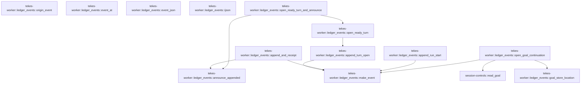

# tekes-worker::ledger_events

[Package atlas](index.md) · [Source](../../src/ledger_events.rs)

## Declarations

Visibility is the declaration spelling; trait members and reexports require their enclosing interface. `cfg` is not evaluated.

| Symbol | Kind | Visibility | Test / cfg |
|---|---|---|---|
| [tekes-worker::ledger_events::append_run_start](../../src/ledger_events.rs#L3) | function_item | `pub(crate)` |  |
| [tekes-worker::ledger_events::open_ready_turn](../../src/ledger_events.rs#L42) | function_item | `pub(crate)` |  |
| [tekes-worker::ledger_events::open_ready_turn_and_announce](../../src/ledger_events.rs#L67) | function_item | `pub(crate)` |  |
| [tekes-worker::ledger_events::open_goal_continuation](../../src/ledger_events.rs#L82) | function_item | `pub(crate)` |  |
| [tekes-worker::ledger_events::goal_store_location](../../src/ledger_events.rs#L135) | function_item | `pub(crate)` |  |
| [tekes-worker::ledger_events::append_turn_open](../../src/ledger_events.rs#L149) | function_item | `pub(crate)` |  |
| [tekes-worker::ledger_events::origin_event](../../src/ledger_events.rs#L173) | function_item | `pub(crate)` |  |
| [tekes-worker::ledger_events::append_and_receipt](../../src/ledger_events.rs#L192) | function_item | `pub(crate)` |  |
| [tekes-worker::ledger_events::announce_appended](../../src/ledger_events.rs#L229) | function_item | `pub(crate)` |  |
| [tekes-worker::ledger_events::event_at](../../src/ledger_events.rs#L241) | function_item | `pub(crate)` |  |
| [tekes-worker::ledger_events::event_json](../../src/ledger_events.rs#L248) | function_item | `pub(crate)` |  |
| [tekes-worker::ledger_events::make_event](../../src/ledger_events.rs#L252) | function_item | `pub(crate)` |  |
| [tekes-worker::ledger_events::ijson](../../src/ledger_events.rs#L256) | function_item | `pub(crate)` |  |

## Imports / reexports

| Local name | Source path | Visibility |
|---|---|---|
| `*` | `super::*` | `private` |

## Module declarations

| Module | Visibility | Attributes |
|---|---|---|

## Function call graphs

Edges below are syntactically resolved calls only, including private functions. Graphs partition callers into groups of 20; they are not execution order. All unresolved sites are listed below and in the JSON inventory.

Functions 1–13: 10 direct edges

## Call sites

Includes test functions (marked in declarations). Receiver-type-required sites need type analysis/manual tracing. Calls in closures are attributed to their enclosing function; their occurrence here does not mean the closure executes immediately.

| Caller | Callee expression | Source lines | Target / classification |
|---|---|---|---|
| `append_run_start` | `value             .as_object_mut()             .expect("run_start is an object")             .insert` | [27](../../src/ledger_events.rs#L27) | receiver-type-required |
| `append_run_start` | `value             .as_object_mut()             .expect` | [27](../../src/ledger_events.rs#L27) | receiver-type-required |
| `append_run_start` | `value             .as_object_mut` | [27](../../src/ledger_events.rs#L27) | receiver-type-required |
| `append_run_start` | `"launch_bindings_digest".to_owned` | [31](../../src/ledger_events.rs#L31) | receiver-type-required |
| `append_run_start` | `Value::String` | [32](../../src/ledger_events.rs#L32) | external-constructor-callback-or-unresolved |
| `append_run_start` | `digest.clone` | [32](../../src/ledger_events.rs#L32) | receiver-type-required |
| `append_run_start` | `make_event` | [35](../../src/ledger_events.rs#L35) | [tekes-worker::ledger_events::make_event](../../src/ledger_events.rs#L252) |
| `append_run_start` | `ledger.append_contract` | [36](../../src/ledger_events.rs#L36) | receiver-type-required |
| `append_run_start` | `BarrierContext::default` | [36](../../src/ledger_events.rs#L36) | external-constructor-callback-or-unresolved |
| `append_run_start` | `Ok` | [37](../../src/ledger_events.rs#L37) | external-constructor-callback-or-unresolved |
| `open_ready_turn` | `ledger         .projection()         .ok_or("missing queue projection")?         .lifecycle         .clone` | [47](../../src/ledger_events.rs#L47) | receiver-type-required |
| `open_ready_turn` | `ledger         .projection()         .ok_or` | [47](../../src/ledger_events.rs#L47) | receiver-type-required |
| `open_ready_turn` | `ledger         .projection` | [47](../../src/ledger_events.rs#L47) | receiver-type-required |
| `open_ready_turn` | `append_turn_open` | [53](../../src/ledger_events.rs#L53), [61](../../src/ledger_events.rs#L61) | [tekes-worker::ledger_events::append_turn_open](../../src/ledger_events.rs#L149) |
| `open_ready_turn` | `Ok` | [54](../../src/ledger_events.rs#L54), [62](../../src/ledger_events.rs#L62), [64](../../src/ledger_events.rs#L64) | external-constructor-callback-or-unresolved |
| `open_ready_turn` | `Some` | [54](../../src/ledger_events.rs#L54), [62](../../src/ledger_events.rs#L62) | external-constructor-callback-or-unresolved |
| `open_ready_turn` | `facts.latest_turn.is_none` | [57](../../src/ledger_events.rs#L57) | receiver-type-required |
| `open_ready_turn` | `facts.turn_open_inputs.is_empty` | [58](../../src/ledger_events.rs#L58) | receiver-type-required |
| `open_ready_turn` | `facts.latest_turn.map_or` | [60](../../src/ledger_events.rs#L60) | receiver-type-required |
| `open_ready_turn_and_announce` | `open_ready_turn` | [73](../../src/ledger_events.rs#L73) | [tekes-worker::ledger_events::open_ready_turn](../../src/ledger_events.rs#L42) |
| `open_ready_turn_and_announce` | `opened.is_some` | [74](../../src/ledger_events.rs#L74) | receiver-type-required |
| `open_ready_turn_and_announce` | `announce_appended` | [75](../../src/ledger_events.rs#L75) | [tekes-worker::ledger_events::announce_appended](../../src/ledger_events.rs#L229) |
| `open_ready_turn_and_announce` | `Ok` | [77](../../src/ledger_events.rs#L77) | external-constructor-callback-or-unresolved |
| `open_goal_continuation` | `profile.bindings.goal_id.as_deref` | [88](../../src/ledger_events.rs#L88) | receiver-type-required |
| `open_goal_continuation` | `Ok` | [89](../../src/ledger_events.rs#L89), [92](../../src/ledger_events.rs#L92), [99](../../src/ledger_events.rs#L99), [102](../../src/ledger_events.rs#L102), [113](../../src/ledger_events.rs#L113), [116](../../src/ledger_events.rs#L116), [119](../../src/ledger_events.rs#L119), [122](../../src/ledger_events.rs#L122), [125](../../src/ledger_events.rs#L125), [132](../../src/ledger_events.rs#L132) | external-constructor-callback-or-unresolved |
| `open_goal_continuation` | `cancellation.stop_requested` | [91](../../src/ledger_events.rs#L91) | receiver-type-required |
| `open_goal_continuation` | `ledger         .projection()         .ok_or` | [94](../../src/ledger_events.rs#L94) | receiver-type-required |
| `open_goal_continuation` | `ledger         .projection` | [94](../../src/ledger_events.rs#L94) | receiver-type-required |
| `open_goal_continuation` | `facts.turn_open_inputs.is_empty` | [98](../../src/ledger_events.rs#L98) | receiver-type-required |
| `open_goal_continuation` | `projection         .events         .iter()         .rev()         .find(&#124;event&#124; event.kind() == &EventKind::Settle)         .is_some_and` | [104](../../src/ledger_events.rs#L104) | receiver-type-required |
| `open_goal_continuation` | `projection         .events         .iter()         .rev()         .find` | [104](../../src/ledger_events.rs#L104) | receiver-type-required |
| `open_goal_continuation` | `projection         .events         .iter()         .rev` | [104](../../src/ledger_events.rs#L104) | receiver-type-required |
| `open_goal_continuation` | `projection         .events         .iter` | [104](../../src/ledger_events.rs#L104) | receiver-type-required |
| `open_goal_continuation` | `event.kind` | [108](../../src/ledger_events.rs#L108) | receiver-type-required |
| `open_goal_continuation` | `event.turn` | [110](../../src/ledger_events.rs#L110) | receiver-type-required |
| `open_goal_continuation` | `Some` | [110](../../src/ledger_events.rs#L110) | external-constructor-callback-or-unresolved |
| `open_goal_continuation` | `event.string_field` | [110](../../src/ledger_events.rs#L110) | receiver-type-required |
| `open_goal_continuation` | `goal_store_location` | [115](../../src/ledger_events.rs#L115) | [tekes-worker::ledger_events::goal_store_location](../../src/ledger_events.rs#L135) |
| `open_goal_continuation` | `session_controls::read_goal` | [118](../../src/ledger_events.rs#L118) | [session-controls::read_goal](../../../session-controls/src/lib.rs#L366) |
| `open_goal_continuation` | `make_event` | [127](../../src/ledger_events.rs#L127) | [tekes-worker::ledger_events::make_event](../../src/ledger_events.rs#L252) |
| `open_goal_continuation` | `ledger.append_contract` | [131](../../src/ledger_events.rs#L131) | receiver-type-required |
| `open_goal_continuation` | `BarrierContext::default` | [131](../../src/ledger_events.rs#L131) | external-constructor-callback-or-unresolved |
| `goal_store_location` | `ledger.path().parent().ok_or` | [138](../../src/ledger_events.rs#L138) | receiver-type-required |
| `goal_store_location` | `ledger.path().parent` | [138](../../src/ledger_events.rs#L138) | receiver-type-required |
| `goal_store_location` | `ledger.path` | [138](../../src/ledger_events.rs#L138) | receiver-type-required |
| `goal_store_location` | `folder.file_name().and_then` | [139](../../src/ledger_events.rs#L139) | receiver-type-required |
| `goal_store_location` | `folder.file_name` | [139](../../src/ledger_events.rs#L139) | receiver-type-required |
| `goal_store_location` | `name.to_str` | [139](../../src/ledger_events.rs#L139) | receiver-type-required |
| `goal_store_location` | `Ok` | [140](../../src/ledger_events.rs#L140), [146](../../src/ledger_events.rs#L146) | external-constructor-callback-or-unresolved |
| `goal_store_location` | `folder         .parent()         .and_then(&#124;threads&#124; threads.parent())         .ok_or` | [142](../../src/ledger_events.rs#L142) | receiver-type-required |
| `goal_store_location` | `folder         .parent()         .and_then` | [142](../../src/ledger_events.rs#L142) | receiver-type-required |
| `goal_store_location` | `folder         .parent` | [142](../../src/ledger_events.rs#L142) | receiver-type-required |
| `goal_store_location` | `threads.parent` | [144](../../src/ledger_events.rs#L144) | receiver-type-required |
| `goal_store_location` | `Some` | [146](../../src/ledger_events.rs#L146) | external-constructor-callback-or-unresolved |
| `goal_store_location` | `root.to_path_buf` | [146](../../src/ledger_events.rs#L146) | receiver-type-required |
| `goal_store_location` | `session.to_owned` | [146](../../src/ledger_events.rs#L146) | receiver-type-required |
| `append_turn_open` | `Value::String` | [157](../../src/ledger_events.rs#L157) | external-constructor-callback-or-unresolved |
| `append_turn_open` | `"genesis".to_owned` | [157](../../src/ledger_events.rs#L157) | receiver-type-required |
| `append_turn_open` | `make_event` | [161](../../src/ledger_events.rs#L161) | [tekes-worker::ledger_events::make_event](../../src/ledger_events.rs#L252) |
| `append_turn_open` | `ledger.append_contract` | [169](../../src/ledger_events.rs#L169) | receiver-type-required |
| `append_turn_open` | `BarrierContext::default` | [169](../../src/ledger_events.rs#L169) | external-constructor-callback-or-unresolved |
| `append_turn_open` | `Ok` | [170](../../src/ledger_events.rs#L170) | external-constructor-callback-or-unresolved |
| `origin_event` | `json!({         "v": 1,         "seq": ledger.next_seq(),         "kind": kind,         "ts": timestamp,         "origin_key": origin.key,         "origin_tuple": origin     })     .as_object()     .expect("object literal")     .clone` | [179](../../src/ledger_events.rs#L179) | receiver-type-required |
| `origin_event` | `json!({         "v": 1,         "seq": ledger.next_seq(),         "kind": kind,         "ts": timestamp,         "origin_key": origin.key,         "origin_tuple": origin     })     .as_object()     .expect` | [179](../../src/ledger_events.rs#L179) | receiver-type-required |
| `origin_event` | `json!({         "v": 1,         "seq": ledger.next_seq(),         "kind": kind,         "ts": timestamp,         "origin_key": origin.key,         "origin_tuple": origin     })     .as_object` | [179](../../src/ledger_events.rs#L179) | receiver-type-required |
| `append_and_receipt` | `ledger.projection` | [199](../../src/ledger_events.rs#L199) | receiver-type-required |
| `append_and_receipt` | `projection.origin_tuples.get` | [200](../../src/ledger_events.rs#L200) | receiver-type-required |
| `append_and_receipt` | `stdout.write_all` | [202](../../src/ledger_events.rs#L202), [216](../../src/ledger_events.rs#L216) | receiver-type-required |
| `append_and_receipt` | `encode_line` | [202](../../src/ledger_events.rs#L202), [216](../../src/ledger_events.rs#L216) | external-constructor-callback-or-unresolved |
| `append_and_receipt` | `stdout.flush` | [210](../../src/ledger_events.rs#L210), [224](../../src/ledger_events.rs#L224) | receiver-type-required |
| `append_and_receipt` | `Ok` | [211](../../src/ledger_events.rs#L211), [226](../../src/ledger_events.rs#L226) | external-constructor-callback-or-unresolved |
| `append_and_receipt` | `make_event` | [213](../../src/ledger_events.rs#L213) | [tekes-worker::ledger_events::make_event](../../src/ledger_events.rs#L252) |
| `append_and_receipt` | `Value::Object` | [213](../../src/ledger_events.rs#L213) | external-constructor-callback-or-unresolved |
| `append_and_receipt` | `event.seq` | [214](../../src/ledger_events.rs#L214) | receiver-type-required |
| `append_and_receipt` | `ledger.append_contract` | [215](../../src/ledger_events.rs#L215) | receiver-type-required |
| `append_and_receipt` | `BarrierContext::default` | [215](../../src/ledger_events.rs#L215) | external-constructor-callback-or-unresolved |
| `append_and_receipt` | `announce_appended` | [225](../../src/ledger_events.rs#L225) | [tekes-worker::ledger_events::announce_appended](../../src/ledger_events.rs#L229) |
| `announce_appended` | `ledger.projection().map` | [233](../../src/ledger_events.rs#L233) | receiver-type-required |
| `announce_appended` | `ledger.projection` | [233](../../src/ledger_events.rs#L233) | receiver-type-required |
| `announce_appended` | `Ok` | [234](../../src/ledger_events.rs#L234), [238](../../src/ledger_events.rs#L238) | external-constructor-callback-or-unresolved |
| `announce_appended` | `stdout.write_all` | [236](../../src/ledger_events.rs#L236) | receiver-type-required |
| `announce_appended` | `encode_line` | [236](../../src/ledger_events.rs#L236) | external-constructor-callback-or-unresolved |
| `announce_appended` | `stdout.flush` | [237](../../src/ledger_events.rs#L237) | receiver-type-required |
| `event_at` | `ledger         .projection()         .and_then(&#124;projection&#124; projection.events.iter().find(&#124;event&#124; event.seq() == seq))         .ok_or_else` | [242](../../src/ledger_events.rs#L242) | receiver-type-required |
| `event_at` | `ledger         .projection()         .and_then` | [242](../../src/ledger_events.rs#L242) | receiver-type-required |
| `event_at` | `ledger         .projection` | [242](../../src/ledger_events.rs#L242) | receiver-type-required |
| `event_at` | `projection.events.iter().find` | [244](../../src/ledger_events.rs#L244) | receiver-type-required |
| `event_at` | `projection.events.iter` | [244](../../src/ledger_events.rs#L244) | receiver-type-required |
| `event_at` | `event.seq` | [244](../../src/ledger_events.rs#L244) | receiver-type-required |
| `event_at` | `StoreError::Corruption` | [245](../../src/ledger_events.rs#L245) | external-constructor-callback-or-unresolved |
| `event_json` | `Ok` | [249](../../src/ledger_events.rs#L249) | external-constructor-callback-or-unresolved |
| `event_json` | `serde_json::from_slice` | [249](../../src/ledger_events.rs#L249) | external-constructor-callback-or-unresolved |
| `event_json` | `event.canonical_bytes` | [249](../../src/ledger_events.rs#L249) | receiver-type-required |
| `make_event` | `Ok` | [253](../../src/ledger_events.rs#L253) | external-constructor-callback-or-unresolved |
| `make_event` | `Event::decode` | [253](../../src/ledger_events.rs#L253) | external-constructor-callback-or-unresolved |
| `make_event` | `serde_json::to_vec` | [253](../../src/ledger_events.rs#L253) | external-constructor-callback-or-unresolved |
| `ijson` | `Ok` | [257](../../src/ledger_events.rs#L257) | external-constructor-callback-or-unresolved |
| `ijson` | `IJsonValue::parse` | [257](../../src/ledger_events.rs#L257) | external-constructor-callback-or-unresolved |
| `ijson` | `serde_json::to_vec` | [257](../../src/ledger_events.rs#L257) | external-constructor-callback-or-unresolved |
