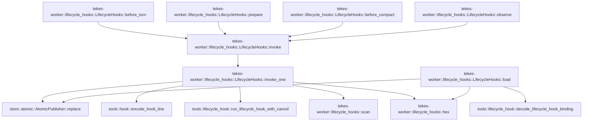

# tekes-worker::lifecycle_hooks

[Package atlas](index.md) · [Source](../../src/lifecycle_hooks.rs)

## Declarations

Visibility is the declaration spelling; trait members and reexports require their enclosing interface. `cfg` is not evaluated.

| Symbol | Kind | Visibility | Test / cfg |
|---|---|---|---|
| [tekes-worker::lifecycle_hooks::Result](../../src/lifecycle_hooks.rs#L7) | type_item | `private` |  |
| [tekes-worker::lifecycle_hooks::LifecycleHooks](../../src/lifecycle_hooks.rs#L9) | struct_item | `pub(super)` |  |
| [tekes-worker::lifecycle_hooks::LifecycleHooks::load](../../src/lifecycle_hooks.rs#L22) | function_item | `pub(super)` |  |
| [tekes-worker::lifecycle_hooks::LifecycleHooks::invoke](../../src/lifecycle_hooks.rs#L83) | function_item | `private` |  |
| [tekes-worker::lifecycle_hooks::LifecycleHooks::invoke_one](../../src/lifecycle_hooks.rs#L105) | function_item | `private` |  |
| [tekes-worker::lifecycle_hooks::LifecycleHooks::before_turn](../../src/lifecycle_hooks.rs#L162) | function_item | `pub(super)` |  |
| [tekes-worker::lifecycle_hooks::LifecycleHooks::prepare](../../src/lifecycle_hooks.rs#L182) | function_item | `pub(super)` |  |
| [tekes-worker::lifecycle_hooks::LifecycleHooks::before_compact](../../src/lifecycle_hooks.rs#L196) | function_item | `pub(super)` |  |
| [tekes-worker::lifecycle_hooks::LifecycleHooks::observe](../../src/lifecycle_hooks.rs#L213) | function_item | `pub(super)` |  |
| [tekes-worker::lifecycle_hooks::scan](../../src/lifecycle_hooks.rs#L264) | function_item | `private` |  |
| [tekes-worker::lifecycle_hooks::hex](../../src/lifecycle_hooks.rs#L271) | function_item | `private` |  |

## Imports / reexports

| Local name | Source path | Visibility |
|---|---|---|
| `*` | `super::*` | `private` |
| `Digest` | `sha2::Digest` | `private` |
| `Sha256` | `sha2::Sha256` | `private` |
| `AtomicPublisher` | `store::AtomicPublisher` | `private` |
| `Point` | `tools::LifecycleEvent` | `private` |
| `LifecycleHookBinding` | `tools::LifecycleHookBinding` | `private` |
| `LifecycleHookRequest` | `tools::LifecycleHookRequest` | `private` |

## Module declarations

| Module | Visibility | Attributes |
|---|---|---|

## Function call graphs

Edges below are syntactically resolved calls only, including private functions. Graphs partition callers into groups of 20; they are not execution order. All unresolved sites are listed below and in the JSON inventory.

Functions 1–9: 13 direct edges

## Call sites

Includes test functions (marked in declarations). Receiver-type-required sites need type analysis/manual tracing. Calls in closures are attributed to their enclosing function; their occurrence here does not mean the closure executes immediately.

| Caller | Callee expression | Source lines | Target / classification |
|---|---|---|---|
| `load` | `Vec::new` | [23](../../src/lifecycle_hooks.rs#L23) | external-constructor-callback-or-unresolved |
| `load` | `std::collections::BTreeMap::new` | [24](../../src/lifecycle_hooks.rs#L24) | external-constructor-callback-or-unresolved |
| `load` | `profile.instruction.source_authorized` | [27](../../src/lifecycle_hooks.rs#L27) | receiver-type-required |
| `load` | `serde_json::from_str` | [30](../../src/lifecycle_hooks.rs#L30) | external-constructor-callback-or-unresolved |
| `load` | `tools::decode_lifecycle_hook_binding` | [32](../../src/lifecycle_hooks.rs#L32) | [tools::lifecycle_hook::decode_lifecycle_hook_binding](../../../tools/src/lifecycle_hook.rs#L59) |
| `load` | `source.content.as_bytes` | [32](../../src/lifecycle_hooks.rs#L32) | receiver-type-required |
| `load` | `sources.insert` | [34](../../src/lifecycle_hooks.rs#L34) | receiver-type-required |
| `load` | `binding.id.clone` | [34](../../src/lifecycle_hooks.rs#L34) | receiver-type-required |
| `load` | `source.clone` | [34](../../src/lifecycle_hooks.rs#L34) | receiver-type-required |
| `load` | `bindings.push` | [35](../../src/lifecycle_hooks.rs#L35) | receiver-type-required |
| `load` | `bindings.is_empty` | [39](../../src/lifecycle_hooks.rs#L39) | receiver-type-required |
| `load` | `Ok` | [40](../../src/lifecycle_hooks.rs#L40), [68](../../src/lifecycle_hooks.rs#L68) | external-constructor-callback-or-unresolved |
| `load` | `hex` | [42](../../src/lifecycle_hooks.rs#L42), [49](../../src/lifecycle_hooks.rs#L49) | [tekes-worker::lifecycle_hooks::hex](../../src/lifecycle_hooks.rs#L271) |
| `load` | `serde_json_canonicalizer::to_vec` | [42](../../src/lifecycle_hooks.rs#L42) | external-constructor-callback-or-unresolved |
| `load` | `ledger             .path()             .parent()             .ok_or("missing thread folder")?             .join("lifecycle-hooks")             .join(digest)             .join` | [43](../../src/lifecycle_hooks.rs#L43) | receiver-type-required |
| `load` | `ledger             .path()             .parent()             .ok_or("missing thread folder")?             .join("lifecycle-hooks")             .join` | [43](../../src/lifecycle_hooks.rs#L43) | receiver-type-required |
| `load` | `ledger             .path()             .parent()             .ok_or("missing thread folder")?             .join` | [43](../../src/lifecycle_hooks.rs#L43) | receiver-type-required |
| `load` | `ledger             .path()             .parent()             .ok_or` | [43](../../src/lifecycle_hooks.rs#L43) | receiver-type-required |
| `load` | `ledger             .path()             .parent` | [43](../../src/lifecycle_hooks.rs#L43) | receiver-type-required |
| `load` | `ledger             .path` | [43](../../src/lifecycle_hooks.rs#L43) | receiver-type-required |
| `load` | `ledger                 .path()                 .file_name()                 .ok_or("missing ledger name")?                 .as_encoded_bytes` | [49](../../src/lifecycle_hooks.rs#L49) | receiver-type-required |
| `load` | `ledger                 .path()                 .file_name()                 .ok_or` | [49](../../src/lifecycle_hooks.rs#L49) | receiver-type-required |
| `load` | `ledger                 .path()                 .file_name` | [49](../../src/lifecycle_hooks.rs#L49) | receiver-type-required |
| `load` | `ledger                 .path` | [49](../../src/lifecycle_hooks.rs#L49) | receiver-type-required |
| `load` | `root.join` | [54](../../src/lifecycle_hooks.rs#L54) | receiver-type-required |
| `load` | `baseline_file.exists` | [55](../../src/lifecycle_hooks.rs#L55) | receiver-type-required |
| `load` | `serde_json::from_slice` | [56](../../src/lifecycle_hooks.rs#L56) | external-constructor-callback-or-unresolved |
| `load` | `fs::read` | [56](../../src/lifecycle_hooks.rs#L56) | external-constructor-callback-or-unresolved |
| `load` | `ledger.next_seq` | [58](../../src/lifecycle_hooks.rs#L58) | receiver-type-required |
| `load` | `AtomicPublisher::replace` | [59](../../src/lifecycle_hooks.rs#L59) | [store::atomic::AtomicPublisher::replace](../../../store/src/atomic.rs#L16) |
| `load` | `serde_json::to_vec` | [59](../../src/lifecycle_hooks.rs#L59) | external-constructor-callback-or-unresolved |
| `load` | `ledger             .projection()             .and_then(&#124;p&#124; p.events.first())             .and_then(&#124;e&#124; e.string_field("thread"))             .ok_or("missing thread identity")?             .to_owned` | [62](../../src/lifecycle_hooks.rs#L62) | receiver-type-required |
| `load` | `ledger             .projection()             .and_then(&#124;p&#124; p.events.first())             .and_then(&#124;e&#124; e.string_field("thread"))             .ok_or` | [62](../../src/lifecycle_hooks.rs#L62) | receiver-type-required |
| `load` | `ledger             .projection()             .and_then(&#124;p&#124; p.events.first())             .and_then` | [62](../../src/lifecycle_hooks.rs#L62) | receiver-type-required |
| `load` | `ledger             .projection()             .and_then` | [62](../../src/lifecycle_hooks.rs#L62) | receiver-type-required |
| `load` | `ledger             .projection` | [62](../../src/lifecycle_hooks.rs#L62) | receiver-type-required |
| `load` | `p.events.first` | [64](../../src/lifecycle_hooks.rs#L64) | receiver-type-required |
| `load` | `e.string_field` | [65](../../src/lifecycle_hooks.rs#L65) | receiver-type-required |
| `load` | `Some` | [68](../../src/lifecycle_hooks.rs#L68) | external-constructor-callback-or-unresolved |
| `load` | `profile.instruction.clone` | [71](../../src/lifecycle_hooks.rs#L71) | receiver-type-required |
| `load` | `profile.config.workspace.id.clone` | [73](../../src/lifecycle_hooks.rs#L73) | receiver-type-required |
| `load` | `std::cell::Cell::new` | [75](../../src/lifecycle_hooks.rs#L75) | external-constructor-callback-or-unresolved |
| `load` | `ledger.path().to_path_buf` | [76](../../src/lifecycle_hooks.rs#L76) | receiver-type-required |
| `load` | `ledger.path` | [76](../../src/lifecycle_hooks.rs#L76) | receiver-type-required |
| `load` | `Arc::new` | [77](../../src/lifecycle_hooks.rs#L77) | external-constructor-callback-or-unresolved |
| `load` | `AtomicBool::new` | [77](../../src/lifecycle_hooks.rs#L77) | external-constructor-callback-or-unresolved |
| `invoke` | `Vec::new` | [84](../../src/lifecycle_hooks.rs#L84) | external-constructor-callback-or-unresolved |
| `invoke` | `self.bindings.iter().filter` | [85](../../src/lifecycle_hooks.rs#L85) | receiver-type-required |
| `invoke` | `self.bindings.iter` | [85](../../src/lifecycle_hooks.rs#L85) | receiver-type-required |
| `invoke` | `self.invoke_one` | [86](../../src/lifecycle_hooks.rs#L86) | [tekes-worker::lifecycle_hooks::LifecycleHooks::invoke_one](../../src/lifecycle_hooks.rs#L105) |
| `invoke` | `context.iter().map(String::len).sum::<usize>` | [90](../../src/lifecycle_hooks.rs#L90) | receiver-type-required |
| `invoke` | `context.iter().map` | [90](../../src/lifecycle_hooks.rs#L90) | receiver-type-required |
| `invoke` | `context.iter` | [90](../../src/lifecycle_hooks.rs#L90) | receiver-type-required |
| `invoke` | `addition.len` | [90](../../src/lifecycle_hooks.rs#L90) | receiver-type-required |
| `invoke` | `context.push` | [92](../../src/lifecycle_hooks.rs#L92) | receiver-type-required |
| `invoke_one` | `self             .instruction             .admit_source` | [112](../../src/lifecycle_hooks.rs#L112) | receiver-type-required |
| `invoke_one` | `self.sources.get(&binding.id).ok_or` | [114](../../src/lifecycle_hooks.rs#L114) | receiver-type-required |
| `invoke_one` | `self.sources.get` | [114](../../src/lifecycle_hooks.rs#L114) | receiver-type-required |
| `invoke_one` | `hex` | [115](../../src/lifecycle_hooks.rs#L115) | [tekes-worker::lifecycle_hooks::hex](../../src/lifecycle_hooks.rs#L271) |
| `invoke_one` | `serde_json_canonicalizer::to_vec` | [115](../../src/lifecycle_hooks.rs#L115) | external-constructor-callback-or-unresolved |
| `invoke_one` | `self.root.join` | [120](../../src/lifecycle_hooks.rs#L120) | receiver-type-required |
| `invoke_one` | `receipt.exists` | [121](../../src/lifecycle_hooks.rs#L121) | receiver-type-required |
| `invoke_one` | `serde_json::from_slice` | [123](../../src/lifecycle_hooks.rs#L123) | external-constructor-callback-or-unresolved |
| `invoke_one` | `fs::read` | [123](../../src/lifecycle_hooks.rs#L123) | external-constructor-callback-or-unresolved |
| `invoke_one` | `response.context.len` | [127](../../src/lifecycle_hooks.rs#L127) | receiver-type-required |
| `invoke_one` | `response.context.iter().map(String::len).sum::<usize>` | [128](../../src/lifecycle_hooks.rs#L128) | receiver-type-required |
| `invoke_one` | `response.context.iter().map` | [128](../../src/lifecycle_hooks.rs#L128) | receiver-type-required |
| `invoke_one` | `response.context.iter` | [128](../../src/lifecycle_hooks.rs#L128) | receiver-type-required |
| `invoke_one` | `response.context.is_empty` | [129](../../src/lifecycle_hooks.rs#L129) | receiver-type-required |
| `invoke_one` | `Err` | [131](../../src/lifecycle_hooks.rs#L131), [147](../../src/lifecycle_hooks.rs#L147) | external-constructor-callback-or-unresolved |
| `invoke_one` | `"invalid hook receipt".into` | [131](../../src/lifecycle_hooks.rs#L131) | receiver-type-required |
| `invoke_one` | `Ok` | [133](../../src/lifecycle_hooks.rs#L133), [159](../../src/lifecycle_hooks.rs#L159) | external-constructor-callback-or-unresolved |
| `invoke_one` | `scan` | [135](../../src/lifecycle_hooks.rs#L135), [155](../../src/lifecycle_hooks.rs#L155) | [tekes-worker::lifecycle_hooks::scan](../../src/lifecycle_hooks.rs#L264) |
| `invoke_one` | `binding.id.clone` | [138](../../src/lifecycle_hooks.rs#L138) | receiver-type-required |
| `invoke_one` | `self.workspace.clone` | [141](../../src/lifecycle_hooks.rs#L141) | receiver-type-required |
| `invoke_one` | `self.thread.clone` | [142](../../src/lifecycle_hooks.rs#L142) | receiver-type-required |
| `invoke_one` | `tools::encode_hook_line(&request)?.len` | [146](../../src/lifecycle_hooks.rs#L146) | receiver-type-required |
| `invoke_one` | `tools::encode_hook_line` | [146](../../src/lifecycle_hooks.rs#L146), [158](../../src/lifecycle_hooks.rs#L158) | [tools::hook::encode_hook_line](../../../tools/src/hook.rs#L198) |
| `invoke_one` | `"hook input exceeds limit".into` | [147](../../src/lifecycle_hooks.rs#L147) | receiver-type-required |
| `invoke_one` | `tools::run_lifecycle_hook_with_cancel` | [149](../../src/lifecycle_hooks.rs#L149) | [tools::lifecycle_hook::run_lifecycle_hook_with_cancel](../../../tools/src/lifecycle_hook.rs#L115) |
| `invoke_one` | `self.cancelled.load` | [153](../../src/lifecycle_hooks.rs#L153) | receiver-type-required |
| `invoke_one` | `serde_json::to_value` | [155](../../src/lifecycle_hooks.rs#L155), [157](../../src/lifecycle_hooks.rs#L157) | external-constructor-callback-or-unresolved |
| `invoke_one` | `serde_json::from_value` | [157](../../src/lifecycle_hooks.rs#L157) | external-constructor-callback-or-unresolved |
| `invoke_one` | `AtomicPublisher::replace` | [158](../../src/lifecycle_hooks.rs#L158) | [store::atomic::AtomicPublisher::replace](../../../store/src/atomic.rs#L16) |
| `before_turn` | `ledger.projection` | [163](../../src/lifecycle_hooks.rs#L163) | receiver-type-required |
| `before_turn` | `projection             .events             .iter()             .rev()             .find` | [167](../../src/lifecycle_hooks.rs#L167) | receiver-type-required |
| `before_turn` | `projection             .events             .iter()             .rev` | [167](../../src/lifecycle_hooks.rs#L167) | receiver-type-required |
| `before_turn` | `projection             .events             .iter` | [167](../../src/lifecycle_hooks.rs#L167) | receiver-type-required |
| `before_turn` | `e.kind` | [171](../../src/lifecycle_hooks.rs#L171) | receiver-type-required |
| `before_turn` | `e.turn` | [171](../../src/lifecycle_hooks.rs#L171) | receiver-type-required |
| `before_turn` | `Some` | [171](../../src/lifecycle_hooks.rs#L171) | external-constructor-callback-or-unresolved |
| `before_turn` | `self.invoke` | [173](../../src/lifecycle_hooks.rs#L173) | [tekes-worker::lifecycle_hooks::LifecycleHooks::invoke](../../src/lifecycle_hooks.rs#L83) |
| `prepare` | `self.invoke` | [188](../../src/lifecycle_hooks.rs#L188) | [tekes-worker::lifecycle_hooks::LifecycleHooks::invoke](../../src/lifecycle_hooks.rs#L83) |
| `before_compact` | `self.invoke` | [203](../../src/lifecycle_hooks.rs#L203) | [tekes-worker::lifecycle_hooks::LifecycleHooks::invoke](../../src/lifecycle_hooks.rs#L83) |
| `observe` | `ledger.next_seq` | [214](../../src/lifecycle_hooks.rs#L214), [230](../../src/lifecycle_hooks.rs#L230), [260](../../src/lifecycle_hooks.rs#L260) | receiver-type-required |
| `observe` | `self.observed_through.get` | [214](../../src/lifecycle_hooks.rs#L214), [219](../../src/lifecycle_hooks.rs#L219), [243](../../src/lifecycle_hooks.rs#L243) | receiver-type-required |
| `observe` | `ledger.projection().is_some_and` | [217](../../src/lifecycle_hooks.rs#L217) | receiver-type-required |
| `observe` | `ledger.projection` | [217](../../src/lifecycle_hooks.rs#L217), [237](../../src/lifecycle_hooks.rs#L237) | receiver-type-required |
| `observe` | `projection.events.iter().any` | [218](../../src/lifecycle_hooks.rs#L218) | receiver-type-required |
| `observe` | `projection.events.iter` | [218](../../src/lifecycle_hooks.rs#L218) | receiver-type-required |
| `observe` | `event.seq` | [219](../../src/lifecycle_hooks.rs#L219) | receiver-type-required |
| `observe` | `self.bindings.iter().any` | [220](../../src/lifecycle_hooks.rs#L220), [250](../../src/lifecycle_hooks.rs#L250) | receiver-type-required |
| `observe` | `self.bindings.iter` | [220](../../src/lifecycle_hooks.rs#L220), [250](../../src/lifecycle_hooks.rs#L250) | receiver-type-required |
| `observe` | `self.observed_through.set` | [230](../../src/lifecycle_hooks.rs#L230), [260](../../src/lifecycle_hooks.rs#L260) | receiver-type-required |
| `observe` | `ledger.sync_prefix().is_err` | [233](../../src/lifecycle_hooks.rs#L233) | receiver-type-required |
| `observe` | `ledger.sync_prefix` | [233](../../src/lifecycle_hooks.rs#L233) | receiver-type-required |
| `observe` | `projection             .events             .iter()             .filter` | [240](../../src/lifecycle_hooks.rs#L240) | receiver-type-required |
| `observe` | `projection             .events             .iter` | [240](../../src/lifecycle_hooks.rs#L240) | receiver-type-required |
| `observe` | `e.seq` | [243](../../src/lifecycle_hooks.rs#L243) | receiver-type-required |
| `observe` | `event.kind` | [245](../../src/lifecycle_hooks.rs#L245) | receiver-type-required |
| `observe` | `self.invoke` | [253](../../src/lifecycle_hooks.rs#L253) | [tekes-worker::lifecycle_hooks::LifecycleHooks::invoke](../../src/lifecycle_hooks.rs#L83) |
| `observe` | `event.turn().unwrap_or` | [256](../../src/lifecycle_hooks.rs#L256) | receiver-type-required |
| `observe` | `event.turn` | [256](../../src/lifecycle_hooks.rs#L256) | receiver-type-required |
| `scan` | `IJsonValue::parse` | [265](../../src/lifecycle_hooks.rs#L265) | external-constructor-callback-or-unresolved |
| `scan` | `serde_json::to_vec` | [265](../../src/lifecycle_hooks.rs#L265) | external-constructor-callback-or-unresolved |
| `scan` | `SecretScanner::default().scan` | [266](../../src/lifecycle_hooks.rs#L266) | receiver-type-required |
| `scan` | `SecretScanner::default` | [266](../../src/lifecycle_hooks.rs#L266) | external-constructor-callback-or-unresolved |
| `scan` | `Ok` | [267](../../src/lifecycle_hooks.rs#L267) | external-constructor-callback-or-unresolved |
| `scan` | `Err` | [268](../../src/lifecycle_hooks.rs#L268) | external-constructor-callback-or-unresolved |
| `scan` | `"hook content withheld".into` | [268](../../src/lifecycle_hooks.rs#L268) | receiver-type-required |
