# tekes-worker::provider_turn

[Package atlas](index.md) · [Source](../../src/provider_turn.rs)

## Declarations

Visibility is the declaration spelling; trait members and reexports require their enclosing interface. `cfg` is not evaluated.

| Symbol | Kind | Visibility | Test / cfg |
|---|---|---|---|
| [tekes-worker::provider_turn::set_provider_test_redirect](../../src/provider_turn.rs#L11) | function_item | `pub(crate)` | test; #[cfg(test)] |
| [tekes-worker::provider_turn::ProviderOutcome](../../src/provider_turn.rs#L15) | struct_item | `pub(crate)` |  |
| [tekes-worker::provider_turn::ProviderContext](../../src/provider_turn.rs#L26) | struct_item | `pub(crate)` |  |
| [tekes-worker::provider_turn::run_provider_turn](../../src/provider_turn.rs#L33) | function_item | `pub(crate)` |  |
| [tekes-worker::provider_turn::ProviderLoopBudget](../../src/provider_turn.rs#L93) | struct_item | `private` |  |
| [tekes-worker::provider_turn::ProviderRunContext](../../src/provider_turn.rs#L102) | struct_item | `pub(crate)` |  |
| [tekes-worker::provider_turn::run_provider_turn_inner](../../src/provider_turn.rs#L108) | function_item | `private` |  |
| [tekes-worker::provider_turn::forward_provider_frame](../../src/provider_turn.rs#L1125) | function_item | `private` |  |
| [tekes-worker::provider_turn::EagerDispatch](../../src/provider_turn.rs#L1179) | struct_item | `pub(crate)` |  |
| [tekes-worker::provider_turn::EagerDispatch::contains](../../src/provider_turn.rs#L1189) | function_item | `pub(crate)` |  |
| [tekes-worker::provider_turn::local_provider_call_id](../../src/provider_turn.rs#L1197) | function_item | `pub(crate)` |  |
| [tekes-worker::provider_turn::repair_provider_call_arguments](../../src/provider_turn.rs#L1265) | function_item | `pub(crate)` |  |
| [tekes-worker::provider_turn::localize_provider_frame](../../src/provider_turn.rs#L1281) | function_item | `pub(crate)` |  |
| [tekes-worker::provider_turn::EagerReadyCall](../../src/provider_turn.rs#L1302) | struct_item | `pub(crate)` |  |
| [tekes-worker::provider_turn::eager_dispatch_ready_call](../../src/provider_turn.rs#L1318) | function_item | `pub(crate)` |  |
| [tekes-worker::provider_turn::append_provider_tool_call](../../src/provider_turn.rs#L1400) | function_item | `pub(crate)` | test; #[cfg(test)] |
| [tekes-worker::provider_turn::append_provider_tool_call_with_wire_id](../../src/provider_turn.rs#L1411) | function_item | `pub(crate)` |  |
| [tekes-worker::provider_turn::settle_provider_unavailable](../../src/provider_turn.rs#L1445) | function_item | `private` |  |
| [tekes-worker::provider_turn::SelectedProviderFailure](../../src/provider_turn.rs#L1471) | enum_item | `pub(crate)` |  |
| [tekes-worker::provider_turn::SelectedProviderFailure::detail](../../src/provider_turn.rs#L1480) | function_item | `private` |  |
| [tekes-worker::provider_turn::selected_provider](../../src/provider_turn.rs#L1491) | function_item | `pub(crate)` |  |
| [tekes-worker::provider_turn::current_turn_inputs](../../src/provider_turn.rs#L1523) | function_item | `pub(crate)` |  |

## Imports / reexports

| Local name | Source path | Visibility |
|---|---|---|
| `*` | `super::*` | `private` |

## Module declarations

| Module | Visibility | Attributes |
|---|---|---|

## Function call graphs

Edges below are syntactically resolved calls only, including private functions. Graphs partition callers into groups of 20; they are not execution order. All unresolved sites are listed below and in the JSON inventory.

```mermaid
flowchart TD
  n0["engine::context::plan_context_compaction"]
  n1["engine::context::plan_tool_result_trim"]
  n2["engine::dispatcher::side_effectful"]
  n3["provider::dialect::resolve_profile"]
  n4["provider::dialect::epoch_profile"]
  n5["provider::request::prepare_with_native_deferred_tools"]
  n6["session-controls::read_goal"]
  n7["store::asset::AssetStore::new"]
  n8["tools::schema_registry::fixed_schema"]
  n9["tekes-worker::provider_turn::run_provider_turn_inner"]
  n10["tekes-worker::provider_turn::forward_provider_frame"]
  n11["tekes-worker::provider_turn::EagerDispatch::contains"]
  n12["tekes-worker::provider_turn::local_provider_call_id"]
  n13["tekes-worker::provider_turn::repair_provider_call_arguments"]
  n14["tekes-worker::provider_turn::localize_provider_frame"]
  n15["tekes-worker::provider_turn::eager_dispatch_ready_call"]
  n16["tekes-worker::provider_turn::append_provider_tool_call_with_wire_id"]
  n17["tekes-worker::provider_turn::settle_provider_unavailable"]
  n18["tekes-worker::provider_turn::SelectedProviderFailure::detail"]
  n19["tekes-worker::provider_turn::selected_provider"]
  n20["tekes-worker::provider_turn::current_turn_inputs"]
  n21["tekes-worker::provider_turn::run_provider_turn"]
  n9 --> n0
  n9 --> n1
  n9 --> n3
  n9 --> n4
  n9 --> n5
  n9 --> n6
  n9 --> n7
  n9 --> n9
  n9 --> n10
  n9 --> n13
  n9 --> n14
  n9 --> n15
  n9 --> n17
  n9 --> n19
  n9 --> n20
  n13 --> n8
  n14 --> n12
  n15 --> n16
  n16 --> n2
  n21 --> n9
```

Functions 1–13: 20 direct edges

## Call sites

Includes test functions (marked in declarations). Receiver-type-required sites need type analysis/manual tracing. Calls in closures are attributed to their enclosing function; their occurrence here does not mean the closure executes immediately.

| Caller | Callee expression | Source lines | Target / classification |
|---|---|---|---|
| `set_provider_test_redirect` | `PROVIDER_TEST_REDIRECT.with` | [12](../../src/provider_turn.rs#L12) | receiver-type-required |
| `set_provider_test_redirect` | `slot.borrow_mut` | [12](../../src/provider_turn.rs#L12) | receiver-type-required |
| `run_provider_turn` | `ledger.sync_prefix` | [44](../../src/provider_turn.rs#L44) | receiver-type-required |
| `run_provider_turn` | `ledger.projection().and_then` | [45](../../src/provider_turn.rs#L45) | receiver-type-required |
| `run_provider_turn` | `ledger.projection` | [45](../../src/provider_turn.rs#L45), [46](../../src/provider_turn.rs#L46) | receiver-type-required |
| `run_provider_turn` | `ledger.projection().is_some_and` | [46](../../src/provider_turn.rs#L46) | receiver-type-required |
| `run_provider_turn` | `hooks.before_turn` | [48](../../src/provider_turn.rs#L48) | receiver-type-required |
| `run_provider_turn` | `profile.clone` | [51](../../src/provider_turn.rs#L51) | receiver-type-required |
| `run_provider_turn` | `validation_runtime::activate_validator_profile` | [52](../../src/provider_turn.rs#L52) | external-constructor-callback-or-unresolved |
| `run_provider_turn` | `profile         .config         .execution         .policy         .max_wall_seconds         .map` | [54](../../src/provider_turn.rs#L54) | receiver-type-required |
| `run_provider_turn` | `Instant::now` | [59](../../src/provider_turn.rs#L59) | external-constructor-callback-or-unresolved |
| `run_provider_turn` | `Duration::from_secs` | [59](../../src/provider_turn.rs#L59) | external-constructor-callback-or-unresolved |
| `run_provider_turn` | `run_provider_turn_inner` | [60](../../src/provider_turn.rs#L60) | [tekes-worker::provider_turn::run_provider_turn_inner](../../src/provider_turn.rs#L108) |
| `run_provider_turn` | `Ok` | [80](../../src/provider_turn.rs#L80), [84](../../src/provider_turn.rs#L84), [86](../../src/provider_turn.rs#L86) | external-constructor-callback-or-unresolved |
| `run_provider_turn` | `is_protocol_failure` | [81](../../src/provider_turn.rs#L81) | external-constructor-callback-or-unresolved |
| `run_provider_turn` | `error.as_ref` | [81](../../src/provider_turn.rs#L81), [85](../../src/provider_turn.rs#L85) | receiver-type-required |
| `run_provider_turn` | `Err` | [81](../../src/provider_turn.rs#L81), [87](../../src/provider_turn.rs#L87) | external-constructor-callback-or-unresolved |
| `run_provider_turn` | `cancellation.stop_requested` | [84](../../src/provider_turn.rs#L84) | receiver-type-required |
| `run_provider_turn` | `settle_internal_worker_failure` | [85](../../src/provider_turn.rs#L85) | external-constructor-callback-or-unresolved |
| `run_provider_turn_inner` | `ledger         .projection()         .and_then(&#124;projection&#124; projection.latest_turn)         .ok_or` | [122](../../src/provider_turn.rs#L122) | receiver-type-required |
| `run_provider_turn_inner` | `ledger         .projection()         .and_then` | [122](../../src/provider_turn.rs#L122) | receiver-type-required |
| `run_provider_turn_inner` | `ledger         .projection` | [122](../../src/provider_turn.rs#L122), [139](../../src/provider_turn.rs#L139) | receiver-type-required |
| `run_provider_turn_inner` | `budget         .wall_deadline         .is_some_and` | [126](../../src/provider_turn.rs#L126) | receiver-type-required |
| `run_provider_turn_inner` | `Instant::now` | [128](../../src/provider_turn.rs#L128), [690](../../src/provider_turn.rs#L690) | external-constructor-callback-or-unresolved |
| `run_provider_turn_inner` | `append_settle` | [130](../../src/provider_turn.rs#L130), [923](../../src/provider_turn.rs#L923), [934](../../src/provider_turn.rs#L934), [1084](../../src/provider_turn.rs#L1084) | external-constructor-callback-or-unresolved |
| `run_provider_turn_inner` | `options.event_timestamp` | [132](../../src/provider_turn.rs#L132), [274](../../src/provider_turn.rs#L274), [806](../../src/provider_turn.rs#L806), [925](../../src/provider_turn.rs#L925), [936](../../src/provider_turn.rs#L936), [1086](../../src/provider_turn.rs#L1086) | receiver-type-required |
| `run_provider_turn_inner` | `Some` | [135](../../src/provider_turn.rs#L135), [238](../../src/provider_turn.rs#L238), [322](../../src/provider_turn.rs#L322), [450](../../src/provider_turn.rs#L450), [484](../../src/provider_turn.rs#L484), [736](../../src/provider_turn.rs#L736), [781](../../src/provider_turn.rs#L781), [928](../../src/provider_turn.rs#L928), [939](../../src/provider_turn.rs#L939) | external-constructor-callback-or-unresolved |
| `run_provider_turn_inner` | `Ok` | [137](../../src/provider_turn.rs#L137), [143](../../src/provider_turn.rs#L143), [147](../../src/provider_turn.rs#L147), [150](../../src/provider_turn.rs#L150), [156](../../src/provider_turn.rs#L156), [170](../../src/provider_turn.rs#L170), [402](../../src/provider_turn.rs#L402), [432](../../src/provider_turn.rs#L432), [453](../../src/provider_turn.rs#L453), [461](../../src/provider_turn.rs#L461), [470](../../src/provider_turn.rs#L470), [648](../../src/provider_turn.rs#L648), [790](../../src/provider_turn.rs#L790), [892](../../src/provider_turn.rs#L892), [930](../../src/provider_turn.rs#L930), [941](../../src/provider_turn.rs#L941), [957](../../src/provider_turn.rs#L957), [1008](../../src/provider_turn.rs#L1008), [1043](../../src/provider_turn.rs#L1043), [1046](../../src/provider_turn.rs#L1046), [1067](../../src/provider_turn.rs#L1067), [1091](../../src/provider_turn.rs#L1091), [1094](../../src/provider_turn.rs#L1094), [1102](../../src/provider_turn.rs#L1102) | external-constructor-callback-or-unresolved |
| `run_provider_turn_inner` | `ledger         .projection()         .is_some_and` | [139](../../src/provider_turn.rs#L139) | receiver-type-required |
| `run_provider_turn_inner` | `recover_provider_attempt_for_ordinary` | [145](../../src/provider_turn.rs#L145) | external-constructor-callback-or-unresolved |
| `run_provider_turn_inner` | `validation_runtime::advance` | [149](../../src/provider_turn.rs#L149), [1066](../../src/provider_turn.rs#L1066) | external-constructor-callback-or-unresolved |
| `run_provider_turn_inner` | `selected_provider` | [152](../../src/provider_turn.rs#L152) | [tekes-worker::provider_turn::selected_provider](../../src/provider_turn.rs#L1491) |
| `run_provider_turn_inner` | `settle_provider_unavailable` | [155](../../src/provider_turn.rs#L155), [169](../../src/provider_turn.rs#L169), [401](../../src/provider_turn.rs#L401), [431](../../src/provider_turn.rs#L431), [452](../../src/provider_turn.rs#L452), [456](../../src/provider_turn.rs#L456), [465](../../src/provider_turn.rs#L465), [1097](../../src/provider_turn.rs#L1097) | [tekes-worker::provider_turn::settle_provider_unavailable](../../src/provider_turn.rs#L1445) |
| `run_provider_turn_inner` | `reason.detail` | [155](../../src/provider_turn.rs#L155) | receiver-type-required |
| `run_provider_turn_inner` | `BuiltinManifest::compiled` | [159](../../src/provider_turn.rs#L159) | external-constructor-callback-or-unresolved |
| `run_provider_turn_inner` | `manifest.validate` | [160](../../src/provider_turn.rs#L160) | receiver-type-required |
| `run_provider_turn_inner` | `ledger         .path()         .parent()         .ok_or("worker ledger has no thread folder")?         .to_path_buf` | [161](../../src/provider_turn.rs#L161) | receiver-type-required |
| `run_provider_turn_inner` | `ledger         .path()         .parent()         .ok_or` | [161](../../src/provider_turn.rs#L161) | receiver-type-required |
| `run_provider_turn_inner` | `ledger         .path()         .parent` | [161](../../src/provider_turn.rs#L161) | receiver-type-required |
| `run_provider_turn_inner` | `ledger         .path` | [161](../../src/provider_turn.rs#L161) | receiver-type-required |
| `run_provider_turn_inner` | `provider::resolve_profile` | [166](../../src/provider_turn.rs#L166) | [provider::dialect::resolve_profile](../../../provider/src/dialect.rs#L692) |
| `run_provider_turn_inner` | `resolved_profile.native_deferred_tools` | [177](../../src/provider_turn.rs#L177) | receiver-type-required |
| `run_provider_turn_inner` | `assemble_tool_backends` | [180](../../src/provider_turn.rs#L180) | external-constructor-callback-or-unresolved |
| `run_provider_turn_inner` | `execution_access_for_profile` | [185](../../src/provider_turn.rs#L185) | external-constructor-callback-or-unresolved |
| `run_provider_turn_inner` | `session_permission_policy` | [187](../../src/provider_turn.rs#L187) | external-constructor-callback-or-unresolved |
| `run_provider_turn_inner` | `credential.as_ref` | [190](../../src/provider_turn.rs#L190), [438](../../src/provider_turn.rs#L438), [771](../../src/provider_turn.rs#L771), [1039](../../src/provider_turn.rs#L1039) | receiver-type-required |
| `run_provider_turn_inner` | `DynamicToolDispatcher::new` | [199](../../src/provider_turn.rs#L199) | external-constructor-callback-or-unresolved |
| `run_provider_turn_inner` | `dynamic_dispatcher.deferred_search_entries` | [200](../../src/provider_turn.rs#L200) | receiver-type-required |
| `run_provider_turn_inner` | `deferred.is_empty` | [201](../../src/provider_turn.rs#L201) | receiver-type-required |
| `run_provider_turn_inner` | `tool_catalog_context` | [203](../../src/provider_turn.rs#L203) | external-constructor-callback-or-unresolved |
| `run_provider_turn_inner` | `ToolDispatcher::new(&manifest, &catalog_context).provider_catalog` | [205](../../src/provider_turn.rs#L205) | receiver-type-required |
| `run_provider_turn_inner` | `ToolDispatcher::new` | [205](../../src/provider_turn.rs#L205) | external-constructor-callback-or-unresolved |
| `run_provider_turn_inner` | `ledger.next_seq` | [206](../../src/provider_turn.rs#L206) | receiver-type-required |
| `run_provider_turn_inner` | `ToolPipeline::new` | [207](../../src/provider_turn.rs#L207) | external-constructor-callback-or-unresolved |
| `run_provider_turn_inner` | `AssetStore::new` | [209](../../src/provider_turn.rs#L209) | external-constructor-callback-or-unresolved |
| `run_provider_turn_inner` | `thread_folder.join` | [209](../../src/provider_turn.rs#L209), [414](../../src/provider_turn.rs#L414) | receiver-type-required |
| `run_provider_turn_inner` | `SecretScanner::default` | [210](../../src/provider_turn.rs#L210) | external-constructor-callback-or-unresolved |
| `run_provider_turn_inner` | `catalog.extend` | [212](../../src/provider_turn.rs#L212) | receiver-type-required |
| `run_provider_turn_inner` | `dynamic_dispatcher.provider_catalog_visible` | [212](../../src/provider_turn.rs#L212) | receiver-type-required |
| `run_provider_turn_inner` | `native_mode.is_some` | [217](../../src/provider_turn.rs#L217) | receiver-type-required |
| `run_provider_turn_inner` | `catalog                 .iter()                 .filter_map(&#124;schema&#124; {                     serde_json::to_value(schema)                         .ok()?                         .get("name")?                         .as_str()                         .map(str::to_owned)                 })                 .collect::<BTreeSet<_>>` | [221](../../src/provider_turn.rs#L221) | receiver-type-required |
| `run_provider_turn_inner` | `catalog                 .iter()                 .filter_map` | [221](../../src/provider_turn.rs#L221) | receiver-type-required |
| `run_provider_turn_inner` | `catalog                 .iter` | [221](../../src/provider_turn.rs#L221) | receiver-type-required |
| `run_provider_turn_inner` | `serde_json::to_value(schema)                         .ok()?                         .get("name")?                         .as_str()                         .map` | [224](../../src/provider_turn.rs#L224) | receiver-type-required |
| `run_provider_turn_inner` | `serde_json::to_value(schema)                         .ok()?                         .get("name")?                         .as_str` | [224](../../src/provider_turn.rs#L224) | receiver-type-required |
| `run_provider_turn_inner` | `serde_json::to_value(schema)                         .ok()?                         .get` | [224](../../src/provider_turn.rs#L224) | receiver-type-required |
| `run_provider_turn_inner` | `serde_json::to_value(schema)                         .ok` | [224](../../src/provider_turn.rs#L224) | receiver-type-required |
| `run_provider_turn_inner` | `serde_json::to_value` | [224](../../src/provider_turn.rs#L224), [262](../../src/provider_turn.rs#L262) | external-constructor-callback-or-unresolved |
| `run_provider_turn_inner` | `declared.contains` | [232](../../src/provider_turn.rs#L232) | receiver-type-required |
| `run_provider_turn_inner` | `catalog.push` | [233](../../src/provider_turn.rs#L233) | receiver-type-required |
| `run_provider_turn_inner` | `entry.content.clone` | [233](../../src/provider_turn.rs#L233), [251](../../src/provider_turn.rs#L251) | receiver-type-required |
| `run_provider_turn_inner` | `dynamic_catalog_revision` | [236](../../src/provider_turn.rs#L236) | external-constructor-callback-or-unresolved |
| `run_provider_turn_inner` | `drop` | [237](../../src/provider_turn.rs#L237), [486](../../src/provider_turn.rs#L486), [516](../../src/provider_turn.rs#L516), [573](../../src/provider_turn.rs#L573), [647](../../src/provider_turn.rs#L647), [881](../../src/provider_turn.rs#L881) | external-constructor-callback-or-unresolved |
| `run_provider_turn_inner` | `native_search_references` | [239](../../src/provider_turn.rs#L239) | external-constructor-callback-or-unresolved |
| `run_provider_turn_inner` | `"tool_search".to_owned` | [247](../../src/provider_turn.rs#L247) | receiver-type-required |
| `run_provider_turn_inner` | `deferred                     .iter()                     .map(&#124;entry&#124; provider::DeferredToolDefinition {                         schema: entry.content.clone(),                         schema_digest: entry.schema_digest.clone(),                     })                     .collect` | [248](../../src/provider_turn.rs#L248) | receiver-type-required |
| `run_provider_turn_inner` | `deferred                     .iter()                     .map` | [248](../../src/provider_turn.rs#L248) | receiver-type-required |
| `run_provider_turn_inner` | `deferred                     .iter` | [248](../../src/provider_turn.rs#L248) | receiver-type-required |
| `run_provider_turn_inner` | `entry.schema_digest.clone` | [252](../../src/provider_turn.rs#L252) | receiver-type-required |
| `run_provider_turn_inner` | `ijson` | [259](../../src/provider_turn.rs#L259) | external-constructor-callback-or-unresolved |
| `run_provider_turn_inner` | `Value::Array` | [259](../../src/provider_turn.rs#L259) | external-constructor-callback-or-unresolved |
| `run_provider_turn_inner` | `provider_catalog             .into_iter()             .map(&#124;value&#124; serde_json::to_value(value).expect("tool schema is JSON"))             .collect` | [260](../../src/provider_turn.rs#L260) | receiver-type-required |
| `run_provider_turn_inner` | `provider_catalog             .into_iter()             .map` | [260](../../src/provider_turn.rs#L260) | receiver-type-required |
| `run_provider_turn_inner` | `provider_catalog             .into_iter` | [260](../../src/provider_turn.rs#L260) | receiver-type-required |
| `run_provider_turn_inner` | `serde_json::to_value(value).expect` | [262](../../src/provider_turn.rs#L262) | receiver-type-required |
| `run_provider_turn_inner` | `current_turn_inputs` | [266](../../src/provider_turn.rs#L266) | [tekes-worker::provider_turn::current_turn_inputs](../../src/provider_turn.rs#L1523) |
| `run_provider_turn_inner` | `validation_runtime::JUDGE_SYSTEM.to_owned` | [272](../../src/provider_turn.rs#L272) | receiver-type-required |
| `run_provider_turn_inner` | `identity::resolve_preset` | [274](../../src/provider_turn.rs#L274) | external-constructor-callback-or-unresolved |
| `run_provider_turn_inner` | `preset.render` | [275](../../src/provider_turn.rs#L275) | receiver-type-required |
| `run_provider_turn_inner` | `resolved_profile.wire_model` | [276](../../src/provider_turn.rs#L276) | receiver-type-required |
| `run_provider_turn_inner` | `profile.config.execution_cwd` | [277](../../src/provider_turn.rs#L277) | receiver-type-required |
| `run_provider_turn_inner` | `effective_system` | [278](../../src/provider_turn.rs#L278) | external-constructor-callback-or-unresolved |
| `run_provider_turn_inner` | `profile.bindings.goal_id.as_deref` | [280](../../src/provider_turn.rs#L280) | receiver-type-required |
| `run_provider_turn_inner` | `goal_store_location` | [281](../../src/provider_turn.rs#L281) | external-constructor-callback-or-unresolved |
| `run_provider_turn_inner` | `session_controls::read_goal` | [282](../../src/provider_turn.rs#L282) | [session-controls::read_goal](../../../session-controls/src/lib.rs#L366) |
| `run_provider_turn_inner` | `provider::epoch_profile` | [303](../../src/provider_turn.rs#L303) | [provider::dialect::epoch_profile](../../../provider/src/dialect.rs#L783) |
| `run_provider_turn_inner` | `profile.config.session_settings.as_ref` | [306](../../src/provider_turn.rs#L306) | receiver-type-required |
| `run_provider_turn_inner` | `(!reset_epoch)         .then(&#124;&#124; {             latest_compatible_epoch(                 ledger,                 dialect,                 &model.id,                 &profile_digest,                 &tools_digest,                 CONTEXT_RENDERER_VERSION,             )         })         .flatten` | [309](../../src/provider_turn.rs#L309) | receiver-type-required |
| `run_provider_turn_inner` | `(!reset_epoch)         .then` | [309](../../src/provider_turn.rs#L309) | receiver-type-required |
| `run_provider_turn_inner` | `latest_compatible_epoch` | [311](../../src/provider_turn.rs#L311), [475](../../src/provider_turn.rs#L475) | external-constructor-callback-or-unresolved |
| `run_provider_turn_inner` | `epoch.is_none` | [321](../../src/provider_turn.rs#L321) | receiver-type-required |
| `run_provider_turn_inner` | `append_provider_epoch` | [322](../../src/provider_turn.rs#L322), [520](../../src/provider_turn.rs#L520), [575](../../src/provider_turn.rs#L575), [898](../../src/provider_turn.rs#L898), [961](../../src/provider_turn.rs#L961) | external-constructor-callback-or-unresolved |
| `run_provider_turn_inner` | `ledger                         .projection()                         .map(&#124;p&#124; p.events.as_slice())                         .unwrap_or_default` | [331](../../src/provider_turn.rs#L331) | receiver-type-required |
| `run_provider_turn_inner` | `ledger                         .projection()                         .map` | [331](../../src/provider_turn.rs#L331) | receiver-type-required |
| `run_provider_turn_inner` | `ledger                         .projection` | [331](../../src/provider_turn.rs#L331) | receiver-type-required |
| `run_provider_turn_inner` | `p.events.as_slice` | [333](../../src/provider_turn.rs#L333) | receiver-type-required |
| `run_provider_turn_inner` | `events.iter().rev().find` | [335](../../src/provider_turn.rs#L335) | receiver-type-required |
| `run_provider_turn_inner` | `events.iter().rev` | [335](../../src/provider_turn.rs#L335) | receiver-type-required |
| `run_provider_turn_inner` | `events.iter` | [335](../../src/provider_turn.rs#L335) | receiver-type-required |
| `run_provider_turn_inner` | `e.kind` | [335](../../src/provider_turn.rs#L335), [339](../../src/provider_turn.rs#L339) | receiver-type-required |
| `run_provider_turn_inner` | `previous.is_some_and` | [336](../../src/provider_turn.rs#L336) | receiver-type-required |
| `run_provider_turn_inner` | `events                             .iter()                             .any` | [337](../../src/provider_turn.rs#L337) | receiver-type-required |
| `run_provider_turn_inner` | `events                             .iter` | [337](../../src/provider_turn.rs#L337) | receiver-type-required |
| `run_provider_turn_inner` | `e.seq` | [339](../../src/provider_turn.rs#L339) | receiver-type-required |
| `run_provider_turn_inner` | `epoch.seq` | [339](../../src/provider_turn.rs#L339) | receiver-type-required |
| `run_provider_turn_inner` | `epoch_open_reason` | [341](../../src/provider_turn.rs#L341) | external-constructor-callback-or-unresolved |
| `run_provider_turn_inner` | `epoch.expect` | [353](../../src/provider_turn.rs#L353) | receiver-type-required |
| `run_provider_turn_inner` | `hooks.observe` | [357](../../src/provider_turn.rs#L357) | receiver-type-required |
| `run_provider_turn_inner` | `project_provider_context_mode` | [360](../../src/provider_turn.rs#L360) | external-constructor-callback-or-unresolved |
| `run_provider_turn_inner` | `native_tools.is_some` | [360](../../src/provider_turn.rs#L360) | receiver-type-required |
| `run_provider_turn_inner` | `ledger.sync_prefix` | [362](../../src/provider_turn.rs#L362) | receiver-type-required |
| `run_provider_turn_inner` | `hooks.prepare` | [363](../../src/provider_turn.rs#L363) | receiver-type-required |
| `run_provider_turn_inner` | `context.items.push` | [364](../../src/provider_turn.rs#L364) | receiver-type-required |
| `run_provider_turn_inner` | `IJsonValue::parse` | [364](../../src/provider_turn.rs#L364) | external-constructor-callback-or-unresolved |
| `run_provider_turn_inner` | `serde_json::to_vec` | [364](../../src/provider_turn.rs#L364) | external-constructor-callback-or-unresolved |
| `run_provider_turn_inner` | `context.items.is_empty` | [369](../../src/provider_turn.rs#L369) | receiver-type-required |
| `run_provider_turn_inner` | `context.continuation_id.is_none` | [369](../../src/provider_turn.rs#L369) | receiver-type-required |
| `run_provider_turn_inner` | `Err` | [373](../../src/provider_turn.rs#L373), [634](../../src/provider_turn.rs#L634), [788](../../src/provider_turn.rs#L788), [883](../../src/provider_turn.rs#L883), [1049](../../src/provider_turn.rs#L1049) | external-constructor-callback-or-unresolved |
| `run_provider_turn_inner` | `format!("turn {turn} rendered no model-visible context").into` | [373](../../src/provider_turn.rs#L373) | receiver-type-required |
| `run_provider_turn_inner` | `attempt.clone` | [377](../../src/provider_turn.rs#L377), [444](../../src/provider_turn.rs#L444), [605](../../src/provider_turn.rs#L605), [853](../../src/provider_turn.rs#L853) | receiver-type-required |
| `run_provider_turn_inner` | `resolved_profile.target.clone` | [378](../../src/provider_turn.rs#L378) | receiver-type-required |
| `run_provider_turn_inner` | `provider_config.endpoint.clone` | [379](../../src/provider_turn.rs#L379) | receiver-type-required |
| `run_provider_turn_inner` | `profile_value.clone` | [380](../../src/provider_turn.rs#L380) | receiver-type-required |
| `run_provider_turn_inner` | `context.continuation_id.clone` | [381](../../src/provider_turn.rs#L381) | receiver-type-required |
| `run_provider_turn_inner` | `tool_catalog.clone` | [383](../../src/provider_turn.rs#L383) | receiver-type-required |
| `run_provider_turn_inner` | `native_tools.as_ref` | [386](../../src/provider_turn.rs#L386) | receiver-type-required |
| `run_provider_turn_inner` | `provider::prepare_with_native_deferred_tools` | [387](../../src/provider_turn.rs#L387) | [provider::request::prepare_with_native_deferred_tools](../../../provider/src/request.rs#L144) |
| `run_provider_turn_inner` | `prepare` | [391](../../src/provider_turn.rs#L391) | external-constructor-callback-or-unresolved |
| `run_provider_turn_inner` | `provider_context_tests::prepare_live_choice` | [395](../../src/provider_turn.rs#L395) | external-constructor-callback-or-unresolved |
| `run_provider_turn_inner` | `options.provider_test_redirect.as_deref` | [405](../../src/provider_turn.rs#L405) | receiver-type-required |
| `run_provider_turn_inner` | `ledger             .path()             .parent()             .ok_or` | [410](../../src/provider_turn.rs#L410) | receiver-type-required |
| `run_provider_turn_inner` | `ledger             .path()             .parent` | [410](../../src/provider_turn.rs#L410) | receiver-type-required |
| `run_provider_turn_inner` | `ledger             .path` | [410](../../src/provider_turn.rs#L410) | receiver-type-required |
| `run_provider_turn_inner` | `store::AssetStore::new(thread_folder.join("assets"))?.publish` | [414](../../src/provider_turn.rs#L414) | receiver-type-required |
| `run_provider_turn_inner` | `store::AssetStore::new` | [414](../../src/provider_turn.rs#L414) | [store::asset::AssetStore::new](../../../store/src/asset.rs#L27) |
| `run_provider_turn_inner` | `std::env::var` | [418](../../src/provider_turn.rs#L418), [693](../../src/provider_turn.rs#L693), [796](../../src/provider_turn.rs#L796) | external-constructor-callback-or-unresolved |
| `run_provider_turn_inner` | `fs::write` | [419](../../src/provider_turn.rs#L419), [726](../../src/provider_turn.rs#L726), [798](../../src/provider_turn.rs#L798) | external-constructor-callback-or-unresolved |
| `run_provider_turn_inner` | `PathBuf::from(directory).join` | [420](../../src/provider_turn.rs#L420), [696](../../src/provider_turn.rs#L696), [799](../../src/provider_turn.rs#L799) | receiver-type-required |
| `run_provider_turn_inner` | `PathBuf::from` | [420](../../src/provider_turn.rs#L420), [696](../../src/provider_turn.rs#L696), [799](../../src/provider_turn.rs#L799) | external-constructor-callback-or-unresolved |
| `run_provider_turn_inner` | `PROVIDER_TEST_REDIRECT.with` | [425](../../src/provider_turn.rs#L425) | receiver-type-required |
| `run_provider_turn_inner` | `slot.borrow().clone` | [425](../../src/provider_turn.rs#L425) | receiver-type-required |
| `run_provider_turn_inner` | `slot.borrow` | [425](../../src/provider_turn.rs#L425) | receiver-type-required |
| `run_provider_turn_inner` | `thread_transport_endpoint.as_deref().or` | [427](../../src/provider_turn.rs#L427) | receiver-type-required |
| `run_provider_turn_inner` | `thread_transport_endpoint.as_deref` | [427](../../src/provider_turn.rs#L427) | receiver-type-required |
| `run_provider_turn_inner` | `endpoint_origin` | [428](../../src/provider_turn.rs#L428) | external-constructor-callback-or-unresolved |
| `run_provider_turn_inner` | `Arc::clone` | [435](../../src/provider_turn.rs#L435), [705](../../src/provider_turn.rs#L705) | external-constructor-callback-or-unresolved |
| `run_provider_turn_inner` | `client             .lock()             .map_err(&#124;_&#124; "credential client lock poisoned")?             .get` | [439](../../src/provider_turn.rs#L439) | receiver-type-required |
| `run_provider_turn_inner` | `client             .lock()             .map_err` | [439](../../src/provider_turn.rs#L439) | receiver-type-required |
| `run_provider_turn_inner` | `client             .lock` | [439](../../src/provider_turn.rs#L439) | receiver-type-required |
| `run_provider_turn_inner` | `credential_request_id` | [443](../../src/provider_turn.rs#L443) | external-constructor-callback-or-unresolved |
| `run_provider_turn_inner` | `key.clone` | [445](../../src/provider_turn.rs#L445) | receiver-type-required |
| `run_provider_turn_inner` | `"provider".to_owned` | [446](../../src/provider_turn.rs#L446), [606](../../src/provider_turn.rs#L606) | receiver-type-required |
| `run_provider_turn_inner` | `provider_config.adapter.clone` | [447](../../src/provider_turn.rs#L447) | receiver-type-required |
| `run_provider_turn_inner` | `drain_parked_deliveries` | [474](../../src/provider_turn.rs#L474), [777](../../src/provider_turn.rs#L777), [1053](../../src/provider_turn.rs#L1053), [1104](../../src/provider_turn.rs#L1104) | external-constructor-callback-or-unresolved |
| `run_provider_turn_inner` | `latest_compatible_epoch(         ledger,         dialect,         &model.id,         &profile_digest,         &tools_digest,         CONTEXT_RENDERER_VERSION,     )     .as_deref` | [475](../../src/provider_turn.rs#L475) | receiver-type-required |
| `run_provider_turn_inner` | `epoch.as_str` | [484](../../src/provider_turn.rs#L484) | receiver-type-required |
| `run_provider_turn_inner` | `run_provider_turn_inner` | [487](../../src/provider_turn.rs#L487), [533](../../src/provider_turn.rs#L533), [589](../../src/provider_turn.rs#L589), [910](../../src/provider_turn.rs#L910), [974](../../src/provider_turn.rs#L974), [1054](../../src/provider_turn.rs#L1054), [1071](../../src/provider_turn.rs#L1071), [1105](../../src/provider_turn.rs#L1105) | [tekes-worker::provider_turn::run_provider_turn_inner](../../src/provider_turn.rs#L108) |
| `run_provider_turn_inner` | `preflight_compaction_due` | [507](../../src/provider_turn.rs#L507) | external-constructor-callback-or-unresolved |
| `run_provider_turn_inner` | `engine::plan_tool_result_trim` | [509](../../src/provider_turn.rs#L509) | [engine::context::plan_tool_result_trim](../../../engine/src/context.rs#L431) |
| `run_provider_turn_inner` | `ledger                 .projection()                 .ok_or` | [510](../../src/provider_turn.rs#L510), [550](../../src/provider_turn.rs#L550) | receiver-type-required |
| `run_provider_turn_inner` | `ledger                 .projection` | [510](../../src/provider_turn.rs#L510), [550](../../src/provider_turn.rs#L550) | receiver-type-required |
| `run_provider_turn_inner` | `trims.is_empty` | [515](../../src/provider_turn.rs#L515) | receiver-type-required |
| `run_provider_turn_inner` | `append_tool_result_trim` | [518](../../src/provider_turn.rs#L518) | external-constructor-callback-or-unresolved |
| `run_provider_turn_inner` | `announce_appended` | [532](../../src/provider_turn.rs#L532), [587](../../src/provider_turn.rs#L587) | external-constructor-callback-or-unresolved |
| `run_provider_turn_inner` | `engine::plan_context_compaction(             &ledger                 .projection()                 .ok_or("ledger projection missing")?                 .events,             turn,         )?         .covers         .is_empty` | [549](../../src/provider_turn.rs#L549) | receiver-type-required |
| `run_provider_turn_inner` | `engine::plan_context_compaction` | [549](../../src/provider_turn.rs#L549) | [engine::context::plan_context_compaction](../../../engine/src/context.rs#L106) |
| `run_provider_turn_inner` | `run_compaction_summary` | [559](../../src/provider_turn.rs#L559), [864](../../src/provider_turn.rs#L864) | external-constructor-callback-or-unresolved |
| `run_provider_turn_inner` | `credential_material                 .as_ref()                 .map_or` | [565](../../src/provider_turn.rs#L565), [870](../../src/provider_turn.rs#L870) | receiver-type-required |
| `run_provider_turn_inner` | `credential_material                 .as_ref` | [565](../../src/provider_turn.rs#L565), [870](../../src/provider_turn.rs#L870) | receiver-type-required |
| `run_provider_turn_inner` | `material.material.as_str` | [567](../../src/provider_turn.rs#L567), [687](../../src/provider_turn.rs#L687), [872](../../src/provider_turn.rs#L872) | receiver-type-required |
| `run_provider_turn_inner` | `auto_compact_for_turn` | [574](../../src/provider_turn.rs#L574), [896](../../src/provider_turn.rs#L896) | external-constructor-callback-or-unresolved |
| `run_provider_turn_inner` | `stdout.write_all` | [602](../../src/provider_turn.rs#L602), [624](../../src/provider_turn.rs#L624), [850](../../src/provider_turn.rs#L850) | receiver-type-required |
| `run_provider_turn_inner` | `encode_line` | [602](../../src/provider_turn.rs#L602), [624](../../src/provider_turn.rs#L624), [850](../../src/provider_turn.rs#L850) | external-constructor-callback-or-unresolved |
| `run_provider_turn_inner` | `stdout.flush` | [609](../../src/provider_turn.rs#L609), [625](../../src/provider_turn.rs#L625), [857](../../src/provider_turn.rs#L857) | receiver-type-required |
| `run_provider_turn_inner` | `lines             .next()             .ok_or_else(&#124;&#124; {                 ProtocolFailure("supervisor EOF while awaiting provider lease".to_owned())             })?             .map_err` | [611](../../src/provider_turn.rs#L611) | receiver-type-required |
| `run_provider_turn_inner` | `lines             .next()             .ok_or_else` | [611](../../src/provider_turn.rs#L611) | receiver-type-required |
| `run_provider_turn_inner` | `lines             .next` | [611](../../src/provider_turn.rs#L611) | receiver-type-required |
| `run_provider_turn_inner` | `ProtocolFailure` | [614](../../src/provider_turn.rs#L614), [617](../../src/provider_turn.rs#L617), [634](../../src/provider_turn.rs#L634), [883](../../src/provider_turn.rs#L883), [1049](../../src/provider_turn.rs#L1049) | external-constructor-callback-or-unresolved |
| `run_provider_turn_inner` | `"supervisor EOF while awaiting provider lease".to_owned` | [614](../../src/provider_turn.rs#L614) | receiver-type-required |
| `run_provider_turn_inner` | `decode_supervisor` | [621](../../src/provider_turn.rs#L621) | external-constructor-callback-or-unresolved |
| `run_provider_turn_inner` | `line.as_bytes` | [621](../../src/provider_turn.rs#L621) | receiver-type-required |
| `run_provider_turn_inner` | `cancellation.cancel` | [628](../../src/provider_turn.rs#L628) | receiver-type-required |
| `run_provider_turn_inner` | `cancellation.defer` | [629](../../src/provider_turn.rs#L629) | receiver-type-required |
| `run_provider_turn_inner` | `cancellation.park_delivery` | [632](../../src/provider_turn.rs#L632) | receiver-type-required |
| `run_provider_turn_inner` | `Box::new` | [634](../../src/provider_turn.rs#L634), [883](../../src/provider_turn.rs#L883), [1049](../../src/provider_turn.rs#L1049) | external-constructor-callback-or-unresolved |
| `run_provider_turn_inner` | `"unexpected supervisor message while awaiting provider lease".to_owned` | [635](../../src/provider_turn.rs#L635) | receiver-type-required |
| `run_provider_turn_inner` | `make_event` | [651](../../src/provider_turn.rs#L651), [665](../../src/provider_turn.rs#L665) | external-constructor-callback-or-unresolved |
| `run_provider_turn_inner` | `ledger.append_contract` | [663](../../src/provider_turn.rs#L663), [673](../../src/provider_turn.rs#L673) | receiver-type-required |
| `run_provider_turn_inner` | `BarrierContext::default` | [663](../../src/provider_turn.rs#L663), [673](../../src/provider_turn.rs#L673) | external-constructor-callback-or-unresolved |
| `run_provider_turn_inner` | `EagerDispatch::default` | [676](../../src/provider_turn.rs#L676) | external-constructor-callback-or-unresolved |
| `run_provider_turn_inner` | `cancelled.load` | [677](../../src/provider_turn.rs#L677), [862](../../src/provider_turn.rs#L862) | receiver-type-required |
| `run_provider_turn_inner` | `ProviderCompletion::Failure` | [678](../../src/provider_turn.rs#L678) | external-constructor-callback-or-unresolved |
| `run_provider_turn_inner` | `credential_material             .as_ref()             .map_or` | [685](../../src/provider_turn.rs#L685) | receiver-type-required |
| `run_provider_turn_inner` | `credential_material             .as_ref` | [685](../../src/provider_turn.rs#L685) | receiver-type-required |
| `run_provider_turn_inner` | `budget             .wall_deadline             .map` | [688](../../src/provider_turn.rs#L688) | receiver-type-required |
| `run_provider_turn_inner` | `deadline.saturating_duration_since` | [690](../../src/provider_turn.rs#L690) | receiver-type-required |
| `run_provider_turn_inner` | `std::sync::mpsc::channel::<ProviderFrame>` | [691](../../src/provider_turn.rs#L691) | external-constructor-callback-or-unresolved |
| `run_provider_turn_inner` | `std::env::var("TEKES_KERNEL_LIVE_ARTIFACT")             .ok()             .map` | [693](../../src/provider_turn.rs#L693) | receiver-type-required |
| `run_provider_turn_inner` | `std::env::var("TEKES_KERNEL_LIVE_ARTIFACT")             .ok` | [693](../../src/provider_turn.rs#L693) | receiver-type-required |
| `run_provider_turn_inner` | `std::thread::scope` | [699](../../src/provider_turn.rs#L699) | external-constructor-callback-or-unresolved |
| `run_provider_turn_inner` | `scope.spawn` | [701](../../src/provider_turn.rs#L701) | receiver-type-required |
| `run_provider_turn_inner` | `HttpRuntime::new` | [702](../../src/provider_turn.rs#L702) | external-constructor-callback-or-unresolved |
| `run_provider_turn_inner` | `Arc::new` | [703](../../src/provider_turn.rs#L703) | external-constructor-callback-or-unresolved |
| `run_provider_turn_inner` | `Mutex::new` | [703](../../src/provider_turn.rs#L703) | external-constructor-callback-or-unresolved |
| `run_provider_turn_inner` | `Vec::new` | [703](../../src/provider_turn.rs#L703) | external-constructor-callback-or-unresolved |
| `run_provider_turn_inner` | `capture_path.is_some` | [704](../../src/provider_turn.rs#L704) | receiver-type-required |
| `run_provider_turn_inner` | `runtime.with_response_capture` | [705](../../src/provider_turn.rs#L705) | receiver-type-required |
| `run_provider_turn_inner` | `runtime.send_dialect_with_frames_and_wall_transport` | [709](../../src/provider_turn.rs#L709) | receiver-type-required |
| `run_provider_turn_inner` | `frame_sender.send(frame).map_err` | [717](../../src/provider_turn.rs#L717) | receiver-type-required |
| `run_provider_turn_inner` | `frame_sender.send` | [717](../../src/provider_turn.rs#L717) | receiver-type-required |
| `run_provider_turn_inner` | `provider::HttpRuntimeError::Request` | [718](../../src/provider_turn.rs#L718), [727](../../src/provider_turn.rs#L727) | external-constructor-callback-or-unresolved |
| `run_provider_turn_inner` | `"provider frame receiver closed".to_owned` | [719](../../src/provider_turn.rs#L719) | receiver-type-required |
| `run_provider_turn_inner` | `capture.lock().expect` | [725](../../src/provider_turn.rs#L725) | receiver-type-required |
| `run_provider_turn_inner` | `capture.lock` | [725](../../src/provider_turn.rs#L725) | receiver-type-required |
| `run_provider_turn_inner` | `fs::write(path, &*body).map_err` | [726](../../src/provider_turn.rs#L726) | receiver-type-required |
| `run_provider_turn_inner` | `error.to_string` | [727](../../src/provider_turn.rs#L727) | receiver-type-required |
| `run_provider_turn_inner` | `frame_receiver.recv_timeout` | [735](../../src/provider_turn.rs#L735) | receiver-type-required |
| `run_provider_turn_inner` | `Duration::from_millis` | [735](../../src/provider_turn.rs#L735) | external-constructor-callback-or-unresolved |
| `run_provider_turn_inner` | `main_failure.is_some` | [740](../../src/provider_turn.rs#L740) | receiver-type-required |
| `run_provider_turn_inner` | `(&#124;&#124; -> Result<(), Box<dyn std::error::Error>> {                         if let Some(mut frame) = frame {                             if let ProviderFrame::ToolCallReady(call) = &mut frame {                                 repair_provider_call_arguments(dialect, call);                             }                             localize_provider_frame(ledger, &attempt, &mut eager, &mut frame)?;                             let ledger_seq =                                 ledger.projection().map(&#124;projection&#124; projection.last_seq);                             if let Some(call) = forward_provider_frame(                                 ledger_seq, &attempt, &mut block, frame, stdout,                             )? {                                 // Eager dispatch: the call's arguments are complete                                 // and validated, so it executes now, while the                                 // response keeps streaming on its own thread. The                                 // terminal later has to name it unchanged.                                 eager_dispatch_ready_call(                                     ledger,                                     EagerReadyCall {                                         options,                                         profile,                                         selected: *selected,                                         manifest: &manifest,                                         attempt: &attempt,                                         turn,                                         cancellation,                                     },                                     call,                                     &mut eager,                                     credential.as_ref(),                                     lines,                                     stdout,                                 )?;                             }                         }                         drain_parked_deliveries(ledger, options, run.selected, cancellation, stdout)                     })` | [743](../../src/provider_turn.rs#L743) | external-constructor-callback-or-unresolved |
| `run_provider_turn_inner` | `repair_provider_call_arguments` | [746](../../src/provider_turn.rs#L746) | [tekes-worker::provider_turn::repair_provider_call_arguments](../../src/provider_turn.rs#L1265) |
| `run_provider_turn_inner` | `localize_provider_frame` | [748](../../src/provider_turn.rs#L748) | [tekes-worker::provider_turn::localize_provider_frame](../../src/provider_turn.rs#L1281) |
| `run_provider_turn_inner` | `ledger.projection().map` | [750](../../src/provider_turn.rs#L750) | receiver-type-required |
| `run_provider_turn_inner` | `ledger.projection` | [750](../../src/provider_turn.rs#L750) | receiver-type-required |
| `run_provider_turn_inner` | `forward_provider_frame` | [751](../../src/provider_turn.rs#L751) | [tekes-worker::provider_turn::forward_provider_frame](../../src/provider_turn.rs#L1125) |
| `run_provider_turn_inner` | `eager_dispatch_ready_call` | [758](../../src/provider_turn.rs#L758) | [tekes-worker::provider_turn::eager_dispatch_ready_call](../../src/provider_turn.rs#L1318) |
| `run_provider_turn_inner` | `cancelled_flag.store` | [780](../../src/provider_turn.rs#L780) | receiver-type-required |
| `run_provider_turn_inner` | `request                     .join()                     .map_err` | [784](../../src/provider_turn.rs#L784) | receiver-type-required |
| `run_provider_turn_inner` | `request                     .join` | [784](../../src/provider_turn.rs#L784) | receiver-type-required |
| `run_provider_turn_inner` | `record_input_transformations` | [806](../../src/provider_turn.rs#L806) | external-constructor-callback-or-unresolved |
| `run_provider_turn_inner` | `append_provider_terminal_error` | [819](../../src/provider_turn.rs#L819) | external-constructor-callback-or-unresolved |
| `run_provider_turn_inner` | `append_context_overflow` | [824](../../src/provider_turn.rs#L824) | external-constructor-callback-or-unresolved |
| `run_provider_turn_inner` | `terminal.usage.as_ref` | [824](../../src/provider_turn.rs#L824) | receiver-type-required |
| `run_provider_turn_inner` | `append_terminal` | [826](../../src/provider_turn.rs#L826) | external-constructor-callback-or-unresolved |
| `run_provider_turn_inner` | `dialect.server_managed` | [833](../../src/provider_turn.rs#L833), [960](../../src/provider_turn.rs#L960) | receiver-type-required |
| `run_provider_turn_inner` | `append_provider_failure` | [839](../../src/provider_turn.rs#L839) | external-constructor-callback-or-unresolved |
| `run_provider_turn_inner` | `cancellation.supervisor_lost` | [882](../../src/provider_turn.rs#L882), [956](../../src/provider_turn.rs#L956), [1001](../../src/provider_turn.rs#L1001), [1048](../../src/provider_turn.rs#L1048) | receiver-type-required |
| `run_provider_turn_inner` | `"supervisor EOF during provider request".to_owned` | [884](../../src/provider_turn.rs#L884) | receiver-type-required |
| `run_provider_turn_inner` | `cancellation.stop_requested` | [887](../../src/provider_turn.rs#L887), [956](../../src/provider_turn.rs#L956), [1000](../../src/provider_turn.rs#L1000), [1045](../../src/provider_turn.rs#L1045), [1093](../../src/provider_turn.rs#L1093) | receiver-type-required |
| `run_provider_turn_inner` | `outcome.retry_classification.unwrap_or` | [939](../../src/provider_turn.rs#L939) | receiver-type-required |
| `run_provider_turn_inner` | `wait_provider_admission` | [944](../../src/provider_turn.rs#L944) | external-constructor-callback-or-unresolved |
| `run_provider_turn_inner` | `outcome.tool_calls.is_empty` | [987](../../src/provider_turn.rs#L987) | receiver-type-required |
| `run_provider_turn_inner` | `pending_tool_calls(ledger)?.iter().any` | [993](../../src/provider_turn.rs#L993) | receiver-type-required |
| `run_provider_turn_inner` | `pending_tool_calls(ledger)?.iter` | [993](../../src/provider_turn.rs#L993) | receiver-type-required |
| `run_provider_turn_inner` | `pending_tool_calls` | [993](../../src/provider_turn.rs#L993) | external-constructor-callback-or-unresolved |
| `run_provider_turn_inner` | `eager.contains` | [994](../../src/provider_turn.rs#L994) | receiver-type-required |
| `run_provider_turn_inner` | `call.approval_response.is_some` | [996](../../src/provider_turn.rs#L996) | receiver-type-required |
| `run_provider_turn_inner` | `ledger                     .projection()                     .ok_or` | [1002](../../src/provider_turn.rs#L1002) | receiver-type-required |
| `run_provider_turn_inner` | `ledger                     .projection` | [1002](../../src/provider_turn.rs#L1002) | receiver-type-required |
| `run_provider_turn_inner` | `ledger             .projection()             .ok_or("ledger projection missing")?             .events             .iter()             .filter(&#124;event&#124; *event.kind() == EventKind::ToolResult)             .filter_map(&#124;event&#124; event.string_field("call").map(str::to_owned))             .collect::<BTreeSet<_>>` | [1014](../../src/provider_turn.rs#L1014) | receiver-type-required |
| `run_provider_turn_inner` | `ledger             .projection()             .ok_or("ledger projection missing")?             .events             .iter()             .filter(&#124;event&#124; *event.kind() == EventKind::ToolResult)             .filter_map` | [1014](../../src/provider_turn.rs#L1014) | receiver-type-required |
| `run_provider_turn_inner` | `ledger             .projection()             .ok_or("ledger projection missing")?             .events             .iter()             .filter` | [1014](../../src/provider_turn.rs#L1014) | receiver-type-required |
| `run_provider_turn_inner` | `ledger             .projection()             .ok_or("ledger projection missing")?             .events             .iter` | [1014](../../src/provider_turn.rs#L1014) | receiver-type-required |
| `run_provider_turn_inner` | `ledger             .projection()             .ok_or` | [1014](../../src/provider_turn.rs#L1014) | receiver-type-required |
| `run_provider_turn_inner` | `ledger             .projection` | [1014](../../src/provider_turn.rs#L1014) | receiver-type-required |
| `run_provider_turn_inner` | `event.kind` | [1019](../../src/provider_turn.rs#L1019) | receiver-type-required |
| `run_provider_turn_inner` | `event.string_field("call").map` | [1020](../../src/provider_turn.rs#L1020) | receiver-type-required |
| `run_provider_turn_inner` | `event.string_field` | [1020](../../src/provider_turn.rs#L1020) | receiver-type-required |
| `run_provider_turn_inner` | `outcome             .tool_calls             .iter()             .filter(&#124;call&#124; !paired.contains(&call.call_id))             .cloned()             .collect::<Vec<_>>` | [1022](../../src/provider_turn.rs#L1022) | receiver-type-required |
| `run_provider_turn_inner` | `outcome             .tool_calls             .iter()             .filter(&#124;call&#124; !paired.contains(&call.call_id))             .cloned` | [1022](../../src/provider_turn.rs#L1022) | receiver-type-required |
| `run_provider_turn_inner` | `outcome             .tool_calls             .iter()             .filter` | [1022](../../src/provider_turn.rs#L1022) | receiver-type-required |
| `run_provider_turn_inner` | `outcome             .tool_calls             .iter` | [1022](../../src/provider_turn.rs#L1022) | receiver-type-required |
| `run_provider_turn_inner` | `paired.contains` | [1025](../../src/provider_turn.rs#L1025) | receiver-type-required |
| `run_provider_turn_inner` | `execute_provider_tool_calls` | [1028](../../src/provider_turn.rs#L1028) | external-constructor-callback-or-unresolved |
| `run_provider_turn_inner` | `cancellation.protocol_failed` | [1048](../../src/provider_turn.rs#L1048) | receiver-type-required |
| `run_provider_turn_inner` | `"supervisor lost during tool execution".to_owned` | [1050](../../src/provider_turn.rs#L1050) | receiver-type-required |
| `run_provider_turn_inner` | `budget.nonfinal_responses_left.saturating_sub` | [1078](../../src/provider_turn.rs#L1078) | receiver-type-required |
| `forward_provider_frame` | `Some` | [1141](../../src/provider_turn.rs#L1141), [1143](../../src/provider_turn.rs#L1143), [1145](../../src/provider_turn.rs#L1145), [1146](../../src/provider_turn.rs#L1146), [1151](../../src/provider_turn.rs#L1151) | external-constructor-callback-or-unresolved |
| `forward_provider_frame` | `call.call_id.clone` | [1144](../../src/provider_turn.rs#L1144) | receiver-type-required |
| `forward_provider_frame` | `call.name.clone` | [1144](../../src/provider_turn.rs#L1144) | receiver-type-required |
| `forward_provider_frame` | `String::new` | [1146](../../src/provider_turn.rs#L1146) | external-constructor-callback-or-unresolved |
| `forward_provider_frame` | `serde_json::to_string` | [1151](../../src/provider_turn.rs#L1151) | external-constructor-callback-or-unresolved |
| `forward_provider_frame` | `usage_object` | [1151](../../src/provider_turn.rs#L1151) | external-constructor-callback-or-unresolved |
| `forward_provider_frame` | `Ok` | [1155](../../src/provider_turn.rs#L1155), [1172](../../src/provider_turn.rs#L1172) | external-constructor-callback-or-unresolved |
| `forward_provider_frame` | `stdout.write_all` | [1157](../../src/provider_turn.rs#L1157) | receiver-type-required |
| `forward_provider_frame` | `encode_line` | [1157](../../src/provider_turn.rs#L1157) | external-constructor-callback-or-unresolved |
| `forward_provider_frame` | `attempt.to_owned` | [1162](../../src/provider_turn.rs#L1162) | receiver-type-required |
| `forward_provider_frame` | `stdout.flush` | [1170](../../src/provider_turn.rs#L1170) | receiver-type-required |
| `forward_provider_frame` | `block.saturating_add` | [1171](../../src/provider_turn.rs#L1171) | receiver-type-required |
| `contains` | `self.calls.iter().any` | [1190](../../src/provider_turn.rs#L1190) | receiver-type-required |
| `contains` | `self.calls.iter` | [1190](../../src/provider_turn.rs#L1190) | receiver-type-required |
| `local_provider_call_id` | `ledger         .projection()         .ok_or` | [1202](../../src/provider_turn.rs#L1202) | receiver-type-required |
| `local_provider_call_id` | `ledger         .projection` | [1202](../../src/provider_turn.rs#L1202) | receiver-type-required |
| `local_provider_call_id` | `events         .iter()         .filter(&#124;event&#124; {             *event.kind() == EventKind::ToolCall                 && event                     .string_field("provider_call")                     .or_else(&#124;&#124; event.string_field("call"))                     == Some(wire_id)         })         .collect::<Vec<_>>` | [1206](../../src/provider_turn.rs#L1206) | receiver-type-required |
| `local_provider_call_id` | `events         .iter()         .filter` | [1206](../../src/provider_turn.rs#L1206) | receiver-type-required |
| `local_provider_call_id` | `events         .iter` | [1206](../../src/provider_turn.rs#L1206) | receiver-type-required |
| `local_provider_call_id` | `event.kind` | [1209](../../src/provider_turn.rs#L1209), [1237](../../src/provider_turn.rs#L1237), [1242](../../src/provider_turn.rs#L1242), [1245](../../src/provider_turn.rs#L1245), [1258](../../src/provider_turn.rs#L1258) | receiver-type-required |
| `local_provider_call_id` | `event                     .string_field("provider_call")                     .or_else` | [1210](../../src/provider_turn.rs#L1210) | receiver-type-required |
| `local_provider_call_id` | `event                     .string_field` | [1210](../../src/provider_turn.rs#L1210) | receiver-type-required |
| `local_provider_call_id` | `event.string_field` | [1212](../../src/provider_turn.rs#L1212), [1218](../../src/provider_turn.rs#L1218), [1235](../../src/provider_turn.rs#L1235), [1237](../../src/provider_turn.rs#L1237), [1258](../../src/provider_turn.rs#L1258) | receiver-type-required |
| `local_provider_call_id` | `Some` | [1213](../../src/provider_turn.rs#L1213), [1218](../../src/provider_turn.rs#L1218), [1235](../../src/provider_turn.rs#L1235), [1258](../../src/provider_turn.rs#L1258) | external-constructor-callback-or-unresolved |
| `local_provider_call_id` | `previous         .iter()         .find` | [1216](../../src/provider_turn.rs#L1216) | receiver-type-required |
| `local_provider_call_id` | `previous         .iter` | [1216](../../src/provider_turn.rs#L1216) | receiver-type-required |
| `local_provider_call_id` | `Ok` | [1220](../../src/provider_turn.rs#L1220), [1226](../../src/provider_turn.rs#L1226), [1262](../../src/provider_turn.rs#L1262) | external-constructor-callback-or-unresolved |
| `local_provider_call_id` | `call             .string_field("call")             .ok_or("tool_call lacks call")?             .to_owned` | [1220](../../src/provider_turn.rs#L1220) | receiver-type-required |
| `local_provider_call_id` | `call             .string_field("call")             .ok_or` | [1220](../../src/provider_turn.rs#L1220) | receiver-type-required |
| `local_provider_call_id` | `call             .string_field` | [1220](../../src/provider_turn.rs#L1220) | receiver-type-required |
| `local_provider_call_id` | `previous.is_empty` | [1225](../../src/provider_turn.rs#L1225) | receiver-type-required |
| `local_provider_call_id` | `wire_id.to_owned` | [1226](../../src/provider_turn.rs#L1226) | receiver-type-required |
| `local_provider_call_id` | `call.string_field("call").ok_or` | [1229](../../src/provider_turn.rs#L1229) | receiver-type-required |
| `local_provider_call_id` | `call.string_field` | [1229](../../src/provider_turn.rs#L1229), [1230](../../src/provider_turn.rs#L1230) | receiver-type-required |
| `local_provider_call_id` | `events             .iter()             .filter(&#124;event&#124; {                 event.seq() == call.seq()                     &#124;&#124; event.string_field("call") == Some(id)                         && matches!(event.kind(), EventKind::ToolResult &#124; EventKind::ChildResult)                     &#124;&#124; *event.kind() == EventKind::Output && event.string_field("attempt") == owner             })             .collect::<Vec<_>>` | [1231](../../src/provider_turn.rs#L1231) | receiver-type-required |
| `local_provider_call_id` | `events             .iter()             .filter` | [1231](../../src/provider_turn.rs#L1231) | receiver-type-required |
| `local_provider_call_id` | `events             .iter` | [1231](../../src/provider_turn.rs#L1231) | receiver-type-required |
| `local_provider_call_id` | `event.seq` | [1234](../../src/provider_turn.rs#L1234) | receiver-type-required |
| `local_provider_call_id` | `call.seq` | [1234](../../src/provider_turn.rs#L1234) | receiver-type-required |
| `local_provider_call_id` | `related             .iter()             .any` | [1240](../../src/provider_turn.rs#L1240) | receiver-type-required |
| `local_provider_call_id` | `related             .iter` | [1240](../../src/provider_turn.rs#L1240) | receiver-type-required |
| `local_provider_call_id` | `related                 .iter()                 .any` | [1243](../../src/provider_turn.rs#L1243) | receiver-type-required |
| `local_provider_call_id` | `related                 .iter` | [1243](../../src/provider_turn.rs#L1243) | receiver-type-required |
| `local_provider_call_id` | `Err` | [1247](../../src/provider_turn.rs#L1247), [1260](../../src/provider_turn.rs#L1260) | external-constructor-callback-or-unresolved |
| `local_provider_call_id` | `format!(                 "provider tool call id {wire_id} reuses an unresolved durable call"             )             .into` | [1247](../../src/provider_turn.rs#L1247) | receiver-type-required |
| `local_provider_call_id` | `Sha256::digest` | [1253](../../src/provider_turn.rs#L1253) | external-constructor-callback-or-unresolved |
| `local_provider_call_id` | `serde_json_canonicalizer::to_vec` | [1253](../../src/provider_turn.rs#L1253) | external-constructor-callback-or-unresolved |
| `local_provider_call_id` | `events.iter().any` | [1257](../../src/provider_turn.rs#L1257) | receiver-type-required |
| `local_provider_call_id` | `events.iter` | [1257](../../src/provider_turn.rs#L1257) | receiver-type-required |
| `local_provider_call_id` | `"scoped provider call identity collision".into` | [1260](../../src/provider_turn.rs#L1260) | receiver-type-required |
| `repair_provider_call_arguments` | `tools::fixed_schema(&call.name)         .and_then` | [1272](../../src/provider_turn.rs#L1272) | receiver-type-required |
| `repair_provider_call_arguments` | `tools::fixed_schema` | [1272](../../src/provider_turn.rs#L1272) | [tools::schema_registry::fixed_schema](../../../tools/src/schema_registry.rs#L1222) |
| `repair_provider_call_arguments` | `schema.repair_quoted_null_exclusive` | [1273](../../src/provider_turn.rs#L1273) | receiver-type-required |
| `localize_provider_frame` | `Ok` | [1290](../../src/provider_turn.rs#L1290), [1299](../../src/provider_turn.rs#L1299) | external-constructor-callback-or-unresolved |
| `localize_provider_frame` | `id.clone` | [1292](../../src/provider_turn.rs#L1292), [1297](../../src/provider_turn.rs#L1297) | receiver-type-required |
| `localize_provider_frame` | `eager.wire_ids.iter().find` | [1293](../../src/provider_turn.rs#L1293) | receiver-type-required |
| `localize_provider_frame` | `eager.wire_ids.iter` | [1293](../../src/provider_turn.rs#L1293) | receiver-type-required |
| `localize_provider_frame` | `local_id.clone` | [1294](../../src/provider_turn.rs#L1294) | receiver-type-required |
| `localize_provider_frame` | `local_provider_call_id` | [1296](../../src/provider_turn.rs#L1296) | [tekes-worker::provider_turn::local_provider_call_id](../../src/provider_turn.rs#L1197) |
| `localize_provider_frame` | `eager.wire_ids.insert` | [1297](../../src/provider_turn.rs#L1297) | receiver-type-required |
| `eager_dispatch_ready_call` | `Ok` | [1332](../../src/provider_turn.rs#L1332), [1396](../../src/provider_turn.rs#L1396) | external-constructor-callback-or-unresolved |
| `eager_dispatch_ready_call` | `call.call_id.is_empty` | [1343](../../src/provider_turn.rs#L1343) | receiver-type-required |
| `eager_dispatch_ready_call` | `eager.contains` | [1343](../../src/provider_turn.rs#L1343) | receiver-type-required |
| `eager_dispatch_ready_call` | `Err` | [1344](../../src/provider_turn.rs#L1344), [1360](../../src/provider_turn.rs#L1360) | external-constructor-callback-or-unresolved |
| `eager_dispatch_ready_call` | `format!(             "provider tool call id {} is empty or duplicated",             call.call_id         )         .into` | [1344](../../src/provider_turn.rs#L1344) | receiver-type-required |
| `eager_dispatch_ready_call` | `ledger         .projection()         .ok_or("ledger projection missing")?         .events         .iter()         .any` | [1350](../../src/provider_turn.rs#L1350) | receiver-type-required |
| `eager_dispatch_ready_call` | `ledger         .projection()         .ok_or("ledger projection missing")?         .events         .iter` | [1350](../../src/provider_turn.rs#L1350) | receiver-type-required |
| `eager_dispatch_ready_call` | `ledger         .projection()         .ok_or` | [1350](../../src/provider_turn.rs#L1350) | receiver-type-required |
| `eager_dispatch_ready_call` | `ledger         .projection` | [1350](../../src/provider_turn.rs#L1350) | receiver-type-required |
| `eager_dispatch_ready_call` | `event.kind` | [1356](../../src/provider_turn.rs#L1356) | receiver-type-required |
| `eager_dispatch_ready_call` | `event.string_field` | [1357](../../src/provider_turn.rs#L1357) | receiver-type-required |
| `eager_dispatch_ready_call` | `Some` | [1357](../../src/provider_turn.rs#L1357) | external-constructor-callback-or-unresolved |
| `eager_dispatch_ready_call` | `call.call_id.as_str` | [1357](../../src/provider_turn.rs#L1357) | receiver-type-required |
| `eager_dispatch_ready_call` | `format!(             "provider tool call id {} reuses a durable call",             call.call_id         )         .into` | [1360](../../src/provider_turn.rs#L1360) | receiver-type-required |
| `eager_dispatch_ready_call` | `append_provider_tool_call_with_wire_id` | [1366](../../src/provider_turn.rs#L1366) | [tekes-worker::provider_turn::append_provider_tool_call_with_wire_id](../../src/provider_turn.rs#L1411) |
| `eager_dispatch_ready_call` | `eager.wire_ids.get(&call.call_id).map` | [1373](../../src/provider_turn.rs#L1373) | receiver-type-required |
| `eager_dispatch_ready_call` | `eager.wire_ids.get` | [1373](../../src/provider_turn.rs#L1373) | receiver-type-required |
| `eager_dispatch_ready_call` | `announce_appended` | [1375](../../src/provider_turn.rs#L1375), [1395](../../src/provider_turn.rs#L1395) | external-constructor-callback-or-unresolved |
| `eager_dispatch_ready_call` | `execute_provider_tool_calls` | [1376](../../src/provider_turn.rs#L1376) | external-constructor-callback-or-unresolved |
| `eager_dispatch_ready_call` | `std::slice::from_ref` | [1384](../../src/provider_turn.rs#L1384) | external-constructor-callback-or-unresolved |
| `eager_dispatch_ready_call` | `eager.calls.push` | [1391](../../src/provider_turn.rs#L1391) | receiver-type-required |
| `append_provider_tool_call` | `append_provider_tool_call_with_wire_id` | [1408](../../src/provider_turn.rs#L1408) | [tekes-worker::provider_turn::append_provider_tool_call_with_wire_id](../../src/provider_turn.rs#L1411) |
| `append_provider_tool_call_with_wire_id` | `manifest         .tools         .iter()         .find(&#124;tool&#124; tool.name == call.name)         .map(&#124;tool&#124; engine::side_effectful(tool.effect))         .unwrap_or` | [1420](../../src/provider_turn.rs#L1420) | receiver-type-required |
| `append_provider_tool_call_with_wire_id` | `manifest         .tools         .iter()         .find(&#124;tool&#124; tool.name == call.name)         .map` | [1420](../../src/provider_turn.rs#L1420) | receiver-type-required |
| `append_provider_tool_call_with_wire_id` | `manifest         .tools         .iter()         .find` | [1420](../../src/provider_turn.rs#L1420) | receiver-type-required |
| `append_provider_tool_call_with_wire_id` | `manifest         .tools         .iter` | [1420](../../src/provider_turn.rs#L1420) | receiver-type-required |
| `append_provider_tool_call_with_wire_id` | `engine::side_effectful` | [1424](../../src/provider_turn.rs#L1424) | [engine::dispatcher::side_effectful](../../../engine/src/dispatcher.rs#L276) |
| `append_provider_tool_call_with_wire_id` | `spill_json` | [1426](../../src/provider_turn.rs#L1426) | external-constructor-callback-or-unresolved |
| `append_provider_tool_call_with_wire_id` | `wire_id.filter` | [1432](../../src/provider_turn.rs#L1432) | receiver-type-required |
| `append_provider_tool_call_with_wire_id` | `make_event` | [1435](../../src/provider_turn.rs#L1435) | external-constructor-callback-or-unresolved |
| `append_provider_tool_call_with_wire_id` | `ledger.append_contract` | [1436](../../src/provider_turn.rs#L1436) | receiver-type-required |
| `append_provider_tool_call_with_wire_id` | `Ok` | [1442](../../src/provider_turn.rs#L1442) | external-constructor-callback-or-unresolved |
| `settle_provider_unavailable` | `ledger         .projection()         .and_then(&#124;projection&#124; projection.latest_turn)         .ok_or` | [1450](../../src/provider_turn.rs#L1450) | receiver-type-required |
| `settle_provider_unavailable` | `ledger         .projection()         .and_then` | [1450](../../src/provider_turn.rs#L1450) | receiver-type-required |
| `settle_provider_unavailable` | `ledger         .projection` | [1450](../../src/provider_turn.rs#L1450) | receiver-type-required |
| `settle_provider_unavailable` | `make_event` | [1454](../../src/provider_turn.rs#L1454) | external-constructor-callback-or-unresolved |
| `settle_provider_unavailable` | `ledger.append_contract` | [1459](../../src/provider_turn.rs#L1459) | receiver-type-required |
| `settle_provider_unavailable` | `BarrierContext::default` | [1459](../../src/provider_turn.rs#L1459) | external-constructor-callback-or-unresolved |
| `settle_provider_unavailable` | `append_settle` | [1460](../../src/provider_turn.rs#L1460) | external-constructor-callback-or-unresolved |
| `settle_provider_unavailable` | `options.event_timestamp` | [1462](../../src/provider_turn.rs#L1462) | receiver-type-required |
| `settle_provider_unavailable` | `Some` | [1465](../../src/provider_turn.rs#L1465) | external-constructor-callback-or-unresolved |
| `settle_provider_unavailable` | `Ok` | [1467](../../src/provider_turn.rs#L1467) | external-constructor-callback-or-unresolved |
| `detail` | `"provider_not_selected".to_owned` | [1482](../../src/provider_turn.rs#L1482) | receiver-type-required |
| `detail` | `"model_not_selected".to_owned` | [1484](../../src/provider_turn.rs#L1484) | receiver-type-required |
| `selected_provider` | `config         .session_settings         .as_ref()         .map(&#124;settings&#124; settings.provider.as_str())         .or(config.settings.default_provider.as_deref())         .ok_or` | [1494](../../src/provider_turn.rs#L1494) | receiver-type-required |
| `selected_provider` | `config         .session_settings         .as_ref()         .map(&#124;settings&#124; settings.provider.as_str())         .or` | [1494](../../src/provider_turn.rs#L1494) | receiver-type-required |
| `selected_provider` | `config         .session_settings         .as_ref()         .map` | [1494](../../src/provider_turn.rs#L1494), [1500](../../src/provider_turn.rs#L1500) | receiver-type-required |
| `selected_provider` | `config         .session_settings         .as_ref` | [1494](../../src/provider_turn.rs#L1494), [1500](../../src/provider_turn.rs#L1500) | receiver-type-required |
| `selected_provider` | `settings.provider.as_str` | [1497](../../src/provider_turn.rs#L1497) | receiver-type-required |
| `selected_provider` | `config.settings.default_provider.as_deref` | [1498](../../src/provider_turn.rs#L1498) | receiver-type-required |
| `selected_provider` | `config         .session_settings         .as_ref()         .map(&#124;settings&#124; settings.model.as_str())         .or(config.settings.default_model.as_deref())         .ok_or` | [1500](../../src/provider_turn.rs#L1500) | receiver-type-required |
| `selected_provider` | `config         .session_settings         .as_ref()         .map(&#124;settings&#124; settings.model.as_str())         .or` | [1500](../../src/provider_turn.rs#L1500) | receiver-type-required |
| `selected_provider` | `settings.model.as_str` | [1503](../../src/provider_turn.rs#L1503) | receiver-type-required |
| `selected_provider` | `config.settings.default_model.as_deref` | [1504](../../src/provider_turn.rs#L1504) | receiver-type-required |
| `selected_provider` | `config         .providers         .providers         .iter()         .find(&#124;provider&#124; provider.id == provider_id)         .ok_or_else` | [1506](../../src/provider_turn.rs#L1506) | receiver-type-required |
| `selected_provider` | `config         .providers         .providers         .iter()         .find` | [1506](../../src/provider_turn.rs#L1506) | receiver-type-required |
| `selected_provider` | `config         .providers         .providers         .iter` | [1506](../../src/provider_turn.rs#L1506) | receiver-type-required |
| `selected_provider` | `SelectedProviderFailure::ProviderNotConfigured` | [1511](../../src/provider_turn.rs#L1511) | external-constructor-callback-or-unresolved |
| `selected_provider` | `provider_id.to_owned` | [1511](../../src/provider_turn.rs#L1511) | receiver-type-required |
| `selected_provider` | `provider         .models         .iter()         .find(&#124;model&#124; model.id == model_id)         .ok_or_else` | [1512](../../src/provider_turn.rs#L1512) | receiver-type-required |
| `selected_provider` | `provider         .models         .iter()         .find` | [1512](../../src/provider_turn.rs#L1512) | receiver-type-required |
| `selected_provider` | `provider         .models         .iter` | [1512](../../src/provider_turn.rs#L1512) | receiver-type-required |
| `selected_provider` | `SelectedProviderFailure::ModelNotConfigured` | [1516](../../src/provider_turn.rs#L1516) | external-constructor-callback-or-unresolved |
| `selected_provider` | `model_id.to_owned` | [1516](../../src/provider_turn.rs#L1516), [1518](../../src/provider_turn.rs#L1518) | receiver-type-required |
| `selected_provider` | `Err` | [1518](../../src/provider_turn.rs#L1518) | external-constructor-callback-or-unresolved |
| `selected_provider` | `SelectedProviderFailure::ModelDisabled` | [1518](../../src/provider_turn.rs#L1518) | external-constructor-callback-or-unresolved |
| `selected_provider` | `Ok` | [1520](../../src/provider_turn.rs#L1520) | external-constructor-callback-or-unresolved |
| `current_turn_inputs` | `ledger.projection().ok_or` | [1527](../../src/provider_turn.rs#L1527) | receiver-type-required |
| `current_turn_inputs` | `ledger.projection` | [1527](../../src/provider_turn.rs#L1527) | receiver-type-required |
| `current_turn_inputs` | `projection         .events         .iter()         .rev()         .find(&#124;event&#124; *event.kind() == EventKind::TurnOpen && event.turn() == Some(turn))         .ok_or` | [1528](../../src/provider_turn.rs#L1528) | receiver-type-required |
| `current_turn_inputs` | `projection         .events         .iter()         .rev()         .find` | [1528](../../src/provider_turn.rs#L1528) | receiver-type-required |
| `current_turn_inputs` | `projection         .events         .iter()         .rev` | [1528](../../src/provider_turn.rs#L1528) | receiver-type-required |
| `current_turn_inputs` | `projection         .events         .iter` | [1528](../../src/provider_turn.rs#L1528) | receiver-type-required |
| `current_turn_inputs` | `event.kind` | [1532](../../src/provider_turn.rs#L1532) | receiver-type-required |
| `current_turn_inputs` | `event.turn` | [1532](../../src/provider_turn.rs#L1532) | receiver-type-required |
| `current_turn_inputs` | `Some` | [1532](../../src/provider_turn.rs#L1532) | external-constructor-callback-or-unresolved |
| `current_turn_inputs` | `serde_json::to_value` | [1534](../../src/provider_turn.rs#L1534) | external-constructor-callback-or-unresolved |
| `current_turn_inputs` | `open.raw` | [1534](../../src/provider_turn.rs#L1534) | receiver-type-required |
| `current_turn_inputs` | `Ok` | [1535](../../src/provider_turn.rs#L1535) | external-constructor-callback-or-unresolved |
| `current_turn_inputs` | `raw         .as_object()         .expect("event object")         .get("trigger")         .and_then(Value::as_object)         .and_then(&#124;trigger&#124; trigger.get("inputs"))         .and_then(Value::as_array)         .into_iter()         .flatten()         .filter_map(Value::as_u64)         .collect` | [1535](../../src/provider_turn.rs#L1535) | receiver-type-required |
| `current_turn_inputs` | `raw         .as_object()         .expect("event object")         .get("trigger")         .and_then(Value::as_object)         .and_then(&#124;trigger&#124; trigger.get("inputs"))         .and_then(Value::as_array)         .into_iter()         .flatten()         .filter_map` | [1535](../../src/provider_turn.rs#L1535) | receiver-type-required |
| `current_turn_inputs` | `raw         .as_object()         .expect("event object")         .get("trigger")         .and_then(Value::as_object)         .and_then(&#124;trigger&#124; trigger.get("inputs"))         .and_then(Value::as_array)         .into_iter()         .flatten` | [1535](../../src/provider_turn.rs#L1535) | receiver-type-required |
| `current_turn_inputs` | `raw         .as_object()         .expect("event object")         .get("trigger")         .and_then(Value::as_object)         .and_then(&#124;trigger&#124; trigger.get("inputs"))         .and_then(Value::as_array)         .into_iter` | [1535](../../src/provider_turn.rs#L1535) | receiver-type-required |
| `current_turn_inputs` | `raw         .as_object()         .expect("event object")         .get("trigger")         .and_then(Value::as_object)         .and_then(&#124;trigger&#124; trigger.get("inputs"))         .and_then` | [1535](../../src/provider_turn.rs#L1535) | receiver-type-required |
| `current_turn_inputs` | `raw         .as_object()         .expect("event object")         .get("trigger")         .and_then(Value::as_object)         .and_then` | [1535](../../src/provider_turn.rs#L1535) | receiver-type-required |
| `current_turn_inputs` | `raw         .as_object()         .expect("event object")         .get("trigger")         .and_then` | [1535](../../src/provider_turn.rs#L1535) | receiver-type-required |
| `current_turn_inputs` | `raw         .as_object()         .expect("event object")         .get` | [1535](../../src/provider_turn.rs#L1535) | receiver-type-required |
| `current_turn_inputs` | `raw         .as_object()         .expect` | [1535](../../src/provider_turn.rs#L1535) | receiver-type-required |
| `current_turn_inputs` | `raw         .as_object` | [1535](../../src/provider_turn.rs#L1535) | receiver-type-required |
| `current_turn_inputs` | `trigger.get` | [1540](../../src/provider_turn.rs#L1540) | receiver-type-required |
