# tekes-worker::provider_turn

[Package atlas](index.md) · [Source](../../src/provider_turn.rs)

## Declarations

Visibility is the declaration spelling; trait members and reexports require their enclosing interface. `cfg` is not evaluated.

| Symbol | Kind | Visibility | Test / cfg |
|---|---|---|---|
| [tekes-worker::provider_turn::set_provider_test_redirect](../../src/provider_turn.rs#L11) | function_item | `pub(crate)` | test; #[cfg(test)] |
| [tekes-worker::provider_turn::ProviderOutcome](../../src/provider_turn.rs#L15) | struct_item | `pub(crate)` |  |
| [tekes-worker::provider_turn::ProviderContext](../../src/provider_turn.rs#L26) | struct_item | `pub(crate)` |  |
| [tekes-worker::provider_turn::run_provider_turn](../../src/provider_turn.rs#L33) | function_item | `pub(crate)` |  |
| [tekes-worker::provider_turn::ProviderLoopBudget](../../src/provider_turn.rs#L93) | struct_item | `private` |  |
| [tekes-worker::provider_turn::ProviderRunContext](../../src/provider_turn.rs#L102) | struct_item | `pub(crate)` |  |
| [tekes-worker::provider_turn::run_provider_turn_inner](../../src/provider_turn.rs#L108) | function_item | `private` |  |
| [tekes-worker::provider_turn::forward_provider_frame](../../src/provider_turn.rs#L1121) | function_item | `private` |  |
| [tekes-worker::provider_turn::EagerDispatch](../../src/provider_turn.rs#L1175) | struct_item | `pub(crate)` |  |
| [tekes-worker::provider_turn::EagerDispatch::contains](../../src/provider_turn.rs#L1185) | function_item | `pub(crate)` |  |
| [tekes-worker::provider_turn::local_provider_call_id](../../src/provider_turn.rs#L1193) | function_item | `pub(crate)` |  |
| [tekes-worker::provider_turn::repair_provider_call_arguments](../../src/provider_turn.rs#L1261) | function_item | `pub(crate)` |  |
| [tekes-worker::provider_turn::localize_provider_frame](../../src/provider_turn.rs#L1277) | function_item | `pub(crate)` |  |
| [tekes-worker::provider_turn::EagerReadyCall](../../src/provider_turn.rs#L1298) | struct_item | `pub(crate)` |  |
| [tekes-worker::provider_turn::eager_dispatch_ready_call](../../src/provider_turn.rs#L1314) | function_item | `pub(crate)` |  |
| [tekes-worker::provider_turn::append_provider_tool_call](../../src/provider_turn.rs#L1396) | function_item | `pub(crate)` | test; #[cfg(test)] |
| [tekes-worker::provider_turn::append_provider_tool_call_with_wire_id](../../src/provider_turn.rs#L1407) | function_item | `pub(crate)` |  |
| [tekes-worker::provider_turn::settle_provider_unavailable](../../src/provider_turn.rs#L1441) | function_item | `private` |  |
| [tekes-worker::provider_turn::SelectedProviderFailure](../../src/provider_turn.rs#L1467) | enum_item | `pub(crate)` |  |
| [tekes-worker::provider_turn::SelectedProviderFailure::detail](../../src/provider_turn.rs#L1476) | function_item | `private` |  |
| [tekes-worker::provider_turn::selected_provider](../../src/provider_turn.rs#L1487) | function_item | `pub(crate)` |  |
| [tekes-worker::provider_turn::current_turn_inputs](../../src/provider_turn.rs#L1519) | function_item | `pub(crate)` |  |

## Imports / reexports

| Local name | Source path | Visibility |
|---|---|---|
| `*` | `super::*` | `private` |

## Module declarations

| Module | Visibility | Attributes |
|---|---|---|

## Function call graphs

Edges below are syntactically resolved calls only, including private functions. Graphs partition callers into groups of 20; they are not execution order. All unresolved sites are listed below and in the JSON inventory.

```mermaid
flowchart TD
  n0["engine::context::plan_context_compaction"]
  n1["engine::context::plan_tool_result_trim"]
  n2["engine::dispatcher::side_effectful"]
  n3["provider::dialect::resolve_profile"]
  n4["provider::dialect::epoch_profile"]
  n5["provider::request::prepare_with_native_deferred_tools"]
  n6["session-controls::read_goal"]
  n7["store::asset::AssetStore::new"]
  n8["tools::schema_registry::fixed_schema"]
  n9["tekes-worker::provider_turn::run_provider_turn_inner"]
  n10["tekes-worker::provider_turn::forward_provider_frame"]
  n11["tekes-worker::provider_turn::EagerDispatch::contains"]
  n12["tekes-worker::provider_turn::local_provider_call_id"]
  n13["tekes-worker::provider_turn::repair_provider_call_arguments"]
  n14["tekes-worker::provider_turn::localize_provider_frame"]
  n15["tekes-worker::provider_turn::eager_dispatch_ready_call"]
  n16["tekes-worker::provider_turn::append_provider_tool_call_with_wire_id"]
  n17["tekes-worker::provider_turn::settle_provider_unavailable"]
  n18["tekes-worker::provider_turn::SelectedProviderFailure::detail"]
  n19["tekes-worker::provider_turn::selected_provider"]
  n20["tekes-worker::provider_turn::current_turn_inputs"]
  n21["tekes-worker::provider_turn::run_provider_turn"]
  n9 --> n0
  n9 --> n1
  n9 --> n3
  n9 --> n4
  n9 --> n5
  n9 --> n6
  n9 --> n7
  n9 --> n9
  n9 --> n10
  n9 --> n13
  n9 --> n14
  n9 --> n15
  n9 --> n17
  n9 --> n19
  n9 --> n20
  n13 --> n8
  n14 --> n12
  n15 --> n16
  n16 --> n2
  n21 --> n9
```

Functions 1–13: 20 direct edges

## Call sites

Includes test functions (marked in declarations). Receiver-type-required sites need type analysis/manual tracing. Calls in closures are attributed to their enclosing function; their occurrence here does not mean the closure executes immediately.

| Caller | Callee expression | Source lines | Target / classification |
|---|---|---|---|
| `set_provider_test_redirect` | `PROVIDER_TEST_REDIRECT.with` | [12](../../src/provider_turn.rs#L12) | receiver-type-required |
| `set_provider_test_redirect` | `slot.borrow_mut` | [12](../../src/provider_turn.rs#L12) | receiver-type-required |
| `run_provider_turn` | `ledger.sync_prefix` | [44](../../src/provider_turn.rs#L44) | receiver-type-required |
| `run_provider_turn` | `ledger.projection().and_then` | [45](../../src/provider_turn.rs#L45) | receiver-type-required |
| `run_provider_turn` | `ledger.projection` | [45](../../src/provider_turn.rs#L45), [46](../../src/provider_turn.rs#L46) | receiver-type-required |
| `run_provider_turn` | `ledger.projection().is_some_and` | [46](../../src/provider_turn.rs#L46) | receiver-type-required |
| `run_provider_turn` | `hooks.before_turn` | [48](../../src/provider_turn.rs#L48) | receiver-type-required |
| `run_provider_turn` | `profile.clone` | [51](../../src/provider_turn.rs#L51) | receiver-type-required |
| `run_provider_turn` | `validation_runtime::activate_validator_profile` | [52](../../src/provider_turn.rs#L52) | external-constructor-callback-or-unresolved |
| `run_provider_turn` | `profile         .config         .execution         .policy         .max_wall_seconds         .map` | [54](../../src/provider_turn.rs#L54) | receiver-type-required |
| `run_provider_turn` | `Instant::now` | [59](../../src/provider_turn.rs#L59) | external-constructor-callback-or-unresolved |
| `run_provider_turn` | `Duration::from_secs` | [59](../../src/provider_turn.rs#L59) | external-constructor-callback-or-unresolved |
| `run_provider_turn` | `run_provider_turn_inner` | [60](../../src/provider_turn.rs#L60) | [tekes-worker::provider_turn::run_provider_turn_inner](../../src/provider_turn.rs#L108) |
| `run_provider_turn` | `Ok` | [80](../../src/provider_turn.rs#L80), [84](../../src/provider_turn.rs#L84), [86](../../src/provider_turn.rs#L86) | external-constructor-callback-or-unresolved |
| `run_provider_turn` | `is_protocol_failure` | [81](../../src/provider_turn.rs#L81) | external-constructor-callback-or-unresolved |
| `run_provider_turn` | `error.as_ref` | [81](../../src/provider_turn.rs#L81), [85](../../src/provider_turn.rs#L85) | receiver-type-required |
| `run_provider_turn` | `Err` | [81](../../src/provider_turn.rs#L81), [87](../../src/provider_turn.rs#L87) | external-constructor-callback-or-unresolved |
| `run_provider_turn` | `cancellation.stop_requested` | [84](../../src/provider_turn.rs#L84) | receiver-type-required |
| `run_provider_turn` | `settle_internal_worker_failure` | [85](../../src/provider_turn.rs#L85) | external-constructor-callback-or-unresolved |
| `run_provider_turn_inner` | `ledger         .projection()         .and_then(&#124;projection&#124; projection.latest_turn)         .ok_or` | [122](../../src/provider_turn.rs#L122) | receiver-type-required |
| `run_provider_turn_inner` | `ledger         .projection()         .and_then` | [122](../../src/provider_turn.rs#L122) | receiver-type-required |
| `run_provider_turn_inner` | `ledger         .projection` | [122](../../src/provider_turn.rs#L122), [139](../../src/provider_turn.rs#L139) | receiver-type-required |
| `run_provider_turn_inner` | `budget         .wall_deadline         .is_some_and` | [126](../../src/provider_turn.rs#L126) | receiver-type-required |
| `run_provider_turn_inner` | `Instant::now` | [128](../../src/provider_turn.rs#L128), [686](../../src/provider_turn.rs#L686) | external-constructor-callback-or-unresolved |
| `run_provider_turn_inner` | `append_settle` | [130](../../src/provider_turn.rs#L130), [919](../../src/provider_turn.rs#L919), [930](../../src/provider_turn.rs#L930), [1080](../../src/provider_turn.rs#L1080) | external-constructor-callback-or-unresolved |
| `run_provider_turn_inner` | `options.event_timestamp` | [132](../../src/provider_turn.rs#L132), [270](../../src/provider_turn.rs#L270), [802](../../src/provider_turn.rs#L802), [921](../../src/provider_turn.rs#L921), [932](../../src/provider_turn.rs#L932), [1082](../../src/provider_turn.rs#L1082) | receiver-type-required |
| `run_provider_turn_inner` | `Some` | [135](../../src/provider_turn.rs#L135), [234](../../src/provider_turn.rs#L234), [318](../../src/provider_turn.rs#L318), [446](../../src/provider_turn.rs#L446), [480](../../src/provider_turn.rs#L480), [732](../../src/provider_turn.rs#L732), [777](../../src/provider_turn.rs#L777), [924](../../src/provider_turn.rs#L924), [935](../../src/provider_turn.rs#L935) | external-constructor-callback-or-unresolved |
| `run_provider_turn_inner` | `Ok` | [137](../../src/provider_turn.rs#L137), [143](../../src/provider_turn.rs#L143), [147](../../src/provider_turn.rs#L147), [150](../../src/provider_turn.rs#L150), [156](../../src/provider_turn.rs#L156), [170](../../src/provider_turn.rs#L170), [398](../../src/provider_turn.rs#L398), [428](../../src/provider_turn.rs#L428), [449](../../src/provider_turn.rs#L449), [457](../../src/provider_turn.rs#L457), [466](../../src/provider_turn.rs#L466), [644](../../src/provider_turn.rs#L644), [786](../../src/provider_turn.rs#L786), [888](../../src/provider_turn.rs#L888), [926](../../src/provider_turn.rs#L926), [937](../../src/provider_turn.rs#L937), [953](../../src/provider_turn.rs#L953), [1004](../../src/provider_turn.rs#L1004), [1039](../../src/provider_turn.rs#L1039), [1042](../../src/provider_turn.rs#L1042), [1063](../../src/provider_turn.rs#L1063), [1087](../../src/provider_turn.rs#L1087), [1090](../../src/provider_turn.rs#L1090), [1098](../../src/provider_turn.rs#L1098) | external-constructor-callback-or-unresolved |
| `run_provider_turn_inner` | `ledger         .projection()         .is_some_and` | [139](../../src/provider_turn.rs#L139) | receiver-type-required |
| `run_provider_turn_inner` | `recover_provider_attempt_for_ordinary` | [145](../../src/provider_turn.rs#L145) | external-constructor-callback-or-unresolved |
| `run_provider_turn_inner` | `validation_runtime::advance` | [149](../../src/provider_turn.rs#L149), [1062](../../src/provider_turn.rs#L1062) | external-constructor-callback-or-unresolved |
| `run_provider_turn_inner` | `selected_provider` | [152](../../src/provider_turn.rs#L152) | [tekes-worker::provider_turn::selected_provider](../../src/provider_turn.rs#L1487) |
| `run_provider_turn_inner` | `settle_provider_unavailable` | [155](../../src/provider_turn.rs#L155), [169](../../src/provider_turn.rs#L169), [397](../../src/provider_turn.rs#L397), [427](../../src/provider_turn.rs#L427), [448](../../src/provider_turn.rs#L448), [452](../../src/provider_turn.rs#L452), [461](../../src/provider_turn.rs#L461), [1093](../../src/provider_turn.rs#L1093) | [tekes-worker::provider_turn::settle_provider_unavailable](../../src/provider_turn.rs#L1441) |
| `run_provider_turn_inner` | `reason.detail` | [155](../../src/provider_turn.rs#L155) | receiver-type-required |
| `run_provider_turn_inner` | `BuiltinManifest::compiled` | [159](../../src/provider_turn.rs#L159) | external-constructor-callback-or-unresolved |
| `run_provider_turn_inner` | `manifest.validate` | [160](../../src/provider_turn.rs#L160) | receiver-type-required |
| `run_provider_turn_inner` | `ledger         .path()         .parent()         .ok_or("worker ledger has no thread folder")?         .to_path_buf` | [161](../../src/provider_turn.rs#L161) | receiver-type-required |
| `run_provider_turn_inner` | `ledger         .path()         .parent()         .ok_or` | [161](../../src/provider_turn.rs#L161) | receiver-type-required |
| `run_provider_turn_inner` | `ledger         .path()         .parent` | [161](../../src/provider_turn.rs#L161) | receiver-type-required |
| `run_provider_turn_inner` | `ledger         .path` | [161](../../src/provider_turn.rs#L161) | receiver-type-required |
| `run_provider_turn_inner` | `provider::resolve_profile` | [166](../../src/provider_turn.rs#L166) | [provider::dialect::resolve_profile](../../../provider/src/dialect.rs#L692) |
| `run_provider_turn_inner` | `resolved_profile.native_deferred_tools` | [177](../../src/provider_turn.rs#L177) | receiver-type-required |
| `run_provider_turn_inner` | `assemble_tool_backends` | [180](../../src/provider_turn.rs#L180) | external-constructor-callback-or-unresolved |
| `run_provider_turn_inner` | `credential.as_ref` | [186](../../src/provider_turn.rs#L186), [434](../../src/provider_turn.rs#L434), [767](../../src/provider_turn.rs#L767), [1035](../../src/provider_turn.rs#L1035) | receiver-type-required |
| `run_provider_turn_inner` | `DynamicToolDispatcher::new` | [195](../../src/provider_turn.rs#L195) | external-constructor-callback-or-unresolved |
| `run_provider_turn_inner` | `dynamic_dispatcher.deferred_search_entries` | [196](../../src/provider_turn.rs#L196) | receiver-type-required |
| `run_provider_turn_inner` | `deferred.is_empty` | [197](../../src/provider_turn.rs#L197) | receiver-type-required |
| `run_provider_turn_inner` | `tool_catalog_context` | [199](../../src/provider_turn.rs#L199) | external-constructor-callback-or-unresolved |
| `run_provider_turn_inner` | `ToolDispatcher::new(&manifest, &catalog_context).provider_catalog` | [201](../../src/provider_turn.rs#L201) | receiver-type-required |
| `run_provider_turn_inner` | `ToolDispatcher::new` | [201](../../src/provider_turn.rs#L201) | external-constructor-callback-or-unresolved |
| `run_provider_turn_inner` | `ledger.next_seq` | [202](../../src/provider_turn.rs#L202) | receiver-type-required |
| `run_provider_turn_inner` | `ToolPipeline::new` | [203](../../src/provider_turn.rs#L203) | external-constructor-callback-or-unresolved |
| `run_provider_turn_inner` | `AssetStore::new` | [205](../../src/provider_turn.rs#L205) | external-constructor-callback-or-unresolved |
| `run_provider_turn_inner` | `thread_folder.join` | [205](../../src/provider_turn.rs#L205), [410](../../src/provider_turn.rs#L410) | receiver-type-required |
| `run_provider_turn_inner` | `SecretScanner::default` | [206](../../src/provider_turn.rs#L206) | external-constructor-callback-or-unresolved |
| `run_provider_turn_inner` | `catalog.extend` | [208](../../src/provider_turn.rs#L208) | receiver-type-required |
| `run_provider_turn_inner` | `dynamic_dispatcher.provider_catalog_visible` | [208](../../src/provider_turn.rs#L208) | receiver-type-required |
| `run_provider_turn_inner` | `native_mode.is_some` | [213](../../src/provider_turn.rs#L213) | receiver-type-required |
| `run_provider_turn_inner` | `catalog                 .iter()                 .filter_map(&#124;schema&#124; {                     serde_json::to_value(schema)                         .ok()?                         .get("name")?                         .as_str()                         .map(str::to_owned)                 })                 .collect::<BTreeSet<_>>` | [217](../../src/provider_turn.rs#L217) | receiver-type-required |
| `run_provider_turn_inner` | `catalog                 .iter()                 .filter_map` | [217](../../src/provider_turn.rs#L217) | receiver-type-required |
| `run_provider_turn_inner` | `catalog                 .iter` | [217](../../src/provider_turn.rs#L217) | receiver-type-required |
| `run_provider_turn_inner` | `serde_json::to_value(schema)                         .ok()?                         .get("name")?                         .as_str()                         .map` | [220](../../src/provider_turn.rs#L220) | receiver-type-required |
| `run_provider_turn_inner` | `serde_json::to_value(schema)                         .ok()?                         .get("name")?                         .as_str` | [220](../../src/provider_turn.rs#L220) | receiver-type-required |
| `run_provider_turn_inner` | `serde_json::to_value(schema)                         .ok()?                         .get` | [220](../../src/provider_turn.rs#L220) | receiver-type-required |
| `run_provider_turn_inner` | `serde_json::to_value(schema)                         .ok` | [220](../../src/provider_turn.rs#L220) | receiver-type-required |
| `run_provider_turn_inner` | `serde_json::to_value` | [220](../../src/provider_turn.rs#L220), [258](../../src/provider_turn.rs#L258) | external-constructor-callback-or-unresolved |
| `run_provider_turn_inner` | `declared.contains` | [228](../../src/provider_turn.rs#L228) | receiver-type-required |
| `run_provider_turn_inner` | `catalog.push` | [229](../../src/provider_turn.rs#L229) | receiver-type-required |
| `run_provider_turn_inner` | `entry.content.clone` | [229](../../src/provider_turn.rs#L229), [247](../../src/provider_turn.rs#L247) | receiver-type-required |
| `run_provider_turn_inner` | `dynamic_catalog_revision` | [232](../../src/provider_turn.rs#L232) | external-constructor-callback-or-unresolved |
| `run_provider_turn_inner` | `drop` | [233](../../src/provider_turn.rs#L233), [482](../../src/provider_turn.rs#L482), [512](../../src/provider_turn.rs#L512), [569](../../src/provider_turn.rs#L569), [643](../../src/provider_turn.rs#L643), [877](../../src/provider_turn.rs#L877) | external-constructor-callback-or-unresolved |
| `run_provider_turn_inner` | `native_search_references` | [235](../../src/provider_turn.rs#L235) | external-constructor-callback-or-unresolved |
| `run_provider_turn_inner` | `"tool_search".to_owned` | [243](../../src/provider_turn.rs#L243) | receiver-type-required |
| `run_provider_turn_inner` | `deferred                     .iter()                     .map(&#124;entry&#124; provider::DeferredToolDefinition {                         schema: entry.content.clone(),                         schema_digest: entry.schema_digest.clone(),                     })                     .collect` | [244](../../src/provider_turn.rs#L244) | receiver-type-required |
| `run_provider_turn_inner` | `deferred                     .iter()                     .map` | [244](../../src/provider_turn.rs#L244) | receiver-type-required |
| `run_provider_turn_inner` | `deferred                     .iter` | [244](../../src/provider_turn.rs#L244) | receiver-type-required |
| `run_provider_turn_inner` | `entry.schema_digest.clone` | [248](../../src/provider_turn.rs#L248) | receiver-type-required |
| `run_provider_turn_inner` | `ijson` | [255](../../src/provider_turn.rs#L255) | external-constructor-callback-or-unresolved |
| `run_provider_turn_inner` | `Value::Array` | [255](../../src/provider_turn.rs#L255) | external-constructor-callback-or-unresolved |
| `run_provider_turn_inner` | `provider_catalog             .into_iter()             .map(&#124;value&#124; serde_json::to_value(value).expect("tool schema is JSON"))             .collect` | [256](../../src/provider_turn.rs#L256) | receiver-type-required |
| `run_provider_turn_inner` | `provider_catalog             .into_iter()             .map` | [256](../../src/provider_turn.rs#L256) | receiver-type-required |
| `run_provider_turn_inner` | `provider_catalog             .into_iter` | [256](../../src/provider_turn.rs#L256) | receiver-type-required |
| `run_provider_turn_inner` | `serde_json::to_value(value).expect` | [258](../../src/provider_turn.rs#L258) | receiver-type-required |
| `run_provider_turn_inner` | `current_turn_inputs` | [262](../../src/provider_turn.rs#L262) | [tekes-worker::provider_turn::current_turn_inputs](../../src/provider_turn.rs#L1519) |
| `run_provider_turn_inner` | `validation_runtime::JUDGE_SYSTEM.to_owned` | [268](../../src/provider_turn.rs#L268) | receiver-type-required |
| `run_provider_turn_inner` | `identity::resolve_preset` | [270](../../src/provider_turn.rs#L270) | external-constructor-callback-or-unresolved |
| `run_provider_turn_inner` | `preset.render` | [271](../../src/provider_turn.rs#L271) | receiver-type-required |
| `run_provider_turn_inner` | `resolved_profile.wire_model` | [272](../../src/provider_turn.rs#L272) | receiver-type-required |
| `run_provider_turn_inner` | `profile.config.execution_cwd` | [273](../../src/provider_turn.rs#L273) | receiver-type-required |
| `run_provider_turn_inner` | `effective_system` | [274](../../src/provider_turn.rs#L274) | external-constructor-callback-or-unresolved |
| `run_provider_turn_inner` | `profile.bindings.goal_id.as_deref` | [276](../../src/provider_turn.rs#L276) | receiver-type-required |
| `run_provider_turn_inner` | `goal_store_location` | [277](../../src/provider_turn.rs#L277) | external-constructor-callback-or-unresolved |
| `run_provider_turn_inner` | `session_controls::read_goal` | [278](../../src/provider_turn.rs#L278) | [session-controls::read_goal](../../../session-controls/src/lib.rs#L366) |
| `run_provider_turn_inner` | `provider::epoch_profile` | [299](../../src/provider_turn.rs#L299) | [provider::dialect::epoch_profile](../../../provider/src/dialect.rs#L783) |
| `run_provider_turn_inner` | `profile.config.session_settings.as_ref` | [302](../../src/provider_turn.rs#L302) | receiver-type-required |
| `run_provider_turn_inner` | `(!reset_epoch)         .then(&#124;&#124; {             latest_compatible_epoch(                 ledger,                 dialect,                 &model.id,                 &profile_digest,                 &tools_digest,                 CONTEXT_RENDERER_VERSION,             )         })         .flatten` | [305](../../src/provider_turn.rs#L305) | receiver-type-required |
| `run_provider_turn_inner` | `(!reset_epoch)         .then` | [305](../../src/provider_turn.rs#L305) | receiver-type-required |
| `run_provider_turn_inner` | `latest_compatible_epoch` | [307](../../src/provider_turn.rs#L307), [471](../../src/provider_turn.rs#L471) | external-constructor-callback-or-unresolved |
| `run_provider_turn_inner` | `epoch.is_none` | [317](../../src/provider_turn.rs#L317) | receiver-type-required |
| `run_provider_turn_inner` | `append_provider_epoch` | [318](../../src/provider_turn.rs#L318), [516](../../src/provider_turn.rs#L516), [571](../../src/provider_turn.rs#L571), [894](../../src/provider_turn.rs#L894), [957](../../src/provider_turn.rs#L957) | external-constructor-callback-or-unresolved |
| `run_provider_turn_inner` | `ledger                         .projection()                         .map(&#124;p&#124; p.events.as_slice())                         .unwrap_or_default` | [327](../../src/provider_turn.rs#L327) | receiver-type-required |
| `run_provider_turn_inner` | `ledger                         .projection()                         .map` | [327](../../src/provider_turn.rs#L327) | receiver-type-required |
| `run_provider_turn_inner` | `ledger                         .projection` | [327](../../src/provider_turn.rs#L327) | receiver-type-required |
| `run_provider_turn_inner` | `p.events.as_slice` | [329](../../src/provider_turn.rs#L329) | receiver-type-required |
| `run_provider_turn_inner` | `events.iter().rev().find` | [331](../../src/provider_turn.rs#L331) | receiver-type-required |
| `run_provider_turn_inner` | `events.iter().rev` | [331](../../src/provider_turn.rs#L331) | receiver-type-required |
| `run_provider_turn_inner` | `events.iter` | [331](../../src/provider_turn.rs#L331) | receiver-type-required |
| `run_provider_turn_inner` | `e.kind` | [331](../../src/provider_turn.rs#L331), [335](../../src/provider_turn.rs#L335) | receiver-type-required |
| `run_provider_turn_inner` | `previous.is_some_and` | [332](../../src/provider_turn.rs#L332) | receiver-type-required |
| `run_provider_turn_inner` | `events                             .iter()                             .any` | [333](../../src/provider_turn.rs#L333) | receiver-type-required |
| `run_provider_turn_inner` | `events                             .iter` | [333](../../src/provider_turn.rs#L333) | receiver-type-required |
| `run_provider_turn_inner` | `e.seq` | [335](../../src/provider_turn.rs#L335) | receiver-type-required |
| `run_provider_turn_inner` | `epoch.seq` | [335](../../src/provider_turn.rs#L335) | receiver-type-required |
| `run_provider_turn_inner` | `epoch_open_reason` | [337](../../src/provider_turn.rs#L337) | external-constructor-callback-or-unresolved |
| `run_provider_turn_inner` | `epoch.expect` | [349](../../src/provider_turn.rs#L349) | receiver-type-required |
| `run_provider_turn_inner` | `hooks.observe` | [353](../../src/provider_turn.rs#L353) | receiver-type-required |
| `run_provider_turn_inner` | `project_provider_context_mode` | [356](../../src/provider_turn.rs#L356) | external-constructor-callback-or-unresolved |
| `run_provider_turn_inner` | `native_tools.is_some` | [356](../../src/provider_turn.rs#L356) | receiver-type-required |
| `run_provider_turn_inner` | `ledger.sync_prefix` | [358](../../src/provider_turn.rs#L358) | receiver-type-required |
| `run_provider_turn_inner` | `hooks.prepare` | [359](../../src/provider_turn.rs#L359) | receiver-type-required |
| `run_provider_turn_inner` | `context.items.push` | [360](../../src/provider_turn.rs#L360) | receiver-type-required |
| `run_provider_turn_inner` | `IJsonValue::parse` | [360](../../src/provider_turn.rs#L360) | external-constructor-callback-or-unresolved |
| `run_provider_turn_inner` | `serde_json::to_vec` | [360](../../src/provider_turn.rs#L360) | external-constructor-callback-or-unresolved |
| `run_provider_turn_inner` | `context.items.is_empty` | [365](../../src/provider_turn.rs#L365) | receiver-type-required |
| `run_provider_turn_inner` | `context.continuation_id.is_none` | [365](../../src/provider_turn.rs#L365) | receiver-type-required |
| `run_provider_turn_inner` | `Err` | [369](../../src/provider_turn.rs#L369), [630](../../src/provider_turn.rs#L630), [784](../../src/provider_turn.rs#L784), [879](../../src/provider_turn.rs#L879), [1045](../../src/provider_turn.rs#L1045) | external-constructor-callback-or-unresolved |
| `run_provider_turn_inner` | `format!("turn {turn} rendered no model-visible context").into` | [369](../../src/provider_turn.rs#L369) | receiver-type-required |
| `run_provider_turn_inner` | `attempt.clone` | [373](../../src/provider_turn.rs#L373), [440](../../src/provider_turn.rs#L440), [601](../../src/provider_turn.rs#L601), [849](../../src/provider_turn.rs#L849) | receiver-type-required |
| `run_provider_turn_inner` | `resolved_profile.target.clone` | [374](../../src/provider_turn.rs#L374) | receiver-type-required |
| `run_provider_turn_inner` | `provider_config.endpoint.clone` | [375](../../src/provider_turn.rs#L375) | receiver-type-required |
| `run_provider_turn_inner` | `profile_value.clone` | [376](../../src/provider_turn.rs#L376) | receiver-type-required |
| `run_provider_turn_inner` | `context.continuation_id.clone` | [377](../../src/provider_turn.rs#L377) | receiver-type-required |
| `run_provider_turn_inner` | `tool_catalog.clone` | [379](../../src/provider_turn.rs#L379) | receiver-type-required |
| `run_provider_turn_inner` | `native_tools.as_ref` | [382](../../src/provider_turn.rs#L382) | receiver-type-required |
| `run_provider_turn_inner` | `provider::prepare_with_native_deferred_tools` | [383](../../src/provider_turn.rs#L383) | [provider::request::prepare_with_native_deferred_tools](../../../provider/src/request.rs#L144) |
| `run_provider_turn_inner` | `prepare` | [387](../../src/provider_turn.rs#L387) | external-constructor-callback-or-unresolved |
| `run_provider_turn_inner` | `provider_context_tests::prepare_live_choice` | [391](../../src/provider_turn.rs#L391) | external-constructor-callback-or-unresolved |
| `run_provider_turn_inner` | `options.provider_test_redirect.as_deref` | [401](../../src/provider_turn.rs#L401) | receiver-type-required |
| `run_provider_turn_inner` | `ledger             .path()             .parent()             .ok_or` | [406](../../src/provider_turn.rs#L406) | receiver-type-required |
| `run_provider_turn_inner` | `ledger             .path()             .parent` | [406](../../src/provider_turn.rs#L406) | receiver-type-required |
| `run_provider_turn_inner` | `ledger             .path` | [406](../../src/provider_turn.rs#L406) | receiver-type-required |
| `run_provider_turn_inner` | `store::AssetStore::new(thread_folder.join("assets"))?.publish` | [410](../../src/provider_turn.rs#L410) | receiver-type-required |
| `run_provider_turn_inner` | `store::AssetStore::new` | [410](../../src/provider_turn.rs#L410) | [store::asset::AssetStore::new](../../../store/src/asset.rs#L27) |
| `run_provider_turn_inner` | `std::env::var` | [414](../../src/provider_turn.rs#L414), [689](../../src/provider_turn.rs#L689), [792](../../src/provider_turn.rs#L792) | external-constructor-callback-or-unresolved |
| `run_provider_turn_inner` | `fs::write` | [415](../../src/provider_turn.rs#L415), [722](../../src/provider_turn.rs#L722), [794](../../src/provider_turn.rs#L794) | external-constructor-callback-or-unresolved |
| `run_provider_turn_inner` | `PathBuf::from(directory).join` | [416](../../src/provider_turn.rs#L416), [692](../../src/provider_turn.rs#L692), [795](../../src/provider_turn.rs#L795) | receiver-type-required |
| `run_provider_turn_inner` | `PathBuf::from` | [416](../../src/provider_turn.rs#L416), [692](../../src/provider_turn.rs#L692), [795](../../src/provider_turn.rs#L795) | external-constructor-callback-or-unresolved |
| `run_provider_turn_inner` | `PROVIDER_TEST_REDIRECT.with` | [421](../../src/provider_turn.rs#L421) | receiver-type-required |
| `run_provider_turn_inner` | `slot.borrow().clone` | [421](../../src/provider_turn.rs#L421) | receiver-type-required |
| `run_provider_turn_inner` | `slot.borrow` | [421](../../src/provider_turn.rs#L421) | receiver-type-required |
| `run_provider_turn_inner` | `thread_transport_endpoint.as_deref().or` | [423](../../src/provider_turn.rs#L423) | receiver-type-required |
| `run_provider_turn_inner` | `thread_transport_endpoint.as_deref` | [423](../../src/provider_turn.rs#L423) | receiver-type-required |
| `run_provider_turn_inner` | `endpoint_origin` | [424](../../src/provider_turn.rs#L424) | external-constructor-callback-or-unresolved |
| `run_provider_turn_inner` | `Arc::clone` | [431](../../src/provider_turn.rs#L431), [701](../../src/provider_turn.rs#L701) | external-constructor-callback-or-unresolved |
| `run_provider_turn_inner` | `client             .lock()             .map_err(&#124;_&#124; "credential client lock poisoned")?             .get` | [435](../../src/provider_turn.rs#L435) | receiver-type-required |
| `run_provider_turn_inner` | `client             .lock()             .map_err` | [435](../../src/provider_turn.rs#L435) | receiver-type-required |
| `run_provider_turn_inner` | `client             .lock` | [435](../../src/provider_turn.rs#L435) | receiver-type-required |
| `run_provider_turn_inner` | `credential_request_id` | [439](../../src/provider_turn.rs#L439) | external-constructor-callback-or-unresolved |
| `run_provider_turn_inner` | `key.clone` | [441](../../src/provider_turn.rs#L441) | receiver-type-required |
| `run_provider_turn_inner` | `"provider".to_owned` | [442](../../src/provider_turn.rs#L442), [602](../../src/provider_turn.rs#L602) | receiver-type-required |
| `run_provider_turn_inner` | `provider_config.adapter.clone` | [443](../../src/provider_turn.rs#L443) | receiver-type-required |
| `run_provider_turn_inner` | `drain_parked_deliveries` | [470](../../src/provider_turn.rs#L470), [773](../../src/provider_turn.rs#L773), [1049](../../src/provider_turn.rs#L1049), [1100](../../src/provider_turn.rs#L1100) | external-constructor-callback-or-unresolved |
| `run_provider_turn_inner` | `latest_compatible_epoch(         ledger,         dialect,         &model.id,         &profile_digest,         &tools_digest,         CONTEXT_RENDERER_VERSION,     )     .as_deref` | [471](../../src/provider_turn.rs#L471) | receiver-type-required |
| `run_provider_turn_inner` | `epoch.as_str` | [480](../../src/provider_turn.rs#L480) | receiver-type-required |
| `run_provider_turn_inner` | `run_provider_turn_inner` | [483](../../src/provider_turn.rs#L483), [529](../../src/provider_turn.rs#L529), [585](../../src/provider_turn.rs#L585), [906](../../src/provider_turn.rs#L906), [970](../../src/provider_turn.rs#L970), [1050](../../src/provider_turn.rs#L1050), [1067](../../src/provider_turn.rs#L1067), [1101](../../src/provider_turn.rs#L1101) | [tekes-worker::provider_turn::run_provider_turn_inner](../../src/provider_turn.rs#L108) |
| `run_provider_turn_inner` | `preflight_compaction_due` | [503](../../src/provider_turn.rs#L503) | external-constructor-callback-or-unresolved |
| `run_provider_turn_inner` | `engine::plan_tool_result_trim` | [505](../../src/provider_turn.rs#L505) | [engine::context::plan_tool_result_trim](../../../engine/src/context.rs#L431) |
| `run_provider_turn_inner` | `ledger                 .projection()                 .ok_or` | [506](../../src/provider_turn.rs#L506), [546](../../src/provider_turn.rs#L546) | receiver-type-required |
| `run_provider_turn_inner` | `ledger                 .projection` | [506](../../src/provider_turn.rs#L506), [546](../../src/provider_turn.rs#L546) | receiver-type-required |
| `run_provider_turn_inner` | `trims.is_empty` | [511](../../src/provider_turn.rs#L511) | receiver-type-required |
| `run_provider_turn_inner` | `append_tool_result_trim` | [514](../../src/provider_turn.rs#L514) | external-constructor-callback-or-unresolved |
| `run_provider_turn_inner` | `announce_appended` | [528](../../src/provider_turn.rs#L528), [583](../../src/provider_turn.rs#L583) | external-constructor-callback-or-unresolved |
| `run_provider_turn_inner` | `engine::plan_context_compaction(             &ledger                 .projection()                 .ok_or("ledger projection missing")?                 .events,             turn,         )?         .covers         .is_empty` | [545](../../src/provider_turn.rs#L545) | receiver-type-required |
| `run_provider_turn_inner` | `engine::plan_context_compaction` | [545](../../src/provider_turn.rs#L545) | [engine::context::plan_context_compaction](../../../engine/src/context.rs#L106) |
| `run_provider_turn_inner` | `run_compaction_summary` | [555](../../src/provider_turn.rs#L555), [860](../../src/provider_turn.rs#L860) | external-constructor-callback-or-unresolved |
| `run_provider_turn_inner` | `credential_material                 .as_ref()                 .map_or` | [561](../../src/provider_turn.rs#L561), [866](../../src/provider_turn.rs#L866) | receiver-type-required |
| `run_provider_turn_inner` | `credential_material                 .as_ref` | [561](../../src/provider_turn.rs#L561), [866](../../src/provider_turn.rs#L866) | receiver-type-required |
| `run_provider_turn_inner` | `material.material.as_str` | [563](../../src/provider_turn.rs#L563), [683](../../src/provider_turn.rs#L683), [868](../../src/provider_turn.rs#L868) | receiver-type-required |
| `run_provider_turn_inner` | `auto_compact_for_turn` | [570](../../src/provider_turn.rs#L570), [892](../../src/provider_turn.rs#L892) | external-constructor-callback-or-unresolved |
| `run_provider_turn_inner` | `stdout.write_all` | [598](../../src/provider_turn.rs#L598), [620](../../src/provider_turn.rs#L620), [846](../../src/provider_turn.rs#L846) | receiver-type-required |
| `run_provider_turn_inner` | `encode_line` | [598](../../src/provider_turn.rs#L598), [620](../../src/provider_turn.rs#L620), [846](../../src/provider_turn.rs#L846) | external-constructor-callback-or-unresolved |
| `run_provider_turn_inner` | `stdout.flush` | [605](../../src/provider_turn.rs#L605), [621](../../src/provider_turn.rs#L621), [853](../../src/provider_turn.rs#L853) | receiver-type-required |
| `run_provider_turn_inner` | `lines             .next()             .ok_or_else(&#124;&#124; {                 ProtocolFailure("supervisor EOF while awaiting provider lease".to_owned())             })?             .map_err` | [607](../../src/provider_turn.rs#L607) | receiver-type-required |
| `run_provider_turn_inner` | `lines             .next()             .ok_or_else` | [607](../../src/provider_turn.rs#L607) | receiver-type-required |
| `run_provider_turn_inner` | `lines             .next` | [607](../../src/provider_turn.rs#L607) | receiver-type-required |
| `run_provider_turn_inner` | `ProtocolFailure` | [610](../../src/provider_turn.rs#L610), [613](../../src/provider_turn.rs#L613), [630](../../src/provider_turn.rs#L630), [879](../../src/provider_turn.rs#L879), [1045](../../src/provider_turn.rs#L1045) | external-constructor-callback-or-unresolved |
| `run_provider_turn_inner` | `"supervisor EOF while awaiting provider lease".to_owned` | [610](../../src/provider_turn.rs#L610) | receiver-type-required |
| `run_provider_turn_inner` | `decode_supervisor` | [617](../../src/provider_turn.rs#L617) | external-constructor-callback-or-unresolved |
| `run_provider_turn_inner` | `line.as_bytes` | [617](../../src/provider_turn.rs#L617) | receiver-type-required |
| `run_provider_turn_inner` | `cancellation.cancel` | [624](../../src/provider_turn.rs#L624) | receiver-type-required |
| `run_provider_turn_inner` | `cancellation.defer` | [625](../../src/provider_turn.rs#L625) | receiver-type-required |
| `run_provider_turn_inner` | `cancellation.park_delivery` | [628](../../src/provider_turn.rs#L628) | receiver-type-required |
| `run_provider_turn_inner` | `Box::new` | [630](../../src/provider_turn.rs#L630), [879](../../src/provider_turn.rs#L879), [1045](../../src/provider_turn.rs#L1045) | external-constructor-callback-or-unresolved |
| `run_provider_turn_inner` | `"unexpected supervisor message while awaiting provider lease".to_owned` | [631](../../src/provider_turn.rs#L631) | receiver-type-required |
| `run_provider_turn_inner` | `make_event` | [647](../../src/provider_turn.rs#L647), [661](../../src/provider_turn.rs#L661) | external-constructor-callback-or-unresolved |
| `run_provider_turn_inner` | `ledger.append_contract` | [659](../../src/provider_turn.rs#L659), [669](../../src/provider_turn.rs#L669) | receiver-type-required |
| `run_provider_turn_inner` | `BarrierContext::default` | [659](../../src/provider_turn.rs#L659), [669](../../src/provider_turn.rs#L669) | external-constructor-callback-or-unresolved |
| `run_provider_turn_inner` | `EagerDispatch::default` | [672](../../src/provider_turn.rs#L672) | external-constructor-callback-or-unresolved |
| `run_provider_turn_inner` | `cancelled.load` | [673](../../src/provider_turn.rs#L673), [858](../../src/provider_turn.rs#L858) | receiver-type-required |
| `run_provider_turn_inner` | `ProviderCompletion::Failure` | [674](../../src/provider_turn.rs#L674) | external-constructor-callback-or-unresolved |
| `run_provider_turn_inner` | `credential_material             .as_ref()             .map_or` | [681](../../src/provider_turn.rs#L681) | receiver-type-required |
| `run_provider_turn_inner` | `credential_material             .as_ref` | [681](../../src/provider_turn.rs#L681) | receiver-type-required |
| `run_provider_turn_inner` | `budget             .wall_deadline             .map` | [684](../../src/provider_turn.rs#L684) | receiver-type-required |
| `run_provider_turn_inner` | `deadline.saturating_duration_since` | [686](../../src/provider_turn.rs#L686) | receiver-type-required |
| `run_provider_turn_inner` | `std::sync::mpsc::channel::<ProviderFrame>` | [687](../../src/provider_turn.rs#L687) | external-constructor-callback-or-unresolved |
| `run_provider_turn_inner` | `std::env::var("TEKES_KERNEL_LIVE_ARTIFACT")             .ok()             .map` | [689](../../src/provider_turn.rs#L689) | receiver-type-required |
| `run_provider_turn_inner` | `std::env::var("TEKES_KERNEL_LIVE_ARTIFACT")             .ok` | [689](../../src/provider_turn.rs#L689) | receiver-type-required |
| `run_provider_turn_inner` | `std::thread::scope` | [695](../../src/provider_turn.rs#L695) | external-constructor-callback-or-unresolved |
| `run_provider_turn_inner` | `scope.spawn` | [697](../../src/provider_turn.rs#L697) | receiver-type-required |
| `run_provider_turn_inner` | `HttpRuntime::new` | [698](../../src/provider_turn.rs#L698) | external-constructor-callback-or-unresolved |
| `run_provider_turn_inner` | `Arc::new` | [699](../../src/provider_turn.rs#L699) | external-constructor-callback-or-unresolved |
| `run_provider_turn_inner` | `Mutex::new` | [699](../../src/provider_turn.rs#L699) | external-constructor-callback-or-unresolved |
| `run_provider_turn_inner` | `Vec::new` | [699](../../src/provider_turn.rs#L699) | external-constructor-callback-or-unresolved |
| `run_provider_turn_inner` | `capture_path.is_some` | [700](../../src/provider_turn.rs#L700) | receiver-type-required |
| `run_provider_turn_inner` | `runtime.with_response_capture` | [701](../../src/provider_turn.rs#L701) | receiver-type-required |
| `run_provider_turn_inner` | `runtime.send_dialect_with_frames_and_wall_transport` | [705](../../src/provider_turn.rs#L705) | receiver-type-required |
| `run_provider_turn_inner` | `frame_sender.send(frame).map_err` | [713](../../src/provider_turn.rs#L713) | receiver-type-required |
| `run_provider_turn_inner` | `frame_sender.send` | [713](../../src/provider_turn.rs#L713) | receiver-type-required |
| `run_provider_turn_inner` | `provider::HttpRuntimeError::Request` | [714](../../src/provider_turn.rs#L714), [723](../../src/provider_turn.rs#L723) | external-constructor-callback-or-unresolved |
| `run_provider_turn_inner` | `"provider frame receiver closed".to_owned` | [715](../../src/provider_turn.rs#L715) | receiver-type-required |
| `run_provider_turn_inner` | `capture.lock().expect` | [721](../../src/provider_turn.rs#L721) | receiver-type-required |
| `run_provider_turn_inner` | `capture.lock` | [721](../../src/provider_turn.rs#L721) | receiver-type-required |
| `run_provider_turn_inner` | `fs::write(path, &*body).map_err` | [722](../../src/provider_turn.rs#L722) | receiver-type-required |
| `run_provider_turn_inner` | `error.to_string` | [723](../../src/provider_turn.rs#L723) | receiver-type-required |
| `run_provider_turn_inner` | `frame_receiver.recv_timeout` | [731](../../src/provider_turn.rs#L731) | receiver-type-required |
| `run_provider_turn_inner` | `Duration::from_millis` | [731](../../src/provider_turn.rs#L731) | external-constructor-callback-or-unresolved |
| `run_provider_turn_inner` | `main_failure.is_some` | [736](../../src/provider_turn.rs#L736) | receiver-type-required |
| `run_provider_turn_inner` | `(&#124;&#124; -> Result<(), Box<dyn std::error::Error>> {                         if let Some(mut frame) = frame {                             if let ProviderFrame::ToolCallReady(call) = &mut frame {                                 repair_provider_call_arguments(dialect, call);                             }                             localize_provider_frame(ledger, &attempt, &mut eager, &mut frame)?;                             let ledger_seq =                                 ledger.projection().map(&#124;projection&#124; projection.last_seq);                             if let Some(call) = forward_provider_frame(                                 ledger_seq, &attempt, &mut block, frame, stdout,                             )? {                                 // Eager dispatch: the call's arguments are complete                                 // and validated, so it executes now, while the                                 // response keeps streaming on its own thread. The                                 // terminal later has to name it unchanged.                                 eager_dispatch_ready_call(                                     ledger,                                     EagerReadyCall {                                         options,                                         profile,                                         selected: *selected,                                         manifest: &manifest,                                         attempt: &attempt,                                         turn,                                         cancellation,                                     },                                     call,                                     &mut eager,                                     credential.as_ref(),                                     lines,                                     stdout,                                 )?;                             }                         }                         drain_parked_deliveries(ledger, options, run.selected, cancellation, stdout)                     })` | [739](../../src/provider_turn.rs#L739) | external-constructor-callback-or-unresolved |
| `run_provider_turn_inner` | `repair_provider_call_arguments` | [742](../../src/provider_turn.rs#L742) | [tekes-worker::provider_turn::repair_provider_call_arguments](../../src/provider_turn.rs#L1261) |
| `run_provider_turn_inner` | `localize_provider_frame` | [744](../../src/provider_turn.rs#L744) | [tekes-worker::provider_turn::localize_provider_frame](../../src/provider_turn.rs#L1277) |
| `run_provider_turn_inner` | `ledger.projection().map` | [746](../../src/provider_turn.rs#L746) | receiver-type-required |
| `run_provider_turn_inner` | `ledger.projection` | [746](../../src/provider_turn.rs#L746) | receiver-type-required |
| `run_provider_turn_inner` | `forward_provider_frame` | [747](../../src/provider_turn.rs#L747) | [tekes-worker::provider_turn::forward_provider_frame](../../src/provider_turn.rs#L1121) |
| `run_provider_turn_inner` | `eager_dispatch_ready_call` | [754](../../src/provider_turn.rs#L754) | [tekes-worker::provider_turn::eager_dispatch_ready_call](../../src/provider_turn.rs#L1314) |
| `run_provider_turn_inner` | `cancelled_flag.store` | [776](../../src/provider_turn.rs#L776) | receiver-type-required |
| `run_provider_turn_inner` | `request                     .join()                     .map_err` | [780](../../src/provider_turn.rs#L780) | receiver-type-required |
| `run_provider_turn_inner` | `request                     .join` | [780](../../src/provider_turn.rs#L780) | receiver-type-required |
| `run_provider_turn_inner` | `record_input_transformations` | [802](../../src/provider_turn.rs#L802) | external-constructor-callback-or-unresolved |
| `run_provider_turn_inner` | `append_provider_terminal_error` | [815](../../src/provider_turn.rs#L815) | external-constructor-callback-or-unresolved |
| `run_provider_turn_inner` | `append_context_overflow` | [820](../../src/provider_turn.rs#L820) | external-constructor-callback-or-unresolved |
| `run_provider_turn_inner` | `terminal.usage.as_ref` | [820](../../src/provider_turn.rs#L820) | receiver-type-required |
| `run_provider_turn_inner` | `append_terminal` | [822](../../src/provider_turn.rs#L822) | external-constructor-callback-or-unresolved |
| `run_provider_turn_inner` | `dialect.server_managed` | [829](../../src/provider_turn.rs#L829), [956](../../src/provider_turn.rs#L956) | receiver-type-required |
| `run_provider_turn_inner` | `append_provider_failure` | [835](../../src/provider_turn.rs#L835) | external-constructor-callback-or-unresolved |
| `run_provider_turn_inner` | `cancellation.supervisor_lost` | [878](../../src/provider_turn.rs#L878), [952](../../src/provider_turn.rs#L952), [997](../../src/provider_turn.rs#L997), [1044](../../src/provider_turn.rs#L1044) | receiver-type-required |
| `run_provider_turn_inner` | `"supervisor EOF during provider request".to_owned` | [880](../../src/provider_turn.rs#L880) | receiver-type-required |
| `run_provider_turn_inner` | `cancellation.stop_requested` | [883](../../src/provider_turn.rs#L883), [952](../../src/provider_turn.rs#L952), [996](../../src/provider_turn.rs#L996), [1041](../../src/provider_turn.rs#L1041), [1089](../../src/provider_turn.rs#L1089) | receiver-type-required |
| `run_provider_turn_inner` | `outcome.retry_classification.unwrap_or` | [935](../../src/provider_turn.rs#L935) | receiver-type-required |
| `run_provider_turn_inner` | `wait_provider_admission` | [940](../../src/provider_turn.rs#L940) | external-constructor-callback-or-unresolved |
| `run_provider_turn_inner` | `outcome.tool_calls.is_empty` | [983](../../src/provider_turn.rs#L983) | receiver-type-required |
| `run_provider_turn_inner` | `pending_tool_calls(ledger)?.iter().any` | [989](../../src/provider_turn.rs#L989) | receiver-type-required |
| `run_provider_turn_inner` | `pending_tool_calls(ledger)?.iter` | [989](../../src/provider_turn.rs#L989) | receiver-type-required |
| `run_provider_turn_inner` | `pending_tool_calls` | [989](../../src/provider_turn.rs#L989) | external-constructor-callback-or-unresolved |
| `run_provider_turn_inner` | `eager.contains` | [990](../../src/provider_turn.rs#L990) | receiver-type-required |
| `run_provider_turn_inner` | `call.approval_response.is_some` | [992](../../src/provider_turn.rs#L992) | receiver-type-required |
| `run_provider_turn_inner` | `ledger                     .projection()                     .ok_or` | [998](../../src/provider_turn.rs#L998) | receiver-type-required |
| `run_provider_turn_inner` | `ledger                     .projection` | [998](../../src/provider_turn.rs#L998) | receiver-type-required |
| `run_provider_turn_inner` | `ledger             .projection()             .ok_or("ledger projection missing")?             .events             .iter()             .filter(&#124;event&#124; *event.kind() == EventKind::ToolResult)             .filter_map(&#124;event&#124; event.string_field("call").map(str::to_owned))             .collect::<BTreeSet<_>>` | [1010](../../src/provider_turn.rs#L1010) | receiver-type-required |
| `run_provider_turn_inner` | `ledger             .projection()             .ok_or("ledger projection missing")?             .events             .iter()             .filter(&#124;event&#124; *event.kind() == EventKind::ToolResult)             .filter_map` | [1010](../../src/provider_turn.rs#L1010) | receiver-type-required |
| `run_provider_turn_inner` | `ledger             .projection()             .ok_or("ledger projection missing")?             .events             .iter()             .filter` | [1010](../../src/provider_turn.rs#L1010) | receiver-type-required |
| `run_provider_turn_inner` | `ledger             .projection()             .ok_or("ledger projection missing")?             .events             .iter` | [1010](../../src/provider_turn.rs#L1010) | receiver-type-required |
| `run_provider_turn_inner` | `ledger             .projection()             .ok_or` | [1010](../../src/provider_turn.rs#L1010) | receiver-type-required |
| `run_provider_turn_inner` | `ledger             .projection` | [1010](../../src/provider_turn.rs#L1010) | receiver-type-required |
| `run_provider_turn_inner` | `event.kind` | [1015](../../src/provider_turn.rs#L1015) | receiver-type-required |
| `run_provider_turn_inner` | `event.string_field("call").map` | [1016](../../src/provider_turn.rs#L1016) | receiver-type-required |
| `run_provider_turn_inner` | `event.string_field` | [1016](../../src/provider_turn.rs#L1016) | receiver-type-required |
| `run_provider_turn_inner` | `outcome             .tool_calls             .iter()             .filter(&#124;call&#124; !paired.contains(&call.call_id))             .cloned()             .collect::<Vec<_>>` | [1018](../../src/provider_turn.rs#L1018) | receiver-type-required |
| `run_provider_turn_inner` | `outcome             .tool_calls             .iter()             .filter(&#124;call&#124; !paired.contains(&call.call_id))             .cloned` | [1018](../../src/provider_turn.rs#L1018) | receiver-type-required |
| `run_provider_turn_inner` | `outcome             .tool_calls             .iter()             .filter` | [1018](../../src/provider_turn.rs#L1018) | receiver-type-required |
| `run_provider_turn_inner` | `outcome             .tool_calls             .iter` | [1018](../../src/provider_turn.rs#L1018) | receiver-type-required |
| `run_provider_turn_inner` | `paired.contains` | [1021](../../src/provider_turn.rs#L1021) | receiver-type-required |
| `run_provider_turn_inner` | `execute_provider_tool_calls` | [1024](../../src/provider_turn.rs#L1024) | external-constructor-callback-or-unresolved |
| `run_provider_turn_inner` | `cancellation.protocol_failed` | [1044](../../src/provider_turn.rs#L1044) | receiver-type-required |
| `run_provider_turn_inner` | `"supervisor lost during tool execution".to_owned` | [1046](../../src/provider_turn.rs#L1046) | receiver-type-required |
| `run_provider_turn_inner` | `budget.nonfinal_responses_left.saturating_sub` | [1074](../../src/provider_turn.rs#L1074) | receiver-type-required |
| `forward_provider_frame` | `Some` | [1137](../../src/provider_turn.rs#L1137), [1139](../../src/provider_turn.rs#L1139), [1141](../../src/provider_turn.rs#L1141), [1142](../../src/provider_turn.rs#L1142), [1147](../../src/provider_turn.rs#L1147) | external-constructor-callback-or-unresolved |
| `forward_provider_frame` | `call.call_id.clone` | [1140](../../src/provider_turn.rs#L1140) | receiver-type-required |
| `forward_provider_frame` | `call.name.clone` | [1140](../../src/provider_turn.rs#L1140) | receiver-type-required |
| `forward_provider_frame` | `String::new` | [1142](../../src/provider_turn.rs#L1142) | external-constructor-callback-or-unresolved |
| `forward_provider_frame` | `serde_json::to_string` | [1147](../../src/provider_turn.rs#L1147) | external-constructor-callback-or-unresolved |
| `forward_provider_frame` | `usage_object` | [1147](../../src/provider_turn.rs#L1147) | external-constructor-callback-or-unresolved |
| `forward_provider_frame` | `Ok` | [1151](../../src/provider_turn.rs#L1151), [1168](../../src/provider_turn.rs#L1168) | external-constructor-callback-or-unresolved |
| `forward_provider_frame` | `stdout.write_all` | [1153](../../src/provider_turn.rs#L1153) | receiver-type-required |
| `forward_provider_frame` | `encode_line` | [1153](../../src/provider_turn.rs#L1153) | external-constructor-callback-or-unresolved |
| `forward_provider_frame` | `attempt.to_owned` | [1158](../../src/provider_turn.rs#L1158) | receiver-type-required |
| `forward_provider_frame` | `stdout.flush` | [1166](../../src/provider_turn.rs#L1166) | receiver-type-required |
| `forward_provider_frame` | `block.saturating_add` | [1167](../../src/provider_turn.rs#L1167) | receiver-type-required |
| `contains` | `self.calls.iter().any` | [1186](../../src/provider_turn.rs#L1186) | receiver-type-required |
| `contains` | `self.calls.iter` | [1186](../../src/provider_turn.rs#L1186) | receiver-type-required |
| `local_provider_call_id` | `ledger         .projection()         .ok_or` | [1198](../../src/provider_turn.rs#L1198) | receiver-type-required |
| `local_provider_call_id` | `ledger         .projection` | [1198](../../src/provider_turn.rs#L1198) | receiver-type-required |
| `local_provider_call_id` | `events         .iter()         .filter(&#124;event&#124; {             *event.kind() == EventKind::ToolCall                 && event                     .string_field("provider_call")                     .or_else(&#124;&#124; event.string_field("call"))                     == Some(wire_id)         })         .collect::<Vec<_>>` | [1202](../../src/provider_turn.rs#L1202) | receiver-type-required |
| `local_provider_call_id` | `events         .iter()         .filter` | [1202](../../src/provider_turn.rs#L1202) | receiver-type-required |
| `local_provider_call_id` | `events         .iter` | [1202](../../src/provider_turn.rs#L1202) | receiver-type-required |
| `local_provider_call_id` | `event.kind` | [1205](../../src/provider_turn.rs#L1205), [1233](../../src/provider_turn.rs#L1233), [1238](../../src/provider_turn.rs#L1238), [1241](../../src/provider_turn.rs#L1241), [1254](../../src/provider_turn.rs#L1254) | receiver-type-required |
| `local_provider_call_id` | `event                     .string_field("provider_call")                     .or_else` | [1206](../../src/provider_turn.rs#L1206) | receiver-type-required |
| `local_provider_call_id` | `event                     .string_field` | [1206](../../src/provider_turn.rs#L1206) | receiver-type-required |
| `local_provider_call_id` | `event.string_field` | [1208](../../src/provider_turn.rs#L1208), [1214](../../src/provider_turn.rs#L1214), [1231](../../src/provider_turn.rs#L1231), [1233](../../src/provider_turn.rs#L1233), [1254](../../src/provider_turn.rs#L1254) | receiver-type-required |
| `local_provider_call_id` | `Some` | [1209](../../src/provider_turn.rs#L1209), [1214](../../src/provider_turn.rs#L1214), [1231](../../src/provider_turn.rs#L1231), [1254](../../src/provider_turn.rs#L1254) | external-constructor-callback-or-unresolved |
| `local_provider_call_id` | `previous         .iter()         .find` | [1212](../../src/provider_turn.rs#L1212) | receiver-type-required |
| `local_provider_call_id` | `previous         .iter` | [1212](../../src/provider_turn.rs#L1212) | receiver-type-required |
| `local_provider_call_id` | `Ok` | [1216](../../src/provider_turn.rs#L1216), [1222](../../src/provider_turn.rs#L1222), [1258](../../src/provider_turn.rs#L1258) | external-constructor-callback-or-unresolved |
| `local_provider_call_id` | `call             .string_field("call")             .ok_or("tool_call lacks call")?             .to_owned` | [1216](../../src/provider_turn.rs#L1216) | receiver-type-required |
| `local_provider_call_id` | `call             .string_field("call")             .ok_or` | [1216](../../src/provider_turn.rs#L1216) | receiver-type-required |
| `local_provider_call_id` | `call             .string_field` | [1216](../../src/provider_turn.rs#L1216) | receiver-type-required |
| `local_provider_call_id` | `previous.is_empty` | [1221](../../src/provider_turn.rs#L1221) | receiver-type-required |
| `local_provider_call_id` | `wire_id.to_owned` | [1222](../../src/provider_turn.rs#L1222) | receiver-type-required |
| `local_provider_call_id` | `call.string_field("call").ok_or` | [1225](../../src/provider_turn.rs#L1225) | receiver-type-required |
| `local_provider_call_id` | `call.string_field` | [1225](../../src/provider_turn.rs#L1225), [1226](../../src/provider_turn.rs#L1226) | receiver-type-required |
| `local_provider_call_id` | `events             .iter()             .filter(&#124;event&#124; {                 event.seq() == call.seq()                     &#124;&#124; event.string_field("call") == Some(id)                         && matches!(event.kind(), EventKind::ToolResult &#124; EventKind::ChildResult)                     &#124;&#124; *event.kind() == EventKind::Output && event.string_field("attempt") == owner             })             .collect::<Vec<_>>` | [1227](../../src/provider_turn.rs#L1227) | receiver-type-required |
| `local_provider_call_id` | `events             .iter()             .filter` | [1227](../../src/provider_turn.rs#L1227) | receiver-type-required |
| `local_provider_call_id` | `events             .iter` | [1227](../../src/provider_turn.rs#L1227) | receiver-type-required |
| `local_provider_call_id` | `event.seq` | [1230](../../src/provider_turn.rs#L1230) | receiver-type-required |
| `local_provider_call_id` | `call.seq` | [1230](../../src/provider_turn.rs#L1230) | receiver-type-required |
| `local_provider_call_id` | `related             .iter()             .any` | [1236](../../src/provider_turn.rs#L1236) | receiver-type-required |
| `local_provider_call_id` | `related             .iter` | [1236](../../src/provider_turn.rs#L1236) | receiver-type-required |
| `local_provider_call_id` | `related                 .iter()                 .any` | [1239](../../src/provider_turn.rs#L1239) | receiver-type-required |
| `local_provider_call_id` | `related                 .iter` | [1239](../../src/provider_turn.rs#L1239) | receiver-type-required |
| `local_provider_call_id` | `Err` | [1243](../../src/provider_turn.rs#L1243), [1256](../../src/provider_turn.rs#L1256) | external-constructor-callback-or-unresolved |
| `local_provider_call_id` | `format!(                 "provider tool call id {wire_id} reuses an unresolved durable call"             )             .into` | [1243](../../src/provider_turn.rs#L1243) | receiver-type-required |
| `local_provider_call_id` | `Sha256::digest` | [1249](../../src/provider_turn.rs#L1249) | external-constructor-callback-or-unresolved |
| `local_provider_call_id` | `serde_json_canonicalizer::to_vec` | [1249](../../src/provider_turn.rs#L1249) | external-constructor-callback-or-unresolved |
| `local_provider_call_id` | `events.iter().any` | [1253](../../src/provider_turn.rs#L1253) | receiver-type-required |
| `local_provider_call_id` | `events.iter` | [1253](../../src/provider_turn.rs#L1253) | receiver-type-required |
| `local_provider_call_id` | `"scoped provider call identity collision".into` | [1256](../../src/provider_turn.rs#L1256) | receiver-type-required |
| `repair_provider_call_arguments` | `tools::fixed_schema(&call.name)         .and_then` | [1268](../../src/provider_turn.rs#L1268) | receiver-type-required |
| `repair_provider_call_arguments` | `tools::fixed_schema` | [1268](../../src/provider_turn.rs#L1268) | [tools::schema_registry::fixed_schema](../../../tools/src/schema_registry.rs#L1222) |
| `repair_provider_call_arguments` | `schema.repair_quoted_null_exclusive` | [1269](../../src/provider_turn.rs#L1269) | receiver-type-required |
| `localize_provider_frame` | `Ok` | [1286](../../src/provider_turn.rs#L1286), [1295](../../src/provider_turn.rs#L1295) | external-constructor-callback-or-unresolved |
| `localize_provider_frame` | `id.clone` | [1288](../../src/provider_turn.rs#L1288), [1293](../../src/provider_turn.rs#L1293) | receiver-type-required |
| `localize_provider_frame` | `eager.wire_ids.iter().find` | [1289](../../src/provider_turn.rs#L1289) | receiver-type-required |
| `localize_provider_frame` | `eager.wire_ids.iter` | [1289](../../src/provider_turn.rs#L1289) | receiver-type-required |
| `localize_provider_frame` | `local_id.clone` | [1290](../../src/provider_turn.rs#L1290) | receiver-type-required |
| `localize_provider_frame` | `local_provider_call_id` | [1292](../../src/provider_turn.rs#L1292) | [tekes-worker::provider_turn::local_provider_call_id](../../src/provider_turn.rs#L1193) |
| `localize_provider_frame` | `eager.wire_ids.insert` | [1293](../../src/provider_turn.rs#L1293) | receiver-type-required |
| `eager_dispatch_ready_call` | `Ok` | [1328](../../src/provider_turn.rs#L1328), [1392](../../src/provider_turn.rs#L1392) | external-constructor-callback-or-unresolved |
| `eager_dispatch_ready_call` | `call.call_id.is_empty` | [1339](../../src/provider_turn.rs#L1339) | receiver-type-required |
| `eager_dispatch_ready_call` | `eager.contains` | [1339](../../src/provider_turn.rs#L1339) | receiver-type-required |
| `eager_dispatch_ready_call` | `Err` | [1340](../../src/provider_turn.rs#L1340), [1356](../../src/provider_turn.rs#L1356) | external-constructor-callback-or-unresolved |
| `eager_dispatch_ready_call` | `format!(             "provider tool call id {} is empty or duplicated",             call.call_id         )         .into` | [1340](../../src/provider_turn.rs#L1340) | receiver-type-required |
| `eager_dispatch_ready_call` | `ledger         .projection()         .ok_or("ledger projection missing")?         .events         .iter()         .any` | [1346](../../src/provider_turn.rs#L1346) | receiver-type-required |
| `eager_dispatch_ready_call` | `ledger         .projection()         .ok_or("ledger projection missing")?         .events         .iter` | [1346](../../src/provider_turn.rs#L1346) | receiver-type-required |
| `eager_dispatch_ready_call` | `ledger         .projection()         .ok_or` | [1346](../../src/provider_turn.rs#L1346) | receiver-type-required |
| `eager_dispatch_ready_call` | `ledger         .projection` | [1346](../../src/provider_turn.rs#L1346) | receiver-type-required |
| `eager_dispatch_ready_call` | `event.kind` | [1352](../../src/provider_turn.rs#L1352) | receiver-type-required |
| `eager_dispatch_ready_call` | `event.string_field` | [1353](../../src/provider_turn.rs#L1353) | receiver-type-required |
| `eager_dispatch_ready_call` | `Some` | [1353](../../src/provider_turn.rs#L1353) | external-constructor-callback-or-unresolved |
| `eager_dispatch_ready_call` | `call.call_id.as_str` | [1353](../../src/provider_turn.rs#L1353) | receiver-type-required |
| `eager_dispatch_ready_call` | `format!(             "provider tool call id {} reuses a durable call",             call.call_id         )         .into` | [1356](../../src/provider_turn.rs#L1356) | receiver-type-required |
| `eager_dispatch_ready_call` | `append_provider_tool_call_with_wire_id` | [1362](../../src/provider_turn.rs#L1362) | [tekes-worker::provider_turn::append_provider_tool_call_with_wire_id](../../src/provider_turn.rs#L1407) |
| `eager_dispatch_ready_call` | `eager.wire_ids.get(&call.call_id).map` | [1369](../../src/provider_turn.rs#L1369) | receiver-type-required |
| `eager_dispatch_ready_call` | `eager.wire_ids.get` | [1369](../../src/provider_turn.rs#L1369) | receiver-type-required |
| `eager_dispatch_ready_call` | `announce_appended` | [1371](../../src/provider_turn.rs#L1371), [1391](../../src/provider_turn.rs#L1391) | external-constructor-callback-or-unresolved |
| `eager_dispatch_ready_call` | `execute_provider_tool_calls` | [1372](../../src/provider_turn.rs#L1372) | external-constructor-callback-or-unresolved |
| `eager_dispatch_ready_call` | `std::slice::from_ref` | [1380](../../src/provider_turn.rs#L1380) | external-constructor-callback-or-unresolved |
| `eager_dispatch_ready_call` | `eager.calls.push` | [1387](../../src/provider_turn.rs#L1387) | receiver-type-required |
| `append_provider_tool_call` | `append_provider_tool_call_with_wire_id` | [1404](../../src/provider_turn.rs#L1404) | [tekes-worker::provider_turn::append_provider_tool_call_with_wire_id](../../src/provider_turn.rs#L1407) |
| `append_provider_tool_call_with_wire_id` | `manifest         .tools         .iter()         .find(&#124;tool&#124; tool.name == call.name)         .map(&#124;tool&#124; engine::side_effectful(tool.effect))         .unwrap_or` | [1416](../../src/provider_turn.rs#L1416) | receiver-type-required |
| `append_provider_tool_call_with_wire_id` | `manifest         .tools         .iter()         .find(&#124;tool&#124; tool.name == call.name)         .map` | [1416](../../src/provider_turn.rs#L1416) | receiver-type-required |
| `append_provider_tool_call_with_wire_id` | `manifest         .tools         .iter()         .find` | [1416](../../src/provider_turn.rs#L1416) | receiver-type-required |
| `append_provider_tool_call_with_wire_id` | `manifest         .tools         .iter` | [1416](../../src/provider_turn.rs#L1416) | receiver-type-required |
| `append_provider_tool_call_with_wire_id` | `engine::side_effectful` | [1420](../../src/provider_turn.rs#L1420) | [engine::dispatcher::side_effectful](../../../engine/src/dispatcher.rs#L276) |
| `append_provider_tool_call_with_wire_id` | `spill_json` | [1422](../../src/provider_turn.rs#L1422) | external-constructor-callback-or-unresolved |
| `append_provider_tool_call_with_wire_id` | `wire_id.filter` | [1428](../../src/provider_turn.rs#L1428) | receiver-type-required |
| `append_provider_tool_call_with_wire_id` | `make_event` | [1431](../../src/provider_turn.rs#L1431) | external-constructor-callback-or-unresolved |
| `append_provider_tool_call_with_wire_id` | `ledger.append_contract` | [1432](../../src/provider_turn.rs#L1432) | receiver-type-required |
| `append_provider_tool_call_with_wire_id` | `Ok` | [1438](../../src/provider_turn.rs#L1438) | external-constructor-callback-or-unresolved |
| `settle_provider_unavailable` | `ledger         .projection()         .and_then(&#124;projection&#124; projection.latest_turn)         .ok_or` | [1446](../../src/provider_turn.rs#L1446) | receiver-type-required |
| `settle_provider_unavailable` | `ledger         .projection()         .and_then` | [1446](../../src/provider_turn.rs#L1446) | receiver-type-required |
| `settle_provider_unavailable` | `ledger         .projection` | [1446](../../src/provider_turn.rs#L1446) | receiver-type-required |
| `settle_provider_unavailable` | `make_event` | [1450](../../src/provider_turn.rs#L1450) | external-constructor-callback-or-unresolved |
| `settle_provider_unavailable` | `ledger.append_contract` | [1455](../../src/provider_turn.rs#L1455) | receiver-type-required |
| `settle_provider_unavailable` | `BarrierContext::default` | [1455](../../src/provider_turn.rs#L1455) | external-constructor-callback-or-unresolved |
| `settle_provider_unavailable` | `append_settle` | [1456](../../src/provider_turn.rs#L1456) | external-constructor-callback-or-unresolved |
| `settle_provider_unavailable` | `options.event_timestamp` | [1458](../../src/provider_turn.rs#L1458) | receiver-type-required |
| `settle_provider_unavailable` | `Some` | [1461](../../src/provider_turn.rs#L1461) | external-constructor-callback-or-unresolved |
| `settle_provider_unavailable` | `Ok` | [1463](../../src/provider_turn.rs#L1463) | external-constructor-callback-or-unresolved |
| `detail` | `"provider_not_selected".to_owned` | [1478](../../src/provider_turn.rs#L1478) | receiver-type-required |
| `detail` | `"model_not_selected".to_owned` | [1480](../../src/provider_turn.rs#L1480) | receiver-type-required |
| `selected_provider` | `config         .session_settings         .as_ref()         .map(&#124;settings&#124; settings.provider.as_str())         .or(config.settings.default_provider.as_deref())         .ok_or` | [1490](../../src/provider_turn.rs#L1490) | receiver-type-required |
| `selected_provider` | `config         .session_settings         .as_ref()         .map(&#124;settings&#124; settings.provider.as_str())         .or` | [1490](../../src/provider_turn.rs#L1490) | receiver-type-required |
| `selected_provider` | `config         .session_settings         .as_ref()         .map` | [1490](../../src/provider_turn.rs#L1490), [1496](../../src/provider_turn.rs#L1496) | receiver-type-required |
| `selected_provider` | `config         .session_settings         .as_ref` | [1490](../../src/provider_turn.rs#L1490), [1496](../../src/provider_turn.rs#L1496) | receiver-type-required |
| `selected_provider` | `settings.provider.as_str` | [1493](../../src/provider_turn.rs#L1493) | receiver-type-required |
| `selected_provider` | `config.settings.default_provider.as_deref` | [1494](../../src/provider_turn.rs#L1494) | receiver-type-required |
| `selected_provider` | `config         .session_settings         .as_ref()         .map(&#124;settings&#124; settings.model.as_str())         .or(config.settings.default_model.as_deref())         .ok_or` | [1496](../../src/provider_turn.rs#L1496) | receiver-type-required |
| `selected_provider` | `config         .session_settings         .as_ref()         .map(&#124;settings&#124; settings.model.as_str())         .or` | [1496](../../src/provider_turn.rs#L1496) | receiver-type-required |
| `selected_provider` | `settings.model.as_str` | [1499](../../src/provider_turn.rs#L1499) | receiver-type-required |
| `selected_provider` | `config.settings.default_model.as_deref` | [1500](../../src/provider_turn.rs#L1500) | receiver-type-required |
| `selected_provider` | `config         .providers         .providers         .iter()         .find(&#124;provider&#124; provider.id == provider_id)         .ok_or_else` | [1502](../../src/provider_turn.rs#L1502) | receiver-type-required |
| `selected_provider` | `config         .providers         .providers         .iter()         .find` | [1502](../../src/provider_turn.rs#L1502) | receiver-type-required |
| `selected_provider` | `config         .providers         .providers         .iter` | [1502](../../src/provider_turn.rs#L1502) | receiver-type-required |
| `selected_provider` | `SelectedProviderFailure::ProviderNotConfigured` | [1507](../../src/provider_turn.rs#L1507) | external-constructor-callback-or-unresolved |
| `selected_provider` | `provider_id.to_owned` | [1507](../../src/provider_turn.rs#L1507) | receiver-type-required |
| `selected_provider` | `provider         .models         .iter()         .find(&#124;model&#124; model.id == model_id)         .ok_or_else` | [1508](../../src/provider_turn.rs#L1508) | receiver-type-required |
| `selected_provider` | `provider         .models         .iter()         .find` | [1508](../../src/provider_turn.rs#L1508) | receiver-type-required |
| `selected_provider` | `provider         .models         .iter` | [1508](../../src/provider_turn.rs#L1508) | receiver-type-required |
| `selected_provider` | `SelectedProviderFailure::ModelNotConfigured` | [1512](../../src/provider_turn.rs#L1512) | external-constructor-callback-or-unresolved |
| `selected_provider` | `model_id.to_owned` | [1512](../../src/provider_turn.rs#L1512), [1514](../../src/provider_turn.rs#L1514) | receiver-type-required |
| `selected_provider` | `Err` | [1514](../../src/provider_turn.rs#L1514) | external-constructor-callback-or-unresolved |
| `selected_provider` | `SelectedProviderFailure::ModelDisabled` | [1514](../../src/provider_turn.rs#L1514) | external-constructor-callback-or-unresolved |
| `selected_provider` | `Ok` | [1516](../../src/provider_turn.rs#L1516) | external-constructor-callback-or-unresolved |
| `current_turn_inputs` | `ledger.projection().ok_or` | [1523](../../src/provider_turn.rs#L1523) | receiver-type-required |
| `current_turn_inputs` | `ledger.projection` | [1523](../../src/provider_turn.rs#L1523) | receiver-type-required |
| `current_turn_inputs` | `projection         .events         .iter()         .rev()         .find(&#124;event&#124; *event.kind() == EventKind::TurnOpen && event.turn() == Some(turn))         .ok_or` | [1524](../../src/provider_turn.rs#L1524) | receiver-type-required |
| `current_turn_inputs` | `projection         .events         .iter()         .rev()         .find` | [1524](../../src/provider_turn.rs#L1524) | receiver-type-required |
| `current_turn_inputs` | `projection         .events         .iter()         .rev` | [1524](../../src/provider_turn.rs#L1524) | receiver-type-required |
| `current_turn_inputs` | `projection         .events         .iter` | [1524](../../src/provider_turn.rs#L1524) | receiver-type-required |
| `current_turn_inputs` | `event.kind` | [1528](../../src/provider_turn.rs#L1528) | receiver-type-required |
| `current_turn_inputs` | `event.turn` | [1528](../../src/provider_turn.rs#L1528) | receiver-type-required |
| `current_turn_inputs` | `Some` | [1528](../../src/provider_turn.rs#L1528) | external-constructor-callback-or-unresolved |
| `current_turn_inputs` | `serde_json::to_value` | [1530](../../src/provider_turn.rs#L1530) | external-constructor-callback-or-unresolved |
| `current_turn_inputs` | `open.raw` | [1530](../../src/provider_turn.rs#L1530) | receiver-type-required |
| `current_turn_inputs` | `Ok` | [1531](../../src/provider_turn.rs#L1531) | external-constructor-callback-or-unresolved |
| `current_turn_inputs` | `raw         .as_object()         .expect("event object")         .get("trigger")         .and_then(Value::as_object)         .and_then(&#124;trigger&#124; trigger.get("inputs"))         .and_then(Value::as_array)         .into_iter()         .flatten()         .filter_map(Value::as_u64)         .collect` | [1531](../../src/provider_turn.rs#L1531) | receiver-type-required |
| `current_turn_inputs` | `raw         .as_object()         .expect("event object")         .get("trigger")         .and_then(Value::as_object)         .and_then(&#124;trigger&#124; trigger.get("inputs"))         .and_then(Value::as_array)         .into_iter()         .flatten()         .filter_map` | [1531](../../src/provider_turn.rs#L1531) | receiver-type-required |
| `current_turn_inputs` | `raw         .as_object()         .expect("event object")         .get("trigger")         .and_then(Value::as_object)         .and_then(&#124;trigger&#124; trigger.get("inputs"))         .and_then(Value::as_array)         .into_iter()         .flatten` | [1531](../../src/provider_turn.rs#L1531) | receiver-type-required |
| `current_turn_inputs` | `raw         .as_object()         .expect("event object")         .get("trigger")         .and_then(Value::as_object)         .and_then(&#124;trigger&#124; trigger.get("inputs"))         .and_then(Value::as_array)         .into_iter` | [1531](../../src/provider_turn.rs#L1531) | receiver-type-required |
| `current_turn_inputs` | `raw         .as_object()         .expect("event object")         .get("trigger")         .and_then(Value::as_object)         .and_then(&#124;trigger&#124; trigger.get("inputs"))         .and_then` | [1531](../../src/provider_turn.rs#L1531) | receiver-type-required |
| `current_turn_inputs` | `raw         .as_object()         .expect("event object")         .get("trigger")         .and_then(Value::as_object)         .and_then` | [1531](../../src/provider_turn.rs#L1531) | receiver-type-required |
| `current_turn_inputs` | `raw         .as_object()         .expect("event object")         .get("trigger")         .and_then` | [1531](../../src/provider_turn.rs#L1531) | receiver-type-required |
| `current_turn_inputs` | `raw         .as_object()         .expect("event object")         .get` | [1531](../../src/provider_turn.rs#L1531) | receiver-type-required |
| `current_turn_inputs` | `raw         .as_object()         .expect` | [1531](../../src/provider_turn.rs#L1531) | receiver-type-required |
| `current_turn_inputs` | `raw         .as_object` | [1531](../../src/provider_turn.rs#L1531) | receiver-type-required |
| `current_turn_inputs` | `trigger.get` | [1536](../../src/provider_turn.rs#L1536) | receiver-type-required |
